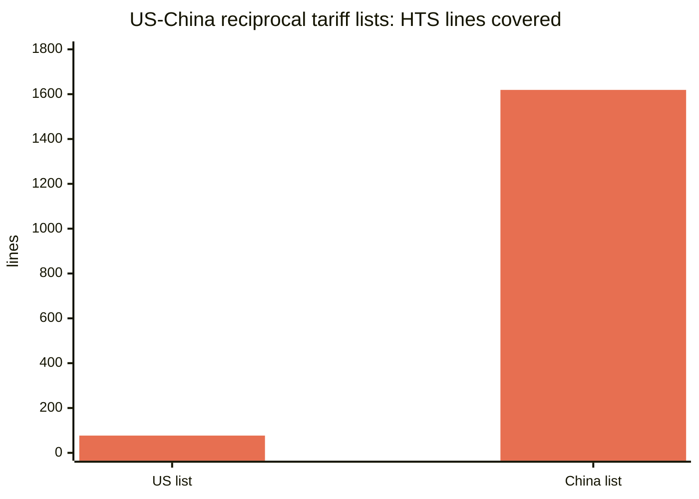
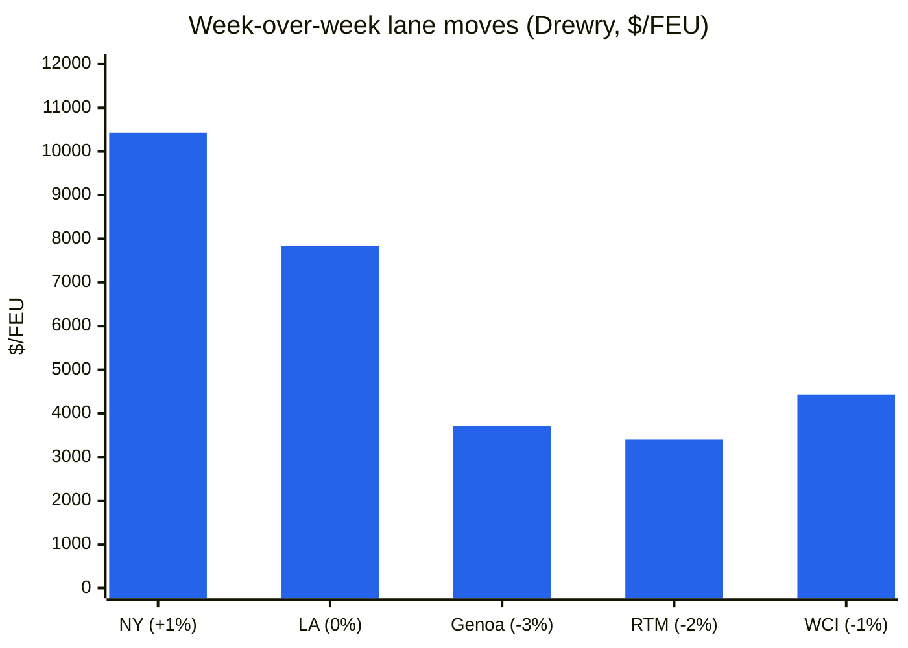
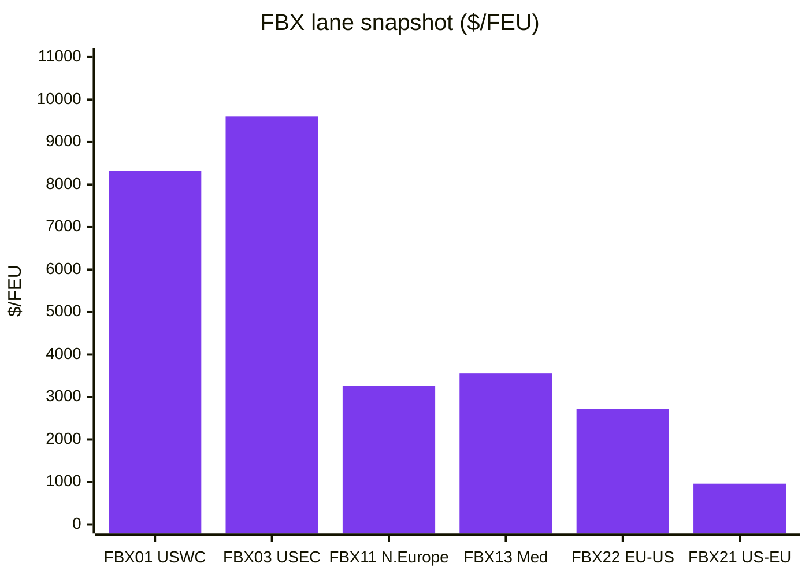
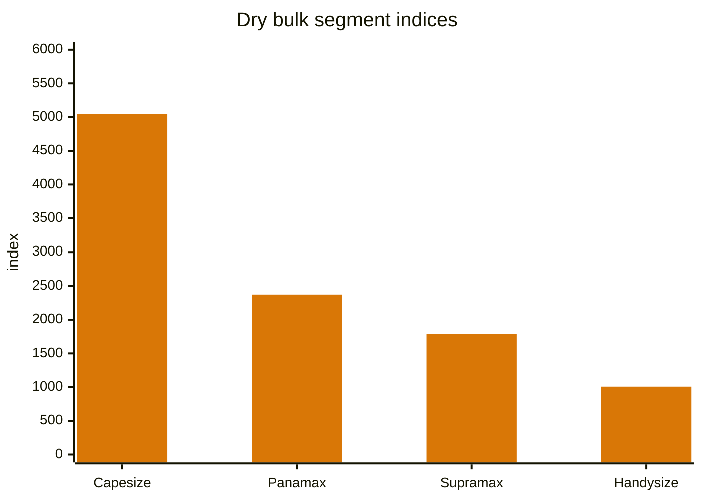
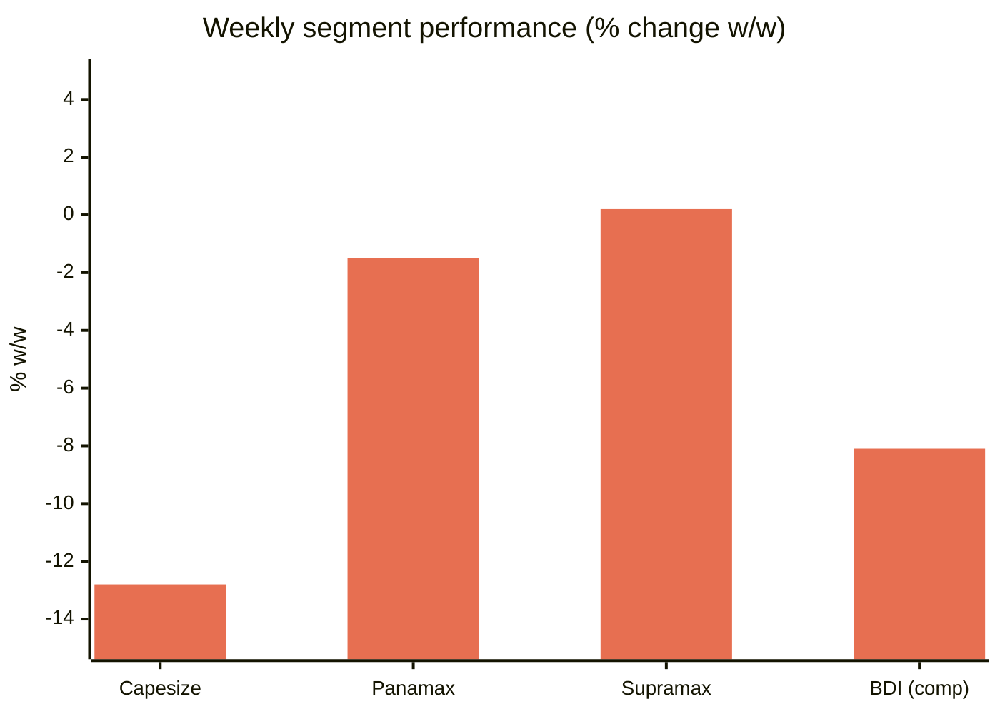
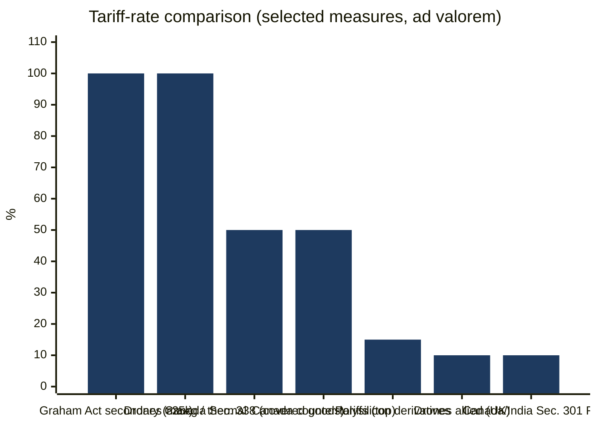
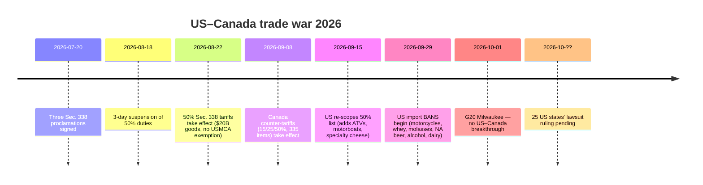
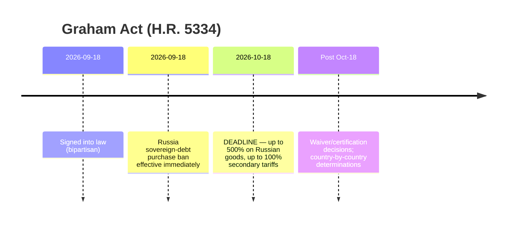
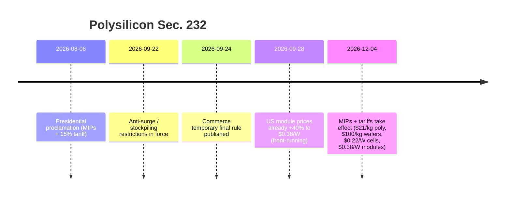

# Global Trade Intelligence Report — Week of September 28 – October 5, 2026

**Weekly briefing.** Coverage window: September 28 – October 5, 2026. Compiled from approximately 45 trade news, policy, data, and freight sources worldwide.

---

## Table of contents

1. [Executive summary](#1-executive-summary)
2. [Alerts](#2-alerts)
3. [Top stories — deep dives](#3-top-stories--deep-dives)
4. [Tariff tracker](#4-tariff-tracker)
5. [US policy deep dive](#5-us-policy-deep-dive)
6. [World policy by region](#6-world-policy-by-region)
7. [Enforcement actions](#7-enforcement-actions)
8. [Data releases](#8-data-releases)
9. [Freight market](#9-freight-market)
10. [Policy timelines](#10-policy-timelines)
11. [Upcoming deadlines & events (next 90 days)](#11-upcoming-deadlines--events-next-90-days)
12. [Sources & methodology](#12-sources--methodology)

---

## 1. Executive summary

Washington moved this week from tariffs to outright import bans. On September 29, Canadian motorcycles, whey, molasses, nonalcoholic beer, alcohol, and dairy stopped being dutiable goods and became prohibited ones. It is the first denial-of-entry measure of the US–Canada trade war, layered on top of 50% Section 338 duties in force since August (no USMCA exemption) and Canada's mirrored 15/25/50% counter-tariffs on 335 US items.

Deadlines are driving the agenda now. The Graham Act's October 18 deadline for secondary tariffs of up to 100% on the top buyers of Russian energy is thirteen days out, with China, India, and Turkey most exposed. Brussels takes up the Franco-German rapid-response trade weapon on October 15, days after Beijing opened an anti-dumping probe into EU p-nitrotoluene. Retaliation is outpacing negotiation this autumn.

Multilateralism stalled this week. G20 trade ministers in Milwaukee agreed on one of four agenda items. The US–China "30-for-30" tariff-relief lists, $30B a side, cut the trade-weighted US tariff on Chinese goods from 27.3% to 26.0%, per HSBC. The durable achievement is institutional rather than arithmetic: a standing Board of Trade, not the tariff math.

In enforcement, CBP issued two forced-labor Withhold Release Orders on Indonesian palm oil, and the DOJ's trade-fraud campaign added another case: a $5.15M False Claims settlement over Chinese LEDs declared as Taiwanese. Freight markets diverged. Transpacific container rates held firm into Golden Week while Asia–Europe fell for a twelfth consecutive week on returning Suez capacity. Dry bulk posted its worst week in over a month as Capesize earnings collapsed 12.8%.

---

## 2. Alerts

| # | Alert | Effective | Impact | Source |
|---|-------|-----------|--------|--------|
| A1 | US import bans on Canadian motorcycles, whey, molasses, nonalcoholic beer, alcohol, dairy | Sept 29, 2026 | Targeted goods denied entry; in-transit goods face 50% duty instead | [asrwe.com](https://asrwe.com/asr-university/us-canada-import-ban-alcohol-motorcycles-section-338-expansion-september-2026) |
| A2 | CBP WROs on Indonesian palm oil (Mitra Aneka Rezeki, Hardaya Inti Plantation) | Sept 29, 2026 | Immediate detention at all US ports; 60 active WROs + 8 Findings now | [thompsonhine.com](https://www.thompsonhine.com/insights/cbp-issues-withhold-release-orders-on-two-indonesian-palm-oil-producers/) |
| A3 | Graham Act secondary tariffs (up to 100%) on top Russian-energy buyers | Deadline Oct 18, 2026 | China, India, Turkey most exposed; stacks on existing duties | [lexblog.com](https://www.lexblog.com/2026/09/24/the-lindsey-graham-sanctions-act-what-businesses-need-to-know-about-the-new-tariffs/) |
| A4 | Polysilicon Section 232: MIPs + 15% tariffs | Dec 4, 2026 (anti-surge rules already in force) | $21/kg poly, $100/kg wafers, $0.22/W cells, $0.38/W modules; US module prices already +40% | [mondaq.com](https://www.mondaq.com/unitedstates/export-controls-trade-investment-sanctions/1848548/polysilicon-and-derivatives-in-the-bullseye-for-major-new-tariffs-and-other-restrictions) |
| A5 | EU "systemic reaction" rapid-response trade tool proposed | Proposal Oct 5; EU leaders summit Oct 15 | Potential 24-hour market cutoff powers; China retaliation risk | [reuters.com](https://www.reuters.com/world/china/france-germany-propose-new-rapid-eu-trade-response-tool-2026-10-05/) |
| A6 | China anti-dumping probe on EU p-nitrotoluene | Opened Oct 3 (MOFCOM Announcement No. 44) | First retaliatory shot in EU-China escalation | [vespernews.com](https://www.vespernews.com/en/news/7dd758b7-b501-4c41-b2ee-13cb57ed832f) |

### A1 — US import bans on Canadian goods (detail)

The September proclamations built a two-wave structure. Wave one, effective September 15, re-scoped the 50% Section 338 product list. Added at 50%: specialty cheeses, modified fats and oils, bovine hides and upholstery leather, raw and dressed furskins, recreational motorboats, specialty paper, select steel and aluminum items, metal fittings and welding inputs, golf carts, furniture and lamps, ATVs, and additional dairy. Removed: rock salt, sugar, cement, switchgear assemblies, toilet paper, fishing-rod parts, and bulk whiskies and liqueurs. Wave two, September 29, went further than any tariff: outright import bans, meaning denial of entry, on Canadian motorcycles (including BRP Can-Am Spyder and Canyon models), whey, molasses, nonalcoholic beer, alcoholic beverages, and dairy. Goods already on the water or in a bonded warehouse before September 29 stay subject to the 50% duty rather than the ban. ([tariffcalculator2026.com](https://tariffcalculator2026.com/canada-section-338-september-15-29-what-changes), [asrwe.com](https://asrwe.com/asr-university/us-canada-import-ban-alcohol-motorcycles-section-338-expansion-september-2026))

Importers most often misunderstand the stacking rule. The 50% Section 338 duty carries no USMCA exemption; a CUSMA certificate does nothing against it. But the separate 10% Section 301 forced-labor tariff on Canadian goods *is* avoided with a valid USMCA claim. So a covered non-USMCA good can face 50% plus 10%, for a combined 60%. ([tarifflens.ai](https://www.tarifflens.ai/blog/section-338-canada-retaliation-september-2026-importers-guide))

### A2 — Indonesian palm oil WROs (detail)

CBP's September 29 orders target palm oil and derivatives from Mitra Aneka Rezeki (MAR) and Hardaya Inti Plantation (HIP). Information reviewed for the orders included worker interviews, payroll slips, harvest quotas, photographs, NGO and government reports, news media, and academic research. MAR workers showed nine ILO forced-labor indicators, among them retention of identity documents and isolation. HIP showed seven: debt bondage, wage withholding, deception, excessive overtime, intimidation, abusive conditions, abuse of vulnerability. At all US ports, detention is immediate. Importers have three options: export the goods, destroy them, or prove clean sourcing. ([thompsonhine.com](https://www.thompsonhine.com/insights/cbp-issues-withhold-release-orders-on-two-indonesian-palm-oil-producers/), [ghy.com](https://www.ghy.com/trade-compliance/2026-withhold-release-orders-wros/))

### A3 — Graham Act (detail)

Signed September 18 with bipartisan support, H.R. 5334 puts the Russia sanctions regime on statutory footing and creates two mandatory tariff tracks, both due by October 18. Track one: up to 500% on all Russian-origin goods. Track two: up to 100% secondary tariffs on countries that ranked among the top five importers of Russian crude or gas and made new purchases within 30 days of enactment. Most exposed are China, India, and Turkey; Slovakia, Hungary, and the UAE face elevated risk. EU members are assessed individually. The escape valves are narrow: a natural-gas exception (imports below 15% of Russia's total gas exports, plus what the Act calls "significant steps" to reduce them) and national-interest waivers. All duties stack on existing Section 301 and 232 duties. ([lexblog.com](https://www.lexblog.com/2026/09/24/the-lindsey-graham-sanctions-act-what-businesses-need-to-know-about-the-new-tariffs/), [jdsupra.com](https://www.jdsupra.com/legalnews/new-sanctions-and-tariff-power-under-4624517/), [tradepractitioner.com](https://www.tradepractitioner.com/2026/09/sanctions-by-statute-the-graham-act-and-tariffs-on-russias-energy-buyers/))

### A4 — Polysilicon Section 232 (detail)

The terms were set by an August 6 proclamation and a Commerce temporary final rule dated September 24. From December 4: minimum import prices of $21/kg for polysilicon, $100/kg for ingots and wafers, $0.22/W for cells, and $0.38/W for modules, plus a 15% ad valorem tariff on derivatives. Raw polysilicon itself is exempt from the 15%. The UK gets 10%; Japan, Korea, Taiwan, Switzerland, Liechtenstein, and the EU are capped at 15% total including MFN. Anti-surge and stockpiling restrictions are already in force for the September 22 to December 4 window. The market is front-running the deadline: US module offer prices already sit at the $0.38/W floor, up 40.7% since August (from $0.27/W), to the benefit of Hanwha Solutions and OCI. Industry estimates put the added equipment cost near $10M per 100 MW of project capacity. ([mondaq.com](https://www.mondaq.com/unitedstates/export-controls-trade-investment-sanctions/1848548/polysilicon-and-derivatives-in-the-bullseye-for-major-new-tariffs-and-other-restrictions), [en.sedaily.com](https://en.sedaily.com/finance/2026/09/28/us-solar-module-prices-jump-40-percent-before-import-curbs), [logisticusgroup.com](https://logisticusgroup.com/new-solar-tariffs-land-december-4-heres-how-to-keep-your-project-on-budget-and-on-schedule/))

### A5 — EU rapid-response tool (detail)

On October 5, Macron and Merz wrote to von der Leyen proposing a "systemic reaction" instrument: country-agnostic, triggerable by a minority of member states (which would break the qualified-majority norm), authorizing "decisive" measures up to immediate cutoff from the internal market. Paris and Berlin frame it as the EU's answer to US Section 301 and China's critical-mineral export controls. One German official called it a "second-strike weapon." A parallel diversification instrument would cap single-country dependence for critical imports. The backdrop: the EU goods deficit with China hit €359.9B in 2025 and €103B in Q2 2026, the highest since Q3 2022. The Commission's enforcement chief cites import surges hitting machinery, textiles, metals, and chemicals, not just EVs. ([reuters.com](https://www.reuters.com/world/china/france-germany-propose-new-rapid-eu-trade-response-tool-2026-10-05/), [wsj.com](https://www.wsj.com/world/europe/germany-and-france-are-proposing-a-new-weapon-to-counter-flood-of-chinese-goods-f723dfdf), [brusselsmorning.com](https://brusselsmorning.com/eu-china-trade-tensions/104764/))

### A6 — China retaliates first (detail)

On October 3, MOFCOM (Announcement No. 44) opened an anti-dumping investigation into p-nitrotoluene from the EU. The timing, days before Beijing trade talks and squarely against the Franco-German proposal, functions as a warning. MOFCOM separately warned of "firm" retaliation against any EU rapid-response instrument. ([vespernews.com](https://www.vespernews.com/en/news/7dd758b7-b501-4c41-b2ee-13cb57ed832f))

---
## 3. Top stories — deep dives

### 3.1 G20 trade ministers fracture in Milwaukee (Sept 30 – Oct 2)

Chaired by USTR Jamieson Greer under the US G20 presidency, trade ministers met in Milwaukee with four agenda items. They agreed on one: a joint statement condemning the weaponization of food trade through coercive actions. The other three produced nothing.

**The scorecard.** On excess capacity, a draft backed by most members was blocked by a China-led minority resisting subsidy language; Greer said the presidency was "severely disappointed." For context on Washington's posture: the US has opened excess-capacity investigations into what Greer called countries "from Norway to Bangladesh," citing autos, batteries, paper, and semiconductors alongside Chinese steel. On forced labor, no joint text emerged, so the US, Mexico and Argentina issued a separate declaration. On MFN reform, the US opened a debate on whether unconditional most-favoured-nation treatment "fails to promote reciprocity" and "creates free riders," but sought no joint statement. ([barchart.com](https://www.barchart.com/story/news/4917577/g20-trade-talks-yield-little-progress-while-tensions-simmer) (AP), [reuters.com](https://www.reuters.com/world/china/g20-trade-chiefs-denounce-food-trade-coercion-not-excess-factory-capacity-2026-10-01/), [nationpress.com](https://www.nationpress.com/all/g20-milwaukee-talks-eye-more-diesel-globally))

**The sidelines told a different story.** India amended its Foreign Trade Policy in July 2026 to ban imports of goods made wholly or partly with forced labour, and Goyal raised it in Milwaukee while running a two-track strategy: defend positions in plenary, push bilaterals on the margins. US-brokered discussions are expected to put more diesel into the global market, though parties, volumes and timetable are undisclosed. And there was no breakthrough on the US–Canada dispute; Trump banned roughly $1B of Canadian imports (alcohol, dairy, motorcycles) during the week. ([beatsinbrief.com](https://beatsinbrief.com/2026/10/03/milwaukee-g20-trade-ministers-piyush-goyal-india-positions/), [businessmirror.com.ph](https://businessmirror.com.ph/2026/10/02/g20-trade-talks-yield-little-progress-while-tensions-simmer/))

The failure to produce an outcome document is itself the signal. Multilateral trade governance can no longer constrain the current tariff wave; the action has moved permanently to unilateral and bilateral tracks. Watch the G20 leaders' summit in Miami in December for whether Milwaukee's fractures surface at head-of-state level. ([nationpress.com](https://www.nationpress.com/international/g20-trade-talks-end-without-deal-goyal))

### 3.2 US–China "30-for-30": lists published, economics marginal

The September 23–25 Trump–Xi summit in Washington produced the new US–China Board of Trade's "30-for-30" framework, and on September 28 both governments published reciprocal tariff-relief product lists: each side may de-tariff roughly $30B of the other's goods. ([cnn.com](https://www.cnn.com/2026/09/28/business/us-china-tariff-cuts-60-billion-intl?cid=external-feeds_iluminar_meta), [kpmg.com](https://kpmg.com/us/en/taxnewsflash/news/2026/09/us-china-trade-framework-tariff-reductions.html))

**Two lists, two philosophies.** The US list runs 77 HTS lines, all Chinese consumer goods: toys, fireworks, tableware, blankets, microwaves, Christmas-tree lamps, highchairs, child car seats, and electric shavers. Wi-Fi and Bluetooth-connected toys are carved out on data-security grounds, and all apparel is excluded. China's list runs 1,619 lines: corn, wheat, sorghum, meat, dairy, oils, fish, seafood, timber, plus cosmetics and medical devices. Whole soybeans, the largest US farm export to China, are notably absent. The US list covers about 7% of US imports from China (2024 values); China's covers about 18% of its imports from the US.

| | US list (Chinese goods) | China list (US goods) |
|---|---|---|
| HTS lines | 77 | 1,619 |
| Value | ~$30B | ~$30B |
| Character | Consumer goods: toys, fireworks, tableware, blankets, microwaves, Christmas-tree lamps, highchairs, child car seats, electric shavers | Agriculture: corn, wheat, sorghum, meat, dairy, oils, fish, seafood, timber; plus cosmetics, medical devices |
| Notable exclusions | Wi-Fi/Bluetooth-connected toys (data-security carve-out); **all apparel** | **Whole soybeans** — the largest US farm export to China |
| Share of bilateral flow | ~7% of US imports from China (2024 values) | ~18% of China's imports from the US |

*US list covers Chinese goods; China list covers US goods (~$30B each).*

**The math vs. the institution.** HSBC (September 29): the trade-weighted US tariff on Chinese goods falls only from 27.3% to 26.0%. Over 90% of listed goods revert to MFN ("normal") duties, and adjustments under the terms of reference occur at most once a year. On the side deals: China will import at least 10M metric tons of US coal in 2027 and again in 2028, an agriculture market-access working group launched, and rare-earth shipment levels are to be "returned to appropriate levels" (China met only about two-thirds of prior supply commitments; the US–China goods deficit is down 40% since January 2025, to $140B). No tariff cuts are in force yet. USTR must still announce rates and dates. ([exencialrp.substack.com](https://exencialrp.substack.com/p/hsbc-sees-us-china-30-for-30-deal) (HSBC via Substack), [lexblog.com](https://www.lexblog.com/2026/09/29/u-s-china-board-of-trade-30-for-30-identifies-products-recommended-for-reduced-tariffs/), [tradersunion.com](https://tradersunion.com/news/financial-news/show/3528484-us-china-lower-tariff-framework/))

Setting the ceremony aside, the framework's significance is institutional: a standing Board of Trade with working procedures, not the tariff arithmetic. For sourcing planners: apparel's exclusion preserves the China-to-Vietnam/Bangladesh/India diversification incentive, while home textiles (blankets, bed and table linen, and curtains) could face stiffer Chinese competition if relief lands. ([textalks.com](https://textalks.com/us-china-tariff-excludes-apparel-but-opens-door-to-chinese-home-textiles/))

### 3.3 C.H. Robinson to acquire RXO — $5.8B

On October 5, C.H. Robinson (Nasdaq: CHRW) agreed to acquire RXO (NYSE: RXO) in a cash-and-stock deal worth $5.8B. The terms: $17.25 in cash plus 0.0856 CHRW shares per RXO share, or $30.25 a share, a 29% premium to the October 2 close. Both boards approved unanimously. MFN Partners (17% of RXO) and Orbis, the largest holder, back the deal. Close is expected in H1 2027, pending regulatory approval and an RXO shareholder vote. ([rxo.com](https://rxo.com/news/c-h-robinson-to-acquire-rxo-redefining-the-future-of-third-party-logistics-while-unlocking-significant-shareholder-value/), [reuters.com](https://www.reuters.com/business/ch-robinson-buy-freight-broker-rxo-58-billion-2026-10-05/))

**Reading the market reaction.** RXO shareholders will own about 11% of the combined company, which would carry a combined enterprise value above $25B; RXO folds into CHRW's North American Surface Transportation division (over two-thirds of revenue). Management promises $300M in net run-rate cost synergies within two years via CHRW's "Lean AI" operating model: shared services, vendor consolidation, real estate, insurance. The market reaction followed the usual pattern. RXO jumped about 20% (to $28.10–28.49); CHRW fell 12% premarket ($150 vs. $157.72 close), the discount acquirers routinely absorb. Morgan Stanley advised CHRW, Goldman Sachs advised RXO. One detail worth flagging: RXO rose 16.2% in the two sessions before the announcement on 3.67M-share volume, against a norm of about 1.9M, a visible pre-announcement run. ([freightwaves.com](https://www.freightwaves.com/news/breaking-c-h-robinson-acquiring-rxo), [financial-news.co.uk](https://www.financial-news.co.uk/c-h-robinson-to-buy-rxo-in-5-8bn-cash-and-stock-deal/), [inboundlogistics.com](https://www.inboundlogistics.com/articles/c-h-robinson-to-acquire-rxo-in-5-8-billion-deal/))

Freight-brokerage consolidation tends to accelerate in soft-rate periods, when larger operators buy density and technology instead of building it. The combined entity would hold real pricing power in North American truckload, which points to firmer contract negotiations for shippers and tougher conditions for smaller brokers. The "Lean AI" synergy plan is also a signal about where brokerage labor costs go next: into automation. (Newsquawk via [financial-news.co.uk](https://www.financial-news.co.uk/c-h-robinson-to-buy-rxo-in-5-8bn-cash-and-stock-deal/))

### 3.4 India–US: "short strokes" but no deal

On the G20 sidelines (October 1–2), USTR Greer met Commerce Minister Piyush Goyal and declared the talks in the "short strokes," then added: "I don't think there's something imminent." A Trump–Modi call preceded the meeting; another leaders' call is expected "very soon." ([thehindubusinessline.com](https://www.thehindubusinessline.com/news/nothing-imminent-us-trade-representative-greer-on-india-trade-deal-modi-trump-to-talk-soon/article71536059.ece/amp/), [nationpress.com](https://www.nationpress.com/international/india-us-trade-deal-in-short-strokes-greer))

**The pressure points.** Indian goods face an extra 10% Section 301 forced-labor tariff since July 24, one layer of a 60-economy action, and a second 301 probe on structural excess capacity (16 economies including India) is pending and could hit steel. The sticking points are familiar: agriculture access, digital trade, and India's Russian-oil purchases, the last now sharpened by the Graham Act's up-to-100% secondary tariffs. Paradoxically, despite the duties, India's merchandise exports to the US rose 21.83% year on year in August. The rupee sits near 96.3 to the dollar. Both sides still cite the $500B bilateral trade target for 2030. Finance Minister Sitharaman (October 4) said talks have "reached a plateau," with further concessions hard to secure. ([thefinancialeconomy.com](https://www.thefinancialeconomy.com/india-us-trade-talks/), [jagranjosh.com](https://www.jagranjosh.com/general-knowledge/indiaus-trade-deal-not-imminent-why-is-it-being-delayed-who-has-the-advantage-what-are-indias-options-1820012731-1), [english.dainikjagranmpcg.com](https://english.dainikjagranmpcg.com/top-stories/india-us-trade-talks-reach-plateau-nirmala-sitharaman/article-36152))

India is the swing variable in two stories at once: the China+1 sourcing map and the Graham Act's secondary-tariff targets. A deal would open one of the few tariff-relief valves available to US importers this year. Failure keeps Indian exporters, and their US buyers, in limbo into peak season.

### 3.5 Drones: tariffs up, export controls down

Two opposite-moving US drone actions, both rooted in an August 13 double-header. First, a Section 232 proclamation (Proclamation 11055) imposing 100% tariffs on drones over 25kg or with thermal imaging (plus docking stations and critical components, Annex I) and 25% on smaller non-thermal drones (Annex II), effective September 3; components (Annex III) face 25% from February 9, 2027. Allied rates apply: UK 10%, Japan/Korea/Taiwan/Switzerland/Liechtenstein/EU capped at 15% total. Second, a BIS final rule easing export controls: sub-3-hour-endurance UAVs drop to AT-only control under ECCN 9A012, with the STA license exception available for Country Group A:5. Military end-users in China, Russia, Belarus, and Venezuela stay restricted. ([whitehouse.gov](https://www.whitehouse.gov/presidential-actions/2026/08/adjusting-imports-of-unmanned-aircraft-systems-and-unmanned-aircraft-systems-components-into-the-united-states/), [jdsupra.com](https://www.jdsupra.com/legalnews/two-us-drone-actions-reshape-export-8075367/) (Wiley), [tbgfs.com](https://tbgfs.com/csms-69738151-guidance-section-232-duties-on-imports-of-unmanned-aircraft-systems-and-unmanned-aircraft-systems-components/))

Read together, the two moves amount to a dual-track industrial policy: restricting drone imports while easing drone exports. Commercial buyers now face a divided market, with allied-supply-chain products at 10–15% duties and Chinese-origin products at 25–100%.

### 3.6 US goods deficit hits $132.6B in August

The advance August goods deficit widened 11.5% to $132.6B. Imports reached $336.1B (up 5.5%) on industrial supplies and AI-buildout capital goods; exports were $203.4B (up 1.9%). Trade has now been a drag on GDP for the third consecutive quarter, a complication for an administration arguing that tariffs shrink the deficit. ([reuters.com](https://www.reuters.com/business/us-goods-trade-deficit-widens-sharply-august-2026-09-30/))

### 3.7 De minimis remains closed; IEEPA refunds proceed

**De minimis stays shut.** The Court of International Trade (August 13, *Axle of Dearborn* / Detroit Axle case) upheld the IEEPA-based rescission of the $800 de minimis exemption, ruling that withdrawing a "privilege" does not constitute imposing a tariff, so it survives the Supreme Court's February ruling that struck down IEEPA tariffs. The global de minimis exemption ended August 29, 2025; Congress's own closure takes effect in July 2027. ([reuters.com](https://www.reuters.com/legal/government/us-court-backs-trumps-power-close-de-minimis-tariff-exemption-2026-08-13/), [openclassactions.com](https://openclassactions.com/tariff-class-actions.php))

**The refund machine grinds on.** CBP's CAPE portal, the Consolidated Administration and Processing of Entries system inside ACE, live since April 20, is processing the roughly $165B in IEEPA duties collected, with interest accruing near $650M a month. CAPE Phase 3 deploys October 6 to handle refunds on reliquidated entries. ([thompsonhine.com](https://www.thompsonhine.com/insights/cbp-confirms-october-6-2026-launch-of-phase-3-of-the-ieepa-tariff-refund-process/))

---
## 4. Tariff tracker

Baseline plus this week's changes. Rates are *additional* duties unless noted; stacking rules vary by measure, so check HTS, origin, and entry date per shipment.

| Target | Measure | Rate | Effective | Status | Source |
|---|---|---|---|---|---|
| Canada (covered goods) | Sec. 338 (3 proclamations, Jul 20) | 50% | Aug 22, 2026 | In force; **no USMCA exemption**; re-scoped Sept 15 | [tariffcalculator2026.com](https://tariffcalculator2026.com/canada-50-percent-tariff-august-19-explainer) |
| Canada (motorcycles, whey, molasses, NA beer, alcohol, dairy) | Sec. 338 import bans | Ban (denial of entry) | Sept 29, 2026 | In force | [asrwe.com](https://asrwe.com/asr-university/us-canada-import-ban-alcohol-motorcycles-section-338-expansion-september-2026) |
| Canada (general) | Sec. 301 forced-labor | 10% | Jul 24, 2026 (60 economies) | In force; USMCA claim exempts | [tarifflens.ai](https://www.tarifflens.ai/blog/section-338-canada-retaliation-september-2026-importers-guide) |
| US goods → Canada | Canada Surtax Order 2026 | 15% / 25% / 50% (335 items) | Sept 8, 2026 | In force; mirrors US 338 rates | [surtaxscan.com](https://surtaxscan.com/news/canadas-counter-tariffs-are-back-15-25-and-50-on-335-us-tariff-items-from) |
| Russia (all goods) | Graham Act (H.R. 5334) | Up to 500% | By Oct 18, 2026 | Signed Sept 18; implementation pending | [lexblog.com](https://www.lexblog.com/2026/09/24/the-lindsey-graham-sanctions-act-what-businesses-need-to-know-about-the-new-tariffs/) |
| Top Russian-energy buyers (China, India, Turkey…) | Graham Act secondary tariffs | Up to 100% | By Oct 18, 2026 | Pending; stacks on existing duties | [jdsupra.com](https://www.jdsupra.com/legalnews/new-sanctions-and-tariff-power-under-4624517/) |
| China (polysilicon chain) | Sec. 232 MIPs + tariff | MIP $21/kg–$0.38/W + 15% | Dec 4, 2026 | Proclaimed Aug 6; anti-surge rules in force | [mondaq.com](https://www.mondaq.com/unitedstates/export-controls-trade-investment-sanctions/1848548/polysilicon-and-derivatives-in-the-bullseye-for-major-new-tariffs-and-other-restrictions) |
| Drones (general) | Sec. 232 (Proc. 11055) | 100% (>25kg/thermal); 25% (small) | Sept 3, 2026 | In force | [whitehouse.gov](https://www.whitehouse.gov/presidential-actions/2026/08/adjusting-imports-of-unmanned-aircraft-systems-and-unmanned-aircraft-systems-components-into-the-united-states/) |
| Drones (UK / JP/KR/TW/CH/EU) | Sec. 232 allied rates | 10% UK; 15% cap others | Sept 3, 2026 | In force (certification required) | [tbgfs.com](https://tbgfs.com/csms-69738151-guidance-section-232-duties-on-imports-of-unmanned-aircraft-systems-and-unmanned-aircraft-systems-components/) |
| Drone components (Annex III) | Sec. 232 | 25% | Feb 9, 2027 | Announced | [jdsupra.com](https://www.jdsupra.com/legalnews/trump-administration-imposes-section-5315313/) |
| China (30-for-30 list, 77 HTS lines) | Reciprocal relief (pending) | Revert toward MFN | n/a — USTR announcement pending | Lists published Sept 28; no cuts in force | [kpmg.com](https://kpmg.com/us/en/taxnewsflash/news/2026/09/us-china-trade-framework-tariff-reductions.html) |
| Pharmaceuticals (patented) | Sec. 232 | Per HTSUS 9903.04.60–70 | Guidance updated Sept 28 | CBP entry guidance issued | [jdsupra.com](https://www.jdsupra.com/legalnews/cbp-releases-updated-section-232-2944011/) |
| India (general) | Sec. 301 forced-labor | 10% | Jul 24, 2026 | In force | [thefinancialeconomy.com](https://www.thefinancialeconomy.com/india-us-trade-talks/) |
| 16 economies incl. India | Sec. 301 excess-capacity probe | n/a | Investigation ongoing | USTR action promised "within weeks" | [thefinancialeconomy.com](https://www.thefinancialeconomy.com/india-us-trade-talks/) |
| 178 product exclusions | Sec. 301 exclusions | Excluded | Through Nov 9, 2026 | Expiring |  |
| EU (proposed) | "Systemic reaction" tool | Up to market cutoff | Proposal Oct 5; summit Oct 15 | Not yet law | [reuters.com](https://www.reuters.com/world/china/france-germany-propose-new-rapid-eu-trade-response-tool-2026-10-05/) |

---

## 5. US policy deep dive

### This week's US actions

| Date | Actor | Action | Significance | Source |
|---|---|---|---|---|
| Sept 28 | CBP | Updated entry guidance for Sec. 232 pharma tariffs (HTSUS 9903.04.60–70); 9903.04.61 retired after Sept 29 | Filing-rule clarity for pharma importers | [jdsupra.com](https://www.jdsupra.com/legalnews/cbp-releases-updated-section-232-2944011/) |
| Sept 29 | CBP | FY2027 TRQ bulletins: AGOA apparel, raw cane sugar | Quota-year planning | [ghy.com](https://www.ghy.com/trade-compliance/category/international-trade-issues/) |
| Sept 29 | CBP | Two forced-labor WROs (Indonesian palm oil) | 60 WROs + 8 Findings now active | [kpmg.com](https://kpmg.com/us/en/taxnewsflash/news/2026/09/us-cbp-wros-indonesian-palm-oil.html) |
| Sept 29 | White House | Canada import bans take effect | First US import *bans* (not tariffs) of the trade war | [asrwe.com](https://asrwe.com/asr-university/us-canada-import-ban-alcohol-motorcycles-section-338-expansion-september-2026) |
| Sept 30 | USTR | Global Forum on Steel Excess Capacity statement | Multilateral cover for steel actions |  |
| Oct 1–2 | USTR (Greer) | G20 Milwaukee: food-coercion consensus only; MFN-reform debate opened | Multilateral track stalled; unilateral track affirmed | [reuters.com](https://www.reuters.com/world/china/g20-trade-chiefs-denounce-food-trade-coercion-not-excess-factory-capacity-2026-10-01/) |
| Oct 2 | USTR | 14th RRM remediation: Corporación de Occidente tires (Mexico) | USMCA labor enforcement continues | [einpresswire.com](https://www.einpresswire.com/article/947031749/united-states-and-mexico-announce-course-of-remediation-at-corporaci-n-de-occidente-facility) |
| Oct 2 | USTR | 2027 USMCA joint review: public comments due **Jan 12, 2027** | Review-year clock starts |  |
| Oct 5 | White House/Congress | Graham Act implementation countdown (13 days left) | Up-to-100% secondary tariffs pending | [lexblog.com](https://www.lexblog.com/2026/09/24/the-lindsey-graham-sanctions-act-what-businesses-need-to-know-about-the-new-tariffs/) |

Three tracks are running at once. On enforcement: Canada import bans, Graham Act secondary tariffs, and polysilicon MIPs, all structured for maximum leverage before year-end. On institution-building: USMCA 2027 review preparations, Board of Trade procedures, and the MFN-reform debate. On legal positioning: the CIT's de minimis ruling sits against the Supreme Court's IEEPA-tariff decision, with roughly $165B in IEEPA duties now moving through CAPE refunds. The through-line is adaptation. Where courts closed off IEEPA, the administration shifted to Sections 232, 338, and 301, and to fresh statute in the Graham Act. Importers should expect further measures under the authorities that have survived judicial review.

## 6. World policy by region

### Europe

| Development | Detail | Source |
|---|---|---|
| Franco-German rapid-response tool proposed | "Systemic reaction" instrument; minority trigger; up to immediate market cutoff; diversification instrument alongside | [reuters.com](https://www.reuters.com/world/china/france-germany-propose-new-rapid-eu-trade-response-tool-2026-10-05/) |
| EU–China deficit | €359.9B in 2025; €103B in Q2 2026 (highest since Q3 2022); import surges in machinery, textiles, metals, chemicals | [brusselsmorning.com](https://brusselsmorning.com/eu-china-trade-tensions/104764/) |
| EU leaders summit Oct 15 | Brussels summit to take up China imbalances; first test of the Franco-German proposal | [reuters.com](https://www.reuters.com/world/china/france-germany-propose-new-rapid-eu-trade-response-tool-2026-10-05/) |
| EU weighing industrial-tariff cuts | Possible cuts to avert Chinese steel retaliation (per Capitol Forum reporting) | [thecapitolforum.com](https://thecapitolforum.com/eu-considers-cutting-tariffs-for-china-to-avert-retaliation-over-steel-curbs/) |

### Canada

| Development | Detail | Source |
|---|---|---|
| Counter-tariffs in force | 15%/25%/50% on 335 US items from Sept 8; C$28B coverage; in-transit goods excluded | [surtaxscan.com](https://surtaxscan.com/news/canadas-counter-tariffs-are-back-15-25-and-50-on-335-us-tariff-items-from) |
| C$7.5B support package | Domestic aid for affected industries |  |
| Diversification push | Carney government pivoting toward Europe/India deals |  |
| 25 states suing over Sec. 301 duties | Challenge to the forced-labor tariff regime in the CIT; no ruling yet | [baystreet.ca](https://www.baystreet.ca/globalmarkets/3749/US-States-Sue-Trump-Administration-Over-New-Tariffs) |

### China (MOFCOM)

| Development | Detail | Source |
|---|---|---|
| Anti-dumping probe: EU p-nitrotoluene | Opened Oct 3 (Announcement No. 44); retaliatory signal | [vespernews.com](https://www.vespernews.com/en/news/7dd758b7-b501-4c41-b2ee-13cb57ed832f) |
| Firm warning on EU tool | "Firm" retaliation threatened against any rapid-response instrument | [reuters.com](https://www.reuters.com/world/china/france-germany-propose-new-rapid-eu-trade-response-tool-2026-10-05/) |
| 30-for-30 readout | Published 1,619-line list; coal commitments (10M MT/yr 2027–28); rare-earth shipments to normalize | [kpmg.com](https://kpmg.com/us/en/taxnewsflash/news/2026/09/us-china-trade-framework-tariff-reductions.html) |
| 8th-round consultation readout | Bilateral channel still functioning |  |

### Rest of world

| Country/region | Development | Source |
|---|---|---|
| India | Forced-labor import ban (July FTP amendment) raised at G20; exports to US +21.83% YoY in August despite 10% tariff | [beatsinbrief.com](https://beatsinbrief.com/2026/10/03/milwaukee-g20-trade-ministers-piyush-goyal-india-positions/), [thefinancialeconomy.com](https://www.thefinancialeconomy.com/india-us-trade-talks/) |
| UK | No major trade-policy moves observed this week |  |
| Mexico/Argentina | Joined US forced-labor declaration at G20 (separate from failed joint text) | [nationpress.com](https://www.nationpress.com/all/g20-milwaukee-talks-eye-more-diesel-globally) |

## 7. Enforcement actions

| Action | Detail | Source |
|---|---|---|
| 2 new WROs (Sept 29) | Indonesian palm oil: MAR (9 ILO indicators), HIP (7 indicators); immediate detention | [thompsonhine.com](https://www.thompsonhine.com/insights/cbp-issues-withhold-release-orders-on-two-indonesian-palm-oil-producers/) |
| Everlight $5.15M settlement | Texas-based Everlight Americas settled False Claims suit alleging Chinese LEDs declared as Taiwan-origin to dodge Sec. 301 | [news.bloomberglaw.com](https://news.bloomberglaw.com/federal-contracting/tariff-dodging-settlements-underscore-doj-focus-on-trade-fraud) |
| Perfectus Aluminum ~$550M (May) | Aluminum extrusions duty evasion; largest recent trade-fraud settlement | [news.bloomberglaw.com](https://news.bloomberglaw.com/federal-contracting/tariff-dodging-settlements-underscore-doj-focus-on-trade-fraud) |
| DOJ fraud memo (Aug 13) | AAG Colin McDonald: trade fraud/customs evasion a top priority; "institutionalizing" False Claims enforcement | [news.bloomberglaw.com](https://news.bloomberglaw.com/federal-contracting/tariff-dodging-settlements-underscore-doj-focus-on-trade-fraud) |
| Transshipment crackdown preview | White House "Great Transshipment Scam" report (Aug 13); CBP building AI "Detective Border" for origin screening | [arnoldporter.com](https://www.arnoldporter.com/en/perspectives/blogs/consumer-products-and-retail-navigator/2026/08/white-house-transshipment-report-signals-increased-scrutiny) |
| Forced-labor tariff layer | Sec. 301 10% on 60 economies (incl. India, Canada) since July 24, distinct from UFLPA entity enforcement | [thefinancialeconomy.com](https://www.thefinancialeconomy.com/india-us-trade-talks/) |

The enforcement model is changing shape. Shipment-level interdiction still happens, as the palm-oil WROs show, but the emphasis has shifted to financial penalties: half-billion-dollar False Claims settlements, AI-assisted transshipment detection that scores risk before release, and tariff layers that punish entire economies for labor practices. Compliance keeps migrating upstream. Importers now need origin documentation at second-tier suppliers, not just the invoice.

## 8. Data releases

| Release | Detail | Source |
|---|---|---|
| US Census advance goods trade, August (Sept 30) | Deficit $132.6B (+11.5% m/m); imports $336.1B (+5.5%), exports $203.4B (+1.9%); industrial supplies + AI capital goods drove imports | [reuters.com](https://www.reuters.com/business/us-goods-trade-deficit-widens-sharply-august-2026-09-30/) |
| EU–China bilateral (Eurostat via press) | EU goods deficit €103B in Q2 2026; €359.9B in 2025 | [brusselsmorning.com](https://brusselsmorning.com/eu-china-trade-tensions/104764/) |
| UN Comtrade / WITS / ITC / IMF | No major scheduled releases this week (monthly cycle) |  |
| Drewry Container Forecaster | Supply-demand balance to weaken in coming quarters; further spot-rate contraction expected | [fibre2fashion.com](https://www.fibre2fashion.com/news/textile-news/drewry-wci-further-falls-1-transpacific-rates-less-volatile-305782-newsdetails.htm) (prior week) |

---
## 9. Freight market

### 9.1 Container — Drewry World Container Index (Oct 1, 2026)

Composite **$4,434/FEU, down 1% on the week**, with Asia–Europe weakness accounting for the decline. Transpacific lanes held firm into Golden Week. Carriers have announced FAK increases and GRIs for mid-October, though Drewry doubts they will hold.

| Lane | This week ($/FEU) | w/w | Trend |
|---|---|---|---|
| Shanghai → New York | 10,428 | +1% | ▲ firm |
| Shanghai → Los Angeles | 7,835 | flat | ► steady |
| Shanghai → Genoa | 3,702 | -3% | ▼ 12th straight weekly decline |
| Shanghai → Rotterdam | 3,399 | -2% | ▼ 12th straight weekly decline |

On the capacity side, 10 transpacific blank sailings were announced for next week (down from 13), and 5 on Asia–Europe (down from 6). Suez transits rose from 41 to 48 a week, adding effective capacity that is outpacing blank-sailing cuts on the Europe lane. ([thedcn.com.au](https://www.thedcn.com.au/news/world-container-index-1-october-2026))

**Week-over-week lane moves (Drewry, $/FEU):**

*Rates ($/FEU): Shanghai→New York 10,428; →Los Angeles 7,835; →Genoa 3,702; →Rotterdam 3,399; composite 4,434.*

### 9.2 Container — Freightos Baltic Index (w/e Oct 2, 2026)

Global **FBX 3,341 was unchanged on the week**: the transpacific held steady, Europe softened, and the transatlantic was mixed.

| Lane | Rate ($/FEU) | w/w move |
|---|---|---|
| FBX01 China/EA → US West Coast | 8,319 | flat |
| FBX03 China/EA → US East Coast | 9,606 | flat |
| FBX11 China/EA → North Europe | 3,260 | flat |
| FBX13 China/EA → Mediterranean | 3,555 | -$7 |
| FBX21 US East Coast → Europe | 963 | -$40 (from $1,003) |
| FBX22 Europe → US East Coast | 2,723 | +$57 (from $2,666) |

([thedcn.com.au](https://www.thedcn.com.au/news/baltic-exchange-weekly-report-2-october-2026))

**FBX lane snapshot ($/FEU):**

*Lanes: FBX01 China/East Asia→US West Coast; FBX03 →US East Coast; FBX11 →North Europe; FBX13 →Mediterranean; FBX22 Europe→US East Coast; FBX21 US East Coast→Europe.*

### 9.3 Dry bulk — Baltic Dry Index (Oct 2, 2026)

**BDI 3,148** (up 8 points, or 0.3%, on the day) but **down 8.1% on the week**, the worst week in over a month. The decline was driven by Capesize, which collapsed on weak Chinese steel-mill margins and high port inventories.

| Segment | Index | d/d | w/w | Avg earnings/day |
|---|---|---|---|---|
| Capesize (BCI) | 5,042 | +32 (+0.6%) | **-12.8%** | $45,731 (BCI 182 5TC) |
| Panamax (BPI) | 2,372 | -7 (-0.3%) | -1.5% | $21,349 |
| Supramax (BSI) | 1,789 | -5 (-0.3%) | **+0.2%** | $22,619 |
| Handysize (BHSI) | 1,007 | -1 | n/a | $18,117 |

A note on the numbers: Reuters reported Capesize earnings at $42,228/day on a different vessel-size basis; the Baltic Exchange 5TC figure ($45,731) is used above. ([worldports.org](https://www.worldports.org/baltic-dry-bulk-index-gains-for-second-day-but-posts-weekly-loss/), [handybulk.com](https://www.handybulk.com/baltic-dry-index/), [thedcn.com.au](https://www.thedcn.com.au/news/baltic-exchange-weekly-report-2-october-2026))

**Weekly segment performance (% change w/w):**

Grain and coal lanes (Panamax, Supramax) are holding. The weakness sits in iron-ore and steel-linked Capesize routes, which reads as a demand signal rather than fleet oversupply. Supramax touched 1,797 midweek, its highest since August 2022. ([worldports.org](https://www.worldports.org/falling-vessel-rates-push-baltic-dry-bulk-index-to-fresh-low/))

### 9.4 Tanker & air (context)

- **Dirty Tanker Index 5,444** (+0.22% on the Sept 29 fix); **Clean Tanker Index 2,293** (+3.01%). Clean is outperforming as products reroute. A Houthi strike on Saudi oil was reported October 4, but crude is not spiking. ([geopoliticsunplugged.substack.com](https://geopoliticsunplugged.substack.com/p/houthis-strike-at-saudi-oil-as-the))
- **Air cargo**: Baltic Air Freight Index **up 0.6% w/e Sept 28 (+22% year on year)**; WorldACD tonnage **up 8% YoY** (week 38). The market is firming into peak, though Xeneta expects a subdued peak season, with China–US e-commerce down 34% YoY on de minimis elimination. ([metro.global](https://www.metro.global/2026/09/30/airfreight-market-strengthens-as-peak-season-nears/))

### 9.5 Tariff-rate comparison (selected measures, ad valorem)

---

## 10. Policy timelines

### US–Canada escalation, 2026

### Graham Act countdown

### Polysilicon Section 232

---

## 11. Upcoming deadlines & events (next 90 days)

| Date | Event | Why it matters | Source |
|---|---|---|---|
| Oct 6, 2026 | CAPE Phase 3 deploys | IEEPA-duty refunds on reliquidated entries | [thompsonhine.com](https://www.thompsonhine.com/insights/cbp-confirms-october-6-2026-launch-of-phase-3-of-the-ieepa-tariff-refund-process/) |
| Oct 15, 2026 | EU leaders summit, Brussels | First test of Franco-German rapid-response tool; China imbalances | [reuters.com](https://www.reuters.com/world/china/france-germany-propose-new-rapid-eu-trade-response-tool-2026-10-05/) |
| Oct 18, 2026 | **Graham Act implementation deadline** | Up-to-100% secondary tariffs on Russian-energy buyers | [lexblog.com](https://www.lexblog.com/2026/09/24/the-lindsey-graham-sanctions-act-what-businesses-need-to-know-about-the-new-tariffs/) |
| Nov 9, 2026 | 178 Sec. 301 exclusions expire | Renewal or lapse decision |  |
| Dec 4, 2026 | Polysilicon MIPs + 15% tariffs effective | Solar supply-chain cost shock | [mondaq.com](https://www.mondaq.com/unitedstates/export-controls-trade-investment-sanctions/1848548/polysilicon-and-derivatives-in-the-bullseye-for-major-new-tariffs-and-other-restrictions) |
| Jan 12, 2027 | USMCA 2027 joint review: public comments due | Review-year agenda setting |  |
| Feb 9, 2027 | Drone component (Annex III) 25% tariffs | Second wave of drone duties | [whitehouse.gov](https://www.whitehouse.gov/presidential-actions/2026/08/adjusting-imports-of-unmanned-aircraft-systems-and-unmanned-aircraft-systems-components-into-the-united-states/) |
| H1 2027 | C.H. Robinson–RXO close | $25B+ combined 3PL | [reuters.com](https://www.reuters.com/business/ch-robinson-buy-freight-broker-rxo-58-billion-2026-10-05/) |
| July 2027 | De minimis legislatively closed | End of $800 exemption by statute | [reuters.com](https://www.reuters.com/legal/government/us-court-backs-trumps-power-close-de-minimis-tariff-exemption-2026-08-13/) |

---

## 12. Sources & methodology

**Coverage window:** September 28 – October 5, 2026.

**Sources drawn on this week:** FreightWaves, thedcn.com.au (Baltic Exchange/Drewry), container-news.com, logisticsnews.ph, worldports.org, handybulk.com, bairdmaritime.com, indexbox.io, geopoliticsunplugged (Substack), metro.global, White House proclamations, CBP (via KPMG, GHY, Thompson Hine, Trans-Border Global Freight), USTR (via AP/Reuters/nationpress), Federal Register (via trade press), BIS (via Baker McKenzie/JD Supra), MOFCOM (direct), Reuters, AP, WSJ, CNN, Euronews (via vespernews/tbsnews), brusselsmorning.com, LexBlog, JD Supra, Mondaq, tradepractitioner.com, KPMG TaxNewsFlash, GHY International, Thompson Hine, tariffcalculator2026.com, surtaxscan.com, tarifflens.ai, asrwe.com, thefinancialeconomy.com, jagranjosh.com, thehindubusinessline.com, nationpress.com, beatsinbrief.com, textalks.com, exencialrp (HSBC note), tradersunion.com, frontlinesandbottomlines (blog), en.sedaily.com, logisticusgroup.com, etwenergy.com, jingsun-power.com, news.metal.com (SMM), news.bloomberglaw.com, openclassactions.com, srnnews.com/Reuters (de minimis), supplychaindive.com, suasnews.com, dronelife.com, rxo.com, inboundlogistics.com, ttnews.com, cdllife.com, financial-news.co.uk, einpresswire.com, arnoldporter.com, baystreet.ca.
