# Global Trade Intelligence Report — Week of October 5–12, 2026

**Weekly briefing.** Coverage window: October 5–12, 2026. Compiled from approximately 45 trade news, policy, data, and freight sources worldwide.

---

## Table of contents

1. [Executive summary](#1-executive-summary)
2. [Alerts](#2-alerts)
3. [Top stories — deep dives](#3-top-stories--deep-dives)
4. [Tariff tracker](#4-tariff-tracker)
5. [US policy deep dive](#5-us-policy-deep-dive)
6. [World policy by region](#6-world-policy-by-region)
7. [Enforcement actions](#7-enforcement-actions)
8. [Data releases](#8-data-releases)
9. [Freight market](#9-freight-market)
10. [Policy timelines](#10-policy-timelines)
11. [Upcoming deadlines & events (next 90 days)](#11-upcoming-deadlines--events-next-90-days)
12. [Sources & methodology](#12-sources--methodology)

---

## 1. Executive summary

A week in which energy security, trade defence, and maritime security collided. Three developments set the tone:

- **The Graham Act countdown reached its final week.** With the October 18 tariff-determination deadline days away, President Trump announced a Russian diesel import deal — more than 300,000 tonnes immediately, 500,000 more in November — authorised by Treasury's General License 135 through April 2027, even as the Act's up to 100% secondary tariffs on top Russian-energy buyers (India, China, Türkiye) stand ready to take effect without presidential waivers. Seven bipartisan senators called the diesel deal inconsistent with the sanctions law the President signed. India, the largest buyer of Russian crude, said its US trade-deal talks have "reached a plateau."
- **The EU–China Beijing round produced a contested outcome.** Commissioner Maroš Šefčovič announced a "shared understanding" to more than halve Chinese hybrid exports to the EU over four years, plus Chinese tariff cuts on car parts, olive oil and footwear worth at least €225M in duty savings — but Beijing's published text carries no figure, and the EU's goods deficit with China reached €238B in the first seven months of 2026. France and Germany separately proposed a rapid-reaction EU trade weapon "as powerful as Section 301." EU leaders decide next steps at the Brussels summit on October 15.
- **The energy-shipping war escalated sharply.** The Houthis declared a maritime embargo on Saudi Arabia and struck two Saudi airports, killing three; Bab el-Mandeb traffic fell to 11 vessels on October 11. Tanker attacks around Hormuz hit their highest weekly level since the war began; the US sanctioned 22 more tankers and Iran called the US reply to its Hormuz-reopening proposal "insufficient."

Elsewhere: US container imports set a September record (2.55M TEU, up 10.3% YoY, per Descartes' October 8 report); CBP launched Phase 3 of the IEEPA tariff refund process (CAPE) on October 6; the UK said a decision on tariffs of up to 45% on Chinese EVs is "finely balanced"; the WTO raised its 2026 merchandise trade forecast to 3.9% on AI-driven demand while UNCTAD's flagship report described "selective fragmentation" and a 20% decline in China–US trade since 2024; China opened an anti-dumping probe into EU p-nitrotoluene; and Japan's expanded Russia export ban takes effect October 16.

**Freight:** a post-peak unwind with conflict premia. The Drewry World Container Index fell 2% to $4,351/FEU (Asia–Europe down 13 straight weeks as carriers accelerate their Suez return), the Baltic Dry Index fell 7.3% to 2,917 as Capesize earnings collapsed on soft iron ore, and Hapag-Lloyd suspended all bookings to Manila through year-end as the Philippines empties crisis choked yard capacity. Global schedule reliability fell below 50% for the first time since the pandemic.

---

## 2. Alerts

| # | Alert | Effective | Impact | Source |
|---|-------|-----------|--------|--------|
| A1 | Graham Act secondary-tariff deadline: up to 500% duties on Russian goods; up to 100% secondary tariffs on top Russian-energy buyers without waiver | Oct 18, 2026 | India, China, Türkiye most exposed; duties stack on existing tariffs | [mondaq.com](https://www.mondaq.com/unitedstates/export-controls-trade-investment-sanctions/1851398/the-lindsey-graham-sanctions-act-what-businesses-need-to-know-about-the-new-tariffs) |
| A2 | US–Russia diesel deal: 300,000+ tonnes immediately, 500,000 tonnes in November; OFAC General License 135 authorises Russian diesel imports | Oct 9, 2026 (GL135 valid to Apr 7, 2027) | Political collision with Graham Act one week before deadline; 7 senators urge reversal | [nationpress.com](https://www.nationpress.com/international/trump-buys-russian-diesel-before-graham-act-deadline) |
| A3 | EU–China Beijing round: contested hybrid-export "understanding"; €225M+ tariff cuts on EU exports; rare-earth green channel preserved | Oct 8–9, 2026 (decision at EU summit Oct 15) | Enforcement mechanism undisclosed; Beijing's text gives no halving figure | [eureporter.co](https://www.eureporter.co/world/china-2/2026/10/09/eu-and-china-strike-preliminary-trade-deal-ahead-of-crucial-leaders-summit/) |
| A4 | Franco-German proposal for EU rapid-reaction trade instrument "as powerful as Section 301" | Proposal Oct 5; summit Oct 15 | Potential EU trade-defence upgrade; China warns of response | [lapost.com](https://www.lapost.com/content/france-germany-propose-new-rapid-eu-trade-response-tool) |
| A5 | Houthi maritime embargo on Saudi Arabia; Bab el-Mandeb traffic at months-low (11 vessels Oct 11); strikes on two Saudi airports, three killed | Oct 9–11, 2026 | Saudi crude loadings threatened; 7+ tankers rerouted | [marinelink.com](https://www.marinelink.com/news/red-sea-shipping-slows-houthi-attack-541529) |
| A6 | Hormuz/Gulf tanker attacks at highest weekly level since war began; US sanctions 22 more tankers (Oct 8) | Oct 7–11, 2026 | Blockade-runner disabled by US Oct 10; chemical tanker struck off Qatar | [gcaptain.com](https://gcaptain.com/category/news/) |
| A7 | China rare-earth export-control suspension expires; no extension announced | Nov 10, 2026 | Automatic snapback unless both sides extend; $6.5T/year downstream production at risk (IEA) | [investornews.com](https://investornews.com/critical-minerals-rare-earths/technology-metals-report-10-04-2026-a-summit-without-a-rare-earth-deal-leaves-the-west-buying-its-way-to-supply/) |
| A8 | UK weighing tariffs of up to 45% on Chinese EVs; decision "finely balanced" | Under consideration (reported Oct 4–7) | 58% of UK auto exports go to EU; tied to "Made in Europe" access | [fleetnews.co.uk](https://Www.fleetnews.co.uk/news/uk-weighs-chinese-car-tariffs-as-fleet-demand-for-evs-surges) |
| A9 | CBP launches Phase 3 of IEEPA tariff refund process (CAPE) | Oct 6, 2026 | Operational start of ~$180B refund execution; scope for non-litigating importers contested; comments due Nov 4 | [thompsonhine.com](https://www.thompsonhine.com/insights/cbp-confirms-october-6-2026-launch-of-phase-3-of-the-ieepa-tariff-refund-process/) |
| A10 | Hapag-Lloyd suspends all bookings to Manila, Batangas and Subic through year-end on empties congestion | Immediate (through Dec 31, 2026) | One of the severest carrier booking actions of 2026 | [portcalls.com](https://portcalls.com/hapag-lloyd-suspends-manila-batangas-subic-bookings-over-congestion/) |
| A11 | China anti-dumping probe into EU p-nitrotoluene opened | Oct 3 (registration closes Oct 23) | Dumping margins alleged above 100%; retaliatory timing vs EU tool proposal | [mlex.com](https://www.mlex.com/mlex/articles/2533700/china-opens-anti-dumping-probe-into-eu-para-nitrotoluene) |
| A12 | Japan expanded Russia export ban takes effect | Oct 16, 2026 | Additional goods barred from Russia-bound export | [globalsanctions.com](https://globalsanctions.com/2026/10/japan-adds-more-goods-to-russia-export-ban-from-16-october-2026/) |

### A1 — Graham Act deadline (detail)

The Lindsey O. Graham Sanctioning Russia and Iran Act of 2026 (signed September 18) imposes a 30-day implementation deadline of **October 18, 2026** for two mandatory tariff tracks. Section 112: duties of up to **500% ad valorem** on all goods imported from Russia, explicitly including petroleum products. Section 113: duties of up to **100% ad valorem** on all goods from countries that were among the five largest importers of Russian crude oil or natural gas in the preceding 12 months and that knowingly make new purchases on or after the deadline. All duties stack on existing Section 301/232 duties. Escape valves: a presidential waiver requiring a formal, unclassified written certification to Congress that it is in the national interest, and a limited natural-gas exception (imports under 15% of Russia's total annual gas exports plus "significant steps" to reduce them; crude-oil buyers do not qualify). Law-firm analysis identifies China, India and Türkiye as the likely targets, with Slovakia, Hungary and the UAE at elevated risk. ([mondaq.com](https://www.mondaq.com/unitedstates/export-controls-trade-investment-sanctions/1851398/the-lindsey-graham-sanctions-act-what-businesses-need-to-know-about-the-new-tariffs))

### A2 — The Russian diesel deal (detail)

On October 9, following a call with President Putin, President Trump announced that Russia would supply diesel to US and global markets — more than **300,000 tonnes immediately and another 500,000 tonnes in November** — to bring down fuel prices for US farmers, ranchers and truckers. Treasury's Office of Foreign Assets Control issued **General License 135** authorising transactions in Russian-origin diesel until 12:01 a.m. EDT on **April 7, 2027**. Treasury Secretary Bessent stated the administration would act under its available legal authorities and disputed that the Graham Act bars the deal (the Act preserves Treasury's general-license authority; Section 113 counts only crude oil and natural gas, not refined products, when determining which countries face tariffs). Seven senators from both parties — led by ranking member Jeanne Shaheen with Sens. Tillis, Collins, Murkowski, Curtis, Blumenthal and Wyden — issued a joint statement on October 11 urging reversal, arguing the deal contradicts the sanctions framework Congress established. Context: diesel prices are up about 70% since February (Iran conflict, Russian export ban, Ukrainian refinery strikes); AAA put the national average at about $6.27–6.28/gallon on October 8–9. ([nationpress.com](https://www.nationpress.com/international/trump-buys-russian-diesel-before-graham-act-deadline), [cnn.com](https://www.cnn.com/2026/10/09/politics/trump-putin-russian-diesel), [egyptoil-gas.com](https://egyptoil-gas.com/news/us-senators-urge-trump-to-reverse-russia-diesel-deal/))

### A3 — EU–China Beijing round (detail)

The second session of the EU–China Trade and Investment Consultations concluded October 9 in Beijing between Commissioner Maroš Šefčovič and Minister Wang Wentao, after three months of talks over the EU's goods deficit of more than €1B per day. Šefčovič announced a "shared understanding" to moderate China's exports of hybrid and plug-in hybrid vehicles — "opens the prospect of cutting China's exports by more than a half" over four years — a shared understanding to lower MFN tariffs covering car parts, olive oil and footwear (nearly €4B in current EU export value, at least €225M in duty savings), and a shared understanding to make China's rare-earth export licensing smoother, more predictable and more transparent, with the green channel preserved. **The caveat:** Beijing's published text gives no figure on hybrid exports — the "halving" exists only in Šefčovič's remarks, the mechanism is undisclosed, and it requires political endorsement from EU leaders at the October 15–16 summit. Context: China refused to voluntarily restrict hybrid-car exports (FT, citing two diplomats, October 7); the European Parliament voted October 7 to denounce China's economic practices and its position on Ukraine. ([eureporter.co](https://www.eureporter.co/world/china-2/2026/10/09/eu-and-china-strike-preliminary-trade-deal-ahead-of-crucial-leaders-summit/), [reuters.com](https://www.reuters.com/world/china/eu-seeks-cut-trade-deficit-with-china-talks-with-beijing-2026-10-07/), [europeansting.com](https://europeansting.com/2026/10/12/press-remarks-by-commissioner-sefcovic-at-the-second-meeting-of-the-eu-china-trade-and-investment-consultations/))

### A5/A6 — Maritime security escalation (detail)

The Houthi military spokesman declared a maritime embargo against Saudi Arabia; on October 10–11, Houthi strikes hit two Saudi airports, killing three and injuring dozens. Bab el-Mandeb traffic fell on October 11 to **11 commodity vessels — the lowest level in months** — including seven oil tankers; at least seven tankers altered course after the embargo warning. The UAE condemned the attacks on October 7. This is the third phase of Houthi escalation in 2026 (missile strikes reinitiated in July; Saudi-flag targeting claimed; now a declared embargo), and it directly threatens Saudi crude loadings — a prior drone attack had already halted loadings at Yanbu on October 2. Around Hormuz, tanker attacks hit their highest weekly level since the war began: a chemical tanker was struck by multiple projectiles off Qatar with casualties reported; a second commercial vessel was struck inside the Persian Gulf on October 9. Gibson has tracked **95 attacks on tankers** since the war began. On October 8 the US imposed sanctions on 22 more tankers linked to Iran's oil trade; G7 partners agreed to release up to 100M barrels of emergency oil/diesel stocks (October 2). On October 10 the US military said it disabled a cargo vessel in the Gulf of Oman attempting to run the Iran blockade. Iran said on October 11 that the US response to its seven-condition proposal to reopen Hormuz was "insufficient." ([marinelink.com](https://www.marinelink.com/news/red-sea-shipping-slows-houthi-attack-541529), [gcaptain.com](https://gcaptain.com/category/news/), [hellenicshippingnews.com](https://www.hellenicshippingnews.com/category/shipping-news/hellenic-shipping-news/))

---

## 3. Top stories — deep dives

### 3.1 EU–China: a "half-deal" with no shared text

**What happened.** The second round of the EU–China Trade and Investment Consultations in Beijing (October 8–9) concluded with a joint statement and a 16-point consensus list covering hybrid vehicles, tariff relief, rare earths, the EU's antisubsidy EV probe, Foreign Subsidies Regulation technical discussions, and IP cooperation. A ministerial video meeting is set for January, with the next in-person round in March 2027.

**Key figures.**
- EU goods deficit with China: **€238.06B in the first seven months of 2026**, 12.2% wider year-on-year.
- Šefčovič's claim: a shared understanding to more than halve Chinese hybrid exports over four years; tariff cuts covering nearly **€4B** of EU exports with at least **€225M** in duty savings.
- Chinese car imports represent roughly **€1B per day** in trade-flow terms.
- The asymmetry: Beijing's published text gives no figure — the halving exists only in Šefčovič's briefing. ([mlex.com](https://www.mlex.com/mlex/articles/2536652/china-eu-agree-on-hybrid-vehicle-trade-export-controls-further-tariff-talks))

**Analysis.** If implemented, this would be the first voluntary export moderation arrangement of this scale in EU–China trade — a China-accepted VER without a prior tariff fight, in Šefčovič's framing — and it could set a template for other sectors. But the mechanism is undisclosed, the two sides' published texts differ, and the deal needs the European Council's endorsement on October 15–16. Five days before the round, Beijing opened an anti-dumping probe into EU p-nitrotoluene (October 3), and MOFCOM noted the EU has opened 28 trade-remedy cases against China since 2025. The parallel Franco-German rapid-reaction proposal is heading to the same summit. The summit will decide whether the hybrid understanding becomes policy or remains a press-conference claim.

### 3.2 Graham Act: a sanctions law on a collision course with its own administration

**What happened.** With the October 18 deadline one week out, the administration licensed Russian diesel imports (General License 135, through April 7, 2027) while the Graham Act's secondary-tariff machinery stands ready to penalise India's, China's and Türkiye's Russian-energy purchases. Seven bipartisan senators demanded reversal. India — the world's largest buyer of Russian crude at ~1.6M bpd, accounting for 37% of Russia's crude exports from December 2022 through August 2026 (CREA data) — said its US trade-deal talks have "reached a plateau" (Finance Minister Sitharaman, October 5) and stressed energy security for its 1.4 billion people. China rejected "long-arm jurisdiction" (Foreign Ministry, September 19, reiterated this week); no Turkish government response was identified this week. Türkiye buys roughly 282,000 bpd, well behind India (~1.6M) and China (~1.3M, Kpler).

**Key figures.**
- Secondary duties: up to **100%** on goods of top Russian-energy buyers; up to **500%** on Russian goods; both stack on existing Section 301/232 duties.
- Diesel deal: 300,000+ tonnes immediately, 500,000 in November — about a day and a half of US demand; diesel up ~70% since February.
- Natural-gas exception: imports under 15% of Russia's total annual gas exports plus "significant steps" to reduce; crude buyers do not qualify.

**Analysis.** The diesel deal makes the Act's application visibly discretionary: Washington imports Russian refined products while threatening up to 100% secondary duties on third countries buying Russian crude — a distinction the Act's text supports (Section 113 counts only crude and natural gas) but that the seven senators' statement shows is politically costly. Administration intent on waivers remains unstated, creating acute planning uncertainty for importers sourcing from India, China and Türkiye. The waiver decision, due by October 18, is now the single most consequential tariff event of the autumn.

### 3.3 The energy-shipping war enters a new phase

**What happened.** Two escalations unfolded simultaneously: the Houthis' declared embargo on Saudi Arabia with strikes on Saudi airports (three killed, October 9–10) and the highest weekly level of Hormuz-area tanker attacks since the war began. Saudi Arabia is in talks with customers to offer oil loadings outside the Strait of Hormuz in long-term contracts; Indian refiners cut Russian crude purchases for November as buyers tap recovering Middle East flows. The US disabled a blockade-runner on October 10.

**Key figures.**
- 95 tanker attacks since the war began (Gibson); 22 more tankers sanctioned by the US on October 8.
- Bab el-Mandeb: 11 commodity vessels on October 11, lowest in months; 7+ tankers rerouted.
- Brent for November traded at $107 on September 14, up $50 on the year; the Strait of Hormuz has been closed to shippers since February 28.
- US blockade has dozens of laden tankers bottled up along Iran's coast.

**Analysis.** The geography of risk is widening: attacks broadened to the Gulf of Oman and Arabian Gulf beyond the Hormuz chokepoint in the past 48 hours, while the Red Sea embargo threatens the other flank of Gulf crude exports. The EU's Aspides escort operation has acknowledged available warships are insufficient to cover all requests — a hard constraint on any further container return to Suez. For importers, the combination of elevated freight, sanctions churn (22 tankers newly listed) and two simultaneous maritime embargoes is now the central cost variable, not a tail risk.

### 3.4 The data duel: Washington's deficit widens while Geneva upgrades the outlook

**What happened.** The Census Bureau and BEA released August US trade data on October 6: the deficit widened to **$105.6B** (+13.7%), with imports at a monthly record of **$420.8B**. Two days later, the WTO raised its 2026 merchandise trade volume forecast to **3.9%** (from 1.9% in March) on AI-driven demand. On October 9, UNCTAD released its flagship Trade and Development Report 2026: world trade hit a record **$35T** in 2025, but the report describes "selective fragmentation," with China–US trade down more than 20% since 2024 and developing countries locked out of strategic sectors by export controls and investment screening.

**Key figures.**
- US August deficit: $105.6B (+$12.7B m/m); goods deficit $136.6B; imports record $420.8B; largest bilateral gaps: Mexico ($27.7B), Vietnam ($24.0B), Taiwan ($18.3B), China ($16.4B). Jan–Aug cumulative deficit still **19.9% narrower** y/y — one wide month against a narrower annual trend.
- WTO: merchandise volume **3.9% in 2026** (from 1.9%), 4.1% in 2027; services cut to 3.3% (from 4.8%) on Middle East conflict; AI-enabling goods (chips, servers) drove **47%** of trade growth and rose 67% y/y, now ~14.8% of world goods trade. Regional 2026 merchandise exports: Asia +9.9%, North America +5.7%, Africa +5.6%, South America +3.4%, Europe −0.1%, CIS −3.9%, Middle East −17.2%. World GDP 2.6% (2026), 2.9% (2027).
- UNCTAD: global GDP 2.6% in 2026 (from 2.9% in 2025); Asia to contribute **60%** of growth; India 7.3%; strategic investment share rose from 16% to 44% of announced greenfield investment (2020–2025), with ~70% going to developed economies. ODA projected to fall almost 7% in 2026, a third straight annual decline.
- UNCTAD's October Global Trade Update projects 2026 merchandise trade growth at just **1.5–2.5% in real terms**, down from 4.7% in 2025 — the lowest since 2023 — a deliberate counterpoint to the WTO's volume upgrade.

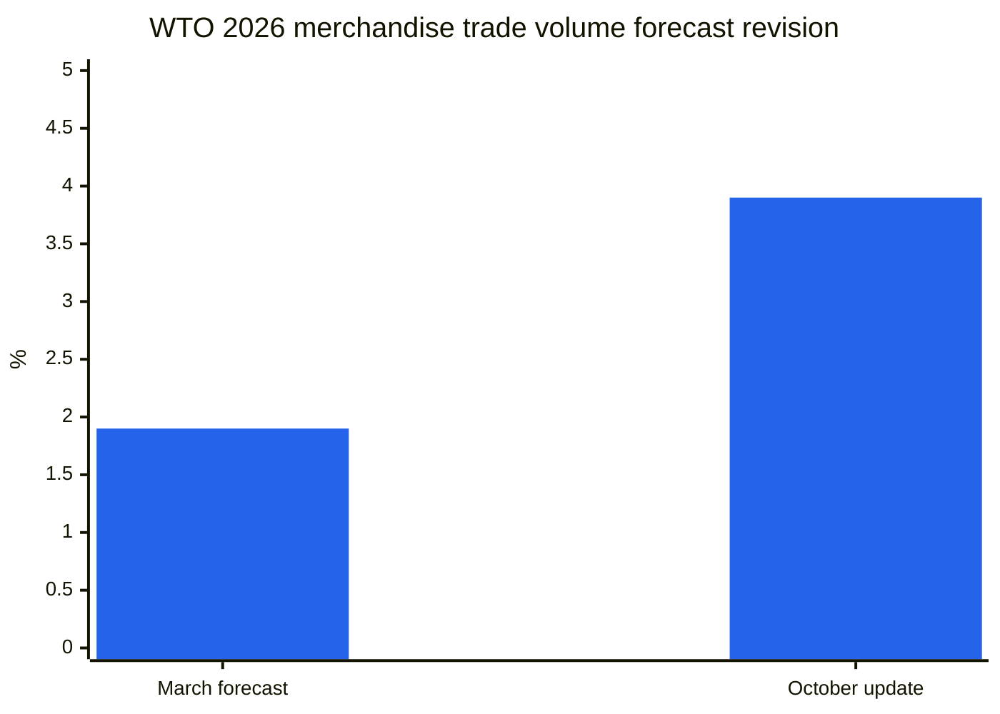

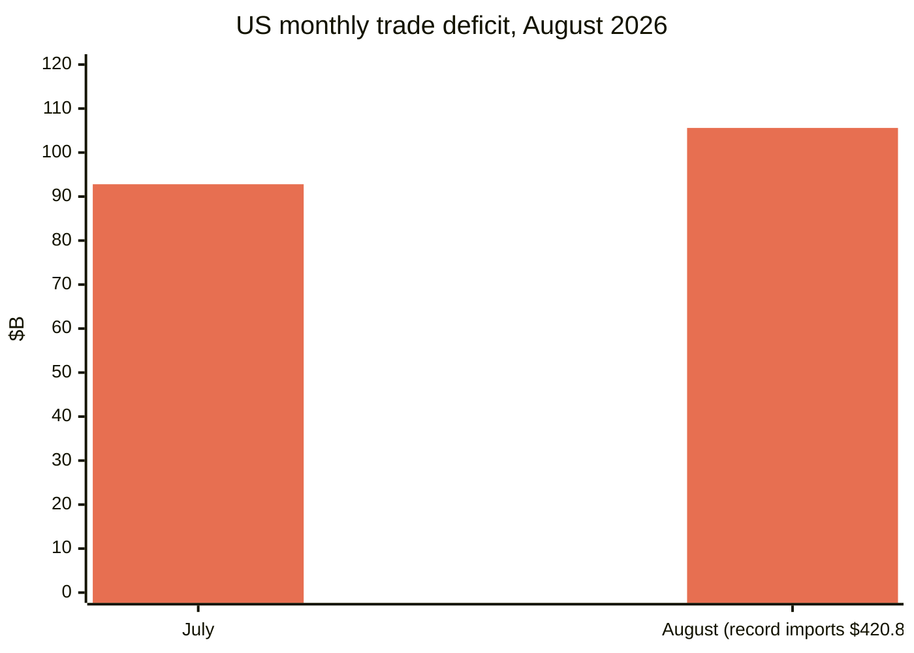

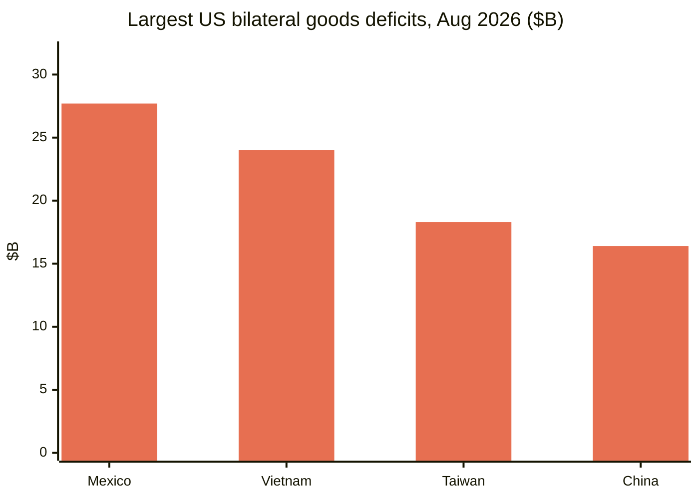

**Analysis.** The three releases tell one story from three angles: demand is strong (record US imports), its composition is narrow (AI goods drove nearly half of trade growth; concentration flagged by UNCTAD), and its geography is selective (China–US trade down over 20% since 2024 while Mexico, Vietnam and Taiwan fill the gap). The divergence between the WTO's volume optimism and UNCTAD's real-terms caution — price-driven nominal gains versus weak real volumes — is the analytical frame for the quarter. The IMF's October WEO, due during the Bangkok Annual Meetings (October 12–18), will carry the formal tariff-simulation assessment. ([bea.gov](https://www.bea.gov/news/2026/us-international-trade-goods-and-services-august-2026), [reuters.com](https://www.reuters.com/business/us-trade-deficit-widens-august-amid-strong-imports-2026-10-06/), [dig.watch](https://dig.watch/updates/wto-trade-outlook-ai-boom), [un.org](https://news.un.org/en/story/2026/10/1168566))

### 3.5 Rare earths: the November 10 snapback

**What happened.** China's suspension of its expanded rare-earth export controls is set to expire **November 10, 2026**, with no extension announced. The April 2025 controls on seven elements were never suspended. The US is escalating its own leverage: Reuters reported October 1 that Commerce has slowed export licenses for aircraft parts bound for China, including shipments to state-owned COMAC, and is considering new rules on landing gear and hydraulic-fluid licensing.

**Key figures.**
- The IEA warns full implementation of China's expanded controls could put an estimated **$6.5T/year** of downstream production outside China at risk.
- China supplied 70% of US yttrium imports 2021–2024; US net-import reliance for yttrium was 100% in 2025.
- Western responses this week: a four-bill congressional package on stockpiles and permitting; American Rare Earths scaling its Wyoming mine by 50%; Lindian Resources committing $150M to a Central Asian processing hub.

**Analysis.** The November 10 snapback is automatic unless both governments extend their pauses — three scenarios loom: extension, selective reactivation, or full restoration. Beijing's May 2026 summit pledge to "address US concerns" has produced no formal extension, and rare-earth shipments have not returned to agreed levels. The Beijing round's promise of a "smoother, more predictable" licensing green channel for European companies will be tested against the snapback date.

### 3.6 Fifteen economies align on overcapacity — outside the WTO

**What happened.** On October 7, trade ministers of 15 economies — the US, Argentina, Australia, Canada, the EU, France, Germany, India, Italy, Japan, South Korea, Mexico, Poland, Türkiye and the UK — signed a Joint Ministerial Statement calling for action to eliminate structural excess capacity and "non-market" policies encouraging overproduction. It grew out of the Milwaukee G20 Trade Ministers' meeting (September 30–October 1), where no consensus was reached, and was agreed on the sidelines of an OECD Trade Committee meeting. It promises dedicated sector-specific platforms, technical meetings before December, and shared information.

**Analysis.** This is the largest coalition statement on overcapacity this year and it institutionalises a non-WTO, plurilateral monitoring track. The non-signatories matter as much as the signatories: China, Russia, Brazil, Indonesia, Saudi Arabia, South Africa and the African Union did not sign, and China warned on October 9 that it would respond "as necessary" if the statement were used as a pretext for measures harming its interests. Brazil's absence — a major G20 member facing US Section 301 tariffs — is notable. The pre-December technical meetings are now a watchpoint. ([reuters.com](https://www.reuters.com/business/some-g20-trade-ministers-sign-us-led-statement-denouncing-excess-factory-2026-10-07/))

### 3.7 US importers keep buying: record September boxes

**What happened.** Descartes' October Global Shipping Report (released October 8) showed US container imports of **2,546,261 TEU in September** — the highest September on record, up 10.3% YoY (Reuters/Descartes; Descartes reports a 2.2% MoM dip vs August). China-origin imports were 924,454 TEU — up 4.5% MoM per Descartes, and Reuters reports +21.2% YoY — accounting for 36.3% of total volume. Retail categories (plastic goods, furniture/bedding, toys/sporting goods) dominated Chinese shipments. Jan–Sep 2026 volume is up 0.8% vs 2025 — the first cumulative gain over 2025 this year. Corroboration: Port of LA handled a record 1.04M TEU in September (Gene Seroka, October 9); Port of Savannah a record 504,015 TEU (+3.7% YoY, October 7). NRF's Global Port Tracker projects August was the 2026 peak month; imports are "likely past the busiest part of the year" (JOC, October 8).

**Analysis.** Despite the tariff regime, US import demand remains robust — the FT-900's record $420.8B of August imports and Descartes' September record boxes point in the same direction: supply chains are rerouting (Mexico, Vietnam, Taiwan bilateral gaps are now larger than China's) rather than reshoring. ([reuters.com](https://www.reuters.com/world/china/us-ocean-container-imports-set-new-record-september-descartes-says-2026-10-08/))

### 3.8 Air and surface: a muted peak with one exception

**Air cargo.** Xeneta data showed global air cargo volumes grew **+4% in October** against expectations of a flat market, but Europe–North America demand fell **−6% YoY** — "a harsh signal" and a possible bellwether. China–Europe e-commerce shipments surged **+62% YoY** in September while China–US e-commerce fell **−34%** (fifth straight month, moderating from −49% in June). TAC Index September: Hong Kong–North America $7.02/kg (+31% YoY), Hong Kong–Europe $4.80/kg (+8.8%); the Baltic Air Freight Index rose 25.5% YoY. The EU's new €3-per-package charge on sub-€150 shipments is weighing on Asia–Europe volumes. Dimerco's October report predicts ocean congestion and held-back China–US cargo could push more volume into air in Q4; Xeneta sees a muted peak. Wildcard: strikes on Saudi airports cut Riyadh's outbound air cargo capacity by a third as peak looms. ([airfreight.news](https://airfreight.news/articles/full/october-air-cargo-volumes-surprise-with-4-growth-but-is-europe-north-america-slump-a-bellwether-for-global-trade))

**US trucking.** Truckload contract rates hit a 52-week high of **$2.72/mile** plus fuel (+18% YoY); dry-van spot $3.55/mile all-in, ~50% above year-ago — driven by fuel and capacity tightness, not demand. Diesel hit $6.39/gal. Outbound tender rejections ~13.75–14%. New capacity is shrinking: tractors in new for-hire fleets fell to 19,520 in August (−14% vs H1 average); only ~2 in 3 new interstate registrants buy liability insurance (vs 9 in 10 in 2019). Old Dominion's 4.9% GRI took effect October 5; DHL Express joined FedEx at 5.9% 2027 GRI (January 1). ([freightwaves.com](https://www.freightwaves.com/news/trucking-rates-spike-contracts-at-52-week-high))

---

## 4. Tariff tracker

| Country | Measure | Rate | Effective date | Status | Source |
|---|---|---|---|---|---|
| US → Canada | Section 338 additional tariffs | 50% (no USMCA exemption) | Aug 22, 2026 (re-scoped Sept 15) | In force | [whitehouse.gov](https://www.whitehouse.gov/fact-sheets/2026/07/fact-sheet-president-donald-j-trump-imposes-additional-tariffs-on-canada/) |
| US → Canada | Section 338 import bans (motorcycles, whey, molasses, nonalcoholic beer, alcohol, dairy) | Import denied entry (in-transit goods: 50% duty) | Sept 29, 2026 | In force | [asrwe.com](https://asrwe.com/asr-university/us-canada-import-ban-alcohol-motorcycles-section-338-expansion-september-2026) |
| US → Canada | Section 301 forced-labor tariff | 10% (avoidable with valid USMCA claim; non-USMCA covered goods face 50%+10%=60%) | Jul 23, 2026 | In force; 25-state lawsuit pending, no ruling | [jdsupra.com](https://www.jdsupra.com/legalnews/forced-labor-meet-section-301-new-1432199/) |
| Canada → US | Counter-tariffs on ~335 tariff items (steel, aluminum, dairy, autos, appliances, agricultural equipment, paper, plastics, electronics) | 15% / 25% / 50% | Sept 8, 2026 | In force | [surtaxscan.com](https://surtaxscan.com/news/canadas-counter-tariffs-are-back-15-25-and-50-on-335-us-tariff-items-from) |
| US → Russia | Graham Act Section 112 duties on all Russian goods incl. petroleum | Up to 500% | Deadline Oct 18, 2026 | Pending; waivers possible | [mondaq.com](https://www.mondaq.com/unitedstates/export-controls-trade-investment-sanctions/1851398/the-lindsey-graham-sanctions-act-what-businesses-need-to-know-about-the-new-tariffs) |
| US → top Russian-energy buyers (India, China, Türkiye, others) | Graham Act Section 113 secondary tariffs | Up to 100% (stacks on all existing duties) | Deadline Oct 18, 2026 | Pending; presidential waiver requires unclassified certification to Congress | [mondaq.com](https://www.mondaq.com/unitedstates/export-controls-trade-investment-sanctions/1851398/the-lindsey-graham-sanctions-act-what-businesses-need-to-know-about-the-new-tariffs) |
| US → Russia | OFAC General License 135: Russian diesel imports authorised | n/a (licence) | Oct 9, 2026 – Apr 7, 2027 | In force | [nationpress.com](https://www.nationpress.com/international/trump-buys-russian-diesel-before-graham-act-deadline) |
| China → EU (p-nitrotoluene) | Anti-dumping investigation (MOFCOM Announcement No. 44) | Alleged dumping margin >100% (provisional duties tbd) | Opened Oct 3, 2026; registration closes Oct 23 | Investigation open | [mlex.com](https://www.mlex.com/mlex/articles/2533700/china-opens-anti-dumping-probe-into-eu-para-nitrotoluene) |
| EU → China | Hybrid/PHEV export moderation — "shared understanding" | Voluntary export restraint (halving claimed by Šefčovič; no figure in Beijing text) | Outcome decided at EU summit Oct 15–16 | Pending political endorsement | [eureporter.co](https://www.eureporter.co/world/china-2/2026/10/09/eu-and-china-strike-preliminary-trade-deal-ahead-of-crucial-leaders-summit/) |
| UK → China | Tariffs on Chinese-made EVs | Up to 45% (matching EU combined rate) | Under consideration | Not decided ("finely balanced") | [fleetnews.co.uk](https://Www.fleetnews.co.uk/news/uk-weighs-chinese-car-tariffs-as-fleet-demand-for-evs-surges) |
| Brazil | Zero duties: microphones, musical instruments, household sewing machines | 0% (from 18–20%) | Oct 1, 2026 | In force | [datamarnews.com](https://datamarnews.com/noticias/zero-import-tariffs-take-effect-for-musical-instruments-in-brazil/) |
| US | Section 232 polysilicon & derivatives | MIPs: $21/kg poly, $100/kg wafers, $0.22/W cells, $0.38/W modules + 15% ad valorem | Dec 4, 2026 (anti-surge rules in force since Sept 22) | Scheduled | [mondaq.com](https://www.mondaq.com/unitedstates/export-controls-trade-investment-sanctions/1848548/polysilicon-and-derivatives-in-the-bullseye-for-major-new-tariffs-and-other-restrictions) |
| US → China | Section 301 Lists 2 & 3 (2018 actions) | 7.5%–25% | In force (USTR concluded second four-year review Oct 7, tariffs continue) | In force | [internationaltradetoday.com](https://internationaltradetoday.com/article/2026/10/06/ustr-section-301-tariffs-from-2018-will-continue-2610060064?BC=bc_6ac595c738480) |
| US → ~60 economies | Section 301 forced-labor tariffs | 10% tier (17 economies incl. Canada, India, Mexico, UK); 12.5% remainder; EU/Taiwan capped at 10% combined | Jul 23, 2026 | In force; 3 lawsuits pending | [jdsupra.com](https://www.jdsupra.com/legalnews/forced-labor-meet-section-301-new-1432199/) |
| US → ~60 economies (proposed TRQ) | ASEAN tariff-rate quota (Bangladesh, Cambodia, Indonesia, Malaysia) for goods with US cotton/textile inputs — exemption from Section 301 forced-labor tariffs | tbd | Under consideration | Proposal stage | [asiadaily.org](https://asiadaily.org/news/14890/) |
| US | BIS "U.S. content" guidance: USMCA mobile industrial equipment (Proclamation 11032) — tariff reduction 25% → 15% floor where ≥40% US content | Effective rate 15% floor | Effective Oct 14, 2026 (FR publication) | Scheduled | [kpmg.com](https://kpmg.com/us/en/taxnewsflash/news/2026/10/us-bis-guidance-us-content-canadian-mexican-products.html) |
| India | Chromium trioxide — final affirmative CVD | n/a | Oct 8, 2026 (US measure) | Final determination issued | [federalregister.gov](https://www.federalregister.gov/documents/2026/10/08/2026-20696/chromium-trioxide-from-india-final-affirmative-countervailing-duty-determination) |
| China | CBS (rubber accelerator) — preliminary affirmative CVD + critical circumstances | n/a | Oct 8, 2026 (US measure) | Preliminary determination issued | [federalregister.gov](https://www.federalregister.gov/documents/2026/10/08/2026-20692/n-cyclohexylbenzothiazole-2-sulfenamide-from-the-peoples-republic-of-china-preliminary-affirmative) |
| China | Amine compounds — AD/CVD investigations instituted (alleged margins up to 476%) | tbd | ITC prelim due Nov 13, 2026 | Investigations open | [federalregister.gov](https://www.federalregister.gov/documents/2026/10/05/2026-20286/amine-compounds-from-china-institution-of-antidumping-and-countervailing-duty-investigations-and) |
| Mexico | Railway tank cars — AD/CVD investigations instituted | tbd | ITC prelim due Nov 16, 2026 | Investigations open | [federalregister.gov](https://www.federalregister.gov/documents/2026/10/05/2026-20349/railway-tank-cars-and-parts-thereof-from-mexico-institution-of-antidumping-and-countervailing-duty) |
| Japan | Expanded export ban on goods for Russia's industrial base | Export prohibition | Oct 16, 2026 | Scheduled | [globalsanctions.com](https://globalsanctions.com/2026/10/japan-adds-more-goods-to-russia-export-ban-from-16-october-2026/) |

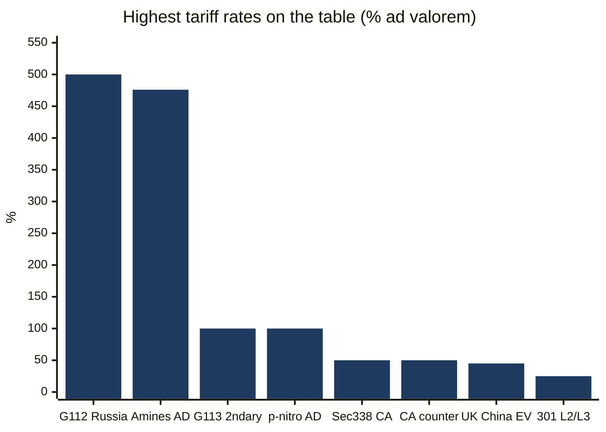
*Maximum stated rates ('up to' where proposed; AD = alleged anti-dumping margin).*

---

## 5. US policy deep dive

### US–Canada: stalemate with legal clouds

No new Section 338 proclamations were issued in the window. Standing measures: **50% additional Section 338 tariffs** on Canadian goods (in force since August 22; second set effective September 15 covering paper, furniture, cheese, leather, motorboats, golf carts, steel, aluminum and base metal products — duties apply regardless of USMCA origin; energy, potash, Section 232-covered goods, fish and critical minerals excluded); **import bans** effective September 29 on motorcycles, whey, molasses, nonalcoholic beer, alcohol and dairy (roughly $967M); Canada's mirrored **15%/25%/50% counter-tariffs** on roughly C$27.6B of US goods (steel, aluminum, dairy, autos, appliances, agricultural equipment, paper, plastics, electronics) effective September 8; and the September 8 presidential directive to GSA (with USTR) to remove Canadian-origin products from GSA Multiple Award Schedules.

This week's developments: the Montreal Economic Institute published an October 8 note (Phillip W. Magness) arguing Canada's counter-tariffs may weaken US legal challenges to the Section 338 tariffs; legal commentary continues to argue Section 338 may have been superseded by the Trade Expansion Act of 1962 and the Trade Act of 1974, raising major-questions and nondelegation issues — but **no court case has yet been filed** directly challenging the Section 338 tariffs. Separately, the **25-state lawsuit** over the July 2026 Section 301 forced-labor tariffs (three lawsuits total challenge the 10–12.5% duties on ~60 economies) had **no written ruling as of October 4**. On the negotiating track, USTR Greer described Canada's remaining sticking points (autos, dairy, alcoholic beverages) as "quite difficult" and said Washington is "not inclined" to go to a zero tariff; Prime Minister Carney disclosed Ottawa had been prepared to remove remaining counter-tariffs on steel, aluminum and autos if Washington substantially lowered its own, and to encourage provinces to return US alcohol to shelves — but would not change the supply-management system. Canada has signalled restraint rather than further escalation. ([iedm.org](https://www.iedm.org/counter-tariffs-the-federal-government-is-undermining-u-s-legal-challenges-to-section-338/), [akingump.com](https://www.akingump.com/en/insights/alerts/president-trump-directs-removal-of-canadian-products-from-federal-procurement), [hashtag investing](https://www.hashtaginvesting.com/blog/u-s-trade-chief-says-canadas-sticking-points-are-quite-difficult-and-washington-is-not-inclined-to-go-to-zero-tariff))

### IEEPA refunds: Phase 3 begins

CBP opened **Phase 3 of its court-ordered IEEPA tariff refund process** on **October 6** through its online claims platform (CAPE). Importers of record that submitted their IOR number by July 30, 2026 may participate. The federal government has appealed the portion of the Court of International Trade order requiring refunds to non-litigating importers of record for entries liquidated more than 80 days ago; CBP states it is voluntarily refunding duties on unliquidated entries and entries within 80 days of liquidation. CBP is accepting additional public comments on the refund information collection through **November 4** (Reginfo.gov). This is the operational execution of the ~$180B in IEEPA tariff refunds ordered after the Supreme Court's February 2026 invalidation of the "Liberation Day" tariffs; the scope of relief for non-litigating importers with older liquidated entries remains contested. Yale Budget Lab estimates the temporary positive fiscal impulse from IEEPA refunds approximately offsets the negative growth impacts of the remaining tariffs for 2026. ([thompsonhine.com](https://www.thompsonhine.com/insights/cbp-confirms-october-6-2026-launch-of-phase-3-of-the-ieepa-tariff-refund-process/))

### CBP operations

- **FY2027 customs user fees (effective October 1):** the Customs Broker Permit User Fee rose from $185.38 to **$190.88**; the Merchandise Processing Fee rate remains **0.3464%**, with minimum and maximum limits increased. ([ghy.com](https://www.ghy.com/trade-compliance/category/us-customs/))
- **Low-value shipments (RIN 1685-AA38):** CBP opened a consultation on **October 8** on proposed changes to informal customs entry requirements for low-value shipments; comments close **December 7**. ([digitalpolicyalert.org](https://digitalpolicyalert.org/event/44472-customs-and-border-protection-opened-consultation-on-proposed-rule-on-low-value-shipments))
- **FY2027 sugar TRQs (October 1 opening):** refined sugar and specialty sugar were both oversubscribed — pro rata allocations of **51.03027%** (refined) and **44.58212%** (specialty). ([ghy.com](https://www.ghy.com/trade-compliance/category/us-tariffs/))

### USTR

- **October 8:** Invoked the **USMCA Rapid Response Labor Mechanism** to review whether workers at **GLM Components Mexico, S.A. de C.V.** (Puebla; auto parts) are being denied freedom of association and collective bargaining rights; the US has **suspended liquidation** of unliquidated entries of goods from the facility. ([ustr.gov](https://ustr.gov/about/policy-offices/press-office/press-releases/2026))
- **October 7:** Convened senior officials of **14 economies** on the margins of the OECD Trade Committee; issued a joint ministerial statement addressing structural excess capacity — the precursor to the 15-economy statement (see §3.6).
- **October 5:** Ambassador Greer hosted the **G20 Trade Ministers** in Milwaukee; discussions covered forced labor elimination, updating the MFN principle, denouncing weaponization of food trade, and excess capacity.
- **Section 301 four-year review (2018 actions):** USTR announced that the second four-year reviews of the July 6, 2018 and August 23, 2018 Section 301 actions (China Lists 2 and 3) concluded with the tariffs **remaining in place** — additional duties generally 7.5% to 25%, some higher after later modifications (Federal Register notice published October 7).
- **2027 USMCA joint review:** comments and hearing requests due **January 12, 2027**.
- **ASEAN tariff-rate quota proposal:** USTR is considering a three-year TRQ for Bangladesh, Cambodia, Indonesia and Malaysia that could exempt products containing US cotton and textile inputs from Section 301 forced-labor tariffs — still under consideration. Malaysia holds to its October 2025 Agreement on Reciprocal Trade (19% rate); Indonesia treats its February 2026 "New Golden Age" pact as binding; Thailand is assessing; Vietnam is leveraging diplomatic proximity. ([asiadaily.org](https://asiadaily.org/news/14890/))
- **Brazil:** after a September 30 meeting with Greer, Brazilian negotiator Rosa said Brazil seeks a full tariff reduction — including on Section 232 steel, aluminum and auto-part tariffs — and both sides agreed to appoint a working group to define the scope of trade issues; he called the Brazil-specific 25% Section 301 tariff "the most terrible tariff." ([internationaltradetoday.com](https://internationaltradetoday.com/article/2026/10/01/brazil-expresses-confidence-it-can-reach-tariff-reduction-agreement-2610010041))

### BIS — export controls

- **"U.S. content" guidance (FR publication scheduled October 14):** defines how to calculate "U.S. content" for Canadian and Mexican products qualifying for USMCA preferential treatment under Section 232 metals proclamation 11032 — (1) value of parts wholly obtained, entirely produced, or substantially transformed in the US; (2) to the extent not already counted, value of steel melted and poured, aluminum smelted and cast, and copper smelted and cast in the US. The two methodologies cannot be combined. Practical effect: qualifying importers of USMCA mobile industrial equipment (forklifts, graders, cranes, backhoes, bulldozers) can reduce the Section 232 tariff from **25% to an effective 15% floor** where at least 40% of value is US content; new HTS subheading **9903.82.22** reports non-US content (or US content exceeding 40%), while 9903.82.21 covers qualifying US content up to 40%. ([kpmg.com](https://kpmg.com/us/en/taxnewsflash/news/2026/10/us-bis-guidance-us-content-canadian-mexican-products.html))
- **Affiliates Rule:** the suspension of the rule extending Entity List/MEU/SDN restrictions to foreign affiliates 50%+ owned by listed parties remains in place, with reinstatement scheduled for **November 10** unless extended. The September 23 US–China agreement extending the Busan framework through January 10, 2027 is expected to carry a matching extension, but **no Federal Register notice** has yet been published. Trade counsel advise preparing on the assumption the rule could return. ([jdsupra.com](https://www.jdsupra.com/legalnews/bis-affiliates-rule-suspension-extended-1084647/))
- **Aircraft-parts licenses to COMAC:** Reuters reported October 1 (unnamed sources) that Commerce has slowed export licenses for aircraft parts bound for China, including shipments to state-owned COMAC, and is considering new rules on landing gear and hydraulic-fluid licensing. ([investornews.com](https://investornews.com/critical-minerals-rare-earths/technology-metals-report-10-04-2026-a-summit-without-a-rare-earth-deal-leaves-the-west-buying-its-way-to-supply/))

### Federal Register — AD/CVD, October 5–8

New AD/CVD investigations instituted on **amine compounds from China** (alleged dumping margins up to 476%; ITC preliminary due November 13) and **railway tank cars and parts from Mexico** (ITC preliminary due November 16); **final affirmative CVD** on chromium trioxide from India; **preliminary affirmative CVD + critical circumstances** on CBS from China; preliminary AD review results on rebar from Türkiye; preliminary intent to rescind the AD review on mattresses from Poland; five-year sunset reviews scheduled on seamless pipe (Russia, South Korea, Czechia, Ukraine); a revised schedule on corrugated die-cut cardboard boxes (China, Malaysia, Türkiye). Full table in §4. ([federalregister.gov](https://www.federalregister.gov/documents/2026/10/05/2026-20286/amine-compounds-from-china-institution-of-antidumping-and-countervailing-duty-investigations-and))

### Standing items

- **Polysilicon Section 232:** unchanged. December 4 effectiveness stands (MIPs $21/kg poly, $100/kg wafers, $0.22/W cells, $0.38/W modules; 15% ad valorem on derivatives; anti-surge restrictions run September 22–December 4). US module median price reached $0.38/W by late September, up ~40.7% from $0.27/W in August.
- **US–China truce:** the Busan framework extension to **January 10, 2027** stands; the White House has not formally documented it. Rare-earth shipments have not returned to agreed levels; the April 2025 controls on seven rare earth elements were never suspended. Section 301 exclusions for 178 China products expire November 10.
- **US–China "30-for-30":** both governments published reciprocal tariff-relief lists on September 28 (~$30B each side under the US–China Board of Trade framework); MOFCOM's English portal carries its published information on the framework.

---

## 6. World policy by region

### Europe

- **EU–China:** see §3.1. In parallel, the **Franco-German rapid-reaction proposal** (October 5) asks the Commission for an instrument against "systemic market-distorting practices" — dumping, widespread subsidies, restrictions on currency convertibility — with German officials invoking a tool "as powerful as the Section 301 tariffs imposed by the United States or China's restrictions on exports of critical minerals." The proposal calls for swifter trade-defence tools, more investigations, a broader sectoral approach (flagging chemicals, PET and hybrid vehicles), plus two additional instruments on diversification and economic security. The Commission welcomed the letter; EU leaders discuss it at the October 15 summit. MOFCOM publicly responded to media reports on the "European version of Section 301" proposal. ([lapost.com](https://www.lapost.com/content/france-germany-propose-new-rapid-eu-trade-response-tool))
- **UK:** the government is drawing up a potential package of tariffs of **up to 45%** on Chinese-made EVs, matching the EU's combined rate — Business Secretary Reynolds now calls the decision "finely balanced" after telling Auto Express in September the UK had no plans to raise tariffs. Brussels has signalled UK products could be excluded from "Made in Europe" industrial-policy benefits if the UK does not align; 58% of UK auto exports go to the EU vs ~4% to China; Chinese brands took more than 15% of UK new-car registrations in the first eight months of 2026 (223,000 cars), up from 4% in 2023. A DBT spokesperson said no tariffs have been introduced and no final decision made. ([fleetnews.co.uk](https://Www.fleetnews.co.uk/news/uk-weighs-chinese-car-tariffs-as-fleet-demand-for-evs-surges), [britishchambers.org.uk](https://www.britishchambers.org.uk/news/2026/10/eu-china-trade-talks-what-the-outcome-means-for-uk-business/))
- **Digital trade files:** the **EU–South Korea Digital Trade Agreement** faces an MEP amendment deadline of October 8 (data-flow rules, source-code protection, permanent ban on customs duties on electronic transmissions); the **EU–Canada summit in Montréal (October 29–30)** is expected to complete negotiations on a Digital Trade Agreement and a minerals/competition-cooperation package; the Commission has put forward signature proposals for the **EU–India FTA** with a digital chapter. ([euperspectives.eu](https://euperspectives.eu/2026/10/eu-south-korea-digital-trade-deal-raise-debate-over-data-sovereignty/), [dig.watch](https://dig.watch/updates/eu-canada-digital-trade-ai), [globallawexperts.com](https://globallawexperts.com/eu-india-fta-digital-trade/))
- **EU–Indonesia FTA:** technical negotiations concluded September 2025; the legal text (removing tariffs on the majority of goods with safeguards and quotas for sensitive goods) is in institutional review, with formal signing expected before the end of the EU's 2026 financial year. Negotiations with the Philippines, Thailand and Malaysia are at an advanced stage. ([lupicinio.com](https://lupicinio.com/en/international-trade-%c2%b7-august-and-september-2026/))
- **European Parliament:** voted October 7 to denounce China's economic practices and its position on Ukraine.

### China

- **P-nitrotoluene anti-dumping probe** (opened October 3; see §4). MOFCOM noted the EU has opened **28 trade-remedy investigations** against China since 2025, roughly half involving chemicals, and called for disputes to be resolved through dialogue.
- **Graham Act:** Beijing rejected "long-arm jurisdiction" and interference in normal trade cooperation, opposes unilateral sanctions lacking a UN Security Council mandate, and reserves the right to protect its companies (Foreign Ministry, September 19, reiterated in reporting this week). China was the second-largest buyer of Russian crude in 2025 at ~1.3M bpd.
- **Overcapacity statement:** MOFCOM said October 9 that China would respond "as necessary" if the 15-economy statement were used as a pretext for measures harming Chinese interests; China did not sign.
- **MOFCOM English portal** was reachable on October 12 (http://english.mofcom.gov.cn/), carrying the spokesperson's response on the Franco-German proposal and the published "30-for-30" framework information.

### India

- **US trade-deal talks "reached a plateau"** (Finance Minister Sitharaman, October 5); further concessions may be difficult. The MEA warned September 17 that the Graham Act could have implications "not just for the bilateral relationship but also the international energy market," and stressed energy security for 1.4 billion people. Oil Minister Puri pointed to diversification options (Guyana, Brazil, Canada, Suriname, Namibia). India was the largest buyer of Russian crude in 2025 at ~1.6M bpd.
- India joined the **15-economy overcapacity statement** (October 7) and is among 16 economies covered by USTR's March 2026 Section 301 excess-capacity investigation. The WTO dispute over its ICT tariffs with Chinese Taipei was postponed to October 27.

### Türkiye

- No new Turkish government statement on the Graham Act was identified this week (Türkiye: ~282,000 bpd of Russian crude in 2025, third-tier buyer). Türkiye signed the 15-economy overcapacity statement.

### Canada

- **No new retaliatory measures** October 5–12. Canada's mirrored 15%/25%/50% counter-tariffs (in force September 8, ~C$27.6B) stand; steel and aluminum rates were raised from 25% to 50% to match US rates; goods in transit on September 8 were exempt; existing auto counter-tariffs continue. Ottawa announced a **C$7.5B** package of worker and business support measures. Negotiating deadlock persists (Greer: sticking points "quite difficult"; Carney: supply management is non-negotiable).

### Brazil

- **Zero duties** on microphones, musical instruments and household sewing machines took effect October 1 (Gecex/Camex Resolution No. 926/2026; duties previously reached 18–20%). Brazil agreed a **working group with USTR** (September 30) to define the scope of a tariff-reduction agreement; Rosa called the Brazil-specific 25% Section 301 tariff "the most terrible tariff."

### Japan

- Amended its Export Trade Control Order on October 6 to add further goods to its Russia export ban covering items that could strengthen Russia's industrial base; takes effect **October 16** — one day before the Graham Act deadline. ([globalsanctions.com](https://globalsanctions.com/2026/10/japan-adds-more-goods-to-russia-export-ban-from-16-october-2026/))

### ASEAN and Australia

- **ASEAN TRQ proposal:** see §5 (USTR considering a three-year TRQ for Bangladesh, Cambodia, Indonesia and Malaysia for goods containing US cotton/textile inputs).
- **Australia:** DFAT declined to join a UK-led statement by 12 governments considering or committing to restrictions on trade with Israeli businesses in West Bank settlements, citing practical challenges; it said it is pursuing further targeted measures with partners instead (late September; the week's only reported Australian trade-restriction position).

### Multilateral

- **WTO General Council (October 5–6):** members held a two-day reform meeting; DG Okonjo-Iweala urged moving from process to substance. Dispute-settlement reform: DSB Chair Ambassador Patriota (Brazil) will continue informal consultations; nearly 60 speakers took the floor. Fisheries subsidies: members urged to avoid a "sunsetting" of the agreement; new ideas requested in agriculture. Electronic Commerce Agreement: wide majority support for digital-trade predictability, but questions on legal foundations, use of WTO resources and the DG's depositary role. Investment Facilitation for Development: participation expanded to **131 members**. MC15: no dates fixed. ([logisticsnews.ph](https://logisticsnews.ph/2026/10/07/wto-members-urged-to-move-from-process-to-substance-as-general-council-tackles-reform-and-future-ministerial-preparations/))
- **WTO disputes:** the **CBAM panel (DS639, Russia vs EU)** was established September 25 at Russia's second request, with **India as third party**; the EU will participate while declining direct engagement with Russia; the Appellate Body remains unable to hear appeals. The **Türkiye–China EV dispute (DS629)** panel-report consideration was deferred to October 27 at the parties' joint request; the **India–Chinese Taipei ICT-tariff** ruling adoption was postponed to October 27. Colombia and 130 members pushed for the 110th time to start Appellate Body selection; the US again voiced concerns. Cambodia was admitted to the MPIA. ([reuters.com](https://www.reuters.com/world/wto-dispute-body-agrees-to-russias-panel-request-eu-carbon-border-levy-2026-09-25/))
- **UNCTAD Trade and Development Report 2026** (October 9): see §3.4. UNCTAD's tariff-context analysis (September 17) found US tariff rates jumped from an average 2.8% before 2025 to over 20% by early September; 16 developing countries (incl. 5 LDCs) now face tariffs above 25%; LDC trade-weighted average tariffs doubled to 19% during the pause period and climbed to 27% in September; Asia-Oceania developing countries rose from 3% to 21%; Latin America and the Caribbean from below 0.5% to 18%. ([un.org](https://news.un.org/en/story/2026/10/1168566))
- **WCO:** the **HS 2028 amendments** were released — 299 sets of changes producing 1,229 headings and 5,852 subheadings (6 new headings, 428 new subheadings created; 5 headings, 172 subheadings deleted), focused on health-emergency preparedness, epidemic response and environmental protection; entry into force **1 January 2028**, with a two-year implementation window — flagged this week as a key forward deadline for tariff-classification teams. The EU–WCO Rules of Origin Africa Programme held its final Training of Trainers workshop for the Kenya Association of Manufacturers (opened October 1). ([wcoesarocb.org](https://www.wcoesarocb.org/wco-and-partners-strengthen-rules-of-origin-expertise-to-support-trade-and-industrialisation/))
- **ITC:** no new Trade Map or trade-statistics releases dated October 5–12 were identified from public reporting.

---

## 7. Enforcement actions

| Action | Target | Date | Status | Source |
|---|---|---|---|---|
| Withhold Release Orders (forced labor) | Mitra Aneka Rezeki (MAR), Hardaya Inti Plantation (HIP) — Indonesian palm oil and derivatives | Sept 29, 2026 | In force; 60 active WROs + 8 Findings total | [thompsonhine.com](https://www.thompsonhine.com/insights/cbp-issues-withhold-release-orders-on-two-indonesian-palm-oil-producers/) |
| US sanctions (OFAC) | 22 tankers plus individuals/companies linked to Iran's oil trade | Oct 8, 2026 | Designated | [gcaptain.com](https://gcaptain.com/category/news/) |
| US sanctions (OFAC GL135) | Authorises Russian diesel imports | Oct 9, 2026 – Apr 7, 2027 | In force | [nationpress.com](https://www.nationpress.com/international/trump-buys-russian-diesel-before-graham-act-deadline) |
| UK sanctions | 5 LNG carriers (Sovcomflot-linked tightening with Japan) | Oct 1, 2026 | Designated | [hellenicshippingnews.com](https://www.hellenicshippingnews.com/category/shipping-news/international-shipping-news/) |
| Japan export control | Expanded Russia export ban | Oct 16, 2026 | Takes effect | [globalsanctions.com](https://globalsanctions.com/2026/10/japan-adds-more-goods-to-russia-export-ban-from-16-october-2026/) |
| US import bans (Section 338) | Canadian motorcycles, whey, molasses, nonalcoholic beer, alcohol, dairy (~$967M) | Sept 29, 2026 | In force | [asrwe.com](https://asrwe.com/asr-university/us-canada-import-ban-alcohol-motorcycles-section-338-expansion-september-2026) |
| USTR Rapid Response Mechanism | GLM Components Mexico (Puebla; auto parts) — liquidation suspended | Oct 8, 2026 | Review open | [ustr.gov](https://ustr.gov/about/policy-offices/press-office/press-releases/2026) |
| CBP | Phase 3 IEEPA refund process (CAPE) | Oct 6, 2026 | Open; comments due Nov 4 | [thompsonhine.com](https://www.thompsonhine.com/insights/cbp-confirms-october-6-2026-launch-of-phase-3-of-the-ieepa-tariff-refund-process/) |

**WRO detail (MAR/HIP):** CBP's September 29 orders cover palm oil and derivatives from Mitra Aneka Rezeki and Hardaya Inti Plantation. information reviewed: worker interviews, payroll slips, harvest quotas, photographs, NGO/government reports, news media, academic research. Workers at MAR showed **nine** ILO forced-labor indicators (including retention of identity documents and isolation); HIP showed **seven** (debt bondage, wage withholding, deception, excessive overtime, intimidation, abusive conditions, abuse of vulnerability). Detentions are immediate at all US ports; importers may export, destroy, or prove clean sourcing.

---

## 8. Data releases

| Release | Date | Headline figure | Source |
|---|---|---|---|
| Census/BEA FT-900 — US trade, Aug 2026 | Oct 6 | Deficit $105.6B (+13.7%); imports record $420.8B; Jan–Aug deficit −19.9% y/y | [bea.gov](https://www.bea.gov/news/2026/us-international-trade-goods-and-services-august-2026) |
| WTO Global Trade Outlook and Statistics (Oct update) | Oct 8 | Merchandise volume +3.9% in 2026 (from 1.9%), +4.1% in 2027; services cut to 3.3%; AI goods 47% of trade growth | [dig.watch](https://dig.watch/updates/wto-trade-outlook-ai-boom) |
| UNCTAD Trade and Development Report 2026 | Oct 9 | Record $35T world trade in 2025; global GDP 2.6% in 2026; Asia 60% of growth; India 7.3% | [un.org](https://news.un.org/en/story/2026/10/1168566) |
| UNCTAD Global Trade Update (mid-year outlook) | Oct (window) | Merchandise trade growth 1.5–2.5% in 2026 real terms (from 4.7% in 2025) | [gtreview.com](https://www.gtreview.com/news/global/global-goods-trade-growth-could-slow-to-1-5-in-2026-unctad/) |
| IMF World Economic Outlook (full report) | Due Oct 12–18 (Bangkok Annual Meetings) | Oct 6 pre-release: cost-of-living crises put 23M more people below extreme-poverty line 2021–24; baseline ~3% global growth in 2026 | [reuters.com](https://www.reuters.com/world/asia-pacific/cost-of-living-crises-have-lasting-impact-inflation-expectations-poverty-imf-2026-10-06/) |
| ECB — euro-area BoP, Q2 2026 | Oct 2 | Current account €265B (1.6% of GDP); chemicals/machines surpluses shrinking; energy deficit back on the books | [ecb.europa.eu](https://www.ecb.europa.eu/press/stats/bop/2026/html/ecb.bq261002~5e0dd6a1f4.en.html) |
| Destatis — German foreign trade, Aug 2026 | Oct 8 | Exports −0.8% m/m; surplus €19.5B; second straight monthly decline | [destatis.de](https://www.destatis.de/EN/Press/2026/10/PE26_356_51.html) |
| Tax Foundation — Trump Tariffs Tracker (Sept 2026 vintage) | Living tracker | 54% of US goods imports affected; applied rate 11.7%, effective 7.2%; $151.5B customs revenue in 2026, ~$1.5T 2026–2035; ~$820/household (2026); long-run GDP −0.4% | [taxfoundation.org](https://www.taxfoundation.org/research/all/federal/trump-tariffs-trade-war/) |
| Tax Foundation — Options for Reforming America's Tax Code 3.0 | Oct 8 coverage | Repeal all tariffs, substitute a VAT; repeal would lose ~$1.8T through 2036 | [rethinking65.com](https://rethinking65.com/repealing-tariffs-and-imposing-a-value-added-tax-would-boost-the-economy-and-federal-revenues-the-tax-foundation-says/) |
| Yale Budget Lab — State of U.S. Tariffs | Living tracker | Statutory rate 11.0% now, 11.8% by year-end; ~0.7% consumer-price impact; ~$1,100/household; ~$1.9T over ten years; ~875,000 more people in poverty | [budgetlab.yale.edu](https://budgetlab.yale.edu/research/state-us-tariffs) |
| UN Comtrade | Methodology notes only | IMTS 2026 White Cover; cross-border trade guidance — no new dataset vintage Oct 5–12 | [uncomtrade.org](https://uncomtrade.org/docs/its-publication-list/) |
| USITC DataWeb / USA Trade Online | Routine monthly refresh | August 2026 detail now queryable | |

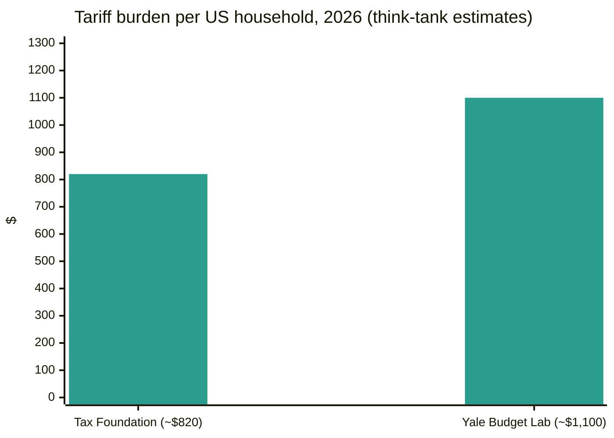

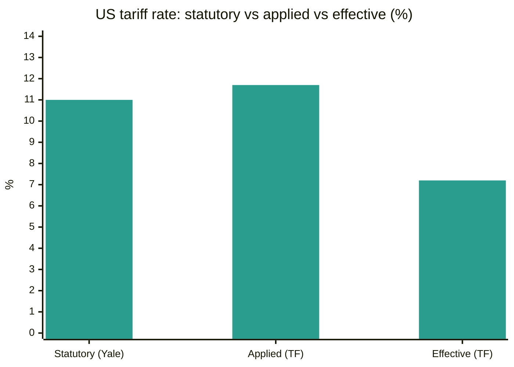
*Yale Budget Lab and Tax Foundation estimates, 2026. TF = Tax Foundation.*

**Analysis.** The Think-tank pair frames the household-cost debate: Tax Foundation's $820 and Yale's $1,100 are the two figures journalists quote, differing on statutory-vs-effective rate treatment and the IEEPA refund mechanics. Yale's post-SCOTUS analysis is the most complete current-law synthesis — refund chaos creates "large revenue effects" that roughly offset the remaining tariffs' 2026 growth drag, with a persistent long-run cost of 0.1% of GDP (~$30B annually). Tax Foundation's new book-length argument — repeal all tariffs and substitute a VAT — is the clearest policy-alternative articulation of the cycle. The WTO–UNCTAD divergence (volume optimism vs. real-terms caution) is the analytical frame for reading the autumn data flow.

---

## 9. Freight market

### Container spot rates — Drewry World Container Index

The Drewry World Container Index closed its Thursday **October 8** assessment at **$4,351 per 40ft container, down 2% week on week** — attributed to weaker demand on the Transpacific and Asia–Europe trades during China's Golden Week. The prior assessment (October 1) had closed at $4,434, down 1%. Xeneta chief analyst Peter Sand said October 1 marked the post-Hormuz-crisis peak: Far East–US West Coast spot hit $8,346/FEU, East Coast $11,523/FEU — more than four times February 28 pre-crisis levels. Asia–Europe rates have now fallen for **13 consecutive weeks**; Drewry identifies the faster-than-expected Suez return as the principal threat to carrier rate-support efforts. Drewry expects rates to remain stable in the week ahead, noting carriers' attempted higher FAK rates on Asia–Europe in the second half of October and a possible US-bound rebound after the holiday under the extended US–China truce.

| Lane (40ft) | 8 Oct 2026 | W/W change | Source |
|---|---|---|---|
| WCI composite | $4,351 | −2% | [Drewry](https://www.drewry.co.uk/supply-chain-advisors/supply-chain-expertise/world-container-index-assessed-by-drewry) |
| Shanghai → Rotterdam | $3,337 | −2% | [Drewry](https://www.drewry.co.uk/supply-chain-advisors/supply-chain-expertise/world-container-index-assessed-by-drewry) |
| Shanghai → Genoa | $3,696 | unchanged | [Drewry](https://www.drewry.co.uk/supply-chain-advisors/supply-chain-expertise/world-container-index-assessed-by-drewry) |
| Shanghai → Los Angeles | $7,624 | −3% | [Drewry](https://www.drewry.co.uk/supply-chain-advisors/supply-chain-expertise/world-container-index-assessed-by-drewry) |
| Shanghai → New York | $10,220 | −2% | [Drewry](https://www.drewry.co.uk/supply-chain-advisors/supply-chain-expertise/world-container-index-assessed-by-drewry) |
| Rotterdam → New York (per FEU) | $3,091 | −1% | [Shipping Telegraph](https://shippingtelegraph.com/freight-news/drewry-the-world-container-index-decreased-2-in-week-41-2026/) |
| Backhaul Rotterdam → Shanghai | $628 | +2% | [Shipping Telegraph](https://shippingtelegraph.com/freight-news/drewry-the-world-container-index-decreased-2-in-week-41-2026/) |

Blank-sailing counts (Drewry Container Capacity Insight): Transpacific — four blank sailings announced for the coming week, down from eleven this week (capacity increasing); Asia–Europe — six announced for next week, up from five.

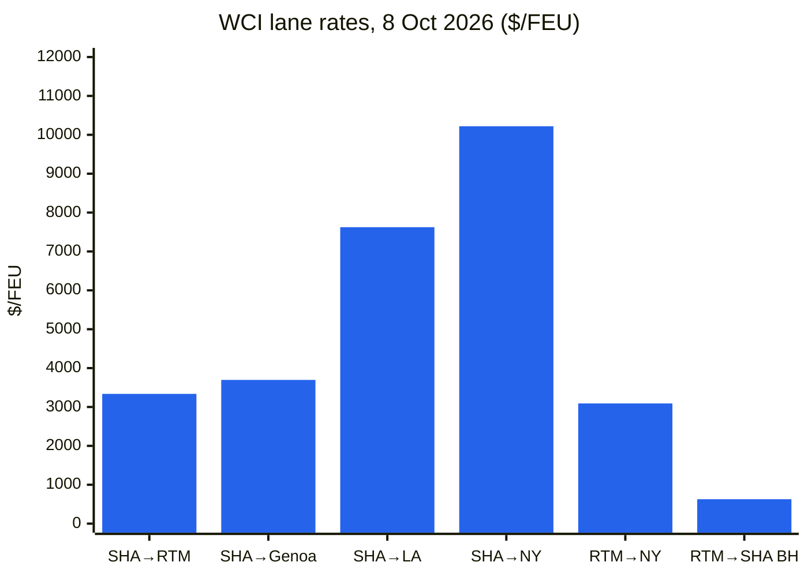
*SHA = Shanghai; RTM = Rotterdam. Backhaul: Rotterdam→Shanghai.*

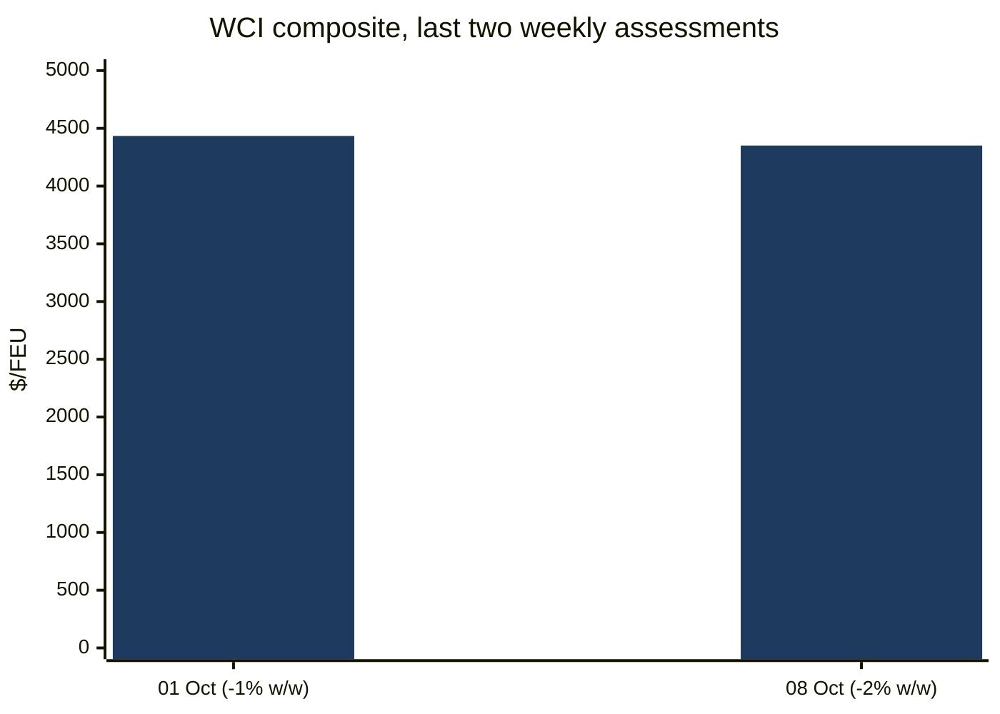

### Freightos Baltic Index (FBX)

The FBX global index finished the week of **October 9** at **3,344 points**, effectively unchanged (3,348 at week's start).

| Route | Rate (per FEU, 9 Oct 2026) | W/W change | Source |
|---|---|---|---|
| FBX global composite | 3,344 points | −4 pts on the week | [Baltic Exchange weekly report](https://www.thedcn.com.au/news/baltic-exchange-weekly-report-9-october-2026) |
| FBX01 China/East Asia → US West Coast | $8,106 | −$228 | [Baltic Exchange weekly report](https://www.thedcn.com.au/news/baltic-exchange-weekly-report-9-october-2026) |
| FBX03 China/East Asia → US East Coast | $9,606 | unchanged | [Baltic Exchange weekly report](https://www.thedcn.com.au/news/baltic-exchange-weekly-report-9-october-2026) |
| FBX11 China/East Asia → North Europe | $3,260 | unchanged | [Baltic Exchange weekly report](https://www.thedcn.com.au/news/baltic-exchange-weekly-report-9-october-2026) |
| FBX13 China/East Asia → Mediterranean | $3,861 | +$320 | [Baltic Exchange weekly report](https://www.thedcn.com.au/news/baltic-exchange-weekly-report-9-october-2026) |
| FBX21 US East Coast → Europe | $1,182 | +$108 | [Baltic Exchange weekly report](https://www.thedcn.com.au/news/baltic-exchange-weekly-report-9-october-2026) |

Supply Chain Dive (October 9, Freightos weekly): Asia–USWC spot $8,322 (−3%), USEC $9,606 (flat) — weather-related port backlogs in China keeping a floor under rates. Xeneta expects USEC $6,000–7,000 and USWC $4,500–5,500 in three months — "a sizable correction, but not a collapse."

### Dry bulk — Baltic Exchange

The **Baltic Dry Index** finished Friday October 9 at **2,917 points, down 7.3% for the week** — its lowest since late August — concentrated in Capesize (index −13.9%, average daily earnings −$1,560 to $35,860) as Dalian iron ore touched an 18-month low; Panamax +2.2% and Supramax +1.4% held up.

| Date | BDI | Capesize (earnings) | Panamax | Supramax | Source |
|---|---|---|---|---|---|
| Mon 5 Oct | 3,070 | 4,833 ($40,330) | 2,364 | 1,790 | [Baird Maritime](https://www.bairdmaritime.com/shipping/dry-cargo/bulkers/two-session-winning-streak-ends-as-baltic-dry-bulk-index-falls) |
| Tue 6 Oct | 3,002 | 4,638 ($38,561) | 2,366 | 1,795 | [Baird Maritime](https://www.bairdmaritime.com/shipping/dry-cargo/bulkers/baltic-dry-bulk-index-hits-six-week-low-on-capesize-decline) |
| Wed 7 Oct | 2,994 | 4,597 ($38,188) | 2,384 | 1,800 | [Baird Maritime](https://www.bairdmaritime.com/shipping/dry-cargo/bulkers/baltic-index-slips-as-capesize-slump-spoils-smaller-vessel-gains) |
| Thu 8 Oct | 2,973 | 4,512 ($37,420) | 2,410 | 1,808 | [Baird Maritime](https://www.bairdmaritime.com/shipping/dry-cargo/bulkers/baltic-dry-bulk-index-drops-to-lowest-level-in-more-than-six-weeks) |
| Fri 9 Oct | 2,917 | 4,340 ($35,860) | 2,424 | 1,814 | [Baltic Exchange weekly report](https://www.thedcn.com.au/news/baltic-exchange-weekly-report-9-october-2026) |

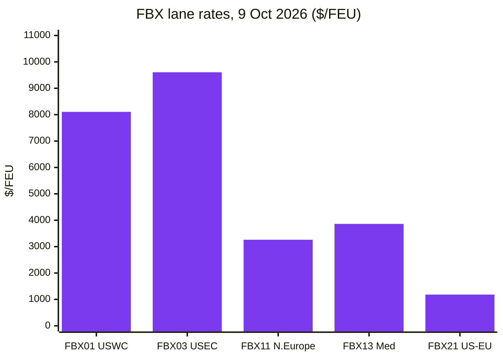
*Lanes: FBX01 China/East Asia→US West Coast; FBX03 →US East Coast; FBX11 →North Europe; FBX13 →Mediterranean; FBX21 US East Coast→Europe.*

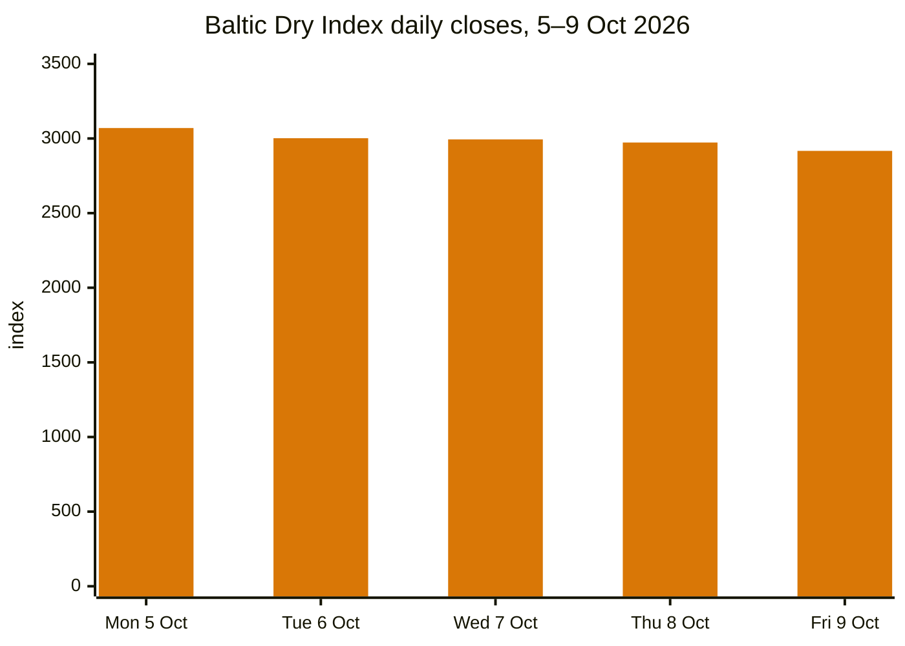

### Port and logistics disruptions

**Red Sea / Suez return accelerates.** Hapag-Lloyd confirmed the first westbound and eastbound sailings of the Gemini Cooperation's SE1 service through the Red Sea and Suez: the *Umm Qarn* departs Tanjung Pelepas for Suez on 27 October and Algeciras on 5 December. The Premier Alliance (ONE, HMM, Yang Ming) restores its Southeast Asia–North Europe FE1 loop to Suez from October — its first break from Cape routing since January 2024 — with the 8,110 TEU *ONE Continuity* departing Laem Chabang on 17 October. COSCO was scheduled to make its first westbound Suez transit in more than two years on 4 October. MSI estimates ~35% of Asia–Europe sailings now use the Red Sea; Linerlytica counts 140+ boxships (2M+ TEU) returned since May; Suez container net tonnage January–August was 72.1M tonnes (+54.2% y/y). Constraint: EU Aspides has acknowledged warship coverage is insufficient for all escort requests — the binding limit on further return. Drewry's Container Forecaster finds the economic benefit to carriers of the Suez return is thin — roughly $1M per round voyage saved vs the Cape — yet carriers are returning, adding effective capacity that is pressuring Asia–Europe rates. ([splash247.com](https://splash247.com/premier-alliance-joins-accelerating-return-to-suez/), [container-news.com](https://container-news.com/hapag-lloyd-confirms-first-se1-sailings-via-red-sea-and-suez-canal/))

**Asian port congestion.** Typhoon-season congestion pushed global schedule reliability below 50% for the first time since the pandemic (Sea-Intelligence), with Asian congestion possibly lasting into mid-2027; congestion absorbs 12% of effective vessel capacity (DHL Forwarding) and ~10.9% of the container fleet (~3.76M TEU); average delays for late vessels reached 6.81 days, the highest since March 2022. Golden Week (October 1–7) softened demand; Shanghai is expected to remain heavily congested into mid-to-late October. ([worldcargonews.com](https://www.worldcargonews.com/news/2026/10/sea-intelligence-asian-port-congestion-could-persist-into-mid-2027/), [ti-insight.com](https://ti-insight.com/briefs/global-supply-chain-risk-monitor-october-2026/))

**Black Sea attacks escalated.** The bulker *Royad Mammadov* sank off Romania (two crew killed); days later drone strikes off Bulgaria sank the bulker *Alfa Watan* and left *Able* ablaze — grain corridors disrupted, insurance premiums spiking. India and Liberia, as co-chairs of the Group of Friends on Safety and Security of Shipping and Seafarers, jointly condemned the attacks (October 9). ([splash247.com](https://splash247.com/two-seafarers-killed-as-cargo-ship-sinks-off-romania/))

**Panama Canal.** Transits rise to 33 per day from October 15 (from 32) with draft restored to 49 feet; Neo-Panamax slots increase to 10 daily. El Niño risk ahead: NOAA expects the pattern to continue into early 2027. Carriers already surcharge: MSC $149/20ft ($297/40ft), CMA CGM Panama Canal Adjustment Factor $500/TEU.

**Philippines.** Manila empties crisis: a broker "digital protest" and trucker holiday (October 5–8) over carriers refusing empty returns for up to a month; the protest ended October 8 after terminals began continuously accepting empties — but Hapag-Lloyd suspended all new bookings to Manila, Batangas and Subic through December 31, citing congestion and severe limits on depot/empty-return capacity. ([portcalls.com](https://portcalls.com/manila-ports-digital-protest-trucking-holiday-end/))

**Labour and inland waterways.** A German dockworker strike was averted October 2 (ver.di deal ends warning strikes at Hamburg/Bremerhaven). But historically low water at the Rhine's Kaub gauge has effectively halted loaded barge passage; low-water surcharges reached €1,280/FEU (Contargo) and $1,350/FEU (Hapag-Lloyd). Vancouver dockworkers protested automation and AI (October 2). No verifiable reports of a new US ILA East/Gulf Coast strike in the window were found.

**Carrier surcharges and services.** CMA CGM: peak season surcharges on Asia–Africa (up to $750/TEU Far East→Durban from October 22; $200/TEU SE Asia→northern West Africa from October 15), West Africa PSS increases from October 22, Asia→Latin America +$1,000/container from October 15, Asia–Mediterranean FAK rates October 19–31, and $1,000/reefer PSS North Europe→Arabian Gulf from mid-October. Maersk: PSS across three trades; ends ASAS2 vessel-sharing with CMA CGM on Asia–East Coast South America (final sailing Shanghai December 8). Fleet: MSC ordered six LNG dual-fuel megamax vessels (~21,700 TEU each) for 2029–2030 delivery; its orderbook exceeds 170 ships / 3M+ TEU. ([container-news.com](https://container-news.com/cma-cgm-announces-new-peak-season-surcharges-on-asia-africa-trades/))

**Sanctions and Arctic shipping.** The UK sanctioned five LNG carriers (October 1); the UK and Japan are tightening the net around Sovcomflot-linked vessels. Arctic LNG 2 has exported 0.95Mt in 2026 (all since July). China completed its first season of regular weekly container service China–Europe via the Northern Sea Route (October 7); a South Korean container ship completed the country's first commercial Arctic round trip to Europe (October 10). Tanker M&A: Trafigura bought seven tankers from SFL Corp (~$175M profit to the seller); Trafigura spin-off Volare Shipping listed in Oslo (October 6). ([hellenicshippingnews.com](https://www.hellenicshippingnews.com/category/shipping-news/international-shipping-news/), [gcaptain.com](https://gcaptain.com/tag/arctic/))

**Mexico.** Auto exports posted their biggest slump of the year in September, attributed by analysts to US tariffs (INEGI data via gCaptain, October 8).

### Vendor intelligence

- **Descartes Systems Group:** October Global Shipping Report (released October 8) — record US September container imports (see §3.7); Descartes **Datamyne AI Agent** (announced ~October 1) — a conversational AI agent drawing on 500M+ shipment records added annually across 230 markets, claiming a 90% research-time cut; 2026 Innovation Forum (October 6–8, Chicago) showcased AI logistics technology including MacroPoint OpsForce AI agents (claimed customer results: +30% no-touch tracking automation, 1.5x tracking-team productivity). Direct review of descartes.com/solutions/global-trade-intelligence was not possible this session; items above are from public news coverage. ([reuters.com](https://www.reuters.com/world/china/us-ocean-container-imports-set-new-record-september-descartes-says-2026-10-08/), [disruptsmedia.com](https://disrupts.disruptsmedia.com/transportation-logistics/descartes-datamyne-ai-agent-targets-90-cut-trade-data-research))
- **TradeInt:** Türkiye's Ministry of Trade × TradeInt grant (announced September 30, covered in this week's press) — funded access to shipment records, customs filings and bill-of-lading data across 200+ countries for Turkish consulting firms; TradeInt's data review put Türkiye's 2025 exports at $269.7B (September a record $22.6B). Covered via public press coverage only; no data-platform access used. ([citybuzz.co](https://www.citybuzz.co/2026/09/30/turkiyes-ministry-of-trade-and-tradeint-launch-grant-to-arm-local-consultants-with-global-trade-data-through-tradeint-partnership))

---

## 10. Policy timelines

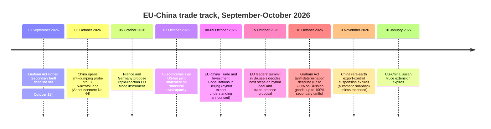

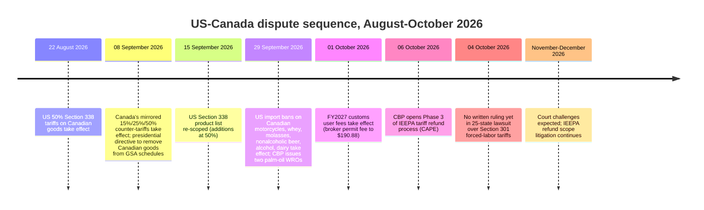

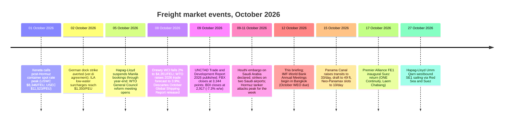

---

## 11. Upcoming deadlines & events (next 90 days)

| Date | Event |
|---|---|
| Oct 14, 2026 | BIS "U.S. content" guidance for USMCA mobile industrial equipment takes effect (FR publication) |
| Oct 15, 2026 | EU leaders' summit, Brussels — decides on EU–China hybrid-export understanding, Franco-German rapid-reaction trade tool, Made in Europe rules |
| Oct 15, 2026 | Panama Canal: transits to 33/day, draft to 49 ft, Neo-Panamax slots to 10/day |
| Oct 16, 2026 | Japan's expanded Russia export ban takes effect |
| Oct 17, 2026 | Premier Alliance FE1 inaugural Suez return (ONE Continuity, Laem Chabang) |
| Oct 18, 2026 | Graham Act tariff-determination deadline: up to 500% duties on Russian goods; up to 100% secondary duties on top Russian-energy buyers without waiver |
| Oct 19, 2026 | Commerce initiation decision due: amine compounds AD/CVD (China) |
| Oct 23, 2026 | Registration/comment deadline: China's anti-dumping probe into EU p-nitrotoluene |
| Oct 27, 2026 | DSB: India–Chinese Taipei ICT-tariff ruling adoption; Türkiye–China EV panel report consideration |
| Oct 27, 2026 | Hapag-Lloyd Umm Qarn westbound SE1 sailing via Red Sea and Suez (Tanjung Pelepas) |
| Oct 29–30, 2026 | EU–Canada summit, Montréal — expected completion of Digital Trade Agreement negotiations |
| Nov 4, 2026 | CBP IEEPA-refund information-collection comments due |
| Nov 10, 2026 | China rare-earth export-control suspension expires (automatic snapback unless extended) |
| Nov 10, 2026 | Scheduled end of BIS Affiliates Rule suspension (extension to Jan 10, 2027 expected but not yet published) |
| Nov 10, 2026 | Section 301 exclusions for 178 China products expire (extended through this date under truce) |
| Nov 13 / Nov 16, 2026 | ITC preliminary determinations: amine compounds (China) / railway tank cars (Mexico) |
| Dec 4, 2026 | Polysilicon Section 232 MIPs + 15% tariff take effect |
| Dec 7, 2026 | CBP Low-Value Shipments proposed-rule comments close |
| Before Dec 2026 | First technical meetings of the 15-economy overcapacity sectoral platforms |
| Jan 2027 | EU–China ministerial video meeting |
| Jan 10, 2027 | US–China Busan truce extension expires |
| Jan 12, 2027 | 2027 USMCA joint review public comments due |
| Jan 1, 2028 | WCO HS 2028 amendments enter into force (299 change sets; classification teams should plan now) |

---

## 12. Sources & methodology

Coverage window: October 5–12, 2026.

**Trade news & analysis:** FreightWaves, The Loadstar, Splash247, gCaptain, Hellenic Shipping News, Container News, Supply Chain Dive, Logistics Management, Air Cargo News, Port Technology International, JOC (headlines only), Freightmate/Sea Intelligence/ILA Industry Insights via trade press, TradeInt public announcements via press coverage.

**US policy:** whitehouse.gov fact sheets, cbp.gov (via trade advisories), ustr.gov press releases, federalregister.gov (AD/CVD notices, Section 301 review), bis.doc.gov (via KPMG/JD Supra analysis), internationaltradetoday.com (headlines), JD Supra law-firm analysis, Thompson Hine, GHY International, Withum, Akin Gump, Bell Nunnally, Mondaq, KPMG Tax News Flash, Digital Policy Alert.

**World governments:** ec.europa.eu/DG Trade (via press coverage), gov.uk Department for Business and Trade (via press), cbsa-asfc.gc.ca/canada.ca (via press), english.mofcom.gov.cn (accessed directly October 12), METI/Japan Customs (via Global Sanctions), Brazil Camex/Gecex resolutions (via Datamar), national trade ministry reporting for India, Türkiye, Brazil, Australia and ASEAN states.

**Multilateral:** wto.org (General Council October 5–6, disputes DS639/DS629, reform reporting), unctad.org (Trade and Development Report 2026, October Global Trade Update), wcoomd.org (HS 2028 amendments, rules-of-origin programme), ITC (no new releases in window).

**Data portals:** Census/BEA FT-900 (August 2026, released October 6), USITC DataWeb / USA Trade Online, WTO Global Trade Outlook October update, UN Comtrade (methodology notes), Eurostat/ECB statistical releases, World Bank data portals, IMF (pre-release WEO research; full October WEO due October 12–18).

**Think tanks & research:** Tax Foundation (Trump Tariffs Tracker, September 2026 vintage; Options for Reforming America's Tax Code 3.0), Yale Budget Lab (State of U.S. Tariffs), tradeintelligence.eu (no new public research in window; EU digital-trade files via EU Perspectives/Digital Watch/Global Law Experts).

**Freight:** Drewry (World Container Index, October 8 assessment), Baltic Exchange (weekly report October 9), Freightos Baltic Index, Shanghai Containerized Freight Index / China Containerized Freight Index (via FreshPlaza), TAC Index, Baird Maritime (daily BDI), Xeneta (via FreightWaves/Air Cargo News), Descartes October Global Shipping Report (via Reuters), Sea-Intelligence, DHL Forwarding, DC Velocity, TI Insight, NRF Global Port Tracker, ILA Industry Insights.

**Vendor intelligence:** Descartes Systems Group and TradeInt public marketing and press announcements only (public blog and news content; no data-platform access, no logins, no competitor trade-data platform use).
