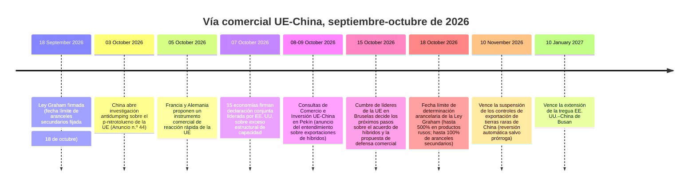
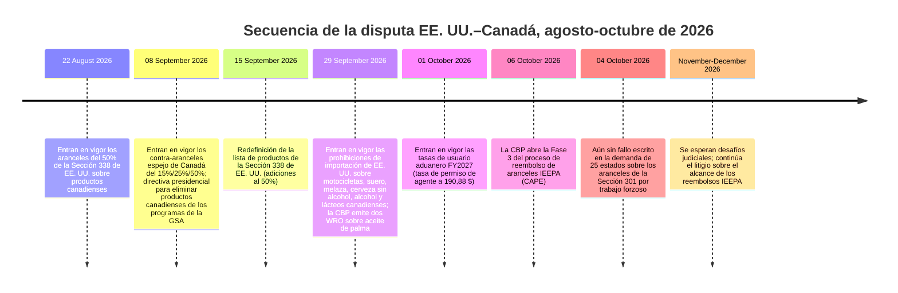
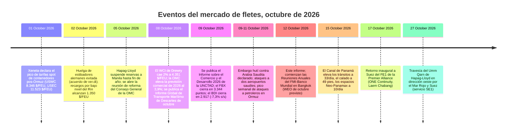

# Informe de Inteligencia de Comercio Global — Semana del 5 al 12 de octubre de 2026

**Resumen semanal.** Ventana de cobertura: 5–12 de octubre de 2026. Recopilado a partir de aproximadamente 45 fuentes mundiales de noticias comerciales, política, datos y fletes.

---

## Índice

1. [Resumen ejecutivo](#1-resumen-ejecutivo)
2. [Alertas](#2-alertas)
3. [Historias destacadas — análisis a fondo](#3-historias-destacadas--análisis-a-fondo)
4. [Rastreador de aranceles](#4-rastreador-de-aranceles)
5. [Análisis a fondo de la política estadounidense](#5-análisis-a-fondo-de-la-política-estadounidense)
6. [Política mundial por región](#6-política-mundial-por-región)
7. [Medidas de aplicación](#7-medidas-de-aplicación)
8. [Publicaciones de datos](#8-publicaciones-de-datos)
9. [Mercado de fletes](#9-mercado-de-fletes)
10. [Cronogramas de políticas](#10-cronogramas-de-políticas)
11. [Próximos plazos y eventos (próximos 90 días)](#11-próximos-plazos-y-eventos-próximos-90-días)
12. [Fuentes y metodología](#12-fuentes-y-metodología)

---

## 1. Resumen ejecutivo

Una semana en la que la seguridad energética, la defensa comercial y la seguridad marítima colisionaron. Tres acontecimientos marcaron la pauta:

- **La cuenta atrás de la Ley Graham llegó a su semana final.** A días de la fecha límite del 18 de octubre para la determinación de aranceles, el presidente Trump anunció un acuerdo de importación de diésel ruso — más de 300.000 toneladas de inmediato, 500.000 más en noviembre — autorizado por la Licencia General 135 del Tesoro hasta abril de 2027, aun cuando los aranceles secundarios de hasta el 100% de la Ley sobre los principales compradores de energía rusa (India, China, Turquía) están listos para entrar en vigor sin exenciones presidenciales. Siete senadores de ambos partidos calificaron el acuerdo del diésel de incompatible con la ley de sanciones que firmó el presidente. India, el mayor comprador de crudo ruso, dijo que sus negociaciones comerciales con EE. UU. han "llegado a una meseta".
- **La ronda de Pekín entre la UE y China produjo un resultado controvertido.** El comisario Maroš Šefčovič anunció un "entendimiento compartido" para reducir a más de la mitad las exportaciones chinas de híbridos a la UE en cuatro años, además de recortes arancelarios chinos a repuestos de automóviles, aceite de oliva y calzado por valor de al menos 225 millones de euros en ahorros arancelarios — pero el texto publicado por Pekín no incluye ninguna cifra, y el déficit de bienes de la UE con China alcanzó los 238.000 millones de euros en los primeros siete meses de 2026. Francia y Alemania propusieron por separado un instrumento comercial de reacción rápida de la UE "tan poderoso como la Sección 301". Los líderes de la UE decidirán los próximos pasos en la cumbre de Bruselas del 15 de octubre.
- **La guerra energética del transporte marítimo se intensificó bruscamente.** Los hutíes declararon un embargo marítimo contra Arabia Saudita y atacaron dos aeropuertos saudíes, matando a tres personas; el tráfico por Bab el-Mandeb cayó a 11 buques el 11 de octubre. Los ataques a petroleros cerca de Ormuz alcanzaron su nivel semanal más alto desde que comenzó la guerra; EE. UU. sancionó a 22 petroleros más e Irán calificó de "insuficiente" la respuesta estadounidense a su propuesta de reabrir Ormuz.

En otros temas: las importaciones estadounidenses de contenedores marcaron un récord en septiembre (2,55 millones de TEU, +10,3% interanual, según el informe de Descartes del 8 de octubre); la CBP puso en marcha la Fase 3 del proceso de reembolso de aranceles IEEPA (CAPE) el 6 de octubre; el Reino Unido dijo que una decisión sobre aranceles de hasta el 45% a los vehículos eléctricos chinos está "finamente equilibrada"; la OMC elevó su previsión de comercio de mercancías de 2026 al 3,9% por la demanda impulsada por la IA, mientras el informe insignia de la UNCTAD describió una "fragmentación selectiva" y una caída del 20% en el comercio China–EE. UU. desde 2024; China abrió una investigación antidumping sobre el p-nitrotolueno de la UE; y la prohibición ampliada de exportaciones rusas de Japón entra en vigor el 16 de octubre.

**Fletes:** una caída pospico con primas de conflicto. El Índice Mundial de Contenedores Drewry cayó un 2% hasta 4.351 $/FEU (Asia–Europa lleva 13 semanas consecutivas de caídas mientras las navieras aceleran su regreso a Suez), el Baltic Dry Index cayó un 7,3% hasta 2.917 mientras los ingresos de los Capesize se desplomaban por el débil mineral de hierro, y Hapag-Lloyd suspendió todas las reservas a Manila hasta fin de año mientras la crisis de vacíos en Filipinas colapsaba la capacidad de patio. La fiabilidad de los itinerarios globales cayó por debajo del 50% por primera vez desde la pandemia.

---

## 2. Alertas

| N.º | Alerta | Vigencia | Impacto | Fuente |
|---|-------|-----------|--------|--------|
| A1 | Fecha límite de aranceles secundarios de la Ley Graham: hasta 500% de aranceles sobre productos rusos; hasta 100% de aranceles secundarios sobre los principales compradores de energía rusa sin exención | 18 de oct. de 2026 | India, China y Turquía son los más expuestos; los aranceles se acumulan sobre los existentes | [mondaq.com](https://www.mondaq.com/unitedstates/export-controls-trade-investment-sanctions/1851398/the-lindsey-graham-sanctions-act-what-businesses-need-to-know-about-the-new-tariffs) |
| A2 | Acuerdo de diésel EE. UU.–Rusia: más de 300.000 toneladas de inmediato, 500.000 toneladas en noviembre; la Licencia General 135 de la OFAC autoriza las importaciones de diésel ruso | 9 de oct. de 2026 (LG135 vigente hasta el 7 de abr. de 2027) | Colisión política con la Ley Graham una semana antes de la fecha límite; 7 senadores piden revertirlo | [nationpress.com](https://www.nationpress.com/international/trump-buys-russian-diesel-before-graham-act-deadline) |
| A3 | Ronda de Pekín UE–China: controvertido "entendimiento" sobre exportaciones de híbridos; recortes arancelarios de más de 225 M€ en exportaciones de la UE; canal verde de tierras raras preservado | 8–9 de oct. de 2026 (decisión en la cumbre de la UE del 15 de oct.) | Mecanismo de aplicación no divulgado; el texto de Pekín no incluye cifra de reducción a la mitad | [eureporter.co](https://www.eureporter.co/world/china-2/2026/10/09/eu-and-china-strike-preliminary-trade-deal-ahead-of-crucial-leaders-summit/) |
| A4 | Propuesta franco-alemana de un instrumento comercial de reacción rápida de la UE "tan poderoso como la Sección 301" | Propuesta el 5 de oct.; cumbre el 15 de oct. | Posible actualización de la defensa comercial de la UE; China advierte de una respuesta | [lapost.com](https://www.lapost.com/content/france-germany-propose-new-rapid-eu-trade-response-tool) |
| A5 | Embargo marítimo hutí contra Arabia Saudita; tráfico por Bab el-Mandeb en su nivel más bajo en meses (11 buques el 11 de oct.); ataques a dos aeropuertos saudíes, tres muertos | 9–11 de oct. de 2026 | Cargas de crudo saudí amenazadas; más de 7 petroleros desviados | [marinelink.com](https://www.marinelink.com/news/red-sea-shipping-slows-houthi-attack-541529) |
| A6 | Ataques a petroleros en Ormuz/Golfo en su nivel semanal más alto desde que comenzó la guerra; EE. UU. sanciona a 22 petroleros más (8 de oct.) | 7–11 de oct. de 2026 | EE. UU. neutraliza un buque infractor del bloqueo el 10 de oct.; petrolero químico atacado frente a Catar | [gcaptain.com](https://gcaptain.com/category/news/) |
| A7 | Vence la suspensión de los controles de exportación de tierras raras de China; no se anunció prórroga | 10 de nov. de 2026 | Reversión automática salvo que ambas partes prorroguen; 6,5 billones de $/año de producción derivada en riesgo (AIE) | [investornews.com](https://investornews.com/critical-minerals-rare-earths/technology-metals-report-10-04-2026-a-summit-without-a-rare-earth-deal-leaves-the-west-buying-its-way-to-supply/) |
| A8 | El Reino Unido sopesa aranceles de hasta el 45% a los vehículos eléctricos chinos; decisión "finamente equilibrada" | En estudio (informado el 4–7 de oct.) | El 58% de las exportaciones de automóviles del Reino Unido van a la UE; vinculado al acceso "Hecho en Europa" | [fleetnews.co.uk](https://Www.fleetnews.co.uk/news/uk-weighs-chinese-car-tariffs-as-fleet-demand-for-evs-surges) |
| A9 | La CBP lanza la Fase 3 del proceso de reembolso de aranceles IEEPA (CAPE) | 6 de oct. de 2026 | Inicio operativo de la ejecución de reembolsos por ~180.000 M$; alcance para importadores no litigantes en disputa; comentarios hasta el 4 de nov. | [thompsonhine.com](https://www.thompsonhine.com/insights/cbp-confirms-october-6-2026-launch-of-phase-3-of-the-ieepa-tariff-refund-process/) |
| A10 | Hapag-Lloyd suspende todas las reservas a Manila, Batangas y Subic hasta fin de año por congestión de vacíos | Inmediato (hasta el 31 de dic. de 2026) | Una de las medidas de reserva más severas de 2026 | [portcalls.com](https://portcalls.com/hapag-lloyd-suspends-manila-batangas-subic-bookings-over-congestion/) |
| A11 | China abre investigación antidumping sobre el p-nitrotolueno de la UE | 3 de oct. (registro cierra el 23 de oct.) | Márgenes de dumping alegados superiores al 100%; calendario de represalia frente a la propuesta de instrumento de la UE | [mlex.com](https://www.mlex.com/mlex/articles/2533700/china-opens-anti-dumping-probe-into-eu-para-nitrotoluene) |
| A12 | Entra en vigor la prohibición ampliada de exportaciones rusas de Japón | 16 de oct. de 2026 | Productos adicionales prohibidos de exportar a Rusia | [globalsanctions.com](https://globalsanctions.com/2026/10/japan-adds-more-goods-to-russia-export-ban-from-16-october-2026/) |

### A1 — Fecha límite de la Ley Graham (detalle)

La Ley Lindsey O. Graham de Sanciones a Rusia e Irán de 2026 (firmada el 18 de septiembre) impone un plazo de implementación de 30 días, hasta el **18 de octubre de 2026**, para dos vías arancelarias obligatorias. Sección 112: aranceles de hasta el **500% ad valorem** sobre todos los productos importados de Rusia, incluidos explícitamente los productos petrolíferos. Sección 113: aranceles de hasta el **100% ad valorem** sobre todos los productos de países que estuvieran entre los cinco mayores importadores de crudo o gas natural ruso en los 12 meses anteriores y que realicen compras nuevas a sabiendas en la fecha límite o después. Todos los aranceles se acumulan sobre los aranceles vigentes de la Sección 301/232. Válvulas de escape: una exención presidencial que requiere una certificación formal, no clasificada y por escrito al Congreso de que es de interés nacional, y una excepción limitada para el gas natural (importaciones por debajo del 15% de las exportaciones anuales totales de gas de Rusia más "medidas significativas" para reducirlas; los compradores de crudo no califican). El análisis de bufetes identifica a China, India y Turquía como los objetivos probables, con Eslovaquia, Hungría y los EAU en riesgo elevado. ([mondaq.com](https://www.mondaq.com/unitedstates/export-controls-trade-investment-sanctions/1851398/the-lindsey-graham-sanctions-act-what-businesses-need-to-know-about-the-new-tariffs))

### A2 — El acuerdo del diésel ruso (detalle)

El 9 de octubre, tras una llamada con el presidente Putin, el presidente Trump anunció que Rusia suministraría diésel a los mercados estadounidense y mundial — más de **300.000 toneladas de inmediato y otras 500.000 toneladas en noviembre** — para bajar los precios del combustible para agricultores, ganaderos y camioneros estadounidenses. La Oficina de Control de Activos Extranjeros del Tesoro emitió la **Licencia General 135**, que autoriza transacciones de diésel de origen ruso hasta las 12:01 a. m. EDT del **7 de abril de 2027**. El secretario del Tesoro, Bessent, declaró que la administración actuaría bajo sus autoridades legales disponibles y disputó que la Ley Graham impida el acuerdo (la Ley preserva la autoridad de licencia general del Tesoro; la Sección 113 solo cuenta el crudo y el gas natural, no los productos refinados, al determinar qué países enfrentan aranceles). Siete senadores de ambos partidos — liderados por la miembro de rango Jeanne Shaheen junto con los senadores Tillis, Collins, Murkowski, Curtis, Blumenthal y Wyden — emitieron una declaración conjunta el 11 de octubre instando a revertirlo, argumentando que el acuerdo contradice el marco de sanciones establecido por el Congreso. Contexto: los precios del diésel han subido alrededor del 70% desde febrero (conflicto de Irán, prohibición de exportaciones rusas, ataques ucranianos a refinerías); AAA situó el promedio nacional en alrededor de 6,27–6,28 $/galón el 8–9 de octubre. ([nationpress.com](https://www.nationpress.com/international/trump-buys-russian-diesel-before-graham-act-deadline), [cnn.com](https://www.cnn.com/2026/10/09/politics/trump-putin-russian-diesel), [egyptoil-gas.com](https://egyptoil-gas.com/news/us-senators-urge-trump-to-reverse-russia-diesel-deal/))

### A3 — Ronda de Pekín UE–China (detalle)

La segunda sesión de las Consultas de Comercio e Inversión UE–China concluyó el 9 de octubre en Pekín entre el comisario Maroš Šefčovič y el ministro Wang Wentao, tras tres meses de conversaciones sobre el déficit de bienes de la UE de más de 1.000 millones de euros por día. Šefčovič anunció un "entendimiento compartido" para moderar las exportaciones chinas de vehículos híbridos e híbridos enchufables — "abre la perspectiva de reducir las exportaciones chinas en más de la mitad" en cuatro años —, un entendimiento compartido para bajar los aranceles NMF que cubren repuestos de automóviles, aceite de oliva y calzado (casi 4.000 millones de euros en valor actual de exportaciones de la UE, al menos 225 millones de euros en ahorros arancelarios), y un entendimiento compartido para hacer que la concesión de licencias de exportación de tierras raras de China sea más fluida, más predecible y más transparente, con el canal verde preservado. **La advertencia:** el texto publicado por Pekín no incluye ninguna cifra sobre exportaciones de híbridos — la "reducción a la mitad" existe solo en las declaraciones de Šefčovič, el mecanismo no se ha divulgado y requiere el respaldo político de los líderes de la UE en la cumbre del 15–16 de octubre. Contexto: China se negó a restringir voluntariamente las exportaciones de híbridos (FT, citando a dos diplomáticos, 7 de octubre); el Parlamento Europeo votó el 7 de octubre denunciar las prácticas económicas de China y su posición sobre Ucrania. ([eureporter.co](https://www.eureporter.co/world/china-2/2026/10/09/eu-and-china-strike-preliminary-trade-deal-ahead-of-crucial-leaders-summit/), [reuters.com](https://www.reuters.com/world/china/eu-seeks-cut-trade-deficit-with-china-talks-with-beijing-2026-10-07/), [europeansting.com](https://europeansting.com/2026/10/12/press-remarks-by-commissioner-sefcovic-at-the-second-meeting-of-the-eu-china-trade-and-investment-consultations/))

### A5/A6 — Escalada de la seguridad marítima (detalle)

El portavoz militar hutí declaró un embargo marítimo contra Arabia Saudita; el 10–11 de octubre, ataques hutíes alcanzaron dos aeropuertos saudíes, matando a tres personas e hiriendo a decenas. El tráfico por Bab el-Mandeb cayó el 11 de octubre a **11 buques mercantes — el nivel más bajo en meses** — incluidos siete petroleros; al menos siete petroleros alteraron su rumbo tras la advertencia del embargo. Los EAU condenaron los ataques el 7 de octubre. Esta es la tercera fase de la escalada hutí en 2026 (los ataques con misiles se reanudaron en julio; se reclamó el ataque a buques de bandera saudí; ahora un embargo declarado), y amenaza directamente las cargas de crudo saudí — un ataque previo con drones ya había detenido las cargas en Yanbu el 2 de octubre. En torno a Ormuz, los ataques a petroleros alcanzaron su nivel semanal más alto desde que comenzó la guerra: un petrolero químico fue alcanzado por múltiples proyectiles frente a Catar con víctimas reportadas; un segundo buque mercante fue alcanzado dentro del Golfo Pérsico el 9 de octubre. Gibson ha rastreado **95 ataques a petroleros** desde que comenzó la guerra. El 8 de octubre EE. UU. impuso sanciones a 22 petroleros más vinculados al comercio petrolero de Irán; los socios del G7 acordaron liberar hasta 100 millones de barriles de reservas de emergencia de petróleo/diésel (2 de octubre). El 10 de octubre el ejército estadounidense dijo que había neutralizado un carguero en el Golfo de Omán que intentaba romper el bloqueo a Irán. Irán dijo el 11 de octubre que la respuesta estadounidense a su propuesta de siete condiciones para reabrir Ormuz era "insuficiente". ([marinelink.com](https://www.marinelink.com/news/red-sea-shipping-slows-houthi-attack-541529), [gcaptain.com](https://gcaptain.com/category/news/), [hellenicshippingnews.com](https://www.hellenicshippingnews.com/category/shipping-news/hellenic-shipping-news/))

---

## 3. Historias destacadas — análisis a fondo

### 3.1 UE–China: un "medio acuerdo" sin texto compartido

**Lo ocurrido.** La segunda ronda de las Consultas de Comercio e Inversión UE–China en Pekín (8–9 de octubre) concluyó con una declaración conjunta y una lista de consenso de 16 puntos que cubre vehículos híbridos, alivio arancelario, tierras raras, la investigación antisubvenciones de vehículos eléctricos de la UE, discusiones técnicas del Reglamento de Subvenciones Extranjeras y cooperación en propiedad intelectual. Una reunión ministerial por video está prevista para enero, con la próxima ronda presencial en marzo de 2027.

**Cifras clave.**
- Déficit de bienes de la UE con China: **238.060 M€ en los primeros siete meses de 2026**, un 12,2% más interanual.
- Declaración de Šefčovič: un entendimiento compartido para reducir a más de la mitad las exportaciones chinas de híbridos en cuatro años; recortes arancelarios que cubren casi **4.000 M€** de exportaciones de la UE con al menos **225 M€** en ahorros arancelarios.
- Las importaciones chinas de automóviles representan aproximadamente **1.000 M€ por día** en términos de flujo comercial.
- La asimetría: el texto publicado por Pekín no incluye ninguna cifra — la reducción a la mitad existe solo en la rueda de prensa de Šefčovič. ([mlex.com](https://www.mlex.com/mlex/articles/2536652/china-eu-agree-on-hybrid-vehicle-trade-export-controls-further-tariff-talks))

**Análisis.** De implementarse, sería el primer acuerdo de moderación voluntaria de exportaciones de esta magnitud en el comercio UE–China — un VER aceptado por China sin una lucha arancelaria previa, en el encuadre de Šefčovič — y podría sentar un modelo para otros sectores. Pero el mecanismo no se ha divulgado, los textos publicados por ambas partes difieren y el acuerdo necesita el respaldo del Consejo Europeo el 15–16 de octubre. Cinco días antes de la ronda, Pekín abrió una investigación antidumping sobre el p-nitrotolueno de la UE (3 de octubre), y el MOFCOM señaló que la UE ha abierto 28 casos de defensa comercial contra China desde 2025. La propuesta franco-alemana de reacción rápida paralela se dirige a la misma cumbre. La cumbre decidirá si el entendimiento sobre híbridos se convierte en política o sigue siendo una declaración de rueda de prensa.

### 3.2 Ley Graham: una ley de sanciones en curso de colisión con su propia administración

**Lo ocurrido.** Con la fecha límite del 18 de octubre a una semana, la administración autorizó importaciones de diésel ruso (Licencia General 135, hasta el 7 de abril de 2027) mientras la maquinaria de aranceles secundarios de la Ley Graham está lista para penalizar las compras de energía rusa de India, China y Turquía. Siete senadores de ambos partidos exigieron la reversión. India — el mayor comprador mundial de crudo ruso con ~1,6 millones de bpd, que representa el 37% de las exportaciones de crudo de Rusia de diciembre de 2022 a agosto de 2026 (datos de CREA) — dijo que sus negociaciones comerciales con EE. UU. han "llegado a una meseta" (ministra de Finanzas Sitharaman, 5 de octubre) y subrayó la seguridad energética para sus 1.400 millones de personas. China rechazó la "jurisdicción de brazo largo" (Ministerio de Exteriores, 19 de septiembre, reiterado esta semana); no se identificó respuesta del gobierno turco esta semana. Turquía compra aproximadamente 282.000 bpd, muy por detrás de India (~1,6 M) y China (~1,3 M, Kpler).

**Cifras clave.**
- Aranceles secundarios: hasta el **100%** sobre los productos de los principales compradores de energía rusa; hasta el **500%** sobre los productos rusos; ambos se acumulan sobre los aranceles vigentes de la Sección 301/232.
- Acuerdo del diésel: más de 300.000 toneladas de inmediato, 500.000 en noviembre — alrededor de un día y medio de demanda estadounidense; el diésel ha subido ~70% desde febrero.
- Excepción del gas natural: importaciones por debajo del 15% de las exportaciones anuales totales de gas de Rusia más "medidas significativas" para reducirlas; los compradores de crudo no califican.

**Análisis.** El acuerdo del diésel hace que la aplicación de la Ley sea visiblemente discrecional: Washington importa productos refinados rusos mientras amenaza con aranceles secundarios de hasta el 100% a terceros países que compran crudo ruso — una distinción que el texto de la Ley respalda (la Sección 113 solo cuenta el crudo y el gas natural) pero que la declaración de los siete senadores muestra que es políticamente costosa. La intención de la administración sobre exenciones sigue sin declararse, lo que crea una aguda incertidumbre de planificación para los importadores que se abastecen de India, China y Turquía. La decisión sobre exenciones, prevista para el 18 de octubre, es ahora el evento arancelario más trascendente del otoño.

### 3.3 La guerra energética del transporte marítimo entra en una nueva fase

**Lo ocurrido.** Dos escaladas se desarrollaron simultáneamente: el embargo declarado por los hutíes contra Arabia Saudita con ataques a aeropuertos saudíes (tres muertos, 9–10 de octubre) y el nivel semanal más alto de ataques a petroleros en la zona de Ormuz desde que comenzó la guerra. Arabia Saudita está en conversaciones con clientes para ofrecer cargas de petróleo fuera del Estrecho de Ormuz en contratos de largo plazo; las refinerías indias redujeron las compras de crudo ruso para noviembre mientras los compradores recurren a flujos recuperados de Oriente Medio. EE. UU. neutralizó un buque infractor del bloqueo el 10 de octubre.

**Cifras clave.**
- 95 ataques a petroleros desde que comenzó la guerra (Gibson); 22 petroleros más sancionados por EE. UU. el 8 de octubre.
- Bab el-Mandeb: 11 buques mercantes el 11 de octubre, el nivel más bajo en meses; más de 7 petroleros desviados.
- El Brent de noviembre se negoció a 107 $ el 14 de septiembre, 50 $ más en el año; el Estrecho de Ormuz está cerrado a los transportistas desde el 28 de febrero.
- El bloqueo estadounidense tiene decenas de petroleros cargados retenidos a lo largo de la costa de Irán.

**Análisis.** La geografía del riesgo se está ampliando: los ataques se extendieron al Golfo de Omán y al Golfo Arábigo más allá del punto de estrangulamiento de Ormuz en las últimas 48 horas, mientras el embargo del Mar Rojo amenaza el otro flanco de las exportaciones de crudo del Golfo. La operación europea de escolta Aspides ha reconocido que los buques de guerra disponibles son insuficientes para cubrir todas las solicitudes — una restricción dura a cualquier retorno adicional de contenedores a Suez. Para los importadores, la combinación de fletes elevados, rotación de sanciones (22 petroleros recién listados) y dos embargos marítimos simultáneos es ahora la variable central de costos, no un riesgo de cola.

### 3.4 El duelo de datos: el déficit de Washington se amplía mientras Ginebra mejora las perspectivas

**Lo ocurrido.** La Oficina del Censo y la BEA publicaron los datos comerciales estadounidenses de agosto el 6 de octubre: el déficit se amplió a **105.600 M$** (+13,7%), con importaciones en un récord mensual de **420.800 M$**. Dos días después, la OMC elevó su previsión de volumen de comercio de mercancías de 2026 al **3,9%** (desde el 1,9% de marzo) por la demanda impulsada por la IA. El 9 de octubre, la UNCTAD publicó su informe insignia Informe sobre el Comercio y el Desarrollo 2026: el comercio mundial alcanzó un récord de **35 billones de $** en 2025, pero el informe describe una "fragmentación selectiva", con el comercio China–EE. UU. cayendo más del 20% desde 2024 y los países en desarrollo excluidos de sectores estratégicos por controles de exportación y escrutinio de inversiones.

**Cifras clave.**
- Déficit estadounidense de agosto: 105.600 M$ (+12.700 M$ m/m); déficit de bienes 136.600 M$; importaciones récord de 420.800 M$; mayores brechas bilaterales: México (27.700 M$), Vietnam (24.000 M$), Taiwán (18.300 M$), China (16.400 M$). El déficit acumulado enero–agosto sigue siendo **19,9% más estrecho** interanual — un mes amplio frente a una tendencia anual más estrecha.
- OMC: volumen de mercancías **3,9% en 2026** (desde 1,9%), 4,1% en 2027; servicios recortados al 3,3% (desde 4,8%) por el conflicto de Oriente Medio; los bienes habilitadores de IA (chips, servidores) impulsaron el **47%** del crecimiento comercial y subieron un 67% interanual, ahora ~14,8% del comercio mundial de bienes. Exportaciones regionales de mercancías en 2026: Asia +9,9%, Norteamérica +5,7%, África +5,6%, Sudamérica +3,4%, Europa −0,1%, CEI −3,9%, Oriente Medio −17,2%. PIB mundial 2,6% (2026), 2,9% (2027).
- UNCTAD: PIB global 2,6% en 2026 (desde 2,9% en 2025); Asia contribuirá el **60%** del crecimiento; India 7,3%; la participación de la inversión estratégica subió del 16% al 44% de la inversión greenfield anunciada (2020–2025), con ~70% destinada a economías desarrolladas. Se proyecta que la AOD caiga casi un 7% en 2026, tercer descenso anual consecutivo.
- La Actualización Global del Comercio de octubre de la UNCTAD proyecta un crecimiento del comercio de mercancías de 2026 de solo **1,5–2,5% en términos reales**, desde el 4,7% de 2025 — el más bajo desde 2023 — un contrapunto deliberado a la mejora de volumen de la OMC.

```
Revisión de la previsión de volumen de comercio de mercancías de la OMC para 2026
  Previsión de marzo:  1,9%  ██████████
  Actualización de octubre:  3,9%  ████████████████████

Déficit comercial mensual de EE. UU., agosto de 2026
  Julio:    92.800 M$  ████████████████████████████████
  Agosto: 105.600 M$  ████████████████████████████████████  (importaciones récord de 420.800 M$)
```

**Análisis.** Las tres publicaciones cuentan una historia desde tres ángulos: la demanda es fuerte (importaciones estadounidenses récord), su composición es estrecha (los bienes de IA impulsaron casi la mitad del crecimiento comercial; concentración señalada por la UNCTAD) y su geografía es selectiva (el comercio China–EE. UU. cayó más del 20% desde 2024 mientras México, Vietnam y Taiwán cubren el hueco). La divergencia entre el optimismo de volumen de la OMC y la cautela en términos reales de la UNCTAD — ganancias nominales impulsadas por precios frente a volúmenes reales débiles — es el marco analítico del trimestre. El WEO de octubre del FMI, previsto durante las Reuniones Anuales de Bangkok (12–18 de octubre), aportará la evaluación formal de simulación arancelaria. ([bea.gov](https://www.bea.gov/news/2026/us-international-trade-goods-and-services-august-2026), [reuters.com](https://www.reuters.com/business/us-trade-deficit-widens-august-amid-strong-imports-2026-10-06/), [dig.watch](https://dig.watch/updates/wto-trade-outlook-ai-boom), [un.org](https://news.un.org/en/story/2026/10/1168566))

### 3.5 Tierras raras: la reversión del 10 de noviembre

**Lo ocurrido.** La suspensión china de sus controles ampliados de exportación de tierras raras vence el **10 de noviembre de 2026**, sin prórroga anunciada. Los controles de abril de 2025 sobre siete elementos nunca se suspendieron. EE. UU. está escalando su propia influencia: Reuters informó el 1 de octubre que Comercio ha ralentizado las licencias de exportación de piezas de aeronaves con destino a China, incluidos envíos a la estatal COMAC, y está considerando nuevas reglas sobre licencias de trenes de aterrizaje y fluido hidráulico.

**Cifras clave.**
- La AIE advierte que la plena implementación de los controles ampliados de China podría poner en riesgo un estimado de **6,5 billones de $/año** de producción derivada fuera de China.
- China suministró el 70% de las importaciones estadounidenses de itrio en 2021–2024; la dependencia neta de importaciones de EE. UU. para el itrio fue del 100% en 2025.
- Respuestas occidentales esta semana: un paquete de cuatro proyectos de ley en el Congreso sobre reservas y permisos; American Rare Earths ampliando su mina de Wyoming en un 50%; Lindian Resources comprometiendo 150 M$ a un centro de procesamiento en Asia Central.

**Análisis.** La reversión del 10 de noviembre es automática salvo que ambos gobiernos prorroguen sus pausas — se vislumbran tres escenarios: prórroga, reactivación selectiva o restauración total. La promesa de Pekín en la cumbre de mayo de 2026 de "atender las preocupaciones de EE. UU." no ha producido una prórroga formal, y los envíos de tierras raras no han vuelto a los niveles acordados. La promesa de la ronda de Pekín de una concesión de licencias de canal verde "más fluida y predecible" para las empresas europeas se pondrá a prueba frente a la fecha de reversión.

### 3.6 Quince economías se alinean sobre el exceso de capacidad — fuera de la OMC

**Lo ocurrido.** El 7 de octubre, ministros de comercio de 15 economías — EE. UU., Argentina, Australia, Canadá, la UE, Francia, Alemania, India, Italia, Japón, Corea del Sur, México, Polonia, Turquía y el Reino Unido — firmaron una Declaración Ministerial Conjunta que pide actuar para eliminar el exceso estructural de capacidad y las políticas "no de mercado" que fomentan la sobreproducción. Surgió de la reunión de Ministros de Comercio del G20 en Milwaukee (30 de septiembre–1 de octubre), donde no se alcanzó consenso, y se acordó al margen de una reunión del Comité de Comercio de la OCDE. Promete plataformas sectoriales dedicadas, reuniones técnicas antes de diciembre e información compartida.

**Análisis.** Esta es la declaración de coalición sobre exceso de capacidad más grande del año e institucionaliza una vía plurilateral de seguimiento fuera de la OMC. Los no firmantes importan tanto como los firmantes: China, Rusia, Brasil, Indonesia, Arabia Saudita, Sudáfrica y la Unión Africana no firmaron, y China advirtió el 9 de octubre que respondería "según sea necesario" si la declaración se utilizara como pretexto para medidas que dañen sus intereses. La ausencia de Brasil — un miembro importante del G20 que enfrenta aranceles de la Sección 301 de EE. UU. — es notable. Las reuniones técnicas previas a diciembre son ahora un punto de vigilancia. ([reuters.com](https://www.reuters.com/business/some-g20-trade-ministers-sign-us-led-statement-denouncing-excess-factory-2026-10-07/))

### 3.7 Los importadores estadounidenses siguen comprando: cajas récord en septiembre

**Lo ocurrido.** El Informe Global de Transporte Marítimo de Descartes de octubre (publicado el 8 de octubre) mostró importaciones estadounidenses de contenedores de **2.546.261 TEU en septiembre** — el septiembre más alto registrado, +10,3% interanual (Reuters/Descartes; Descartes informa una caída del 2,2% m/m frente a agosto). Las importaciones de origen chino fueron de 924.454 TEU — +4,5% m/m según Descartes, y Reuters informa +21,2% interanual — representando el 36,3% del volumen total. Las categorías minoristas (productos plásticos, muebles/ropa de cama, juguetes/artículos deportivos) dominaron los envíos chinos. El volumen enero–septiembre de 2026 subió un 0,8% frente a 2025 — la primera ganancia acumulada sobre 2025 este año. Corroboración: el Puerto de Los Ángeles manejó un récord de 1,04 M TEU en septiembre (Gene Seroka, 9 de octubre); el Puerto de Savannah un récord de 504.015 TEU (+3,7% interanual, 7 de octubre). El Global Port Tracker de la NRF proyecta que agosto fue el mes pico de 2026; las importaciones "probablemente ya pasaron la parte más activa del año" (JOC, 8 de octubre).

**Análisis.** A pesar del régimen arancelario, la demanda de importaciones estadounidense sigue siendo robusta — el récord de 420.800 M$ de importaciones de agosto del FT-900 y las cajas récord de septiembre de Descartes apuntan en la misma dirección: las cadenas de suministro se están redirigiendo (las brechas bilaterales de México, Vietnam y Taiwán son ahora mayores que las de China) en lugar de relocalizarse. ([reuters.com](https://www.reuters.com/world/china/us-ocean-container-imports-set-new-record-september-descartes-says-2026-10-08/))

### 3.8 Aire y superficie: un pico moderado con una excepción

**Carga aérea.** Los datos de Xeneta mostraron que los volúmenes globales de carga aérea crecieron un **+4% en octubre** frente a expectativas de un mercado plano, pero la demanda Europa–Norteamérica cayó un **−6% interanual** — "una señal dura" y un posible indicador adelantado. Los envíos de comercio electrónico China–Europa se dispararon un **+62% interanual** en septiembre mientras el comercio electrónico China–EE. UU. cayó un **−34%** (quinto mes consecutivo, moderándose desde el −49% de junio). Índice TAC de septiembre: Hong Kong–Norteamérica 7,02 $/kg (+31% interanual), Hong Kong–Europa 4,80 $/kg (+8,8%); el Baltic Air Freight Index subió un 25,5% interanual. El nuevo cargo de 3 € por paquete de la UE en envíos de menos de 150 € está pesando sobre los volúmenes Asia–Europa. El informe de octubre de Dimerco predice que la congestión marítima y la carga China–EE. UU. retenida podrían empujar más volumen al aire en el cuarto trimestre; Xeneta ve un pico moderado. Comodín: los ataques a aeropuertos saudíes redujeron en un tercio la capacidad de carga aérea saliente de Riad mientras se acerca el pico. ([airfreight.news](https://airfreight.news/articles/full/october-air-cargo-volumes-surprise-with-4-growth-but-is-europe-north-america-slump-a-bellwether-for-global-trade))

**Transporte por carretera en EE. UU.** Las tarifas contractuales de carga completa alcanzaron un máximo de 52 semanas de **2,72 $/milla** más combustible (+18% interanual); el spot de furgón seco 3,55 $/milla todo incluido, ~50% por encima del año anterior — impulsado por el combustible y la escasez de capacidad, no por la demanda. El diésel llegó a 6,39 $/galón. Los rechazos de ofertas salientes ~13,75–14%. La nueva capacidad se está reduciendo: los tractores en nuevas flotas de alquiler cayeron a 19.520 en agosto (−14% frente al promedio del primer semestre); solo ~2 de cada 3 nuevos registrados interestatales compran seguro de responsabilidad (frente a 9 de cada 10 en 2019). El aumento general de tarifas (GRI) del 4,9% de Old Dominion entró en vigor el 5 de octubre; DHL Express se unió a FedEx con un GRI de 5,9% para 2027 (1 de enero). ([freightwaves.com](https://www.freightwaves.com/news/trucking-rates-spike-contracts-at-52-week-high))

---

## 4. Rastreador de aranceles

| País | Medida | Tasa | Fecha de vigencia | Estado | Fuente |
|---|---|---|---|---|---|
| EE. UU. → Canadá | Aranceles adicionales de la Sección 338 | 50% (sin exención USMCA) | 22 de ago. de 2026 (redefinido el 15 de sep.) | En vigor | [whitehouse.gov](https://www.whitehouse.gov/fact-sheets/2026/07/fact-sheet-president-donald-j-trump-imposes-additional-tariffs-on-canada/) |
| EE. UU. → Canadá | Prohibiciones de importación de la Sección 338 (motocicletas, suero, melaza, cerveza sin alcohol, alcohol, lácteos) | Importación denegada (mercancías en tránsito: arancel del 50%) | 29 de sep. de 2026 | En vigor | [asrwe.com](https://asrwe.com/asr-university/us-canada-import-ban-alcohol-motorcycles-section-338-expansion-september-2026) |
| EE. UU. → Canadá | Arancel de la Sección 301 por trabajo forzoso | 10% (evitable con reclamo USMCA válido; los productos cubiertos no USMCA enfrentan 50%+10%=60%) | 23 de jul. de 2026 | En vigor; demanda de 25 estados pendiente, sin fallo | [jdsupra.com](https://www.jdsupra.com/legalnews/forced-labor-meet-section-301-new-1432199/) |
| Canadá → EE. UU. | Contra-aranceles sobre ~335 partidas arancelarias (acero, aluminio, lácteos, automóviles, electrodomésticos, maquinaria agrícola, papel, plásticos, electrónica) | 15% / 25% / 50% | 8 de sep. de 2026 | En vigor | [surtaxscan.com](https://surtaxscan.com/news/canadas-counter-tariffs-are-back-15-25-and-50-on-335-us-tariff-items-from) |
| EE. UU. → Rusia | Aranceles de la Sección 112 de la Ley Graham sobre todos los productos rusos, incl. petróleo | Hasta 500% | Fecha límite 18 de oct. de 2026 | Pendiente; posibles exenciones | [mondaq.com](https://www.mondaq.com/unitedstates/export-controls-trade-investment-sanctions/1851398/the-lindsey-graham-sanctions-act-what-businesses-need-to-know-about-the-new-tariffs) |
| EE. UU. → principales compradores de energía rusa (India, China, Turquía, otros) | Aranceles secundarios de la Sección 113 de la Ley Graham | Hasta 100% (se acumulan sobre todos los aranceles existentes) | Fecha límite 18 de oct. de 2026 | Pendiente; la exención presidencial requiere certificación no clasificada al Congreso | [mondaq.com](https://www.mondaq.com/unitedstates/export-controls-trade-investment-sanctions/1851398/the-lindsey-graham-sanctions-act-what-businesses-need-to-know-about-the-new-tariffs) |
| EE. UU. → Rusia | Licencia General 135 de la OFAC: importaciones de diésel ruso autorizadas | n/a (licencia) | 9 de oct. de 2026 – 7 de abr. de 2027 | En vigor | [nationpress.com](https://www.nationpress.com/international/trump-buys-russian-diesel-before-graham-act-deadline) |
| China → UE (p-nitrotolueno) | Investigación antidumping (Anuncio n.º 44 del MOFCOM) | Margen de dumping alegado >100% (aranceles provisionales por determinar) | Abierta el 3 de oct. de 2026; registro cierra el 23 de oct. | Investigación abierta | [mlex.com](https://www.mlex.com/mlex/articles/2533700/china-opens-anti-dumping-probe-into-eu-para-nitrotoluene) |
| UE → China | Moderación de exportaciones de híbridos/PHEV — "entendimiento compartido" | Restricción voluntaria de exportaciones (reducción a la mitad declarada por Šefčovič; sin cifra en el texto de Pekín) | Resultado decidido en la cumbre de la UE del 15–16 de oct. | Pendiente de respaldo político | [eureporter.co](https://www.eureporter.co/world/china-2/2026/10/09/eu-and-china-strike-preliminary-trade-deal-ahead-of-crucial-leaders-summit/) |
| Reino Unido → China | Aranceles a vehículos eléctricos fabricados en China | Hasta 45% (igualando la tasa combinada de la UE) | En estudio | Sin decidir ("finamente equilibrada") | [fleetnews.co.uk](https://Www.fleetnews.co.uk/news/uk-weighs-chinese-car-tariffs-as-fleet-demand-for-evs-surges) |
| Brasil | Aranceles cero: micrófonos, instrumentos musicales, máquinas de coser domésticas | 0% (desde 18–20%) | 1 de oct. de 2026 | En vigor | [datamarnews.com](https://datamarnews.com/noticias/zero-import-tariffs-take-effect-for-musical-instruments-in-brazil/) |
| EE. UU. | Sección 232 polisilicio y derivados | MIPs: 21 $/kg poli, 100 $/kg obleas, 0,22 $/W células, 0,38 $/W módulos + 15% ad valorem | 4 de dic. de 2026 (reglas antiafluencia en vigor desde el 22 de sep.) | Programado | [mondaq.com](https://www.mondaq.com/unitedstates/export-controls-trade-investment-sanctions/1848548/polysilicon-and-derivatives-in-the-bullseye-for-major-new-tariffs-and-other-restrictions) |
| EE. UU. → China | Listas 2 y 3 de la Sección 301 (acciones de 2018) | 7,5%–25% | En vigor (el USTR concluyó la segunda revisión cuatrienal el 7 de oct., los aranceles continúan) | En vigor | [internationaltradetoday.com](https://internationaltradetoday.com/article/2026/10/06/ustr-section-301-tariffs-from-2018-will-continue-2610060064?BC=bc_6ac595c738480) |
| EE. UU. → ~60 economías | Aranceles de la Sección 301 por trabajo forzoso | Nivel del 10% (17 economías incl. Canadá, India, México, Reino Unido); 12,5% el resto; UE/Taiwán con tope combinado del 10% | 23 de jul. de 2026 | En vigor; 3 demandas pendientes | [jdsupra.com](https://www.jdsupra.com/legalnews/forced-labor-meet-section-301-new-1432199/) |
| EE. UU. → ~60 economías (TRQ propuesto) | Contingente arancelario ASEAN (Bangladés, Camboya, Indonesia, Malasia) para productos con insumos textiles/algodón de EE. UU. — exención de los aranceles de la Sección 301 por trabajo forzoso | por determinar | En estudio | Etapa de propuesta | [asiadaily.org](https://asiadaily.org/news/14890/) |
| EE. UU. | Orientación del BIS sobre "contenido estadounidense": equipos industriales móviles USMCA (Proclamación 11032) — reducción arancelaria del 25% → piso del 15% donde ≥40% del contenido sea estadounidense | Tasa efectiva piso del 15% | Vigente el 14 de oct. de 2026 (publicación en FR) | Programado | [kpmg.com](https://kpmg.com/us/en/taxnewsflash/news/2026/10/us-bis-guidance-us-content-canadian-mexican-products.html) |
| India | Trióxido de cromo — CVD afirmativa final | n/a | 8 de oct. de 2026 (medida de EE. UU.) | Determinación final emitida | [federalregister.gov](https://www.federalregister.gov/documents/2026/10/08/2026-20696/chromium-trioxide-from-india-final-affirmative-countervailing-duty-determination) |
| China | CBS (acelerante de caucho) — CVD afirmativa preliminar + circunstancias críticas | n/a | 8 de oct. de 2026 (medida de EE. UU.) | Determinación preliminar emitida | [federalregister.gov](https://www.federalregister.gov/documents/2026/10/08/2026-20692/n-cyclohexylbenzothiazole-2-sulfenamide-from-the-peoples-republic-of-china-preliminary-affirmative) |
| China | Compuestos de amina — investigaciones AD/CVD iniciadas (márgenes alegados hasta 476%) | por determinar | Preliminar de la ITC el 13 de nov. de 2026 | Investigaciones abiertas | [federalregister.gov](https://www.federalregister.gov/documents/2026/10/05/2026-20286/amine-compounds-from-china-institution-of-antidumping-and-countervailing-duty-investigations-and) |
| México | Vagones cisterna — investigaciones AD/CVD iniciadas | por determinar | Preliminar de la ITC el 16 de nov. de 2026 | Investigaciones abiertas | [federalregister.gov](https://www.federalregister.gov/documents/2026/10/05/2026-20349/railway-tank-cars-and-parts-thereof-from-mexico-institution-of-antidumping-and-countervailing-duty) |
| Japón | Prohibición ampliada de exportación de productos para Rusia | Prohibición de exportación | 16 de oct. de 2026 | Programado | [globalsanctions.com](https://globalsanctions.com/2026/10/japan-adds-more-goods-to-russia-export-ban-from-16-october-2026/) |

---

## 5. Análisis a fondo de la política estadounidense

### EE. UU.–Canadá: estancamiento con nubarrones legales

No se emitieron nuevas proclamaciones de la Sección 338 en la ventana. Medidas vigentes: **aranceles adicionales del 50% de la Sección 338** sobre productos canadienses (en vigor desde el 22 de agosto; segundo conjunto vigente el 15 de septiembre que cubre papel, muebles, queso, cuero, lanchas motoras, carritos de golf, acero, aluminio y productos de metales básicos — los aranceles aplican independientemente del origen USMCA; energía, potasa, productos cubiertos por la Sección 232, pescado y minerales críticos excluidos); **prohibiciones de importación** vigentes el 29 de septiembre sobre motocicletas, suero, melaza, cerveza sin alcohol, alcohol y lácteos (aproximadamente 967 M$); los **contra-aranceles espejo de Canadá del 15%/25%/50%** sobre aproximadamente 27.600 M$C de productos estadounidenses (acero, aluminio, lácteos, automóviles, electrodomésticos, maquinaria agrícola, papel, plásticos, electrónica) vigentes el 8 de septiembre; y la directiva presidencial del 8 de septiembre a la GSA (con el USTR) para eliminar los productos de origen canadiense de los Programas de Adjudicación Múltiple de la GSA.

Novedades de esta semana: el Instituto Económico de Montreal publicó una nota del 8 de octubre (Phillip W. Magness) argumentando que los contra-aranceles de Canadá pueden debilitar los desafíos legales estadounidenses a los aranceles de la Sección 338; los comentarios legales siguen argumentando que la Sección 338 puede haber sido reemplazada por la Ley de Expansión Comercial de 1962 y la Ley de Comercio de 1974, planteando cuestiones de preguntas mayores y no delegación — pero **ningún caso judicial se ha presentado aún** que desafíe directamente los aranceles de la Sección 338. Por separado, la **demanda de 25 estados** sobre los aranceles de la Sección 301 por trabajo forzoso de julio de 2026 (tres demandas en total impugnan los aranceles del 10–12,5% sobre ~60 economías) **no tenía fallo escrito al 4 de octubre**. En la vía negociadora, el USTR Greer describió los puntos conflictivos restantes de Canadá (automóviles, lácteos, bebidas alcohólicas) como "bastante difíciles" y dijo que Washington "no se inclina" a llegar a un arancel cero; el primer ministro Carney reveló que Ottawa había estado dispuesta a eliminar los contra-aranceles restantes sobre acero, aluminio y automóviles si Washington reducía sustancialmente los suyos, y a alentar a las provincias a devolver el alcohol estadounidense a los estantes — pero no cambiaría el sistema de gestión de la oferta. Canadá ha dado señales de contención en lugar de una mayor escalada. ([iedm.org](https://www.iedm.org/counter-tariffs-the-federal-government-is-undermining-u-s-legal-challenges-to-section-338/), [akingump.com](https://www.akingump.com/en/insights/alerts/president-trump-directs-removal-of-canadian-products-from-federal-procurement), [hashtag investing](https://www.hashtaginvesting.com/blog/u-s-trade-chief-says-canadas-sticking-points-are-quite-difficult-and-washington-is-not-inclined-to-go-to-zero-tariff))

### Reembolsos IEEPA: comienza la Fase 3

La CBP abrió la **Fase 3 de su proceso de reembolso de aranceles IEEPA ordenado por el tribunal** el **6 de octubre** a través de su plataforma de reclamaciones en línea (CAPE). Los importadores registrados que presentaron su número IOR antes del 30 de julio de 2026 pueden participar. El gobierno federal ha apelado la parte de la orden del Tribunal de Comercio Internacional que exige reembolsos a importadores registrados no litigantes para entradas liquidadas hace más de 80 días; la CBP afirma que está reembolsando voluntariamente aranceles sobre entradas no liquidadas y entradas dentro de los 80 días de la liquidación. La CBP acepta comentarios públicos adicionales sobre la recopilación de información del reembolso hasta el **4 de noviembre** (Reginfo.gov). Esta es la ejecución operativa de los ~180.000 M$ en reembolsos de aranceles IEEPA ordenados tras la invalidación por la Corte Suprema en febrero de 2026 de los aranceles del "Día de la Liberación"; el alcance del alivio para importadores no litigantes con entradas liquidadas más antiguas sigue en disputa. El Yale Budget Lab estima que el impulso fiscal positivo temporal de los reembolsos IEEPA compensa aproximadamente los impactos negativos en el crecimiento de los aranceles restantes para 2026. ([thompsonhine.com](https://www.thompsonhine.com/insights/cbp-confirms-october-6-2026-launch-of-phase-3-of-the-ieepa-tariff-refund-process/))

### Operaciones de la CBP

- **Tasas de usuario aduanero FY2027 (vigentes el 1 de octubre):** la Tasa de Usuario del Permiso de Agente Aduanal subió de 185,38 $ a **190,88 $**; la tasa de la Tasa de Procesamiento de Mercancías sigue siendo **0,3464%**, con límites mínimo y máximo aumentados. ([ghy.com](https://www.ghy.com/trade-compliance/category/us-customs/))
- **Envíos de bajo valor (RIN 1685-AA38):** la CBP abrió una consulta el **8 de octubre** sobre cambios propuestos a los requisitos de entrada aduanera informal para envíos de bajo valor; los comentarios cierran el **7 de diciembre**. ([digitalpolicyalert.org](https://digitalpolicyalert.org/event/44472-customs-and-border-protection-opened-consultation-on-proposed-rule-on-low-value-shipments))
- **TRQs de azúcar FY2027 (apertura del 1 de octubre):** el azúcar refinado y el azúcar especial estuvieron sobresuscritos — asignaciones prorrateadas del **51,03027%** (refinado) y **44,58212%** (especial). ([ghy.com](https://www.ghy.com/trade-compliance/category/us-tariffs/))

### USTR

- **8 de octubre:** Invocó el **Mecanismo Laboral de Respuesta Rápida del USMCA** para revisar si a los trabajadores de **GLM Components Mexico, S.A. de C.V.** (Puebla; autopartes) se les niegan la libertad de asociación y los derechos de negociación colectiva; EE. UU. ha **suspendido la liquidación** de entradas no liquidadas de productos de la instalación. ([ustr.gov](https://ustr.gov/about/policy-offices/press-office/press-releases/2026))
- **7 de octubre:** Convocó a altos funcionarios de **14 economías** al margen del Comité de Comercio de la OCDE; emitió una declaración ministerial conjunta sobre el exceso estructural de capacidad — precursora de la declaración de 15 economías (ver §3.6).
- **5 de octubre:** El embajador Greer fue anfitrión de los **Ministros de Comercio del G20** en Milwaukee; las discusiones cubrieron la eliminación del trabajo forzoso, la actualización del principio NMF, la denuncia de la utilización del comercio alimentario como arma y el exceso de capacidad.
- **Revisión cuatrienal de la Sección 301 (acciones de 2018):** el USTR anunció que las segundas revisiones cuatrienales de las acciones de la Sección 301 del 6 de julio de 2018 y del 23 de agosto de 2018 (Listas 2 y 3 de China) concluyeron con los aranceles **permaneciendo en vigor** — aranceles adicionales generalmente del 7,5% al 25%, algunos más altos tras modificaciones posteriores (aviso del Federal Register publicado el 7 de octubre).
- **Revisión conjunta USMCA 2027:** comentarios y solicitudes de audiencia hasta el **12 de enero de 2027**.
- **Propuesta de contingente arancelario ASEAN:** el USTR está considerando un TRQ de tres años para Bangladés, Camboya, Indonesia y Malasia que podría eximir de los aranceles de la Sección 301 por trabajo forzoso a productos con insumos de algodón y textiles de EE. UU. — aún en estudio. Malasia se mantiene en su Acuerdo sobre Comercio Recíproco de octubre de 2025 (tasa del 19%); Indonesia trata su pacto "Nueva Edad Dorada" de febrero de 2026 como vinculante; Tailandia está evaluando; Vietnam está aprovechando su proximidad diplomática. ([asiadaily.org](https://asiadaily.org/news/14890/))
- **Brasil:** tras una reunión del 30 de septiembre con Greer, el negociador brasileño Rosa dijo que Brasil busca una reducción arancelaria total — incluidos los aranceles de la Sección 232 sobre acero, aluminio y autopartes — y ambas partes acordaron nombrar un grupo de trabajo para definir el alcance de los temas comerciales; calificó el arancel específico del 25% de la Sección 301 para Brasil como "el arancel más terrible". ([internationaltradetoday.com](https://internationaltradetoday.com/article/2026/10/01/brazil-expresses-confidence-it-can-reach-tariff-reduction-agreement-2610010041))

### BIS — controles de exportación

- **Orientación sobre "contenido estadounidense" (publicación en FR prevista el 14 de octubre):** define cómo calcular el "contenido estadounidense" para productos canadienses y mexicanos que califiquen para el trato preferencial USMCA bajo la proclamación de metales de la Sección 232 11032 — (1) valor de las partes totalmente obtenidas, totalmente producidas o sustancialmente transformadas en EE. UU.; (2) en la medida no ya contada, valor del acero fundido y colado, aluminio fundido y colado, y cobre fundido y colado en EE. UU. Las dos metodologías no pueden combinarse. Efecto práctico: los importadores calificados de equipos industriales móviles USMCA (montacargas, motoniveladoras, grúas, retroexcavadoras, bulldozers) pueden reducir el arancel de la Sección 232 del **25% a un piso efectivo del 15%** donde al menos el 40% del valor sea contenido estadounidense; la nueva subpartida HTS **9903.82.22** reporta contenido no estadounidense (o contenido estadounidense superior al 40%), mientras que 9903.82.21 cubre el contenido estadounidense calificado hasta el 40%. ([kpmg.com](https://kpmg.com/us/en/taxnewsflash/news/2026/10/us-bis-guidance-us-content-canadian-mexican-products.html))
- **Regla de Afiliadas:** la suspensión de la regla que extiende las restricciones de la Lista de Entidades/MEU/SDN a afiliadas extranjeras con 50%+ de propiedad de partes listadas sigue en vigor, con reinstauración prevista para el **10 de noviembre** salvo prórroga. Se espera que el acuerdo EE. UU.–China del 23 de septiembre que extiende el marco de Busan hasta el 10 de enero de 2027 conlleve una prórroga equivalente, pero **aún no se ha publicado ningún aviso del Federal Register**. Los asesores comerciales aconsejan prepararse asumiendo que la regla podría regresar. ([jdsupra.com](https://www.jdsupra.com/legalnews/bis-affiliates-rule-suspension-extended-1084647/))
- **Licencias de piezas de aeronaves para COMAC:** Reuters informó el 1 de octubre (fuentes anónimas) que Comercio ha ralentizado las licencias de exportación de piezas de aeronaves con destino a China, incluidos envíos a la estatal COMAC, y está considerando nuevas reglas sobre licencias de trenes de aterrizaje y fluido hidráulico. ([investornews.com](https://investornews.com/critical-minerals-rare-earths/technology-metals-report-10-04-2026-a-summit-without-a-rare-earth-deal-leaves-the-west-buying-its-way-to-supply/))

### Federal Register — AD/CVD, 5–8 de octubre

Nuevas investigaciones AD/CVD iniciadas sobre **compuestos de amina de China** (márgenes de dumping alegados hasta 476%; preliminar de la ITC el 13 de noviembre) y **vagones cisterna y partes de México** (preliminar de la ITC el 16 de noviembre); **CVD afirmativa final** sobre trióxido de cromo de India; **CVD afirmativa preliminar + circunstancias críticas** sobre CBS de China; resultados preliminares de revisión AD sobre barras de refuerzo de Turquía; intención preliminar de rescindir la revisión AD sobre colchones de Polonia; revisiones quinquenales de extinción programadas sobre tubería sin costura (Rusia, Corea del Sur, Chequia, Ucrania); un calendario revisado sobre cajas de cartón corrugado troquelado (China, Malasia, Turquía). Tabla completa en §4. ([federalregister.gov](https://www.federalregister.gov/documents/2026/10/05/2026-20286/amine-compounds-from-china-institution-of-antidumping-and-countervailing-duty-investigations-and))

### Temas permanentes

- **Polisilicio Sección 232:** sin cambios. La vigencia del 4 de diciembre se mantiene (MIPs 21 $/kg poli, 100 $/kg obleas, 0,22 $/W células, 0,38 $/W módulos; 15% ad valorem en derivados; restricciones antiafluencia del 22 de septiembre al 4 de diciembre). El precio medio de módulos de EE. UU. alcanzó 0,38 $/W a finales de septiembre, +~40,7% desde 0,27 $/W en agosto.
- **Tregua EE. UU.–China:** la extensión del marco de Busan hasta el **10 de enero de 2027** se mantiene; la Casa Blanca no la ha documentado formalmente. Los envíos de tierras raras no han vuelto a los niveles acordados; los controles de abril de 2025 sobre siete elementos de tierras raras nunca se suspendieron. Las exclusiones de la Sección 301 para 178 productos chinos vencen el 10 de noviembre.
- **"30 por 30" EE. UU.–China:** ambos gobiernos publicaron listas recíprocas de alivio arancelario el 28 de septiembre (~30.000 M$ cada lado bajo el marco de la Junta de Comercio EE. UU.–China); el portal en inglés del MOFCOM lleva su información publicada sobre el marco.

---

## 6. Política mundial por región

### Europa

- **UE–China:** ver §3.1. En paralelo, la **propuesta franco-alemana de reacción rápida** (5 de octubre) pide a la Comisión un instrumento contra "prácticas sistémicas de distorsión del mercado" — dumping, subsidios generalizados, restricciones a la convertibilidad de divisas — con funcionarios alemanes invocando una herramienta "tan poderosa como los aranceles de la Sección 301 impuestos por Estados Unidos o las restricciones de China a las exportaciones de minerales críticos". La propuesta pide herramientas de defensa comercial más rápidas, más investigaciones, un enfoque sectorial más amplio (señalando productos químicos, PET y vehículos híbridos), más dos instrumentos adicionales sobre diversificación y seguridad económica. La Comisión acogió con satisfacción la carta; los líderes de la UE la discuten en la cumbre del 15 de octubre. El MOFCOM respondió públicamente a los informes de prensa sobre la propuesta de "versión europea de la Sección 301". ([lapost.com](https://www.lapost.com/content/france-germany-propose-new-rapid-eu-trade-response-tool))
- **Reino Unido:** el gobierno está elaborando un posible paquete de aranceles de **hasta el 45%** a los vehículos eléctricos fabricados en China, igualando la tasa combinada de la UE — el secretario de Negocios Reynolds ahora califica la decisión de "finamente equilibrada" después de decir a Auto Express en septiembre que el Reino Unido no tenía planes de subir los aranceles. Bruselas ha dado señales de que los productos británicos podrían quedar excluidos de los beneficios de política industrial "Hecho en Europa" si el Reino Unido no se alinea; el 58% de las exportaciones de automóviles del Reino Unido van a la UE frente a ~4% a China; las marcas chinas captaron más del 15% de las matriculaciones de autos nuevos del Reino Unido en los primeros ocho meses de 2026 (223.000 autos), frente al 4% en 2023. Un portavoz del DBT dijo que no se han introducido aranceles y no se ha tomado una decisión final. ([fleetnews.co.uk](https://Www.fleetnews.co.uk/news/uk-weighs-chinese-car-tariffs-as-fleet-demand-for-evs-surges), [britishchambers.org.uk](https://www.britishchambers.org.uk/news/2026/10/eu-china-trade-talks-what-the-outcome-means-for-uk-business/))
- **Expedientes de comercio digital:** el **Acuerdo de Comercio Digital UE–Corea del Sur** enfrenta una fecha límite de enmiendas de eurodiputados el 8 de octubre (reglas de flujo de datos, protección del código fuente, prohibición permanente de aranceles aduaneros sobre transmisiones electrónicas); se espera que la **cumbre UE–Canadá en Montreal (29–30 de octubre)** complete las negociaciones sobre un Acuerdo de Comercio Digital y un paquete de minerales/cooperación en competencia; la Comisión ha presentado propuestas de firma para el **TLC UE–India** con un capítulo digital. ([euperspectives.eu](https://euperspectives.eu/2026/10/eu-south-korea-digital-trade-deal-raise-debate-over-data-sovereignty/), [dig.watch](https://dig.watch/updates/eu-canada-digital-trade-ai), [globallawexperts.com](https://globallawexperts.com/eu-india-fta-digital-trade/))
- **TLC UE–Indonesia:** las negociaciones técnicas concluyeron en septiembre de 2025; el texto legal (que elimina aranceles sobre la mayoría de los productos con salvaguardias y contingentes para productos sensibles) está en revisión institucional, con firma formal esperada antes del fin del ejercicio financiero 2026 de la UE. Las negociaciones con Filipinas, Tailandia y Malasia están en etapa avanzada. ([lupicinio.com](https://lupicinio.com/en/international-trade-%c2%b7-august-and-september-2026/))
- **Parlamento Europeo:** votó el 7 de octubre denunciar las prácticas económicas de China y su posición sobre Ucrania.

### China

- **Investigación antidumping sobre p-nitrotolueno** (abierta el 3 de octubre; ver §4). El MOFCOM señaló que la UE ha abierto **28 investigaciones de defensa comercial** contra China desde 2025, aproximadamente la mitad relacionadas con productos químicos, y pidió que las disputas se resuelvan mediante el diálogo.
- **Ley Graham:** Pekín rechazó la "jurisdicción de brazo largo" y la interferencia en la cooperación comercial normal, se opone a las sanciones unilaterales sin mandato del Consejo de Seguridad de la ONU y se reserva el derecho de proteger a sus empresas (Ministerio de Exteriores, 19 de septiembre, reiterado en la cobertura de esta semana). China fue el segundo mayor comprador de crudo ruso en 2025 con ~1,3 millones de bpd.
- **Declaración sobre exceso de capacidad:** el MOFCOM dijo el 9 de octubre que China respondería "según sea necesario" si la declaración de 15 economías se utilizara como pretexto para medidas que dañen los intereses chinos; China no firmó.
- **Portal en inglés del MOFCOM** estaba accesible el 12 de octubre (http://english.mofcom.gov.cn/), con la respuesta del portavoz sobre la propuesta franco-alemana y la información publicada del marco "30 por 30".

### India

- **Las negociaciones comerciales con EE. UU. "llegaron a una meseta"** (ministra de Finanzas Sitharaman, 5 de octubre); nuevas concesiones pueden ser difíciles. El MEA advirtió el 17 de septiembre que la Ley Graham podría tener implicaciones "no solo para la relación bilateral sino también para el mercado energético internacional", y subrayó la seguridad energética para 1.400 millones de personas. El ministro de Petróleo Puri señaló opciones de diversificación (Guyana, Brasil, Canadá, Surinam, Namibia). India fue el mayor comprador de crudo ruso en 2025 con ~1,6 millones de bpd.
- India se unió a la **declaración de 15 economías sobre exceso de capacidad** (7 de octubre) y está entre las 16 economías cubiertas por la investigación de la Sección 301 del USTR de marzo de 2026 sobre exceso de capacidad. La disputa de la OMC sobre sus aranceles TIC con Taipei chino se pospuso al 27 de octubre.

### Turquía

- No se identificó ninguna nueva declaración del gobierno turco sobre la Ley Graham esta semana (Turquía: ~282.000 bpd de crudo ruso en 2025, comprador de tercer nivel). Turquía firmó la declaración de 15 economías sobre exceso de capacidad.

### Canadá

- **Sin nuevas medidas de represalia** del 5 al 12 de octubre. Los contra-aranceles espejo de Canadá del 15%/25%/50% (vigentes el 8 de septiembre, ~27.600 M$C) se mantienen; las tasas de acero y aluminio se elevaron del 25% al 50% para igualar las tasas estadounidenses; los productos en tránsito el 8 de septiembre quedaron exentos; los contra-aranceles existentes sobre automóviles continúan. Ottawa anunció un paquete de **7.500 M$C** en medidas de apoyo a trabajadores y empresas. El estancamiento negociador persiste (Greer: puntos conflictivos "bastante difíciles"; Carney: la gestión de la oferta no es negociable).

### Brasil

- **Aranceles cero** sobre micrófonos, instrumentos musicales y máquinas de coser domésticas entraron en vigor el 1 de octubre (Resolución Gecex/Camex n.º 926/2026; los aranceles llegaban antes al 18–20%). Brasil acordó un **grupo de trabajo con el USTR** (30 de septiembre) para definir el alcance de un acuerdo de reducción arancelaria; Rosa calificó el arancel específico del 25% de la Sección 301 para Brasil como "el arancel más terrible".

### Japón

- Enmendó su Orden de Control del Comercio de Exportación el 6 de octubre para añadir más productos a su prohibición de exportación rusa que cubre artículos que podrían fortalecer la base industrial de Rusia; entra en vigor el **16 de octubre** — un día antes de la fecha límite de la Ley Graham. ([globalsanctions.com](https://globalsanctions.com/2026/10/japan-adds-more-goods-to-russia-export-ban-from-16-october-2026/))

### ASEAN y Australia

- **Propuesta de TRQ ASEAN:** ver §5 (el USTR considera un TRQ de tres años para Bangladés, Camboya, Indonesia y Malasia para productos con insumos de algodón/textiles de EE. UU.).
- **Australia:** el DFAT declinó unirse a una declaración liderada por el Reino Unido de 12 gobiernos que consideran o se comprometen a restricciones al comercio con empresas israelíes en asentamientos de Cisjordania, citando desafíos prácticos; dijo que en cambio está buscando más medidas específicas con socios (finales de septiembre; la única posición de restricción comercial australiana reportada de la semana).

### Multilateral

- **Consejo General de la OMC (5–6 de octubre):** los miembros celebraron una reunión de reforma de dos días; la DG Okonjo-Iweala instó a pasar del proceso a la sustancia. Reforma de solución de diferencias: el presidente del OSD, embajador Patriota (Brasil), continuará las consultas informales; casi 60 oradores tomaron la palabra. Subsidios a la pesca: los miembros instaron a evitar un "ocaso" del acuerdo; se solicitaron nuevas ideas en agricultura. Acuerdo de Comercio Electrónico: amplia mayoría de apoyo a la previsibilidad del comercio digital, pero preguntas sobre fundamentos legales, uso de recursos de la OMC y el papel depositario de la DG. Facilitación de la Inversión para el Desarrollo: la participación se amplió a **131 miembros**. CM15: sin fechas fijadas. ([logisticsnews.ph](https://logisticsnews.ph/2026/10/07/wto-members-urged-to-move-from-process-to-substance-as-general-council-tackles-reform-and-future-ministerial-preparations/))
- **Disputas de la OMC:** el **panel CBAM (DS639, Rusia vs UE)** se estableció el 25 de septiembre a segunda petición de Rusia, con **India como tercera parte**; la UE participará declinando el contacto directo con Rusia; el Órgano de Apelación sigue sin poder conocer apelaciones. La consideración del informe del panel de la **disputa de vehículos eléctricos Turquía–China (DS629)** se aplazó al 27 de octubre a petición conjunta de las partes; la adopción del fallo sobre **aranceles TIC India–Taipei chino** se pospuso al 27 de octubre. Colombia y 130 miembros presionaron por vez 110 para iniciar la selección del Órgano de Apelación; EE. UU. expresó nuevamente sus preocupaciones. Camboya fue admitida al MPIA. ([reuters.com](https://www.reuters.com/world/wto-dispute-body-agrees-to-russias-panel-request-eu-carbon-border-levy-2026-09-25/))
- **Informe sobre el Comercio y el Desarrollo 2026 de la UNCTAD** (9 de octubre): ver §3.4. El análisis de contexto arancelario de la UNCTAD (17 de septiembre) encontró que las tasas arancelarias estadounidenses saltaron de un promedio del 2,8% antes de 2025 a más del 20% a principios de septiembre; 16 países en desarrollo (incl. 5 PMA) enfrentan ahora aranceles superiores al 25%; los aranceles promedio ponderados por comercio de los PMA se duplicaron al 19% durante el período de pausa y subieron al 27% en septiembre; los países en desarrollo de Asia-Oceanía subieron del 3% al 21%; América Latina y el Caribe de menos del 0,5% al 18%. ([un.org](https://news.un.org/en/story/2026/10/1168566))
- **OMA:** se publicaron las **enmiendas del SA 2028** — 299 conjuntos de cambios que producen 1.229 partidas y 5.852 subpartidas (6 partidas nuevas, 428 subpartidas nuevas creadas; 5 partidas, 172 subpartidas eliminadas), enfocadas en preparación para emergencias sanitarias, respuesta a epidemias y protección ambiental; entrada en vigor el **1 de enero de 2028**, con una ventana de implementación de dos años — señalada esta semana como una fecha límite clave a futuro para los equipos de clasificación arancelaria. El Programa UE–OMA de Normas de Origen en África celebró su taller final de Formación de Formadores para la Asociación de Fabricantes de Kenia (inaugurado el 1 de octubre). ([wcoesarocb.org](https://www.wcoesarocb.org/wco-and-partners-strengthen-rules-of-origin-expertise-to-support-trade-and-industrialisation/))
- **CCI:** no se identificaron nuevos lanzamientos de Trade Map o estadísticas comerciales con fecha del 5–12 de octubre en la cobertura pública.

---

## 7. Medidas de aplicación

| Medida | Objetivo | Fecha | Estado | Fuente |
|---|---|---|---|---|
| Órdenes de Retención de Liberación (trabajo forzoso) | Mitra Aneka Rezeki (MAR), Hardaya Inti Plantation (HIP) — aceite de palma indonesio y derivados | 29 de sep. de 2026 | En vigor; 60 WRO activas + 8 Determinaciones en total | [thompsonhine.com](https://www.thompsonhine.com/insights/cbp-issues-withhold-release-orders-on-two-indonesian-palm-oil-producers/) |
| Sanciones de EE. UU. (OFAC) | 22 petroleros más individuos/empresas vinculados al comercio petrolero de Irán | 8 de oct. de 2026 | Designados | [gcaptain.com](https://gcaptain.com/category/news/) |
| Sanciones de EE. UU. (OFAC GL135) | Autoriza importaciones de diésel ruso | 9 de oct. de 2026 – 7 de abr. de 2027 | En vigor | [nationpress.com](https://www.nationpress.com/international/trump-buys-russian-diesel-before-graham-act-deadline) |
| Sanciones del Reino Unido | 5 buques de GNL (endurecimiento vinculado a Sovcomflot con Japón) | 1 de oct. de 2026 | Designados | [hellenicshippingnews.com](https://www.hellenicshippingnews.com/category/shipping-news/international-shipping-news/) |
| Control de exportaciones de Japón | Prohibición ampliada de exportación rusa | 16 de oct. de 2026 | Entra en vigor | [globalsanctions.com](https://globalsanctions.com/2026/10/japan-adds-more-goods-to-russia-export-ban-from-16-october-2026/) |
| Prohibiciones de importación de EE. UU. (Sección 338) | Motocicletas, suero, melaza, cerveza sin alcohol, alcohol, lácteos canadienses (~967 M$) | 29 de sep. de 2026 | En vigor | [asrwe.com](https://asrwe.com/asr-university/us-canada-import-ban-alcohol-motorcycles-section-338-expansion-september-2026) |
| Mecanismo de Respuesta Rápida del USTR | GLM Components México (Puebla; autopartes) — liquidación suspendida | 8 de oct. de 2026 | Revisión abierta | [ustr.gov](https://ustr.gov/about/policy-offices/press-office/press-releases/2026) |
| CBP | Fase 3 del proceso de reembolso IEEPA (CAPE) | 6 de oct. de 2026 | Abierto; comentarios hasta el 4 de nov. | [thompsonhine.com](https://www.thompsonhine.com/insights/cbp-confirms-october-6-2026-launch-of-phase-3-of-the-ieepa-tariff-refund-process/) |

**Detalle WRO (MAR/HIP):** las órdenes del 29 de septiembre de la CBP cubren aceite de palma y derivados de Mitra Aneka Rezeki y Hardaya Inti Plantation. información revisada: entrevistas a trabajadores, recibos de nómina, cuotas de cosecha, fotografías, informes de ONG/gobiernos, medios de noticias, investigación académica. Los trabajadores de MAR mostraron **nueve** indicadores de trabajo forzoso de la OIT (incluida la retención de documentos de identidad y el aislamiento); HIP mostró **siete** (servidumbre por deudas, retención de salarios, engaño, horas extras excesivas, intimidación, condiciones abusivas, abuso de vulnerabilidad). Las detenciones son inmediatas en todos los puertos de EE. UU.; los importadores pueden exportar, destruir o probar un abastecimiento limpio.

---

## 8. Publicaciones de datos

| Publicación | Fecha | Cifra destacada | Fuente |
|---|---|---|---|
| Censo/BEA FT-900 — Comercio de EE. UU., ago. 2026 | 6 de oct. | Déficit de 105.600 M$ (+13,7%); importaciones récord de 420.800 M$; déficit ene.–ago. −19,9% interanual | [bea.gov](https://www.bea.gov/news/2026/us-international-trade-goods-and-services-august-2026) |
| OMC Perspectivas y Estadísticas del Comercio Mundial (actualización de oct.) | 8 de oct. | Volumen de mercancías +3,9% en 2026 (desde 1,9%), +4,1% en 2027; servicios recortados al 3,3%; bienes de IA 47% del crecimiento comercial | [dig.watch](https://dig.watch/updates/wto-trade-outlook-ai-boom) |
| UNCTAD Informe sobre el Comercio y el Desarrollo 2026 | 9 de oct. | Récord de 35 billones de $ de comercio mundial en 2025; PIB global 2,6% en 2026; Asia 60% del crecimiento; India 7,3% | [un.org](https://news.un.org/en/story/2026/10/1168566) |
| UNCTAD Actualización Global del Comercio (perspectiva de mitad de año) | Oct. (ventana) | Crecimiento del comercio de mercancías de 1,5–2,5% en 2026 en términos reales (desde 4,7% en 2025) | [gtreview.com](https://www.gtreview.com/news/global/global-goods-trade-growth-could-slow-to-1-5-in-2026-unctad/) |
| FMI Perspectivas de la Economía Mundial (informe completo) | Previsto 12–18 de oct. (Reuniones Anuales de Bangkok) | Prelanzamiento del 6 de oct.: las crisis del costo de vida sumaron 23 M de personas más bajo la línea de pobreza extrema 2021–24; base ~3% de crecimiento global en 2026 | [reuters.com](https://www.reuters.com/world/asia-pacific/cost-of-living-crises-have-lasting-impact-inflation-expectations-poverty-imf-2026-10-06/) |
| BCE — BdP de la zona euro, T2 2026 | 2 de oct. | Cuenta corriente de 265.000 M€ (1,6% del PIB); superávits de químicos/máquinas en reducción; déficit energético de vuelta en los libros | [ecb.europa.eu](https://www.ecb.europa.eu/press/stats/bop/2026/html/ecb.bq261002~5e0dd6a1f4.en.html) |
| Destatis — Comercio exterior alemán, ago. 2026 | 8 de oct. | Exportaciones −0,8% m/m; superávit de 19.500 M€; segundo descenso mensual consecutivo | [destatis.de](https://www.destatis.de/EN/Press/2026/10/PE26_356_51.html) |
| Tax Foundation — Rastreador de Aranceles de Trump (edición sep. 2026) | Rastreador vivo | 54% de las importaciones de bienes de EE. UU. afectadas; tasa aplicada 11,7%, efectiva 7,2%; 151.500 M$ de ingresos aduaneros en 2026, ~1,5 billones de $ 2026–2035; ~820 $/hogar (2026); PIB de largo plazo −0,4% | [taxfoundation.org](https://www.taxfoundation.org/research/all/federal/trump-tariffs-trade-war/) |
| Tax Foundation — Opciones para Reformar el Código Tributario de EE. UU. 3.0 | Cobertura del 8 de oct. | Derogar todos los aranceles, sustituir con un IVA; la derogación perdería ~1,8 billones de $ hasta 2036 | [rethinking65.com](https://rethinking65.com/repealing-tariffs-and-imposing-a-value-added-tax-would-boost-the-economy-and-federal-revenues-the-tax-foundation-says/) |
| Yale Budget Lab — Estado de los Aranceles de EE. UU. | Rastreador vivo | Tasa estatutaria 11,0% ahora, 11,8% a fin de año; ~0,7% de impacto en precios al consumidor; ~1.100 $/hogar; ~1,9 billones de $ en diez años; ~875.000 personas más en pobreza | [budgetlab.yale.edu](https://budgetlab.yale.edu/research/state-us-tariffs) |
| UN Comtrade | Solo notas metodológicas | IMTS 2026 White Cover; orientación sobre comercio transfronterizo — sin nueva edición de datos del 5–12 de oct. | [uncomtrade.org](https://uncomtrade.org/docs/its-publication-list/) |
| USITC DataWeb / USA Trade Online | Actualización mensual rutinaria | Detalle de agosto de 2026 ahora consultable | |

```
Carga arancelaria por hogar estadounidense, 2026 (estimaciones de think tanks)
  Tax Foundation: ~820 $    ████████████████
  Yale Budget Lab: ~1.100 $ ██████████████████████
```

**Análisis.** El par de think tanks enmarca el debate sobre el costo por hogar: los 820 $ de Tax Foundation y los 1.100 $ de Yale son las dos cifras que citan los periodistas, que difieren en el tratamiento de la tasa estatutaria frente a la efectiva y la mecánica de reembolsos IEEPA. El análisis post-SCOTUS de Yale es la síntesis de ley vigente más completa — el caos de los reembolsos crea "grandes efectos de ingresos" que compensan aproximadamente el lastre de crecimiento de 2026 de los aranceles restantes, con un costo persistente de largo plazo del 0,1% del PIB (~30.000 M$ anuales). El nuevo argumento en formato de libro de Tax Foundation — derogar todos los aranceles y sustituirlos con un IVA — es la articulación de alternativa política más clara del ciclo. La divergencia OMC–UNCTAD (optimismo de volumen frente a cautela en términos reales) es el marco analítico para leer el flujo de datos del otoño.

---

## 9. Mercado de fletes

### Tarifas spot de contenedores — Índice Mundial de Contenedores Drewry

El Índice Mundial de Contenedores Drewry cerró su evaluación del jueves **8 de octubre** en **4.351 $ por contenedor de 40 pies, −2% semana a semana** — atribuido a una demanda más débil en el Transpacífico y Asia–Europa durante la Semana Dorada de China. La evaluación previa (1 de octubre) había cerrado en 4.434 $, −1%. El analista jefe de Xeneta, Peter Sand, dijo que el 1 de octubre marcó el pico poscrisis de Ormuz: el spot Lejano Oriente–Costa Oeste de EE. UU. alcanzó 8.346 $/FEU, Costa Este 11.523 $/FEU — más de cuatro veces los niveles previos a la crisis del 28 de febrero. Las tarifas Asia–Europa llevan ya **13 semanas consecutivas** de caídas; Drewry identifica el regreso a Suez más rápido de lo esperado como la principal amenaza a los esfuerzos de las navieras por sostener tarifas. Drewry espera que las tarifas se mantengan estables en la semana próxima, señalando los intentos de las navieras de tarifas FAK más altas en Asia–Europa en la segunda quincena de octubre y un posible repunte con destino a EE. UU. tras la festividad bajo la tregua extendida EE. UU.–China.

| Ruta (40 pies) | 8 de oct. de 2026 | Cambio s/s | Fuente |
|---|---|---|---|
| Compuesto WCI | 4.351 $ | −2% | [Drewry](https://www.drewry.co.uk/supply-chain-advisors/supply-chain-expertise/world-container-index-assessed-by-drewry) |
| Shanghái → Róterdam | 3.337 $ | −2% | [Drewry](https://www.drewry.co.uk/supply-chain-advisors/supply-chain-expertise/world-container-index-assessed-by-drewry) |
| Shanghái → Génova | 3.696 $ | sin cambios | [Drewry](https://www.drewry.co.uk/supply-chain-advisors/supply-chain-expertise/world-container-index-assessed-by-drewry) |
| Shanghái → Los Ángeles | 7.624 $ | −3% | [Drewry](https://www.drewry.co.uk/supply-chain-advisors/supply-chain-expertise/world-container-index-assessed-by-drewry) |
| Shanghái → Nueva York | 10.220 $ | −2% | [Drewry](https://www.drewry.co.uk/supply-chain-advisors/supply-chain-expertise/world-container-index-assessed-by-drewry) |
| Róterdam → Nueva York (por FEU) | 3.091 $ | −1% | [Shipping Telegraph](https://shippingtelegraph.com/freight-news/drewry-the-world-container-index-decreased-2-in-week-41-2026/) |
| Retorno Róterdam → Shanghái | 628 $ | +2% | [Shipping Telegraph](https://shippingtelegraph.com/freight-news/drewry-the-world-container-index-decreased-2-in-week-41-2026/) |

Recuentos de salidas en blanco (Drewry Container Capacity Insight): Transpacífico — cuatro salidas en blanco anunciadas para la próxima semana, desde once esta semana (capacidad en aumento); Asia–Europa — seis anunciadas para la próxima semana, desde cinco.

```
WCI compuesto, últimas dos evaluaciones semanales
  01 de oct.: 4.434 $  █████████████████████████████████████████  (−1% s/s)
  08 de oct.: 4.351 $  ████████████████████████████████████████  (−2% s/s)
```

### Índice Baltic de Freightos (FBX)

El índice global FBX terminó la semana del **9 de octubre** en **3.344 puntos**, efectivamente sin cambios (3.348 al inicio de la semana).

| Ruta | Tarifa (por FEU, 9 de oct. de 2026) | Cambio s/s | Fuente |
|---|---|---|---|
| Compuesto global FBX | 3.344 puntos | −4 pts en la semana | [Informe semanal de Baltic Exchange](https://www.thedcn.com.au/news/baltic-exchange-weekly-report-9-october-2026) |
| FBX01 China/Asia Oriental → Costa Oeste de EE. UU. | 8.106 $ | −228 $ | [Informe semanal de Baltic Exchange](https://www.thedcn.com.au/news/baltic-exchange-weekly-report-9-october-2026) |
| FBX03 China/Asia Oriental → Costa Este de EE. UU. | 9.606 $ | sin cambios | [Informe semanal de Baltic Exchange](https://www.thedcn.com.au/news/baltic-exchange-weekly-report-9-october-2026) |
| FBX11 China/Asia Oriental → Norte de Europa | 3.260 $ | sin cambios | [Informe semanal de Baltic Exchange](https://www.thedcn.com.au/news/baltic-exchange-weekly-report-9-october-2026) |
| FBX13 China/Asia Oriental → Mediterráneo | 3.861 $ | +320 $ | [Informe semanal de Baltic Exchange](https://www.thedcn.com.au/news/baltic-exchange-weekly-report-9-october-2026) |
| FBX21 Costa Este de EE. UU. → Europa | 1.182 $ | +108 $ | [Informe semanal de Baltic Exchange](https://www.thedcn.com.au/news/baltic-exchange-weekly-report-9-october-2026) |

Supply Chain Dive (9 de octubre, semanal de Freightos): spot Asia–USWC 8.322 $ (−3%), USEC 9.606 $ (plano) — los retrasos portuarios relacionados con el clima en China mantienen un piso bajo las tarifas. Xeneta espera USEC 6.000–7.000 $ y USWC 4.500–5.500 $ en tres meses — "una corrección considerable, pero no un colapso".

### Graneles secos — Baltic Exchange

El **Baltic Dry Index** terminó el viernes 9 de octubre en **2.917 puntos, −7,3% en la semana** — su nivel más bajo desde finales de agosto — concentrado en Capesize (índice −13,9%, ingresos diarios promedio −1.560 $ a 35.860 $) mientras el mineral de hierro de Dalian tocaba un mínimo de 18 meses; Panamax +2,2% y Supramax +1,4% se sostuvieron.

| Fecha | BDI | Capesize (ingresos) | Panamax | Supramax | Fuente |
|---|---|---|---|---|---|
| Lun 5 de oct. | 3.070 | 4.833 (40.330 $) | 2.364 | 1.790 | [Baird Maritime](https://www.bairdmaritime.com/shipping/dry-cargo/bulkers/two-session-winning-streak-ends-as-baltic-dry-bulk-index-falls) |
| Mar 6 de oct. | 3.002 | 4.638 (38.561 $) | 2.366 | 1.795 | [Baird Maritime](https://www.bairdmaritime.com/shipping/dry-cargo/bulkers/baltic-dry-bulk-index-hits-six-week-low-on-capesize-decline) |
| Mié 7 de oct. | 2.994 | 4.597 (38.188 $) | 2.384 | 1.800 | [Baird Maritime](https://www.bairdmaritime.com/shipping/dry-cargo/bulkers/baltic-index-slips-as-capesize-slump-spoils-smaller-vessel-gains) |
| Jue 8 de oct. | 2.973 | 4.512 (37.420 $) | 2.410 | 1.808 | [Baird Maritime](https://www.bairdmaritime.com/shipping/dry-cargo/bulkers/baltic-index-drops-to-lowest-level-in-more-than-six-weeks) |
| Vie 9 de oct. | 2.917 | 4.340 (35.860 $) | 2.424 | 1.814 | [Informe semanal de Baltic Exchange](https://www.thedcn.com.au/news/baltic-exchange-weekly-report-9-october-2026) |

```
Cierres diarios del Baltic Dry Index, 5–9 de oct. de 2026
  Lun 5 de oct.: 3.070  ████████████████████████████████████████████████
  Mar 6 de oct.: 3.002  ██████████████████████████████████████████████
  Mié 7 de oct.: 2.994  ██████████████████████████████████████████████
  Jue 8 de oct.: 2.973  █████████████████████████████████████████████
  Vie 9 de oct.: 2.917  ███████████████████████████████████████████
```

### Disrupciones portuarias y logísticas

**El retorno al Mar Rojo / Suez se acelera.** Hapag-Lloyd confirmó las primeras travesías en dirección oeste y este del servicio SE1 de la Cooperación Gemini por el Mar Rojo y Suez: el *Umm Qarn* sale de Tanjung Pelepas hacia Suez el 27 de octubre y Algeciras el 5 de diciembre. La Premier Alliance (ONE, HMM, Yang Ming) devuelve su circuito FE1 Sudeste Asiático–Norte de Europa a Suez desde octubre — su primera ruptura del ruteo por el Cabo desde enero de 2024 — con el *ONE Continuity* de 8.110 TEU saliendo de Laem Chabang el 17 de octubre. COSCO tenía programado hacer su primer tránsito de Suez en dirección oeste en más de dos años el 4 de octubre. MSI estima que ~35% de las travesías Asia–Europa usan ahora el Mar Rojo; Linerlytica cuenta más de 140 portacontenedores (2 M+ TEU) devueltos desde mayo; el tonelaje neto de contenedores de Suez enero–agosto fue de 72,1 M de toneladas (+54,2% interanual). Restricción: la UE Aspides ha reconocido que la cobertura de buques de guerra es insuficiente para todas las solicitudes de escolta — el límite vinculante a un mayor retorno. El Container Forecaster de Drewry encuentra que el beneficio económico para las navieras del retorno a Suez es escaso — aproximadamente 1 M$ por viaje redondo ahorrado frente al Cabo — pero las navieras están regresando, añadiendo capacidad efectiva que está presionando las tarifas Asia–Europa. ([splash247.com](https://splash247.com/premier-alliance-joins-accelerating-return-to-suez/), [container-news.com](https://container-news.com/hapag-lloyd-confirms-first-se1-sailings-via-red-sea-and-suez-canal/))

**Congestión portuaria asiática.** La congestión de la temporada de tifones empujó la fiabilidad de los itinerarios globales por debajo del 50% por primera vez desde la pandemia (Sea-Intelligence), con la congestión asiática posiblemente durando hasta mediados de 2027; la congestión absorbe el 12% de la capacidad efectiva de buques (DHL Forwarding) y ~10,9% de la flota de contenedores (~3,76 M TEU); los retrasos promedio de los buques tardíos alcanzaron 6,81 días, el nivel más alto desde marzo de 2022. La Semana Dorada (1–7 de octubre) suavizó la demanda; se espera que Shanghái siga fuertemente congestionado hasta mediados-finales de octubre. ([worldcargonews.com](https://www.worldcargonews.com/news/2026/10/sea-intelligence-asian-port-congestion-could-persist-into-mid-2027/), [ti-insight.com](https://ti-insight.com/briefs/global-supply-chain-risk-monitor-october-2026/))

**Los ataques en el Mar Negro se intensificaron.** El granelero *Royad Mammadov* se hundió frente a Rumania (dos tripulantes muertos); días después ataques con drones frente a Bulgaria hundieron el granelero *Alfa Watan* y dejaron el *Able* en llamas — corredores de granos interrumpidos, primas de seguro en alza. India y Liberia, como copresidentes del Grupo de Amigos sobre la Seguridad de la Navegación y la Gente de Mar, condenaron conjuntamente los ataques (9 de octubre). ([splash247.com](https://splash247.com/two-seafarers-killed-as-cargo-ship-sinks-off-romania/))

**Canal de Panamá.** Los tránsitos suben a 33 por día desde el 15 de octubre (desde 32) con el calado restaurado a 49 pies; los espacios Neo-Panamax aumentan a 10 diarios. Riesgo de El Niño por delante: la NOAA espera que el patrón continúe hasta principios de 2027. Las navieras ya aplican recargos: MSC 149 $/20ft (297 $/40ft), CMA CGM Factor de Ajuste del Canal de Panamá 500 $/TEU.

**Filipinas.** Crisis de vacíos en Manila: una "protesta digital" de agentes y feriado de camioneros (5–8 de octubre) porque las navieras se negaban a aceptar devoluciones de vacíos por hasta un mes; la protesta terminó el 8 de octubre después de que las terminales comenzaran a aceptar vacíos de forma continua — pero Hapag-Lloyd suspendió todas las nuevas reservas a Manila, Batangas y Subic hasta el 31 de diciembre, citando congestión y límites severos en la capacidad de depósitos/devolución de vacíos. ([portcalls.com](https://portcalls.com/manila-ports-digital-protest-trucking-holiday-end/))

**Trabajo y vías navegables interiores.** Se evitó una huelga de estibadores alemanes el 2 de octubre (acuerdo de ver.di pone fin a las huelgas de advertencia en Hamburgo/Bremerhaven). Pero el nivel históricamente bajo del agua en el aforo de Kaub del Rin ha detenido efectivamente el paso de barcazas cargadas; los recargos por bajo nivel alcanzaron 1.280 €/FEU (Contargo) y 1.350 $/FEU (Hapag-Lloyd). Los estibadores de Vancouver protestaron contra la automatización y la IA (2 de octubre). No se encontraron informes verificables de una nueva huelga de la ILA en la Costa Este/Golfo de EE. UU. en la ventana.

**Recargos y servicios de las navieras.** CMA CGM: recargos de temporada alta en Asia–África (hasta 750 $/TEU Lejano Oriente→Durban desde el 22 de octubre; 200 $/TEU SE de Asia→norte de África Occidental desde el 15 de octubre), aumentos de PSS en África Occidental desde el 22 de octubre, Asia→América Latina +1.000 $/contenedor desde el 15 de octubre, tarifas FAK Asia–Mediterráneo del 19–31 de octubre, y 1.000 $/PSS reefer Norte de Europa→Golfo Arábigo desde mediados de octubre. Maersk: PSS en tres tráficos; termina el acuerdo de uso compartido de buques ASAS2 con CMA CGM en Asia–Costa Este de Sudamérica (última travesía Shanghái el 8 de diciembre). Flota: MSC ordenó seis buques megamax duales de GNL (~21.700 TEU cada uno) para entrega 2029–2030; su cartera de pedidos supera 170 buques / 3 M+ TEU. ([container-news.com](https://container-news.com/cma-cgm-announces-new-peak-season-surcharges-on-asia-africa-trades/))

**Sanciones y transporte marítimo ártico.** El Reino Unido sancionó cinco buques de GNL (1 de octubre); el Reino Unido y Japón están estrechando la red en torno a buques vinculados a Sovcomflot. Arctic LNG 2 ha exportado 0,95 Mt en 2026 (todo desde julio). China completó su primera temporada de servicio regular semanal de contenedores China–Europa por la Ruta Marítima del Norte (7 de octubre); un portacontenedores surcoreano completó el primer viaje comercial de ida y vuelta del país al Ártico hacia Europa (10 de octubre). Fusiones y adquisiciones de petroleros: Trafigura compró siete petroleros a SFL Corp (~175 M$ de ganancia para el vendedor); la escisión de Trafigura Volare Shipping cotizó en Oslo (6 de octubre). ([hellenicshippingnews.com](https://www.hellenicshippingnews.com/category/shipping-news/international-shipping-news/), [gcaptain.com](https://gcaptain.com/tag/arctic/))

**México.** Las exportaciones de automóviles registraron su mayor caída del año en septiembre, atribuida por analistas a los aranceles estadounidenses (datos del INEGI vía gCaptain, 8 de octubre).

### Inteligencia de proveedores (solo páginas públicas)

- **Descartes Systems Group:** Informe Global de Transporte Marítimo de octubre (publicado el 8 de octubre) — importaciones récord de contenedores de EE. UU. en septiembre (ver §3.7); **Agente de IA Descartes Datamyne** (anunciado ~1 de octubre) — un agente de IA conversacional que aprovecha más de 500 M de registros de envíos añadidos anualmente en 230 mercados, afirmando un recorte del 90% en el tiempo de investigación; el Foro de Innovación 2026 (6–8 de octubre, Chicago) mostró tecnología logística de IA incluidos los agentes de IA OpsForce de MacroPoint (resultados de clientes declarados: +30% de automatización de seguimiento sin intervención, 1,5x de productividad del equipo de seguimiento). La revisión directa de descartes.com/solutions/global-trade-intelligence no fue posible en esta sesión; los elementos anteriores provienen de cobertura pública de noticias. ([reuters.com](https://www.reuters.com/world/china/us-ocean-container-imports-set-new-record-september-descartes-says-2026-10-08/), [disruptsmedia.com](https://disrupts.disruptsmedia.com/transportation-logistics/descartes-datamyne-ai-agent-targets-90-cut-trade-data-research))
- **TradeInt:** subvención del Ministerio de Comercio de Turquía × TradeInt (anunciada el 30 de septiembre, cubierta en la prensa de esta semana) — acceso financiado a registros de envíos, declaraciones aduaneras y datos de conocimientos de embarque en más de 200 países para firmas consultoras turcas; la revisión de datos de TradeInt situó las exportaciones turcas de 2025 en 269.700 M$ (septiembre un récord de 22.600 M$). Cubierto solo vía cobertura de prensa pública; no se utilizó acceso a la plataforma de datos. ([citybuzz.co](https://www.citybuzz.co/2026/09/30/turkiyes-ministry-of-trade-and-tradeint-launch-grant-to-arm-local-consultants-with-global-trade-data-through-tradeint-partnership))

---

## 10. Cronogramas de políticas







---

## 11. Próximos plazos y eventos (próximos 90 días)

| Fecha | Evento |
|---|---|
| 14 de oct. de 2026 | Entra en vigor la orientación del BIS sobre "contenido estadounidense" para equipos industriales móviles USMCA (publicación en FR) |
| 15 de oct. de 2026 | Cumbre de líderes de la UE, Bruselas — decide sobre el entendimiento de exportaciones de híbridos UE–China, la herramienta franco-alemana de reacción rápida comercial, las reglas Hecho en Europa |
| 15 de oct. de 2026 | Canal de Panamá: tránsitos a 33/día, calado a 49 pies, espacios Neo-Panamax a 10/día |
| 16 de oct. de 2026 | Entra en vigor la prohibición ampliada de exportaciones rusas de Japón |
| 17 de oct. de 2026 | Retorno inaugural a Suez del FE1 de la Premier Alliance (ONE Continuity, Laem Chabang) |
| 18 de oct. de 2026 | Fecha límite de determinación arancelaria de la Ley Graham: hasta 500% de aranceles sobre productos rusos; hasta 100% de aranceles secundarios sobre los principales compradores de energía rusa sin exención |
| 19 de oct. de 2026 | Decisión de inicio de Comercio: AD/CVD sobre compuestos de amina (China) |
| 23 de oct. de 2026 | Fecha límite de registro/comentarios: investigación antidumping de China sobre el p-nitrotolueno de la UE |
| 27 de oct. de 2026 | OSD: adopción del fallo sobre aranceles TIC India–Taipei chino; consideración del informe del panel sobre vehículos eléctricos Turquía–China |
| 27 de oct. de 2026 | Travesía del Umm Qarn de Hapag-Lloyd en dirección oeste por el Mar Rojo y Suez (Tanjung Pelepas) |
| 29–30 de oct. de 2026 | Cumbre UE–Canadá, Montreal — conclusión prevista de las negociaciones del Acuerdo de Comercio Digital |
| 4 de nov. de 2026 | Vencen los comentarios sobre la recopilación de información de reembolsos IEEPA de la CBP |
| 10 de nov. de 2026 | Vence la suspensión de los controles de exportación de tierras raras de China (reversión automática salvo prórroga) |
| 10 de nov. de 2026 | Fin programado de la suspensión de la Regla de Afiliadas del BIS (prórroga al 10 de ene. de 2027 esperada pero aún no publicada) |
| 10 de nov. de 2026 | Vencen las exclusiones de la Sección 301 para 178 productos chinos (prorrogadas hasta esta fecha bajo la tregua) |
| 13 / 16 de nov. de 2026 | Determinaciones preliminares de la ITC: compuestos de amina (China) / vagones cisterna (México) |
| 4 de dic. de 2026 | Entran en vigor los MIPs de la Sección 232 sobre polisilicio + arancel del 15% |
| 7 de dic. de 2026 | Cierran los comentarios sobre la regla propuesta de Envíos de Bajo Valor de la CBP |
| Antes de dic. de 2026 | Primeras reuniones técnicas de las plataformas sectoriales de las 15 economías sobre exceso de capacidad |
| Ene. de 2027 | Reunión ministerial por video UE–China |
| 10 de ene. de 2027 | Vence la extensión de la tregua EE. UU.–China de Busan |
| 12 de ene. de 2027 | Vencen los comentarios públicos de la revisión conjunta USMCA 2027 |
| 1 de ene. de 2028 | Entran en vigor las enmiendas del SA 2028 de la OMA (299 conjuntos de cambios; los equipos de clasificación deben planificar desde ahora) |

---

## 12. Fuentes y metodología

Ventana de cobertura: 5–12 de octubre de 2026.

**Noticias y análisis comerciales:** FreightWaves, The Loadstar, Splash247, gCaptain, Hellenic Shipping News, Container News, Supply Chain Dive, Logistics Management, Air Cargo News, Port Technology International, JOC (solo titulares), Freightmate/Sea Intelligence/ILA Industry Insights vía prensa comercial, anuncios públicos de TradeInt vía cobertura de prensa.

**Política estadounidense:** hojas informativas de whitehouse.gov, cbp.gov (vía avisos comerciales), comunicados de prensa de ustr.gov, federalregister.gov (avisos AD/CVD, revisión de la Sección 301), bis.doc.gov (vía análisis de KPMG/JD Supra), internationaltradetoday.com (titulares), análisis de bufetes de JD Supra, Thompson Hine, GHY International, Withum, Akin Gump, Bell Nunnally, Mondaq, KPMG Tax News Flash, Digital Policy Alert.

**Gobiernos del mundo:** ec.europa.eu/DG Trade (vía cobertura de prensa), gov.uk Department for Business and Trade (vía prensa), cbsa-asfc.gc.ca/canada.ca (vía prensa), english.mofcom.gov.cn (accedido directamente el 12 de octubre), METI/Aduanas de Japón (vía Global Sanctions), resoluciones Camex/Gecex de Brasil (vía Datamar), informes de ministerios nacionales de comercio de India, Turquía, Brasil, Australia y los estados de la ASEAN.

**Multilateral:** wto.org (Consejo General del 5–6 de octubre, disputas DS639/DS629, informes de reforma), unctad.org (Informe sobre el Comercio y el Desarrollo 2026, Actualización Global del Comercio de octubre), wcoomd.org (enmiendas del SA 2028, programa de normas de origen), CCI (sin nuevos lanzamientos en la ventana).

**Portales de datos:** Censo/BEA FT-900 (agosto de 2026, publicado el 6 de octubre), USITC DataWeb / USA Trade Online, Actualización de Perspectivas del Comercio Mundial de la OMC de octubre, UN Comtrade (notas metodológicas), publicaciones estadísticas de Eurostat/BCE, portales de datos del Banco Mundial, FMI (investigación de prelanzamiento del WEO; WEO completo de octubre previsto del 12–18 de octubre).

**Think tanks e investigación:** Tax Foundation (Rastreador de Aranceles de Trump, edición de septiembre de 2026; Opciones para Reformar el Código Tributario de EE. UU. 3.0), Yale Budget Lab (Estado de los Aranceles de EE. UU.), tradeintelligence.eu (sin nueva investigación pública en la ventana; expedientes de comercio digital de la UE vía EU Perspectives/Digital Watch/Global Law Experts).

**Fletes:** Drewry (Índice Mundial de Contenedores, evaluación del 8 de octubre), Baltic Exchange (informe semanal del 9 de octubre), Índice Baltic de Freightos, Índice de Fletes de Contenedores de Shanghái / Índice de Fletes de Contenedores de China (vía FreshPlaza), Índice TAC, Baird Maritime (BDI diario), Xeneta (vía FreightWaves/Air Cargo News), Informe Global de Transporte Marítimo de Descartes de octubre (vía Reuters), Sea-Intelligence, DHL Forwarding, DC Velocity, TI Insight, NRF Global Port Tracker, ILA Industry Insights.

**Inteligencia de proveedores:** solo anuncios públicos de marketing y prensa de Descartes Systems Group y TradeInt (blog público y contenido de noticias; sin acceso a plataformas de datos, sin inicios de sesión, sin uso de plataformas de datos comerciales de la competencia).
