# Laporan Intelijen Perdagangan Global — Pekan 5–12 Oktober 2026

**Laporan mingguan.** Cakupan: 5–12 Oktober 2026. Disusun dari sekitar 45 sumber berita perdagangan, kebijakan, data, dan angkutan di seluruh dunia.

---

## Daftar isi

1. [Ringkasan eksekutif](#1-ringkasan-eksekutif)
2. [Peringatan](#2-peringatan)
3. [Berita utama — ulasan mendalam](#3-berita-utama--ulasan-mendalam)
4. [Pelacak tarif](#4-pelacak-tarif)
5. [Ulasan mendalam kebijakan AS](#5-ulasan-mendalam-kebijakan-as)
6. [Kebijakan dunia per kawasan](#6-kebijakan-dunia-per-kawasan)
7. [Tindakan penegakan](#7-tindakan-penegakan)
8. [Rilis data](#8-rilis-data)
9. [Pasar angkutan](#9-pasar-angkutan)
10. [Linimasa kebijakan](#10-linimasa-kebijakan)
11. [Batas waktu dan agenda mendatang (90 hari ke depan)](#11-batas-waktu-dan-agenda-mendatang-90-hari-ke-depan)
12. [Sumber & metodologi](#12-sumber--metodologi)

---

## 1. Ringkasan eksekutif

Pekan di mana keamanan energi, pertahanan dagang, dan keamanan maritim bertabrakan. Tiga perkembangan menentukan arahnya:

- **Hitung mundur Graham Act memasuki pekan terakhir.** Dengan tenggat penetapan tarif 18 Oktober yang tinggal hitungan hari, Presiden Trump mengumumkan kesepakatan impor diesel Rusia — lebih dari 300.000 ton segera, 500.000 ton lagi pada November — yang diotorisasi oleh Lisensi Umum 135 Departemen Keuangan hingga April 2027, bahkan ketika tarif sekunder Undang-Undang tersebut hingga 100% atas pembeli energi Rusia terbesar (India, Tiongkok, Turkiye) siap berlaku tanpa pengecualian presiden. Tujuh senator lintas partai menyebut kesepakatan diesel itu tidak sejalan dengan undang-undang sanksi yang ditandatangani Presiden. India, pembeli minyak mentah Rusia terbesar, mengatakan perundingan kesepakatan dagang AS-nya telah "mencapai titik jenuh."
- **Putaran Beijing UE–Tiongkok menghasilkan kesepakatan yang dipersengketakan.** Komisioner Maroš Šefčovič mengumumkan "kesepahaman bersama" untuk memangkas lebih dari separuh ekspor hibrida Tiongkok ke UE selama empat tahun, ditambah pemotongan tarif Tiongkok atas suku cadang mobil, minyak zaitun, dan alas kaki senilai penghematan bea setidaknya €225 juta — namun teks yang diterbitkan Beijing tidak memuat angka, dan defisit barang dagang UE dengan Tiongkok mencapai €238 miliar pada tujuh bulan pertama 2026. Prancis dan Jerman secara terpisah mengusulkan senjata dagang UE reaksi-cepat "sekuat Section 301." Para pemimpin UE memutuskan langkah berikutnya pada KTT Brussels 15 Oktober.
- **Perang energi-perkapalan meningkat tajam.** Houthi mengumumkan embargo maritim atas Arab Saudi dan menyerang dua bandara Saudi, menewaskan tiga orang; lalu lintas Bab el-Mandeb turun menjadi 11 kapal pada 11 Oktober. Serangan terhadap kapal tanker di sekitar Hormuz mencapai level mingguan tertinggi sejak perang dimulai; AS menjatuhkan sanksi atas 22 kapal tanker lagi dan Iran menyebut respons AS terhadap proposal pembukaan kembali Hormuz "tidak memadai."

Selain itu: impor kontainer AS mencetak rekor September (2,55 juta TEU, naik 10,3% YoY, menurut laporan Descartes 8 Oktober); CBP meluncurkan Fase 3 proses pengembalian tarif IEEPA (CAPE) pada 6 Oktober; Inggris mengatakan keputusan atas tarif hingga 45% untuk kendaraan listrik Tiongkok "sangat seimbang"; WTO menaikkan perkiraan perdagangan barang 2026 menjadi 3,9% atas dorongan permintaan AI sementara laporan utama UNCTAD menyebut "fragmentasi selektif" dan penurunan 20% perdagangan Tiongkok–AS sejak 2024; Tiongkok membuka penyelidikan antidumping atas p-nitrotoluene UE; dan larangan ekspor Rusia yang diperluas Jepang berlaku 16 Oktober.

**Angkutan:** pengenduran pasca-puncak dengan premi konflik. Drewry World Container Index turun 2% menjadi $4.351/FEU (Asia–Eropa turun 13 pekan berturut-turut seiring operator mempercepat kembalinya ke Suez), Baltic Dry Index turun 7,3% menjadi 2.917 seiring ambruknya pendapatan Capesize atas bijih besi yang lemah, dan Hapag-Lloyd menangguhkan semua pemesanan ke Manila hingga akhir tahun karena krisis peti kemas kosong Filipina yang menyumbat kapasitas depo. Keandalan jadwal global turun di bawah 50% untuk pertama kalinya sejak pandemi.

---

## 2. Peringatan

| # | Peringatan | Berlaku | Dampak | Sumber |
|---|-------|-----------|--------|--------|
| A1 | Tenggat tarif sekunder Graham Act: bea hingga 500% atas barang Rusia; tarif sekunder hingga 100% atas pembeli energi Rusia terbesar tanpa pengecualian | 18 Okt 2026 | India, Tiongkok, Turkiye paling terdampak; bea menumpuk di atas tarif yang ada | [mondaq.com](https://www.mondaq.com/unitedstates/export-controls-trade-investment-sanctions/1851398/the-lindsey-graham-sanctions-act-what-businesses-need-to-know-about-the-new-tariffs) |
| A2 | Kesepakatan diesel AS–Rusia: 300.000+ ton segera, 500.000 ton pada November; Lisensi Umum 135 OFAC mengotorisasi impor diesel Rusia | 9 Okt 2026 (GL135 berlaku hingga 7 Apr 2027) | Benturan politik dengan Graham Act sepekan sebelum tenggat; 7 senator mendesak pembatalan | [nationpress.com](https://www.nationpress.com/international/trump-buys-russian-diesel-before-graham-act-deadline) |
| A3 | Putaran Beijing UE–Tiongkok: "kesepahaman" ekspor hibrida yang dipersengketakan; pemotongan tarif €225 juta+ atas ekspor UE; jalur hijau tanah jarang dipertahankan | 8–9 Okt 2026 (keputusan pada KTT UE 15 Okt) | Mekanisme penegakan tidak diungkap; teks Beijing tidak memuat angka pemangkasan | [eureporter.co](https://www.eureporter.co/world/china-2/2026/10/09/eu-and-china-strike-preliminary-trade-deal-ahead-of-crucial-leaders-summit/) |
| A4 | Usulan Prancis-Jerman atas instrumen dagang UE reaksi-cepat "sekuat Section 301" | Usulan 5 Okt; KTT 15 Okt | Potensi peningkatan pertahanan dagang UE; Tiongkok memperingatkan respons | [lapost.com](https://www.lapost.com/content/france-germany-propose-new-rapid-eu-trade-response-tool) |
| A5 | Embargo maritim Houthi atas Arab Saudi; lalu lintas Bab el-Mandeb di titik terendah bulanan (11 kapal pada 11 Okt); serangan ke dua bandara Saudi, tiga tewas | 9–11 Okt 2026 | Pemuatan minyak mentah Saudi terancam; 7+ kapal tanker dialihkan | [marinelink.com](https://www.marinelink.com/news/red-sea-shipping-slows-houthi-attack-541529) |
| A6 | Serangan kapal tanker Hormuz/Teluk pada level mingguan tertinggi sejak perang dimulai; AS menjatuhkan sanksi atas 22 kapal tanker lagi (8 Okt) | 7–11 Okt 2026 | Kapal pelanggar blokade dilumpuhkan AS pada 10 Okt; kapal tanker kimia diserang di lepas Qatar | [gcaptain.com](https://gcaptain.com/category/news/) |
| A7 | Penangguhan kontrol ekspor tanah jarang Tiongkok berakhir; tidak ada perpanjangan diumumkan | 10 Nov 2026 | Pemberlakuan kembali otomatis kecuali kedua pihak memperpanjang; produksi hilir $6,5 triliun/tahun berisiko (IEA) | [investornews.com](https://investornews.com/critical-minerals-rare-earths/technology-metals-report-10-04-2026-a-summit-without-a-rare-earth-deal-leaves-the-west-buying-its-way-to-supply/) |
| A8 | Inggris mempertimbangkan tarif hingga 45% atas kendaraan listrik Tiongkok; keputusan "sangat seimbang" | Masih dipertimbangkan (dilaporkan 4–7 Okt) | 58% ekspor otomotif Inggris menuju UE; terkait akses "Made in Europe" | [fleetnews.co.uk](https://Www.fleetnews.co.uk/news/uk-weighs-chinese-car-tariffs-as-fleet-demand-for-evs-surges) |
| A9 | CBP meluncurkan Fase 3 proses pengembalian tarif IEEPA (CAPE) | 6 Okt 2026 | Mulai operasionalnya eksekusi pengembalian ~$180 miliar; cakupan untuk importir non-penuntut dipersengketakan; komentar jatuh tempo 4 Nov | [thompsonhine.com](https://www.thompsonhine.com/insights/cbp-confirms-october-6-2026-launch-of-phase-3-of-the-ieepa-tariff-refund-process/) |
| A10 | Hapag-Lloyd menangguhkan semua pemesanan ke Manila, Batangas, dan Subic hingga akhir tahun akibat kemacetan peti kemas kosong | Segera (hingga 31 Des 2026) | Salah satu tindakan pemesanan operator paling berat pada 2026 | [portcalls.com](https://portcalls.com/hapag-lloyd-suspends-manila-batangas-subic-bookings-over-congestion/) |
| A11 | Penyelidikan antidumping Tiongkok atas p-nitrotoluene UE dibuka | 3 Okt (pendaftaran ditutup 23 Okt) | Marjin dumping diduga di atas 100%; waktu yang bersifat pembalasan vs usulan instrumen UE | [mlex.com](https://www.mlex.com/mlex/articles/2533700/china-opens-anti-dumping-probe-into-eu-para-nitrotoluene) |
| A12 | Larangan ekspor Rusia Jepang yang diperluas mulai berlaku | 16 Okt 2026 | Barang tambahan dilarang diekspor ke Rusia | [globalsanctions.com](https://globalsanctions.com/2026/10/japan-adds-more-goods-to-russia-export-ban-from-16-october-2026/) |

### A1 — Tenggat Graham Act (detail)

Undang-Undang Lindsey O. Graham tentang Sanksi atas Rusia dan Iran 2026 (ditandatangani 18 September) menetapkan tenggat implementasi 30 hari pada **18 Oktober 2026** untuk dua jalur tarif wajib. Bagian 112: bea hingga **500% ad valorem** atas semua barang yang diimpor dari Rusia, secara eksplisit termasuk produk minyak bumi. Bagian 113: bea hingga **100% ad valorem** atas semua barang dari negara yang termasuk lima importir terbesar minyak mentah atau gas alam Rusia dalam 12 bulan sebelumnya dan yang dengan sadar melakukan pembelian baru pada atau setelah tenggat. Semua bea menumpuk di atas tarif Section 301/232 yang ada. Katup pelepas: pengecualian presiden yang memerlukan sertifikasi tertulis formal yang tidak terklasifikasi kepada Kongres bahwa itu demi kepentingan nasional, dan pengecualian gas alam yang terbatas (impor di bawah 15% dari total ekspor gas tahunan Rusia ditambah "langkah signifikan" untuk menguranginya; pembeli minyak mentah tidak memenuhi syarat). Analisis firma hukum mengidentifikasi Tiongkok, India, dan Turkiye sebagai target yang kemungkinan, dengan Slovakia, Hongaria, dan UEA pada risiko yang meningkat. ([mondaq.com](https://www.mondaq.com/unitedstates/export-controls-trade-investment-sanctions/1851398/the-lindsey-graham-sanctions-act-what-businesses-need-to-know-about-the-new-tariffs))

### A2 — Kesepakatan diesel Rusia (detail)

Pada 9 Oktober, menyusul panggilan telepon dengan Presiden Putin, Presiden Trump mengumumkan bahwa Rusia akan memasok diesel ke pasar AS dan global — lebih dari **300.000 ton segera dan 500.000 ton lagi pada November** — untuk menurunkan harga bahan bakar bagi petani, peternak, dan sopir truk AS. Kantor Pengawasan Aset Asing (OFAC) Departemen Keuangan menerbitkan **Lisensi Umum 135** yang mengotorisasi transaksi diesel asal Rusia hingga pukul 00:01 EDT pada **7 April 2027**. Menteri Keuangan Bessent menyatakan pemerintah akan bertindak berdasarkan kewenangan hukum yang tersedia dan membantah Graham Act melarang kesepakatan itu (Undang-Undang tersebut mempertahankan kewenangan lisensi umum Departemen Keuangan; Bagian 113 hanya menghitung minyak mentah dan gas alam, bukan produk olahan, dalam menentukan negara mana yang terkena tarif). Tujuh senator dari kedua partai — dipimpin anggota peringkat Jeanne Shaheen bersama Sens. Tillis, Collins, Murkowski, Curtis, Blumenthal, dan Wyden — mengeluarkan pernyataan bersama pada 11 Oktober yang mendesak pembatalan, dengan alasan kesepakatan itu bertentangan dengan kerangka sanksi yang ditetapkan Kongres. Konteks: harga diesel naik sekitar 70% sejak Februari (konflik Iran, larangan ekspor Rusia, serangan kilang Ukraina); AAA mencatat rata-rata nasional sekitar $6,27–6,28/galon pada 8–9 Oktober. ([nationpress.com](https://www.nationpress.com/international/trump-buys-russian-diesel-before-graham-act-deadline), [cnn.com](https://www.cnn.com/2026/10/09/politics/trump-putin-russian-diesel), [egyptoil-gas.com](https://egyptoil-gas.com/news/us-senators-urge-trump-to-reverse-russia-diesel-deal/))

### A3 — Putaran Beijing UE–Tiongkok (detail)

Sesi kedua Konsultasi Dagang dan Investasi UE–Tiongkok berakhir 9 Oktober di Beijing antara Komisioner Maroš Šefčovič dan Menteri Wang Wentao, setelah tiga bulan pembicaraan atas defisit barang dagang UE lebih dari €1 miliar per hari. Šefčovič mengumumkan "kesepahaman bersama" untuk memoderasi ekspor kendaraan hibrida dan hibrida plug-in Tiongkok — "membuka prospek memangkas ekspor Tiongkok lebih dari separuhnya" selama empat tahun — kesepahaman bersama untuk menurunkan tarif MFN yang mencakup suku cadang mobil, minyak zaitun, dan alas kaki (nilai ekspor UE saat ini hampir €4 miliar, penghematan bea setidaknya €225 juta), dan kesepahaman bersama untuk membuat perizinan ekspor tanah jarang Tiongkok lebih lancar, lebih terprediksi, dan lebih transparan, dengan jalur hijau dipertahankan. **Catatannya:** teks yang diterbitkan Beijing tidak memuat angka atas ekspor hibrida — "pemangkasan separuh" hanya ada dalam pernyataan Šefčovič, mekanismenya tidak diungkap, dan memerlukan dukungan politik dari para pemimpin UE pada KTT 15–16 Oktober. Konteks: Tiongkok menolak membatasi secara sukarela ekspor mobil hibridanya (FT, mengutip dua diplomat, 7 Oktober); Parlemen Eropa memilih pada 7 Oktober untuk mengecam praktik ekonomi Tiongkok dan posisinya terhadap Ukraina. ([eureporter.co](https://www.eureporter.co/world/china-2/2026/10/09/eu-and-china-strike-preliminary-trade-deal-ahead-of-crucial-leaders-summit/), [reuters.com](https://www.reuters.com/world/china/eu-seeks-cut-trade-deficit-with-china-talks-with-beijing-2026-10-07/), [europeansting.com](https://europeansting.com/2026/10/12/press-remarks-by-commissioner-sefcovic-at-the-second-meeting-of-the-eu-china-trade-and-investment-consultations/))

### A5/A6 — Eskalasi keamanan maritim (detail)

Juru bicara militer Houthi mengumumkan embargo maritim atas Arab Saudi; pada 10–11 Oktober, serangan Houthi menghantam dua bandara Saudi, menewaskan tiga orang dan melukai puluhan. Lalu lintas Bab el-Mandeb turun pada 11 Oktober menjadi **11 kapal komoditas — level terendah dalam berbulan-bulan** — termasuk tujuh kapal tanker minyak; setidaknya tujuh kapal tanker mengubah haluan setelah peringatan embargo. UEA mengecam serangan tersebut pada 7 Oktober. Ini adalah fase ketiga eskalasi Houthi pada 2026 (serangan rudal dimulai kembali pada Juli; klaim penargetan bendera Saudi; kini embargo yang diumumkan), dan secara langsung mengancam pemuatan minyak mentah Saudi — serangan drone sebelumnya telah menghentikan pemuatan di Yanbu pada 2 Oktober. Di sekitar Hormuz, serangan kapal tanker mencapai level mingguan tertinggi sejak perang dimulai: sebuah kapal tanker kimia diserang beberapa proyektil di lepas Qatar dengan korban dilaporkan; kapal dagang kedua diserang di dalam Teluk Persia pada 9 Oktober. Gibson mencatat **95 serangan terhadap kapal tanker** sejak perang dimulai. Pada 8 Oktober AS menjatuhkan sanksi atas 22 kapal tanker lagi yang terkait perdagangan minyak Iran; mitra G7 sepakat melepas hingga 100 juta barel cadangan minyak/diesel darurat (2 Oktober). Pada 10 Oktober militer AS mengatakan melumpuhkan sebuah kapal kargo di Teluk Oman yang berupaya menembus blokade Iran. Iran mengatakan pada 11 Oktober bahwa respons AS terhadap proposal tujuh syaratnya untuk membuka kembali Hormuz "tidak memadai." ([marinelink.com](https://www.marinelink.com/news/red-sea-shipping-slows-houthi-attack-541529), [gcaptain.com](https://gcaptain.com/category/news/), [hellenicshippingnews.com](https://www.hellenicshippingnews.com/category/shipping-news/hellenic-shipping-news/))

---

## 3. Berita utama — ulasan mendalam

### 3.1 UE–Tiongkok: "kesepakatan setengah" tanpa teks bersama

**Apa yang terjadi.** Putaran kedua Konsultasi Dagang dan Investasi UE–Tiongkok di Beijing (8–9 Oktober) berakhir dengan pernyataan bersama dan daftar konsensus 16 poin yang mencakup kendaraan hibrida, keringanan tarif, tanah jarang, penyelidikan antisubsidi EV UE, diskusi teknis Regulasi Subsidi Asing, dan kerja sama kekayaan intelektual. Pertemuan ministerial video ditetapkan pada Januari, dengan putaran tatap muka berikutnya pada Maret 2027.

**Angka-angka kunci.**
- Defisit barang dagang UE dengan Tiongkok: **€238,06 miliar pada tujuh bulan pertama 2026**, melebar 12,2% year-on-year.
- Klaim Šefčovič: kesepahaman bersama untuk memangkas lebih dari separuh ekspor hibrida Tiongkok selama empat tahun; pemotongan tarif mencakup hampir **€4 miliar** ekspor UE dengan penghematan bea setidaknya **€225 juta**.
- Impor mobil Tiongkok mewakili sekitar **€1 miliar per hari** dalam istilah arus dagang.
- Asimetrinya: teks yang diterbitkan Beijing tidak memuat angka — pemangkasan hanya ada dalam pernyataan Šefčovič. ([mlex.com](https://www.mlex.com/mlex/articles/2536652/china-eu-agree-on-hybrid-vehicle-trade-export-controls-further-tariff-talks))

**Analisis.** Jika diterapkan, ini akan menjadi pengaturan moderasi ekspor sukarela pertama sebesar ini dalam perdagangan UE–Tiongkok — VER yang diterima Tiongkok tanpa perang tarif terlebih dahulu, dalam bingkai Šefčovič — dan bisa menjadi templat untuk sektor lain. Namun mekanismenya tidak diungkap, teks yang diterbitkan kedua belah pihak berbeda, dan kesepakatan itu membutuhkan dukungan Dewan Eropa pada 15–16 Oktober. Lima hari sebelum putaran itu, Beijing membuka penyelidikan antidumping atas p-nitrotoluene UE (3 Oktober), dan MOFCOM mencatat UE telah membuka 28 kasus remedial dagang terhadap Tiongkok sejak 2025. Usulan Prancis-Jerman reaksi-cepat yang paralel menuju KTT yang sama. KTT akan memutuskan apakah kesepahaman hibrida menjadi kebijakan atau tetap menjadi klaim konferensi pers.

### 3.2 Graham Act: undang-undang sanksi yang berlawanan arah dengan pemerintahannya sendiri

**Apa yang terjadi.** Dengan tenggat 18 Oktober yang tinggal sepekan, pemerintah melisensikan impor diesel Rusia (Lisensi Umum 135, hingga 7 April 2027) sementara mesin tarif sekunder Graham Act siap menghukum pembelian energi Rusia India, Tiongkok, dan Turkiye. Tujuh senator lintas partai menuntut pembatalan. India — pembeli minyak mentah Rusia terbesar di dunia dengan ~1,6 juta barel/hari, menyumbang 37% ekspor minyak mentah Rusia dari Desember 2022 hingga Agustus 2026 (data CREA) — mengatakan perundingan kesepakatan dagangnya dengan AS telah "mencapai titik jenuh" (Menteri Keuangan Sitharaman, 5 Oktober) dan menekankan keamanan energi untuk 1,4 miliar penduduknya. Tiongkok menolak "yurisdiksi lengan panjang" (Kementerian Luar Negeri, 19 September, ditegaskan pekan ini); tidak ada respons pemerintah Turki yang teridentifikasi pekan ini. Turkiye membeli sekitar 282.000 barel/hari, jauh di belakang India (~1,6 juta) dan Tiongkok (~1,3 juta, Kpler).

**Angka-angka kunci.**
- Tarif sekunder: hingga **100%** atas barang pembeli energi Rusia terbesar; hingga **500%** atas barang Rusia; keduanya menumpuk di atas tarif Section 301/232 yang ada.
- Kesepakatan diesel: 300.000+ ton segera, 500.000 pada November — sekitar satu setengah hari permintaan AS; diesel naik ~70% sejak Februari.
- Pengecualian gas alam: impor di bawah 15% dari total ekspor gas tahunan Rusia ditambah "langkah signifikan" untuk menguranginya; pembeli minyak mentah tidak memenuhi syarat.

**Analisis.** Kesepakatan diesel membuat penerapan Undang-Undang itu tampak diskresioner: Washington mengimpor produk olahan Rusia sementara mengancam tarif sekunder hingga 100% atas negara ketiga yang membeli minyak mentah Rusia — pembedaan yang didukung teks Undang-Undang (Bagian 113 hanya menghitung minyak mentah dan gas alam) tetapi yang pernyataan tujuh senator menunjukkan mahal secara politik. Niat pemerintah atas pengecualian tetap tak terucap, menciptakan ketidakpastian perencanaan yang akut bagi importir yang bersumber dari India, Tiongkok, dan Turkiye. Keputusan pengecualian, jatuh tempo pada 18 Oktober, kini merupakan peristiwa tarif tunggal paling konsekuensial pada musim gugur ini.

### 3.3 Perang energi-perkapalan memasuki fase baru

**Apa yang terjadi.** Dua eskalasi berlangsung serentak: embargo yang diumumkan Houthi atas Arab Saudi dengan serangan ke bandara Saudi (tiga tewas, 9–10 Oktober) dan level mingguan tertinggi serangan kapal tanker di area Hormuz sejak perang dimulai. Arab Saudi sedang berunding dengan pelanggan untuk menawarkan pemuatan minyak di luar Selat Hormuz dalam kontrak jangka panjang; kilang India memangkas pembelian minyak mentah Rusia untuk November seiring pembeli memanfaatkan pulihnya arus Timur Tengah. AS melumpuhkan kapal pelanggar blokade pada 10 Oktober.

**Angka-angka kunci.**
- 95 serangan kapal tanker sejak perang dimulai (Gibson); 22 kapal tanker lagi disanksi AS pada 8 Oktober.
- Bab el-Mandeb: 11 kapal komoditas pada 11 Oktober, terendah dalam berbulan-bulan; 7+ kapal tanker dialihkan.
- Brent untuk November diperdagangkan pada $107 pada 14 September, naik $50 sepanjang tahun; Selat Hormuz ditutup bagi pengirim sejak 28 Februari.
- Blokade AS membuat puluhan kapal tanker bermuatan tertahan di sepanjang pantai Iran.

**Analisis.** Geografi risiko melebar: serangan meluas ke Teluk Oman dan Teluk Arab di luar titik sempit Hormuz dalam 48 jam terakhir, sementara embargo Laut Merah mengancam sisi lain ekspor minyak mentah Teluk. Operasi pengawalan Aspides UE mengakui kapal perang yang tersedia tidak cukup untuk menutupi semua permintaan — kendala keras atas kembalinya kontainer lebih lanjut ke Suez. Bagi importir, kombinasi angkutan yang meningkat, pergolakan sanksi (22 kapal tanker baru dicantumkan), dan dua embargo maritim serentak kini menjadi variabel biaya sentral, bukan risiko ekor.

### 3.4 Duel data: defisit Washington melebar sementara Jenewa menaikkan prospek

**Apa yang terjadi.** Biro Sensus dan BEA merilis data perdagangan AS Agustus pada 6 Oktober: defisit melebar menjadi **$105,6 miliar** (+13,7%), dengan impor pada rekor bulanan **$420,8 miliar**. Dua hari kemudian, WTO menaikkan perkiraan volume perdagangan barang 2026 menjadi **3,9%** (dari 1,9% pada Maret) atas dorongan permintaan AI. Pada 9 Oktober, UNCTAD merilis Laporan Perdagangan dan Pembangunan 2026 andalannya: perdagangan dunia mencapai rekor **$35 triliun** pada 2025, tetapi laporan itu menyebut "fragmentasi selektif," dengan perdagangan Tiongkok–AS turun lebih dari 20% sejak 2024 dan negara berkembang terkunci dari sektor strategis oleh kontrol ekspor dan penyaringan investasi.

**Angka-angka kunci.**
- Defisit AS Agustus: $105,6 miliar (+$12,7 miliar m/m); defisit barang $136,6 miliar; impor rekor $420,8 miliar; kesenjangan bilateral terbesar: Meksiko ($27,7 miliar), Vietnam ($24,0 miliar), Taiwan ($18,3 miliar), Tiongkok ($16,4 miliar). Defisit kumulatif Jan–Agu masih **19,9% lebih sempit** y/y — satu bulan yang melebar melawan tren tahunan yang menyempit.
- WTO: volume barang **3,9% pada 2026** (dari 1,9%), 4,1% pada 2027; jasa dipangkas menjadi 3,3% (dari 4,8%) atas konflik Timur Tengah; barang pemungkin AI (chip, server) mendorong **47%** pertumbuhan perdagangan dan naik 67% y/y, kini ~14,8% perdagangan barang dunia. Ekspor barang regional 2026: Asia +9,9%, Amerika Utara +5,7%, Afrika +5,6%, Amerika Selatan +3,4%, Eropa −0,1%, CIS −3,9%, Timur Tengah −17,2%. PDB dunia 2,6% (2026), 2,9% (2027).
- UNCTAD: PDB global 2,6% pada 2026 (dari 2,9% pada 2025); Asia menyumbang **60%** pertumbuhan; India 7,3%; pangsa investasi strategis naik dari 16% menjadi 44% dari investasi greenfield yang diumumkan (2020–2025), dengan ~70% masuk ke negara maju. ODA diperkirakan turun hampir 7% pada 2026, penurunan tahunan ketiga berturut-turut.
- Pembaruan Perdagangan Global UNCTAD Oktober memproyeksikan pertumbuhan perdagangan barang 2026 hanya **1,5–2,5% secara riil**, turun dari 4,7% pada 2025 — terendah sejak 2023 — kontrapunt yang disengaja atas peningkatan volume WTO.

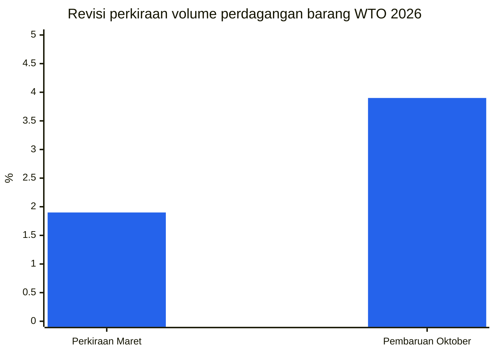

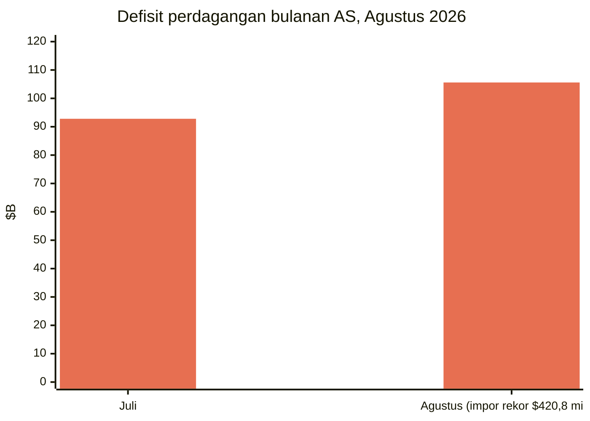

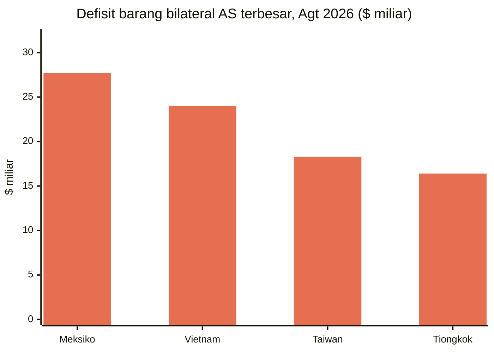

**Analisis.** Ketiga rilis itu menceritakan satu kisah dari tiga sudut: permintaan kuat (rekor impor AS), komposisinya sempit (barang AI mendorong hampir separuh pertumbuhan perdagangan; konsentrasi yang ditandai UNCTAD), dan geografinya selektif (perdagangan Tiongkok–AS turun lebih dari 20% sejak 2024 sementara Meksiko, Vietnam, dan Taiwan mengisi celah). Perbedaan antara optimisme volume WTO dan kehati-hatian riil UNCTAD — keuntungan nominal berbasis harga versus volume riil yang lemah — adalah bingkai analitis untuk kuartal ini. WEO IMF Oktober, yang akan terbit selama Pertemuan Tahunan Bangkok (12–18 Oktober), akan membawa penilaian simulasi tarif formal. ([bea.gov](https://www.bea.gov/news/2026/us-international-trade-goods-and-services-august-2026), [reuters.com](https://www.reuters.com/business/us-trade-deficit-widens-august-amid-strong-imports-2026-10-06/), [dig.watch](https://dig.watch/updates/wto-trade-outlook-ai-boom), [un.org](https://news.un.org/en/story/2026/10/1168566))

### 3.5 Tanah jarang: pemberlakuan kembali 10 November

**Apa yang terjadi.** Penangguhan Tiongkok atas kontrol ekspor tanah jarang yang diperluas akan berakhir **10 November 2026**, tanpa perpanjangan diumumkan. Kontrol April 2025 atas tujuh unsur tidak pernah ditangguhkan. AS meningkatkan daya tawarnya sendiri: Reuters melaporkan 1 Oktober bahwa Kementerian Perdagangan melambatkan lisensi ekspor suku cadang pesawat yang ditujukan ke Tiongkok, termasuk pengiriman ke COMAC milik negara, dan sedang mempertimbangkan aturan baru atas perizinan roda pendarat dan cairan hidraulik.

**Angka-angka kunci.**
- IEA memperingatkan implementasi penuh kontrol yang diperluas Tiongkok dapat menempatkan estimasi **$6,5 triliun/tahun** produksi hilir di luar Tiongkok dalam risiko.
- Tiongkok memasok 70% impor yttrium AS 2021–2024; ketergantungan impor bersih AS atas yttrium adalah 100% pada 2025.
- Respons Barat pekan ini: paket empat rancangan undang-undang kongres atas cadangan dan perizinan; American Rare Earths meningkatkan tambang Wyoming-nya 50%; Lindian Resources berkomitmen $150 juta untuk pusat pemrosesan Asia Tengah.

**Analisis.** Pemberlakuan kembali 10 November otomatis kecuali kedua pemerintah memperpanjang jeda mereka — tiga skenario membayangi: perpanjangan, reaktivasi selektif, atau pemulihan penuh. Janji KTT Mei 2026 Beijing untuk "menangani kekhawatiran AS" tidak menghasilkan perpanjangan formal, dan pengiriman tanah jarang belum kembali ke level yang disepakati. Janji putaran Beijing atas jalur hijau perizinan yang "lebih lancar, lebih terprediksi" untuk perusahaan Eropa akan diuji terhadap tanggal pemberlakuan kembali itu.

### 3.6 Lima belas ekonomi selaras atas kelebihan kapasitas — di luar WTO

**Apa yang terjadi.** Pada 7 Oktober, menteri perdagangan 15 ekonomi — AS, Argentina, Australia, Kanada, UE, Prancis, Jerman, India, Italia, Jepang, Korea Selatan, Meksiko, Polandia, Turkiye, dan Inggris — menandatangani Pernyataan Bersama Ministerial yang menyerukan tindakan untuk menghilangkan kelebihan kapasitas struktural dan kebijakan "non-pasar" yang mendorong kelebihan produksi. Ini tumbuh dari pertemuan Menteri Perdagangan G20 Milwaukee (30 September–1 Oktober), di mana tidak tercapai konsensus, dan disepakati di sela pertemuan Komite Perdagangan OECD. Pernyataan itu menjanjikan platform sektoral khusus, pertemuan teknis sebelum Desember, dan informasi bersama.

**Analisis.** Ini adalah pernyataan koalisi atas kelebihan kapasitas terbesar tahun ini dan melembagakan jalur pemantauan plurilateral non-WTO. Pihak yang tidak menandatangani sama pentingnya dengan yang menandatangani: Tiongkok, Rusia, Brasil, Indonesia, Arab Saudi, Afrika Selatan, dan Uni Afrika tidak menandatangani, dan Tiongkok memperingatkan pada 9 Oktober bahwa ia akan merespons "seperlunya" jika pernyataan itu digunakan sebagai dalih atas langkah yang merugikan kepentingannya. Absennya Brasil — anggota G20 besar yang menghadapi tarif Section 301 AS — patut dicatat. Pertemuan teknis pra-Desember kini menjadi titik pantau. ([reuters.com](https://www.reuters.com/business/some-g20-trade-ministers-sign-us-led-statement-denouncing-excess-factory-2026-10-07/))

### 3.7 Importir AS terus membeli: rekor boks September

**Apa yang terjadi.** Laporan Pelayaran Global Oktober Descartes (dirilis 8 Oktober) menunjukkan impor kontainer AS sebesar **2.546.261 TEU pada September** — rekor September tertinggi, naik 10,3% YoY (Reuters/Descartes; Descartes melaporkan penurunan 2,2% MoM vs Agustus). Impor asal Tiongkok 924.454 TEU — naik 4,5% MoM menurut Descartes, dan Reuters melaporkan +21,2% YoY — menyumbang 36,3% dari total volume. Kategori ritel (barang plastik, furnitur/peralatan tidur, mainan/barang olahraga) mendominasi pengiriman Tiongkok. Volume Jan–Sep 2026 naik 0,8% vs 2025 — keuntungan kumulatif pertama atas 2025 tahun ini. Penguat: Pelabuhan LA menangani rekor 1,04 juta TEU pada September (Gene Seroka, 9 Oktober); Pelabuhan Savannah rekor 504.015 TEU (+3,7% YoY, 7 Oktober). Global Port Tracker NRF memproyeksikan Agustus adalah bulan puncak 2026; impor "kemungkinan telah melewati masa tersibuk tahun ini" (JOC, 8 Oktober).

**Analisis.** Meski rezim tarif, permintaan impor AS tetap kuat — FT-900 dengan rekor impor Agustus $420,8 miliar dan rekor boks September Descartes mengarah sama: rantai pasok mengalihkan rute (kesenjangan bilateral Meksiko, Vietnam, Taiwan kini lebih besar dari Tiongkok) ketimbang reshoring. ([reuters.com](https://www.reuters.com/world/china/us-ocean-container-imports-set-new-record-september-descartes-says-2026-10-08/))

### 3.8 Udara dan darat: puncak yang lesu dengan satu pengecualian

**Kargo udara.** Data Xeneta menunjukkan volume kargo udara global tumbuh **+4% pada Oktober** melawan ekspektasi pasar yang datar, tetapi permintaan Eropa–Amerika Utara turun **−6% YoY** — "sinyal keras" dan kemungkinan pertanda awal. Pengiriman e-commerce Tiongkok–Eropa melonjak **+62% YoY** pada September sementara e-commerce Tiongkok–AS turun **−34%** (bulan kelima berturut-turut, mereda dari −49% pada Juni). TAC Index September: Hong Kong–Amerika Utara $7,02/kg (+31% YoY), Hong Kong–Eropa $4,80/kg (+8,8%); Baltic Air Freight Index naik 25,5% YoY. Biaya baru UE €3 per paket untuk pengiriman di bawah €150 membebani volume Asia–Eropa. Laporan Oktober Dimerco memprediksi kemacetan samudra dan kargo Tiongkok–AS yang tertahan dapat mendorong lebih banyak volume ke udara pada Q4; Xeneta melihat puncak yang lesu. Variabel liar: serangan ke bandara Saudi memangkas kapasitas kargo udara keluar Riyadh sepertiga menjelang puncak. ([airfreight.news](https://airfreight.news/articles/full/october-air-cargo-volumes-surprise-with-4-growth-but-is-europe-north-america-slump-a-bellwether-for-global-trade))

**Truk AS.** Tarif kontrak truk muatan penuh mencapai titik tertinggi 52 pekan sebesar **$2,72/mil** ditambah bahan bakar (+18% YoY); spot dry-van $3,55/mil all-in, ~50% di atas tahun lalu — didorong bahan bakar dan ketatnya kapasitas, bukan permintaan. Diesel mencapai $6,39/galon. Penolakan tender outbound ~13,75–14%. Kapasitas baru menyusut: traktor pada armada sewa baru turun menjadi 19.520 pada Agustus (−14% vs rata-rata H1); hanya ~2 dari 3 pendaftar antarnegara bagian baru membeli asuransi tanggung jawab (vs 9 dari 10 pada 2019). GRI 4,9% Old Dominion berlaku 5 Oktober; DHL Express menyusul FedEx pada GRI 5,9% 2027 (1 Januari). ([freightwaves.com](https://www.freightwaves.com/news/trucking-rates-spike-contracts-at-52-week-high))

---

## 4. Pelacak tarif

| Negara | Ukuran | Tarif | Tanggal berlaku | Status | Sumber |
|---|---|---|---|---|---|
| AS → Kanada | Tarif tambahan Section 338 | 50% (tanpa pengecualian USMCA) | 22 Agu 2026 (cakupan ulang 15 Sep) | Berlaku | [whitehouse.gov](https://www.whitehouse.gov/fact-sheets/2026/07/fact-sheet-president-donald-j-trump-imposes-additional-tariffs-on-canada/) |
| AS → Kanada | Larangan impor Section 338 (sepeda motor, whey, molase, bir nonalkohol, alkohol, susu) | Impor ditolak masuk (barang dalam transit: bea 50%) | 29 Sep 2026 | Berlaku | [asrwe.com](https://asrwe.com/asr-university/us-canada-import-ban-alcohol-motorcycles-section-338-expansion-september-2026) |
| AS → Kanada | Tarif kerja paksa Section 301 | 10% (dapat dihindari dengan klaim USMCA yang valid; barang non-USMCA yang tercakup menghadapi 50%+10%=60%) | 23 Jul 2026 | Berlaku; gugatan 25 negara bagian tertunda, belum ada putusan | [jdsupra.com](https://www.jdsupra.com/legalnews/forced-labor-meet-section-301-new-1432199/) |
| Kanada → AS | Tarif balasan atas ~335 pos tarif (baja, aluminium, susu, otomotif, peralatan rumah tangga, peralatan pertanian, kertas, plastik, elektronik) | 15% / 25% / 50% | 8 Sep 2026 | Berlaku | [surtaxscan.com](https://surtaxscan.com/news/canadas-counter-tariffs-are-back-15-25-and-50-on-335-us-tariff-items-from) |
| AS → Rusia | Tarif Bagian 112 Graham Act atas semua barang Rusia termasuk minyak bumi | Hingga 500% | Tenggat 18 Okt 2026 | Tertunda; pengecualian dimungkinkan | [mondaq.com](https://www.mondaq.com/unitedstates/export-controls-trade-investment-sanctions/1851398/the-lindsey-graham-sanctions-act-what-businesses-need-to-know-about-the-new-tariffs) |
| AS → pembeli energi Rusia terbesar (India, Tiongkok, Turkiye, lainnya) | Tarif sekunder Bagian 113 Graham Act | Hingga 100% (menumpuk di atas semua bea yang ada) | Tenggat 18 Okt 2026 | Tertunda; pengecualian presiden memerlukan sertifikasi tidak terklasifikasi kepada Kongres | [mondaq.com](https://www.mondaq.com/unitedstates/export-controls-trade-investment-sanctions/1851398/the-lindsey-graham-sanctions-act-what-businesses-need-to-know-about-the-new-tariffs) |
| AS → Rusia | Lisensi Umum 135 OFAC: impor diesel Rusia diotorisasi | n/a (lisensi) | 9 Okt 2026 – 7 Apr 2027 | Berlaku | [nationpress.com](https://www.nationpress.com/international/trump-buys-russian-diesel-before-graham-act-deadline) |
| Tiongkok → UE (p-nitrotoluene) | Penyelidikan antidumping (Pengumuman MOFCOM No. 44) | Marjin dumping diduga >100% (bea sementara akan ditetapkan) | Dibuka 3 Okt 2026; pendaftaran ditutup 23 Okt | Penyelidikan dibuka | [mlex.com](https://www.mlex.com/mlex/articles/2533700/china-opens-anti-dumping-probe-into-eu-para-nitrotoluene) |
| UE → Tiongkok | Moderasi ekspor hibrida/PHEV — "kesepahaman bersama" | Pembatasan ekspor sukarela (pemangkasan diklaim Šefčovič; tidak ada angka dalam teks Beijing) | Hasil diputuskan pada KTT UE 15–16 Okt | Menunggu dukungan politik | [eureporter.co](https://www.eureporter.co/world/china-2/2026/10/09/eu-and-china-strike-preliminary-trade-deal-ahead-of-crucial-leaders-summit/) |
| Inggris → Tiongkok | Tarif atas kendaraan listrik buatan Tiongkok | Hingga 45% (menyamai tarif gabungan UE) | Masih dipertimbangkan | Belum diputuskan ("sangat seimbang") | [fleetnews.co.uk](https://Www.fleetnews.co.uk/news/uk-weighs-chinese-car-tariffs-as-fleet-demand-for-evs-surges) |
| Brasil | Bea nol: mikrofon, alat musik, mesin jahit rumah tangga | 0% (dari 18–20%) | 1 Okt 2026 | Berlaku | [datamarnews.com](https://datamarnews.com/noticias/zero-import-tariffs-take-effect-for-musical-instruments-in-brazil/) |
| AS | Section 232 polisilikon & turunannya | MIP: $21/kg polisilikon, $100/kg wafer, $0,22/W sel, $0,38/W modul + 15% ad valorem | 4 Des 2026 (aturan anti-lonjakan berlaku sejak 22 Sep) | Terjadwal | [mondaq.com](https://www.mondaq.com/unitedstates/export-controls-trade-investment-sanctions/1848548/polysilicon-and-derivatives-in-the-bullseye-for-major-new-tariffs-and-other-restrictions) |
| AS → Tiongkok | Section 301 Daftar 2 & 3 (tindakan 2018) | 7,5%–25% | Berlaku (USTR menuntaskan tinjauan empat tahunan kedua 7 Okt, tarif berlanjut) | Berlaku | [internationaltradetoday.com](https://internationaltradetoday.com/article/2026/10/06/ustr-section-301-tariffs-from-2018-will-continue-2610060064?BC=bc_6ac595c738480) |
| AS → ~60 ekonomi | Tarif kerja paksa Section 301 | Tingkat 10% (17 ekonomi termasuk Kanada, India, Meksiko, Inggris); 12,5% sisanya; UE/Taiwan dibatasi 10% gabungan | 23 Jul 2026 | Berlaku; 3 gugatan tertunda | [jdsupra.com](https://www.jdsupra.com/legalnews/forced-labor-meet-section-301-new-1432199/) |
| AS → ~60 ekonomi (usulan TRQ) | Kuota tarif ASEAN (Bangladesh, Kamboja, Indonesia, Malaysia) untuk barang dengan input kapas/tekstil AS — pengecualian dari tarif kerja paksa Section 301 | akan ditetapkan | Masih dipertimbangkan | Tahap usulan | [asiadaily.org](https://asiadaily.org/news/14890/) |
| AS | Panduan BIS "kandungan AS": peralatan industri bergerak USMCA (Proklamasi 11032) — penurunan tarif 25% → lantai 15% di mana kandungan AS ≥40% | Tarif efektif lantai 15% | Berlaku 14 Okt 2026 (publikasi FR) | Terjadwal | [kpmg.com](https://kpmg.com/us/en/taxnewsflash/news/2026/10/us-bis-guidance-us-content-canadian-mexican-products.html) |
| India | Chromium trioxide — penetapan CVD final afirmatif | n/a | 8 Okt 2026 (ukuran AS) | Penetapan final diterbitkan | [federalregister.gov](https://www.federalregister.gov/documents/2026/10/08/2026-20696/chromium-trioxide-from-india-final-affirmative-countervailing-duty-determination) |
| Tiongkok | CBS (akselerator karet) — penetapan CVD pendahuluan afirmatif + keadaan kritis | n/a | 8 Okt 2026 (ukuran AS) | Penetapan pendahuluan diterbitkan | [federalregister.gov](https://www.federalregister.gov/documents/2026/10/08/2026-20692/n-cyclohexylbenzothiazole-2-sulfenamide-from-the-peoples-republic-of-china-preliminary-affirmative) |
| Tiongkok | Senyawa amina — penyelidikan AD/CVD dimulai (marjin diduga hingga 476%) | akan ditetapkan | Prelim ITC jatuh tempo 13 Nov 2026 | Penyelidikan dibuka | [federalregister.gov](https://www.federalregister.gov/documents/2026/10/05/2026-20286/amine-compounds-from-china-institution-of-antidumping-and-countervailing-duty-investigations-and) |
| Meksiko | Gerbong tangki kereta — penyelidikan AD/CVD dimulai | akan ditetapkan | Prelim ITC jatuh tempo 16 Nov 2026 | Penyelidikan dibuka | [federalregister.gov](https://www.federalregister.gov/documents/2026/10/05/2026-20349/railway-tank-cars-and-parts-thereof-from-mexico-institution-of-antidumping-and-countervailing-duty) |
| Jepang | Larangan ekspor yang diperluas atas barang untuk basis industri Rusia | Larangan ekspor | 16 Okt 2026 | Terjadwal | [globalsanctions.com](https://globalsanctions.com/2026/10/japan-adds-more-goods-to-russia-export-ban-from-16-october-2026/) |

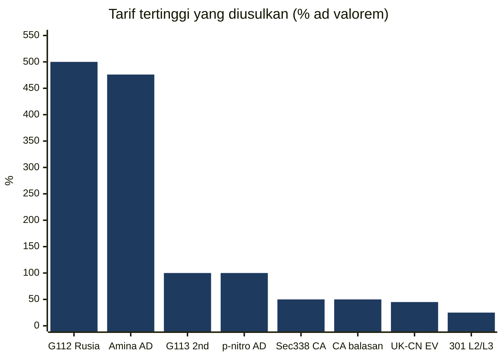
*Tarif maksimum yang dinyatakan ('hingga' bila masih berupa usulan; AD = margin dumping yang dituduhkan).*

---

## 5. Ulasan mendalam kebijakan AS

### AS–Kanada: kebuntuan dengan bayang-bayang hukum

Tidak ada proklamasi Section 338 baru yang diterbitkan dalam jendela ini. Ukuran yang berlaku: **tarif tambahan Section 338 sebesar 50%** atas barang Kanada (berlaku sejak 22 Agustus; set kedua berlaku 15 September mencakup kertas, furnitur, keju, kulit, perahu motor, kereta golf, baja, aluminium, dan produk logam dasar — bea berlaku terlepas dari asal USMCA; energi, potas, barang yang tercakup Section 232, ikan, dan mineral kritis dikecualikan); **larangan impor** berlaku 29 September atas sepeda motor, whey, molase, bir nonalkohol, alkohol, dan susu (sekitar $967 juta); **tarif balasan** Kanada **15%/25%/50%** atas sekitar C$27,6 miliar barang AS (baja, aluminium, susu, otomotif, peralatan rumah tangga, peralatan pertanian, kertas, plastik, elektronik) berlaku 8 September; dan arahan presiden 8 September kepada GSA (bersama USTR) untuk menghapus produk asal Kanada dari Jadwal Penghargaan Berganda GSA.

Perkembangan pekan ini: Institut Ekonomi Montreal menerbitkan catatan 8 Oktober (Phillip W. Magness) yang berargumen tarif balasan Kanada dapat melemahkan tantangan hukum AS atas tarif Section 338; komentar hukum terus berargumen Section 338 mungkin telah digantikan oleh Undang-Undang Ekspansi Perdagangan 1962 dan Undang-Undang Perdagangan 1974, menimbulkan isu pertanyaan besar dan nondelegation — tetapi **belum ada perkara pengadilan yang diajukan** yang secara langsung menantang tarif Section 338. Secara terpisah, **gugatan 25 negara bagian** atas tarif kerja paksa Section 301 Juli 2026 (tiga gugatan total menantang bea 10–12,5% atas ~60 ekonomi) **belum ada putusan tertulis per 4 Oktober**. Pada jalur perundingan, USTR Greer menyebut titik sengit Kanada yang tersisa (otomotif, susu, minuman beralkohol) "cukup sulit" dan mengatakan Washington "tidak cenderung" menuju tarif nol; Perdana Menteri Carney mengungkapkan Ottawa telah siap menghapus tarif balasan yang tersisa atas baja, aluminium, dan otomotif jika Washington menurunkan tarifnya secara substansial, dan mendorong provinsi mengembalikan alkohol AS ke rak — tetapi tidak akan mengubah sistem manajemen pasokan. Kanada memberi sinyal menahan diri ketimbang eskalasi lebih lanjut. ([iedm.org](https://www.iedm.org/counter-tariffs-the-federal-government-is-undermining-u-s-legal-challenges-to-section-338/), [akingump.com](https://www.akingump.com/en/insights/alerts/president-trump-directs-removal-of-canadian-products-from-federal-procurement), [hashtag investing](https://www.hashtaginvesting.com/blog/u-s-trade-chief-says-canadas-sticking-points-are-quite-difficult-and-washington-is-not-inclined-to-go-to-zero-tariff))

### Pengembalian IEEPA: Fase 3 dimulai

CBP membuka **Fase 3 proses pengembalian tarif IEEPA yang diperintahkan pengadilan** pada **6 Oktober** melalui platform klaim daringnya (CAPE). Importir terdaftar yang mengajukan nomor IOR-nya paling lambat 30 Juli 2026 dapat berpartisipasi. Pemerintah federal mengajukan banding atas bagian perintah Pengadilan Perdagangan Internasional yang mewajibkan pengembalian kepada importir terdaftar non-penuntut untuk entri yang dilikuidasi lebih dari 80 hari lalu; CBP menyatakan secara sukarela mengembalikan bea atas entri yang belum dilikuidasi dan entri dalam 80 hari setelah likuidasi. CBP menerima komentar publik tambahan atas pengumpulan informasi pengembalian hingga **4 November** (Reginfo.gov). Ini adalah eksekusi operasional atas ~$180 miliar pengembalian tarif IEEPA yang diperintahkan setelah pembatalan Mahkamah Agung Februari 2026 atas tarif "Hari Pembebasan"; cakupan keringanan bagi importir non-penuntut dengan entri likuidasi lama tetap dipersengketakan. Yale Budget Lab memperkirakan dorongan fiskal positif sementara dari pengembalian IEEPA kira-kira mengimbangi dampak pertumbuhan negatif dari tarif yang tersisa untuk 2026. ([thompsonhine.com](https://www.thompsonhine.com/insights/cbp-confirms-october-6-2026-launch-of-phase-3-of-the-ieepa-tariff-refund-process/))

### Operasi CBP

- **Biaya pengguna bea cukai FY2027 (berlaku 1 Oktober):** Biaya Pengguna Izin Broker Pabean naik dari $185,38 menjadi **$190,88**; tarif Biaya Pemrosesan Barang dagang tetap **0,3464%**, dengan batas minimum dan maksimum dinaikkan. ([ghy.com](https://www.ghy.com/trade-compliance/category/us-customs/))
- **Pengiriman bernilai rendah (RIN 1685-AA38):** CBP membuka konsultasi pada **8 Oktober** atas usulan perubahan persyaratan entri informal bea cukai untuk pengiriman bernilai rendah; komentar ditutup **7 Desember**. ([digitalpolicyalert.org](https://digitalpolicyalert.org/event/44472-customs-and-border-protection-opened-consultation-on-proposed-rule-on-low-value-shipments))
- **TRQ gula FY2027 (pembukaan 1 Oktober):** gula rafinasi dan gula khusus sama-sama kelebihan permintaan — alokasi pro rata **51,03027%** (rafinasi) dan **44,58212%** (khusus). ([ghy.com](https://www.ghy.com/trade-compliance/category/us-tariffs/))

### USTR

- **8 Oktober:** Mengaktifkan **Mekanisme Respon Cepat Ketenagakerjaan USMCA** untuk meninjau apakah pekerja di **GLM Components Mexico, S.A. de C.V.** (Puebla; suku cadang otomotif) ditolak kebebasan berserikat dan hak perundingan bersama; AS telah **menangguhkan likuidasi** entri belum dilikuidasi barang dari fasilitas itu. ([ustr.gov](https://ustr.gov/about/policy-offices/press-office/press-releases/2026))
- **7 Oktober:** Mengumpulkan pejabat senior **14 ekonomi** di sela Komite Perdagangan OECD; menerbitkan pernyataan bersama ministerial tentang kelebihan kapasitas struktural — pendahulu pernyataan 15 ekonomi (lihat §3.6).
- **5 Oktober:** Duta Besar Greer menjadi tuan rumah **Menteri Perdagangan G20** di Milwaukee; diskusi mencakup eliminasi kerja paksa, pembaruan prinsip MFN, penolakan persenjataan perdagangan pangan, dan kelebihan kapasitas.
- **Tinjauan empat tahunan Section 301 (tindakan 2018):** USTR mengumumkan tinjauan empat tahunan kedua atas tindakan Section 301 6 Juli 2018 dan 23 Agustus 2018 (Daftar 2 dan 3 Tiongkok) berakhir dengan tarif **tetap berlaku** — bea tambahan umumnya 7,5% hingga 25%, beberapa lebih tinggi setelah modifikasi kemudian (pemberitahuan Federal Register terbit 7 Oktober).
- **Tinjauan bersama USMCA 2027:** komentar dan permintaan dengar pendapat jatuh tempo **12 Januari 2027**.
- **Usulan kuota tarif ASEAN:** USTR mempertimbangkan TRQ tiga tahun untuk Bangladesh, Kamboja, Indonesia, dan Malaysia yang dapat mengecualikan produk yang mengandung input kapas dan tekstil AS dari tarif kerja paksa Section 301 — masih dipertimbangkan. Malaysia berpegang pada Perjanjian Perdagangan Timbal Balik Oktober 2025 (tarif 19%); Indonesia memperlakukan pakta "Zaman Keemasan Baru" Februari 2026 sebagai mengikat; Thailand sedang menilai; Vietnam memanfaatkan kedekatan diplomatik. ([asiadaily.org](https://asiadaily.org/news/14890/))
- **Brasil:** setelah pertemuan 30 September dengan Greer, negosiator Brasil Rosa mengatakan Brasil menginginkan penurunan tarif penuh — termasuk atas tarif baja, aluminium, dan suku cadang otomotif Section 232 — dan kedua pihak sepakat menunjuk kelompok kerja untuk menentukan cakupan isu dagang; ia menyebut tarif Section 301 25% khusus Brasil "tarif paling buruk." ([internationaltradetoday.com](https://internationaltradetoday.com/article/2026/10/01/brazil-expresses-confidence-it-can-reach-tariff-reduction-agreement-2610010041))

### BIS — kontrol ekspor

- **Panduan "kandungan AS" (publikasi FR terjadwal 14 Oktober):** menentukan cara menghitung "kandungan AS" untuk produk Kanada dan Meksiko yang memenuhi syarat perlakuan preferensial USMCA di bawah proklamasi logam Section 232 11032 — (1) nilai suku cadang yang sepenuhnya diperoleh, seluruhnya diproduksi, atau secara substansial ditransformasi di AS; (2) sejauh belum dihitung, nilai baja yang dilebur dan dituang, aluminium yang dilebur dan dicetak, dan tembaga yang dilebur dan dicetak di AS. Kedua metodologi tidak dapat digabungkan. Efek praktis: importir peralatan industri bergerak USMCA yang memenuhi syarat (forklift, grader, crane, backhoe, buldoser) dapat menurunkan tarif Section 232 dari **25% ke lantai efektif 15%** di mana setidaknya 40% nilai merupakan kandungan AS; subpos HTS baru **9903.82.22** melaporkan kandungan non-AS (atau kandungan AS melebihi 40%), sementara 9903.82.21 mencakup kandungan AS yang memenuhi syarat hingga 40%. ([kpmg.com](https://kpmg.com/us/en/taxnewsflash/news/2026/10/us-bis-guidance-us-content-canadian-mexican-products.html))
- **Aturan Afiliasi:** penangguhan aturan yang memperluas pembatasan Entity List/MEU/SDN ke afiliasi asing yang 50%+ dimiliki pihak tercantum tetap berlaku, dengan pemberlakuan kembali terjadwal **10 November** kecuali diperpanjang. Kesepakatan AS–Tiongkok 23 September yang memperpanjang kerangka Busan hingga 10 Januari 2027 diperkirakan membawa perpanjangan yang cocok, tetapi **belum ada pemberitahuan Federal Register** yang diterbitkan. Penasihat dagang menyarankan bersiap dengan asumsi aturan itu dapat kembali. ([jdsupra.com](https://www.jdsupra.com/legalnews/bis-affiliates-rule-suspension-extended-1084647/))
- **Lisensi suku cadang pesawat ke COMAC:** Reuters melaporkan 1 Oktober (sumber tanpa nama) bahwa Kementerian Perdagangan melambatkan lisensi ekspor suku cadang pesawat yang ditujukan ke Tiongkok, termasuk pengiriman ke COMAC milik negara, dan sedang mempertimbangkan aturan baru atas perizinan roda pendarat dan cairan hidraulik. ([investornews.com](https://investornews.com/critical-minerals-rare-earths/technology-metals-report-10-04-2026-a-summit-without-a-rare-earth-deal-leaves-the-west-buying-its-way-to-supply/))

### Federal Register — AD/CVD, 5–8 Oktober

Penyelidikan AD/CVD baru dimulai atas **senyawa amina dari Tiongkok** (marjin dumping diduga hingga 476%; prelim ITC jatuh tempo 13 November) dan **gerbong tangki kereta api dan sukucadangnya dari Meksiko** (prelim ITC jatuh tempo 16 November); **penetapan CVD final afirmatif** atas chromium trioxide dari India; **penetapan CVD pendahuluan afirmatif + keadaan kritis** atas CBS dari Tiongkok; hasil prelim tinjauan AD atas rebar dari Turkiye; niat prelim untuk membatalkan tinjauan AD atas matras dari Polandia; tinjauan sunset lima tahunan terjadwal atas pipa seamless (Rusia, Korea Selatan, Ceko, Ukraina); jadwal revisi atas kotak karton die-cut bergelombang (Tiongkok, Malaysia, Turkiye). Tabel lengkap di §4. ([federalregister.gov](https://www.federalregister.gov/documents/2026/10/05/2026-20286/amine-compounds-from-china-institution-of-antidumping-and-countervailing-duty-investigations-and))

### Butir-butir berjalan

- **Polisilikon Section 232:** tidak berubah. Efektivitas 4 Desember berlaku (MIP $21/kg polisilikon, $100/kg wafer, $0,22/W sel, $0,38/W modul; 15% ad valorem atas turunannya; pembatasan anti-lonjakan berlaku 22 September–4 Desember). Harga median modul AS mencapai $0,38/W pada akhir September, naik ~40,7% dari $0,27/W pada Agustus.
- **Gencatan senjata AS–Tiongkok:** perpanjangan kerangka Busan hingga **10 Januari 2027** berlaku; Gedung Putih belum mendokumentasikannya secara formal. Pengiriman tanah jarang belum kembali ke level yang disepakati; kontrol April 2025 atas tujuh unsur tanah jarang tidak pernah ditangguhkan. Pengecualian Section 301 untuk 178 produk Tiongkok berakhir 10 November.
- **"30-untuk-30" AS–Tiongkok:** kedua pemerintah menerbitkan daftar keringanan tarif timbal balik pada 28 September (~$30 miliar masing-masing pihak di bawah kerangka Dewan Perdagangan AS–Tiongkok); portal Inggris MOFCOM memuat informasi yang diterbitkannya atas kerangka tersebut.

---

## 6. Kebijakan dunia per kawasan

### Eropa

- **UE–Tiongkok:** lihat §3.1. Secara paralel, **usulan Prancis-Jerman reaksi-cepat** (5 Oktober) meminta Komisi instrumen melawan "praktik distorsi pasar sistemik" — dumping, subsidi meluas, pembatasan konvertibilitas mata uang — dengan pejabat Jerman menyebut alat "sekuat tarif Section 301 yang dikenakan Amerika Serikat atau pembatasan Tiongkok atas ekspor mineral kritis." Usulan itu menyerukan alat pertahanan dagang yang lebih cepat, lebih banyak penyelidikan, pendekatan sektoral yang lebih luas (menandai bahan kimia, PET, dan kendaraan hibrida), ditambah dua instrumen tambahan atas diversifikasi dan keamanan ekonomi. Komisi menyambut surat itu; para pemimpin UE membahasnya pada KTT 15 Oktober. MOFCOM secara publik menanggapi laporan media atas usulan "Section 301 versi Eropa" itu. ([lapost.com](https://www.lapost.com/content/france-germany-propose-new-rapid-eu-trade-response-tool))
- **Inggris:** pemerintah sedang menyusun potensi paket tarif **hingga 45%** atas kendaraan listrik buatan Tiongkok, menyamai tarif gabungan UE — Menteri Bisnis Reynolds kini menyebut keputusan itu "sangat seimbang" setelah mengatakan kepada Auto Express pada September bahwa Inggris tidak berencana menaikkan tarif. Brussels memberi sinyal produk Inggris dapat dikecualikan dari manfaat kebijakan industri "Made in Europe" jika Inggris tidak selaras; 58% ekspor otomotif Inggris menuju UE vs ~4% ke Tiongkok; merek Tiongkok meraih lebih dari 15% registrasi mobil baru Inggris pada delapan bulan pertama 2026 (223.000 mobil), naik dari 4% pada 2023. Juru bicara DBT mengatakan tidak ada tarif yang diberlakukan dan tidak ada keputusan final. ([fleetnews.co.uk](https://Www.fleetnews.co.uk/news/uk-weighs-chinese-car-tariffs-as-fleet-demand-for-evs-surges), [britishchambers.org.uk](https://www.britishchambers.org.uk/news/2026/10/eu-china-trade-talks-what-the-outcome-means-for-uk-business/))
- **Berkas dagang digital:** **Perjanjian Dagang Digital UE–Korea Selatan** menghadapi tenggat amandemen MEP 8 Oktober (aturan arus data, perlindungan kode sumber, larangan permanen bea cukai atas transmisi elektronik); **KTT UE–Kanada di Montréal (29–30 Oktober)** diperkirakan menyelesaikan negosiasi Perjanjian Dagang Digital dan paket kerja sama mineral/persaingan; Komisi telah mengajukan usulan penandatanganan untuk **FTA UE–India** dengan bab digital. ([euperspectives.eu](https://euperspectives.eu/2026/10/eu-south-korea-digital-trade-deal-raise-debate-over-data-sovereignty/), [dig.watch](https://dig.watch/updates/eu-canada-digital-trade-ai), [globallawexperts.com](https://globallawexperts.com/eu-india-fta-digital-trade/))
- **FTA UE–Indonesia:** negosiasi teknis berakhir September 2025; teks hukum (menghapus tarif atas sebagian besar barang dengan pengamanan dan kuota untuk barang sensitif) dalam tinjauan kelembagaan, dengan penandatanganan formal diperkirakan sebelum akhir tahun anggaran UE 2026. Negosiasi dengan Filipina, Thailand, dan Malaysia pada tahap lanjut. ([lupicinio.com](https://lupicinio.com/en/international-trade-%c2%b7-august-and-september-2026/))
- **Parlemen Eropa:** memilih pada 7 Oktober untuk mengecam praktik ekonomi Tiongkok dan posisinya terhadap Ukraina.

### Tiongkok

- **Penyelidikan antidumping p-nitrotoluene** (dibuka 3 Oktober; lihat §4). MOFCOM mencatat UE telah membuka **28 penyelidikan remedial dagang** terhadap Tiongkok sejak 2025, sekitar separuhnya melibatkan bahan kimia, dan menyerukan sengketa diselesaikan melalui dialog.
- **Graham Act:** Beijing menolak "yurisdiksi lengan panjang" dan campur tangan dalam kerja sama dagang normal, menentang sanksi unilateral tanpa mandat Dewan Keamanan PBB, dan mencadangkan hak melindungi perusahaannya (Kementerian Luar Negeri, 19 September, ditegaskan dalam pemberitaan pekan ini). Tiongkok adalah pembeli minyak mentah Rusia terbesar kedua pada 2025 dengan ~1,3 juta barel/hari.
- **Pernyataan kelebihan kapasitas:** MOFCOM mengatakan 9 Oktober bahwa Tiongkok akan merespons "seperlunya" jika pernyataan 15 ekonomi digunakan sebagai dalih atas langkah yang merugikan kepentingan Tiongkok; Tiongkok tidak menandatangani.
- **Portal Inggris MOFCOM** dapat dijangkau pada 12 Oktober (http://english.mofcom.gov.cn/), memuat respons juru bicara atas usulan Prancis-Jerman dan informasi "30-untuk-30" yang diterbitkannya.

### India

- **Perundingan kesepakatan dagang AS "mencapai titik jenuh"** (Menteri Keuangan Sitharaman, 5 Oktober); konsesi lebih lanjut mungkin sulit. MEA memperingatkan 17 September bahwa Graham Act dapat berimplikasi "bukan hanya bagi hubungan bilateral tetapi juga pasar energi internasional," dan menekankan keamanan energi untuk 1,4 miliar orang. Menteri Perminyakan Puri menunjuk opsi diversifikasi (Guyana, Brasil, Kanada, Suriname, Namibia). India adalah pembeli minyak mentah Rusia terbesar pada 2025 dengan ~1,6 juta barel/hari.
- India bergabung dengan **pernyataan kelebihan kapasitas 15 ekonomi** (7 Oktober) dan termasuk di antara 16 ekonomi yang tercakup penyelidikan Section 301 kelebihan kapasitas Maret 2026 USTR. Sengketa WTO atas tarif ICT-nya dengan Chinese Taipei ditunda hingga 27 Oktober.

### Turkiye

- Tidak ada pernyataan pemerintah Turki baru atas Graham Act yang teridentifikasi pekan ini (Turkiye: ~282.000 barel/hari minyak mentah Rusia pada 2025, pembeli tingkat ketiga). Turkiye menandatangani pernyataan kelebihan kapasitas 15 ekonomi.

### Kanada

- **Tidak ada tindakan pembalasan baru** 5–12 Oktober. Tarif balasan cermin 15%/25%/50% Kanada (berlaku 8 September, ~C$27,6 miliar) tetap; tarif baja dan aluminium dinaikkan dari 25% menjadi 50% untuk menyamai tarif AS; barang dalam transit pada 8 September dikecualikan; tarif balasan otomotif yang ada berlanjut. Ottawa mengumumkan paket dukungan pekerja dan bisnis **C$7,5 miliar**. Kebuntuan negosiasi berlanjut (Greer: titik sengit "cukup sulit"; Carney: manajemen pasokan tidak dapat dinegosiasikan).

### Brasil

- **Bea nol** atas mikrofon, alat musik, dan mesin jahit rumah tangga berlaku 1 Oktober (Resolusi Gecex/Camex No. 926/2026; bea sebelumnya mencapai 18–20%). Brasil menyetujui **kelompok kerja dengan USTR** (30 September) untuk menentukan cakupan perjanjian penurunan tarif; Rosa menyebut tarif Section 301 25% khusus Brasil "tarif paling buruk."

### Jepang

- Mengubah Perintah Kontrol Perdagangan Ekspor pada 6 Oktober untuk menambah barang ke larangan ekspor Rusianya yang mencakup barang yang dapat memperkuat basis industri Rusia; berlaku **16 Oktober** — sehari sebelum tenggat Graham Act. ([globalsanctions.com](https://globalsanctions.com/2026/10/japan-adds-more-goods-to-russia-export-ban-from-16-october-2026/))

### ASEAN dan Australia

- **Usulan TRQ ASEAN:** lihat §5 (USTR mempertimbangkan TRQ tiga tahun untuk Bangladesh, Kamboja, Indonesia, dan Malaysia untuk barang yang mengandung input kapas/tekstil AS).
- **Australia:** DFAT menolak bergabung dengan pernyataan pimpinan Inggris oleh 12 pemerintah yang mempertimbangkan atau berkomitmen pada pembatasan dagang dengan bisnis Israel di permukiman Tepi Barat, dengan alasan tantangan praktis; ia mengatakan sedang mengejar tindakan tertarget lebih lanjut dengan mitra (akhir September; satu-satunya posisi pembatasan dagang Australia yang dilaporkan pekan ini).

### Multilateral

- **Dewan Umum WTO (5–6 Oktober):** anggota mengadakan pertemuan reformasi dua hari; DG Okonjo-Iweala mendesak beralih dari proses ke substansi. Reformasi penyelesaian sengketa: Ketua DSB Duta Besar Patriota (Brasil) akan melanjutkan konsultasi informal; hampir 60 pembicara mengambil giliran. Subsidi perikanan: anggota didesak menghindari "penghentian" perjanjian; gagasan baru diminta di pertanian. Perjanjian Perdagangan Elektronik: mayoritas luas mendukung prediktabilitas dagang digital, tetapi ada pertanyaan atas fondasi hukum, penggunaan sumber daya WTO, dan peran penyimpan DG. Fasilitasi Investasi untuk Pembangunan: partisipasi meluas menjadi **131 anggota**. MC15: tanggal belum ditetapkan. ([logisticsnews.ph](https://logisticsnews.ph/2026/10/07/wto-members-urged-to-move-from-process-to-substance-as-general-council-tackles-reform-and-future-ministerial-preparations/))
- **Sengketa WTO:** **panel CBAM (DS639, Rusia vs UE)** dibentuk 25 September atas permintaan kedua Rusia, dengan **India sebagai pihak ketiga**; UE akan berpartisipasi sambil menolak keterlibatan langsung dengan Rusia; Badan Banding tetap tidak dapat mendengar banding. Pertimbangan laporan panel **sengketa EV Turkiye–Tiongkok (DS629)** ditunda hingga 27 Oktober atas permintaan bersama para pihak; pengesahan putusan **tarif ICT India–Chinese Taipei** ditunda hingga 27 Oktober. Kolombia dan 130 anggota mendorong untuk ke-110 kalinya untuk memulai seleksi Badan Banding; AS kembali menyampaikan kekhawatiran. Kamboja diterima ke MPIA. ([reuters.com](https://www.reuters.com/world/wto-dispute-body-agrees-to-russias-panel-request-eu-carbon-border-levy-2026-09-25/))
- **Laporan Perdagangan dan Pembangunan UNCTAD 2026** (9 Oktober): lihat §3.4. Analisis konteks tarif UNCTAD (17 September) menemukan tarif AS melonjak dari rata-rata 2,8% sebelum 2025 menjadi lebih dari 20% pada awal September; 16 negara berkembang (termasuk 5 LDC) kini menghadapi tarif di atas 25%; rata-rata tertimbang dagang tarif LDC berlipat ganda menjadi 19% selama periode jeda dan naik menjadi 27% pada September; negara berkembang Asia-Oseania naik dari 3% menjadi 21%; Amerika Latin dan Karibia dari di bawah 0,5% menjadi 18%. ([un.org](https://news.un.org/en/story/2026/10/1168566))
- **WCO:** **amendemen HS 2028** dirilis — 299 set perubahan menghasilkan 1.229 pos dan 5.852 subpos (6 pos baru, 428 subpos baru dibuat; 5 pos, 172 subpos dihapus), berfokus pada kesiapan darurat kesehatan, respons epidemi, dan perlindungan lingkungan; mulai berlaku **1 Januari 2028**, dengan jendela implementasi dua tahun — ditandai pekan ini sebagai tenggat kunci ke depan bagi tim klasifikasi tarif. Program Aturan Asal UE–WCO Afrika mengadakan lokakarya akhir Training of Trainers untuk Asosiasi Produsen Kenya (dibuka 1 Oktober). ([wcoesarocb.org](https://www.wcoesarocb.org/wco-and-partners-strengthen-rules-of-origin-expertise-to-support-trade-and-industrialisation/))
- **ITC:** tidak ada rilis Trade Map atau statistik dagang baru tertanggal 5–12 Oktober yang teridentifikasi dari pemberitaan publik.

---

## 7. Tindakan penegakan

| Tindakan | Sasaran | Tanggal | Status | Sumber |
|---|---|---|---|---|
| Perintah Penahanan Pelepasan (kerja paksa) | Mitra Aneka Rezeki (MAR), Hardaya Inti Plantation (HIP) — minyak sawit dan turunannya Indonesia | 29 Sep 2026 | Berlaku; 60 WRO aktif + 8 Temuan total | [thompsonhine.com](https://www.thompsonhine.com/insights/cbp-issues-withhold-release-orders-on-two-indonesian-palm-oil-producers/) |
| Sanksi AS (OFAC) | 22 kapal tanker plus individu/perusahaan terkait perdagangan minyak Iran | 8 Okt 2026 | Ditetapkan | [gcaptain.com](https://gcaptain.com/category/news/) |
| Sanksi AS (OFAC GL135) | Mengotorisasi impor diesel Rusia | 9 Okt 2026 – 7 Apr 2027 | Berlaku | [nationpress.com](https://www.nationpress.com/international/trump-buys-russian-diesel-before-graham-act-deadline) |
| Sanksi Inggris | 5 kapal LNG (pengetatan terkait Sovcomflot bersama Jepang) | 1 Okt 2026 | Ditetapkan | [hellenicshippingnews.com](https://www.hellenicshippingnews.com/category/shipping-news/international-shipping-news/) |
| Kontrol ekspor Jepang | Larangan ekspor Rusia yang diperluas | 16 Okt 2026 | Mulai berlaku | [globalsanctions.com](https://globalsanctions.com/2026/10/japan-adds-more-goods-to-russia-export-ban-from-16-october-2026/) |
| Larangan impor AS (Section 338) | Sepeda motor, whey, molase, bir nonalkohol, alkohol, susu Kanada (~$967 juta) | 29 Sep 2026 | Berlaku | [asrwe.com](https://asrwe.com/asr-university/us-canada-import-ban-alcohol-motorcycles-section-338-expansion-september-2026) |
| Mekanisme Respon Cepat USTR | GLM Components Mexico (Puebla; suku cadang otomotif) — likuidasi ditangguhkan | 8 Okt 2026 | Tinjauan dibuka | [ustr.gov](https://ustr.gov/about/policy-offices/press-office/press-releases/2026) |
| CBP | Proses pengembalian IEEPA Fase 3 (CAPE) | 6 Okt 2026 | Dibuka; komentar jatuh tempo 4 Nov | [thompsonhine.com](https://www.thompsonhine.com/insights/cbp-confirms-october-6-2026-launch-of-phase-3-of-the-ieepa-tariff-refund-process/) |

**Detail WRO (MAR/HIP):** perintah CBP 29 September mencakup minyak sawit dan turunannya dari Mitra Aneka Rezeki dan Hardaya Inti Plantation. Informasi yang ditinjau: wawancara pekerja, slip gaji, kuota panen, foto, laporan LSM/pemerintah, media berita, penelitian akademis. Pekerja di MAR menunjukkan **sembilan** indikator kerja paksa ILO (termasuk penahanan dokumen identitas dan isolasi); HIP menunjukkan **tujuh** (jeratan utang, penahanan upah, penipuan, lembur berlebihan, intimidasi, kondisi yang menyiksa, penyalahgunaan kerentanan). Penahanan segera di semua pelabuhan AS; importir dapat mengekspor, memusnahkan, atau membuktikan sumber yang bersih.

---

## 8. Rilis data

| Rilis | Tanggal | Angka utama | Sumber |
|---|---|---|---|
| Census/BEA FT-900 — perdagangan AS, Agu 2026 | 6 Okt | Defisit $105,6 miliar (+13,7%); impor rekor $420,8 miliar; defisit Jan–Agu −19,9% y/y | [bea.gov](https://www.bea.gov/news/2026/us-international-trade-goods-and-services-august-2026) |
| WTO Global Trade Outlook and Statistics (pembaruan Okt) | 8 Okt | Volume barang +3,9% pada 2026 (dari 1,9%), +4,1% pada 2027; jasa dipangkas menjadi 3,3%; barang AI 47% dari pertumbuhan perdagangan | [dig.watch](https://dig.watch/updates/wto-trade-outlook-ai-boom) |
| Laporan Perdagangan dan Pembangunan UNCTAD 2026 | 9 Okt | Rekor $35 triliun perdagangan dunia pada 2025; PDB global 2,6% pada 2026; Asia 60% dari pertumbuhan; India 7,3% | [un.org](https://news.un.org/en/story/2026/10/1168566) |
| Pembaruan Perdagangan Global UNCTAD (prospek tengah tahun) | Okt (jendela) | Pertumbuhan perdagangan barang 1,5–2,5% pada 2026 secara riil (dari 4,7% pada 2025) | [gtreview.com](https://www.gtreview.com/news/global/global-goods-trade-growth-could-slow-to-1-5-in-2026-unctad/) |
| Prospek Ekonomi Dunia IMF (laporan penuh) | Jatuh tempo 12–18 Okt (Pertemuan Tahunan Bangkok) | Prarilis 6 Okt: krisis biaya hidup menambah 23 juta orang di bawah garis kemiskinan ekstrem 2021–24; baseline ~3% pertumbuhan global pada 2026 | [reuters.com](https://www.reuters.com/world/asia-pacific/cost-of-living-crises-have-lasting-impact-inflation-expectations-poverty-imf-2026-10-06/) |
| ECB — neraca pembayaran kawasan euro, Q2 2026 | 2 Okt | Rekening berjalan €265 miliar (1,6% dari PDB); surplus bahan kimia/mesin menyusut; defisit energi kembali tercatat | [ecb.europa.eu](https://www.ecb.europa.eu/press/stats/bop/2026/html/ecb.bq261002~5e0dd6a1f4.en.html) |
| Destatis — perdagangan luar negeri Jerman, Agu 2026 | 8 Okt | Ekspor −0,8% m/m; surplus €19,5 miliar; penurunan bulanan kedua berturut-turut | [destatis.de](https://www.destatis.de/EN/Press/2026/10/PE26_356_51.html) |
| Tax Foundation — Pelacak Tarif Trump (edisi Sep 2026) | Pelacak hidup | 54% impor barang AS terdampak; tarif terapan 11,7%, efektif 7,2%; pendapatan bea $151,5 miliar pada 2026, ~$1,5 triliun 2026–2035; ~$820/rumah tangga (2026); PDB jangka panjang −0,4% | [taxfoundation.org](https://www.taxfoundation.org/research/all/federal/trump-tariffs-trade-war/) |
| Tax Foundation — Opsi Mereformasi Kode Pajak Amerika 3.0 | Liputan 8 Okt | Cabut semua tarif, ganti dengan PPN; pencabutan akan kehilangan ~$1,8 triliun hingga 2036 | [rethinking65.com](https://rethinking65.com/repealing-tariffs-and-imposing-a-value-added-tax-would-boost-the-economy-and-federal-revenues-the-tax-foundation-says/) |
| Yale Budget Lab — Kondisi Tarif AS | Pelacak hidup | Tarif statutori 11,0% kini, 11,8% akhir tahun; ~0,7% dampak harga konsumen; ~$1.100/rumah tangga; ~$1,9 triliun selama sepuluh tahun; ~875.000 orang lebih banyak dalam kemiskinan | [budgetlab.yale.edu](https://budgetlab.yale.edu/research/state-us-tariffs) |
| UN Comtrade | Catatan metodologi saja | IMTS 2026 White Cover; panduan perdagangan lintas batas — tidak ada edisi dataset baru 5–12 Okt | [uncomtrade.org](https://uncomtrade.org/docs/its-publication-list/) |
| USITC DataWeb / USA Trade Online | Penyegaran bulanan rutin | Detail Agustus 2026 kini dapat dikueri | |

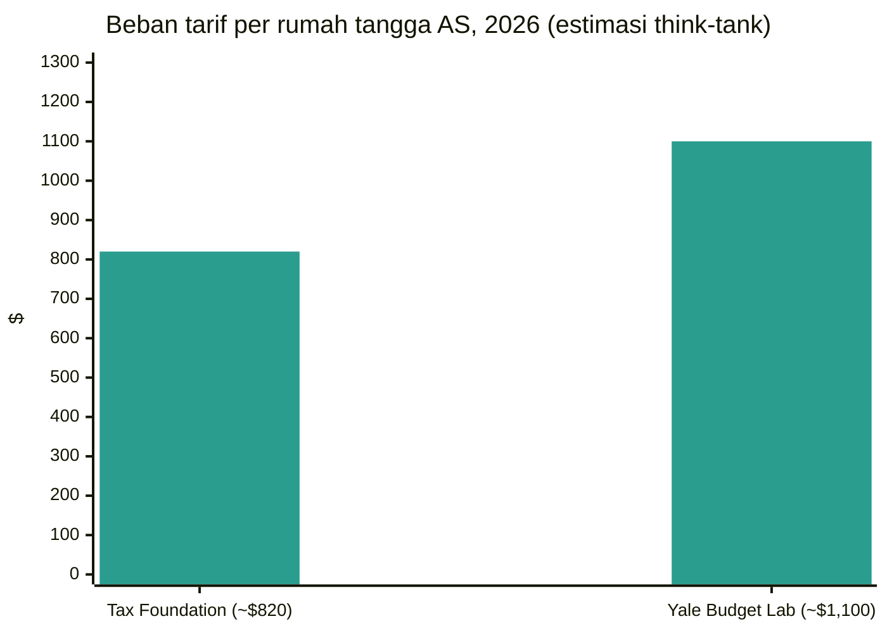

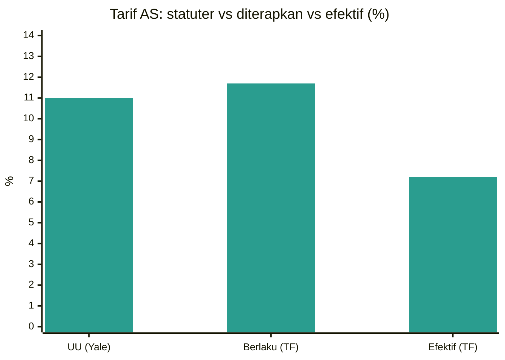
*Estimasi Yale Budget Lab dan Tax Foundation, 2026. TF = Tax Foundation.*

**Analisis.** Pasangan think-tank itu membingkai debat biaya rumah tangga: $820 Tax Foundation dan $1.100 Yale adalah dua angka yang dikutip jurnalis, berbeda dalam perlakuan tarif statutori-vs-efektif dan mekanika pengembalian IEEPA. Analisis pasca-SCOTUS Yale adalah sintesis hukum-berlaku paling lengkap — kekacauan pengembalian menciptakan "efek pendapatan besar" yang kira-kira mengimbangi hambatan pertumbuhan 2026 dari tarif yang tersisa, dengan biaya jangka panjang yang persisten 0,1% dari PDB (~$30 miliar per tahun). Argumen sepanjang buku Tax Foundation — cabut semua tarif dan ganti dengan PPN — adalah artikulasi alternatif kebijakan paling jelas dalam siklus ini. Perbedaan WTO–UNCTAD (optimisme volume vs kehati-hatian riil) adalah bingkai analitis untuk membaca arus data musim gugur.

---

## 9. Pasar angkutan

### Tarif spot kontainer — Drewry World Container Index

Drewry World Container Index menutup penilaian Kamis **8 Oktober** pada **$4.351 per kontainer 40 kaki, turun 2% dibandingkan pekan sebelumnya** — dikaitkan dengan melemahnya permintaan pada perdagangan Transpasifik dan Asia–Eropa selama Pekan Emas Tiongkok. Penilaian sebelumnya (1 Oktober) ditutup pada $4.434, turun 1%. Kepala analis Xeneta Peter Sand mengatakan 1 Oktober menandai puncak pasca-krisis Hormuz: spot Timur Jauh–Pantai Barat AS mencapai $8.346/FEU, Pantai Timur $11.523/FEU — lebih dari empat kali level pra-krisis 28 Februari. Tarif Asia–Eropa kini turun selama **13 pekan berturut-turut**; Drewry mengidentifikasi kembalinya ke Suez yang lebih cepat dari perkiraan sebagai ancaman utama atas upaya operator mendukung tarif. Drewry memperkirakan tarif tetap stabil pada pekan mendatang, mencatat upaya operator menaikkan tarif FAK Asia–Eropa pada paruh kedua Oktober dan kemungkinan pemulihan ke AS setelah liburan di bawah gencatan senjata AS–Tiongkok yang diperpanjang.

| Rute (40 kaki) | 8 Okt 2026 | Perubahan w/w | Sumber |
|---|---|---|---|
| Komposit WCI | $4.351 | −2% | [Drewry](https://www.drewry.co.uk/supply-chain-advisors/supply-chain-expertise/world-container-index-assessed-by-drewry) |
| Shanghai → Rotterdam | $3.337 | −2% | [Drewry](https://www.drewry.co.uk/supply-chain-advisors/supply-chain-expertise/world-container-index-assessed-by-drewry) |
| Shanghai → Genoa | $3.696 | tidak berubah | [Drewry](https://www.drewry.co.uk/supply-chain-advisors/supply-chain-expertise/world-container-index-assessed-by-drewry) |
| Shanghai → Los Angeles | $7.624 | −3% | [Drewry](https://www.drewry.co.uk/supply-chain-advisors/supply-chain-expertise/world-container-index-assessed-by-drewry) |
| Shanghai → New York | $10.220 | −2% | [Drewry](https://www.drewry.co.uk/supply-chain-advisors/supply-chain-expertise/world-container-index-assessed-by-drewry) |
| Rotterdam → New York (per FEU) | $3.091 | −1% | [Shipping Telegraph](https://shippingtelegraph.com/freight-news/drewry-the-world-container-index-decreased-2-in-week-41-2026/) |
| Angkutan balik Rotterdam → Shanghai | $628 | +2% | [Shipping Telegraph](https://shippingtelegraph.com/freight-news/drewry-the-world-container-index-decreased-2-in-week-41-2026/) |

Jumlah pelayaran kosong (Drewry Container Capacity Insight): Transpasifik — empat pelayaran kosong diumumkan untuk pekan mendatang, turun dari sebelas pekan ini (kapasitas meningkat); Asia–Eropa — enam diumumkan untuk pekan depan, naik dari lima.

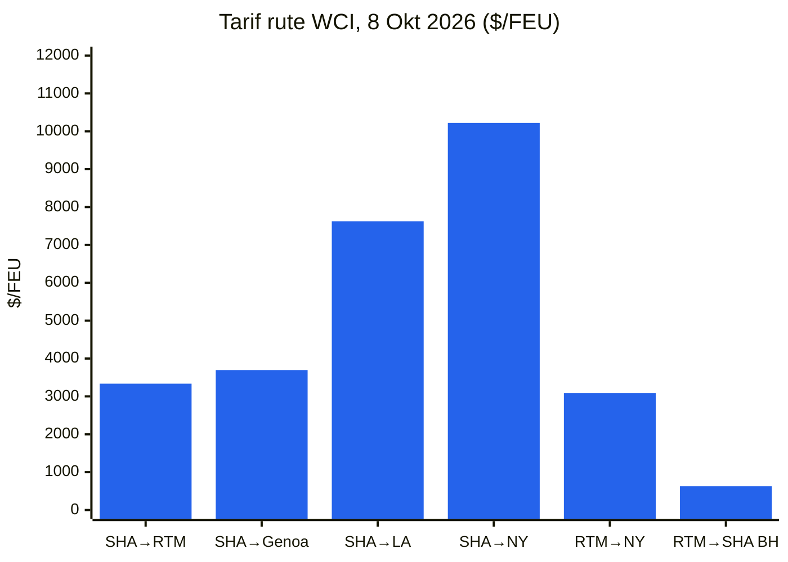
*SHA = Shanghai; RTM = Rotterdam. Arus balik: Rotterdam→Shanghai.*

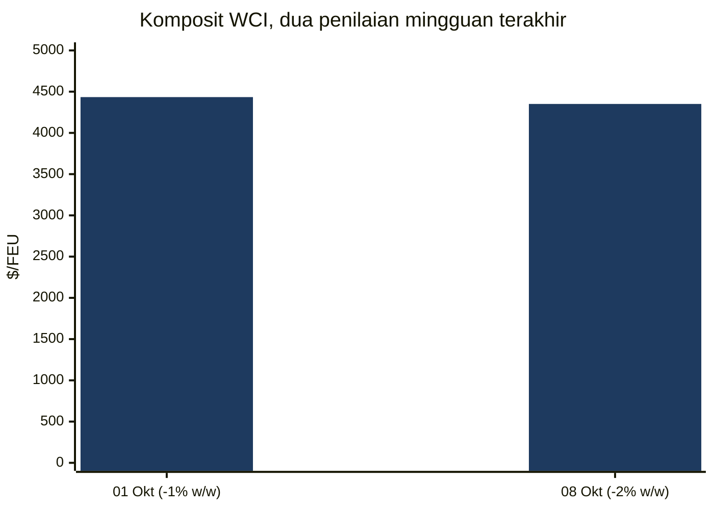

### Indeks Baltic Freightos (FBX)

Indeks global FBX menutup pekan **9 Oktober** pada **3.344 poin**, efektif tidak berubah (3.348 pada awal pekan).

| Rute | Tarif (per FEU, 9 Okt 2026) | Perubahan w/w | Sumber |
|---|---|---|---|
| Komposit global FBX | 3.344 poin | −4 poin pada pekan ini | [Laporan mingguan Baltic Exchange](https://www.thedcn.com.au/news/baltic-exchange-weekly-report-9-october-2026) |
| FBX01 Tiongkok/Asia Timur → Pantai Barat AS | $8.106 | −$228 | [Laporan mingguan Baltic Exchange](https://www.thedcn.com.au/news/baltic-exchange-weekly-report-9-october-2026) |
| FBX03 Tiongkok/Asia Timur → Pantai Timur AS | $9.606 | tidak berubah | [Laporan mingguan Baltic Exchange](https://www.thedcn.com.au/news/baltic-exchange-weekly-report-9-october-2026) |
| FBX11 Tiongkok/Asia Timur → Eropa Utara | $3.260 | tidak berubah | [Laporan mingguan Baltic Exchange](https://www.thedcn.com.au/news/baltic-exchange-weekly-report-9-october-2026) |
| FBX13 Tiongkok/Asia Timur → Mediterania | $3.861 | +$320 | [Laporan mingguan Baltic Exchange](https://www.thedcn.com.au/news/baltic-exchange-weekly-report-9-october-2026) |
| FBX21 Pantai Timur AS → Eropa | $1.182 | +$108 | [Laporan mingguan Baltic Exchange](https://www.thedcn.com.au/news/baltic-exchange-weekly-report-9-october-2026) |

Supply Chain Dive (9 Oktober, mingguan Freightos): spot Asia–USWC $8.322 (−3%), USEC $9.606 (datar) — kemacetan pelabuhan terkait cuaca di Tiongkok menjaga batas bawah tarif. Xeneta memperkirakan USEC $6.000–7.000 dan USWC $4.500–5.500 dalam tiga bulan — "koreksi yang cukup besar, tetapi bukan kehancuran."

### Curah kering — Baltic Exchange

**Baltic Dry Index** menutup Jumat 9 Oktober pada **2.917 poin, turun 7,3% untuk pekan ini** — terendah sejak akhir Agustus — terkonsentrasi di Capesize (indeks −13,9%, rata-rata pendapatan harian −$1.560 menjadi $35.860) seiring bijih besi Dalian menyentuh level terendah 18 bulan; Panamax +2,2% dan Supramax +1,4% bertahan.

| Tanggal | BDI | Capesize (pendapatan) | Panamax | Supramax | Sumber |
|---|---|---|---|---|---|
| Sen 5 Okt | 3.070 | 4.833 ($40.330) | 2.364 | 1.790 | [Baird Maritime](https://www.bairdmaritime.com/shipping/dry-cargo/bulkers/two-session-winning-streak-ends-as-baltic-dry-bulk-index-falls) |
| Sel 6 Okt | 3.002 | 4.638 ($38.561) | 2.366 | 1.795 | [Baird Maritime](https://www.bairdmaritime.com/shipping/dry-cargo/bulkers/baltic-dry-bulk-index-hits-six-week-low-on-capesize-decline) |
| Rab 7 Okt | 2.994 | 4.597 ($38.188) | 2.384 | 1.800 | [Baird Maritime](https://www.bairdmaritime.com/shipping/dry-cargo/bulkers/baltic-index-slips-as-capesize-slump-spoils-smaller-vessel-gains) |
| Kam 8 Okt | 2.973 | 4.512 ($37.420) | 2.410 | 1.808 | [Baird Maritime](https://www.bairdmaritime.com/shipping/dry-cargo/bulkers/baltic-dry-bulk-index-drops-to-lowest-level-in-more-than-six-weeks) |
| Jum 9 Okt | 2.917 | 4.340 ($35.860) | 2.424 | 1.814 | [Laporan mingguan Baltic Exchange](https://www.thedcn.com.au/news/baltic-exchange-weekly-report-9-october-2026) |

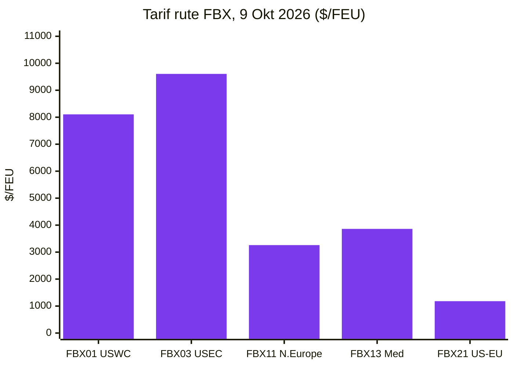
*Rute: FBX01 Tiongkok/Asia Timur→Pantai Barat AS; FBX03 →Pantai Timur AS; FBX11 →Eropa Utara; FBX13 →Mediterania; FBX21 Pantai Timur AS→Eropa.*

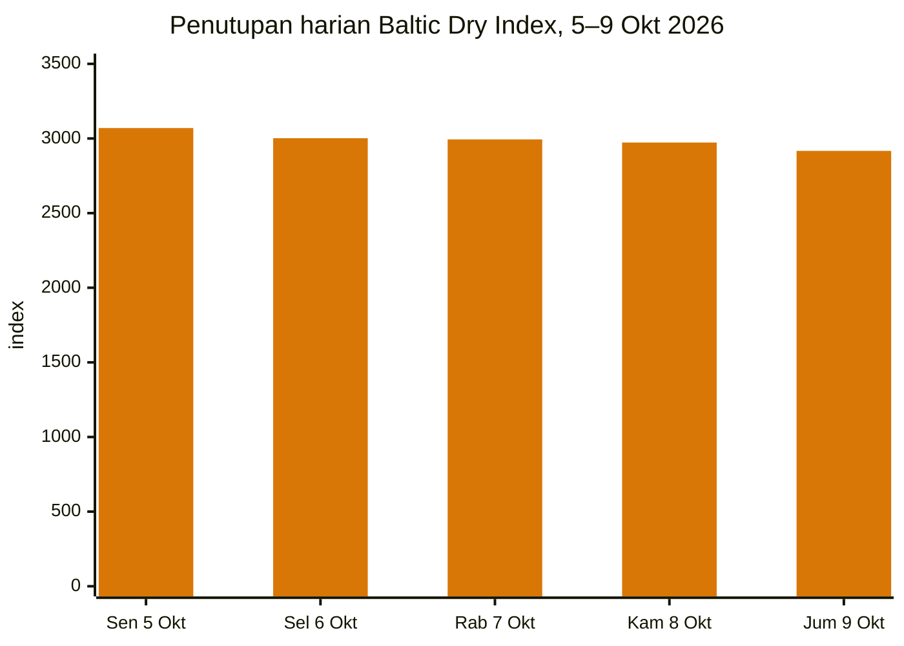

### Gangguan pelabuhan dan logistik

**Kembalinya Laut Merah / Suez dipercepat.** Hapag-Lloyd mengonfirmasi pelayaran barat dan timur pertama Gemini Cooperation layanan SE1 melalui Laut Merah dan Suez: *Umm Qarn* berangkat dari Tanjung Pelepas menuju Suez pada 27 Oktober dan Algeciras pada 5 Desember. Premier Alliance (ONE, HMM, Yang Ming) mengembalikan loop FE1 Asia Tenggara–Eropa Utara ke Suez mulai Oktober — jeda pertama dari rute Tanjung sejak Januari 2024 — dengan *ONE Continuity* 8.110 TEU berangkat dari Laem Chabang pada 17 Oktober. COSCO dijadwalkan melakukan transit Suez barat pertamanya dalam lebih dari dua tahun pada 4 Oktober. MSI memperkirakan ~35% pelayaran Asia–Eropa kini menggunakan Laut Merah; Linerlytica menghitung 140+ kapal boks (2 juta+ TEU) kembali sejak Mei; tonase bersih kontainer Suez Januari–Agustus 72,1 juta ton (+54,2% y/y). Kendala: Aspides UE mengakui cakupan kapal perang tidak cukup untuk semua permintaan pengawalan — batas pengikat atas kembalinya lebih lanjut. Container Forecaster Drewry menemukan manfaat ekonomi kembalinya ke Suez bagi operator tipis — kira-kira $1 juta per pelayaran pulang-pergi yang dihemat vs Tanjung — namun operator tetap kembali, menambah kapasitas efektif yang menekan tarif Asia–Eropa. ([splash247.com](https://splash247.com/premier-alliance-joins-accelerating-return-to-suez/), [container-news.com](https://container-news.com/hapag-lloyd-confirms-first-se1-sailings-via-red-sea-and-suez-canal/))

**Kemacetan pelabuhan Asia.** Kemacetan musim topan mendorong keandalan jadwal global di bawah 50% untuk pertama kalinya sejak pandemi (Sea-Intelligence), dengan kemacetan Asia berpotensi bertahan hingga pertengahan 2027; kemacetan menyerap 12% kapasitas kapal efektif (DHL Forwarding) dan ~10,9% armada kontainer (~3,76 juta TEU); rata-rata keterlambatan kapal yang telat mencapai 6,81 hari, tertinggi sejak Maret 2022. Pekan Emas (1–7 Oktober) melunakkan permintaan; Shanghai diperkirakan tetap sangat macet hingga pertengahan hingga akhir Oktober. ([worldcargonews.com](https://www.worldcargonews.com/news/2026/10/sea-intelligence-asian-port-congestion-could-persist-into-mid-2027/), [ti-insight.com](https://ti-insight.com/briefs/global-supply-chain-risk-monitor-october-2026/))

**Serangan Laut Hitam meningkat.** Kapal curah *Royad Mammadov* tenggelam di lepas Rumania (dua awak tewas); beberapa hari kemudian serangan drone di lepas Bulgaria menenggelamkan kapal curah *Alfa Watan* dan membuat *Able* terbakar — koridor gandum terganggu, premi asuransi melonjak. India dan Liberia, sebagai ketua bersama Kelompok Teman Keselamatan dan Keamanan Pelayaran dan Pelaut, bersama-sama mengecam serangan itu (9 Oktober). ([splash247.com](https://splash247.com/two-seafarers-killed-as-cargo-ship-sinks-off-romania/))

**Terusan Panama.** Transit naik menjadi 33 per hari mulai 15 Oktober (dari 32) dengan draft dipulihkan menjadi 49 kaki; slot Neo-Panamax meningkat menjadi 10 harian. Risiko El Niño ke depan: NOAA memperkirakan pola itu berlanjut hingga awal 2027. Operator sudah mengenakan biaya tambahan: MSC $149/20 kaki ($297/40 kaki), CMA CGM Faktor Penyesuaian Terusan Panama $500/TEU.

**Filipina.** Krisis peti kemas kosong Manila: "protes digital" broker dan libur sopir truk (5–8 Oktober) atas penolakan operator menerima pengembalian peti kosong hingga sebulan; protes berakhir 8 Oktober setelah terminal mulai menerima peti kosong terus-menerus — tetapi Hapag-Lloyd menangguhkan semua pemesanan baru ke Manila, Batangas, dan Subic hingga 31 Desember, dengan alasan kemacetan dan keterbatasan berat kapasitas depo/pengembalian peti kosong. ([portcalls.com](https://portcalls.com/manila-ports-digital-protest-trucking-holiday-end/))

**Tenaga kerja dan perairan pedalaman.** Pemogokan buruh pelabuhan Jerman terhindarkan 2 Oktober (kesepakatan ver.di mengakhiri pemogokan peringatan di Hamburg/Bremerhaven). Tetapi air yang secara historis rendah pada alat ukur Kaub di Rhine secara efektif menghentikan pelayaran tongkang bermuatan; biaya tambahan air rendah mencapai €1.280/FEU (Contargo) dan $1.350/FEU (Hapag-Lloyd). Buruh pelabuhan Vancouver memprotes otomasi dan AI (2 Oktober). Tidak ada laporan terverifikasi atas pemogokan baru ILA Pantai Timur/Teluk AS dalam jendela ini.

**Biaya tambahan operator dan layanan.** CMA CGM: biaya tambahan musim puncak atas Asia–Afrika (hingga $750/TEU Timur Jauh→Durban mulai 22 Oktober; $200/TEU Asia Tenggara→Afrika Barat utara mulai 15 Oktober), kenaikan PSS Afrika Barat mulai 22 Oktober, Asia→Amerika Latin +$1.000/kontainer mulai 15 Oktober, tarif FAK Asia–Mediterania 19–31 Oktober, dan PSS $1.000/reefer Eropa Utara→Teluk Arab mulai pertengahan Oktober. Maersk: PSS di tiga perdagangan; mengakhiri berbagi kapal ASAS2 dengan CMA CGM pada Asia–Pantai Timur Amerika Selatan (pelayaran terakhir Shanghai 8 Desember). Armada: MSC memesan enam kapal megamax bahan bakar ganda LNG (~21.700 TEU masing-masing) untuk pengiriman 2029–2030; orderbook-nya melampaui 170 kapal / 3 juta+ TEU. ([container-news.com](https://container-news.com/cma-cgm-announces-new-peak-season-surcharges-on-asia-africa-trades/))

**Sanksi dan pelayaran Arktik.** Inggris menjatuhkan sanksi atas lima kapal LNG (1 Oktober); Inggris dan Jepang memperketat jaring atas kapal terkait Sovcomflot. Arctic LNG 2 mengekspor 0,95 juta ton pada 2026 (semua sejak Juli). Tiongkok menyelesaikan musim pertama layanan kontainer mingguan reguler Tiongkok–Eropa melalui Rute Laut Utara (7 Oktober); kapal kontainer Korea Selatan menyelesaikan pelayaran pulang-pergi Arktik komersial pertama negara itu ke Eropa (10 Oktober). M&A kapal tanker: Trafigura membeli tujuh kapal tanker dari SFL Corp (~$175 juta keuntungan bagi penjual); spin-off Trafigura Volare Shipping tercatat di Oslo (6 Oktober). ([hellenicshippingnews.com](https://www.hellenicshippingnews.com/category/shipping-news/international-shipping-news/), [gcaptain.com](https://gcaptain.com/tag/arctic/))

**Meksiko.** Ekspor otomotif mencatat kemerosotan terbesar tahun ini pada September, dikaitkan analis dengan tarif AS (data INEGI via gCaptain, 8 Oktober).

### Intelijen vendor (halaman publik saja)

- **Descartes Systems Group:** Laporan Pelayaran Global Oktober (dirilis 8 Oktober) — rekor impor kontainer AS September (lihat §3.7); **Agen AI Descartes Datamyne** (diumumkan ~1 Oktober) — agen AI percakapan yang memanfaatkan 500 juta+ catatan pengiriman yang ditambahkan setiap tahun di 230 pasar, mengklaim pemangkasan 90% waktu riset; Forum Inovasi 2026 (6–8 Oktober, Chicago) memamerkan teknologi logistik AI termasuk agen AI MacroPoint OpsForce (hasil pelanggan yang diklaim: +30% otomasi pelacakan tanpa sentuhan, 1,5x produktivitas tim pelacakan). Tinjauan langsung atas descartes.com/solutions/global-trade-intelligence tidak dimungkinkan pada sesi ini; butir-butir di atas dari liputan berita publik. ([reuters.com](https://www.reuters.com/world/china/us-ocean-container-imports-set-new-record-september-descartes-says-2026-10-08/), [disruptsmedia.com](https://disrupts.disruptsmedia.com/transportation-logistics/descartes-datamyne-ai-agent-targets-90-cut-trade-data-research))
- **TradeInt:** hibah Kementerian Perdagangan Turkiye × TradeInt (diumumkan 30 September, diliput pers pekan ini) — akses pendanaan ke catatan pengiriman, pengajuan bea cukai, dan data bill-of-lading di 200+ negara untuk perusahaan konsultan Turki; tinjauan data TradeInt mencatat ekspor Turkiye 2025 $269,7 miliar (September rekor $22,6 miliar). Diliput via liputan pers publik saja; tidak ada akses platform data yang digunakan. ([citybuzz.co](https://www.citybuzz.co/2026/09/30/turkiyes-ministry-of-trade-and-tradeint-launch-grant-to-arm-local-consultants-with-global-trade-data-through-tradeint-partnership))

---

## 10. Linimasa kebijakan

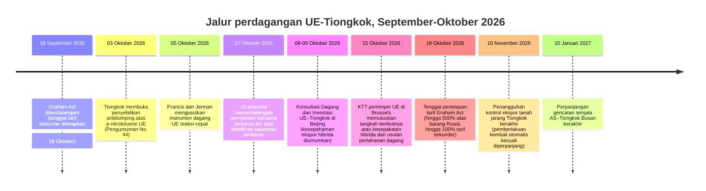

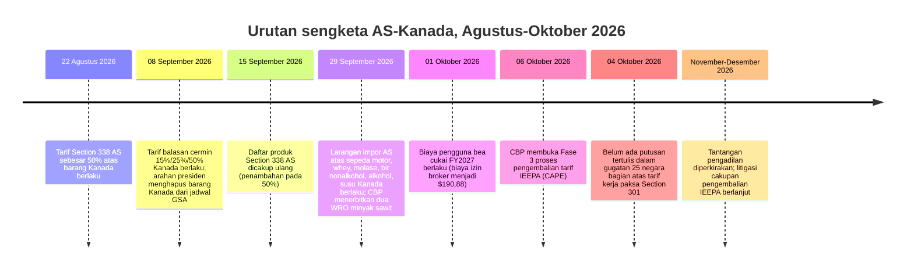

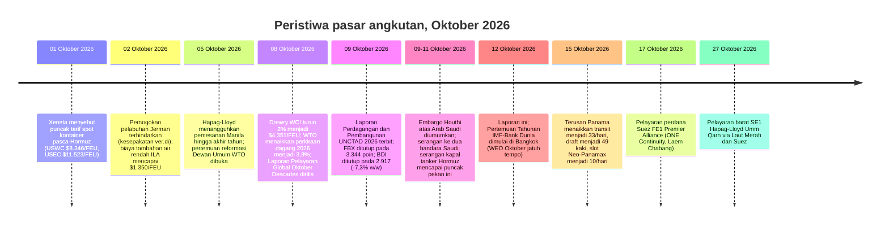

---

## 11. Batas waktu dan agenda mendatang (90 hari ke depan)

| Tanggal | Agenda |
|---|---|
| 14 Okt 2026 | Panduan BIS "kandungan AS" untuk peralatan industri bergerak USMCA berlaku (publikasi FR) |
| 15 Okt 2026 | KTT pemimpin UE, Brussels — memutuskan atas kesepahaman ekspor hibrida UE–Tiongkok, alat dagang reaksi-cepat Prancis-Jerman, aturan Made in Europe |
| 15 Okt 2026 | Terusan Panama: transit menjadi 33/hari, draft menjadi 49 kaki, slot Neo-Panamax menjadi 10/hari |
| 16 Okt 2026 | Larangan ekspor Rusia Jepang yang diperluas mulai berlaku |
| 17 Okt 2026 | Pelayaran perdana Suez FE1 Premier Alliance (ONE Continuity, Laem Chabang) |
| 18 Okt 2026 | Tenggat penetapan tarif Graham Act: bea hingga 500% atas barang Rusia; bea sekunder hingga 100% atas pembeli energi Rusia terbesar tanpa pengecualian |
| 19 Okt 2026 | Keputusan inisiasi Kementerian Perdagangan jatuh tempo: AD/CVD senyawa amina (Tiongkok) |
| 23 Okt 2026 | Tenggat pendaftaran/komentar: penyelidikan antidumping Tiongkok atas p-nitrotoluene UE |
| 27 Okt 2026 | DSB: pengesahan putusan tarif ICT India–Chinese Taipei; pertimbangan laporan panel EV Turkiye–Tiongkok |
| 27 Okt 2026 | Pelayaran barat SE1 Hapag-Lloyd Umm Qarn via Laut Merah dan Suez (Tanjung Pelepas) |
| 29–30 Okt 2026 | KTT UE–Kanada, Montréal — penyelesaian negosiasi Perjanjian Dagang Digital diperkirakan |
| 4 Nov 2026 | Komentar pengumpulan informasi pengembalian IEEPA CBP jatuh tempo |
| 10 Nov 2026 | Penangguhan kontrol ekspor tanah jarang Tiongkok berakhir (pemberlakuan kembali otomatis kecuali diperpanjang) |
| 10 Nov 2026 | Akhir terjadwal penangguhan Aturan Afiliasi BIS (perpanjangan hingga 10 Jan 2027 diperkirakan tetapi belum diterbitkan) |
| 10 Nov 2026 | Pengecualian Section 301 untuk 178 produk Tiongkok berakhir (diperpanjang hingga tanggal ini di bawah gencatan senjata) |
| 13 / 16 Nov 2026 | Penetapan pendahuluan ITC: senyawa amina (Tiongkok) / gerbong tangki kereta (Meksiko) |
| 4 Des 2026 | MIP + tarif 15% Section 232 polisilikon berlaku |
| 7 Des 2026 | Komentar usulan aturan Pengiriman Bernilai Rendah CBP ditutup |
| Sebelum Des 2026 | Pertemuan teknis pertama platform sektoral kelebihan kapasitas 15 ekonomi |
| Jan 2027 | Pertemuan video ministerial UE–Tiongkok |
| 10 Jan 2027 | Perpanjangan gencatan senjata AS–Tiongkok Busan berakhir |
| 12 Jan 2027 | Komentar tinjauan bersama USMCA 2027 jatuh tempo |
| 1 Jan 2028 | Amendemen HS 2028 WCO mulai berlaku (299 set perubahan; tim klasifikasi sebaiknya merencanakan sekarang) |

---

## 12. Sumber & metodologi

Cakupan: 5–12 Oktober 2026.

**Berita & analisis dagang:** FreightWaves, The Loadstar, Splash247, gCaptain, Hellenic Shipping News, Container News, Supply Chain Dive, Logistics Management, Air Cargo News, Port Technology International, JOC (hanya tajuk), Freightmate/Sea Intelligence/ILA Industry Insights via pers dagang, pengumuman publik TradeInt via liputan pers.

**Kebijakan AS:** lembar fakta whitehouse.gov, cbp.gov (via advisori dagang), siaran pers ustr.gov, federalregister.gov (pemberitahuan AD/CVD, tinjauan Section 301), bis.doc.gov (via analisis KPMG/JD Supra), internationaltradetoday.com (tajuk), analisis firma hukum JD Supra, Thompson Hine, GHY International, Withum, Akin Gump, Bell Nunnally, Mondaq, KPMG Tax News Flash, Digital Policy Alert.

**Pemerintah dunia:** ec.europa.eu/DG Trade (via liputan pers), gov.uk Department for Business and Trade (via pers), cbsa-asfc.gc.ca/canada.ca (via pers), english.mofcom.gov.cn (diakses langsung 12 Oktober), METI/Bea Cukai Jepang (via Global Sanctions), resolusi Brasil Camex/Gecex (via Datamar), pelaporan kementerian dagang nasional untuk India, Turkiye, Brasil, Australia, dan negara-negara ASEAN.

**Multilateral:** wto.org (Dewan Umum 5–6 Oktober, sengketa DS639/DS629, pelaporan reformasi), unctad.org (Laporan Perdagangan dan Pembangunan 2026, Pembaruan Perdagangan Global Oktober), wcoomd.org (amendemen HS 2028, program aturan asal), ITC (tidak ada rilis baru dalam jendela).

**Portal data:** Census/BEA FT-900 (Agustus 2026, dirilis 6 Oktober), USITC DataWeb / USA Trade Online, Pembaruan Prospek Perdagangan Global WTO Oktober, UN Comtrade (catatan metodologi), rilis statistik Eurostat/ECB, portal data Bank Dunia, IMF (prarilis riset WEO; WEO Oktober penuh jatuh tempo 12–18 Oktober).

**Think-tank & riset:** Tax Foundation (Pelacak Tarif Trump, edisi September 2026; Opsi Mereformasi Kode Pajak Amerika 3.0), Yale Budget Lab (Kondisi Tarif AS), tradeintelligence.eu (tidak ada riset publik baru dalam jendela; berkas dagang digital UE via EU Perspectives/Digital Watch/Global Law Experts).

**Angkutan:** Drewry (World Container Index, penilaian 8 Oktober), Baltic Exchange (laporan mingguan 9 Oktober), Freightos Baltic Index, Shanghai Containerized Freight Index / China Containerized Freight Index (via FreshPlaza), TAC Index, Baird Maritime (BDI harian), Xeneta (via FreightWaves/Air Cargo News), Laporan Pelayaran Global Oktober Descartes (via Reuters), Sea-Intelligence, DHL Forwarding, DC Velocity, TI Insight, NRF Global Port Tracker, ILA Industry Insights.

**Intelijen vendor:** Descartes Systems Group dan TradeInt pemasaran publik dan pengumuman pers saja (konten blog dan berita publik; tidak ada akses platform data, tidak ada login, tidak ada penggunaan platform data dagang pesaing).
