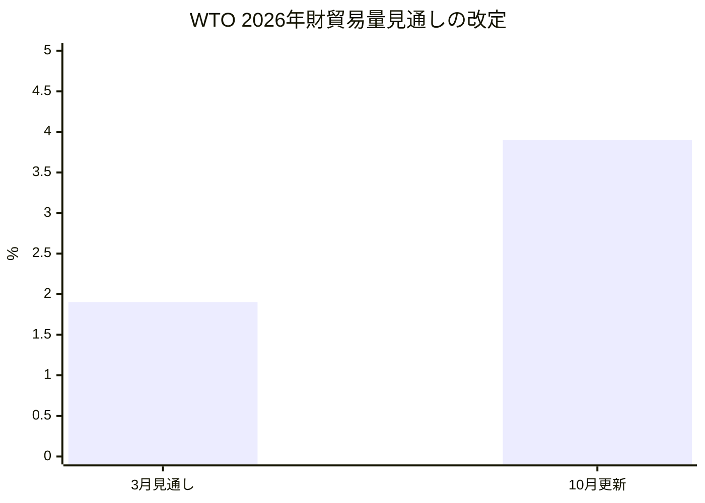
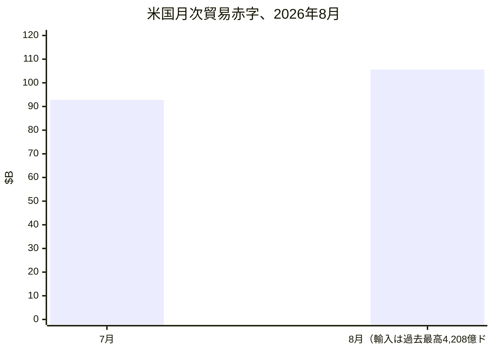
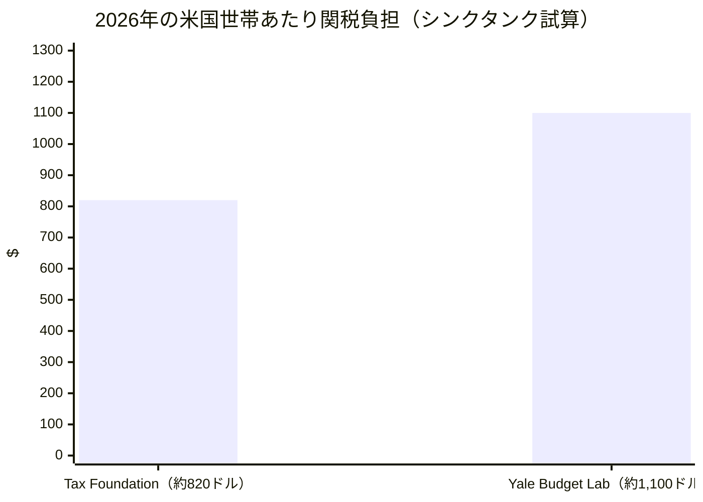
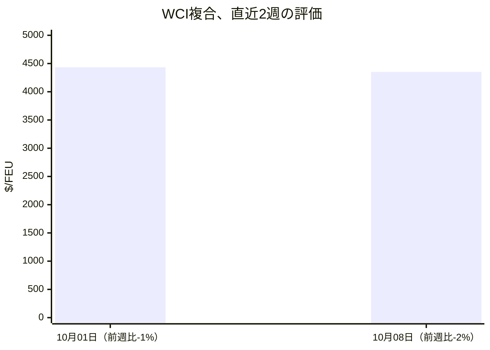
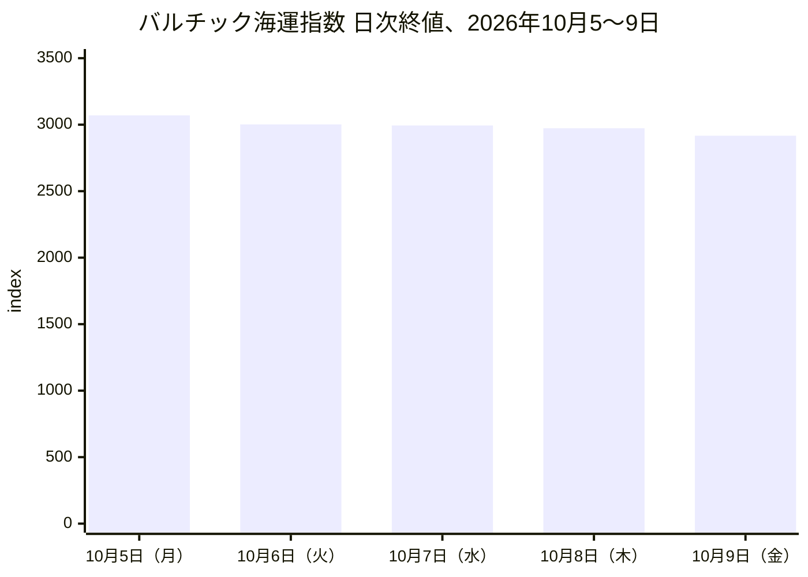
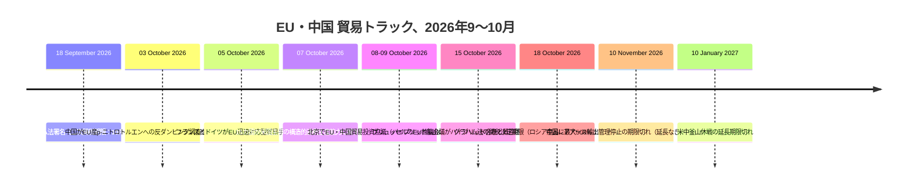
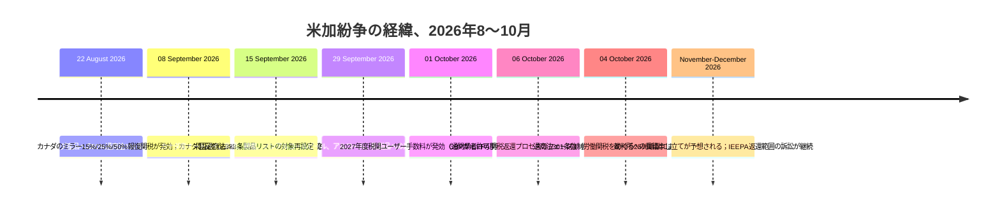
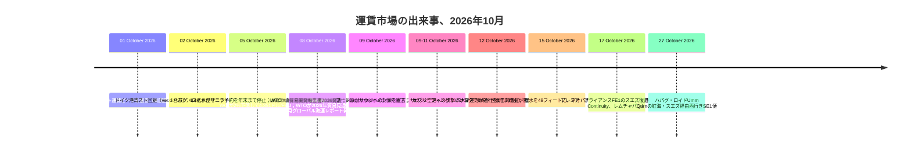

# グローバル貿易インテリジェンス・レポート — 2026年10月5日〜12日の週

**週刊ブリーフィング。** 対象期間：2026年10月5日〜12日。世界の貿易ニュース、政策、データ、運賃に関する約45のデータソースから編集。

---

## 目次

1. [エグゼクティブサマリー](#1-エグゼクティブサマリー)
2. [アラート](#2-アラート)
3. [主要ニュース — 深掘り](#3-主要ニュース--深掘り)
4. [関税トラッカー](#4-関税トラッカー)
5. [米国政策の深掘り](#5-米国政策の深掘り)
6. [地域別世界政策](#6-地域別世界政策)
7. [執行措置](#7-執行措置)
8. [データ発表](#8-データ発表)
9. [運賃市場](#9-運賃市場)
10. [政策タイムライン](#10-政策タイムライン)
11. [今後90日の期限・イベント](#11-今後90日の期限イベント)
12. [出典・手法](#12-出典手法)

---

## 1. エグゼクティブサマリー

エネルギー安全保障、貿易防衛、海上安全保障が交錯した一週間だった。週の基調を決めたのは次の三つの展開である。

- **グラハム法のカウントダウンが最終週に。** 10月18日の関税決定期限を数日後に控え、トランプ大統領はロシア産ディーゼルの輸入取引を発表 — 直ちに30万トン超、11月にも50万トン — を財務省の一般ライセンス135号により2027年4月まで認可した。一方で、同法のロシア系エネルギー最大購入国（インド、中国、トルコ）に対する最大100%の二次関税は、大統領の適用免除なしに発動する構えを保っている。超党派の上院議員7人は、このディーゼル取引は大統領が署名した制裁法と整合しないと批判した。ロシア産原油の最大購入国であるインドは、米国との貿易交渉が「行き詰まり」に達したと述べた。
- **EU・中国北京協議は争いのある結果に。** マロシュ・シェフチョヴィチ欧州委員は、中国のハイブリッド車のEU向け輸出を4年で半分以上削減する「共通認識」、自動車部品・オリーブオイル・履物に対する中国の関税引き下げ（少なくとも2億2500万ユーロの関税削減）を発表 — しかし北京が公表した文書には数値がなく、EUの対中物品貿易赤字は2026年1〜7月で2380億ユーロに達した。フランスとドイツは別途、「通商法301条並みに強力な」EUの迅速対応型貿易武器を提案した。EU首脳は10月15日のブリュッセル首脳会議で次の対応を決める。
- **エネルギー輸送戦争が急激に激化。** フーシ派はサウジアラビアへの海上封鎖を宣言し、サウジの2空港を攻撃して3人が死亡。バブエルマンデブ海峡の通行船舶は10月11日に11隻まで減少した。ホルムズ周辺のタンカー攻撃は戦争開始以来の最高水準に。米国はさらに22隻のタンカーを制裁し、イランはホルムズ海峡再開提案に対する米国の回答を「不十分」とした。

その他：米国コンテナ輸入は9月に過去最高（255万TEU、前年比+10.3%、Descartesの10月8日報告）；CBPはIEEPA関税返還プロセスのフェーズ3（CAPE）を10月6日に開始；英国は中国製EVへの最大45%の関税決定が「微妙な均衡」にあると表明；WTOはAI需要を背景に2026年の財貿易見通しを3.9%に引き上げ、一方UNCTADの基幹報告書は「選択的断片化」と2024年以降の中米貿易20%減を指摘；中国はEU産p-ニトロトルエンへの反ダンピング調査を開始；日本の対ロシア輸出禁止拡大は10月16日に発効。

**運賃：** ピーク後の相場調整に紛争プレミアムが上乗せ。Drewry世界コンテナ指数は2%下落して4,351ドル/FEU（アジア〜欧州はスエズ復帰を加速する船社により13週連続下落）、バルチック海運指数は7.3%下落して2,917（鉄鉱石低迷でケープサイズの収益が崩落）、ハパグ・ロイドはフィリピンの空コンテナ危機でヤード容量が逼迫し、マニラ向け予約を年末まで全面停止した。世界の定時運航率はパンデミック以来初めて50%を割り込んだ。

---

## 2. アラート

| # | アラート | 適用時期 | 影響 | 出典 |
|---|-------|-----------|--------|--------|
| A1 | グラハム法の二次関税期限：ロシア産物品に最大500%の関税；適用免除なしでロシア系エネルギー最大購入国に最大100%の二次関税 | 2026年10月18日 | インド、中国、トルコが最も曝露；関税は既存関税に上乗せ | [mondaq.com](https://www.mondaq.com/unitedstates/export-controls-trade-investment-sanctions/1851398/the-lindsey-graham-sanctions-act-what-businesses-need-to-know-about-the-new-tariffs) |
| A2 | 米ロ・ディーゼル取引：直ちに30万トン超、11月に50万トン；OFAC一般ライセンス135号がロシア産ディーゼル輸入を認可 | 2026年10月9日（GL135は2027年4月7日まで有効） | 期限1週間前にグラハム法と政治的衝突；上院議員7人が撤回を要求 | [nationpress.com](https://www.nationpress.com/international/trump-buys-russian-diesel-before-graham-act-deadline) |
| A3 | EU・中国北京協議：ハイブリッド輸出「共通認識」に争い；EU産品への2億2500万ユーロ超の関税削減；レアアースのグリーンチャネル維持 | 2026年10月8〜9日（10月15日EU首脳会議で決定） | 執行メカニズムは未公表；北京の文書に半減の数値なし | [eureporter.co](https://www.eureporter.co/world/china-2/2026/10/09/eu-and-china-strike-preliminary-trade-deal-ahead-of-crucial-leaders-summit/) |
| A4 | 仏独提案：EUの迅速対応型貿易手段「通商法301条並みに強力」 | 10月5日提案；10月15日首脳会議 | EU貿易防衛の強化の可能性；中国は対応を警告 | [lapost.com](https://www.lapost.com/content/france-germany-propose-new-rapid-eu-trade-response-tool) |
| A5 | フーシ派のサウジへの海上封鎖；バブエルマンデブの通行は数カ月ぶりの低水準（10月11日に11隻）；サウジ2空港への攻撃で3人死亡 | 2026年10月9〜11日 | サウジ原油積み込みに脅威；7隻超のタンカーが航路変更 | [marinelink.com](https://www.marinelink.com/news/red-sea-shipping-slows-houthi-attack-541529) |
| A6 | ホルムズ・湾岸のタンカー攻撃が戦争開始以来の最高水準；米国はさらに22隻を制裁（10月8日） | 2026年10月7〜11日 | 米軍が10月10日に封鎖逃れ貨物船を無力化；カタール沖でケミカルタンカー被弾 | [gcaptain.com](https://gcaptain.com/category/news/) |
| A7 | 中国のレアアース輸出管理停止の期限切れ；延長は未発表 | 2026年11月10日 | 双方が延長しなければ自動復活；IEAは年間6.5兆ドル相当の川下生産がリスクと試算 | [investornews.com](https://investornews.com/critical-minerals-rare-earths/technology-metals-report-10-04-2026-a-summit-without-a-rare-earth-deal-leaves-the-west-buying-its-way-to-supply/) |
| A8 | 英国が中国製EVに最大45%の関税を検討；決定は「微妙な均衡」 | 検討中（10月4〜7日報道） | 英国自動車輸出の58%はEU向け；「メイド・イン・ヨーロッパ」へのアクセスと連動 | [fleetnews.co.uk](https://Www.fleetnews.co.uk/news/uk-weighs-chinese-car-tariffs-as-fleet-demand-for-evs-surges) |
| A9 | CBPがIEEPA関税返還プロセスのフェーズ3（CAPE）を開始 | 2026年10月6日 | 約1,800億ドルの返還執行が実務開始；非訴訟輸入者の適用範囲に争い；11月4日まで意見募集 | [thompsonhine.com](https://www.thompsonhine.com/insights/cbp-confirms-october-6-2026-launch-of-phase-3-of-the-ieepa-tariff-refund-process/) |
| A10 | Hapag-Lloydが空コンテナ混雑でマニラ、バタンガス、スービック向け予約を年末まで全面停止 | 即時（2026年12月31日まで） | 2026年でも最も厳しい船社の予約停止措置の一つ | [portcalls.com](https://portcalls.com/hapag-lloyd-suspends-manila-batangas-subic-bookings-over-congestion/) |
| A11 | 中国がEU産p-ニトロトルエンへの反ダンピング調査を開始 | 10月3日開始（登録は10月23日締切） | ダンピングマージンは100%超と申立て；EUの道具提案への報復的タイミング | [mlex.com](https://www.mlex.com/mlex/articles/2533700/china-opens-anti-dumping-probe-into-eu-para-nitrotoluene) |
| A12 | 日本の対ロシア輸出禁止拡大が発効 | 2026年10月16日 | 追加品目がロシア向け輸出禁止に | [globalsanctions.com](https://globalsanctions.com/2026/10/japan-adds-more-goods-to-russia-export-ban-from-16-october-2026/) |

### A1 — グラハム法の期限（詳細）

リンジー・O・グラハム対ロシア・対イラン制裁法（2026年）（9月18日署名）は、**2026年10月18日**の30日以内の施行期限を二つの必須関税トラックに課している。第112条：石油製品を明示的に含む、ロシアから輸入されるすべての物品に最大**500%従価**の関税。第113条：過去12カ月でロシア産原油または天然ガスの上位5カ国以内の輸入国であり、期限以降に意図的に新規購入を行う国のすべての物品に最大**100%従価**の関税。すべての関税は既存の通商法301条・232条関税に上乗せされる。免除弁：大統領が議会に正式な非機密の書面で国益に資すると認証する大統領適用免除、および限定的な天然ガス例外（ロシアの年間ガス輸出総量の15%未満の輸入かつ削減に向けた「重要な措置」；原油購入者は対象外）。法律事務所の分析は中国、インド、トルコを主な対象と特定し、スロバキア、ハンガリー、UAEのリスクも高いとする。([mondaq.com](https://www.mondaq.com/unitedstates/export-controls-trade-investment-sanctions/1851398/the-lindsey-graham-sanctions-act-what-businesses-need-to-know-about-the-new-tariffs))

### A2 — ロシア産ディーゼル取引（詳細）

10月9日、プーチン大統領との電話会談を受け、トランプ大統領はロシアが米国および世界市場にディーゼルを供給すると発表 — 直ちに**30万トン超、11月にも50万トン** — 米国農家・牧畜業者・トラック運転手の燃料価格引き下げを目的とする。財務省外国資産管理室（OFAC）は**一般ライセンス135号**を発給し、ロシア産ディーゼルの取引を**2027年4月7日**東部時間午前0時01分まで認可した。ベセント財務長官は、政権は利用可能な法的権限の下で行動すると述べ、グラハム法がこの取引を禁じるとの見方に反論した（同法は財務省の一般ライセンス権限を保持；第113条は関税対象国の判定で原油と天然ガスのみを数え、精製製品は対象外）。ジャンヌ・シャヒーン上院議員（筆頭）を中心とする超党派の上院議員7人 — ティリス、コリンズ、マーカウスキー、カーティス、ブルメンタール、ワイデンの各議員 — は10月11日に共同声明を出し、議会が確立した制裁枠組みに矛盾するとして撤回を求めた。背景：ディーゼル価格は2月以降約70%上昇（イラン紛争、ロシアの輸出禁止、ウクライナの製油所攻撃）；AAAによれば10月8〜9日の全米平均は約1ガロン6.27〜6.28ドル。([nationpress.com](https://www.nationpress.com/international/trump-buys-russian-diesel-before-graham-act-deadline), [cnn.com](https://www.cnn.com/2026/10/09/politics/trump-putin-russian-diesel), [egyptoil-gas.com](https://egyptoil-gas.com/news/us-senators-urge-trump-to-reverse-russia-diesel-deal/))

### A3 — EU・中国北京協議（詳細）

第2回EU・中国貿易投資協議が10月9日に北京で閉幕、マルシュ・シェフチョヴィチ委員と王文濤商務部長が協議した。1日100億ユーロ超のEUの対中物品貿易赤字をめぐる3カ月の交渉を経てのことだった。シェフチョヴィチは、ハイブリッドおよびプラグインハイブリッド車の中国輸出を抑制する「共通認識」 — 4年で中国の輸出を「半分以上削減する展望を開く」 — 自動車部品・オリーブオイル・履物をカバーする最恵国関税引き下げの共通認識（現在のEU輸出額で約40億ユーロ相当、少なくとも2億2500万ユーロの関税削減）、中国のレアアース輸出ライセンスをより円滑・予測可能・透明にする共通認識（グリーンチャネル維持）を発表した。**ただし：** 北京が公表した文書にはハイブリッド輸出の数値がない — 「半減」はシェフチョヴィチの発言にのみ存在し、メカニズムは未公表で、10月15〜16日の首脳会議でのEU首脳の政治的承認を要する。背景：中国はハイブリッド車輸出の自主規制を拒否（フィナンシャル・タイムズ、2人の外交筋引用、10月7日）；欧州議会は10月7日に中国の経済慣行とウクライナに関する立場を非難する決議を可決。([eureporter.co](https://www.eureporter.co/world/china-2/2026/10/09/eu-and-china-strike-preliminary-trade-deal-ahead-of-crucial-leaders-summit/), [reuters.com](https://www.reuters.com/world/china/eu-seeks-cut-trade-deficit-with-china-talks-with-beijing-2026-10-07/), [europeansting.com](https://europeansting.com/2026/10/12/press-remarks-by-commissioner-sefcovic-at-the-second-meeting-of-the-eu-china-trade-and-investment-consultations/))

### A5/A6 — 海上安全保障の激化（詳細）

フーシ派の軍事報道官はサウジアラビアに対する海上封鎖を宣言。10月10〜11日、フーシ派の攻撃がサウジの2空港を直撃し、3人が死亡、数十人が負傷した。バブエルマンデブ海峡の通行は10月11日に**11隻の貨物船 — 数カ月ぶりの最低水準** — に落ち込み、うち油タンカー7隻。封鎖警告を受け少なくとも7隻のタンカーが航路を変更した。UAEは10月7日に攻撃を非難した。これは2026年のフーシ派エスカレーションの第3段階（7月にミサイル攻撃再開；サウジ船籍標的を主張；今回の封鎖宣言）であり、サウジ原油積み込みを直接脅かす — 10月2日には既にドローン攻撃でヤンブーの積み込みが停止していた。ホルムズ周辺ではタンカー攻撃が戦争開始以来の最高水準に達した：カタール沖でケミカルタンカーが複数の飛翔体で被弾し死傷者が報告；10月9日にはペルシャ湾内でもう1隻の商船が被弾した。Gibsonは戦争開始以来**95件のタンカー攻撃**を追跡している。10月8日、米国はイラン石油取引に関わるさらに22隻のタンカーに制裁。G7は最大1億バレルの緊急石油・ディーゼル備蓄の放出に合意（10月2日）。10月10日、米軍はオマーン湾でイラン封鎖の突破を試みた貨物船を無力化したと発表した。イランは10月11日、ホルムズ再開に向けた7条件提案に対する米国の回答は「不十分」と述べた。([marinelink.com](https://www.marinelink.com/news/red-sea-shipping-slows-houthi-attack-541529), [gcaptain.com](https://gcaptain.com/category/news/), [hellenicshippingnews.com](https://www.hellenicshippingnews.com/category/shipping-news/hellenic-shipping-news/))

---

## 3. 主要ニュース — 深掘り

### 3.1 EU・中国：共通文書なき「半分の合意」

**経緯。** 北京での第2回EU・中国貿易投資協議（10月8〜9日）は、ハイブリッド車、関税緩和、レアアース、EUのEV反補助金調査、外国補助金規則の技術協議、知的財産協力をカバーする共同声明と16項目の合意リストで閉幕した。1月に閣僚級ビデオ会合、2027年3月に次回の対面協議が予定されている。

**主要数値。**
- EUの対中物品貿易赤字：2026年1〜7月で**2380億6000万ユーロ**、前年同期比12.2%拡大。
- シェフチョヴィチの主張：4年で中国のハイブリッド輸出を半分以上削減する共通認識；EU輸出額約**40億ユーロ**をカバーする関税引き下げで少なくとも**2億2500万ユーロ**の関税削減。
- 中国の自動車輸入は貿易フロー換算で1日あたり約**10億ユーロ**相当。
- 非対称性：北京の公表文書には数値がない — 半減はシェフチョヴィチの説明にのみ存在する。([mlex.com](https://www.mlex.com/mlex/articles/2536652/china-eu-agree-on-hybrid-vehicle-trade-export-controls-further-tariff-talks))

**分析。** 実施されれば、EU・中国貿易でこの規模の自主的輸出抑制として初の取り決めとなり — シェフチョヴィチの枠組みでは、関税紛争を経ない中国受け入れのVER（自主的輸出規制） — 他部門の先例となり得る。しかしメカニズムは未公表、両者の公表文書は食い違い、10月15〜16日の欧州理事会の承認を要する。協議の5日前、北京はEU産p-ニトロトルエンへの反ダンピング調査を開始（10月3日）、商務部はEUが2025年以降に中国への貿易救済案件を28件発動したと言及した。並行する仏独の迅速対応提案も同じ首脳会議に持ち込まれる。首脳会議は、ハイブリッドの共通認識が政策になるのか記者会見の主張に終わるのかを決める。

### 3.2 グラハム法：自らの政権と衝突する制裁法

**経緯。** 10月18日の期限を1週間後に控え、政権はロシア産ディーゼル輸入を認可（一般ライセンス135号、2027年4月7日まで）する一方、グラハム法の二次関税の仕組みはインド、中国、トルコのロシア系エネルギー購入に発動の構えを保っている。超党派の上院議員7人が撤回を要求した。インド — 世界最大のロシア産原油購入国で約日量160万バレル、2022年12月〜2026年8月のロシア原油輸出の37%（CREAデータ） — は米国との貿易交渉が「行き詰まりに達した」（シタラマン財務相、10月5日）と述べ、14億人の国民のエネルギー安全保障を強調した。中国は「長腕管轄権（long-arm jurisdiction）」を拒否（外交部、9月19日、今週も再表明）；トルコ政府の反応は今週確認できなかった。トルコの購入量は約日量28万2000バレルで、インド（約160万）、中国（約130万、Kpler）より大きく下回る。

**主要数値。**
- 二次関税：ロシア系エネルギー最大購入国の物品に最大**100%**；ロシア産物品に最大**500%**；いずれも既存の通商法301条・232条関税に上乗せ。
- ディーゼル取引：直ちに30万トン超、11月に50万トン — 米国需要の約1日半分；ディーゼルは2月以降約70%上昇。
- 天然ガス例外：ロシアの年間ガス輸出総量の15%未満の輸入かつ削減に向けた「重要な措置」；原油購入者は対象外。

**分析。** ディーゼル取引により同法の適用が明らかに裁量的であることが露呈する：ワシントンはロシアの精製製品を輸入しながら、ロシア産原油を買う第三国に最大100%の二次関税を警告 — 法文上は正当化される区別（第113条は原油と天然ガスのみを数える）だが、上院議員7人の声明が示す通り政治的コストは大きい。適用免除の意向は政権から示されておらず、インド、中国、トルコからの調達を行う輸入者に深刻な計画不確実性を生じさせている。10月18日が期限の適用免除決定は、今や今秋で最も影響の大きい関税イベントである。

### 3.3 エネルギー輸送戦争が新たな段階に

**経緯。** 二つの激化が同時に展開した：サウジへのフーシ派の封鎖宣言とサウジ空港への攻撃（3人死亡、10月9〜10日）、およびホルムズ海域のタンカー攻撃の戦争開始以来の最高水準。サウジアラビアは顧客と協議し、長期契約でホルムズ海峡外での石油積み込みの提供を模索している；インドの製油業者は11月分のロシア産原油購入を削減し、回復しつつある中東産フローに切り替えた。米国は10月10日に封鎖逃れの貨物船を無力化した。

**主要数値。**
- 戦争開始以来95件のタンカー攻撃（Gibson）；10月8日に米国がさらに22隻を制裁。
- バブエルマンデブ：10月11日に貨物船11隻、数カ月ぶりの最低水準；7隻超のタンカーが航路変更。
- 11月物のブレントは9月14日に107ドルで取引され、年初から50ドル上昇；ホルムズ海峡は2月28日以降、船社に対して閉鎖されたまま。
- 米国の封鎖により、イラン沿岸に数十隻の積荷搭載タンカーが足止めされている。

**分析。** リスクの地理的範囲が広がっている：過去48時間で攻撃はホルムズのチョークポイントを越えてオマーン湾とアラビア湾に広がり、紅海封鎖は湾岸原油輸出のもう一方の側面を脅かす。EUのアスピデス護衛作戦は、利用可能な軍艦がすべての要請をカバーできないことを認めた — スエズへのさらなるコンテナ船復帰に対する厳しい制約である。輸入者にとって、運賃上昇、制裁の変動（新規22隻のタンカー指定）、二つの同時海上封鎖の組み合わせは、もはやテールリスクではなく中央のコスト変数である。

### 3.4 データの応酬：ワシントンの赤字は拡大、ジュネーブは見通しを上方修正

**経緯。** 国勢調査局と経済分析局（BEA）は10月6日に8月の米国貿易データを発表：赤字は**1,056億ドル**（+13.7%）に拡大し、輸入は月間最高の**4,208億ドル**。2日後、WTOはAI主導の需要を背景に2026年の財貿易量見通しを**3.9%**（3月の1.9%から）に引き上げた。10月9日、UNCTADは基幹報告書「貿易開発報告書2026」を発表：2025年の世界貿易は過去最高の**35兆ドル**に達したが、報告書は「選択的断片化」を描写し、2024年以降の中米貿易が20%超減少し、輸出管理と投資審査により発展途上国が戦略部門から締め出されていると指摘した。

**主要数値。**
- 米国の8月赤字：1,056億ドル（前月比+127億ドル）；財赤字1,366億ドル；輸入は過去最高4,208億ドル；主要な二国間赤字：メキシコ（277億ドル）、ベトナム（240億ドル）、台湾（183億ドル）、中国（164億ドル）。1〜8月累積赤字は前年比**19.9%縮小** — 年間の縮小トレンドに対する1カ月の広がり。
- WTO：2026年の財貿易量**3.9%**（1.9%から）、2027年4.1%；サービスは中東紛争で3.3%（4.8%から）に下方修正；AI関連財（半導体、サーバー）が貿易成長の**47%**を牽引し前年比67%増、世界財貿易の約14.8%に。2026年の地域別財輸出：アジア+9.9%、北米+5.7%、アフリカ+5.6%、南米+3.4%、欧州−0.1%、CIS−3.9%、中東−17.2%。世界GDPは2026年2.6%、2027年2.9%。
- UNCTAD：2026年の世界GDPは2.6%（2025年2.9%から）；アジアが成長の**60%**を寄与；インド7.3%；戦略的投資のシェアは発表済みグリーンフィールド投資の16%から44%に上昇（2020〜2025年）、うち約70%は先進国向け。ODAは2026年に約7%減と予測、3年連続の年減。
- UNCTADの10月グローバル貿易アップデートは、2026年の財貿易成長を実質でわずか**1.5〜2.5%**と予測、2025年の4.7%から低下 — 2023年以来の最低 — WTOの数量上方修正への意図的な対抗点。

**分析。** 三つの発表は一つの物語を三つの角度から語る：需要は強い（過去最高の米国輸入）、その構成は狭い（AI財が貿易成長の半分近くを牽引；集中をUNCTADが指摘）、その地理は選択的（2024年以降の中米貿易が20%超減少する一方、メキシコ、ベトナム、台湾が空白を埋める）。WTOの数量楽観とUNCTADの実質ベースの慎重さの乖離 — 価格主導の名目増加対弱い実質数量 — が四半期の分析枠組みである。10月のIMF世界経済見通し（バンコク年次総会10月12〜18日に公表予定）が正式な関税シミュレーション評価を担う。([bea.gov](https://www.bea.gov/news/2026/us-international-trade-goods-and-services-august-2026), [reuters.com](https://www.reuters.com/business/us-trade-deficit-widens-august-amid-strong-imports-2026-10-06/), [dig.watch](https://dig.watch/updates/wto-trade-outlook-ai-boom), [un.org](https://news.un.org/en/story/2026/10/1168566))

### 3.5 レアアース：11月10日のスナップバック

**経緯。** 中国のレアアース拡大輸出管理の停止は**2026年11月10日**に期限切れとなり、延長は発表されていない。2025年4月の7元素への規制は停止されなかった。米国も独自のレバレッジを強めている：ロイターは10月1日、商務省が中国向け航空機部品（国有COMAC向けを含む）の輸出ライセンスを減速させ、着陸装置と作動油のライセンスに関する新規則を検討していると報道した。

**主要数値。**
- IEAは、中国の拡大規制が完全実施されれば、中国国外の推定**年間6.5兆ドル**相当の川下生産がリスクにさらされると警告。
- 中国は2021〜2024年の米国イットリウム輸入の70%を供給；米国の2025年のイットリウムの純輸入依存度は100%だった。
- 今週の西側の対応：備蓄と許認可に関する4法案の議会パッケージ；American Rare Earthsがワイオミング鉱山を50%増強；Lindian Resourcesが中央アジアの加工拠点に1億5000万ドルを投入。

**分析。** 11月10日のスナップバックは、両政府が停止を延長しない限り自動的に発動する — 延長、選択的再開、全面復活の三つのシナリオが迫る。北京の2026年5月首脳会議での「米国の懸念に対応する」との約束は正式な延長を生んでおらず、レアアース出荷は合意水準に戻っていない。北京協議での欧州企業向け「より円滑で予測可能」なライセンス・グリーンチャネルの約束は、スナップバックの日程で試される。

### 3.6 15カ国が過剰生産能力で足並み — WTOの外で

**経緯。** 10月7日、15カ国・地域の貿易大臣 — 米国、アルゼンチン、オーストラリア、カナダ、EU、フランス、ドイツ、インド、イタリア、日本、韓国、メキシコ、ポーランド、トルコ、英国 — が、構造的過剰生産能力と過剰生産を助長する「非市場的」政策の排除を求める共同閣僚声明に署名した。ミルウォーキーG20貿易大臣会合（9月30日〜10月1日）で合意に至らなかったことを受けたもので、OECD貿易委員会会合の傍らで合意された。部門別の専用プラットフォーム、12月までの技術会合、情報共有を約束する。

**分析。** 今年最大の過剰生産能力に関する連合声明であり、WTO外の多国間監視トラックを制度化するものだ。不署名国の重要性は署名国に劣らない：中国、ロシア、ブラジル、インドネシア、サウジアラビア、南アフリカ、アフリカ連合は署名せず、中国は10月9日にこの声明が自国の利益を損なう措置の口実に使われれば「必要に応じて」対応すると警告した。ブラジルの不参加 — 米国の通商法301条関税に直面する主要G20メンバー — は注目に値する。12月までの技術会合が今や監視ポイントである。([reuters.com](https://www.reuters.com/business/some-g20-trade-ministers-sign-us-led-statement-denouncing-excess-factory-2026-10-07/))

### 3.7 米国の輸入者は買い続ける：9月の過去最高コンテナ

**経緯。** Descartesの10月グローバル海運レポート（10月8日発表）によれば、米国の9月コンテナ輸入は**2,546,261 TEU** — 9月として過去最高、前年比10.3%増（ロイター/Descartes；Descartesは8月比2.2%減とも報告）。中国発輸入は924,454 TEU — Descartesによれば前月比4.5%増、ロイターによれば前年比+21.2% — 総量の36.3%を占めた。小売カテゴリー（プラスチック製品、家具・寝具、玩具・スポーツ用品）が中国発出荷を牽引した。2026年1〜9月累積は2025年比0.8%増 — 今年初の2025年超えの累積増加。裏付け：ロサンゼルス港は9月に過去最高104万TEU（Gene Seroka、10月9日）；サバンナ港は過去最高504,015 TEU（前年比+3.7%、10月7日）。NRFグローバルポートトラッカーは8月が2026年のピーク月と予測；輸入は「年で最も繁忙な時期を過ぎた可能性が高い」（JOC、10月8日）。

**分析。** 関税体制にもかかわらず米国の輸入需要は堅調を維持 — FT-900の8月過去最高輸入4,208億ドルとDescartesの9月過去最高コンテナは同じ方向を指す：サプライチェーンは国内回帰ではなくルート変更をしている（メキシコ、ベトナム、台湾の二国間赤字は今や中国を上回る）。([reuters.com](https://www.reuters.com/world/china/us-ocean-container-imports-set-new-record-september-descartes-says-2026-10-08/))

### 3.8 航空と陸上：1つの例外を除きピークは控えめ

**航空貨物。** Xenetaデータによれば、世界の航空貨物量は**10月に+4%**成長し、横ばいとの予想を上回った。しかし欧州〜北米需要は**前年比−6%** — 「厳しいシグナル」であり、世界貿易の先行指標となり得る。中国〜欧州のEC出荷は9月に**前年比+62%**急増する一方、中国〜米国ECは**−34%**（5カ月連続、6月の−49%からは改善）。TAC指数9月：香港〜北米7.02ドル/kg（前年比+31%）、香港〜欧州4.80ドル/kg（+8.8%）；バルチック航空運賃指数は前年比25.5%上昇。EUの150ユーロ未満出荷への1個あたり3ユーロ課金がアジア〜欧州貨物量を圧迫している。Dimercoの10月レポートは、海上混雑と滞留した中国〜米国貨物が第4四半期に航空へシフトする可能性を予測；Xenetaは控えめなピークを見込む。ワイルドカード：サウジ空港への攻撃で、ピークを前にリヤド発の航空貨物能力が3分の1削減された。([airfreight.news](https://airfreight.news/articles/full/october-air-cargo-volumes-surprise-with-4-growth-but-is-europe-north-america-slump-a-bellwether-for-global-trade))

**米国トラック。** トラックロード契約運賃は52週最高の**2.72ドル/マイル**＋燃料（前年比+18%）；ドライバン・スポットは3.55ドル/マイル（オールイン）、前年の約50%超 — 需要ではなく燃料と容量逼迫が牽引。ディーゼルは6.39ドル/ガロン。出荷テンダー拒否率は約13.75〜14%。新規容量は縮小中：新規貸し切り事業者のトラクターは8月に19,520台（上半期平均比−14%）；新規州際登録者のうち賠償責任保険に加入するのは約3分の2（2019年は10人中9人）。Old Dominionの4.9% GRIが10月5日に発効；DHLエクスプレスがFedExに続いて5.9%の2027年GRI（1月1日）を発表した。([freightwaves.com](https://www.freightwaves.com/news/trucking-rates-spike-contracts-at-52-week-high))

---

## 4. 関税トラッカー

| 国 | 措置 | 税率 | 適用日 | 状態 | 出典 |
|---|---|---|---|---|---|
| 米国 → カナダ | 通商法338条の追加関税 | 50%（USMCA免除なし） | 2026年8月22日（9月15日に対象再設定） | 適用中 | [whitehouse.gov](https://www.whitehouse.gov/fact-sheets/2026/07/fact-sheet-president-donald-j-trump-imposes-additional-tariffs-on-canada/) |
| 米国 → カナダ | 通商法338条の輸入禁止（オートバイ、乳清、糖蜜、ノンアルコールビール、アルコール、乳製品） | 輸入拒否（輸送中の物品：50%関税） | 2026年9月29日 | 適用中 | [asrwe.com](https://asrwe.com/asr-university/us-canada-import-ban-alcohol-motorcycles-section-338-expansion-september-2026) |
| 米国 → カナダ | 通商法301条の強制労働関税 | 10%（有効なUSMCA申告で回避可能；非USMCA対象品は50%+10%=60%） | 2026年7月23日 | 適用中；25州の訴訟が係属中、判決なし | [jdsupra.com](https://www.jdsupra.com/legalnews/forced-labor-meet-section-301-new-1432199/) |
| カナダ → 米国 | 約335品目の報復関税（鉄鋼、アルミ、乳製品、自動車、家電、農業機械、紙、プラスチック、電子機器） | 15% / 25% / 50% | 2026年9月8日 | 適用中 | [surtaxscan.com](https://surtaxscan.com/news/canadas-counter-tariffs-are-back-15-25-and-50-on-335-us-tariff-items-from) |
| 米国 → ロシア | グラハム法第112条：石油を含むすべてのロシア産品への関税 | 最大500% | 期限2026年10月18日 | 係属中；適用免除の可能性あり | [mondaq.com](https://www.mondaq.com/unitedstates/export-controls-trade-investment-sanctions/1851398/the-lindsey-graham-sanctions-act-what-businesses-need-to-know-about-the-new-tariffs) |
| 米国 → ロシア系エネルギー最大購入国（インド、中国、トルコなど） | グラハム法第113条の二次関税 | 最大100%（既存すべての関税に上乗せ） | 期限2026年10月18日 | 係属中；大統領適用免除には議会への非機密認証が必要 | [mondaq.com](https://www.mondaq.com/unitedstates/export-controls-trade-investment-sanctions/1851398/the-lindsey-graham-sanctions-act-what-businesses-need-to-know-about-the-new-tariffs) |
| 米国 → ロシア | OFAC一般ライセンス135号：ロシア産ディーゼル輸入を認可 | n/a（ライセンス） | 2026年10月9日〜2027年4月7日 | 適用中 | [nationpress.com](https://www.nationpress.com/international/trump-buys-russian-diesel-before-graham-act-deadline) |
| 中国 → EU（p-ニトロトルエン） | 反ダンピング調査（商務部公告第44号） | 申立てダンピングマージン100%超（暫定関税は未定） | 2026年10月3日開始；登録は10月23日締切 | 調査中 | [mlex.com](https://www.mlex.com/mlex/articles/2533700/china-opens-anti-dumping-probe-into-eu-para-nitrotoluene) |
| EU → 中国 | ハイブリッド/PHEV輸出抑制 — 「共通認識」 | 自主的輸出規制（シェフチョヴィチが半減を主張；北京の文書に数値なし） | 10月15〜16日のEU首脳会議で結論 | 政治的承認待ち | [eureporter.co](https://www.eureporter.co/world/china-2/2026/10/09/eu-and-china-strike-preliminary-trade-deal-ahead-of-crucial-leaders-summit/) |
| 英国 → 中国 | 中国製EVへの関税 | 最大45%（EUの複合税率に相当） | 検討中 | 未決定（「微妙な均衡」） | [fleetnews.co.uk](https://Www.fleetnews.co.uk/news/uk-weighs-chinese-car-tariffs-as-fleet-demand-for-evs-surges) |
| ブラジル | 関税ゼロ：マイクロホン、楽器、家庭用ミシン | 0%（18〜20%から） | 2026年10月1日 | 適用中 | [datamarnews.com](https://datamarnews.com/noticias/zero-import-tariffs-take-effect-for-musical-instruments-in-brazil/) |
| 米国 | 通商法232条 ポリシリコン・派生品 | MIP：ポリ2.1万円/kg、ウェハー10万円/kg、セル0.22ドル/W、モジュール0.38ドル/W＋15%従価 | 2026年12月4日（急増防止規則は9月22日から適用中） | 予定 | [mondaq.com](https://www.mondaq.com/unitedstates/export-controls-trade-investment-sanctions/1848548/polysilicon-and-derivatives-in-the-bullseye-for-major-new-tariffs-and-other-restrictions) |
| 米国 → 中国 | 通商法301条リスト2・3（2018年措置） | 7.5%〜25% | 適用中（USTRが10月7日に2回目の4年見直しを完了、関税継続） | 適用中 | [internationaltradetoday.com](https://internationaltradetoday.com/article/2026/10/06/ustr-section-301-tariffs-from-2018-will-continue-2610060064?BC=bc_6ac595c738480) |
| 米国 → 約60カ国 | 通商法301条の強制労働関税 | 10%枠（17カ国：カナダ、インド、メキシコ、英国含む）；その他12.5%；EU/台湾は複合10%上限 | 2026年7月23日 | 適用中；3件の訴訟が係属中 | [jdsupra.com](https://www.jdsupra.com/legalnews/forced-labor-meet-section-301-new-1432199/) |
| 米国 → 約60カ国（TRQ案） | ASEAN関税割当（バングラデシュ、カンボジア、インドネシア、マレーシア）：米国綿・繊維インプット品 — 通商法301条強制労働関税の免除 | 未定 | 検討中 | 提案段階 | [asiadaily.org](https://asiadaily.org/news/14890/) |
| 米国 | BIS「米国含有」ガイダンス：USMCA移動式産業機械（布告11032） — 関税25%→15%下限（米国含有40%以上） | 実効税率15%下限 | 2026年10月14日適用（官報掲載） | 予定 | [kpmg.com](https://kpmg.com/us/en/taxnewsflash/news/2026/10/us-bis-guidance-us-content-canadian-mexican-products.html) |
| インド | 三酸化クロム — 相殺関税の最終肯定判定 | n/a | 2026年10月8日（米国措置） | 最終判定発出 | [federalregister.gov](https://www.federalregister.gov/documents/2026/10/08/2026-20696/chromium-trioxide-from-india-final-affirmative-countervailing-duty-determination) |
| 中国 | CBS（ゴム加硫促進剤） — 相殺関税の暫定肯定判定＋重大な事情 | n/a | 2026年10月8日（米国措置） | 暫定判定発出 | [federalregister.gov](https://www.federalregister.gov/documents/2026/10/08/2026-20692/n-cyclohexylbenzothiazole-2-sulfenamide-from-the-peoples-republic-of-china-preliminary-affirmative) |
| 中国 | アミン化合物 — AD/CVD調査開始（申立てマージン最大476%） | 未定 | ITC暫定は2026年11月13日期限 | 調査中 | [federalregister.gov](https://www.federalregister.gov/documents/2026/10/05/2026-20286/amine-compounds-from-china-institution-of-antidumping-and-countervailing-duty-investigations-and) |
| メキシコ | 鉄道タンク車 — AD/CVD調査開始 | 未定 | ITC暫定は2026年11月16日期限 | 調査中 | [federalregister.gov](https://www.federalregister.gov/documents/2026/10/05/2026-20349/railway-tank-cars-and-parts-thereof-from-mexico-institution-of-antidumping-and-countervailing-duty) |
| 日本 | ロシア産業基盤向け物品の輸出禁止拡大 | 輸出禁止 | 2026年10月16日 | 予定 | [globalsanctions.com](https://globalsanctions.com/2026/10/japan-adds-more-goods-to-russia-export-ban-from-16-october-2026/) |

---

## 5. 米国政策の深掘り

### 米加：法的曇りのある膠着

対象期間中に新たな通商法338条布告は発出されなかった。現行措置：カナダ産品への**50%の追加通商法338条関税**（8月22日から適用；第2弾は9月15日発効で紙、家具、チーズ、皮革、モーターボート、ゴルフカート、鉄鋼、アルミ、卑金属製品を対象 — USMCA原産に関わらず課税；エネルギー、カリ、通商法232条対象品、魚、重要鉱物は除外）；9月29日発効のオートバイ、乳清、糖蜜、ノンアルコールビール、アルコール、乳製品（約9億6700万ドル相当）への**輸入禁止**；カナダのミラー**15%/25%/50%報復関税**（約276億カナダドルの米国産品：鉄鋼、アルミ、乳製品、自動車、家電、農業機械、紙、プラスチック、電子機器、9月8日発効）；9月8日のGSA（USTRと）に対するカナダ原産品をGSA複数受注契約から除外する大統領指令。

今週の展開：モントリオール経済研究所は10月8日のノート（Phillip W. Magness）で、カナダの報復関税が通商法338条関税への米国の法的異議を弱める可能性があると主張；法律評論は通商法338条が1962年通商拡大法と1974年通商法により置き換えられた可能性があり、主要問題（major questions）と委任禁止原則の問題を提起すると論じ続けている — しかし通商法338条関税に直接異議を唱える**裁判はまだ提訴されていない**。別途、2026年7月の通商法301条強制労働関税（約60カ国への10〜12.5%関税）をめぐる**25州の訴訟**（計3件の訴訟が係属）は、10月4日時点で**書面の判決なし**。交渉トラックでは、グリアUSTR代表がカナダの残る争点（自動車、乳製品、アルコール飲料）を「かなり困難」と表現し、ワシントンはゼロ関税に「傾いていない」と述べた；カーニー首相は、ワシントンが関税を大幅に引き下げれば、鉄鋼・アルミ・自動車の残る報復関税の撤廃に応じる用意があり、各州に米国酒類の棚戻しを促すとオタワが用意していたと明かした — ただし供給管理制度は変更しない。カナダはさらなるエスカレーションではなく自制を示唆している。([iedm.org](https://www.iedm.org/counter-tariffs-the-federal-government-is-undermining-u-s-legal-challenges-to-section-338/), [akingump.com](https://www.akingump.com/en/insights/alerts/president-trump-directs-removal-of-canadian-products-from-federal-procurement), [hashtag investing](https://www.hashtaginvesting.com/blog/u-s-trade-chief-says-canadas-sticking-points-are-quite-difficult-and-washington-is-not-inclined-to-go-to-zero-tariff))

### IEEPA返還：フェーズ3開始

CBPは**10月6日**に、オンライン請求プラットフォーム（CAPE）を通じて裁判所命令のIEEPA関税返還プロセスの**フェーズ3**を開始した。2026年7月30日までにIOR番号を提出した記録上の輸入者が参加できる。連邦政府は、80日超前に清算された申告に対する非訴訟の記録上輸入者への返還を命じた国際貿易裁判所命令のうち、その部分について控訴している；CBPは未清算の申告と清算から80日以内の申告の関税は自主的に返還するとしている。CBPは返還情報収集に関する追加の意見を**11月4日**まで受け付ける（Reginfo.gov）。これは、最高裁の2026年2月の「解放の日」関税無効化判決後の約1,800億ドルのIEEPA関税返還の実務執行である；清算済みで古い申告を持つ非訴訟輸入者への救済範囲は依然争われている。Yale Budget Labは、IEEPA返還による一時的なプラスの財政インパルスが、残る関税の2026年の成長へのマイナス影響をほぼ相殺すると試算する。([thompsonhine.com](https://www.thompsonhine.com/insights/cbp-confirms-october-6-2026-launch-of-phase-3-of-the-ieepa-tariff-refund-process/))

### CBP業務

- **2027年度税関ユーザー手数料（10月1日発効）：** 通関業者許可ユーザー手数料は185.38ドルから**190.88ドル**に引き上げ；商品処理手数料率は**0.3464%**のまま、最低・最高限度額が引き上げられた。([ghy.com](https://www.ghy.com/trade-compliance/category/us-customs/))
- **低額出荷（RIN 1685-AA38）：** CBPは**10月8日**に低額出荷の略式通関要件の変更案に関する協議を開始；意見は**12月7日**締切。([digitalpolicyalert.org](https://digitalpolicyalert.org/event/44472-customs-and-border-protection-opened-consultation-on-proposed-rule-on-low-value-shipments))
- **2027年度砂糖TRQ（10月1日開始）：** 精製糖と特殊糖はいずれも応募超過 — 精製**51.03027%**、特殊**44.58212%**の比例配分。([ghy.com](https://www.ghy.com/trade-compliance/category/us-tariffs/))

### USTR

- **10月8日：** USMCA迅速対応労働メカニズムを発動し、**GLM Components Mexico, S.A. de C.V.**（プエブラ；自動車部品）の労働者が結社の自由と団体交渉権を否定されていないかを審査；米国は同施設からの物品の未清算申告の**清算を停止**した。([ustr.gov](https://ustr.gov/about/policy-offices/press-office/press-releases/2026))
- **10月7日：** OECD貿易委員会の傍らで**14カ国**の上級官僚を招集；構造的過剰生産能力に対処する共同閣僚声明を発出 — 15カ国声明の前身（§3.6参照）。
- **10月5日：** グリア大使がミルウォーキーの**G20貿易大臣会合**を主催；強制労働の排除、最恵国原則の更新、食料貿易の武器化の非難、過剰生産能力が議論された。
- **通商法301条4年見直し（2018年措置）：** USTRは、2018年7月6日と8月23日の通商法301条措置（中国リスト2・3）の2回目の4年見直しが関税**維持**で終了したと発表 — 追加関税は概ね7.5%〜25%、後の変更で一部はそれ以上（10月7日に官報公告）。
- **2027年USMCA共同見直し：** 意見と公聴会要請は**2027年1月12日**締切。
- **ASEAN関税割当案：** USTRはバングラデシュ、カンボジア、インドネシア、マレーシア向けの3年間TRQを検討中で、米国綿・繊維インプットを含む製品を通商法301条強制労働関税から免除できる可能性 — 検討中。マレーシアは2025年10月の相互貿易協定（19%税率）を堅持；インドネシアは2026年2月の「新黄金時代」協定を拘束力ありと扱う；タイは評価中；ベトナムは外交的近接を活用している。([asiadaily.org](https://asiadaily.org/news/14890/))
- **ブラジル：** 9月30日のグリアとの会談後、ブラジルの交渉担当ローザ氏は、通商法232条の鉄鋼・アルミ・自動車部品関税を含む全面的な関税引き下げを求め、双方は貿易課題の範囲を定める作業部会の設置に合意したと述べ；ブラジル固有の25%通商法301条関税を「最もひどい関税」と呼んだ。([internationaltradetoday.com](https://internationaltradetoday.com/article/2026/10/01/brazil-expresses-confidence-it-can-reach-tariff-reduction-agreement-2610010041))

### BIS — 輸出管理

- **「米国含有」ガイダンス（10月14日に官報掲載予定）：** 通商法232条金属布告11032の下でUSMCA特恵を受けるカナダ・メキシコ製品の「米国含有」の計算方法を定義 — (1) 米国で全取得・全生産・実質的変形された部品の価値；(2) 既に計上されていない範囲で、米国で溶解・鋳造された鉄鋼、製錬・鋳造されたアルミ、製錬・鋳造された銅の価値。二つの手法は併用できない。実務的効果：USMCA移動式産業機械（フォークリフト、グレーダー、クレーン、バックホー、ブルドーザー）の適格輸入者は、価値の40%以上が米国含有であれば通商法232条関税を**25%から実効15%下限**に引き下げ可能；新HTS細分類**9903.82.22**は非米国含有（または米国含有が40%超）を報告し、9903.82.21は40%までの適格米国含有をカバーする。([kpmg.com](https://kpmg.com/us/en/taxnewsflash/news/2026/10/us-bis-guidance-us-content-canadian-mexican-products.html))
- **関連会社規則：** エンティティリスト/MEU/SDN規制を上場当事者の50%超保有の海外関連会社に拡張する規則の停止は継続中で、**11月10日**に再発動予定（延長なき場合）。2026年1月10日までの釜山枠組み延長に関する9月23日の米中合意は同等の延長を伴う見込みだが、**官報公告**はまだ出ていない。通商弁護士は規則が復活する前提での準備を助言する。([jdsupra.com](https://www.jdsupra.com/legalnews/bis-affiliates-rule-suspension-extended-1084647/))
- **COMAC向け航空機部品ライセンス：** ロイターは10月1日（匿名筋）、商務省が中国向け航空機部品（国有COMAC向け出荷を含む）の輸出ライセンスを減速させ、着陸装置と作動油のライセンスに関する新規則を検討していると報道した。([investornews.com](https://investornews.com/critical-minerals-rare-earths/technology-metals-report-10-04-2026-a-summit-without-a-rare-earth-deal-leaves-the-west-buying-its-way-to-supply/))

### 官報 — AD/CVD、10月5〜8日

**中国産アミン化合物**（申立てダンピングマージン最大476%；ITC暫定は11月13日期限）と**メキシコ産鉄道タンク車・部品**（ITC暫定は11月16日期限）への新たなAD/CVD調査を開始；インド産三酸化クロムへの**相殺関税の最終肯定判定**；中国産CBSへの**相殺関税の暫定肯定判定＋重大な事情**；トルコ産鉄筋への暫定AD見直し結果；ポーランド産マットレスへのAD見直し取り下げの暫定意向；シームレスパイプ（ロシア、韓国、チェコ、ウクライナ）への5年サンセット見直し予定；段ボールダイカット箱（中国、マレーシア、トルコ）の改定スケジュール。全文は§4の表を参照。([federalregister.gov](https://www.federalregister.gov/documents/2026/10/05/2026-20286/amine-compounds-from-china-institution-of-antidumping-and-countervailing-duty-investigations-and))

### 継続項目

- **ポリシリコン通商法232条：** 変更なし。12月4日発効は維持（MIP：ポリ2.1万円/kg、ウェハー10万円/kg、セル0.22ドル/W、モジュール0.38ドル/W；派生品に15%従価；急増防止規制は9月22日〜12月4日に適用）。米国モジュール中央値価格は9月下旬に0.38ドル/Wに達し、8月の0.27ドル/Wから約40.7%上昇。
- **米中休戦：** 2027年1月10日までの釜山枠組み延長は維持；ホワイトハウスは正式に文書化していない。レアアース出荷は合意水準に戻っていない；2025年4月の7元素への規制は停止されなかった。178品目の中国製品への通商法301条除外は11月10日に期限切れ。
- **米中「30-for-30」：** 両政府は9月28日に相互関税緩和リストを公表（米中貿易委員会枠組みの下で各約300億ドル）；商務部の英語ポータルは枠組みに関する公表情報を掲載している。

---

## 6. 地域別世界政策

### 欧州

- **EU・中国：** §3.1参照。並行して、**仏独の迅速対応提案**（10月5日）は欧州委員会に対し、「体系的な市場歪曲慣行」 — ダンピング、広範な補助金、通貨交換制限 — に対する手段を求め、ドイツ当局は「米国が課す通商法301条関税や中国の重要鉱物輸出制限並みに強力な」道具に言及した。提案はより迅速な貿易防衛手段、より多くの調査、より広い部門アプローチ（化学、PET、ハイブリッド車を指摘）、さらに多角化と経済安全保障に関する2つの追加手段を求める。欧州委員会は書簡を歓迎；EU首脳は10月15日の首脳会議で議論する。商務部は「欧州版通商法301条」提案の報道に公式に反応した。([lapost.com](https://www.lapost.com/content/france-germany-propose-new-rapid-eu-trade-response-tool))
- **英国：** 政府は中国製EVへの**最大45%**の関税パッケージを策定中、EUの複合税率に相当 — レイノルズ・ビジネス相は今や決定を「微妙な均衡」と呼ぶ（9月にはAuto Expressに対し関税引き上げの計画はないと述べていた）。ブリュッセルは、英国が歩調を合わせなければ英国製品を「メイド・イン・ヨーロッパ」産業政策の恩恵から除外する可能性を示唆；英国自動車輸出の58%はEU向け、中国向けは約4%；2026年1〜8月の英国新車登録の15%超を中国ブランドが占めた（22万3000台）、2023年の4%から上昇。DBT報道官は関税は導入されておらず最終決定もないと述べた。([fleetnews.co.uk](https://Www.fleetnews.co.uk/news/uk-weighs-chinese-car-tariffs-as-fleet-demand-for-evs-surges), [britishchambers.org.uk](https://www.britishchambers.org.uk/news/2026/10/eu-china-trade-talks-what-the-outcome-means-for-uk-business/))
- **デジタル貿易案件：** **EU・韓国デジタル貿易協定**は10月8日が欧州議会議員の修正案提出期限（データフロー規則、ソースコード保護、電子送信への関税恒久禁止）；**モントリオールのEU・カナダ首脳会議（10月29〜30日）**ではデジタル貿易協定と鉱物・競争協力パッケージの交渉完了が見込まれる；欧州委員会はデジタル章を含む**EU・インドFTA**の署名提案を提出した。([euperspectives.eu](https://euperspectives.eu/2026/10/eu-south-korea-digital-trade-deal-raise-debate-over-data-sovereignty/), [dig.watch](https://dig.watch/updates/eu-canada-digital-trade-ai), [globallawexperts.com](https://globallawexperts.com/eu-india-fta-digital-trade/))
- **EU・インドネシアFTA：** 技術交渉は2025年9月に妥結；法的文書（機微品へのセーフガードと割当付きで大多数の物品の関税を撤廃）は制度審査中で、EUの2026年度末までの正式署名が見込まれる。フィリピン、タイ、マレーシアとの交渉は進展段階にある。([lupicinio.com](https://lupicinio.com/en/international-trade-%c2%b7-august-and-september-2026/))
- **欧州議会：** 10月7日に中国の経済慣行とウクライナに関する立場を非難する決議を可決。

### 中国

- **p-ニトロトルエン反ダンピング調査**（10月3日開始；§4参照）。商務部はEUが2025年以降に中国への貿易救済調査を**28件**発動し、その約半数が化学品に関わると言及し、対話による解決を求めた。
- **グラハム法：** 北京は「長腕管轄権」と正常な貿易協力への干渉を拒否し、国連安保理決議に基づかない一方的制裁に反対し、自国企業の保護権を留保する（外交部、9月19日、今週の報道でも再表明）。中国は2025年にロシア産原油の第2位の購入国で約日量130万バレルだった。
- **過剰生産能力声明：** 商務部は10月9日、15カ国声明が中国利益を損なう措置の口実に使われれば「必要に応じて」対応すると述べた；中国は署名しなかった。
- **商務部英語ポータル**は10月12日にアクセス可能（http://english.mofcom.gov.cn/）で、仏独提案への報道官の反応と公表された「30-for-30」枠組み情報を掲載していた。

### インド

- **米国との貿易交渉「行き詰まり」**（シタラマン財務相、10月5日）；さらなる譲歩は困難な可能性。外務省は9月17日、グラハム法が「二国間関係だけでなく国際エネルギー市場にも」影響を及ぼし得ると警告し、14億人のエネルギー安全保障を強調した。プリ石油相は多角化の選択肢（ガイアナ、ブラジル、カナダ、スリナム、ナミビア）を指摘した。インドは2025年にロシア産原油の最大購入国で約日量160万バレルだった。
- インドは**15カ国の過剰生産能力声明**に参加（10月7日）し、USTRの2026年3月の通商法301条過剰生産能力調査の対象16カ国の一つである。チャイニーズ・タイペイとのICT関税をめぐるWTO紛争は10月27日に延期された。

### トルコ

- 今週、グラハム法に関するトルコ政府の新たな声明は確認できなかった（トルコ：2025年にロシア産原油約日量28万2000バレル、第3位の購入国）。トルコは15カ国の過剰生産能力声明に署名した。

### カナダ

- **10月5〜12日に新たな報復措置なし。** カナダのミラー15%/25%/50%報復関税（9月8日発効、約276億カナダドル）は維持；鉄鋼・アルミ税率は米国税率に合わせて25%から50%に引き上げられた；9月8日時点で輸送中の物品は除外；既存の自動車報復関税は継続。オタワは労働者・企業支援の**75億カナダドル**パッケージを発表した。交渉の膠着は続く（グリア：「争点はかなり困難」；カーニー：供給管理は交渉対象外）。

### ブラジル

- マイクロホン、楽器、家庭用ミシンへの**関税ゼロ**が10月1日に発効（Gecex/Camex決議第926/2026号；関税は従来18〜20%に達していた）。ブラジルは**USTRとの作業部会**に合意（9月30日）し関税引き下げ合意の範囲を定める；ローザ氏はブラジル固有の25%通商法301条関税を「最もひどい関税」と呼んだ。

### 日本

- 10月6日に輸出貿易管理令を改正し、ロシアの産業基盤を強化し得る物品を対ロシア輸出禁止に追加；**10月16日**に発効 — グラハム法の期限の1日前。([globalsanctions.com](https://globalsanctions.com/2026/10/japan-adds-more-goods-to-russia-export-ban-from-16-october-2026/))

### ASEANとオーストラリア

- **ASEAN TRQ案：** §5参照（USTRがバングラデシュ、カンボジア、インドネシア、マレーシア向けの3年間TRQを検討中、米国綿・繊維インプット品）。
- **オーストラリア：** 外務貿易省は、ヨルダン川西岸の入植地のイスラエル企業との貿易制限を検討・約束する12カ国の英国主導声明への参加を、実務的課題を理由に辞退；代わりにパートナーと対象を絞った措置を追求していると述べた（9月下旬；今週報告された唯一のオーストラリアの貿易制限姿勢）。

### 多国間

- **WTO一般理事会（10月5〜6日）：** 加盟国は2日間の改革会合を開催；オコンジョ＝イウェアラ事務局長はプロセスから実質への移行を促した。紛争解決改革：DSB議長のパトリオタ大使（ブラジル）が非公式協議を継続；約60人の発言者が登壇した。漁業補助金：協定の「失効（sunsetting）」を避けるよう要請；農業で新たなアイデアを要請。電子商取引協定：デジタル貿易の予測可能性への幅広い支持多数だが、法的基盤、WTO資源の利用、事務局長の寄託者としての役割に疑問。開発のための投資円滑化：参加が**131加盟国**に拡大。MC15：日程未定。([logisticsnews.ph](https://logisticsnews.ph/2026/10/07/wto-members-urged-to-move-from-process-to-substance-as-general-council-tackles-reform-and-future-ministerial-preparations/))
- **WTO紛争：** **CBAMパネル（DS639、ロシア対EU）**はロシアの2回目の要請で9月25日に設置され、**インドが第三国**として参加；EUは参加する一方でロシアとの直接協議は拒否；上級委員会は依然として上訴審理ができない状態。**トルコ・中国EV紛争（DS629）**のパネル報告検討は当事者の共同要請で10月27日に延期；**インド・チャイニーズタイペイICT関税**裁定の採択は10月27日に延期された。コロンビアと130加盟国は110回目の上級委員会委員選任開始を推進；米国は再び懸念を表明した。カンボジアがMPIAに加盟した。([reuters.com](https://www.reuters.com/world/wto-dispute-body-agrees-to-russias-panel-request-eu-carbon-border-levy-2026-09-25/))
- **UNCTAD貿易開発報告書2026**（10月9日）：§3.4参照。UNCTADの関税コンテクスト分析（9月17日）によれば、米国の関税率は2025年以前の平均2.8%から9月初めには20%超に急騰；16の発展途上国（LDC5カ国含む）は今や25%超の関税に直面；LDCの貿易加重平均関税は停止期間中に倍の19%となり、9月には27%に上昇；アジア・オセアニアの発展途上国は3%から21%に；ラテンアメリカ・カリブは0.5%未満から18%に。([un.org](https://news.un.org/en/story/2026/10/1168566))
- **WCO：** **HS2028改正**が発表 — 299件の変更セットで1,229品目、5,852細分類（新規品目6、新規細分類428創設；品目5、細分類172削除）、保健緊急事態への備え、流行対応、環境保護に焦点；**2028年1月1日**発効、2年の実施期間 — 今週、関税分類チームの重要な将来期限として指摘された。EU・WCO原産地規則アフリカプログラムはケニア製造業者協会向けのトレーナー養成ワークショップの最終回を開催（10月1日開幕）。([wcoesarocb.org](https://www.wcoesarocb.org/wco-and-partners-strengthen-rules-of-origin-expertise-to-support-trade-and-industrialisation/))
- **ITC：** 公開報道で確認された10月5〜12日のTrade Mapや貿易統計の新規発表はなかった。

---

## 7. 執行措置

| 措置 | 対象 | 日付 | 状態 | 出典 |
|---|---|---|---|---|
| 保留命令（WRO、強制労働） | Mitra Aneka Rezeki（MAR）、Hardaya Inti Plantation（HIP） — インドネシア産パーム油・派生品 | 2026年9月29日 | 適用中；有効なWRO60件＋認定8件の合計 | [thompsonhine.com](https://www.thompsonhine.com/insights/cbp-issues-withhold-release-orders-on-two-indonesian-palm-oil-producers/) |
| 米国の制裁（OFAC） | イラン石油取引に関わる22隻のタンカーと個人・企業 | 2026年10月8日 | 指定 | [gcaptain.com](https://gcaptain.com/category/news/) |
| 米国の制裁（OFAC GL135） | ロシア産ディーゼル輸入を認可 | 2026年10月9日〜2027年4月7日 | 適用中 | [nationpress.com](https://www.nationpress.com/international/trump-buys-russian-diesel-before-graham-act-deadline) |
| 英国の制裁 | 5隻のLNG船（日本と連携したソブコムフロート関連の締め付け） | 2026年10月1日 | 指定 | [hellenicshippingnews.com](https://www.hellenicshippingnews.com/category/shipping-news/international-shipping-news/) |
| 日本の輸出管理 | 対ロシア輸出禁止の拡大 | 2026年10月16日 | 発効 | [globalsanctions.com](https://globalsanctions.com/2026/10/japan-adds-more-goods-to-russia-export-ban-from-16-october-2026/) |
| 米国の輸入禁止（通商法338条） | カナダ産オートバイ、乳清、糖蜜、ノンアルコールビール、アルコール、乳製品（約9億6700万ドル相当） | 2026年9月29日 | 適用中 | [asrwe.com](https://asrwe.com/asr-university/us-canada-import-ban-alcohol-motorcycles-section-338-expansion-september-2026) |
| USTR迅速対応メカニズム | GLM Components Mexico（プエブラ；自動車部品） — 清算停止 | 2026年10月8日 | 審査中 | [ustr.gov](https://ustr.gov/about/policy-offices/press-office/press-releases/2026) |
| CBP | IEEPA返還プロセスのフェーズ3（CAPE） | 2026年10月6日 | 開始；意見は11月4日締切 | [thompsonhine.com](https://www.thompsonhine.com/insights/cbp-confirms-october-6-2026-launch-of-phase-3-of-the-ieepa-tariff-refund-process/) |

**WRO詳細（MAR/HIP）：** CBPの9月29日の命令はMitra Aneka RezekiとHardaya Inti Plantationからのパーム油・派生品を対象とする。検討された情報：労働者への聞き取り、給与明細、収穫ノルマ、写真、NGO・政府報告、報道、学術研究。MARの労働者にはILO強制労働指標の**9項目**（身分証明書の保持や隔離を含む）が認められ；HIPには**7項目**（債務拘束、賃金不払い、欺瞞、過度の残業、脅迫、虐待的環境、脆弱性の悪用）が認められた。抑留は米国の全港で即時；輸入者は輸出、破棄、またはクリーンな調達の証明が可能。

---

## 8. データ発表

| 発表 | 日付 | 主要数値 | 出典 |
|---|---|---|---|
| 国勢調査局/BEA FT-900 — 2026年8月米国貿易 | 10月6日 | 赤字1,056億ドル（+13.7%）；輸入は過去最高4,208億ドル；1〜8月赤字は前年比−19.9% | [bea.gov](https://www.bea.gov/news/2026/us-international-trade-goods-and-services-august-2026) |
| WTOグローバル貿易見通し・統計（10月更新） | 10月8日 | 2026年の財貿易量+3.9%（1.9%から）、2027年+4.1%；サービスは3.3%に下方修正；AI財が貿易成長の47% | [dig.watch](https://dig.watch/updates/wto-trade-outlook-ai-boom) |
| UNCTAD貿易開発報告書2026 | 10月9日 | 2025年の世界貿易は過去最高35兆ドル；2026年の世界GDP2.6%；アジアが成長の60%；インド7.3% | [un.org](https://news.un.org/en/story/2026/10/1168566) |
| UNCTADグローバル貿易アップデート（年央見通し） | 10月（対象期間） | 2026年の財貿易成長は実質1.5〜2.5%（2025年の4.7%から） | [gtreview.com](https://www.gtreview.com/news/global/global-goods-trade-growth-could-slow-to-1-5-in-2026-unctad/) |
| IMF世界経済見通し（本報告書） | 10月12〜18日期限（バンコク年次総会） | 10月6日事前発表：生活費危機で2021〜24年に極度貧困層が2,300万人増加；2026年のベースラインは世界成長約3% | [reuters.com](https://www.reuters.com/world/asia-pacific/cost-of-living-crises-have-lasting-impact-inflation-expectations-poverty-imf-2026-10-06/) |
| ECB — ユーロ圏国際収支、2026年第2四半期 | 10月2日 | 経常収支2,650億ユーロ（GDPの1.6%）；化学・機械の黒字は縮小；エネルギー赤字が復活 | [ecb.europa.eu](https://www.ecb.europa.eu/press/stats/bop/2026/html/ecb.bq261002~5e0dd6a1f4.en.html) |
| Destatis — 2026年8月ドイツ外国貿易 | 10月8日 | 輸出は前月比−0.8%；黒字195億ユーロ；2カ月連続の減少 | [destatis.de](https://www.destatis.de/EN/Press/2026/10/PE26_356_51.html) |
| Tax Foundation — トランプ関税トラッカー（2026年9月版） | 常時更新トラッカー | 米国財輸入の54%が影響；適用税率11.7%、実効7.2%；2026年の税関収入1,515億ドル、2026〜35年で約1.5兆ドル；世帯あたり約820ドル（2026年）；長期GDP−0.4% | [taxfoundation.org](https://www.taxfoundation.org/research/all/federal/trump-tariffs-trade-war/) |
| Tax Foundation — 米国税制改革の選択肢3.0 | 10月8日報道 | すべての関税を廃止しVATで代替；廃止で2036年までに約1.8兆ドルの歳入減 | [rethinking65.com](https://rethinking65.com/repealing-tariffs-and-imposing-a-value-added-tax-would-boost-the-economy-and-federal-revenues-the-tax-foundation-says/) |
| Yale Budget Lab — 米国関税の現状 | 常時更新トラッカー | 法定税率は現在11.0%、年末までに11.8%；消費者物価への影響約0.7%；世帯あたり約1,100ドル；10年で約1.9兆ドル；貧困層は約87万5,000人増加 | [budgetlab.yale.edu](https://budgetlab.yale.edu/research/state-us-tariffs) |
| UN Comtrade | 手法ノートのみ | IMTS 2026ホワイトカバー；越境貿易ガイダンス — 10月5〜12日の新規データセットなし | [uncomtrade.org](https://uncomtrade.org/docs/its-publication-list/) |
| USITC DataWeb / USA Trade Online | 定例月次更新 | 2026年8月詳細が照会可能に | |

**分析。** このシンクタンク2社の組み合わせが世帯コスト論争の枠組みを示す：Tax Foundationの820ドルとYaleの1,100ドルはジャーナリストが引用する2つの数値で、法定対実効税率の扱いとIEEPA返還メカニクスの違いによる。Yaleの最高裁後の分析は最も完全な現行法の統合 — 返還の混乱が「大きな歳入効果」を生み、残る関税の2026年の成長阻害をほぼ相殺し、持続的な長期コストはGDPの0.1%（年間約300億ドル）。Tax Foundationの書籍規模の新主張 — すべての関税を廃止しVATで代替 — はこのサイクルで最も明確な政策代替案の表明である。WTO・UNCTADの乖離（数量楽観対実質ベースの慎重さ）は秋のデータフローを読む分析枠組みである。

---

## 9. 運賃市場

### コンテナスポット運賃 — Drewry世界コンテナ指数

Drewry世界コンテナ指数は**10月8日**木曜評価で**40フィートあたり4,351ドル、前週比2%下落** — 中国国慶節期間の太平洋横断およびアジア〜欧州航路の需要低迷が要因。前回評価（10月1日）は4,434ドル、前週比1%下落だった。XenetaチーフアナリストのPeter Sandによれば、10月1日がホルムズ危機後のピークだった：極東〜米国西岸スポット8,346ドル/FEU、東岸11,523ドル/FEU — 2月28日の危機前水準の4倍超。アジア〜欧州運賃は**13週連続**で下落；Drewryは予想より速いスエズ復帰を船社の運賃維持努力への主要な脅威と指摘する。Drewryは来週も運賃は安定すると予想し、10月後半のアジア〜欧州での船社のFAK値上げ試行と、米中休戦延長下での休暇明けの米国向け反発の可能性に言及している。

| 航路（40フィート） | 2026年10月8日 | 前週比 | 出典 |
|---|---|---|---|
| WCI複合 | 4,351ドル | −2% | [Drewry](https://www.drewry.co.uk/supply-chain-advisors/supply-chain-expertise/world-container-index-assessed-by-drewry) |
| 上海 → ロッテルダム | 3,337ドル | −2% | [Drewry](https://www.drewry.co.uk/supply-chain-advisors/supply-chain-expertise/world-container-index-assessed-by-drewry) |
| 上海 → ジェノバ | 3,696ドル | 変わらず | [Drewry](https://www.drewry.co.uk/supply-chain-advisors/supply-chain-expertise/world-container-index-assessed-by-drewry) |
| 上海 → ロサンゼルス | 7,624ドル | −3% | [Drewry](https://www.drewry.co.uk/supply-chain-advisors/supply-chain-expertise/world-container-index-assessed-by-drewry) |
| 上海 → ニューヨーク | 10,220ドル | −2% | [Drewry](https://www.drewry.co.uk/supply-chain-advisors/supply-chain-expertise/world-container-index-assessed-by-drewry) |
| ロッテルダム → ニューヨーク（FEUあたり） | 3,091ドル | −1% | [Shipping Telegraph](https://shippingtelegraph.com/freight-news/drewry-the-world-container-index-decreased-2-in-week-41-2026/) |
| バックホール ロッテルダム → 上海 | 628ドル | +2% | [Shipping Telegraph](https://shippingtelegraph.com/freight-news/drewry-the-world-container-index-decreased-2-in-week-41-2026/) |

欠航数（Drewry Container Capacity Insight）：太平洋横断 — 来週は欠航4便発表、今週の11便から減少（容量増加）；アジア〜欧州 — 来週6便発表、5便から増加。

### Freightosバルチック指数（FBX）

FBXグローバル指数は**10月9日**の週を**3,344ポイント**で終え、ほぼ変わらず（週初3,348）。

| 航路 | 運賃（FEUあたり、2026年10月9日） | 前週比 | 出典 |
|---|---|---|---|
| FBXグローバル複合 | 3,344ポイント | 週間で−4ポイント | [Baltic Exchange weekly report](https://www.thedcn.com.au/news/baltic-exchange-weekly-report-9-october-2026) |
| FBX01 中国/東アジア → 米国西岸 | 8,106ドル | −228ドル | [Baltic Exchange weekly report](https://www.thedcn.com.au/news/baltic-exchange-weekly-report-9-october-2026) |
| FBX03 中国/東アジア → 米国東岸 | 9,606ドル | 変わらず | [Baltic Exchange weekly report](https://www.thedcn.com.au/news/baltic-exchange-weekly-report-9-october-2026) |
| FBX11 中国/東アジア → 北欧 | 3,260ドル | 変わらず | [Baltic Exchange weekly report](https://www.thedcn.com.au/news/baltic-exchange-weekly-report-9-october-2026) |
| FBX13 中国/東アジア → 地中海 | 3,861ドル | +320ドル | [Baltic Exchange weekly report](https://www.thedcn.com.au/news/baltic-exchange-weekly-report-9-october-2026) |
| FBX21 米国東岸 → 欧州 | 1,182ドル | +108ドル | [Baltic Exchange weekly report](https://www.thedcn.com.au/news/baltic-exchange-weekly-report-9-october-2026) |

Supply Chain Dive（10月9日、Freightos週間）：アジア〜米国西岸スポット8,322ドル（−3%）、東岸9,606ドル（横ばい） — 中国の天候関連の港湾滞留が運賃の下支え。Xenetaは3カ月後の東岸6,000〜7,000ドル、西岸4,500〜5,500ドルを予想 — 「大幅な調整だが、崩壊ではない」。

### ドライバルク — バルチック海運取引所

**バルチック海運指数**は10月9日金曜日に**2,917ポイント、前週比7.3%下落**で終了 — 8月下旬以来の最低 — ケープサイズに集中（指数−13.9%、平均日収益−1,560ドルで35,860ドル）、大連鉄鉱石が18カ月ぶりの安値；パナマックス+2.2%、スープラマックス+1.4%は持ちこたえた。

| 日付 | BDI | ケープサイズ（収益） | パナマックス | スープラマックス | 出典 |
|---|---|---|---|---|---|
| 10月5日（月） | 3,070 | 4,833（40,330ドル） | 2,364 | 1,790 | [Baird Maritime](https://www.bairdmaritime.com/shipping/dry-cargo/bulkers/two-session-winning-streak-ends-as-baltic-dry-bulk-index-falls) |
| 10月6日（火） | 3,002 | 4,638（38,561ドル） | 2,366 | 1,795 | [Baird Maritime](https://www.bairdmaritime.com/shipping/dry-cargo/bulkers/baltic-dry-bulk-index-hits-six-week-low-on-capesize-decline) |
| 10月7日（水） | 2,994 | 4,597（38,188ドル） | 2,384 | 1,800 | [Baird Maritime](https://www.bairdmaritime.com/shipping/dry-cargo/bulkers/baltic-index-slips-as-capesize-slump-spoils-smaller-vessel-gains) |
| 10月8日（木） | 2,973 | 4,512（37,420ドル） | 2,410 | 1,808 | [Baird Maritime](https://www.bairdmaritime.com/shipping/dry-cargo/bulkers/baltic-dry-bulk-index-drops-to-lowest-level-in-more-than-six-weeks) |
| 10月9日（金） | 2,917 | 4,340（35,860ドル） | 2,424 | 1,814 | [Baltic Exchange weekly report](https://www.thedcn.com.au/news/baltic-exchange-weekly-report-9-october-2026) |

### 港湾・物流の混乱

**紅海／スエズ復帰が加速。** ハパグ・ロイドはGemini CooperationのSE1サービスの初の西行き・東行き紅海・スエズ航行を確定：*Umm Qarn*は10月27日にタンジュン・ペレパスを出港しスエズへ、12月5日にアルヘシラスへ。プレミア・アライアンス（ONE、HMM、陽明）は東南アジア〜北欧のFE1ループを10月からスエズ経由に戻す — 2024年1月以来初の喜望峰ルートからの離脱 — 8,110 TEUの*ONE Continuity*が10月17日にレムチャバンを出港。COSCOは10月4日に2年超ぶりの初の西行きスエズ通過を予定していた。MSIの試算ではアジア〜欧州便の約35%が紅海を利用；Linerlyticaは5月以降140隻超（200万TEU超）が復帰したと集計；スエズのコンテナ純トン数は1〜8月で7,210万トン（前年比+54.2%）。制約：EUアスピデスは護衛要請のすべてを軍艦でカバーできないことを認めた — さらなる復帰の拘束条件。Drewryのコンテナ予測は、船社にとってのスエズ復帰の経済的利益は薄いと指摘 — 喜望峰比で往復約100万ドルの節約 — にもかかわらず船社は復帰しており、実効容量が増えアジア〜欧州運賃を圧迫している。([splash247.com](https://splash247.com/premier-alliance-joins-accelerating-return-to-suez/), [container-news.com](https://container-news.com/hapag-lloyd-confirms-first-se1-sailings-via-red-sea-and-suez-canal/))

**アジアの港湾混雑。** 台風シーズンの混雑で世界の定時運航率はパンデミック以来初めて50%を割り込み（Sea-Intelligence）、アジアの混雑は2027年央まで続く可能性；混雑は実効船舶容量の12%（DHL Forwarding）とコンテナ船隊の約10.9%（約376万TEU）を吸収；遅延船の平均遅延は6.81日に達し、2022年3月以来の最高。国慶節（10月1〜7日）で需要は軟化；上海は10月中旬〜下旬まで混雑が続く見通し。([worldcargonews.com](https://www.worldcargonews.com/news/2026/10/sea-intelligence-asian-port-congestion-could-persist-into-mid-2027/), [ti-insight.com](https://ti-insight.com/briefs/global-supply-chain-risk-monitor-october-2026/))

**黒海の攻撃激化。** バルカー*Royad Mammadov*がルーマニア沖で沈没（乗員2人死亡）；数日後、ブルガリア沖のドローン攻撃でバルカー*Alfa Watan*が沈没し*Able*が炎上 — 穀物回廊が混乱し、保険料が急騰。インドとリベリアは海運・船員の安全保障フレンズグループの共同議長として攻撃を共同非難（10月9日）。([splash247.com](https://splash247.com/two-seafarers-killed-as-cargo-ship-sinks-off-romania/))

**パナマ運河。** 通行は10月15日から1日33隻に増加（32隻から）、喫水は49フィートに回復；ネオパナマックス枠は1日10枠に増加。エルニーニョのリスク：NOAAは2027年初めまでの継続を予想。船社は既にサーチャージ：MSCは20フィート149ドル（40フィート297ドル）、CMA CGMはパナマ運河調整係数500ドル/TEU。

**フィリピン。** マニラの空コンテナ危機：船社が最大1カ月にわたり空コンテナ返却を拒否したことへのブローカーの「デジタル抗議」とトラック運転手の休業（10月5〜8日）；ターミナルが空コンテナの継続受け入れを始めたことで抗議は10月8日に終了 — しかしハパグ・ロイドは混雑とデポ・空コンテナ返却容量の深刻な制約を理由に、マニラ、バタンガス、スービック向けの新規予約を12月31日まで全面停止した。([portcalls.com](https://portcalls.com/manila-ports-digital-protest-trucking-holiday-end/))

**労働と内陸水路。** ドイツの港湾労働者ストは10月2日に回避（ver.diの合意でハンブルク/ブレーマーハーフェンの警告スト終了）。しかしライン川カウプ水位計の歴史的な低水位により、積載はしけの通行は事実上停止；低水位サーチャージは1,280ユーロ/FEU（Contargo）と1,350ドル/FEU（ハパグ・ロイド）に達した。バンクーバーの港湾労働者は自動化とAIに抗議（10月2日）。対象期間中に新たな米国ILA東・湾岸ストの検証可能な報告は確認されなかった。

**船社のサーチャージとサービス。** CMA CGM：アジア〜アフリカのピークシーズンサーチャージ（10月22日から極東→ダーバン最大750ドル/TEU；10月15日から東南アジア→西アフリカ北部200ドル/TEU）、10月22日からの西アフリカPSS引き上げ、10月15日からアジア→ラテンアメリカ+1,000ドル/コンテナ、10月19〜31日のアジア〜地中海FAK運賃、10月中旬から北欧→アラビア湾1,000ドル/リーファーPSS。マースク：3航路でPSS；アジア〜南米東岸のASAS2のCMA CGMとの船舶共有を終了（最終便は12月8日上海出港）。船隊：MSCは2029〜2030年引き渡しのLNG二元燃料メガマックス6隻（各約21,700 TEU）を発注；発注残は170隻超／300万TEU超。([container-news.com](https://container-news.com/cma-cgm-announces-new-peak-season-surcharges-on-asia-africa-trades/))

**制裁と北極海運。** 英国は5隻のLNG船を制裁（10月1日）；英国と日本はソブコムフロート関連船舶への網を締めている。Arctic LNG 2は2026年に95万トンを輸出（すべて7月以降）。中国は北極海航路経由の中国〜欧州の初の定期的週間コンテナサービスを完了（10月7日）；韓国のコンテナ船が同国初の商業的北極往復航海を欧州まで完了（10月10日）。タンカーM&A：TrafiguraがSFL Corpから7隻のタンカーを購入（売り手に約1億7500万ドルの利益）；TrafiguraのスピンオフVolare Shippingがオスロに上場（10月6日）。([hellenicshippingnews.com](https://www.hellenicshippingnews.com/category/shipping-news/international-shipping-news/), [gcaptain.com](https://gcaptain.com/tag/arctic/))

**メキシコ。** 自動車輸出は9月に年内最大の落ち込みを記録、米国の関税が原因とアナリストは指摘（INEGIデータ、gCaptain経由、10月8日）。

### ベンダー情報（公開ページのみ）

- **Descartes Systems Group：** 10月グローバル海運レポート（10月8日発表） — 米国9月コンテナ輸入の過去最高（§3.7参照）；Descartes **Datamyne AI Agent**（10月1日頃発表） — 230市場で年間5億件超の出荷記録を基盤とする会話型AIエージェント、研究時間90%削減を主張；2026年イノベーションフォーラム（10月6〜8日、シカゴ）ではMacroPoint OpsForce AIエージェントなどのAI物流技術を披露（顧客実績の主張：ノータッチ追跡自動化+30%、追跡チーム生産性1.5倍）。今セッションではdescartes.com/solutions/global-trade-intelligenceの直接レビューはできなかった；上記は公開報道からの情報。([reuters.com](https://www.reuters.com/world/china/us-ocean-container-imports-set-new-record-september-descartes-says-2026-10-08/), [disruptsmedia.com](https://disrupts.disruptsmedia.com/transportation-logistics/descartes-datamyne-ai-agent-targets-90-cut-trade-data-research))
- **TradeInt：** トルコ貿易省×TradeInt助成金（9月30日発表、今週の報道でカバー） — トルコのコンサルティング企業向けに200カ国超の出荷記録、税関申告、船荷証券データへの助成アクセス；TradeIntのデータレビューはトルコの2025年輸出を2,697億ドルとした（9月は過去最高226億ドル）。公開報道のみでカバー；データプラットフォームへのアクセスは不使用。([citybuzz.co](https://www.citybuzz.co/2026/09/30/turkiyes-ministry-of-trade-and-tradeint-launch-grant-to-arm-local-consultants-with-global-trade-data-through-tradeint-partnership))

---

## 10. 政策タイムライン

---

## 11. 今後90日の期限・イベント

| 日付 | イベント |
|---|---|
| 2026年10月14日 | BIS「米国含有」ガイダンスがUSMCA移動式産業機械に適用（官報掲載） |
| 2026年10月15日 | EU首脳会議、ブリュッセル — EU・中国ハイブリッド輸出の共通認識、仏独迅速対応型貿易手段、メイド・イン・ヨーロッパ規則を決定 |
| 2026年10月15日 | パナマ運河：通行を1日33隻に、喫水を49フィートに、ネオパナマックス枠を1日10枠に |
| 2026年10月16日 | 日本の対ロシア輸出禁止拡大が発効 |
| 2026年10月17日 | プレミア・アライアンスFE1のスエズ復帰初便（ONE Continuity、レムチャバン） |
| 2026年10月18日 | グラハム法の関税決定期限：ロシア産品に最大500%関税；適用免除なき場合、ロシア系エネルギー最大購入国に最大100%の二次関税 |
| 2026年10月19日 | 商務省の開始決定期限：アミン化合物AD/CVD（中国） |
| 2026年10月23日 | 登録・意見提出期限：中国のEU産p-ニトロトルエン反ダンピング調査 |
| 2026年10月27日 | DSB：インド・チャイニーズタイペイICT関税裁定の採択；トルコ・中国EVパネル報告の検討 |
| 2026年10月27日 | ハパグ・ロイドUmm Qarnの紅海・スエズ経由西行きSE1便（タンジュン・ペレパス） |
| 2026年10月29〜30日 | EU・カナダ首脳会議、モントリオール — デジタル貿易協定交渉の完了が見込まれる |
| 2026年11月4日 | CBPのIEEPA返還情報収集への意見提出期限 |
| 2026年11月10日 | 中国レアアース輸出管理停止の期限切れ（延長なき場合、自動復活） |
| 2026年11月10日 | BIS関連会社規則停止の予定終了（2027年1月10日までの延長が見込まれるが未発表） |
| 2026年11月10日 | 178品目の中国製品への通商法301条除外の期限切れ（休戦下でこの日まで延長） |
| 2026年11月13日 / 11月16日 | ITC暫定判定：アミン化合物（中国）／鉄道タンク車（メキシコ） |
| 2026年12月4日 | ポリシリコン通商法232条MIP＋15%関税が発効 |
| 2026年12月7日 | CBP低額出荷規則案への意見提出期限 |
| 2026年12月まで | 15カ国過剰生産能力部門別プラットフォームの初の技術会合 |
| 2027年1月 | EU・中国閣僚級ビデオ会合 |
| 2027年1月10日 | 米中釜山休戦の延長期限切れ |
| 2027年1月12日 | 2027年USMCA共同見直しへの意見提出期限 |
| 2028年1月1日 | WCO HS2028改正が発効（299件の変更セット；分類チームは今から計画を） |

---

## 12. 出典・手法

対象期間：2026年10月5日〜12日。

**貿易ニュース・分析：** FreightWaves、The Loadstar、Splash247、gCaptain、Hellenic Shipping News、Container News、Supply Chain Dive、Logistics Management、Air Cargo News、Port Technology International、JOC（見出しのみ）、貿易報道経由のFreightmate/Sea Intelligence/ILA業界インサイト、報道経由のTradeInt公開発表。

**米国政策：** whitehouse.govファクトシート、cbp.gov（貿易アドバイザリー経由）、ustr.govプレスリリース、federalregister.gov（AD/CVD公告、通商法301条見直し）、bis.doc.gov（KPMG/JD Supra分析経由）、internationaltradetoday.com（見出し）、JD Supra法律事務所分析、Thompson Hine、GHY International、Withum、Akin Gump、Bell Nunnally、Mondaq、KPMG Tax News Flash、Digital Policy Alert。

**各国政府：** ec.europa.eu/DG Trade（報道経由）、gov.ukビジネス貿易省（報道経由）、cbsa-asfc.gc.ca/canada.ca（報道経由）、english.mofcom.gov.cn（10月12日に直接アクセス）、METI/日本税関（Global Sanctions経由）、ブラジルCamex/Gecex決議（Datamar経由）、インド、トルコ、ブラジル、オーストラリア、ASEAN諸国の国家貿易省報道。

**多国間：** wto.org（10月5〜6日一般理事会、紛争DS639/DS629、改革報道）、unctad.org（貿易開発報告書2026、10月グローバル貿易アップデート）、wcoomd.org（HS2028改正、原産地規則プログラム）、ITC（対象期間中の新規発表なし）。

**データポータル：** 国勢調査局/BEA FT-900（2026年8月、10月6日発表）、USITC DataWeb / USA Trade Online、WTOグローバル貿易見通し10月更新、UN Comtrade（手法ノート）、Eurostat/ECB統計発表、世界銀行データポータル、IMF（事前発表のWEO研究；10月WEO本編は10月12〜18日期限）。

**シンクタンク・研究：** Tax Foundation（トランプ関税トラッカー、2026年9月版；米国税制改革の選択肢3.0）、Yale Budget Lab（米国関税の現状）、tradeintelligence.eu（対象期間中の新規公開研究なし；EUデジタル貿易案件はEU Perspectives/Digital Watch/Global Law Experts経由）。

**運賃：** Drewry（世界コンテナ指数、10月8日評価）、バルチック海運取引所（10月9日週間報告）、Freightosバルチック指数、上海コンテナ運賃指数／中国コンテナ運賃指数（FreshPlaza経由）、TAC指数、Baird Maritime（BDI日次）、Xeneta（FreightWaves/Air Cargo News経由）、Descartes 10月グローバル海運レポート（ロイター経由）、Sea-Intelligence、DHL Forwarding、DC Velocity、TI Insight、NRFグローバルポートトラッカー、ILA業界インサイト。

**ベンダー情報：** Descartes Systems GroupとTradeIntの公開マーケティング・報道発表のみ（公開ブログ・ニュースコンテンツ；データプラットフォームへのアクセスなし、ログインなし、競合貿易データプラットフォームの利用なし）。
