# รายงานข่าวกรองการค้าโลก — สัปดาห์ที่ 5–12 ตุลาคม 2026

**บรีฟิงรายสัปดาห์** กรอบเวลาครอบคลุม: 5–12 ตุลาคม 2026 รวบรวมจากแหล่งข่าวการค้า นโยบาย ข้อมูล และค่าระวางประมาณ 45 แหล่งทั่วโลก

---

## สารบัญ

1. [บทสรุปผู้บริหาร](#1-บทสรุปผู้บริหาร)
2. [การแจ้งเตือน](#2-การแจ้งเตือน)
3. [เรื่องเด่น — วิเคราะห์เชิงลึก](#3-เรื่องเด่น--วิเคราะห์เชิงลึก)
4. [ตัวติดตามภาษีศุลกากร](#4-ตัวติดตามภาษีศุลกากร)
5. [เจาะลึกนโยบายสหรัฐฯ](#5-เจาะลึกนโยบายสหรัฐฯ)
6. [นโยบายโลกตามภูมิภาค](#6-นโยบายโลกตามภูมิภาค)
7. [มาตรการบังคับใช้กฎหมาย](#7-มาตรการบังคับใช้กฎหมาย)
8. [ข้อมูลที่เผยแพร่](#8-ข้อมูลที่เผยแพร่)
9. [ตลาดค่าระวาง](#9-ตลาดค่าระวาง)
10. [ไทม์ไลน์นโยบาย](#10-ไทม์ไลน์นโยบาย)
11. [กำหนดเวลาและเหตุการณ์ที่จะมาถึง (90 วันข้างหน้า)](#11-กำหนดเวลาและเหตุการณ์ที่จะมาถึง-90-วันข้างหน้า)
12. [แหล่งข้อมูลและวิธีวิจัย](#12-แหล่งข้อมูลและวิธีวิจัย)

---

## 1. บทสรุปผู้บริหาร

สัปดาห์ที่ความมั่นคงด้านพลังงาน การป้องกันทางการค้า และความมั่นคงทางทะเลปะทะกัน พัฒนาการสามเรื่องกำหนดทิศทาง:

- **การนับถอยหลังกฎหมาย Graham Act เข้าสู่สัปดาห์สุดท้าย** เมื่อเหลือเวลาเพียงไม่กี่วันก่อนถึงเส้นตายการกำหนดภาษี 18 ตุลาคม ประธานาธิบดีทรัมป์ประกาศข้อตกลงนำเข้าน้ำมันดีเซลจากรัสเซีย — กว่า 300,000 ตันทันที และอีก 500,000 ตันในเดือนพฤศจิกายน — ได้รับอนุญาตโดยใบอนุญาตทั่วไป 135 ของกระทรวงการคลังจนถึงเดือนเมษายน 2027 ขณะที่ภาษีทุติยภูมิสูงสุด 100% ต่อผู้ซื้อพลังงานรัสเซียรายใหญ่ (อินเดีย จีน ตุรกี) พร้อมมีผลโดยไม่มีข้อยกเว้นจากประธานาธิบดี วุฒิสมาชิกจากทั้งสองพรรค 7 คนเรียกข้อตกลงดีเซลว่าขัดแย้งกับกฎหมายคว่ำบาตรที่ประธานาธิบดีลงนาม อินเดียซึ่งเป็นผู้ซื้อน้ำมันดิบรัสเซียรายใหญ่ที่สุดกล่าวว่าการเจรจาข้อตกลงการค้ากับสหรัฐฯ "ถึงจุดอิ่มตัวแล้ว"
- **การเจรจาอียู–จีนรอบปักกิ่งได้ผลลัพธ์ที่ยังเป็นข้อถกเถียง** กรรมาธิการ Maroš Šefčovič ประกาศ "ความเข้าใจร่วมกัน" ที่จะลดการส่งออกรถยนต์ไฮบริดจีนไปยังอียูลงกว่าครึ่งในสี่ปี บวกกับการลดภาษีของจีนสำหรับชิ้นส่วนรถยนต์ น้ำมันมะกอก และรองเท้า มูลค่าประหยัดอากรกว่า 225 ล้านยูโร — แต่ข้อความที่ปักกิ่งเผยแพร่ไม่มีตัวเลข และการขาดดุลสินค้าของอียูกับจีนแตะ 238,000 ล้านยูโรในช่วงเจ็ดเดือนแรกของปี 2026 ฝรั่งเศสและเยอรมนีเสนอแยกกันให้มีเครื่องมือทางการค้าสำหรับตอบโต้อย่างรวดเร็วของอียูที่ "ทรงพลังเท่ากับมาตรา 301" ผู้นำอียูจะตัดสินใจขั้นตอนต่อไปในการประชุมสุดยอดที่บรัสเซลส์วันที่ 15 ตุลาคม
- **สงครามพลังงาน–การขนส่งทวีความรุนแรงขึ้นอย่างรวดเร็ว** ฮูซีประกาศห้ามเดินเรือต่อซาอุดีอาระเบียและโจมตีสนามบินซาอุดีอาระเบียสองแห่ง มีผู้เสียชีวิตสามคน ปริมาณเรือผ่านบาบเอลมันเดบล่วงลงเหลือ 11 ลำในวันที่ 11 ตุลาคม การโจมตีเรือบรรทุกน้ำมันรอบช่องแคบฮอร์มุซแตะระดับสูงสุดรายสัปดาห์นับตั้งแต่สงครามเริ่ม สหรัฐฯ คว่ำบาตรเรือบรรทุกน้ำมันเพิ่มอีก 22 ลำ และอิหร่านเรียกคำตอบของสหรัฐฯ ต่อข้อเสนอเปิดฮอร์มุซอีกครั้งว่า "ไม่เพียงพอ"

นอกจากนี้: การนำเข้าตู้คอนเทนเนอร์ของสหรัฐฯ ทำสถิติเดือนกันยายน (2.55 ล้าน TEU เพิ่มขึ้น 10.3% เมื่อเทียบปีก่อน ตามรายงานของ Descartes เมื่อ 8 ตุลาคม); CBP เปิดระยะที่ 3 ของกระบวนการคืนภาษี IEEPA (CAPE) เมื่อ 6 ตุลาคม; สหราชอาณาจักรกล่าวว่าการตัดสินใจเก็บภาษีสูงสุด 45% สำหรับรถยนต์ไฟฟ้าจีน "ยังไม่ชัดเจนทั้งสองทาง"; WTO ปรับเพิ่มคาดการณ์การค้าโภคภัณฑ์ปี 2026 เป็น 3.9% จากความต้องการที่ขับเคลื่อนโดย AI ขณะที่รายงานหลักของ UNCTAD อธิบาย "การแยกขั้วแบบเลือก" และการค้าจีน–สหรัฐฯ ลดลง 20% นับตั้งแต่ 2024; จีนเปิดการไต่สวนต่อต้านการทุ่มตลาดต่อสาร p-nitrotoluene ของอียู; และคำสั่งห้ามส่งออกไปรัสเซียที่ขยายเพิ่มเติมของญี่ปุ่นมีผล 16 ตุลาคม

**ค่าระวาง:** การคลี่คลายหลังฤดูกาลสูงสุดพร้อมเบี้ยความเสี่ยงจากความขัดแย้ง ดัชนี Drewry World Container Index ลดลง 2% เหลือ $4,351/FEU (เอเชีย–ยุโรปลดลงติดต่อกัน 13 สัปดาห์ ขณะที่ผู้ให้บริการเร่งกลับสู่คลองสุเอซ) ดัชนี Baltic Dry ลดลง 7.3% เหลือ 2,917 ขณะที่รายได้เรือ Capesize ทรุดตามแร่เหล็กที่อ่อนแอ และ Hapag-Lloyd ระงับการจองทั้งหมดไปมะนิลาจนถึงสิ้นปี ขณะที่วิกฤตตู้เปล่าในฟิลิปปินส์ทำให้ความจุลานตู้อัดแน่น ความน่าเชื่อถือของตารางเดินเรือทั่วโลกต่ำกว่า 50% เป็นครั้งแรกนับตั้งแต่การระบาดใหญ่

---

## 2. การแจ้งเตือน

| # | การแจ้งเตือน | มีผล | ผลกระทบ | แหล่งข้อมูล |
|---|-------|-----------|--------|--------|
| A1 | เส้นตายภาษีทุติยภูมิกฎหมาย Graham Act: อากรสูงสุด 500% สำหรับสินค้ารัสเซีย; ภาษีทุติยภูมิสูงสุด 100% ต่อผู้ซื้อพลังงานรัสเซียรายใหญ่โดยไม่มีข้อยกเว้น | 18 ต.ค. 2026 | อินเดีย จีน ตุรกีเสี่ยงมากที่สุด; อากรทับซ้อนกับภาษีเดิม | [mondaq.com](https://www.mondaq.com/unitedstates/export-controls-trade-investment-sanctions/1851398/the-lindsey-graham-sanctions-act-what-businesses-need-to-know-about-the-new-tariffs) |
| A2 | ข้อตกลงดีเซลสหรัฐ–รัสเซีย: 300,000+ ตันทันที 500,000 ตันในเดือนพฤศจิกายน; ใบอนุญาตทั่วไป 135 ของ OFAC อนุญาตนำเข้าดีเซลรัสเซีย | 9 ต.ค. 2026 (GL135 มีผลถึง 7 เม.ย. 2027) | การปะทะทางการเมืองกับกฎหมาย Graham Act หนึ่งสัปดาห์ก่อนเส้นตาย; วุฒิสมาชิก 7 คนเรียกร้องให้ยกเลิก | [nationpress.com](https://www.nationpress.com/international/trump-buys-russian-diesel-before-graham-act-deadline) |
| A3 | การเจรจาอียู–จีนรอบปักกิ่ง: "ความเข้าใจ" เรื่องการส่งออกไฮบริดที่ยังเป็นข้อถกเถียง; การลดภาษี €225 ล้าน+ สำหรับสินค้าออกอียู; ช่องทางกรีนสำหรับแร่หายากคงอยู่ | 8–9 ต.ค. 2026 (ตัดสินใจที่การประชุมสุดยอดอียู 15 ต.ค.) | กลไกบังคับใช้ไม่เปิดเผย; ข้อความของปักกิ่งไม่มีตัวเลขการลดครึ่งหนึ่ง | [eureporter.co](https://www.eureporter.co/world/china-2/2026/10/09/eu-and-china-strike-preliminary-trade-deal-ahead-of-crucial-leaders-summit/) |
| A4 | ข้อเสนอฝรั่งเศส–เยอรมนีให้มีเครื่องมือทางการค้าตอบโต้อย่างรวดเร็วของอียูที่ "ทรงพลังเท่ากับมาตรา 301" | เสนอ 5 ต.ค.; การประชุมสุดยอด 15 ต.ค. | การยกระดับเครื่องมือป้องกันทางการค้าของอียูที่เป็นไปได้; จีนเตือนว่าจะตอบโต้ | [lapost.com](https://www.lapost.com/content/france-germany-propose-new-rapid-eu-trade-response-tool) |
| A5 | การห้ามเดินเรือของฮูซีต่อซาอุดีอาระเบีย; ปริมาณเรือผ่านบาบเอลมันเดบต่ำสุดในรอบหลายเดือน (11 ลำ 11 ต.ค.); โจมตีสนามบินซาอุดีอาระเบียสองแห่ง มีผู้เสียชีวิตสามคน | 9–11 ต.ค. 2026 | การบรรทุกน้ำมันดิบของซาอุดีอาระเบียเสี่ยง; เรือบรรทุกน้ำมัน 7+ ลำเปลี่ยนเส้นทาง | [marinelink.com](https://www.marinelink.com/news/red-sea-shipping-slows-houthi-attack-541529) |
| A6 | การโจมตีเรือบรรทุกน้ำมันแถบฮอร์มุซ/อ่าวสูงที่สุดรายสัปดาห์นับตั้งแต่สงครามเริ่ม; สหรัฐฯ คว่ำบาตรเรือบรรทุกน้ำมันเพิ่ม 22 ลำ (8 ต.ค.) | 7–11 ต.ค. 2026 | เรือฝ่าด่านถูกสหรัฐฯ ทำให้เคลื่อนที่ไม่ได้ 10 ต.ค.; เรือบรรทุกสารเคมีถูกโจมตีนอกชายฝั่งกาตาร์ | [gcaptain.com](https://gcaptain.com/category/news/) |
| A7 | การระงับการควบคุมการส่งออกแร่หายากของจีนหมดอายุ; ไม่มีการประกาศขยาย | 10 พ.ย. 2026 | การกลับมามีผลอัตโนมัติเว้นแต่ทั้งสองฝ่ายขยาย; การผลิตปลายน้ำ $6.5 ล้านล้าน/ปี เสี่ยง (IEA) | [investornews.com](https://investornews.com/critical-minerals-rare-earths/technology-metals-report-10-04-2026-a-summit-without-a-rare-earth-deal-leaves-the-west-buying-its-way-to-supply/) |
| A8 | สหราชอาณาจักรพิจารณาภาษีสูงสุด 45% สำหรับรถยนต์ไฟฟ้าจีน; การตัดสินใจ "ยังไม่ชัดเจนทั้งสองทาง" | อยู่ระหว่างพิจารณา (รายงาน 4–7 ต.ค.) | 58% ของการส่งออกรถยนต์สหราชอาณาจักรไปอียู; เชื่อมโยงกับการเข้าถึง "Made in Europe" | [fleetnews.co.uk](https://Www.fleetnews.co.uk/news/uk-weighs-chinese-car-tariffs-as-fleet-demand-for-evs-surges) |
| A9 | CBP เปิดระยะที่ 3 ของกระบวนการคืนภาษี IEEPA (CAPE) | 6 ต.ค. 2026 | เริ่มปฏิบัติการคืนภาษี ~$180 พันล้าน; ขอบเขตสำหรับผู้นำเข้าที่ไม่เป็นคู่ความในคดียังเป็นข้อถกเถียง; รับความเห็นถึง 4 พ.ย. | [thompsonhine.com](https://www.thompsonhine.com/insights/cbp-confirms-october-6-2026-launch-of-phase-3-of-the-ieepa-tariff-refund-process/) |
| A10 | Hapag-Lloyd ระงับการจองทั้งหมดไปมะนิลา บาทังกัส และซูบิกจนถึงสิ้นปี จากความแออัดของตู้เปล่า | มีผลทันที (ถึง 31 ธ.ค. 2026) | หนึ่งในมาตรการจองที่รุนแรงที่สุดของสายเรือในปี 2026 | [portcalls.com](https://portcalls.com/hapag-lloyd-suspends-manila-batangas-subic-bookings-over-congestion/) |
| A11 | จีนเปิดการไต่สวนต่อต้านการทุ่มตลาดต่อสาร p-nitrotoluene ของอียู | 3 ต.ค. (ปิดรับขึ้นทะเบียน 23 ต.ค.) | อ้างอัตรากำไรทุ่มตลาดเกิน 100%; จังหวะตอบโต้ข้อเสนอเครื่องมือของอียู | [mlex.com](https://www.mlex.com/mlex/articles/2533700/china-opens-anti-dumping-probe-into-eu-para-nitrotoluene) |
| A12 | คำสั่งห้ามส่งออกรัสเซียที่ขยายเพิ่มเติมของญี่ปุ่นมีผล | 16 ต.ค. 2026 | สินค้าเพิ่มเติมถูกห้ามส่งออกไปรัสเซีย | [globalsanctions.com](https://globalsanctions.com/2026/10/japan-adds-more-goods-to-russia-export-ban-from-16-october-2026/) |

### A1 — เส้นตายกฎหมาย Graham Act (รายละเอียด)

พระราชบัญญัติ Lindsey O. Graham Sanctioning Russia and Iran Act of 2026 (ลงนาม 18 กันยายน) กำหนดเส้นตายการบังคับใช้ภายใน 30 วัน คือ **18 ตุลาคม 2026** สำหรับสองมาตรการภาษีบังคับ มาตรา 112: อากรสูงสุด **500% ตามมูลค่า** สำหรับสินค้าทั้งหมดที่นำเข้าจากรัสเซีย รวมถึงผลิตภัณฑ์ปิโตรเลียมอย่างชัดเจน มาตรา 113: อากรสูงสุด **100% ตามมูลค่า** สำหรับสินค้าทั้งหมดจากประเทศที่อยู่ในห้าอันดับแรกของผู้นำเข้าน้ำมันดิบหรือก๊าซธรรมชาติของรัสเซียในช่วง 12 เดือนก่อนหน้า และที่รู้ว่าซื้อใหม่ในหรือหลังเส้นตาย อากรทั้งหมดทับซ้อนกับอากรมาตรา 301/232 เดิม ทางออก: การยกเว้นของประธานาธิบดีที่ต้องมีหนังสือรับรองอย่างเป็นทางการ ไม่เป็นความลับ ต่อรัฐสภาว่าเป็นประโยชน์ต่อชาติ และข้อยกเว้นก๊าซธรรมชาติแบบจำกัด (การนำเข้าน้อยกว่า 15% ของการส่งออกก๊าซรวมรายปีของรัสเซีย บวกกับ "ขั้นตอนสำคัญ" ในการลด; ผู้ซื้อน้ำมันดิบไม่มีสิทธิ) การวิเคราะห์ของสำนักงานกฎหมายระบุจีน อินเดีย และตุรกีเป็นเป้าหมายที่น่าจะเป็น โดยมีสโลวาเกีย ฮังการี และสหรัฐอาหรับเอมิเรตส์เสี่ยงสูง ([mondaq.com](https://www.mondaq.com/unitedstates/export-controls-trade-investment-sanctions/1851398/the-lindsey-graham-sanctions-act-what-businesses-need-to-know-about-the-new-tariffs))

### A2 — ข้อตกลงดีเซลรัสเซีย (รายละเอียด)

เมื่อ 9 ตุลาคม หลังการสนทนาทางโทรศัพท์กับประธานาธิบดีปูติน ประธานาธิบดีทรัมป์ประกาศว่ารัสเซียจะจัดหาน้ำมันดีเซลให้ตลาดสหรัฐฯ และตลาดโลก — มากกว่า **300,000 ตันทันที และอีก 500,000 ตันในเดือนพฤศจิกายน** — เพื่อลดราคาน้ำมันเชื้อเพลิงสำหรับเกษตรกร ชาวไร่ และคนขับรถบรรทุกสหรัฐฯ สำนักงานควบคุมทรัพย์สินต่างชาติ (OFAC) ของกระทรวงการคลังออก**ใบอนุญาตทั่วไป 135** อนุญาตธุรกรรมน้ำมันดีเซลที่มีต้นกำเนิดรัสเซียจนถึงเวลา 00:01 น. EDT วันที่ **7 เมษายน 2027** รัฐมนตรีคลัง Bessent ระบุฝ่ายบริหารจะดำเนินการตามอำนาจทางกฎหมายที่มีอยู่และโต้แย้งว่ากฎหมาย Graham Act ไม่ห้ามข้อตกลงนี้ (กฎหมายสงวนอำนาจใบอนุญาตทั่วไปของกระทรวงการคลังไว้; มาตรา 113 นับเฉพาะน้ำมันดิบและก๊าซธรรมชาติ ไม่ใช่ผลิตภัณฑ์กลั่น เมื่อพิจารณาว่าประเทศใดเผชิญภาษี) วุฒิสมาชิกจากทั้งสองพรรคเจ็ดคน — นำโดยสมาชิกอาวุโส Jeanne Shaheen ร่วมกับวุฒิสมาชิก Tillis, Collins, Murkowski, Curtis, Blumenthal และ Wyden — ออกแถลงการณ์ร่วมเมื่อ 11 ตุลาคมเรียกร้องให้ยกเลิก โดยอ้างว่าข้อตกลงขัดแย้งกับกรอบคว่ำบาตรที่รัฐสภาสร้างขึ้น บริบท: ราคาน้ำมันดีเซลขึ้นราว 70% นับตั้งแต่กุมภาพันธ์ (ความขัดแย้งอิหร่าน คำสั่งห้ามส่งออกของรัสเซีย การโจมตีโรงกลั่นของยูเครน); AAA ระบุราคาเฉลี่ยทั่วประเทศราว $6.27–6.28/แกลลอนเมื่อ 8–9 ตุลาคม ([nationpress.com](https://www.nationpress.com/international/trump-buys-russian-diesel-before-graham-act-deadline), [cnn.com](https://www.cnn.com/2026/10/09/politics/trump-putin-russian-diesel), [egyptoil-gas.com](https://egyptoil-gas.com/news/us-senators-urge-trump-to-reverse-russia-diesel-deal/))

### A3 — การเจรจาอียู–จีนรอบปักกิ่ง (รายละเอียด)

การประชุมครั้งที่สองของการปรึกษาหารือด้านการค้าและการลงทุนอียู–จีนสิ้นสุดลง 9 ตุลาคมที่ปักกิ่ง ระหว่างกรรมาธิการ Maroš Šefčovič กับรัฐมนตรี Wang Wentao หลังการเจรจาสามเดือนเกี่ยวกับการขาดดุลสินค้าของอียูกว่า €1 พันล้านต่อวัน Šefčovič ประกาศ "ความเข้าใจร่วมกัน" ในการควบคุมการส่งออกรถยนต์ไฮบริดและปลั๊กอินไฮบริดของจีน — "เปิดโอกาสให้ลดการส่งออกของจีนลงกว่าครึ่ง" ในสี่ปี — ความเข้าใจร่วมกันในการลดภาษี MFN ครอบคลุมชิ้นส่วนรถยนต์ น้ำมันมะกอก และรองเท้า (มูลค่าการส่งออกของอียูปัจจุบันเกือบ €4 พันล้าน ประหยัดอากรอย่างน้อย €225 ล้าน) และความเข้าใจร่วมกันในการทำให้การออกใบอนุญาตส่งออกแร่หายากของจีนราบรื่น คาดการณ์ได้ และโปร่งใสยิ่งขึ้น โดยช่องทางกรีนคงอยู่ **ข้อควรระวัง:** ข้อความที่ปักกิ่งเผยแพร่ไม่มีตัวเลขเกี่ยวกับการส่งออกไฮบริด — "การลดครึ่งหนึ่ง" มีอยู่แค่ในคำพูดของ Šefčovič กลไกไม่เปิดเผย และต้องได้รับการรับรองทางการเมืองจากผู้นำอียูในการประชุมสุดยอด 15–16 ตุลาคม บริบท: จีนปฏิเสธที่จะจำกัดการส่งออกรถยนต์ไฮบริดโดยสมัครใจ (FT อ้างนักการทูตสองคน 7 ตุลาคม); รัฐสภายุโรปลลงมติ 7 ตุลาคมประณามแนวปฏิบัติทางเศรษฐกิจของจีนและจุดยืนต่อยูเครน ([eureporter.co](https://www.eureporter.co/world/china-2/2026/10/09/eu-and-china-strike-preliminary-trade-deal-ahead-of-crucial-leaders-summit/), [reuters.com](https://www.reuters.com/world/china/eu-seeks-cut-trade-deficit-with-china-talks-with-beijing-2026-10-07/), [europeansting.com](https://europeansting.com/2026/10/12/press-remarks-by-commissioner-sefcovic-at-the-second-meeting-of-the-eu-china-trade-and-investment-consultations/))

### A5/A6 — การยกระดับความมั่นคงทางทะเล (รายละเอียด)

โฆษกทหารฮูซีประกาศห้ามเดินเรือต่อซาอุดีอาระเบีย เมื่อ 10–11 ตุลาคม การโจมตีของฮูซีโดนสนามบินซาอุดีอาระเบียสองแห่ง มีผู้เสียชีวิตสามคนและบาดเจ็บหลายสิบคน ปริมาณเรือผ่านบาบเอลมันเดบล่วงลงเมื่อ 11 ตุลาคมเหลือ **11 ลำสินค้า — ระดับต่ำสุดในรอบหลายเดือน** — รวมเรือบรรทุกน้ำมันเจ็ดลำ เรือบรรทุกน้ำมันอย่างน้อยเจ็ดลำเปลี่ยนเส้นทางหลังคำเตือนห้าม สหรัฐอาหรับเอมิเรตส์ประณามการโจมตีเมื่อ 7 ตุลาคม นี่คือระยะที่สามของการยกระดับของฮูซีในปี 2026 (เริ่มยิงขีปนาวุธอีกครั้งในเดือนกรกฎาคม; อ้างเป้าเรือชักธงซาอุดีอาระเบีย; ปัจจุบันประกาศห้ามอย่างเป็นทางการ) และคุกคามโดยตรงต่อการบรรทุกน้ำมันดิบของซาอุดีอาระเบีย — การโจมตีด้วยโดรนครั้งก่อนหยุดการบรรทุกที่ยันบุไปแล้วเมื่อ 2 ตุลาคม รอบฮอร์มุซ การโจมตีเรือบรรทุกน้ำมันแตะระดับสูงสุดรายสัปดาห์นับตั้งแต่สงครามเริ่ม: เรือบรรทุกสารเคมีถูกโจมตีด้วยกระสุนหลายลูกนอกชายฝั่งกาตาร์ มีรายงานผู้บาดเจ็บ; เรือพาณิชย์อีกลำถูกโจมตีภายในอ่าวเปอร์เซียเมื่อ 9 ตุลาคม Gibson ติดตามการโจมตีเรือบรรทุกน้ำมัน **95 ครั้ง** นับตั้งแต่สงครามเริ่ม เมื่อ 8 ตุลาคมสหรัฐฯ คว่ำบาตรเรือบรรทุกน้ำมันเพิ่มอีก 22 ลำที่เชื่อมโยงกับการค้าน้ำมันของอิหร่าน; พันธมิตร G7 ตกลงปล่อยสต็อกน้ำมัน/ดีเซลฉุกเฉินสูงสุด 100 ล้านบาร์เรล (2 ตุลาคม) เมื่อ 10 ตุลาคมกองทัพสหรัฐฯ กล่าวว่าทำให้เรือสินค้าลำหนึ่งในอ่าวโอมานเคลื่อนที่ไม่ได้ ขณะพยายามฝ่าด่านอิหร่าน อิหร่านกล่าวเมื่อ 11 ตุลาคมว่าคำตอบของสหรัฐฯ ต่อข้อเสนอเจ็ดเงื่อนไขเพื่อเปิดฮอร์มุซอีกครั้ง "ไม่เพียงพอ" ([marinelink.com](https://www.marinelink.com/news/red-sea-shipping-slows-houthi-attack-541529), [gcaptain.com](https://gcaptain.com/category/news/), [hellenicshippingnews.com](https://www.hellenicshippingnews.com/category/shipping-news/hellenic-shipping-news/))

---

## 3. เรื่องเด่น — วิเคราะห์เชิงลึก

### 3.1 อียู–จีน: "ข้อตกลงครึ่งฉบับ" ที่ไม่มีข้อความร่วมกัน

**เกิดอะไรขึ้น** การปรึกษาหารือด้านการค้าและการลงทุนอียู–จีนรอบที่สองที่ปักกิ่ง (8–9 ตุลาคม) สิ้นสุดลงพร้อมแถลงการณ์ร่วมและรายการความเห็นพ้อง 16 ข้อ ครอบคลุมรถยนต์ไฮบริด การบรรเทาภาษี แร่หายาก การสอบสวนต่อต้านเงินอุดหนุนรถยนต์ไฟฟ้าของอียู การหารือทางเทคนิคเรื่องระเบียบเงินอุดหนุนต่างประเทศ และความร่วมมือด้านทรัพย์สินทางปัญญา กำหนดประชุมระดับรัฐมนตรีทางวิดีโอในเดือนมกราคม รอบพบปะครั้งต่อไปมีนาคม 2027

**ตัวเลขสำคัญ**
- การขาดดุลสินค้าของอียูกับจีน: **€238.06 พันล้านในช่วงเจ็ดเดือนแรกของปี 2026** กว้างขึ้น 12.2% เมื่อเทียบปีก่อน
- คำกล่าวของ Šefčovič: ความเข้าใจร่วมกันที่จะลดการส่งออกไฮบริดจีนลงกว่าครึ่งในสี่ปี; การลดภาษีครอบคลุมการส่งออกของอียูเกือบ **€4 พันล้าน** ประหยัดอากรอย่างน้อย **€225 ล้าน**
- การนำเข้ารถยนต์จีนคิดเป็นมูลค่ากระแสการค้าราว **€1 พันล้านต่อวัน**
- ความไม่สมมาตร: ข้อความที่ปักกิ่งเผยแพร่ไม่มีตัวเลข — การลดครึ่งหนึ่งมีอยู่แค่ในการบรรยายของ Šefčovič ([mlex.com](https://www.mlex.com/mlex/articles/2536652/china-eu-agree-on-hybrid-vehicle-trade-export-controls-further-tariff-talks))

**วิเคราะห์** หากนำไปปฏิบัติจริง นี่จะเป็นข้อตกลงการควบคุมการส่งออกโดยสมัครใจครั้งแรกขนาดนี้ในการค้าอียู–จีน — VER ที่จีนยอมรับโดยไม่มีการต่อสู้ทางภาษีก่อน ตามกรอบของ Šefčovič — และอาจเป็นต้นแบบให้ภาคอื่น แต่กลไกไม่เปิดเผย ข้อความที่สองฝ่ายเผยแพร่ต่างกัน และข้อตกลงต้องการการรับรองจากสภายุโรปในวันที่ 15–16 ตุลาคม ห้าวันก่อนการเจรจา ปักกิ่งเปิดการไต่สวนต่อต้านการทุ่มตลาดต่อสาร p-nitrotoluene ของอียู (3 ตุลาคม) และ MOFCOM ระบุอียูเปิดคดีเยียวยาทางการค้า 28 คดีต่อจีนตั้งแต่ 2025 ข้อเสนอตอบโต้อย่างรวดเร็วของฝรั่งเศส–เยอรมนีก็มุ่งสู่การประชุมสุดยอดเดียวกัน การประชุมสุดยอดจะตัดสินว่าความเข้าใจเรื่องไฮบริดจะกลายเป็นนโยบายหรือยังคงเป็นแค่คำกล่าวในการแถลงข่าว

### 3.2 กฎหมาย Graham Act: กฎหมายคว่ำบาตรที่ชนกับฝ่ายบริหารของตัวเอง

**เกิดอะไรขึ้น** เมื่อเส้นตาย 18 ตุลาคมเหลือหนึ่งสัปดาห์ ฝ่ายบริหารอนุญาตนำเข้าดีเซลรัสเซีย (ใบอนุญาตทั่วไป 135 ถึง 7 เมษายน 2027) ขณะที่กลไกภาษีทุติยภูมิของกฎหมาย Graham Act พร้อมลงโทษการซื้่อพลังงานรัสเซียของอินเดีย จีน และตุรกี วุฒิสมาชิกจากทั้งสองพรรคเจ็ดคนเรียกร้องให้ยกเลิก อินเดีย — ผู้ซื้อน้ำมันดิบรัสเซียรายใหญ่ที่สุดของโลกที่ราว 1.6 ล้านบาร์เรล/วัน คิดเป็น 37% ของการส่งออกน้ำมันดิบรัสเซียตั้งแต่ธันวาคม 2022 ถึงสิงหาคม 2026 (ข้อมูล CREA) — กล่าวว่าการเจรจาข้อตกลงการค้ากับสหรัฐฯ "ถึงจุดอิ่มตัวแล้ว" (รัฐมนตรีคลัง Sitharaman, 5 ตุลาคม) และเน้นความมั่นคงด้านพลังงานสำหรับประชากร 1.4 พันล้านคน จีนปฏิเสธ "เขตอำนาจยาวไกล" (กระทรวงการต่างประเทศ 19 กันยายน ย้ำอีกสัปดาห์นี้); ไม่พบคำตอบของรัฐบาลตุรกีในสัปดาห์นี้ ตุรกีซื้อราว 282,000 บาร์เรล/วัน น้อยกว่าอินเดีย (~1.6 ล้าน) และจีน (~1.3 ล้าน Kpler) มาก

**ตัวเลขสำคัญ**
- อากรทุติยภูมิ: สูงสุด **100%** สำหรับสินค้าของผู้ซื้อพลังงานรัสเซียรายใหญ่; สูงสุด **500%** สำหรับสินค้ารัสเซีย; ทั้งสองทับซ้อนกับอากรมาตรา 301/232 เดิม
- ข้อตกลงดีเซล: 300,000+ ตันทันที 500,000 ในเดือนพฤศจิกายน — ประมาณหนึ่งวันครึ่งของความต้องการสหรัฐฯ; ดีเซลขึ้น ~70% นับตั้งแต่กุมภาพันธ์
- ข้อยกเว้นก๊าซธรรมชาติ: การนำเข้าน้อยกว่า 15% ของการส่งออกก๊าซรวมรายปีของรัสเซีย บวกกับ "ขั้นตอนสำคัญ" ในการลด; ผู้ซื้อน้ำมันดิบไม่มีสิทธิ

**วิเคราะห์** ข้อตกลงดีเซลทำให้การบังคับใช้กฎหมายดูเป็นดุลพินิจอย่างชัดเจน: วอชิงตันนำเข้าผลิตภัณฑ์กลั่นของรัสเซีย ขณะขู่ภาษีทุติยภูมิสูงสุด 100% ต่อประเทศที่สามที่ซื้อน้ำมันดิบรัสเซีย — ความแตกต่างที่ข้อความกฎหมายรองรับ (มาตรา 113 นับเฉพาะน้ำมันดิบและก๊าซธรรมชาติ) แต่แถลงการณ์ของวุฒิสมาชิกเจ็ดคนแสดงว่ามีต้นทุนทางการเมือง เจตนาของฝ่ายบริหารเรื่องการยกเว้นยังไม่แถลง สร้างความไม่แน่นอนเฉียบพลันให้ผู้นำเข้าที่จัดหาจากอินเดีย จีน และตุรกี การตัดสินใจเรื่องการยกเว้น ภายใน 18 ตุลาคม กลายเป็นเหตุการณ์ภาษีสำคัญที่สุดของฤดูใบไม้ร่วง

### 3.3 สงครามพลังงาน–การขนส่งเข้าสู่ระยะใหม่

**เกิดอะไรขึ้น** การยกระดับสองด้านเกิดขึ้นพร้อมกัน: ฮูซีประกาศห้ามต่อซาอุดีอาระเบียพร้อมโจมตีสนามบินซาอุดีอาระเบีย (มีผู้เสียชีวิตสามคน 9–10 ตุลาคม) และการโจมตีเรือบรรทุกน้ำมันแถบฮอร์มุซสูงที่สุดรายสัปดาห์นับตั้งแต่สงครามเริ่ม ซาอุดีอาระเบียกำลังเจรจากับลูกค้าเพื่อเสนอการบรรทุกน้ำมันนอกช่องแคบฮอร์มุซในสัญญาระยะยาว; โรงกลั่นอินเดียลดการซื้อน้ำมันดิบรัสเซียสำหรับเดือนพฤศจิกายน ขณะผู้ซื้อหันไปพึ่งกระแสตะวันออกกลางที่ฟื้นตัว สหรัฐฯ ทำให้เรือฝ่าด่านเคลื่อนที่ไม่ได้เมื่อ 10 ตุลาคม

**ตัวเลขสำคัญ**
- การโจมตีเรือบรรทุกน้ำมัน 95 ครั้งนับตั้งแต่สงครามเริ่ม (Gibson); สหรัฐฯ คว่ำบาตรเรือบรรทุกน้ำมันเพิ่ม 22 ลำเมื่อ 8 ตุลาคม
- บาบเอลมันเดบ: เรือสินค้า 11 ลำเมื่อ 11 ตุลาคม ต่ำสุดในรอบหลายเดือน; เรือบรรทุกน้ำมัน 7+ ลำเปลี่ยนเส้นทาง
- น้ำมันดิบเบรนท์ส่งมอบพฤศจิกายนซื้อขายที่ $107 เมื่อ 14 กันยายน สูงขึ้น $50 ในปีนี้; ช่องแคบฮอร์มุซปิดต่อผู้ขนส่งตั้งแต่ 28 กุมภาพันธ์
- การปิดล้อมของสหรัฐฯ กักเรือบรรทุกน้ำมันบรรทุกเต็มลำหลายสิบลำไว้ตามชายฝั่งอิหร่าน

**วิเคราะห์** ภูมิศาสตร์ของความเสี่ยงกำลังขยาย: การโจมตีขยายไปอ่าวโอมานและอ่าวอาหรับนอกจุดคอขวดฮอร์มุซในช่วง 48 ชั่วโมงที่ผ่านมา ขณะที่การห้ามในทะเลแดงคุกคามอีกด้านหนึ่งของการส่งออกน้ำมันดิบอ่าว ปฏิบัติการคุ้มกัน Aspides ของอียูยอมรับว่าเรือรบที่มีอยู่ไม่เพียงพอครอบคลุมคำขอทั้งหมด — ข้อจำกัดแข็งที่ขวางการกลับสู่สุเอซของตู้คอนเทนเนอร์เพิ่มเติม สำหรับผู้นำเข้า การรวมกันของค่าระวางที่สูง การหมุนเวียนคว่ำบาตร (เรือบรรทุกน้ำมัน 22 ลำเพิ่งถูกขึ้นบัญชี) และการห้ามทางทะเลสองด้านพร้อมกัน กลายเป็นตัวแปรต้นทุนหลัก ไม่ใช่ความเสี่ยงหาง

### 3.4 การดวลข้อมูล: การขาดดุลของวอชิงตันกว้างขึ้น ขณะเจนีวาปรับมุมมองขึ้น

**เกิดอะไรขึ้น** สำนักงานสำมะโนประชากรและ BEA เผยแพร่ข้อมูลการค้าสหรัฐฯ เดือนสิงหาคมเมื่อ 6 ตุลาคม: การขาดดุลกว้างขึ้นเป็น **$105.6 พันล้าน** (+13.7%) การนำเข้าทำสถิติรายเดือน **$420.8 พันล้าน** สองวันต่อมา WTO ปรับเพิ่มคาดการณ์ปริมาณการค้าโภคภัณฑ์ปี 2026 เป็น **3.9%** (จาก 1.9% ในเดือนมีนาคม) จากความต้องการที่ขับเคลื่อนโดย AI เมื่อ 9 ตุลาคม UNCTAD เผยแพร่รายงานการค้าและการพัฒนา 2026 ซึ่งเป็นรายงานหลักประจำปีขององค์กร: การค้าโลกทำสถิติ **$35 ล้านล้าน** ในปี 2025 แต่รายงานอธิบาย "การแยกขั้วแบบเลือก" การค้าจีน–สหรัฐฯ ลดลงกว่า 20% นับตั้งแต่ 2024 และประเทศกำลังพัฒนาถูกกีดกันจากภาคยุทธศาสตร์โดยการควบคุมการส่งออกและการคัดกรองการลงทุน

**ตัวเลขสำคัญ**
- การขาดดุลสหรัฐฯ เดือนสิงหาคม: $105.6 พันล้าน (+$12.7 พันล้าน จากเดือนก่อน); การขาดดุลสินค้า $136.6 พันล้าน; การนำเข้าสถิติ $420.8 พันล้าน; ช่องว่างทวิภาคีใหญ่สุด: เม็กซิโก ($27.7 พันล้าน) เวียดนาม ($24.0 พันล้าน) ไต้หวัน ($18.3 พันล้าน) จีน ($16.4 พันล้าน) การขาดดุลสะสม ม.ค.–ส.ค. ยังแคบกว่า **19.9%** เมื่อเทียบปีก่อน — หนึ่งเดือนที่กว้างต่อแนวโน้มรายปีที่แคบกว่า
- WTO: ปริมาณโภคภัณฑ์ **3.9% ในปี 2026** (จาก 1.9%) 4.1% ในปี 2027; บริการถูกปรับลดเหลือ 3.3% (จาก 4.8%) จากความขัดแย้งตะวันออกกลาง; สินค้าที่รองรับ AI (ชิป เซิร์ฟเวอร์) ขับเคลื่อน **47%** ของการเติบโตทางการค้าและเพิ่มขึ้น 67% เมื่อเทียบปีก่อน ปัจจุบัน ~14.8% ของการค้าโภคภัณฑ์โลก การส่งออกโภคภัณฑ์ภูมิภาคปี 2026: เอเชีย +9.9% อเมริกาเหนือ +5.7% แอฟริกา +5.6% อเมริกาใต้ +3.4% ยุโรป −0.1% CIS −3.9% ตะวันออกกลาง −17.2% GDP โลก 2.6% (2026) 2.9% (2027)
- UNCTAD: GDP โลก 2.6% ในปี 2026 (จาก 2.9% ในปี 2025); เอเชียจะมีส่วน **60%** ของการเติบโต; อินเดีย 7.3%; สัดส่วนการลงทุนเชิงยุทธศาสตร์เพิ่มจาก 16% เป็น 44% ของการลงทุนกรีนฟิลด์ที่ประกาศ (2020–2025) โดย ~70% ไปยังประเทศพัฒนาแล้ว คาดว่า ODA จะลดลงเกือบ 7% ในปี 2026 ลดลงติดต่อกันเป็นปีที่สาม
- รายงานอัปเดตการค้าโลกฉบับเดือนตุลาคมของ UNCTAD คาดการเติบโตการค้าโภคภัณฑ์ปี 2026 เพียง **1.5–2.5% ในแง่ปริมาณจริง** ลดลงจาก 4.7% ในปี 2025 — ต่ำสุดนับตั้งแต่ 2023 — เป็นการถ่วงดุลโดยตั้งใจต่อการปรับเพิ่มปริมาณของ WTO

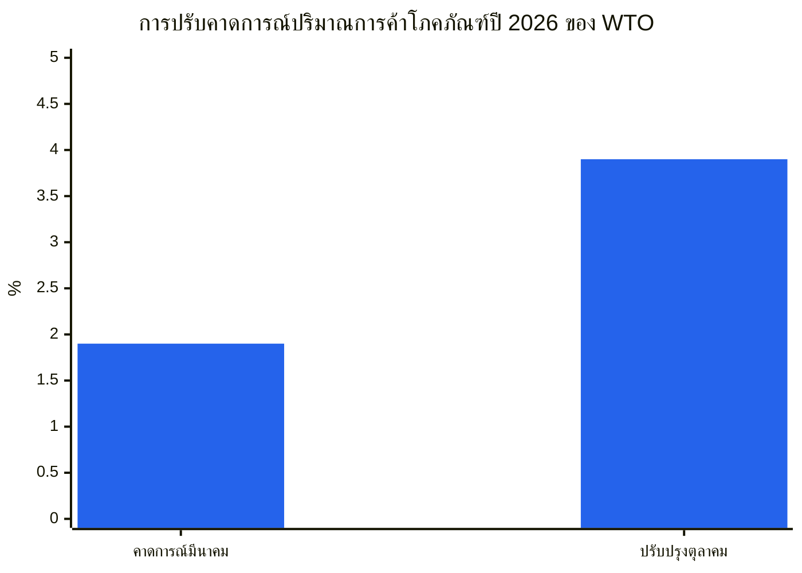

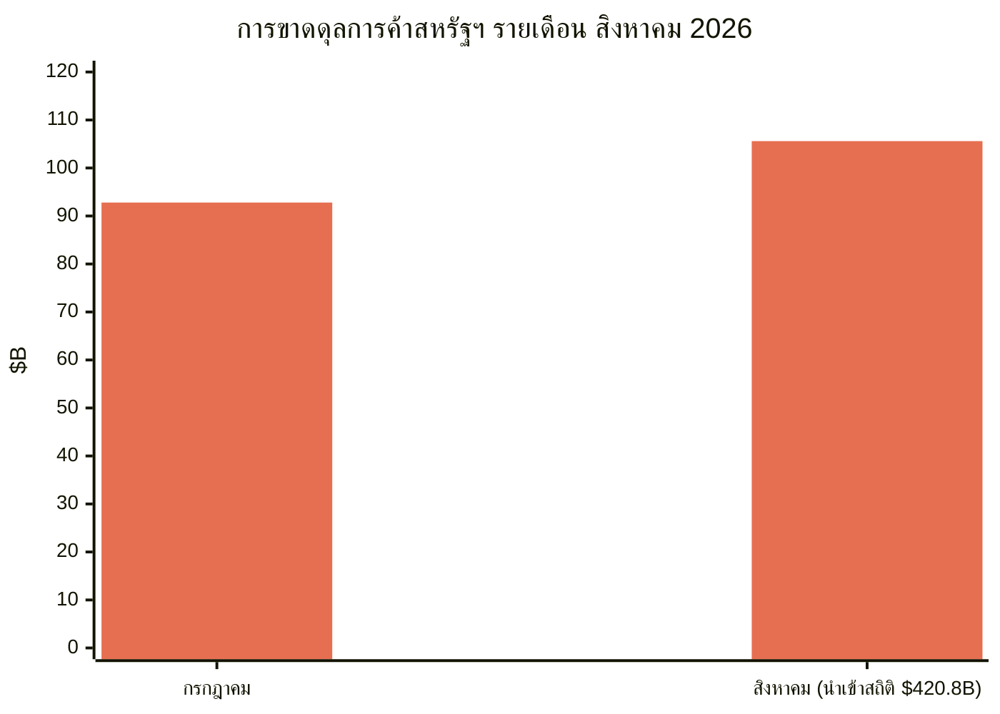

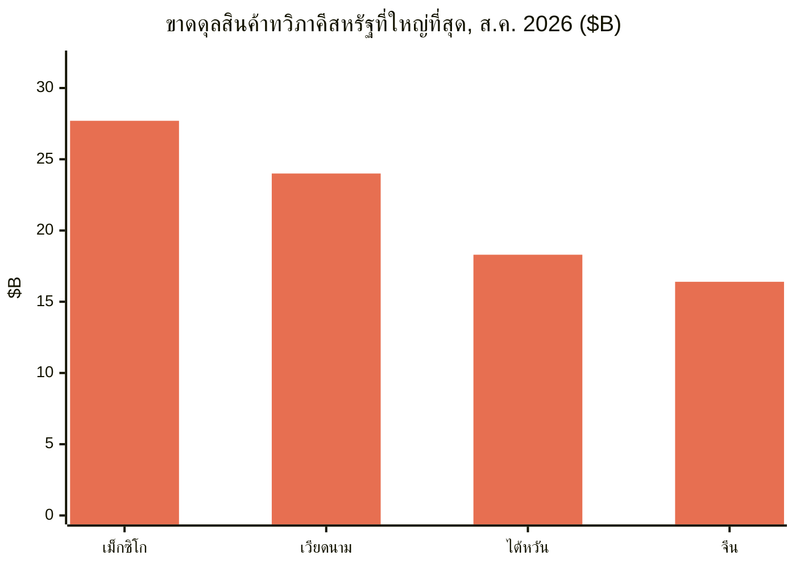

**วิเคราะห์** รายงานสามฉบับเล่าเรื่องเดียวจากสามมุม: ความต้องการแข็งแกร่ง (การนำเข้าสหรัฐฯ ทำสถิติ) องค์ประกอบแคบ (สินค้า AI ขับเคลื่อนเกือบครึ่งของการเติบโตทางการค้า; UNCTAD ชี้ความกระจุกตัว) และภูมิศาสตร์แบบเลือก (การค้าจีน–สหรัฐฯ ลดลงกว่า 20% นับตั้งแต่ 2024 ขณะเม็กซิโก เวียดนาม และไต้หวันเติมช่องว่าง) ความแตกต่างระหว่างความมองโลกในแง่ดีด้านปริมาณของ WTO กับความระมัดระวังด้านปริมาณจริงของ UNCTAD — กำไรนามที่ขับเคลื่อนด้วยราคาต่อปริมาณจริงที่อ่อนแอ — เป็นกรอบวิเคราะห์สำหรับไตรมาสนี้ รายงาน WEO เดือนตุลาคมของ IMF ที่จะออกระหว่างการประชุมประจำปีที่กรุงเทพฯ (12–18 ตุลาคม) จะนำการประเมินจำลองภาษีอย่างเป็นทางการ ([bea.gov](https://www.bea.gov/news/2026/us-international-trade-goods-and-services-august-2026), [reuters.com](https://www.reuters.com/business/us-trade-deficit-widens-august-amid-strong-imports-2026-10-06/), [dig.watch](https://dig.watch/updates/wto-trade-outlook-ai-boom), [un.org](https://news.un.org/en/story/2026/10/1168566))

### 3.5 แร่หายาก: การกลับมามีผล 10 พฤศจิกายน

**เกิดอะไรขึ้น** การระงับการควบคุมการส่งออกแร่หายากที่ขยายเพิ่มเติมของจีนจะหมดอายุ **10 พฤศจิกายน 2026** โดยไม่มีการประกาศขยาย การควบคุมเดือนเมษายน 2025 สำหรับธาตุเจ็ดชนิดไม่เคยถูกระงับ สหรัฐฯ กำลังเพิ่มอำนาจต่อรองของตัวเอง: Reuters รายงาน 1 ตุลาคมว่ากระทรวงพาณิชย์ชะลอใบอนุญาตส่งออกชิ้นส่วนอากาศยานไปจีน รวมถึงการส่งไปยัง COMAC รัฐวิสาหกิจ และกำลังพิจารณากฎใหม่เกี่ยวกับใบอนุญาตล้อลงจอดและของเหลวไฮดรอลิก

**ตัวเลขสำคัญ**
- IEA เตือนการบังคับใช้การควบคุมที่ขยายเพิ่มเติมของจีนอย่างเต็มรูปแบบอาจทำให้การผลิตปลายน้ำนอกจีนราว **$6.5 ล้านล้าน/ปี** เสี่ยง
- จีนจัดหายิตเทรียมให้สหรัฐฯ 70% ของการนำเข้าในปี 2021–2024; การพึ่งพาการนำเข้าสุทธิของสหรัฐฯ สำหรับยิตเทรียมอยู่ที่ 100% ในปี 2025
- การตอบสนองของตะวันตกสัปดาห์นี้: ชุดกฎหมายสภาคองเกรสสี่ฉบับเรื่องสต็อกและใบอนุญาต; American Rare Earths ขยายเหมืองไวโอมิง 50%; Lindian Resources ทุ่ม $150 ล้านให้ศูนย์แปรรูปในเอเชียกลาง

**วิเคราะห์** การกลับมามีผล 10 พฤศจิกายนเป็นอัตโนมัติเว้นแต่ทั้งสองรัฐบาลขยายการระงับ — สามสถานการณ์รออยู่: การขยาย การเปิดใช้งานแบบเลือก หรือการฟื้นเต็มรูปแบบ คำมั่นของปักกิ่งในการประชุมสุดยอดเดือนพฤษภาคม 2026 ที่จะ "จัดการข้อกังวลของสหรัฐฯ" ยังไม่ก่อให้เกิดการขยายอย่างเป็นทางการ และการส่งแร่หายากยังไม่กลับสู่ระดับที่ตกลงกัน คำสัญญาของการเจรจาปักกิ่งเรื่องช่องทางกรีนการออกใบอนุญาตที่ "ราบรื่น คาดการณ์ได้" สำหรับบริษัทในยุโรปจะถูกทดสอบกับวันกลับมามีผล

### 3.6 สิบห้าเศรษฐกิจจับมือเรื่องกำลังการผลิตส่วนเกิน — นอก WTO

**เกิดอะไรขึ้น** เมื่อ 7 ตุลาคม รัฐมนตรีการค้าของ 15 เศรษฐกิจ — สหรัฐฯ อาร์เจนตินา ออสเตรเลีย แคนาดา อียู ฝรั่งเศส เยอรมนี อินเดีย อิตาลี ญี่ปุ่น เกาหลีใต้ เม็กซิโก โปแลนด์ ตุรกี และสหราชอาณาจักร — ลงนามแถลงการณ์รัฐมนตรีร่วมเรียกร้องให้ดำเนินการขจัดกำลังการผลิตส่วนเกินเชิงโครงสร้างและนโยบาย "นอกตลาด" ที่ส่งเสริมการผลิตเกิน เกิดจากการประชุมรัฐมนตรีการค้า G20 ที่มิลวอกี (30 กันยายน–1 ตุลาคม) ที่ไม่มีฉันทามติ และตกลงกันนอกรอบการประชุมคณะกรรมการการค้า OECD สัญญาแพลตฟอร์มเฉพาะภาคส่วน การประชุมทางเทคนิคก่อนธันวาคม และการแบ่งปันข้อมูล

**วิเคราะห์** นี่คือแถลงการณ์ร่วมของกลุ่มพันธมิตรเรื่องกำลังการผลิตส่วนเกินที่ใหญ่ที่สุดของปี และทำให้แนวทางการติดตามแบบพหุภาคีนอก WTO เป็นสถาบัน ผู้ที่ไม่ลงนามสำคัญพอๆ กับผู้ลงนาม: จีน รัสเซีย บราซิล อินโดนีเซีย ซาอุดีอาระเบีย แอฟริกาใต้ และสหภาพแอฟริกาไม่ลงนาม และจีนเตือนเมื่อ 9 ตุลาคมว่าจะตอบโต้ "ตามความจำเป็น" หากแถลงการณ์ถูกใช้เป็นข้ออ้างสำหรับมาตรการที่ทำร้ายผลประโยชน์ของตน การขาดหายของบราซิล — สมาชิก G20 รายใหญ่ที่เผชิญภาษีมาตรา 301 ของสหรัฐฯ — น่าสังเกต การประชุมทางเทคนิคก่อนธันวาคมกลายเป็นจุดเฝ้าระวัง ([reuters.com](https://www.reuters.com/business/some-g20-trade-ministers-sign-us-led-statement-denouncing-excess-factory-2026-10-07/))

### 3.7 ผู้นำเข้าสหรัฐฯ ยังซื้อต่อเนื่อง: ตู้คอนเทนเนอร์สถิติเดือนกันยายน

**เกิดอะไรขึ้น** รายงาน Global Shipping Report เดือนตุลาคมของ Descartes (เผยแพร่ 8 ตุลาคม) แสดงการนำเข้าตู้คอนเทนเนอร์ของสหรัฐฯ **2,546,261 TEU ในเดือนกันยายน** — สูงสุดเป็นประวัติการณ์สำหรับเดือนกันยายน เพิ่มขึ้น 10.3% เมื่อเทียบปีก่อน (Reuters/Descartes; Descartes รายงานลดลง 2.2% จากเดือนสิงหาคม) การนำเข้าจากจีน 924,454 TEU — เพิ่มขึ้น 4.5% จากเดือนก่อนตาม Descartes และ Reuters รายงาน +21.2% เมื่อเทียบปีก่อน — คิดเป็น 36.3% ของปริมาณรวม หมวดค้าปลีก (สินค้าพลาสติก เฟอร์นิเจอร์/เครื่องนอน ของเล่น/อุปกรณ์กีฬา) ครองการส่งจากจีน ปริมาณ ม.ค.–ก.ย. 2026 เพิ่มขึ้น 0.8% เทียบกับ 2025 — การเพิ่มขึ้นสะสมเหนือ 2025 ครั้งแรกของปีนี้ หลักฐานยืนยัน: ท่าเรือ LA จัดการสถิติ 1.04 ล้าน TEU ในเดือนกันยายน (Gene Seroka, 9 ตุลาคม); ท่าเรือสะวันนาห์สถิติ 504,015 TEU (+3.7% เมื่อเทียบปีก่อน 7 ตุลาคม) Global Port Tracker ของ NRF คาดสิงหาคมเป็นเดือนสูงสุดของปี 2026; การนำเข้า "น่าจะผ่านช่วงที่คึกคักที่สุดของปีไปแล้ว" (JOC, 8 ตุลาคม)

**วิเคราะห์** แม้มีระบอบภาษี ความต้องการนำเข้าของสหรัฐฯ ยังแข็งแกร่ง — การนำเข้า $420.8 พันล้านสถิติเดือนสิงหาคมของ FT-900 และตู้คอนเทนเนอร์สถิติเดือนกันยายนของ Descartes ชี้ทางเดียวกัน: ห่วงโซ่อุปทานกำลังเปลี่ยนเส้นทาง (ช่องว่างทวิภาคีของเม็กซิโก เวียดนาม ไต้หวันใหญ่กว่าของจีนแล้ว) มากกว่าย้ายฐานกลับประเทศ ([reuters.com](https://www.reuters.com/world/china/us-ocean-container-imports-set-new-record-september-descartes-says-2026-10-08/))

### 3.8 ทางอากาศและทางบก: ฤดูกาลสูงสุดที่เงียบยกเว้นหนึ่งจุด

**ขนส่งทางอากาศ** ข้อมูล Xeneta แสดงปริมาณขนส่งทางอากาศทั่วโลกเติบโต **+4% ในเดือนตุลาคม** ตรงข้ามคาดการณ์ตลาดทรงตัว แต่ความต้องการยุโรป–อเมริกาเหนือลดลง **−6% เมื่อเทียบปีก่อน** — "สัญญาณรุนแรง" และอาจเป็นสัญญาณเตือน การส่งอีคอมเมิร์ซจีน–ยุโรปพุ่ง **+62% เมื่อเทียบปีก่อน** ในเดือนกันยายน ขณะอีคอมเมิร์ซจีน–สหรัฐฯ ลดลง **−34%** (เดือนที่ห้าติดต่อกัน ชะลอจาก −49% ในมิถุนายน) ดัชนี TAC เดือนกันยายน: ฮ่องกง–อเมริกาเหนือ $7.02/กก. (+31% เมื่อเทียบปีก่อน) ฮ่องกง–ยุโรป $4.80/กก. (+8.8%); ดัชนี Baltic Air Freight เพิ่มขึ้น 25.5% เมื่อเทียบปีก่อน ค่าธรรมเนียม €3 ต่อพัสดุของอียูสำหรับสินค้าต่ำกว่า €150 กำลังกดปริมาณเอเชีย–ยุโรป รายงานเดือนตุลาคมของ Dimerco คาดความแออัดทางทะเลและสินค้าจีน–สหรัฐฯ ที่ถูกกักไว้อาจผลักปริมาณเข้าทางอากาศในไตรมาส 4; Xeneta เห็นฤดูกาลสูงสุดที่เงียบ ตัวแปร: การโจมตีสนามบินซาอุดีอาระเบียตัดความจุขนส่งทางอากาศขาออกจากริยาดหนึ่งในสาม ขณะฤดูกาลสูงสุดใกล้มา ([airfreight.news](https://airfreight.news/articles/full/october-air-cargo-volumes-surprise-with-4-growth-but-is-europe-north-america-slump-a-bellwether-for-global-trade))

**การขนส่งทางถนนสหรัฐฯ** อัตราค่าจ้างเหมารถบรรทุกแตะสูงสุดรอบ 52 สัปดาห์ที่ **$2.72/ไมล์** บวกน้ำมัน (+18% เมื่อเทียบปีก่อน); สปอต dry-van $3.55/ไมล์รวมทุกอย่าง สูงกว่าราว 50% เมื่อเทียบปีก่อน — ขับเคลื่อนโดยน้ำมันเชื้อเพลิงและความตึงตัวของกำลังบรรทุก ไม่ใช่ความต้องการ ดีเซลแตะ $6.39/แกลลอน การปฏิเสธงานขนส่งขาออก ~13.75–14% กำลังบรรทุกใหม่กำลังหด: รถแทรกเตอร์ในฟลีตรับจ้างใหม่ลดลงเหลือ 19,520 ในเดือนสิงหาคม (−14% เทียบค่าเฉลี่ยครึ่งปีแรก); ผู้จดทะเบียนข้ามรัฐใหม่เพียง ~2 ใน 3 ซื้อประกันความรับผิด (เทียบ 9 ใน 10 ในปี 2019) GRI 4.9% ของ Old Dominion มีผล 5 ตุลาคม; DHL Express ร่วม FedEx ที่ GRI 5.9% ปี 2027 (1 มกราคม) ([freightwaves.com](https://www.freightwaves.com/news/trucking-rates-spike-contracts-at-52-week-high))

---

## 4. ตัวติดตามภาษีศุลกากร

| ประเทศ | มาตรการ | อัตรา | วันที่มีผล | สถานะ | แหล่งข้อมูล |
|---|---|---|---|---|---|
| สหรัฐฯ → แคนาดา | ภาษีเพิ่มเติมมาตรา 338 | 50% (ไม่มีข้อยกเว้น USMCA) | 22 ส.ค. 2026 (ปรับขอบเขต 15 ก.ย.) | มีผลบังคับ | [whitehouse.gov](https://www.whitehouse.gov/fact-sheets/2026/07/fact-sheet-president-donald-j-trump-imposes-additional-tariffs-on-canada/) |
| สหรัฐฯ → แคนาดา | คำสั่งห้ามนำเข้ามาตรา 338 (รถจักรยานยนต์ เวย์ กากน้ำตาล เบียร์ไม่มีแอลกอฮอล์ แอลกอฮอล์ ผลิตภัณฑ์นม) | ปฏิเสธการนำเข้า (สินค้าระหว่างขนส่ง: อากร 50%) | 29 ก.ย. 2026 | มีผลบังคับ | [asrwe.com](https://asrwe.com/asr-university/us-canada-import-ban-alcohol-motorcycles-section-338-expansion-september-2026) |
| สหรัฐฯ → แคนาดา | ภาษีมาตรา 301 แรงงานบังคับ | 10% (หลีกเลี่ยงได้ด้วยคำอ้าง USMCA ที่ถูกต้อง; สินค้าครอบคลุมที่ไม่ใช่ USMCA เจอ 50%+10%=60%) | 23 ก.ค. 2026 | มีผลบังคับ; คดีฟ้อง 25 รัฐรอดำเนินการ ยังไม่มีคำตัดสิน | [jdsupra.com](https://www.jdsupra.com/legalnews/forced-labor-meet-section-301-new-1432199/) |
| แคนาดา → สหรัฐฯ | ภาษีตอบโต้ ~335 รายการภาษี (เหล็ก อลูมิเนียม ผลิตภัณฑ์นม รถยนต์ เครื่องใช้ไฟฟ้า อุปกรณ์เกษตร กระดาษ พลาสติก อิเล็กทรอนิกส์) | 15% / 25% / 50% | 8 ก.ย. 2026 | มีผลบังคับ | [surtaxscan.com](https://surtaxscan.com/news/canadas-counter-tariffs-are-back-15-25-and-50-on-335-us-tariff-items-from) |
| สหรัฐฯ → รัสเซีย | อากรมาตรา 112 กฎหมาย Graham Act สำหรับสินค้ารัสเซียทั้งหมดรวมปิโตรเลียม | สูงสุด 500% | เส้นตาย 18 ต.ค. 2026 | รอดำเนินการ; อาจมีการยกเว้น | [mondaq.com](https://www.mondaq.com/unitedstates/export-controls-trade-investment-sanctions/1851398/the-lindsey-graham-sanctions-act-what-businesses-need-to-know-about-the-new-tariffs) |
| สหรัฐฯ → ผู้ซื้อพลังงานรัสเซียรายใหญ่ (อินเดีย จีน ตุรกี ฯลฯ) | ภาษีทุติยภูมิมาตรา 113 กฎหมาย Graham Act | สูงสุด 100% (ทับซ้อนกับอากรเดิมทั้งหมด) | เส้นตาย 18 ต.ค. 2026 | รอดำเนินการ; การยกเว้นของประธานาธิบดีต้องมีหนังสือรับรองไม่เป็นความลับต่อรัฐสภา | [mondaq.com](https://www.mondaq.com/unitedstates/export-controls-trade-investment-sanctions/1851398/the-lindsey-graham-sanctions-act-what-businesses-need-to-know-about-the-new-tariffs) |
| สหรัฐฯ → รัสเซีย | ใบอนุญาตทั่วไป 135 ของ OFAC: อนุญาตนำเข้าดีเซลรัสเซีย | n/a (ใบอนุญาต) | 9 ต.ค. 2026 – 7 เม.ย. 2027 | มีผลบังคับ | [nationpress.com](https://www.nationpress.com/international/trump-buys-russian-diesel-before-graham-act-deadline) |
| จีน → อียู (p-nitrotoluene) | การไต่สวนต่อต้านการทุ่มตลาด (ประกาศ MOFCOM ฉบับที่ 44) | อ้างอัตรากำไรทุ่มตลาด >100% (อากรชั่วคราวรอกำหนด) | เปิด 3 ต.ค. 2026; ปิดรับขึ้นทะเบียน 23 ต.ค. | การไต่สวนเปิดอยู่ | [mlex.com](https://www.mlex.com/mlex/articles/2533700/china-opens-anti-dumping-probe-into-eu-para-nitrotoluene) |
| อียู → จีน | การควบคุมการส่งออกไฮบริด/PHEV — "ความเข้าใจร่วมกัน" | การจำกัดการส่งออกโดยสมัครใจ (Šefčovič อ้างลดครึ่งหนึ่ง; ข้อความปักกิ่งไม่มีตัวเลข) | ผลลัพธ์ตัดสินที่การประชุมสุดยอดอียู 15–16 ต.ค. | รอการรับรองทางการเมือง | [eureporter.co](https://www.eureporter.co/world/china-2/2026/10/09/eu-and-china-strike-preliminary-trade-deal-ahead-of-crucial-leaders-summit/) |
| สหราชอาณาจักร → จีน | ภาษีรถยนต์ไฟฟ้าผลิตในจีน | สูงสุด 45% (เท่าอัตรารวมของอียู) | อยู่ระหว่างพิจารณา | ยังไม่ตัดสิน ("ยังไม่ชัดเจนทั้งสองทาง") | [fleetnews.co.uk](https://Www.fleetnews.co.uk/news/uk-weighs-chinese-car-tariffs-as-fleet-demand-for-evs-surges) |
| บราซิล | อากรศูนย์: ไมโครโฟน เครื่องดนตรี จักรเย็บผ้าในครัวเรือน | 0% (จาก 18–20%) | 1 ต.ค. 2026 | มีผลบังคับ | [datamarnews.com](https://datamarnews.com/noticias/zero-import-tariffs-take-effect-for-musical-instruments-in-brazil/) |
| สหรัฐฯ | มาตรา 232 โพลีซิลิคอนและอนุพันธ์ | MIPs: $21/กก. โพลี, $100/กก. เวเฟอร์, $0.22/W เซลล์, $0.38/W โมดูล + 15% ตามมูลค่า | 4 ธ.ค. 2026 (กฎป้องกันการทะลักมีผลตั้งแต่ 22 ก.ย.) | กำหนดไว้ | [mondaq.com](https://www.mondaq.com/unitedstates/export-controls-trade-investment-sanctions/1848548/polysilicon-and-derivatives-in-the-bullseye-for-major-new-tariffs-and-other-restrictions) |
| สหรัฐฯ → จีน | มาตรา 301 รายการ 2 และ 3 (มาตรการปี 2018) | 7.5%–25% | มีผลบังคับ (USTR สรุปทบทวนรอบสี่ปีครั้งที่สอง 7 ต.ค. ภาษียังคงอยู่) | มีผลบังคับ | [internationaltradetoday.com](https://internationaltradetoday.com/article/2026/10/06/ustr-section-301-tariffs-from-2018-will-continue-2610060064?BC=bc_6ac595c738480) |
| สหรัฐฯ → ~60 เศรษฐกิจ | ภาษีมาตรา 301 แรงงานบังคับ | ระดับ 10% (17 เศรษฐกิจรวมแคนาดา อินเดีย เม็กซิโก สหราชอาณาจักร); 12.5% ส่วนที่เหลือ; อียู/ไต้หวันจำกัดรวม 10% | 23 ก.ค. 2026 | มีผลบังคับ; คดีฟ้อง 3 คดีรอดำเนินการ | [jdsupra.com](https://www.jdsupra.com/legalnews/forced-labor-meet-section-301-new-1432199/) |
| สหรัฐฯ → ~60 เศรษฐกิจ (TRQ ที่เสนอ) | โควตาภาษีอาเซียน (บังกลาเทศ กัมพูชา อินโดนีเซีย มาเลเซีย) สำหรับสินค้าที่มีวัตถุดิบฝ้าย/สิ่งทอสหรัฐฯ — ยกเว้นภาษีมาตรา 301 แรงงานบังคับ | ยังไม่กำหนด | อยู่ระหว่างพิจารณา | ขั้นเสนอ | [asiadaily.org](https://asiadaily.org/news/14890/) |
| สหรัฐฯ | คำแนะนำ "ปริมาณเนื้อหาสหรัฐฯ" ของ BIS: อุปกรณ์อุตสาหกรรมเคลื่อนที่ USMCA (ประกาศ 11032) — ลดภาษี 25% → พื้น 15% เมื่อมีเนื้อหาสหรัฐฯ ≥40% | อัตรามีผลพื้น 15% | มีผล 14 ต.ค. 2026 (ประกาศ FR) | กำหนดไว้ | [kpmg.com](https://kpmg.com/us/en/taxnewsflash/news/2026/10/us-bis-guidance-us-content-canadian-mexican-products.html) |
| อินเดีย | โครเมียมไตรออกไซด์ — ผลสุดท้าย CVD เป็นบวก | n/a | 8 ต.ค. 2026 (มาตรการสหรัฐฯ) | ออกผลสุดท้ายแล้ว | [federalregister.gov](https://www.federalregister.gov/documents/2026/10/08/2026-20696/chromium-trioxide-from-india-final-affirmative-countervailing-duty-determination) |
| จีน | CBS (ตัวเร่งปฏิกิริยายาง) — ผลเบื้องต้น CVD เป็นบวก + สถานการณ์วิกฤต | n/a | 8 ต.ค. 2026 (มาตรการสหรัฐฯ) | ออกผลเบื้องต้นแล้ว | [federalregister.gov](https://www.federalregister.gov/documents/2026/10/08/2026-20692/n-cyclohexylbenzothiazole-2-sulfenamide-from-the-peoples-republic-of-china-preliminary-affirmative) |
| จีน | สารประกอบเอมีน — เปิดการไต่สวน AD/CVD (อ้างอัตรากำไรสูงสุด 476%) | ยังไม่กำหนด | ผลเบื้องต้น ITC ภายใน 13 พ.ย. 2026 | การไต่สวนเปิดอยู่ | [federalregister.gov](https://www.federalregister.gov/documents/2026/10/05/2026-20286/amine-compounds-from-china-institution-of-antidumping-and-countervailing-duty-investigations-and) |
| เม็กซิโก | รถพ่วงบรรทุกน้ำมัน — เปิดการไต่สวน AD/CVD | ยังไม่กำหนด | ผลเบื้องต้น ITC ภายใน 16 พ.ย. 2026 | การไต่สวนเปิดอยู่ | [federalregister.gov](https://www.federalregister.gov/documents/2026/10/05/2026-20349/railway-tank-cars-and-parts-thereof-from-mexico-institution-of-antidumping-and-countervailing-duty) |
| ญี่ปุ่น | ขยายคำสั่งห้ามส่งออกสินค้าสำหรับฐานอุตสาหกรรมรัสเซีย | ห้ามส่งออก | 16 ต.ค. 2026 | กำหนดไว้ | [globalsanctions.com](https://globalsanctions.com/2026/10/japan-adds-more-goods-to-russia-export-ban-from-16-october-2026/) |

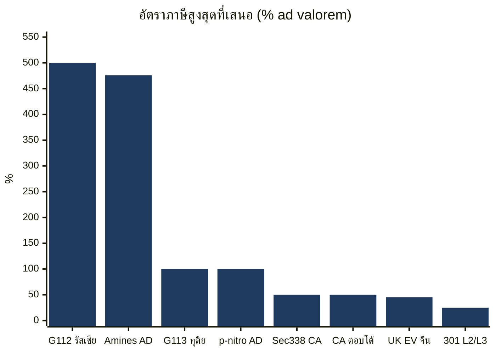
*อัตราสูงสุดที่ประกาศ ('up to' สำหรับมาตรการที่เสนอ; AD = อัตรามาร์จิ้นทุ่มตลาดที่กล่าวอ้าง)*

---

## 5. เจาะลึกนโยบายสหรัฐฯ

### สหรัฐฯ–แคนาดา: ทางตันพร้อมเมฆทางกฎหมาย

ไม่มีประกาศมาตรา 338 ฉบับใหม่ออกมาในช่วงนี้ มาตรการที่มีอยู่: **ภาษีมาตรา 338 เพิ่มเติม 50%** สำหรับสินค้าแคนาดา (มีผลตั้งแต่ 22 สิงหาคม; ชุดที่สองมีผล 15 กันยายน ครอบคลุมกระดาษ เฟอร์นิเจอร์ ชีส หนัง เรือยนต์ รถกอล์ฟ เหล็ก อลูมิเนียม และผลิตภัณฑ์โลหะพื้นฐาน — อากรใช้โดยไม่คำนึงถึงถิ่นกำเนิด USMCA; พลังงาน โพแทส สินค้าที่มาตรา 232 ครอบคลุม ปลา และแร่วิกฤตยกเว้น); **คำสั่งห้ามนำเข้า** มีผล 29 กันยายน สำหรับรถจักรยานยนต์ เวย์ กากน้ำตาล เบียร์ไม่มีแอลกอฮอล์ แอลกอฮอล์ และผลิตภัณฑ์นม (ราว $967 ล้าน); ภาษีตอบโต้ **15%/25%/50%** ที่สะท้อนกันของแคนาดาต่อสินค้าสหรัฐฯ ราว C$27.6 พันล้าน (เหล็ก อลูมิเนียม ผลิตภัณฑ์นม รถยนต์ เครื่องใช้ไฟฟ้า อุปกรณ์เกษตร กระดาษ พลาสติก อิเล็กทรอนิกส์) มีผล 8 กันยายน; และคำสั่งประธานาธิบดี 8 กันยายนให้ GSA (ร่วมกับ USTR) นำสินค้าถิ่นกำเนิดแคนาดาออกจากตารางรางวัลหลายฉบับของ GSA

พัฒนาการสัปดาห์นี้: สถาบันเศรษฐกิจมอนทรีออลเผยแพร่บันทึก 8 ตุลาคม (Phillip W. Magness) โต้แย้งว่าภาษีตอบโต้ของแคนาดาอาจทำให้ความท้าทายทางกฎหมายของสหรัฐฯ ต่อภาษีมาตรา 338 อ่อนลง; ความเห็นทางกฎหมายยังคงโต้แย้งว่ามาตรา 338 อาจถูกแทนที่โดยพระราชบัญญัติขยายการค้า 1962 และพระราชบัญญัติการค้า 1974 ก่อให้เกิดประเด็นคำถามสำคัญและการมอบอำนาจ — แต่**ยังไม่มีคดีในศาล**ที่ท้าทายภาษีมาตรา 338 โดยตรง แยกกัน **คดีฟ้อง 25 รัฐ** เรื่องภาษีมาตรา 301 แรงงานบังคับเดือนกรกฎาคม 2026 (คดีฟ้องรวมสามคดีท้าทายอากร 10–12.5% ต่อ ~60 เศรษฐกิจ) **ยังไม่มีคำตัดสินเป็นลายลักษณ์อักษร ณ 4 ตุลาคม** ในเส้นทางเจรจา USTR Greer อธิบายจุดติดขัดที่เหลือของแคนาดา (รถยนต์ ผลิตภัณฑ์นม เครื่องดื่มแอลกอฮอล์) ว่า "ค่อนข้างยาก" และกล่าวว่าวอชิงตัน "ไม่เอียง" ไปทางภาษีศูนย์; นายกรัฐมนตรี Carney เปิดเผยว่าออตตาวาเตรียมยกเลิกภาษีตอบโต้ที่เหลือสำหรับเหล็ก อลูมิเนียม และรถยนต์ หากวอชิงตันลดของตัวเองลงอย่างมาก และส่งเสริมให้จังหวัดนำแอลกอฮอล์สหรัฐฯ กลับขึ้นชั้น — แต่จะไม่เปลี่ยนระบบจัดการอุปทาน แคนาดาส่งสัญญาณยับยั้งชั่งใจมากกว่ายกระดับเพิ่ม ([iedm.org](https://www.iedm.org/counter-tariffs-the-federal-government-is-undermining-u-s-legal-challenges-to-section-338/), [akingump.com](https://www.akingump.com/en/insights/alerts/president-trump-directs-removal-of-canadian-products-from-federal-procurement), [hashtag investing](https://www.hashtaginvesting.com/blog/u-s-trade-chief-says-canadas-sticking-points-are-quite-difficult-and-washington-is-not-inclined-to-go-to-zero-tariff))

### การคืนภาษี IEEPA: ระยะที่ 3 เริ่ม

CBP เปิด**ระยะที่ 3 ของกระบวนการคืนภาษี IEEPA ตามคำสั่งศาล**เมื่อ **6 ตุลาคม** ผ่านแพลตฟอร์มคำร้องออนไลน์ (CAPE) ผู้นำเข้าที่บันทึกไว้ที่ยื่นหมายเลข IOR ภายใน 30 กรกฎาคม 2026 อาจเข้าร่วม รัฐบาลกลางอุทธรณ์ส่วนของคำสั่งศาลการค้าระหว่างประเทศที่กำหนดให้คืนภาษีแก่ผู้นำเข้าที่บันทึกไว้ที่ไม่เป็นคู่ความในคดี สำหรับรายการที่ชำระบัญชีเกิน 80 วันแล้ว; CBP ระบุว่ากำลังคืนอากรโดยสมัครใจสำหรับรายการที่ยังไม่ชำระบัญชีและรายการภายใน 80 วันหลังชำระบัญชี CBP รับความเห็นสาธารณะเพิ่มเติมเกี่ยวกับการเก็บข้อมูลการคืนภาษีถึง **4 พฤศจิกายน** (Reginfo.gov) นี่คือการปฏิบัติการของเงินคืนภาษี IEEPA ~$180 พันล้านที่สั่งหลังศาลฎีกายกเลิกภาษี "Liberation Day" เดือนกุมภาพันธ์ 2026; ขอบเขตการบรรเทาสำหรับผู้นำเข้าที่ไม่เป็นคู่ความในคดีซึ่งมีรายการชำระบัญชีเก่ายังเป็นข้อถกเถียง Yale Budget Lab ประเมินแรงกระตุ้นทางการคลังชั่วคราวเชิงบวกจากการคืนภาษี IEEPA ชดเชยผลกระทบเชิงลบต่อการเติบโตของภาษีที่เหลือสำหรับปี 2026 โดยประมาณ ([thompsonhine.com](https://www.thompsonhine.com/insights/cbp-confirms-october-6-2026-launch-of-phase-3-of-the-ieepa-tariff-refund-process/))

### การปฏิบัติการ CBP

- **ค่าธรรมเนียมผู้ใช้ศุลกากรปีงบ 2027 (มีผล 1 ตุลาคม):** ค่าธรรมเนียมใบอนุญาตนายหน้าศุลกากรเพิ่มจาก $185.38 เป็น **$190.88**; อัตราค่าธรรมเนียมการแปรรูปสินค้ายัง **0.3464%** โดยเพิ่มขีดจำกัดขั้นต่ำและสูงสุด ([ghy.com](https://www.ghy.com/trade-compliance/category/us-customs/))
- **การส่งมูลค่าต่ำ (RIN 1685-AA38):** CBP เปิดรับปรึกษาเมื่อ **8 ตุลาคม** เรื่องการเปลี่ยนแปลงที่เสนอต่อข้อกำหนดการนำเข้าอย่างไม่เป็นทางการสำหรับการส่งมูลค่าต่ำ; ปิดรับความเห็น **7 ธันวาคม** ([digitalpolicyalert.org](https://digitalpolicyalert.org/event/44472-customs-and-border-protection-opened-consultation-on-proposed-rule-on-low-value-shipments))
- **TRQ น้ำตาลปีงบ 2027 (เปิด 1 ตุลาคม):** น้ำตาลทรายขาวและน้ำตาลพิเศษถูกจองเกิน — จัดสรรตามสัดส่วน **51.03027%** (ทรายขาว) และ **44.58212%** (พิเศษ) ([ghy.com](https://www.ghy.com/trade-compliance/category/us-tariffs/))

### USTR

- **8 ตุลาคม:** ใช้**กลไกตอบสนองอย่างรวดเร็วด้านแรงงาน USMCA** เพื่อทบทวนว่าคนงานที่ **GLM Components Mexico, S.A. de C.V.** (ปวยบลา; ชิ้นส่วนรถยนต์) ถูกปฏิเสธเสรีภาพในการสมาคมและการเจรจาต่อรองร่วมหรือไม่; สหรัฐฯ **ระงับการชำระบัญชี** รายการที่ยังไม่ชำระของสินค้าจากโรงงาน ([ustr.gov](https://ustr.gov/about/policy-offices/press-office/press-releases/2026))
- **7 ตุลาคม:** เรียกเจ้าหน้าที่อาวุโสของ **14 เศรษฐกิจ** นอกรอบคณะกรรมการการค้า OECD; ออกแถลงการณ์รัฐมนตรีร่วมเรื่องกำลังการผลิตส่วนเกินเชิงโครงสร้าง — ต้นแบบของแถลงการณ์ 15 เศรษฐกิจ (ดู §3.6)
- **5 ตุลาคม:** เอกอัครราชทูต Greer เป็นเจ้าภาพ**รัฐมนตรีการค้า G20** ที่มิลวอกี; หารือการขจัดแรงงานบังคับ การปรับปรุงหลักการ MFN การประณามการใช้อาหารเป็นอาวุธ และกำลังการผลิตส่วนเกิน
- **การทบทวนรอบสี่ปีมาตรา 301 (มาตรการปี 2018):** USTR ประกาศว่าการทบทวนรอบสี่ปีครั้งที่สองของมาตรการมาตรา 301 วันที่ 6 กรกฎาคม 2018 และ 23 สิงหาคม 2018 (รายการ 2 และ 3 ของจีน) สิ้นสุดโดยภาษี**ยังคงอยู่** — อากรเพิ่มเติมโดยทั่วไป 7.5% ถึง 25% บางรายการสูงกว่าหลังการปรับปรุงภายหลัง (ประกาศ Federal Register เผยแพร่ 7 ตุลาคม)
- **การทบทวนร่วม USMCA ปี 2027:** รับความเห็นและคำขอเข้าฟังถึง **12 มกราคม 2027**
- **ข้อเสนอโควตาภาษีอาเซียน:** USTR กำลังพิจารณา TRQ สามปีสำหรับบังกลาเทศ กัมพูชา อินโดนีเซีย และมาเลเซีย ที่อาจยกเว้นผลิตภัณฑ์ที่มีวัตถุดิบฝ้ายและสิ่งทอสหรัฐฯ จากภาษีมาตรา 301 แรงงานบังคับ — ยังอยู่ระหว่างพิจารณา มาเลเซียยึดข้อตกลงว่าด้วยการค้าต่างตอบแทนเดือนตุลาคม 2025 (อัตรา 19%); อินโดนีเซียถือว่าข้อตกลง "ยุคทองใหม่" เดือนกุมภาพันธ์ 2026 ผูกพัน; ไทยกำลังประเมิน; เวียดนามใช้ความใกล้ชิดทางการทูต ([asiadaily.org](https://asiadaily.org/news/14890/))
- **บราซิล:** หลังประชุม 30 กันยายนกับ Greer ผู้เจรจาบราซิล Rosa กล่าวบราซิลต้องการลดภาษีเต็มรูปแบบ — รวมถึงภาษีมาตรา 232 เหล็ก อลูมิเนียม และชิ้นส่วนรถยนต์ — และทั้งสองฝ่ายตกลงแต่งตั้งคณะทำงานเพื่อกำหนดขอบเขตประเด็นการค้า; เขาเรียกภาษีมาตรา 301 เฉพาะบราซิล 25% ว่า "ภาษีที่เลวร้ายที่สุด" ([internationaltradetoday.com](https://internationaltradetoday.com/article/2026/10/01/brazil-expresses-confidence-it-can-reach-tariff-reduction-agreement-2610010041))

### BIS — การควบคุมการส่งออก

- **คำแนะนำ "ปริมาณเนื้อหาสหรัฐฯ" (ประกาศ FR กำหนด 14 ตุลาคม):** กำหนดวิธีคำนวณ "ปริมาณเนื้อหาสหรัฐฯ" สำหรับผลิตภัณฑ์แคนาดาและเม็กซิโกที่มีสิทธิได้รับการปฏิบัติพิเศษ USMCA ภายใต้ประกาศมาตรา 232 โลหะ 11032 — (1) มูลค่าชิ้นส่วนที่ได้มาทั้งหมด ผลิตทั้งหมด หรือแปรรูปอย่างมีนัยสำคัญในสหรัฐฯ; (2) ในขอบเขตที่ยังไม่นับ มูลค่าเหล็กที่หลอมและเท อลูมิเนียมที่ถลุงและหล่อ และทองแดงที่ถลุงและหล่อในสหรัฐฯ วิธีทั้งสองรวมกันไม่ได้ ผลปฏิบัติ: ผู้นำเข้าที่มีสิทธิของอุปกรณ์อุตสาหกรรมเคลื่อนที่ USMCA (รถยก เกรดเดอร์ เครน แบคโฮ รถดันดิน) สามารถลดภาษีมาตรา 232 จาก **25% เหลือพื้นมีผล 15%** เมื่อมูลค่าอย่างน้อย 40% เป็นเนื้อหาสหรัฐฯ; พิกัด HTS ใหม่ **9903.82.22** รายงานเนื้อหาที่ไม่ใช่สหรัฐฯ (หรือเนื้อหาสหรัฐฯ เกิน 40%) ขณะที่ 9903.82.21 ครอบคลุมเนื้อหาสหรัฐฯ ที่มีสิทธิสูงสุด 40% ([kpmg.com](https://kpmg.com/us/en/taxnewsflash/news/2026/10/us-bis-guidance-us-content-canadian-mexican-products.html))
- **กฎบริษัทในเครือ:** การระงับกฎที่ขยายข้อจำกัด Entity List/MEU/SDN ไปยังบริษัทในเครือต่างประเทศที่บุคคลในบัญชีถือหุ้น 50%+ ยังคงอยู่ โดยกำหนดกลับมามีผล **10 พฤศจิกายน** เว้นแต่ขยาย ข้อตกลงสหรัฐฯ–จีน 23 กันยายนที่ขยายกรอบปูซานถึง 10 มกราคม 2027 คาดว่าจะมีการขยายที่ตรงกัน แต่**ยังไม่มีประกาศ Federal Register** เผยแพร่ ที่ปรึกษาการค้าแนะนำเตรียมพร้อมบนสมมติฐานว่ากฎอาจกลับมา ([jdsupra.com](https://www.jdsupra.com/legalnews/bis-affiliates-rule-suspension-extended-1084647/))
- **ใบอนุญาตชิ้นส่วนอากาศยานไป COMAC:** Reuters รายงาน 1 ตุลาคม (แหล่งไม่ระบุชื่อ) ว่ากระทรวงพาณิชย์ชะลอใบอนุญาตส่งออกชิ้นส่วนอากาศยานไปจีน รวมถึงการส่งไปยัง COMAC รัฐวิสาหกิจ และกำลังพิจารณากฎใหม่เกี่ยวกับใบอนุญาตล้อลงจอดและของเหลวไฮดรอลิก ([investornews.com](https://investornews.com/critical-minerals-rare-earths/technology-metals-report-10-04-2026-a-summit-without-a-rare-earth-deal-leaves-the-west-buying-its-way-to-supply/))

### Federal Register — AD/CVD, 5–8 ตุลาคม

การไต่สวน AD/CVD ใหม่เปิดต่อ**สารประกอบเอมีนจากจีน** (อ้างอัตรากำไรทุ่มตลาดสูงสุด 476%; ผลเบื้องต้น ITC ภายใน 13 พฤศจิกายน) และ**รถพ่วงบรรทุกน้ำมันและชิ้นส่วนจากเม็กซิโก** (ผลเบื้องต้น ITC ภายใน 16 พฤศจิกายน); **ผลสุดท้าย CVD เป็นบวก** ต่อโครเมียมไตรออกไซด์จากอินเดีย; **ผลเบื้องต้น CVD เป็นบวก + สถานการณ์วิกฤต** ต่อ CBS จากจีน; ผลเบื้องต้นทบทวน AD ต่อเหล็กเส้นจากตุรกี; เจตนาเบื้องต้นยกเลิกการทบทวน AD ต่อที่นอนจากโปแลนด์; การทบทวนห้าปี (sunset) กำหนดต่อท่อไร้รอย (รัสเซีย เกาหลีใต้ เช็กเกีย ยูเครน); ตารางปรับปรุงต่อกล่องกระดาษลูกฟูกตัดไดคัต (จีน มาเลเซีย ตุรกี) ตารางเต็มใน §4 ([federalregister.gov](https://www.federalregister.gov/documents/2026/10/05/2026-20286/amine-compounds-from-china-institution-of-antidumping-and-countervailing-duty-investigations-and))

### รายการประจำ

- **โพลีซิลิคอนมาตรา 232:** ไม่เปลี่ยนแปลง การมีผล 4 ธันวาคมคงอยู่ (MIPs $21/กก. โพลี, $100/กก. เวเฟอร์, $0.22/W เซลล์, $0.38/W โมดูล; 15% ตามมูลค่าสำหรับอนุพันธ์; ข้อจำกัดป้องกันการทะลักใช้ 22 กันยายน–4 ธันวาคม) ราคาโมดูลสหรัฐฯ มัธยฐานแตะ $0.38/W ปลายเดือนกันยายน เพิ่มขึ้น ~40.7% จาก $0.27/W ในเดือนสิงหาคม
- **การพักรบสหรัฐฯ–จีน:** การขยายกรอบปูซานถึง **10 มกราคม 2027** คงอยู่; ทำเนียบขาวยังไม่บันทึกอย่างเป็นทางการ การส่งแร่หายากยังไม่กลับสู่ระดับที่ตกลงกัน; การควบคุมเดือนเมษายน 2025 สำหรับธาตุหายากเจ็ดชนิดไม่เคยถูกระงับ การยกเว้นมาตรา 301 สำหรับผลิตภัณฑ์จีน 178 รายการหมดอายุ 10 พฤศจิกายน
- **"30-for-30" สหรัฐฯ–จีน:** ทั้งสองรัฐบาลเผยแพร่รายการบรรเทาภาษีต่างตอบแทนเมื่อ 28 กันยายน (~$30 พันล้านแต่ละฝ่ายภายใต้กรอบคณะกรรมการการค้าสหรัฐฯ–จีน); พอร์ทัลภาษาอังกฤษของ MOFCOM นำข้อมูลที่เผยแพร่เกี่ยวกับกรอบนี้

---

## 6. นโยบายโลกตามภูมิภาค

### ยุโรป

- **อียู–จีน:** ดู §3.1 ขนานกัน **ข้อเสนอตอบโต้อย่างรวดเร็วของฝรั่งเศส–เยอรมนี** (5 ตุลาคม) ขอคณะกรรมาธิการให้มีเครื่องมือต่อ "แนวปฏิบัติบิดเบือนตลาดเชิงระบบ" — การทุ่มตลาด เงินอุดหนุนแพร่หลาย ข้อจำกัดการแปลงสกุลเงิน — โดยเจ้าหน้าที่เยอรมนีอ้างเครื่องมือที่ "ทรงพลังเท่ากับภาษีมาตรา 301 ที่สหรัฐฯ กำหนดหรือข้อจำกัดของจีนต่อการส่งออกแร่วิกฤต" ข้อเสนอเรียกร้องเครื่องมือป้องกันทางการค้าที่เร็วขึ้น การสอบสวนมากขึ้น แนวทางภาคส่วนที่กว้างขึ้น (ชี้สารเคมี PET และรถยนต์ไฮบริด) บวกเครื่องมือเพิ่มเติมสองฉบับเรื่องการกระจายความเสี่ยงและความมั่นคงทางเศรษฐกิจ คณะกรรมาธิการต้อนรับจดหมาย; ผู้นำอียูหารือในการประชุมสุดยอด 15 ตุลาคม MOFCOM ตอบสาธารณะต่อรายงานสื่อเรื่องข้อเสนอ "มาตรา 301 ฉบับยุโรป" ([lapost.com](https://www.lapost.com/content/france-germany-propose-new-rapid-eu-trade-response-tool))
- **สหราชอาณาจักร:** รัฐบาลกำลังร่างแพ็กเกจภาษีที่เป็นไปได้**สูงสุด 45%** สำหรับรถยนต์ไฟฟ้าผลิตในจีน เท่าอัตรารวมของอียู — รัฐมนตรีธุรกิจ Reynolds ตอนนี้เรียกการตัดสินใจว่า "ยังไม่ชัดเจนทั้งสองทาง" หลังบอก Auto Express ในเดือนกันยายนว่าสหราชอาณาจักรไม่มีแผนขึ้นภาษี บรัสเซลส์ส่งสัญญาณว่าผลิตภัณฑ์สหราชอาณาจักรอาจถูกกีดกันจากผลประโยชน์นโยบายอุตสาหกรรม "Made in Europe" หากสหราชอาณาจักรไม่สอดคล้อง; 58% ของการส่งออกรถยนต์สหราชอาณาจักรไปอียู เทียบ ~4% ไปจีน; แบรนด์จีนครองกว่า 15% ของการจดทะเบียนรถใหม่สหราชอาณาจักรในช่วงแปดเดือนแรกของปี 2026 (223,000 คัน) เพิ่มขึ้นจาก 4% ในปี 2023 โฆษก DBT กล่าวว่ายังไม่มีการออกภาษีและยังไม่มีการตัดสินใจขั้นสุดท้าย ([fleetnews.co.uk](https://Www.fleetnews.co.uk/news/uk-weighs-chinese-car-tariffs-as-fleet-demand-for-evs-surges), [britishchambers.org.uk](https://www.britishchambers.org.uk/news/2026/10/eu-china-trade-talks-what-the-outcome-means-for-uk-business/))
- **แฟ้มการค้าดิจิทัล:** **ข้อตกลงการค้าดิจิทัลอียู–เกาหลีใต้** เผชิญเส้นตายแก้ไขของ MEP วันที่ 8 ตุลาคม (กฎการไหลของข้อมูล การคุ้มครองซอร์สโค้ด การห้ามถาวรภาษีศุลกากรต่อการส่งข้อมูลอิเล็กทรอนิกส์); **การประชุมสุดยอดอียู–แคนาดาที่มอนทรีออล (29–30 ตุลาคม)** คาดว่าจะเสร็จสิ้นการเจรจาข้อตกลงการค้าดิจิทัลและแพ็กเกจความร่วมมือแร่/การแข่งขัน; คณะกรรมาธิการเสนอข้อเสนอลงนามสำหรับ **FTA อียู–อินเดีย** พร้อมบทดิจิทัล ([euperspectives.eu](https://euperspectives.eu/2026/10/eu-south-korea-digital-trade-deal-raise-debate-over-data-sovereignty/), [dig.watch](https://dig.watch/updates/eu-canada-digital-trade-ai), [globallawexperts.com](https://globallawexperts.com/eu-india-fta-digital-trade/))
- **FTA อียู–อินโดนีเซีย:** การเจรจาทางเทคนิคสิ้นสุดกันยายน 2025; ข้อความทางกฎหมาย (ยกเลิกภาษีสินค้าส่วนใหญ่พร้อมมาตรการป้องกันและโควตาสินค้าอ่อนไหว) อยู่ระหว่างทบทวนเชิงสถาบัน คาดลงนามอย่างเป็นทางการก่อนสิ้นปีงบ 2026 ของอียู การเจรจากับฟิลิปปินส์ ไทย และมาเลเซียอยู่ในขั้นก้าวหน้า ([lupicinio.com](https://lupicinio.com/en/international-trade-%c2%b7-august-and-september-2026/))
- **รัฐสภายุโรป:** ลงมติ 7 ตุลาคมประณามแนวปฏิบัติทางเศรษฐกิจของจีนและจุดยืนต่อยูเครน

### จีน

- **การไต่สวนต่อต้านการทุ่มตลาด p-nitrotoluene** (เปิด 3 ตุลาคม; ดู §4) MOFCOM ระบุอียูเปิด**การสอบสวนเยียวยาทางการค้า 28 คดี** ต่อจีนตั้งแต่ 2025 ราวครึ่งหนึ่งเกี่ยวกับสารเคมี และเรียกร้องให้แก้ข้อพิพาทผ่านการหารือ
- **กฎหมาย Graham Act:** ปักกิ่งปฏิเสธ "เขตอำนาจยาวไกล" และการแทรกแซงความร่วมมือทางการค้าปกติ คัดค้านการคว่ำบาตรฝ่ายเดียวที่ขาดมติคณะมนตรีความมั่นคง UN และสงวนสิทธิปกป้องบริษัทของตน (กระทรวงการต่างประเทศ 19 กันยายน ย้ำในรายงานสัปดาห์นี้) จีนเป็นผู้ซื้อน้ำมันดิบรัสเซียรายใหญ่อันดับสองในปี 2025 ที่ ~1.3 ล้านบาร์เรล/วัน
- **แถลงการณ์กำลังการผลิตส่วนเกิน:** MOFCOM กล่าว 9 ตุลาคมว่าจีนจะตอบโต้ "ตามความจำเป็น" หากแถลงการณ์ 15 เศรษฐกิจถูกใช้เป็นข้ออ้างสำหรับมาตรการที่ทำร้ายผลประโยชน์จีน; จีนไม่ลงนาม
- **พอร์ทัลภาษาอังกฤษของ MOFCOM** เข้าถึงได้เมื่อ 12 ตุลาคม (http://english.mofcom.gov.cn/) นำคำตอบของโฆษกเรื่องข้อเสนอฝรั่งเศส–เยอรมนีและข้อมูล "30-for-30" ที่เผยแพร่

### อินเดีย

- การเจรจาข้อตกลงการค้ากับสหรัฐฯ **"ถึงจุดอิ่มตัวแล้ว"** (รัฐมนตรีคลัง Sitharaman, 5 ตุลาคม); การให้สัมปทานเพิ่มอาจยาก กระทรวงการต่างประเทศเตือน 17 กันยายนว่ากฎหมาย Graham Act อาจมีผลกระทบ "ไม่เพียงต่อความสัมพันธ์ทวิภาคี แต่ต่อตลาดพลังงานระหว่างประเทศด้วย" และเน้นความมั่นคงด้านพลังงานสำหรับประชากร 1.4 พันล้านคน รัฐมนตรีน้ำมัน Puri ชี้ทางเลือกการกระจาย (กายอานา บราซิล แคนาดา ซูรินาเม นามิเบีย) อินเดียเป็นผู้ซื้อน้ำมันดิบรัสเซียรายใหญ่ที่สุดในปี 2025 ที่ ~1.6 ล้านบาร์เรล/วัน
- อินเดียร่วม**แถลงการณ์กำลังการผลิตส่วนเกิน 15 เศรษฐกิจ** (7 ตุลาคม) และเป็นหนึ่งใน 16 เศรษฐกิจที่ USTR ไต่สวนมาตรา 301 กำลังการผลิตส่วนเกินเดือนมีนาคม 2026 ข้อพิพาท WTO เรื่องภาษี ICT กับไต้หวันจีนเลื่อนไป 27 ตุลาคม

### ตุรกี

- ไม่พบแถลงการณ์ใหม่ของรัฐบาลตุรกีเรื่องกฎหมาย Graham Act ในสัปดาห์นี้ (ตุรกี: ~282,000 บาร์เรล/วันของน้ำมันดิบรัสเซียในปี 2025 ผู้ซื้อระดับสาม) ตุรกีลงนามแถลงการณ์กำลังการผลิตส่วนเกิน 15 เศรษฐกิจ

### แคนาดา

- **ไม่มีมาตรการตอบโต้ใหม่** 5–12 ตุลาคม ภาษีตอบโต้ 15%/25%/50% ที่สะท้อนกันของแคนาดา (มีผล 8 กันยายน ~C$27.6 พันล้าน) คงอยู่; อัตราเหล็กและอลูมิเนียมเพิ่มจาก 25% เป็น 50% ให้เท่าอัตราสหรัฐฯ; สินค้าระหว่างขนส่งเมื่อ 8 กันยายนยกเว้น; ภาษีตอบโต้รถยนต์เดิมยังอยู่ ออตตาวาประกาศแพ็กเกจช่วยเหลือคนงานและธุรกิจ **C$7.5 พันล้าน** ทางตันการเจรจายังอยู่ (Greer: จุดติดขัด "ค่อนข้างยาก"; Carney: ระบบจัดการอุปทานไม่ต่อรอง)

### บราซิล

- **อากรศูนย์** สำหรับไมโครโฟน เครื่องดนตรี และจักรเย็บผ้าในครัวเรือนมีผล 1 ตุลาคม (มติ Gecex/Camex ฉบับที่ 926/2026; อากรเดิมสูงสุด 18–20%) บราซิลตกลง**คณะทำงานกับ USTR** (30 กันยายน) เพื่อกำหนดขอบเขตข้อตกลงลดภาษี; Rosa เรียกภาษีมาตรา 301 เฉพาะบราซิล 25% ว่า "ภาษีที่เลวร้ายที่สุด"

### ญี่ปุ่น

- แก้ไขคำสั่งควบคุมการค้าส่งออกเมื่อ 6 ตุลาคม เพิ่มสินค้าในคำสั่งห้ามส่งออกรัสเซียที่ครอบคลุมสินค้าที่อาจเสริมฐานอุตสาหกรรมรัสเซีย; มีผล **16 ตุลาคม** — หนึ่งวันก่อนเส้นตายกฎหมาย Graham Act ([globalsanctions.com](https://globalsanctions.com/2026/10/japan-adds-more-goods-to-russia-export-ban-from-16-october-2026/))

### อาเซียนและออสเตรเลีย

- **ข้อเสนอ TRQ อาเซียน:** ดู §5 (USTR กำลังพิจารณา TRQ สามปีสำหรับบังกลาเทศ กัมพูชา อินโดนีเซีย และมาเลเซียสำหรับสินค้าที่มีวัตถุดิบฝ้าย/สิ่งทอสหรัฐฯ)
- **ออสเตรเลีย:** DFAT ปฏิเสธร่วมแถลงการณ์ของ 12 รัฐบาลที่นำโดยสหราชอาณาจักรซึ่งกำลังพิจารณาหรือผูกพันจำกัดการค้ากับธุรกิจอิสราเอลในนิคมเวสต์แบงก์ อ้างความท้าทายเชิงปฏิบัติ; ระบุว่ากำลังดำเนินมาตรการเฉพาะเป้าหมายเพิ่มเติมกับพันธมิตรแทน (ปลายกันยายน; จุดยืนข้อจำกัดการค้ารายงานเดียวของออสเตรเลียในสัปดาห์นี้)

### พหุภาคี

- **คณะมนตรีใหญ่ WTO (5–6 ตุลาคม):** สมาชิกจัดการประชุมปฏิรูปสองวัน; DG Okonjo-Iweala เร่งให้ย้ายจากกระบวนการสู่เนื้อหา การปฏิรูประงับข้อพิพาท: ประธาน DSB เอกอัครราชทูต Patriota (บราซิล) จะปรึกษาหารืออย่างไม่เป็นทางการต่อ; ผู้พูดเกือบ 60 คนขึ้นเวที เงินอุดหนุนประมง: สมาชิกเรียกร้องหลีกเลี่ยง "การหมดอายุ" ของข้อตกลง; ขอแนวคิดใหม่ในเกษตร ข้อตกลงการพาณิชย์อิเล็กทรอนิกส์: เสียงข้างมากกว้างสนับสนุนความคาดการณ์ได้ของการค้าดิจิทัล แต่มีคำถามเรื่องรากฐานทางกฎหมาย การใช้ทรัพยากร WTO และบทบาทผู้รับฝากของ DG การอำนวยความสะดวกการลงทุนเพื่อการพัฒนา: การเข้าร่วมขยายเป็น **131 สมาชิก** MC15: ยังไม่กำหนดวัน ([logisticsnews.ph](https://logisticsnews.ph/2026/10/07/wto-members-urged-to-move-from-process-to-substance-as-general-council-tackles-reform-and-future-ministerial-preparations/))
- **ข้อพิพาท WTO:** **คณะผู้พิจารณา CBAM (DS639 รัสเซีย vs อียู)** จัดตั้ง 25 กันยายนตามคำขอครั้งที่สองของรัสเซีย โดยมี**อินเดียเป็นบุคคลที่สาม**; อียูจะเข้าร่วมขณะปฏิเสธการมีส่วนร่วมโดยตรงกับรัสเซีย; องค์กรอุทธรณ์ยังไม่สามารถพิจารณาอุทธรณ์ได้ การพิจารณารายงานคณะผู้พิจารณา**ข้อพิพาทรถยนต์ไฟฟ้าตุรกี–จีน (DS629)** เลื่อนไป 27 ตุลาคมตามคำขอร่วมของคู่กรณี; การรับรองคำตัดสิน**ภาษี ICT อินเดีย–ไต้หวันจีน** เลื่อนไป 27 ตุลาคม โคลอมเบียและสมาชิก 130 ประเทศผลักดันครั้งที่ 110 ให้เริ่มการคัดเลือกองค์กรอุทธรณ์; สหรัฐฯ แสดงความกังวลอีกครั้ง กัมพูชาได้รับเข้า MPIA ([reuters.com](https://www.reuters.com/world/wto-dispute-body-agrees-to-russias-panel-request-eu-carbon-border-levy-2026-09-25/))
- **รายงานการค้าและการพัฒนา 2026 ของ UNCTAD** (9 ตุลาคม): ดู §3.4 การวิเคราะห์บริบทภาษีของ UNCTAD (17 กันยายน) พบอัตราภาษีสหรัฐฯ พุ่งจากเฉลี่ย 2.8% ก่อน 2025 เป็นกว่า 20% ภายในต้นเดือนกันยายน; 16 ประเทศกำลังพัฒนา (รวม 5 LDC) เผชิญภาษีเกิน 25%; ภาษีเฉลี่ยถ่วงน้ำหนักการค้าของ LDC เพิ่มสองเท่าเป็น 19% ในช่วงพัก และไต่เป็น 27% ในเดือนกันยายน; ประเทศกำลังพัฒนาเอเชีย–โอเชียเนียเพิ่มจาก 3% เป็น 21%; ลาตินอเมริกาและแคริบเบียนจากต่ำกว่า 0.5% เป็น 18% ([un.org](https://news.un.org/en/story/2026/10/1168566))
- **WCO:** **การแก้ไข HS 2028** เผยแพร่ — 299 ชุดการเปลี่ยนแปลง เกิด 1,229 พิกัดและ 5,852 พิกัดย่อย (สร้าง 6 พิกัดใหม่ 428 พิกัดย่อยใหม่; ลบ 5 พิกัด 172 พิกัดย่อย) เน้นการเตรียมพร้อมภาวะฉุกเฉินด้านสุขภาพ การตอบสนองโรคระบาด และการคุ้มครองสิ่งแวดล้อม; มีผล **1 มกราคม 2028** พร้อมหน้าต่างการบังคับใช้สองปี — ถูกชี้สัปดาห์นี้เป็นเส้นตายสำคัญข้างหน้าสำหรับทีมจัดพิกัดภาษี โครงการกฎถิ่นกำเนิดอียู–WCO แอฟริกา จัดเวิร์กช็อปฝึกอบรมผู้ฝึกอบรมครั้งสุดท้ายให้สมาคมผู้ผลิตเคนยา (เปิด 1 ตุลาคม) ([wcoesarocb.org](https://www.wcoesarocb.org/wco-and-partners-strengthen-rules-of-origin-expertise-to-support-trade-and-industrialisation/))
- **ITC:** ไม่พบการเผยแพร่ Trade Map หรือสถิติการค้าใหม่ลงวันที่ 5–12 ตุลาคมจากรายงานสาธารณะ

---

## 7. มาตรการบังคับใช้กฎหมาย

| มาตรการ | เป้าหมาย | วันที่ | สถานะ | แหล่งข้อมูล |
|---|---|---|---|---|
| คำสั่งระงับปล่อยสินค้า (แรงงานบังคับ) | Mitra Aneka Rezeki (MAR), Hardaya Inti Plantation (HIP) — น้ำมันปาล์มและอนุพันธ์ของอินโดนีเซีย | 29 ก.ย. 2026 | มีผลบังคับ; WRO ที่ใช้อยู่ 60 ฉบับ + คำวินิจฉัย 8 ฉบับรวม | [thompsonhine.com](https://www.thompsonhine.com/insights/cbp-issues-withhold-release-orders-on-two-indonesian-palm-oil-producers/) |
| คว่ำบาตรสหรัฐฯ (OFAC) | เรือบรรทุกน้ำมัน 22 ลำบวกบุคคล/บริษัทที่เชื่อมโยงการค้าน้ำมันอิหร่าน | 8 ต.ค. 2026 | ขึ้นบัญชี | [gcaptain.com](https://gcaptain.com/category/news/) |
| คว่ำบาตรสหรัฐฯ (OFAC GL135) | อนุญาตนำเข้าดีเซลรัสเซีย | 9 ต.ค. 2026 – 7 เม.ย. 2027 | มีผลบังคับ | [nationpress.com](https://www.nationpress.com/international/trump-buys-russian-diesel-before-graham-act-deadline) |
| คว่ำบาตรสหราชอาณาจักร | เรือบรรทุก LNG 5 ลำ (กระชับร่วมกับญี่ปุ่นรอบ Sovcomflot) | 1 ต.ค. 2026 | ขึ้นบัญชี | [hellenicshippingnews.com](https://www.hellenicshippingnews.com/category/shipping-news/international-shipping-news/) |
| การควบคุมการส่งออกญี่ปุ่น | ขยายคำสั่งห้ามส่งออกรัสเซีย | 16 ต.ค. 2026 | มีผล | [globalsanctions.com](https://globalsanctions.com/2026/10/japan-adds-more-goods-to-russia-export-ban-from-16-october-2026/) |
| คำสั่งห้ามนำเข้าสหรัฐฯ (มาตรา 338) | รถจักรยานยนต์ เวย์ กากน้ำตาล เบียร์ไม่มีแอลกอฮอล์ แอลกอฮอล์ ผลิตภัณฑ์นมของแคนาดา (~$967 ล้าน) | 29 ก.ย. 2026 | มีผลบังคับ | [asrwe.com](https://asrwe.com/asr-university/us-canada-import-ban-alcohol-motorcycles-section-338-expansion-september-2026) |
| กลไกตอบสนองอย่างรวดเร็ว USTR | GLM Components Mexico (ปวยบลา; ชิ้นส่วนรถยนต์) — ระงับการชำระบัญชี | 8 ต.ค. 2026 | การทบทวนเปิดอยู่ | [ustr.gov](https://ustr.gov/about/policy-offices/press-office/press-releases/2026) |
| CBP | ระยะที่ 3 กระบวนการคืนภาษี IEEPA (CAPE) | 6 ต.ค. 2026 | เปิด; รับความเห็นถึง 4 พ.ย. | [thompsonhine.com](https://www.thompsonhine.com/insights/cbp-confirms-october-6-2026-launch-of-phase-3-of-the-ieepa-tariff-refund-process/) |

**รายละเอียด WRO (MAR/HIP):** คำสั่ง 29 กันยายนของ CBP ครอบคลุมน้ำมันปาล์มและอนุพันธ์จาก Mitra Aneka Rezeki และ Hardaya Inti Plantation ข้อมูลที่ทบทวน: การสัมภาษณ์คนงาน สลิปเงินเดือน โควตาการเก็บเกี่ยว ภาพถ่าย รายงาน NGO/รัฐบาล สื่อข่าว งานวิจัยวิชาการ คนงานที่ MAR แสดงตัวชี้วัดแรงงานบังคับของ ILO **เก้า** ข้อ (รวมถึงการยึดเอกสารประจำตัวและการแยกโดดเดี่ยว); HIP แสดง **เจ็ด** ข้อ (หนี้ผูกมัด การหักค่าจ้าง การหลอกลวง การทำงานล่วงเวลาเกินควร การข่มขู่ สภาพที่โหดร้าย การใช้ประโยชน์จากความเปราะบาง) การกักกันมีผลทันทีที่ท่าเรือสหรัฐฯ ทุกแห่ง; ผู้นำเข้าอาจส่งออก ทำลาย หรือพิสูจน์แหล่งที่สะอาด

---

## 8. ข้อมูลที่เผยแพร่

| การเผยแพร่ | วันที่ | ตัวเลขเด่น | แหล่งข้อมูล |
|---|---|---|---|
| สำมะโน/BEA FT-900 — การค้าสหรัฐฯ ส.ค. 2026 | 6 ต.ค. | การขาดดุล $105.6 พันล้าน (+13.7%); การนำเข้าสถิติ $420.8 พันล้าน; การขาดดุล ม.ค.–ส.ค. −19.9% เมื่อเทียบปีก่อน | [bea.gov](https://www.bea.gov/news/2026/us-international-trade-goods-and-services-august-2026) |
| WTO Global Trade Outlook and Statistics (ปรับปรุง ต.ค.) | 8 ต.ค. | ปริมาณโภคภัณฑ์ +3.9% ในปี 2026 (จาก 1.9%) +4.1% ในปี 2027; บริการถูกปรับลดเหลือ 3.3%; สินค้า AI 47% ของการเติบโตทางการค้า | [dig.watch](https://dig.watch/updates/wto-trade-outlook-ai-boom) |
| รายงานการค้าและการพัฒนา 2026 ของ UNCTAD | 9 ต.ค. | การค้าโลกสถิติ $35 ล้านล้านในปี 2025; GDP โลก 2.6% ในปี 2026; เอเชีย 60% ของการเติบโต; อินเดีย 7.3% | [un.org](https://news.un.org/en/story/2026/10/1168566) |
| รายงานอัปเดตการค้าโลกของ UNCTAD (มุมมองกลางปี) | ต.ค. (ช่วงนี้) | การเติบโตการค้าโภคภัณฑ์ 1.5–2.5% ในปี 2026 ในแง่ปริมาณจริง (จาก 4.7% ในปี 2025) | [gtreview.com](https://www.gtreview.com/news/global/global-goods-trade-growth-could-slow-to-1-5-in-2026-unctad/) |
| รายงานแนวโน้มเศรษฐกิจโลก IMF (ฉบับเต็ม) | กำหนด 12–18 ต.ค. (การประชุมประจำปีที่กรุงเทพฯ) | เผยแพร่ล่วงหน้า 6 ต.ค.: วิกฤตค่าครองชีพทำให้คนอีก 23 ล้านคนต่ำกว่าเส้นความยากจนขั้นรุนแรงในปี 2021–24; พื้นฐานการเติบโตโลก ~3% ในปี 2026 | [reuters.com](https://www.reuters.com/world/asia-pacific/cost-of-living-crises-have-lasting-impact-inflation-expectations-poverty-imf-2026-10-06/) |
| ECB — ดุลการชำระเงินยูโรโซน ไตรมาส 2 2026 | 2 ต.ค. | ดุลบัญชีเดินสะพัด €265 พันล้าน (1.6% ของ GDP); ดุลเกินสารเคมี/เครื่องจักรหด; การขาดดุลพลังงานกลับมา | [ecb.europa.eu](https://www.ecb.europa.eu/press/stats/bop/2026/html/ecb.bq261002~5e0dd6a1f4.en.html) |
| Destatis — การค้าต่างประเทศเยอรมัน ส.ค. 2026 | 8 ต.ค. | การส่งออก −0.8% จากเดือนก่อน; ดุลเกิน €19.5 พันล้าน; ลดลงติดต่อกันเดือนที่สอง | [destatis.de](https://www.destatis.de/EN/Press/2026/10/PE26_356_51.html) |
| Tax Foundation — ตัวติดตามภาษีทรัมป์ (ข้อมูล ก.ย. 2026) | ตัวติดตามต่อเนื่อง | 54% ของการนำเข้าสินค้าสหรัฐฯ ได้รับผลกระทบ; อัตราใช้จริง 11.7% อัตรามีผล 7.2%; รายได้ศุลกากร $151.5 พันล้านในปี 2026 ~$1.5 ล้านล้าน 2026–2035; ~$820/ครัวเรือน (2026); GDP ระยะยาว −0.4% | [taxfoundation.org](https://www.taxfoundation.org/research/all/federal/trump-tariffs-trade-war/) |
| Tax Foundation — ทางเลือกปฏิรูปประมวลภาษีอเมริกา 3.0 | รายงาน 8 ต.ค. | ยกเลิกภาษีทั้งหมด แทนที่ด้วย VAT; การยกเลิกจะสูญรายได้ ~$1.8 ล้านล้านถึง 2036 | [rethinking65.com](https://rethinking65.com/repealing-tariffs-and-imposing-a-value-added-tax-would-boost-the-economy-and-federal-revenues-the-tax-foundation-says/) |
| Yale Budget Lab — สถานะภาษีสหรัฐฯ | ตัวติดตามต่อเนื่อง | อัตราตามกฎหมาย 11.0% ปัจจุบัน 11.8% ปลายปี; ~0.7% ผลกระทบราคาผู้บริโภค; ~$1,100/ครัวเรือน; ~$1.9 ล้านล้านในสิบปี; ~875,000 คนยากจนเพิ่ม | [budgetlab.yale.edu](https://budgetlab.yale.edu/research/state-us-tariffs) |
| UN Comtrade | บันทึกวิธีวิจัยเท่านั้น | IMTS 2026 White Cover; คำแนะนำการค้าข้ามพรมแดน — ไม่มีข้อมูลชุดใหม่ 5–12 ต.ค. | [uncomtrade.org](https://uncomtrade.org/docs/its-publication-list/) |
| USITC DataWeb / USA Trade Online | ปรับปรุงรายเดือนตามปกติ | รายละเอียดสิงหาคม 2026 สืบค้นได้แล้ว | |

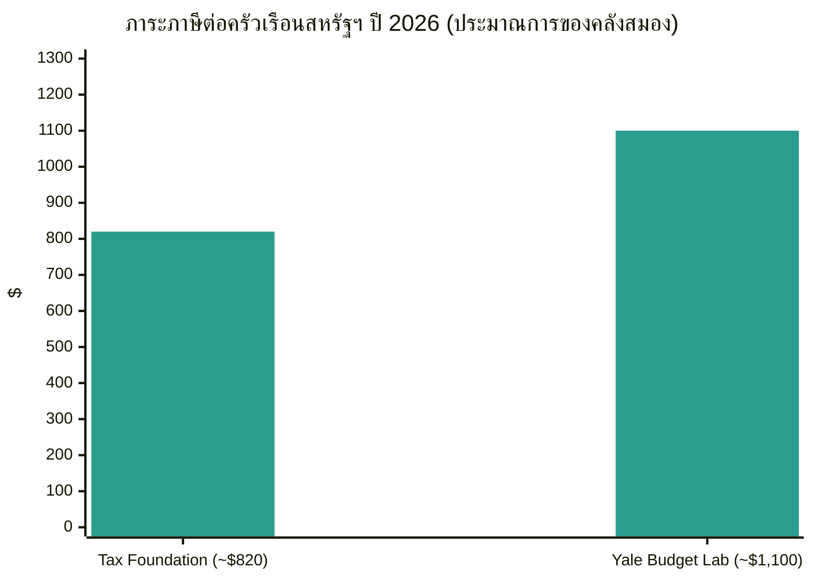

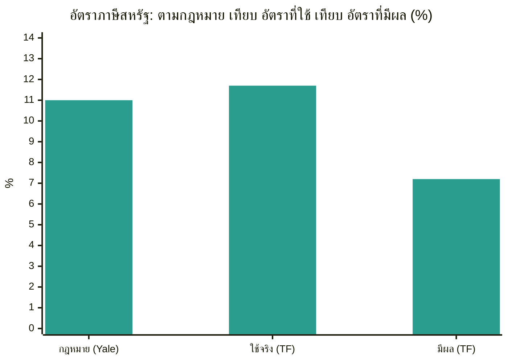
*ประมาณการ Yale Budget Lab และ Tax Foundation ปี 2026 TF = Tax Foundation*

**วิเคราะห์** คู่คลังสมองวางกรอบการถกเถียงเรื่องต้นทุนครัวเรือน: $820 ของ Tax Foundation กับ $1,100 ของ Yale เป็นสองตัวเลขที่นักข่าวอ้าง ต่างกันที่การปฏิบัติอัตราตามกฎหมายเทียบอัตรามีผลและกลไกการคืนภาษี IEEPA การวิเคราะห์หลัง SCOTUS ของ Yale เป็นการสังเคราะห์กฎหมายปัจจุบันที่สมบูรณ์ที่สุด — ความโกลาหลการคืนภาษีสร้าง "ผลกระทบรายได้ขนาดใหญ่" ที่ชดเชยแรงฉุดการเติบโตปี 2026 ของภาษีที่เหลือโดยประมาณ โดยมีต้นทุนระยะยาวถาวร 0.1% ของ GDP (~$30 พันล้านต่อปี) ข้อโต้แย้งขนาดหนังสือของ Tax Foundation — ยกเลิกภาษีทั้งหมดและแทนที่ด้วย VAT — เป็นการแถลงทางเลือกนโยบายที่ชัดเจนที่สุดของวงจรนี้ ความแตกต่าง WTO–UNCTAD (ความมองโลกในแง่ดีด้านปริมาณเทียบความระมัดระวังด้านปริมาณจริง) เป็นกรอบวิเคราะห์สำหรับการอ่านกระแสข้อมูลฤดูใบไม้ร่วง

---

## 9. ตลาดค่าระวาง

### อัตราสปอตตู้คอนเทนเนอร์ — ดัชนี Drewry World Container Index

ดัชนี Drewry World Container Index ปิดการประเมินวันพฤหัสบดีที่ **8 ตุลาคม** ที่ **$4,351 ต่อตู้ 40 ฟุต ลดลง 2% จากสัปดาห์ก่อน** — มาจากความต้องการที่อ่อนแอในเส้นทางทรานส์แปซิฟิกและเอเชีย–ยุโรปช่วงโกลเดนวีคของจีน การประเมินก่อนหน้า (1 ตุลาคม) ปิดที่ $4,434 ลดลง 1% นักวิเคราะห์อาวุโส Xeneta Peter Sand กล่าว 1 ตุลาคมเป็นจุดสูงสุดหลังวิกฤตฮอร์มุซของสปอต: ตะวันออกไกล–ชายฝั่งตะวันตกสหรัฐฯ $8,346/FEU ชายฝั่งตะวันออก $11,523/FEU — มากกว่าสี่เท่าของระดับก่อนวิกฤต 28 กุมภาพันธ์ อัตราเอเชีย–ยุโรปลดลงติดต่อกัน **13 สัปดาห์**; Drewry ระบุการกลับสู่สุเอซที่เร็วกว่าคาดเป็นภัยหลักต่อความพยายามพยุงอัตราของสายเรือ Drewry คาดอัตราคงที่ในสัปดาห์หน้า โดยสังเกตความพยายามขึ้นอัตรา FAK ของสายเรือในเอเชีย–ยุโรปครึ่งหลังของตุลาคมและการฟื้นตัวที่เป็นไปได้ของเส้นทางไปสหรัฐฯ หลังวันหยุดภายใต้การพักรบสหรัฐฯ–จีนที่ขยาย

| เส้นทาง (ตู้ 40 ฟุต) | 8 ต.ค. 2026 | เปลี่ยนรายสัปดาห์ | แหล่งข้อมูล |
|---|---|---|---|
| WCI รวม | $4,351 | −2% | [Drewry](https://www.drewry.co.uk/supply-chain-advisors/supply-chain-expertise/world-container-index-assessed-by-drewry) |
| เซี่ยงไฮ้ → รอตเทอร์ดาม | $3,337 | −2% | [Drewry](https://www.drewry.co.uk/supply-chain-advisors/supply-chain-expertise/world-container-index-assessed-by-drewry) |
| เซี่ยงไฮ้ → เจนัว | $3,696 | ไม่เปลี่ยน | [Drewry](https://www.drewry.co.uk/supply-chain-advisors/supply-chain-expertise/world-container-index-assessed-by-drewry) |
| เซี่ยงไฮ้ → ลอสแอนเจลิส | $7,624 | −3% | [Drewry](https://www.drewry.co.uk/supply-chain-advisors/supply-chain-expertise/world-container-index-assessed-by-drewry) |
| เซี่ยงไฮ้ → นิวยอร์ก | $10,220 | −2% | [Drewry](https://www.drewry.co.uk/supply-chain-advisors/supply-chain-expertise/world-container-index-assessed-by-drewry) |
| รอตเทอร์ดาม → นิวยอร์ก (ต่อ FEU) | $3,091 | −1% | [Shipping Telegraph](https://shippingtelegraph.com/freight-news/drewry-the-world-container-index-decreased-2-in-week-41-2026/) |
| ขากลับ รอตเทอร์ดาม → เซี่ยงไฮ้ | $628 | +2% | [Shipping Telegraph](https://shippingtelegraph.com/freight-news/drewry-the-world-container-index-decreased-2-in-week-41-2026/) |

จำนวนเที่ยวเรือที่ยกเลิก (Drewry Container Capacity Insight): ทรานส์แปซิฟิก — ประกาศยกเลิกสี่เที่ยวสำหรับสัปดาห์หน้า ลดลงจากสิบเอ็ดเที่ยวสัปดาห์นี้ (กำลังบรรทุกเพิ่ม); เอเชีย–ยุโรป — ประกาศหกเที่ยวสำหรับสัปดาห์หน้า เพิ่มจากห้าเที่ยว

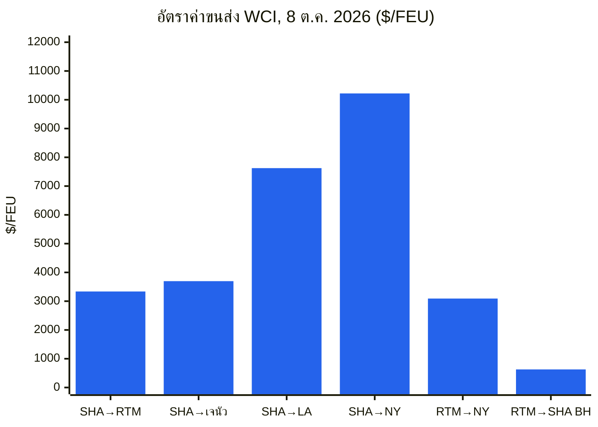
*SHA = เซี่ยงไฮ้; RTM = รอตเทอร์ดัม ขากลับ: รอตเทอร์ดัม→เซี่ยงไฮ้*

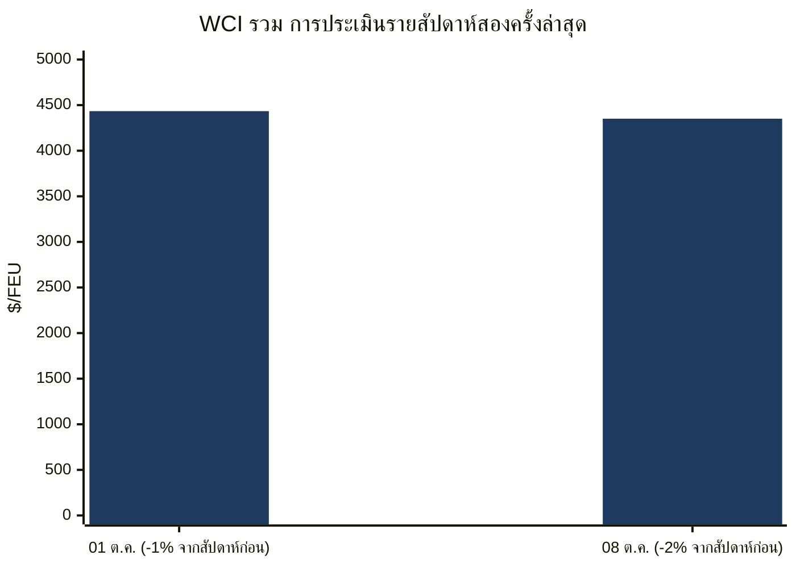

### ดัชนี Freightos Baltic (FBX)

ดัชนี FBX ทั่วโลกปิดสัปดาห์ **9 ตุลาคม** ที่ **3,344 จุด** ไม่เปลี่ยนแปลงโดยแท้จริง (3,348 ตอนต้นสัปดาห์)

| เส้นทาง | อัตรา (ต่อ FEU, 9 ต.ค. 2026) | เปลี่ยนรายสัปดาห์ | แหล่งข้อมูล |
|---|---|---|---|
| FBX รวมทั่วโลก | 3,344 จุด | −4 จุดในสัปดาห์ | [Baltic Exchange weekly report](https://www.thedcn.com.au/news/baltic-exchange-weekly-report-9-october-2026) |
| FBX01 จีน/เอเชียตะวันออก → ชายฝั่งตะวันตกสหรัฐฯ | $8,106 | −$228 | [Baltic Exchange weekly report](https://www.thedcn.com.au/news/baltic-exchange-weekly-report-9-october-2026) |
| FBX03 จีน/เอเชียตะวันออก → ชายฝั่งตะวันออกสหรัฐฯ | $9,606 | ไม่เปลี่ยน | [Baltic Exchange weekly report](https://www.thedcn.com.au/news/baltic-exchange-weekly-report-9-october-2026) |
| FBX11 จีน/เอเชียตะวันออก → ยุโรปเหนือ | $3,260 | ไม่เปลี่ยน | [Baltic Exchange weekly report](https://www.thedcn.com.au/news/baltic-exchange-weekly-report-9-october-2026) |
| FBX13 จีน/เอเชียตะวันออก → เมดิเตอร์เรเนียน | $3,861 | +$320 | [Baltic Exchange weekly report](https://www.thedcn.com.au/news/baltic-exchange-weekly-report-9-october-2026) |
| FBX21 ชายฝั่งตะวันออกสหรัฐฯ → ยุโรป | $1,182 | +$108 | [Baltic Exchange weekly report](https://www.thedcn.com.au/news/baltic-exchange-weekly-report-9-october-2026) |

Supply Chain Dive (9 ตุลาคม รายสัปดาห์ Freightos): สปอตเอเชีย–ชายฝั่งตะวันตกสหรัฐฯ $8,322 (−3%) ชายฝั่งตะวันออก $9,606 (ทรงตัว) — ปัญหาท่าเรือจากสภาพอากาศในจีนพยุงพื้นอัตราไว้ Xeneta คาดชายฝั่งตะวันออก $6,000–7,000 และชายฝั่งตะวันตก $4,500–5,500 ในสามเดือน — "การปรับฐานขนาดใหญ่ แต่ไม่ใช่การถล่ม"

### สินค้าแห้งเทกอง — Baltic Exchange

**ดัชนี Baltic Dry** ปิดวันศุกร์ 9 ตุลาคมที่ **2,917 จุด ลดลง 7.3% ในสัปดาห์** — ต่ำสุดนับตั้งแต่ปลายสิงหาคม — กระจุกใน Capesize (ดัชนี −13.9% รายได้เฉลี่ยรายวัน −$1,560 เหลือ $35,860) ขณะแร่เหล็กต้าเหลียนแตะต่ำสุดรอบ 18 เดือน; Panamax +2.2% และ Supramax +1.4% ทรงตัว

| วันที่ | BDI | Capesize (รายได้) | Panamax | Supramax | แหล่งข้อมูล |
|---|---|---|---|---|---|
| จ. 5 ต.ค. | 3,070 | 4,833 ($40,330) | 2,364 | 1,790 | [Baird Maritime](https://www.bairdmaritime.com/shipping/dry-cargo/bulkers/two-session-winning-streak-ends-as-baltic-dry-bulk-index-falls) |
| อ. 6 ต.ค. | 3,002 | 4,638 ($38,561) | 2,366 | 1,795 | [Baird Maritime](https://www.bairdmaritime.com/shipping/dry-cargo/bulkers/baltic-dry-bulk-index-hits-six-week-low-on-capesize-decline) |
| พ. 7 ต.ค. | 2,994 | 4,597 ($38,188) | 2,384 | 1,800 | [Baird Maritime](https://www.bairdmaritime.com/shipping/dry-cargo/bulkers/baltic-index-slips-as-capesize-slump-spoils-smaller-vessel-gains) |
| พฤ. 8 ต.ค. | 2,973 | 4,512 ($37,420) | 2,410 | 1,808 | [Baird Maritime](https://www.bairdmaritime.com/shipping/dry-cargo/bulkers/baltic-dry-bulk-index-drops-to-lowest-level-in-more-than-six-weeks) |
| ศ. 9 ต.ค. | 2,917 | 4,340 ($35,860) | 2,424 | 1,814 | [Baltic Exchange weekly report](https://www.thedcn.com.au/news/baltic-exchange-weekly-report-9-october-2026) |

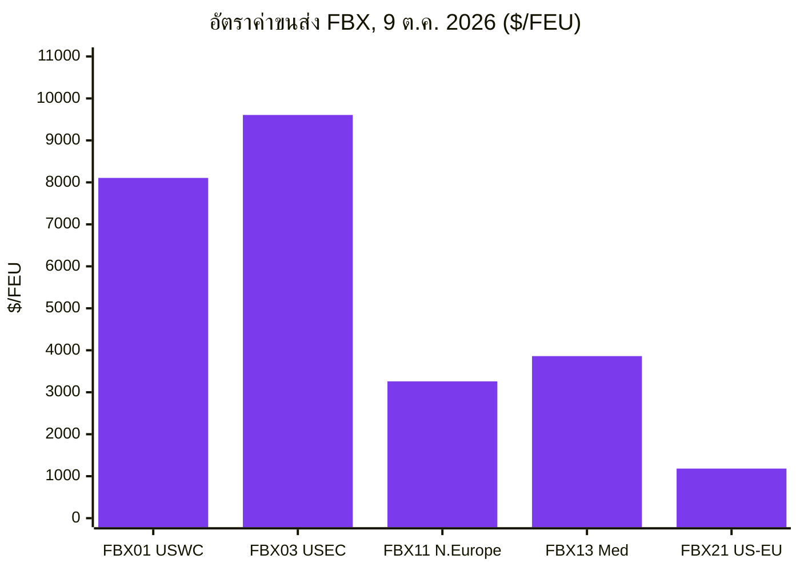
*เส้นทาง: FBX01 จีน/เอเชียตะวันออก→ชายฝั่งตะวันตกสหรัฐ; FBX03 →ชายฝั่งตะวันออกสหรัฐ; FBX11 →ยุโรปเหนือ; FBX13 →เมดิเตอร์เรเนียน; FBX21 ชายฝั่งตะวันออกสหรัฐ→ยุโรป*

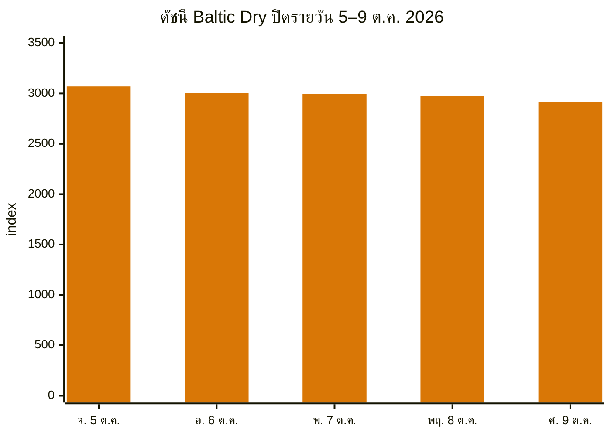

### การหยุดชะงักของท่าเรือและโลจิสติกส์

**ทะเลแดง / การกลับสู่สุเอซเร่งขึ้น** Hapag-Lloyd ยืนยันการเดินเรือตะวันตกและตะวันออกเที่ยวแรกของบริการ SE1 ของ Gemini Cooperation ผ่านทะเลแดงและสุเอซ: *Umm Qarn* ออกจากตันจุงเปเลปัสไปสุเอซ 27 ตุลาคม และอัลเคซิราส 5 ธันวาคม Premier Alliance (ONE, HMM, Yang Ming) ฟื้นลูป FE1 เอเชียตะวันออกเฉียงใต้–ยุโรปเหนือกลับสู่สุเอซตั้งแต่ตุลาคม — ครั้งแรกที่หลุดจากเส้นทางแหลมตั้งแต่ มกราคม 2024 — โดยเรือ 8,110 TEU *ONE Continuity* ออกจากแหลมฉบัง 17 ตุลาคม COSCO มีกำหนดเดินเรือตะวันตกผ่านสุเอซครั้งแรกในกว่าสองปีเมื่อ 4 ตุลาคม MSI ประเมิน ~35% ของการเดินเรือเอเชีย–ยุโรปใช้ทะเลแดงแล้ว; Linerlytica นับเรือตู้ 140+ ลำ (2 ล้าน+ TEU) กลับมาตั้งแต่พฤษภาคม; น้ำหนักสุทธิตู้คอนเทนเนอร์สุเอซ ม.ค.–ส.ค. 72.1 ล้านตัน (+54.2% เมื่อเทียบปีก่อน) ข้อจำกัด: Aspides ของอียูยอมรับว่าความคุ้มครองเรือรบไม่เพียงพอสำหรับคำขอคุ้มกันทั้งหมด — ขีดจำกัดผูกพันต่อการกลับเพิ่ม Container Forecaster ของ Drewry พบประโยชน์ทางเศรษฐกิจต่อสายเรือจากการกลับสู่สุเอซบาง — ประหยัดราว $1 ล้านต่อการเดินทางไปกลับเทียบแหลม — แต่สายเรือกำลังกลับ เพิ่มกำลังบรรทุกมีผลที่กดอัตราเอเชีย–ยุโรป ([splash247.com](https://splash247.com/premier-alliance-joins-accelerating-return-to-suez/), [container-news.com](https://container-news.com/hapag-lloyd-confirms-first-se1-sailings-via-red-sea-and-suez-canal/))

**ความแออัดท่าเรือเอเชีย** ความแออัดฤดูไต้ฝุ่นผลักความน่าเชื่อถือตารางเดินเรือทั่วโลกต่ำกว่า 50% เป็นครั้งแรกนับตั้งแต่การระบาดใหญ่ (Sea-Intelligence) โดยความแออัดเอเชียอาจยืดถึงกลาง 2027; ความแออัดดูดซับ 12% ของกำลังเรือมีผล (DHL Forwarding) และ ~10.9% ของกองเรือตู้ (~3.76 ล้าน TEU); ความล่าช้าเฉลี่ยของเรือที่มาสายแตะ 6.81 วัน สูงสุดนับตั้งแต่มีนาคม 2022 โกลเดนวีค (1–7 ตุลาคม) ทำให้ความต้องการอ่อนลง; คาดเซี่ยงไฮ้ยังแออัดหนักถึงกลาง–ปลายตุลาคม ([worldcargonews.com](https://www.worldcargonews.com/news/2026/10/sea-intelligence-asian-port-congestion-could-persist-into-mid-2027/), [ti-insight.com](https://ti-insight.com/briefs/global-supply-chain-risk-monitor-october-2026/))

**การโจมตีทะเลดำทวีขึ้น** เรือเทกอง *Royad Mammadov* จมนอกชายฝั่งโรมาเนีย (ลูกเรือเสียชีวิตสองคน); วันต่อมาโดรนโจมตีนอกชายฝั่งบัลแกเรียทำให้เรือเทกอง *Alfa Watan* จมและ *Able* ไฟลุก — เส้นทางธัญพืชหยุดชะงัก เบี้ยประกันพุ่ง อินเดียและไลบีเรียในฐานะประธานร่วมกลุ่มเพื่อนด้านความปลอดภัยและความมั่นคงของการขนส่งและคนประจำเรือ ประณามการโจมตีร่วมกัน (9 ตุลาคม) ([splash247.com](https://splash247.com/two-seafarers-killed-as-cargo-ship-sinks-off-romania/))

**คลองปานามา** การผ่านเพิ่มเป็น 33 เที่ยว/วันตั้งแต่ 15 ตุลาคม (จาก 32) โดยฟื้นร่างกินน้ำลึก 49 ฟุต; สล็อต Neo-Panamax เพิ่มเป็น 10/วัน ความเสี่ยงเอลนีโญข้างหน้า: NOAA คาดรูปแบบจะต่อเนื่องถึงต้น 2027 สายเรือเก็บค่าธรรมเนียมเพิ่มแล้ว: MSC $149/ตู้ 20 ฟุต ($297/ตู้ 40 ฟุต) CMA CGM ค่าปรับคลองปานามา $500/TEU

**ฟิลิปปินส์** วิกฤตตู้เปล่ามะนิลา: "การประท้วงดิจิทัล" ของนายหน้าและวันหยุดคนขับรถบรรทุก (5–8 ตุลาคม) เรื่องสายเรือปฏิเสธรับคืนตู้เปล่านานถึงหนึ่งเดือน; การประท้วงจบ 8 ตุลาคมหลังท่าเรือเริ่มรับตู้เปล่าต่อเนื่อง — แต่ Hapag-Lloyd ระงับการจองใหม่ทั้งหมดไปมะนิลา บาทังกัส และซูบิกถึง 31 ธันวาคม อ้างความแออัดและข้อจำกัดรุนแรงของความจุคลัง/รับคืนตู้เปล่า ([portcalls.com](https://portcalls.com/manila-ports-digital-protest-trucking-holiday-end/))

**แรงงานและทางน้ำภายใน** การนัดหยุดงานท่าเรือเยอรมนีหลีกเลี่ยงได้ 2 ตุลาคม (ข้อตกลง ver.di ยุติการนัดหยุดเตือนที่ฮัมบูร์ก/เบรเมอร์ฮาเฟน) แต่น้ำต่ำเป็นประวัติการณ์ที่เกจ Kaub ของแม่น้ำไรน์หยุดการผ่านของเรือบรรทุกบรรทุกเต็มโดยแท้จริง; ค่าธรรมเนียมน้ำต่ำแตะ €1,280/FEU (Contargo) และ $1,350/FEU (Hapag-Lloyd) คนงานท่าเรือแวนคูเวอร์ประท้วงระบบอัตโนมัติและ AI (2 ตุลาคม) ไม่พบรายงานที่ตรวจสอบได้เรื่องการนัดหยุดงาน ILA ชายฝั่งตะวันออก/อ่าวสหรัฐฯ ครั้งใหม่ในช่วงนี้

**ค่าธรรมเนียมและบริการของสายเรือ** CMA CGM: ค่าธรรมเนียมฤดูกาลสูงสุดเส้นทางเอเชีย–แอฟริกา (สูงสุด $750/TEU ตะวันออกไกล→เดอร์บันตั้งแต่ 22 ตุลาคม; $200/TEU เอเชียตะวันออกเฉียงใต้→แอฟริกาตะวันตกเหนือตั้งแต่ 15 ตุลาคม) เพิ่ม PSS แอฟริกาตะวันตกตั้งแต่ 22 ตุลาคม เอเชีย→ลาตินอเมริกา +$1,000/ตู้ตั้งแต่ 15 ตุลาคม อัตรา FAK เอเชีย–เมดิเตอร์เรเนียน 19–31 ตุลาคม และ PSS $1,000/ตู้เย็น ยุโรปเหนือ→อ่าวอาหรับตั้งแต่กลางตุลาคม Maersk: PSS สามเส้นทางการค้า; ยุติการแบ่งปันเรือ ASAS2 กับ CMA CGM ในเอเชีย–ชายฝั่งตะวันออกอเมริกาใต้ (เที่ยวสุดท้ายออกจากเซี่ยงไฮ้ 8 ธันวาคม) กองเรือ: MSC สั่งเรือเมกะแม็กซ์เชื้อเพลิงคู่ LNG หกลำ (~21,700 TEU ต่อลำ) ส่งมอบ 2029–2030; สมุดสั่งซื้อเกิน 170 ลำ / 3 ล้าน+ TEU ([container-news.com](https://container-news.com/cma-cgm-announces-new-peak-season-surcharges-on-asia-africa-trades/))

**คว่ำบาตรและการขนส่งอาร์กติก** สหราชอาณาจักรคว่ำบาตรเรือบรรทุก LNG ห้าลำ (1 ตุลาคม); สหราชอาณาจักรและญี่ปุ่นกำลังกระชับตาข่ายรอบเรือที่เชื่อมโยง Sovcomflot Arctic LNG 2 ส่งออก 0.95 ล้านตันในปี 2026 (ทั้งหมดตั้งแต่กรกฎาคม) จีนเสร็จสิ้นฤดูกาลแรกของบริการตู้คอนเทนเนอร์ประจำสัปดาห์จีน–ยุโรปผ่านเส้นทางทะเลเหนือ (7 ตุลาคม); เรือตู้คอนเทนเนอร์เกาหลีใต้เสร็จสิ้นการเดินทางเชิงพาณิชย์รอบอาร์กติกไปยุโรปครั้งแรกของประเทศ (10 ตุลาคม) M&A เรือบรรทุกน้ำมัน: Trafigura ซื้อเรือบรรทุกน้ำมันเจ็ดลำจาก SFL Corp (~$175 ล้านกำไรผู้ขาย); Volare Shipping บริษัทแยกของ Trafigura จดทะเบียนในออสโล (6 ตุลาคม) ([hellenicshippingnews.com](https://www.hellenicshippingnews.com/category/shipping-news/international-shipping-news/), [gcaptain.com](https://gcaptain.com/tag/arctic/))

**เม็กซิโก** การส่งออกรถยนต์ตกหนักที่สุดของปีในเดือนกันยายน นักวิเคราะห์ชี้ภาษีสหรัฐฯ (ข้อมูล INEGI ผ่าน gCaptain, 8 ตุลาคม)

### ข่าวกรองผู้ขาย

- **TradeInt:** เงินช่วยเหลือกระทรวงพาณิชย์ตุรกี × TradeInt (ประกาศ 30 กันยายน รายงานในสื่อสัปดาห์นี้) — ให้ทุนเข้าถึงบันทึกการส่ง เอกสารศุลกากร และข้อมูลใบตราส่งใน 200+ ประเทศสำหรับบริษัทที่ปรึกษาตุรกี; การทบทวนข้อมูลของ TradeInt ระบุการส่งออกตุรกีปี 2025 ที่ $269.7 พันล้าน (กันยายนสถิติ $22.6 พันล้าน) ([citybuzz.co](https://www.citybuzz.co/2026/09/30/turkiyes-ministry-of-trade-and-tradeint-launch-grant-to-arm-local-consultants-with-global-trade-data-through-tradeint-partnership))

---

## 10. ไทม์ไลน์นโยบาย

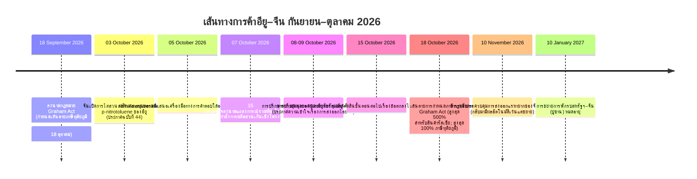

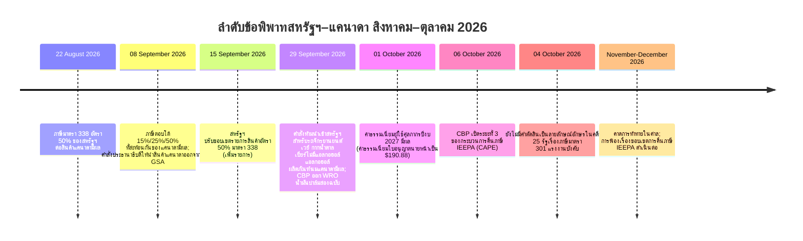

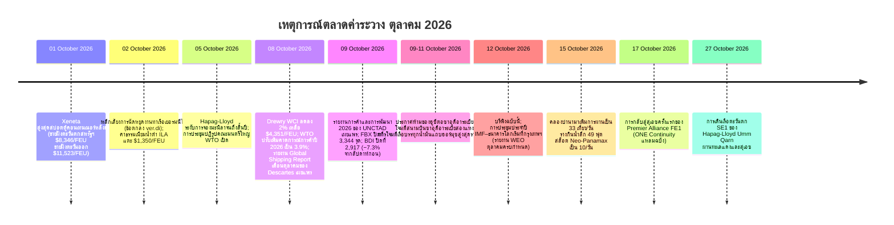

---

## 11. กำหนดเวลาและเหตุการณ์ที่จะมาถึง (90 วันข้างหน้า)

| วันที่ | เหตุการณ์ |
|---|---|
| 14 ต.ค. 2026 | คำแนะนำ "ปริมาณเนื้อหาสหรัฐฯ" ของ BIS สำหรับอุปกรณ์อุตสาหกรรมเคลื่อนที่ USMCA มีผล (ประกาศ FR) |
| 15 ต.ค. 2026 | การประชุมสุดยอดผู้นำอียู บรัสเซลส์ — ตัดสินเรื่องความเข้าใจการส่งออกไฮบริดอียู–จีน เครื่องมือตอบโต้อย่างรวดเร็วฝรั่งเศส–เยอรมนี กฎ Made in Europe |
| 15 ต.ค. 2026 | คลองปานามา: การผ่านเป็น 33 เที่ยว/วัน ร่างกินน้ำลึก 49 ฟุต สล็อต Neo-Panamax เป็น 10/วัน |
| 16 ต.ค. 2026 | คำสั่งห้ามส่งออกรัสเซียที่ขยายเพิ่มเติมของญี่ปุ่นมีผล |
| 17 ต.ค. 2026 | การกลับสู่สุเอซครั้งแรกของ Premier Alliance FE1 (ONE Continuity แหลมฉบัง) |
| 18 ต.ค. 2026 | เส้นตายการกำหนดภาษีกฎหมาย Graham Act: อากรสูงสุด 500% สำหรับสินค้ารัสเซีย; อากรทุติยภูมิสูงสุด 100% สำหรับผู้ซื้อพลังงานรัสเซียรายใหญ่โดยไม่มีข้อยกเว้น |
| 19 ต.ค. 2026 | ครบกำหนดการตัดสินใจเริ่มของกระทรวงพาณิชย์: AD/CVD สารประกอบเอมีน (จีน) |
| 23 ต.ค. 2026 | เส้นตายการขึ้นทะเบียน/ความเห็น: การไต่สวนต่อต้านการทุ่มตลาดของจีนต่อสาร p-nitrotoluene ของอียู |
| 27 ต.ค. 2026 | DSB: การรับรองคำตัดสินภาษี ICT อินเดีย–ไต้หวันจีน; การพิจารณารายงานคณะผู้พิจารณาข้อพิพาทรถยนต์ไฟฟ้าตุรกี–จีน |
| 27 ต.ค. 2026 | การเดินเรือตะวันตก SE1 ของ Hapag-Lloyd Umm Qarn ผ่านทะเลแดงและสุเอซ (ตันจุงเปเลปัส) |
| 29–30 ต.ค. 2026 | การประชุมสุดยอดอียู–แคนาดา มอนทรีออล — คาดเสร็จสิ้นการเจรจาข้อตกลงการค้าดิจิทัล |
| 4 พ.ย. 2026 | ครบกำหนดความเห็นการเก็บข้อมูลการคืนภาษี IEEPA ของ CBP |
| 10 พ.ย. 2026 | การระงับการควบคุมการส่งออกแร่หายากของจีนหมดอายุ (กลับมามีผลอัตโนมัติเว้นแต่ขยาย) |
| 10 พ.ย. 2026 | กำหนดสิ้นสุดการระงับกฎบริษัทในเครือของ BIS (คาดขยายถึง 10 ม.ค. 2027 แต่ยังไม่ประกาศ) |
| 10 พ.ย. 2026 | การยกเว้นมาตรา 301 สำหรับผลิตภัณฑ์จีน 178 รายการหมดอายุ (ขยายถึงวันนี้ภายใต้การพักรบ) |
| 13 / 16 พ.ย. 2026 | ผลเบื้องต้น ITC: สารประกอบเอมีน (จีน) / รถพ่วงบรรทุกน้ำมัน (เม็กซิโก) |
| 4 ธ.ค. 2026 | MIPs โพลีซิลิคอนมาตรา 232 + ภาษี 15% มีผล |
| 7 ธ.ค. 2026 | ปิดรับความเห็นกฎที่เสนอเรื่องการส่งมูลค่าต่ำของ CBP |
| ก่อน ธ.ค. 2026 | การประชุมทางเทคนิคครั้งแรกของแพลตฟอร์มภาคส่วนกำลังการผลิตส่วนเกิน 15 เศรษฐกิจ |
| ม.ค. 2027 | การประชุมระดับรัฐมนตรีทางวิดีโออียู–จีน |
| 10 ม.ค. 2027 | การขยายการพักรบสหรัฐฯ–จีน (ปูซาน) หมดอายุ |
| 12 ม.ค. 2027 | ครบกำหนดความเห็นสาธารณะการทบทวนร่วม USMCA ปี 2027 |
| 1 ม.ค. 2028 | การแก้ไข HS 2028 ของ WCO มีผล (299 ชุดการเปลี่ยนแปลง; ทีมจัดพิกัดภาษีควรวางแผนตอนนี้) |

---

## 12. แหล่งข้อมูลและวิธีวิจัย

กรอบเวลาครอบคลุม: 5–12 ตุลาคม 2026

**ข่าวการค้าและการวิเคราะห์:** FreightWaves, The Loadstar, Splash247, gCaptain, Hellenic Shipping News, Container News, Supply Chain Dive, Logistics Management, Air Cargo News, Port Technology International, JOC (เฉพาะพาดหัว), Freightmate/Sea Intelligence/ILA Industry Insights ผ่านสื่อการค้า, ประกาศสาธารณะของ TradeInt ผ่านสื่อ

**นโยบายสหรัฐฯ:** เอกสารข้อเท็จจริง whitehouse.gov, cbp.gov (ผ่านคำแนะนำทางการค้า), ข่าวประชาสัมพันธ์ ustr.gov, federalregister.gov (ประกาศ AD/CVD, การทบทวนมาตรา 301), bis.doc.gov (ผ่านการวิเคราะห์ของ KPMG/JD Supra), internationaltradetoday.com (เฉพาะพาดหัว), การวิเคราะห์ของสำนักงานกฎหมาย JD Supra, Thompson Hine, GHY International, Withum, Akin Gump, Bell Nunnally, Mondaq, KPMG Tax News Flash, Digital Policy Alert

**รัฐบาลโลก:** ec.europa.eu/DG Trade (ผ่านสื่อ), กระทรวงการธุรกิจและการค้าของ gov.uk (ผ่านสื่อ), cbsa-asfc.gc.ca/canada.ca (ผ่านสื่อ), english.mofcom.gov.cn (เข้าถึงโดยตรง 12 ตุลาคม), METI/ศุลกากรญี่ปุ่น (ผ่าน Global Sanctions), มติ Camex/Gecex ของบราซิล (ผ่าน Datamar), รายงานกระทรวงพาณิชย์แห่งชาติของอินเดีย ตุรกี บราซิล ออสเตรเลีย และรัฐอาเซียน

**พหุภาคี:** wto.org (คณะมนตรีใหญ่ 5–6 ตุลาคม ข้อพิพาท DS639/DS629 รายงานการปฏิรูป), unctad.org (รายงานการค้าและการพัฒนา 2026, รายงานอัปเดตการค้าโลกฉบับเดือนตุลาคม), wcoomd.org (การแก้ไข HS 2028 โครงการกฎถิ่นกำเนิด), ITC (ไม่มีการเผยแพร่ใหม่ในช่วงนี้)

**พอร์ทัลข้อมูล:** สำมะโน/BEA FT-900 (สิงหาคม 2026 เผยแพร่ 6 ตุลาคม), USITC DataWeb / USA Trade Online, WTO Global Trade Outlook ปรับปรุงตุลาคม, UN Comtrade (บันทึกวิธีวิจัย), รายงานสถิติ Eurostat/ECB, พอร์ทัลข้อมูลธนาคารโลก, IMF (งานวิจัย WEO เผยแพร่ล่วงหน้า; WEO ตุลาคมฉบับเต็มกำหนด 12–18 ตุลาคม)

**คลังสมองและงานวิจัย:** Tax Foundation (ตัวติดตามภาษีทรัมป์ ข้อมูลกันยายน 2026; Options for Reforming America's Tax Code 3.0), Yale Budget Lab (สถานะภาษีสหรัฐฯ), tradeintelligence.eu (ไม่มีงานวิจัยสาธารณะใหม่ในช่วงนี้; แฟ้มการค้าดิจิทัลอียูผ่าน EU Perspectives/Digital Watch/Global Law Experts)

**ค่าระวาง:** Drewry (World Container Index การประเมิน 8 ตุลาคม), Baltic Exchange (รายงานรายสัปดาห์ 9 ตุลาคม), ดัชนี Freightos Baltic, ดัชนี Shanghai Containerized Freight / China Containerized Freight (ผ่าน FreshPlaza), ดัชนี TAC, Baird Maritime (BDI รายวัน), Xeneta (ผ่าน FreightWaves/Air Cargo News), รายงาน Global Shipping Report เดือนตุลาคมของ Descartes (ผ่าน Reuters), Sea-Intelligence, DHL Forwarding, DC Velocity, TI Insight, NRF Global Port Tracker, ILA Industry Insights

**ข่าวกรองผู้ขาย:** ประกาศการตลาดและสื่อสาธารณะของ Descartes Systems Group และ TradeInt เท่านั้น (บล็อกและข่าวสาธารณะ; ไม่เข้าถึงแพลตฟอร์มข้อมูล ไม่ล็อกอิน ไม่ใช้แพลตฟอร์มข้อมูลการค้าของคู่แข่ง)
