# Báo cáo Tình báo Thương mại Toàn cầu — Tuần 5–12 tháng 10 năm 2026

**Bản tin hàng tuần.** Kỳ bao phủ: 5–12 tháng 10 năm 2026. Tổng hợp từ khoảng 45 nguồn tin tức, chính sách, dữ liệu và cước vận chuyển thương mại trên toàn thế giới.

---

## Mục lục

1. [Tóm tắt điều hành](#1-tóm-tắt-điều-hành)
2. [Cảnh báo](#2-cảnh-báo)
3. [Những câu chuyện hàng đầu — phân tích sâu](#3-những-câu-chuyện-hàng-đầu--phân-tích-sâu)
4. [Công cụ theo dõi thuế quan](#4-công-cụ-theo-dõi-thuế-quan)
5. [Phân tích sâu chính sách Hoa Kỳ](#5-phân-tích-sâu-chính-sách-hoa-kỳ)
6. [Chính sách thế giới theo khu vực](#6-chính-sách-thế-giới-theo-khu-vực)
7. [Hành động thực thi](#7-hành-động-thực-thi)
8. [Các bản phát hành dữ liệu](#8-các-bản-phát-hành-dữ-liệu)
9. [Thị trường cước vận chuyển](#9-thị-trường-cước-vận-chuyển)
10. [Dòng thời gian chính sách](#10-dòng-thời-gian-chính-sách)
11. [Các hạn chót & sự kiện sắp tới (90 ngày tới)](#11-các-hạn-chót--sự-kiện-sắp-tới-90-ngày-tới)
12. [Nguồn & phương pháp](#12-nguồn--phương-pháp)

---

## 1. Tóm tắt điều hành

Một tuần trong đó an ninh năng lượng, phòng vệ thương mại và an ninh hàng hải va chạm với nhau. Ba diễn biến đã định hình nhịp độ:

- **Đồng hồ đếm ngược Đạo luật Graham bước vào tuần cuối cùng.** Với hạn chót xác định thuế quan ngày 18 tháng 10 chỉ còn vài ngày, Tổng thống Trump công bố một thỏa thuận nhập khẩu dầu diesel từ Nga — hơn 300.000 tấn ngay lập tức, thêm 500.000 tấn vào tháng 11 — được Bộ Tài chính cấp phép theo Giấy phép Chung 135 đến tháng 4 năm 2027, ngay cả khi mức thuế bổ sung lên tới 100% của Đạo luật đối với các nước mua năng lượng Nga hàng đầu (Ấn Độ, Trung Quốc, Thổ Nhĩ Kỳ) sẵn sàng có hiệu lực mà không cần miễn trừ của tổng thống. Bảy thượng nghị sĩ lưỡng đảng gọi thỏa thuận diesel là không nhất quán với luật trừng phạt mà Tổng thống đã ký. Ấn Độ, nước mua dầu thô Nga lớn nhất, cho biết đàm phán thỏa thuận thương mại với Hoa Kỳ đã "đạt đến một bình nguyên."
- **Vòng đàm phán Bắc Kinh EU–Trung Quốc cho kết quả gây tranh cãi.** Ủy viên Maroš Šefčovič công bố một "hiểu biết chung" nhằm cắt giảm hơn một nửa lượng xe hybrid Trung Quốc xuất sang EU trong bốn năm, cộng với việc Trung Quốc cắt thuế đối với phụ tùng ô tô, dầu ô liu và giày dép trị giá ít nhất 225 triệu euro tiền thuế được tiết kiệm — nhưng văn bản công bố của Bắc Kinh không nêu con số nào, và thâm hụt hàng hóa của EU với Trung Quốc đã đạt 238 tỷ euro trong bảy tháng đầu năm 2026. Pháp và Đức riêng rẽ đề xuất một công cụ thương mại phản ứng nhanh của EU "mạnh mẽ như Mục 301." Các nhà lãnh đạo EU sẽ quyết định bước tiếp theo tại hội nghị thượng đỉnh Brussels ngày 15 tháng 10.
- **Cuộc chiến năng lượng–vận tải biển leo thang mạnh.** Houthi tuyên bố lệnh cấm vận hàng hải đối với Ả Rập Xê Út và tấn công hai sân bay của nước này, làm ba người thiệt mạng; lưu lượng qua Bab el-Mandeb giảm xuống còn 11 tàu vào ngày 11 tháng 10. Các vụ tấn công tàu chở dầu quanh Hormuz đạt mức cao nhất trong tuần kể từ khi chiến tranh bắt đầu; Hoa Kỳ trừng phạt thêm 22 tàu chở dầu và Iran gọi phản hồi của Hoa Kỳ đối với đề xuất mở lại Hormuz của mình là "không đủ."

Những diễn biến khác: nhập khẩu container của Hoa Kỳ lập kỷ lục tháng 9 (2,55 triệu TEU, tăng 10,3% so với cùng kỳ, theo báo cáo ngày 8 tháng 10 của Descartes); CBP khởi động Giai đoạn 3 của quy trình hoàn thuế thuế quan IEEPA (CAPE) vào ngày 6 tháng 10; Vương quốc Anh cho biết quyết định về thuế lên tới 45% đối với xe điện Trung Quốc đang "cân bằng mong manh"; WTO nâng dự báo thương mại hàng hóa 2026 lên 3,9% nhờ nhu cầu do AI dẫn dắt trong khi báo cáo chủ lực của UNCTAD mô tả "sự phân mảnh có chọn lọc" và mức giảm 20% trong thương mại Trung–Mỹ kể từ 2024; Trung Quốc mở cuộc điều tra chống bán phá giá đối với p-nitrotoluen của EU; và lệnh cấm xuất khẩu mở rộng của Nhật Bản đối với Nga có hiệu lực từ ngày 16 tháng 10.

**Cước vận chuyển:** giai đoạn hạ nhiệt sau đỉnh kèm phí rủi ro xung đột. Chỉ số Container Thế giới Drewry giảm 2% xuống 4.351 USD/FEU (Á–Âu giảm tuần thứ 13 liên tiếp khi các hãng tàu tăng tốc quay lại Suez), Chỉ số Baltic Dry giảm 7,3% xuống 2.917 khi thu nhập Capesize sụt mạnh theo quặng sắt yếu, và Hapag-Lloyd đình chỉ mọi đặt chỗ đi Manila đến hết năm do khủng hoảng container rỗng ở Philippines làm nghẽn bãi. Độ tin cậy lịch trình toàn cầu lần đầu tiên kể từ đại dịch rơi xuống dưới 50%.

---

## 2. Cảnh báo

| # | Cảnh báo | Hiệu lực | Tác động | Nguồn |
|---|-------|-----------|--------|--------|
| A1 | Hạn chót thuế bổ sung Đạo luật Graham: thuế lên tới 500% đối với hàng hóa Nga; thuế bổ sung lên tới 100% đối với các nước mua năng lượng Nga hàng đầu mà không được miễn trừ | 18 tháng 10 năm 2026 | Ấn Độ, Trung Quốc, Thổ Nhĩ Kỳ chịu rủi ro cao nhất; thuế chồng lên các mức thuế hiện hành | [mondaq.com](https://www.mondaq.com/unitedstates/export-controls-trade-investment-sanctions/1851398/the-lindsey-graham-sanctions-act-what-businesses-need-to-know-about-the-new-tariffs) |
| A2 | Thỏa thuận diesel Mỹ–Nga: hơn 300.000 tấn ngay lập tức, 500.000 tấn vào tháng 11; Giấy phép Chung 135 của OFAC cho phép nhập khẩu diesel Nga | 9 tháng 10 năm 2026 (GL135 có hiệu lực đến 7 tháng 4 năm 2027) | Va chạm chính trị với Đạo luật Graham một tuần trước hạn chót; 7 thượng nghị sĩ kêu gọi đảo ngược | [nationpress.com](https://www.nationpress.com/international/trump-buys-russian-diesel-before-graham-act-deadline) |
| A3 | Vòng Bắc Kinh EU–Trung Quốc: "hiểu biết chung" gây tranh cãi về xuất khẩu hybrid; cắt thuế hơn 225 triệu euro đối với hàng xuất khẩu EU; kênh xanh đất hiếm được giữ | 8–9 tháng 10 năm 2026 (quyết định tại hội nghị thượng đỉnh EU ngày 15 tháng 10) | Cơ chế thực thi chưa được công bố; văn bản Bắc Kinh không nêu con số cắt giảm một nửa | [eureporter.co](https://www.eureporter.co/world/china-2/2026/10/09/eu-and-china-strike-preliminary-trade-deal-ahead-of-crucial-leaders-summit/) |
| A4 | Đề xuất Pháp–Đức về công cụ thương mại phản ứng nhanh của EU "mạnh mẽ như Mục 301" | Đề xuất ngày 5 tháng 10; hội nghị thượng đỉnh ngày 15 tháng 10 | Có thể nâng cấp phòng vệ thương mại EU; Trung Quốc cảnh báo đáp trả | [lapost.com](https://www.lapost.com/content/france-germany-propose-new-rapid-eu-trade-response-tool) |
| A5 | Lệnh cấm vận hàng hải của Houthi đối với Ả Rập Xê Út; lưu lượng Bab el-Mandeb ở mức thấp nhất trong nhiều tháng (11 tàu ngày 11 tháng 10); tấn công hai sân bay Ả Rập Xê Út, ba người thiệt mạng | 9–11 tháng 10 năm 2026 | Việc bốc hàng dầu thô Ả Rập Xê Út bị đe dọa; 7+ tàu chở dầu đổi hướng | [marinelink.com](https://www.marinelink.com/news/red-sea-shipping-slows-houthi-attack-541529) |
| A6 | Tấn công tàu chở dầu Hormuz/Vùng Vịnh ở mức cao nhất trong tuần kể từ khi chiến tranh bắt đầu; Hoa Kỳ trừng phạt thêm 22 tàu chở dầu (8 tháng 10) | 7–11 tháng 10 năm 2026 | Tàu chạy phong tỏa bị Hoa Kỳ vô hiệu hóa ngày 10 tháng 10; tàu chở hóa chất bị tấn công ngoài khơi Qatar | [gcaptain.com](https://gcaptain.com/category/news/) |
| A7 | Lệnh đình chỉ kiểm soát xuất khẩu đất hiếm của Trung Quốc hết hạn; chưa công bố gia hạn | 10 tháng 11 năm 2026 | Tự động khôi phục trừ khi cả hai bên gia hạn; 6,5 nghìn tỷ USD/năm sản lượng hạ nguồn gặp rủi ro (IEA) | [investornews.com](https://www.investornews.com/critical-minerals-rare-earths/technology-metals-report-10-04-2026-a-summit-without-a-rare-earth-deal-leaves-the-west-buying-its-way-to-supply/) |
| A8 | Vương quốc Anh cân nhắc thuế lên tới 45% đối với xe điện Trung Quốc; quyết định "cân bằng mong manh" | Đang cân nhắc (được báo cáo ngày 4–7 tháng 10) | 58% xuất khẩu ô tô của Anh đi EU; gắn với quyền tiếp cận "Sản xuất tại châu Âu" | [fleetnews.co.uk](https://Www.fleetnews.co.uk/news/uk-weighs-chinese-car-tariffs-as-fleet-demand-for-evs-surges) |
| A9 | CBP khởi động Giai đoạn 3 của quy trình hoàn thuế thuế quan IEEPA (CAPE) | 6 tháng 10 năm 2026 | Bắt đầu vận hành việc hoàn khoảng 180 tỷ USD; phạm vi đối với nhà nhập khẩu không kiện tụng còn tranh cãi; hạn góp ý ngày 4 tháng 11 | [thompsonhine.com](https://www.thompsonhine.com/insights/cbp-confirms-october-6-2026-launch-of-phase-3-of-the-ieepa-tariff-refund-process/) |
| A10 | Hapag-Lloyd đình chỉ mọi đặt chỗ đi Manila, Batangas và Subic đến hết năm do tắc nghẽn container rỗng | Ngay lập tức (đến 31 tháng 12 năm 2026) | Một trong những hành động đặt chỗ nghiêm trọng nhất của hãng tàu trong năm 2026 | [portcalls.com](https://portcalls.com/hapag-lloyd-suspends-manila-batangas-subic-bookings-over-congestion/) |
| A11 | Trung Quốc mở cuộc điều tra chống bán phá giá đối với p-nitrotoluen của EU | Ngày 3 tháng 10 (hạn đăng ký ngày 23 tháng 10) | Biên độ bán phá giá bị cáo buộc trên 100%; thời điểm mang tính trả đũa so với đề xuất công cụ của EU | [mlex.com](https://www.mlex.com/mlex/articles/2533700/china-opens-anti-dumping-probe-into-eu-para-nitrotoluene) |
| A12 | Lệnh cấm xuất khẩu mở rộng của Nhật Bản đối với Nga có hiệu lực | 16 tháng 10 năm 2026 | Thêm hàng hóa bị cấm xuất sang Nga | [globalsanctions.com](https://globalsanctions.com/2026/10/japan-adds-more-goods-to-russia-export-ban-from-16-october-2026/) |

### A1 — Hạn chót Đạo luật Graham (chi tiết)

Đạo luật Trừng phạt Nga và Iran Lindsey O. Graham năm 2026 (ký ngày 18 tháng 9) áp đặt hạn chót thực thi 30 ngày là **ngày 18 tháng 10 năm 2026** cho hai lộ trình thuế bắt buộc. Mục 112: thuế lên tới **500% theo giá trị** đối với mọi hàng hóa nhập từ Nga, bao gồm cả sản phẩm dầu mỏ. Mục 113: thuế lên tới **100% theo giá trị** đối với mọi hàng hóa từ các quốc gia nằm trong số năm nước nhập khẩu dầu thô hoặc khí đốt tự nhiên Nga lớn nhất trong 12 tháng trước đó và cố ý thực hiện giao dịch mua mới từ sau hạn chót. Mọi mức thuế chồng lên thuế Mục 301/232 hiện hành. Các lối thoát: miễn trừ của tổng thống yêu cầu chứng nhận bằng văn bản chính thức, không mật gửi Quốc hội rằng điều đó vì lợi ích quốc gia, và một ngoại lệ hạn chế đối với khí đốt tự nhiên (nhập khẩu dưới 15% tổng xuất khẩu khí đốt hàng năm của Nga cộng với "các bước đáng kể" để giảm; người mua dầu thô không đủ điều kiện). Phân tích của các hãng luật xác định Trung Quốc, Ấn Độ và Thổ Nhĩ Kỳ là mục tiêu có khả năng nhất, với Slovakia, Hungary và UAE ở mức rủi ro cao. ([mondaq.com](https://www.mondaq.com/unitedstates/export-controls-trade-investment-sanctions/1851398/the-lindsey-graham-sanctions-act-what-businesses-need-to-know-about-the-new-tariffs))

### A2 — Thỏa thuận diesel Nga (chi tiết)

Ngày 9 tháng 10, sau cuộc gọi với Tổng thống Putin, Tổng thống Trump công bố Nga sẽ cung cấp dầu diesel cho thị trường Hoa Kỳ và toàn cầu — hơn **300.000 tấn ngay lập tức và thêm 500.000 tấn vào tháng 11** — nhằm hạ giá nhiên liệu cho nông dân, chủ trang trại và tài xế xe tải Hoa Kỳ. Văn phòng Kiểm soát Tài sản Nước ngoài (OFAC) của Bộ Tài chính ban hành **Giấy phép Chung 135** cho phép các giao dịch dầu diesel có nguồn gốc Nga đến 12:01 sáng giờ EDT ngày **7 tháng 4 năm 2027**. Bộ trưởng Tài chính Bessent tuyên bố chính quyền sẽ hành động theo các thẩm quyền pháp lý sẵn có và phản bác rằng Đạo luật Graham cấm thỏa thuận này (Đạo luật bảo lưu thẩm quyền cấp phép chung của Bộ Tài chính; Mục 113 chỉ tính dầu thô và khí đốt tự nhiên, không tính sản phẩm tinh chế, khi xác định quốc gia nào chịu thuế). Bảy thượng nghị sĩ thuộc cả hai đảng — do thành viên cấp cao Jeanne Shaheen dẫn đầu cùng các Thượng nghị sĩ Tillis, Collins, Murkowski, Curtis, Blumenthal và Wyden — ra tuyên bố chung ngày 11 tháng 10 kêu gọi đảo ngược, cho rằng thỏa thuận mâu thuẫn với khuôn khổ trừng phạt mà Quốc hội đã thiết lập. Bối cảnh: giá diesel đã tăng khoảng 70% kể từ tháng 2 (xung đột Iran, lệnh cấm xuất khẩu của Nga, các cuộc tấn công nhà máy lọc dầu Ukraine); AAA đưa giá trung bình toàn quốc khoảng 6,27–6,28 USD/gallon vào ngày 8–9 tháng 10. ([nationpress.com](https://www.nationpress.com/international/trump-buys-russian-diesel-before-graham-act-deadline), [cnn.com](https://www.cnn.com/2026/10/09/politics/trump-putin-russian-diesel), [egyptoil-gas.com](https://egyptoil-gas.com/news/us-senators-urge-trump-to-reverse-russia-diesel-deal/))

### A3 — Vòng Bắc Kinh EU–Trung Quốc (chi tiết)

Phiên họp thứ hai của Tham vấn Thương mại và Đầu tư EU–Trung Quốc kết thúc ngày 9 tháng 10 tại Bắc Kinh giữa Ủy viên Maroš Šefčovič và Bộ trưởng Vương Văn Đào, sau ba tháng đàm phán về thâm hụt hàng hóa của EU vượt 1 tỷ euro mỗi ngày. Šefčovič công bố một "hiểu biết chung" nhằm điều tiết xuất khẩu xe hybrid và xe plug-in hybrid của Trung Quốc — "mở ra triển vọng cắt giảm hơn một nửa lượng xuất khẩu của Trung Quốc" trong bốn năm — một hiểu biết chung về giảm thuế MFN đối với phụ tùng ô tô, dầu ô liu và giày dép (gần 4 tỷ euro giá trị xuất khẩu hiện tại của EU, ít nhất 225 triệu euro tiền thuế được tiết kiệm), và một hiểu biết chung nhằm làm cho việc cấp phép xuất khẩu đất hiếm của Trung Quốc suôn sẻ, dễ dự đoán và minh bạch hơn, với kênh xanh được giữ nguyên. **Điểm cần lưu ý:** văn bản công bố của Bắc Kinh không nêu con số nào về xuất khẩu hybrid — con số "cắt giảm một nửa" chỉ tồn tại trong phát biểu của Šefčovič, cơ chế chưa được công bố, và cần sự ủng hộ chính trị từ các nhà lãnh đạo EU tại hội nghị thượng đỉnh ngày 15–16 tháng 10. Bối cảnh: Trung Quốc từ chối tự nguyện hạn chế xuất khẩu xe hybrid (FT, dẫn hai nhà ngoại giao, ngày 7 tháng 10); Nghị viện châu Âu bỏ phiếu ngày 7 tháng 10 lên án các thực tiễn kinh tế của Trung Quốc và lập trường của nước này về Ukraine. ([eureporter.co](https://www.eureporter.co/world/china-2/2026/10/09/eu-and-china-strike-preliminary-trade-deal-ahead-of-crucial-leaders-summit/), [reuters.com](https://www.reuters.com/world/china/eu-seeks-cut-trade-deficit-with-china-talks-with-beijing-2026-10-07/), [europeansting.com](https://europeansting.com/2026/10/12/press-remarks-by-commissioner-sefcovic-at-the-second-meeting-of-the-eu-china-trade-and-investment-consultations/))

### A5/A6 — Leo thang an ninh hàng hải (chi tiết)

Phát ngôn viên quân sự Houthi tuyên bố lệnh cấm vận hàng hải đối với Ả Rập Xê Út; ngày 10–11 tháng 10, các cuộc tấn công của Houthi nhằm vào hai sân bay Ả Rập Xê Út, làm ba người thiệt mạng và hàng chục người bị thương. Lưu lượng Bab el-Mandeb ngày 11 tháng 10 giảm xuống còn **11 tàu chở hàng — mức thấp nhất trong nhiều tháng** — bao gồm bảy tàu chở dầu; ít nhất bảy tàu chở dầu đổi hướng sau cảnh báo cấm vận. UAE lên án các cuộc tấn công vào ngày 7 tháng 10. Đây là giai đoạn leo thang thứ ba của Houthi trong năm 2026 (các cuộc tấn công tên lửa tái diễn từ tháng 7; tuyên bố nhắm mục tiêu tàu mang cờ Ả Rập Xê Út; nay là lệnh cấm vận được tuyên bố), và nó trực tiếp đe dọa việc bốc hàng dầu thô của Ả Rập Xê Út — một cuộc tấn công bằng drone trước đó đã làm dừng bốc hàng tại Yanbu vào ngày 2 tháng 10. Quanh Hormuz, các vụ tấn công tàu chở dầu đạt mức cao nhất trong tuần kể từ khi chiến tranh bắt đầu: một tàu chở hóa chất bị nhiều vật thể tấn công ngoài khơi Qatar, có thương vong được báo cáo; một tàu thương mại thứ hai bị tấn công bên trong Vịnh Ba Tư ngày 9 tháng 10. Gibson đã ghi nhận **95 vụ tấn công tàu chở dầu** kể từ khi chiến tranh bắt đầu. Ngày 8 tháng 10 Hoa Kỳ áp đặt trừng phạt lên 22 tàu chở dầu nữa liên quan đến hoạt động buôn dầu của Iran; các đối tác G7 đồng ý giải phóng tới 100 triệu thùng dự trữ dầu/diesel khẩn cấp (ngày 2 tháng 10). Ngày 10 tháng 10 quân đội Hoa Kỳ cho biết đã vô hiệu hóa một tàu chở hàng tại Vịnh Oman đang cố chạy qua phong tỏa Iran. Iran cho biết ngày 11 tháng 10 rằng phản hồi của Hoa Kỳ đối với đề xuất bảy điều kiện mở lại Hormuz của mình là "không đủ." ([marinelink.com](https://www.marinelink.com/news/red-sea-shipping-slows-houthi-attack-541529), [gcaptain.com](https://gcaptain.com/category/news/), [hellenicshippingnews.com](https://www.hellenicshippingnews.com/category/shipping-news/hellenic-shipping-news/))

---

## 3. Những câu chuyện hàng đầu — phân tích sâu

### 3.1 EU–Trung Quốc: một "thỏa thuận một nửa" không có văn bản chung

**Chuyện gì đã xảy ra.** Vòng đàm phán thứ hai của Tham vấn Thương mại và Đầu tư EU–Trung Quốc tại Bắc Kinh (8–9 tháng 10) kết thúc với tuyên bố chung và danh sách đồng thuận 16 điểm bao gồm xe hybrid, giảm thuế, đất hiếm, cuộc điều tra chống trợ cấp xe điện của EU, thảo luận kỹ thuật về Quy định Trợ cấp Nước ngoài và hợp tác sở hữu trí tuệ. Một cuộc họp cấp bộ trưởng qua video được ấn định vào tháng 1, với vòng trực tiếp tiếp theo vào tháng 3 năm 2027.

**Các con số chính.**
- Thâm hụt hàng hóa của EU với Trung Quốc: **238,06 tỷ euro trong bảy tháng đầu năm 2026**, rộng hơn 12,2% so với cùng kỳ.
- Tuyên bố của Šefčovič: hiểu biết chung nhằm cắt giảm hơn một nửa lượng xuất khẩu xe hybrid của Trung Quốc trong bốn năm; cắt thuế bao phủ gần **4 tỷ euro** hàng xuất khẩu EU với ít nhất **225 triệu euro** tiền thuế được tiết kiệm.
- Xe ô tô nhập từ Trung Quốc tương đương khoảng **1 tỷ euro mỗi ngày** về dòng chảy thương mại.
- Sự bất đối xứng: văn bản công bố của Bắc Kinh không nêu con số nào — con số cắt giảm một nửa chỉ tồn tại trong phần họp báo của Šefčovič. ([mlex.com](https://www.mlex.com/mlex/articles/2536652/china-eu-agree-on-hybrid-vehicle-trade-export-controls-further-tariff-talks))

**Phân tích.** Nếu được thực hiện, đây sẽ là thỏa thuận điều tiết xuất khẩu tự nguyện đầu tiên có quy mô này trong thương mại EU–Trung Quốc — một thỏa thuận VER được Trung Quốc chấp nhận mà không cần cuộc chiến thuế trước đó, theo cách diễn giải của Šefčovič — và nó có thể đặt khuôn mẫu cho các lĩnh vực khác. Nhưng cơ chế chưa được công bố, văn bản công bố của hai bên khác nhau, và thỏa thuận cần sự ủng hộ của Hội đồng châu Âu vào ngày 15–16 tháng 10. Năm ngày trước vòng đàm phán, Bắc Kinh mở cuộc điều tra chống bán phá giá đối với p-nitrotoluen của EU (ngày 3 tháng 10), và MOFCOM lưu ý EU đã mở 28 vụ kiện biện pháp thương mại đối với Trung Quốc kể từ 2025. Đề xuất phản ứng nhanh Pháp–Đức song song đang được trình lên cùng hội nghị thượng đỉnh. Hội nghị sẽ quyết định liệu hiểu biết về hybrid trở thành chính sách hay chỉ còn là tuyên bố tại họp báo.

### 3.2 Đạo luật Graham: một luật trừng phạt va chạm với chính chính quyền ban hành nó

**Chuyện gì đã xảy ra.** Với hạn chót 18 tháng 10 chỉ còn một tuần, chính quyền cấp phép nhập khẩu dầu diesel Nga (Giấy phép Chung 135, đến 7 tháng 4 năm 2027) trong khi bộ máy thuế bổ sung của Đạo luật Graham sẵn sàng trừng phạt hoạt động mua năng lượng Nga của Ấn Độ, Trung Quốc và Thổ Nhĩ Kỳ. Bảy thượng nghị sĩ lưỡng đảng yêu cầu đảo ngược. Ấn Độ — nước mua dầu thô Nga lớn nhất thế giới ở mức ~1,6 triệu thùng/ngày, chiếm 37% xuất khẩu dầu thô của Nga từ tháng 12 năm 2022 đến tháng 8 năm 2026 (dữ liệu CREA) — cho biết đàm phán thỏa thuận thương mại với Hoa Kỳ đã "đạt đến một bình nguyên" (Bộ trưởng Tài chính Sitharaman, ngày 5 tháng 10) và nhấn mạnh an ninh năng lượng cho 1,4 tỷ dân. Trung Quốc bác bỏ "quyền tài phán tay dài" (Bộ Ngoại giao, ngày 19 tháng 9, được nhắc lại tuần này); tuần này không ghi nhận phản hồi của chính phủ Thổ Nhĩ Kỳ. Thổ Nhĩ Kỳ mua khoảng 282.000 thùng/ngày, kém xa Ấn Độ (~1,6 triệu) và Trung Quốc (~1,3 triệu, theo Kpler).

**Các con số chính.**
- Thuế bổ sung: lên tới **100%** đối với hàng hóa của các nước mua năng lượng Nga hàng đầu; lên tới **500%** đối với hàng hóa Nga; cả hai chồng lên thuế Mục 301/232 hiện hành.
- Thỏa thuận diesel: hơn 300.000 tấn ngay lập tức, 500.000 tấn vào tháng 11 — tương đương khoảng một ngày rưỡi nhu cầu của Hoa Kỳ; giá diesel tăng ~70% kể từ tháng 2.
- Ngoại lệ khí đốt tự nhiên: nhập khẩu dưới 15% tổng xuất khẩu khí đốt hàng năm của Nga cộng với "các bước đáng kể" để giảm; người mua dầu thô không đủ điều kiện.

**Phân tích.** Thỏa thuận diesel khiến việc áp dụng Đạo luật trở nên mang tính tùy ý một cách rõ ràng: Washington nhập sản phẩm tinh chế của Nga trong khi đe dọa thuế bổ sung lên tới 100% đối với các nước thứ ba mua dầu thô Nga — một sự phân biệt mà văn bản Đạo luật ủng hộ (Mục 113 chỉ tính dầu thô và khí đốt tự nhiên) nhưng tuyên bố của bảy thượng nghị sĩ cho thấy là tốn kém về mặt chính trị. Ý định của chính quyền về các miễn trừ vẫn chưa được nêu, tạo ra sự bất định cấp bách trong hoạch định đối với các nhà nhập khẩu mua hàng từ Ấn Độ, Trung Quốc và Thổ Nhĩ Kỳ. Quyết định miễn trừ, đến hạn ngày 18 tháng 10, hiện là sự kiện thuế quan có hệ quả nhất của mùa thu.

### 3.3 Cuộc chiến năng lượng–vận tải biển bước sang giai đoạn mới

**Chuyện gì đã xảy ra.** Hai đợt leo thang diễn ra đồng thời: lệnh cấm vận được tuyên bố của Houthi đối với Ả Rập Xê Út kèm các cuộc tấn công vào sân bay Ả Rập Xê Út (ba người thiệt mạng, ngày 9–10 tháng 10) và mức cao nhất trong tuần về tấn công tàu chở dầu khu vực Hormuz kể từ khi chiến tranh bắt đầu. Ả Rập Xê Út đang đàm phán với khách hàng để đưa việc bốc hàng dầu ngoài Eo biển Hormuz vào các hợp đồng dài hạn; các nhà máy lọc dầu Ấn Độ cắt giảm mua dầu thô Nga cho tháng 11 khi người mua chuyển sang các dòng chảy Trung Đông đang phục hồi. Hoa Kỳ vô hiệu hóa một tàu chạy phong tỏa ngày 10 tháng 10.

**Các con số chính.**
- 95 vụ tấn công tàu chở dầu kể từ khi chiến tranh bắt đầu (Gibson); 22 tàu chở dầu nữa bị Hoa Kỳ trừng phạt ngày 8 tháng 10.
- Bab el-Mandeb: 11 tàu chở hàng ngày 11 tháng 10, thấp nhất trong nhiều tháng; 7+ tàu chở dầu đổi hướng.
- Dầu Brent giao tháng 11 giao dịch ở mức 107 USD ngày 14 tháng 9, tăng 50 USD trong năm; Eo biển Hormuz đóng cửa đối với tàu vận chuyển kể từ 28 tháng 2.
- Lệnh phong tỏa của Hoa Kỳ đã kẹt hàng chục tàu chở dầu đầy hàng dọc bờ biển Iran.

**Phân tích.** Địa lý rủi ro đang mở rộng: các cuộc tấn công lan sang Vịnh Oman và Vịnh Ả Rập ngoài điểm nghẽn Hormuz trong 48 giờ qua, trong khi lệnh cấm vận Biển Đỏ đe dọa sườn còn lại của xuất khẩu dầu thô vùng Vịnh. Chiến dịch hộ tống Aspides của EU thừa nhận số tàu chiến sẵn có không đủ bao phủ mọi yêu cầu — một giới hạn cứng đối với bất kỳ sự quay lại Suez nào nữa của container. Đối với các nhà nhập khẩu, sự kết hợp giữa cước vận chuyển cao, vòng xoáy trừng phạt (22 tàu chở dầu mới bị liệt kê) và hai lệnh cấm vận hàng hải đồng thời hiện là biến số chi phí trung tâm, không phải rủi ro đuôi.

### 3.4 Cuộc đấu dữ liệu: thâm hụt của Washington nới rộng trong khi Geneva nâng triển vọng

**Chuyện gì đã xảy ra.** Cục Điều tra Dân số và BEA công bố dữ liệu thương mại tháng 8 của Hoa Kỳ ngày 6 tháng 10: thâm hụt nới rộng lên **105,6 tỷ USD** (+13,7%), với nhập khẩu ở mức kỷ lục hàng tháng **420,8 tỷ USD**. Hai ngày sau, WTO nâng dự báo khối lượng thương mại hàng hóa 2026 lên **3,9%** (từ 1,9% trong tháng 3) nhờ nhu cầu do AI dẫn dắt. Ngày 9 tháng 10, UNCTAD công bố Báo cáo Thương mại và Phát triển 2026 chủ lực: thương mại thế giới đạt kỷ lục **35 nghìn tỷ USD** năm 2025, nhưng báo cáo mô tả "sự phân mảnh có chọn lọc," với thương mại Trung–Mỹ giảm hơn 20% kể từ 2024 và các nước đang phát triển bị khóa khỏi các lĩnh vực chiến lược bởi kiểm soát xuất khẩu và sàng lọc đầu tư.

**Các con số chính.**
- Thâm hụt tháng 8 của Hoa Kỳ: 105,6 tỷ USD (+12,7 tỷ USD so với tháng trước); thâm hụt hàng hóa 136,6 tỷ USD; nhập khẩu kỷ lục 420,8 tỷ USD; khoảng cách song phương lớn nhất: Mexico (27,7 tỷ USD), Việt Nam (24,0 tỷ USD), Đài Loan (18,3 tỷ USD), Trung Quốc (16,4 tỷ USD). Thâm hụt lũy kế tháng 1–8 vẫn **hẹp hơn 19,9%** so với cùng kỳ — một tháng rộng trên xu hướng năm hẹp hơn.
- WTO: khối lượng hàng hóa **3,9% năm 2026** (từ 1,9%), 4,1% năm 2027; dịch vụ cắt xuống 3,3% (từ 4,8%) do xung đột Trung Đông; hàng hóa hỗ trợ AI (chip, máy chủ) đóng góp **47%** tăng trưởng thương mại và tăng 67% so với cùng kỳ, hiện chiếm ~14,8% thương mại hàng hóa thế giới. Xuất khẩu hàng hóa 2026 theo khu vực: châu Á +9,9%, Bắc Mỹ +5,7%, châu Phi +5,6%, Nam Mỹ +3,4%, châu Âu −0,1%, CIS −3,9%, Trung Đông −17,2%. GDP thế giới 2,6% (2026), 2,9% (2027).
- UNCTAD: GDP toàn cầu 2,6% năm 2026 (từ 2,9% năm 2025); châu Á đóng góp **60%** tăng trưởng; Ấn Độ 7,3%; tỷ trọng đầu tư chiến lược tăng từ 16% lên 44% trong đầu tư greenfield được công bố (2020–2025), với ~70% chảy vào các nền kinh tế phát triển. ODA dự kiến giảm gần 7% năm 2026, năm giảm thứ ba liên tiếp.
- Bản cập nhật Thương mại Toàn cầu tháng 10 của UNCTAD dự báo tăng trưởng thương mại hàng hóa 2026 chỉ **1,5–2,5% theo giá thực**, giảm từ 4,7% năm 2025 — thấp nhất kể từ 2023 — một đối điểm có chủ ý với việc WTO nâng triển vọng khối lượng.

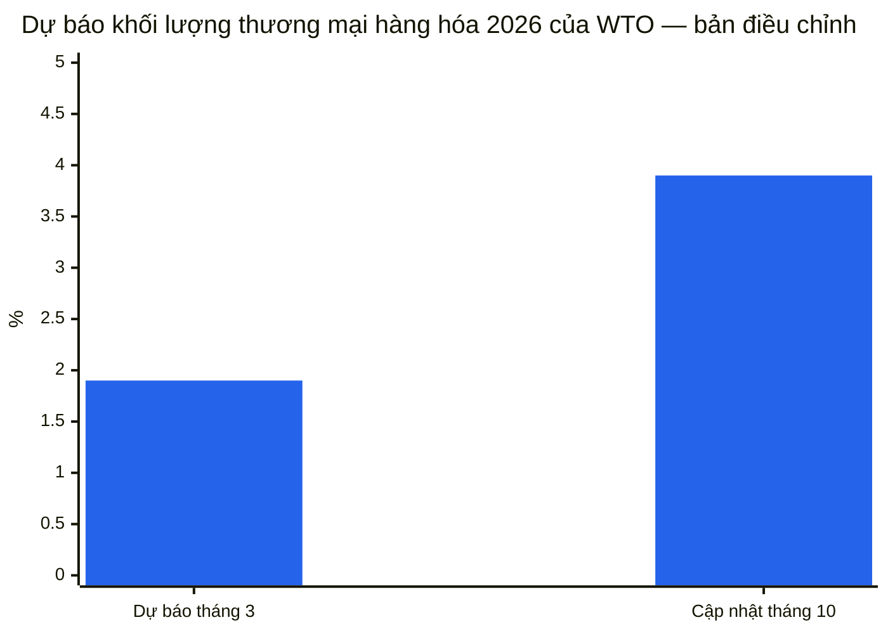

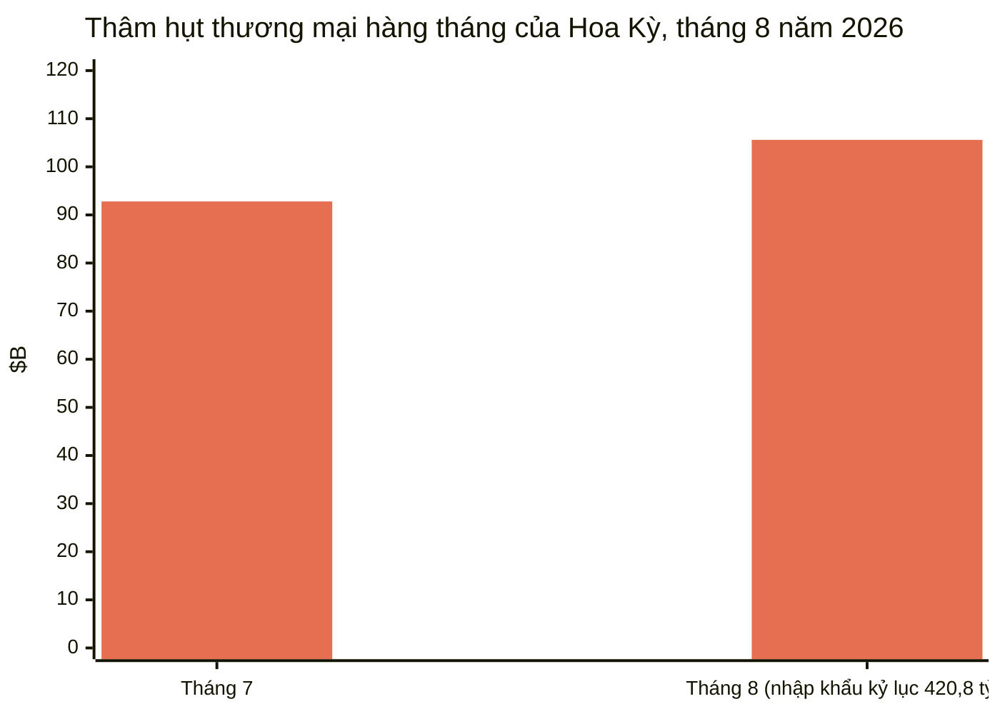

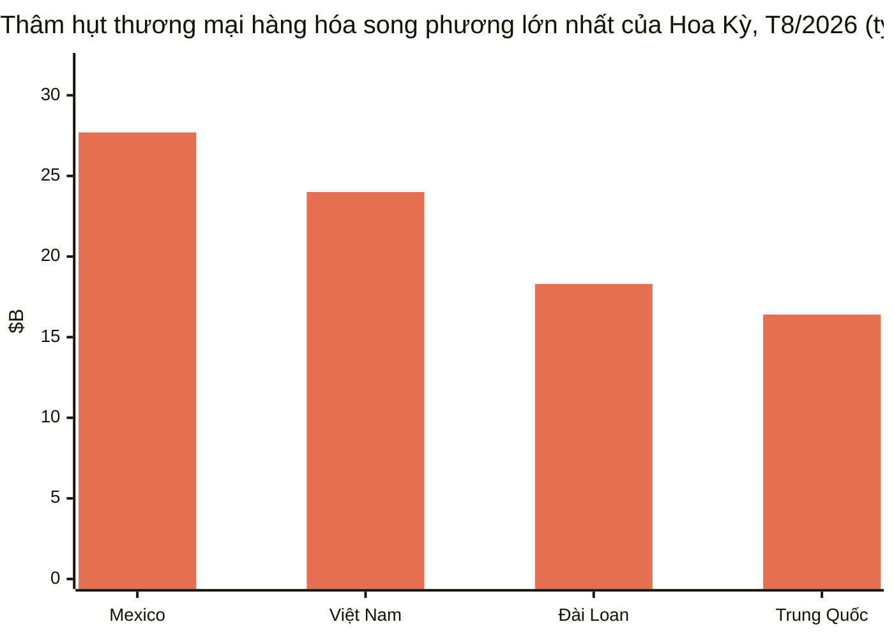

**Phân tích.** Ba bản phát hành kể một câu chuyện từ ba góc độ: nhu cầu mạnh (nhập khẩu kỷ lục của Hoa Kỳ), thành phần của nó hẹp (hàng hóa AI đóng góp gần một nửa tăng trưởng thương mại; UNCTAD cảnh báo về sự tập trung), và địa lý của nó có chọn lọc (thương mại Trung–Mỹ giảm hơn 20% kể từ 2024 trong khi Mexico, Việt Nam và Đài Loan lấp đầy khoảng trống). Sự phân kỳ giữa lạc quan khối lượng của WTO và thận trọng giá thực của UNCTAD — lợi ích danh nghĩa do giá dẫn dắt so với khối lượng thực yếu — là khung phân tích cho quý này. Báo cáo WEO tháng 10 của IMF, dự kiến trong Cuộc họp Thường niên Bangkok (12–18 tháng 10), sẽ mang đánh giá mô phỏng thuế chính thức. ([bea.gov](https://www.bea.gov/news/2026/us-international-trade-goods-and-services-august-2026), [reuters.com](https://www.reuters.com/business/us-trade-deficit-widens-august-amid-strong-imports-2026-10-06/), [dig.watch](https://dig.watch/updates/wto-trade-outlook-ai-boom), [un.org](https://news.un.org/en/story/2026/10/1168566))

### 3.5 Đất hiếm: cú bật lại ngày 10 tháng 11

**Chuyện gì đã xảy ra.** Lệnh đình chỉ kiểm soát xuất khẩu đất hiếm mở rộng của Trung Quốc dự kiến hết hạn vào **ngày 10 tháng 11 năm 2026**, chưa công bố gia hạn. Các biện pháp kiểm soát tháng 4 năm 2025 đối với bảy nguyên tố chưa bao giờ bị đình chỉ. Hoa Kỳ đang leo thang đòn bẩy của mình: Reuters đưa tin ngày 1 tháng 10 rằng Bộ Thương mại đã làm chậm giấy phép xuất khẩu linh kiện máy bay sang Trung Quốc, bao gồm các lô hàng cho COMAC thuộc sở hữu nhà nước, và đang cân nhắc quy định mới về cấp phép thiết bị hạ cánh và dầu thủy lực.

**Các con số chính.**
- IEA cảnh báo việc Trung Quốc thực hiện đầy đủ các biện pháp kiểm soát mở rộng có thể đặt khoảng **6,5 nghìn tỷ USD/năm** sản lượng hạ nguồn ngoài Trung Quốc vào rủi ro.
- Trung Quốc cung cấp 70% lượng yttri nhập khẩu của Hoa Kỳ giai đoạn 2021–2024; mức phụ thuộc nhập khẩu ròng yttri của Hoa Kỳ là 100% năm 2025.
- Phản ứng của phương Tây tuần này: một gói bốn dự luật quốc hội về dự trữ và cấp phép; American Rare Earths mở rộng mỏ Wyoming thêm 50%; Lindian Resources cam kết 150 triệu USD cho trung tâm chế biến Trung Á.

**Phân tích.** Cú bật lại ngày 10 tháng 11 là tự động trừ khi cả hai chính phủ gia hạn thời gian tạm dừng — ba kịch bản đang rình rập: gia hạn, tái kích hoạt có chọn lọc, hoặc khôi phục hoàn toàn. Cam kết của Bắc Kinh tại hội nghị thượng đỉnh tháng 5 năm 2026 về "giải quyết quan ngại của Hoa Kỳ" chưa tạo ra gia hạn chính thức nào, và các lô hàng đất hiếm chưa trở lại mức đã thỏa thuận. Lời hứa của vòng Bắc Kinh về kênh xanh cấp phép "suôn sẻ, dễ dự đoán hơn" cho các công ty châu Âu sẽ được thử thách trước ngày bật lại.

### 3.6 Mười lăm nền kinh tế liên kết về dư thừa công suất — bên ngoài WTO

**Chuyện gì đã xảy ra.** Ngày 7 tháng 10, bộ trưởng thương mại của 15 nền kinh tế — Hoa Kỳ, Argentina, Úc, Canada, EU, Pháp, Đức, Ấn Độ, Ý, Nhật Bản, Hàn Quốc, Mexico, Ba Lan, Thổ Nhĩ Kỳ và Vương quốc Anh — ký Tuyên bố Chung cấp Bộ trưởng kêu gọi hành động loại bỏ dư thừa công suất cơ cấu và các chính sách "phi thị trường" khuyến khích sản xuất thừa. Tuyên bố này bắt nguồn từ cuộc họp Bộ trưởng Thương mại G20 tại Milwaukee (30 tháng 9–1 tháng 10), nơi không đạt đồng thuận, và được thỏa thuận bên lề cuộc họp Ủy ban Thương mại OECD. Tuyên bố hứa hẹn các nền tảng ngành chuyên biệt, các cuộc họp kỹ thuật trước tháng 12, và chia sẻ thông tin.

**Phân tích.** Đây là tuyên bố liên minh lớn nhất về dư thừa công suất trong năm và nó thể chế hóa một lộ trình giám sát đa phương ngoài WTO. Những bên không ký quan trọng không kém những bên ký: Trung Quốc, Nga, Brazil, Indonesia, Ả Rập Xê Út, Nam Phi và Liên minh châu Phi không ký, và Trung Quốc cảnh báo ngày 9 tháng 10 rằng sẽ đáp trả "khi cần thiết" nếu tuyên bố bị dùng làm cớ cho các biện pháp gây hại lợi ích của mình. Sự vắng mặt của Brazil — một thành viên G20 lớn đang đối mặt thuế Mục 301 của Hoa Kỳ — đáng chú ý. Các cuộc họp kỹ thuật trước tháng 12 hiện là điểm theo dõi. ([reuters.com](https://www.reuters.com/business/some-g20-trade-ministers-sign-us-led-statement-denouncing-excess-factory-2026-10-07/))

### 3.7 Nhà nhập khẩu Hoa Kỳ tiếp tục mua: kỷ lục container tháng 9

**Chuyện gì đã xảy ra.** Báo cáo Vận tải Toàn cầu tháng 10 của Descartes (công bố ngày 8 tháng 10) cho thấy nhập khẩu container của Hoa Kỳ đạt **2.546.261 TEU trong tháng 9** — mức cao nhất mọi thời đại cho tháng 9, tăng 10,3% so với cùng kỳ (Reuters/Descartes; Descartes báo cáo giảm 2,2% so với tháng 8). Nhập khẩu có nguồn gốc Trung Quốc đạt 924.454 TEU — tăng 4,5% so với tháng trước theo Descartes, và Reuters báo cáo +21,2% so với cùng kỳ — chiếm 36,3% tổng khối lượng. Các mặt hàng bán lẻ (đồ nhựa, nội thất/giường nệm, đồ chơi/đồ thể thao) chiếm phần lớn lô hàng Trung Quốc. Khối lượng tháng 1–9 năm 2026 tăng 0,8% so với 2025 — mức tăng lũy kế đầu tiên so với 2025 trong năm nay. Dẫn chứng: Cảng LA xử lý kỷ lục 1,04 triệu TEU trong tháng 9 (Gene Seroka, ngày 9 tháng 10); Cảng Savannah kỷ lục 504.015 TEU (+3,7% so với cùng kỳ, ngày 7 tháng 10). Công cụ Global Port Tracker của NRF dự báo tháng 8 là tháng đỉnh của năm 2026; nhập khẩu "có khả năng đã qua phần bận rộn nhất của năm" (JOC, ngày 8 tháng 10).

**Phân tích.** Bất chấp chế độ thuế quan, nhu cầu nhập khẩu của Hoa Kỳ vẫn mạnh — mức kỷ lục 420,8 tỷ USD nhập khẩu tháng 8 của FT-900 và kỷ lục container tháng 9 của Descartes cùng chỉ một hướng: các chuỗi cung ứng đang định tuyến lại (khoảng cách song phương của Mexico, Việt Nam, Đài Loan hiện lớn hơn Trung Quốc) chứ không đưa sản xuất về nước. ([reuters.com](https://www.reuters.com/world/china/us-ocean-container-imports-set-new-record-september-descartes-says-2026-10-08/))

### 3.8 Hàng không và đường bộ: đỉnh cao trầm lắng với một ngoại lệ

**Hàng không.** Dữ liệu Xeneta cho thấy khối lượng hàng không toàn cầu tăng **+4% trong tháng 10** trái với kỳ vọng thị trường đi ngang, nhưng nhu cầu châu Âu–Bắc Mỹ giảm **−6% so với cùng kỳ** — "một tín hiệu khắc nghiệt" và có thể là điềm báo. Lô hàng thương mại điện tử Trung Quốc–châu Âu tăng vọt **+62% so với cùng kỳ** trong tháng 9 trong khi thương mại điện tử Trung Quốc–Hoa Kỳ giảm **−34%** (tháng thứ năm liên tiếp, chậm lại từ −49% trong tháng 6). Chỉ số TAC tháng 9: Hồng Kông–Bắc Mỹ 7,02 USD/kg (+31% so với cùng kỳ), Hồng Kông–châu Âu 4,80 USD/kg (+8,8%); Chỉ số Cước Hàng không Baltic tăng 25,5% so với cùng kỳ. Khoản phí 3 euro/kiện mới của EU đối với lô hàng dưới 150 euro đang đè nặng lên khối lượng Á–Âu. Báo cáo tháng 10 của Dimerco dự báo tắc nghẽn đường biển và hàng Trung Quốc–Hoa Kỳ bị giữ lại có thể đẩy thêm khối lượng sang đường hàng không trong quý 4; Xeneta dự báo đỉnh cao trầm lắng. Yếu tố bất ngờ: các cuộc tấn công vào sân bay Ả Rập Xê Út cắt giảm một phần ba năng lực hàng không xuất phát của Riyadh ngay trước đỉnh mùa. ([airfreight.news](https://airfreight.news/articles/full/october-air-cargo-volumes-surprise-with-4-growth-but-is-europe-north-america-slump-a-bellwether-for-global-trade))

**Vận tải đường bộ Hoa Kỳ.** Giá hợp đồng xe tải chạm mức cao nhất 52 tuần là **2,72 USD/dặm** cộng nhiên liệu (+18% so với cùng kỳ); giá giao ngay xe thùng khô 3,55 USD/dặm trọn gói, cao hơn ~50% so với năm ngoái — do nhiên liệu và thiếu hụt năng lực, không phải do nhu cầu. Giá diesel chạm 6,39 USD/gallon. Tỷ lệ từ chối đấu thầu xuất phát ~13,75–14%. Năng lực mới đang co lại: số đầu kéo trong các đội xe cho thuê mới giảm xuống 19.520 trong tháng 8 (−14% so với bình quân nửa đầu năm); chỉ ~2/3 đơn vị đăng ký liên bang mới mua bảo hiểm trách nhiệm (so với 9/10 năm 2019). Mức tăng giá chung 4,9% của Old Dominion có hiệu lực ngày 5 tháng 10; DHL Express cùng FedEx áp mức tăng 5,9% năm 2027 (ngày 1 tháng 1). ([freightwaves.com](https://www.freightwaves.com/news/trucking-rates-spike-contracts-at-52-week-high))

---

## 4. Công cụ theo dõi thuế quan

| Quốc gia | Biện pháp | Mức thuế | Ngày hiệu lực | Trạng thái | Nguồn |
|---|---|---|---|---|---|
| Hoa Kỳ → Canada | Thuế bổ sung Mục 338 | 50% (không miễn trừ USMCA) | 22 tháng 8 năm 2026 (tái phạm vi ngày 15 tháng 9) | Đang áp dụng | [whitehouse.gov](https://www.whitehouse.gov/fact-sheets/2026/07/fact-sheet-president-donald-j-trump-imposes-additional-tariffs-on-canada/) |
| Hoa Kỳ → Canada | Lệnh cấm nhập khẩu Mục 338 (xe máy, váng sữa, mật mía, bia không cồn, rượu, sữa) | Từ chối nhập (hàng đang quá cảnh: thuế 50%) | 29 tháng 9 năm 2026 | Đang áp dụng | [asrwe.com](https://asrwe.com/asr-university/us-canada-import-ban-alcohol-motorcycles-section-338-expansion-september-2026) |
| Hoa Kỳ → Canada | Thuế lao động cưỡng bức Mục 301 | 10% (tránh được với yêu cầu USMCA hợp lệ; hàng không thuộc USMCA chịu 50%+10%=60%) | 23 tháng 7 năm 2026 | Đang áp dụng; vụ kiện của 25 bang đang chờ, chưa có phán quyết | [jdsupra.com](https://www.jdsupra.com/legalnews/forced-labor-meet-section-301-new-1432199/) |
| Canada → Hoa Kỳ | Thuế trả đũa ~335 mặt hàng thuế quan (thép, nhôm, sữa, ô tô, đồ gia dụng, thiết bị nông nghiệp, giấy, nhựa, điện tử) | 15% / 25% / 50% | 8 tháng 9 năm 2026 | Đang áp dụng | [surtaxscan.com](https://surtaxscan.com/news/canadas-counter-tariffs-are-back-15-25-and-50-on-335-us-tariff-items-from) |
| Hoa Kỳ → Nga | Thuế Mục 112 Đạo luật Graham đối với mọi hàng hóa Nga kể cả dầu mỏ | Lên tới 500% | Hạn chót 18 tháng 10 năm 2026 | Đang chờ; có thể miễn trừ | [mondaq.com](https://www.mondaq.com/unitedstates/export-controls-trade-investment-sanctions/1851398/the-lindsey-graham-sanctions-act-what-businesses-need-to-know-about-the-new-tariffs) |
| Hoa Kỳ → các nước mua năng lượng Nga hàng đầu (Ấn Độ, Trung Quốc, Thổ Nhĩ Kỳ, các nước khác) | Thuế bổ sung Mục 113 Đạo luật Graham | Lên tới 100% (chồng lên mọi mức thuế hiện hành) | Hạn chót 18 tháng 10 năm 2026 | Đang chờ; miễn trừ của tổng thống yêu cầu chứng nhận không mật gửi Quốc hội | [mondaq.com](https://www.mondaq.com/unitedstates/export-controls-trade-investment-sanctions/1851398/the-lindsey-graham-sanctions-act-what-businesses-need-to-know-about-the-new-tariffs) |
| Hoa Kỳ → Nga | Giấy phép Chung 135 của OFAC: cho phép nhập khẩu dầu diesel Nga | n/a (giấy phép) | 9 tháng 10 năm 2026 – 7 tháng 4 năm 2027 | Đang áp dụng | [nationpress.com](https://www.nationpress.com/international/trump-buys-russian-diesel-before-graham-act-deadline) |
| Trung Quốc → EU (p-nitrotoluen) | Điều tra chống bán phá giá (Thông báo số 44 của MOFCOM) | Biên độ bán phá giá bị cáo buộc >100% (thuế tạm thời chưa xác định) | Mở ngày 3 tháng 10 năm 2026; hạn đăng ký ngày 23 tháng 10 | Điều tra đang mở | [mlex.com](https://www.mlex.com/mlex/articles/2533700/china-opens-anti-dumping-probe-into-eu-para-nitrotoluene) |
| EU → Trung Quốc | Điều tiết xuất khẩu hybrid/PHEV — "hiểu biết chung" | Kiềm chế xuất khẩu tự nguyện (Šefčovič tuyên bố cắt giảm một nửa; văn bản Bắc Kinh không nêu con số) | Kết quả được quyết định tại hội nghị thượng đỉnh EU ngày 15–16 tháng 10 | Đang chờ ủng hộ chính trị | [eureporter.co](https://www.eureporter.co/world/china-2/2026/10/09/eu-and-china-strike-preliminary-trade-deal-ahead-of-crucial-leaders-summit/) |
| Vương quốc Anh → Trung Quốc | Thuế đối với xe điện sản xuất tại Trung Quốc | Lên tới 45% (tương đương mức thuế tổng hợp của EU) | Đang cân nhắc | Chưa quyết định ("cân bằng mong manh") | [fleetnews.co.uk](https://Www.fleetnews.co.uk/news/uk-weighs-chinese-car-tariffs-as-fleet-demand-for-evs-surges) |
| Brazil | Thuế 0%: micro, nhạc cụ, máy may gia đình | 0% (từ 18–20%) | 1 tháng 10 năm 2026 | Đang áp dụng | [datamarnews.com](https://datamarnews.com/noticias/zero-import-tariffs-take-effect-for-musical-instruments-in-brazil/) |
| Hoa Kỳ | Thuế Mục 232 đối với polysilicon & dẫn xuất | MIP: 21 USD/kg polysilicon, 100 USD/kg wafer, 0,22 USD/W pin, 0,38 USD/mô-đun + 15% theo giá trị | 4 tháng 12 năm 2026 (quy tắc chống tăng đột biến có hiệu lực từ 22 tháng 9) | Đã lên lịch | [mondaq.com](https://www.mondaq.com/unitedstates/export-controls-trade-investment-sanctions/1848548/polysilicon-and-derivatives-in-the-bullseye-for-major-new-tariffs-and-other-restrictions) |
| Hoa Kỳ → Trung Quốc | Mục 301 Danh sách 2 & 3 (hành động 2018) | 7,5%–25% | Đang áp dụng (USTR kết thúc đợt rà soát 4 năm lần hai ngày 7 tháng 10, thuế tiếp tục) | Đang áp dụng | [internationaltradetoday.com](https://internationaltradetoday.com/article/2026/10/06/ustr-section-301-tariffs-from-2018-will-continue-2610060064?BC=bc_6ac595c738480) |
| Hoa Kỳ → ~60 nền kinh tế | Thuế lao động cưỡng bức Mục 301 | Bậc 10% (17 nền kinh tế gồm Canada, Ấn Độ, Mexico, Anh); 12,5% đối với phần còn lại; EU/Đài Loan giới hạn 10% tổng hợp | 23 tháng 7 năm 2026 | Đang áp dụng; 3 vụ kiện đang chờ | [jdsupra.com](https://www.jdsupra.com/legalnews/forced-labor-meet-section-301-new-1432199/) |
| Hoa Kỳ → ~60 nền kinh tế (TRQ đề xuất) | Hạn ngạch thuế quan ASEAN (Bangladesh, Campuchia, Indonesia, Malaysia) cho hàng hóa có nguyên liệu bông/dệt may Hoa Kỳ — miễn thuế lao động cưỡng bức Mục 301 | chưa xác định | Đang cân nhắc | Giai đoạn đề xuất | [asiadaily.org](https://asiadaily.org/news/14890/) |
| Hoa Kỳ | Hướng dẫn "hàm lượng Hoa Kỳ" của BIS: thiết bị công nghiệp di động USMCA (Tuyên bố 11032) — giảm thuế 25% → sàn 15% khi hàm lượng Hoa Kỳ ≥40% | Thuế hiệu lực sàn 15% | Có hiệu lực ngày 14 tháng 10 năm 2026 (công bố FR) | Đã lên lịch | [kpmg.com](https://kpmg.com/us/en/taxnewsflash/news/2026/10/us-bis-guidance-us-content-canadian-mexican-products.html) |
| Ấn Độ | Crom trioxit — quyết định CVD khẳng định cuối cùng | n/a | 8 tháng 10 năm 2026 (biện pháp của Hoa Kỳ) | Đã ban hành quyết định cuối cùng | [federalregister.gov](https://www.federalregister.gov/documents/2026/10/08/2026-20696/chromium-trioxide-from-india-final-affirmative-countervailing-duty-determination) |
| Trung Quốc | CBS (chất xúc tiến cao su) — CVD khẳng định sơ bộ + tình tiết nghiêm trọng | n/a | 8 tháng 10 năm 2026 (biện pháp của Hoa Kỳ) | Đã ban hành quyết định sơ bộ | [federalregister.gov](https://www.federalregister.gov/documents/2026/10/08/2026-20692/n-cyclohexylbenzothiazole-2-sulfenamide-from-the-peoples-republic-of-china-preliminary-affirmative) |
| Trung Quốc | Hợp chất amin — điều tra AD/CVD được khởi xướng (biên độ bị cáo buộc lên tới 476%) | chưa xác định | ITC sơ bộ hạn ngày 13 tháng 11 năm 2026 | Điều tra đang mở | [federalregister.gov](https://www.federalregister.gov/documents/2026/10/05/2026-20286/amine-compounds-from-china-institution-of-antidumping-and-countervailing-duty-investigations-and) |
| Mexico | Toa xe lửa chở dầu — điều tra AD/CVD được khởi xướng | chưa xác định | ITC sơ bộ hạn ngày 16 tháng 11 năm 2026 | Điều tra đang mở | [federalregister.gov](https://www.federalregister.gov/documents/2026/10/05/2026-20349/railway-tank-cars-and-parts-thereof-from-mexico-institution-of-antidumping-and-countervailing-duty) |
| Nhật Bản | Lệnh cấm xuất khẩu mở rộng đối với cơ sở công nghiệp Nga | Cấm xuất khẩu | 16 tháng 10 năm 2026 | Đã lên lịch | [globalsanctions.com](https://globalsanctions.com/2026/10/japan-adds-more-goods-to-russia-export-ban-from-16-october-2026/) |

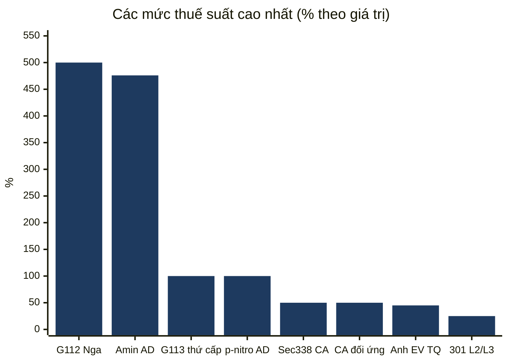
*Mức tối đa được công bố ('tối đa' với mức đề xuất; AD = biên độ bán phá giá bị cáo buộc).*

---

## 5. Phân tích sâu chính sách Hoa Kỳ

### Hoa Kỳ–Canada: bế tắc kèm mây mù pháp lý

Không có tuyên bố Mục 338 mới nào trong kỳ. Các biện pháp hiện hành: **thuế bổ sung 50% Mục 338** đối với hàng hóa Canada (có hiệu lực từ 22 tháng 8; đợt thứ hai có hiệu lực ngày 15 tháng 9 bao gồm giấy, nội thất, phô mai, da, thuyền máy, xe golf, thép, nhôm và sản phẩm kim loại cơ bản — thuế áp dụng bất kể xuất xứ USMCA; năng lượng, kali, hàng hóa thuộc Mục 232, cá và khoáng sản quan trọng được loại trừ); **lệnh cấm nhập khẩu** có hiệu lực ngày 29 tháng 9 đối với xe máy, váng sữa, mật mía, bia không cồn, rượu và sữa (khoảng 967 triệu USD); thuế trả đũa **15%/25%/50%** song phương của Canada đối với khoảng 27,6 tỷ CAD hàng hóa Hoa Kỳ (thép, nhôm, sữa, ô tô, đồ gia dụng, thiết bị nông nghiệp, giấy, nhựa, điện tử) có hiệu lực ngày 8 tháng 9; và chỉ thị ngày 8 tháng 9 của tổng thống gửi GSA (cùng USTR) loại bỏ sản phẩm có nguồn gốc Canada khỏi Lịch trình Đa giải thưởng của GSA.

Diễn biến tuần này: Viện Kinh tế Montreal công bố ghi chú ngày 8 tháng 10 (Phillip W. Magness) lập luận thuế trả đũa của Canada có thể làm suy yếu các thách thức pháp lý của Hoa Kỳ đối với thuế Mục 338; giới bình luận pháp lý tiếp tục cho rằng Mục 338 có thể đã bị Đạo luật Mở rộng Thương mại năm 1962 và Đạo luật Thương mại năm 1974 thay thế, đặt ra các vấn đề về câu hỏi lớn và ủy quyền — nhưng **chưa có vụ kiện nào được nộp** trực tiếp thách thức thuế Mục 338. Riêng **vụ kiện của 25 bang** về thuế lao động cưỡng bức Mục 301 tháng 7 năm 2026 (tổng cộng ba vụ kiện thách thức mức thuế 10–12,5% đối với ~60 nền kinh tế) **tính đến ngày 4 tháng 10 chưa có phán quyết bằng văn bản**. Trên lộ trình đàm phán, USTR Greer mô tả các điểm nghẽn còn lại của Canada (ô tô, sữa, đồ uống có cồn) là "khá khó khăn" và nói Washington "không có ý định" tiến tới thuế 0; Thủ tướng Carney tiết lộ Ottawa đã sẵn sàng dỡ bỏ các thuế trả đũa còn lại đối với thép, nhôm và ô tô nếu Washington hạ đáng kể thuế của mình, và khuyến khích các tỉnh đưa rượu Hoa Kỳ trở lại kệ hàng — nhưng sẽ không thay đổi hệ thống quản lý cung ứng. Canada đã ra tín hiệu kiềm chế thay vì leo thang thêm. ([iedm.org](https://www.iedm.org/counter-tariffs-the-federal-government-is-undermining-u-s-legal-challenges-to-section-338/), [akingump.com](https://www.akingump.com/en/insights/alerts/president-trump-directs-removal-of-canadian-products-from-federal-procurement), [hashtag investing](https://www.hashtaginvesting.com/blog/u-s-trade-chief-says-canadas-sticking-points-are-quite-difficult-and-washington-is-not-inclined-to-go-to-zero-tariff))

### Hoàn thuế IEEPA: Giai đoạn 3 bắt đầu

CBP mở **Giai đoạn 3 của quy trình hoàn thuế thuế quan IEEPA theo lệnh tòa** vào **ngày 6 tháng 10** thông qua nền tảng khiếu nại trực tuyến (CAPE). Các nhà nhập khẩu đã đăng ký có số IOR nộp trước 30 tháng 7 năm 2026 có thể tham gia. Chính phủ liên bang đã kháng cáo phần của lệnh Tòa án Thương mại Quốc tế yêu cầu hoàn thuế cho các nhà nhập khẩu không kiện tụng đối với các tờ khai đã thanh lý hơn 80 ngày trước; CBP tuyên bố đang tự nguyện hoàn thuế đối với các tờ khai chưa thanh lý và các tờ khai trong vòng 80 ngày kể từ ngày thanh lý. CBP đang tiếp nhận thêm ý kiến công chúng về việc thu thập thông tin hoàn thuế đến **ngày 4 tháng 11** (Reginfo.gov). Đây là việc thực thi vận hành khoảng 180 tỷ USD tiền hoàn thuế thuế quan IEEPA được lệnh sau khi Tòa án Tối cao tuyên vô hiệu thuế "Ngày Giải phóng" tháng 2 năm 2026; phạm vi cứu trợ cho các nhà nhập khẩu không kiện tụng với các tờ khai cũ đã thanh lý vẫn còn tranh cãi. Phòng Thí nghiệm Ngân sách Yale ước tính xung lực tài khóa tích cực tạm thời từ hoàn thuế IEEPA xấp xỉ bù đắp tác động tăng trưởng tiêu cực của các mức thuế còn lại trong năm 2026. ([thompsonhine.com](https://www.thompsonhine.com/insights/cbp-confirms-october-6-2026-launch-of-phase-3-of-the-ieepa-tariff-refund-process/))

### Hoạt động của CBP

- **Phí người dùng hải quan năm tài chính 2027 (có hiệu lực ngày 1 tháng 10):** Phí Người dùng Giấy phép Môi giới Hải quan tăng từ 185,38 USD lên **190,88 USD**; thuế suất Phí Xử lý Hàng hóa giữ nguyên **0,3464%**, với mức tối thiểu và tối đa tăng. ([ghy.com](https://www.ghy.com/trade-compliance/category/us-customs/))
- **Lô hàng giá trị thấp (RIN 1685-AA38):** CBP mở tham vấn ngày **8 tháng 10** về các thay đổi đề xuất đối với yêu cầu tờ khai hải quan không chính thức cho lô hàng giá trị thấp; hạn góp ý **ngày 7 tháng 12**. ([digitalpolicyalert.org](https://digitalpolicyalert.org/event/44472-customs-and-border-protection-opened-consultation-on-proposed-rule-on-low-value-shipments))
- **Hạn ngạch thuế quan đường năm tài chính 2027 (mở ngày 1 tháng 10):** đường tinh luyện và đường đặc biệt đều vượt đăng ký — phân bổ theo tỷ lệ **51,03027%** (tinh luyện) và **44,58212%** (đặc biệt). ([ghy.com](https://www.ghy.com/trade-compliance/category/us-tariffs/))

### USTR

- **Ngày 8 tháng 10:** Viện dẫn **Cơ chế Lao động Phản ứng Nhanh USMCA** để xem xét liệu người lao động tại **GLM Components Mexico, S.A. de C.V.** (Puebla; phụ tùng ô tô) có bị từ chối quyền tự do lập hội và thương lượng tập thể hay không; Hoa Kỳ đã **đình chỉ thanh lý** các tờ khai chưa thanh lý của hàng hóa từ cơ sở này. ([ustr.gov](https://ustr.gov/about/policy-offices/press-office/press-releases/2026))
- **Ngày 7 tháng 10:** Triệu tập quan chức cấp cao của **14 nền kinh tế** bên lề Ủy ban Thương mại OECD; ban hành tuyên bố chung cấp bộ trưởng về dư thừa công suất cơ cấu — tiền thân của tuyên bố 15 nền kinh tế (xem §3.6).
- **Ngày 5 tháng 10:** Đại sứ Greer chủ trì **cuộc họp Bộ trưởng Thương mại G20** tại Milwaukee; thảo luận bao gồm loại bỏ lao động cưỡng bức, cập nhật nguyên tắc tối huệ quốc, lên án việc vũ khí hóa thương mại lương thực, và dư thừa công suất.
- **Rà soát 4 năm Mục 301 (hành động 2018):** USTR công bố đợt rà soát 4 năm lần hai của các hành động Mục 301 ngày 6 tháng 7 và 23 tháng 8 năm 2018 (Danh sách 2 và 3 đối với Trung Quốc) kết thúc với thuế **tiếp tục áp dụng** — thuế bổ sung thường 7,5% đến 25%, một số cao hơn sau các sửa đổi sau này (thông báo Federal Register công bố ngày 7 tháng 10).
- **Rà soát chung USMCA 2027:** hạn góp ý và yêu cầu điều trần **ngày 12 tháng 1 năm 2027**.
- **Đề xuất hạn ngạch thuế quan ASEAN:** USTR đang cân nhắc TRQ ba năm cho Bangladesh, Campuchia, Indonesia và Malaysia có thể miễn các sản phẩm chứa nguyên liệu bông và dệt may Hoa Kỳ khỏi thuế lao động cưỡng bức Mục 301 — vẫn đang cân nhắc. Malaysia giữ Thỏa thuận Thương mại Đối ứng tháng 10 năm 2025 (mức 19%); Indonesia coi hiệp ước "Kỷ nguyên Vàng mới" tháng 2 năm 2026 là ràng buộc; Thái Lan đang đánh giá; Việt Nam đang tận dụng sự gần gũi ngoại giao. ([asiadaily.org](https://asiadaily.org/news/14890/))
- **Brazil:** sau cuộc họp ngày 30 tháng 9 với Greer, nhà đàm phán Rosa của Brazil cho biết Brazil tìm kiếm giảm thuế toàn diện — bao gồm thuế Mục 232 đối với thép, nhôm và phụ tùng ô tô — và cả hai bên đồng ý bổ nhiệm một nhóm công tác để xác định phạm vi các vấn đề thương mại; ông gọi thuế Mục 301 25% dành riêng cho Brazil là "mức thuế khủng khiếp nhất." ([internationaltradetoday.com](https://internationaltradetoday.com/article/2026/10/01/brazil-expresses-confidence-it-can-reach-tariff-reduction-agreement-2610010041))

### BIS — kiểm soát xuất khẩu

- **Hướng dẫn "hàm lượng Hoa Kỳ" (công bố FR dự kiến ngày 14 tháng 10):** định nghĩa cách tính "hàm lượng Hoa Kỳ" cho sản phẩm Canada và Mexico đủ điều kiện hưởng ưu đãi USMCA theo tuyên bố kim loại Mục 232 số 11032 — (1) giá trị linh kiện hoàn toàn thu được, hoàn toàn sản xuất, hoặc chuyển đổi đáng kể tại Hoa Kỳ; (2) trong phạm vi chưa được tính, giá trị thép nấu chảy và đúc, nhôm nấu chảy và đúc, đồng nấu chảy và đúc tại Hoa Kỳ. Hai phương pháp không thể kết hợp. Hiệu quả thực tế: các nhà nhập khẩu đủ điều kiện của thiết bị công nghiệp di động USMCA (xe nâng, máy san, cần cẩu, máy xúc, xe ủi) có thể giảm thuế Mục 232 từ **25% xuống sàn hiệu lực 15%** khi ít nhất 40% giá trị là hàm lượng Hoa Kỳ; mã HTS mới **9903.82.22** báo cáo hàm lượng phi Hoa Kỳ (hoặc hàm lượng Hoa Kỳ vượt 40%), trong khi 9903.82.21 bao gồm hàm lượng Hoa Kỳ đủ điều kiện đến 40%. ([kpmg.com](https://kpmg.com/us/en/taxnewsflash/news/2026/10/us-bis-guidance-us-content-canadian-mexican-products.html))
- **Quy tắc Công ty liên kết:** việc đình chỉ quy tắc mở rộng các hạn chế của Danh sách Thực thể/MEU/SDN sang các công ty liên kết nước ngoài do các bên bị liệt kê sở hữu từ 50% trở lên vẫn có hiệu lực, với việc khôi phục dự kiến vào **ngày 10 tháng 11** trừ khi được gia hạn. Thỏa thuận Mỹ–Trung ngày 23 tháng 9 gia hạn khuôn khổ Busan đến 10 tháng 1 năm 2027 được kỳ vọng kèm gia hạn tương ứng, nhưng **chưa có thông báo Federal Register nào** được công bố. Luật sư thương mại khuyên nên chuẩn bị với giả định quy tắc có thể quay lại. ([jdsupra.com](https://www.jdsupra.com/legalnews/bis-affiliates-rule-suspension-extended-1084647/))
- **Giấy phép linh kiện máy bay cho COMAC:** Reuters đưa tin ngày 1 tháng 10 (nguồn giấu tên) rằng Bộ Thương mại đã làm chậm giấy phép xuất khẩu linh kiện máy bay sang Trung Quốc, bao gồm các lô hàng cho COMAC thuộc sở hữu nhà nước, và đang cân nhắc quy định mới về cấp phép thiết bị hạ cánh và dầu thủy lực. ([investornews.com](https://www.investornews.com/critical-minerals-rare-earths/technology-metals-report-10-04-2026-a-summit-without-a-rare-earth-deal-leaves-the-west-buying-its-way-to-supply/))

### Federal Register — AD/CVD, ngày 5–8 tháng 10

Các cuộc điều tra AD/CVD mới được khởi xướng đối với **hợp chất amin từ Trung Quốc** (biên độ bán phá giá bị cáo buộc lên tới 476%; ITC sơ bộ hạn ngày 13 tháng 11) và **toa xe lửa chở dầu và linh kiện từ Mexico** (ITC sơ bộ hạn ngày 16 tháng 11); **quyết định CVD khẳng định cuối cùng** đối với crom trioxit từ Ấn Độ; **quyết định CVD khẳng định sơ bộ + tình tiết nghiêm trọng** đối với CBS từ Trung Quốc; kết quả rà soát AD sơ bộ đối với thép cây từ Thổ Nhĩ Kỳ; ý định sơ bộ hủy bỏ rà soát AD đối với nệm từ Ba Lan; các đợt rà soát hoàng hôn 5 năm được lên lịch đối với ống liền mạch (Nga, Hàn Quốc, Czechia, Ukraine); lịch trình sửa đổi đối với hộp các-tông sóng cắt khuôn (Trung Quốc, Malaysia, Thổ Nhĩ Kỳ). Bảng đầy đủ tại §4. ([federalregister.gov](https://www.federalregister.gov/documents/2026/10/05/2026-20286/amine-compounds-from-china-institution-of-antidumping-and-countervailing-duty-investigations-and))

### Các mục thường trực

- **Polysilicon Mục 232:** không đổi. Hiệu lực ngày 4 tháng 12 giữ nguyên (MIP 21 USD/kg polysilicon, 100 USD/kg wafer, 0,22 USD/W pin, 0,38 USD/mô-đun; 15% theo giá trị đối với dẫn xuất; các hạn chế chống tăng đột biến chạy từ 22 tháng 9 đến 4 tháng 12). Giá mô-đun trung vị của Hoa Kỳ đạt 0,38 USD/W vào cuối tháng 9, tăng ~40,7% từ 0,27 USD/W trong tháng 8.
- **Đình chiến Mỹ–Trung:** gia hạn khuôn khổ Busan đến **ngày 10 tháng 1 năm 2027** giữ nguyên; Nhà Trắng chưa chính thức văn bản hóa. Các lô hàng đất hiếm chưa trở lại mức đã thỏa thuận; các biện pháp kiểm soát tháng 4 năm 2025 đối với bảy nguyên tố đất hiếm chưa bao giờ bị đình chỉ. Các miễn trừ Mục 301 cho 178 sản phẩm Trung Quốc hết hạn ngày 10 tháng 11.
- **"30-đối-30" Mỹ–Trung:** cả hai chính phủ công bố danh sách giảm thuế đối ứng ngày 28 tháng 9 (~30 tỷ USD mỗi bên theo khuôn khổ Hội đồng Thương mại Mỹ–Trung); cổng thông tin tiếng Anh của MOFCOM đăng tải thông tin công bố về khuôn khổ.

---

## 6. Chính sách thế giới theo khu vực

### Châu Âu

- **EU–Trung Quốc:** xem §3.1. Song song, **đề xuất phản ứng nhanh Pháp–Đức** (ngày 5 tháng 10) yêu cầu Ủy ban có công cụ đối phó "các thực tiễn bóp méo thị trường mang tính hệ thống" — bán phá giá, trợ cấp tràn lan, hạn chế chuyển đổi tiền tệ — với các quan chức Đức viện dẫn một công cụ "mạnh mẽ như thuế Mục 301 do Hoa Kỳ áp đặt hoặc các hạn chế của Trung Quốc đối với xuất khẩu khoáng sản quan trọng." Đề xuất kêu gọi công cụ phòng vệ thương mại nhanh hơn, nhiều cuộc điều tra hơn, cách tiếp cận ngành rộng hơn (đánh dấu hóa chất, PET và xe hybrid), cộng thêm hai công cụ bổ sung về đa dạng hóa và an ninh kinh tế. Ủy ban hoan nghênh bức thư; các nhà lãnh đạo EU thảo luận tại hội nghị thượng đỉnh ngày 15 tháng 10. MOFCOM công khai phản hồi các báo cáo truyền thông về đề xuất "phiên bản châu Âu của Mục 301." ([lapost.com](https://www.lapost.com/content/france-germany-propose-new-rapid-eu-trade-response-tool))
- **Vương quốc Anh:** chính phủ đang soạn thảo một gói thuế tiềm năng lên tới **45%** đối với xe điện sản xuất tại Trung Quốc, tương đương mức thuế tổng hợp của EU — Bộ trưởng Kinh doanh Reynolds nay gọi quyết định là "cân bằng mong manh" sau khi nói với Auto Express trong tháng 9 rằng Vương quốc Anh không có kế hoạch tăng thuế. Brussels đã ra tín hiệu sản phẩm của Anh có thể bị loại khỏi các lợi ích chính sách công nghiệp "Sản xuất tại châu Âu" nếu Anh không điều chỉnh; 58% xuất khẩu ô tô của Anh đi EU so với ~4% đi Trung Quốc; các thương hiệu Trung Quốc chiếm hơn 15% số đăng ký xe mới của Anh trong tám tháng đầu năm 2026 (223.000 xe), tăng từ 4% năm 2023. Người phát ngôn DBT cho biết chưa áp thuế nào và chưa có quyết định cuối cùng. ([fleetnews.co.uk](https://Www.fleetnews.co.uk/news/uk-weighs-chinese-car-tariffs-as-fleet-demand-for-evs-surges), [britishchambers.org.uk](https://www.britishchambers.org.uk/news/2026/10/eu-china-trade-talks-what-the-outcome-means-for-uk-business/))
- **Hồ sơ thương mại số:** **Hiệp định Thương mại Số EU–Hàn Quốc** đối mặt hạn chót sửa đổi của nghị sĩ châu Âu vào ngày 8 tháng 10 (quy tắc dòng dữ liệu, bảo vệ mã nguồn, lệnh cấm vĩnh viễn thuế hải quan đối với truyền tải điện tử); **hội nghị thượng đỉnh EU–Canada tại Montréal (29–30 tháng 10)** dự kiến hoàn tất đàm phán Hiệp định Thương mại Số và một gói hợp tác khoáng sản/cạnh tranh; Ủy ban đã trình đề xuất ký kết **FTA EU–Ấn Độ** với một chương số. ([euperspectives.eu](https://euperspectives.eu/2026/10/eu-south-korea-digital-trade-deal-raise-debate-over-data-sovereignty/), [dig.watch](https://dig.watch/updates/eu-canada-digital-trade-ai), [globallawexperts.com](https://globallawexperts.com/eu-india-fta-digital-trade/))
- **FTA EU–Indonesia:** đàm phán kỹ thuật kết thúc tháng 9 năm 2025; văn bản pháp lý (xóa thuế đối với đa số hàng hóa kèm biện pháp bảo vệ và hạn ngạch cho hàng nhạy cảm) đang được rà soát thể chế, dự kiến ký chính thức trước cuối năm tài chính 2026 của EU. Đàm phán với Philippines, Thái Lan và Malaysia ở giai đoạn nâng cao. ([lupicinio.com](https://lupicinio.com/en/international-trade-%c2%b7-august-and-september-2026/))
- **Nghị viện châu Âu:** bỏ phiếu ngày 7 tháng 10 lên án các thực tiễn kinh tế của Trung Quốc và lập trường của nước này về Ukraine.

### Trung Quốc

- **Cuộc điều tra chống bán phá giá p-nitrotoluen** (mở ngày 3 tháng 10; xem §4). MOFCOM lưu ý EU đã mở **28 cuộc điều tra biện pháp thương mại** đối với Trung Quốc kể từ 2025, khoảng một nửa liên quan đến hóa chất, và kêu gọi giải quyết tranh chấp thông qua đối thoại.
- **Đạo luật Graham:** Bắc Kinh bác bỏ "quyền tài phán tay dài" và can thiệp vào hợp tác thương mại bình thường, phản đối các lệnh trừng phạt đơn phương thiếu ủy nhiệm của Hội đồng Bảo an Liên Hợp Quốc, và bảo lưu quyền bảo vệ các công ty của mình (Bộ Ngoại giao, ngày 19 tháng 9, được nhắc lại trong báo cáo tuần này). Trung Quốc là nước mua dầu thô Nga lớn thứ hai năm 2025 ở mức ~1,3 triệu thùng/ngày.
- **Tuyên bố dư thừa công suất:** MOFCOM cho biết ngày 9 tháng 10 rằng Trung Quốc sẽ đáp trả "khi cần thiết" nếu tuyên bố 15 nền kinh tế bị dùng làm cớ cho các biện pháp gây hại lợi ích Trung Quốc; Trung Quốc không ký.
- **Cổng thông tin tiếng Anh của MOFCOM** có thể truy cập được ngày 12 tháng 10 (http://english.mofcom.gov.cn/), đăng tải phản hồi của người phát ngôn về đề xuất Pháp–Đức và thông tin công bố về khuôn khổ "30-đối-30."

### Ấn Độ

- **Đàm phán thỏa thuận thương mại với Hoa Kỳ "đạt đến một bình nguyên"** (Bộ trưởng Tài chính Sitharaman, ngày 5 tháng 10); các nhượng bộ tiếp theo có thể khó khăn. Bộ Ngoại giao Ấn Độ cảnh báo ngày 17 tháng 9 rằng Đạo luật Graham có thể gây hệ quả "không chỉ đối với quan hệ song phương mà còn đối với thị trường năng lượng quốc tế," và nhấn mạnh an ninh năng lượng cho 1,4 tỷ dân. Bộ trưởng Dầu mỏ Puri chỉ ra các lựa chọn đa dạng hóa (Guyana, Brazil, Canada, Suriname, Namibia). Ấn Độ là nước mua dầu thô Nga lớn nhất năm 2025 ở mức ~1,6 triệu thùng/ngày.
- Ấn Độ tham gia **tuyên bố dư thừa công suất 15 nền kinh tế** (ngày 7 tháng 10) và nằm trong số 16 nền kinh tế thuộc diện điều tra dư thừa công suất Mục 301 của USTR tháng 3 năm 2026. Tranh chấp WTO về thuế ICT với Đài Bắc Trung Hoa được hoãn đến ngày 27 tháng 10.

### Thổ Nhĩ Kỳ

- Tuần này không ghi nhận tuyên bố mới của chính phủ Thổ Nhĩ Kỳ về Đạo luật Graham (Thổ Nhĩ Kỳ: ~282.000 thùng/ngày dầu thô Nga năm 2025, nước mua hạng ba). Thổ Nhĩ Kỳ đã ký tuyên bố dư thừa công suất 15 nền kinh tế.

### Canada

- **Không có biện pháp trả đũa mới** trong ngày 5–12 tháng 10. Thuế trả đũa song phương 15%/25%/50% của Canada (có hiệu lực ngày 8 tháng 9, ~27,6 tỷ CAD) giữ nguyên; thuế thép và nhôm được nâng từ 25% lên 50% để tương đương mức thuế Hoa Kỳ; hàng đang quá cảnh ngày 8 tháng 9 được miễn; thuế trả đũa ô tô hiện hành tiếp tục. Ottawa công bố gói hỗ trợ người lao động và doanh nghiệp **7,5 tỷ CAD**. Bế tắc đàm phán vẫn tiếp diễn (Greer: các điểm nghẽn "khá khó khăn"; Carney: quản lý cung ứng là không thể thương lượng).

### Brazil

- **Thuế 0%** đối với micro, nhạc cụ và máy may gia đình có hiệu lực ngày 1 tháng 10 (Nghị quyết Gecex/Camex số 926/2026; thuế trước đây lên tới 18–20%). Brazil đồng ý một **nhóm công tác với USTR** (ngày 30 tháng 9) để xác định phạm vi thỏa thuận giảm thuế; Rosa gọi thuế Mục 301 25% dành riêng cho Brazil là "mức thuế khủng khiếp nhất."

### Nhật Bản

- Sửa đổi Lệnh Kiểm soát Thương mại Xuất khẩu ngày 6 tháng 10 để bổ sung hàng hóa vào lệnh cấm xuất khẩu sang Nga bao gồm các mặt hàng có thể củng cố cơ sở công nghiệp của Nga; có hiệu lực **ngày 16 tháng 10** — một ngày trước hạn chót Đạo luật Graham. ([globalsanctions.com](https://globalsanctions.com/2026/10/japan-adds-more-goods-to-russia-export-ban-from-16-october-2026/))

### ASEAN và Úc

- **Đề xuất TRQ ASEAN:** xem §5 (USTR đang cân nhắc TRQ ba năm cho Bangladesh, Campuchia, Indonesia và Malaysia đối với hàng hóa chứa nguyên liệu bông/dệt may Hoa Kỳ).
- **Úc:** DFAT từ chối tham gia tuyên bố do Anh dẫn đầu của 12 chính phủ đang cân nhắc hoặc cam kết hạn chế thương mại với các doanh nghiệp Israel tại các khu định cư Bờ Tây, viện dẫn thách thức thực tế; cho biết đang theo đuổi các biện pháp có mục tiêu hơn với các đối tác (cuối tháng 9; lập trường hạn chế thương mại duy nhất của Úc được báo cáo trong tuần).

### Đa phương

- **Hội đồng Chung WTO (5–6 tháng 10):** các thành viên tổ chức cuộc họp cải cách hai ngày; Tổng Giám đốc Okonjo-Iweala kêu gọi chuyển từ quy trình sang thực chất. Cải cách giải quyết tranh chấp: Chủ tịch DSB Đại sứ Patriota (Brazil) sẽ tiếp tục tham vấn không chính thức; gần 60 diễn giả phát biểu. Trợ cấp thủy sản: các thành viên kêu gọi tránh "hoàng hôn" của hiệp định; yêu cầu ý tưởng mới trong nông nghiệp. Hiệp định Thương mại Điện tử: đa số rộng ủng hộ tính dự đoán được của thương mại số, nhưng đặt câu hỏi về nền tảng pháp lý, việc sử dụng nguồn lực WTO và vai trò lưu chiểu của Tổng Giám đốc. Thuận lợi hóa Đầu tư vì Phát triển: số thành viên tham gia mở rộng lên **131 thành viên**. MC15: chưa ấn định ngày. ([logisticsnews.ph](https://logisticsnews.ph/2026/10/07/wto-members-urged-to-move-from-process-to-substance-as-general-council-tackles-reform-and-future-ministerial-preparations/))
- **Tranh chấp WTO:** **ban hội thẩm CBAM (DS639, Nga kiện EU)** được thành lập ngày 25 tháng 9 theo yêu cầu lần hai của Nga, với **Ấn Độ là bên thứ ba**; EU sẽ tham gia nhưng từ chối đối thoại trực tiếp với Nga; Cơ quan Phúc thẩm vẫn không thể xét xử các kháng cáo. Việc xem xét báo cáo ban hội thẩm **tranh chấp xe điện Thổ Nhĩ Kỳ–Trung Quốc (DS629)** được hoãn đến ngày 27 tháng 10 theo yêu cầu chung của các bên; việc thông qua phán quyết **thuế ICT Ấn Độ–Đài Bắc Trung Hoa** được hoãn đến ngày 27 tháng 10. Colombia và 130 thành viên lần thứ 110 thúc đẩy bắt đầu lựa chọn Cơ quan Phúc thẩm; Hoa Kỳ lại bày tỏ quan ngại. Campuchia được nhận vào MPIA. ([reuters.com](https://www.reuters.com/world/wto-dispute-body-agrees-to-russias-panel-request-eu-carbon-border-levy-2026-09-25/))
- **Báo cáo Thương mại và Phát triển 2026 của UNCTAD** (ngày 9 tháng 10): xem §3.4. Phân tích bối cảnh thuế của UNCTAD (ngày 17 tháng 9) cho thấy thuế suất trung bình của Hoa Kỳ tăng từ 2,8% trước 2025 lên hơn 20% vào đầu tháng 9; 16 nước đang phát triển (gồm 5 nước kém phát triển nhất) hiện đối mặt thuế trên 25%; thuế bình quân gia quyền thương mại của các nước kém phát triển nhất tăng gấp đôi lên 19% trong thời gian tạm dừng và leo lên 27% trong tháng 9; các nước đang phát triển châu Á–châu Đại Dương tăng từ 3% lên 21%; Mỹ Latinh và Caribe từ dưới 0,5% lên 18%. ([un.org](https://news.un.org/en/story/2026/10/1168566))
- **WCO:** **các sửa đổi HS 2028** được công bố — 299 bộ thay đổi tạo ra 1.229 nhóm và 5.852 phân nhóm (6 nhóm mới, 428 phân nhóm mới được tạo; 5 nhóm, 172 phân nhóm bị xóa), tập trung vào chuẩn bị ứng phó khẩn cấp y tế, ứng phó dịch bệnh và bảo vệ môi trường; có hiệu lực **ngày 1 tháng 1 năm 2028**, với thời gian thực thi hai năm — được đánh dấu tuần này là hạn chót quan trọng phía trước cho các đội phân loại thuế. Chương trình Quy tắc Xuất xứ châu Phi EU–WCO tổ chức hội thảo Đào tạo Giảng viên cuối cùng cho Hiệp hội các Nhà sản xuất Kenya (khai mạc ngày 1 tháng 10). ([wcoesarocb.org](https://www.wcoesarocb.org/wco-and-partners-strengthen-rules-of-origin-expertise-to-support-trade-and-industrialisation/))
- **ITC:** không ghi nhận bản phát hành thống kê thương mại mới nào của Trade Map có ngày 5–12 tháng 10 từ báo cáo công khai.

---

## 7. Hành động thực thi

| Hành động | Mục tiêu | Ngày | Trạng thái | Nguồn |
|---|---|---|---|---|
| Lệnh Giữ hàng (lao động cưỡng bức) | Mitra Aneka Rezeki (MAR), Hardaya Inti Plantation (HIP) — dầu cọ và dẫn xuất Indonesia | 29 tháng 9 năm 2026 | Đang áp dụng; tổng 60 WRO đang hoạt động + 8 Kết luận | [thompsonhine.com](https://www.thompsonhine.com/insights/cbp-issues-withhold-release-orders-on-two-indonesian-palm-oil-producers/) |
| Trừng phạt Hoa Kỳ (OFAC) | 22 tàu chở dầu cùng cá nhân/công ty liên quan đến hoạt động buôn dầu của Iran | 8 tháng 10 năm 2026 | Đã chỉ định | [gcaptain.com](https://gcaptain.com/category/news/) |
| Trừng phạt Hoa Kỳ (OFAC GL135) | Cho phép nhập khẩu dầu diesel Nga | 9 tháng 10 năm 2026 – 7 tháng 4 năm 2027 | Đang áp dụng | [nationpress.com](https://www.nationpress.com/international/trump-buys-russian-diesel-before-graham-act-deadline) |
| Trừng phạt Vương quốc Anh | 5 tàu chở LNG (siết chặt liên quan Sovcomflot cùng Nhật Bản) | 1 tháng 10 năm 2026 | Đã chỉ định | [hellenicshippingnews.com](https://www.hellenicshippingnews.com/category/shipping-news/international-shipping-news/) |
| Kiểm soát xuất khẩu Nhật Bản | Lệnh cấm xuất khẩu mở rộng sang Nga | 16 tháng 10 năm 2026 | Có hiệu lực | [globalsanctions.com](https://globalsanctions.com/2026/10/japan-adds-more-goods-to-russia-export-ban-from-16-october-2026/) |
| Lệnh cấm nhập khẩu của Hoa Kỳ (Mục 338) | Xe máy, váng sữa, mật mía, bia không cồn, rượu, sữa Canada (~967 triệu USD) | 29 tháng 9 năm 2026 | Đang áp dụng | [asrwe.com](https://asrwe.com/asr-university/us-canada-import-ban-alcohol-motorcycles-section-338-expansion-september-2026) |
| Cơ chế Phản ứng Nhanh USTR | GLM Components Mexico (Puebla; phụ tùng ô tô) — đình chỉ thanh lý | 8 tháng 10 năm 2026 | Đang rà soát | [ustr.gov](https://ustr.gov/about/policy-offices/press-office/press-releases/2026) |
| CBP | Giai đoạn 3 quy trình hoàn thuế IEEPA (CAPE) | 6 tháng 10 năm 2026 | Đang mở; hạn góp ý ngày 4 tháng 11 | [thompsonhine.com](https://www.thompsonhine.com/insights/cbp-confirms-october-6-2026-launch-of-phase-3-of-the-ieepa-tariff-refund-process/) |

**Chi tiết WRO (MAR/HIP):** các lệnh ngày 29 tháng 9 của CBP bao gồm dầu cọ và dẫn xuất từ Mitra Aneka Rezeki và Hardaya Inti Plantation. Thông tin được xem xét: phỏng vấn công nhân, phiếu lương, chỉ tiêu thu hoạch, ảnh, báo cáo NGO/chính phủ, tin tức truyền thông, nghiên cứu học thuật. Công nhân tại MAR thể hiện **chín** chỉ báo lao động cưỡng bức của ILO (bao gồm giữ giấy tờ tùy thân và cô lập); HIP thể hiện **bảy** chỉ báo (nô lệ nợ, giữ lương, lừa dối, làm thêm giờ quá mức, đe dọa, điều kiện lạm dụng, lạm dụng tình trạng dễ tổn thương). Việc tạm giữ có hiệu lực ngay tại mọi cảng Hoa Kỳ; nhà nhập khẩu có thể xuất khẩu, tiêu hủy, hoặc chứng minh nguồn gốc sạch.

---

## 8. Các bản phát hành dữ liệu

| Bản phát hành | Ngày | Con số nổi bật | Nguồn |
|---|---|---|---|
| Cục Điều tra Dân số/BEA FT-900 — thương mại Hoa Kỳ, tháng 8 năm 2026 | Ngày 6 tháng 10 | Thâm hụt 105,6 tỷ USD (+13,7%); nhập khẩu kỷ lục 420,8 tỷ USD; thâm hụt tháng 1–8 −19,9% so với cùng kỳ | [bea.gov](https://www.bea.gov/news/2026/us-international-trade-goods-and-services-august-2026) |
| WTO Triển vọng & Thống kê Thương mại Toàn cầu (cập nhật tháng 10) | Ngày 8 tháng 10 | Khối lượng hàng hóa +3,9% năm 2026 (từ 1,9%), +4,1% năm 2027; dịch vụ cắt xuống 3,3%; hàng hóa AI chiếm 47% tăng trưởng thương mại | [dig.watch](https://dig.watch/updates/wto-trade-outlook-ai-boom) |
| Báo cáo Thương mại và Phát triển 2026 của UNCTAD | Ngày 9 tháng 10 | Thương mại thế giới kỷ lục 35 nghìn tỷ USD năm 2025; GDP toàn cầu 2,6% năm 2026; châu Á chiếm 60% tăng trưởng; Ấn Độ 7,3% | [un.org](https://news.un.org/en/story/2026/10/1168566) |
| Bản cập nhật Thương mại Toàn cầu của UNCTAD (triển vọng giữa năm) | Tháng 10 (trong kỳ) | Tăng trưởng thương mại hàng hóa 1,5–2,5% năm 2026 theo giá thực (từ 4,7% năm 2025) | [gtreview.com](https://www.gtreview.com/news/global/global-goods-trade-growth-could-slow-to-1-5-in-2026-unctad/) |
| Báo cáo Triển vọng Kinh tế Thế giới của IMF (báo cáo đầy đủ) | Dự kiến 12–18 tháng 10 (Cuộc họp Thường niên Bangkok) | Bản phát hành trước ngày 6 tháng 10: khủng hoảng chi phí sinh hoạt khiến thêm 23 triệu người rơi dưới ngưỡng nghèo cùng cực 2021–24; kịch bản cơ sở ~3% tăng trưởng toàn cầu năm 2026 | [reuters.com](https://www.reuters.com/world/asia-pacific/cost-of-living-crises-have-lasting-impact-inflation-expectations-poverty-imf-2026-10-06/) |
| ECB — cán cân thanh toán khu vực euro, quý 2 năm 2026 | Ngày 2 tháng 10 | Tài khoản vãng lai 265 tỷ euro (1,6% GDP); thặng dư hóa chất/máy móc thu hẹp; thâm hụt năng lượng quay trở lại | [ecb.europa.eu](https://www.ecb.europa.eu/press/stats/bop/2026/html/ecb.bq261002~5e0dd6a1f4.en.html) |
| Destatis — ngoại thương Đức, tháng 8 năm 2026 | Ngày 8 tháng 10 | Xuất khẩu −0,8% so với tháng trước; thặng dư 19,5 tỷ euro; tháng giảm thứ hai liên tiếp | [destatis.de](https://www.destatis.de/EN/Press/2026/10/PE26_356_51.html) |
| Tax Foundation — Công cụ Theo dõi Thuế Trump (bản tháng 9 năm 2026) | Công cụ trực tiếp | 54% nhập khẩu hàng hóa Hoa Kỳ chịu ảnh hưởng; thuế áp dụng 11,7%, hiệu lực 7,2%; 151,5 tỷ USD doanh thu hải quan năm 2026, ~1,5 nghìn tỷ USD 2026–2035; ~820 USD/hộ gia đình (2026); GDP dài hạn −0,4% | [taxfoundation.org](https://www.taxfoundation.org/research/all/federal/trump-tariffs-trade-war/) |
| Tax Foundation — Phương án Cải cách Bộ luật Thuế Hoa Kỳ 3.0 | Báo chí ngày 8 tháng 10 | Bãi bỏ mọi thuế quan, thay bằng VAT; bãi bỏ sẽ mất ~1,8 nghìn tỷ USD đến 2036 | [rethinking65.com](https://repealing-tariffs-and-imposing-a-value-added-tax-would-boost-the-economy-and-federal-revenues-the-tax-foundation-says/) |
| Phòng Thí nghiệm Ngân sách Yale — Tình trạng Thuế Hoa Kỳ | Công cụ trực tiếp | Thuế theo luật 11,0% hiện nay, 11,8% cuối năm; tác động giá tiêu dùng ~0,7%; ~1.100 USD/hộ gia đình; ~1,9 nghìn tỷ USD trong mười năm; ~875.000 người rơi vào nghèo đói thêm | [budgetlab.yale.edu](https://budgetlab.yale.edu/research/state-us-tariffs) |
| UN Comtrade | Chỉ ghi chú phương pháp | IMTS 2026 White Cover; hướng dẫn thương mại xuyên biên giới — không có bản dữ liệu mới ngày 5–12 tháng 10 | [uncomtrade.org](https://uncomtrade.org/docs/its-publication-list/) |
| USITC DataWeb / USA Trade Online | Làm mới hàng tháng thường lệ | Chi tiết tháng 8 năm 2026 hiện có thể truy vấn | |

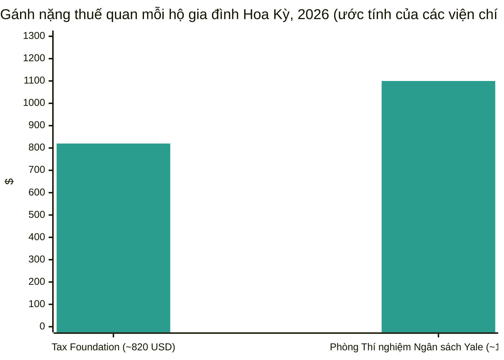

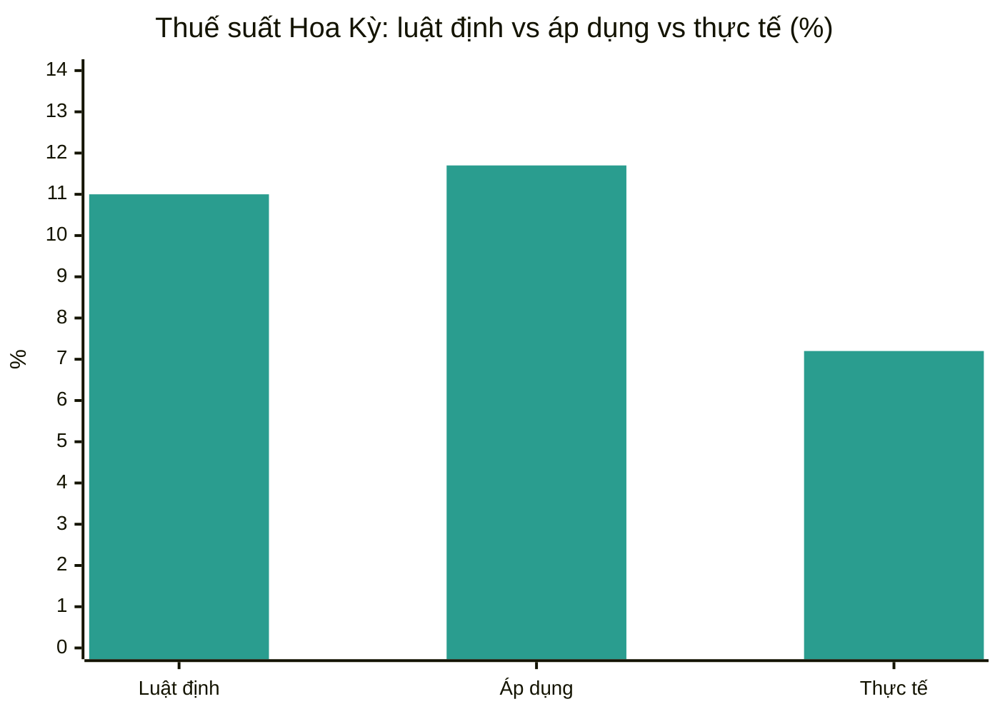
*Ước tính của Yale Budget Lab và Tax Foundation, 2026. TF = Tax Foundation.*

**Phân tích.** Cặp viện chính sách định hình cuộc tranh luận chi phí hộ gia đình: 820 USD của Tax Foundation và 1.100 USD của Yale là hai con số mà giới báo chí trích dẫn, khác nhau ở cách xử lý thuế theo luật so với thuế hiệu lực và cơ chế hoàn thuế IEEPA. Phân tích hậu SCOTUS của Yale là tổng hợp luật hiện hành đầy đủ nhất — hỗn loạn hoàn thuế tạo ra "hiệu ứng doanh thu lớn" xấp xỉ bù đắp lực cản tăng trưởng 2026 của các mức thuế còn lại, với chi phí dài hạn dai dẳng 0,1% GDP (~30 tỷ USD hàng năm). Luận điểm dài thành sách của Tax Foundation — bãi bỏ mọi thuế quan và thay bằng VAT — là cách diễn đạt rõ ràng nhất về phương án chính sách thay thế của chu kỳ này. Sự phân kỳ WTO–UNCTAD (lạc quan khối lượng so với thận trọng giá thực) là khung phân tích để đọc dòng dữ liệu mùa thu.

---

## 9. Thị trường cước vận chuyển

### Giá giao ngay container — Chỉ số Container Thế giới Drewry

Chỉ số Container Thế giới Drewry chốt đợt đánh giá thứ Năm **ngày 8 tháng 10** ở mức **4.351 USD mỗi container 40ft, giảm 2% so với tuần trước** — do nhu cầu yếu trên các tuyến Xuyên Thái Bình Dương và Á–Âu trong Tuần lễ Vàng của Trung Quốc. Đợt đánh giá trước (ngày 1 tháng 10) chốt ở 4.434 USD, giảm 1%. Nhà phân tích trưởng Peter Sand của Xeneta cho biết ngày 1 tháng 10 đánh dấu đỉnh giá giao ngay container hậu khủng hoảng Hormuz: Viễn Đông–Bờ Tây Hoa Kỳ chạm 8.346 USD/FEU, Bờ Đông 11.523 USD/FEU — gấp hơn bốn lần mức trước khủng hoảng ngày 28 tháng 2. Giá Á–Âu hiện đã giảm **13 tuần liên tiếp**; Drewry xác định sự quay lại Suez nhanh hơn dự kiến là mối đe dọa chính đối với nỗ lực hỗ trợ giá của các hãng tàu. Drewry dự báo giá ổn định trong tuần tới, lưu ý các hãng tàu đang thử mức FAK cao hơn trên tuyến Á–Âu trong nửa cuối tháng 10 và khả năng giá đi Hoa Kỳ phục hồi sau kỳ nghỉ dưới thỏa thuận đình chiến Mỹ–Trung được gia hạn.

| Tuyến (40ft) | 8 tháng 10 năm 2026 | Thay đổi theo tuần | Nguồn |
|---|---|---|---|
| WCI tổng hợp | 4.351 USD | −2% | [Drewry](https://www.drewry.co.uk/supply-chain-advisors/supply-chain-expertise/world-container-index-assessed-by-drewry) |
| Thượng Hải → Rotterdam | 3.337 USD | −2% | [Drewry](https://www.drewry.co.uk/supply-chain-advisors/supply-chain-expertise/world-container-index-assessed-by-drewry) |
| Thượng Hải → Genoa | 3.696 USD | không đổi | [Drewry](https://www.drewry.co.uk/supply-chain-advisors/supply-chain-expertise/world-container-index-assessed-by-drewry) |
| Thượng Hải → Los Angeles | 7.624 USD | −3% | [Drewry](https://www.drewry.co.uk/supply-chain-advisors/supply-chain-expertise/world-container-index-assessed-by-drewry) |
| Thượng Hải → New York | 10.220 USD | −2% | [Drewry](https://www.drewry.co.uk/supply-chain-advisors/supply-chain-expertise/world-container-index-assessed-by-drewry) |
| Rotterdam → New York (mỗi FEU) | 3.091 USD | −1% | [Shipping Telegraph](https://shippingtelegraph.com/freight-news/drewry-the-world-container-index-decreased-2-in-week-41-2026/) |
| Chiều về Rotterdam → Thượng Hải | 628 USD | +2% | [Shipping Telegraph](https://shippingtelegraph.com/freight-news/drewry-the-world-container-index-decreased-2-in-week-41-2026/) |

Số chuyến bị hủy (Drewry Container Capacity Insight): Xuyên Thái Bình Dương — bốn chuyến hủy được công bố cho tuần tới, giảm từ mười một chuyến tuần này (năng lực tăng); Á–Âu — sáu chuyến được công bố cho tuần tới, tăng từ năm.

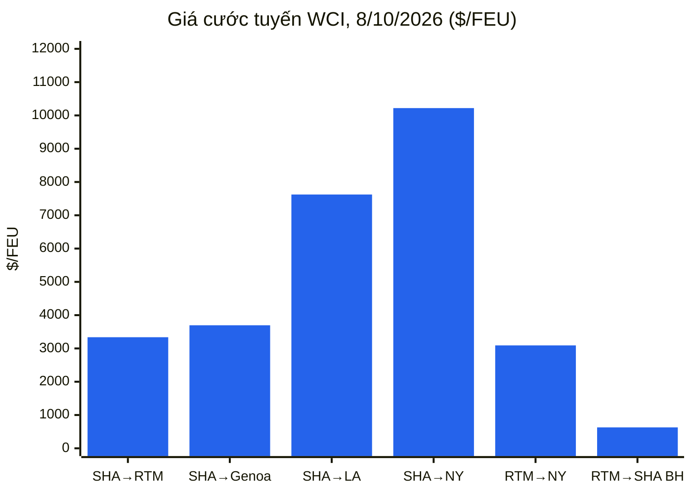
*SHA = Thượng Hải; RTM = Rotterdam. Chuyến hồi (backhaul): Rotterdam→Thượng Hải.*

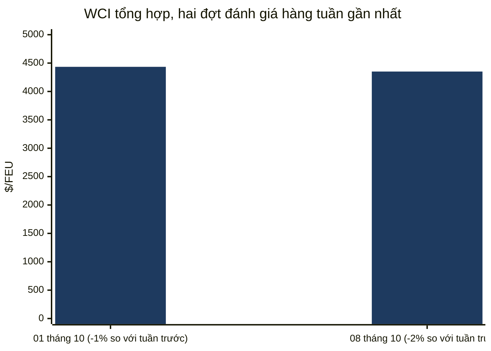

### Chỉ số Baltic của Freightos (FBX)

Chỉ số toàn cầu FBX kết thúc tuần **ngày 9 tháng 10** ở mức **3.344 điểm**, gần như không đổi (3.348 điểm đầu tuần).

| Tuyến | Giá (mỗi FEU, 9 tháng 10 năm 2026) | Thay đổi theo tuần | Nguồn |
|---|---|---|---|
| FBX tổng hợp toàn cầu | 3.344 điểm | −4 điểm trong tuần | [Báo cáo hàng tuần của Baltic Exchange](https://www.thedcn.com.au/news/baltic-exchange-weekly-report-9-october-2026) |
| FBX01 Trung Quốc/Đông Á → Bờ Tây Hoa Kỳ | 8.106 USD | −228 USD | [Báo cáo hàng tuần của Baltic Exchange](https://www.thedcn.com.au/news/baltic-exchange-weekly-report-9-october-2026) |
| FBX03 Trung Quốc/Đông Á → Bờ Đông Hoa Kỳ | 9.606 USD | không đổi | [Báo cáo hàng tuần của Baltic Exchange](https://www.thedcn.com.au/news/baltic-exchange-weekly-report-9-october-2026) |
| FBX11 Trung Quốc/Đông Á → Bắc Âu | 3.260 USD | không đổi | [Báo cáo hàng tuần của Baltic Exchange](https://www.thedcn.com.au/news/baltic-exchange-weekly-report-9-october-2026) |
| FBX13 Trung Quốc/Đông Á → Địa Trung Hải | 3.861 USD | +320 USD | [Báo cáo hàng tuần của Baltic Exchange](https://www.thedcn.com.au/news/baltic-exchange-weekly-report-9-october-2026) |
| FBX21 Bờ Đông Hoa Kỳ → châu Âu | 1.182 USD | +108 USD | [Báo cáo hàng tuần của Baltic Exchange](https://www.thedcn.com.au/news/baltic-exchange-weekly-report-9-october-2026) |

Supply Chain Dive (ngày 9 tháng 10, Freightos hàng tuần): giá giao ngay Á–Bờ Tây Hoa Kỳ 8.322 USD (−3%), Bờ Đông Hoa Kỳ 9.606 USD (đi ngang) — tình trạng tồn đọng tại cảng Trung Quốc do thời tiết giữ sàn giá. Xeneta dự báo Bờ Đông Hoa Kỳ 6.000–7.000 USD và Bờ Tây Hoa Kỳ 4.500–5.500 USD trong ba tháng tới — "một đợt điều chỉnh đáng kể, nhưng không phải sụp đổ."

### Hàng rời khô — Baltic Exchange

**Chỉ số Baltic Dry** kết thúc thứ Sáu ngày 9 tháng 10 ở mức **2.917 điểm, giảm 7,3% trong tuần** — thấp nhất kể từ cuối tháng 8 — tập trung ở Capesize (chỉ số −13,9%, thu nhập bình quân ngày −1.560 USD xuống 35.860 USD) khi quặng sắt Đại Liên chạm đáy 18 tháng; Panamax +2,2% và Supramax +1,4% giữ vững.

| Ngày | BDI | Capesize (thu nhập) | Panamax | Supramax | Nguồn |
|---|---|---|---|---|---|
| Thứ Hai 5 tháng 10 | 3.070 | 4.833 (40.330 USD) | 2.364 | 1.790 | [Baird Maritime](https://www.bairdmaritime.com/shipping/dry-cargo/bulkers/two-session-winning-streak-ends-as-baltic-dry-bulk-index-falls) |
| Thứ Ba 6 tháng 10 | 3.002 | 4.638 (38.561 USD) | 2.366 | 1.795 | [Baird Maritime](https://www.bairdmaritime.com/shipping/dry-cargo/bulkers/baltic-dry-bulk-index-hits-six-week-low-on-capesize-decline) |
| Thứ Tư 7 tháng 10 | 2.994 | 4.597 (38.188 USD) | 2.384 | 1.800 | [Baird Maritime](https://www.bairdmaritime.com/shipping/dry-cargo/bulkers/baltic-index-slips-as-capesize-slump-spoils-smaller-vessel-gains) |
| Thứ Năm 8 tháng 10 | 2.973 | 4.512 (37.420 USD) | 2.410 | 1.808 | [Baird Maritime](https://www.bairdmaritime.com/shipping/dry-cargo/bulkers/baltic-dry-bulk-index-drops-to-lowest-level-in-more-than-six-weeks) |
| Thứ Sáu 9 tháng 10 | 2.917 | 4.340 (35.860 USD) | 2.424 | 1.814 | [Báo cáo hàng tuần của Baltic Exchange](https://www.thedcn.com.au/news/baltic-exchange-weekly-report-9-october-2026) |

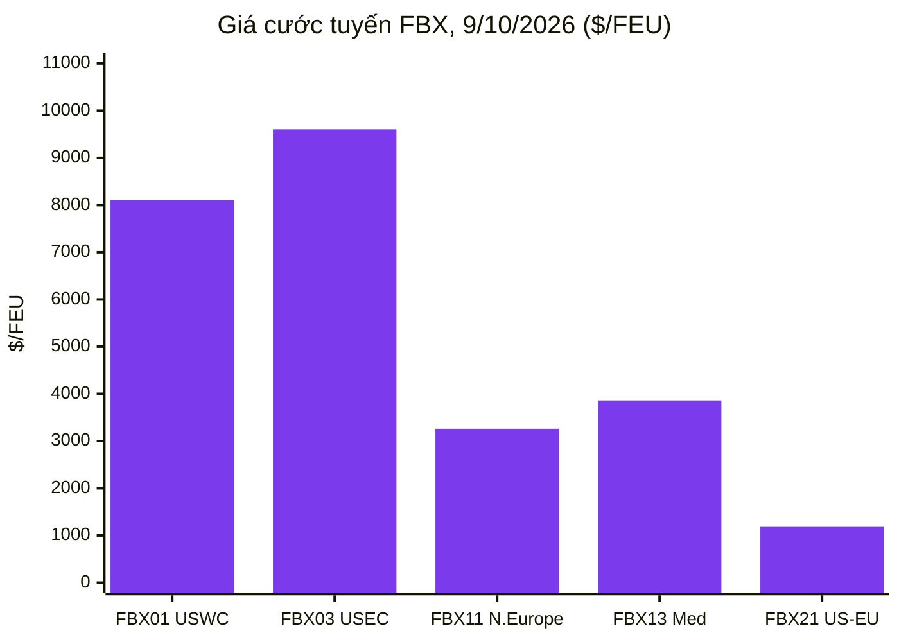
*Tuyến: FBX01 Trung Quốc/Đông Á→Bờ Tây Hoa Kỳ; FBX03 →Bờ Đông Hoa Kỳ; FBX11 →Bắc Âu; FBX13 →Địa Trung Hải; FBX21 Bờ Đông Hoa Kỳ→châu Âu.*

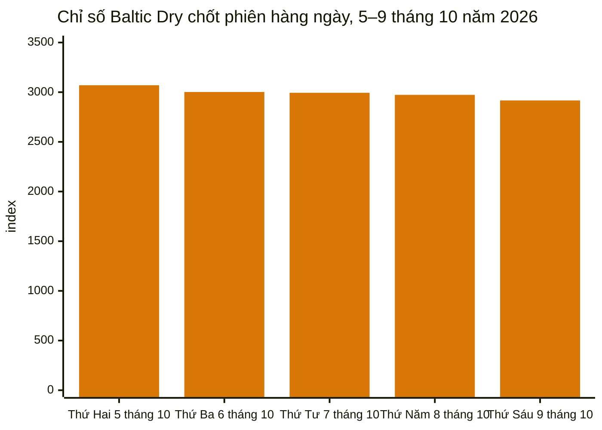

### Gián đoạn cảng và logistics

**Quay lại Biển Đỏ/Suez tăng tốc.** Hapag-Lloyd xác nhận các chuyến đi hướng tây và hướng đông đầu tiên của dịch vụ SE1 thuộc Gemini Cooperation qua Biển Đỏ và Suez: tàu *Umm Qarn* rời Tanjung Pelepas đi Suez ngày 27 tháng 10 và Algeciras ngày 5 tháng 12. Liên minh Premier (ONE, HMM, Yang Ming) khôi phục vòng FE1 Đông Nam Á–Bắc Âu qua Suez từ tháng 10 — lần đầu tiên phá vỡ tuyến vòng Mũi kể từ tháng 1 năm 2024 — với tàu 8.110 TEU *ONE Continuity* rời Laem Chabang ngày 17 tháng 10. COSCO dự kiến thực hiện chuyến đi hướng tây qua Suez đầu tiên trong hơn hai năm vào ngày 4 tháng 10. MSI ước tính ~35% chuyến Á–Âu hiện dùng Biển Đỏ; Linerlytica đếm hơn 140 tàu container (2 triệu+ TEU) đã quay lại kể từ tháng 5; trọng tải ròng container qua Suez tháng 1–8 đạt 72,1 triệu tấn (+54,2% so với cùng kỳ). Ràng buộc: Aspides của EU thừa nhận độ bao phủ tàu chiến không đủ cho mọi yêu cầu hộ tống — giới hạn ràng buộc đối với việc quay lại thêm. Container Forecaster của Drewry nhận thấy lợi ích kinh tế của việc quay lại Suez đối với các hãng tàu là mỏng — xấp xỉ 1 triệu USD tiết kiệm mỗi chuyến khứ hồi so với tuyến Mũi — nhưng các hãng tàu vẫn quay lại, bổ sung năng lực hiệu dụng đang gây áp lực lên giá Á–Âu. ([splash247.com](https://splash247.com/premier-alliance-joins-accelerating-return-to-suez/), [container-news.com](https://container-news.com/hapag-lloyd-confirms-first-se1-sailings-via-red-sea-and-suez-canal/))

**Tắc nghẽn cảng châu Á.** Tắc nghẽn mùa bão đẩy độ tin cậy lịch trình toàn cầu xuống dưới 50% lần đầu tiên kể từ đại dịch (Sea-Intelligence), với tắc nghẽn châu Á có thể kéo dài đến giữa 2027; tắc nghẽn hấp thụ 12% năng lực tàu hiệu dụng (DHL Forwarding) và ~10,9% đội tàu container (~3,76 triệu TEU); thời gian chậm trễ trung bình của tàu trễ đạt 6,81 ngày, cao nhất kể từ tháng 3 năm 2022. Tuần lễ Vàng (1–7 tháng 10) làm dịu nhu cầu; Thượng Hải dự kiến vẫn tắc nghẽn nặng đến giữa đến cuối tháng 10. ([worldcargonews.com](https://www.worldcargonews.com/news/2026/10/sea-intelligence-asian-port-congestion-could-persist-into-mid-2027/), [ti-insight.com](https://ti-insight.com/briefs/global-supply-chain-risk-monitor-october-2026/))

**Tấn công Biển Đen leo thang.** Tàu chở hàng rời *Royad Mammadov* chìm ngoài khơi Romania (hai thuyền viên thiệt mạng); vài ngày sau các cuộc tấn công bằng drone ngoài khơi Bulgaria đánh chìm tàu chở hàng rời *Alfa Watan* và khiến tàu *Able* bốc cháy — hành lang ngũ cốc bị gián đoạn, phí bảo hiểm tăng vọt. Ấn Độ và Liberia, với tư cách đồng chủ tịch Nhóm Bạn bè về An toàn và An ninh Hàng hải và Thuyền viên, cùng lên án các cuộc tấn công (ngày 9 tháng 10). ([splash247.com](https://splash247.com/two-seafarers-killed-as-cargo-ship-sinks-off-romania/))

**Kênh đào Panama.** Số lượt qua tăng lên 33 mỗi ngày từ 15 tháng 10 (từ 32) với mớn nước khôi phục ở 49 feet; số slot Neo-Panamax tăng lên 10 mỗi ngày. Rủi ro El Niño phía trước: NOAA dự báo hiện tượng này tiếp diễn đến đầu 2027. Các hãng tàu đã phụ thu: MSC 149 USD/20ft (297 USD/40ft), CMA CGM Hệ số Điều chỉnh Kênh đào Panama 500 USD/TEU.

**Philippines.** Khủng hoảng container rỗng Manila: một "cuộc biểu tình số" của môi giới và kỳ nghỉ của tài xế xe tải (5–8 tháng 10) vì các hãng tàu từ chối nhận container rỗng đến một tháng; cuộc biểu tình kết thúc ngày 8 tháng 10 sau khi các bến bắt đầu liên tục nhận container rỗng — nhưng Hapag-Lloyd đình chỉ mọi đặt chỗ mới đi Manila, Batangas và Subic đến 31 tháng 12, viện dẫn tắc nghẽn và giới hạn nghiêm trọng về năng lực depot/trả container rỗng. ([portcalls.com](https://portcalls.com/manila-ports-digital-protest-trucking-holiday-end/))

**Lao động và đường thủy nội địa.** Một cuộc đình công của công nhân cảng Đức đã được ngăn chặn ngày 2 tháng 10 (thỏa thuận ver.di chấm dứt các cuộc đình công cảnh báo tại Hamburg/Bremerhaven). Nhưng mực nước thấp lịch sử tại trạm đo Kaub trên sông Rhine đã gần như dừng tàu sà lan chở hàng; phụ phí nước thấp đạt 1.280 euro/FEU (Contargo) và 1.350 USD/FEU (Hapag-Lloyd). Công nhân cảng Vancouver biểu tình chống tự động hóa và AI (ngày 2 tháng 10). Trong kỳ không tìm thấy báo cáo có thể kiểm chứng về một cuộc đình công mới của ILA tại Bờ Đông/Bờ Vịnh Hoa Kỳ.

**Phụ phí và dịch vụ của hãng tàu.** CMA CGM: phụ phí mùa cao điểm trên tuyến Á–Phi (lên tới 750 USD/TEU Viễn Đông→Durban từ 22 tháng 10; 200 USD/TEU Đông Nam Á→Tây Phi phía bắc từ 15 tháng 10), tăng PSS Tây Phi từ 22 tháng 10, Á→Mỹ Latinh +1.000 USD/container từ 15 tháng 10, giá FAK Á–Địa Trung Hải 19–31 tháng 10, và 1.000 USD/tủ lạnh PSS Bắc Âu→Vịnh Ả Rập từ giữa tháng 10. Maersk: PSS trên ba tuyến; chấm dứt chia sẻ tàu ASAS2 với CMA CGM trên tuyến Á–Bờ Đông Nam Mỹ (chuyến cuối rời Thượng Hải ngày 8 tháng 12). Đội tàu: MSC đặt sáu tàu megamax chạy LNG nhiên liệu kép (~21.700 TEU mỗi tàu) giao 2029–2030; sổ đặt hàng của hãng vượt 170 tàu / 3 triệu+ TEU. ([container-news.com](https://container-news.com/cma-cgm-announces-new-peak-season-surcharges-on-asia-africa-trades/))

**Trừng phạt và vận tải Bắc Cực.** Vương quốc Anh trừng phạt năm tàu chở LNG (ngày 1 tháng 10); Anh và Nhật Bản đang siết lưới quanh các tàu liên quan Sovcomflot. Arctic LNG 2 đã xuất khẩu 0,95 triệu tấn trong năm 2026 (tất cả kể từ tháng 7). Trung Quốc hoàn thành mùa đầu tiên của dịch vụ container hàng tuần thường lệ Trung Quốc–châu Âu qua Tuyến Biển Bắc (ngày 7 tháng 10); một tàu container Hàn Quốc hoàn thành chuyến đi thương mại vòng Bắc Cực đầu tiên của nước này tới châu Âu (ngày 10 tháng 10). M&A tàu chở dầu: Trafigura mua bảy tàu chở dầu từ SFL Corp (~175 triệu USD lợi nhuận cho bên bán); công ty tách ra Volare Shipping của Trafigura niêm yết tại Oslo (ngày 6 tháng 10). ([hellenicshippingnews.com](https://www.hellenicshippingnews.com/category/shipping-news/international-shipping-news/), [gcaptain.com](https://gcaptain.com/tag/arctic/))

**Mexico.** Xuất khẩu ô tô ghi nhận mức sụt giảm lớn nhất trong năm vào tháng 9, được các nhà phân tích cho là do thuế của Hoa Kỳ (dữ liệu INEGI qua gCaptain, ngày 8 tháng 10).

### Thông tin nhà cung cấp (chỉ các trang công khai)

- **Descartes Systems Group:** Báo cáo Vận tải Toàn cầu tháng 10 (công bố ngày 8 tháng 10) — nhập khẩu container tháng 9 kỷ lục của Hoa Kỳ (xem §3.7); Descartes **Datamyne AI Agent** (công bố ~ngày 1 tháng 10) — một tác nhân AI hội thoại khai thác hơn 500 triệu bản ghi lô hàng được bổ sung hàng năm trên 230 thị trường, tuyên bố cắt giảm 90% thời gian nghiên cứu; Diễn đàn Đổi mới 2026 (6–8 tháng 10, Chicago) giới thiệu công nghệ logistics AI bao gồm các tác nhân AI MacroPoint OpsForce (kết quả khách hàng được tuyên bố: +30% tự động hóa theo dõi không chạm, năng suất đội theo dõi tăng 1,5 lần). Không thể xem trực tiếp descartes.com/solutions/global-trade-intelligence trong phiên này; các mục trên từ báo chí công khai. ([reuters.com](https://www.reuters.com/world/china/us-ocean-container-imports-set-new-record-september-descartes-says-2026-10-08/), [disruptsmedia.com](https://disrupts.disruptsmedia.com/transportation-logistics/descartes-datamyne-ai-agent-targets-90-cut-trade-data-research))
- **TradeInt:** Khoản tài trợ của Bộ Thương mại Thổ Nhĩ Kỳ × TradeInt (công bố ngày 30 tháng 9, được báo chí tuần này đưa tin) — quyền truy cập được tài trợ vào hồ sơ lô hàng, tờ khai hải quan và dữ liệu vận đơn trên 200+ quốc gia cho các công ty tư vấn Thổ Nhĩ Kỳ; đánh giá dữ liệu của TradeInt đưa xuất khẩu 2025 của Thổ Nhĩ Kỳ ở mức 269,7 tỷ USD (tháng 9 kỷ lục 22,6 tỷ USD). Được đưa tin qua báo chí công khai; không sử dụng quyền truy cập nền tảng dữ liệu. ([citybuzz.co](https://www.citybuzz.co/2026/09/30/turkiyes-ministry-of-trade-and-tradeint-launch-grant-to-arm-local-consultants-with-global-trade-data-through-tradeint-partnership))

---

## 10. Dòng thời gian chính sách

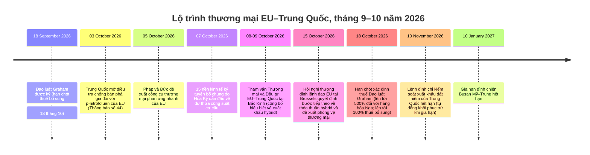

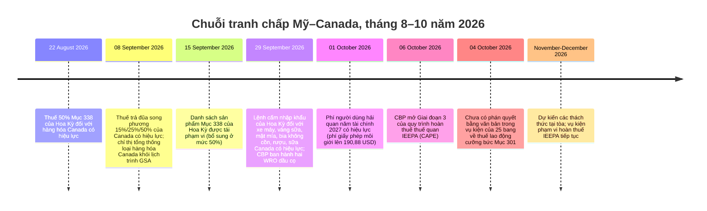

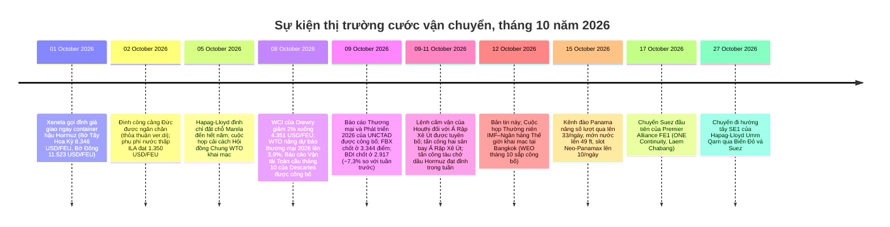

---

## 11. Các hạn chót & sự kiện sắp tới (90 ngày tới)

| Ngày | Sự kiện |
|---|---|
| 14 tháng 10 năm 2026 | Hướng dẫn "hàm lượng Hoa Kỳ" của BIS cho thiết bị công nghiệp di động USMCA có hiệu lực (công bố FR) |
| 15 tháng 10 năm 2026 | Hội nghị thượng đỉnh lãnh đạo EU, Brussels — quyết định về hiểu biết xuất khẩu hybrid EU–Trung Quốc, công cụ thương mại phản ứng nhanh Pháp–Đức, quy tắc Sản xuất tại châu Âu |
| 15 tháng 10 năm 2026 | Kênh đào Panama: số lượt qua lên 33/ngày, mớn nước lên 49 ft, slot Neo-Panamax lên 10/ngày |
| 16 tháng 10 năm 2026 | Lệnh cấm xuất khẩu mở rộng của Nhật Bản đối với Nga có hiệu lực |
| 17 tháng 10 năm 2026 | Chuyến Suez đầu tiên của Premier Alliance FE1 (ONE Continuity, Laem Chabang) |
| 18 tháng 10 năm 2026 | Hạn chót xác định thuế Đạo luật Graham: thuế lên tới 500% đối với hàng hóa Nga; thuế bổ sung lên tới 100% đối với các nước mua năng lượng Nga hàng đầu mà không được miễn trừ |
| 19 tháng 10 năm 2026 | Hạn quyết định khởi xướng của Bộ Thương mại: AD/CVD hợp chất amin (Trung Quốc) |
| 23 tháng 10 năm 2026 | Hạn đăng ký/góp ý: cuộc điều tra chống bán phá giá của Trung Quốc đối với p-nitrotoluen của EU |
| 27 tháng 10 năm 2026 | DSB: thông qua phán quyết thuế ICT Ấn Độ–Đài Bắc Trung Hoa; xem xét báo cáo ban hội thẩm tranh chấp xe điện Thổ Nhĩ Kỳ–Trung Quốc |
| 27 tháng 10 năm 2026 | Chuyến đi hướng tây SE1 của Hapag-Lloyd Umm Qarn qua Biển Đỏ và Suez (Tanjung Pelepas) |
| 29–30 tháng 10 năm 2026 | Hội nghị thượng đỉnh EU–Canada, Montréal — dự kiến hoàn tất đàm phán Hiệp định Thương mại Số |
| 4 tháng 11 năm 2026 | Hạn góp ý thu thập thông tin hoàn thuế IEEPA của CBP |
| 10 tháng 11 năm 2026 | Lệnh đình chỉ kiểm soát xuất khẩu đất hiếm của Trung Quốc hết hạn (tự động khôi phục trừ khi gia hạn) |
| 10 tháng 11 năm 2026 | Hạn dự kiến kết thúc đình chỉ Quy tắc Công ty liên kết của BIS (dự kiến gia hạn đến 10 tháng 1 năm 2027 nhưng chưa công bố) |
| 10 tháng 11 năm 2026 | Các miễn trừ Mục 301 cho 178 sản phẩm Trung Quốc hết hạn (được gia hạn đến ngày này theo đình chiến) |
| 13 / 16 tháng 11 năm 2026 | Quyết định sơ bộ của ITC: hợp chất amin (Trung Quốc) / toa xe lửa chở dầu (Mexico) |
| 4 tháng 12 năm 2026 | MIP polysilicon Mục 232 + thuế 15% có hiệu lực |
| 7 tháng 12 năm 2026 | Hạn góp ý quy tắc đề xuất Lô hàng Giá trị Thấp của CBP |
| Trước tháng 12 năm 2026 | Các cuộc họp kỹ thuật đầu tiên của nền tảng ngành 15 nền kinh tế về dư thừa công suất |
| Tháng 1 năm 2027 | Cuộc họp cấp bộ trưởng qua video EU–Trung Quốc |
| 10 tháng 1 năm 2027 | Gia hạn đình chiến Busan Mỹ–Trung hết hạn |
| 12 tháng 1 năm 2027 | Hạn góp ý công chúng rà soát chung USMCA 2027 |
| 1 tháng 1 năm 2028 | Các sửa đổi HS 2028 của WCO có hiệu lực (299 bộ thay đổi; các đội phân loại thuế nên lên kế hoạch ngay) |

---

## 12. Nguồn & phương pháp

Kỳ bao phủ: 5–12 tháng 10 năm 2026.

**Tin tức & phân tích thương mại:** FreightWaves, The Loadstar, Splash247, gCaptain, Hellenic Shipping News, Container News, Supply Chain Dive, Logistics Management, Air Cargo News, Port Technology International, JOC (chỉ tiêu đề), Freightmate/Sea Intelligence/Thông tin Ngành ILA qua báo chí thương mại, thông báo công khai của TradeInt qua báo chí.

**Chính sách Hoa Kỳ:** bản tin Nhà Trắng, cbp.gov (qua cố vấn thương mại), thông cáo báo chí ustr.gov, federalregister.gov (thông báo AD/CVD, rà soát Mục 301), bis.doc.gov (qua phân tích KPMG/JD Supra), internationaltradetoday.com (tiêu đề), phân tích hãng luật JD Supra, Thompson Hine, GHY International, Withum, Akin Gump, Bell Nunnally, Mondaq, KPMG Tax News Flash, Digital Policy Alert.

**Chính phủ các nước:** ec.europa.eu/DG Trade (qua báo chí), gov.uk Bộ Kinh doanh và Thương mại (qua báo chí), cbsa-asfc.gc.ca/canada.ca (qua báo chí), english.mofcom.gov.cn (truy cập trực tiếp ngày 12 tháng 10), METI/Hải quan Nhật Bản (qua Global Sanctions), nghị quyết Camex/Gecex Brazil (qua Datamar), báo cáo bộ thương mại quốc gia của Ấn Độ, Thổ Nhĩ Kỳ, Brazil, Úc và các nước ASEAN.

**Đa phương:** wto.org (Hội đồng Chung ngày 5–6 tháng 10, tranh chấp DS639/DS629, báo cáo cải cách), unctad.org (Báo cáo Thương mại và Phát triển 2026, Bản cập nhật Thương mại Toàn cầu tháng 10), wcoomd.org (sửa đổi HS 2028, chương trình quy tắc xuất xứ), ITC (không có bản phát hành mới trong kỳ).

**Cổng dữ liệu:** Cục Điều tra Dân số/BEA FT-900 (tháng 8 năm 2026, công bố ngày 6 tháng 10), USITC DataWeb / USA Trade Online, Bản cập nhật Triển vọng Thương mại Toàn cầu tháng 10 của WTO, UN Comtrade (ghi chú phương pháp), bản phát hành thống kê Eurostat/ECB, cổng dữ liệu Ngân hàng Thế giới, IMF (nghiên cứu WEO phát hành trước; WEO tháng 10 đầy đủ dự kiến ngày 12–18 tháng 10).

**Viện chính sách & nghiên cứu:** Tax Foundation (Công cụ Theo dõi Thuế Trump, bản tháng 9 năm 2026; Phương án Cải cách Bộ luật Thuế Hoa Kỳ 3.0), Phòng Thí nghiệm Ngân sách Yale (Tình trạng Thuế Hoa Kỳ), tradeintelligence.eu (không có nghiên cứu công khai mới trong kỳ; hồ sơ thương mại số EU qua EU Perspectives/Digital Watch/Global Law Experts).

**Cước vận chuyển:** Drewry (Chỉ số Container Thế giới, đánh giá ngày 8 tháng 10), Baltic Exchange (báo cáo hàng tuần ngày 9 tháng 10), Chỉ số Baltic của Freightos, Chỉ số Cước Container Thượng Hải / Chỉ số Cước Container Trung Quốc (qua FreshPlaza), Chỉ số TAC, Baird Maritime (BDI hàng ngày), Xeneta (qua FreightWaves/Air Cargo News), Báo cáo Vận tải Toàn cầu tháng 10 của Descartes (qua Reuters), Sea-Intelligence, DHL Forwarding, DC Velocity, TI Insight, Công cụ Global Port Tracker của NRF, Thông tin Ngành ILA.

**Thông tin nhà cung cấp:** chỉ các thông báo tiếp thị và báo chí công khai của Descartes Systems Group và TradeInt (nội dung blog và tin tức công khai; không truy cập nền tảng dữ liệu, không đăng nhập, không sử dụng nền tảng dữ liệu thương mại của đối thủ).
