# 全球贸易情报报告 — 2026年10月5–12日当周

**每周简报。** 覆盖窗口：2026年10月5–12日。编译自全球约45家贸易新闻、政策、数据与货运来源。

---

## 目录

1. [执行摘要](#1-执行摘要)
2. [警报](#2-警报)
3. [头条新闻 — 深度分析](#3-头条新闻--深度分析)
4. [关税追踪](#4-关税追踪)
5. [美国政策深度分析](#5-美国政策深度分析)
6. [分区域世界政策](#6-分区域世界政策)
7. [执法行动](#7-执法行动)
8. [数据发布](#8-数据发布)
9. [货运市场](#9-货运市场)
10. [政策时间线](#10-政策时间线)
11. [未来90天的重要期限与事件](#11-未来90天的重要期限与事件)
12. [来源与方法](#12-来源与方法)

---

## 1. 执行摘要

能源安全、贸易防御与海上安全在本周发生碰撞。三个动向奠定了基调：

- **《格雷厄姆法案》倒计时进入最后一周。** 在10月18日关税裁定截止日迫近之际，特朗普总统宣布一项俄罗斯柴油进口协议——立即进口30多万吨，11月再进口50万吨——经财政部第135号通用许可证授权，有效期至2027年4月；与此同时，该法案对俄罗斯能源主要买家（印度、中国、土耳其）高达100%的二级关税已准备就绪，无需总统豁免即可生效。七名两党参议员称该柴油协议与总统签署的制裁法不一致。印度——俄罗斯原油最大买家——表示其与美国的贸易协议谈判已"达到平台期"。
- **欧盟–中国北京回合谈判结果存疑。** 欧盟委员会贸易委员马罗什·谢夫乔维奇宣布达成"共同理解"，中国对欧混合动力汽车出口将在四年内减少一半以上，另加中国对汽车零部件、橄榄油和鞋类降税，至少节省2.25亿欧元关税——但北京发布的文本中没有任何数字，欧盟对华货物贸易逆差在2026年前七个月已达2380亿欧元。法国和德国分别提议建立"与301条款同样强大"的欧盟快速反应贸易武器。欧盟领导人将于10月15日布鲁塞尔峰会决定下一步行动。
- **能源航运战急剧升级。** 胡塞武装宣布对沙特阿拉伯实施海上禁运，并袭击了沙特两个机场，造成三人死亡；曼德海峡10月11日的船舶交通量降至11艘。霍尔木兹海峡周边油轮袭击达到开战以来最高周水平；美国又制裁了22艘油轮，伊朗称美国对其重开霍尔木兹海峡提议的回应"不够充分"。

其他要闻：美国9月集装箱进口创历史纪录（255万标准箱，同比增长10.3%，据Descartes 10月8日报告）；海关与边境保护局（CBP）10月6日启动《国际紧急经济权力法》（IEEPA）关税退款程序第三阶段（CAPE）；英国称对中国电动汽车征收最高45%关税的决定"难以抉择"；世贸组织（WTO）将2026年商品贸易增长预测上调至3.9%，理由是AI驱动的需求，而联合国贸发会议（UNCTAD）的旗舰报告称贸易呈现"选择性碎片化"，中美贸易自2024年以来下降了20%；中国对欧盟对硝基甲苯发起反倾销调查；日本扩大的对俄出口禁令将于10月16日生效。

**货运：** 旺季后的回调叠加冲突溢价。德鲁里世界集装箱指数下跌2%至4351美元/40英尺柜（亚欧航线连续13周下跌，船公司加速重返苏伊士运河），波罗的海干散货指数下跌7.3%至2917点，因铁矿石疲软导致好望角型船收益崩盘；赫伯罗特暂停至马尼拉的所有订舱直至年底，因菲律宾空箱危机堵塞了堆场运力。全球船期可靠性自疫情以来首次跌破50%。

---

## 2. 警报

| # | 警报 | 生效时间 | 影响 | 来源 |
|---|-------|-----------|--------|--------|
| A1 | 《格雷厄姆法案》二级关税截止日：对俄罗斯商品征收最高500%关税；无豁免情况下对俄罗斯能源主要买家征收最高100%二级关税 | 2026年10月18日 | 印度、中国、土耳其风险最高；关税与现有税率叠加 | [mondaq.com](https://www.mondaq.com/unitedstates/export-controls-trade-investment-sanctions/1851398/the-lindsey-graham-sanctions-act-what-businesses-need-to-know-about-the-new-tariffs) |
| A2 | 美俄柴油协议：立即进口30万吨以上，11月再进口50万吨；OFAC第135号通用许可证授权进口俄罗斯柴油 | 2026年10月9日（GL135有效期至2027年4月7日） | 在《格雷厄姆法案》截止日前一周形成政治碰撞；7名参议员敦促撤销 | [nationpress.com](https://www.nationpress.com/international/trump-buys-russian-diesel-before-graham-act-deadline) |
| A3 | 欧盟–中国北京回合：有争议的混合动力出口"谅解"；对欧盟出口产品降税超2.25亿欧元；稀土绿色通道保留 | 2026年10月8–9日（欧盟峰会10月15日做决定） | 执行机制未披露；北京文本未给出减半数字 | [eureporter.co](https://www.eureporter.co/world/china-2/2026/10/09/eu-and-china-strike-preliminary-trade-deal-ahead-of-crucial-leaders-summit/) |
| A4 | 法德提议建立欧盟快速反应贸易工具，"与301条款同样强大" | 10月5日提议；10月15日峰会 | 欧盟贸易防御可能升级；中国警告将回应 | [lapost.com](https://www.lapost.com/content/france-germany-propose-new-rapid-eu-trade-response-tool) |
| A5 | 胡塞武装对沙特阿拉伯实施海上禁运；曼德海峡交通量降至数月最低（10月11日仅11艘）；袭击沙特两个机场，三人死亡 | 2026年10月9–11日 | 沙特原油装货受威胁；7艘以上油轮改道 | [marinelink.com](https://www.marinelink.com/news/red-sea-shipping-slows-houthi-attack-541529) |
| A6 | 霍尔木兹/海湾地区油轮袭击达到开战以来最高周水平；美国制裁另外22艘油轮（10月8日） | 2026年10月7–11日 | 10月10日美国击伤一艘试图突破封锁的船只；卡塔尔附近一艘化学品船被击中 | [gcaptain.com](https://gcaptain.com/category/news/) |
| A7 | 中国稀土出口管制暂停到期；未宣布延期 | 2026年11月10日 | 除非双方延期，否则自动恢复；IEA称每年6.5万亿美元下游产值面临风险 | [investornews.com](https://investornews.com/critical-minerals-rare-earths/technology-metals-report-10-04-2026-a-summit-without-a-rare-earth-deal-leaves-the-west-buying-its-way-to-supply/) |
| A8 | 英国考虑对中国电动汽车征收最高45%关税；决定"难以抉择" | 审议中（10月4–7日报道） | 英国58%的汽车出口面向欧盟；与"欧洲制造"市场准入挂钩 | [fleetnews.co.uk](https://Www.fleetnews.co.uk/news/uk-weighs-chinese-car-tariffs-as-fleet-demand-for-evs-surges) |
| A9 | CBP启动IEEPA关税退款程序第三阶段（CAPE） | 2026年10月6日 | 约1800亿美元退款执行正式启动；未参与诉讼的进口商适用范围存争议；意见征询截止11月4日 | [thompsonhine.com](https://www.thompsonhine.com/insights/cbp-confirms-october-6-2026-launch-of-phase-3-of-the-ieepa-tariff-refund-process/) |
| A10 | 赫伯罗特因空箱拥堵暂停至马尼拉、八打雁和苏比克的所有订舱，直至年底 | 即时生效（至2026年12月31日） | 2026年最严重的船公司订舱行动之一 | [portcalls.com](https://portcalls.com/hapag-lloyd-suspends-manila-batangas-subic-bookings-over-congestion/) |
| A11 | 中国对欧盟对硝基甲苯反倾销调查立案 | 10月3日（登记截止10月23日） | 指控倾销幅度超100%；时机被视为对欧盟工具提议的报复 | [mlex.com](https://www.mlex.com/mlex/articles/2533700/china-opens-anti-dumping-probe-into-eu-para-nitrotoluene) |
| A12 | 日本扩大的对俄出口禁令生效 | 2026年10月16日 | 更多商品被禁止输往俄罗斯 | [globalsanctions.com](https://globalsanctions.com/2026/10/japan-adds-more-goods-to-russia-export-ban-from-16-october-2026/) |

### A1 — 《格雷厄姆法案》截止日（详情）

《2026年林赛·格雷厄姆制裁俄罗斯与伊朗法案》（9月18日签署）设定了**2026年10月18日**的30天实施期限，涵盖两个强制性关税轨道。第112条：对从俄罗斯进口的所有商品征收最高**500%的从价税**，明确包括石油产品。第113条：对在过去12个月中位列俄罗斯原油或天然气五大进口国、且在截止日之后继续知情购买的国家的所有商品，征收最高**100%的从价税**。所有关税均与现有301/232条款关税叠加。豁免途径：总统豁免须向国会提交正式的非密书面证明，说明符合国家利益；另有有限的天然气例外（进口量低于俄罗斯年度天然气出口总量的15%且已采取"重大步骤"减量；原油买家不适用）。律所分析认为中国、印度和土耳其是可能目标，斯洛伐克、匈牙利和阿联酋风险较高。([mondaq.com](https://www.mondaq.com/unitedstates/export-controls-trade-investment-sanctions/1851398/the-lindsey-graham-sanctions-act-what-businesses-need-to-know-about-the-new-tariffs))

### A2 — 俄罗斯柴油协议（详情）

10月9日，在与普京总统通话后，特朗普总统宣布俄罗斯将向美国和全球市场供应柴油——**立即供应30多万吨，11月再供应50万吨**——以降低美国农民、牧场主和卡车司机的燃料价格。财政部外国资产控制办公室（OFAC）发布**第135号通用许可证**，授权俄罗斯原产柴油交易，直至**2027年4月7日**美国东部时间凌晨0:01。财政部长贝森特表示政府将在现有法律权限内行事，并否认《格雷厄姆法案》禁止该协议（该法案保留了财政部的通用许可证权限；第113条在确定哪些国家面临关税时只计算原油和天然气，不包括精炼产品）。七名两党参议员——由首席成员珍妮·沙欣领衔，蒂利斯、柯林斯、穆尔科斯基、柯蒂斯、布卢门撒尔和怀登共同参与——于10月11日发表联合声明，敦促撤销该协议，认为其与国会确立的制裁框架相矛盾。背景：自2月以来柴油价格已上涨约70%（伊朗冲突、俄罗斯出口禁令、乌克兰炼油厂遇袭）；AAA数据显示10月8–9日全国平均价格约为每加仑6.27–6.28美元。([nationpress.com](https://www.nationpress.com/international/trump-buys-russian-diesel-before-graham-act-deadline), [cnn.com](https://www.cnn.com/2026/10/09/politics/trump-putin-russian-diesel), [egyptoil-gas.com](https://egyptoil-gas.com/news/us-senators-urge-trump-to-reverse-russia-diesel-deal/))

### A3 — 欧盟–中国北京回合（详情）

欧盟–中国贸易与投资磋商第二轮会议10月9日在北京闭幕，由欧盟委员马罗什·谢夫乔维奇与中国商务部部长王文涛共同主持。此前双方就欧盟每天超过10亿欧元的对华货物贸易逆差进行了三个月谈判。谢夫乔维奇宣布达成"共同理解"：适度控制中国混合动力及插电式混合动力汽车出口——"有望在四年内将中国出口削减一半以上"；就降低最惠国税率达成共同理解，涵盖汽车零部件、橄榄油和鞋类（现有欧盟出口价值近40亿欧元，至少节省2.25亿欧元关税）；就使中国稀土出口许可更加顺畅、可预测和透明达成共同理解，绿色通道予以保留。**关键疑点：** 北京发布的文本中没有任何关于混合动力出口的数字——"减半"仅存在于谢夫乔维奇的表态中，机制未披露，且需欧盟领导人在10月15–16日峰会上政治背书。背景：中国拒绝自愿限制混合动力汽车出口（《金融时报》援引两名外交官，10月7日）；欧洲议会10月7日投票谴责中国的经济行为及其在乌克兰问题上的立场。([eureporter.co](https://www.eureporter.co/world/china-2/2026/10/09/eu-and-china-strike-preliminary-trade-deal-ahead-of-crucial-leaders-summit/), [reuters.com](https://www.reuters.com/world/china/eu-seeks-cut-trade-deficit-with-china-talks-with-beijing-2026-10-07/), [europeansting.com](https://europeansting.com/2026/10/12/press-remarks-by-commissioner-sefcovic-at-the-second-meeting-of-the-eu-china-trade-and-investment-consultations/))

### A5/A6 — 海上安全升级（详情）

胡塞武装军事发言人宣布对沙特阿拉伯实施海上禁运；10月10–11日，胡塞袭击击中沙特两个机场，造成三人死亡、数十人受伤。10月11日曼德海峡船舶交通量降至**11艘商品船——为数月来最低水平**——包括七艘油轮；禁运警告发出后至少七艘油轮改变航线。阿联酋10月7日谴责了袭击。这是胡塞武装2026年第三阶段升级（7月恢复导弹袭击；声称打击悬挂沙特旗船只；如今宣布禁运），直接威胁沙特原油装货——此前无人机袭击已于10月2日迫使延布港装货中断。在霍尔木兹海峡周边，油轮袭击达到开战以来最高周水平：一艘化学品船在卡塔尔附近被多枚炮弹击中，有伤亡报告；10月9日第二艘商船在波斯湾内被击中。Gibson追踪显示开战以来已发生**95起油轮袭击**。10月8日美国对与伊朗石油贸易相关的另外22艘油轮实施制裁；七国集团同意释放最多1亿桶应急石油/柴油储备（10月2日）。10月10日美军表示在阿曼湾击伤一艘试图突破伊朗封锁的货船。伊朗10月11日表示，美国对其重开霍尔木兹海峡七项条件提议的回应"不够充分"。([marinelink.com](https://www.marinelink.com/news/red-sea-shipping-slows-houthi-attack-541529), [gcaptain.com](https://gcaptain.com/category/news/), [hellenicshippingnews.com](https://www.hellenicshippingnews.com/category/shipping-news/hellenic-shipping-news/))

---

## 3. 头条新闻 — 深度分析

### 3.1 欧盟–中国："半份协议"，没有共同文本

**发生了什么。** 第二轮欧盟–中国贸易与投资磋商在北京举行（10月8–9日），以联合声明和16点共识清单收尾，涵盖混合动力汽车、关税减免、稀土、欧盟反补贴电动汽车调查、《外国补贴条例》技术磋商和知识产权合作。1月将举行部长级视频会议，下一轮面对面会谈定于2027年3月。

**关键数据。**
- 欧盟对华货物贸易逆差：2026年前七个月达**2380.6亿欧元**，同比扩大12.2%。
- 谢夫乔维奇声称：达成共同理解，中国混合动力出口四年内减少一半以上；降税覆盖近**40亿欧元**欧盟出口，至少节省**2.25亿欧元**关税。
- 中国汽车进口按贸易流量计约为每天**10亿欧元**。
- 不对称性：北京发布的文本中没有任何数字——减半说法仅存在于谢夫乔维奇的吹风中。([mlex.com](https://www.mlex.com/mlex/articles/2536652/china-eu-agree-on-hybrid-vehicle-trade-export-controls-further-tariff-talks))

**分析。** 若得以落实，这将是欧盟–中国贸易中首个如此规模的自愿出口节制安排——按谢夫乔维奇的说法，是中国在未经关税战的情况下接受的自愿出口限制——可能成为其他行业的模板。但机制未披露，双方发布的文本存在差异，且协议需10月15–16日欧洲理事会背书。就在本轮谈判前五天，北京对欧盟对硝基甲苯发起反倾销调查（10月3日），中国商务部指出欧盟自2025年以来已对中国发起28起贸易救济案件。法德快速反应工具提议也将提交同一峰会。峰会将决定混合动力谅解是成为政策，还是停留在新闻发布会上。

### 3.2 《格雷厄姆法案》：一部与本届政府自身相撞的制裁法

**发生了什么。** 在10月18日截止日前一周，政府许可了俄罗斯柴油进口（第135号通用许可证，有效期至2027年4月7日），而《格雷厄姆法案》的二级关税机制已准备就绪，将惩罚印度、中国和土耳其购买俄罗斯能源的行为。七名两党参议员要求撤销。印度——全球最大的俄罗斯原油买家，约160万桶/日，2022年12月至2026年8月占俄罗斯原油出口的37%（CREA数据）——表示其与美国的贸易协议谈判已"达到平台期"（财政部长西塔拉曼，10月5日），并强调14亿人口的能源安全。中国拒绝"长臂管辖"（外交部，9月19日，本周重申）；本周未发现土耳其政府的回应。土耳其购买量约28.2万桶/日，远低于印度（约160万）和中国（约130万，Kpler数据）。

**关键数据。**
- 二级关税：对俄罗斯能源主要买家的商品征收最高**100%**；对俄罗斯商品征收最高**500%**；均与现有301/232条款关税叠加。
- 柴油协议：立即进口30万吨以上，11月再进口50万吨——约相当于一天半的美国需求；自2月以来柴油价格上涨约70%。
- 天然气例外：进口量低于俄罗斯年度天然气出口总量的15%且已采取"重大步骤"减量；原油买家不适用。

**分析。** 该柴油协议使《格雷厄姆法案》的执行明显带有自由裁量色彩：华盛顿进口俄罗斯精炼产品，却威胁对购买俄罗斯原油的第三国征收最高100%的二级关税——法案文本支持这种区分（第113条只计算原油和天然气），但七名参议员的声明表明其政治代价高昂。政府对豁免的意图尚未表态，给从印度、中国和土耳其采购的进口商带来严重的不确定性。10月18日前的豁免决定，如今是秋季最重要的关税事件。

### 3.3 能源航运战进入新阶段

**发生了什么。** 两个升级同时上演：胡塞武装宣布对沙特阿拉伯实施禁运并袭击沙特机场（三人死亡，10月9–10日），霍尔木兹海峡地区油轮袭击达到开战以来最高周水平。沙特阿拉伯正与客户商谈，在长期合同中提供霍尔木兹海峡之外的石油装货选择；印度炼油商削减了11月俄罗斯原油采购，转而利用恢复的中东货源。美国10月10日击伤一艘试图突破封锁的船只。

**关键数据。**
- 开战以来95起油轮袭击（Gibson）；美国10月8日又制裁22艘油轮。
- 曼德海峡：10月11日仅11艘商品船，为数月最低；7艘以上油轮改道。
- 11月布伦特原油9月14日报107美元，年内上涨50美元；霍尔木兹海峡自2月28日起对航运关闭。
- 美国封锁使数十艘满载油轮滞留在伊朗沿海。

**分析。** 风险地理范围正在扩大：过去48小时袭击已超出霍尔木兹海峡咽喉，扩散至阿曼湾和阿拉伯湾，而红海禁运则威胁海湾原油出口的另一侧。欧盟"盾牌行动"护航编队已承认可用军舰不足以覆盖所有请求——这对集装箱船进一步重返苏伊士运河构成硬约束。对进口商而言，高运费、制裁变动（22艘油轮新列入名单）与两个同时存在的海上禁运的组合，如今是核心成本变量，而非尾部风险。

### 3.4 数据对决：华盛顿赤字扩大，日内瓦上调展望

**发生了什么。** 人口普查局和经济分析局10月6日发布8月美国贸易数据：逆差扩大至**1056亿美元**（+13.7%），进口创月度纪录**4208亿美元**。两天后，WTO将2026年商品贸易量增长预测上调至**3.9%**（3月预测为1.9%），理由是AI驱动的需求。10月9日，UNCTAD发布旗舰《2026年贸易与发展报告》：2025年世界贸易创纪录达**35万亿美元**，但报告称贸易呈现"选择性碎片化"，中美贸易自2024年以来下降超过20%，发展中国家被出口管制和投资审查挡在战略行业之外。

**关键数据。**
- 美国8月逆差：1056亿美元（环比增加127亿美元）；货物逆差1366亿美元；进口创纪录4208亿美元；最大双边逆差：墨西哥（277亿美元）、越南（240亿美元）、台湾（183亿美元）、中国（164亿美元）。1–8月累计逆差同比仍**收窄19.9%**——在年度收窄趋势中的一个月度走阔。
- WTO：2026年商品贸易量**3.9%**（原1.9%），2027年4.1%；服务贸易下调至3.3%（原4.8%），因中东冲突；AI赋能商品（芯片、服务器）贡献了贸易增长的**47%**，同比增长67%，现占世界货物贸易约14.8%。2026年区域商品出口：亚洲+9.9%、北美+5.7%、非洲+5.6%、南美+3.4%、欧洲−0.1%、独联体−3.9%、中东−17.2%。世界GDP 2026年2.6%、2027年2.9%。
- UNCTAD：2026年全球GDP 2.6%（2025年2.9%）；亚洲将贡献**60%**的增长；印度7.3%；战略投资占已宣布绿地投资的份额从16%升至44%（2020–2025年），其中约70%流向发达经济体。官方发展援助预计2026年再降近7%，连续第三年下降。
- UNCTAD 10月《全球贸易更新》预计2026年商品贸易实际增长仅**1.5–2.5%**，低于2025年的4.7%——为2023年以来最低——有意与WTO的贸易量上调形成对照。

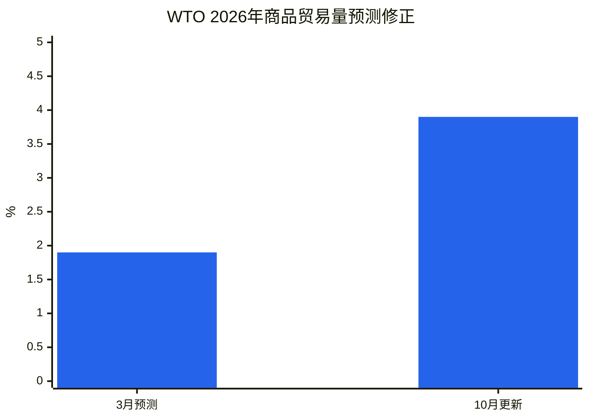

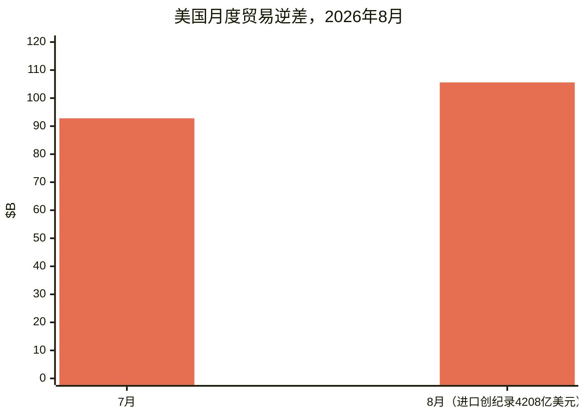

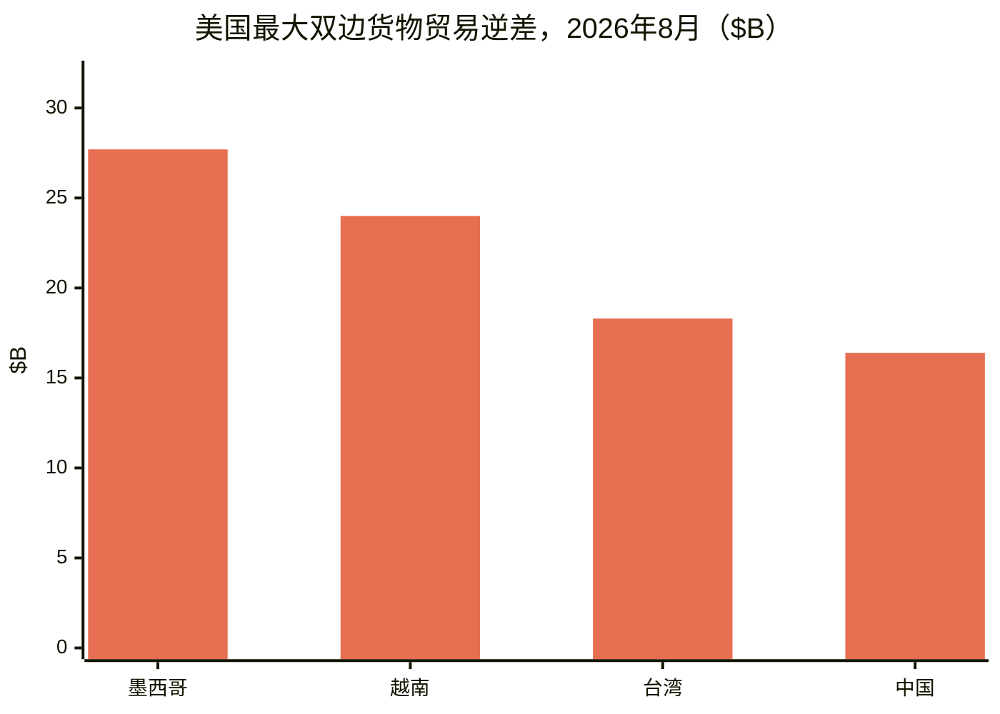

**分析。** 三份报告从三个角度讲述同一个故事：需求强劲（美国进口创纪录），构成狭窄（AI商品贡献了近一半的贸易增长；UNCTAD指出了集中度），地理上有选择（中美贸易自2024年以来下降超20%，墨西哥、越南和台湾填补了缺口）。WTO的贸易量乐观与UNCTAD的实际值谨慎之间的分歧——名义价格驱动的增长与疲软的实际量——是本季度的分析框架。IMF的10月《世界经济展望》将于曼谷年会（10月12–18日）期间发布，将载入正式的关税模拟评估。([bea.gov](https://www.bea.gov/news/2026/us-international-trade-goods-and-services-august-2026), [reuters.com](https://www.reuters.com/business/us-trade-deficit-widens-august-amid-strong-imports-2026-10-06/), [dig.watch](https://dig.watch/updates/wto-trade-outlook-ai-boom), [un.org](https://news.un.org/en/story/2026/10/1168566))

### 3.5 稀土：11月10日恢复管制

**发生了什么。** 中国暂停扩大的稀土出口管制将于**2026年11月10日**到期，未宣布延期。2025年4月对七种元素的管制从未暂停。美国也在加大自身筹码：路透社10月1日报道，商务部已放缓发往中国的飞机零部件出口许可，包括运往国有企业中国商飞的货物，并考虑对起落架和液压油许可出台新规。

**关键数据。**
- IEA警告，若中国扩大管制全面实施，估计每年**6.5万亿美元**的中国境外下游产值面临风险。
- 2021–2024年中国供应了美国70%的钇进口；2025年美国钇净进口依存度为100%。
- 本周西方回应：国会关于储备与许可的四法案组合；美国稀土公司将其怀俄明州矿山扩产50%；Lindian Resources承诺向中亚加工中心投资1.5亿美元。

**分析。** 除非两国政府延长暂停期，否则11月10日自动恢复管制——三种情景：延期、选择性恢复或全面恢复。北京2026年5月峰会"解决美方关切"的承诺尚未转化为正式延期，稀土出货也未恢复到约定水平。北京回合承诺的"更顺畅、更可预测"的欧洲企业许可绿色通道，将在恢复管制日期到来时接受检验。

### 3.6 十五个经济体在WTO之外联手应对产能过剩

**发生了什么。** 10月7日，15个经济体的贸易部长——美国、阿根廷、澳大利亚、加拿大、欧盟、法国、德国、印度、意大利、日本、韩国、墨西哥、波兰、土耳其和英国——签署联合部长声明，呼吁采取行动消除结构性过剩产能和鼓励过度生产的"非市场"政策。该声明源于密尔沃基G20贸易部长会议（9月30日–10月1日）未能达成共识，并在经合组织贸易委员会会议间隙达成。声明承诺建立专门的行业平台、12月前举行技术会议并共享信息。

**分析。** 这是今年关于产能过剩的最大规模联合声明，使非WTO的诸边监督轨道制度化。未签署方与签署方同样重要：中国、俄罗斯、巴西、印尼、沙特阿拉伯、南非和非盟未签署，中国10月9日警告，若该声明被用作损害其利益措施的借口，将"视情回应"。巴西的缺席值得注意——这个主要G20成员正面临美国301条款关税。12月前的技术会议现为观察点。([reuters.com](https://www.reuters.com/business/some-g20-trade-ministers-sign-us-led-statement-denouncing-excess-factory-2026-10-07/))

### 3.7 美国进口商继续买入：9月创纪录的集装箱量

**发生了什么。** Descartes 10月《全球航运报告》（10月8日发布）显示，美国9月集装箱进口达**2546261标准箱**——创9月历史最高纪录，同比增长10.3%（路透社/Descartes；Descartes称环比8月下降2.2%）。中国始发进口为924454标准箱——Descartes称环比增长4.5%，路透社报道同比增长21.2%——占总量的36.3%。零售品类（塑料制品、家具/床上用品、玩具/体育用品）主导中国出货。2026年1–9月累计量同比2025年增长0.8%——为今年首次累计超过2025年。佐证：洛杉矶港9月处理创纪录的104万标准箱（吉恩·塞罗卡，10月9日）；萨凡纳港创纪录的504015标准箱（同比+3.7%，10月7日）。NRF《全球港口追踪》预计8月为2026年峰值月；进口"可能已过今年最繁忙阶段"（JOC，10月8日）。

**分析。** 尽管有关税制度，美国进口需求依然强劲——FT-900创纪录的8月4208亿美元进口与Descartes的9月创纪录箱量指向同一方向：供应链在改道（墨西哥、越南、台湾的双边逆差现已超过中国），而非回流。([reuters.com](https://www.reuters.com/world/china/us-ocean-container-imports-set-new-record-september-descartes-says-2026-10-08/))

### 3.8 航空与陆运：平淡的旺季与一个例外

**航空货运。** Xeneta数据显示，10月全球航空货运量增长**+4%**，超出持平的市场预期，但欧洲–北美需求同比下降**−6%**——"一个严峻信号"，可能是全球贸易的先行指标。中国–欧洲电商货运9月同比激增**+62%**，而中国–美国电商货运下降**−34%**（连续第五个月，较6月的−49%有所缓和）。TAC指数9月：香港–北美7.02美元/公斤（同比+31%），香港–欧洲4.80美元/公斤（+8.8%）；波罗的海空运指数同比上涨25.5%。欧盟对150欧元以下包裹征收每件3欧元的新费用正在压低亚欧货运量。Dimerco 10月报告预测，海运拥堵和被扣留的中美货物可能在第四季度将更多货量推向空运；Xeneta预计旺季平淡。变数：沙特机场遇袭使利雅得离港空运运力在旺季前夕削减三分之一。([airfreight.news](https://airfreight.news/articles/full/october-air-cargo-volumes-surprise-with-4-growth-but-is-europe-north-america-slump-a-bellwether-for-global-trade))

**美国卡车运输。** 整车合同运价创52周新高**2.72美元/英里**加燃油（同比+18%）；干厢现货3.55美元/英里全包，较一年前高约50%——由燃料和运力紧张驱动，而非需求。柴油价格达6.39美元/加仑。拒单率约13.75–14%。新增运力在萎缩：8月新注册营运车队拖头降至19520辆（较上半年均值−14%）；新州际注册者中仅约三分之二购买责任险（2019年为十分之九）。Old Dominion 4.9%的综合运价上调10月5日生效；DHL Express加入联邦快递行列，2027年综合运价上调5.9%（1月1日）。([freightwaves.com](https://www.freightwaves.com/news/trucking-rates-spike-contracts-at-52-week-high))

---

## 4. 关税追踪

| 国家 | 措施 | 税率 | 生效日期 | 状态 | 来源 |
|---|---|---|---|---|---|
| 美国 → 加拿大 | 338条款附加关税 | 50%（无USMCA豁免） | 2026年8月22日（9月15日重新划定范围） | 已生效 | [whitehouse.gov](https://www.whitehouse.gov/fact-sheets/2026/07/fact-sheet-president-donald-j-trump-imposes-additional-tariffs-on-canada/) |
| 美国 → 加拿大 | 338条款进口禁令（摩托车、乳清、糖蜜、无醇啤酒、酒类、乳制品） | 禁止入境（在途货物：50%关税） | 2026年9月29日 | 已生效 | [asrwe.com](https://asrwe.com/asr-university/us-canada-import-ban-alcohol-motorcycles-section-338-expansion-september-2026) |
| 美国 → 加拿大 | 301条款强迫劳动关税 | 10%（有效USMCA主张可避免；非USMCA覆盖商品面临50%+10%=60%） | 2026年7月23日 | 已生效；25州诉讼待决，尚未裁决 | [jdsupra.com](https://www.jdsupra.com/legalnews/forced-labor-meet-section-301-new-1432199/) |
| 加拿大 → 美国 | 对约335个税目商品的反制关税（钢铁、铝、乳制品、汽车、家电、农业设备、纸张、塑料、电子产品） | 15% / 25% / 50% | 2026年9月8日 | 已生效 | [surtaxscan.com](https://surtaxscan.com/news/canadas-counter-tariffs-are-back-15-25-and-50-on-335-us-tariff-items-from) |
| 美国 → 俄罗斯 | 《格雷厄姆法案》第112条对所有俄罗斯商品（含石油）关税 | 最高500% | 截止日2026年10月18日 | 待定；可豁免 | [mondaq.com](https://www.mondaq.com/unitedstates/export-controls-trade-investment-sanctions/1851398/the-lindsey-graham-sanctions-act-what-businesses-need-to-know-about-the-new-tariffs) |
| 美国 → 俄罗斯能源主要买家（印度、中国、土耳其等） | 《格雷厄姆法案》第113条二级关税 | 最高100%（与所有现有税率叠加） | 截止日2026年10月18日 | 待定；总统豁免须向国会提交非密证明 | [mondaq.com](https://www.mondaq.com/unitedstates/export-controls-trade-investment-sanctions/1851398/the-lindsey-graham-sanctions-act-what-businesses-need-to-know-about-the-new-tariffs) |
| 美国 → 俄罗斯 | OFAC第135号通用许可证：授权进口俄罗斯柴油 | n/a（许可证） | 2026年10月9日–2027年4月7日 | 已生效 | [nationpress.com](https://www.nationpress.com/international/trump-buys-russian-diesel-before-graham-act-deadline) |
| 中国 → 欧盟（对硝基甲苯） | 反倾销调查（商务部第44号公告） | 指控倾销幅度>100%（临时税率待定） | 2026年10月3日立案；登记截止10月23日 | 调查进行中 | [mlex.com](https://www.mlex.com/mlex/articles/2533700/china-opens-anti-dumping-probe-into-eu-para-nitrotoluene) |
| 欧盟 → 中国 | 混合动力/插电混动出口节制——"共同理解" | 自愿出口限制（谢夫乔维奇称减半；北京文本无数字） | 欧盟峰会10月15–16日决定结果 | 待政治背书 | [eureporter.co](https://www.eureporter.co/world/china-2/2026/10/09/eu-and-china-strike-preliminary-trade-deal-ahead-of-crucial-leaders-summit/) |
| 英国 → 中国 | 对中国产电动汽车关税 | 最高45%（与欧盟综合税率持平） | 审议中 | 未决定（"难以抉择"） | [fleetnews.co.uk](https://Www.fleetnews.co.uk/news/uk-weighs-chinese-car-tariffs-as-fleet-demand-for-evs-surges) |
| 巴西 | 零关税：麦克风、乐器、家用缝纫机 | 0%（原18–20%） | 2026年10月1日 | 已生效 | [datamarnews.com](https://datamarnews.com/noticias/zero-import-tariffs-take-effect-for-musical-instruments-in-brazil/) |
| 美国 | 232条款多晶硅及衍生品 | 最低限价：多晶硅21美元/公斤、硅片100美元/公斤、电池0.22美元/瓦、组件0.38美元/瓦 + 15%从价税 | 2026年12月4日（防激增规则自9月22日起生效） | 已排期 | [mondaq.com](https://www.mondaq.com/unitedstates/export-controls-trade-investment-sanctions/1848548/polysilicon-and-derivatives-in-the-bullseye-for-major-new-tariffs-and-other-restrictions) |
| 美国 → 中国 | 301条款清单2和清单3（2018年措施） | 7.5%–25% | 已生效（USTR 10月7日完成第二次四年复审，关税继续） | 已生效 | [internationaltradetoday.com](https://internationaltradetoday.com/article/2026/10/06/ustr-section-301-tariffs-from-2018-will-continue-2610060064?BC=bc_6ac595c738480) |
| 美国 → 约60个经济体 | 301条款强迫劳动关税 | 10%档（17个经济体，包括加拿大、印度、墨西哥、英国）；其余12.5%；欧盟/台湾合计上限10% | 2026年7月23日 | 已生效；3起诉讼待决 | [jdsupra.com](https://www.jdsupra.com/legalnews/forced-labor-meet-section-301-new-1432199/) |
| 美国 → 约60个经济体（拟议配额） | 东盟关税配额（孟加拉国、柬埔寨、印尼、马来西亚），含美国棉花/纺织投入的商品——豁免301条款强迫劳动关税 | 待定 | 审议中 | 提议阶段 | [asiadaily.org](https://asiadaily.org/news/14890/) |
| 美国 | BIS"美国成分"指引：USMCA移动工业设备（第11032号公告）——关税从25%降至15%下限（美国成分≥40%） | 实际税率下限15% | 2026年10月14日生效（联邦公报发布） | 已排期 | [kpmg.com](https://kpmg.com/us/en/taxnewsflash/news/2026/10/us-bis-guidance-us-content-canadian-mexican-products.html) |
| 印度 | 三氧化铬——反补贴终裁肯定 | n/a | 2026年10月8日（美国措施） | 终裁已发布 | [federalregister.gov](https://www.federalregister.gov/documents/2026/10/08/2026-20696/chromium-trioxide-from-india-final-affirmative-countervailing-duty-determination) |
| 中国 | CBS（橡胶促进剂）——反补贴初裁肯定+紧急情况 | n/a | 2026年10月8日（美国措施） | 初裁已发布 | [federalregister.gov](https://www.federalregister.gov/documents/2026/10/08/2026-20292/n-cyclohexylbenzothiazole-2-sulfenamide-from-the-peoples-republic-of-china-preliminary-affirmative) |
| 中国 | 胺类化合物——反倾销/反补贴调查立案（指控幅度最高476%） | 待定 | ITC初裁截止2026年11月13日 | 调查进行中 | [federalregister.gov](https://www.federalregister.gov/documents/2026/10/05/2026-20286/amine-compounds-from-china-institution-of-antidumping-and-countervailing-duty-investigations-and) |
| 墨西哥 | 铁路罐车——反倾销/反补贴调查立案 | 待定 | ITC初裁截止2026年11月16日 | 调查进行中 | [federalregister.gov](https://www.federalregister.gov/documents/2026/10/05/2026-20349/railway-tank-cars-and-parts-thereof-from-mexico-institution-of-antidumping-and-countervailing-duty) |
| 日本 | 扩大对俄罗斯工业基础商品的出口禁令 | 出口禁止 | 2026年10月16日 | 已排期 | [globalsanctions.com](https://globalsanctions.com/2026/10/japan-adds-more-goods-to-russia-export-ban-from-16-october-2026/) |

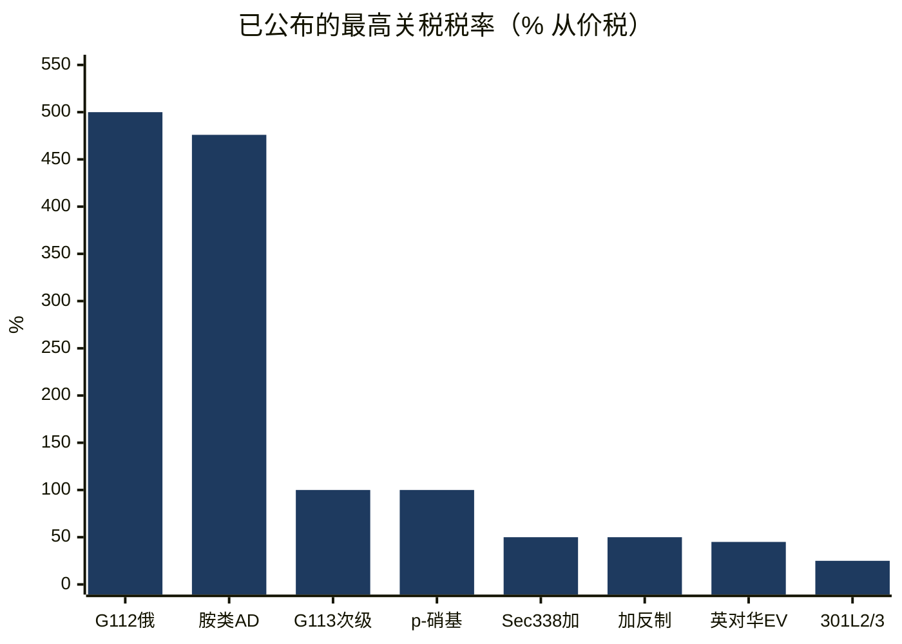
*所示为最高公布税率（拟议措施为"最高可达"；AD = 指控的反倾销幅度）。*

---

## 5. 美国政策深度分析

### 美加：僵局与法律阴云

窗口期内未发布新的338条款公告。现行措施：加拿大商品**50%附加338条款关税**（8月22日起生效；9月15日第二批生效，覆盖纸张、家具、奶酪、皮革、摩托艇、高尔夫球车、钢铁、铝及贱金属制品——无论USMCA原产地均适用；能源、钾肥、232条款覆盖商品、鱼类和关键矿产除外）；**进口禁令**9月29日生效，针对摩托车、乳清、糖蜜、无醇啤酒、酒类和乳制品（约9.67亿美元）；加拿大镜像**15%/25%/50%反制关税**针对约276亿加元的美国商品（钢铁、铝、乳制品、汽车、家电、农业设备、纸张、塑料、电子产品），9月8日生效；以及9月8日总统指令，要求总务管理局（GSA）会同USTR将加拿大原产产品从GSA多重奖励计划中移除。

本周动态：蒙特利尔经济研究所10月8日发表文章（菲利普·马格尼斯），认为加拿大的反制关税可能削弱美国对338条款关税的法律挑战；法律评论继续主张338条款可能已被《1962年贸易扩展法》和《1974年贸易法》取代，涉及重大问题原则和不得授权原则——但**尚未有法院案件**直接挑战338条款关税。另，针对2026年7月301条款强迫劳动关税的**25州诉讼**（共3起诉讼挑战对约60个经济体10–12.5%的关税），截至10月4日**无书面裁决**。谈判方面，USTR代表格里尔称加拿大的剩余症结（汽车、乳制品、酒精饮料）"相当棘手"，华盛顿"不倾向于"走向零关税；卡尼总理透露，若华盛顿大幅降低自身关税，渥太华曾准备取消对钢铁、铝和汽车的剩余反制关税，并鼓励各省将美国酒类重新上架——但不会改变供应管理制度。加拿大已释放克制而非进一步升级的信号。([iedm.org](https://www.iedm.org/counter-tariffs-the-federal-government-is-undermining-u-s-legal-challenges-to-section-338/), [akingump.com](https://www.akingump.com/en/insights/alerts/president-trump-directs-removal-of-canadian-products-from-federal-procurement), [hashtag investing](https://www.hashtaginvesting.com/blog/u-s-trade-chief-says-canadas-sticking-points-are-quite-difficult-and-washington-is-not-inclined-to-go-to-zero-tariff))

### IEEPA退款：第三阶段启动

CBP于**10月6日**通过其在线索赔平台（CAPE）开启**法院命令的IEEPA关税退款程序第三阶段**。在2026年7月30日前提交进口商编号（IOR）的登记进口商可参与。联邦政府已就国际贸易法院要求向已清算超80天的非诉讼登记进口商退款的部分提起上诉；CBP表示自愿退还未清算条目及清算80天内条目的关税。CBP就退款信息收集接受公众意见至**11月4日**（Reginfo.gov）。这是最高法院2026年2月裁定"解放日"关税无效后约1800亿美元IEEPA关税退款的执行落地；未诉讼进口商较早清算条目的救济范围仍有争议。耶鲁预算实验室估计，IEEPA退款带来的暂时性积极财政脉冲大致抵消了剩余关税对2026年增长的负面影响。([thompsonhine.com](https://www.thompsonhine.com/insights/cbp-confirms-october-6-2026-launch-of-phase-3-of-the-ieepa-tariff-refund-process/))

### CBP运作

- **2027财年海关用户费（10月1日起生效）：** 报关行许可证用户费从185.38美元上调至**190.88美元**；货物处理费率保持**0.3464%**，最低和最高限额上调。([ghy.com](https://www.ghy.com/trade-compliance/category/us-customs/))
- **低价值货物（RIN 1685-AA38）：** CBP于**10月8日**就低价值货物非正式报关要求的拟议变更开启磋商；意见征询截止**12月7日**。([digitalpolicyalert.org](https://digitalpolicyalert.org/event/44472-customs-and-border-protection-opened-consultation-on-proposed-rule-on-low-value-shipments))
- **2027财年食糖关税配额（10月1日开放）：** 精制糖和特种糖均超额认购——按比例分配**51.03027%**（精制糖）和**44.58212%**（特种糖）。([ghy.com](https://www.ghy.com/trade-compliance/category/us-tariffs/))

### USTR

- **10月8日：** 启动**USMCA快速反应劳工机制**，审查**GLM Components Mexico, S.A. de C.V.**（普埃布拉；汽车零部件）工人是否被剥夺结社自由和集体谈判权；美国已**暂停清算**该工厂未清算条目的货物。([ustr.gov](https://ustr.gov/about/policy-offices/press-office/press-releases/2026))
- **10月7日：** 在经合组织贸易委员会间隙召集**14个经济体**高官；发布关于结构性过剩产能的联合部长声明——即15国声明的前身（见§3.6）。
- **10月5日：** 格里尔大使在密尔沃基主持**G20贸易部长会议**；讨论消除强迫劳动、更新最惠国原则、谴责粮食贸易武器化及产能过剩。
- **301条款四年复审（2018年措施）：** USTR宣布，2018年7月6日和8月23日301条款措施（中国清单2和清单3）的第二次四年复审结束，关税**继续维持**——附加关税一般为7.5%至25%，经后续修改部分更高（联邦公报10月7日发布通知）。
- **2027年USMCA联合复审：** 意见及听证申请截止**2027年1月12日**。
- **东盟关税配额提议：** USTR正考虑为孟加拉国、柬埔寨、印尼和马来西亚设立三年期配额，可豁免含美国棉花和纺织投入产品的301条款强迫劳动关税——仍在审议。马来西亚坚持其2025年10月《互惠贸易协议》（19%税率）；印尼视其2026年2月"新黄金时代"协议为有约束力；泰国在评估；越南正利用外交接近。([asiadaily.org](https://asiadaily.org/news/14890/))
- **巴西：** 9月30日与格里尔会晤后，巴西谈判代表罗萨表示巴西寻求全面降税——包括232条款钢铁、铝和汽车零部件关税——双方同意成立工作组界定贸易议题范围；他称针对巴西的25%301条款关税是"最可怕的关税"。([internationaltradetoday.com](https://internationaltradetoday.com/article/2026/10/01/brazil-expresses-confidence-it-can-reach-tariff-reduction-agreement-2610010041))

### BIS — 出口管制

- **"美国成分"指引（联邦公报定于10月14日发布）：** 定义如何计算符合232条款金属第11032号公告USMCA优惠待遇的加拿大和墨西哥产品的"美国成分"——（1）在美国完全获得、完全生产或实质性转变的零部件价值；（2）在未计入部分，美国熔炼浇铸的钢铁、美国冶炼浇铸的铝、美国冶炼浇铸的铜的价值。两种方法不可合并。实际效果：USMCA移动工业设备（叉车、平地机、起重机、挖掘机、推土机）的合格进口商，若美国成分价值占比至少40%，可将232条款关税从**25%降至实际15%下限**；新HTS子目**9903.82.22**申报非美国成分（或超40%的美国成分），9903.82.21覆盖40%以内的合格美国成分。([kpmg.com](https://kpmg.com/us/en/taxnewsflash/news/2026/10/us-bis-guidance-us-content-canadian-mexican-products.html))
- **关联公司规则：** 将实体清单/MEU/SDN限制延伸至被列名方持股50%以上的境外关联公司的规则暂停继续有效，恢复日期定为**11月10日**，除非延期。9月23日美中延长釜山框架至2027年1月10日的协议预计将附带匹配延期，但**联邦公报尚未发布**通知。贸易律师建议按规则可能恢复来准备。([jdsupra.com](https://www.jdsupra.com/legalnews/bis-affiliates-rule-suspension-extended-1084647/))
- **发往中国商飞的飞机零部件许可：** 路透社10月1日报道（匿名消息源），商务部已放缓发往中国的飞机零部件出口许可，包括运往国有企业中国商飞的货物，并考虑对起落架和液压油许可出台新规。([investornews.com](https://investornews.com/critical-minerals-rare-earths/technology-metals-report-10-04-2026-a-summit-without-a-rare-earth-deal-leaves-the-west-buying-its-way-to-supply/))

### 联邦公报 — 反倾销/反补贴，10月5–8日

对**中国胺类化合物**（指控倾销幅度最高476%；ITC初裁截止11月13日）和**墨西哥铁路罐车及零部件**（ITC初裁截止11月16日）立案新的反倾销/反补贴调查；**印度三氧化铬反补贴终裁肯定**；**中国CBS反补贴初裁肯定+紧急情况**；土耳其钢筋反倾销复审初裁结果；拟撤销波兰床垫反倾销复审的初裁意向；对无缝管（俄罗斯、韩国、捷克、乌克兰）的五年期日落复审已排期；瓦楞模切纸箱（中国、马来西亚、土耳其）修订时间表。完整表格见§4。([federalregister.gov](https://www.federalregister.gov/documents/2026/10/05/2026-20286/amine-compounds-from-china-institution-of-antidumping-and-countervailing-duty-investigations-and))

### 长期事项

- **多晶硅232条款：** 不变。12月4日生效日期不变（最低限价：多晶硅21美元/公斤、硅片100美元/公斤、电池0.22美元/瓦、组件0.38美元/瓦；衍生品15%从价税；防激增限制9月22日–12月4日）。美国组件中位价9月下旬达0.38美元/瓦，较8月的0.27美元/瓦上涨约40.7%。
- **美中休战：** 釜山框架延长至**2027年1月10日**不变；白宫未正式书面确认。稀土出货未恢复到约定水平；2025年4月对七种稀土元素的管制从未暂停。178项中国产品301条款豁免11月10日到期。
- **美中"30换30"：** 两国政府9月28日公布对等关税减免清单（美中贸易委员会框架下各约300亿美元）；商务部英文门户载有该框架的已发布信息。

---

## 6. 分区域世界政策

### 欧洲

- **欧盟–中国：** 见§3.1。与此同时，**法德快速反应工具提议**（10月5日）要求欧盟委员会建立针对"系统性扭曲市场行为"的工具——倾销、广泛补贴、货币兑换限制——德国官员称其为"与美国301条款关税或中国关键矿产出口限制同样强大"的工具。该提议呼吁更快捷的贸易防御工具、更多调查、更广泛的行业覆盖（点名化工、PET和混合动力汽车），另加两项关于多元化和经济安全的工具。欧盟委员会对该信函表示欢迎；欧盟领导人将于10月15日峰会讨论。中国商务部已就"欧洲版301条款"提议的媒体报道公开回应。([lapost.com](https://www.lapost.com/content/france-germany-propose-new-rapid-eu-trade-response-tool))
- **英国：** 政府正在拟定对中国产电动汽车征收**最高45%**关税的一揽子方案，与欧盟综合税率持平——商务大臣雷诺兹如今称该决定"难以抉择"，而9月他曾对《Auto Express》表示英国无计划上调关税。布鲁塞尔已释放信号，若英国不对齐，英国产品可能被排除在"欧洲制造"产业政策优惠之外；英国58%的汽车出口面向欧盟，对华仅约4%；2026年前八个月中国品牌占英国新车注册超15%（22.3万辆），高于2023年的4%。商务贸易部发言人称尚未引入任何关税，也未做出最终决定。([fleetnews.co.uk](https://Www.fleetnews.co.uk/news/uk-weighs-chinese-car-tariffs-as-fleet-demand-for-evs-surges), [britishchambers.org.uk](https://www.britishchambers.org.uk/news/2026/10/eu-china-trade-talks-what-the-outcome-means-for-uk-business/))
- **数字贸易文件：** **欧盟–韩国数字贸易协定**面临10月8日的欧洲议会议员修正案截止日（数据流动规则、源代码保护、永久禁止对电子传输征收关税）；**欧盟–加拿大蒙特利尔峰会（10月29–30日）**预计完成数字贸易协定谈判及矿产/竞争合作一揽子计划；欧盟委员会已就含数字章节的**欧盟–印度自贸协定**提出签署建议。([euperspectives.eu](https://euperspectives.eu/2026/10/eu-south-korea-digital-trade-deal-raise-debate-over-data-sovereignty/), [dig.watch](https://dig.watch/updates/eu-canada-digital-trade-ai), [globallawexperts.com](https://globallawexperts.com/eu-india-fta-digital-trade/))
- **欧盟–印尼自贸协定：** 技术谈判2025年9月结束；法律文本（对多数商品取消关税，敏感商品设保障与配额）处于机构审查阶段，预计在欧盟2026财年结束前正式签署。与菲律宾、泰国和马来西亚的谈判处于后期阶段。([lupicinio.com](https://lupicinio.com/en/international-trade-%c2%b7-august-and-september-2026/))
- **欧洲议会：** 10月7日投票谴责中国的经济行为及其在乌克兰问题上的立场。

### 中国

- **对硝基甲苯反倾销调查**（10月3日立案；见§4）。商务部指出欧盟自2025年以来已对中国发起**28起贸易救济调查**，约半数涉及化工产品，并呼吁通过对话解决争端。
- **《格雷厄姆法案》：** 北京拒绝"长臂管辖"和干涉正常贸易合作，反对缺乏联合国安理会授权的单边制裁，保留保护本国企业的权利（外交部，9月19日，本周报道中重申）。中国是2025年俄罗斯原油第二大买家，约130万桶/日。
- **产能过剩声明：** 商务部10月9日表示，若15国声明被用作损害中国利益措施的借口，中国将"视情回应"；中国未签署。
- **商务部英文门户**10月12日可访问（http://english.mofcom.gov.cn/），载有发言人关于法德提议的回应及已发布的"30换30"框架信息。

### 印度

- **美印贸易协议谈判"达到平台期"**（财政部长西塔拉曼，10月5日）；进一步让步可能困难。外交部9月17日警告，《格雷厄姆法案》的影响"不仅关乎双边关系，也关乎国际能源市场"，并强调14亿人口的能源安全。石油部长普里指出多元化选项（圭亚那、巴西、加拿大、苏里南、纳米比亚）。印度是2025年俄罗斯原油最大买家，约160万桶/日。
- 印度加入**15国产能过剩声明**（10月7日），也是USTR 2026年3月301条款产能过剩调查覆盖的16个经济体之一。其与中华台北的ICT关税WTO争端推迟至10月27日。

### 土耳其

- 本周未发现土耳其政府关于《格雷厄姆法案》的新表态（土耳其：2025年俄罗斯原油约28.2万桶/日，第三档买家）。土耳其签署了15国产能过剩声明。

### 加拿大

- **10月5–12日无新反制措施。** 加拿大镜像15%/25%/50%反制关税（9月8日生效，约276亿加元）继续有效；钢铁和铝税率从25%上调至50%以匹配美国税率；9月8日在途货物豁免；现有汽车反制关税继续。渥太华宣布**75亿加元**的工人和企业支持一揽子计划。谈判僵局持续（格里尔：症结"相当棘手"；卡尼：供应管理制度不容谈判）。

### 巴西

- **零关税**于10月1日对麦克风、乐器和家用缝纫机生效（Gecex/Camex第926/2026号决议；此前税率最高18–20%）。巴西与USTR同意成立**工作组**（9月30日）界定降税协议范围；罗萨称针对巴西的25%301条款关税是"最可怕的关税"。

### 日本

- 10月6日修订《出口贸易管理令》，在对俄出口禁令中增加更多商品，覆盖可能增强俄罗斯工业基础的物项；**10月16日**生效——比《格雷厄姆法案》截止日早一天。([globalsanctions.com](https://globalsanctions.com/2026/10/japan-adds-more-goods-to-russia-export-ban-from-16-october-2026/))

### 东盟与澳大利亚

- **东盟关税配额提议：** 见§5（USTR正考虑为孟加拉国、柬埔寨、印尼和马来西亚设立三年期配额，针对含美国棉花/纺织投入的商品）。
- **澳大利亚：** 外交贸易部拒绝加入英国主导的12国声明（考虑或承诺限制与约旦河西岸定居点以色列企业的贸易），理由是实际操作困难；称将改为与伙伴采取进一步有针对性的措施（9月下旬；为本周唯一报道的澳大利亚贸易限制立场）。

### 多边

- **WTO总理事会（10月5–6日）：** 成员举行两天改革会议；总干事奥孔乔-伊韦阿拉敦促从程序转向实质。争端解决改革：争端解决机构主席帕特里奥塔大使（巴西）将继续非正式磋商；近60名发言者发言。渔业补贴：成员敦促避免协定"日落"；要求在农业领域提出新想法。《电子商务协定》：广泛多数支持数字贸易可预测性，但对法律基础、WTO资源使用和总干事的保存人角色存疑。《投资便利化促进发展协定》：参与方扩大至**131个成员**。MC15：日期未定。([logisticsnews.ph](https://logisticsnews.ph/2026/10/07/wto-members-urged-to-move-from-process-to-substance-as-general-council-tackles-reform-and-future-ministerial-preparations/))
- **WTO争端：** **碳边境调节机制专家组（DS639，俄罗斯诉欧盟）** 9月25日在俄罗斯第二次请求后成立，**印度为第三方**；欧盟将参与但拒绝与俄罗斯直接接触；上诉机构仍无法审理上诉。**土耳其–中国电动汽车争端（DS629）** 专家组报告审议应双方联合请求推迟至10月27日；**印度–中华台北ICT关税**裁决通过推迟至10月27日。哥伦比亚和130个成员第110次推动启动上诉机构成员遴选；美国再次表达关切。柬埔寨获准加入多方临时上诉仲裁安排（MPIA）。([reuters.com](https://www.reuters.com/world/wto-dispute-body-agrees-to-russias-panel-request-eu-carbon-border-levy-2026-09-25/))
- **UNCTAD《2026年贸易与发展报告》**（10月9日）：见§3.4。UNCTAD的关税背景分析（9月17日）发现，美国关税税率从2025年前的平均2.8%跃升至9月初的超20%；16个发展中国家（含5个最不发达国家）现面临超25%的关税；暂停期间最不发达国家贸易加权平均关税翻倍至19%，9月升至27%；亚太发展中国家从3%升至21%；拉美和加勒比从低于0.5%升至18%。([un.org](https://news.un.org/en/story/2026/10/1168566))
- **WCO：** **HS 2028修订**发布——299组修订，形成1229个品目和5852个子目（新增6个品目、428个子目；删除5个品目、172个子目），聚焦卫生应急准备、疫情应对和环境保护；**2028年1月1日**生效，两年实施窗口——本周被标记为关税归类团队的关键前瞻期限。欧盟–WCO非洲原产地规则项目为肯尼亚制造商协会举办了最后一次培训者培训研讨会（10月1日开幕）。([wcoesarocb.org](https://www.wcoesarocb.org/wco-and-partners-strengthen-rules-of-origin-expertise-to-support-trade-and-industrialisation/))
- **ITC：** 公开报道中未发现10月5–12日ITC贸易地图或贸易统计新发布。

---

## 7. 执法行动

| 行动 | 目标 | 日期 | 状态 | 来源 |
|---|---|---|---|---|
| 暂扣令（强迫劳动） | Mitra Aneka Rezeki（MAR）、Hardaya Inti Plantation（HIP）——印尼棕榈油及衍生品 | 2026年9月29日 | 已生效；现行60项暂扣令+8项裁定 | [thompsonhine.com](https://www.thompsonhine.com/insights/cbp-issues-withhold-release-orders-on-two-indonesian-palm-oil-producers/) |
| 美国制裁（OFAC） | 22艘油轮及与伊朗石油贸易相关的个人/公司 | 2026年10月8日 | 已列名 | [gcaptain.com](https://gcaptain.com/category/news/) |
| 美国制裁（OFAC GL135） | 授权进口俄罗斯柴油 | 2026年10月9日–2027年4月7日 | 已生效 | [nationpress.com](https://www.nationpress.com/international/trump-buys-russian-diesel-before-graham-act-deadline) |
| 英国制裁 | 5艘LNG船（与日本协同收紧Sovcomflot） | 2026年10月1日 | 已列名 | [hellenicshippingnews.com](https://www.hellenicshippingnews.com/category/shipping-news/international-shipping-news/) |
| 日本出口管制 | 扩大的对俄出口禁令 | 2026年10月16日 | 即将生效 | [globalsanctions.com](https://globalsanctions.com/2026/10/japan-adds-more-goods-to-russia-export-ban-from-16-october-2026/) |
| 美国进口禁令（338条款） | 加拿大摩托车、乳清、糖蜜、无醇啤酒、酒类、乳制品（约9.67亿美元） | 2026年9月29日 | 已生效 | [asrwe.com](https://asrwe.com/asr-university/us-canada-import-ban-alcohol-motorcycles-section-338-expansion-september-2026) |
| USTR快速反应机制 | GLM Components Mexico（普埃布拉；汽车零部件）——暂停清算 | 2026年10月8日 | 审查进行中 | [ustr.gov](https://ustr.gov/about/policy-offices/press-office/press-releases/2026) |
| CBP | IEEPA退款程序第三阶段（CAPE） | 2026年10月6日 | 开放；意见征询截止11月4日 | [thompsonhine.com](https://www.thompsonhine.com/insights/cbp-confirms-october-6-2026-launch-of-phase-3-of-the-ieepa-tariff-refund-process/) |

**暂扣令详情（MAR/HIP）：** CBP 9月29日的命令覆盖Mitra Aneka Rezeki和Hardaya Inti Plantation的棕榈油及衍生品。审查信息包括：工人访谈、工资单、采摘配额、照片、NGO/政府报告、新闻媒体、学术研究。MAR工人呈现**九项**国际劳工组织强迫劳动指标（包括扣留身份证件和隔离）；HIP呈现**七项**（债务束缚、克扣工资、欺骗、过度加班、恐吓、虐待性条件、利用弱势地位）。美国所有港口立即扣留；进口商可选择出口、销毁或证明清洁来源。

---

## 8. 数据发布

| 发布 | 日期 | 头条数据 | 来源 |
|---|---|---|---|
| 人口普查局/BEA FT-900 — 美国贸易，2026年8月 | 10月6日 | 逆差1056亿美元（+13.7%）；进口创纪录4208亿美元；1–8月逆差同比−19.9% | [bea.gov](https://www.bea.gov/news/2026/us-international-trade-goods-and-services-august-2026) |
| WTO《全球贸易展望与统计》（10月更新） | 10月8日 | 2026年商品贸易量+3.9%（原1.9%），2027年+4.1%；服务贸易下调至3.3%；AI商品占贸易增长的47% | [dig.watch](https://dig.watch/updates/wto-trade-outlook-ai-boom) |
| UNCTAD《2026年贸易与发展报告》 | 10月9日 | 2025年世界贸易创纪录35万亿美元；2026年全球GDP 2.6%；亚洲贡献60%的增长；印度7.3% | [un.org](https://news.un.org/en/story/2026/10/1168566) |
| UNCTAD《全球贸易更新》（年中展望） | 10月（窗口期内） | 2026年商品贸易实际增长1.5–2.5%（2025年为4.7%） | [gtreview.com](https://www.gtreview.com/news/global/global-goods-trade-growth-could-slow-to-1-5-in-2026-unctad/) |
| IMF《世界经济展望》（完整报告） | 10月12–18日（曼谷年会） | 10月6日预发布：2021–24年生活成本危机使2300万人新增陷入极端贫困；2026年全球增长基线约3% | [reuters.com](https://www.reuters.com/world/asia-pacific/cost-of-living-crises-have-lasting-impact-inflation-expectations-poverty-imf-2026-10-06/) |
| 欧洲央行 — 欧元区国际收支，2026年二季度 | 10月2日 | 经常账户2650亿欧元（占GDP 1.6%）；化工/机械顺差收窄；能源逆差重现 | [ecb.europa.eu](https://www.ecb.europa.eu/press/stats/bop/2026/html/ecb.bq261002~5e0dd6a1f4.en.html) |
| 德国联邦统计局 — 德国外贸，2026年8月 | 10月8日 | 出口环比−0.8%；顺差195亿欧元；连续第二个月下降 | [destatis.de](https://www.destatis.de/EN/Press/2026/10/PE26_356_51.html) |
| 税基基金会 — 特朗普关税追踪（2026年9月版） | 动态追踪 | 54%的美国商品进口受影响；适用税率11.7%，实际7.2%；2026年关税收入1515亿美元，2026–2035年约1.5万亿美元；每户约820美元（2026年）；长期GDP −0.4% | [taxfoundation.org](https://www.taxfoundation.org/research/all/federal/trump-tariffs-trade-war/) |
| 税基基金会 — 《改革美国税法方案3.0》 | 10月8日报道 | 废除所有关税，以增值税替代；废除将使2036年前损失约1.8万亿美元 | [rethinking65.com](https://rethinking65.com/repealing-tariffs-and-imposing-a-value-added-tax-would-boost-the-economy-and-federal-revenues-the-tax-foundation-says/) |
| 耶鲁预算实验室 — 美国关税现状 | 动态追踪 | 法定税率现11.0%，年末11.8%；消费者价格影响约0.7%；每户约1100美元；十年约1.9万亿美元；新增约87.5万人陷入贫困 | [budgetlab.yale.edu](https://budgetlab.yale.edu/research/state-us-tariffs) |
| 联合国商品贸易统计 | 方法说明 | IMTS 2026白皮书；跨境贸易指引——10月5–12日无新数据集版本 | [uncomtrade.org](https://uncomtrade.org/docs/its-publication-list/) |
| USITC DataWeb / USA Trade Online | 每月例行更新 | 2026年8月明细现可查询 | |

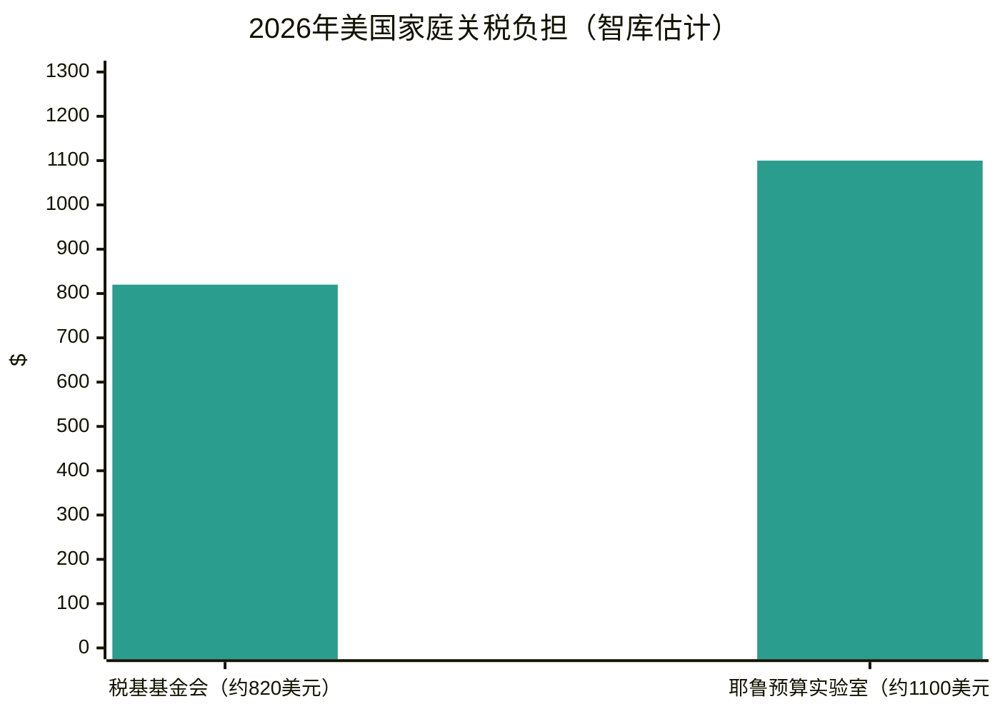

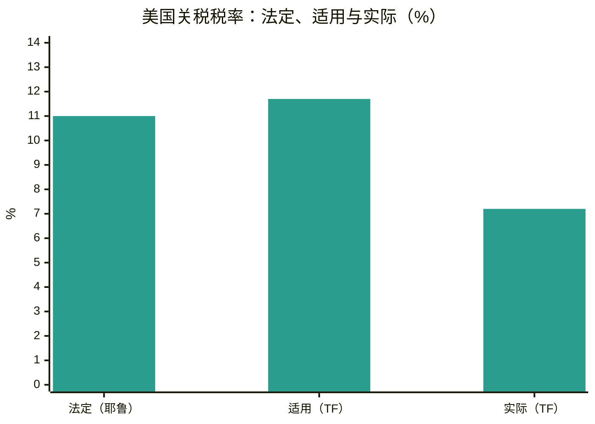
*耶鲁预算实验室与税收基金会2026年估计值。TF = 税收基金会。*

---
**分析。** 智库组合框定了家庭成本之争：税基基金会的820美元和耶鲁的1100美元是记者引用的两个数字，差异在于法定税率与实际税率的处理及IEEPA退款机制。耶鲁的最高法院裁决后分析是目前最完整的现行法综合——退款混乱造成"巨大收入效应"，大致抵消剩余关税对2026年增长的拖累，长期成本为GDP的0.1%（每年约300亿美元）。税基基金会的新书篇幅论证——废除所有关税、以增值税替代——是本周期最清晰的政策替代方案表述。WTO–UNCTAD的分歧（贸易量乐观 vs. 实际值谨慎）是解读秋季数据流的分析框架。

---

## 9. 货运市场

### 集装箱现货运价 — 德鲁里世界集装箱指数

德鲁里世界集装箱指数在**10月8日**周四评估收于**每40英尺柜4351美元，环比下跌2%**——归因于中国国庆黄金周期间跨太平洋和亚欧航线需求走弱。上一次评估（10月1日）收于4434美元，跌1%。Xeneta首席分析师彼得·桑德表示，10月1日标志着霍尔木兹危机后的峰值：远东–美西现货达8346美元/FEU，美东11523美元/FEU——为2月28日危机前水平的四倍多。亚欧运价已连续**13周**下跌；德鲁里认为快于预期的苏伊士回归是船公司运价支撑努力的主要威胁。德鲁里预计未来一周运价保持稳定，指出船公司试图在10月下半月提高亚欧FAK运价，美中休战延长后假期后美国航线可能反弹。

| 航线（40英尺） | 2026年10月8日 | 环比 | 来源 |
|---|---|---|---|
| WCI综合指数 | $4,351 | −2% | [Drewry](https://www.drewry.co.uk/supply-chain-advisors/supply-chain-expertise/world-container-index-assessed-by-drewry) |
| 上海 → 鹿特丹 | $3,337 | −2% | [Drewry](https://www.drewry.co.uk/supply-chain-advisors/supply-chain-expertise/world-container-index-assessed-by-drewry) |
| 上海 → 热那亚 | $3,696 | 持平 | [Drewry](https://www.drewry.co.uk/supply-chain-advisors/supply-chain-expertise/world-container-index-assessed-by-drewry) |
| 上海 → 洛杉矶 | $7,624 | −3% | [Drewry](https://www.drewry.co.uk/supply-chain-advisors/supply-chain-expertise/world-container-index-assessed-by-drewry) |
| 上海 → 纽约 | $10,220 | −2% | [Drewry](https://www.drewry.co.uk/supply-chain-advisors/supply-chain-expertise/world-container-index-assessed-by-drewry) |
| 鹿特丹 → 纽约（每FEU） | $3,091 | −1% | [Shipping Telegraph](https://shippingtelegraph.com/freight-news/drewry-the-world-container-index-decreased-2-in-week-41-2026/) |
| 回程 鹿特丹 → 上海 | $628 | +2% | [Shipping Telegraph](https://shippingtelegraph.com/freight-news/drewry-the-world-container-index-decreased-2-in-week-41-2026/) |

空班统计（德鲁里集装箱运力洞察）：跨太平洋——下周宣布4个空班，本周为11个（运力增加）；亚欧——下周宣布6个空班，上周为5个。

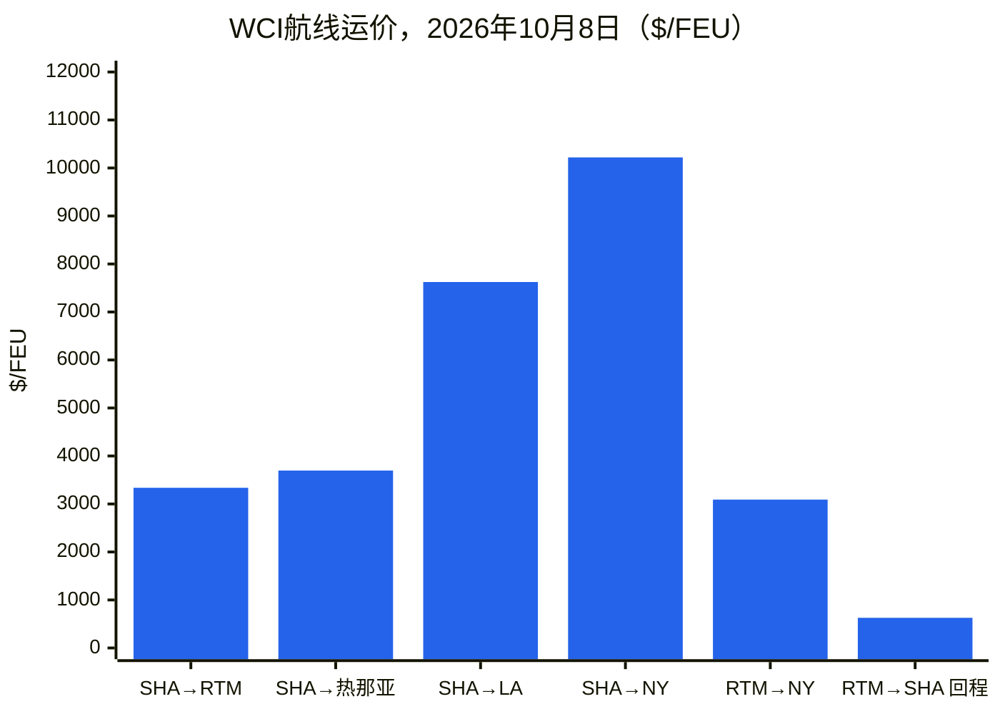
*SHA = 上海；RTM = 鹿特丹。回程：鹿特丹→上海。*

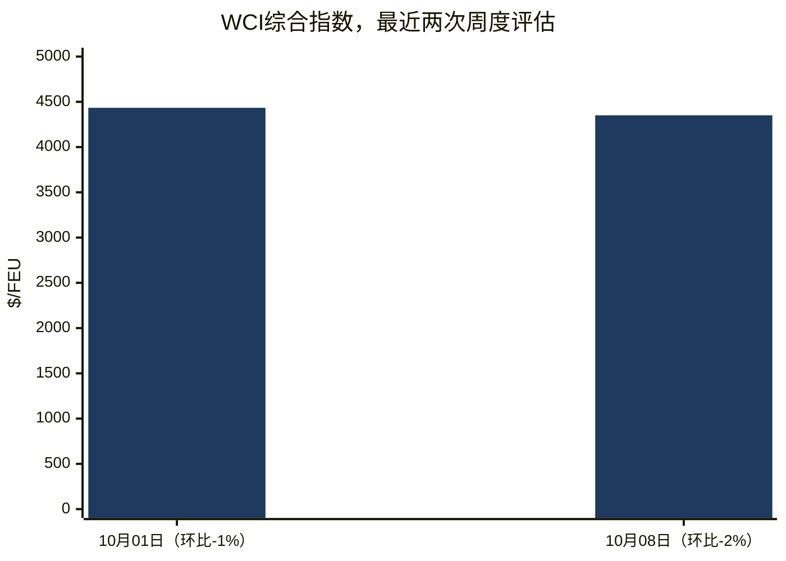

### Freightos波罗的海指数（FBX）

FBX全球指数**10月9日**当周收于**3344点**，基本持平（周初3348点）。

| 航线 | 运价（每FEU，2026年10月9日） | 环比 | 来源 |
|---|---|---|---|
| FBX全球综合指数 | 3,344点 | 周内−4点 | [Baltic Exchange weekly report](https://www.thedcn.com.au/news/baltic-exchange-weekly-report-9-october-2026) |
| FBX01 中国/东亚 → 美西 | $8,106 | −$228 | [Baltic Exchange weekly report](https://www.thedcn.com.au/news/baltic-exchange-weekly-report-9-october-2026) |
| FBX03 中国/东亚 → 美东 | $9,606 | 持平 | [Baltic Exchange weekly report](https://www.thedcn.com.au/news/baltic-exchange-weekly-report-9-october-2026) |
| FBX11 中国/东亚 → 北欧 | $3,260 | 持平 | [Baltic Exchange weekly report](https://www.thedcn.com.au/news/baltic-exchange-weekly-report-9-october-2026) |
| FBX13 中国/东亚 → 地中海 | $3,861 | +$320 | [Baltic Exchange weekly report](https://www.thedcn.com.au/news/baltic-exchange-weekly-report-9-october-2026) |
| FBX21 美东 → 欧洲 | $1,182 | +$108 | [Baltic Exchange weekly report](https://www.thedcn.com.au/news/baltic-exchange-weekly-report-9-october-2026) |

Supply Chain Dive（10月9日，Freightos周报）：亚–美西现货8322美元（−3%），美东9606美元（持平）——中国天气相关港口积压支撑运价下限。Xeneta预计三个月后美东6000–7000美元、美西4500–5500美元——"大幅修正，但不是崩盘"。

### 干散货 — 波罗的海交易所

**波罗的海干散货指数**10月9日周五收于**2917点，周跌7.3%**——为8月下旬以来最低——集中在好望角型（指数−13.9%，日均收益−1560美元至35860美元），因大连铁矿石触及18个月低点；巴拿马型+2.2%和超灵便型+1.4%保持坚挺。

| 日期 | BDI | 好望角型（收益） | 巴拿马型 | 超灵便型 | 来源 |
|---|---|---|---|---|---|
| 10月5日 周一 | 3,070 | 4,833（$40,330） | 2,364 | 1,790 | [Baird Maritime](https://www.bairdmaritime.com/shipping/dry-cargo/bulkers/two-session-winning-streak-ends-as-baltic-dry-bulk-index-falls) |
| 10月6日 周二 | 3,002 | 4,638（$38,561） | 2,366 | 1,795 | [Baird Maritime](https://www.bairdmaritime.com/shipping/dry-cargo/bulkers/baltic-dry-bulk-index-hits-six-week-low-on-capesize-decline) |
| 10月7日 周三 | 2,994 | 4,597（$38,188） | 2,384 | 1,800 | [Baird Maritime](https://www.bairdmaritime.com/shipping/dry-cargo/bulkers/baltic-index-slips-as-capesize-slump-spoils-smaller-vessel-gains) |
| 10月8日 周四 | 2,973 | 4,512（$37,420） | 2,410 | 1,808 | [Baird Maritime](https://www.bairdmaritime.com/shipping/dry-cargo/bulkers/baltic-dry-bulk-index-drops-to-lowest-level-in-more-than-six-weeks) |
| 10月9日 周五 | 2,917 | 4,340（$35,860） | 2,424 | 1,814 | [Baltic Exchange weekly report](https://www.thedcn.com.au/news/baltic-exchange-weekly-report-9-october-2026) |

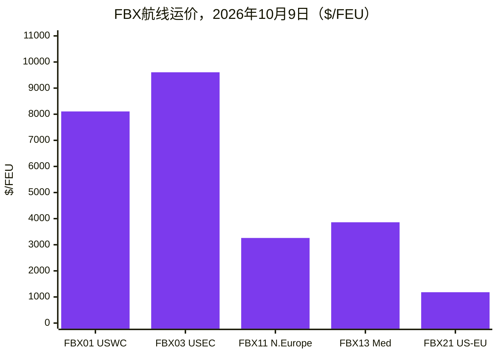
*航线：FBX01 中国/东亚→美国西海岸；FBX03 →美国东海岸；FBX11 →北欧；FBX13 →地中海；FBX21 美国东海岸→欧洲。*

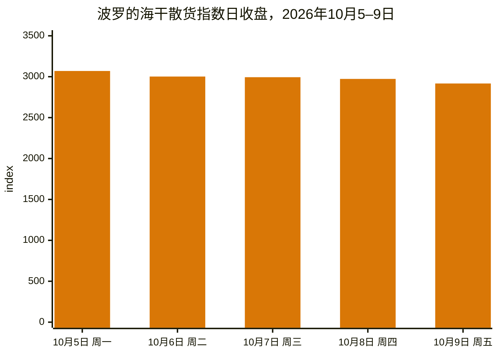

### 港口与物流中断

**红海/苏伊士回归加速。** 赫伯罗特确认Gemini合作SE1航线首对经红海和苏伊士的西行与东行航班：*Umm Qarn*轮10月27日从丹戎帕拉帕斯开往苏伊士，12月5日抵达阿尔赫西拉斯。Premier Alliance（ONE、HMM、阳明）将其东南亚–北欧FE1环线自10月起恢复苏伊士航线——自2024年1月以来首次脱离好望角航线——8110标准箱的*ONE Continuity*轮10月17日从林查班出发。中远定于10月4日进行两年多来的首次西行苏伊士通行。MSI估计约35%的亚欧航班现走红海；Linerlytica统计自5月以来140多艘集装箱船（200万+标准箱）回归；苏伊士集装箱净吨1–8月为7210万吨（同比+54.2%）。制约：欧盟"盾牌行动"承认军舰覆盖不足以应对所有护航请求——这是进一步回归的硬约束。德鲁里《集装箱预测》发现，苏伊士回归对船公司的经济收益微薄——相比好望角每往返航次约节省100万美元——但船公司仍在回归，新增的有效运力正在压低亚欧运价。([splash247.com](https://splash247.com/premier-alliance-joins-accelerating-return-to-suez/), [container-news.com](https://container-news.com/hapag-lloyd-confirms-first-se1-sailings-via-red-sea-and-suez-canal/))

**亚洲港口拥堵。** 台风季拥堵使全球船期可靠性自疫情以来首次跌破50%（Sea-Intelligence），亚洲拥堵可能持续至2027年中；拥堵吸收了12%的有效船舶运力（DHL货运）和约10.9%的集装箱船队（约376万标准箱）；晚到船舶平均延误达6.81天，为2022年3月以来最高。国庆黄金周（10月1–7日）缓和了需求；上海预计拥堵将持续至10月中下旬。([worldcargonews.com](https://www.worldcargonews.com/news/2026/10/sea-intelligence-asian-port-congestion-could-persist-into-mid-2027/), [ti-insight.com](https://ti-insight.com/briefs/global-supply-chain-risk-monitor-october-2026/))

**黑海袭击升级。** 散货船*Royad Mammadov*轮在罗马尼亚附近沉没（两名船员死亡）；数天后保加利亚附近的无人机袭击击沉散货船*Alfa Watan*轮，*Able*轮起火——粮食走廊中断，保险费飙升。印度和利比里亚作为"航运与海员安全之友小组"共同主席，联合谴责袭击（10月9日）。([splash247.com](https://splash247.com/two-seafarers-killed-as-cargo-ship-sinks-off-romania/))

**巴拿马运河。** 10月15日起通行量从每天32艘增至33艘，吃水恢复至49英尺；新巴拿马型船闸增至每天10个。厄尔尼诺风险在前：NOAA预计该模式将持续至2027年初。船公司已加收附加费：地中海航运149美元/20英尺（297美元/40英尺），达飞巴拿马运河调整因子500美元/标准箱。

**菲律宾。** 马尼拉空箱危机：经纪人"数字抗议"和卡车司机罢工（10月5–8日），抗议船公司长达一个月拒收空箱；10月8日码头开始持续接收空箱后抗议结束——但赫伯罗特暂停至马尼拉、八打雁和苏比克的所有新订舱直至12月31日，理由是拥堵及堆场/空箱返还运力严重受限。([portcalls.com](https://portcalls.com/manila-ports-digital-protest-trucking-holiday-end/))

**劳工与内河航运。** 德国码头工人罢工10月2日避免（ver.di协议结束汉堡/不来梅港警告性罢工）。但莱茵河考布水位历史性低水位已实际中断满载驳船通行；低水位附加费达1280欧元/FEU（Contargo）和1350美元/FEU（赫伯罗特）。温哥华码头工人抗议自动化和AI（10月2日）。窗口期内未发现美国ILA东/墨西哥湾海岸新罢工的可核实报道。

**船公司附加费与服务。** 达飞：亚–非旺季附加费（远东→德班10月22日起最高750美元/标准箱；东南亚→西非北部10月15日起200美元/标准箱），西非PSS 10月22日起上调，亚→拉美10月15日起+1000美元/箱，亚–地中海10月19–31日FAK运价，北欧→阿拉伯湾冷藏箱PSS 10月中旬起1000美元。马士基：三个航线PSS；结束与达飞在亚–南美东海岸的ASAS2舱位共享（末班12月8日上海离港）。船队：地中海航运订造六艘LNG双燃料超大型船（每艘约21700标准箱），2029–2030年交付；在手订单超170艘船/300万+标准箱。([container-news.com](https://container-news.com/cma-cgm-announces-new-peak-season-surcharges-on-asia-africa-trades/))

**制裁与北极航运。** 英国制裁五艘LNG船（10月1日）；英国和日本正收紧围绕Sovcomflot关联船舶的网。北极LNG 2项目2026年出口95万吨（全部自7月以来）。中国完成首个中欧北极航道定期每周集装箱服务季（10月7日）；一艘韩国集装箱船完成该国首个北极商业往返欧洲航次（10月10日）。油轮并购：托克从SFL Corp购入七艘油轮（卖方获利约1.75亿美元）；托克分拆的Volare Shipping在奥斯陆上市（10月6日）。([hellenicshippingnews.com](https://www.hellenicshippingnews.com/category/shipping-news/international-shipping-news/), [gcaptain.com](https://gcaptain.com/tag/arctic/))

**墨西哥。** 汽车出口9月创年内最大跌幅，分析师归因于美国关税（INEGI数据经gCaptain，10月8日）。

### 供应商情报（仅公开页面）

- **Descartes Systems Group：** 10月《全球航运报告》（10月8日发布）——美国9月集装箱进口创纪录（见§3.7）；Descartes **Datamyne AI Agent**（约10月1日发布）——基于每年新增5亿+条覆盖230个市场的货运记录的对话式AI代理，声称研究时间削减90%；2026创新论坛（10月6–8日，芝加哥）展示AI物流技术，包括MacroPoint OpsForce AI代理（声称客户成果：免触碰追踪自动化+30%，追踪团队生产力1.5倍）。本期未能直接查阅descartes.com/solutions/global-trade-intelligence；以上来自公开新闻报道。([reuters.com](https://www.reuters.com/world/china/us-ocean-container-imports-set-new-record-september-descartes-says-2026-10-08/), [disruptsmedia.com](https://disrupts.disruptsmedia.com/transportation-logistics/descartes-datamyne-ai-agent-targets-90-cut-trade-data-research))
- **TradeInt：** 土耳其贸易部 × TradeInt资助计划（9月30日宣布，本周媒体报道）——为土耳其咨询公司提供覆盖200多国货运记录、报关单和提单数据的资助访问；TradeInt的数据审查将土耳其2025年出口定为2697亿美元（9月创纪录226亿美元）。仅经公开媒体报道；未使用数据平台访问。([citybuzz.co](https://www.citybuzz.co/2026/09/30/turkiyes-ministry-of-trade-and-tradeint-launch-grant-to-arm-local-consultants-with-global-trade-data-through-tradeint-partnership))

---
## 10. 政策时间线

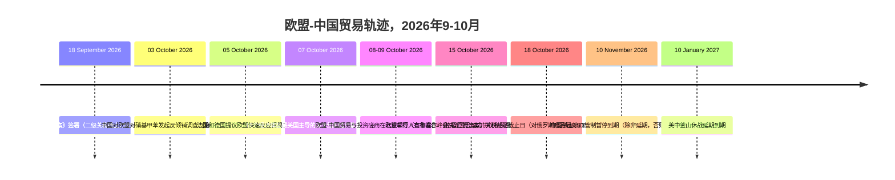

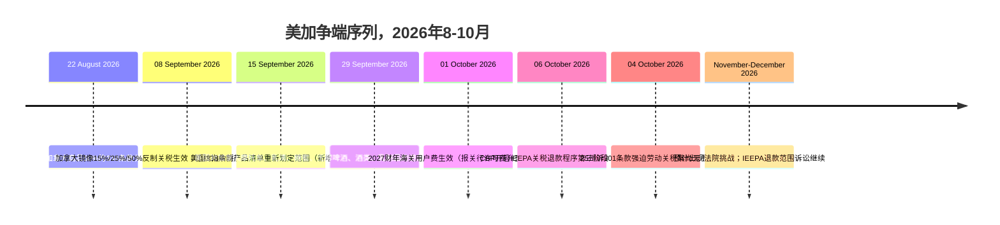

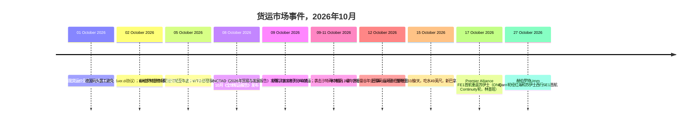

---

## 11. 未来90天的重要期限与事件

| 日期 | 事件 |
|---|---|
| 2026年10月14日 | BIS"美国成分"指引对USMCA移动工业设备生效（联邦公报发布） |
| 2026年10月15日 | 欧盟领导人峰会，布鲁塞尔——决定欧盟–中国混合动力出口谅解、法德快速反应贸易工具、"欧洲制造"规则 |
| 2026年10月15日 | 巴拿马运河：通行量增至33艘/天，吃水49英尺，新巴拿马型船闸增至10艘/天 |
| 2026年10月16日 | 日本扩大的对俄出口禁令生效 |
| 2026年10月17日 | Premier Alliance FE1首航重返苏伊士（ONE Continuity轮，林查班） |
| 2026年10月18日 | 《格雷厄姆法案》关税裁定截止日：对俄罗斯商品最高500%关税；无豁免情况下对俄罗斯能源主要买家最高100%二级关税 |
| 2026年10月19日 | 商务部立案决定截止：胺类化合物反倾销/反补贴（中国） |
| 2026年10月23日 | 登记/意见截止：中国对欧盟对硝基甲苯反倾销调查 |
| 2026年10月27日 | 争端解决机构：印度–中华台北ICT关税裁决通过；土耳其–中国电动汽车专家组报告审议 |
| 2026年10月27日 | 赫伯罗特Umm Qarn轮经红海和苏伊士西行SE1首航（丹戎帕拉帕斯） |
| 2026年10月29–30日 | 欧盟–加拿大峰会，蒙特利尔——预计完成数字贸易协定谈判 |
| 2026年11月4日 | CBP IEEPA退款信息收集意见征询截止 |
| 2026年11月10日 | 中国稀土出口管制暂停到期（除非延期，否则自动恢复） |
| 2026年11月10日 | BIS关联公司规则暂停预定结束（预计延至2027年1月10日，尚未发布） |
| 2026年11月10日 | 178项中国产品301条款豁免到期（休战下延至该日） |
| 2026年11月13日/11月16日 | ITC初裁：胺类化合物（中国）/铁路罐车（墨西哥） |
| 2026年12月4日 | 多晶硅232条款最低限价+15%关税生效 |
| 2026年12月7日 | CBP低价值货物拟议规则意见征询截止 |
| 2026年12月前 | 15国产能过剩行业平台首次技术会议 |
| 2027年1月 | 欧盟–中国部长级视频会议 |
| 2027年1月10日 | 美中釜山休战延期到期 |
| 2027年1月12日 | 2027年USMCA联合复审公众意见截止 |
| 2028年1月1日 | WCO HS 2028修订生效（299组修订；归类团队应即刻规划） |

---

## 12. 来源与方法

覆盖窗口：2026年10月5–12日。

**贸易新闻与分析：** FreightWaves、The Loadstar、Splash247、gCaptain、Hellenic Shipping News、Container News、Supply Chain Dive、Logistics Management、Air Cargo News、Port Technology International、JOC（仅标题）、经贸易媒体的Freightmate/Sea Intelligence/ILA行业洞察、经媒体报道的TradeInt公开公告。

**美国政策：** whitehouse.gov情况说明书、cbp.gov（经贸易咨询）、ustr.gov新闻稿、federalregister.gov（反倾销/反补贴通知、301条款复审）、bis.doc.gov（经KPMG/JD Supra分析）、internationaltradetoday.com（标题）、JD Supra律所分析、Thompson Hine、GHY International、Withum、Akin Gump、Bell Nunnally、Mondaq、KPMG税务新闻快讯、Digital Policy Alert。

**各国政府：** ec.europa.eu/贸易总司（经媒体报道）、gov.uk商业贸易部（经媒体报道）、cbsa-asfc.gc.ca/canada.ca（经媒体报道）、english.mofcom.gov.cn（10月12日直接访问）、METI/日本海关（经Global Sanctions）、巴西Camex/Gecex决议（经Datamar）、印度、土耳其、巴西、澳大利亚和东盟国家的国家贸易部报道。

**多边：** wto.org（10月5–6日总理事会、争端DS639/DS629、改革报道）、unctad.org（《2026年贸易与发展报告》、10月《全球贸易更新》）、wcoomd.org（HS 2028修订、原产地规则项目）、ITC（窗口期内无新发布）。

**数据门户：** 人口普查局/BEA FT-900（2026年8月，10月6日发布）、USITC DataWeb / USA Trade Online、WTO《全球贸易展望》10月更新、UN Comtrade（方法说明）、Eurostat/ECB统计发布、世界银行数据门户、IMF（预发布WEO研究；完整10月《世界经济展望》10月12–18日发布）。

**智库与研究：** 税基基金会（特朗普关税追踪，2026年9月版；《改革美国税法方案3.0》）、耶鲁预算实验室（美国关税现状）、tradeintelligence.eu（窗口期内无新公开研究；欧盟数字贸易文件经EU Perspectives/Digital Watch/Global Law Experts）。

**货运：** 德鲁里（世界集装箱指数，10月8日评估）、波罗的海交易所（10月9日周报）、Freightos波罗的海指数、上海出口集装箱运价指数/中国出口集装箱运价指数（经FreshPlaza）、TAC指数、Baird Maritime（BDI日报）、Xeneta（经FreightWaves/Air Cargo News）、Descartes 10月《全球航运报告》（经路透社）、Sea-Intelligence、DHL货运、DC Velocity、TI Insight、NRF《全球港口追踪》、ILA行业洞察。

**供应商情报：** 仅Descartes Systems Group和TradeInt公开营销与媒体公告（公开博客与新闻内容；未访问数据平台，未登录，未使用竞争对手贸易数据平台）。
