# Global Trade Intelligence Report — Week of October 12–19, 2026

**Weekly briefing.** Coverage window: October 12–19, 2026. Compiled from approximately 45 trade news, policy, data, and freight sources worldwide.

---

## Table of contents

1. [Executive summary](#1-executive-summary)
2. [Alerts](#2-alerts)
3. [Top stories — deep dives](#3-top-stories--deep-dives)
4. [Tariff tracker](#4-tariff-tracker)
5. [US policy deep dive](#5-us-policy-deep-dive)
6. [World policy by region](#6-world-policy-by-region)
7. [Enforcement actions](#7-enforcement-actions)
8. [Data releases](#8-data-releases)
9. [Freight market](#9-freight-market)
10. [Policy timelines](#10-policy-timelines)
11. [Upcoming deadlines & events (next 90 days)](#11-upcoming-deadlines--events-next-90-days)
12. [Sources & methodology](#12-sources--methodology)

---

## 1. Executive summary

A week in which a landmark sanctions law was signed into irrelevance, the Hormuz campaign began sinking container ships, and the world's three largest trading economies reported numbers that point in opposite directions.

- **The Graham Act was waived before it bit.** One month after signing the Lindsey O. Graham Sanctioning Russia and Iran Act of 2026 — with its headline 500% duties on Russian goods and 100% secondary tariffs on top Russian-energy buyers — President Trump signed an October 16 executive order implementing the Act and, in the same order, waived its tariff and sanctions provisions with no end date. India, China and Türkiye, the buyers the Act targeted, keep buying. Bipartisan critics and Kyiv called the waiver a retreat; the White House offered no detailed public explanation.
- **Hormuz claimed its first container ship.** The Singapore-flagged *GFS Pride* (2,824 TEU) was struck, caught fire and sank off Hormuz on October 15 — the second and third vessels sunk since the conflict began. Twelve vessels reported attacks in the October 5–11 week, the highest weekly total of the war; strait crossings fell to 131 from 176 the prior week and crude flows dropped to an estimated 12.6 mb/d. Tanker earnings, meanwhile, reached extraordinary levels: VLCCs averaged $643,000 a day over the past month.
- **The data told three different stories.** China's September trade surplus hit $133.5 billion, a 20-month high, as exports surged 36.3% on the AI hardware boom — January–September surplus reached $938.5 billion, within sight of a second straight year above $1 trillion. The US August deficit widened 13.7% to $105.6 billion as imports hit a record $420.8 billion. The euro area posted its largest trade deficit since January 2023 (€16.1 billion) as imports surged 16.7%. The WTO raised its 2026 merchandise trade forecast to 3.9%, warning that AI-driven goods are masking weakness elsewhere; the IMF's October outlook put 2026 global growth at 3.1%, assuming Hormuz reopens in March.
- **Europe set its trade-defence direction.** At the October 15–16 Brussels summit, EU leaders mandated "full use" of existing trade-defence measures against China and asked the Commission to develop new instruments, while keeping dialogue open ahead of a March 2027 meeting. The UK, by contrast, decided against matching EU tariffs of up to 45.3% on Chinese EVs, calling the choice a matter of UK interest alone. Beijing opened public consultation on sweeping AI-technology export controls covering large model weights and chip-design methodology.
- **Freight staged a partial rebound.** The Drewry World Container Index rose 3% to $4,485/FEU on the October 15 assessment — Asia–Europe rates increased for the first time in 13 weeks — while the Baltic Dry Index fell a third straight week to 2,511 on collapsing Capesize earnings. Global container schedule reliability fell to 27% in September, the fourth straight monthly decline. Thirty-eight shipping and port companies across 18 countries face a mass cyber-extortion ransom deadline on October 19.

**Freight:** a split screen — container spot recovering on post-Golden-Week rate pushes and carrier blank sailings (44 cancelled for weeks 43–47), dry bulk sliding as iron ore touched two-year lows, and air cargo steady at $3.55/kg with jet fuel up more than 100% year on year.

---

## 2. Alerts

| # | Alert | Effective | Impact | Source |
|---|-------|-----------|--------|--------|
| A1 | Graham Act duties waived: Oct 16 EO implements the Lindsey O. Graham Sanctioning Russia and Iran Act and simultaneously waives its tariff and sanctions provisions under Sec. 115, with no end date; earlier Russia sanctions preserved | Oct 16, 2026 | India, China, Türkiye retain access to Russian energy without new US duties; waivers stand until revoked | [whitehouse.gov](https://www.whitehouse.gov/presidential-actions/2026/10/implementing-the-lindsey-o-graham-sanctioning-russia-and-iran-act-of-2026/) |
| A2 | Hormuz escalation: container ship *GFS Pride* (2,824 TEU) struck and sunk Oct 15; 12 vessel attacks Oct 5–11 (highest weekly total of the war); strait crossings down to 131/week; crude flows ~12.6 mb/d | Oct 12–15, 2026 | Container tonnage now at risk; war-insurance terms tightening; tanker earnings at extraordinary levels | [Splash247](https://splash247.com/hormuz-claims-two-more-ships-in-fresh-wave-of-strikes/), [FreightWaves](https://www.freightwaves.com/news/container-ship-attacks-escalate-in-strait-of-hormuz) |
| A3 | Mass cyber-extortion against maritime sector: group "n0n" listed 38 shipping/port/logistics firms across 18 countries on Oct 12, threatening data publication Oct 19, 13:27 UTC unless ransoms paid; demands $400k–$400m per company; claims unverified | Deadline Oct 19, 2026 | First large-scale coordinated cyber-extortion wave aimed at maritime targets; targets include ONE, CULines, TS Lines, Santos Brasil | [Splash247](https://splash247.com/shipping-firms-and-ports-caught-in-mass-cyber-extortion-claim/) |
| A4 | China drafts AI-technology export controls (Announcement No. 48, Oct 16): 40 technologies proposed for the prohibited/restricted catalogue (14 prohibited, 26 restricted), incl. LLM weights above 2 trillion parameters; pre-export registration requirement effective immediately; public consultation to Nov 15 | Oct 16, 2026 (consultation to Nov 15) | Could restrict outbound AI model, agent and chip-design transfers; overseas local deployment covered | [aiandgpp.com](https://aiandgpp.com/2026/10/19/china-ai-export-controls-model-weights-sovereign-cloud/) |
| A5 | November 9 double deadline — no USTR extension as of Oct 13: (a) one-year pause on Section 301 port fees on China-linked vessels expires (fees revert to $80/NT for Chinese owners/operators); (b) 178 Section 301 product exclusions expire (List 1/2/3 duties snap back to 25%, List 4A to 7.5%) | Nov 9, 2026, 11:59 p.m. ET | Importers should treat Nov 9 as the end date; no grace period; exclusion removes only the 301 layer | [Gateway Lines](https://gatewaylines.com/press-releases/china-ship-fees-301-exclusions-nov-9-2026) |
| A6 | Japan's expanded Russia export ban takes effect Oct 16 (announced Oct 6): minerals, chemicals, metals, machinery, industrial equipment and precision instruments added to the prohibition list | Oct 16, 2026 | Exporters to Russia must re-screen product coverage | [Steptoe](https://www.steptoe.com/en/news-publications/international-compliance-blog/weekly-sanctions-update-october-13-2026.html) |
| A7 | FMC proposes $200,000-per-voyage fee on Spanish-flagged vessels plus import restrictions on Spanish goods (perfumery, oils/fats, ceramics, stone articles, sugar, confectionery) after 2024 finding that Spain denied US-flagged vessels port access | Proposed Oct 16, 2026 | Escalation of FMC retaliatory authority over flag discrimination; two Maersk MSP vessels were denied access | [Supply Chain Dive](https://www.supplychaindive.com/news/fmc-proposes-fees-on-spanish-flagged-vessels-import-restrictions/833122/) |
| A8 | Rare earths: Bessent says US hopes to finalise China rare-earths deal "hopefully" by Thanksgiving (Nov 27); BIS Affiliates Rule suspension (reimplementation was Nov 10) expected to follow the truce extension to Jan 10, 2027, but no formal Federal Register notice as of Oct 14 | Target Nov 27, 2026 | Compliance teams face a hard reimplementation date with no formal extension published | [eximguru](https://eximguru.com/export-import-news/export-news/us-china-rare-earths-deal-will-116956.aspx), [Mondaq](https://www.mondaq.com/unitedstates/export-controls-trade-investment-sanctions/1854664/us-china-trade-truce-extended-two-months-bis-affiliates-rule-suspension-follows) |

### A1 — The Graham Act waiver (detail)

The executive order signed October 16 is titled "Implementing the Lindsey O. Graham Sanctioning Russia and Iran Act of 2026" — the Act itself was signed September 18, 2026 (Public Law 119-111), passing the Senate 86–11 and the House 262–159. Section 2 of the order sets the statutory rates: an additional 500% ad valorem on Russian-origin goods; 100% on goods from the five largest importers of Russian crude oil and natural gas that knowingly make new purchases on or after October 18, 2026; and 100% on goods from the five leading facilitators of Russian oil sanctions evasion, all stacking on top of existing tariffs.

Section 4(a) then waives those very duties — and the sanctions provisions of Sections 102(a), 102(d), 102(e), 103–111 and 117 — under the Act's Section 115 waiver authority, with a written national-interest certification transmitted to Congress. The waiver has no end date: it stands until the President, or the Secretary of State in consultation with Treasury and USTR, determines further action is appropriate. Section 4(b) preserves all earlier Russia sanctions imposed under national-emergency executive orders (the emergency was continued March 24, 2026), and USTR is tasked with monitoring Russian energy purchases and reporting back.

**Analysis:** the structure gives the administration a standing tariff threat — the implementing machinery and rates are now defined — while imposing no duties today. The political cost was immediate: Senators Blumenthal, Tillis and Cornyn criticised the move, President Zelenskyy objected, and bipartisan bills to constrain the waiver authority were introduced, though none have become law. The White House offered no detailed public explanation, per AP reporting. For India's and China's refiners, the waiver removes a deadline that had been set for October 18; for US importers, the tariff risk is deferred, not dissolved — a future determination can reactivate the duties.

### A2 — Hormuz claims a container ship (detail)

Splash247 reported October 15 that three AD Ports/GFS-linked containerships were struck near Hormuz. The Singapore-flagged *GFS Pride* (built 2008, 2,824 TEU) was struck, caught fire and sank, with all 21 crew evacuated. The *GFS Giselle* (2015, 4,400 TEU) took hull damage but reached anchorage with its 22 crew unharmed; the *Al Saadiyat* (1,730 TEU, Safeen Feeders) escaped serious damage. Separately, the capesize *Cape Dao* (170,000 dwt) sank about three weeks after being struck off Oman. By IMO casualty data these are the second and third vessels sunk since the conflict began.

UKMTO recorded 12 vessels reporting attacks in the October 5–11 week — the largest weekly total since the war began. Kpler counted 131 strait crossings in the week ended October 14, down from 176 the prior week; crude through the strait was estimated at 12.6 mb/d on October 13 against roughly 15 mb/d at end-September. FreightWaves reported analysts warning that war-insurance cover can be cancelled on short notice when cargo moves on a vessel not named on the bill of lading — a documentation detail with real contractual consequences for shippers now routing around or through the strait.

**Analysis:** the campaign has crossed from harassment to tonnage destruction of container shipping. For liner schedules already running at 27% global reliability, the loss of Red Sea and Hormuz optionality compounds the disruption. The financial counterweight is stark: broker Hartland estimates independent VLCC, suezmax and aframax owners are earning roughly $400 million a day above budgeted expectations; sustained for a year, that would approach container shipping's record $150 billion pandemic-year profit. VLCCs averaged $643,000 a day over the past month, with Middle East Gulf–China runs above $1.3 million a day (Veson). Asset values have followed: a five-year-old VLCC is valued at $218 million, a 55% premium over newbuild, and 15-year-old VLCC values are up 196% year on year.

### A3 — Cyber extortion wave against maritime firms (detail)

On October 12, a group calling itself "n0n" added 38 shipping, port and logistics companies across 18 countries to its dark-web leak site, threatening to publish exfiltrated data on October 19 at 13:27 UTC unless ransoms are paid. Named targets include Ocean Network Express, CULines, TS Lines, Samudera, Santos Brasil, Portonave, BNCT, Pusan Newport, TTI Algeciras, Eurogate Tanger, Nam Dinh Vu and NEOM Ports. Cydome assessed demands ranging from $400,000 to $400 million per company; SOCRadar reviewed demands of $2.4 million to $14 million in Bitcoin. As of the reporting, the claims were unverified and no listed company had confirmed a compromise.

**Analysis:** this is the first large-scale coordinated cyber-extortion wave aimed specifically at maritime targets. Whether or not the data is genuine, the operational lesson stands: port and carrier IT estates are being treated as soft targets by organised extortion groups. Supply-chain security teams should treat the deadline window as a period of elevated phishing and intrusion risk.

### A4 — China's AI export-control draft (detail)

On October 16, MOFCOM and the Ministry of Science and Technology opened public consultation (closing November 15) on adding 40 technologies to the prohibited and restricted export catalogue: 14 prohibited, 26 restricted, of which 23 are AI-related. The thresholds are specific: large language model weights above 2 trillion parameters, models trained with more than 10²⁶ FLOPs, or models ranked in the global top ten; AI agents, compute clusters and chip-design methodology are also covered. A pre-export registration requirement took effect the same day, including for deals already in progress. API and SaaS access is excluded; overseas local deployment is covered.

**Analysis:** if adopted, this would be China's first export-control regime aimed directly at frontier AI model weights — the mirror image of Washington's compute controls. The carve-out for API/SaaS access but coverage of overseas local deployment suggests Beijing wants to tax or block weight transfers while keeping cloud-service revenue flowing. Multinationals running AI workloads on Chinese infrastructure, and Chinese AI firms licensing models abroad, should map exposure before the consultation closes.

---

## 3. Top stories — deep dives

### 3.1 The sanctions law that was waived into irrelevance

The Lindsey O. Graham Sanctioning Russia and Iran Act of 2026 was designed as Congress's answer to sanctions evasion: mandatory secondary tariffs of up to 100% on the goods of the largest buyers of Russian energy, and 500% on Russian goods themselves, taking effect without presidential waivers. It passed with veto-proof-style margins — 86–11 in the Senate, 262–159 in the House — and was signed September 18. The tariff-determination deadline was October 18.

On October 16, two days before the deadline, the President signed the implementing executive order. The order defines the rates precisely, in Section 2. Then, in Section 4(a), it waives them — using the waiver authority Congress had written into Section 115 of the Act. The waiver covers both the tariff provisions (Sections 112 and 113) and the sanctions provisions (Sections 102(a), 102(d), 102(e), 103–111, 117), and it has no sunset: it remains until the President or the Secretary of State, consulting Treasury and USTR, decides otherwise.

**Analysis:** Congress attempted to write a sanctions law the executive could not waive; the executive waived it a month later using the law's own waiver clause. The implementing machinery now exists as a standing instrument — rates defined, monitoring assigned to USTR, the national-emergency sanctions baseline preserved — so the threat of activation is real even as the duties are zero today. The divergence with allies is widening: the UK's October 8 package added 38 targets including two energy companies and 12 shadow-fleet tankers, with London now claiming sanctions cover more than 90% of Russian oil production capacity and urging tighter shipping-services restrictions, while Washington is reportedly weighing tanker relief to ease record freight rates. The EU separately targeted major Russian shipyards in a regulation published October 12. For buyers of Russian energy — India above all — the waiver removes the October deadline but leaves a reactivation risk that is entirely at the administration's discretion.

### 3.2 Hormuz: the war comes for container shipping

October was the month the Hormuz campaign stopped being a tanker war and became a container war. The sinking of the *GFS Pride* on October 15 was the first container-ship sinking of the conflict; the UKMTO's 12 reported attacks in the October 5–11 week were the war's highest weekly total. Straits traffic is responding: 131 crossings in the week ended October 14 against 176 the prior week, and crude flows down to an estimated 12.6 mb/d from roughly 15 mb/d at end-September.

The second-order effects are spreading. The Houthi campaign against Saudi Arabia — missile strikes on Riyadh's King Khalid airport, a declared maritime embargo, a UN Security Council presidential statement adopted by consensus on October 15 condemning the attacks — drove a 4% week-on-week Gulf air-cargo capacity contraction in week 41, leaving Gulf capacity 20% below late-February levels (WorldACD). The Suez Canal Authority, meanwhile, imposed mandatory inspections and sea trials for vessels aged 25 years and older effective October 6 — a safety measure that also complicates transits for aging shadow-fleet tonnage (92% of Russia's shadow tankers are over 15 years old, per the KSE Institute).

**Analysis:** the container alliances' planned Red Sea return — all alliances plus MSC were to send some vessels through by end-October — now faces a renewed risk premium. Drewry's freight researchers noted the faster-than-expected Suez resumption as the principal threat to carrier rate support; fresh container-vessel strikes cut the other way, supporting rates by keeping capacity tied up on the long route. The tension between these forces is the central freight question of the fourth quarter.

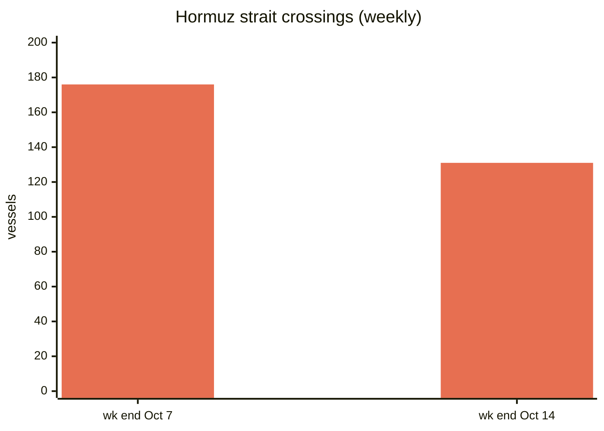

*Note: Kpler data; week ended Oct 7: 176 crossings; week ended Oct 14: 131 crossings.*

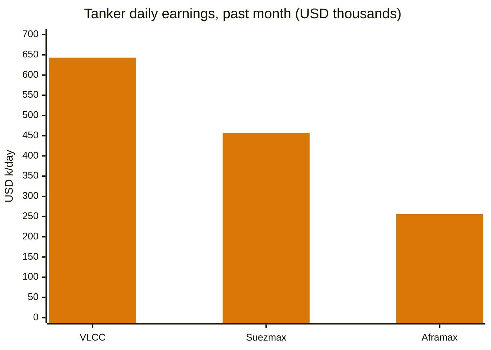

*Note: Broker Hartland estimates via Splash247; VLCC $643,000/day, suezmax $457,000/day, aframax $256,000/day; MEG–China VLCC runs above $1.3m/day (Veson).*

### 3.3 China's $133.5 billion September and the AI trade boom

China's General Administration of Customs reported October 14 that September exports surged 36.3% year on year to $447.18 billion — the fastest since February, against expectations of 25.5% — while imports rose 31.0% to $313.66 billion. The monthly surplus of $133.5 billion was the largest since January 2025, a 20-month high. The January–September surplus reached $938.5 billion, putting a second consecutive year above $1 trillion in sight (the 2025 record was roughly $1.2 trillion). Exports to the US grew 9.8%, with the bilateral surplus at a 20-month high of about $34 billion — despite two years of tariff escalation. High-tech exports, led by semiconductors up roughly 108% year to date per customs data, drove about half of export growth.

The macro institutions are reading the same signal. The WTO's October 8 Global Trade Outlook and Statistics raised its 2026 merchandise trade volume forecast to 3.9% from the 1.9% March baseline, with AI-enabling goods trade up 67% year on year in the first half and accounting for 47% of the trade value increase — 14.8% of world goods trade. Director-General Okonjo-Iweala's caution was pointed: "The impact of AI is masking the other tendencies in trade, which are not on the positive side." UNCTAD's October 9 Trade and Development Report projected global growth of 2.6% in 2026, down from 2.9% in 2025, and noted China–US trade is down more than 20% since 2024. The IMF's October 13 World Economic Outlook put 2026 global growth at 3.1% (from 3.5% in 2025), with AI investment offsetting the Middle East energy shock; its baseline assumes the Strait of Hormuz reopens in March, and estimates the closure cut global growth by about 0.9 percentage points before offsets reduced the net hit to roughly 0.3 points.

**Analysis:** the AI hardware cycle is doing the heavy lifting for world trade volumes — and disproportionately for China. The paradox of a 9.8% rise in China-to-US exports amid the tariff campaign reflects rerouting, front-running and the sheer pull of AI capex; it also explains why the truce-period "compliance" framing in Washington sits uneasily with the data.

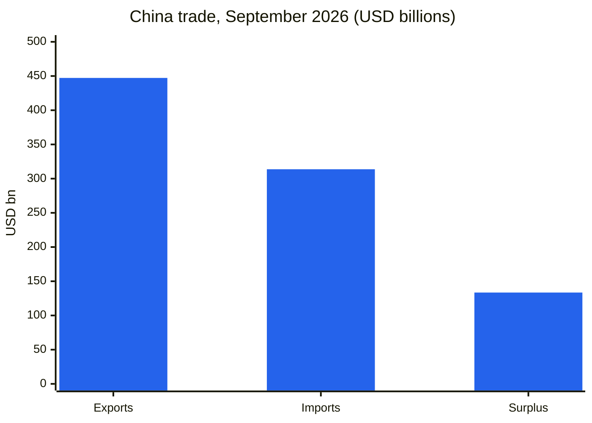

*Note: GACC data released Oct 14; exports $447.18bn (+36.3% YoY), imports $313.66bn (+31.0%), surplus $133.5bn.*

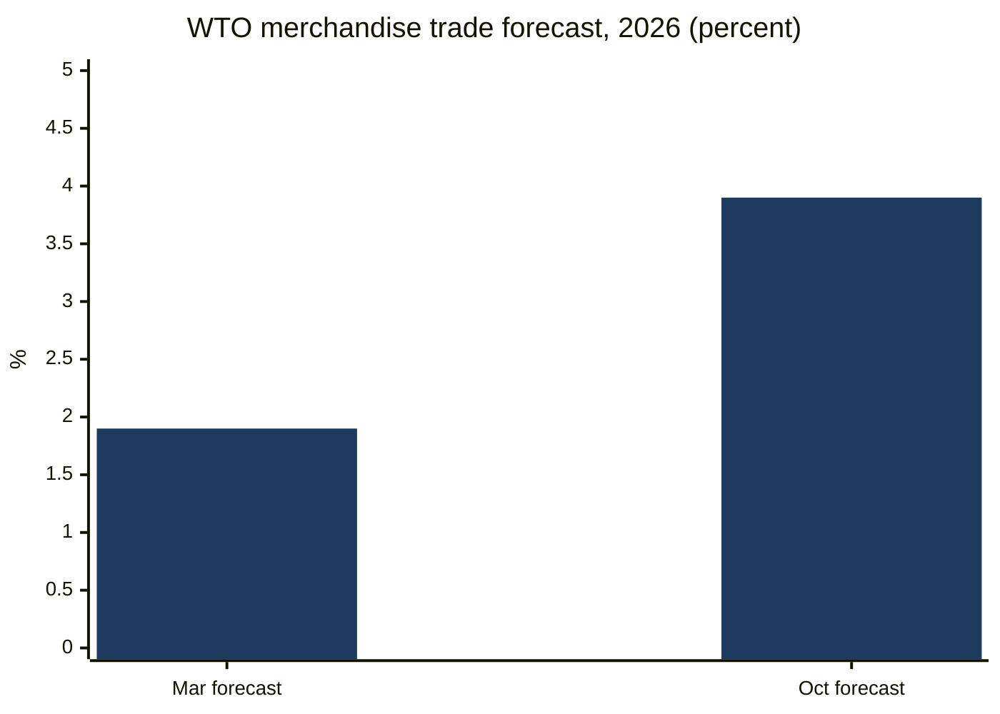

*Note: WTO Global Trade Outlook and Statistics, Oct 8, 2026; AI-enabling goods +67% YoY in H1 accounted for 47% of trade value growth.*

### 3.4 Europe sets its trade-defence direction

The October 15–16 European Council summit produced the week's clearest directional signal on EU trade policy. Leaders tasked the Commission with continuing dialogue with Beijing — the next meeting is planned for March 2027 — while making "full use" of existing trade-defence measures and developing new instruments. The Franco-German letter of October 5, proposing EU powers "as forceful as" US Section 301 or China's critical-mineral restrictions, dominated the debate: faster, sector-wide trade-defence investigations, urgent action on chemicals, PET and hybrid vehicles, and quicker retaliation against countries harming the bloc. The German shift is notable — two years ago Berlin opposed the EU's EV anti-subsidy tariffs.

The backdrop is the October 8–9 Beijing round's 16-point consensus, which the summit had to interpret. Commissioner Šefčovič and Minister Wang Wentao's second Trade and Investment Consultation Mechanism produced a joint statement covering a WTO-consistent understanding on hybrid-vehicle trade (a cap reportedly at 350,000 cars a year, which could cut Chinese hybrid exports by more than half), China's cut of export tax rebates for new-energy vehicles to 13%, a "green channel" for rare-earth and permanent-magnet licences, continued price-undertaking procedures in the EU anti-subsidy EV case, and exploration of MFN tariff cuts on roughly €4 billion of EU exports worth at least €225 million in duty savings. Beijing's published text carries no halving figure for hybrid exports — the information reviewed presents the EU's characterisation and Beijing's text as diverging, and the enforcement mechanism is undisclosed. The EU's goods deficit with China reached €360 billion (about $400 billion) in 2025 and is on track to exceed it in 2026.

**Analysis:** Brussels is moving toward a more muscular, faster trade-defence posture while keeping the negotiation channel open — the classic dual track. The test cases will be the urgent sectors named in the Franco-German letter (chemicals, PET, hybrids) and whether the hybrid-vehicle understanding proves enforceable without a shared text.

### 3.5 Rare earths: the Thanksgiving chessboard

Treasury Secretary Bessent said October 18 on Fox News' Sunday Morning Futures that Washington hopes to finalise a US–China rare-earths deal "hopefully" by Thanksgiving (November 27). The reported terms would have Beijing suspend certain critical-mineral export restrictions for one year, with rare earths flowing "freely as they did before April 4" — the date China imposed export-licence requirements in response to US tariffs. One outlet framed the deal as already reached at a late-October Trump–Xi meeting in South Korea; that framing is unverified, and only the Bessent quote is established in the information reviewed.

The parallel track is the BIS Affiliates Rule. The interim-final rule of September 29, 2025 — suspended from November 10, 2025 through November 9, 2026 — would automatically extend Export Administration Regulations restrictions to foreign entities at least 50% owned, directly or indirectly, by Entity List, Military End-User List or certain SDN parties, including an affirmative ownership-diligence duty (Red Flag 29). With the US–China truce extended to January 10, 2027, Crowell & Moring assessed October 14 that the rule's reimplementation should follow the truce — but as of October 14, BIS had published no Federal Register notice formally extending the suspension.

**Analysis:** two clocks are running. The political clock targets Thanksgiving for a rare-earths deal; the regulatory clock has a hard November 10 reimplementation date for the Affiliates Rule with no formal extension published. Compliance teams cannot rely on press assessments of intent — the rule reactivates by its own terms unless BIS acts.

### 3.6 The US–China truce: compliance period, no soybeans

The US–China trade truce runs to January 10, 2027 — a two-month extension announced by Secretary Bessent on September 23/24, shorter than the six-to-twelve months markets had expected. USTR Greer has described the truce period as a "compliance period" to assess China's follow-through on soybean purchases and rare-earths access. The US goods trade deficit with China is down nearly 40% since the tariff campaign began, per Greer.

On the substance, the "30-for-30" framework — roughly $30 billion of non-sensitive goods on each side — is not operative: China proposed 1,619 US product lines (corn, meat, cotton, sorghum, barley, oats, soybean oil, but not soybeans for food or crushing); the US listed 77 tariff lines (home goods, toys) that could receive lower rates. No rates or start date had been published as of mid-October. On soybeans there is no new purchase commitment: China committed under an earlier agreement to 25 million metric tons a year for 2026, 2027 and 2028, with USDA export sales showing about 10.2 mmt committed for the 2026–27 crop at last report, and China's 10% retaliatory duty on US soybeans remains in place, limiting private-buyer access.

**Analysis:** the truce is a holding pattern, not a settlement. With the Section 301 continuation notice of October 7 keeping all 2018 tariffs in effect — List 1 at 25% on ~$34B, List 2 at 25% on ~$16B, List 3 at 25% on ~$200B, List 4A at 7.5% on ~$120B — and a second four-year review now open that can raise rates, the tariff architecture is entrenched regardless of the truce's fate.

### 3.7 Freight: the October rebound and the Suez return

The Drewry World Container Index rose 3% on the October 15 assessment to $4,485 per FEU, driven by Asia–Europe: Shanghai–Rotterdam gained 6% to $3,522 and Shanghai–Genoa 7% to $3,945 — the first Asia–Europe increase after 13 consecutive weekly declines. The transpacific was mixed: Shanghai–Los Angeles +3% to $7,884, Shanghai–New York −1% to $10,075. Drewry expects less volatility ahead. The rebound follows carriers' post-Golden-Week rate pushes — MSC's new Asia–North Europe FAK from October 19 is set at $3,150/TEU and $4,500/FEU — and 44 blank sailings announced for weeks 43–47 (a 6% cancellation rate on 713 planned sailings), with Asia–North Europe/Med accounting for 44% of cancellations.

The structural pressure runs the other way. Linerlytica reported TEU-mile demand growth regressing for the first time since January, and the faster-than-expected Suez resumption — all container alliances plus MSC to send some vessels via the Red Sea by end-October; Suez transits in week 39 reportedly 68% higher year on year — is the principal threat to carrier rate support. Some 200,000 TEU of newbuild capacity was delivered in September with zero scrapped. Asia–Europe rates are down about 60% since July, though still above $3,000/FEU — roughly 70% above a year ago — as the 2027 tendering season begins. The Panama Canal Authority raised total reserved daily slots to 33 effective October 15, adding further supply.

Dry bulk moved the opposite direction. The Baltic Dry Index fell a third straight week to 2,511 on October 16 — down 14% for the week and the lowest since June 30 — as the Capesize index dropped 25% week on week to 3,249 (the lowest since early April) on soft iron ore, which touched two-year lows midweek. Panamax fell 1.8% to 2,314; Supramax was the outlier, up 9 points to 1,865.

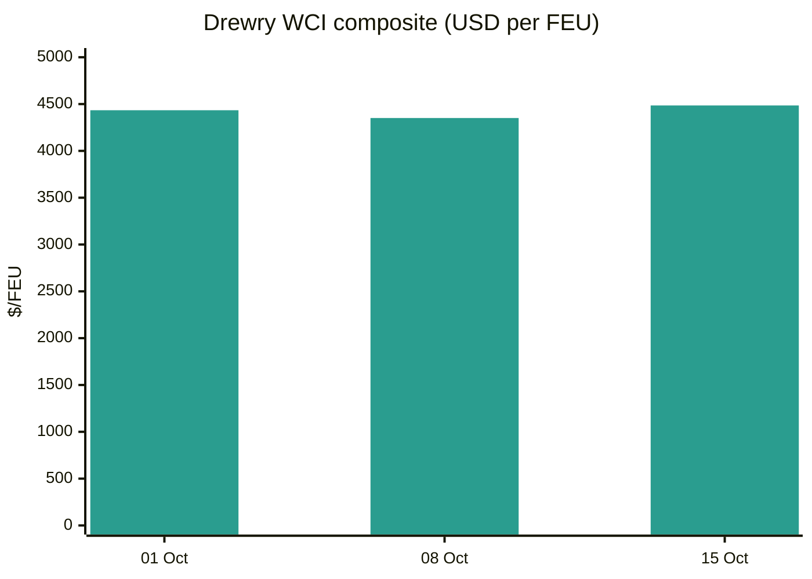

*Note: Drewry Thursday assessments; Oct 1: $4,434 (−1%); Oct 8: $4,351 (−2%); Oct 15: $4,485 (+3%).*

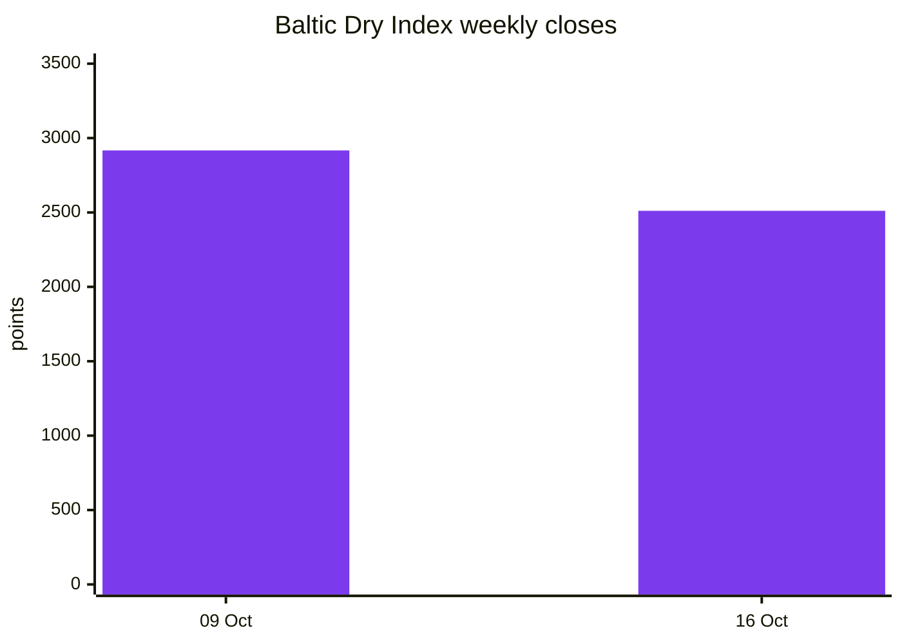

*Note: Friday closes; Oct 9: 2,917 (−7.3% on the week); Oct 16: 2,511 (−14% on the week), lowest since June 30.*

### 3.8 Tariff incidence: what households actually pay

Three research releases this week quantified the tariff burden on US households. The Yale Budget Lab's current-law estimate puts the cost at about $1,100 per household per year, reflecting a roughly 0.7% rise in the overall price level once fully passed through; the average statutory tariff rate is now 11%, scheduled to reach 11.8% by end-2026, costing the average household about $92 a month. Duties collected reached 7.1% of import value in August, against 2.3% in January 2025 — and would have been 10.1% absent behavioural avoidance. The Penn Wharton Budget Model's October 14 update found new tariffs raised $314.8 billion in gross customs revenue from January 2025 through August 2026 (before IEEPA refunds), with $60.7 billion more foregone to behavioural changes; IEEPA collections totalled about $166 billion, all subject to refund, with CBP certifying roughly $126 billion (76%) through October 2. As of July 2026 the average effective US tariff rate was 6.7% — roughly triple the 2.3% of January 2025 — with China facing 22.8%, steel and aluminum 40.5%, and autos 13%. The Tax Foundation's August tracker put the 2026 average effective rate at 6.6%, the highest since 1969, amounting to about $820 per household in 2026.

**Analysis:** the three models converge on the same picture — a tariff regime roughly three times as heavy as January 2025, costing the average household on the order of $1,000 a year, with the IEEPA refund pipeline ($166 billion subject to refund, $126 billion certified) as the largest pending fiscal transfer of the trade war.

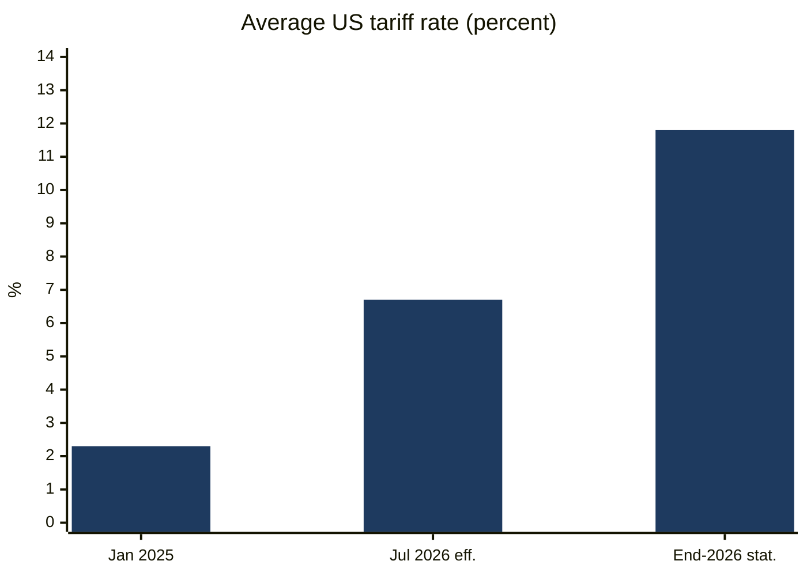

*Note: Jan 2025 effective 2.3%; Jul 2026 effective 6.7% (Penn Wharton; Tax Foundation 7.2% for calendar 2026); end-2026 statutory 11.8% (Yale Budget Lab).*

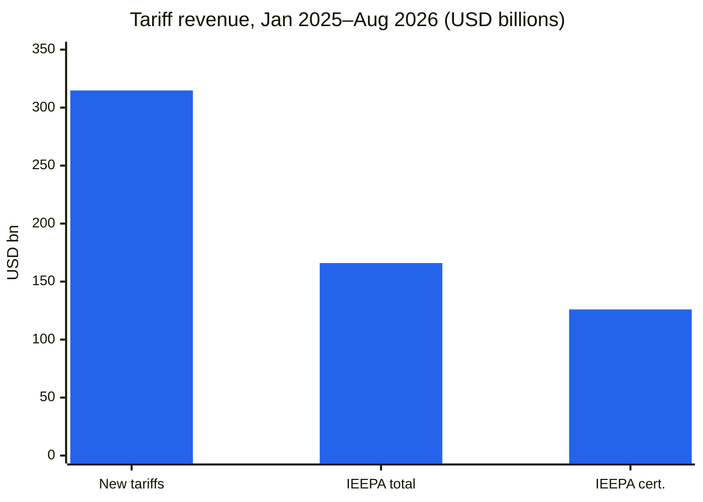

*Note: Penn Wharton Budget Model, Oct 14 update; gross customs revenue before IEEPA refunds; IEEPA certified = CBP-certified for disbursement through Oct 2.*

---

## 4. Tariff tracker

| Country / bloc | Measure | Rate | Effective | Status | Source |
|---|---|---|---|---|---|
| United States | Graham Act Sec. 112/113 duties + sanctions provisions (500% on Russian goods; 100% secondary on top Russian-energy buyers and evasion facilitators) | Waived — 0% | Waiver signed Oct 16, 2026; no end date | Waived under Sec. 115; reactivatable by presidential/State determination; USTR monitoring | [whitehouse.gov](https://www.whitehouse.gov/presidential-actions/2026/10/implementing-the-lindsey-o-graham-sanctioning-russia-and-iran-act-of-2026/) |
| United States | Section 232 on USMCA-eligible mobile industrial equipment (forklifts, bulldozers, backhoes, tractors, mobile cranes) with ≥40% US content | 25% → 15% (reduced) | Oct 14, 2026 | BIS calculation guidance published (FR 2026-20938) | [federalregister.gov](https://www.federalregister.gov/public-inspection/2026-20938/guidance-to-us-customs-and-border-protection-regarding-the-assessment-of-us-content-for-purposes-of) |
| United States | Section 301 port fees on China-linked vessels (pause expiring) | Reverts to $80/NT (Chinese owners/operators); $23/NT or $153/container (Chinese-built, non-Chinese operators); $46/NT (foreign-built vehicle carriers) | Nov 9, 2026, 11:59 p.m. ET | No USTR extension as of Oct 13; 200+ associations requested extension Sept 23 | [Gateway Lines](https://gatewaylines.com/press-releases/china-ship-fees-301-exclusions-nov-9-2026) |
| United States | 178 Section 301 product exclusions (HTS 9903.88.69/70) | List 1/2/3 snap back to 25%; List 4A to 7.5% | Nov 9, 2026, 11:59 p.m. ET | Expiring; no grace period | [Thomson Reuters](https://tax.thomsonreuters.com/blog/section-301-exclusions-expiration/) |
| United States | Section 301 China actions (2018) continuation | List 1/2: 25%; List 3: 25%; List 4A: 7.5% | In effect (continuation notice Oct 7, 2026) | Continued; second four-year review opened May 6, 2026 — rates can be raised | [facohub.com](https://facohub.com/posts/weekly-009) |
| United States | Forced-labour Section 301 action (60 economies) | 10% / 12.5% | In effect since Jul 24, 2026 | In effect; still litigated at CIT |  |
| United States | FMC proposed fee on Spanish-flagged vessels | $200,000 per voyage + import restrictions on listed Spanish goods | Proposed Oct 16, 2026 | Proposal stage | [Supply Chain Dive](https://www.supplychaindive.com/news/fmc-proposes-fees-on-spanish-flagged-vessels-import-restrictions/833122/) |
| China | AI-technology export controls draft (Announcement No. 48) | Prohibited (14) / restricted (26) technologies | Consultation to Nov 15, 2026; pre-export registration effective Oct 16 | Draft stage | [aiandgpp.com](https://aiandgpp.com/2026/10/19/china-ai-export-controls-model-weights-sovereign-cloud/) |
| China | New-energy vehicle export tax rebate cut | Rebate cut to 13% | Agreed Oct 8–9, 2026 | Per EU–China 16-point consensus | [peoplesdaily.pdnews.cn](https://peoplesdaily.pdnews.cn/china/er/30053309352) |
| China | Hybrid-vehicle exports to EU — WTO-consistent understanding | Cap reportedly 350,000 cars/year | Agreed Oct 8–9, 2026 | EU characterisation; Beijing's text gives no figure | [peoplesdaily.pdnews.cn](https://peoplesdaily.pdnews.cn/china/er/30053309352) |
| EU | Franco-German rapid-response trade instrument proposal | n/a (proposal) | Proposed Oct 5; debated at Oct 15–16 summit | Commission mandated to develop new instruments | [985theriver.com](https://985theriver.com/2026/10/05/france-germany-propose-new-rapid-eu-trade-response-tool/) |
| EU | EU–US tariff arrangement (Reg. 2026/1455, 2026/1461) | Removes residual EU duties on US industrial goods; safeguard if US steel/aluminum tariffs still exceed 15% on Dec 31, 2026 | Applies Jul 1, 2026–Dec 31, 2029 | In force; layered safeguard architecture | [Mondaq](https://www.mondaq.com/italy/export-controls-trade-investment-sanctions/1848092/euus-tariff-agreement-the-new-regulations-and-their-safeguard-architecture) |
| EU | CBAM — Russia dispute panel DS639 established | n/a (dispute) | Panel established Oct 3, 2026 | Panel phase; EU engaging only the panel | [news.metal.com](https://news.metal.com/newscontent/104143673-wto-establishes-cbam-dispute-panel-at-russias-request) |
| UK | Chinese EV tariffs (up to 45.3%) — decision not to impose | 0% (option retained for future) | Decided Oct 14, 2026 | Not imposed; UK–EU summit Nov 20 | [Fleet News](https://www.fleetnews.co.uk/news/minister-reportedly-resists-calls-for-uk-to-impose-chinese-ev-tariffs) |
| UK | Steel safeguard regime (tariff-free quotas cut; 50% out-of-quota duty) | 50% out-of-quota | In force Jul 1, 2026 | India seeking exemptions for ~6 categories / 88 steel lines | [buildwatchnews.com](https://buildwatchnews.com/india-seeks-steel-export-exemptions-uk-safeguard-tariffs/) |
| Canada | Provisional safeguard surtax on wood cabinets/vanities (code 26169A) | 25% | Jul 31, 2026 (up to 200 days) | In force; detail published Oct 7 | [adamcabinet.com](https://www.adamcabinet.com/post-canada-cabinet-surtax.html) |
| Canada | Counter-tariffs on ~900 US-origin items (15/25/50%) | 50% on archery equipment (9506.99.00) | Sep 8, 2026 | In force on C$27.6bn of imports | [csaaa.org](https://www.csaaa.org/2026/10/15/50-tariffs-on-archery-equipment-hits-canadian-businesses-hard/) |
| Japan | Russia export ban expansion (minerals, chemicals, metals, machinery, precision instruments) | Prohibition | Oct 16, 2026 | In force (Cabinet decision Oct 2; order promulgated Oct 9) | [Steptoe](https://www.steptoe.com/en/news-publications/international-compliance-blog/weekly-sanctions-update-october-13-2026.html) |
| Korea | Amended Foreign Trade Act (grounds for restrictions 5 → 9) | n/a | Oct 22, 2026 | Enforcement decree approved Oct 13 | [LinkedIn / Don Southerton](https://www.linkedin.com/pulse/week-review-sunday-october-18-2026-short-version-don-southerton-vkbkc) |
| India | India–NZ FTA | NZ: zero tariffs on Indian exports from day one; India: duty-free logs, coking coal, metal scrap | Oct 20, 2026 | Entering into force | [Karmactive](https://www.karmactive.com/india-new-zealand-free-trade-agreement-2026/) |
| India | EU FTA steel quota | ~1.64 Mmt zero-duty quota (~68.4% of ~2.4 Mmt/yr exports); 50% penalty beyond; 35% carbon levy absent CBAM equivalence | FTA text (Sept 11 annex) | Quota ~300,000 t below EU's June 2026 operational allocation | [takshashila.org.in](https://takshashila.org.in/content/blogs/2026-10-12-India-EU-FTA-and-its-steel-challenges.html) |
| Brazil/Mercosur | Mercosur–EFTA FTA | Tariffs eliminated on ~99% of Brazil's export value to EFTA | Oct 1, 2026 (Decree 13,126) | In force | [datamarnews.com](https://datamarnews.com/noticias/mercosur-efta-trade-agreement-brazil-business-opportunities/) |
| Madagascar | Safeguard investigation on sugar and chocolate/cocoa confectionery | n/a (investigation) | Notified Oct 9; comments due Nov 9, 2026 | WTO-notified investigation | [freightnews.co.za](https://www.freightnews.co.za/article/madagascar-launches-safeguard-investigation-on-certain-confectionery) |
| Australia | Australia–EU FTA ratification | Removes tariffs on ~98% of Australian exports (beef 35,000 t; sheepmeat ~31,000 t) | Tabled early 2027 | Nationals threatening to block — would be first failed Australian FTA ratification | [particle.news](https://particle.news/story/coalition-split-threatens-passage-of-australiaeu-10bn-free-trade-deal) |
| Gabon | Poultry import ban (US challenge at WTO) | Ban | In challenge/discussion phase | US interpellation acknowledged Sept 18; ~$86.3m frozen-poultry imports in 2023 | [malivoice.com](https://malivoice.com/gabons-poultry-import-ban-heads-to-a-wto-dispute-with-washington/) |

---

## 5. US policy deep dive

### The Graham Act waiver

Covered in depth in Sections 2 (A1) and 3.1. The implementing executive order of October 16 defines the statutory rates — 500% on Russian-origin goods, 100% secondary tariffs on the five largest importers of Russian crude oil and natural gas making new purchases on or after October 18, and 100% on the five leading facilitators of sanctions evasion — and then waives them under Section 115 with a written national-interest certification to Congress, with no end date. Earlier Russia sanctions under national-emergency authorities remain in place. USTR is charged with monitoring Russian energy purchases. Bipartisan criticism followed; no detailed White House explanation was given publicly.

### BIS — export controls

**Mobile industrial equipment "US content" guidance.** Federal Register notice 2026-20938 (91 FR 65162), published and effective October 14, implements Clause (2)(D) of Presidential Proclamation 11032 (June 1, 2026). USMCA-eligible mobile industrial equipment — forklifts, bulldozers, backhoes, tractors, mobile cranes — qualifies for a reduced Section 232 rate of 25% → 15% where at least 40% of the value is US content. US content is defined as (a) the value of parts wholly obtained, entirely produced, or substantially transformed in the United States, plus (b) the value of steel melted-and-poured, aluminum smelted-and-cast, and/or copper smelted-and-cast in the United States, to the extent not already counted. The rule applies to goods entered for consumption or withdrawn from warehouse on or after 12:01 a.m. ET October 14, 2026. ([federalregister.gov](https://www.federalregister.gov/public-inspection/2026-20938/guidance-to-us-customs-and-border-protection-regarding-the-assessment-of-us-content-for-purposes-of))

**Affiliates Rule suspension.** The interim-final Affiliates Rule (September 29, 2025), suspended November 10, 2025–November 9, 2026, would automatically extend EAR restrictions to foreign entities at least 50% owned — directly, indirectly or in aggregate — by Entity List, Military End-User List or certain SDN parties, with an affirmative ownership-diligence duty (Red Flag 29). Following the truce extension to January 10, 2027, the suspension is expected to follow, but as of October 14 BIS had published no Federal Register notice formally extending it. ([Mondaq / Crowell & Moring](https://www.mondaq.com/unitedstates/export-controls-trade-investment-sanctions/1854664/us-china-trade-truce-extended-two-months-bis-affiliates-rule-suspension-follows))

### IEEPA refunds: Phase 3 and the class action

CBP's CAPE Phase 3, deployed October 6 per CBP's September 15 declaration to the Court of International Trade, opened refunds for finally liquidated IEEPA entries — but only to importers of record that are plaintiffs in pending CIT cases (IOR numbers submitted by July 30, 2026; later submissions on a rolling basis). Phase 3 covers roughly $11.4 billion, or 6.9%, of IEEPA tariffs. As of October 2, CAPE had accepted about $136.6 billion in potential and certified refunds; roughly $126 billion was certified and sent to Treasury for disbursement; some 20,184 refunds (~$1.3 billion) were held up for missing ACH details. Refunds arrive 60–90 days after acceptance with interest under 19 CFR 24.36; ACE accepts CSV uploads of up to 9,999 entries per declaration. Separately, on October 8 the CIT certified a class in *Freestyle World v. CBP* (No. 26-01088) covering importers of record that paid IEEPA duties between February 1, 2025 and February 19, 2026 — but has not yet ordered relief for the class. The government has appealed (*V.O.S. Selections v. Trump*, No. 26-1895, Federal Circuit), arguing the CIT cannot order refunds for non-litigating importers; the appeal is unresolved. (Sources: [Supply Chain Dive](https://www.supplychaindive.com/news/cbp-starts-paying-out-ieepa-tariff-refunds-for-finally-liquidated-entries/832411/), [Thompson Hine](https://www.thompsonhine.com/insights/cbp-confirms-october-6-2026-launch-of-phase-3-of-the-ieepa-tariff-refund-process/), [gingercontrol](https://gingercontrol.com/blog/ieepa-tariff-refund-guide))

### The November 9 double deadline

Two measures expire at 11:59 p.m. ET Monday, November 9, 2026. First, the one-year pause on USTR Section 301 port fees on China-linked vessels (FR 2025-19873): fees revert to $80 per net ton for Chinese owners and operators, the higher of $23/NT or $153 per container discharged for Chinese-built ships under non-Chinese operators, and $46/NT for foreign-built vehicle carriers. Second, the 178 Section 301 product exclusions (FR 2025-21671) claimed under HTS 9903.88.69 and 9903.88.70: duties on List 1/2/3 products snap back to 25% and List 4A to 7.5%, with no grace period, and the exclusion removes only the 301 layer — MFN, 232 and AD/CVD duties still apply. As of October 13, no Federal Register notice moved either date; more than 200 trade associations wrote USTR on September 23 asking for a port-fee extension. Traders should treat November 9 as the end date. (Sources: [Gateway Lines](https://gatewaylines.com/press-releases/china-ship-fees-301-exclusions-nov-9-2026), [Thomson Reuters](https://tax.thomsonreuters.com/blog/section-301-exclusions-expiration/))

### USTR

The October 7 continuation notice (91 FR 64212, FR Doc 2026-20510) confirmed the July 6, 2018 and August 23, 2018 Section 301 actions remain in effect — USTR received 162 continuation requests; one would have sufficed. The architecture is preserved: List 1 at 25% on ~$34B, List 2 at 25% on ~$16B, List 3 at 25% on ~$200B (raised from 10% on May 10, 2019), List 4A at 7.5% on ~$120B. The second four-year review, opened May 6, 2026, follows and can raise rates — the last cycle raised semiconductors to 50% (2025), solar cells to 50% (2024), and steel/aluminum to 25% (2024). A same-day conforming notice (FR Doc 2026-20511) amended one exclusion for a July 1, 2026 HTS statistical-code change. No in-window USTR press releases surfaced in news search. ([facohub](https://facohub.com/posts/weekly-009))

### CBP operations and enforcement

**Withhold release orders.** On September 29 CBP issued WROs against palm oil and derivative products from Mitra Aneka Rezeki (MAR) and Hardaya Inti Plantation (HIP), Indonesia, under 19 U.S.C. §1307, effective immediately. The information reviewed cites interview transcripts, payroll slips, harvest quotas, photographs, NGO and government reports, news media and academic research; workers at MAR were found subject to nine ILO forced-labour indicators, HIP to seven. Total active WROs now stand at 60, plus eight Findings. ([Thompson Hine](https://www.thompsonhine.com/insights/cbp-issues-withhold-release-orders-on-two-indonesian-palm-oil-producers/))

**Customs user fees.** FY2027 adjustments took effect October 1: the Customs Broker Permit User Fee rose from $185.38 to $190.88; the merchandise processing fee rate is unchanged at 0.3464%, with the minimum at $34.58 and maximum at $670.86 (CSMS #69847323; FR notice published July 31, 2026).

**FMC action on Spain.** Covered in Alert A7: following a 2024 investigation finding that Spain denied US-flagged vessels port access — two Maersk Maritime Security Program vessels were denied — the Federal Maritime Commission proposed a $200,000-per-voyage fee on Spanish-flagged vessels plus import restrictions on Spanish perfumery and cosmetics, oils and fats, ceramics, stone articles, sugar and confectionery. ([Supply Chain Dive](https://www.supplychaindive.com/news/fmc-proposes-fees-on-spanish-flagged-vessels-import-restrictions/833122/))

### Federal Register — AD/CVD, October 15

Five Commerce AD/CVD notices were published October 15 (headlines only; the source is paywalled): Certain Pasta from Italy (A-475-818) — preliminary results and partial rescission of the 2024–2025 AD administrative review; Certain Steel Nails from Oman (A-523-808) — preliminary results and intent to rescind in part; Forged Steel Fluid End Blocks from Italy (A-475-840) — court decision not in harmony and amended final results; Wood Mouldings and Millwork Products from China — both CVD (C-570-118) and AD (A-570-117) notices of court decisions not in harmony with amended final results. Rates were not visible. ([International Trade Today](https://internationaltradetoday.com/article/2026/10/15/commerce-department-antidumping-and-countervailing-duty-notices-for-oct-15-2610150042))

### Standing items

- **US–China truce** to January 10, 2027; "30-for-30" framework not operative; no new soybean commitment (see 3.6).
- **Rare earths:** Bessent's "hopefully by Thanksgiving" target (see 3.5 and A8).
- **De minimis:** CBP suspended the exemption for non-postal shipments from June 24, 2026 — background, pre-window.
- **Section 301 Lists 3/4A litigation** is closed (Supreme Court denied review June 15, 2026) — no refunds on that theory. The mature-node semiconductor Section 301 action is decided but deferred to June 2027. The forced-labour Section 301 action (60 economies, 10%/12.5%, effective July 24, 2026) remains in effect and is still litigated at the CIT.

---

## 6. World policy by region

### Europe

**EU leaders' summit (Brussels, October 15–16).** Leaders tasked the Commission with continuing dialogue with Beijing — the next meeting is planned for March 2027 — while making "full use" of existing trade-defence measures and developing new instruments. The Franco-German proposal for a rapid-response retaliatory tool, as forceful as US Section 301 tariffs or China's critical-mineral restrictions, dominated debate: faster, sector-wide trade-defence investigations, urgent action on chemicals, PET and hybrid vehicles, and quicker retaliation against countries harming the bloc. The EU's goods trade deficit with China hit €360 billion (about $400 billion) in 2025 and is on track to surpass it in 2026. ([bworldonline](https://bworldonline.com/world/2026/10/15/787181/eu-leaders-to-tackle-china-exports-energy-prices-budget-at-summit/))

**EU–China 16-point consensus (Beijing, October 8–9).** The second Trade and Investment Consultation Mechanism between Commissioner Šefčovič and Minister Wang Wentao produced a joint statement: a WTO-consistent understanding on hybrid-vehicle trade (cap reportedly 350,000 cars a year, which could cut Chinese hybrid exports by more than half — though Beijing's published text gives no figure); China's cut of export tax rebates for new-energy vehicles to 13%; a "green channel" for rare-earth and permanent-magnet licences; continued price-undertaking procedures in the EU anti-subsidy EV case; and exploration of MFN tariff cuts on roughly €4 billion of EU exports, worth at least €225 million in duty savings. A ministerial video call is set for January 2027 and the third consultation for March 2027. ([peoplesdaily.pdnews.cn](https://peoplesdaily.pdnews.cn/china/er/30053309352))

**UK decides against Chinese EV tariffs (October 14).** Business Secretary Jonathan Reynolds told The Guardian the UK will not bow to EU pressure to match EU duties of up to 45.3% on Chinese EVs: trade-defence decisions are "based on the UK interest — it's not based on any other country asking for that." Tariffs remain "an option in the future"; a UK–EU summit is set for November 20 in Brussels. The decision followed October 4–7 reporting that Reynolds was drafting a matching-45% package, which the government stressed was undecided. ([Fleet News](https://www.fleetnews.co.uk/news/minister-reportedly-resists-calls-for-uk-to-impose-chinese-ev-tariffs))

**UK steel safeguard and India's exemption bid.** India is seeking steel exemptions from the UK's new safeguard regime (in force July 1, 2026: tariff-free steel quotas cut, 50% out-of-quota duty) for roughly six product categories covering 88 steel lines. Separately, the India–UK CETA implementation push of October 12–13 — the first Joint Economic and Trade Committee since the deal's July 15 entry into force — announced more than £1 billion in new commercial deals in Bengaluru, with the CETA Marketplace in Mumbai and a ~200-company UK business delegation. (Sources: [buildwatchnews](https://buildwatchnews.com/india-seeks-steel-export-exemptions-uk-safeguard-tariffs/), [pravasisamwad](https://pravasisamwad.com/india-uk-trade-deal-expected-to-boost-exports-jobs-and-business-opportunities/))

**India–EU FTA steel-quota shortfall.** Analysis of the FTA text published October 12 shows India received a ~1.64 million metric ton steel quota — covering about 68.4% of its ~2.4 Mmt/year exports to the EU at zero duty, with a 50% penalty beyond — but the September 11 FTA Annex locks in a baseline roughly 300,000 tonnes below the EU's unilateral June 2026 operational allocation. All exports still face a 35% carbon levy unless India secures CBAM equivalence. ([Takshashila](https://takshashila.org.in/content/blogs/2026-10-12-India-EU-FTA-and-its-steel-challenges.html))

**Mercosur momentum.** Brazil's acting minister Márcio Elias Rosa said October 13 that Brazilian exports to the EU rose 30.7% in May–September (January–September exports $44.17 billion, +20%), with bilateral Mercosur–EU trade growing more than $6 billion since entry into force. ApexBrasil lobbied MEPs in Brussels October 12–16 to schedule the European Parliament ratification vote. Argentina's EU agro-industrial exports reached $1.92 billion in May–August, +21% (+44% for tariff-preference products). Brazil's Mercosur–EFTA FTA entered into force October 1 (Decree 13,126), eliminating tariffs on roughly 99% of the value Brazil exports to EFTA. ([datamarnews](https://datamarnews.com/noticias/mercosur-eu-trade-deal-boosts-brazilian-exports-by-30-7/))

**EU ETS shipping dispute.** The British Ports Association rejected a Spanish EU ETS Observatory finding that UK container growth reflects carbon-cost avoidance, attributing growth instead to investment — 85% of 2025 growth concentrated in London after DP World's £350 million fourth berth at London Gateway opened in late 2024 — and alliance restructuring (Maersk's Gemini switch from Felixstowe to London Gateway). UK government data shows ports handled 11% more containers in 2025 (+600,000 units); London Gateway exceeded 3 million TEU (+52% from 1.9 million). The Spanish study found the UK share of North European deepsea activity (TEU-miles) rose from 17.5% in 2023 to about 36% in Q1 2026, with 76% of route changes attributed to EU ETS. The Commission proposed in July that non-EU ports within 150 nautical miles of an EU port could be excluded from the "port of call" ETS definition, with the transhipment threshold cut from 65% to 50%. (Sources: [Splash247](https://splash247.com/uk-ports-hit-back-at-brussels-over-ets-diversion-claims/), [The Loadstar](https://theloadstar.com/uk-port-volume-growth-not-due-to-eu-shippers-avoiding-ets-says-bpa/))

### China

**AI export-control draft.** Covered in Alerts (A4) and Section 3.4: Announcement No. 48 of October 16 opens consultation to November 15 on adding 40 technologies to the prohibited/restricted catalogue (14 prohibited, 26 restricted; 23 AI-related), with thresholds including LLM weights above 2 trillion parameters, training above 10²⁶ FLOPs, or global top-ten-ranked models; a pre-export registration requirement took effect immediately, including for deals in progress. API/SaaS access is excluded; overseas local deployment is covered. ([aiandgpp.com](https://aiandgpp.com/2026/10/19/china-ai-export-controls-model-weights-sovereign-cloud/))

**EU–China consensus.** Covered in Section 3.4: hybrid-vehicle understanding (reported 350,000/year cap), NEV rebate cut to 13%, rare-earth green channel, MFN exploration on ~€4 billion of EU exports.

**China opened an anti-dumping probe into EU p-nitrotoluene** (carried over from last week's window) — context for the chemicals sector now named in the Franco-German urgent-action list.

### India

**India–New Zealand FTA takes effect October 20.** New Zealand eliminates all tariffs on Indian exports from day one; India gives duty-free access to New Zealand wooden logs, coking coal and metal scrap (agriculture stays quota-protected); a $20 billion investment framework; 5,000 annual skilled-work visas plus 1,000 working-holiday visas. A rare new liberalisation move in a protectionist year. ([Karmactive](https://www.karmactive.com/india-new-zealand-free-trade-agreement-2026/))

**UK steel-safeguard exemption bid and EU steel-quota shortfall** — see Europe above.

### Türkiye

No in-window Turkish government measure surfaced; TradeInt's September 30 partnership with Türkiye's Ministry of Trade (a grant giving local consulting firms funded access to shipment records, customs filings and B/L data across 200+ countries) sits just outside the window and is noted under vendor intelligence.

### Canada

**Safeguard and counter-tariff enforcement.** CBSA Notice 26-17 detail (explainer published October 7): a provisional 25% safeguard surtax on wood cabinets and vanities from July 31 for up to 200 days (safeguard code 26169A). The Canadian Sporting Arms and Ammunition Association reported October 15 that archery equipment (tariff item 9506.99.00) now faces 50% counter-tariffs effective September 8 under the ~900-item, 15/25/50% US-origin counter-tariff package covering C$27.6 billion of imports, in force since September 8. CBSA's verification priorities have shifted heavily to surtax orders (China EV/steel/aluminum; US 2025-1, steel/aluminum, motor vehicles). (Sources: [adamcabinet.com](https://www.adamcabinet.com/post-canada-cabinet-surtax.html), [csaaa.org](https://www.csaaa.org/2026/10/15/50-tariffs-on-archery-equipment-hits-canadian-businesses-hard/))

**Port of Montreal labour stability.** A new five-year collective agreement for 1,200+ longshore workers (CUPE 375), covering 2024–2028 retroactively, was set by binding interest arbitration after the 2024 strikes that disrupted supply chains serving ~110 million people — multi-year stability at a key Canada–US gateway. ([newswire.ca](https://www.newswire.ca/news-releases/a-new-five-year-collective-agreement-takes-effect-ensuring-stability-at-the-port-of-montreal-841357271.html))

### Japan

**Expanded Russia export ban (effective October 16).** METI added minerals, chemicals, metals, machinery, industrial equipment and precision instruments to the export-prohibition list under the Foreign Exchange and Foreign Trade Law, following a Cabinet decision on October 2; the amended Export Trade Control Order was promulgated October 9. ([Steptoe](https://www.steptoe.com/en/news-publications/international-compliance-blog/weekly-sanctions-update-october-13-2026.html))

### Korea

**Amended Foreign Trade Act takes effect October 22.** The enforcement decree, approved by Cabinet on October 13, expands the permissible grounds for trade restrictions from five to nine, adding national security, personal and corporate information, public morals and national treasures; an implementing public notice is to follow. Separately, MOTIR's amended Public Notice on Trade of Strategic Items (effective September 1) tightens end-user, resale and final-destination information requirements for dual-use exports. ([LinkedIn / Don Southerton](https://www.linkedin.com/pulse/week-review-sunday-october-18-2026-short-version-don-southerton-vkbkc))

### ASEAN and Australia

**Australia–EU FTA ratification fight (October 18–19).** The Nationals say they will try to block the roughly A$10 billion deal — which removes tariffs on about 98% of Australian exports, with beef quota of 35,000 tonnes and sheepmeat of about 31,000 tonnes — when it is tabled in parliament early next year; it would be the first Australian FTA to fail ratification. Trade Minister Don Farrell urged lawmakers and business to back it on October 12. ([particle.news](https://particle.news/story/coalition-split-threatens-passage-of-australiaeu-10bn-free-trade-deal))

**Madagascar safeguard.** The WTO-notified safeguard investigation on sugar confectionery and chocolate/cocoa confectionery (notified October 9; comments due November 9, 2026). ([freightnews.co.za](https://www.freightnews.co.za/article/madagascar-launches-safeguard-investigation-on-certain-confectionery))

### Multilateral

**WTO Global Trade Outlook and Statistics (October 8).** Covered in Section 3.3: merchandise trade volume forecast raised to +3.9% for 2026 (from 1.9% in March) and 4.1% for 2027; AI-enabling goods +67% year on year in H1, accounting for 47% of the trade value increase and reaching 14.8% of world goods trade. Services downgraded to +3.3% in 2026 (from 4.8%) — transport +0.9%, travel +0.2% — on higher aviation fuel costs from the Middle East conflict. Risks: Hormuz disruption, Ukraine, AI investment slowdown. ([Reuters](https://www.reuters.com/world/asia-pacific/wto-upgrades-goods-trade-forecast-ai-boom-offsets-middle-east-disruption-2026-10-08/))

**UNCTAD Trade and Development Report 2026 (October 9): "The Geoeconomics of Development."** Global growth projected at 2.6% in 2026 (down from 2.9% in 2025); trade in goods and services up about 4% at constant prices after a record $35 trillion in 2025, the rise partly driven by higher energy prices. Key figures: China–US trade down more than 20% since 2024; Asia to contribute 59% of global growth — India +7.3%, China +4.5%, Indonesia +5.2%. The report warns AI-driven trade gains are not translating into broad development gains and that export controls and investment screening lock out new entrants. ([Reuters](https://www.reuters.com/world/asia-pacific/world-economic-growth-slow-26-2026-un-trade-body-says-2026-10-09/))

**WTO disputes.** The Dispute Settlement Body established panel DS639 at Russia's request (October 3) — Russia's second request after the EU blocked the first in July 2025 — challenging CBAM and ETS free allocation for EU firms as trade barriers and prohibited export subsidies; the EU calls CBAM WTO-compatible and will engage only the panel. The US again blocked Appellate Body appointments. The DSB deferred adoption of the panel report in the China vs Türkiye EV-duties/import-licensing dispute to October 27, and the India–Taiwan ICT-duties ruling (April 2023 panel, finding India's 7.5%→20% ICT duties violate commitments) faces its ninth deferral with adoption now due October 27. The US challenged Gabon's poultry import ban (interpellation acknowledged at Libreville's September 18 Council of Ministers; ~$86.3 million in frozen-poultry imports in 2023); the case is in the discussion phase. (Sources: [news.metal.com](https://news.metal.com/newscontent/104143673-wto-establishes-cbam-dispute-panel-at-russias-request), [TWN](https://www.twn.my/title2/wto.info/2026/ti260923.htm), [malivoice](https://malivoice.com/gabons-poultry-import-ban-heads-to-a-wto-dispute-with-washington/), [eximguru](https://eximguru.com/export-import-news/import-duty/wto-accepts-india-and-taiwan-115907.aspx))

**WTO committees.** The Committee on Market Access (October 12–13) logged a record 36 trade concerns, eight of them new, with the first Secretariat report on resolution of concerns showing committee work settling disputes without formal litigation. The Committee on Rules of Origin (October 7–8) reviewed LDC preferences: 22 members provide them; the US reported AGOA and Haiti preferences extended to September 2028; China presented its study on LDC preference utilisation. The General Council (October 5–6) pushed reform ahead of MC15 — "from process to substance": dispute-settlement reform continues under Chair Patriota; the E-Commerce Agreement's interim arrangements were debated (India posed legal questions on the DG's depositary role); IFDA participation stands at 131 members; the Fisheries Subsidies Agreement risks "sunsetting." (Sources: [thehonanews](https://www.thehonanews.com/2026/10/16/report-underlines-value-of-wto-committee-in-helping-resolve-market-access-trade-concerns/), [freightnews.co.za](https://www.freightnews.co.za/article/rules-of-origin-roo-committee-reviews-ldc-preferences-shares-best-practices), [devdiscourse](https://www.devdiscourse.com/article/business/3988145-wto-reform-takes-centre-stage-as-members-push-for-progress-on-trade-and-digital-rules))

**WCO.** On October 9 the WCO launched its closed Enforcement e-CENcomm Platform with 128 National Contact Points from 105 customs administrations, after the Illicit Trade Report 2025 showed e-commerce accounts for about 50% of reported illicit-trade cases. On October 16, GCC Secretary-General Albudaiwi and WCO Secretary-General Saunders signed an addendum making the GCC Customs Union Authority the lead cooperation body (intra-GCC exports exceeded $177 billion in 2025). ([gccscope](https://gccscope.com/gcc-and-wco-sign-addendum-to-advance-gulf-customs-union-framework/))

---

## 7. Enforcement actions

| Action | Authority / venue | Date | Detail | Source |
|---|---|---|---|---|
| Graham Act EO waives tariff and sanctions provisions | White House (Sec. 115 waiver) | Oct 16, 2026 | Duties and sanctions provisions waived with no end date; earlier Russia sanctions preserved; USTR monitoring | [whitehouse.gov](https://www.whitehouse.gov/presidential-actions/2026/10/implementing-the-lindsey-o-graham-sanctioning-russia-and-iran-act-of-2026/) |
| UK Russia package: 38 targets incl. Zarubezhneft, INK Capital, 12 shadow-fleet tankers | UK government | Oct 8, 2026 | UK now sanctions 600+ shadow-fleet tankers; claims 90%+ of Russian oil production capacity under sanctions | [gCaptain](https://gcaptain.com/uk-tightens-russian-oil-sanctions-as-u-s-weighs-relief/) |
| EU targets major Russian shipyards | EU regulation | Published Oct 12, in force same day | Details thin in reporting |  |
| Japan expands Russia export ban | METI / Cabinet | Effective Oct 16, 2026 | Minerals, chemicals, metals, machinery, industrial equipment, precision instruments | [Steptoe](https://www.steptoe.com/en/news-publications/international-compliance-blog/weekly-sanctions-update-october-13-2026.html) |
| CBP WROs on Indonesian palm oil (MAR, HIP) | CBP, 19 U.S.C. §1307 | Sep 29, 2026 | 9 and 7 ILO forced-labour indicators respectively; active WROs now 60 + 8 Findings | [Thompson Hine](https://www.thompsonhine.com/insights/cbp-issues-withhold-release-orders-on-two-indonesian-palm-oil-producers/) |
| CIT certifies IEEPA class action (*Freestyle World v. CBP*) | Court of International Trade | Oct 8, 2026 | Class certified for IORs that paid IEEPA duties Feb 1, 2025–Feb 19, 2026; no relief ordered yet; government appealing | [gingercontrol](https://gingercontrol.com/blog/ieepa-tariff-refund-guide) |
| CAPE Phase 3 begins paying IEEPA refunds on finally liquidated entries | CBP | Deployed Oct 6, 2026 | ~$11.4B (6.9% of IEEPA tariffs); CIT-plaintiff IORs only; ~$126B certified through Oct 2 | [Supply Chain Dive](https://www.supplychaindive.com/news/cbp-starts-paying-out-ieepa-tariff-refunds-for-finally-liquidated-entries/832411/) |
| FMC proposes $200k/voyage fee on Spanish-flagged vessels | Federal Maritime Commission | Proposed Oct 16, 2026 | Retaliation for Spain denying US-flagged vessels port access; import restrictions on listed Spanish goods | [Supply Chain Dive](https://www.supplychaindive.com/news/fmc-proposes-fees-on-spanish-flagged-vessels-import-restrictions/833122/) |
| WTO CBAM panel DS639 established at Russia's request | WTO DSB | Oct 3, 2026 | Russia challenges CBAM + ETS free allocation; EU engaging only the panel | [news.metal.com](https://news.metal.com/newscontent/104143673-wto-establishes-cbam-dispute-panel-at-russias-request) |
| US challenges Gabon poultry import ban | WTO | Interpellation acknowledged Sep 18, 2026 | Discussion phase; no ruling | [malivoice](https://malivoice.com/gabons-poultry-import-ban-heads-to-a-wto-dispute-with-washington/) |
| Germany blocks Cosco bid for Zippel over security concerns | German government | ~Oct 12–18, 2026 (JOC headline) | Port-asset investment screening |  |
| US sanctions 22 more tankers (Hormuz-related) | US Treasury/OFAC | Oct 8, 2026 | Weekly tanker-attack peak context |  |

---

## 8. Data releases

| Release | Publisher | Date | Headline figures | Source |
|---|---|---|---|---|
| US international trade, August 2026 | Census Bureau / BEA | Released ~Oct 7–9 | Goods-and-services deficit widened 13.7% to $105.6B (biggest since Mar 2025); imports record $420.8B (+4.3%); exports $315.2B (+1.4%); goods deficit −$136.6B; services surplus +$31.0B; YTD deficit −$557.0B (−19.9% vs 2025). Goldman cut Q3 GDP tracking 0.3pp to 3.1% | [businessday.co.za](https://www.businessday.co.za/world/americas/2026-10-06-us-trade-balance-sinks-deeper-into-the-red-as-imports-hit-record-high/) |
| US advance goods trade, September 2026 | Census Bureau | Sep 30 | Advance goods deficit widened to $132.6B; imports +$17.4B to $336.1B; exports +$3.7B to $203.4B; drivers: petroleum/industrial supplies, AI-infrastructure capital goods | [particle.news](https://particle.news/story/us-goods-trade-deficit-widens-to-1326-billion) |
| China trade, September 2026 | GACC | Oct 14 | Exports +36.3% YoY to $447.18B; imports +31.0% to $313.66B; surplus $133.5B (20-month high); Jan–Sep surplus $938.5B; exports to US +9.8%, bilateral surplus ~$34B (20-month high); semiconductors ~+108% YTD | [tradingview](https://www.tradingview.com/news/te_news:591695:0-china-posts-biggest-trade-surplus-in-20-months/) |
| Euro area trade, August 2026 | Eurostat | Oct 16 | €16.1B deficit — largest since Jan 2023 (vs +€10.7B in Jul, −€1.7B a year earlier); exports +9.9% to €227.7B; imports +16.7% to €243.8B; machinery/vehicles flipped +€7.2B to −€0.7B; energy deficit €26.7B; Jan–Aug −€5.4B vs +€90.9B in 2025; EU-wide deficit €25.2B; China bilateral gap €38.4B | [tradingview/dpa](https://www.tradingview.com/news/dpa_afx:398ee56ddbf6a:0-eurozone-trade-balance-swings-to-deficit/) |
| Global Trade Outlook and Statistics update | WTO | Oct 8 | 2026 merchandise volume +3.9% (from 1.9%); 2027 +4.1%; AI-enabling goods +67% YoY in H1, 47% of value growth, 14.8% of world goods trade; services +3.3% (from 4.8%) | [wto.org (PDF)](https://www.wto.org/english/res_e/booksp_e/gtos1026_e.pdf) |
| Trade and Development Report 2026 | UNCTAD | Oct 9 | Global growth 2.6% in 2026; trade in goods/services ~+4% at constant prices; China–US trade down >20% since 2024; Asia 59% of global growth | [Reuters](https://www.reuters.com/world/asia-pacific/world-economic-growth-slow-26-2026-un-trade-body-says-2026-10-09/) |
| World Economic Outlook, October 2026 | IMF | Oct 13 | Global growth 3.1% in 2026, 3.4% in 2027; US 2.3%, euro area 1.1%, China 4.5%, India 7.0%; baseline assumes Hormuz reopens in March; closure cut global growth ~0.9pp before offsets | [ceo.com.pl](https://ceo.com.pl/en/imf-world-economic-outlook-october-2026-growth-inflation-ai-55142/) |
| Effective Tariff Rates and Revenues (updated) | Penn Wharton Budget Model | Oct 14 | $314.8B gross customs revenue Jan 2025–Aug 2026; $60.7B foregone to behavioural change; IEEPA ~$166B (all subject to refund); ~$126B certified; effective rate 6.7% (Jul 2026) vs 2.3% (Jan 2025); China 22.8%, steel/aluminum 40.5%, autos 13% | [budgetmodel.wharton.upenn.edu](https://budgetmodel.wharton.upenn.edu/p/2026-10-14-effective-tariff-rates-and-revenues-updated-october-14-2026/) |
| State of U.S. Tariffs (current law) | Yale Budget Lab | Cited Oct 16 | $1,100/household/year; statutory rate 11% → 11.8% by end-2026; $92/month; duties 7.1% of import value (Aug) vs 2.3% (Jan 2025); $1.9T revenue over 10 years | [fxstreet](https://www.fxstreet.com/analysis/the-us-is-importing-inflation-not-just-goods-heres-what-that-does-to-the-cpi-202610161835) |
| Trump Tariffs Tracker | Tax Foundation | Aug 2026 vintage, cited this week | Average effective rate 6.6% for 2026 — highest since 1969; ~$820/household |  |
| US container imports, September 2026 | Descartes (Global Shipping Report) | ~Oct 13 | Record September: 2.55M TEU (−2.2% MoM, +10.3% YoY); Jan–Sep +0.8% YoY; port transit delays up at 8 of top 10 gateways | [ajot](https://www.ajot.com/news/descartes-global-shipping-report-u.s-container-imports-reach-highest-september-volume-on-record) |
| Global container volumes, August 2026 | CTS | Oct 8 | Record 17.46M TEU in August; ocean pricing at two-year high | [FreightWaves](https://www.freightwaves.com/news/category/news/maritime) |

**Analysis:** the week's data releases sketch a world economy pulled in two directions by the same force. AI capex is driving record Chinese exports, record US imports of capital goods, and the WTO's upgraded trade forecast — while energy-price and conflict effects are widening the euro area's deficit and compressing services trade. The US deficit widening alongside record imports is the tariff paradox in one number: duties are at a 57-year high by the Tax Foundation's measure, yet import volumes keep rising because the goods being imported — AI infrastructure, industrial supplies — have few substitutes.

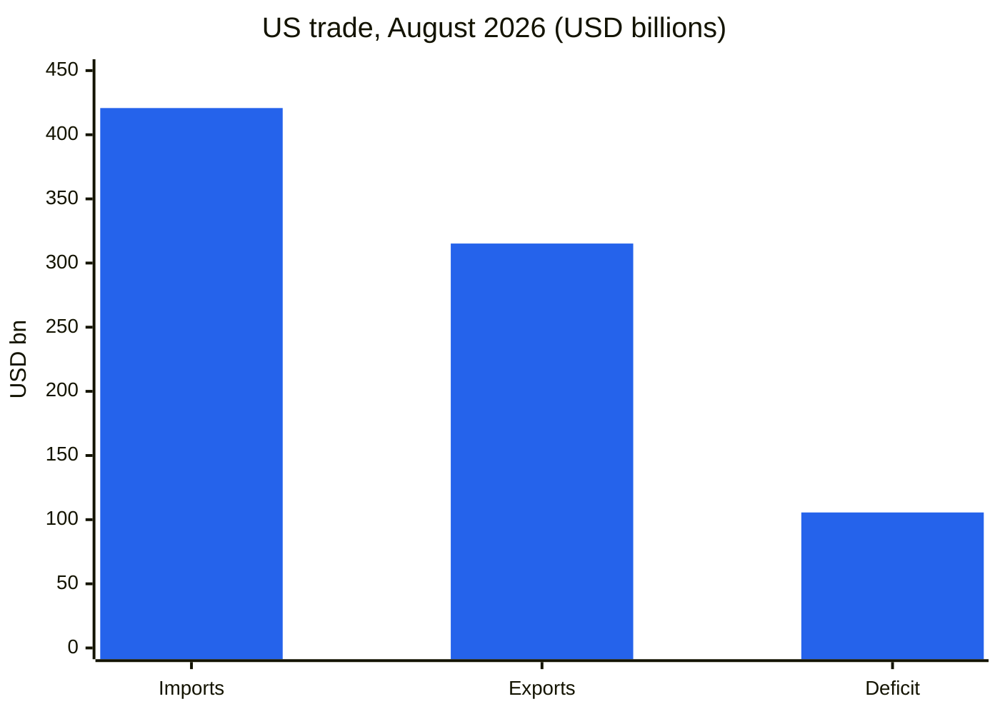

*Note: Census/BEA via businessday.co.za; imports $420.8bn (record, +4.3%), exports $315.2bn (+1.4%), deficit $105.6bn (+13.7%, biggest since Mar 2025).*

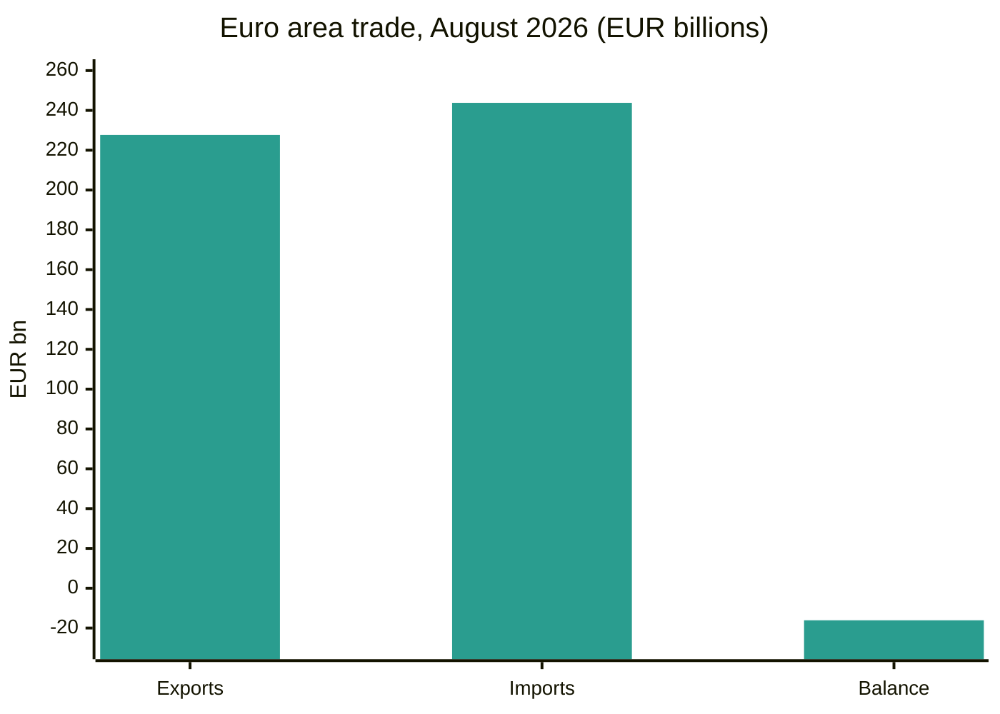

*Note: Eurostat released Oct 16; exports €227.7bn (+9.9% YoY), imports €243.8bn (+16.7%), balance −€16.1bn (largest deficit since Jan 2023).*

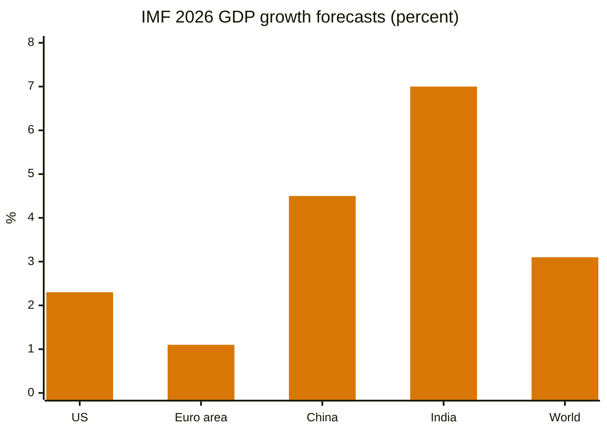

*Note: IMF World Economic Outlook, Oct 13, 2026; 2027 world forecast 3.4%.*

---

## 9. Freight market

### Container spot rates — Drewry World Container Index

The October 15 assessment closed at **$4,485 per FEU, up 3% week on week** — the rebound after the October 8 reading of $4,351 (−2%). Asia–Europe drove the gain: Shanghai–Rotterdam +6% to $3,522, Shanghai–Genoa +7% to $3,945, the first Asia–Europe increase after 13 consecutive weekly declines. Transpacific was mixed: Shanghai–Los Angeles +3% to $7,884, Shanghai–New York −1% to $10,075. Drewry expects less volatility in the week ahead. The prior assessment (October 1) had closed at $4,434 (−1%).

Drewry's Cancelled Sailings Tracker (October 16) shows 44 blank sailings announced for weeks 43–47 (October 19–November 22) — a 6% cancellation rate on 713 planned sailings. Asia–North Europe/Med accounts for 44% of cancellations, Transpacific eastbound 36%, Transatlantic 20%. Carriers' planned FAK hikes of $4,500–$4,800/FEU on Asia–Europe (effective October 19) face uncertain uptake given returning Suez capacity. (Sources: [Drewry](https://www.drewry.co.uk/maritime-research-opinion-browser/world-container-index-assessed-by-drewry), [Shipping Telegraph wk41](https://shippingtelegraph.com/freight-news/drewry-the-world-container-index-decreased-2-in-week-41-2026/), [Shipping Telegraph wk42](https://shippingtelegraph.com/freight-news/drewry-the-world-container-index-increased-3-this-week-42-2026/))

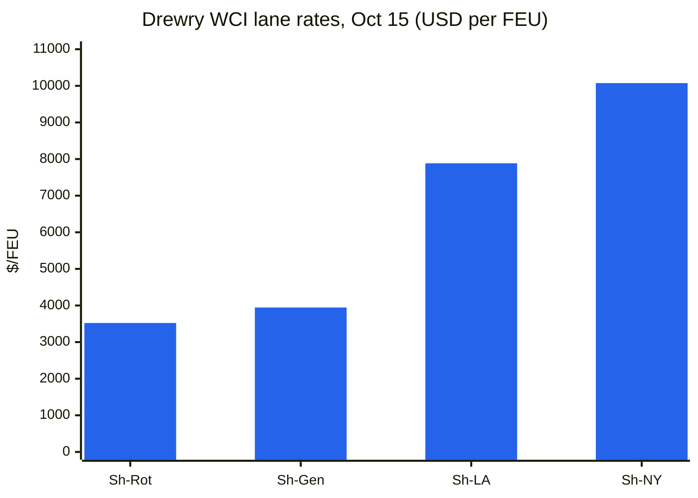

*Note: Shanghai–Rotterdam $3,522 (+6%), Shanghai–Genoa $3,945 (+7%), Shanghai–Los Angeles $7,884 (+3%), Shanghai–New York $10,075 (−1%).*

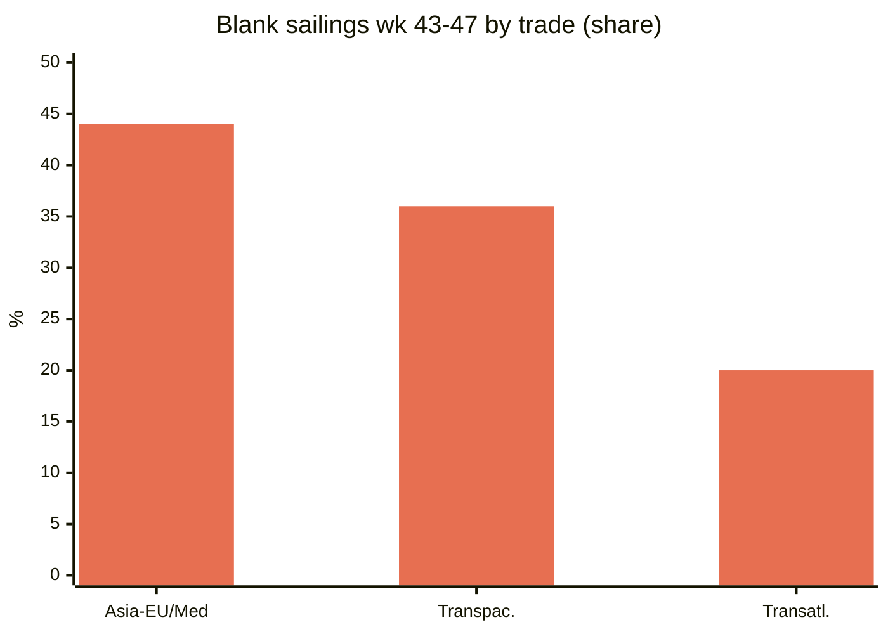

*Note: Drewry Cancelled Sailings Tracker, Oct 16; 44 blanks of 713 planned sailings (6% cancellation rate).*

### Freightos Baltic Index (FBX)

Week to October 13: Asia–US West Coast (FBX01) −2% to $8,149/FEU; Asia–US East Coast (FBX03) level at $9,606/FEU; Asia–North Europe (FBX11) level at $3,260/FEU; Asia–Mediterranean (FBX13) +7% to $3,804/FEU. Air: China–North America +3% to $5.77/kg; China–North Europe −7% to $3.58/kg — the latter reflecting the July end of the EU €150 de minimis exemption (China/HK imports via Frankfurt −1.8%/−7.4% in September). Freightos' air benchmark remains 33% above a year ago. Transpacific rates were flat through Golden Week then eased slightly — the start of the post-holiday slide, with volumes projected to dip in November–December. ([AJOT / Freightos](https://www.ajot.com/news/freightos-weekly-update-attacks-disrupt-saudi-air-cargo-china-europe-air-rates-slump))

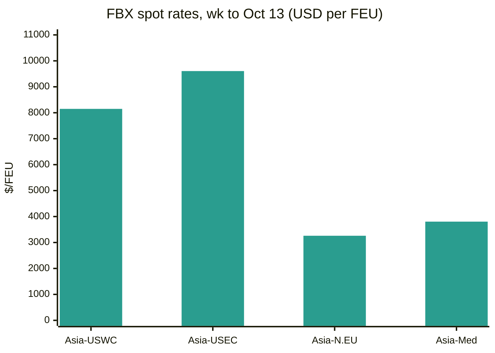

*Note: FBX01 $8,149 (−2%), FBX03 $9,606 (level), FBX11 $3,260 (level), FBX13 $3,804 (+7%).*

### Dry bulk — Baltic Exchange

The **Baltic Dry Index** fell a third consecutive week, closing Friday October 16 at **2,511 — down 14% for the week**, the lowest since June 30. The Capesize index dropped 25% week on week to 3,249 (lowest since early April); Capesize 5TC earnings averaged $25,961/day (−$664/day). Panamax fell 1.8% to 2,314 (earnings $20,827/day). Supramax was the resilience outlier, up 9 points to 1,865. Iron ore touched two-year lows midweek on weak China demand and rising stocks before rebounding Friday. (Sources: [Baird Maritime](https://www.bairdmaritime.com/shipping/dry-cargo/bulkers/baltic-index-stays-in-the-doldrums-as-capesize-rates-slide-further), [Safety4Sea](https://www.safety4sea.com/baltic-exchange-maritime-market-highlights-october-12-16/))

### Air cargo

Global spot rates held at **$3.55/kg in week 41** despite the Golden Week lull — tonnage was down 1% week on week for the third consecutive week but up 9% year on year; spot rates were up 34% year on year; the full-market rate of $3.13/kg was stable. Asia-Pacific spot fell 3% week on week to $4.83/kg; Africa spot rose 10%. Jet fuel was up 111% year on year (IATA/Platts). The Baltic Air Freight Index rose 5.0% in the week to October 5, pushing its year-on-year gain to +25.5%, with rates not yet having risen in line with fuel. Technology and electronics (servers, semiconductors, data-centre components) remain the strongest demand source, while e-commerce to the US has shrunk on low-value-import tariff changes. Gulf capacity contracted 4% week on week in week 41 on the Houthi airport attacks, leaving it 20% below late-February levels. (Sources: [StatTimes / WorldACD](https://www.stattimes.com/air-cargo/global-air-cargo-rates-remain-stable-at-355kg-in-week-41-1360975), [Baltic Exchange](https://www.balticexchange.com/en/news-and-events/news/guest-column/2026/Air-freight-rates-remain-firm-in-September-with-renewed-surge-in-jet-fuel-yet-to-feed-through.html))

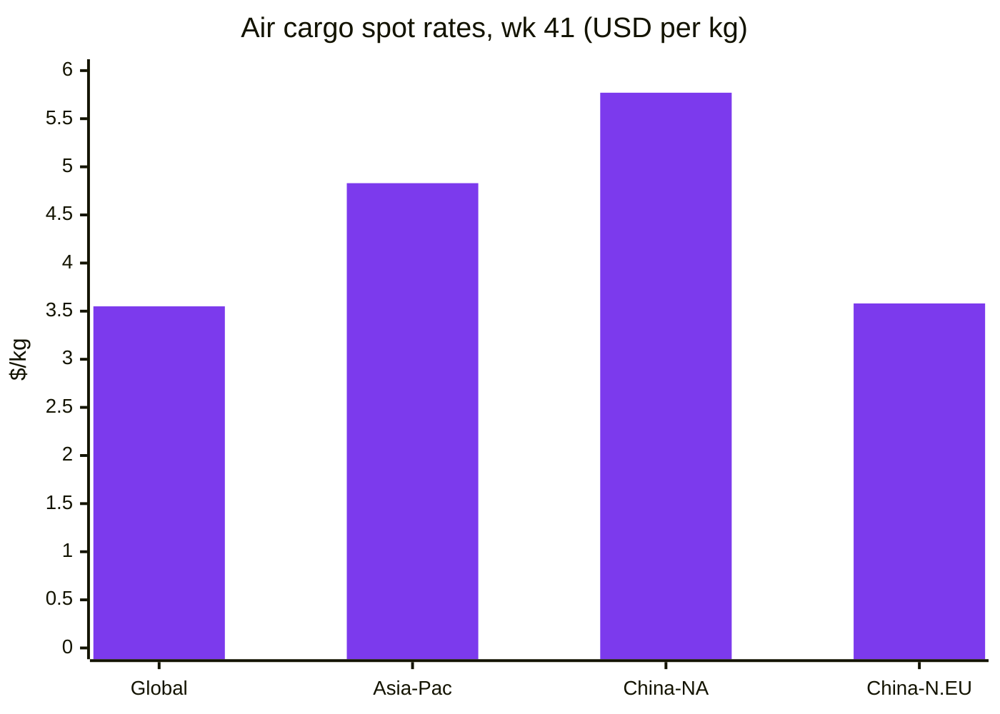

*Note: WorldACD via StatTimes (Oct 19) and Freightos (Oct 13); global $3.55 (+34% YoY), Asia-Pacific $4.83, China–North America $5.77, China–North Europe $3.58.*

### Schedule reliability

Xeneta's September scorecard: global on-time arrivals fell 2 percentage points to **27%**, the fourth consecutive monthly decline; average delay reached 6 days (+2.4 days since Q2). Far East–Europe collapsed to 4% on-time with 9.9-day average delay — the worst since September 2021. Asia–North America was unchanged at 20% on-time, with delay up to 6.9 days. Every carrier tracked posted its worst 12-month average delay (CMA CGM 30%, Cosco 18%, Hapag-Lloyd 45%, Yang Ming 4% on-time). China–USWC spot averaged $7,717/FEU in early October — about four times the $1,778 of September 2025; long-term rates rose 26% month on month to $3,649/FEU on October 1. ([FreightWaves / Port Technology](https://www.olgn.news/freightwaves-shippers-waiting-an-extra-week-for-us-bound-containers/))

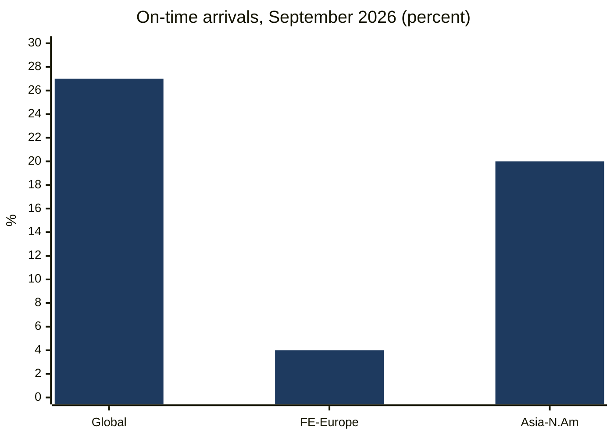

*Note: Xeneta via FreightWaves/Port Technology; global 27% (−2pp), Far East–Europe 4% (9.9-day avg delay), Asia–North America 20% (6.9-day delay).*

### Port and logistics disruptions

- **Hormuz/Houthi:** container ship *GFS Pride* sunk (October 15); 12 vessel attacks October 5–11; strait crossings down to 131/week; Gulf air-cargo capacity −4% WoW. UNSC presidential statement adopted by consensus October 15 condemning Houthi attacks on Saudi Arabia and Red Sea shipping. (See Alerts A2.)
- **Cyber extortion:** 38 maritime firms across 18 countries face an October 19, 13:27 UTC ransom deadline (see Alert A3).
- **Suez:** mandatory inspections and sea trials for vessels aged 25+ years effective October 6; container capacity through the canal in the first two weeks of October averaged 753,000 TEU/week against 1,457,000 TEU in the same 2023 period — the return is under way but far from complete.
- **Germany:** ver.di accepted a pay deal on October 6 (~11,000 workers, six ports, +3.4% over 12 months), ending strike risk at Hamburg, Bremerhaven and Wilhelmshaven — but record-low Rhine water levels are restricting barge traffic to Rotterdam/Antwerp; Bremerhaven yard utilisation at 90%, Rotterdam 85–90% full with 14-day dwell times.
- **Panama:** the Canal Authority raised total reserved daily slots to 33 effective October 15.
- **US East Coast:** PhilaPort announced a ~$837 million expansion — its largest ever, first new berth in 50 years (October 14). The Port of Long Beach set an all-time monthly record in September (approaching ~1 million containers); the Port of Los Angeles logged its busiest month in 118 years, though its chief warned tariff-driven sourcing shifts create planning risk.
- **Manila:** Hapag-Lloyd's suspension of all bookings to Manila through year-end (reported last week) remains the standing extreme-congestion case.
- **Bangladesh:** DP World signed a 15-year concession for Chittagong's New Mooring Container Terminal (October 12), amid continuing dockworker protests against the takeover.
- **Carrier investment:** HMM's board approved a $1.62 billion investment in 12 containerships (eight 13,000-TEU newbuildings plus four resale newbuildings, 114,100 TEU combined, delivery by December 2029) — targeting 166 ships / 1.47m TEU by end-2030. ZIM raised its 2026 profit forecast 72% on strong demand. JOC headlines also noted Germany blocking Cosco's bid for Zippel over security concerns and ILWU actions stalling LA–LB terminal openings.

### Vendor intelligence

- **Descartes — Global Shipping Report (September edition, ~October 13).** US container imports hit their highest September volume on record: 2.55 million TEU — down 2.2% from August, up 10.3% year on year; January–September volume +0.8% year on year. China-origin imports rose sharply month on month while most other leading origins declined; West Coast ports gained share; port transit delays rose at 8 of the top 10 gateways (largest increase at NY/NJ). The forward watch list: Middle East/Hormuz incidents, expanded tariffs (Section 301/232, September pharma Section 232 duties), Panama slots, Red Sea routing, and the US economy (Fed funds 3.75–4.00%; Q2 GDP 2.2% annualised). A data release, not a product item. ([AJOT](https://www.ajot.com/news/descartes-global-shipping-report-u.s-container-imports-reach-highest-september-volume-on-record))
- **Descartes — CustomsInfo weekly tariff-data updates.** October 16 update: Mexico tariff update effective October 14 (Decree DOF 13/10/2026 — temporary rate, no HS changes); Mauritius tax update only. October 9 update: US technical correction for HTS 9903.85.67/68 (applicable countries corrected to ALL, not just Russia; additional duties apply only if smelt/cast in Russia); China October 8 update. ([customsinfo.com](https://www.customsinfo.com/resources/industry-updates/))
- **TradeInt — partnership with Türkiye's Ministry of Trade (announced September 30, just before the window).** The partnership provides a grant giving local consulting firms funded access to shipment records, customs filings and B/L data spanning 200+ countries, aimed at Turkish SMEs' export decision-making; TradeInt's review cited Türkiye's 2025 exports at $269.7 billion. A government-partnership item; no in-window-dated TradeInt release was found this week, and the TradeInt insights blog carries no verifiable in-window dated posts. ([bayareametrowire](https://bayareametrowire.com/news/turkiyes-ministry-of-trade-grants-consulting-firms-access-to-global-trade-data-through-tradeint-partnership))

---

## 10. Policy timelines

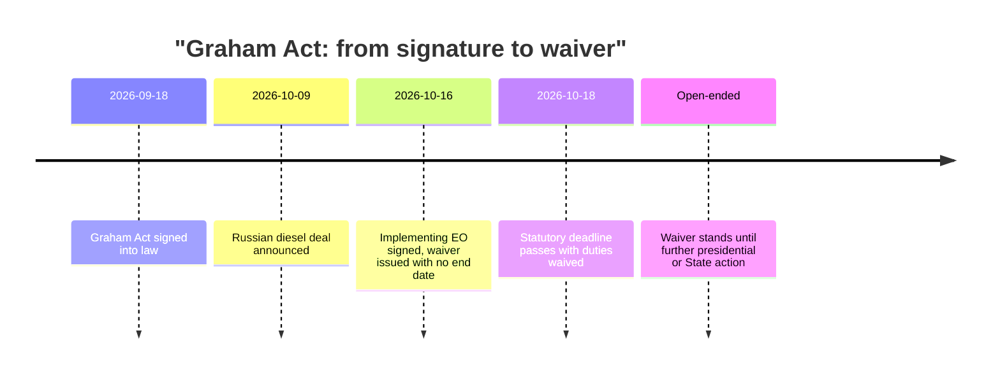

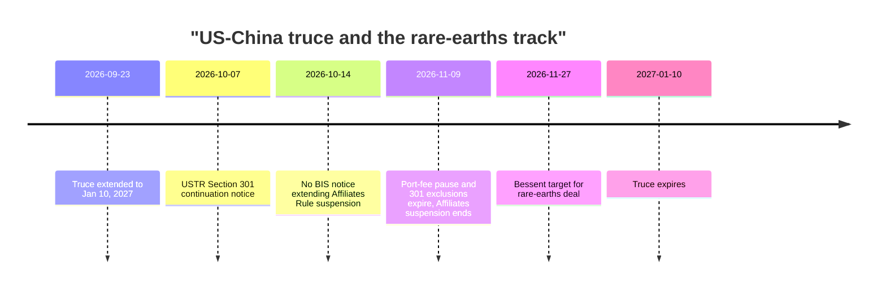

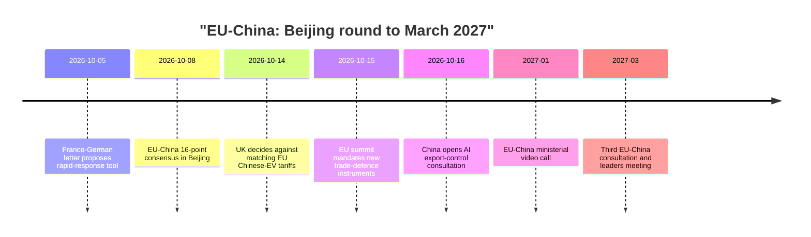

---

## 11. Upcoming deadlines & events (next 90 days)

| Date | Event | Why it matters |
|---|---|---|
| Oct 19, 2026 | Cyber-extortion ransom deadline (13:27 UTC) for 38 maritime firms | First large-scale maritime cyber-extortion wave; watch for disclosures |
| Oct 20, 2026 | India–New Zealand FTA enters into force | NZ tariffs on Indian exports eliminated from day one |
| Oct 22, 2026 | Korea's amended Foreign Trade Act takes effect | Trade-restriction grounds expand from 5 to 9 |
| Oct 27, 2026 | WTO DSB: adoption of China vs Türkiye EV-duties panel report; India–Taiwan ICT-duties ruling adoption deadline | Two dispute milestones on the same day |
| Nov 9, 2026 | Section 301 port-fee pause expires (11:59 p.m. ET); 178 Section 301 exclusions expire; BIS Affiliates Rule suspension ends by its terms | Triple compliance cliff — treat as hard dates absent USTR/BIS action |
| Nov 9, 2026 | Madagascar safeguard investigation comments due |  |
| Nov 10, 2026 | Rare-earth "snapback" date from earlier guidance; Affiliates Rule reimplementation date | Watch for BIS formal action |
| Nov 15, 2026 | China AI export-control consultation closes | 40-technology catalogue could be adopted thereafter |
| Nov 20, 2026 | UK–EU summit (Brussels) | Follows UK's EV-tariff decision |
| Nov 27, 2026 | Thanksgiving — Bessent's rare-earths deal target |  |
| Dec 31, 2026 | EU–US arrangement steel/aluminum review: concessions suspendable if US tariffs still exceed 15% | First reciprocal-restraint test of the EU–US deal |
| Jan 10, 2027 | US–China truce expires |  |
| Jan 2027 | EU–China ministerial video call |  |
| Mar 2027 | Third EU–China Trade and Investment Consultation; next EU–China leaders' meeting; IMF baseline assumes Hormuz reopens |  |
| Early 2027 | Australia–EU FTA tabled in parliament (ratification fight) |  |

## 12. Sources & methodology

Coverage window: October 12–19, 2026.

**Trade news & analysis:** FreightWaves, The Loadstar, Splash247, gCaptain, Hellenic Shipping News, Container News, Supply Chain Dive, Port Technology International, JOC (headlines only), Shipping Telegraph, Baird Maritime, StatTimes/WorldACD, AJOT/Freightos, Metro Global, TradeInt blog (no dated in-window posts).

**US policy:** whitehouse.gov (Graham Act implementing EO, primary), federalregister.gov (BIS US-content guidance 2026-20938; USTR continuation notice 91 FR 64212), CBP (via trade advisories: CAPE Phase 3, WROs, user fees), FMC (Spain fee proposal via Supply Chain Dive), USTR (via secondary reporting), BIS (via Mondaq/Crowell & Moring, Braumiller, Dechert), Thompson Hine, Steptoe, Mondaq, Gateway Lines, Thomson Reuters, JD Supra (no in-window items surfaced), internationaltradetoday.com (headlines only).

**World governments:** European Council summit (via press), European Commission/DG Trade (via press), gov.uk Department for Business and Trade (via The Guardian/Fleet News), CBSA/Canada (via industry associations), METI/Japan Customs (via Steptoe/Global Sanctions), MOTIR Korea (via LinkedIn summary), english.mofcom.gov.cn (direct fetch failed; MOFCOM items via secondary reporting and State Council English), India commerce ministry (via press), Australia DFAT (via press), Brazil MDIC (via Datamar).

**Multilateral:** wto.org (Global Trade Outlook and Statistics, October 8; committee and DSB reporting via trade press), unctad.org (Trade and Development Report 2026), WCO (e-CENcomm launch, GCC addendum), WTO ITIP (no new in-window release surfaced), ITC Trade Map (no in-window release surfaced).

**Data portals:** Census/BEA (FT-900 August 2026; advance goods September 2026), GACC (China September 2026 trade), Eurostat (euro area August 2026), WTO, IMF (October WEO), UNCTADstat, USITC DataWeb / USA Trade Online / UN Comtrade / WITS (no new in-window dataset releases surfaced).

**Think tanks & research:** Yale Budget Lab (State of U.S. Tariffs; Tariff Dividends analysis), Penn Wharton Budget Model (Effective Tariff Rates and Revenues, October 14 update), Tax Foundation (Trump Tariffs Tracker, August 2026 vintage), Mondaq (EU–US tariff arrangement analysis), tradeintelligence.eu (not reachable via text fetch this week).

**Freight:** Drewry (World Container Index October 15 assessment; Cancelled Sailings Tracker October 16), Baltic Exchange (weekly market highlights; BAI via guest column), Freightos Baltic Index (week to October 13), Xeneta (schedule reliability, via FreightWaves/Port Technology), Kpler (strait crossings), Sea-Intelligence, Linerlytica, Veson, Hartland (tanker earnings), Clarksons, SCFI, TAC Index, NRF Global Port Tracker, DHL, DC Velocity.

**Vendor intelligence:** Descartes Systems Group (Global Shipping Report September edition; CustomsInfo weekly tariff-data updates) and TradeInt (Türkiye Ministry of Trade partnership, September 30) — vendor news items only: data releases, government partnerships and market moves.
