# Informe de Inteligencia Comercial Global — Semana del 12 al 19 de octubre de 2026

**Informe semanal.** Ventana de cobertura: 12 al 19 de octubre de 2026. Compilado a partir de aproximadamente 45 fuentes mundiales de noticias comerciales, políticas, datos y fletes.

---

## Índice

1. [Resumen ejecutivo](#1-executive-summary)
2. [Alertas](#2-alerts)
3. [Noticias principales — análisis en profundidad](#3-top-stories--deep-dives)
4. [Seguimiento de aranceles](#4-tariff-tracker)
5. [Análisis profundo de la política estadounidense](#5-us-policy-deep-dive)
6. [Política mundial por región](#6-world-policy-by-region)
7. [Acciones de aplicación](#7-enforcement-actions)
8. [Publicaciones de datos](#8-data-releases)
9. [Mercado de fletes](#9-freight-market)
10. [Cronologías de políticas](#10-policy-timelines)
11. [Próximos plazos y eventos (próximos 90 días)](#11-upcoming-deadlines--events-next-90-days)
12. [Fuentes y metodología](#12-sources--methodology)

---

## 1. Resumen ejecutivo

Una semana en la que una ley de sanciones histórica fue promulgada para quedar reducida a la irrelevancia, la campaña de Ormuz comenzó a hundir buques portacontenedores, y las tres mayores economías comerciales del mundo publicaron cifras que apuntan en direcciones opuestas.

- **La Ley Graham fue dispensada antes de morder.** Un mes después de la firma de la Ley Lindsey O. Graham de Sanciones contra Rusia e Irán de 2026 — con sus aranceles principales del 500% sobre productos rusos y aranceles secundarios del 100% sobre los principales compradores de energía rusa — el presidente Trump firmó una orden ejecutiva el 16 de octubre que implementa la Ley y, en la misma orden, dispensó sus disposiciones arancelarias y de sanciones sin fecha de vencimiento. India, China y Türkiye, los compradores a los que apuntaba la Ley, siguen comprando. Críticos de ambos partidos y Kiev calificaron la dispensa de retirada; la Casa Blanca no ofreció ninguna explicación pública detallada.
- **Ormuz cobró su primer portacontenedores.** El *GFS Pride* (2.824 TEU), con bandera de Singapur, fue alcanzado, se incendió y se hundió frente a Ormuz el 15 de octubre — el segundo y tercer buque hundidos desde el inicio del conflicto. Doce buques reportaron ataques en la semana del 5 al 11 de octubre, el total semanal más alto de la guerra; los cruces del estrecho cayeron a 131 desde 176 la semana anterior y los flujos de crudo bajaron a un estimado de 12,6 mb/d. Los ingresos de los petroleros, mientras tanto, alcanzaron niveles extraordinarios: los VLCC promediaron $643.000 al día en el último mes.
- **Los datos contaron tres historias distintas.** El superávit comercial de China en septiembre alcanzó los $133.500 millones, un máximo de 20 meses, mientras las exportaciones se disparaban 36,3% con el auge del hardware de IA — el superávit de enero a septiembre llegó a $938.500 millones, al alcance de un segundo año consecutivo por encima de $1 billón. El déficit estadounidense de agosto se amplió 13,7% hasta $105.600 millones, con importaciones récord de $420.800 millones. La zona del euro registró su mayor déficit comercial desde enero de 2023 (€16.100 millones) mientras las importaciones se disparaban 16,7%. La OMC elevó su pronóstico de comercio de mercancías para 2026 al 3,9%, advirtiendo que los bienes impulsados por la IA están enmascarando la debilidad en otros sectores; la perspectiva de octubre del FMI situó el crecimiento mundial de 2026 en 3,1%, asumiendo que Ormuz se reabra en marzo.
- **Europa fijó su rumbo de defensa comercial.** En la cumbre de Bruselas del 15 y 16 de octubre, los líderes de la UE ordenaron el "pleno uso" de las medidas de defensa comercial existentes contra China y pidieron a la Comisión desarrollar nuevos instrumentos, manteniendo el diálogo abierto antes de una reunión en marzo de 2027. El Reino Unido, en cambio, decidió no replicar los aranceles de la UE de hasta 45,3% sobre los vehículos eléctricos chinos, calificando la decisión como cuestión del interés británico exclusivamente. Pekín abrió una consulta pública sobre amplios controles de exportación de tecnología de IA que abarcan pesos de modelos grandes y metodología de diseño de chips.
- **El flete protagonizó una recuperación parcial.** El Índice Mundial de Contenedores Drewry subió 3% hasta $4.485/FEU en la evaluación del 15 de octubre — las tarifas Asia–Europa aumentaron por primera vez en 13 semanas — mientras el Índice Báltico de Carga Seca cayó una tercera semana consecutiva hasta 2.511 por el desplome de los ingresos de los capesize. La fiabilidad de los itinerarios de contenedores cayó al 27% en septiembre, la cuarta caída mensual consecutiva. Treinta y ocho navieras y empresas portuarias en 18 países enfrentan una fecha límite masiva de rescate por ciberextorsión el 19 de octubre.

**Fletes:** una imagen dividida — el spot de contenedores recuperándose con los aumentos de tarifas posteriores a la Semana Dorada y las salidas en blanco de las navieras (44 cancelaciones para las semanas 43 a 47), la carga seca a granel deslizándose mientras el mineral de hierro tocaba mínimos de dos años, y la carga aérea estable en $3,55/kg con el combustible de aviación más de 100% por encima del año anterior.

---

## 2. Alertas

| # | Alerta | Vigencia | Impacto | Fuente |
|---|-------|-----------|--------|--------|
| A1 | Aranceles de la Ley Graham dispensados: la EO del 16 de octubre implementa la Ley Lindsey O. Graham de Sanciones contra Rusia e Irán y simultáneamente dispensa sus disposiciones arancelarias y de sanciones bajo la Sec. 115, sin fecha de vencimiento; sanciones anteriores contra Rusia conservadas | Oct 16, 2026 | India, China y Türkiye mantienen acceso a la energía rusa sin nuevos aranceles estadounidenses; las dispensas se mantienen hasta su revocación | [whitehouse.gov](https://www.whitehouse.gov/presidential-actions/2026/10/implementing-the-lindsey-o-graham-sanctioning-russia-and-iran-act-of-2026/) |
| A2 | Escalada en Ormuz: el portacontenedores *GFS Pride* (2.824 TEU) alcanzado y hundido el 15 de octubre; 12 ataques a buques del 5 al 11 de octubre (mayor total semanal de la guerra); cruces del estrecho reducidos a 131/semana; flujos de crudo ~12,6 mb/d | Oct 12–15, 2026 | El tonelaje de contenedores ya está en riesgo; condiciones del seguro de guerra endureciéndose; ingresos de petroleros en niveles extraordinarios | [Splash247](https://splash247.com/hormuz-claims-two-more-ships-in-fresh-wave-of-strikes/), [FreightWaves](https://www.freightwaves.com/news/container-ship-attacks-escalate-in-strait-of-hormuz) |
| A3 | Ciberextorsión masiva contra el sector marítimo: el grupo "n0n" incluyó a 38 empresas navieras/portuarias/logísticas de 18 países el 12 de octubre, amenazando con publicar datos el 19 de octubre, 13:27 UTC, salvo pago de rescates; demandas de $400k a $400M por empresa; afirmaciones sin verificar | Fecha límite Oct 19, 2026 | Primera oleada coordinada de ciberextorsión a gran escala dirigida a objetivos marítimos; entre los objetivos figuran ONE, CULines, TS Lines, Santos Brasil | [Splash247](https://splash247.com/shipping-firms-and-ports-caught-in-mass-cyber-extortion-claim/) |
| A4 | China prepara controles de exportación de tecnología de IA (Anuncio n.º 48, 16 de octubre): 40 tecnologías propuestas para el catálogo de prohibidas/restringidas (14 prohibidas, 26 restringidas), incluidos pesos de LLM por encima de 2 billones de parámetros; requisito de registro previo a la exportación con efecto inmediato; consulta pública hasta el 15 de noviembre | Oct 16, 2026 (consulta hasta el 15 de noviembre) | Podría restringir transferencias salientes de modelos de IA, agentes y diseño de chips; el despliegue local en el extranjero queda cubierto | [aiandgpp.com](https://aiandgpp.com/2026/10/19/china-ai-export-controls-model-weights-sovereign-cloud/) |
| A5 | Doble fecha límite del 9 de noviembre — sin prórroga del USTR al 13 de octubre: (a) expira la pausa de un año de las tasas portuarias de la Sección 301 sobre buques vinculados a China (las tasas vuelven a $80/NT para armadores/operadores chinos); (b) expiran 178 exclusiones de productos de la Sección 301 (los aranceles de las Listas 1/2/3 vuelven al 25%, la Lista 4A al 7,5%) | Nov 9, 2026, 11:59 p.m. ET | Los importadores deben tratar el 9 de noviembre como fecha de vencimiento; sin período de gracia; la exclusión elimina solo la capa 301 | [Gateway Lines](https://gatewaylines.com/press-releases/china-ship-fees-301-exclusions-nov-9-2026) |
| A6 | La ampliación de la prohibición de exportaciones japonesa a Rusia entra en vigor el 16 de octubre (anunciada el 6 de octubre): minerales, productos químicos, metales, maquinaria, equipos industriales e instrumentos de precisión añadidos a la lista de prohibición | Oct 16, 2026 | Los exportadores a Rusia deben reexaminar la cobertura de productos | [Steptoe](https://www.steptoe.com/en/news-publications/international-compliance-blog/weekly-sanctions-update-october-13-2026.html) |
| A7 | La FMC propone una tasa de $200.000 por viaje sobre buques de bandera española más restricciones a la importación de productos españoles (perfumería, aceites/grasas, cerámica, artículos de piedra, azúcar, confitería) tras la constatación en 2024 de que España negó el acceso a puerto a buques de bandera estadounidense | Propuesta Oct 16, 2026 | Escalada de la autoridad retaliatoria de la FMC por discriminación de bandera; a dos buques Maersk MSP se les denegó el acceso | [Supply Chain Dive](https://www.supplychaindive.com/news/fmc-proposes-fees-on-spanish-flagged-vessels-import-restrictions/833122/) |
| A8 | Tierras raras: Bessent dice que EE. UU. espera finalizar el acuerdo de tierras raras con China "esperemos" para Acción de Gracias (27 de noviembre); se espera que la suspensión de la Regla de Afiliados del BIS (cuya reimplementación era el 10 de noviembre) siga a la prórroga de la tregua hasta el 10 de enero de 2027, pero sin aviso formal en el Registro Federal al 14 de octubre | Objetivo Nov 27, 2026 | Los equipos de cumplimiento enfrentan una fecha dura de reimplementación sin prórroga formal publicada | [eximguru](https://eximguru.com/export-import-news/export-news/us-china-rare-earths-deal-will-116956.aspx), [Mondaq](https://www.mondaq.com/unitedstates/export-controls-trade-investment-sanctions/1854664/us-china-trade-truce-extended-two-months-bis-affiliates-rule-suspension-follows) |

### A1 — La dispensa de la Ley Graham (detalle)

La orden ejecutiva firmada el 16 de octubre se titula "Implementación de la Ley Lindsey O. Graham de Sanciones contra Rusia e Irán de 2026" — la propia Ley fue firmada el 18 de septiembre de 2026 (Ley Pública 119-111), aprobada por el Senado 86–11 y la Cámara 262–159. La Sección 2 de la orden fija las tasas estatutarias: un 500% adicional ad valorem sobre productos de origen ruso; 100% sobre productos de los cinco mayores importadores de crudo y gas natural rusos que realicen nuevas compras con conocimiento de causa el 18 de octubre de 2026 o después; y 100% sobre productos de los cinco principales facilitadores de la evasión de las sanciones al petróleo ruso, todo apilado sobre los aranceles existentes.

La Sección 4(a) luego dispensa precisamente esos aranceles — y las disposiciones de sanciones de las Secciones 102(a), 102(d), 102(e), 103–111 y 117 — bajo la autoridad de dispensa de la Sección 115 de la Ley, con una certificación escrita de interés nacional transmitida al Congreso. La dispensa no tiene fecha de vencimiento: se mantiene hasta que el Presidente, o el Secretario de Estado en consulta con el Tesoro y el USTR, determine que es apropiada una acción adicional. La Sección 4(b) conserva todas las sanciones anteriores contra Rusia impuestas bajo órdenes ejecutivas de emergencia nacional (la emergencia fue prorrogada el 24 de marzo de 2026), y el USTR tiene la tarea de monitorear las compras de energía rusa e informar.

**Análisis:** la estructura otorga a la administración una amenaza arancelaria permanente — la maquinaria de implementación y las tasas ya están definidas — sin imponer hoy arancel alguno. El costo político fue inmediato: los senadores Blumenthal, Tillis y Cornyn criticaron la medida, el presidente Zelenskyy objetó, y se presentaron proyectos bipartidistas para restringir la autoridad de dispensa, aunque ninguno se ha convertido en ley. La Casa Blanca no ofreció ninguna explicación pública detallada, según información de AP. Para las refinerías de India y China, la dispensa elimina un plazo que se había fijado para el 18 de octubre; para los importadores estadounidenses, el riesgo arancelario se aplaza, no se disuelve — una futura determinación puede reactivar los aranceles.

### A2 — Ormuz se cobra un portacontenedores (detalle)

Splash247 reportó el 15 de octubre que tres portacontenedores vinculados a AD Ports/GFS fueron alcanzados cerca de Ormuz. El *GFS Pride* (construido en 2008, 2.824 TEU), con bandera de Singapur, fue alcanzado, se incendió y se hundió, con sus 21 tripulantes evacuados. El *GFS Giselle* (2015, 4.400 TEU) sufrió daños en el casco pero alcanzó el fondeadero con sus 22 tripulantes ilesos; el *Al Saadiyat* (1.730 TEU, Safeen Feeders) escapó de daños graves. Por separado, el capesize *Cape Dao* (170.000 dwt) se hundió unas tres semanas después de ser alcanzado frente a Omán. Según los datos de siniestros de la OMI, estos son el segundo y tercer buque hundidos desde el inicio del conflicto.

El UKMTO registró 12 buques que reportaron ataques en la semana del 5 al 11 de octubre — el mayor total semanal desde el inicio de la guerra. Kpler contó 131 cruces del estrecho en la semana terminada el 14 de octubre, por debajo de 176 la semana anterior; el crudo a través del estrecho se estimó en 12,6 mb/d el 13 de octubre frente a unos 15 mb/d a finales de septiembre. FreightWaves reportó que analistas advierten que la cobertura del seguro de guerra puede cancelarse con poco aviso cuando la carga se mueve en un buque no nombrado en el conocimiento de embarque — un detalle documental con consecuencias contractuales reales para los cargadores que ahora enrutan alrededor o a través del estrecho.

**Análisis:** la campaña ha pasado del hostigamiento a la destrucción de tonelaje del transporte de contenedores. Para los itinerarios de línea que ya operan con 27% de fiabilidad global, la pérdida de la opcionalidad del Mar Rojo y Ormuz agrava la disrupción. El contrapeso financiero es crudo: el bróker Hartland estima que los armadores independientes de VLCC, suezmax y aframax están ganando unos $400 millones al día por encima de las expectativas presupuestadas; sostenido durante un año, eso se acercaría al récord de $150.000 millones de ganancias del transporte de contenedores en el año pandémico. Los VLCC promediaron $643.000 al día en el último mes, con rutas Golfo Pérsico–China por encima de $1,3 millones al día (Veson). Los valores de los activos han seguido: un VLCC de cinco años está valorado en $218 millones, una prima del 55% sobre el precio de construcción nueva, y los valores de VLCC de 15 años han subido 196% interanual.

### A3 — Oleada de ciberextorsión contra empresas marítimas (detalle)

El 12 de octubre, un grupo que se hace llamar "n0n" añadió 38 empresas navieras, portuarias y logísticas de 18 países a su sitio de filtraciones en la web oscura, amenazando con publicar datos exfiltrados el 19 de octubre a las 13:27 UTC salvo pago de rescates. Entre los objetivos nombrados figuran Ocean Network Express, CULines, TS Lines, Samudera, Santos Brasil, Portonave, BNCT, Pusan Newport, TTI Algeciras, Eurogate Tanger, Nam Dinh Vu y NEOM Ports. Cydome estimó demandas de $400.000 a $400 millones por empresa; SOCRadar revisó demandas de $2,4 a $14 millones en Bitcoin. Al momento del reporte, las afirmaciones no estaban verificadas y ninguna empresa listada había confirmado una vulneración.

**Análisis:** esta es la primera oleada coordinada de ciberextorsión a gran escala dirigida específicamente a objetivos marítimos. Sean o no genuinos los datos, la lección operativa se mantiene: las infraestructuras de TI de puertos y navieras están siendo tratadas como objetivos blandos por grupos organizados de extorsión. Los equipos de seguridad de la cadena de suministro deben tratar la ventana del plazo como un período de riesgo elevado de phishing e intrusiones.

### A4 — Borrador de controles de exportación de IA de China (detalle)

El 16 de octubre, el MOFCOM y el Ministerio de Ciencia y Tecnología abrieron una consulta pública (que cierra el 15 de noviembre) sobre la adición de 40 tecnologías al catálogo de exportaciones prohibidas y restringidas: 14 prohibidas, 26 restringidas, de las cuales 23 están relacionadas con la IA. Los umbrales son específicos: pesos de modelos de lenguaje grandes por encima de 2 billones de parámetros, modelos entrenados con más de 10²⁶ FLOPs, o modelos clasificados entre los diez mejores del mundo; los agentes de IA, clústeres de cómputo y la metodología de diseño de chips también están cubiertos. Un requisito de registro previo a la exportación entró en vigor el mismo día, incluso para acuerdos ya en curso. El acceso por API y SaaS está excluido; el despliegue local en el extranjero está cubierto.

**Análisis:** de adoptarse, este sería el primer régimen de control de exportaciones de China dirigido directamente a pesos de modelos de IA de frontera — la imagen espejo de los controles de cómputo de Washington. La exclusión del acceso por API/SaaS pero la cobertura del despliegue local en el extranjero sugiere que Pekín quiere gravar o bloquear las transferencias de pesos manteniendo fluyendo los ingresos por servicios en la nube. Las multinacionales que ejecutan cargas de trabajo de IA en infraestructura china, y las empresas chinas de IA que licencian modelos en el extranjero, deben mapear su exposición antes de que cierre la consulta.

---

## 3. Noticias principales — análisis en profundidad

### 3.1 La ley de sanciones que fue dispensada hasta la irrelevancia

La Ley Lindsey O. Graham de Sanciones contra Rusia e Irán de 2026 fue diseñada como la respuesta del Congreso a la evasión de sanciones: aranceles secundarios obligatorios de hasta 100% sobre los productos de los mayores compradores de energía rusa, y 500% sobre los productos rusos mismos, entrando en vigor sin dispensas presidenciales. Se aprobó con márgenes de tipo a prueba de veto — 86–11 en el Senado, 262–159 en la Cámara — y fue firmada el 18 de septiembre. La fecha límite para la determinación arancelaria era el 18 de octubre.

El 16 de octubre, dos días antes del plazo, el Presidente firmó la orden ejecutiva de implementación. La orden define las tasas con precisión, en la Sección 2. Luego, en la Sección 4(a), las dispensa — usando la autoridad de dispensa que el Congreso había escrito en la Sección 115 de la Ley. La dispensa cubre tanto las disposiciones arancelarias (Secciones 112 y 113) como las disposiciones de sanciones (Secciones 102(a), 102(d), 102(e), 103–111, 117), y no tiene caducidad: permanece hasta que el Presidente o el Secretario de Estado, consultando al Tesoro y al USTR, decidan lo contrario.

**Análisis:** el Congreso intentó redactar una ley de sanciones que el ejecutivo no pudiera dispensar; el ejecutivo la dispensó un mes después usando la propia cláusula de dispensa de la ley. La maquinaria de implementación existe ahora como un instrumento permanente — tasas definidas, monitoreo asignado al USTR, la línea base de sanciones de emergencia nacional conservada — de modo que la amenaza de activación es real aun cuando los aranceles hoy son cero. La divergencia con los aliados se amplía: el paquete del Reino Unido del 8 de octubre añadió 38 objetivos, incluidas dos empresas energéticas y 12 petroleros de la flota fantasma, con Londres afirmando ahora que las sanciones cubren más del 90% de la capacidad de producción petrolera rusa e instando a restricciones más estrictas a los servicios de transporte marítimo, mientras Washington estaría considerando alivio para petroleros para aliviar las tarifas récord de fletes. La UE, por separado, apuntó a importantes astilleros rusos en un reglamento publicado el 12 de octubre. Para los compradores de energía rusa — India sobre todo — la dispensa elimina el plazo de octubre pero deja un riesgo de reactivación enteramente a discreción de la administración.

### 3.2 Ormuz: la guerra llega al transporte de contenedores

Octubre fue el mes en que la campaña de Ormuz dejó de ser una guerra de petroleros para convertirse en una guerra de contenedores. El hundimiento del *GFS Pride* el 15 de octubre fue el primer hundimiento de un portacontenedores del conflicto; los 12 ataques reportados del UKMTO en la semana del 5 al 11 de octubre fueron el mayor total semanal de la guerra. El tráfico del estrecho está respondiendo: 131 cruces en la semana terminada el 14 de octubre frente a 176 la semana anterior, y flujos de crudo reducidos a un estimado de 12,6 mb/d desde unos 15 mb/d a finales de septiembre.

Los efectos de segundo orden se están extendiendo. La campaña hutí contra Arabia Saudita — ataques con misiles al aeropuerto Rey Khalid de Riad, un embargo marítimo declarado, una declaración presidencial del Consejo de Seguridad de la ONU adoptada por consenso el 15 de octubre condenando los ataques — provocó una contracción del 4% semanal de la capacidad de carga aérea del Golfo en la semana 41, dejando la capacidad del Golfo 20% por debajo de los niveles de finales de febrero (WorldACD). La Autoridad del Canal de Suez, mientras tanto, impuso inspecciones obligatorias y pruebas de mar para buques de 25 años o más con efecto el 6 de octubre — una medida de seguridad que también complica los tránsitos para el tonelaje envejecido de la flota fantasma (el 92% de los petroleros fantasma rusos tiene más de 15 años, según el Instituto KSE).

**Análisis:** el retorno planificado de las alianzas de contenedores al Mar Rojo — todas las alianzas más MSC enviarían algunos buques a través para finales de octubre — ahora enfrenta una renovada prima de riesgo. Los investigadores de fletes de Drewry señalaron la reanudación de Suez más rápida de lo esperado como la principal amenaza al soporte de las tarifas de las navieras; nuevos ataques a portacontenedores apuntan en la dirección contraria, sosteniendo las tarifas al mantener la capacidad atada a la ruta larga. La tensión entre estas fuerzas es la cuestión central de fletes del cuarto trimestre.

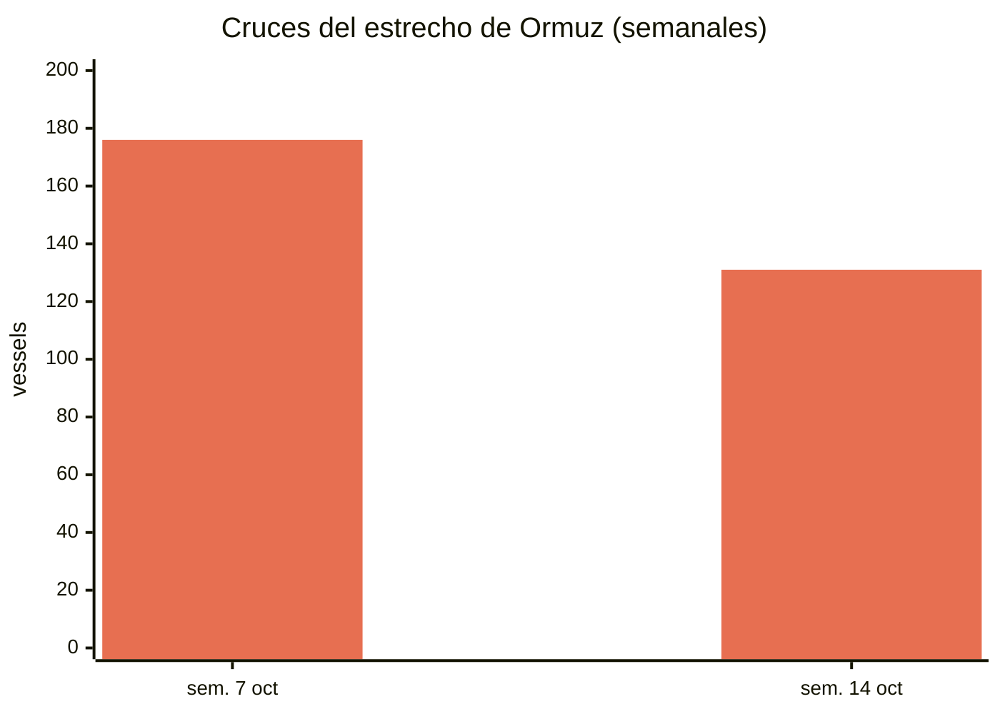

*Nota: datos de Kpler; semana terminada el 7 de octubre: 176 cruces; semana terminada el 14 de octubre: 131 cruces.*

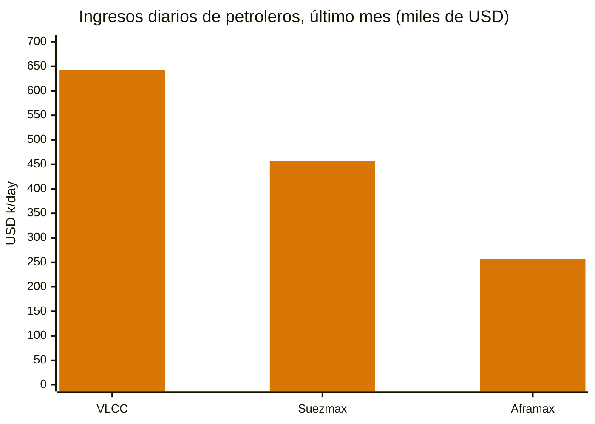

*Nota: estimaciones del bróker Hartland vía Splash247; VLCC $643.000/día, suezmax $457.000/día, aframax $256.000/día; rutas MEG–China de VLCC por encima de $1,3M/día (Veson).*

### 3.3 Los $133.500 millones de septiembre de China y el auge del comercio de IA

La Administración General de Aduanas de China reportó el 14 de octubre que las exportaciones de septiembre se dispararon 36,3% interanual hasta $447.180 millones — lo más rápido desde febrero, frente a expectativas de 25,5% — mientras las importaciones subieron 31,0% hasta $313.660 millones. El superávit mensual de $133.500 millones fue el mayor desde enero de 2025, un máximo de 20 meses. El superávit de enero a septiembre alcanzó $938.500 millones, poniendo al alcance un segundo año consecutivo por encima de $1 billón (el récord de 2025 fue aproximadamente $1,2 billones). Las exportaciones a EE. UU. crecieron 9,8%, con el superávit bilateral en un máximo de 20 meses de unos $34.000 millones — pese a dos años de escalada arancelaria. Las exportaciones de alta tecnología, lideradas por semiconductores con un alza de aproximadamente 108% en lo que va del año según datos aduaneros, impulsaron cerca de la mitad del crecimiento de las exportaciones.

Las instituciones macro están leyendo la misma señal. La Perspectiva y Estadísticas del Comercio Mundial de la OMC del 8 de octubre elevó su pronóstico de volumen del comercio de mercancías para 2026 al 3,9% desde la línea base de 1,9% de marzo, con el comercio de bienes habilitantes de IA un 67% interanual en la primera mitad y representando 47% del aumento del valor del comercio — 14,8% del comercio mundial de mercancías. La advertencia de la directora general Okonjo-Iweala fue directa: "El impacto de la IA está enmascarando las otras tendencias del comercio, que no están del lado positivo". El Informe sobre Comercio y Desarrollo de la UNCTAD del 9 de octubre proyectó un crecimiento mundial de 2,6% en 2026, por debajo de 2,9% en 2025, y señaló que el comercio China–EE. UU. ha caído más de 20% desde 2024. La Perspectiva Económica Mundial del FMI del 13 de octubre situó el crecimiento mundial de 2026 en 3,1% (desde 3,5% en 2025), con la inversión en IA compensando el choque energético de Oriente Medio; su línea base asume que el estrecho de Ormuz se reabre en marzo, y estima que el cierre recortó el crecimiento mundial unos 0,9 puntos porcentuales antes de que las compensaciones redujeran el golpe neto a aproximadamente 0,3 puntos.

**Análisis:** el ciclo del hardware de IA está soportando la mayor parte de los volúmenes del comercio mundial — y desproporcionadamente el de China. La paradoja de un alza de 9,8% en las exportaciones de China a EE. UU. en medio de la campaña arancelaria refleja redireccionamiento, anticipación de compras y el puro tirón del gasto de capital en IA; también explica por qué el marco de "cumplimiento" del período de tregua en Washington se ajusta con dificultad a los datos.

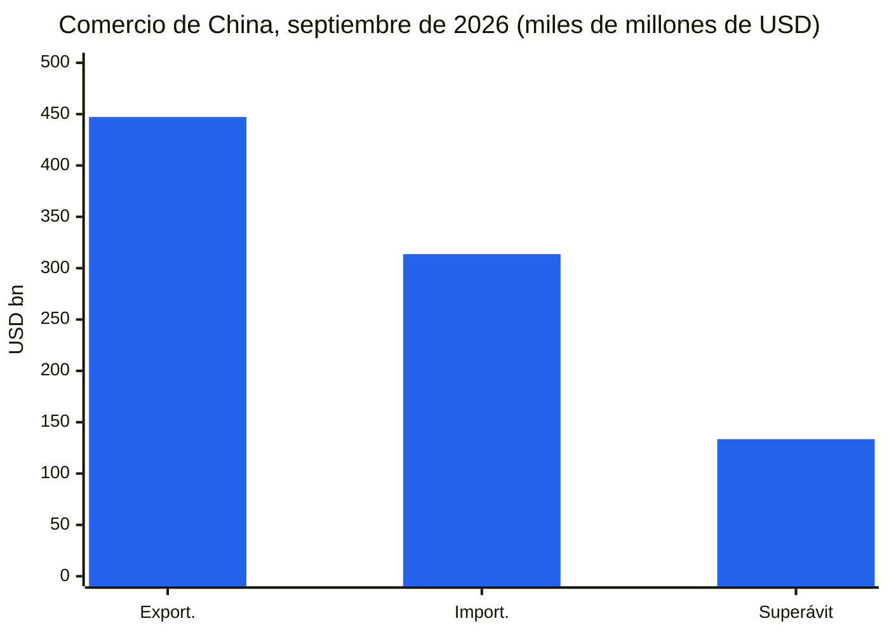

*Nota: datos de la GACC publicados el 14 de octubre; exportaciones $447.180M (+36,3% interanual), importaciones $313.660M (+31,0%), superávit $133.500M.*

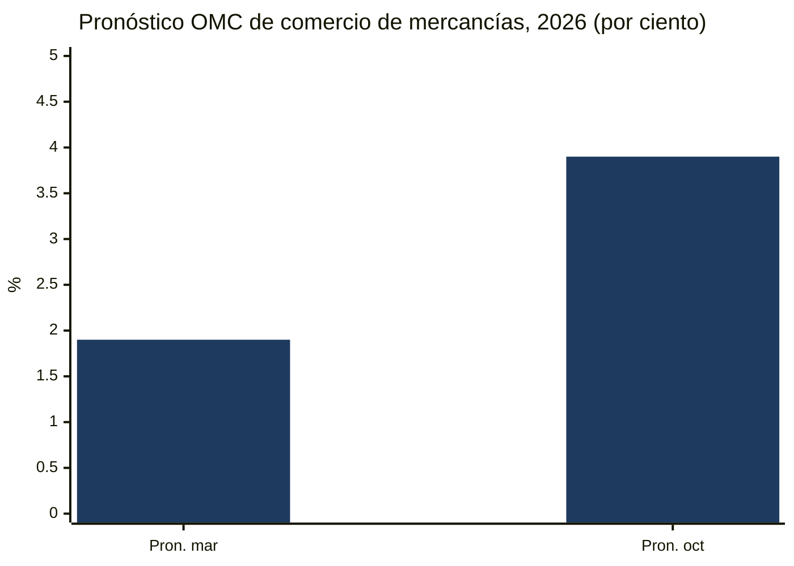

*Nota: Perspectiva y Estadísticas del Comercio Mundial de la OMC, 8 de octubre de 2026; los bienes habilitantes de IA +67% interanual en la primera mitad representaron 47% del crecimiento del valor del comercio.*

### 3.4 Europa fija su rumbo de defensa comercial

La cumbre del Consejo Europeo del 15 y 16 de octubre produjo la señal direccional más clara de la semana sobre la política comercial de la UE. Los líderes encargaron a la Comisión continuar el diálogo con Pekín — la próxima reunión está prevista para marzo de 2027 — mientras hacen "pleno uso" de las medidas de defensa comercial existentes y desarrollan nuevos instrumentos. La carta franco-alemana del 5 de octubre, que proponía poderes de la UE "tan contundentes como" la Sección 301 estadounidense o las restricciones chinas a minerales críticos, dominó el debate: investigaciones de defensa comercial más rápidas y de alcance sectorial, acción urgente sobre productos químicos, PET y vehículos híbridos, y represalias más rápidas contra países que perjudiquen al bloque. El giro alemán es notable — hace dos años Berlín se opuso a los aranceles antisubvenciones de la UE a los vehículos eléctricos.
El contexto es el consenso de 16 puntos de la ronda de Pekín del 8 y 9 de octubre, que la cumbre tuvo que interpretar. El segundo Mecanismo de Consulta de Comercio e Inversión entre el comisario Šefčovič y el ministro Wang Wentao produjo una declaración conjunta que cubre un entendimiento compatible con la OMC sobre el comercio de vehículos híbridos (un tope reportado en 350.000 automóviles al año, que podría recortar las exportaciones chinas de híbridos en más de la mitad), el recorte de China de las devoluciones del impuesto a la exportación para vehículos de nuevas energías al 13%, un "canal verde" para licencias de tierras raras e imanes permanentes, la continuación de los procedimientos de compromiso de precios en el caso antisubvenciones de la UE sobre vehículos eléctricos, y la exploración de recortes arancelarios NMF en unos €4.000 millones de exportaciones de la UE por al menos €225 millones en ahorros de derechos. El texto publicado por Pekín no incluye cifra de reducción a la mitad para las exportaciones de híbridos — la información revisada presenta la caracterización de la UE y el texto de Pekín como divergentes, y el mecanismo de aplicación no está divulgado. El déficit de mercancías de la UE con China alcanzó €360.000 millones (unos $400.000 millones) en 2025 y va camino de superarlo en 2026.

**Análisis:** Bruselas avanza hacia una postura de defensa comercial más musculosa y rápida mientras mantiene abierto el canal de negociación — el clásico doble carril. Los casos de prueba serán los sectores urgentes nombrados en la carta franco-alemana (productos químicos, PET, híbridos) y si el entendimiento sobre vehículos híbridos resulta aplicable sin un texto compartido.

### 3.5 Tierras raras: el tablero de Acción de Gracias

El secretario del Tesoro Bessent dijo el 18 de octubre en Sunday Morning Futures de Fox News que Washington espera finalizar un acuerdo de tierras raras con China "esperemos" para Acción de Gracias (27 de noviembre). Los términos reportados harían que Pekín suspenda ciertas restricciones de exportación de minerales críticos por un año, con las tierras raras fluyendo "libremente como antes del 4 de abril" — la fecha en que China impuso requisitos de licencia de exportación en respuesta a los aranceles estadounidenses. Un medio enmarcó el acuerdo como ya alcanzado en una reunión Trump–Xi de finales de octubre en Corea del Sur; ese encuadre no está verificado, y solo la cita de Bessent está establecida en la información revisada.

La vía paralela es la Regla de Afiliados del BIS. La regla provisional final del 29 de septiembre de 2025 — suspendida del 10 de noviembre de 2025 al 9 de noviembre de 2026 — extendería automáticamente las restricciones de las Regulaciones de Administración de Exportaciones a entidades extranjeras con al menos 50% de propiedad, directa o indirecta, de partes en la Lista de Entidades, la Lista de Usuarios Finales Militares o ciertas partes SDN, incluyendo un deber afirmativo de diligencia de propiedad (Bandera Roja 29). Con la tregua EE. UU.–China extendida hasta el 10 de enero de 2027, Crowell & Moring evaluó el 14 de octubre que la reimplementación de la regla debería seguir a la tregua — pero al 14 de octubre, el BIS no había publicado ningún aviso en el Registro Federal que prorrogue formalmente la suspensión.

**Análisis:** hay dos relojes en marcha. El reloj político apunta a Acción de Gracias para un acuerdo de tierras raras; el reloj regulatorio tiene una fecha dura de reimplementación el 10 de noviembre para la Regla de Afiliados sin prórroga formal publicada. Los equipos de cumplimiento no pueden confiar en evaluaciones de prensa sobre intenciones — la regla se reactiva por sus propios términos salvo que el BIS actúe.

### 3.6 La tregua EE. UU.–China: período de cumplimiento, sin soja

La tregua comercial EE. UU.–China se extiende hasta el 10 de enero de 2027 — una prórroga de dos meses anunciada por el secretario Bessent el 23/24 de septiembre, más corta que los seis a doce meses que esperaban los mercados. El USTR Greer ha descrito el período de tregua como un "período de cumplimiento" para evaluar el seguimiento de China en compras de soja y acceso a tierras raras. El déficit comercial de mercancías de EE. UU. con China ha bajado casi 40% desde el inicio de la campaña arancelaria, según Greer.

En lo sustantivo, el marco "30 por 30" — unos $30.000 millones de productos no sensibles de cada lado — no está operativo: China propuso 1.619 líneas de productos estadounidenses (maíz, carne, algodón, sorgo, cebada, avena, aceite de soja, pero no soja para alimentación o trituración); EE. UU. listó 77 líneas arancelarias (artículos para el hogar, juguetes) que podrían recibir tasas menores. A mediados de octubre no se habían publicado tasas ni fecha de inicio. Sobre la soja no hay nuevo compromiso de compra: China se comprometió bajo un acuerdo anterior a 25 millones de toneladas métricas al año para 2026, 2027 y 2028, con ventas de exportación del USDA que muestran unos 10,2 mmt comprometidos para la cosecha 2026–27 al último reporte, y el arancel retaliatorio chino de 10% sobre la soja estadounidense sigue vigente, limitando el acceso de compradores privados.

**Análisis:** la tregua es un patrón de espera, no un acuerdo. Con el aviso de continuación de la Sección 301 del 7 de octubre manteniendo en vigor todos los aranceles de 2018 — Lista 1 al 25% sobre ~$34.000M, Lista 2 al 25% sobre ~$16.000M, Lista 3 al 25% sobre ~$200.000M, Lista 4A al 7,5% sobre ~$120.000M — y una segunda revisión de cuatro años ya abierta que puede elevar las tasas, la arquitectura arancelaria está afianzada sin importar el destino de la tregua.

### 3.7 Fletes: el rebote de octubre y el retorno de Suez

El Índice Mundial de Contenedores Drewry subió 3% en la evaluación del 15 de octubre hasta $4.485 por FEU, impulsado por Asia–Europa: Shanghái–Róterdam ganó 6% hasta $3.522 y Shanghái–Génova 7% hasta $3.945 — el primer aumento Asia–Europa tras 13 caídas semanales consecutivas. El transpacífico fue mixto: Shanghái–Los Ángeles +3% hasta $7.884, Shanghái–Nueva York −1% hasta $10.075. Drewry espera menos volatilidad en adelante. El rebote sigue a los aumentos de tarifas de las navieras tras la Semana Dorada — la nueva FAK Asia–Norte de Europa de MSC desde el 19 de octubre se fija en $3.150/TEU y $4.500/FEU — y a 44 salidas en blanco anunciadas para las semanas 43 a 47 (una tasa de cancelación del 6% sobre 713 salidas previstas), con Asia–Norte de Europa/Med representando 44% de las cancelaciones.

La presión estructural corre en la dirección contraria. Linerlytica reportó que el crecimiento de la demanda TEU-milla retrocedió por primera vez desde enero, y la reanudación de Suez más rápida de lo esperado — todas las alianzas de contenedores más MSC enviarán algunos buques por el Mar Rojo para finales de octubre; los tránsitos por Suez en la semana 39 fueron reportados 68% por encima del año anterior — es la principal amenaza al soporte de las tarifas de las navieras. Unos 200.000 TEU de capacidad nueva fueron entregados en septiembre con cero desguaces. Las tarifas Asia–Europa han bajado cerca de 60% desde julio, aunque siguen por encima de $3.000/FEU — aproximadamente 70% más que hace un año — mientras comienza la temporada de licitaciones 2027. La Autoridad del Canal de Panamá elevó los cupos diarios reservados totales a 33 con efecto el 15 de octubre, añadiendo más oferta.

La carga seca a granel se movió en la dirección opuesta. El Índice Báltico de Carga Seca cayó una tercera semana consecutiva hasta 2.511 el 16 de octubre — un 14% menos en la semana y el nivel más bajo desde el 30 de junio — mientras el índice Capesize caía 25% semanal hasta 3.249 (el más bajo desde principios de abril) por la debilidad del mineral de hierro, que tocó mínimos de dos años a mitad de semana. El Panamax cayó 1,8% hasta 2.314; el Supramax fue la excepción, subiendo 9 puntos hasta 1.865.

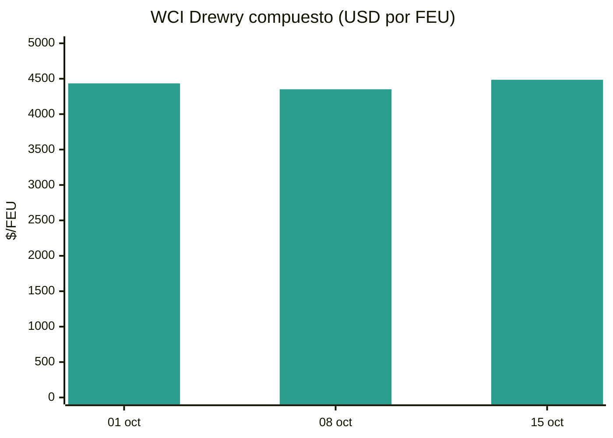

*Nota: evaluaciones Drewry de los jueves; 1 de octubre: $4.434 (−1%); 8 de octubre: $4.351 (−2%); 15 de octubre: $4.485 (+3%).*

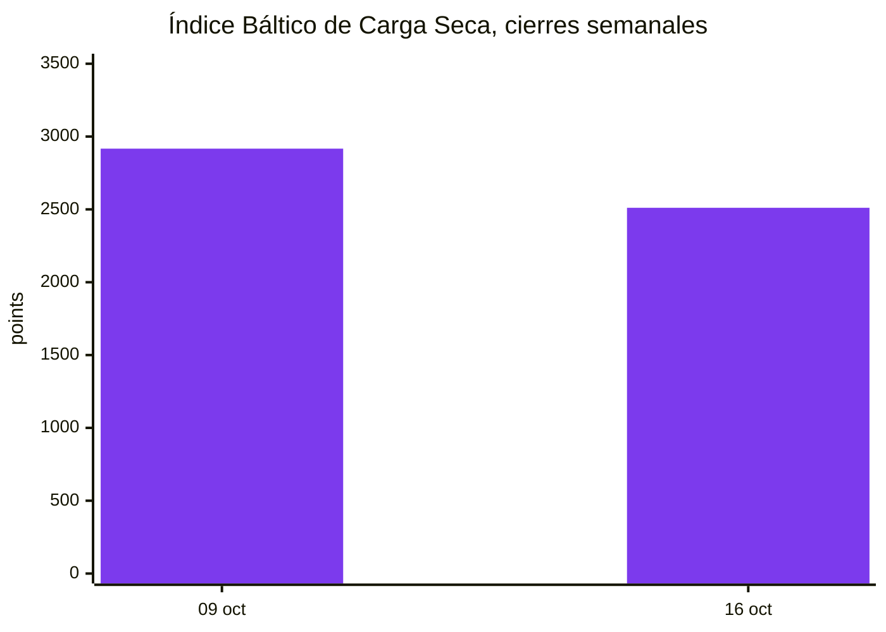

*Nota: cierres de los viernes; 9 de octubre: 2.917 (−7,3% en la semana); 16 de octubre: 2.511 (−14% en la semana), el más bajo desde el 30 de junio.*

### 3.8 Incidencia arancelaria: lo que pagan realmente los hogares

Tres publicaciones de investigación esta semana cuantificaron la carga arancelaria sobre los hogares estadounidenses. La estimación de ley vigente del Laboratorio de Presupuesto de Yale sitúa el costo en unos $1.100 por hogar al año, reflejando un alza de aproximadamente 0,7% en el nivel general de precios una vez trasladado por completo; la tasa arancelaria estatutaria promedio es ahora 11%, programada para llegar a 11,8% a fines de 2026, costando al hogar promedio unos $92 al mes. Los derechos recaudados alcanzaron 7,1% del valor de importación en agosto, frente a 2,3% en enero de 2025 — y habrían sido 10,1% sin evasión conductual. La actualización del 14 de octubre del Modelo de Presupuesto Penn Wharton encontró que los nuevos aranceles recaudaron $314.800 millones en ingresos brutos aduaneros de enero de 2025 a agosto de 2026 (antes de reembolsos IEEPA), con $60.700 millones más perdidos por cambios conductuales; las recaudaciones IEEPA totalizaron unos $166.000 millones, todas sujetas a reembolso, con la CBP certificando aproximadamente $126.000 millones (76%) hasta el 2 de octubre. A julio de 2026 la tasa arancelaria efectiva promedio de EE. UU. era 6,7% — aproximadamente el triple del 2,3% de enero de 2025 — con China enfrentando 22,8%, acero y aluminio 40,5%, y autos 13%. El rastreador de agosto de la Tax Foundation situó la tasa efectiva promedio de 2026 en 6,6%, la más alta desde 1969, equivalente a unos $820 por hogar en 2026.

**Análisis:** los tres modelos convergen en la misma imagen — un régimen arancelario aproximadamente tres veces más pesado que en enero de 2025, costando al hogar promedio alrededor de $1.000 al año, con la vía de reembolsos IEEPA ($166.000 millones sujetos a reembolso, $126.000 millones certificados) como la mayor transferencia fiscal pendiente de la guerra comercial.

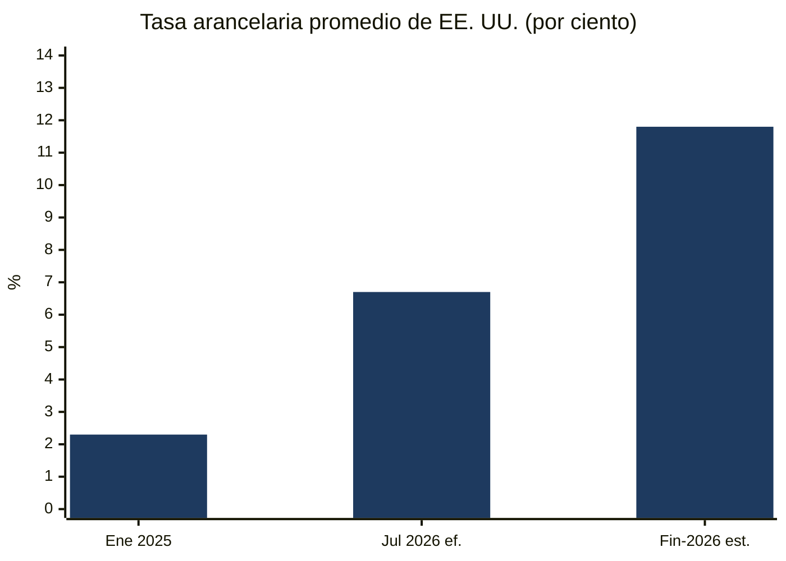

*Nota: enero de 2025 efectivo 2,3%; julio de 2026 efectivo 6,7% (Penn Wharton; Tax Foundation 7,2% para el año calendario 2026); fin de 2026 estatutario 11,8% (Laboratorio de Presupuesto de Yale).*

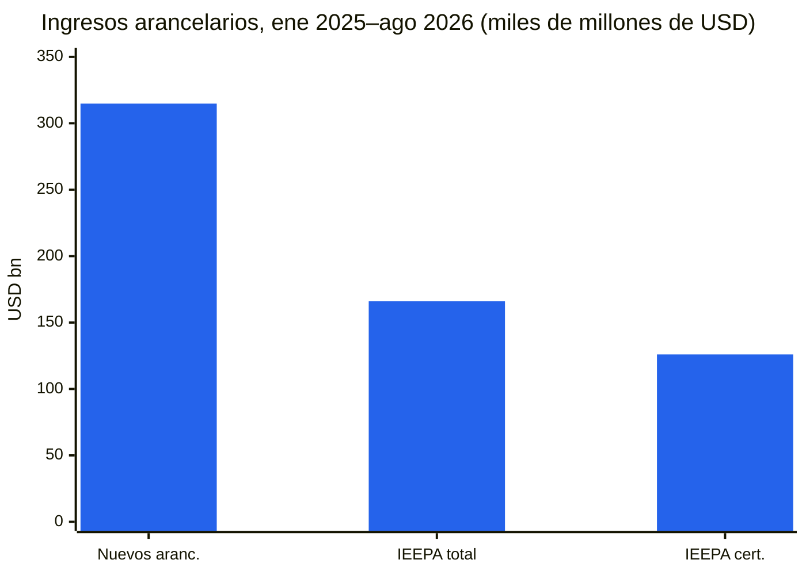

*Nota: Modelo de Presupuesto Penn Wharton, actualización del 14 de octubre; ingresos brutos aduaneros antes de reembolsos IEEPA; IEEPA certificado = certificado por la CBP para desembolso hasta el 2 de octubre.*

---

## 4. Seguimiento de aranceles

| País / bloque | Medida | Tasa | Vigencia | Estado | Fuente |
|---|---|---|---|---|---|
| Estados Unidos | Aranceles Sec. 112/113 de la Ley Graham + disposiciones de sanciones (500% sobre productos rusos; 100% secundario sobre principales compradores de energía rusa y facilitadores de evasión) | Dispensado — 0% | Dispensa firmada Oct 16, 2026; sin fecha de vencimiento | Dispensado bajo Sec. 115; reactivable por determinación presidencial/del Estado; monitoreo del USTR | [whitehouse.gov](https://www.whitehouse.gov/presidential-actions/2026/10/implementing-the-lindsey-o-graham-sanctioning-russia-and-iran-act-of-2026/) |
| Estados Unidos | Sección 232 sobre equipos industriales móviles elegibles bajo T-MEC (montacargas, bulldozers, retroexcavadoras, tractores, grúas móviles) con ≥40% de contenido estadounidense | 25% → 15% (reducido) | Oct 14, 2026 | Guía de cálculo del BIS publicada (FR 2026-20938) | [federalregister.gov](https://www.federalregister.gov/public-inspection/2026-20938/guidance-to-us-customs-and-border-protection-regarding-the-assessment-of-us-content-for-purposes-of) |
| Estados Unidos | Tasas portuarias de la Sección 301 sobre buques vinculados a China (pausa por expirar) | Vuelve a $80/NT (armadores/operadores chinos); $23/NT o $153/contenedor (buques de construcción china, operadores no chinos); $46/NT (portavehículos de construcción extranjera) | Nov 9, 2026, 11:59 p.m. ET | Sin prórroga del USTR al 13 de octubre; más de 200 asociaciones solicitaron prórroga el 23 de septiembre | [Gateway Lines](https://gatewaylines.com/press-releases/china-ship-fees-301-exclusions-nov-9-2026) |
| Estados Unidos | 178 exclusiones de productos de la Sección 301 (HTS 9903.88.69/70) | Listas 1/2/3 vuelven al 25%; Lista 4A al 7,5% | Nov 9, 2026, 11:59 p.m. ET | Por expirar; sin período de gracia | [Thomson Reuters](https://tax.thomsonreuters.com/blog/section-301-exclusions-expiration/) |
| Estados Unidos | Acciones de la Sección 301 contra China (2018), continuación | Listas 1/2: 25%; Lista 3: 25%; Lista 4A: 7,5% | Vigente (aviso de continuación Oct 7, 2026) | Continuado; segunda revisión de cuatro años abierta el 6 de mayo de 2026 — las tasas pueden subir | [facohub.com](https://facohub.com/posts/weekly-009) |
| Estados Unidos | Acción de la Sección 301 por trabajo forzoso (60 economías) | 10% / 12,5% | Vigente desde Jul 24, 2026 | Vigente; aún litigada en el CIT |  |
| Estados Unidos | Tasa propuesta de la FMC sobre buques de bandera española | $200.000 por viaje + restricciones a la importación de productos españoles listados | Propuesta Oct 16, 2026 | Etapa de propuesta | [Supply Chain Dive](https://www.supplychaindive.com/news/fmc-proposes-fees-on-spanish-flagged-vessels-import-restrictions/833122/) |
| China | Borrador de controles de exportación de tecnología de IA (Anuncio n.º 48) | Tecnologías prohibidas (14) / restringidas (26) | Consulta hasta el 15 de noviembre de 2026; registro previo a la exportación vigente el 16 de octubre | Etapa de borrador | [aiandgpp.com](https://aiandgpp.com/2026/10/19/china-ai-export-controls-model-weights-sovereign-cloud/) |
| China | Recorte de la devolución del impuesto a la exportación de vehículos de nuevas energías | Devolución recortada al 13% | Acordado Oct 8–9, 2026 | Según el consenso de 16 puntos UE–China | [peoplesdaily.pdnews.cn](https://peoplesdaily.pdnews.cn/china/er/30053309352) |
| China | Exportaciones de vehículos híbridos a la UE — entendimiento compatible con la OMC | Tope reportado de 350.000 autos/año | Acordado Oct 8–9, 2026 | Caracterización de la UE; el texto de Pekín no da cifra | [peoplesdaily.pdnews.cn](https://peoplesdaily.pdnews.cn/china/er/30053309352) |
| UE | Propuesta franco-alemana de instrumento de respuesta comercial rápida | n/a (propuesta) | Propuesta el 5 de octubre; debatida en la cumbre del 15 y 16 de octubre | Comisión encargada de desarrollar nuevos instrumentos | [985theriver.com](https://985theriver.com/2026/10/05/france-germany-propose-new-rapid-eu-trade-response-tool/) |
| UE | Arreglo arancelario UE–EE. UU. (Regs. 2026/1455, 2026/1461) | Elimina los derechos residuales de la UE sobre bienes industriales estadounidenses; salvaguardia si los aranceles estadounidenses al acero/aluminio aún superan 15% el 31 de diciembre de 2026 | Aplica Jul 1, 2026–Dec 31, 2029 | Vigente; arquitectura de salvaguardia por capas | [Mondaq](https://www.mondaq.com/italy/export-controls-trade-investment-sanctions/1848092/euus-tariff-agreement-the-new-regulations-and-their-safeguard-architecture) |
| UE | MAFC — panel DS639 establecido por disputa de Rusia | n/a (disputa) | Panel establecido Oct 3, 2026 | Fase de panel; la UE solo se relaciona con el panel | [news.metal.com](https://news.metal.com/newscontent/104143673-wto-establishes-cbam-dispute-panel-at-russias-request) |
| Reino Unido | Aranceles a vehículos eléctricos chinos (hasta 45,3%) — decisión de no imponerlos | 0% (opción retenida para el futuro) | Decidido Oct 14, 2026 | No impuestos; cumbre Reino Unido–UE el 20 de noviembre | [Fleet News](https://www.fleetnews.co.uk/news/minister-reportedly-resists-calls-for-uk-to-impose-chinese-ev-tariffs) |
| Reino Unido | Régimen de salvaguardia del acero (cuotas libres de arancel recortadas; 50% de arancel fuera de cuota) | 50% fuera de cuota | Vigente Jul 1, 2026 | India busca exenciones para ~6 categorías / 88 líneas de acero | [buildwatchnews.com](https://buildwatchnews.com/india-seeks-steel-export-exemptions-uk-safeguard-tariffs/) |
| Canadá | Sobretasa provisional de salvaguardia sobre gabinetes/vanitorios de madera (código 26169A) | 25% | Jul 31, 2026 (hasta 200 días) | Vigente; detalle publicado el 7 de octubre | [adamcabinet.com](https://www.adamcabinet.com/post-canada-cabinet-surtax.html) |
| Canadá | Contraaranceles sobre ~900 artículos de origen estadounidense (15/25/50%) | 50% sobre equipo de tiro con arco (9506.99.00) | Sep 8, 2026 | Vigente sobre C$27.600M de importaciones | [csaaa.org](https://www.csaaa.org/2026/10/15/50-tariffs-on-archery-equipment-hits-canadian-businesses-hard/) |
| Japón | Ampliación de la prohibición de exportaciones a Rusia (minerales, productos químicos, metales, maquinaria, instrumentos de precisión) | Prohibición | Oct 16, 2026 | Vigente (decisión del Gabinete Oct 2; orden promulgada Oct 9) | [Steptoe](https://www.steptoe.com/en/news-publications/international-compliance-blog/weekly-sanctions-update-october-13-2026.html) |
| Corea | Ley de Comercio Exterior enmendada (motivos de restricción de 5 → 9) | n/a | Oct 22, 2026 | Decreto de aplicación aprobado el 13 de octubre | [LinkedIn / Don Southerton](https://www.linkedin.com/pulse/week-review-sunday-october-18-2026-short-version-don-southerton-vkbkc) |
| India | TLC India–Nueva Zelanda | NZ: cero aranceles sobre exportaciones indias desde el primer día; India: acceso libre de aranceles para troncos, carbón coquizable, chatarra metálica | Oct 20, 2026 | Entrando en vigor | [Karmactive](https://www.karmactive.com/india-new-zealand-free-trade-agreement-2026/) |
| India | Cuota de acero del TLC con la UE | ~1,64 Mmt de cuota cero arancel (~68,4% de ~2,4 Mmt/año de exportaciones); 50% de penalización más allá; 35% de gravamen de carbono sin equivalencia MAFC | Texto del TLC (anexo del 11 de septiembre) | Cuota ~300.000 t por debajo de la asignación operativa de junio de 2026 de la UE | [takshashila.org.in](https://takshashila.org.in/content/blogs/2026-10-12-India-EU-FTA-and-its-steel-challenges.html) |
| Brasil/Mercosur | TLC Mercosur–EFTA | Aranceles eliminados en ~99% del valor de exportación de Brasil a la EFTA | Oct 1, 2026 (Decreto 13.126) | Vigente | [datamarnews.com](https://datamarnews.com/noticias/mercosur-efta-trade-agreement-brazil-business-opportunities/) |
| Madagascar | Investigación de salvaguardia sobre azúcar y confitería de chocolate/cacao | n/a (investigación) | Notificada el 9 de octubre; comentarios hasta el 9 de noviembre de 2026 | Investigación notificada a la OMC | [freightnews.co.za](https://www.freightnews.co.za/article/madagascar-launches-safeguard-investigation-on-certain-confectionery) |
| Australia | Ratificación del TLC Australia–UE | Elimina aranceles en ~98% de las exportaciones australianas (carne vacuna 35.000 t; carne ovina ~31.000 t) | Presentado a principios de 2027 | Los Nacionales amenazan con bloquearlo — sería la primera ratificación fallida de un TLC australiano | [particle.news](https://particle.news/story/coalition-split-threatens-passage-of-australiaeu-10bn-free-trade-deal) |
| Gabón | Prohibición de importación de aves de corral (impugnación de EE. UU. en la OMC) | Prohibición | En fase de impugnación/discusión | Interpelación de EE. UU. reconocida el 18 de septiembre; ~$86,3M de importaciones de aves congeladas en 2023 | [malivoice.com](https://malivoice.com/gabons-poultry-import-ban-heads-to-a-wto-dispute-with-washington/) |

---

## 5. Análisis profundo de la política estadounidense

### La dispensa de la Ley Graham

Cubierto en profundidad en las Secciones 2 (A1) y 3.1. La orden ejecutiva de implementación del 16 de octubre define las tasas estatutarias — 500% sobre productos de origen ruso, aranceles secundarios de 100% sobre los cinco mayores importadores de crudo y gas natural ruso que realicen nuevas compras el 18 de octubre o después, y 100% sobre los cinco principales facilitadores de la evasión de sanciones — y luego las dispensa bajo la Sección 115 con una certificación escrita de interés nacional al Congreso, sin fecha de vencimiento. Las sanciones anteriores contra Rusia bajo autoridades de emergencia nacional permanecen vigentes. El USTR tiene la tarea de monitorear las compras de energía rusa. Siguieron críticas bipartidistas; no se dio públicamente ninguna explicación detallada de la Casa Blanca.

### BIS — controles de exportación

**Guía de "contenido estadounidense" para equipos industriales móviles.** El aviso del Registro Federal 2026-20938 (91 FR 65162), publicado y vigente el 14 de octubre, implementa la Cláusula (2)(D) de la Proclamación Presidencial 11032 (1 de junio de 2026). Los equipos industriales móviles elegibles bajo el T-MEC — montacargas, bulldozers, retroexcavadoras, tractores, grúas móviles — califican para una tasa reducida de la Sección 232 de 25% → 15% donde al menos 40% del valor sea contenido estadounidense. El contenido estadounidense se define como (a) el valor de las partes obtenidas totalmente, producidas en su totalidad o transformadas sustancialmente en Estados Unidos, más (b) el valor del acero fundido y colado, aluminio fundido y colado, y/o cobre fundido y colado en Estados Unidos, en la medida no ya contabilizada. La regla aplica a mercancías ingresadas para consumo o retiradas de depósito a partir de las 12:01 a.m. ET del 14 de octubre de 2026. ([federalregister.gov](https://www.federalregister.gov/public-inspection/2026-20938/guidance-to-us-customs-and-border-protection-regarding-the-assessment-of-us-content-for-purposes-of))

**Suspensión de la Regla de Afiliados.** La Regla de Afiliados provisional final (29 de septiembre de 2025), suspendida del 10 de noviembre de 2025 al 9 de noviembre de 2026, extendería automáticamente las restricciones EAR a entidades extranjeras con al menos 50% de propiedad — directa, indirecta o en conjunto — de partes en la Lista de Entidades, la Lista de Usuarios Finales Militares o ciertas partes SDN, con un deber afirmativo de diligencia de propiedad (Bandera Roja 29). Tras la prórroga de la tregua hasta el 10 de enero de 2027, se espera que la suspensión la siga, pero al 14 de octubre el BIS no había publicado ningún aviso en el Registro Federal que la prorrogue formalmente. ([Mondaq / Crowell & Moring](https://www.mondaq.com/unitedstates/export-controls-trade-investment-sanctions/1854664/us-china-trade-truce-extended-two-months-bis-affiliates-rule-suspension-follows))

### Reembolsos IEEPA: Fase 3 y la demanda colectiva

La Fase 3 de CAPE de la CBP, desplegada el 6 de octubre según la declaración del 15 de septiembre de la CBP ante el Tribunal de Comercio Internacional, abrió reembolsos para entradas IEEPA finalmente liquidadas — pero solo a importadores registrados que sean demandantes en casos pendientes del CIT (números IOR presentados hasta el 30 de julio de 2026; presentaciones posteriores de forma continua). La Fase 3 cubre aproximadamente $11.400 millones, o 6,9%, de los aranceles IEEPA. Al 2 de octubre, CAPE había aceptado unos $136.600 millones en reembolsos potenciales y certificados; aproximadamente $126.000 millones fueron certificados y enviados al Tesoro para desembolso; unos 20.184 reembolsos (~$1.300 millones) estaban retenidos por falta de datos ACH. Los reembolsos llegan 60–90 días después de la aceptación con intereses bajo 19 CFR 24.36; ACE acepta cargas CSV de hasta 9.999 entradas por declaración. Por separado, el 8 de octubre el CIT certificó una clase en *Freestyle World v. CBP* (n.º 26-01088) que cubre importadores registrados que pagaron derechos IEEPA entre el 1 de febrero de 2025 y el 19 de febrero de 2026 — pero aún no ha ordenado alivio para la clase. El gobierno ha apelado (*V.O.S. Selections v. Trump*, n.º 26-1895, Circuito Federal), argumentando que el CIT no puede ordenar reembolsos para importadores no litigantes; la apelación no está resuelta. (Fuentes: [Supply Chain Dive](https://www.supplychaindive.com/news/cbp-starts-paying-out-ieepa-tariff-refunds-for-finally-liquidated-entries/832411/), [Thompson Hine](https://www.thompsonhine.com/insights/cbp-confirms-october-6-2026-launch-of-phase-3-of-the-ieepa-tariff-refund-process/), [gingercontrol](https://gingercontrol.com/blog/ieepa-tariff-refund-guide))

### La doble fecha límite del 9 de noviembre

Dos medidas expiran a las 11:59 p.m. ET del lunes 9 de noviembre de 2026. Primero, la pausa de un año de las tasas portuarias de la Sección 301 del USTR sobre buques vinculados a China (FR 2025-19873): las tasas vuelven a $80 por tonelada neta para armadores y operadores chinos, el mayor entre $23/NT o $153 por contenedor descargado para buques de construcción china bajo operadores no chinos, y $46/NT para portavehículos de construcción extranjera. Segundo, las 178 exclusiones de productos de la Sección 301 (FR 2025-21671) reclamadas bajo HTS 9903.88.69 y 9903.88.70: los derechos sobre productos de las Listas 1/2/3 vuelven al 25% y la Lista 4A al 7,5%, sin período de gracia, y la exclusión elimina solo la capa 301 — los derechos NMF, 232 y AD/CVD siguen aplicando. Al 13 de octubre, ningún aviso del Registro Federal movía ninguna de las fechas; más de 200 asociaciones comerciales escribieron al USTR el 23 de septiembre pidiendo una prórroga de la tasa portuaria. Los operadores deben tratar el 9 de noviembre como fecha de vencimiento. (Fuentes: [Gateway Lines](https://gatewaylines.com/press-releases/china-ship-fees-301-exclusions-nov-9-2026), [Thomson Reuters](https://tax.thomsonreuters.com/blog/section-301-exclusions-expiration/))

### USTR

El aviso de continuación del 7 de octubre (91 FR 64212, Doc FR 2026-20510) confirmó que las acciones de la Sección 301 del 6 de julio y 23 de agosto de 2018 permanecen vigentes — el USTR recibió 162 solicitudes de continuación; una habría bastado. La arquitectura se conserva: Lista 1 al 25% sobre ~$34.000M, Lista 2 al 25% sobre ~$16.000M, Lista 3 al 25% sobre ~$200.000M (elevada de 10% el 10 de mayo de 2019), Lista 4A al 7,5% sobre ~$120.000M. La segunda revisión de cuatro años, abierta el 6 de mayo de 2026, sigue y puede elevar las tasas — el último ciclo elevó semiconductores al 50% (2025), celdas solares al 50% (2024), y acero/aluminio al 25% (2024). Un aviso conforme del mismo día (Doc FR 2026-20511) enmendó una exclusión por un cambio de código estadístico del HTS del 1 de julio de 2026. No surgieron comunicados de prensa del USTR en la ventana en la búsqueda de noticias. ([facohub](https://facohub.com/posts/weekly-009))

### Operaciones y aplicación de la CBP

**Órdenes de retención de liberación.** El 29 de septiembre la CBP emitió WRO contra aceite de palma y productos derivados de Mitra Aneka Rezeki (MAR) y Hardaya Inti Plantation (HIP), Indonesia, bajo 19 U.S.C. §1307, con efecto inmediato. La información revisada cita transcripciones de entrevistas, recibos de nómina, cuotas de cosecha, fotografías, informes de ONG y gubernamentales, medios de noticias e investigación académica; los trabajadores de MAR fueron encontrados sujetos a nueve indicadores de trabajo forzoso de la OIT, los de HIP a siete. El total de WRO activas ahora es 60, más ocho Hallazgos. ([Thompson Hine](https://www.thompsonhine.com/insights/cbp-issues-withhold-release-orders-on-two-indonesian-palm-oil-producers/))

**Tasas de usuario de aduanas.** Los ajustes del AF2027 entraron en vigor el 1 de octubre: la Tasa de Usuario del Permiso de Agente Aduanal subió de $185,38 a $190,88; la tasa de la tarifa de procesamiento de mercancías no cambia en 0,3464%, con el mínimo en $34,58 y el máximo en $670,86 (CSMS #69847323; aviso FR publicado el 31 de julio de 2026).

**Acción de la FMC sobre España.** Cubierto en la Alerta A7: tras una investigación de 2024 que constató que España negó el acceso a puerto a buques de bandera estadounidense — a dos buques del Programa de Seguridad Marítima de Maersk se les denegó — la Comisión Federal Marítima propuso una tasa de $200.000 por viaje sobre buques de bandera española más restricciones a la importación de perfumería y cosméticos, aceites y grasas, cerámica, artículos de piedra, azúcar y confitería españoles. ([Supply Chain Dive](https://www.supplychaindive.com/news/fmc-proposes-fees-on-spanish-flagged-vessels-import-restrictions/833122/))

### Registro Federal — AD/CVD, 15 de octubre

Cinco avisos AD/CVD del Departamento de Comercio se publicaron el 15 de octubre (solo titulares; la fuente tiene muro de pago): Cierta Pasta de Italia (A-475-818) — resultados preliminares y rescisión parcial de la revisión administrativa AD 2024–2025; Ciertos Clavos de Acero de Omán (A-523-808) — resultados preliminares e intención de rescindir en parte; Bloques Forjados de Acero para Extremos de Fluido de Italia (A-475-840) — decisión judicial no en armonía y resultados finales enmendados; Molduras y Productos de Carpintería de Madera de China — tanto CVD (C-570-118) como AD (A-570-117), avisos de decisiones judiciales no en armonía con resultados finales enmendados. Las tasas no fueron visibles. ([International Trade Today](https://internationaltradetoday.com/article/2026/10/15/commerce-department-antidumping-and-countervailing-duty-notices-for-oct-15-2610150042))

### Temas permanentes

- **Tregua EE. UU.–China** hasta el 10 de enero de 2027; marco "30 por 30" no operativo; sin nuevo compromiso de soja (ver 3.6).
- **Tierras raras:** el objetivo de Bessent de "esperemos para Acción de Gracias" (ver 3.5 y A8).
- **De minimis:** la CBP suspendió la exención para envíos no postales desde el 24 de junio de 2026 — contexto, previo a la ventana.
- **Litigio de las Listas 3/4A de la Sección 301** está cerrado (la Corte Suprema denegó revisión el 15 de junio de 2026) — sin reembolsos por esa teoría. La acción de la Sección 301 sobre semiconductores de nodo maduro está decidida pero diferida a junio de 2027. La acción de la Sección 301 por trabajo forzoso (60 economías, 10%/12,5%, vigente el 24 de julio de 2026) permanece vigente y aún se litiga en el CIT.

---

## 6. Política mundial por región

### Europa

**Cumbre de líderes de la UE (Bruselas, 15 y 16 de octubre).** Los líderes encargaron a la Comisión continuar el diálogo con Pekín — la próxima reunión está prevista para marzo de 2027 — mientras hacen "pleno uso" de las medidas de defensa comercial existentes y desarrollan nuevos instrumentos. La propuesta franco-alemana de una herramienta retaliatoria de respuesta rápida, tan contundente como los aranceles de la Sección 301 estadounidense o las restricciones chinas a minerales críticos, dominó el debate: investigaciones de defensa comercial más rápidas y de alcance sectorial, acción urgente sobre productos químicos, PET y vehículos híbridos, y represalias más rápidas contra países que perjudiquen al bloque. El déficit comercial de mercancías de la UE con China alcanzó €360.000 millones (unos $400.000 millones) en 2025 y va camino de superarlo en 2026. ([bworldonline](https://bworldonline.com/world/2026/10/15/787181/eu-leaders-to-tackle-china-exports-energy-prices-budget-at-summit/))

**Consenso de 16 puntos UE–China (Pekín, 8 y 9 de octubre).** El segundo Mecanismo de Consulta de Comercio e Inversión entre el comisario Šefčovič y el ministro Wang Wentao produjo una declaración conjunta: un entendimiento compatible con la OMC sobre el comercio de vehículos híbridos (tope reportado de 350.000 autos al año, que podría recortar las exportaciones chinas de híbridos en más de la mitad — aunque el texto publicado por Pekín no da cifra); el recorte de China de las devoluciones del impuesto a la exportación para vehículos de nuevas energías al 13%; un "canal verde" para licencias de tierras raras e imanes permanentes; la continuación de los procedimientos de compromiso de precios en el caso antisubvenciones de la UE sobre vehículos eléctricos; y la exploración de recortes arancelarios NMF en unos €4.000 millones de exportaciones de la UE, por al menos €225 millones en ahorros de derechos. Una videollamada ministerial está fijada para enero de 2027 y la tercera consulta para marzo de 2027. ([peoplesdaily.pdnews.cn](https://peoplesdaily.pdnews.cn/china/er/30053309352))

**El Reino Unido decide no imponer aranceles a vehículos eléctricos chinos (14 de octubre).** El secretario de Negocios Jonathan Reynolds dijo a The Guardian que el Reino Unido no cederá a la presión de la UE para replicar aranceles de hasta 45,3% sobre los vehículos eléctricos chinos: las decisiones de defensa comercial se basan "en el interés del Reino Unido — no en lo que pida ningún otro país". Los aranceles siguen siendo "una opción en el futuro"; una cumbre Reino Unido–UE está fijada para el 20 de noviembre en Bruselas. La decisión siguió a reportes del 4 al 7 de octubre de que Reynolds preparaba un paquete equivalente al 45%, que el gobierno subrayó que no estaba decidido. ([Fleet News](https://www.fleetnews.co.uk/news/minister-reportedly-resists-calls-for-uk-to-impose-chinese-ev-tariffs))

**Salvaguardia del acero del Reino Unido y la solicitud de exención de India.** India busca exenciones de acero del nuevo régimen de salvaguardia del Reino Unido (vigente el 1 de julio de 2026: cuotas libres de arancel recortadas, 50% de arancel fuera de cuota) para unas seis categorías de productos que cubren 88 líneas de acero. Por separado, el impulso de implementación del CETA India–Reino Unido del 12 y 13 de octubre — el primer Comité Económico y Comercial Conjunto desde la entrada en vigor del acuerdo el 15 de julio — anunció más de £1.000 millones en nuevos acuerdos comerciales en Bengaluru, con el Mercado CETA en Mumbai y una delegación empresarial británica de unas 200 empresas. (Fuentes: [buildwatchnews](https://buildwatchnews.com/india-seeks-steel-export-exemptions-uk-safeguard-tariffs/), [pravasisamwad](https://pravasisamwad.com/india-uk-trade-deal-expected-to-boost-exports-jobs-and-business-opportunities/))

**Déficit de la cuota de acero del TLC India–UE.** El análisis del texto del TLC publicado el 12 de octubre muestra que India recibió una cuota de acero de ~1,64 millones de toneladas métricas — que cubre cerca de 68,4% de sus ~2,4 Mmt/año de exportaciones a la UE con arancel cero, con 50% de penalización más allá — pero el Anexo del TLC del 11 de septiembre fija una línea base aproximadamente 300.000 toneladas por debajo de la asignación operativa unilateral de junio de 2026 de la UE. Todas las exportaciones aún enfrentan un gravamen de carbono de 35% salvo que India obtenga equivalencia MAFC. ([Takshashila](https://takshashila.org.in/content/blogs/2026-10-12-India-EU-FTA-and-its-steel-challenges.html))

**Impulso del Mercosur.** El ministro interino de Brasil Márcio Elias Rosa dijo el 13 de octubre que las exportaciones brasileñas a la UE subieron 30,7% en mayo–septiembre (exportaciones de enero–septiembre $44.170 millones, +20%), con el comercio bilateral Mercosur–UE creciendo más de $6.000 millones desde la entrada en vigor. ApexBrasil cabildeó a eurodiputados en Bruselas del 12 al 16 de octubre para programar el voto de ratificación del Parlamento Europeo. Las exportaciones agroindustriales de Argentina a la UE alcanzaron $1.920 millones en mayo–agosto, +21% (+44% para productos con preferencia arancelaria). El TLC Mercosur–EFTA de Brasil entró en vigor el 1 de octubre (Decreto 13.126), eliminando aranceles en aproximadamente 99% del valor que Brasil exporta a la EFTA. ([datamarnews](https://datamarnews.com/noticias/mercosur-eu-trade-deal-boosts-brazilian-exports-by-30-7/))

**Disputa del RCDE de la UE en el transporte marítimo.** La Asociación Británica de Puertos rechazó un hallazgo del Observatorio RCDE español de que el crecimiento de contenedores del Reino Unido refleja evasión de costos de carbono, atribuyendo el crecimiento en cambio a la inversión — 85% del crecimiento de 2025 concentrado en Londres tras la apertura del cuarto atracadero de £350 millones de DP World en London Gateway a finales de 2024 — y a la reestructuración de alianzas (el cambio de Maersk de Gemini de Felixstowe a London Gateway). Los datos del gobierno británico muestran que los puertos manejaron 11% más contenedores en 2025 (+600.000 unidades); London Gateway superó 3 millones de TEU (+52% desde 1,9 millones). El estudio español encontró que la participación del Reino Unido en la actividad de aguas profundas del norte de Europa (TEU-millas) subió de 17,5% en 2023 a cerca de 36% en el primer trimestre de 2026, con 76% de los cambios de ruta atribuidos al RCDE de la UE. La Comisión propuso en julio que los puertos no comunitarios dentro de 150 millas náuticas de un puerto de la UE podrían excluirse de la definición RCDE de "puerto de escala", con el umbral de transbordo recortado de 65% a 50%. (Fuentes: [Splash247](https://splash247.com/uk-ports-hit-back-at-brussels-over-ets-diversion-claims/), [The Loadstar](https://theloadstar.com/uk-port-volume-growth-not-due-to-eu-shippers-avoiding-ets-says-bpa/))

### China

**Borrador de control de exportaciones de IA.** Cubierto en Alertas (A4) y la Sección 3.4: el Anuncio n.º 48 del 16 de octubre abre consulta hasta el 15 de noviembre sobre la adición de 40 tecnologías al catálogo de prohibidas/restringidas (14 prohibidas, 26 restringidas; 23 relacionadas con IA), con umbrales que incluyen pesos de LLM por encima de 2 billones de parámetros, entrenamiento por encima de 10²⁶ FLOPs, o modelos clasificados entre los diez mejores del mundo; un requisito de registro previo a la exportación entró en vigor de inmediato, incluso para acuerdos en curso. El acceso por API/SaaS está excluido; el despliegue local en el extranjero está cubierto. ([aiandgpp.com](https://aiandgpp.com/2026/10/19/china-ai-export-controls-model-weights-sovereign-cloud/))

**Consenso UE–China.** Cubierto en la Sección 3.4: entendimiento sobre vehículos híbridos (tope reportado de 350.000/año), recorte de la devolución de VEN al 13%, canal verde de tierras raras, exploración NMF en ~€4.000 millones de exportaciones de la UE.

**China abrió una investigación antidumping sobre p-nitrotolueno de la UE** (arrastrada de la ventana de la semana pasada) — contexto para el sector químico ahora nombrado en la lista de acción urgente franco-alemana.

### India

**El TLC India–Nueva Zelanda entra en vigor el 20 de octubre.** Nueva Zelanda elimina todos los aranceles sobre las exportaciones indias desde el primer día; India otorga acceso libre de aranceles a troncos de madera, carbón coquizable y chatarra metálica de Nueva Zelanda (la agricultura queda protegida con cuotas); un marco de inversión de $20.000 millones; 5.000 visas anuales de trabajo calificado más 1.000 visas de vacaciones de trabajo. Un raro movimiento de liberalización nuevo en un año proteccionista. ([Karmactive](https://www.karmactive.com/india-new-zealand-free-trade-agreement-2026/))

**Solicitud de exención de la salvaguardia del acero del Reino Unido y déficit de la cuota de acero con la UE** — ver Europa arriba.

### Türkiye

No surgió ninguna medida del gobierno turco en la ventana; la asociación de TradeInt del 30 de septiembre con el Ministerio de Comercio de Türkiye (una subvención que otorga a firmas locales de consultoría acceso financiado a registros de embarques, declaraciones aduaneras y datos B/L en más de 200 países) queda justo fuera de la ventana y se anota bajo inteligencia de proveedores.

### Canadá

**Aplicación de salvaguardias y contraaranceles.** Detalle del Aviso 26-17 de la CBSA (explicador publicado el 7 de octubre): una sobretasa provisional de salvaguardia de 25% sobre gabinetes y vanitorios de madera desde el 31 de julio por hasta 200 días (código de salvaguardia 26169A). La Asociación Canadiense de Armas y Municiones Deportivas reportó el 15 de octubre que el equipo de tiro con arco (ítem arancelario 9506.99.00) ahora enfrenta contraaranceles de 50% vigentes el 8 de septiembre bajo el paquete de contraaranceles de ~900 ítems, 15/25/50% sobre productos de origen estadounidense que cubre C$27.600 millones de importaciones, vigente desde el 8 de septiembre. Las prioridades de verificación de la CBSA han cambiado fuertemente hacia órdenes de sobretasa (VE/china acero/aluminio; EE. UU. 2025-1, acero/aluminio, vehículos de motor). (Fuentes: [adamcabinet.com](https://www.adamcabinet.com/post-canada-cabinet-surtax.html), [csaaa.org](https://www.csaaa.org/2026/10/15/50-tariffs-on-archery-equipment-hits-canadian-businesses-hard/))

**Estabilidad laboral en el Puerto de Montreal.** Un nuevo convenio colectivo de cinco años para más de 1.200 estibadores (CUPE 375), que cubre 2024–2028 retroactivamente, fue fijado por arbitraje vinculante de interés tras las huelgas de 2024 que interrumpieron cadenas de suministro que sirven a ~110 millones de personas — estabilidad plurianual en una puerta clave Canadá–EE. UU. ([newswire.ca](https://www.newswire.ca/news-releases/a-new-five-year-collective-agreement-takes-effect-ensuring-stability-at-the-port-of-montreal-841357271.html))

### Japón

**Ampliación de la prohibición de exportaciones a Rusia (vigente el 16 de octubre).** El METI añadió minerales, productos químicos, metales, maquinaria, equipos industriales e instrumentos de precisión a la lista de prohibición de exportaciones bajo la Ley de Divisas y Comercio Exterior, tras una decisión del Gabinete del 2 de octubre; la Orden de Control del Comercio de Exportación enmendada fue promulgada el 9 de octubre. ([Steptoe](https://www.steptoe.com/en/news-publications/international-compliance-blog/weekly-sanctions-update-october-13-2026.html))

### Corea

**La Ley de Comercio Exterior enmendada entra en vigor el 22 de octubre.** El decreto de aplicación, aprobado por el Gabinete el 13 de octubre, amplía los motivos permisibles para restricciones comerciales de cinco a nueve, añadiendo seguridad nacional, información personal y corporativa, moral pública y tesoros nacionales; seguirá un aviso público de implementación. Por separado, el Aviso Público sobre Comercio de Artículos Estratégicos enmendado del MOTIR (vigente el 1 de septiembre) endurece los requisitos de información de usuario final, reventa y destino final para exportaciones de doble uso. ([LinkedIn / Don Southerton](https://www.linkedin.com/pulse/week-review-sunday-october-18-2026-short-version-don-southerton-vkbkc))

### ASEAN y Australia

**Lucha por la ratificación del TLC Australia–UE (18 y 19 de octubre).** Los Nacionales dicen que intentarán bloquear el acuerdo de aproximadamente A$10.000 millones — que elimina aranceles en cerca de 98% de las exportaciones australianas, con cuota de carne vacuna de 35.000 toneladas y carne ovina de unas 31.000 toneladas — cuando se presente al parlamento a principios del próximo año; sería el primer TLC australiano en fracasar en la ratificación. El ministro de Comercio Don Farrell instó a legisladores y empresas a respaldarlo el 12 de octubre. ([particle.news](https://particle.news/story/coalition-split-threatens-passage-of-australiaeu-10bn-free-trade-deal))

**Salvaguardia de Madagascar.** La investigación de salvaguardia notificada a la OMC sobre confitería de azúcar y confitería de chocolate/cacao (notificada el 9 de octubre; comentarios hasta el 9 de noviembre de 2026). ([freightnews.co.za](https://www.freightnews.co.za/article/madagascar-launches-safeguard-investigation-on-certain-confectionery))

### Multilateral

**Perspectiva y Estadísticas del Comercio Mundial de la OMC (8 de octubre).** Cubierto en la Sección 3.3: pronóstico de volumen del comercio de mercancías elevado a +3,9% para 2026 (desde 1,9% en marzo) y 4,1% para 2027; bienes habilitantes de IA +67% interanual en la primera mitad, representando 47% del aumento del valor del comercio y alcanzando 14,8% del comercio mundial de mercancías. Servicios rebajados a +3,3% en 2026 (desde 4,8%) — transporte +0,9%, viajes +0,2% — por mayores costos del combustible de aviación por el conflicto de Oriente Medio. Riesgos: disrupción de Ormuz, Ucrania, desaceleración de la inversión en IA. ([Reuters](https://www.reuters.com/world/asia-pacific/wto-upgrades-goods-trade-forecast-ai-boom-offsets-middle-east-disruption-2026-10-08/))

**Informe sobre Comercio y Desarrollo 2026 de la UNCTAD (9 de octubre): "La geoeconomía del desarrollo".** Crecimiento mundial proyectado en 2,6% en 2026 (por debajo de 2,9% en 2025); comercio de bienes y servicios al alza cerca de 4% a precios constantes tras un récord de $35 billones en 2025, el alza impulsada en parte por mayores precios de la energía. Cifras clave: comercio China–EE. UU. reducido más de 20% desde 2024; Asia contribuirá 59% del crecimiento mundial — India +7,3%, China +4,5%, Indonesia +5,2%. El informe advierte que las ganancias comerciales impulsadas por la IA no se están traduciendo en amplias ganancias de desarrollo y que los controles de exportación y el escrutinio de inversiones bloquean a nuevos entrantes. ([Reuters](https://www.reuters.com/world/asia-pacific/world-economic-growth-slow-26-2026-un-trade-body-says-2026-10-09/))

**Disputas de la OMC.** El Órgano de Solución de Diferencias estableció el panel DS639 a petición de Rusia (3 de octubre) — la segunda solicitud de Rusia tras el bloqueo de la UE de la primera en julio de 2025 — impugnando el MAFC y la asignación gratuita del RCDE para empresas de la UE como barreras comerciales y subvenciones a la exportación prohibidas; la UE llama al MAFC compatible con la OMC y solo se relacionará con el panel. EE. UU. volvió a bloquear los nombramientos del Órgano de Apelación. El OSD difirió la adopción del informe del panel en la disputa China vs Türkiye sobre aranceles a vehículos eléctricos/licencias de importación al 27 de octubre, y el fallo India–Taiwán sobre aranceles TIC (panel de abril de 2023, que encontró que los aranceles TIC de India de 7,5%→20% violan compromisos) enfrenta su noveno aplazamiento con adopción ahora prevista el 27 de octubre. EE. UU. impugnó la prohibición de importación de aves de corral de Gabón (interpelación reconocida en el Consejo de Ministros de Libreville del 18 de septiembre; ~$86,3 millones en importaciones de aves congeladas en 2023); el caso está en fase de discusión. (Fuentes: [news.metal.com](https://news.metal.com/newscontent/104143673-wto-establishes-cbam-dispute-panel-at-russias-request), [TWN](https://www.twn.my/title2/wto.info/2026/ti260923.htm), [malivoice](https://malivoice.com/gabons-poultry-import-ban-heads-to-a-wto-dispute-with-washington/), [eximguru](https://eximguru.com/export-import-news/import-duty/wto-accepts-india-and-taiwan-115907.aspx))

**Comités de la OMC.** El Comité de Acceso a los Mercados (12 y 13 de octubre) registró un récord de 36 preocupaciones comerciales, ocho de ellas nuevas, con el primer informe de la Secretaría sobre resolución de preocupaciones que muestra el trabajo de comités resolviendo disputas sin litigio formal. El Comité de Normas de Origen (7 y 8 de octubre) revisó preferencias de PMA: 22 miembros las otorgan; EE. UU. reportó preferencias AGOA y Haití extendidas hasta septiembre de 2028; China presentó su estudio sobre utilización de preferencias de PMA. El Consejo General (5 y 6 de octubre) impulsó la reforma antes de la CM15 — "del proceso a la sustancia": la reforma de solución de diferencias continúa bajo la presidencia de Patriota; se debatieron los arreglos interinos del Acuerdo de Comercio Electrónico (India planteó cuestiones legales sobre el rol depositario de la DG); la participación de IFDA es de 131 miembros; el Acuerdo de Subvenciones a la Pesca corre riesgo de "caducidad". (Fuentes: [thehonanews](https://www.thehonanews.com/2026/10/16/report-underlines-value-of-wto-committee-in-helping-resolve-market-access-trade-concerns/), [freightnews.co.za](https://www.freightnews.co.za/article/rules-of-origin-roo-committee-reviews-ldc-preferences-shares-best-practices), [devdiscourse](https://www.devdiscourse.com/article/business/3988145-wto-reform-takes-centre-stage-as-members-push-for-progress-on-trade-and-digital-rules))

**OMA.** El 9 de octubre la OMA lanzó su Plataforma cerrada de Cumplimiento e-CENcomm con 128 Puntos de Contacto Nacionales de 105 administraciones aduaneras, después de que el Informe de Comercio Ilícito 2025 mostrara que el comercio electrónico representa cerca de 50% de los casos reportados de comercio ilícito. El 16 de octubre, el secretario general del CCG Albudaiwi y el secretario general de la OMA Saunders firmaron una adenda que convierte a la Autoridad de la Unión Aduanera del CCG en el organismo líder de cooperación (las exportaciones intra-CCG superaron $177.000 millones en 2025). ([gccscope](https://gccscope.com/gcc-and-wco-sign-addendum-to-advance-gulf-customs-union-framework/))

---

## 7. Acciones de aplicación

| Acción | Autoridad / sede | Fecha | Detalle | Fuente |
|---|---|---|---|---|
| La EO de la Ley Graham dispensa disposiciones arancelarias y de sanciones | Casa Blanca (dispensa Sec. 115) | Oct 16, 2026 | Aranceles y disposiciones de sanciones dispensados sin fecha de vencimiento; sanciones anteriores contra Rusia conservadas; monitoreo del USTR | [whitehouse.gov](https://www.whitehouse.gov/presidential-actions/2026/10/implementing-the-lindsey-o-graham-sanctioning-russia-and-iran-act-of-2026/) |
| Paquete del Reino Unido contra Rusia: 38 objetivos incluidos Zarubezhneft, INK Capital, 12 petroleros de la flota fantasma | Gobierno del Reino Unido | Oct 8, 2026 | El Reino Unido ahora sanciona más de 600 petroleros de la flota fantasma; afirma que más de 90% de la capacidad de producción petrolera rusa está bajo sanciones | [gCaptain](https://gcaptain.com/uk-tightens-russian-oil-sanctions-as-u-s-weighs-relief/) |
| La UE apunta a importantes astilleros rusos | Reglamento de la UE | Publicado Oct 12, vigente el mismo día | Detalles escasos en la información |  |
| Japón amplía la prohibición de exportaciones a Rusia | METI / Gabinete | Vigente Oct 16, 2026 | Minerales, productos químicos, metales, maquinaria, equipos industriales, instrumentos de precisión | [Steptoe](https://www.steptoe.com/en/news-publications/international-compliance-blog/weekly-sanctions-update-october-13-2026.html) |
| WRO de la CBP sobre aceite de palma indonesio (MAR, HIP) | CBP, 19 U.S.C. §1307 | Sep 29, 2026 | 9 y 7 indicadores de trabajo forzoso de la OIT respectivamente; WRO activas ahora 60 + 8 Hallazgos | [Thompson Hine](https://www.thompsonhine.com/insights/cbp-issues-withhold-release-orders-on-two-indonesian-palm-oil-producers/) |
| El CIT certifica demanda colectiva IEEPA (*Freestyle World v. CBP*) | Tribunal de Comercio Internacional | Oct 8, 2026 | Clase certificada para IOR que pagaron derechos IEEPA del 1 de febrero de 2025 al 19 de febrero de 2026; aún sin alivio ordenado; el gobierno apela | [gingercontrol](https://gingercontrol.com/blog/ieepa-tariff-refund-guide) |
| CAPE Fase 3 comienza a pagar reembolsos IEEPA sobre entradas finalmente liquidadas | CBP | Desplegada Oct 6, 2026 | ~$11.400M (6,9% de aranceles IEEPA); solo IOR demandantes del CIT; ~$126.000M certificados hasta el 2 de octubre | [Supply Chain Dive](https://www.supplychaindive.com/news/cbp-starts-paying-out-ieepa-tariff-refunds-for-finally-liquidated-entries/832411/) |
| La FMC propone tasa de $200k/viaje sobre buques de bandera española | Comisión Federal Marítima | Propuesta Oct 16, 2026 | Retaliación por España denegando acceso a puerto a buques de bandera estadounidense; restricciones a la importación de productos españoles listados | [Supply Chain Dive](https://www.supplychaindive.com/news/fmc-proposes-fees-on-spanish-flagged-vessels-import-restrictions/833122/) |
| Panel MAFC de la OMC DS639 establecido a petición de Rusia | OSD de la OMC | Oct 3, 2026 | Rusia impugna el MAFC + asignación gratuita del RCDE; la UE solo se relaciona con el panel | [news.metal.com](https://news.metal.com/newscontent/104143673-wto-establishes-cbam-dispute-panel-at-russias-request) |
| EE. UU. impugna la prohibición de importación de aves de corral de Gabón | OMC | Interpelación reconocida Sep 18, 2026 | Fase de discusión; sin fallo | [malivoice](https://malivoice.com/gabons-poultry-import-ban-heads-to-a-wto-dispute-with-washington/) |
| Alemania bloquea la oferta de Cosco por Zippel por preocupaciones de seguridad | Gobierno alemán | ~Oct 12–18, 2026 (titular JOC) | Escrutinio de inversiones en activos portuarios |  |
| EE. UU. sanciona 22 petroleros más (relacionados con Ormuz) | Tesoro/OFAC de EE. UU. | Oct 8, 2026 | Contexto del pico semanal de ataques a petroleros |  |

---

## 8. Publicaciones de datos

| Publicación | Editor | Fecha | Cifras principales | Fuente |
|---|---|---|---|---|
| Comercio internacional de EE. UU., agosto de 2026 | Oficina del Censo / BEA | Publicado ~Oct 7–9 | Déficit de bienes y servicios ampliado 13,7% hasta $105.600M (mayor desde mar 2025); importaciones récord $420.800M (+4,3%); exportaciones $315.200M (+1,4%); déficit de bienes −$136.600M; superávit de servicios +$31.000M; déficit acumulado −$557.000M (−19,9% vs 2025). Goldman recortó el seguimiento del PIB del T3 0,3pp hasta 3,1% | [businessday.co.za](https://www.businessday.co.za/world/americas/2026-10-06-us-trade-balance-sinks-deeper-into-the-red-as-imports-hit-record-high/) |
| Comercio anticipado de bienes de EE. UU., septiembre de 2026 | Oficina del Censo | Sep 30 | Déficit anticipado de bienes ampliado a $132.600M; importaciones +$17.400M hasta $336.100M; exportaciones +$3.700M hasta $203.400M; impulsores: petróleo/insumos industriales, bienes de capital de infraestructura de IA | [particle.news](https://particle.news/story/us-goods-trade-deficit-widens-to-1326-billion) |
| Comercio de China, septiembre de 2026 | GACC | Oct 14 | Exportaciones +36,3% interanual hasta $447.180M; importaciones +31,0% hasta $313.660M; superávit $133.500M (máximo de 20 meses); superávit ene–sep $938.500M; exportaciones a EE. UU. +9,8%, superávit bilateral ~$34.000M (máximo de 20 meses); semiconductores ~+108% en lo que va del año | [tradingview](https://www.tradingview.com/news/te_news:591695:0-china-posts-biggest-trade-surplus-in-20-months/) |
| Comercio de la zona del euro, agosto de 2026 | Eurostat | Oct 16 | Déficit de €16.100M — el mayor desde ene 2023 (vs +€10.700M en jul, −€1.700M un año antes); exportaciones +9,9% hasta €227.700M; importaciones +16,7% hasta €243.800M; maquinaria/vehículos pasaron de +€7.200M a −€0.700M; déficit energético €26.700M; ene–ago −€5.400M vs +€90.900M en 2025; déficit de la UE €25.200M; brecha bilateral con China €38.400M | [tradingview/dpa](https://www.tradingview.com/news/dpa_afx:398ee56ddbf6a:0-eurozone-trade-balance-swings-to-deficit/) |
| Actualización de Perspectiva y Estadísticas del Comercio Mundial | OMC | Oct 8 | Volumen de mercancías 2026 +3,9% (desde 1,9%); 2027 +4,1%; bienes habilitantes de IA +67% interanual en la primera mitad, 47% del crecimiento del valor, 14,8% del comercio mundial de mercancías; servicios +3,3% (desde 4,8%) | [wto.org (PDF)](https://www.wto.org/english/res_e/booksp_e/gtos1026_e.pdf) |
| Informe sobre Comercio y Desarrollo 2026 | UNCTAD | Oct 9 | Crecimiento mundial 2,6% en 2026; comercio de bienes/servicios ~+4% a precios constantes; comercio China–EE. UU. reducido >20% desde 2024; Asia 59% del crecimiento mundial | [Reuters](https://www.reuters.com/world/asia-pacific/world-economic-growth-slow-26-2026-un-trade-body-says-2026-10-09/) |
| Perspectiva Económica Mundial, octubre de 2026 | FMI | Oct 13 | Crecimiento mundial 3,1% en 2026, 3,4% en 2027; EE. UU. 2,3%, zona del euro 1,1%, China 4,5%, India 7,0%; línea base asume reapertura de Ormuz en marzo; el cierre recortó el crecimiento mundial ~0,9pp antes de compensaciones | [ceo.com.pl](https://ceo.com.pl/en/imf-world-economic-outlook-october-2026-growth-inflation-ai-55142/) |
| Tasas Arancelarias Efectivas e Ingresos (actualizado) | Modelo de Presupuesto Penn Wharton | Oct 14 | $314.800M de ingresos brutos aduaneros ene 2025–ago 2026; $60.700M perdidos por cambio conductual; IEEPA ~$166.000M (todo sujeto a reembolso); ~$126.000M certificados; tasa efectiva 6,7% (jul 2026) vs 2,3% (ene 2025); China 22,8%, acero/aluminio 40,5%, autos 13% | [budgetmodel.wharton.upenn.edu](https://budgetmodel.wharton.upenn.edu/p/2026-10-14-effective-tariff-rates-and-revenues-updated-october-14-2026/) |
| Estado de los Aranceles de EE. UU. (ley vigente) | Laboratorio de Presupuesto de Yale | Citado Oct 16 | $1.100/hogar/año; tasa estatutaria 11% → 11,8% a fin de 2026; $92/mes; derechos 7,1% del valor de importación (ago) vs 2,3% (ene 2025); $1,9B de ingresos en 10 años | [fxstreet](https://www.fxstreet.com/analysis/the-us-is-importing-inflation-not-just-goods-heres-what-that-does-to-the-cpi-202610161835) |
| Rastreador de Aranceles de Trump | Tax Foundation | Versión ago 2026, citado esta semana | Tasa efectiva promedio 6,6% para 2026 — la más alta desde 1969; ~$820/hogar |  |
| Importaciones de contenedores de EE. UU., septiembre de 2026 | Descartes (Informe Global de Transporte Marítimo) | ~Oct 13 | Récord de septiembre: 2,55M TEU (−2,2% mensual, +10,3% interanual); ene–sep +0,8% interanual; retrasos de tránsito portuario al alza en 8 de las 10 principales puertas | [ajot](https://www.ajot.com/news/descartes-global-shipping-report-u.s-container-imports-reach-highest-september-volume-on-record) |
| Volúmenes globales de contenedores, agosto de 2026 | CTS | Oct 8 | Récord de 17,46M TEU en agosto; precios oceánicos en máximo de dos años | [FreightWaves](https://www.freightwaves.com/news/category/news/maritime) |

**Análisis:** las publicaciones de datos de la semana dibujan una economía mundial tirada en dos direcciones por la misma fuerza. El gasto de capital en IA está impulsando exportaciones chinas récord, importaciones récord de bienes de capital de EE. UU., y el pronóstico comercial mejorado de la OMC — mientras los efectos de precios de la energía y del conflicto están ampliando el déficit de la zona del euro y comprimiendo el comercio de servicios. La ampliación del déficit estadounidense junto a importaciones récord es la paradoja arancelaria en un número: los aranceles están en un máximo de 57 años según la medida de la Tax Foundation, pero los volúmenes de importación siguen subiendo porque los bienes importados — infraestructura de IA, insumos industriales — tienen pocos sustitutos.

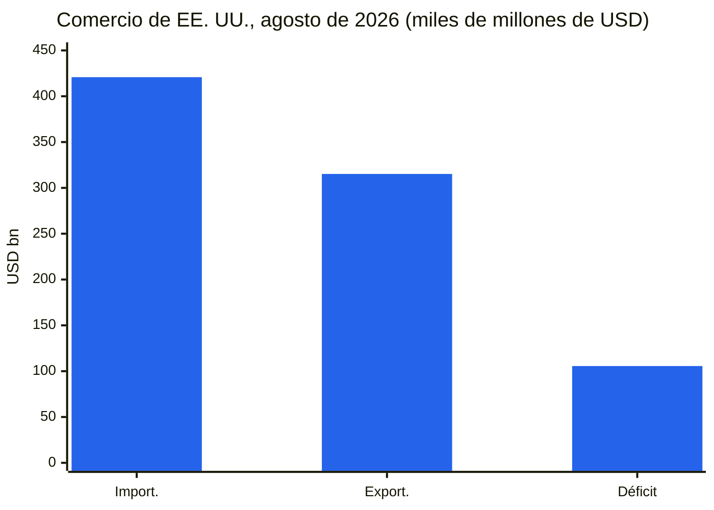

*Nota: Censo/BEA vía businessday.co.za; importaciones $420.800M (récord, +4,3%), exportaciones $315.200M (+1,4%), déficit $105.600M (+13,7%, mayor desde mar 2025).*

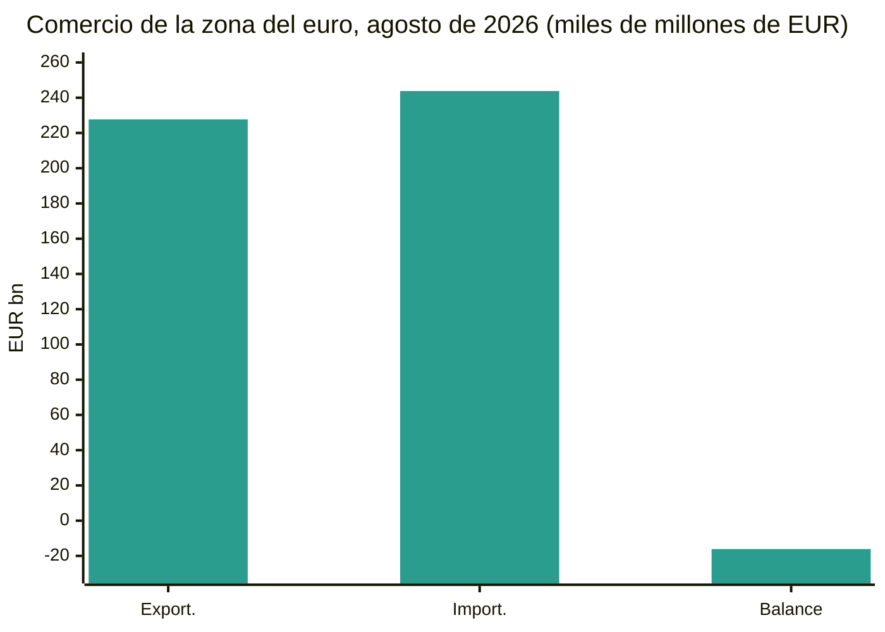

*Nota: Eurostat publicado el 16 de octubre; exportaciones €227.700M (+9,9% interanual), importaciones €243.800M (+16,7%), balance −€16.100M (mayor déficit desde ene 2023).*

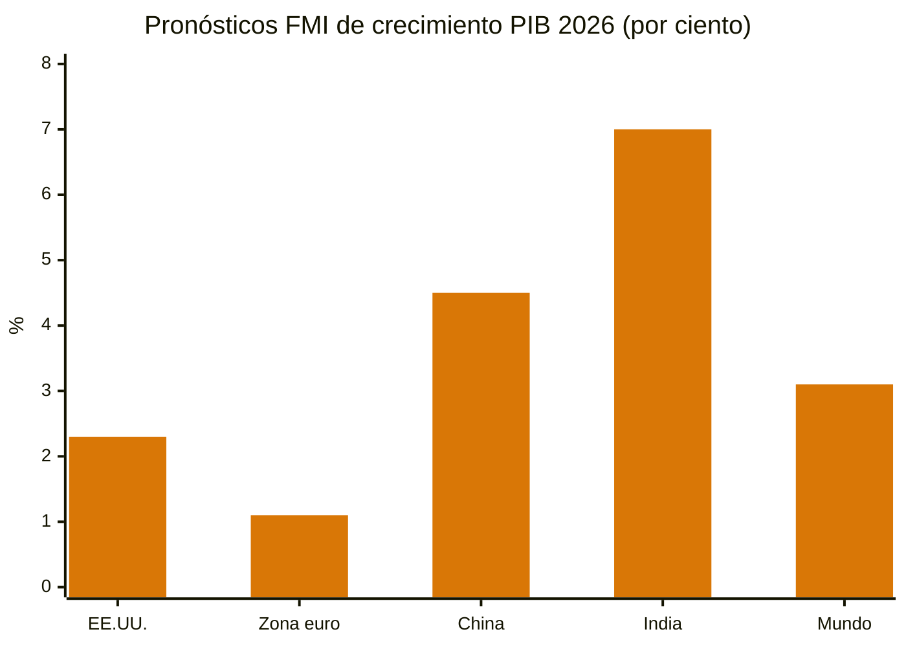

*Nota: Perspectiva Económica Mundial del FMI, 13 de octubre de 2026; pronóstico mundial 2027 de 3,4%.*

---

## 9. Mercado de fletes

### Tarifas spot de contenedores — Índice Mundial de Contenedores Drewry

La evaluación del 15 de octubre cerró en **$4.485 por FEU, un 3% más semanal** — el rebote tras la lectura del 8 de octubre de $4.351 (−2%). Asia–Europa impulsó la ganancia: Shanghái–Róterdam +6% hasta $3.522, Shanghái–Génova +7% hasta $3.945, el primer aumento Asia–Europa tras 13 caídas semanales consecutivas. El transpacífico fue mixto: Shanghái–Los Ángeles +3% hasta $7.884, Shanghái–Nueva York −1% hasta $10.075. Drewry espera menos volatilidad en la semana venidera. La evaluación anterior (1 de octubre) había cerrado en $4.434 (−1%).

El Rastreador de Salidas Canceladas de Drewry (16 de octubre) muestra 44 salidas en blanco anunciadas para las semanas 43 a 47 (19 de octubre–22 de noviembre) — una tasa de cancelación de 6% sobre 713 salidas previstas. Asia–Norte de Europa/Med representa 44% de las cancelaciones, el transpacífico este 36%, el transatlántico 20%. Los aumentos FAK previstos de las navieras de $4.500–$4.800/FEU en Asia–Europa (vigentes el 19 de octubre) enfrentan una adopción incierta dada la capacidad de Suez que retorna. (Fuentes: [Drewry](https://www.drewry.co.uk/maritime-research-opinion-browser/world-container-index-assessed-by-drewry), [Shipping Telegraph sem41](https://shippingtelegraph.com/freight-news/drewry-the-world-container-index-decreased-2-in-week-41-2026/), [Shipping Telegraph sem42](https://shippingtelegraph.com/freight-news/drewry-the-world-container-index-increased-3-this-week-42-2026/))

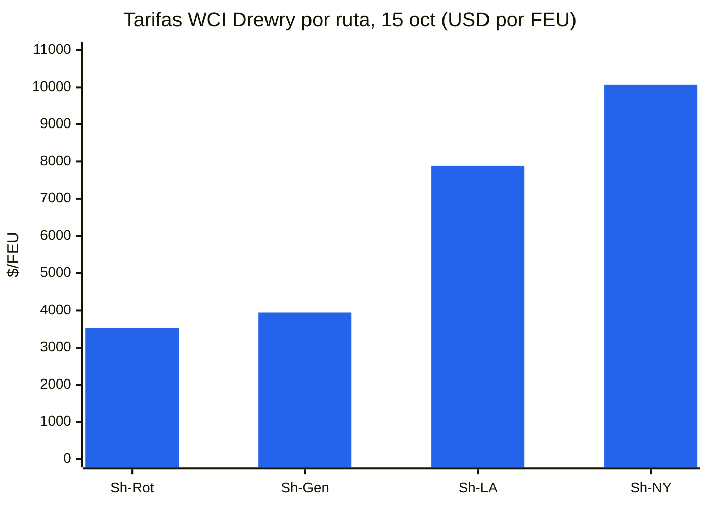

*Nota: Shanghái–Róterdam $3.522 (+6%), Shanghái–Génova $3.945 (+7%), Shanghái–Los Ángeles $7.884 (+3%), Shanghái–Nueva York $10.075 (−1%).*

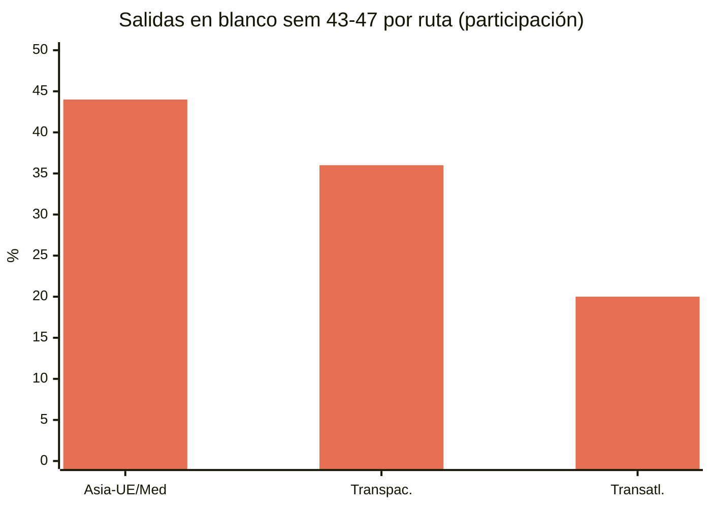

*Nota: Rastreador de Salidas Canceladas Drewry, 16 de octubre; 44 en blanco de 713 salidas previstas (tasa de cancelación 6%).*

### Índice Báltico Freightos (FBX)

Semana al 13 de octubre: Asia–Costa Oeste de EE. UU. (FBX01) −2% hasta $8.149/FEU; Asia–Costa Este de EE. UU. (FBX03) estable en $9.606/FEU; Asia–Norte de Europa (FBX11) estable en $3.260/FEU; Asia–Mediterráneo (FBX13) +7% hasta $3.804/FEU. Aéreo: China–Norteamérica +3% hasta $5,77/kg; China–Norte de Europa −7% hasta $3,58/kg — esto último refleja el fin en julio de la exención de minimis de €150 de la UE (importaciones China/HK vía Fráncfort −1,8%/−7,4% en septiembre). La referencia aérea de Freightos sigue 33% por encima del año anterior. Las tarifas transpacíficas estuvieron planas durante la Semana Dorada y luego se suavizaron ligeramente — el inicio de la caída posterior a las fiestas, con volúmenes proyectados a la baja en noviembre–diciembre. ([AJOT / Freightos](https://www.ajot.com/news/freightos-weekly-update-attacks-disrupt-saudi-air-cargo-china-europe-air-rates-slump))

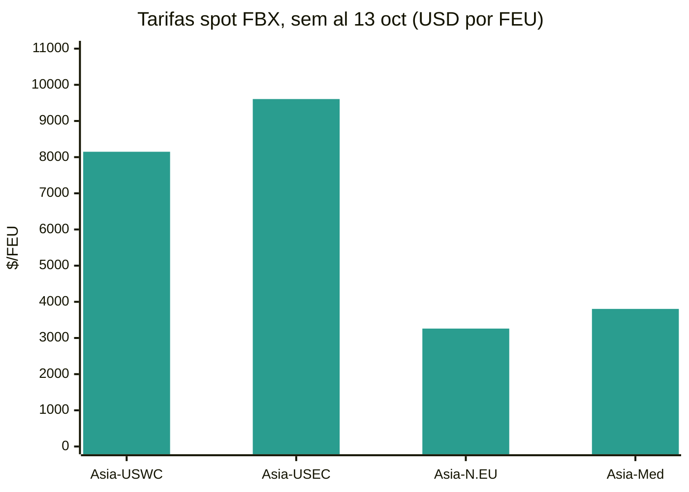

*Nota: FBX01 $8.149 (−2%), FBX03 $9.606 (estable), FBX11 $3.260 (estable), FBX13 $3.804 (+7%).*

### Carga seca a granel — Bolsa Báltica

El **Índice Báltico de Carga Seca** cayó una tercera semana consecutiva, cerrando el viernes 16 de octubre en **2.511 — un 14% menos en la semana**, el más bajo desde el 30 de junio. El índice Capesize cayó 25% semanal hasta 3.249 (el más bajo desde principios de abril); los ingresos 5TC Capesize promediaron $25.961/día (−$664/día). El Panamax cayó 1,8% hasta 2.314 (ingresos $20.827/día). El Supramax fue la excepción resiliente, subiendo 9 puntos hasta 1.865. El mineral de hierro tocó mínimos de dos años a mitad de semana por la débil demanda china y el aumento de inventarios antes de rebotar el viernes. (Fuentes: [Baird Maritime](https://www.bairdmaritime.com/shipping/dry-cargo/bulkers/baltic-index-stays-in-the-doldrums-as-capesize-rates-slide-further), [Safety4Sea](https://www.safety4sea.com/baltic-exchange-maritime-market-highlights-october-12-16/))

### Carga aérea

Las tarifas spot globales se mantuvieron en **$3,55/kg en la semana 41** pese a la pausa de la Semana Dorada — el tonelaje bajó 1% semanal por tercera semana consecutiva pero subió 9% interanual; las tarifas spot subieron 34% interanual; la tarifa de mercado completo de $3,13/kg se mantuvo estable. El spot de Asia-Pacífico cayó 3% semanal hasta $4,83/kg; el spot de África subió 10%. El combustible de aviación subió 111% interanual (IATA/Platts). El Índice Báltico de Flete Aéreo subió 5,0% en la semana al 5 de octubre, elevando su ganancia interanual a +25,5%, con las tarifas aún sin subir en línea con el combustible. La tecnología y la electrónica (servidores, semiconductores, componentes de centros de datos) siguen siendo la fuente de demanda más fuerte, mientras el comercio electrónico a EE. UU. se ha reducido por los cambios arancelarios a importaciones de bajo valor. La capacidad del Golfo se contrajo 4% semanal en la semana 41 por los ataques hutíes a aeropuertos, dejándola 20% por debajo de los niveles de finales de febrero. (Fuentes: [StatTimes / WorldACD](https://www.stattimes.com/air-cargo/global-air-cargo-rates-remain-stable-at-355kg-in-week-41-1360975), [Baltic Exchange](https://www.balticexchange.com/en/news-and-events/news/guest-column/2026/Air-freight-rates-remain-firm-in-September-with-renewed-surge-in-jet-fuel-yet-to-feed-through.html))

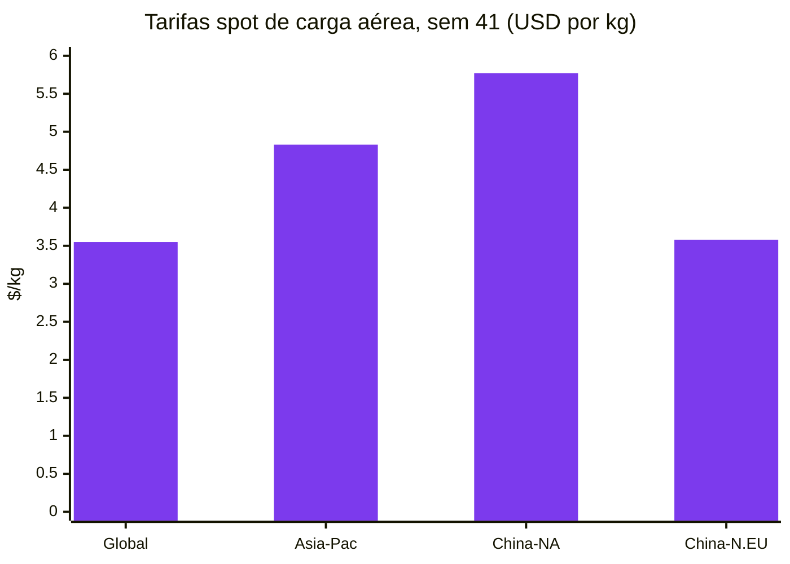

*Nota: WorldACD vía StatTimes (19 de octubre) y Freightos (13 de octubre); global $3,55 (+34% interanual), Asia-Pacífico $4,83, China–Norteamérica $5,77, China–Norte de Europa $3,58.*

### Fiabilidad de itinerarios

La tarjeta de puntuación de septiembre de Xeneta: las llegadas puntuales globales cayeron 2 puntos porcentuales hasta **27%**, la cuarta caída mensual consecutiva; el retraso promedio alcanzó 6 días (+2,4 días desde el T2). Lejano Oriente–Europa colapsó a 4% puntual con 9,9 días de retraso promedio — lo peor desde septiembre de 2021. Asia–Norteamérica quedó sin cambios en 20% puntual, con el retraso subiendo a 6,9 días. Cada naviera rastreada registró su peor retraso promedio de 12 meses (CMA CGM 30%, Cosco 18%, Hapag-Lloyd 45%, Yang Ming 4% puntual). El spot China–Costa Oeste de EE. UU. promedió $7.717/FEU a principios de octubre — cerca de cuatro veces los $1.778 de septiembre de 2025; las tarifas a largo plazo subieron 26% mensual hasta $3.649/FEU el 1 de octubre. ([FreightWaves / Port Technology](https://www.olgn.news/freightwaves-shippers-waiting-an-extra-week-for-us-bound-containers/))

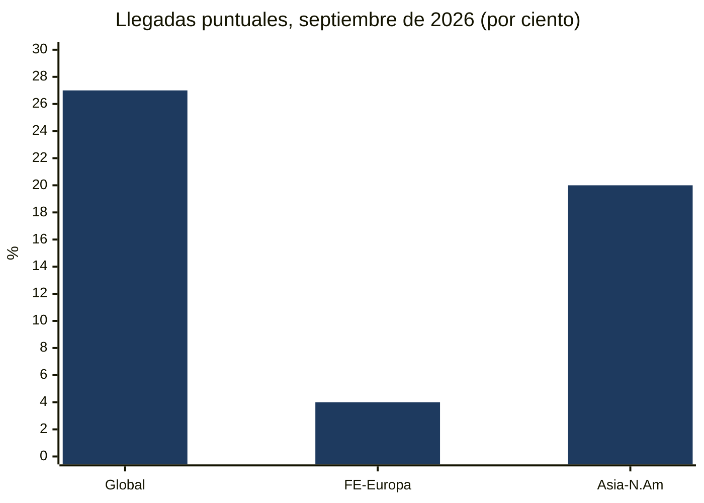

*Nota: Xeneta vía FreightWaves/Port Technology; global 27% (−2pp), Lejano Oriente–Europa 4% (9,9 días de retraso promedio), Asia–Norteamérica 20% (6,9 días de retraso).*

### Interrupciones portuarias y logísticas

- **Ormuz/hutíes:** el portacontenedores *GFS Pride* hundido (15 de octubre); 12 ataques a buques del 5 al 11 de octubre; cruces del estrecho reducidos a 131/semana; capacidad de carga aérea del Golfo −4% semanal. Declaración presidencial del CSNU adoptada por consenso el 15 de octubre condenando los ataques hutíes contra Arabia Saudita y el transporte marítimo del Mar Rojo. (Ver Alertas A2.)
- **Ciberextorsión:** 38 empresas marítimas en 18 países enfrentan una fecha límite de rescate el 19 de octubre, 13:27 UTC (ver Alerta A3).
- **Suez:** inspecciones obligatorias y pruebas de mar para buques de 25 años o más con efecto el 6 de octubre; la capacidad de contenedores a través del canal en las primeras dos semanas de octubre promedió 753.000 TEU/semana frente a 1.457.000 TEU en el mismo período de 2023 — el retorno está en marcha pero lejos de completarse.
- **Alemania:** ver.di aceptó un acuerdo salarial el 6 de octubre (~11.000 trabajadores, seis puertos, +3,4% en 12 meses), poniendo fin al riesgo de huelga en Hamburgo, Bremerhaven y Wilhelmshaven — pero niveles récord de bajada del Rin están restringiendo el tráfico de barcazas hacia Róterdam/Amberes; utilización de patios de Bremerhaven en 90%, Róterdam 85–90% lleno con tiempos de permanencia de 14 días.
- **Panamá:** la Autoridad del Canal elevó los cupos diarios reservados totales a 33 con efecto el 15 de octubre.
- **Costa Este de EE. UU.:** PhilaPort anunció una expansión de ~$837 millones — la mayor de su historia, primer nuevo atracadero en 50 años (14 de octubre). El Puerto de Long Beach fijó un récord mensual histórico en septiembre (acercándose a ~1 millón de contenedores); el Puerto de Los Ángeles registró su mes más activo en 118 años, aunque su director advirtió que los cambios de abastecimiento impulsados por aranceles crean riesgo de planificación.
- **Manila:** la suspensión de Hapag-Lloyd de todas las reservas a Manila hasta fin de año (reportada la semana pasada) sigue siendo el caso permanente de congestión extrema.
- **Bangladés:** DP World firmó una concesión de 15 años para la Terminal de Contenedores New Mooring de Chittagong (12 de octubre), en medio de continuas protestas de estibadores contra la toma de control.
- **Inversión de navieras:** la junta de HMM aprobó una inversión de $1.620 millones en 12 portacontenedores (ocho construcciones nuevas de 13.000 TEU más cuatro construcciones nuevas de reventa, 114.100 TEU combinados, entrega para diciembre de 2029) — apuntando a 166 buques / 1,47M TEU para fines de 2030. ZIM elevó su pronóstico de ganancias 2026 en 72% por la fuerte demanda. Los titulares de JOC también señalaron que Alemania bloqueó la oferta de Cosco por Zippel por preocupaciones de seguridad y que las acciones del ILWU están paralizando aperturas de terminales LA–LB.

### Inteligencia de proveedores

- **Descartes — Informe Global de Transporte Marítimo (edición de septiembre, ~13 de octubre).** Las importaciones de contenedores de EE. UU. alcanzaron su mayor volumen de septiembre registrado: 2,55 millones de TEU — un 2,2% menos que agosto, un 10,3% más interanual; volumen de enero–septiembre +0,8% interanual. Las importaciones de origen chino subieron fuertemente en el mes mientras la mayoría de los otros principales orígenes bajaron; los puertos de la Costa Oeste ganaron participación; los retrasos de tránsito portuario subieron en 8 de las 10 principales puertas (el mayor aumento en NY/NJ). La lista de vigilancia a futuro: incidentes Oriente Medio/Ormuz, aranceles ampliados (Sección 301/232, aranceles de la Sección 232 farmacéutica de septiembre), cupos de Panamá, enrutamiento del Mar Rojo, y la economía de EE. UU. (fondos federales 3,75–4,00%; PIB del T2 2,2% anualizado). Un dato publicado, no un artículo de producto. ([AJOT](https://www.ajot.com/news/descartes-global-shipping-report-u.s-container-imports-reach-highest-september-volume-on-record))
- **Descartes — Actualizaciones semanales de datos arancelarios de CustomsInfo.** Actualización del 16 de octubre: actualización arancelaria de México vigente el 14 de octubre (Decreto DOF 13/10/2026 — tasa temporal, sin cambios HS); solo actualización fiscal de Mauricio. Actualización del 9 de octubre: corrección técnica de EE. UU. para HTS 9903.85.67/68 (países aplicables corregidos a TODOS, no solo Rusia; derechos adicionales aplican solo si fundido/colado en Rusia); actualización de China del 8 de octubre. ([customsinfo.com](https://www.customsinfo.com/resources/industry-updates/))
- **TradeInt — asociación con el Ministerio de Comercio de Türkiye (anunciada el 30 de septiembre, justo antes de la ventana).** La asociación proporciona una subvención que otorga a firmas locales de consultoría acceso financiado a registros de embarques, declaraciones aduaneras y datos B/L que abarcan más de 200 países, destinada a la toma de decisiones de exportación de las pymes turcas; la revisión de TradeInt citó las exportaciones de Türkiye de 2025 en $269.700 millones. Un artículo de asociación gubernamental; no se encontró esta semana ninguna publicación de TradeInt con fecha en la ventana, y el blog de insights de TradeInt no tiene publicaciones fechadas verificables en la ventana. ([bayareametrowire](https://bayareametrowire.com/news/turkiyes-ministry-of-trade-grants-consulting-firms-access-to-global-trade-data-through-tradeint-partnership))

---

## 10. Cronologías de políticas

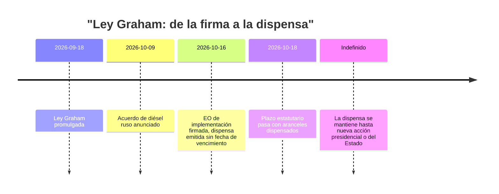

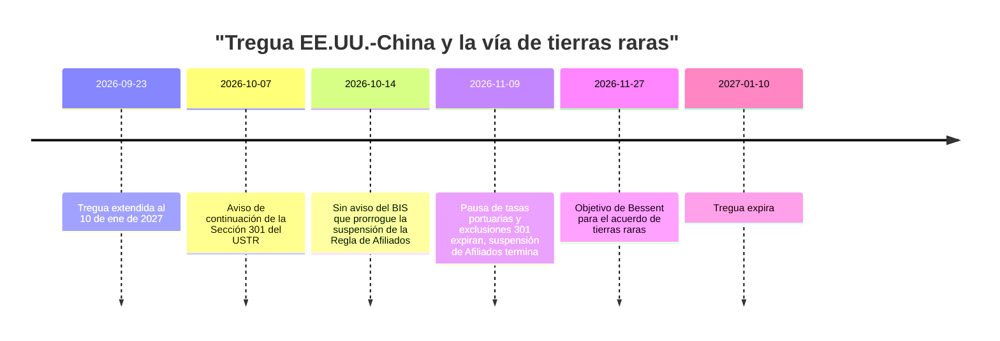

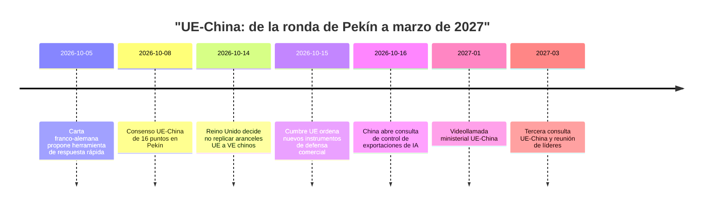

---

## 11. Próximos plazos y eventos (próximos 90 días)

| Fecha | Evento | Por qué importa |
|---|---|---|
| Oct 19, 2026 | Fecha límite de rescate por ciberextorsión (13:27 UTC) para 38 empresas marítimas | Primera oleada de ciberextorsión marítima a gran escala; atentos a divulgaciones |
| Oct 20, 2026 | El TLC India–Nueva Zelanda entra en vigor | Aranceles de NZ sobre exportaciones indias eliminados desde el primer día |
| Oct 22, 2026 | La Ley de Comercio Exterior enmendada de Corea entra en vigor | Motivos de restricción comercial se amplían de 5 a 9 |
| Oct 27, 2026 | OSD de la OMC: adopción del informe del panel China vs Türkiye sobre aranceles a VE; fecha límite de adopción del fallo India–Taiwán sobre aranceles TIC | Dos hitos de disputas el mismo día |
| Nov 9, 2026 | Expira la pausa de tasas portuarias de la Sección 301 (11:59 p.m. ET); expiran 178 exclusiones de la Sección 301; la suspensión de la Regla de Afiliados del BIS termina por sus términos | Triple precipicio de cumplimiento — tratar como fechas duras salvo acción del USTR/BIS |
| Nov 9, 2026 | Vencen comentarios de la investigación de salvaguardia de Madagascar |  |
| Nov 10, 2026 | Fecha de "reversión" de tierras raras de la guía anterior; fecha de reimplementación de la Regla de Afiliados | Atentos a acción formal del BIS |
| Nov 15, 2026 | Cierra la consulta de control de exportaciones de IA de China | El catálogo de 40 tecnologías podría adoptarse después |
| Nov 20, 2026 | Cumbre Reino Unido–UE (Bruselas) | Sigue a la decisión británica sobre aranceles a VE |
| Nov 27, 2026 | Acción de Gracias — objetivo de Bessent para el acuerdo de tierras raras |  |
| Dec 31, 2026 | Revisión acero/aluminio del arreglo UE–EE. UU.: concesiones suspendibles si los aranceles estadounidenses aún superan 15% | Primera prueba de restricción recíproca del acuerdo UE–EE. UU. |
| Jan 10, 2027 | La tregua EE. UU.–China expira |  |
| Jan 2027 | Videollamada ministerial UE–China |  |
| Mar 2027 | Tercera Consulta de Comercio e Inversión UE–China; próxima reunión de líderes UE–China; línea base del FMI asume reapertura de Ormuz |  |
| Principios de 2027 | TLC Australia–UE presentado al parlamento (lucha por la ratificación) |  |

## 12. Fuentes y metodología

Ventana de cobertura: 12 al 19 de octubre de 2026.

**Noticias y análisis comerciales:** FreightWaves, The Loadstar, Splash247, gCaptain, Hellenic Shipping News, Container News, Supply Chain Dive, Port Technology International, JOC (solo titulares), Shipping Telegraph, Baird Maritime, StatTimes/WorldACD, AJOT/Freightos, Metro Global, blog de TradeInt (sin publicaciones fechadas en la ventana).

**Política estadounidense:** whitehouse.gov (EO de implementación de la Ley Graham, fuente primaria), federalregister.gov (guía de contenido estadounidense del BIS 2026-20938; aviso de continuación del USTR 91 FR 64212), CBP (vía avisos comerciales: CAPE Fase 3, WRO, tasas de usuario), FMC (propuesta de tasa sobre España vía Supply Chain Dive), USTR (vía información secundaria), BIS (vía Mondaq/Crowell & Moring, Braumiller, Dechert), Thompson Hine, Steptoe, Mondaq, Gateway Lines, Thomson Reuters, JD Supra (sin artículos en la ventana), internationaltradetoday.com (solo titulares).

**Gobiernos del mundo:** cumbre del Consejo Europeo (vía prensa), Comisión Europea/DG Comercio (vía prensa), gov.uk Departamento de Negocios y Comercio (vía The Guardian/Fleet News), CBSA/Canadá (vía asociaciones de la industria), METI/Aduanas de Japón (vía Steptoe/Global Sanctions), MOTIR Corea (vía resumen de LinkedIn), english.mofcom.gov.cn (la recuperación directa falló; artículos del MOFCOM vía información secundaria y State Council English), ministerio de comercio de India (vía prensa), DFAT de Australia (vía prensa), MDIC de Brasil (vía Datamar).

**Multilateral:** wto.org (Perspectiva y Estadísticas del Comercio Mundial, 8 de octubre; información de comités y OSD vía prensa comercial), unctad.org (Informe sobre Comercio y Desarrollo 2026), OMA (lanzamiento de e-CENcomm, adenda del CCG), ITIP de la OMC (sin nueva publicación en la ventana), Trade Map del ITC (sin publicación en la ventana).

**Portales de datos:** Censo/BEA (FT-900 agosto de 2026; bienes anticipados septiembre de 2026), GACC (comercio de China septiembre de 2026), Eurostat (zona del euro agosto de 2026), OMC, FMI (PEM de octubre), UNCTADstat, USITC DataWeb / USA Trade Online / UN Comtrade / WITS (sin nuevas publicaciones de conjuntos de datos en la ventana).

**Tanques de pensamiento e investigación:** Laboratorio de Presupuesto de Yale (Estado de los Aranceles de EE. UU.; análisis de Dividendos Arancelarios), Modelo de Presupuesto Penn Wharton (Tasas Arancelarias Efectivas e Ingresos, actualización del 14 de octubre), Tax Foundation (Rastreador de Aranceles de Trump, versión de agosto de 2026), Mondaq (análisis del arreglo arancelario UE–EE. UU.), tradeintelligence.eu (no accesible por recuperación de texto esta semana).

**Fletes:** Drewry (Índice Mundial de Contenedores, evaluación del 15 de octubre; Rastreador de Salidas Canceladas, 16 de octubre), Bolsa Báltica (aspectos destacados del mercado semanal; BAI vía columna invitada), Índice Báltico Freightos (semana al 13 de octubre), Xeneta (fiabilidad de itinerarios, vía FreightWaves/Port Technology), Kpler (cruces del estrecho), Sea-Intelligence, Linerlytica, Veson, Hartland (ingresos de petroleros), Clarksons, SCFI, TAC Index, NRF Global Port Tracker, DHL, DC Velocity.

**Inteligencia de proveedores:** Descartes Systems Group (Informe Global de Transporte Marítimo, edición de septiembre; actualizaciones semanales de datos arancelarios de CustomsInfo) y TradeInt (asociación con el Ministerio de Comercio de Türkiye, 30 de septiembre) — solo artículos de noticias de proveedores: publicaciones de datos, asociaciones gubernamentales y movimientos de mercado.
