# Laporan Intelijen Perdagangan Global — Pekan 12–19 Oktober 2026

**Laporan mingguan.** Jendela cakupan: 12–19 Oktober 2026. Disusun dari sekitar 45 sumber berita perdagangan, kebijakan, data, dan angkutan di seluruh dunia.

---

## Daftar isi

1. [Ringkasan eksekutif](#1-executive-summary)
2. [Peringatan](#2-alerts)
3. [Berita utama — kajian mendalam](#3-top-stories--deep-dives)
4. [Pelacak tarif](#4-tariff-tracker)
5. [Kajian mendalam kebijakan AS](#5-us-policy-deep-dive)
6. [Kebijakan dunia berdasarkan kawasan](#6-world-policy-by-region)
7. [Tindakan penegakan](#7-enforcement-actions)
8. [Rilis data](#8-data-releases)
9. [Pasar angkutan](#9-freight-market)
10. [Linimasa kebijakan](#10-policy-timelines)
11. [Tenggat waktu & agenda mendatang (90 hari ke depan)](#11-upcoming-deadlines--events-next-90-days)
12. [Sumber & metodologi](#12-sources--methodology)

---

## 1. Ringkasan eksekutif

Sebuah pekan di mana undang-undang sanksi penting ditandatangani lalu menjadi tidak relevan, kampanye Hormuz mulai menenggelamkan kapal kontainer, dan tiga ekonomi perdagangan terbesar di dunia melaporkan angka yang menunjuk ke arah berlawanan.

- **Graham Act dibebaskan sebelum sempat menggigit.** Satu bulan setelah menandatangani Lindsey O. Graham Sanctioning Russia and Iran Act of 2026 — dengan tarif utama 500% atas barang Rusia dan tarif sekunder 100% atas pembeli utama energi Rusia — Presiden Trump menandatangani perintah eksekutif October 16 yang menerapkan Undang-undang itu dan, dalam perintah yang sama, membebaskan ketentuan tarif dan sanksinya tanpa batas akhir. India, China, dan Türkiye, para pembeli yang menjadi sasaran Undang-undang itu, terus membeli. Kritikus bipartisan dan Kyiv menyebut pembebasan itu sebagai kemunduran; Gedung Putih tidak memberikan penjelasan publik yang rinci.
- **Hormuz merenggut kapal kontainer pertamanya.** Kapal berbendera Singapura *GFS Pride* (2,824 TEU) terkena serangan, terbakar dan tenggelam di lepas Hormuz pada October 15 — kapal kedua dan ketiga yang tenggelam sejak konflik dimulai. Dua belas kapal melaporkan serangan pada pekan October 5–11, total mingguan tertinggi selama perang; lintasan selat turun ke 131 dari 176 pada pekan sebelumnya dan arus minyak mentah turun ke perkiraan 12.6 mb/d. Sementara itu, pendapatan kapal tanker mencapai tingkat luar biasa: VLCC rata-rata $643,000 per hari selama sebulan terakhir.
- **Data menceritakan tiga kisah berbeda.** Surplus perdagangan China pada September mencapai $133.5 miliar, tertinggi dalam 20 bulan, karena ekspor melonjak 36.3% didorong booming perangkat keras AI — surplus Januari–September mencapai $938.5 miliar, dalam jangkauan tahun kedua berturut-turut di atas $1 triliun. Defisit AS pada Agustus melebar 13.7% menjadi $105.6 miliar karena impor mencapai rekor $420.8 miliar. Kawasan euro mencatat defisit perdagangan terbesar sejak January 2023 (€16.1 miliar) karena impor melonjak 16.7%. WTO menaikkan perkiraan perdagangan barang 2026 menjadi 3.9%, memperingatkan bahwa barang yang didorong AI menutupi kelemahan di tempat lain; prospek October dari IMF menempatkan pertumbuhan global 2026 pada 3.1%, dengan asumsi Hormuz dibuka kembali pada March.
- **Eropa menetapkan arah pertahanan dagangnya.** Pada KTT Brussels October 15–16, para pemimpin UE memandatkan "penggunaan penuh" atas langkah-langkah pertahanan perdagangan yang ada terhadap China dan meminta Komisi menyusun instrumen baru, sambil tetap membuka dialog menjelang pertemuan March 2027. Inggris, sebaliknya, memutuskan tidak menyamai tarif UE hingga 45.3% atas EV China, menyebut pilihan itu sebagai kepentingan Inggris semata. Beijing membuka konsultasi publik atas kontrol ekspor teknologi AI yang menyeluruh, mencakup bobot model besar dan metodologi desain chip.
- **Angkutan menunjukkan pemulihan sebagian.** Drewry World Container Index naik 3% menjadi $4,485/FEU pada penilaian October 15 — tarif Asia–Eropa naik untuk pertama kalinya dalam 13 pekan — sementara Baltic Dry Index turun untuk pekan ketiga berturut-turut ke 2,511 karena ambruknya pendapatan Capesize. Keandalan jadwal kontainer global turun ke 27% pada September, penurunan bulanan keempat berturut-turut. Tiga puluh delapan perusahaan pelayaran dan pelabuhan di 18 negara menghadapi tenggat tebusan pemerasan siber massal pada October 19.

**Angkutan:** gambar terbelah — angkutan peti kemas spot pulih berkat dorongan tarif pasca-Golden-Week dan blank sailing operator (44 dibatalkan untuk pekan 43–47), curah kering merosot karena bijih besi menyentuh titik terendah dua tahun, dan kargo udara stabil pada $3.55/kg dengan bahan bakar jet naik lebih dari 100% year on year.

---

## 2. Peringatan

| # | Peringatan | Berlaku | Dampak | Sumber |
|---|-------|-----------|--------|--------|
| A1 | Pembebasan bea Graham Act: EO October 16 menerapkan Lindsey O. Graham Sanctioning Russia and Iran Act dan sekaligus membebaskan ketentuan tarif dan sanksinya di bawah Sec. 115, tanpa batas akhir; sanksi Rusia sebelumnya dipertahankan | Oct 16, 2026 | India, China, Türkiye tetap memiliki akses ke energi Rusia tanpa bea baru AS; pembebasan berlaku sampai dicabut | [whitehouse.gov](https://www.whitehouse.gov/presidential-actions/2026/10/implementing-the-lindsey-o-graham-sanctioning-russia-and-iran-act-of-2026/) |
| A2 | Eskalasi Hormuz: kapal kontainer *GFS Pride* (2,824 TEU) terkena serangan dan tenggelam October 15; 12 serangan kapal October 5–11 (total mingguan tertinggi selama perang); lintasan selat turun ke 131/minggu; arus minyak mentah ~12.6 mb/d | Oct 12–15, 2026 | Tonase kontainer kini berisiko; ketentuan asuransi perang mengetat; pendapatan kapal tanker pada tingkat luar biasa | [Splash247](https://splash247.com/hormuz-claims-two-more-ships-in-fresh-wave-of-strikes/), [FreightWaves](https://www.freightwaves.com/news/container-ship-attacks-escalate-in-strait-of-hormuz) |
| A3 | Pemerasan siber massal terhadap sektor maritim: kelompok "n0n" mencantumkan 38 perusahaan pelayaran/pelabuhan/logistik di 18 negara pada October 12, mengancam publikasi data October 19, 13:27 UTC kecuali tebusan dibayar; tuntutan $400k–$400m per perusahaan; klaim belum terverifikasi | Tenggat Oct 19, 2026 | Gelombang pemerasan siber terkoordinasi berskala besar pertama yang menyasar target maritim; target termasuk ONE, CULines, TS Lines, Santos Brasil | [Splash247](https://splash247.com/shipping-firms-and-ports-caught-in-mass-cyber-extortion-claim/) |
| A4 | China menyusun kontrol ekspor teknologi AI (Pengumuman No. 48, October 16): 40 teknologi diusulkan untuk katalog dilarang/dibatasi (14 dilarang, 26 dibatasi), termasuk bobot LLM di atas 2 triliun parameter; persyaratan pendaftaran pra-ekspor berlaku segera; konsultasi publik hingga November 15 | Oct 16, 2026 (konsultasi hingga Nov 15) | Dapat membatasi transfer model AI, agen, dan desain chip ke luar negeri; penyebaran lokal di luar negeri tercakup | [aiandgpp.com](https://aiandgpp.com/2026/10/19/china-ai-export-controls-model-weights-sovereign-cloud/) |
| A5 | Tenggat ganda November 9 — tidak ada perpanjangan USTR per October 13: (a) jeda satu tahun atas biaya pelabuhan Section 301 untuk kapal terkait China berakhir (biaya kembali ke $80/NT untuk pemilik/operator China); (b) 178 pengecualian produk Section 301 berakhir (bea Daftar 1/2/3 kembali ke 25%, Daftar 4A ke 7.5%) | Nov 9, 2026, 11:59 p.m. ET | Importir harus memperlakukan November 9 sebagai tanggal akhir; tidak ada masa tenggang; pengecualian hanya menghapus lapisan 301 | [Gateway Lines](https://gatewaylines.com/press-releases/china-ship-fees-301-exclusions-nov-9-2026) |
| A6 | Larangan ekspor Rusia yang diperluas oleh Jepang berlaku October 16 (diumumkan October 6): mineral, bahan kimia, logam, mesin, peralatan industri, dan instrumen presisi ditambahkan ke daftar larangan | Oct 16, 2026 | Eksportir ke Rusia harus meninjau ulang cakupan produk | [Steptoe](https://www.steptoe.com/en/news-publications/international-compliance-blog/weekly-sanctions-update-october-13-2026.html) |
| A7 | FMC mengusulkan biaya $200,000 per pelayaran atas kapal berbendera Spanyol ditambah pembatasan impor atas barang Spanyol (parfum, minyak/lemak, keramik, barang batu, gula, kembang gula) setelah temuan 2024 bahwa Spanyol menolak akses pelabuhan bagi kapal berbendera AS | Diusulkan October 16, 2026 | Eskalasi kewenangan pembalasan FMC atas diskriminasi bendera; dua kapal MSP Maersk ditolak aksesnya | [Supply Chain Dive](https://www.supplychaindive.com/news/fmc-proposes-fees-on-spanish-flagged-vessels-import-restrictions/833122/) |
| A8 | Tanah jarang: Bessent mengatakan AS berharap menyelesaikan kesepakatan tanah jarang dengan China, "mudah-mudahan", sebelum Thanksgiving (Nov 27); penangguhan BIS Affiliates Rule (pemberlakuan kembali adalah November 10) diperkirakan mengikuti perpanjangan gencatan senjata hingga Jan 10, 2027, tetapi tidak ada pemberitahuan resmi Federal Register per October 14 | Target Nov 27, 2026 | Tim kepatuhan menghadapi tanggal pemberlakuan kembali yang keras tanpa ada perpanjangan resmi yang diterbitkan | [eximguru](https://eximguru.com/export-import-news/export-news/us-china-rare-earths-deal-will-116956.aspx), [Mondaq](https://www.mondaq.com/unitedstates/export-controls-trade-investment-sanctions/1854664/us-china-trade-truce-extended-two-months-bis-affiliates-rule-suspension-follows) |

### A1 — Pengabaian Graham Act (rincian)

Perintah eksekutif yang ditandatangani October 16 berjudul "Implementing the Lindsey O. Graham Sanctioning Russia and Iran Act of 2026" — Undang-undang itu sendiri ditandatangani September 18, 2026 (Public Law 119-111), lolos di Senat 86–11 dan di DPR 262–159. Section 2 dari perintah tersebut menetapkan tarif resmi: tambahan 500% ad valorem atas barang asal Rusia; 100% atas barang dari lima importir minyak mentah dan gas alam Rusia terbesar yang secara sadar melakukan pembelian baru pada atau setelah October 18, 2026; dan 100% atas barang dari lima fasilitator utama penghindaran sanksi minyak Rusia, semuanya ditumpuk di atas tarif yang sudah ada.

Section 4(a) kemudian membebaskan bea-bea tersebut — dan ketentuan sanksi dalam Sections 102(a), 102(d), 102(e), 103–111, dan 117 — di bawah kewenangan waiver Section 115 Undang-undang itu, dengan sertifikasi tertulis kepentingan nasional yang disampaikan ke Kongres. Waiver ini tidak memiliki batas akhir: ia berlaku sampai Presiden, atau Menteri Luar Negeri setelah berkonsultasi dengan Treasury dan USTR, menentukan tindakan lanjutan sesuai. Section 4(b) mempertahankan semua sanksi Rusia sebelumnya yang dijatuhkan melalui perintah eksekutif darurat nasional (status darurat diperpanjang March 24, 2026), dan USTR ditugaskan memantau pembelian energi Rusia serta melapor kembali.

**Analisis:** struktur ini memberi pemerintahan sebuah ancaman tarif yang tetap siaga — mesin pelaksanaan dan tarifnya kini telah ditetapkan — tanpa mengenakan bea apa pun hari ini. Biaya politiknya langsung terasa: Senator Blumenthal, Tillis, dan Cornyn mengkritik langkah tersebut, Presiden Zelenskyy keberatan, dan RUU bipartisan untuk membatasi kewenangan waiver diajukan, meski tak satupun menjadi undang-undang. Gedung Putih tidak memberikan penjelasan publik yang rinci, menurut laporan AP. Bagi penyuling minyak India dan China, waiver ini menghapus tenggat yang sebelumnya ditetapkan pada October 18; bagi importir AS, risiko tarif ditunda, bukan dihapus — penetapan di masa depan dapat mengaktifkan kembali bea tersebut.

### A2 — Hormuz merenggut kapal kontainer pertama (rincian)

Splash247 melaporkan October 15 bahwa tiga kapal kontainer terkait AD Ports/GFS terkena serangan di dekat Hormuz. Kapal berbendera Singapura *GFS Pride* (dibangun 2008, 2,824 TEU) terkena serangan, terbakar dan tenggelam, dengan seluruh 21 awak dievakuasi. *GFS Giselle* (2015, 4,400 TEU) mengalami kerusakan lambung tetapi mencapai tempat lego jangkar dengan 22 awaknya selamat; *Al Saadiyat* (1,730 TEU, Safeen Feeders) lolos dari kerusakan serius. Secara terpisah, kapal capesize *Cape Dao* (170,000 dwt) tenggelam sekitar tiga pekan setelah terkena serangan di lepas pantai Oman. Berdasarkan data korban IMO, ini adalah kapal kedua dan ketiga yang tenggelam sejak konflik dimulai.

UKMTO mencatat 12 kapal melaporkan serangan pada pekan October 5–11 — total mingguan terbesar sejak perang dimulai. Kpler menghitung 131 lintasan selat pada pekan yang berakhir October 14, turun dari 176 pada pekan sebelumnya; minyak mentah yang melewati selat diperkirakan 12.6 mb/d pada October 13 dibandingkan sekitar 15 mb/d pada akhir September. FreightWaves melaporkan analis memperingatkan bahwa pertanggungan asuransi perang dapat dibatalkan dengan pemberitahuan singkat ketika kargo bergerak dengan kapal yang tidak tercantum dalam bill of lading — detail dokumentasi dengan konsekuensi kontraktual nyata bagi pengirim yang kini merutekan barang menghindari atau melewati selat.

**Analisis:** kampanye ini telah beralih dari pelecehan menjadi penghancuran tonase pelayaran kontainer. Bagi jadwal liner yang sudah berjalan pada keandalan global 27%, hilangnya opsi Laut Merah dan Hormuz memperparah gangguan. Penyeimbangnya dari sisi keuangan sangat mencolok: broker Hartland memperkirakan pemilik independen VLCC, suezmax, dan aframax meraup sekitar $400 juta per hari di atas ekspektasi anggaran; jika bertahan setahun, itu akan mendekati rekor laba tahun pandemi pelayaran kontainer sebesar $150 miliar. VLCC rata-rata $643,000 per hari selama sebulan terakhir, dengan rute Teluk Timur Tengah–China di atas $1.3 juta per hari (Veson). Nilai aset mengikutinya: VLCC berusia lima tahun dinilai $218 juta, premium 55% di atas harga kapal baru, dan nilai VLCC berusia 15 tahun naik 196% year on year.

### A3 — Gelombang pemerasan siber terhadap perusahaan maritim (rincian)

Pada October 12, kelompok yang menyebut dirinya "n0n" menambahkan 38 perusahaan pelayaran, pelabuhan, dan logistik di 18 negara ke situs kebocoran dark-web-nya, mengancam akan memublikasikan data yang dicuri pada October 19 pukul 13:27 UTC kecuali tebusan dibayar. Target yang disebut antara lain Ocean Network Express, CULines, TS Lines, Samudera, Santos Brasil, Portonave, BNCT, Pusan Newport, TTI Algeciras, Eurogate Tanger, Nam Dinh Vu, dan NEOM Ports. Cydome menilai tuntutan berkisar dari $400,000 hingga $400 juta per perusahaan; SOCRadar meninjau tuntutan $2.4 juta hingga $14 juta dalam Bitcoin. Pada saat pelaporan, klaim tersebut belum terverifikasi dan tidak ada perusahaan yang terdaftar mengonfirmasi terjadinya peretasan.

**Analisis:** ini adalah gelombang pemerasan siber terkoordinasi berskala besar pertama yang secara khusus menyasar target maritim. Terlepas dari asli atau tidaknya data itu, pelajaran operasionalnya tetap: aset IT pelabuhan dan operator diperlakukan sebagai target empuk oleh kelompok pemerasan terorganisir. Tim keamanan rantai pasok harus memperlakukan rentang tenggat ini sebagai periode risiko phishing dan intrusi yang meningkat.

### A4 — Draf kontrol ekspor AI China (rincian)

Pada October 16, MOFCOM dan Kementerian Ilmu Pengetahuan dan Teknologi membuka konsultasi publik (berakhir November 15) untuk menambahkan 40 teknologi ke katalog ekspor yang dilarang dan dibatasi: 14 dilarang, 26 dibatasi, 23 di antaranya terkait AI. Ambang batasnya spesifik: bobot model bahasa besar di atas 2 triliun parameter, model yang dilatih dengan lebih dari 10²⁶ FLOPs, atau model yang masuk peringkat sepuluh besar global; agen AI, klaster komputasi, dan metodologi desain chip juga tercakup. Persyaratan pendaftaran pra-ekspor berlaku pada hari yang sama, termasuk untuk kesepakatan yang sudah berjalan. Akses API dan SaaS dikecualikan; penyebaran lokal di luar negeri tercakup.

**Analisis:** jika diadopsi, ini akan menjadi rezim kontrol ekspor pertama China yang secara langsung menyasar bobot model AI garis depan — cerminan kontrol komputasi Washington. Pengecualian untuk akses API/SaaS tetapi pencakupan penyebaran lokal di luar negeri menunjukkan Beijing ingin memungut atau memblokir transfer bobot sambil menjaga arus pendapatan layanan cloud. Multinasional yang menjalankan beban kerja AI pada infrastruktur China, dan perusahaan AI China yang melisensikan model ke luar negeri, harus memetakan eksposur sebelum konsultasi ditutup.

---

## 3. Kisah-kisah utama — pembahasan mendalam

### 3.1 Undang-undang sanksi yang diabaikan hingga kehilangan makna

Undang-Undang Sanksi Rusia dan Iran Lindsey O. Graham tahun 2026 dirancang sebagai jawaban Kongres terhadap penghindaran sanksi: tarif sekunder wajib hingga 100% atas barang-barang pembeli energi Rusia terbesar, dan 500% atas barang-barang Rusia sendiri, berlaku tanpa pengecualian presiden. Undang-undang ini lolos dengan margin yang menyerupai mayoritas antikewajiban veto — 86–11 di Senat, 262–159 di DPR — dan ditandatangani pada 18 September. Batas waktu penentuan tarif adalah 18 Oktober.

Pada 16 Oktober, dua hari sebelum batas waktu, Presiden menandatangani perintah eksekutif pelaksanaannya. Perintah tersebut mendefinisikan tarif secara presisi, dalam Bagian 2. Kemudian, dalam Bagian 4(a), perintah itu mengabaikannya — menggunakan kewenangan pengecualian yang ditulis Kongres ke dalam Bagian 115 Undang-Undang tersebut. Pengecualian mencakup ketentuan tarif (Bagian 112 dan 113) maupun ketentuan sanksi (Bagian 102(a), 102(d), 102(e), 103–111, 117), dan tidak memiliki tanggal kedaluwarsa: pengecualian berlaku hingga Presiden atau Menteri Luar Negeri, setelah berkonsultasi dengan Kementerian Keuangan dan USTR, memutuskan sebaliknya.

**Analisis:** Kongres berupaya menulis undang-undang sanksi yang tidak dapat dikesampingkan oleh eksekutif; eksekutif justru mengesampingkannya sebulan kemudian dengan memakai klausul pengecualian undang-undang itu sendiri. Mesin pelaksananya kini berdiri sebagai instrumen tetap — tarif telah ditetapkan, pemantauan diserahkan kepada USTR, landasan sanksi darurat nasional dipertahankan — sehingga ancaman pengaktifan tetap nyata meski bea-nya nol hari ini. Kesenjangan dengan sekutu makin melebar: paket Inggris pada 8 Oktober menambah 38 target termasuk dua perusahaan energi dan 12 tanker armada bayangan, dengan London kini mengklaim sanksi mencakup lebih dari 90% kapasitas produksi minyak Rusia dan mendesak pembatasan lebih ketat atas jasa pelayaran, sementara Washington dilaporkan mempertimbangkan pelonggaran tanker untuk meredakan rekor tarif angkutan. UE secara terpisah menargetkan galangan-galangan kapal besar Rusia dalam regulasi yang diterbitkan 12 Oktober. Bagi para pembeli energi Rusia — India di atas segalanya — pengecualian menghilangkan tenggat Oktober tetapi menyisakan risiko pengaktifan ulang yang sepenuhnya berada dalam kebijaksanaan pemerintah.

### 3.2 Hormuz: perang kini menyasar kapal peti kemas

Oktober adalah bulan ketika kampanye Hormuz berhenti menjadi perang tanker dan menjadi perang peti kemas. Tenggelamnya *GFS Pride* pada 15 Oktober merupakan tenggelamnya kapal peti kemas pertama dalam konflik ini; 12 serangan yang dilaporkan UKMTO pada pekan 5–11 Oktober merupakan total mingguan tertinggi perang tersebut. Lalu lintas Selat merespons: 131 penyeberangan pada pekan yang berakhir 14 Oktober dibanding 176 pada pekan sebelumnya, dan arus minyak mentah turun ke perkiraan 12,6 juta bph dari sekitar 15 juta bph pada akhir September.

Dampak lanjutan makin meluas. Kampanye Houthi terhadap Arab Saudi — serangan rudal ke Bandara King Khalid di Riyadh, embargo maritim yang dideklarasikan, pernyataan presiden Dewan Keamanan PBB yang diadopsi secara konsensus pada 15 Oktober mengutuk serangan-serangan tersebut — mendorong kontraksi 4% kapasitas kargo udara Teluk pekan-ke-pekan pada pekan 41, sehingga kapasitas Teluk 20% di bawah level akhir Februari (WorldACD). Sementara itu, Otoritas Terusan Suez memberlakukan pemeriksaan dan uji laut wajib bagi kapal-kapal berusia 25 tahun ke atas mulai 6 Oktober — langkah keselamatan yang juga menyulitkan transit bagi tonase armada bayangan yang menua (92% tanker bayangan Rusia berusia di atas 15 tahun, menurut KSE Institute).

**Analisis:** rencana aliansi-aliansi peti kemas untuk kembali ke Laut Merah — semua aliansi plus MSC akan mengirim sejumlah kapal hingga akhir Oktober — kini menghadapi premi risiko baru. Para peneliti tarif angkutan Drewry menilai kelanjutan kembali Suez yang lebih cepat dari perkiraan sebagai ancaman utama bagi dukungan tarif perusahaan pelayaran; serangan-serangan baru terhadap kapal peti kemas bekerja ke arah berlawanan, menopang tarif dengan menahan kapasitas pada rute panjang. Tarik-menarik antara kedua kekuatan ini adalah pertanyaan sentral angkutan pada kuartal keempat.

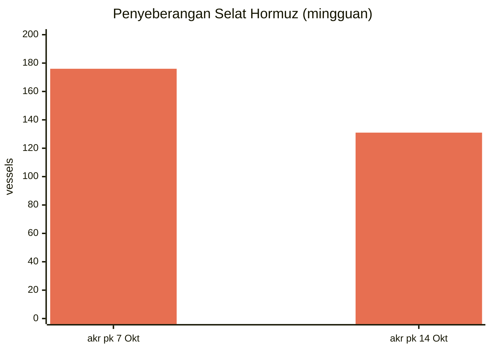

*Catatan: data Kpler; pekan berakhir 7 Okt: 176 penyeberangan; pekan berakhir 14 Okt: 131 penyeberangan.*

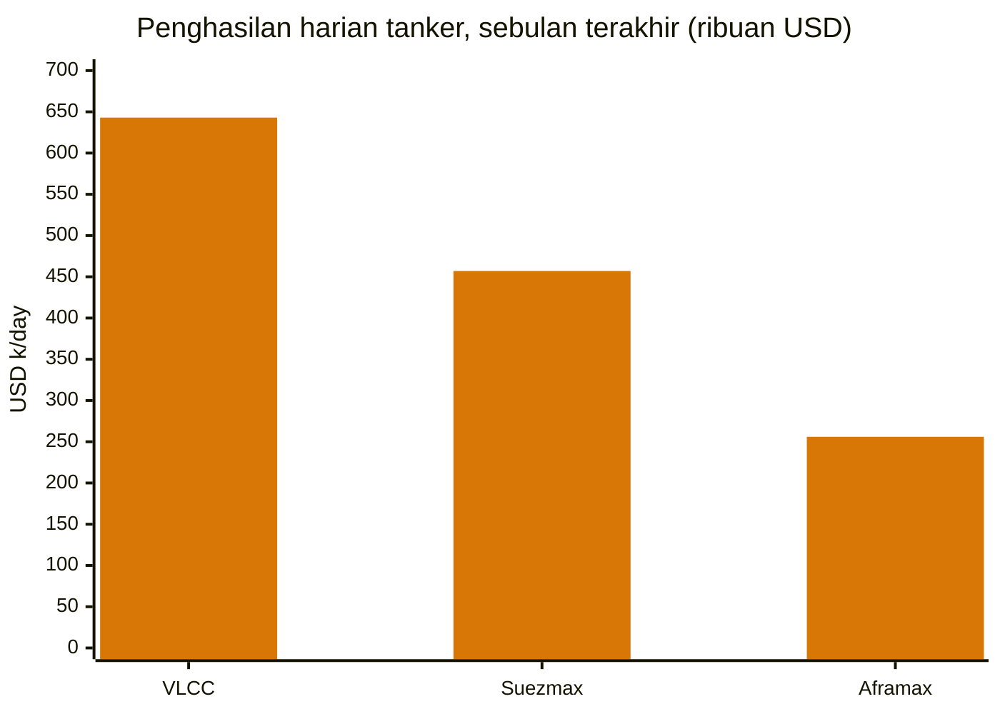

*Catatan: estimasi broker Hartland via Splash247; VLCC $643.000/hari, suezmax $457.000/hari, aframax $256.000/hari; rute MEG–Tiongkok VLCC di atas $1,3 jt/hari (Veson).*

### 3.3 Ekspor Tiongkok $133,5 miliar pada September dan ledakan perdagangan AI

Administrasi Umum Kepabeanan Tiongkok melaporkan pada 14 Oktober bahwa ekspor September melonjak 36,3% secara tahunan menjadi $447,18 miliar — tercepat sejak Februari, melawan ekspektasi 25,5% — sementara impor naik 31,0% menjadi $313,66 miliar. Surplus bulanan $133,5 miliar merupakan yang terbesar sejak Januari 2025, tertinggi dalam 20 bulan. Surplus Januari–September mencapai $938,5 miliar, sehingga dua tahun berturut-turut di atas $1 triliun kian terlihat (rekor 2025 sekitar $1,2 triliun). Ekspor ke AS tumbuh 9,8%, dengan surplus bilateral pada titik tertinggi 20 bulan sekitar $34 miliar — meski dua tahun eskalasi tarif. Ekspor teknologi tinggi, dipimpin semikonduktor yang naik sekitar 108% sejak awal tahun menurut data kepabeanan, mendorong sekitar separuh pertumbuhan ekspor.

Lembaga-lembaga makro membaca sinyal yang sama. Global Trade Outlook and Statistics WTO pada 8 Oktober menaikkan proyeksi volume perdagangan barang 2026 menjadi 3,9% dari 1,9% pada landasan Maret, dengan perdagangan barang pendukung AI naik 67% secara tahunan pada semester pertama dan menyumbang 47% peningkatan nilai perdagangan — 14,8% dari perdagangan barang dunia. Peringatan Direktur Jenderal Okonjo-Iweala tajam: "Dampak AI menyamarkan kecenderungan lain dalam perdagangan, yang tidak berada di sisi positif." Laporan Perdagangan dan Pembangunan UNCTAD pada 9 Oktober memproyeksikan pertumbuhan global 2,6% pada 2026, turun dari 2,9% pada 2025, dan mencatat perdagangan Tiongkok–AS turun lebih dari 20% sejak 2024. World Economic Outlook IMF pada 13 Oktober menempatkan pertumbuhan global 2026 di 3,1% (dari 3,5% pada 2025), dengan investasi AI mengimbangi guncangan energi Timur Tengah; landasannya mengasumsikan Selat Hormuz dibuka kembali pada Maret, dan memperkirakan penutupan memangkas pertumbuhan global sekitar 0,9 poin persentase sebelum dampak imbangan menurunkannya menjadi sekitar 0,3 poin.

**Analisis:** siklus perangkat keras AI-lah yang menopang volume perdagangan dunia — dan secara tidak proporsional bagi Tiongkok. Paradoks kenaikan 9,8% ekspor Tiongkok ke AS di tengah kampanye tarif mencerminkan pengalihan rute, percepatan awal, dan tarikan belanja modal AI yang begitu besar; ini juga menjelaskan mengapa pembingkaian "kepatuhan" era gencatan senjata di Washington terasa janggal dengan data.

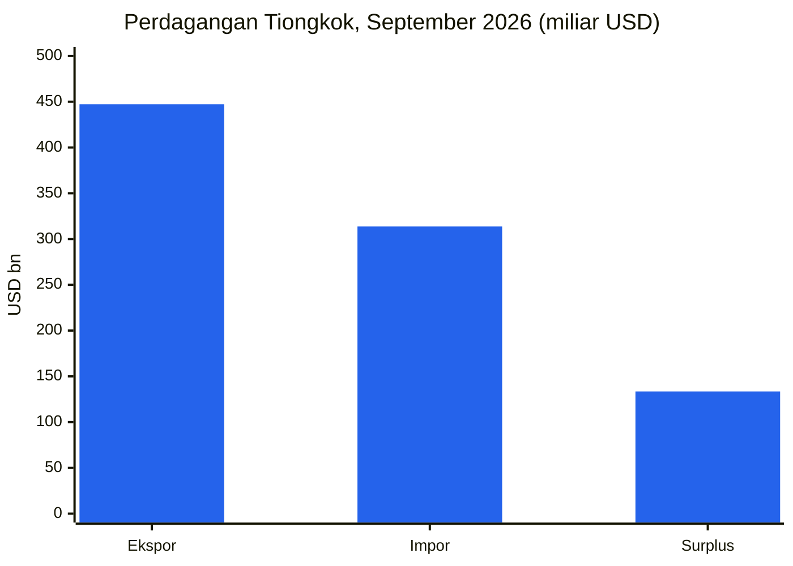

*Catatan: data GACC dirilis 14 Okt; ekspor $447,18 mld (+36,3% YoY), impor $313,66 mld (+31,0%), surplus $133,5 mld.*

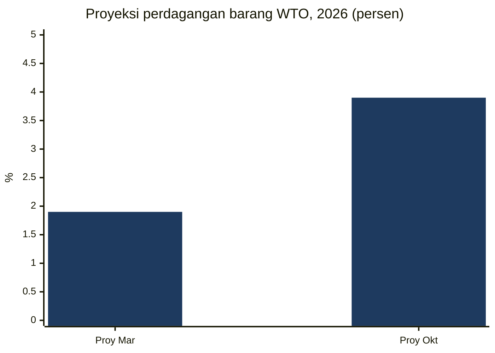

*Catatan: Global Trade Outlook and Statistics WTO, 8 Okt 2026; barang pendukung AI +67% YoY pada H1 menyumbang 47% pertumbuhan nilai perdagangan.*

### 3.4 Eropa menetapkan arah pertahanan perdagangannya

KTT Dewan Eropa pada 15–16 Oktober menghasilkan sinyal arah paling jelas pekan ini mengenai kebijakan perdagangan UE. Para pemimpin menugasi Komisi melanjutkan dialog dengan Beijing — pertemuan berikutnya direncanakan Maret 2027 — sembari "memanfaatkan penuh" langkah-langkah pertahanan perdagangan yang ada dan mengembangkan instrumen baru. Surat Prancis-Jerman pada 5 Oktober, yang mengusulkan kewenangan UE yang "sama kuatnya dengan" Pasal 301 AS atau pembatasan mineral kritis Tiongkok, mendominasi perdebatan: penyelidikan pertahanan perdagangan yang lebih cepat dan menyeluruh lintas sektor, tindakan mendesak atas bahan kimia, PET, dan kendaraan hibrida, serta pembalasan lebih cepat terhadap negara-negara yang merugikan blok tersebut. Pergeseran Jerman patut dicatat — dua tahun lalu Berlin menentang tarif anti-subsidi UE untuk kendaraan listrik.

Latarnya adalah konsensus 16 poin putaran Beijing 8–9 Oktober, yang harus ditafsirkan KTT. Putaran kedua Mekanisme Konsultasi Perdagangan dan Investasi Komisioner Šefčovič dan Menteri Wang Wentao menghasilkan pernyataan bersama yang mencakup kesepahaman yang konsisten dengan WTO mengenai perdagangan kendaraan hibrida (batas yang dilaporkan 350.000 mobil per tahun, yang dapat memangkas ekspor hibrida Tiongkok lebih dari separuh), pemotongan rabat pajak ekspor Tiongkok untuk kendaraan energi baru menjadi 13%, "jalur hijau" bagi lisensi tanah jarang dan magnet permanen, kelanjutan prosedur penetapan harga dalam kasus anti-subsidi EV UE, dan penjajakan pemotongan tarif MFN atas sekitar €4 miliar ekspor UE senilai setidaknya €225 juta penghematan bea. Teks Beijing yang diterbitkan tidak memuat angka pemangkasan separuh untuk ekspor hibrida — informasi yang ditinjau menyajikan karakterisasi UE dan teks Beijing sebagai berbeda, dan mekanisme penegakannya tidak diungkap. Defisit barang UE dengan Tiongkok mencapai €360 miliar (sekitar $400 miliar) pada 2025 dan berada di jalur melampauinya pada 2026.

**Analisis:** Brussels bergerak menuju postur pertahanan perdagangan yang lebih kuat dan cepat sembari menjaga jalur negosiasi tetap terbuka — jalur ganda klasik. Ujian kasusnya adalah sektor-sektor mendesak yang disebut dalam surat Prancis-Jerman (bahan kimia, PET, hibrida) dan apakah kesepahaman kendaraan hibrida terbukti dapat ditegakkan tanpa teks bersama.
### 3.5 Tanah jarang: papan catur Thanksgiving

Menteri Keuangan Bessent mengatakan pada 18 Oktober di acara Sunday Morning Futures Fox News bahwa Washington berharap menyelesaikan kesepakatan tanah jarang AS–Tiongkok "dengan harapan" menjelang Thanksgiving (27 November). Persyaratan yang dilaporkan akan membuat Beijing menangguhkan pembatasan ekspor mineral penting tertentu selama satu tahun, dengan tanah jarang mengalir "bebas sebagaimana sebelum 4 April" — tanggal Tiongkok memberlakukan persyaratan izin ekspor sebagai respons atas tarif AS. Satu media membingkai kesepakatan itu sebagai telah tercapai pada pertemuan Trump–Xi akhir Oktober di Korea Selatan; bingkai tersebut belum terverifikasi, dan hanya kutipan Bessent yang terkonfirmasi dalam informasi yang ditinjau.

Jalur paralelnya adalah Aturan Afiliasi BIS. Aturan interim-final tertanggal 29 September 2025 — ditangguhkan dari 10 November 2025 hingga 9 November 2026 — akan secara otomatis memperluas pembatasan Regulasi Administrasi Ekspor ke entitas asing yang sekurang-kurangnya 50% dimiliki, langsung atau tidak langsung, oleh pihak-pihak Daftar Entitas, Daftar Pengguna Akhir Militer, atau pihak SDN tertentu, termasuk kewajiban uji tuntas kepemilikan afirmatif (Bendera Merah 29). Dengan gencatan senjata AS–Tiongkok diperpanjang hingga 10 Januari 2027, Crowell & Moring menilai pada 14 Oktober bahwa penerapan kembali aturan tersebut seharusnya mengikuti gencatan senjata — tetapi per 14 Oktober, BIS belum menerbitkan pemberitahuan Federal Register yang secara resmi memperpanjang penangguhan.

**Analisis:** dua jam berjalan. Jam politik menargetkan Thanksgiving untuk kesepakatan tanah jarang; jam regulasi memiliki tanggal pemberlakuan kembali yang pasti, 10 November, untuk Aturan Afiliasi tanpa perpanjangan resmi yang diterbitkan. Tim kepatuhan tidak dapat mengandalkan penilaian pers mengenai niat — aturan tersebut aktif kembali menurut ketentuannya sendiri kecuali BIS bertindak.

### 3.6 Gencatan senjata AS–Tiongkok: periode kepatuhan, tanpa kedelai

Gencatan senjata dagang AS–Tiongkok berlaku hingga 10 Januari 2027 — perpanjangan dua bulan yang diumumkan oleh Menteri Bessent pada 23/24 September, lebih singkat dari enam hingga dua belas bulan yang diharapkan pasar. Perwakilan Dagang AS Greer menggambarkan periode gencatan senjata sebagai "periode kepatuhan" untuk menilai tindak lanjut Tiongkok atas pembelian kedelai dan akses tanah jarang. Defisit perdagangan barang AS dengan Tiongkok turun hampir 40% sejak kampanye tarif dimulai, menurut Greer.

Pada substansinya, kerangka "30-untuk-30" — sekitar $30 miliar barang tidak sensitif di masing-masing sisi — tidak beroperasi: Tiongkok mengusulkan 1.619 lini produk AS (jagung, daging, kapas, sorgum, jelai, oat, minyak kedelai, tetapi bukan kedelai untuk pangan atau penghancuran); AS mencantumkan 77 lini tarif (barang rumah tangga, mainan) yang dapat menerima tarif lebih rendah. Belum ada tarif atau tanggal mulai yang diterbitkan per pertengahan Oktober. Mengenai kedelai tidak ada komitmen pembelian baru: Tiongkok berkomitmen di bawah perjanjian sebelumnya untuk 25 juta metrik ton per tahun untuk 2026, 2027, dan 2028, dengan penjualan ekspor USDA menunjukkan sekitar 10,2 juta metrik ton yang dikomitmen untuk panen 2026–27 pada laporan terakhir, dan bea balasan 10% Tiongkok atas kedelai AS tetap berlaku, membatasi akses pembeli swasta.

**Analisis:** gencatan senjata adalah pola bertahan, bukan penyelesaian. Dengan pemberitahuan kelanjutan Section 301 tertanggal 7 Oktober yang mempertahankan semua tarif 2018 tetap berlaku — Daftar 1 sebesar 25% atas ~$34 miliar, Daftar 2 sebesar 25% atas ~$16 miliar, Daftar 3 sebesar 25% atas ~$200 miliar, Daftar 4A sebesar 7,5% atas ~$120 miliar — dan tinjauan empat tahunan kedua yang kini dibuka yang dapat menaikkan tarif, arsitektur tarif telah mengakar terlepas dari nasib gencatan senjata.

### 3.7 Angkutan: rebound Oktober dan kembalinya Suez

Indeks Kontainer Dunia Drewry naik 3% pada penilaian 15 Oktober menjadi $4.485 per FEU, didorong oleh Asia–Eropa: Shanghai–Rotterdam naik 6% menjadi $3.522 dan Shanghai–Genoa 7% menjadi $3.945 — kenaikan Asia–Eropa pertama setelah 13 penurunan mingguan berturut-turut. Transpasifik beragam: Shanghai–Los Angeles +3% menjadi $7.884, Shanghai–New York −1% menjadi $10.075. Drewry memperkirakan volatilitas yang lebih rendah ke depan. Rebound mengikuti dorongan tarif pasca-Golden Week oleh perusahaan pelayaran — FAK Asia–Eropa Utara baru MSC mulai 19 Oktober ditetapkan sebesar $3.150/TEU dan $4.500/FEU — dan 44 pelayaran kosong yang diumumkan untuk minggu 43–47 (tingkat pembatalan 6% dari 713 pelayaran yang direncanakan), dengan Asia–Eropa Utara/Med menyumbang 44% dari pembatalan.

Tekanan struktural berjalan ke arah sebaliknya. Linerlytica melaporkan pertumbuhan permintaan TEU-mile menurun untuk pertama kalinya sejak Januari, dan kembalinya Suez yang lebih cepat dari perkiraan — semua aliansi kontainer plus MSC akan mengirim sebagian kapal melalui Laut Merah menjelang akhir Oktober; transit Suez pada minggu 39 dilaporkan 68% lebih tinggi dari tahun ke tahun — adalah ancaman utama bagi dukungan tarif perusahaan pelayaran. Sekitar 200.000 TEU kapasitas kapal baru dikirim pada September tanpa satu pun yang dibongkar. Tarif Asia–Eropa turun sekitar 60% sejak Juli, meski masih di atas $3.000/FEU — sekitar 70% di atas setahun lalu — seiring musim tender 2027 dimulai. Otoritas Terusan Panama menaikkan total slot harian yang dicadangkan menjadi 33 efektif 15 Oktober, menambah pasokan lebih lanjut.

Curah kering bergerak ke arah berlawanan. Indeks Kering Baltik turun untuk minggu ketiga berturut-turut menjadi 2.511 pada 16 Oktober — turun 14% dalam seminggu dan terendah sejak 30 Juni — seiring indeks Capesize turun 25% dari minggu ke minggu menjadi 3.249 (terendah sejak awal April) akibat bijih besi yang lesu, yang menyentuh titik terendah dua tahunan pada pertengahan minggu. Panamax turun 1,8% menjadi 2.314; Supramax menjadi pencilan, naik 9 poin menjadi 1.865.

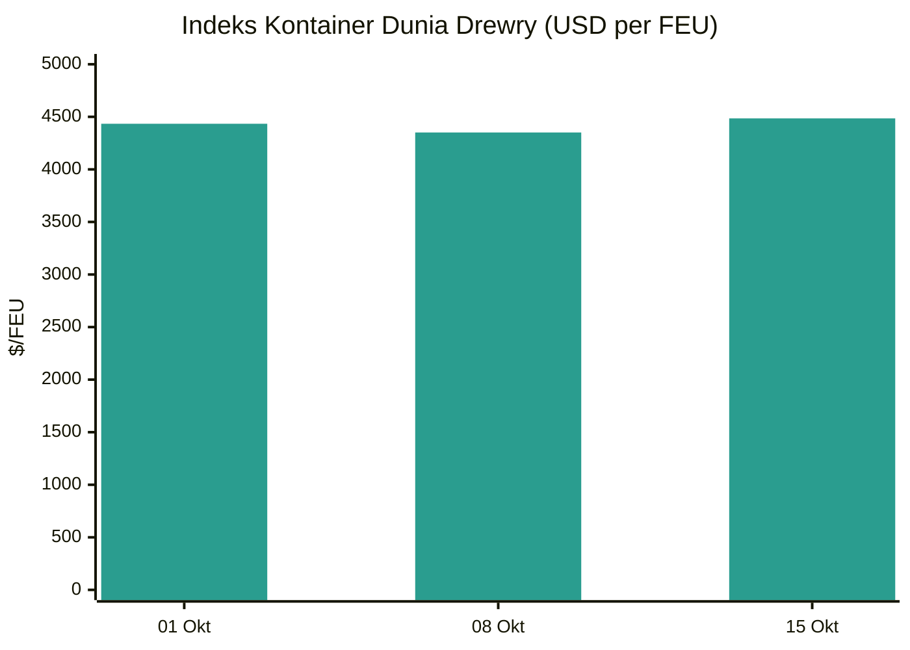

*Catatan: Penilaian Kamis Drewry; 1 Okt: $4,434 (−1%); 8 Okt: $4,351 (−2%); 15 Okt: $4,485 (+3%).*

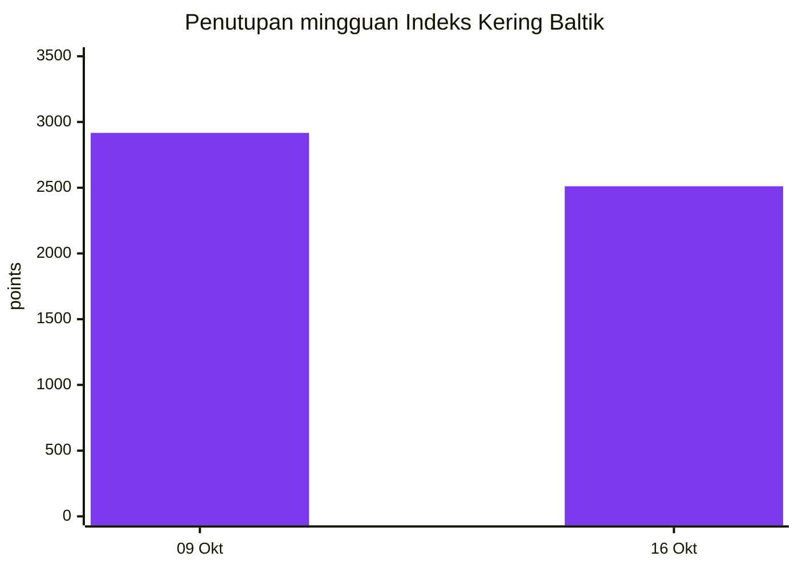

*Catatan: Penutupan Jumat; 9 Okt: 2,917 (−7.3% dalam seminggu); 16 Okt: 2,511 (−14% dalam seminggu), terendah sejak 30 Juni.*

### 3.8 Insidensi tarif: apa yang sebenarnya dibayar rumah tangga

Tiga rilis riset minggu ini mengkuantifikasi beban tarif pada rumah tangga AS. Estimasi hukum-yang-berlaku dari Yale Budget Lab menempatkan biayanya sekitar $1.100 per rumah tangga per tahun, mencerminkan kenaikan sekitar 0,7% pada tingkat harga keseluruhan setelah sepenuhnya diteruskan; rata-rata tarif statutory kini 11%, dijadwalkan mencapai 11,8% pada akhir 2026, membebani rata-rata rumah tangga sekitar $92 per bulan. Bea yang terkumpul mencapai 7,1% dari nilai impor pada Agustus, berbanding 2,3% pada Januari 2025 — dan akan mencapai 10,1% tanpa penghindaran perilaku. Pembaruan 14 Oktober dari Penn Wharton Budget Model menemukan tarif baru menambah $314,8 miliar penerimaan bea cukai kotor dari Januari 2025 hingga Agustus 2026 (sebelum pengembalian IEEPA), dengan $60,7 miliar lebih yang hilang akibat perubahan perilaku; penerimaan IEEPA total sekitar $166 miliar, semuanya dapat dikembalikan, dengan CBP mensertifikasi sekitar $126 miliar (76%) hingga 2 Oktober. Per Juli 2026 rata-rata tarif efektif AS adalah 6,7% — sekitar tiga kali lipat 2,3% pada Januari 2025 — dengan Tiongkok menghadapi 22,8%, baja dan aluminium 40,5%, dan otomotif 13%. Pelacak Agustus dari Tax Foundation menempatkan rata-rata tarif efektif 2026 sebesar 6,6%, tertinggi sejak 1969, setara sekitar $820 per rumah tangga pada 2026.

**Analisis:** ketiga model menyatu pada gambaran yang sama — rezim tarif sekitar tiga kali lebih berat dibanding Januari 2025, membebani rata-rata rumah tangga sekitar $1.000 per tahun, dengan alur pengembalian IEEPA ($166 miliar yang dapat dikembalikan, $126 miliar tersertifikasi) sebagai transfer fiskal tertunda terbesar dalam perang dagang.

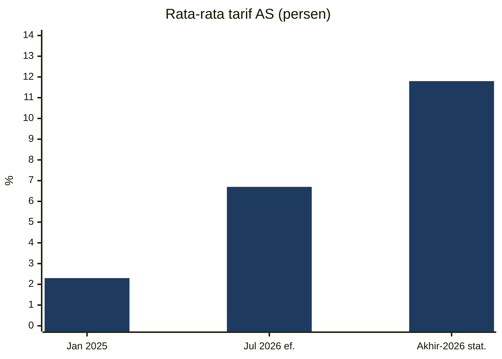

*Catatan: Januari 2025 efektif 2.3%; Juli 2026 efektif 6.7% (Penn Wharton; Tax Foundation 7.2% untuk tahun kalender 2026); akhir-2026 statutory 11.8% (Yale Budget Lab).*

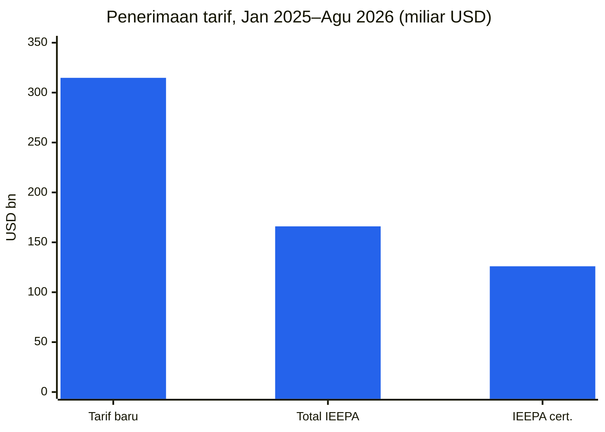

*Catatan: Penn Wharton Budget Model, pembaruan 14 Okt; penerimaan bea cukai kotor sebelum pengembalian IEEPA; IEEPA tersertifikasi = disertifikasi CBP untuk pencairan hingga 2 Okt.*

---

## 4. Pelacak tarif

| Negara / blok | Kebijakan | Tarif | Berlaku | Status | Sumber |
|---|---|---|---|---|---|
| Amerika Serikat | Bea Graham Act Sec. 112/113 + ketentuan sanksi (500% untuk barang Rusia; 100% sekunder untuk pembeli energi Rusia terbesar dan fasilitator penghindaran) | Dihapus — 0% | Penghapusan ditandatangani 16 Okt 2026; tanpa tanggal berakhir | Dihapus berdasarkan Sec. 115; dapat diaktifkan kembali melalui penetapan presiden/Kementerian Luar Negeri; dipantau USTR | [whitehouse.gov](https://www.whitehouse.gov/presidential-actions/2026/10/implementing-the-lindsey-o-graham-sanctioning-russia-and-iran-act-of-2026/) |
| Amerika Serikat | Section 232 untuk peralatan industri bergerak yang memenuhi syarat USMCA (forklift, bulldozer, backhoe, traktor, derek bergerak) dengan konten AS ≥40% | 25% → 15% (diturunkan) | 14 Okt 2026 | Panduan perhitungan BIS diterbitkan (FR 2026-20938) | [federalregister.gov](https://www.federalregister.gov/public-inspection/2026-20938/guidance-to-us-customs-and-border-protection-regarding-the-assessment-of-us-content-for-purposes-of) |
| Amerika Serikat | Biaya pelabuhan Section 301 untuk kapal terkait Tiongkok (jeda berakhir) | Kembali ke $80/NT (pemilik/operator Tiongkok); $23/NT atau $153/kontainer (buatan Tiongkok, operator non-Tiongkok); $46/NT (kapal pengangkut kendaraan buatan asing) | 9 Nov 2026, 11:59 p.m. ET | Tidak ada perpanjangan USTR per 13 Okt; 200+ asosiasi meminta perpanjangan 23 Sep | [Gateway Lines](https://gatewaylines.com/press-releases/china-ship-fees-301-exclusions-nov-9-2026) |
| Amerika Serikat | 178 pengecualian produk Section 301 (HTS 9903.88.69/70) | Daftar 1/2/3 kembali ke 25%; Daftar 4A ke 7,5% | 9 Nov 2026, 11:59 p.m. ET | Segera berakhir; tanpa masa tenggang | [Thomson Reuters](https://tax.thomsonreuters.com/blog/section-301-exclusions-expiration/) |
| Amerika Serikat | Kelanjutan tindakan Section 301 Tiongkok (2018) | Daftar 1/2: 25%; Daftar 3: 25%; Daftar 4A: 7,5% | Berlaku (pemberitahuan kelanjutan 7 Okt 2026) | Dilanjutkan; tinjauan empat tahunan kedua dibuka 6 Mei 2026 — tarif dapat dinaikkan | [facohub.com](https://facohub.com/posts/weekly-009) |
| Amerika Serikat | Tindakan Section 301 kerja paksa (60 ekonomi) | 10% / 12,5% | Berlaku sejak 24 Jul 2026 | Berlaku; masih disengketakan di CIT |  |
| Amerika Serikat | Biaya FMC yang diusulkan untuk kapal berbendera Spanyol | $200.000 per pelayaran + pembatasan impor untuk barang-barang Spanyol yang terdaftar | Diusulkan 16 Okt 2026 | Tahap usulan | [Supply Chain Dive](https://www.supplychaindive.com/news/fmc-proposes-fees-on-spanish-flagged-vessels-import-restrictions/833122/) |
| Tiongkok | Rancangan kontrol ekspor teknologi AI (Pengumuman No. 48) | Dilarang (14) / dibatasi (26) teknologi | Konsultasi hingga 15 Nov 2026; pendaftaran pra-ekspor berlaku 16 Okt | Tahap rancangan | [aiandgpp.com](https://aiandgpp.com/2026/10/19/china-ai-export-controls-model-weights-sovereign-cloud/) |
| Tiongkok | Pemangkasan rabat pajak ekspor kendaraan energi baru | Rabat dipangkas menjadi 13% | Disepakati 8–9 Okt 2026 | Sesuai konsensus 16 butir UE–Tiongkok | [peoplesdaily.pdnews.cn](https://peoplesdaily.pdnews.cn/china/er/30053309352) |
| Tiongkok | Ekspor kendaraan hibrida ke UE — pemahaman yang konsisten dengan WTO | Batas dilaporkan 350.000 mobil/tahun | Disepakati 8–9 Okt 2026 | Penjelasan UE; teks Beijing tidak mencantumkan angka | [peoplesdaily.pdnews.cn](https://peoplesdaily.pdnews.cn/china/er/30053309352) |
| UE | Usulan instrumen respons perdagangan cepat Prancis-Jerman | n/a (usulan) | Diusulkan 5 Okt; dibahas pada KTT 15–16 Okt | Komisi dimandatkan mengembangkan instrumen baru | [985theriver.com](https://985theriver.com/2026/10/05/france-germany-propose-new-rapid-eu-trade-response-tool/) |
| UE | Pengaturan tarif UE–AS (Reg. 2026/1455, 2026/1461) | Menghapus sisa bea UE atas barang industri AS; pengaman jika tarif baja/aluminium AS masih melebihi 15% pada 31 Des 2026 | Berlaku 1 Jul 2026–31 Des 2029 | Berlaku; arsitektur pengaman berlapis | [Mondaq](https://www.mondaq.com/italy/export-controls-trade-investment-sanctions/1848092/euus-tariff-agreement-the-new-regulations-and-their-safeguard-architecture) |
| UE | CBAM — panel sengketa Rusia DS639 dibentuk | n/a (sengketa) | Panel dibentuk 3 Okt 2026 | Tahap panel; UE hanya berinteraksi dengan panel | [news.metal.com](https://news.metal.com/newscontent/104143673-wto-establishes-cbam-dispute-panel-at-russias-request) |
| Inggris | Tarif EV Tiongkok (hingga 45,3%) — keputusan untuk tidak mengenakan | 0% (opsi dipertahankan untuk masa depan) | Diputuskan 14 Okt 2026 | Tidak dikenakan; KTT Inggris–UE 20 Nov | [Fleet News](https://www.fleetnews.co.uk/news/minister-reportedly-resists-calls-for-uk-to-impose-chinese-ev-tariffs) |
| Inggris | Rezim pengaman baja (kuota bebas tarif dipangkas; bea 50% di luar kuota) | 50% di luar kuota | Berlaku 1 Jul 2026 | India mengupayakan pengecualian untuk ~6 kategori / 88 lini baja | [buildwatchnews.com](https://buildwatchnews.com/india-seeks-steel-export-exemptions-uk-safeguard-tariffs/) |
| Kanada | Surtax pengaman sementara untuk kabinet/vanitas kayu (kode 26169A) | 25% | 31 Jul 2026 (hingga 200 hari) | Berlaku; rincian diterbitkan 7 Okt | [adamcabinet.com](https://www.adamcabinet.com/post-canada-cabinet-surtax.html) |
| Kanada | Tarif balasan atas ~900 barang asal AS (15/25/50%) | 50% untuk peralatan panahan (9506.99.00) | 8 Sep 2026 | Berlaku atas impor senilai C$27,6 miliar | [csaaa.org](https://www.csaaa.org/2026/10/15/50-tariffs-on-archery-equipment-hits-canadian-businesses-hard/) |
| Jepang | Perluasan larangan ekspor Rusia (mineral, kimia, logam, mesin, instrumen presisi) | Larangan | 16 Okt 2026 | Berlaku (keputusan Kabinet 2 Okt; perintah diundangkan 9 Okt) | [Steptoe](https://www.steptoe.com/en/news-publications/international-compliance-blog/weekly-sanctions-update-october-13-2026.html) |
| Korea | Undang-Undang Perdagangan Luar Negeri yang diubah (dasar pembatasan 5 → 9) | n/a | 22 Okt 2026 | Peraturan pelaksanaan disetujui 13 Okt | [LinkedIn / Don Southerton](https://www.linkedin.com/pulse/week-review-sunday-october-18-2026-short-version-don-southerton-vkbkc) |
| India | FTA India–NZ | NZ: nol tarif untuk ekspor India sejak hari pertama; India: kayu gelondongan, batubara kokas, skrap logam bebas bea | 20 Okt 2026 | Mulai berlaku | [Karmactive](https://www.karmactive.com/india-new-zealand-free-trade-agreement-2026/) |
| India | Kuota baja FTA UE | ~1,64 Mmt kuota bebas bea (~68,4% dari ekspor ~2,4 Mmt/tahun); penalti 50% di luar kuota; pungutan karbon 35% jika tanpa kesetaraan CBAM | Teks FTA (lampiran 11 Sep) | Kuota ~300.000 t di bawah alokasi operasional UE Juni 2026 | [takshashila.org.in](https://takshashila.org.in/content/blogs/2026-10-12-India-EU-FTA-and-its-steel-challenges.html) |
| Brasil/Mercosur | FTA Mercosur–EFTA | Tarif dihapus untuk ~99% nilai ekspor Brasil ke EFTA | 1 Okt 2026 (Dekrit 13.126) | Berlaku | [datamarnews.com](https://datamarnews.com/noticias/mercosur-efta-trade-agreement-brazil-business-opportunities/) |
| Madagaskar | Investigasi pengaman atas gula dan permen cokelat/kakao | n/a (investigasi) | Diberitahukan 9 Okt; komentar hingga 9 Nov 2026 | Investigasi yang diberitahukan ke WTO | [freightnews.co.za](https://www.freightnews.co.za/article/madagascar-launches-safeguard-investigation-on-certain-confectionery) |
| Australia | Ratifikasi FTA Australia–UE | Menghapus tarif atas ~98% ekspor Australia (daging sapi 35.000 t; daging domba ~31.000 t) | Diajukan awal 2027 | Nationals mengancam memblokir — akan menjadi kegagalan ratifikasi FTA Australia pertama | [particle.news](https://particle.news/story/coalition-split-threatens-passage-of-australiaeu-10bn-free-trade-deal) |
| Gabon | Larangan impor unggas (tantangan AS di WTO) | Larangan | Dalam tahap tantangan/diskusi | Interpelasi AS diakui 18 Sep; impor unggas beku ~$86,3 juta pada 2023 | [malivoice.com](https://malivoice.com/gabons-poultry-import-ban-heads-to-a-wto-dispute-with-washington/) |

---

## 5. Telaah mendalam kebijakan AS

### Penghapusan Undang-Undang Graham

Dibahas mendalam di Bagian 2 (A1) dan 3.1. Perintah eksekutif pelaksana tertanggal 16 Oktober menetapkan tarif-tarif undang-undang — 500% untuk barang asal Rusia, tarif sekunder 100% untuk lima importir terbesar minyak mentah dan gas alam Rusia yang melakukan pembelian baru pada atau setelah 18 Oktober, dan 100% untuk lima fasilitator utama penghindaran sanksi — kemudian menghapusnya berdasarkan Sec. 115 dengan sertifikasi tertulis kepentingan nasional kepada Kongres, tanpa tanggal berakhir. Sanksi-sanksi Rusia terdahulu berdasarkan kewenangan darurat nasional tetap berlaku. USTR ditugaskan memantau pembelian energi Rusia. Kritik bipartisan menyusul; tidak ada penjelasan rinci Gedung Putih yang diberikan secara publik.

### BIS — kontrol ekspor

**Panduan "konten AS" peralatan industri bergerak.** Pemberitahuan Federal Register 2026-20938 (91 FR 65162), diterbitkan dan berlaku 14 Oktober, melaksanakan Klausul (2)(D) Proklamasi Presiden 11032 (1 Juni 2026). Peralatan industri bergerak yang memenuhi syarat USMCA — forklift, bulldozer, backhoe, traktor, derek bergerak — memenuhi syarat tarif Section 232 yang diturunkan dari 25% → 15% apabila setidaknya 40% nilainya merupakan konten AS. Konten AS didefinisikan sebagai (a) nilai komponen yang seluruhnya diperoleh, diproduksi seluruhnya, atau ditransformasikan secara substansial di Amerika Serikat, ditambah (b) nilai baja yang dilebur dan dituang, aluminium yang dilebur dan dicetak, dan/atau tembaga yang dilebur dan dicetak di Amerika Serikat, sepanjang belum dihitung. Aturan ini berlaku untuk barang yang dimasukkan untuk konsumsi atau ditarik dari gudang pada atau setelah pukul 12:01 a.m. ET 14 Oktober 2026. ([federalregister.gov](https://www.federalregister.gov/public-inspection/2026-20938/guidance-to-us-customs-and-border-protection-regarding-the-assessment-of-us-content-for-purposes-of))
**Penangguhan Affiliates Rule.** Affiliates Rule interim-final (29 September 2025), ditangguhkan 10 November 2025–9 November 2026, akan secara otomatis memperluas pembatasan EAR ke entitas asing yang setidaknya 50% dimiliki — langsung, tidak langsung, atau secara agregat — oleh pihak Entity List, Military End-User List, atau pihak SDN tertentu, dengan kewajiban uji tuntas kepemilikan afirmatif (Red Flag 29). Menyusul perpanjangan gencatan senjata hingga 10 Januari 2027, penangguhan tersebut diperkirakan akan mengikuti, tetapi per 14 Oktober BIS belum menerbitkan pemberitahuan Federal Register yang secara resmi memperpanjangnya. ([Mondaq / Crowell & Moring](https://www.mondaq.com/unitedstates/export-controls-trade-investment-sanctions/1854664/us-china-trade-truce-extended-two-months-bis-affiliates-rule-suspension-follows))

### Pengembalian dana IEEPA: Fase 3 dan gugatan kelompok

CAPE Fase 3 milik CBP, diluncurkan 6 Oktober sesuai deklarasi CBP tertanggal 15 September kepada Pengadilan Perdagangan Internasional (CIT), membuka pengembalian dana untuk entri IEEPA yang telah dilikuidasi secara final — tetapi hanya bagi importir tercatat yang menjadi penggugat dalam perkara CIT yang masih berjalan (nomor IOR diserahkan hingga 30 Juli 2026; penyerahan berikutnya secara bergilir). Fase 3 mencakup sekitar $11,4 miliar, atau 6,9%, dari tarif IEEPA. Per 2 Oktober, CAPE telah menerima sekitar $136,6 miliar potensi pengembalian dana dan yang disertifikasi; sekitar $126 miliar telah disertifikasi dan dikirim ke Treasury untuk dibayarkan; sekitar 20.184 pengembalian dana (~$1,3 miliar) tertahan karena detail ACH yang belum lengkap. Pengembalian dana tiba 60–90 hari setelah penerimaan dengan bunga berdasarkan 19 CFR 24.36; ACE menerima unggahan CSV hingga 9.999 entri per deklarasi. Terpisah, pada 8 Oktober CIT mengesahkan sebuah kelompok dalam *Freestyle World v. CBP* (No. 26-01088) yang mencakup importir tercatat yang membayar bea IEEPA antara 1 Februari 2025 dan 19 Februari 2026 — tetapi belum memerintahkan pemulihan untuk kelompok tersebut. Pemerintah telah mengajukan banding (*V.O.S. Selections v. Trump*, No. 26-1895, Pengadilan Banding Federal), dengan argumen CIT tidak dapat memerintahkan pengembalian dana bagi importir yang tidak berperkara; banding tersebut belum diputus. (Sumber: [Supply Chain Dive](https://www.supplychaindive.com/news/cbp-starts-paying-out-ieepa-tariff-refunds-for-finally-liquidated-entries/832411/), [Thompson Hine](https://www.thompsonhine.com/insights/cbp-confirms-october-6-2026-launch-of-phase-3-of-the-ieepa-tariff-refund-process/), [gingercontrol](https://gingercontrol.com/blog/ieepa-tariff-refund-guide))

### Batas waktu ganda 9 November

Dua kebijakan berakhir pada pukul 11:59 p.m. ET Senin, 9 November 2026. Pertama, jeda satu tahun atas biaya pelabuhan Section 301 USTR untuk kapal terkait Tiongkok (FR 2025-19873): biaya kembali ke $80 per ton bersih untuk pemilik dan operator Tiongkok, yang lebih besar antara $23/NT atau $153 per kontainer yang dibongkar untuk kapal buatan Tiongkok di bawah operator non-Tiongkok, dan $46/NT untuk kapal pengangkut kendaraan buatan asing. Kedua, 178 pengecualian produk Section 301 (FR 2025-21671) yang diklaim berdasarkan HTS 9903.88.69 dan 9903.88.70: bea atas produk Daftar 1/2/3 kembali ke 25% dan Daftar 4A ke 7,5%, tanpa masa tenggang, dan pengecualian tersebut hanya menghapus lapisan 301 — bea MFN, 232, dan AD/CVD tetap berlaku. Per 13 Oktober, tidak ada pemberitahuan Federal Register yang menggeser salah satu tanggal; lebih dari 200 asosiasi perdagangan menulis surat kepada USTR pada 23 September meminta perpanjangan biaya pelabuhan. Para pelaku perdagangan sebaiknya memperlakukan 9 November sebagai tanggal berakhir. (Sumber: [Gateway Lines](https://gatewaylines.com/press-releases/china-ship-fees-301-exclusions-nov-9-2026), [Thomson Reuters](https://tax.thomsonreuters.com/blog/section-301-exclusions-expiration/))

### USTR

Pemberitahuan kelanjutan 7 Oktober (91 FR 64212, Dok. FR 2026-20510) mengonfirmasi tindakan Section 301 tertanggal 6 Juli 2018 dan 23 Agustus 2018 tetap berlaku — USTR menerima 162 permintaan kelanjutan; satu saja sudah cukup. Arsitekturnya dipertahankan: Daftar 1 sebesar 25% untuk ~$34B, Daftar 2 sebesar 25% untuk ~$16B, Daftar 3 sebesar 25% untuk ~$200B (dinaikkan dari 10% pada 10 Mei 2019), Daftar 4A sebesar 7,5% untuk ~$120B. Tinjauan empat tahunan kedua, dibuka 6 Mei 2026, menyusul dan dapat menaikkan tarif — siklus terakhir menaikkan semikonduktor menjadi 50% (2025), sel surya menjadi 50% (2024), serta baja/aluminium menjadi 25% (2024). Pemberitahuan penyesuaian pada hari yang sama (Dok. FR 2026-20511) mengubah satu pengecualian untuk perubahan kode statistik HTS 1 Juli 2026. Tidak ada siaran pers USTR dalam jendela yang ditinjau yang muncul dalam pencarian berita. ([facohub](https://facohub.com/posts/weekly-009))

### Operasi dan penegakan CBP

**Perintah penahanan pelepasan.** Pada 29 September CBP menerbitkan WRO terhadap minyak sawit dan produk turunannya dari Mitra Aneka Rezeki (MAR) dan Hardaya Inti Plantation (HIP), Indonesia, berdasarkan 19 U.S.C. §1307, berlaku segera. Informasi yang ditinjau menyebutkan transkrip wawancara, slip gaji, kuota panen, foto, laporan LSM dan pemerintah, media berita, dan riset akademik; pekerja di MAR ditemukan mengalami sembilan indikator kerja paksa ILO, HIP tujuh. Total WRO aktif kini berjumlah 60, ditambah delapan Findings. ([Thompson Hine](https://www.thompsonhine.com/insights/cbp-issues-withhold-release-orders-on-two-indonesian-palm-oil-producers/))
**Biaya pengguna bea cukai.** Penyesuaian FY2027 berlaku 1 Oktober: Biaya Pengguna Izin Broker Pabean naik dari $185,38 menjadi $190,88; tarif biaya pemrosesan barang tidak berubah sebesar 0,3464%, dengan minimum $34,58 dan maksimum $670,86 (CSMS #69847323; pemberitahuan FR diterbitkan 31 Juli 2026).

**Tindakan FMC terhadap Spanyol.** Dibahas di Peringatan A7: menyusul investigasi 2024 yang menemukan Spanyol menolak akses pelabuhan bagi kapal berbendera AS — dua kapal Program Keamanan Maritim Maersk ditolak — Federal Maritime Commission mengusulkan biaya $200.000 per pelayaran untuk kapal berbendera Spanyol ditambah pembatasan impor atas parfum dan kosmetik Spanyol, minyak dan lemak, keramik, barang batu, gula, dan permen. ([Supply Chain Dive](https://www.supplychaindive.com/news/fmc-proposes-fees-on-spanish-flagged-vessels-import-restrictions/833122/))

### Berita Negara — AD/CVD, 15 Oktober

Lima pemberitahuan AD/CVD Commerce diterbitkan 15 Oktober (hanya judul; sumber berbayar): Pasta Tertentu dari Italia (A-475-818) — hasil pendahuluan dan pembatalan sebagian tinjauan administratif AD 2024–2025; Paku Baja Tertentu dari Oman (A-523-808) — hasil pendahuluan dan niat pembatalan sebagian; Forged Steel Fluid End Blocks dari Italia (A-475-840) — putusan pengadilan tidak selaras dan hasil final yang diubah; Wood Mouldings and Millwork Products dari Tiongkok — pemberitahuan CVD (C-570-118) dan AD (A-570-117) mengenai putusan pengadilan tidak selaras dengan hasil final yang diubah. Tarif tidak terlihat. ([International Trade Today](https://internationaltradetoday.com/article/2026/10/15/commerce-department-antidumping-and-countervailing-duty-notices-for-oct-15-2610150042))

### Butir tetap

- **Gencatan senjata AS–Tiongkok** hingga 10 Januari 2027; kerangka "30-for-30" tidak berlaku; tidak ada komitmen kedelai baru (lihat 3.6).
- **Tanah jarang:** target Bessent "semoga sebelum Thanksgiving" (lihat 3.5 dan A8).
- **De minimis:** CBP menangguhkan pengecualian untuk kiriman non-pos mulai 24 Juni 2026 — latar belakang, pra-jendela.
- **Litigasi Section 301 Daftar 3/4A** telah ditutup (Mahkamah Agung menolak peninjauan 15 Juni 2026) — tidak ada pengembalian dana atas teori tersebut. Tindakan Section 301 semikonduktor simpul matang telah diputuskan tetapi ditunda hingga Juni 2027. Tindakan Section 301 kerja paksa (60 ekonomi, 10%/12,5%, berlaku 24 Juli 2026) tetap berlaku dan masih disengketakan di CIT.

---

## 6. Kebijakan global menurut wilayah

### Eropa

**KTT para pemimpin UE (Brussels, 15–16 Oktober).** Para pemimpin menugaskan Komisi untuk melanjutkan dialog dengan Beijing — pertemuan berikutnya direncanakan Maret 2027 — sambil memanfaatkan "sepenuhnya" instrumen pertahanan perdagangan yang ada dan mengembangkan instrumen baru. Usulan Prancis-Jerman untuk instrumen pembalasan respons-cepat, yang sekuat tarif Section 301 AS atau pembatasan mineral kritis Tiongkok, mendominasi perdebatan: investigasi pertahanan perdagangan yang lebih cepat di seluruh sektor, tindakan mendesak atas bahan kimia, PET, dan kendaraan hibrida, serta pembalasan yang lebih cepat terhadap negara-negara yang merugikan blok tersebut. Defisit perdagangan barang UE dengan Tiongkok mencapai €360 miliar (sekitar $400 miliar) pada 2025 dan berada di jalur untuk melampauinya pada 2026. ([bworldonline](https://bworldonline.com/world/2026/10/15/787181/eu-leaders-to-tackle-china-exports-energy-prices-budget-at-summit/))

**Konsensus 16 poin UE–Tiongkok (Beijing, 8–9 Oktober).** Mekanisme Konsultasi Perdagangan dan Investasi kedua antara Komisioner Šefčovič dan Menteri Wang Wentao menghasilkan pernyataan bersama: kesepahaman yang konsisten dengan WTO mengenai perdagangan kendaraan hibrida (batas dilaporkan 350.000 mobil per tahun, yang dapat memangkas ekspor hibrida Tiongkok lebih dari setengah — meski teks yang diterbitkan Beijing tidak mencantumkan angka); pemangkasan Tiongkok atas rabat pajak ekspor untuk kendaraan energi baru menjadi 13%; "jalur hijau" untuk lisensi tanah jarang dan magnet permanen; kelanjutan prosedur price undertaking dalam kasus anti-subsidi kendaraan listrik UE; dan penjajakan pemotongan tarif MFN atas ekspor UE senilai sekitar €4 miliar, yang bernilai setidaknya €225 juta dalam penghematan bea. Pertemuan video tingkat menteri dijadwalkan Januari 2027 dan konsultasi ketiga Maret 2027. ([peoplesdaily.pdnews.cn](https://peoplesdaily.pdnews.cn/china/er/30053309352))

**Inggris memutuskan menolak tarif EV Tiongkok (14 Oktober).** Menteri Bisnis Jonathan Reynolds mengatakan kepada The Guardian bahwa Inggris tidak akan tunduk pada tekanan UE untuk menyamai bea UE hingga 45,3% atas EV Tiongkok: keputusan pertahanan perdagangan "berdasarkan kepentingan Inggris — bukan berdasarkan permintaan negara lain." Tarif tetap "menjadi opsi di masa depan"; KTT Inggris–UE dijadwalkan 20 November di Brussels. Keputusan itu menyusul pemberitaan 4–7 Oktober bahwa Reynolds tengah menyusun paket tarif tandingan 45%, yang ditegaskan pemerintah belum diputuskan. ([Fleet News](https://www.fleetnews.co.uk/news/minister-reportedly-resists-calls-for-uk-to-impose-chinese-ev-tariffs))

**Safeguard baja Inggris dan upaya pembebasan India.** India tengah mengupayakan pembebasan baja dari rezim safeguard baru Inggris (berlaku 1 Juli 2026: kuota baja bebas tarif dipangkas, bea 50% di luar kuota) untuk sekitar enam kategori produk yang mencakup 88 lini baja. Secara terpisah, dorongan implementasi CETA India–Inggris pada 12–13 Oktober — Komite Ekonomi dan Perdagangan Bersama pertama sejak kesepakatan berlaku 15 Juli — mengumumkan lebih dari £1 miliar kesepakatan dagang baru di Bengaluru, dengan CETA Marketplace di Mumbai dan delegasi bisnis Inggris beranggotakan ~200 perusahaan. (Sumber: [buildwatchnews](https://buildwatchnews.com/india-seeks-steel-export-exemptions-uk-safeguard-tariffs/), [pravasisamwad](https://pravasisamwad.com/india-uk-trade-deal-expected-to-boost-exports-jobs-and-business-opportunities/))

**Kekurangan kuota baja FTA India–UE.** Analisis teks FTA yang diterbitkan 12 Oktober menunjukkan India memperoleh kuota baja sekitar 1,64 juta metrik ton — mencakup sekitar 68,4% dari ~2,4 Jt/tahun ekspornya ke UE dengan bea nol, dengan penalti 50% di atasnya — namun Lampiran FTA 11 September mengunci baseline sekitar 300.000 ton di bawah alokasi operasional unilateral UE Juni 2026. Semua ekspor masih menghadapi pungutan karbon 35% kecuali India memperoleh kesetaraan CBAM. ([Takshashila](https://takshashila.org.in/content/blogs/2026-10-12-India-EU-FTA-and-its-steel-challenges.html))

**Momentum Mercosur.** Menteri berkuasa Brasil Márcio Elias Rosa mengatakan 13 Oktober bahwa ekspor Brasil ke UE naik 30,7% pada Mei–September (ekspor Januari–September $44,17 miliar, +20%), dengan perdagangan bilateral Mercosur–UE tumbuh lebih dari $6 miliar sejak berlaku. ApexBrasil melobi anggota Parlemen Eropa di Brussels 12–16 Oktober untuk menjadwalkan pemungutan suara ratifikasi Parlemen Eropa. Ekspor agroindustri Argentina ke UE mencapai $1,92 miliar pada Mei–Agustus, +21% (+44% untuk produk preferensi tarif). FTA Mercosur–EFTA Brasil berlaku 1 Oktober (Dekrit 13.126), menghapus tarif atas sekitar 99% nilai yang diekspor Brasil ke EFTA. ([datamarnews](https://datamarnews.com/noticias/mercosur-eu-trade-deal-boosts-brazilian-exports-by-30-7/))

**Sengketa pelayaran EU ETS.** Asosiasi Pelabuhan Inggris (British Ports Association) menolak temuan Observatorium EU ETS Spanyol bahwa pertumbuhan kontainer Inggris mencerminkan penghindaran biaya karbon, dan mengaitkan pertumbuhan tersebut pada investasi — 85% pertumbuhan 2025 terkonsentrasi di London setelah dermaga keempat senilai £350 juta milik DP World di London Gateway dibuka pada akhir 2024 — serta restrukturisasi aliansi (peralihan Gemini milik Maersk dari Felixstowe ke London Gateway). Data pemerintah Inggris menunjukkan pelabuhan menangani 11% lebih banyak kontainer pada 2025 (+600.000 unit); London Gateway melampaui 3 juta TEU (+52% dari 1,9 juta). Studi Spanyol menemukan pangsa Inggris atas aktivitas deepsea Eropa Utara (TEU-miles) naik dari 17,5% pada 2023 menjadi sekitar 36% pada Q1 2026, dengan 76% perubahan rute dikaitkan dengan EU ETS. Komisi mengusulkan pada Juli agar pelabuhan non-UE dalam jarak 150 mil laut dari pelabuhan UE dapat dikecualikan dari definisi "port of call" ETS, dengan ambang transhipment dipangkas dari 65% menjadi 50%. (Sumber: [Splash247](https://splash247.com/uk-ports-hit-back-at-brussels-over-ets-diversion-claims/), [The Loadstar](https://theloadstar.com/uk-port-volume-growth-not-due-to-eu-shippers-avoiding-ets-says-bpa/))

### Tiongkok

**Rancangan kontrol ekspor AI.** Dibahas dalam Alerts (A4) dan Bagian 3.4: Pengumuman No. 48 tanggal 16 Oktober membuka konsultasi hingga 15 November mengenai penambahan 40 teknologi ke katalog terlarang/dibatasi (14 dilarang, 26 dibatasi; 23 terkait AI), dengan ambang mencakup bobot LLM di atas 2 triliun parameter, pelatihan di atas 10²⁶ FLOPs, atau model peringkat sepuluh besar global; persyaratan pendaftaran pra-ekspor berlaku segera, termasuk untuk kesepakatan yang sedang berjalan. Akses API/SaaS dikecualikan; penerapan lokal di luar negeri tercakup. ([aiandgpp.com](https://aiandgpp.com/2026/10/19/china-ai-export-controls-model-weights-sovereign-cloud/))

**Konsensus UE–Tiongkok.** Dibahas dalam Bagian 3.4: kesepahaman kendaraan hibrida (batas dilaporkan 350.000/tahun), pemotongan rabat NEV menjadi 13%, jalur hijau tanah jarang, penjajakan MFN atas ekspor UE senilai ~€4 miliar.

**Tiongkok membuka penyelidikan anti-dumping atas p-nitrotoluena UE** (berlanjut dari jendela minggu lalu) — konteks bagi sektor bahan kimia yang kini disebut dalam daftar tindakan mendesak Prancis-Jerman.

### India

**FTA India–Selandia Baru berlaku 20 Oktober.** Selandia Baru menghapus seluruh tarif atas ekspor India sejak hari pertama; India memberikan akses bebas bea atas kayu gelondongan, kokas batubara, dan skrap logam Selandia Baru (pertanian tetap dilindungi kuota); kerangka investasi $20 miliar; 5.000 visa kerja terampil tahunan plus 1.000 visa kerja-liburan. Langkah liberalisasi yang langka di tahun proteksionis. ([Karmactive](https://www.karmactive.com/india-new-zealand-free-trade-agreement-2026/))

**Upaya pembebasan safeguard baja Inggris dan kekurangan kuota baja UE** — lihat Eropa di atas.

### Türkiye

Tidak ada kebijakan pemerintah Turki dalam jendela yang muncul; kemitraan 30 September TradeInt dengan Kementerian Perdagangan Turki (hibah yang memberi perusahaan konsultan lokal akses berbayar ke catatan pengiriman, pengajuan bea cukai, dan data B/L di lebih dari 200 negara) berada tepat di luar jendela dan dicatat di bawah vendor intelligence.

### Kanada

**Penegakan safeguard dan counter-tariff.** Detail Pemberitahuan CBSA 26-17 (penjelasan diterbitkan 7 Oktober): surtax safeguard sementara 25% atas lemari kayu dan meja rias mulai 31 Juli hingga 200 hari (kode safeguard 26169A). Asosiasi Senjata Olahraga dan Amunisi Kanada melaporkan 15 Oktober bahwa peralatan panahan (item tarif 9506.99.00) kini menghadapi counter-tariff 50% berlaku 8 September dalam paket counter-tariff ~900 item, 15/25/50% asal AS yang mencakup impor senilai C$27,6 miliar, berlaku sejak 8 September. Prioritas verifikasi CBSA telah bergeser kuat ke perintah surtax (kendaraan listrik/baja/aluminium Tiongkok; 2025-1 AS, baja/aluminium, kendaraan bermotor). (Sumber: [adamcabinet.com](https://www.adamcabinet.com/post-canada-cabinet-surtax.html), [csaaa.org](https://www.csaaa.org/2026/10/15/50-tariffs-on-archery-equipment-hits-canadian-businesses-hard/))

**Stabilitas ketenagakerjaan Pelabuhan Montreal.** Perjanjian kolektif lima tahun baru untuk 1.200+ pekerja pelabuhan (CUPE 375), mencakup 2024–2028 secara retroaktif, ditetapkan melalui arbitrase kepentingan mengikat setelah mogok kerja 2024 yang mengganggu rantai pasok yang melayani ~110 juta orang — stabilitas multi-tahun di gerbang utama Kanada–AS. ([newswire.ca](https://www.newswire.ca/news-releases/a-new-five-year-collective-agreement-takes-effect-ensuring-stability-at-the-port-of-montreal-841357271.html))

### Jepang

**Perluasan larangan ekspor Rusia (berlaku 16 Oktober).** METI menambahkan mineral, bahan kimia, logam, mesin, peralatan industri, dan instrumen presisi ke daftar larangan ekspor di bawah Undang-Undang Devisa dan Perdagangan Luar Negeri, menyusul keputusan Kabinet 2 Oktober; Ordo Kontrol Perdagangan Ekspor yang diamendemen diundangkan 9 Oktober. ([Steptoe](https://www.steptoe.com/en/news-publications/international-compliance-blog/weekly-sanctions-update-october-13-2026.html))

### Korea

**Undang-Undang Perdagangan Luar Negeri yang diamendemen berlaku 22 Oktober.** Dekrit pelaksana, yang disetujui Kabinet 13 Oktober, memperluas dasar yang diizinkan untuk pembatasan perdagangan dari lima menjadi sembilan, menambahkan keamanan nasional, informasi pribadi dan korporat, moral publik, dan harta nasional; pemberitahuan publik pelaksana menyusul. Secara terpisah, Pemberitahuan Publik MOTIR yang diamendemen tentang Perdagangan Barang Strategis (berlaku 1 September) memperketat persyaratan informasi pengguna akhir, penjualan kembali, dan tujuan akhir untuk ekspor dual-use. ([LinkedIn / Don Southerton](https://www.linkedin.com/pulse/week-review-sunday-october-18-2026-short-version-don-southerton-vkbkc))

### ASEAN dan Australia

**Perjuangan ratifikasi FTA Australia–UE (18–19 Oktober).** Partai Nasional mengatakan akan berupaya menggagalkan kesepakatan senilai sekitar A$10 miliar — yang menghapus tarif atas sekitar 98% ekspor Australia, dengan kuota daging sapi 35.000 ton dan daging domba sekitar 31.000 ton — saat diajukan ke parlemen awal tahun depan; kesepakatan itu akan menjadi FTA Australia pertama yang gagal diratifikasi. Menteri Perdagangan Don Farrell mendesak anggota parlemen dan kalangan bisnis untuk mendukungnya pada 12 Oktober. ([particle.news](https://particle.news/story/coalition-split-threatens-passage-of-australiaeu-10bn-free-trade-deal))

**Safeguard Madagaskar.** Investigasi safeguard yang dinotifikasi ke WTO atas permen gula dan permen cokelat/kakao (dinotifikasi 9 Oktober; komentar paling lambat 9 November 2026). ([freightnews.co.za](https://www.freightnews.co.za/article/madagascar-launches-safeguard-investigation-on-certain-confectionery))

### Multilateral

**WTO Global Trade Outlook and Statistics (8 Oktober).** Dibahas dalam Bagian 3.3: prakiraan volume perdagangan barang dinaikkan menjadi +3,9% untuk 2026 (dari 1,9% pada Maret) dan 4,1% untuk 2027; barang pendukung AI +67% year on year pada H1, menyumbang 47% kenaikan nilai perdagangan dan mencapai 14,8% perdagangan barang dunia. Jasa diturunkan menjadi +3,3% pada 2026 (dari 4,8%) — angkutan +0,9%, perjalanan +0,2% — akibat biaya bahan bakar penerbangan yang lebih tinggi dari konflik Timur Tengah. Risiko: gangguan Hormuz, Ukraina, perlambatan investasi AI. ([Reuters](https://www.reuters.com/world/asia-pacific/wto-upgrades-goods-trade-forecast-ai-boom-offsets-middle-east-disruption-2026-10-08/))

**Laporan Perdagangan dan Pembangunan UNCTAD 2026 (9 Oktober): "The Geoeconomics of Development."** Pertumbuhan global diproyeksikan 2,6% pada 2026 (turun dari 2,9% pada 2025); perdagangan barang dan jasa naik sekitar 4% pada harga konstan setelah rekor $35 triliun pada 2025, kenaikan tersebut sebagian didorong harga energi yang lebih tinggi. Angka kunci: perdagangan Tiongkok–AS turun lebih dari 20% sejak 2024; Asia berkontribusi 59% pertumbuhan global — India +7,3%, Tiongkok +4,5%, Indonesia +5,2%. Laporan memperingatkan keuntungan perdagangan yang didorong AI tidak diterjemahkan menjadi keuntungan pembangunan yang luas dan bahwa kontrol ekspor dan penyaringan investasi mengunci pendatang baru. ([Reuters](https://www.reuters.com/world/asia-pacific/world-economic-growth-slow-26-2026-un-trade-body-says-2026-10-09/))

**Sengketa WTO.** Badan Penyelesaian Sengketa membentuk panel DS639 atas permintaan Rusia (3 Oktober) — permintaan kedua Rusia setelah UE memblokir yang pertama pada Juli 2025 — yang menantang CBAM dan alokasi gratis ETS bagi perusahaan UE sebagai hambatan perdagangan dan subsidi ekspor terlarang; UE menyebut CBAM sesuai WTO dan hanya akan berurusan dengan panel. AS kembali memblokir penunjukan Badan Banding. DSB menunda adopsi laporan panel dalam sengketa bea EV/pelimpahan impor Tiongkok vs Türkiye hingga 27 Oktober, dan putusan ICT-duties India–Taiwan (panel April 2023, yang menemukan bea ICT India 7,5%→20% melanggar komitmen) menghadapi penundaan kesembilan dengan adopsi kini jatuh tempo 27 Oktober. AS menantang larangan impor unggas Gabon (interpelasi diakui dalam Dewan Menteri 18 September di Libreville; ~$86,3 juta impor unggas beku pada 2023); kasus ini dalam tahap pembahasan. (Sumber: [news.metal.com](https://news.metal.com/newscontent/104143673-wto-establishes-cbam-dispute-panel-at-russias-request), [TWN](https://www.twn.my/title2/wto.info/2026/ti260923.htm), [malivoice](https://malivoice.com/gabons-poultry-import-ban-heads-to-a-wto-dispute-with-washington/), [eximguru](https://eximguru.com/export-import-news/import-duty/wto-accepts-india-and-taiwan-115907.aspx))

**Komite-komite WTO.** Komite Akses Pasar (12–13 Oktober) mencatat rekor 36 keprihatinan perdagangan, delapan di antaranya baru, dengan laporan Sekretariat pertama mengenai penyelesaian keprihatinan yang menunjukkan kerja komite menyelesaikan sengketa tanpa litigasi formal. Komite Aturan Asal (7–8 Oktober) meninjau preferensi LDC: 22 anggota memberikannya; AS melaporkan preferensi AGOA dan Haiti diperpanjang hingga September 2028; Tiongkok mempresentasikan studinya mengenai utilisasi preferensi LDC. Dewan Umum (5–6 Oktober) mendorong reformasi menjelang MC15 — "dari proses ke substansi": reformasi penyelesaian sengketa berlanjut di bawah Ketua Patriota; pengaturan sementara Perjanjian E-Commerce diperdebatkan (India mengajukan pertanyaan hukum mengenai peran depositaris DG); partisipasi IFDA mencapai 131 anggota; Perjanjian Subsidi Perikanan berisiko "sunsetting." (Sumber: [thehonanews](https://www.thehonanews.com/2026/10/16/report-underlines-value-of-wto-committee-in-helping-resolve-market-access-trade-concerns/), [freightnews.co.za](https://www.freightnews.co.za/article/rules-of-origin-roo-committee-reviews-ldc-preferences-shares-best-practices), [devdiscourse](https://www.devdiscourse.com/article/business/3988145-wto-reform-takes-centre-stage-as-members-push-for-progress-on-trade-and-digital-rules))

**WCO.** Pada 9 Oktober WCO meluncurkan Platform e-CENcomm Penegakan tertutup dengan 128 Titik Kontak Nasional dari 105 administrasi bea cukai, setelah Laporan Perdagangan Ilegal 2025 menunjukkan e-commerce menyumbang sekitar 50% kasus perdagangan ilegal yang dilaporkan. Pada 16 Oktober, Sekretaris Jenderal GCC Albudaiwi dan Sekretaris Jenderal WCO Saunders menandatangani addendum yang menjadikan Otoritas Serikat Bea Cukai GCC sebagai badan kerja sama utama (ekspor intra-GCC melampaui $177 miliar pada 2025). ([gccscope](https://gccscope.com/gcc-and-wco-sign-addendum-to-advance-gulf-customs-union-framework/))

---

## 7. Tindakan penegakan

| Tindakan | Otoritas / forum | Tanggal | Detail | Sumber |
|---|---|---|---|---|
| EO Graham Act mengesampingkan ketentuan tarif dan sanksi | Gedung Putih (pengecualian Sec. 115) | Oct 16, 2026 | Ketentuan bea dan sanksi dikesampingkan tanpa tanggal akhir; sanksi Rusia sebelumnya dipertahankan; USTR memantau | [whitehouse.gov](https://www.whitehouse.gov/presidential-actions/2026/10/implementing-the-lindsey-o-graham-sanctioning-russia-and-iran-act-of-2026/) |
| Paket Rusia Inggris: 38 target termasuk Zarubezhneft, INK Capital, 12 tanker armada bayangan | Pemerintah Inggris | Oct 8, 2026 | Inggris kini memberi sanksi atas 600+ tanker armada bayangan; mengklaim 90%+ kapasitas produksi minyak Rusia berada di bawah sanksi | [gCaptain](https://gcaptain.com/uk-tightens-russian-oil-sanctions-as-u-s-weighs-relief/) |
| UE menarget galangan kapal besar Rusia | Regulasi UE | Diterbitkan Oct 12, berlaku hari yang sama | Detail terbatas dalam informasi yang ditinjau |  |
| Jepang memperluas larangan ekspor Rusia | METI / Kabinet | Berlaku Oct 16, 2026 | Mineral, bahan kimia, logam, mesin, peralatan industri, instrumen presisi | [Steptoe](https://www.steptoe.com/en/news-publications/international-compliance-blog/weekly-sanctions-update-october-13-2026.html) |
| CBP WRO atas minyak sawit Indonesia (MAR, HIP) | CBP, 19 U.S.C. §1307 | Sep 29, 2026 | 9 dan 7 indikator kerja paksa ILO masing-masing; WRO aktif kini 60 + 8 Findings | [Thompson Hine](https://www.thompsonhine.com/insights/cbp-issues-withhold-release-orders-on-two-indonesian-palm-oil-producers/) |
| CIT mengesahkan gugatan class action IEEPA (*Freestyle World v. CBP*) | Court of International Trade | Oct 8, 2026 | Kelas disahkan untuk IOR yang membayar bea IEEPA Feb 1, 2025–Feb 19, 2026; belum ada putusan ganti rugi; pemerintah mengajukan banding | [gingercontrol](https://gingercontrol.com/blog/ieepa-tariff-refund-guide) |
| CAPE Tahap 3 mulai membayar pengembalian IEEPA atas entri yang telah dilikuidasi final | CBP | Dikerahkan Oct 6, 2026 | ~$11.4B (6.9% dari tarif IEEPA); hanya IOR penggugat CIT; ~$126B disertifikasi hingga Oct 2 | [Supply Chain Dive](https://www.supplychaindive.com/news/cbp-starts-paying-out-ieepa-tariff-refunds-for-finally-liquidated-entries/832411/) |
| FMC mengusulkan biaya $200k/pelayaran atas kapal berbendera Spanyol | Federal Maritime Commission | Diusulkan Oct 16, 2026 | Balasan atas penolakan Spanyol terhadap akses pelabuhan kapal berbendera AS; pembatasan impor atas barang Spanyol yang terdaftar | [Supply Chain Dive](https://www.supplychaindive.com/news/fmc-proposes-fees-on-spanish-flagged-vessels-import-restrictions/833122/) |
| Panel WTO CBAM DS639 dibentuk atas permintaan Rusia | WTO DSB | Oct 3, 2026 | Rusia menantang CBAM + alokasi gratis ETS; UE hanya berurusan dengan panel | [news.metal.com](https://news.metal.com/newscontent/104143673-wto-establishes-cbam-dispute-panel-at-russias-request) |
| AS menantang larangan impor unggas Gabon | WTO | Interpelasi diakui Sep 18, 2026 | Tahap pembahasan; belum ada putusan | [malivoice](https://malivoice.com/gabons-poultry-import-ban-heads-to-a-wto-dispute-with-washington/) |
| Jerman memblokir tawaran Cosco atas Zippel karena alasan keamanan | Pemerintah Jerman | ~Oct 12–18, 2026 (judul JOC) | Penyaringan investasi aset pelabuhan |  |
| AS memberi sanksi atas 22 tanker tambahan (terkait Hormuz) | US Treasury/OFAC | Oct 8, 2026 | Konteks puncak serangan tanker mingguan |  |

---

## 8. Rilis Data

| Rilis | Penerbit | Tanggal | Angka utama | Sumber |
|---|---|---|---|---|
| Perdagangan internasional AS, Agustus 2026 | Census Bureau / BEA | Dirilis ~7–9 Okt | Defisit barang-dan-jasa melebar 13,7% menjadi $105,6 miliar (terbesar sejak Mar 2025); impor rekor $420,8 miliar (+4,3%); ekspor $315,2 miliar (+1,4%); defisit barang −$136,6 miliar; surplus jasa +$31,0 miliar; defisit YTD −$557,0 miliar (−19,9% vs 2025). Goldman memangkas pelacakan PDB Q3 sebesar 0,3pp menjadi 3,1% | [businessday.co.za](https://www.businessday.co.za/world/americas/2026-10-06-us-trade-balance-sinks-deeper-into-the-red-as-imports-hit-record-high/) |
| Perdagangan barang lanjutan AS, September 2026 | Census Bureau | 30 Sep | Defisit barang lanjutan melebar menjadi $132,6 miliar; impor +$17,4 miliar menjadi $336,1 miliar; ekspor +$3,7 miliar menjadi $203,4 miliar; pendorong: perminyakan/pasokan industri, barang modal infrastruktur AI | [particle.news](https://particle.news/story/us-goods-trade-deficit-widens-to-1326-billion) |
| Perdagangan Tiongkok, September 2026 | GACC | 14 Okt | Ekspor +36,3% YoY menjadi $447,18 miliar; impor +31,0% menjadi $313,66 miliar; surplus $133,5 miliar (tertinggi dalam 20 bulan); surplus Jan–Sep $938,5 miliar; ekspor ke AS +9,8%, surplus bilateral ~$34 miliar (tertinggi dalam 20 bulan); semikonduktor ~+108% YTD | [tradingview](https://www.tradingview.com/news/te_news:591695:0-china-posts-biggest-trade-surplus-in-20-months/) |
| Perdagangan kawasan euro, Agustus 2026 | Eurostat | 16 Okt | Defisit €16,1 miliar — terbesar sejak Jan 2023 (vs +€10,7 miliar pada Jul, −€1,7 miliar setahun sebelumnya); ekspor +9,9% menjadi €227,7 miliar; impor +16,7% menjadi €243,8 miliar; mesin/kendaraan berbalik dari +€7,2 miliar menjadi −€0,7 miliar; defisit energi €26,7 miliar; Jan–Agu −€5,4 miliar vs +€90,9 miliar pada 2025; defisit UE €25,2 miliar; kesenjangan bilateral Tiongkok €38,4 miliar | [tradingview/dpa](https://www.tradingview.com/news/dpa_afx:398ee56ddbf6a:0-eurozone-trade-balance-swings-to-deficit/) |
| Pembaruan Global Trade Outlook and Statistics | WTO | 8 Okt | Volume barang dagangan 2026 +3,9% (dari 1,9%); 2027 +4,1%; barang berpendukung AI +67% YoY pada H1, 47% dari pertumbuhan nilai, 14,8% dari perdagangan barang dunia; jasa +3,3% (dari 4,8%) | [wto.org (PDF)](https://www.wto.org/english/res_e/booksp_e/gtos1026_e.pdf) |
| Trade and Development Report 2026 | UNCTAD | 9 Okt | Pertumbuhan global 2,6% pada 2026; perdagangan barang/jasa ~+4% pada harga konstan; perdagangan Tiongkok–AS turun >20% sejak 2024; Asia 59% dari pertumbuhan global | [Reuters](https://www.reuters.com/world/asia-pacific/world-economic-growth-slow-26-2026-un-trade-body-says-2026-10-09/) |
| World Economic Outlook, Oktober 2026 | IMF | 13 Okt | Pertumbuhan global 3,1% pada 2026, 3,4% pada 2027; AS 2,3%, kawasan euro 1,1%, Tiongkok 4,5%, India 7,0%; skenario dasar mengasumsikan Hormuz dibuka kembali pada Maret; penutupan memangkas pertumbuhan global ~0,9pp sebelum penyeimbang | [ceo.com.pl](https://ceo.com.pl/en/imf-world-economic-outlook-october-2026-growth-inflation-ai-55142/) |
| Effective Tariff Rates and Revenues (diperbarui) | Penn Wharton Budget Model | 14 Okt | Penerimaan bea cukai bruto $314,8 miliar Jan 2025–Agu 2026; $60,7 miliar hilang akibat perubahan perilaku; IEEPA ~$166 miliar (seluruhnya dapat dikembalikan); ~$126 miliar tersertifikasi; tarif efektif 6,7% (Jul 2026) vs 2,3% (Jan 2025); Tiongkok 22,8%, baja/aluminium 40,5%, otomotif 13% | [budgetmodel.wharton.upenn.edu](https://budgetmodel.wharton.upenn.edu/p/2026-10-14-effective-tariff-rates-and-revenues-updated-october-14-2026/) |
| State of U.S. Tariffs (hukum yang berlaku) | Yale Budget Lab | Dikutip 16 Okt | $1.100/rumah tangga/tahun; tarif hukum 11% → 11,8% pada akhir 2026; $92/bulan; bea 7,1% dari nilai impor (Agu) vs 2,3% (Jan 2025); penerimaan $1,9 triliun selama 10 tahun | [fxstreet](https://www.fxstreet.com/analysis/the-us-is-importing-inflation-not-just-goods-heres-what-that-does-to-the-cpi-202610161835) |
| Trump Tariffs Tracker | Tax Foundation | Vintase Agu 2026, dikutip pekan ini | Tarif efektif rata-rata 6,6% untuk 2026 — tertinggi sejak 1969; ~$820/rumah tangga |  |
| Impor kontainer AS, September 2026 | Descartes (Global Shipping Report) | ~13 Okt | Rekor September: 2,55 juta TEU (−2,2% MoM, +10,3% YoY); Jan–Sep +0,8% YoY; keterlambatan transit pelabuhan naik di 8 dari 10 gerbang utama | [ajot](https://www.ajot.com/news/descartes-global-shipping-report-u.s-container-imports-reach-highest-september-volume-on-record) |
| Volume kontainer global, Agustus 2026 | CTS | 8 Okt | Rekor 17,46 juta TEU pada Agustus; tarif angkutan laut pada level tertinggi dua tahun | [FreightWaves](https://www.freightwaves.com/news/category/news/maritime) |

**Analisis:** rilis data pekan ini menggambarkan ekonomi dunia yang ditarik ke dua arah oleh kekuatan yang sama. Belanja modal AI mendorong rekor ekspor Tiongkok, rekor impor barang modal AS, dan peningkatan proyeksi perdagangan WTO — sementara dampak harga energi dan konflik memperlebar defisit kawasan euro dan menekan perdagangan jasa. Melebarnya defisit AS bersamaan dengan rekor impor adalah paradoks tarif dalam satu angka: bea berada pada level tertinggi 57 tahun menurut ukuran Tax Foundation, namun volume impor terus naik karena barang yang diimpor — infrastruktur AI, pasokan industri — memiliki sedikit substitusi.

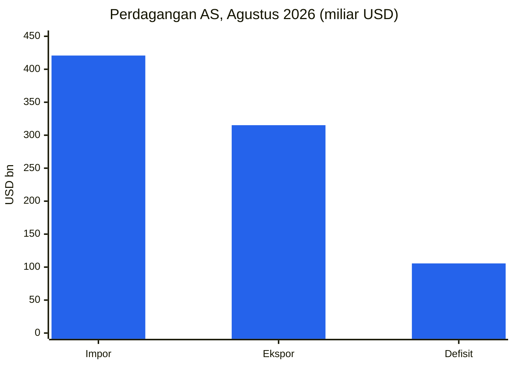

*Catatan: Census/BEA via businessday.co.za; impor $420.8bn (rekor, +4,3%), ekspor $315.2bn (+1,4%), defisit $105.6bn (+13,7%, terbesar sejak Mar 2025).*

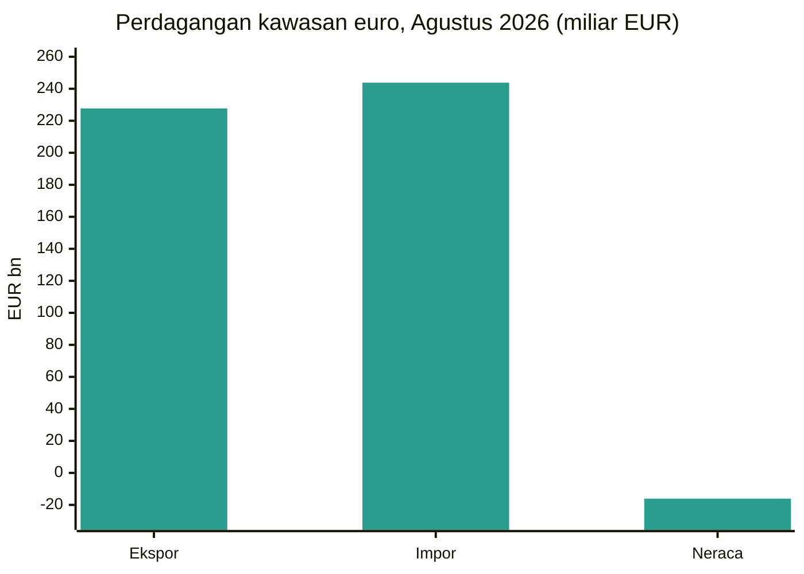

*Catatan: Eurostat dirilis 16 Okt; ekspor €227.7bn (+9,9% YoY), impor €243.8bn (+16,7%), neraca −€16.1bn (defisit terbesar sejak Jan 2023).*

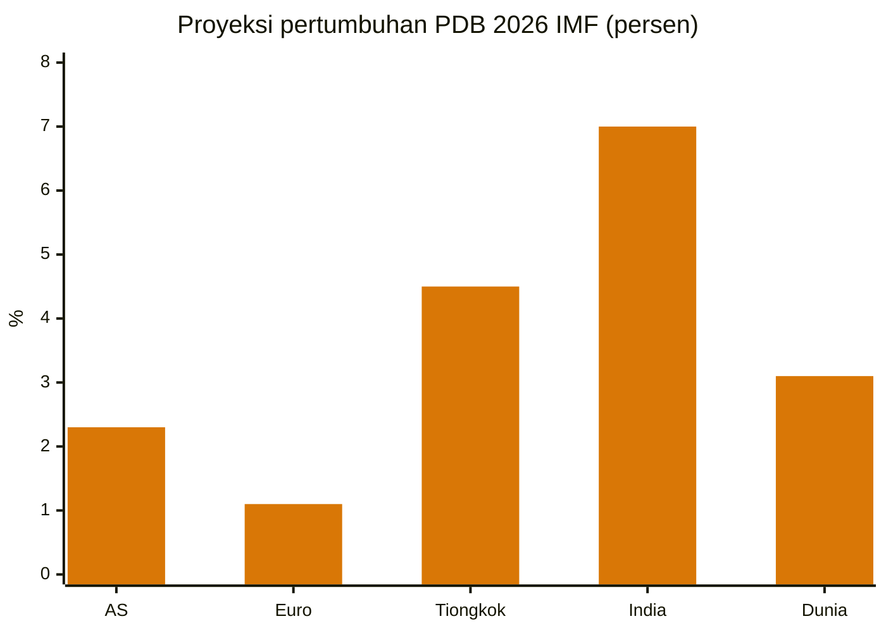

*Catatan: IMF World Economic Outlook, 13 Okt 2026; proyeksi dunia 2027 sebesar 3,4%.*

---

## 9. Pasar kargo

### Tarif spot kontainer — Indeks Kontainer Dunia Drewry

Penilaian tanggal 15 Oktober ditutup pada **$4.485 per FEU, naik 3% dibandingkan pekan sebelumnya** — pemulihan setelah pembacaan 8 Oktober sebesar $4.351 (−2%). Asia–Eropa mendorong kenaikan: Shanghai–Rotterdam +6% menjadi $3.522, Shanghai–Genoa +7% menjadi $3.945, kenaikan Asia–Eropa pertama setelah 13 penurunan mingguan berturut-turut. Transpasifik beragam: Shanghai–Los Angeles +3% menjadi $7.884, Shanghai–New York −1% menjadi $10.075. Drewry memperkirakan volatilitas lebih rendah pada pekan mendatang. Penilaian sebelumnya (1 Oktober) ditutup pada $4.434 (−1%).

Pelacak Kapal yang Dibatalkan Drewry (16 Oktober) mencatat 44 pelayaran kosong yang diumumkan untuk pekan 43–47 (19 Oktober–22 November) — tingkat pembatalan 6% dari 713 pelayaran yang direncanakan. Asia–Eropa Utara/Med menyumbang 44% dari pembatalan, Transpasifik ke arah timur 36%, Transatlantik 20%. Kenaikan FAK yang direncanakan operator sebesar $4.500–$4.800/FEU di Asia–Eropa (berlaku 19 Oktober) menghadapi serapan yang belum pasti mengingat kembalinya kapasitas Suez. (Sumber: [Drewry](https://www.drewry.co.uk/maritime-research-opinion-browser/world-container-index-assessed-by-drewry), [Shipping Telegraph wk41](https://shippingtelegraph.com/freight-news/drewry-the-world-container-index-decreased-2-in-week-41-2026/), [Shipping Telegraph wk42](https://shippingtelegraph.com/freight-news/drewry-the-world-container-index-increased-3-this-week-42-2026/))

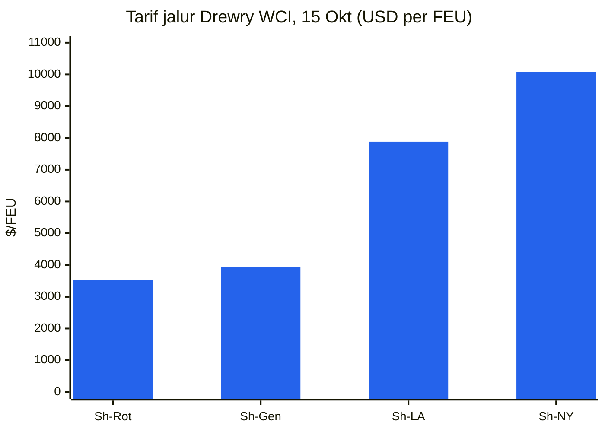

*Catatan: Shanghai–Rotterdam $3.522 (+6%), Shanghai–Genoa $3.945 (+7%), Shanghai–Los Angeles $7.884 (+3%), Shanghai–New York $10.075 (−1%).*

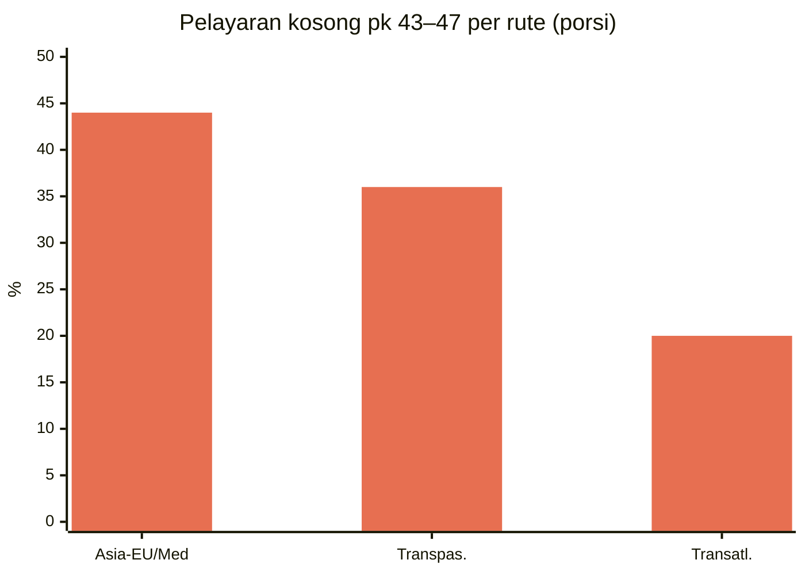

*Catatan: Pelacak Kapal yang Dibatalkan Drewry, 16 Okt; 44 pelayaran kosong dari 713 pelayaran yang direncanakan (tingkat pembatalan 6%).*

### Indeks Baltic Freightos (FBX)

Pekan hingga 13 Oktober: Asia–Pantai Barat AS (FBX01) −2% menjadi $8.149/FEU; Asia–Pantai Timur AS (FBX03) datar pada $9.606/FEU; Asia–Eropa Utara (FBX11) datar pada $3.260/FEU; Asia–Mediterania (FBX13) +7% menjadi $3.804/FEU. Udara: Tiongkok–Amerika Utara +3% menjadi $5,77/kg; Tiongkok–Eropa Utara −7% menjadi $3,58/kg — penurunan terakhir mencerminkan berakhirnya pembebasan de minimis €150 Uni Eropa pada Juli (impor Tiongkok/HK via Frankfurt −1,8%/−7,4% pada September). Tolok ukur udara Freightos tetap 33% di atas setahun lalu. Tarif Transpasifik datar selama Golden Week kemudian sedikit melunak — awal penurunan pasca-libur, dengan volume diperkirakan turun pada November–Desember. ([AJOT / Freightos](https://www.ajot.com/news/freightos-weekly-update-attacks-disrupt-saudi-air-cargo-china-europe-air-rates-slump))

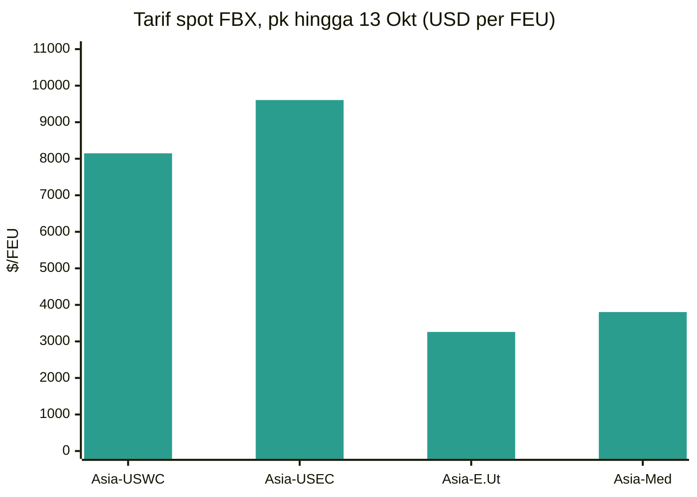

*Catatan: FBX01 $8.149 (−2%), FBX03 $9.606 (datar), FBX11 $3.260 (datar), FBX13 $3.804 (+7%).*

### Kargo curah kering — Baltic Exchange

**Indeks Baltic Dry** turun untuk pekan ketiga berturut-turut, ditutup pada Jumat 16 Oktober di **2.511 — turun 14% dalam sepekan**, level terendah sejak 30 Juni. Indeks Capesize turun 25% dibandingkan pekan sebelumnya menjadi 3.249 (terendah sejak awal April); pendapatan Capesize 5TC rata-rata $25.961/hari (−$664/hari). Panamax turun 1,8% menjadi 2.314 (pendapatan $20.827/hari). Supramax menjadi pengecualian yang bertahan, naik 9 poin menjadi 1.865. Bijih besi menyentuh level terendah dua tahun pada pertengahan pekan di tengah lemahnya permintaan Tiongkok dan naiknya stok sebelum pulih pada Jumat. (Sumber: [Baird Maritime](https://www.bairdmaritime.com/shipping/dry-cargo/bulkers/baltic-index-stays-in-the-doldrums-as-capesize-rates-slide-further), [Safety4Sea](https://www.safety4sea.com/baltic-exchange-maritime-market-highlights-october-12-16/))

### Kargo udara

Tarif spot global bertahan di **$3,55/kg pada pekan 41** meskipun masa sepi Golden Week — tonase turun 1% dibandingkan pekan sebelumnya untuk pekan ketiga berturut-turut tetapi naik 9% dibandingkan tahun lalu; tarif spot naik 34% dibandingkan tahun lalu; tarif pasar penuh sebesar $3,13/kg stabil. Spot Asia-Pasifik turun 3% dibandingkan pekan sebelumnya menjadi $4,83/kg; spot Afrika naik 10%. Bahan bakar jet naik 111% dibandingkan tahun lalu (IATA/Platts). Indeks Angkutan Udara Baltik naik 5,0% pada pekan hingga 5 Oktober, mendorong kenaikan tahun-ke-tahunnya menjadi +25,5%, dengan tarif belum naik sejalan dengan bahan bakar. Teknologi dan elektronik (server, semikonduktor, komponen pusat data) tetap menjadi sumber permintaan terkuat, sementara e-commerce ke AS menyusut akibat perubahan tarif impor bernilai rendah. Kapasitas Teluk berkontraksi 4% dibandingkan pekan sebelumnya pada pekan 41 akibat serangan Houthi ke bandara, menjadikannya 20% di bawah level akhir Februari. (Sumber: [StatTimes / WorldACD](https://www.stattimes.com/air-cargo/global-air-cargo-rates-remain-stable-at-355kg-in-week-41-1360975), [Baltic Exchange](https://www.balticexchange.com/en/news-and-events/news/guest-column/2026/Air-freight-rates-remain-firm-in-September-with-renewed-surge-in-jet-fuel-yet-to-feed-through.html))

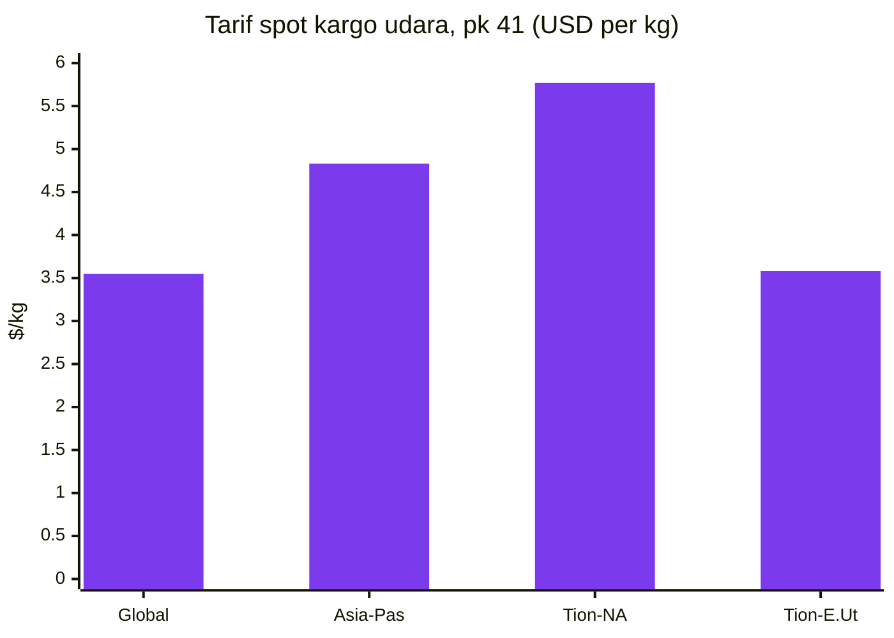

*Catatan: WorldACD via StatTimes (19 Okt) dan Freightos (13 Okt); global $3,55 (+34% YoY), Asia-Pasifik $4,83, Tiongkok–Amerika Utara $5,77, Tiongkok–Eropa Utara $3,58.*

### Keandalan jadwal

Laporan Xeneta September: kedatangan tepat waktu global turun 2 poin persentase menjadi **27%**, penurunan bulanan keempat berturut-turut; rata-rata keterlambatan mencapai 6 hari (+2,4 hari sejak kuartal II). Timur Jauh–Eropa anjlok menjadi 4% tepat waktu dengan rata-rata keterlambatan 9,9 hari — terburuk sejak September 2021. Asia–Amerika Utara tidak berubah pada 20% tepat waktu, dengan keterlambatan naik menjadi 6,9 hari. Setiap operator yang dilacak mencatat rata-rata keterlambatan 12 bulan terburuknya (CMA CGM 30%, Cosco 18%, Hapag-Lloyd 45%, Yang Ming 4% tepat waktu). Spot Tiongkok–USWC rata-rata $7.717/FEU pada awal Oktober — sekitar empat kali lipat dari $1.778 pada September 2025; tarif jangka panjang naik 26% bulan ke bulan menjadi $3.649/FEU pada 1 Oktober. ([FreightWaves / Port Technology](https://www.olgn.news/freightwaves-shippers-waiting-an-extra-week-for-us-bound-containers/))

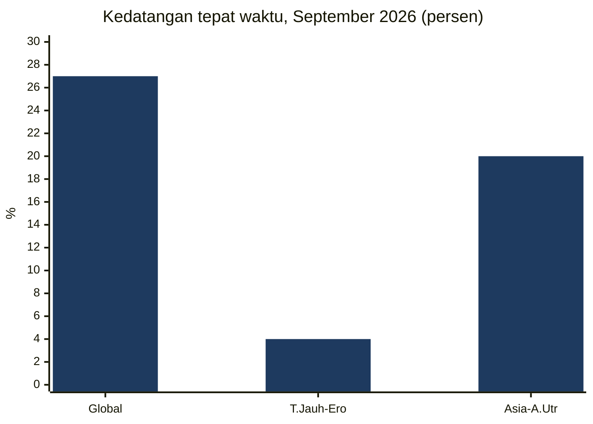

*Catatan: Xeneta via FreightWaves/Port Technology; global 27% (−2pp), Timur Jauh–Eropa 4% (keterlambatan rata-rata 9,9 hari), Asia–Amerika Utara 20% (keterlambatan 6,9 hari).*

### Gangguan pelabuhan dan logistik

- **Hormuz/Houthi:** kapal kontainer *GFS Pride* tenggelam (15 Oktober); 12 serangan kapal 5–11 Oktober; penyeberangan selat turun menjadi 131/pekan; kapasitas kargo udara Teluk −4% dibandingkan pekan sebelumnya. Pernyataan presiden DK PBB diadopsi secara konsensus pada 15 Oktober yang mengecam serangan Houthi terhadap Arab Saudi dan pelayaran Laut Merah. (Lihat Peringatan A2.)
- **Pemerasan siber:** 38 perusahaan maritim di 18 negara menghadapi tenggat tebusan 19 Oktober, 13:27 UTC (lihat Peringatan A3).
- **Suez:** inspeksi wajib dan uji coba laut bagi kapal berusia 25+ tahun berlaku 6 Oktober; kapasitas kontainer melalui kanal pada dua pekan pertama Oktober rata-rata 753.000 TEU/pekan dibandingkan 1.457.000 TEU pada periode yang sama 2023 — kembalinya arus sedang berjalan tetapi jauh dari pulih sepenuhnya.
- **Jerman:** ver.di menerima kesepakatan gaji pada 6 Oktober (~11.000 pekerja, enam pelabuhan, +3,4% selama 12 bulan), mengakhiri risiko mogok di Hamburg, Bremerhaven, dan Wilhelmshaven — tetapi level air Sungai Rhein yang terendah dalam catatan membatasi lalu lintas tongkang ke Rotterdam/Antwerpen; utilisasi lapangan Bremerhaven 90%, Rotterdam 85–90% penuh dengan waktu inap 14 hari.
- **Panama:** Otoritas Kanal menaikkan total slot harian yang dipesan menjadi 33 berlaku 15 Oktober.
- **Pantai Timur AS:** PhilaPort mengumumkan ekspansi ~$837 juta — terbesar sepanjang sejarahnya, dermaga baru pertama dalam 50 tahun (14 Oktober). Pelabuhan Long Beach mencetak rekor bulanan sepanjang masa pada September (mendekati ~1 juta kontainer); Pelabuhan Los Angeles mencatat bulan tersibuk dalam 118 tahun, meski pimpinannya memperingatkan pergeseran pengadaan akibat tarif menciptakan risiko perencanaan.
- **Manila:** penangguhan Hapag-Lloyd atas seluruh pemesanan ke Manila hingga akhir tahun (dilaporkan pekan lalu) tetap menjadi kasus kemacetan ekstrem yang berlaku.
- **Bangladesh:** DP World menandatangani konsesi 15 tahun untuk Terminal Kontainer Dermaga Baru Chittagong (12 Oktober), di tengah berlanjutnya protes buruh pelabuhan terhadap pengambilalihan tersebut.
- **Investasi operator:** dewan HMM menyetujui investasi $1,62 miliar untuk 12 kapal kontainer (delapan bangunan baru 13.000-TEU plus empat bangunan baru hasil pembelian kembali, total 114.100 TEU, pengiriman paling lambat Desember 2029) — menargetkan 166 kapal / 1,47 juta TEU pada akhir 2030. ZIM menaikkan proyeksi laba 2026 sebesar 72% atas permintaan yang kuat. JOC juga mencatat Jerman memblokir tawaran Cosco atas Zippel atas alasan keamanan dan aksi ILWU yang menghambat pembukaan terminal LA–LB.

### Intelijen vendor

- **Descartes — Laporan Pelayaran Global (edisi September, ~13 Oktober).** Impor kontainer AS mencatat volume September tertinggi sepanjang sejarah: 2,55 juta TEU — turun 2,2% dari Agustus, naik 10,3% dibandingkan tahun lalu; volume Januari–September +0,8% dibandingkan tahun lalu. Impor asal Tiongkok naik tajam bulan ke bulan sementara sebagian besar asal utama lainnya menurun; pelabuhan Pantai Barat meraih pangsa; keterlambatan transit pelabuhan naik di 8 dari 10 gerbang teratas (peningkatan terbesar di NY/NJ). Daftar pantauan ke depan: insiden Timur Tengah/Hormuz, perluasan tarif (Bagian 301/232, bea Bagian 232 farmasi September), slot Panama, rute Laut Merah, dan ekonomi AS (fed funds 3,75–4,00%; PDB kuartal II 2,2% secara tahunan). Sebuah rilisan data, bukan item produk. ([AJOT](https://www.ajot.com/news/descartes-global-shipping-report-u.s-container-imports-reach-highest-september-volume-on-record))
- **Descartes — pembaruan data tarif mingguan CustomsInfo.** Pembaruan 16 Oktober: pembaruan tarif Meksiko berlaku 14 Oktober (Dekret DOF 13/10/2026 — tarif sementara, tanpa perubahan HS); pembaruan pajak Mauritius saja. Pembaruan 9 Oktober: koreksi teknis AS untuk HTS 9903.85.67/68 (negara yang berlaku dikoreksi menjadi SEMUA, bukan hanya Rusia; bea tambahan berlaku hanya jika dilebur/dicor di Rusia); pembaruan Tiongkok 8 Oktober. ([customsinfo.com](https://www.customsinfo.com/resources/industry-updates/))
- **TradeInt — kemitraan dengan Kementerian Perdagangan Türkiye (diumumkan 30 September, tepat sebelum jendela).** Kemitraan ini memberikan hibah yang memberi perusahaan konsultan lokal akses berbiaya terhadap catatan pengiriman, dokumen kepabeanan, dan data B/L yang mencakup 200+ negara, ditujukan untuk pengambilan keputusan ekspor UKM Turki; ulasan TradeInt menyebut ekspor Türkiye 2025 sebesar $269,7 miliar. Sebuah item kemitraan pemerintah; tidak ditemukan rilisan TradeInt bertanggal dalam jendela pada pekan ini, dan blog wawasan TradeInt tidak memuat postingan bertanggal dalam jendela yang dapat diverifikasi. ([bayareametrowire](https://bayareametrowire.com/news/turkiyes-ministry-of-trade-grants-consulting-firms-access-to-global-trade-data-through-tradeint-partnership))

---

## 10. Linimasa kebijakan

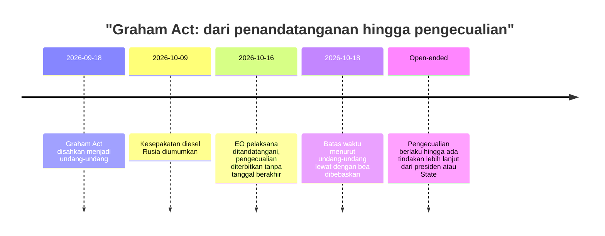

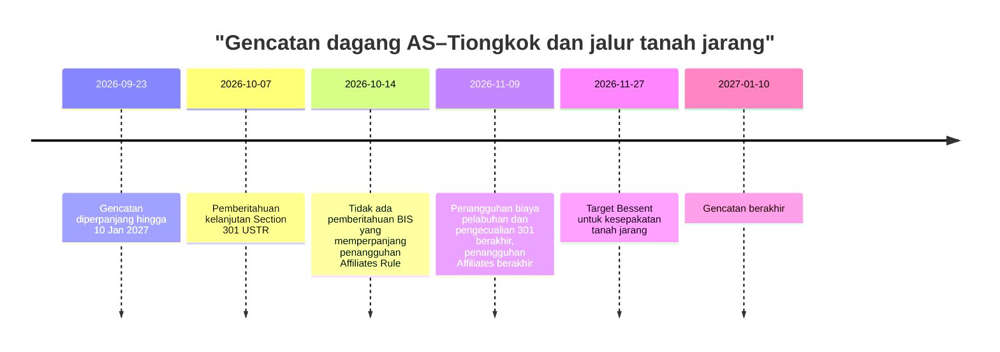

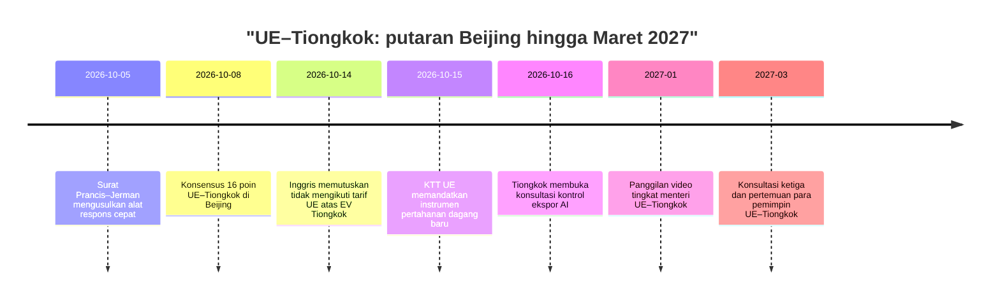

---

## 11. Tenggat & agenda berikutnya (90 hari ke depan)

| Tanggal | Peristiwa | Mengapa penting |
|---|---|---|
| Oct 19, 2026 | Batas waktu tebusan pemerasan siber (13:27 UTC) untuk 38 perusahaan maritim | Gelombang pemerasan siber maritim berskala besar pertama; pantau pengungkapan lebih lanjut |
| Oct 20, 2026 | FTA India–Selandia Baru mulai berlaku | Tarif Selandia Baru atas ekspor India dihapus sejak hari pertama |
| Oct 22, 2026 | Undang-Undang Perdagangan Luar Negeri Korea yang telah diamendemen mulai berlaku | Dasar pembatasan dagang diperluas dari 5 menjadi 9 |
| Oct 27, 2026 | DSB WTO: adopsi laporan panel sengketa bea EV Tiongkok vs Türkiye; batas waktu adopsi putusan sengketa bea TIK India–Taiwan | Dua tonggak sengketa pada hari yang sama |
| Nov 9, 2026 | Penangguhan biaya pelabuhan Section 301 berakhir (11:59 p.m. ET); 178 pengecualian Section 301 berakhir; penangguhan Affiliates Rule BIS berakhir sesuai ketentuannya | Tiga tebing kepatuhan sekaligus — perlakukan sebagai tanggal pasti selama tidak ada tindakan USTR/BIS |
| Nov 9, 2026 | Batas komentar investigasi safeguard Madagaskar |  |
| Nov 10, 2026 | Tanggal "snapback" tanah jarang dari panduan sebelumnya; tanggal pemberlakuan kembali Affiliates Rule | Pantau tindakan formal BIS |
| Nov 15, 2026 | Konsultasi kontrol ekspor AI Tiongkok ditutup | Katalog 40 teknologi dapat diadopsi setelahnya |
| Nov 20, 2026 | KTT Inggris–UE (Brusel) | Menyusul keputusan Inggris mengenai tarif kendaraan listrik |
| Nov 27, 2026 | Thanksgiving — target kesepakatan tanah jarang Bessent |  |
| Dec 31, 2026 | Tinjauan pengaturan baja/aluminium UE–AS: konsesi dapat ditangguhkan jika tarif AS masih melebihi 15% | Ujian pertama pembatasan timbal balik dari kesepakatan UE–AS |
| Jan 10, 2027 | Gencatan dagang AS–Tiongkok berakhir |  |
| Jan 2027 | Panggilan video tingkat menteri UE–Tiongkok |  |
| Mar 2027 | Konsultasi Perdagangan dan Investasi UE–Tiongkok ketiga; pertemuan para pemimpin UE–Tiongkok berikutnya; skenario dasar IMF mengasumsikan Hormuz dibuka kembali |  |
| Early 2027 | FTA Australia–UE diajukan ke parlemen (perebutan ratifikasi) |  |

## 12. Sumber & metodologi

Jendela liputan: 12–19 Oktober 2026.

**Berita & analisis perdagangan:** FreightWaves, The Loadstar, Splash247, gCaptain, Hellenic Shipping News, Container News, Supply Chain Dive, Port Technology International, JOC (hanya judul), Shipping Telegraph, Baird Maritime, StatTimes/WorldACD, AJOT/Freightos, Metro Global, blog TradeInt (tidak ada unggahan bertanggal dalam jendela liputan).

**Kebijakan AS:** whitehouse.gov (EO pelaksana Graham Act, primer), federalregister.gov (panduan konten-AS BIS 2026-20938; pemberitahuan kelanjutan USTR 91 FR 64212), CBP (melalui penasihat perdagangan: CAPE Fase 3, WRO, biaya pengguna), FMC (usulan biaya Spanyol melalui Supply Chain Dive), USTR (melalui pemberitaan sekunder), BIS (melalui Mondaq/Crowell & Moring, Braumiller, Dechert), Thompson Hine, Steptoe, Mondaq, Gateway Lines, Thomson Reuters, JD Supra (tidak ada item dalam jendela liputan yang muncul), internationaltradetoday.com (hanya judul).

**Pemerintah dunia:** KTT Dewan Eropa (melalui pers), Komisi Eropa/DG Perdagangan (melalui pers), gov.uk Departemen Bisnis dan Perdagangan (melalui The Guardian/Fleet News), CBSA/Kanada (melalui asosiasi industri), METI/Bea Cukai Jepang (melalui Steptoe/Global Sanctions), MOTIR Korea (melalui ringkasan LinkedIn), english.mofcom.gov.cn (pengambilan langsung gagal; item MOFCOM melalui pemberitaan sekunder dan State Council English), kementerian perdagangan India (melalui pers), DFAT Australia (melalui pers), MDIC Brasil (melalui Datamar).

**Multilateral:** wto.org (Global Trade Outlook and Statistics, 8 Oktober; peliputan komite dan DSB melalui pers perdagangan), unctad.org (Trade and Development Report 2026), WCO (peluncuran e-CENcomm, adendum GCC), WTO ITIP (tidak ada rilis baru dalam jendela liputan yang muncul), ITC Trade Map (tidak ada rilis baru dalam jendela liputan yang muncul).

**Portal data:** Census/BEA (FT-900 Agustus 2026; barang pendahulu September 2026), GACC (perdagangan Tiongkok September 2026), Eurostat (kawasan euro Agustus 2026), WTO, IMF (WEO Oktober), UNCTADstat, USITC DataWeb / USA Trade Online / UN Comtrade / WITS (tidak ada rilis kumpulan data baru dalam jendela liputan yang muncul).

**Lembaga kajian & riset:** Yale Budget Lab (State of U.S. Tariffs; analisis Tariff Dividends), Penn Wharton Budget Model (Effective Tariff Rates and Revenues, pembaruan 14 Oktober), Tax Foundation (Trump Tariffs Tracker, edisi Agustus 2026), Mondaq (analisis pengaturan tarif UE–AS), tradeintelligence.eu (tidak dapat diakses melalui pengambilan teks pekan ini).

**Angkutan barang:** Drewry (asesmen World Container Index 15 Oktober; Cancelled Sailings Tracker 16 Oktober), Baltic Exchange (sorotan pasar mingguan; BAI melalui kolom tamu), Freightos Baltic Index (pekan hingga 13 Oktober), Xeneta (keandalan jadwal, melalui FreightWaves/Port Technology), Kpler (penyeberangan selat), Sea-Intelligence, Linerlytica, Veson, Hartland (laba tanker), Clarksons, SCFI, TAC Index, NRF Global Port Tracker, DHL, DC Velocity.

**Intelijen vendor:** Descartes Systems Group (Global Shipping Report edisi September; pembaruan data tarif mingguan CustomsInfo) dan TradeInt (kemitraan Kementerian Perdagangan Türkiye, 30 September) — hanya item berita vendor: rilis data, kemitraan pemerintah, dan pergerakan pasar.
