# グローバル・トレード・インテリジェンス・レポート — 2026年10月12～19日週

**週間ブリーフィング。** 対象期間：2026年10月12～19日。世界約45の貿易ニュース、政策、データ、海運データソースから収集。

---

## 目次

1. [エグゼクティブサマリー](#1-executive-summary)
2. [アラート](#2-alerts)
3. [主要ニュース — 深掘り分析](#3-top-stories--deep-dives)
4. [関税トラッカー](#4-tariff-tracker)
5. [米国政策の深掘り](#5-us-policy-deep-dive)
6. [地域別世界の政策動向](#6-world-policy-by-region)
7. [執行措置](#7-enforcement-actions)
8. [データ公表](#8-data-releases)
9. [海運市場](#9-freight-market)
10. [政策タイムライン](#10-policy-timelines)
11. [今後の期限・イベント（今後90日）](#11-upcoming-deadlines--events-next-90-days)
12. [データソースと調査手法](#12-sources--methodology)

---

## 1. エグゼクティブサマリー

今週は、画期的な制裁法が署名から1か月で骨抜きにされ、ホルムズでの攻撃がコンテナ船の沈没を招き、世界最大の3つの貿易経済圏が正反対の数値を示した週となった。

- **グレアム法は適用前に免除された。** ロシア製品に500%、ロシア産エネルギー最大購入国に100%の二次関税を課す「リンジー・O・グレアム対ロシア・イラン制裁法（2026年）」の署名から1か月後の10月16日、トランプ大統領は同法の施行大統領令に署名すると同時に、関税・制裁条項を期限なく免除した。法案が標的としたインド、中国、トルコはロシア産エネルギーの購入を継続する。超党派の批判者とキーウ（ウクライナ政府）は免除を後退と呼び、ホワイトハウスは詳細な公開説明を行わなかった。
- **ホルムズで初のコンテナ船が沈没。** シンガポール船籍のコンテナ船「GFSプライド」（2,824TEU）が10月15日にホルムズ沖で攻撃を受けて炎上・沈没した。開戦以来2隻目と3隻目の沈没船となった。10月5～11日には12隻が攻撃を報告し、開戦以来の週間最多を記録。海峡の通航は前週の176隻から131隻に減少し、原油の通航量は推定1260万バレル/日に落ち込んだ。一方、タンカー収益は空前の水準に達し、VLCCは過去1か月で1日平均64万3,000ドルだった。
- **データは3つの異なる物語を示した。** 中国の9月貿易黒字は1,335億ドルと20か月ぶりの高水準を記録し、AIハードウェア特需で輸出が36.3%急増した。1～9月の黒字は9,385億ドルに達し、2年連続で1兆ドル超えが視野に入った。米国の8月貿易赤字は13.7%拡大し1,056億ドルとなり、輸入は過去最高の4,208億ドルを記録した。ユーロ圏は輸入が16.7%急増し、2023年1月以来最大の貿易赤字（161億ユーロ）を計上した。WTOは2026年の物品貿易予測を3.9%に引き上げたが、AI関連財が他の弱さを覆い隠していると警告した。IMFの10月見通しでは2026年の世界成長率は3.1%で、ホルムズ海峡が3月に再開すると仮定している。
- **欧州は貿易防衛の方向性を定めた。** 10月15～16日のブリュッセル首脳会議で、EU首脳は中国に対し既存の貿易防衛措置の「完全活用」を指示し、新たな手段の開発を欧州委員会に求めた一方、2027年3月の次回会合を前に中国との対話継続を維持した。これとは対照的に、英国は中国製EVへの最大45.3%のEU関税の追随を見送り、判断は英国の利益のみに基づくと表明した。北京は大規模モデルの重みやチップ設計手法を含むAI技術の輸出規制案についてパブリックコメントを開始した。
- **海運市場は部分的に反発。** ドリュー・ワールド・コンテナ指数は10月15日の評価で3%上昇し1FEUあたり4,485ドルとなった。アジア～欧州航路は13週間ぶりに値上がりした。一方、バルチック海運指数は3週連続で下落し、ケープサイズ市況の低迷で2,511まで下げた。世界のコンテナ定時運航率は9月に27%に低下し、4か月連続の悪化となった。18か国の38の海運・港湾企業が、10月19日の大規模サイバー恐喝の身代金支払期限を迎える。

**海運：** 明暗分かれる展開 — 黄金週明けの値上げとブランクセーリング（43～47週で44便欠航）でコンテナスポットが回復する一方、鉄鉱石が2年ぶり安値を付ける中ドライバルクは下落、航空貨物は1kgあたり3.55ドルで堅調、ジェット燃料は前年比100%超の上昇。

---

## 2. アラート

| # | アラート | 発効日 | 影響 | データソース |
|---|-------|-----------|--------|--------|
| A1 | グレアム法の関税免除：10月16日の大統領令は「リンジー・O・グレアム対ロシア・イラン制裁法」の施行と同時に、第115条に基づき関税・制裁条項を期限なく免除。従来の対ロシア制裁は維持 | 2026年10月16日 | インド、中国、トルコは新たな米国関税なしにロシア産エネルギーへのアクセスを維持。免除は撤回まで継続 | [whitehouse.gov](https://www.whitehouse.gov/presidential-actions/2026/10/implementing-the-lindsey-o-graham-sanctioning-russia-and-iran-act-of-2026/) |
| A2 | ホルムズのエスカレーション：コンテナ船「GFSプライド」（2,824TEU）が10月15日に攻撃を受けて沈没。10月5～11日には12隻が攻撃（開戦以来の週間最多）。海峡通航は週131隻に減少。原油通航量は約1260万バレル/日 | 2026年10月12～15日 | コンテナトン数が危険にさらされる。戦争保険の条件が引き締め。タンカー収益は空前の水準 | [Splash247](https://splash247.com/hormuz-claims-two-more-ships-in-fresh-wave-of-strikes/)、[FreightWaves](https://www.freightwaves.com/news/container-ship-attacks-escalate-in-strait-of-hormuz) |
| A3 | 海事セクターへの大規模サイバー恐喝：「n0n」と名乗る集団が10月12日、18か国の38の海運・港湾・物流企業をリークサイトに掲載し、身代金を支払わなければ10月19日13時27分（UTC）にデータを公開すると脅迫。要求額は1社あたり40万～4億ドル。主張は未検証 | 期限：2026年10月19日 | 海事標的への初の大規模な組織的サイバー恐喝。標的にはONE、CULines、TS Lines、サントス・ブラジルが含まれる | [Splash247](https://splash247.com/shipping-firms-and-ports-caught-in-mass-cyber-extortion-claim/) |
| A4 | 中国がAI技術の輸出規制案を公表（10月16日、公告第48号）：禁止・制限カタログへの追加案は40技術（禁止14、制限26）。2兆パラメータ超のLLM重みを含む。輸出前の登録要件は即日発効。パブリックコメントは11月15日まで | 2026年10月16日（協議は11月15日まで） | AIモデル、エージェント、チップ設計の国外移転を制限する可能性。海外での現地展開も対象 | [aiandgpp.com](https://aiandgpp.com/2026/10/19/china-ai-export-controls-model-weights-sovereign-cloud/) |
| A5 | 11月9日の二重期限 — 10月13日時点でUSTRの延長なし：(a) 中国関連船舶への301条港湾料金の1年間の猶予が終了（料金は中国船主・オペレーターに80ドル/NTに戻る）。(b) 301条の178品目の製品適用除外が終了（リスト1・2・3の関税は25%に、リスト4Aは7.5%に戻る） | 2026年11月9日午後11時59分（米東部時間） | 輸入業者は11月9日を期限として扱うべき。猶予期間なし。適用除外の解除は301条分のみ | [Gateway Lines](https://gatewaylines.com/press-releases/china-ship-fees-301-exclusions-nov-9-2026) |
| A6 | 日本の対ロシア輸出禁止の拡大が10月16日に発効（10月6日発表）：鉱物、化学品、金属、機械、産業機器、精密機器が禁止リストに追加 | 2026年10月16日 | 対ロシア輸出業者は対象品目の再確認が必要 | [Steptoe](https://www.steptoe.com/en/news-publications/international-compliance-blog/weekly-sanctions-update-october-13-2026.html) |
| A7 | FMCがスペイン船籍船舶への1航海あたり20万ドルの料金と、スペイン製品（香水・化粧品、油脂、陶磁器、石材製品、砂糖、菓子）への輸入制限を提案。2024年の調査でスペインが米国船籍船舶の入港を拒否したことを受けた措置 | 提案日：2026年10月16日 | 旗国差別に対するFMCの報復権限の行使がエスカレート。マースクのMSP船舶2隻が入港を拒否された | [Supply Chain Dive](https://www.supplychaindive.com/news/fmc-proposes-fees-on-spanish-flagged-vessels-import-restrictions/833122/) |
| A8 | レアアース：ベッセント財務長官は米中レアアース合意を「できれば」感謝祭（11月27日）までに最終合意したいと発言。BIS関連企業規則の停止（再適用は11月10日）は、休戦が2027年1月10日まで延長されるのに伴い延長されるとみられるが、10月14日時点で連邦官報の正式通知はなし | 目標：2026年11月27日 | コンプライアンス部門は、正式な延長が公表されないまま厳しい再適用日を迎える | [eximguru](https://eximguru.com/export-import-news/export-news/us-china-rare-earths-deal-will-116956.aspx)、[Mondaq](https://www.mondaq.com/unitedstates/export-controls-trade-investment-sanctions/1854664/us-china-trade-truce-extended-two-months-bis-affiliates-rule-suspension-follows) |

### A1 — グレアム法の免除（詳細）

10月16日に署名された大統領令は「リンジー・O・グレアム対ロシア・イラン制裁法（2026年）の施行」と題されている。同法自体は2026年9月18日に署名され（公法119-111）、上院86対11、下院262対159の賛成多数で可決された。大統領令第2条は法定税率を定める。ロシア原産品に500%の追加従価税、2026年10月18日以降に新規購入を意識的に行うロシア産原油・天然ガスの上位5輸入国の製品に100%、ロシア産石油の制裁回避を主導する5事業者の製品に100%で、いずれも既存関税に上乗せされる。

続く第4条(a)は、これらの関税そのもの — および第102条(a)、102条(d)、102条(e)、第103～111条、117条の制裁条項 — を同法第115条の免除権限に基づき免除し、国家利益にかなうとの書面認定を議会に送付した。免除に期限はない。大統領、または財務省・USTRと協議の上で国務長官がさらなる措置が適切と判断するまで有効である。第4条(b)は、国家緊急事態宣言に基づく大統領令による従来の対ロシア制裁をすべて維持する（緊急事態は2026年3月24日に継続）。USTRはロシア産エネルギーの購入を監視し、報告するよう命じられた。

**分析：** この構造は、政権に関税の脅しを残す — 施行の仕組みと税率は定義された — 一方で現時点で関税を課さない。政治的コストは即座に表面化した。ブルーメンソル、ティリス、コーニンの各上院議員が批判し、ゼレンスキー大統領も異議を唱え、免除権限を制限する超党派法案が提出されたが、いずれも成立していない。APの報道によると、ホワイトハウスは詳細な公開説明を行わなかった。インドや中国の製油業者にとって、免除は10月18日に設定されていた期限を消去する。米国輸入業者にとって、関税リスクは先送りされたに過ぎず解消されてはいない — 将来の判断で関税が再発動される可能性がある。

### A2 — ホルムズでコンテナ船が犠牲に（詳細）

Splash247は10月15日、ADポーツ/GFS関連のコンテナ船3隻がホルムズ近海で攻撃を受けたと報じた。シンガポール船籍の「GFSプライド」（2008年建造、2,824TEU）は攻撃を受けて炎上・沈没し、乗組員21人全員が避難した。「GFSジゼル」（2015年建造、4,400TEU）は船体に損傷を受けたが乗組員22人にけがはなく錨地に到着。「アル・サーディヤット」（1,730TEU、Safeen Feeders）は大きな損傷を免れた。別件では、ケープサイズの「ケープ・ダオ」（17万重量トン）がオマーン沖で攻撃を受けてから約3週間後に沈没した。IMOの海難データによれば、これらは開戦以来2隻目と3隻目の沈没船である。

UKMTO（英国海運貿易オペレーション）は10月5～11日に12隻が攻撃を報告したと記録した。開戦以来の週間最多である。Kplerの集計では、10月14日までの1週間の海峡通航は131隻で、前週の176隻から減少した。海峡を通る原油は10月13日に推定1260万バレル/日となり、9月末の約1500万バレル/日から減少した。FreightWavesは、船荷証券に記載されていない船舶に積載された貨物が移動する場合、戦争保険が短期間で解除され得るとアナリストが警告していると報じた。海峡周辺を迂回・通過する荷主にとって、書類の細部が現実の契約上の帰結をもたらす。

**分析：** この攻撃は嫌がらせから、コンテナ船の船舶破壊へと踏み込んだ。世界の定時運航率が27%に低下する中、紅海とホルムズの選択肢が失われることで混乱は深刻化する。対照的なのは財務面だ。ブローカーのハートランドの試算では、独立系のVLCC、スエズマックス、アフラマックスの船主は予算想定を1日約4億ドル上回る収益を得ており、1年間持続すればコンテナ船の記録的な1,500億ドルのパンデミック年の利益に迫る。VLCCは過去1か月で1日平均64万3,000ドル、中東湾岸～中国航路では1日130万ドル超（Veson）だった。資産価値も追随した。中古5年船のVLCCは2億1,800万ドルと評価され、新造船価格の55%プレミアム、15年船のVLCC価格は前年比196%上昇している。

### A3 — 海事企業へのサイバー恐喝の波（詳細）

10月12日、「n0n」と名乗る集団は18か国の38の海運・港湾・物流企業をダークウェブのリークサイトに追加し、身代金を支払わなければ10月19日13時27分（UTC）に流出データを公開すると脅迫した。名指しされた標的には、オーシャン・ネットワーク・エクスプレス（ONE）、CULines、TS Lines、Samudera、サントス・ブラジル、Portonave、BNCT、釜山新港、TTI Algeciras、Eurogate Tanger、Nam Dinh Vu、NEOM Portsが含まれる。Cydomeは要求額を1社あたり40万～4億ドルと評価し、SOCRadarは240万～1,400万ドル（ビットコイン建て）の要求を確認した。報道時点で主張は未検証であり、掲載企業のいずれも被害を確認していなかった。

**分析：** 海事標的に特化した初の大規模な組織的サイバー恐喝である。データが本物かどうかに関わらず、運用面の教訓は明確だ。港湾や船社のIT資産は、組織的恐喝集団にとって柔らかい標的とみなされている。サプライチェーンのセキュリティ部門は、期限前後をフィッシングや侵入リスクが高まる期間として扱うべきだ。

### A4 — 中国のAI輸出規制案（詳細）

10月16日、中国商務部（MOFCOM）と科学技術部は、禁止・制限カタログに40技術を追加する案についてパブリックコメントを開始した（11月15日締め切り）。禁止14、制限26で、そのうち23がAI関連だ。基準は具体的で、大規模言語モデルの重みが2兆パラメータ超、10²⁶FLOPS超で訓練されたモデル、世界トップ10にランクされるモデルなど。AIエージェント、計算クラスター、チップ設計手法も対象となる。輸出前の登録要件は同日に発効し、進行中の取引にも適用される。APIやSaaSによるアクセスは除外され、海外での現地展開は対象となる。

**分析：** 採用されれば、最先端AIモデルの重みを直接対象とする中国初の輸出規制となる。米国の計算資源規制の鏡像だ。API/SaaSアクセスを除外しつつ海外での現地展開を対象とすることで、北京は重みの移転に課税またはブロックしつつ、クラウドサービスの収益は確保したい意向とみられる。中国のインフラでAIワークロードを運用する多国籍企業や、海外にモデルをライセンスする中国のAI企業は、協議期限前にエクスポージャーを洗い出すべきだ。

---

## 3. 主要ニュース — 深掘り分析

### 3.1 免除によって骨抜きにされた制裁法

「リンジー・O・グレアム対ロシア・イラン制裁法（2026年）」は、議会による制裁回避への回答として設計された。ロシア産エネルギーの最大購入国の製品に最大100%の二次関税、ロシア製品自体に500%の関税を課し、大統領の免除なしに発効する仕組みだった。上院86対11、下院262対159の拒否権を覆せるほどの賛成多数で可決され、9月18日に署名された。関税決定の期限は10月18日だった。

10月16日、期限の2日前に、大統領は施行大統領令に署名した。大統領令は第2条で税率を正確に定義した。そして第4条(a)でそれを免除した — 同法第115条に議会が書き込んだ免除権限を使ってだ。免除は関税条項（第112条・113条）と制裁条項（第102条(a)、102条(d)、102条(e)、第103～111条、117条）の両方を対象とし、期限はない。大統領、または財務省・USTRと協議の上で国務長官が別段の判断をするまで有効である。

**分析：** 議会は執行部が免除できない制裁法を書こうとしたが、執行部は1か月後に法自身の免除条項を使って免除した。施行の仕組みは今や常設の手段として存在する — 税率は定義され、監視はUSTRに割り当てられ、国家緊急事態に基づく制裁の基盤は維持されている — そのため、関税が現時点でゼロであっても、発動の脅しは現実的だ。同盟国との乖離は広がっている。英国は10月8日の追加措置で38の標的（エネルギー企業2社とシャドーフリートのタンカー12隻を含む）を指定し、制裁対象はロシア産油生産能力の90%超をカバーすると主張し、船舶サービスへの規制強化を促している一方、ワシントンは記録的な運賃を和らげるためのタンカー救済を検討中と報じられている。EUは10月12日に公表された規則でロシアの主要造船所を別途標的とした。ロシア産エネルギーの購入者 — 何よりもインド — にとって、免除は10月の期限を消去するが、再発動リスクは政権の裁量に委ねられたままである。

### 3.2 ホルムズ：コンテナ船を狙う戦争

10月は、ホルムズでの攻撃がタンカー戦争からコンテナ戦争に変わった月となった。10月15日の「GFSプライド」の沈没は、この紛争で初のコンテナ船の沈没であり、UKMTOが記録した10月5～11日の12件の攻撃報告は開戦以来の週間最多だった。海峡の交通量は反応している。10月14日までの1週間の通航は131隻で前週の176隻から減少し、原油の通航量は9月末の約1500万バレル/日から推定1260万バレル/日に減少した。

二次的な影響は広がっている。サウジアラビアに対するフーシの攻撃 — リヤドのキング・ハーリド国際空港へのミサイル攻撃、宣言された海上封鎖、10月15日に全会一致で採択されたフーシの攻撃を非難する国連安全保障理事会議長声明 — は、41週の湾岸航空貨物容量を前週比4%収縮させ、2月末比で20%減の水準にとどめた（WorldACD）。スエズ運河庁は10月6日から船齢25年以上の船舶に強制検査と試運転を課した。安全対策だが、老朽化したシャドーフリートの通航も複雑にする（KSE研究所によると、ロシアのシャドータンカーの92%は船齢15年超）。

**分析：** コンテナ船社の紅海復帰計画 — 全船社とMSCが10月末までに一部船舶を通航させる予定だった — は、改めてリスクプレミアムに直面する。ドリュー海事調査は、予想より速いスエズ再開を船社の料金支持への主要な脅威と指摘した。一方、コンテナ船への新たな攻撃は、長距離航路に船腹を縛り付けることで料金を下支えする。この両勢力の緊張が、第4四半期の海運市場の中心的な問いである。

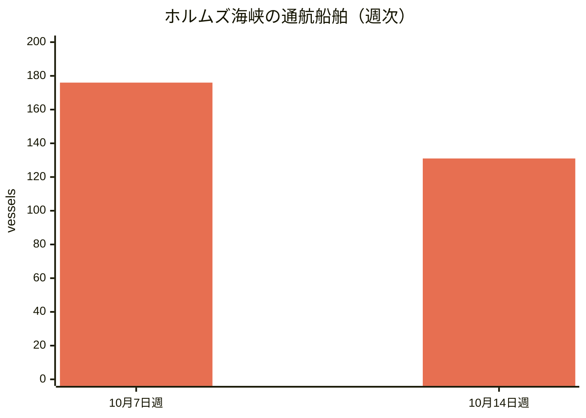

*注：Kplerのデータ。10月7日週は176隻、10月14日週は131隻。*

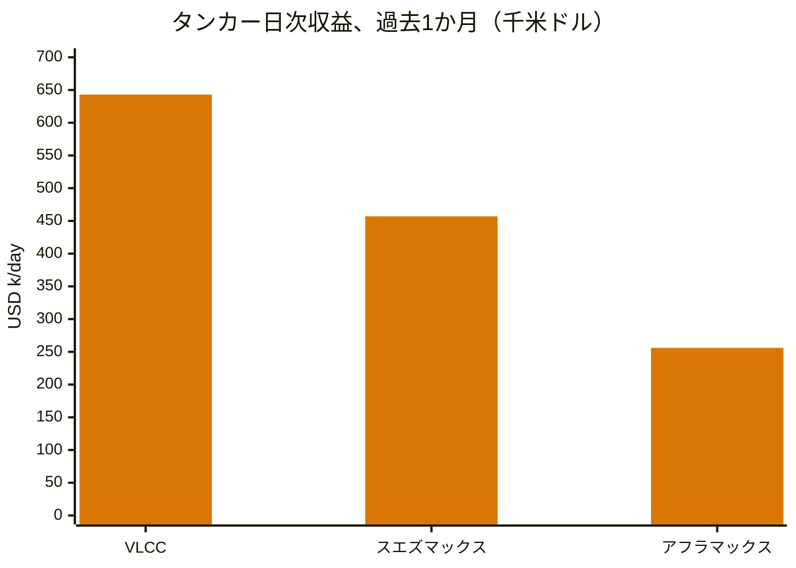

*注：Splash247経由のブローカー・ハートランドの試算。VLCCは64万3,000ドル/日、スエズマックスは45万7,000ドル/日、アフラマックスは25万6,000ドル/日。中東湾岸～中国航路のVLCCは130万ドル超/日（Veson）。*

### 3.3 中国の9月1,335億ドルとAI貿易ブーム

中国税関総署は10月14日、9月の輸出が前年比36.3%急増し4,471億8,000万ドルに達した — 2月以来の速さで、市場予想の25.5%を上回った — と発表し、輸入は31.0%増の3,136億6,000万ドルだった。月次黒字の1,335億ドルは2025年1月以来の最大で、20か月ぶりの高水準となった。1～9月の黒字は9,385億ドルに達し、2年連続で1兆ドル超えが視野に入った（2025年の記録は約1.2兆ドル）。対米輸出は9.8%増で、二国間の黒字は約340億ドルと20か月ぶりの高水準 — 2年間の関税エスカレーションにもかかわらずだ。税関データによると、年初来約108%増の半導体を筆頭とするハイテク輸出が輸出増の約半分を牽引した。

マクロ機関も同じシグナルを読んでいる。WTOの10月8日の「世界貿易見通し・統計」は、2026年の物品貿易量の予測を3月の1.9%から3.9%に引き上げた。上半期のAI対応財の貿易は前年比67%増で、貿易額増加の47%を占め、世界物品貿易の14.8%に達した。オコンジョ・イウェアラ事務局長の警鐘は的確だった。「AIの影響が貿易の他の傾向 — プラス方向ではない — を覆い隠している」。UNCTADの10月9日の「貿易開発報告」は、2026年の世界成長率を2.6%（2025年の2.9%から低下）と予測し、2024年以降の米中貿易が20%超減少したと指摘した。IMFの10月13日の「世界経済見通し」は2026年の世界成長率を3.1%（2025年の3.5%から）とし、AI投資が中東のエネルギーショックを相殺するとした。基準シナリオではホルムズ海峡が3月に再開すると仮定し、閉鎖が相殺前に世界成長率を約0.9ポイント押し下げ、相殺後の純損失は約0.3ポイントと試算している。

**分析：** AIハードウェアのサイクルが世界貿易量の重労働を担っている — そして中国に偏ってだ。関税キャンペーンの中での中国から米国への輸出9.8%増という逆説は、迂回、前倒し、AI設備投資の引力の賜物である。ワシントンの休戦期間の「コンプライアンス」枠組みがデータとしっくりこない理由でもある。

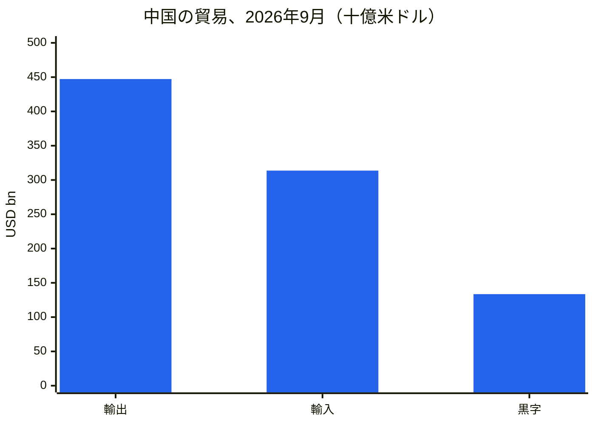

*注：10月14日発表のGACCデータ。輸出4,471億8,000万ドル（前年比+36.3%）、輸入3,136億6,000万ドル（+31.0%）、黒字1,335億ドル。*

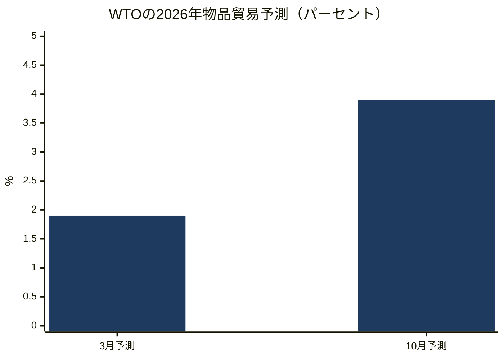

*注：WTO「世界貿易見通し・統計」（2026年10月8日）。上半期のAI対応財は前年比+67%で、貿易額増加の47%を占めた。*

### 3.4 欧州は貿易防衛の方向性を定めた

10月15～16日の欧州理事会首脳会議は、EU貿易政策の今週で最も明確な方向性のシグナルを出した。首脳は欧州委員会に対し、北京との対話を継続しつつ — 次回会合は2027年3月に予定 — 既存の貿易防衛措置の「完全活用」と新たな手段の開発を命じた。10月5日の独仏書簡 — 米国の301条や中国の重要鉱物規制に「匹敵するほど強力な」EUの権限を提案 — が議論を支配した。より迅速な、セクター横断の貿易防衛調査、化学品、PET、ハイブリッド車への緊急対応、域内に害を及ぼす国への迅速な報復だ。ドイツの転換は注目に値する — 2年前、ベルリンはEUのEV反補助金関税に反対していた。

背景には、首脳会議が解釈を迫られた10月8～9日の北京協議の16項目の合意がある。シェフチョビッチ委員と王文涛商務相による第2回貿易投資協議メカニズムは、ハイブリッド車貿易に関するWTO整合的な了解（年間35万台との報道の上限で、中国のハイブリッド輸出を半分超削減する可能性がある）、中国の新エネルギー車の輸出税還付の13%への引き下げ、レアアース・永久磁石ライセンスの「グリーンチャネル」、EUのEV反補助金案件における価格約束手続きの継続、約40億ユーロのEU輸出品へのMFN関税引き下げ（少なくとも2億2,500万ユーロの関税節減に相当）の検討を盛り込んだ共同声明を出した。北京の公表文にはハイブリッド輸出の半減という数字はない — 検討された情報は、EUの説明と北京の文言が乖離しており、執行メカニズムが不明であることを示している。EUの対中物品貿易赤字は2025年に3,600億ユーロ（約4,000億ドル）に達し、2026年もそれを上回るペースだ。

**分析：** ブリュッセルは交渉チャネルを残しつつ、より筋肉質で迅速な貿易防衛の姿勢へと動いている — 古典的な二重路線だ。試金石は、独仏書簡で名指しされた緊急セクター（化学品、PET、ハイブリッド車）と、共有の文書なきハイブリッド車了解が執行可能かどうかである。

### 3.5 レアアース：感謝祭を巡る駆け引き

ベッセント財務長官は10月18日、Fox Newsの「Sunday Morning Futures」で、ワシントンは米中レアアース合意を「できれば」感謝祭（11月27日）までに最終合意したいと語った。報道された条件では、北京が特定の重要鉱物輸出規制を1年間停止し、レアアースが「4月4日以前のように」自由に流れる — 中国が米国の関税への対抗で輸出ライセンス要件を課した日だ。あるメディアは、韓国での10月下旬のトランプ・習会談で合意がすでに成立したと報じたが、その枠組みは未検証であり、検討された情報の中で確立されているのはベッセントの発言のみである。

並行するのがBIS関連企業規則だ。2025年9月29日の暫定最終規則 — 2025年11月10日から2026年11月9日まで停止 — は、エンティティ・リスト、軍事エンドユーザー・リスト、特定のSDN当事者の少なくとも50%を直接・間接に所有する外国法人に輸出管理規則（EAR）の規制を自動的に拡張し、所有関係の確認義務（レッドフラッグ29）を課す。米中休戦が2027年1月10日まで延長されたことを受け、Crowell & Moringは10月14日、規則の再適用は休戦に追随するはずと評価した — しかし10月14日時点で、BISは停止を正式に延長する連邦官報の通知を公表していなかった。

**分析：** 2つの時計が動いている。政治の時計は感謝祭のレアアース合意を目標とする。規制の時計は、正式な延長が公表されないまま11月10日の関連企業規則の再適用という厳しい日を迎える。コンプライアンス部門は、意向に関する報道評価を頼りにできない — 規則はBISが動かない限り、その文言どおりに再発動する。

### 3.6 米中休戦：履行期間、大豆なし

米中貿易休戦は2027年1月10日まで — ベッセント長官が9月23～24日に発表した2か月の延長で、市場が期待した6～12か月より短い。グリアUSTR代表は休戦期間を、中国の大豆購入とレアアースアクセスの履行を評価する「コンプライアンス期間」と表現した。関税キャンペーン開始以来、米国の対中物品貿易赤字は約40%減少したという。

実質面では、「30対30」枠組み — 双方の非機微財約300億ドルずつ — は機能していない。中国は1,619の米国製品ライン（トウモロコシ、肉類、綿花、ソルガム、大麦、オート麦、大豆油 — 食用・搾油用大豆は含まず）を提案し、米国は77関税ライン（家庭用品、玩具）を低率適用の対象としてリストした。10月中旬時点で税率も開始日も公表されていない。大豆には新たな購入約束はない。中国は従来の合意で2026、2027、2028年に年2,500万メートルトンの購入を約束しており、USDAの輸出販売報告では2026～27年度産の約1,020万メートルトンが約定済みだった。中国の米国産大豆への10%報復関税は残っており、民間購入者のアクセスを制限している。

**分析：** 休戦は持ちこたえのパターンであり、解決ではない。2018年からの301条を継続する10月7日の継続通知 — リスト1は約340億ドルに25%、リスト2は約160億ドルに25%、リスト3は約2,000億ドルに25%、リスト4Aは約1,200億ドルに7.5% — と、税率を引き上げ得る第2回4年見直しが開かれたことで、休戦の行方にかかわらず関税構造は固定化されている。

### 3.7 海運：10月の反発とスエズ復帰

ドリュー・ワールド・コンテナ指数は10月15日の評価で**3%上昇し1FEUあたり4,485ドル**となった — 10月8日の4,351ドル（-2%）からの反発だ。アジア～欧州が上昇を牽引した。上海～ロッテルダムは6%高の3,522ドル、上海～ジェノバは7%高の3,945ドルで、13週連続の下落後初の上昇となった。太平洋航路はまちまちで、上海～ロサンゼルスは3%高の7,884ドル、上海～ニューヨークは1%安の10,075ドルだった。ドリューは今週の変動は小さいと予想する。反発の背景には、船社の黄金週明けの値上げ — MSCの10月19日からのアジア～北欧の新FAKは1TEUあたり3,150ドル、1FEUあたり4,500ドル — と、43～47週（10月19日～11月22日）に発表された44便のブランクセーリング（計画713便の6%の欠航率）があり、アジア～北欧/地中海が欠航の44%を占めた。

構造的な圧力は逆方向に働く。LinerlyticaはTEUマイル需要の伸びが1月以来初めて後退したと報告し、予想より速いスエズ再開 — 全船社とMSCが10月末までに紅海経由で一部船舶を通航させる予定で、39週のスエズ通航は前年比68%増と報道された — は船社の料金支持への主要な脅威だ。9月には20万TEUの新造船が引き渡され、解撤はゼロだった。アジア～欧州料金は7月以来約60%下落したが、なお1FEUあたり3,000ドル超 — 前年比約70%高 — で、2027年の入札シーズンが始まる。パナマ運河庁は10月15日から予約制の日次スロットを33に引き上げ、供給をさらに増やした。

ドライバルクは逆方向に動いた。バルチック海運指数は3週連続で下落し、10月16日（金）に**2,511で引けた — 週間で14%安**で、6月30日以来の低水準だ。ケープサイズ指数は週間25%安の3,249（4月初旬以来の低水準）で、鉄鉱石が週半ばに2年ぶり安値を付けたことが響いた。パナマックスは1.8%安の2,314、スープラマックスだけが9ポイント高の1,865と底堅かった。

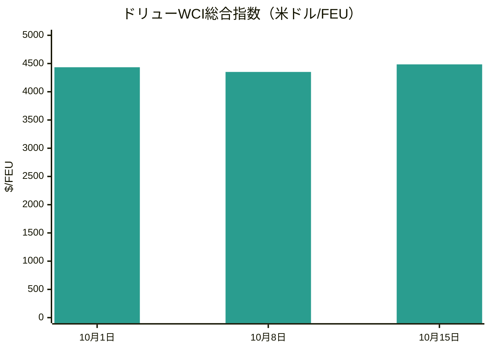

*注：ドリュー木曜日評価。10月1日は4,434ドル（-1%）、10月8日は4,351ドル（-2%）、10月15日は4,485ドル（+3%）。*

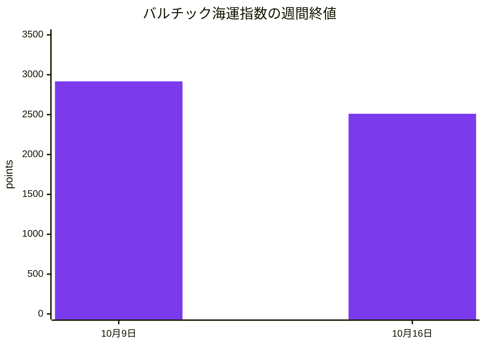

*注：金曜日終値。10月9日は2,917（週間-7.3%）、10月16日は2,511（週間-14%）で、6月30日以来の低水準。*

### 3.8 関税の帰着：家計が実際に負担する額

今週、米国家計の関税負担を定量化した研究が3件公表された。イェール予算研究所の現行法ベースの試算では、完全転嫁後の物価水準の約0.7%上昇を反映し、1世帯あたり年間約1,100ドルとしている。法定平均関税率は現在11%で、2026年末には11.8%に達し、平均世帯の月負担は約92ドルとなる。徴収された関税は8月の輸入額の7.1%に達し、2025年1月の2.3%から上昇 — 行動変化による回避がなければ10.1%だったはずだ。ペンシルベニア大学ウォートン予算モデルの10月14日の更新では、2025年1月から2026年8月の新規関税による税関歳入総額は3,148億ドル（IEEPA返還前）で、行動変化により607億ドルが失われた。IEEPA徴収は計約1,660億ドルで全額が返還対象、CBPは10月2日時点で約1,260億ドル（76%）を認定した。2026年7月時点で米国の平均実効関税率は6.7% — 2025年1月の2.3%の約3倍 — で、中国は22.8%、鉄鋼・アルミは40.5%、自動車は13%だった。税制財団の8月トラッカーでは、2026年の平均実効税率は6.6%と1969年以来の最高で、2026年の家計負担は約820ドルとなる。

**分析：** 3つのモデルは同じ姿を描く — 2025年1月の約3倍の重さの関税体制で、平均世帯の年間負担は1,000ドル程度、IEEPA返還パイプライン（返還対象1,660億ドル、認定1,260億ドル）は貿易戦争で最大の保留中の財政移転だ。

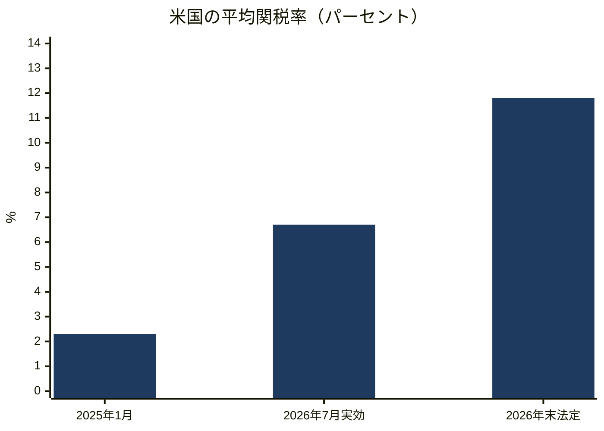

*注：2025年1月の実効税率2.3%、2026年7月の実効税率6.7%（ペン・ウォートン。税制財団は2026暦年で7.2%）、2026年末の法定税率11.8%（イェール予算研究所）。*

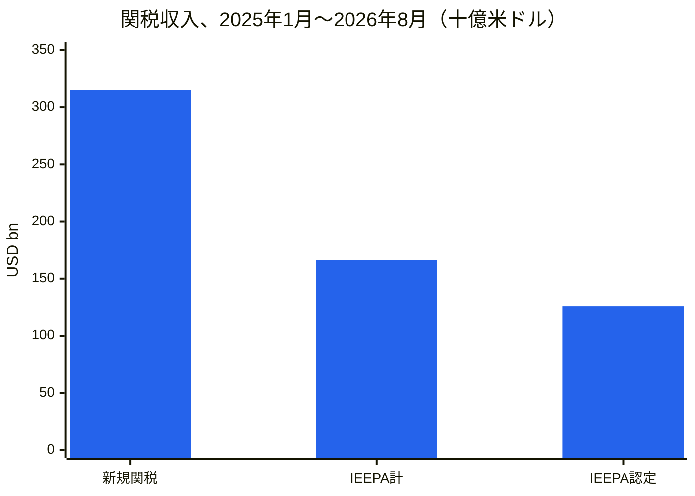

*注：ペンシルベニア大学ウォートン予算モデル（10月14日更新）。IEEPA返還前の税関歳入総額。IEEPA認定は10月2日までにCBPが支給用に認定した額。*

---

## 4. 関税トラッカー

| 国・地域 | 措置 | 税率 | 発効日 | 状況 | データソース |
|---|---|---|---|---|---|
| 米国 | グレアム法第112・113条の関税＋制裁条項（ロシア製品に500%、ロシア産エネルギー最大購入国・回避支援者に100%の二次関税） | 免除 — 0% | 免除は2026年10月16日署名、期限なし | 第115条に基づき免除。大統領・国務長官の判断で再発動可能。USTRが監視 | [whitehouse.gov](https://www.whitehouse.gov/presidential-actions/2026/10/implementing-the-lindsey-o-graham-sanctioning-russia-and-iran-act-of-2026/) |
| 米国 | 米国産部品40%超のUSMCA対象モバイル産業機器（フォークリフト、ブルドーザー、バックホー、トラクター、移動式クレーン）への232条 | 25% → 15%（引き下げ） | 2026年10月14日 | BISの計算ガイダンスを公表（FR 2026-20938） | [federalregister.gov](https://www.federalregister.gov/public-inspection/2026-20938/guidance-to-us-customs-and-border-protection-regarding-the-assessment-of-us-content-for-purposes-of) |
| 米国 | 中国関連船舶への301条港湾料金（猶予が終了） | 中国船主・オペレーターは80ドル/NTに戻る。中国建造（非中国オペレーター）は23ドル/NTまたは153ドル/コンテナの高い方。外国建造の自動車運搬船は46ドル/NT | 2026年11月9日午後11時59分（米東部時間） | 10月13日時点でUSTRの延長なし。200超の業界団体が9月23日に延長を要請 | [Gateway Lines](https://gatewaylines.com/press-releases/china-ship-fees-301-exclusions-nov-9-2026) |
| 米国 | 301条の178品目の製品適用除外（HTS 9903.88.69/70） | リスト1・2・3は25%に戻る。リスト4Aは7.5%に戻る | 2026年11月9日午後11時59分（米東部時間） | 終了間近。猶予期間なし | [Thomson Reuters](https://tax.thomsonreuters.com/blog/section-301-exclusions-expiration/) |
| 米国 | 301条対中措置（2018年）の継続 | リスト1・2：25%、リスト3：25%、リスト4A：7.5% | 有効（継続通知は2026年10月7日） | 継続中。第2回4年見直しは2026年5月6日開始 — 税率引き上げ可能 | [facohub.com](https://facohub.com/posts/weekly-009) |
| 米国 | 強制労働に対する301条措置（60経済圏） | 10% / 12.5% | 2026年7月24日から有効 | 有効。国際貿易裁判所（CIT）で係争中 |  |
| 米国 | スペイン船籍船舶へのFMC提案料金 | 1航海あたり20万ドル＋対象スペイン製品への輸入制限 | 提案日：2026年10月16日 | 提案段階 | [Supply Chain Dive](https://www.supplychaindive.com/news/fmc-proposes-fees-on-spanish-flagged-vessels-import-restrictions/833122/) |
| 中国 | AI技術の輸出規制案（公告第48号） | 禁止（14）/制限（26）技術 | 協議は2026年11月15日まで。輸出前登録は10月16日から有効 | 案の段階 | [aiandgpp.com](https://aiandgpp.com/2026/10/19/china-ai-export-controls-model-weights-sovereign-cloud/) |
| 中国 | 新エネルギー車の輸出税還付の引き下げ | 還付を13%に引き下げ | 2026年10月8～9日に合意 | EU・中国16項目合意に基づく | [peoplesdaily.pdnews.cn](https://peoplesdaily.pdnews.cn/china/er/30053309352) |
| 中国 | 対EUハイブリッド車輸出 — WTO整合的な了解 | 年間35万台との報道の上限 | 2026年10月8～9日に合意 | EUの説明。北京の文言に数字なし | [peoplesdaily.pdnews.cn](https://peoplesdaily.pdnews.cn/china/er/30053309352) |
| EU | 独仏の迅速対応貿易手段の提案 | 該当なし（提案） | 10月5日に提案。10月15～16日首脳会議で議論 | 欧州委員会に新手段の開発を指示 | [985theriver.com](https://985theriver.com/2026/10/05/france-germany-propose-new-rapid-eu-trade-response-tool/) |
| EU | EU・米国関税合意（規則2026/1455、2026/1461） | 米国工業品への残存EU関税を撤廃。2026年12月31日時点で米国の鉄鋼・アルミ関税が15%超ならセーフガード発動 | 2026年7月1日～2029年12月31日に適用 | 有効。多層のセーフガード構造 | [Mondaq](https://www.mondaq.com/italy/export-controls-trade-investment-sanctions/1848092/euus-tariff-agreement-the-new-regulations-and-their-safeguard-architecture) |
| EU | CBAM — ロシアの紛争パネルDS639設置 | 該当なし（紛争） | 2026年10月3日にパネル設置 | パネル段階。EUはパネルのみに参加 | [news.metal.com](https://news.metal.com/newscontent/104143673-wto-establishes-cbam-dispute-panel-at-russias-request) |
| 英国 | 中国製EV関税（最大45.3%）— 不適用を決定 | 0%（将来の選択肢として維持） | 2026年10月14日に決定 | 不適用。11月20日に英国・EU首脳会議 | [Fleet News](https://www.fleetnews.co.uk/news/minister-reportedly-resists-calls-for-uk-to-impose-chinese-ev-tariffs) |
| 英国 | 鉄鋼セーフガード制度（無関税枠を削減。枠外関税50%） | 枠外50% | 2026年7月1日から有効 | インドが約6品目群・88鉄鋼品目の適用除外を要請中 | [buildwatchnews.com](https://buildwatchnews.com/india-seeks-steel-export-exemptions-uk-safeguard-tariffs/) |
| カナダ | 木製キャビネット・バニティへの暫定セーフガード課徴金（コード26169A） | 25% | 2026年7月31日（最大200日間） | 有効。詳細は10月7日に公表 | [adamcabinet.com](https://www.adamcabinet.com/post-canada-cabinet-surtax.html) |
| カナダ | 約900品目の米国原産品への報復関税（15/25/50%） | アーチェリー用品（9506.99.00）は50% | 2026年9月8日 | 輸入額276億カナダドルの品目に有効 | [csaaa.org](https://www.csaaa.org/2026/10/15/50-tariffs-on-archery-equipment-hits-canadian-businesses-hard/) |
| 日本 | 対ロシア輸出禁止の拡大（鉱物、化学品、金属、機械、精密機器） | 禁止 | 2026年10月16日 | 有効（10月2日の閣議決定、10月9日に政令公布） | [Steptoe](https://www.steptoe.com/en/news-publications/international-compliance-blog/weekly-sanctions-update-october-13-2026.html) |
| 韓国 | 改正外国貿易法（制限根拠が5→9に拡大） | 該当なし | 2026年10月22日 | 施行令は10月13日に閣議承認 | [LinkedIn / Don Southerton](https://www.linkedin.com/pulse/week-review-sunday-october-18-2026-short-version-don-southerton-vkbkc) |
| インド | インド・ニュージーランドFTA | NZ：初日からインド輸出品の関税を全廃。インド：木材原木、コークス用石炭、金属スクラップを無税 | 2026年10月20日 | 発効間近 | [Karmactive](https://www.karmactive.com/india-new-zealand-free-trade-agreement-2026/) |
| インド | EU FTA鉄鋼枠 | 約164万トンの無関税枠（年約240万トン輸出の約68.4%）。超過分は50%のペナルティ。CBAM同等性がなければ35%の炭素課徴金 | FTA本文（9月11日附属書） | EUの2026年6月の運用割り当てを約30万トン下回る枠 | [takshashila.org.in](https://takshashila.org.in/content/blogs/2026-10-12-India-EU-FTA-and-its-steel-challenges.html) |
| ブラジル/メルコスール | メルコスール・EFTA FTA | 対EFTA輸出額の約99%の関税を撤廃 | 2026年10月1日（政令13,126） | 有効 | [datamarnews.com](https://datamarnews.com/noticias/mercosur-efta-trade-agreement-brazil-business-opportunities/) |
| マダガスカル | 砂糖・チョコレート/ココア菓子のセーフガード調査 | 該当なし（調査） | 10月9日にWTO通知。コメント期限は2026年11月9日 | WTO通知済みの調査 | [freightnews.co.za](https://www.freightnews.co.za/article/madagascar-launches-safeguard-investigation-on-certain-confectionery) |
| オーストラリア | オーストラリア・EU FTAの批准 | オーストラリア輸出の約98%の関税を撤廃（牛肉3万5,000トン、羊肉約3万1,000トン） | 2027年初に議会提出 | 国民党が阻止を表明 — オーストラリアFTAで初の批准失敗となる可能性 | [particle.news](https://particle.news/story/coalition-split-threatens-passage-of-australiaeu-10bn-free-trade-deal) |
| ガボン | 家禽輸入禁止（米国のWTO提訴） | 禁止 | 提訴・協議段階 | 9月18日の米国の異議申し立てを確認。2023年の冷凍家禽輸入は約8,630万ドル | [malivoice.com](https://malivoice.com/gabons-poultry-import-ban-heads-to-a-wto-dispute-with-washington/) |

---

## 5. 米国政策の深掘り

### グレアム法の免除

詳細は第2節（A1）と第3.1節を参照。10月16日の施行大統領令は法定税率を定義する — ロシア原産品に500%、2026年10月18日以降に新規購入を行うロシア産原油・天然ガスの上位5輸入国に100%の二次関税、制裁回避の主導的5事業者に100% — した上で、第115条に基づき議会への国家利益にかなうとの書面認定をもって免除し、期限はない。国家緊急事態権限に基づく従来の対ロシア制裁は維持される。USTRはロシア産エネルギーの購入の監視を命じられた。超党派の批判が相次ぎ、ホワイトハウスは詳細な公開説明を行わなかった。

### BIS — 輸出規制

**モバイル産業機器の「米国産」ガイダンス。** 連邦官報の通知2026-20938（91 FR 65162）は10月14日に公表・発効し、大統領布告11032（2026年6月1日）の第(2)(D)項を施行する。USMCA対象のモバイル産業機器 — フォークリフト、ブルドーザー、バックホー、トラクター、移動式クレーン — は、価値の少なくとも40%が米国産である場合、232条税率を25%→15%に引き下げられる。米国産とは、(a) 米国で全部取得・全部生産・実質的変形された部品の価値に、(b) 米国で溶解・鋳造された鉄鋼、精錬・鋳造されたアルミ、精錬・鋳造された銅の価値を加えたもの（既に計上された分を除く）と定義される。2026年10月14日午前0時01分（米東部時間）以降に消費用に通関または保税倉庫から引き出された貨物に適用される。([federalregister.gov](https://www.federalregister.gov/public-inspection/2026-20938/guidance-to-us-customs-and-border-protection-regarding-the-assessment-of-us-content-for-purposes-of))

**関連企業規則の停止。** 暫定最終の関連企業規則（2025年9月29日）は2025年11月10日～2026年11月9日に停止され、エンティティ・リスト、軍事エンドユーザー・リスト、特定のSDN当事者の少なくとも50%を直接・間接・合算で所有する外国法人にEAR規制を自動的に拡張し、所有関係の確認義務（レッドフラッグ29）を課す。休戦が2027年1月10日まで延長されたことを受け、停止はそれに追随するとみられるが、10月14日時点でBISは正式に延長する連邦官報の通知を公表していなかった。([Mondaq / Crowell & Moring](https://www.mondaq.com/unitedstates/export-controls-trade-investment-sanctions/1854664/us-china-trade-truce-extended-two-months-bis-affiliates-rule-suspension-follows))

### IEEPA返還：フェーズ3と集団訴訟

CBPのCAPEフェーズ3は、国際貿易裁判所へのCBPの9月15日の宣言に基づき10月6日に稼働し、最終清算済みのIEEPAエントリの返還を開始した — 対象は係争中のCIT訴訟の原告である記録上の輸入業者に限られる（IOR番号は2026年7月30日までに提出、それ以降は随時）。フェーズ3はIEEPA関税の約114億ドル（6.9%）を対象とする。10月2日時点で、CAPEは約1,366億ドルの潜在・認定返還を受け付け、約1,260億ドルを認定して財務省に支給送付した。約2万184件（約13億ドル）はACH情報の不備で保留された。返還は受理から60～90日で、19 CFR 24.36に基づく利息付きで支払われる。ACEは1申告あたり最大9,999エントリのCSVアップロードを受け付ける。別件では、10月8日にCITが「Freestyle World対CBP」（No. 26-01088）で集団を認定し、2025年2月1日～2026年2月19日にIEEPA関税を支払った記録上の輸入業者を対象とした — ただし集団への救済はまだ命じていない。政府は控訴しており（「V.O.S. Selections対トランプ」、No. 26-1895、連邦巡回区）、CITは非訴訟の輸入業者への返還を命じられないと主張している。控訴は未解決だ。（データソース：[Supply Chain Dive](https://www.supplychaindive.com/news/cbp-starts-paying-out-ieepa-tariff-refunds-for-finally-liquidated-entries/832411/)、[Thompson Hine](https://www.thompsonhine.com/insights/cbp-confirms-october-6-2026-launch-of-phase-3-of-the-ieepa-tariff-refund-process/)、[gingercontrol](https://gingercontrol.com/blog/ieepa-tariff-refund-guide)）

### 11月9日の二重期限

2つの措置が2026年11月9日（月）午後11時59分（米東部時間）に終了する。第一に、中国関連船舶へのUSTR301条港湾料金の1年間の猶予（FR 2025-19873）で、料金は中国船主・オペレーターに1純トンあたり80ドル、中国建造船（非中国オペレーター）は1純トンあたり23ドルまたは陸揚げコンテナ1本あたり153ドルの高い方、外国建造の自動車運搬船は1純トンあたり46ドルに戻る。第二に、HTS 9903.88.69・9903.88.70で申告された301条の178品目の製品適用除外（FR 2025-21671）で、リスト1・2・3製品の関税は25%に、リスト4Aは7.5%に戻り、猶予期間はない。適用除外の解除は301条分のみで、最恵国、232条、AD/CVDの関税は引き続き適用される。10月13日時点で、いずれの日付も動かす連邦官報の通知はない。200超の業界団体が9月23日にUSTRに港湾料金の延長を要請した。貿易業者は11月9日を期限として扱うべきだ。（データソース：[Gateway Lines](https://gatewaylines.com/press-releases/china-ship-fees-301-exclusions-nov-9-2026)、[Thomson Reuters](https://tax.thomsonreuters.com/blog/section-301-exclusions-expiration/)）

### USTR

10月7日の継続通知（91 FR 64212、FR Doc 2026-20510）は、2018年7月6日と8月23日の301条措置が引き続き有効であることを確認した — USTRは162件の継続要請を受け取った。1件で十分だった。構造は維持される。リスト1は約340億ドルに25%、リスト2は約160億ドルに25%、リスト3は約2,000億ドルに25%（2019年5月10日に10%から引き上げ）、リスト4Aは約1,200億ドルに7.5%だ。2026年5月6日に開かれた第2回4年見直しが続き、税率を引き上げ得る — 前回は半導体を50%（2025年）、太陽電池を50%（2024年）、鉄鋼・アルミを25%（2024年）に引き上げた。同日の適合通知（FR Doc 2026-20511）は、2026年7月1日のHTS統計コード変更に伴い1つの適用除外を修正した。対象期間内のUSTRプレスリリースはニュース検索で見つからなかった。([facohub](https://facohub.com/posts/weekly-009))

### CBPの運用と執行

**貨物差し止め命令（WRO）。** 9月29日、CBPは19 U.S.C. §1307に基づき、インドネシアのMitra Aneka Rezeki（MAR）とHardaya Inti Plantation（HIP）のパーム油とその派生製品に対するWROを発出し、即日発効した。検討された情報は、面接記録、給与明細、収穫ノルマ、写真、NGO・政府報告、報道、学術研究を挙げている。MARの労働者にはILOの強制労働指標9項目、HIPには7項目が確認された。現行のWROは計60件に、8件の認定（Finding）を加えた水準となった。([Thompson Hine](https://www.thompsonhine.com/insights/cbp-issues-withhold-release-orders-on-two-indonesian-palm-oil-producers/))

**税関ユーザー料金。** 2027年度の改定が10月1日に発効した。税関ブローカー許可ユーザー料金は185.38ドルから190.88ドルに上昇。商品処理料金の税率は0.3464%で据え置き、最低34.58ドル、最高670.86ドル（CSMS #69847323。7月31日公表の連邦官報通知）。

**FMCのスペインへの措置。** アラートA7で扱ったとおり、スペインが米国船籍船舶の入港を拒否したとの2024年の調査結果 — マースクの海上保安プログラム船舶2隻が拒否された — を受け、連邦海事委員会はスペイン船籍船舶への1航海あたり20万ドルの料金と、スペインの香水・化粧品、油脂、陶磁器、石材製品、砂糖、菓子への輸入制限を提案した。([Supply Chain Dive](https://www.supplychaindive.com/news/fmc-proposes-fees-on-spanish-flagged-vessels-import-restrictions/833122/))

### 連邦官報 — AD/CVD、10月15日

10月15日に商務省のAD/CVD通知5件が公表された（見出しのみ。データソースはペイウォール）。イタリア産パスタ（A-475-818）— 2024～2025年のAD行政見直しの予備結果と一部取り消し。オマーン産鉄鋼釘（A-523-808）— 予備結果と一部取り消しの意向。イタリア産鍛造スチール流体端ブロック（A-475-840）— 調和しない裁判所決定と最終結果の修正。中国産木製モールディング・ミルワーク製品 — CVD（C-570-118）とAD（A-570-117）の両方で、調和しない裁判所決定と最終結果の修正の通知。税率は確認できなかった。([International Trade Today](https://internationaltradetoday.com/article/2026/10/15/commerce-department-antidumping-and-countervailing-duty-notices-for-oct-15-2610150042))

### 定番項目

- **米中休戦**は2027年1月10日まで。「30対30」枠組みは機能せず、新たな大豆約束なし（3.6参照）。
- **レアアース：** ベッセントの「できれば感謝祭までに」という目標（3.5とA8参照）。
- **デミニミス：** CBPは2026年6月24日から非郵便貨物の免税を停止 — 対象期間前の背景。
- **301条リスト3・4A訴訟**は終結（連邦最高裁が2026年6月15日に上告を棄却） — その理論での返還なし。成熟ノード半導体の301条措置は決定済みだが2027年6月まで延期。強制労働に対する301条措置（60経済圏、10%/12.5%、2026年7月24日発効）は有効で、CITで係争中。

---

## 6. 地域別世界の政策動向

### 欧州

**EU首脳会議（ブリュッセル、10月15～16日）。** 首脳は欧州委員会に対し、北京との対話を継続しつつ — 次回会合は2027年3月に予定 — 既存の貿易防衛措置の「完全活用」と新たな手段の開発を命じた。米国の301条関税や中国の重要鉱物規制に匹敵するほど強力な迅速対応報復手段を求める独仏提案が議論を支配した。より迅速な、セクター横断の貿易防衛調査、化学品、PET、ハイブリッド車への緊急対応、域内に害を及ぼす国への迅速な報復だ。EUの対中物品貿易赤字は2025年に3,600億ユーロ（約4,000億ドル）に達し、2026年もそれを上回るペースだ。([bworldonline](https://bworldonline.com/world/2026/10/15/787181/eu-leaders-to-tackle-china-exports-energy-prices-budget-at-summit/))

**EU・中国16項目合意（北京、10月8～9日）。** シェフチョビッチ委員と王文涛商務相による第2回貿易投資協議メカニズムは、ハイブリッド車貿易に関するWTO整合的な了解（年間35万台との報道の上限で、中国のハイブリッド輸出を半分超削減する可能性がある — ただし北京の公表文に数字なし）、中国の新エネルギー車の輸出税還付の13%への引き下げ、レアアース・永久磁石ライセンスの「グリーンチャネル」、EUのEV反補助金案件における価格約束手続きの継続、約40億ユーロのEU輸出品へのMFN関税引き下げ（少なくとも2億2,500万ユーロの関税節減に相当）の検討を盛り込んだ共同声明を出した。閣僚級テレビ会議は2027年1月、第3回協議は2027年3月に予定される。([peoplesdaily.pdnews.cn](https://peoplesdaily.pdnews.cn/china/er/30053309352))

**英国は中国製EV関税を見送り（10月14日）。** ジョナサン・レイノルズ商務相はガーディアン紙に、英国は中国製EVへの最大45.3%のEU関税に追随するようEUの圧力に屈しないと語った。貿易防衛の判断は「英国の利益に基づく。他国から要請されたからではない」。関税は「将来の選択肢」として残る。英国・EU首脳会議は11月20日にブリュッセルで開かれる。この決定は、レイノルズが45%の追随パッケージを起草中との10月4～7日の報道に続くもので、政府は未定と強調していた。([Fleet News](https://www.fleetnews.co.uk/news/minister-reportedly-resists-calls-for-uk-to-impose-chinese-ev-tariffs))

**英国鉄鋼セーフガードとインドの適用除外要請。** インドは、英国の新セーフガード制度（2026年7月1日発効：無関税鉄鋼枠を削減、枠外関税50%）に対し、約6製品群・88鉄鋼品目の鉄鋼適用除外を求めている。別件では、10月12～13日のインド・英国CETA実施推進 — 7月15日の協定発効後初の合同経済貿易委員会 — で、ベンガルールで10億ポンド超の新規商業取引を発表し、ムンバイのCETAマーケットプレイスと約200社の英国企業使節団を展開した。（データソース：[buildwatchnews](https://buildwatchnews.com/india-seeks-steel-export-exemptions-uk-safeguard-tariffs/)、[pravasisamwad](https://pravasisamwad.com/india-uk-trade-deal-expected-to-boost-exports-jobs-and-business-opportunities/)）

**インド・EU FTAの鉄鋼枠の不足。** 10月12日に公表されたFTA本文の分析によると、インドは約164万メートルトンの鉄鋼枠を獲得した — 対EU年輸出約240万トンの約68.4%を無関税でカバーし、超過分には50%のペナルティ — だが、9月11日のFTA附属書が固定した基準は、EUの一方的な2026年6月の運用割り当てを約30万トン下回る。全輸出は、インドがCBAM同等性を確保しない限り35%の炭素課徴金に直面する。([Takshashila](https://takshashila.org.in/content/blogs/2026-10-12-India-EU-FTA-and-its-steel-challenges.html))

**メルコスールの勢い。** ブラジルのマルシオ・エリアス・ローザ開発商工サービス大臣代行は10月13日、対EU輸出が5～9月に30.7%増（1～9月輸出は441億7,000万ドル、+20%）となり、発効以来の二国間メルコスール・EU貿易が60億ドル超増加したと語った。ApexBrasilは10月12～16日にブリュッセルで欧州議会議員に働きかけ、批准投票の日程化を要請した。アルゼンチンの対EU農工輸出は5～8月に19億2,000万ドル（+21%、関税優遇品目は+44%）に達した。ブラジルのメルコスール・EFTA FTAは10月1日に発効し（政令13,126）、対EFTA輸出額の約99%の関税を撤廃した。([datamarnews](https://datamarnews.com/noticias/mercosur-eu-trade-deal-boosts-brazilian-exports-by-30-7/))

**EU ETS海運紛争。** 英国港湾協会は、英国のコンテナ増加は炭素コスト回避を反映するとのスペインEU ETSオブザーバトリーの調査を否定し、増加は投資の賜物 — 2025年の増加の85%は、DPワールドのロンドン・ゲートウェイ第4バース（3億5,000万ポンド）が2024年末に開業した後のロンドンに集中 — と船社再編（マースクのGeminiがフェリクストーからロンドン・ゲートウェイに切り替え）によるとした。英国政府データによると、港湾の2025年のコンテナ取扱量は11%増（+60万単位）で、ロンドン・ゲートウェイは300万TEU超（190万から+52%）だった。スペインの調査では、北欧深海航路活動（TEUマイル）に占める英国の割合が2023年の17.5%から2026年第1四半期に約36%に上昇し、航路変更の76%がEU ETSに起因するとした。欧州委員会は7月、EU港湾から150海里以内の非EU港をETSの「寄港」定義から除外し、積み替えの閾値を65%から50%に引き下げることを提案した。（データソース：[Splash247](https://splash247.com/uk-ports-hit-back-at-brussels-over-ets-diversion-claims/)、[The Loadstar](https://theloadstar.com/uk-port-volume-growth-not-due-to-eu-shippers-avoiding-ets-says-bpa/)）

### 中国

**AI輸出規制案。** アラート（A4）と第3.4節で扱ったとおり、10月16日の公告第48号は、禁止・制限カタログへの40技術の追加について11月15日まで協議を開始した（禁止14、制限26、うち23がAI関連）。基準には2兆パラメータ超のLLM重み、10²⁶FLOPS超の訓練、世界トップ10にランクされるモデルを含む。輸出前の登録要件は即日発効し、進行中の取引にも適用される。API/SaaSアクセスは除外され、海外での現地展開は対象となる。([aiandgpp.com](https://aiandgpp.com/2026/10/19/china-ai-export-controls-model-weights-sovereign-cloud/))

**EU・中国合意。** 第3.4節で扱ったとおり、ハイブリッド車の了解（年間35万台との報道の上限）、NEV還付の13%への引き下げ、レアアースのグリーンチャネル、約40億ユーロのEU輸出品へのMFN検討。

**中国はEU産p-ニトロトルエンの反ダンピング調査を開始した**（前週の対象期間から持ち越し） — 独仏の緊急対応リストに名指しされた化学品セクターの背景となる。

### インド

**インド・ニュージーランドFTAが10月20日に発効。** ニュージーランドは初日からインド輸出品の関税を全廃し、インドはニュージーランドの木材原木、コークス用石炭、金属スクラップを無税とする（農業は枠で保護）。200億ドルの投資枠、年5,000人の技能労働ビザと1,000人のワーキングホリデービザ。保護主義の年における稀な新たな自由化の動きだ。([Karmactive](https://www.karmactive.com/india-new-zealand-free-trade-agreement-2026/))

**英国鉄鋼セーフガードの適用除外要請とEU鉄鋼枠の不足** — 上の欧州の項を参照。

### トルコ

対象期間内のトルコ政府の措置は見つからなかった。TradeIntとトルコ貿易省の9月30日の提携（現地コンサル企業に200超の国の船積み記録、税関申告、B/Lデータへの資金提供付きアクセスを与える助成。トルコの2025年輸出は2,697億ドル）は対象期間の直前であり、ベンダーインテリジェンスの項で触れる。

### カナダ

**セーフガードと報復関税の執行。** CBSA通知26-17の詳細（解説は10月7日に公表）：7月31日から最大200日間の木製キャビネット・バニティへの25%の暫定セーフガード課徴金（セーフガードコード26169A）。カナダスポーツ武器弾薬協会は10月15日、アーチェリー用品（関税品目9506.99.00）が9月8日から50%の報復関税に直面すると報告した。約900品目、15/25/50%の米国原産品報復関税パッケージで、輸入額276億カナダドルの品目に9月8日から有効だ。CBSAの検証重点は課徴金命令に大きく移行している（中国EV/鉄鋼/アルミ、米国2025-1、鉄鋼/アルミ、自動車）。（データソース：[adamcabinet.com](https://www.adamcabinet.com/post-canada-cabinet-surtax.html)、[csaaa.org](https://www.csaaa.org/2026/10/15/50-tariffs-on-archery-equipment-hits-canadian-businesses-hard/)）

**モントリオール港の労働安定。** 1,200人超の港湾労働者（CUPE 375）の新たな5年間の団体協約（2024～2028年を遡及適用）は、約1億1,000万人に供給するサプライチェーンを混乱させた2024年のストライキ後の拘束的仲裁で設定された — 米加の主要ゲートウェイにおける複数年の安定だ。([newswire.ca](https://www.newswire.ca/news-releases/a-new-five-year-collective-agreement-takes-effect-ensuring-stability-at-the-port-of-montreal-841357271.html))

### 日本

**対ロシア輸出禁止の拡大（10月16日発効）。** 経済産業省は、10月2日の閣議決定を受け、外国為替及び外国貿易法に基づき鉱物、化学品、金属、機械、産業機器、精密機器を輸出禁止リストに追加した。改正輸出貿易管理令は10月9日に公布された。([Steptoe](https://www.steptoe.com/en/news-publications/international-compliance-blog/weekly-sanctions-update-october-13-2026.html))

### 韓国

**改正外国貿易法が10月22日に発効。** 10月13日に閣議承認された施行令は、貿易制限の許容根拠を5から9に拡大し、国家安全保障、個人・企業情報、公序良俗、国宝を追加する。実施告示が続く予定だ。別件では、産業通商資源部の改正戦略物資輸出入告示（9月1日発効）が、デュアルユース輸出のエンドユーザー、再販、最終仕向地の情報要件を強化した。([LinkedIn / Don Southerton](https://www.linkedin.com/pulse/week-review-sunday-october-18-2026-short-version-don-southerton-vkbkc))

### ASEANとオーストラリア

**オーストラリア・EU FTA批准を巡る攻防（10月18～19日）。** 国民党は、オーストラリア輸出の約98%の関税を撤廃する約100億豪ドルの協定 — 牛肉枠3万5,000トン、羊肉約3万1,000トン — を来年初の議会提出時に阻止すると表明した。オーストラリアのFTAで初の批准失敗となる。ドン・ファレル貿易相は10月12日、議員と産業界に支持を呼びかけた。([particle.news](https://particle.news/story/coalition-split-threatens-passage-of-australiaeu-10bn-free-trade-deal))

**マダガスカルのセーフガード。** 砂糖菓子とチョコレート/ココア菓子のWTO通知済みセーフガード調査（10月9日に通知。コメント期限は2026年11月9日）。([freightnews.co.za](https://www.freightnews.co.za/article/madagascar-launches-safeguard-investigation-on-certain-confectionery))

### 多国間

**WTO「世界貿易見通し・統計」（10月8日）。** 第3.3節で扱ったとおり、2026年の物品貿易量の予測を+3.9%（3月の1.9%から）、2027年を+4.1%に引き上げた。上半期のAI対応財は前年比+67%で、貿易額増加の47%を占め、世界物品貿易の14.8%に達した。サービスは2026年に+3.3%（4.8%から）に下方修正 — 中東紛争による航空燃料費の高騰で運輸+0.9%、旅行+0.2%だ。リスクはホルムズの混乱、ウクライナ、AI投資の減速だ。([Reuters](https://www.reuters.com/world/asia-pacific/wto-upgrades-goods-trade-forecast-ai-boom-offsets-middle-east-disruption-2026-10-08/))

**UNCTAD「貿易開発報告2026」（10月9日）：「開発の地政経済学」。** 2026年の世界成長率は2.6%（2025年の2.9%から低下）と予測。2025年に過去最高の35兆ドルを記録した後、物品・サービス貿易は実質で約4%増で、上昇は一部エネルギー価格の高騰による。**主要数値：** 2024年以降の米中貿易は20%超減少。アジアが世界成長の59%を寄与 — インド+7.3%、中国+4.5%、インドネシア+5.2%だ。報告は、AI主導の貿易利益が広範な開発利益に結びついておらず、輸出規制と投資審査が新規参入者を締め出していると警告する。([Reuters](https://www.reuters.com/world/asia-pacific/world-economic-growth-slow-26-2026-un-trade-body-says-2026-10-09/))

**WTO紛争。** 紛争解決機関はロシアの要請でパネルDS639を設置した（10月3日） — 2025年7月にEUが初回を阻止した後の2回目の要請 — で、CBAMとEU企業のETS無償割当を貿易障壁・禁止輸出補助金として争う。EUはCBAMをWTO整合的とし、パネルのみに参加する。米国は再び上級委員会の委員任命を阻止した。DSBは中国対トルコEV関税・輸入ライセンス紛争のパネル報告の採択を10月27日に延期し、インド・台湾ICT関税判決（2023年4月のパネル、インドのICT関税7.5%→20%引き上げが約束違反と認定）の採択は9回目の延期で、期限は10月27日となった。米国はガボンの家禽輸入禁止に異議を申し立てた（リーブルビルの9月18日の閣議での異議申し立てを確認。2023年の冷凍家禽輸入は約8,630万ドル）。案件は協議段階だ。（データソース：[news.metal.com](https://news.metal.com/newscontent/104143673-wto-establishes-cbam-dispute-panel-at-russias-request)、[TWN](https://www.twn.my/title2/wto.info/2026/ti260923.htm)、[malivoice](https://malivoice.com/gabons-poultry-import-ban-heads-to-a-wto-dispute-with-washington/)、[eximguru](https://eximguru.com/export-import-news/import-duty/wto-accepts-india-and-taiwan-115907.aspx)）

**WTO委員会。** 市場アクセス委員会（10月12～13日）は過去最多の36件の貿易懸念を記録し、うち8件が新規だった。懸念の解決に関する初の事務局報告は、正式な訴訟なしに委員会の作業が紛争を解決していることを示した。原産地規則委員会（10月7～8日）はLDC特恵を審査した。22加盟国が特恵を提供し、米国はAGOAとハイチ特恵を2028年9月まで延長したと報告、中国はLDC特恵の利用に関する調査を提示した。一般理事会（10月5～6日）はMC15を前に改革を前進させた — 「手続きから実質へ」。紛争解決改革はパトリオタ議長の下で継続。電子商取引協定の暫定取り決めが議論された（インドが事務局長の寄託者としての役割に法的疑問を提起）。IFDA参加は131加盟国。漁業補助金協定は「失効」のリスクがある。（データソース：[thehonanews](https://www.thehonanews.com/2026/10/16/report-underlines-value-of-wto-committee-in-helping-resolve-market-access-trade-concerns/)、[freightnews.co.za](https://www.freightnews.co.za/article/rules-of-origin-roo-committee-reviews-ldc-preferences-shares-best-practices)、[devdiscourse](https://www.devdiscourse.com/article/business/3988145-wto-reform-takes-centre-stage-as-members-push-for-progress-on-trade-and-digital-rules)）

**WCO。** 10月9日、WCOは「不正取引報告2025」が報告された不正取引案件の約50%を電子商取引が占めることを示したことを受け、105税関の128の国内連絡窓口を擁する非公開の執行e-CENcommプラットフォームを開設した。10月16日、GCCのアルブダイビ事務局長とWCOのサンダース事務局長は、GCC関税同盟機関を協力の主導機関とする追加文書に署名した（GCC域内輸出は2025年に1,770億ドル超）。([gccscope](https://gccscope.com/gcc-and-wco-sign-addendum-to-advance-gulf-customs-union-framework/))

---

## 7. 執行措置

| 措置 | 機関・場 | 日付 | 詳細 | データソース |
|---|---|---|---|---|
| グレアム法の大統領令が関税・制裁条項を免除 | ホワイトハウス（第115条の免除） | 2026年10月16日 | 関税・制裁条項を期限なく免除。従来の対ロシア制裁は維持。USTRが監視 | [whitehouse.gov](https://www.whitehouse.gov/presidential-actions/2026/10/implementing-the-lindsey-o-graham-sanctioning-russia-and-iran-act-of-2026/) |
| 英国の対ロシア追加措置：38標的（Zarubezhneft、INK Capital、シャドーフリートのタンカー12隻を含む） | 英国政府 | 2026年10月8日 | 英国は600隻超のシャドーフリートのタンカーを制裁。ロシア産油生産能力の90%超を制裁対象と主張 | [gCaptain](https://gcaptain.com/uk-tightens-russian-oil-sanctions-as-u-s-weighs-relief/) |
| EUがロシアの主要造船所を標的 | EU規則 | 10月12日に公表、同日発効 | 報道の詳細は乏しい |  |
| 日本が対ロシア輸出禁止を拡大 | 経産省・閣議 | 2026年10月16日発効 | 鉱物、化学品、金属、機械、産業機器、精密機器 | [Steptoe](https://www.steptoe.com/en/news-publications/international-compliance-blog/weekly-sanctions-update-october-13-2026.html) |
| インドネシア産パーム油へのCBPのWRO（MAR、HIP） | CBP、19 U.S.C. §1307 | 2026年9月29日 | それぞれ9項目と7項目のILO強制労働指標。現行WROは60件＋8件の認定 | [Thompson Hine](https://www.thompsonhine.com/insights/cbp-issues-withhold-release-orders-on-two-indonesian-palm-oil-producers/) |
| CITがIEEPA集団訴訟を認定（「Freestyle World対CBP」） | 国際貿易裁判所 | 2026年10月8日 | 2025年2月1日～2026年2月19日にIEEPA関税を支払った記録上の輸入業者を集団認定。救済はまだ命じず。政府は控訴 | [gingercontrol](https://gingercontrol.com/blog/ieepa-tariff-refund-guide) |
| CAPEフェーズ3が最終清算済みエントリのIEEPA返還の支払いを開始 | CBP | 2026年10月6日に稼働 | 約114億ドル（IEEPA関税の6.9%）。CIT原告の記録上の輸入業者のみ。10月2日時点で約1,260億ドルを認定 | [Supply Chain Dive](https://www.supplychaindive.com/news/cbp-starts-paying-out-ieepa-tariff-refunds-for-finally-liquidated-entries/832411/) |
| スペイン船籍船舶への1航海あたり20万ドルの料金をFMCが提案 | 連邦海事委員会 | 提案日：2026年10月16日 | 米国船籍船舶の入港拒否に対するスペインへの報復。対象スペイン製品への輸入制限 | [Supply Chain Dive](https://www.supplychaindive.com/news/fmc-proposes-fees-on-spanish-flagged-vessels-import-restrictions/833122/) |
| ロシアの要請でWTOのCBAMパネルDS639が設置 | WTO DSB | 2026年10月3日 | ロシアがCBAM＋ETS無償割当を提訴。EUはパネルのみに参加 | [news.metal.com](https://news.metal.com/newscontent/104143673-wto-establishes-cbam-dispute-panel-at-russias-request) |
| 米国がガボンの家禽輸入禁止に異議 | WTO | 異議申し立てを2026年9月18日に確認 | 協議段階。判決なし | [malivoice](https://malivoice.com/gabons-poultry-import-ban-heads-to-a-wto-dispute-with-washington/) |
| ドイツが安全保障上の懸念でコスコのZippel買収を阻止 | ドイツ政府 | 2026年10月12～18日頃（JOC見出し） | 港湾資産の投資審査 |  |
| 米国がタンカー22隻を追加制裁（ホルムズ関連） | 米国財務省/OFAC | 2026年10月8日 | 週間のタンカー攻撃ピークの背景 |  |

---

## 8. データ公表

| 公表 | 発行者 | 日付 | 見出し数値 | データソース |
|---|---|---|---|---|
| 米国国際貿易、2026年8月 | 国勢調査局 / BEA | 10月7～9日頃に公表 | 物品・サービス赤字は13.7%拡大し1,056億ドル（2025年3月以来の最大）。輸入は過去最高の4,208億ドル（+4.3%）。輸出は3,152億ドル（+1.4%）。物品赤字-1,366億ドル。サービス黒字+310億ドル。年初来赤字-5,570億ドル（2025年比-19.9%）。ゴールドマンは第3四半期GDP追跡を0.3ポイント引き下げ3.1%に | [businessday.co.za](https://www.businessday.co.za/world/americas/2026-10-06-us-trade-balance-sinks-deeper-into-the-red-as-imports-hit-record-high/) |
| 米国速報物品貿易、2026年9月 | 国勢調査局 | 9月30日 | 速報物品赤字は1,326億ドルに拡大。輸入は174億ドル増の3,361億ドル。輸出は37億ドル増の2,034億ドル。牽引役は石油・産業資材、AIインフラ資本財 | [particle.news](https://particle.news/story/us-goods-trade-deficit-widens-to-1326-billion) |
| 中国貿易、2026年9月 | GACC | 10月14日 | 輸出は前年比+36.3%の4,471億8,000万ドル。輸入は+31.0%の3,136億6,000万ドル。黒字1,335億ドル（20か月ぶりの高水準）。1～9月黒字9,385億ドル。対米輸出+9.8%、二国間黒字は約340億ドル（20か月ぶりの高水準）。半導体は年初来約+108% | [tradingview](https://www.tradingview.com/news/te_news:591695:0-china-posts-biggest-trade-surplus-in-20-months/) |
| ユーロ圏貿易、2026年8月 | Eurostat | 10月16日 | 161億ユーロの赤字 — 2023年1月以来の最大（7月は+107億ユーロ、前年同月は-17億ユーロ）。輸出は+9.9%の2,277億ユーロ。輸入は+16.7%の2,438億ユーロ。機械・輸送機器は+72億ユーロから-7億ユーロに転換。エネルギー赤字267億ユーロ。1～8月は-54億ユーロ（2025年は+909億ユーロ）。EU全体の赤字は252億ユーロ。対中二国間ギャップは384億ユーロ | [tradingview/dpa](https://www.tradingview.com/news/dpa_afx:398ee56ddbf6a:0-eurozone-trade-balance-swings-to-deficit/) |
| 世界貿易見通し・統計の更新 | WTO | 10月8日 | 2026年の物品貿易量+3.9%（1.9%から）。2027年+4.1%。上半期のAI対応財は前年比+67%で、貿易額増加の47%、世界物品貿易の14.8%を占めた。サービス+3.3%（4.8%から） | [wto.org (PDF)](https://www.wto.org/english/res_e/booksp_e/gtos1026_e.pdf) |
| 貿易開発報告2026 | UNCTAD | 10月9日 | 2026年の世界成長率2.6%。物品・サービス貿易は実質約+4%。2024年以降の米中貿易は20%超減少。アジアが世界成長の59%を寄与 | [Reuters](https://www.reuters.com/world/asia-pacific/world-economic-growth-slow-26-2026-un-trade-body-says-2026-10-09/) |
| 世界経済見通し、2026年10月 | IMF | 10月13日 | 2026年の世界成長率3.1%、2027年3.4%。米国2.3%、ユーロ圏1.1%、中国4.5%、インド7.0%。基準シナリオではホルムズ海峡が3月に再開。閉鎖が世界成長率を約0.9ポイント押し下げ | [ceo.com.pl](https://ceo.com.pl/en/imf-world-economic-outlook-october-2026-growth-inflation-ai-55142/) |
| 実効関税率と歳入（更新） | ペンシルベニア大学ウォートン予算モデル | 10月14日 | 2025年1月～2026年8月の税関歳入総額3,148億ドル。行動変化により607億ドルが失われた。IEEPAは約1,660億ドル（全額が返還対象）。約1,260億ドルを認定。実効税率6.7%（2026年7月、2025年1月は2.3%）。中国22.8%、鉄鋼/アルミ40.5%、自動車13% | [budgetmodel.wharton.upenn.edu](https://budgetmodel.wharton.upenn.edu/p/2026-10-14-effective-tariff-rates-and-revenues-updated-october-14-2026/) |
| 米国の関税の現状（現行法） | イェール予算研究所 | 10月16日に引用 | 1世帯あたり年間1,100ドル。法定税率11%→2026年末に11.8%。月92ドル。関税は輸入額の7.1%（8月、2025年1月は2.3%）。10年で1.9兆ドルの歳入 | [fxstreet](https://www.fxstreet.com/analysis/the-us-is-importing-inflation-not-just-goods-heres-what-that-does-to-the-cpi-202610161835) |
| トランプ関税トラッカー | 税制財団 | 2026年8月版、今週引用 | 2026年の平均実効税率6.6% — 1969年以来の最高。1世帯あたり約820ドル |  |
| 米国コンテナ輸入、2026年9月 | Descartes（グローバル海運報告） | 10月13日頃 | 9月として過去最高：255万TEU（前月比-2.2%、前年比+10.3%）。1～9月は前年比+0.8%。上位10ゲートウェイのうち8港で港湾通過遅延が増加 | [ajot](https://www.ajot.com/news/descartes-global-shipping-report-u.s-container-imports-reach-highest-september-volume-on-record) |
| 世界コンテナ取扱量、2026年8月 | CTS | 10月8日 | 8月は1,746万TEUと過去最高。海上運賃は2年ぶり高値 | [FreightWaves](https://www.freightwaves.com/news/category/news/maritime) |

**分析：** 今週のデータ公表は、同じ力に両方向に引かれる世界経済を描く。AI設備投資が中国の過去最高の輸出、米国の資本財輸入の過去最高、WTOの上方修正された貿易予測を牽引する一方、エネルギー価格と紛争の影響がユーロ圏の赤字を拡大させ、サービス貿易を圧縮している。過去最高の輸入と並ぶ米国の赤字拡大は、関税の逆説を1つの数字に凝縮したものだ。税制財団の尺度では関税は57年ぶりの高さなのに、輸入量が増え続ける。輸入されている財 — AIインフラ、産業資材 — に代替がほとんどないからだ。

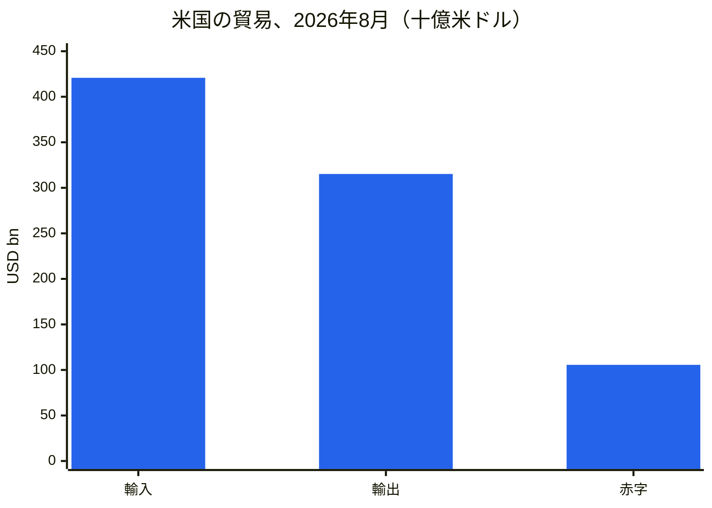

*注：businessday.co.za経由の国勢調査局/BEA。輸入4,208億ドル（過去最高、+4.3%）、輸出3,152億ドル（+1.4%）、赤字1,056億ドル（+13.7%、2025年3月以来の最大）。*

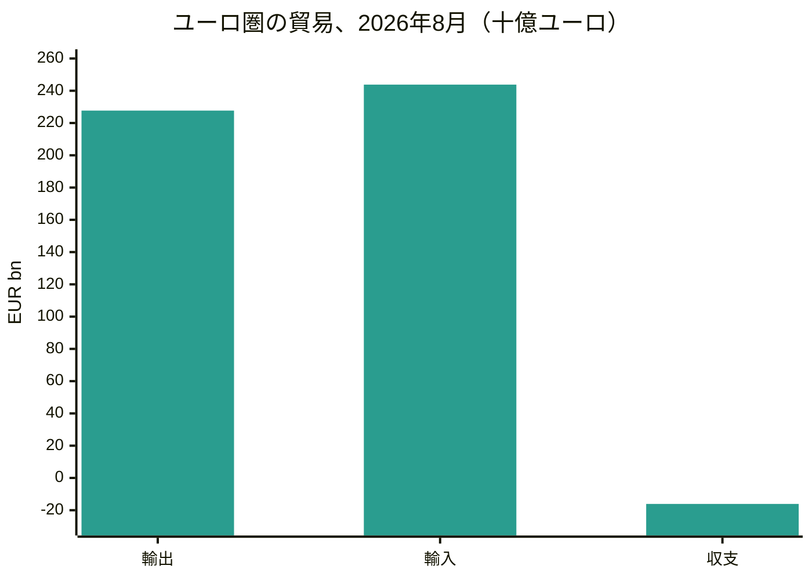

*注：10月16日発表のEurostat。輸出2,277億ユーロ（前年比+9.9%）、輸入2,438億ユーロ（+16.7%）、収支-161億ユーロ（2023年1月以来の最大赤字）。*

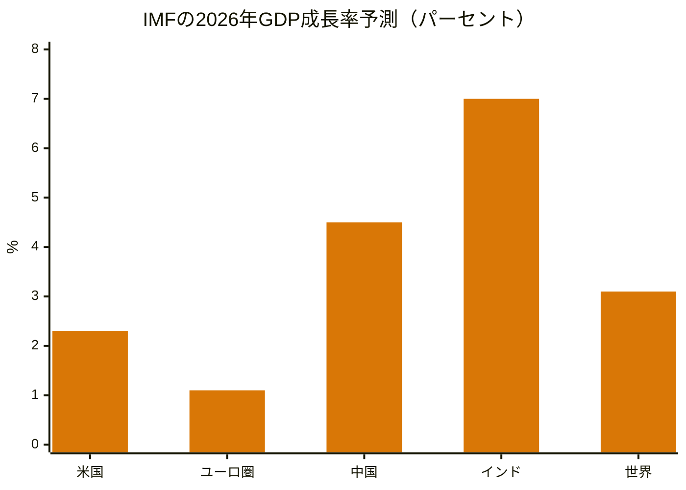

*注：IMF「世界経済見通し」（2026年10月13日）。2027年の世界予測は3.4%。*

---

## 9. 海運市場

### コンテナスポット料金 — ドリュー・ワールド・コンテナ指数

10月15日の評価は**1FEUあたり4,485ドルで前週比3%高**となった — 10月8日の4,351ドル（-2%）からの反発だ。アジア～欧州が上昇を牽引した。上海～ロッテルダムは6%高の3,522ドル、上海～ジェノバは7%高の3,945ドルで、13週連続の下落後初の上昇となった。太平洋航路はまちまちで、上海～ロサンゼルスは3%高の7,884ドル、上海～ニューヨークは1%安の10,075ドルだった。ドリューは来週の変動は小さいと予想する。前回評価（10月1日）は4,434ドル（-1%）で引けていた。

ドリューの欠航トラッカー（10月16日）によると、43～47週（10月19日～11月22日）に44便のブランクセーリングが発表された — 計画713便の6%の欠航率だ。アジア～北欧/地中海が欠航の44%、太平洋東行きが36%、大西洋が20%を占める。船社のアジア～欧州の計画FAK値上げ（10月19日から1FEUあたり4,500～4,800ドル）は、スエズ復帰の船腹を前に受け入れが不透明だ。（データソース：[Drewry](https://www.drewry.co.uk/maritime-research-opinion-browser/world-container-index-assessed-by-drewry)、[Shipping Telegraph wk41](https://shippingtelegraph.com/freight-news/drewry-the-world-container-index-decreased-2-in-week-41-2026/)、[Shipping Telegraph wk42](https://shippingtelegraph.com/freight-news/drewry-the-world-container-index-increased-3-this-week-42-2026/)）

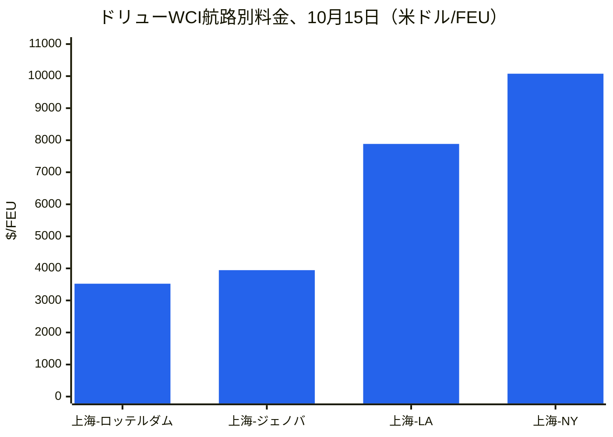

*注：上海～ロッテルダム3,522ドル（+6%）、上海～ジェノバ3,945ドル（+7%）、上海～ロサンゼルス7,884ドル（+3%）、上海～ニューヨーク10,075ドル（-1%）。*

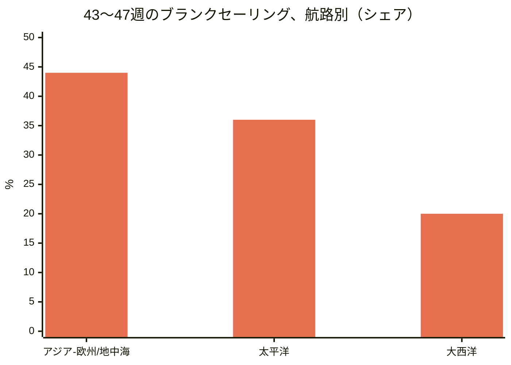

*注：ドリュー欠航トラッカー（10月16日）。計画713便のうち44便欠航（6%の欠航率）。*

### Freightosバルチック指数（FBX）

10月13日までの週：アジア～米国西海岸（FBX01）は2%安の8,149ドル/FEU、アジア～米国東海岸（FBX03）は横ばいの9,606ドル/FEU、アジア～北欧（FBX11）は横ばいの3,260ドル/FEU、アジア～地中海（FBX13）は7%高の3,804ドル/FEUだ。航空では、中国～北米が3%高の5.77ドル/kg、中国～北欧が7%安の3.58ドル/kg — 後者は7月のEU150ユーロデミニミス免除終了の影響を反映している（9月のフランクフルト経由の中国・香港輸入はそれぞれ-1.8%、-7.4%）。Freightosの航空ベンチマークは前年比33%高のままだ。太平洋航路料金は黄金週を通じて横ばいの後わずかに下落 — 祝日明けの下落の始まりで、11～12月の取扱量の減少が見込まれる。([AJOT / Freightos](https://www.ajot.com/news/freightos-weekly-update-attacks-disrupt-saudi-air-cargo-china-europe-air-rates-slump))

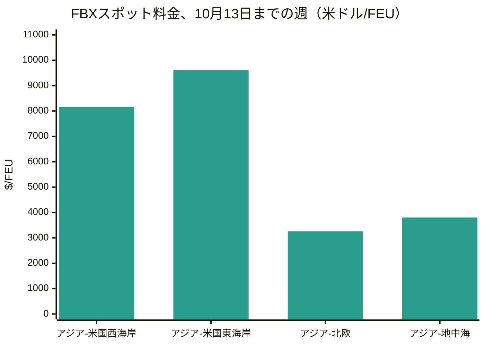

*注：FBX01は8,149ドル（-2%）、FBX03は9,606ドル（横ばい）、FBX11は3,260ドル（横ばい）、FBX13は3,804ドル（+7%）。*

### ドライバルク — バルチック取引所

**バルチック海運指数**は3週連続で下落し、10月16日（金）に**2,511で引けた — 週間で14%安**で、6月30日以来の低水準だ。ケープサイズ指数は週間25%安の3,249（4月初旬以来の低水準）。ケープサイズ5TC収益は1日平均2万5,961ドル（-664ドル/日）だった。パナマックスは1.8%安の2,314（収益2万827ドル/日）。スープラマックスだけが9ポイント高の1,865と底堅かった。鉄鉱石は週半ばに中国の需要低迷と在庫増で2年ぶり安値を付けた後、金曜日に反発した。（データソース：[Baird Maritime](https://www.bairdmaritime.com/shipping/dry-cargo/bulkers/baltic-index-stays-in-the-doldrums-as-capesize-rates-slide-further)、[Safety4Sea](https://www.safety4sea.com/baltic-exchange-maritime-market-highlights-october-12-16/)）

### 航空貨物

世界のスポット料金は41週に**1kgあたり3.55ドルで横ばい**を維持した。黄金週の閑散期にもかかわらずだ — 取扱量は前週比1%減で3週連続の減少だが前年比9%増、スポット料金は前年比34%高、全市場料金の3.13ドル/kgは安定だった。アジア太平洋のスポットは前週比3%安の4.83ドル/kg、アフリカのスポットは10%高だった。ジェット燃料は前年比111%高（IATA/Platts）。バルチック航空貨物指数は10月5日までの週に5.0%上昇し、前年比の上昇率は+25.5%に達した。料金はまだ燃料高に追随していない。技術・電子機器（サーバー、半導体、データセンター部品）が最も強い需要源であり続ける一方、低額輸入の関税変更で米国の電子商取引は縮小した。フーシの空港攻撃で41週の湾岸容量は前週比4%収縮し、2月末比で20%減の水準にとどまった。（データソース：[StatTimes / WorldACD](https://www.stattimes.com/air-cargo/global-air-cargo-rates-remain-stable-at-355kg-in-week-41-1360975)、[Baltic Exchange](https://www.balticexchange.com/en/news-and-events/news/guest-column/2026/Air-freight-rates-remain-firm-in-September-with-renewed-surge-in-jet-fuel-yet-to-feed-through.html)）

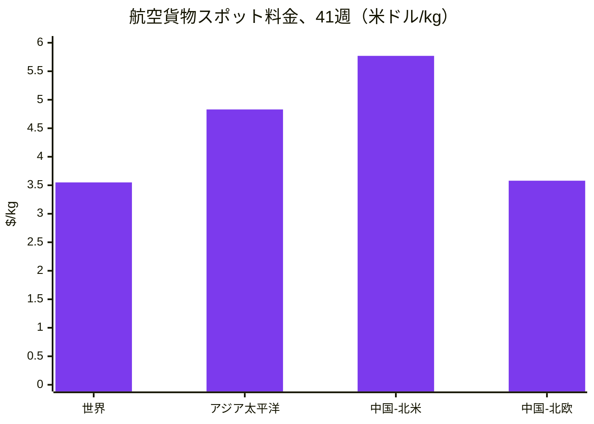

*注：StatTimes経由のWorldACD（10月19日）とFreightos（10月13日）。世界3.55ドル（前年比+34%）、アジア太平洋4.83ドル、中国～北米5.77ドル、中国～北欧3.58ドル。*

### 定時運航率

Xenetaの9月のスコアカード：世界の定時到着率は2ポイント低下し**27%**となり、4か月連続の悪化。平均遅延は6日に達した（第2四半期から+2.4日）。極東～欧州は4%に崩壊し、平均遅延9.9日 — 2021年9月以来の最悪だ。アジア～北米は定時率20%で横ばい、遅延は6.9日に拡大した。追跡対象の全船社が過去12か月で最悪の平均遅延を記録した（CMA CGMは定時率30%、Coscoは18%、Hapag-Lloydは45%、Yang Mingは4%）。中国～米国西海岸のスポットは10月初旬に平均7,717ドル/FEU — 2025年9月の1,778ドルの約4倍だ。長期料金は月間26%高の3,649ドル/FEU（10月1日）となった。([FreightWaves / Port Technology](https://www.olgn.news/freightwaves-shippers-waiting-an-extra-week-for-us-bound-containers/))

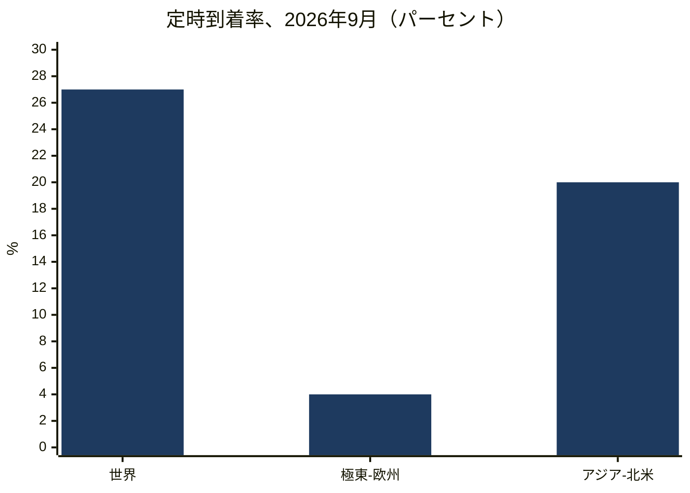

*注：FreightWaves/Port Technology経由のXeneta。世界27%（-2ポイント）、極東～欧州4%（平均遅延9.9日）、アジア～北米20%（遅延6.9日）。*

### 港湾・物流の混乱

- **ホルムズ/フーシ：** コンテナ船「GFSプライド」が沈没（10月15日）。10月5～11日に12隻が攻撃。海峡通航は週131隻に減少。湾岸航空貨物容量は前週比-4%。国連安保理議長声明が10月15日に全会一致で採択され、フーシのサウジアラビアと紅海海運への攻撃を非難した。（アラートA2参照。）
- **サイバー恐喝：** 18か国の38の海事企業が10月19日13時27分（UTC）の身代金期限を迎える（アラートA3参照）。
- **スエズ：** 10月6日から船齢25年超の船舶に強制検査と試運転。10月上半期の運河通過コンテナ船腹は週平均75万3,000TEUで、2023年同期の145万7,000TEUに対してだ — 復帰は進行中だが、完全にはほど遠い。
- **ドイツ：** ver.diが10月6日に賃上げで合意（約1万1,000人、6港、12か月で+3.4%）。ハンブルク、ブレーマーハーフェン、ヴィルヘルムスハーフェンのストライキリスクは解消 — だがライン川の水位が記録的低水準でロッテルダム/アントワープ向けのはしけ交通が制限されている。ブレーマーハーフェンのヤード稼働率は90%、ロッテルダムは85～90%で滞留14日だ。
- **パナマ：** 運河庁は10月15日から予約制の日次スロットを33に引き上げた。
- **米国東海岸：** フィラポートが約8億3,700万ドルの拡張を発表 — 過去最大で、50年ぶりの新バース（10月14日）。ロングビーチ港は9月に過去最高の月間取扱量（約100万コンテナに迫る）。ロサンゼルス港は118年の歴史で最も忙しい月だったが、港湾責任者は関税主導の調達シフトが計画リスクを生むと警告した。
- **マニラ：** Hapag-Lloydの年末までのマニラ向け全ブッキング停止（先週報道）は、引き続き極端な混雑の事例だ。
- **バングラデシュ：** DPワールドがチッタゴンのニュームーリング・コンテナターミナルの15年コンセッションに署名（10月12日）。買収に反対する港湾労働者の抗議が続く中だ。
- **船社の投資：** HMMの取締役会が12隻のコンテナ船への16億2,000万ドルの投資を承認（1万3,000TEU新造8隻とリセール新造4隻の計11万4,100TEU、2029年12月までに引き渡し） — 2030年末に166隻・147万TEUを目指す。ZIMは旺盛な需要で2026年の利益予測を72%引き上げた。JOCの見出しでは、ドイツが安全保障上の懸念でコスコのZippel買収を阻止したことや、LA・LBのターミナル開業を遅らせるILWUの動きも報じられた。

### ベンダーインテリジェンス

- **Descartes — グローバル海運報告（9月号、10月13日頃）。** 米国のコンテナ輸入は9月として過去最高の255万TEU — 8月比-2.2%、前年比+10.3%。1～9月は前年比+0.8%だ。中国発の輸入は月間で急増し、他の主要原産国の大半は減少した。西海岸港湾がシェアを伸ばし、上位10ゲートウェイのうち8港で港湾通過遅延が増加した（増加幅が最大だったのはNY/NJ）。今後の注視点：中東/ホルムズの事案、関税拡大（301条/232条、9月の医薬品232条関税）、パナマのスロット、紅海航路、米国経済（FF金利3.75～4.00%、第2四半期GDPは年率2.2%）だ。データ公表であり、製品の項目ではない。([AJOT](https://www.ajot.com/news/descartes-global-shipping-report-u.s-container-imports-reach-highest-september-volume-on-record))
- **Descartes — CustomsInfoの週間関税データ更新。** 10月16日の更新：メキシコ関税の更新が10月14日から有効（政令DOF 13/10/2026 — 暫定税率、HS変更なし）。モーリシャスの税更新のみ。10月9日の更新：HTS 9903.85.67/68の米国技術訂正（対象国をロシアだけでなく全てに訂正。追加関税はロシアで製錬・鋳造された場合のみ適用）。中国の10月8日の更新。([customsinfo.com](https://www.customsinfo.com/resources/industry-updates/))
- **TradeInt — トルコ貿易省との提携（9月30日発表、対象期間の直前）。** この提携は、現地コンサル企業に200超の国の船積み記録、税関申告、B/Lデータへの資金提供付きアクセスを与える助成で、トルコの中小企業の輸出意思決定を支援する。TradeIntのレビューはトルコの2025年輸出を2,697億ドルと引用した。政府提携の項目だ。今週、対象期間内の日付のTradeIntの公表は見つからず、TradeIntのインサイトブログにも対象期間内の日付が確認できる投稿はない。([bayareametrowire](https://bayareametrowire.com/news/turkiyes-ministry-of-trade-grants-consulting-firms-access-to-global-trade-data-through-tradeint-partnership))

---

## 10. 政策タイムライン

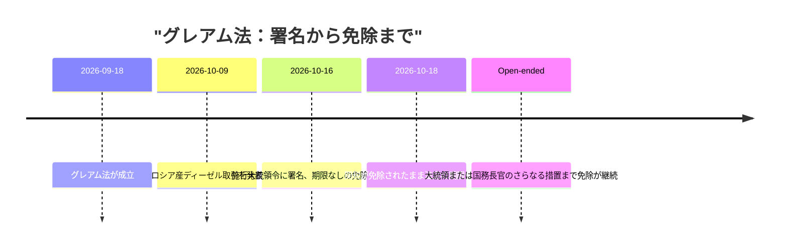

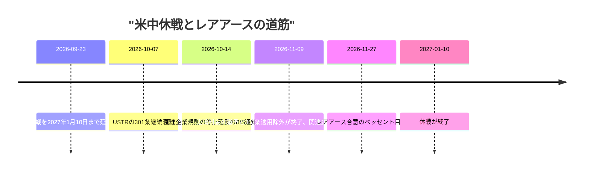

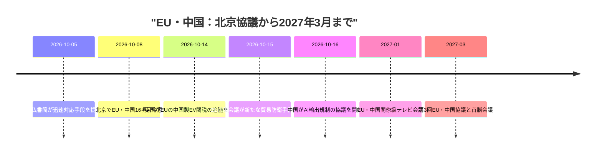

---

## 11. 今後の期限・イベント（今後90日）

| 日付 | イベント | 重要性 |
|---|---|---|
| 2026年10月19日 | サイバー恐喝の身代金期限（13時27分 UTC）、38の海事企業 | 初の大規模な海事サイバー恐喝。情報開示に注意 |
| 2026年10月20日 | インド・ニュージーランドFTAが発効 | 初日からインド輸出品へのNZ関税が撤廃 |
| 2026年10月22日 | 韓国の改正外国貿易法が発効 | 貿易制限の根拠が5から9に拡大 |
| 2026年10月27日 | WTO DSB：中国対トルコEV関税パネル報告の採択、インド・台湾ICT関税判決の採択期限 | 同日に2つの紛争の節目 |
| 2026年11月9日 | 301条港湾料金の猶予終了（午後11時59分 米東部時間）。301条の178品目の適用除外が終了。BIS関連企業規則の停止も文言どおり終了 | 三重のコンプライアンスの崖 — USTR/BISの措置がない限り厳格な期限として扱う |
| 2026年11月9日 | マダガスカルのセーフガード調査のコメント期限 |  |
| 2026年11月10日 | レアアースの「スナップバック」日の従来ガイダンス。関連企業規則の再適用日 | BISの正式措置に注意 |
| 2026年11月15日 | 中国のAI輸出規制の協議が終了 | その後40技術のカタログが採用される可能性 |
| 2026年11月20日 | 英国・EU首脳会議（ブリュッセル） | 英国のEV関税決定に続く |
| 2026年11月27日 | 感謝祭 — レアアース合意のベッセント目標 |  |
| 2026年12月31日 | EU・米国合意の鉄鋼/アルミ見直し：米国の関税が15%超なら譲歩は停止可能 | EU・米国合意の初の相互抑制の試金石 |
| 2027年1月10日 | 米中休戦が終了 |  |
| 2027年1月 | EU・中国閣僚級テレビ会議 |  |
| 2027年3月 | 第3回EU・中国貿易投資協議。次回EU・中国首脳会議。IMFの基準シナリオではホルムズ海峡が再開 |  |
| 2027年初 | オーストラリア・EU FTAが議会提出（批准攻防） |  |

## 12. データソースと調査手法

対象期間：2026年10月12～19日。

**貿易ニュース・分析：** FreightWaves、The Loadstar、Splash247、gCaptain、Hellenic Shipping News、Container News、Supply Chain Dive、Port Technology International、JOC（見出しのみ）、Shipping Telegraph、Baird Maritime、StatTimes/WorldACD、AJOT/Freightos、Metro Global、TradeIntブログ（対象期間内の日付の投稿なし）。

**米国政策：** whitehouse.gov（グレアム法施行大統領令、一次資料）、federalregister.gov（BISの米国産ガイダンス2026-20938、USTR継続通知91 FR 64212）、CBP（貿易アドバイザリ経由：CAPEフェーズ3、WRO、ユーザー料金）、FMC（Supply Chain Dive経由のスペイン料金提案）、USTR（二次報道経由）、BIS（Mondaq/Crowell & Moring、Braumiller、Dechert経由）、Thompson Hine、Steptoe、Mondaq、Gateway Lines、Thomson Reuters、JD Supra（対象期間内の項目なし）、internationaltradetoday.com（見出しのみ）。

**世界各国政府：** 欧州理事会首脳会議（報道経由）、欧州委員会/DG貿易（報道経由）、英国ビジネス貿易省（ガーディアン/Fleet News経由）、CBSA/カナダ（業界団体経由）、経産省/日本税関（Steptoe/Global Sanctions経由）、韓国産業通商資源部（LinkedIn要約経由）、english.mofcom.gov.cn（直接取得は失敗。MOFCOMの項目は二次報道と国務院英語版経由）、インド商務省（報道経由）、オーストラリア外務貿易省（報道経由）、ブラジル開発商工サービス省（Datamar経由）。

**多国間：** wto.org（世界貿易見通し・統計、10月8日。委員会とDSBの報道は貿易報道経由）、unctad.org（貿易開発報告2026）、WCO（e-CENcomm開設、GCC追加文書）、WTO ITIP（対象期間内の新たな公表なし）、ITC Trade Map（対象期間内の公表なし）。

**データポータル：** 国勢調査局/BEA（FT-900、2026年8月。速報物品、2026年9月）、GACC（中国2026年9月貿易）、Eurostat（ユーロ圏2026年8月）、WTO、IMF（10月世界経済見通し）、UNCTADstat、USITC DataWeb / USA Trade Online / UN Comtrade / WITS（対象期間内の新たなデータセット公表なし）。

**シンクタンク・政策研究：** イェール予算研究所（米国の関税の現状、関税配当分析）、ペンシルベニア大学ウォートン予算モデル（実効関税率と歳入、10月14日更新）、税制財団（トランプ関税トラッカー、2026年8月版）、Mondaq（EU・米国関税合意の分析）、tradeintelligence.eu（今週はテキスト取得できず）。

**海運：** ドリュー（ワールド・コンテナ指数10月15日評価、欠航トラッカー10月16日）、バルチック取引所（週間市場ハイライト、ゲストコラム経由のBAI）、Freightosバルチック指数（10月13日までの週）、Xeneta（定時運航率、FreightWaves/Port Technology経由）、Kpler（海峡通航）、Sea-Intelligence、Linerlytica、Veson、Hartland（タンカー収益）、Clarksons、SCFI、TAC指数、NRFグローバル港湾トラッカー、DHL、DC Velocity。

**ベンダーインテリジェンス：** Descartes Systems Group（グローバル海運報告9月号、CustomsInfoの週間関税データ更新）とTradeInt（トルコ貿易省との提携、9月30日） — ベンダーのニュース項目のみ。データ公表、政府提携、市場動向だ。
