# รายงานข่าวกรองการค้าโลก — สัปดาห์ 12–19 ตุลาคม 2026

**สรุปข่าวประจำสัปดาห์** ช่วงเวลาครอบคลุม: 12–19 ตุลาคม 2026 รวบรวมจากแหล่งข่าวการค้า นโยบาย ข้อมูล และค่าระวางประมาณ 45 แหล่งทั่วโลก

---

## สารบัญ

1. [สรุปผู้บริหาร](#1-executive-summary)
2. [ประเด็นเตือน](#2-alerts)
3. [ข่าวสำคัญ — วิเคราะห์เชิงลึก](#3-top-stories--deep-dives)
4. [ตัวติดตามภาษีศุลกากร](#4-tariff-tracker)
5. [วิเคราะห์เชิงลึกนโยบายสหรัฐฯ](#5-us-policy-deep-dive)
6. [นโยบายโลกตามภูมิภาค](#6-world-policy-by-region)
7. [มาตรการบังคับใช้](#7-enforcement-actions)
8. [การเผยแพร่ข้อมูล](#8-data-releases)
9. [ตลาดค่าระวาง](#9-freight-market)
10. [เส้นเวลานโยบาย](#10-policy-timelines)
11. [กำหนดการและเหตุการณ์ที่จะมาถึง (90 วันข้างหน้า)](#11-upcoming-deadlines--events-next-90-days)
12. [แหล่งข้อมูลและระเบียบวิธี](#12-sources--methodology)

---

## 1. สรุปผู้บริหาร

สัปดาห์ที่กฎหมายคว่ำบาตรฉบับสำคัญถูกทำให้ไม่มีผลบังคับก่อนที่จะได้ใช้ การรบในช่องแคบฮอร์มุซเริ่มจมเรือคอนเทนเนอร์ และสามเศรษฐกิจการค้าที่ใหญ่ที่สุดของโลกรายงานตัวเลขที่ชี้ไปในทิศทางตรงกันข้าม

- **พระราชบัญญัติเกรแฮมถูกยกเว้นก่อนจะมีผลบังคับ** หนึ่งเดือนหลังการลงนามพระราชบัญญัติ Lindsey O. Graham Sanctioning Russia and Iran Act of 2026 — ซึ่งกำหนดภาษี 500% สำหรับสินค้ารัสเซียและภาษีทุติยภูมิ 100% สำหรับผู้ซื้อน้ำมันและก๊าซรัสเซียรายใหญ่ที่สุด — ประธานาธิบดีทรัมป์ลงนามคำสั่งฝ่ายบริหารเมื่อวันที่ 16 ตุลาคมเพื่อบังคับใช้พระราชบัญญัติ และในคำสั่งเดียวกันนั้นได้ยกเว้นบทบัญญัติภาษีและคว่ำบาตรโดยไม่มีวันสิ้นสุด อินเดีย จีน และตุรกี ซึ่งเป็นประเทศที่พระราชบัญญัติเล็งเป้าหมาย ยังคงซื้อพลังงานรัสเซียต่อไป นักวิจารณ์จากทั้งสองพรรคและเคียฟเรียกการยกเว้นว่าเป็นถอยหลัง ขณะที่ทำเนียบขาวไม่ได้ให้คำอธิบายโดยละเอียดต่อสาธารณะ
- **ฮอร์มุซคร่าชีวิตเรือคอนเทนเนอร์ลำแรก** เรือติดธงสิงคโปร์ *GFS Pride* (ขนาด 2,824 TEU) ถูกโจมตี เกิดไฟไหม้ และจมลงนอกช่องแคบฮอร์มุซเมื่อวันที่ 15 ตุลาคม — เป็นเรือลำที่สองและสามที่จมลงนับตั้งแต่ความขัดแย้งเริ่มขึ้น มีเรือ 12 ลำรายงานการโจมตีในสัปดาห์ 5–11 ตุลาคม ซึ่งเป็นจำนวนสูงสุดรายสัปดาห์ของสงคราม การผ่านช่องแคบลดลงเหลือ 131 ลำจาก 176 ลำในสัปดาห์ก่อน และปริมาณน้ำมันดิบลดลงเหลือประมาณ 12.6 ล้านบาร์เรลต่อวัน ขณะที่รายได้ของเรือบรรทุกน้ำมันแตะระดับพิเศษ: เรือ VLCC เฉลี่ย 643,000 ดอลลาร์ต่อวันในช่วงเดือนที่ผ่านมา
- **ตัวเลขเล่าเรื่องสามทิศทางที่ต่างกัน** ดุลการค้าเกินดุลของจีนในเดือนกันยายนแตะ 133,500 ล้านดอลลาร์ สูงสุดในรอบ 20 เดือน เนื่องจากการส่งออกพุ่ง 36.3% จากความเฟื่องฟูของฮาร์ดแวร์เอไอ — ดุลการค้าเกินดุลช่วงมกราคม–กันยายนแตะ 938,500 ล้านดอลลาร์ ใกล้ที่จะเกิน 1 ล้านล้านดอลลาร์เป็นปีที่สองติดต่อกัน ดุลการค้าขาดดุลของสหรัฐฯ ในเดือนสิงหาคมขยายตัว 13.7% เป็น 105,600 ล้านดอลลาร์ ขณะที่การนำเข้าสร้างสถิติ 420,800 ล้านดอลลาร์ ยูโรโซนขาดดุลการค้าสูงสุดนับตั้งแต่เดือนมกราคม 2023 (16,100 ล้านยูโร) เนื่องจากการนำเข้าพุ่ง 16.7% WTO ปรับเพิ่มคาดการณ์การค้าโลกปี 2026 เป็น 3.9% พร้อมเตือนว่าสินค้าเอไอกำลังบดบังจุดอ่อนในด้านอื่น IMF ในรายงานเดือนตุลาคมประเมินการเติบโตของโลกปี 2026 ไว้ที่ 3.1% โดยสมมติฐานว่าฮอร์มุซจะเปิดอีกครั้งในเดือนมีนาคม
- **ยุโรปกำหนดทิศทางป้องกันการค้า** ในการประชุมสุดยอดบรัสเซลส์วันที่ 15–16 ตุลาคม ผู้นำสหภาพยุโรปมอบหมายให้ใช้มาตรการป้องกันการค้าที่มีอยู่อย่างเต็มที่ต่อจีน และขอให้คณะกรรมาธิการพัฒนาเครื่องมือใหม่ ขณะที่ยังเปิดช่องเจรจาก่อนการประชุมในเดือนมีนาคม 2027 สหราชอาณาจักรตัดสินใจไม่ทำตามภาษีของสหภาพยุโรปสูงสุด 45.3% สำหรับรถยนต์ไฟฟ้าจีน โดยระบุว่าเป็นการตัดสินใจตามผลประโยชน์ของสหราชอาณาจักรเพียงอย่างเดียว ปักกิ่งเปิดรับฟังความคิดเห็นสาธารณะเกี่ยวกับการควบคุมการส่งออกเทคโนโลยีเอไอฉบับกว้าง ครอบคลุมน้ำหนักโมเดลขนาดใหญ่และวิธีการออกแบบชิป
- **ค่าขนส่งฟื้นตัวบางส่วน** ดัชนี Drewry World Container Index เพิ่มขึ้น 3% เป็น 4,485 ดอลลาร์/FEU ในการประเมินวันที่ 15 ตุลาคม — อัตราเอเชีย–ยุโรปเพิ่มขึ้นเป็นครั้งแรกในรอบ 13 สัปดาห์ — ขณะที่ดัชนี Baltic Dry ลดลงเป็นสัปดาห์ที่สามติดต่อกันเป็น 2,511 เนื่องจากรายได้ของเรือ Capesize ร่วงลง ความน่าเชื่อถือของตารางเดินเรือคอนเทนเนอร์ทั่วโลกลดลงเหลือ 27% ในเดือนกันยายน เป็นเดือนที่สี่ติดต่อกันที่ลดลง บริษัทเดินเรือและท่าเรือ 38 แห่งใน 18 ประเทศเผชิญเส้นตายเรียกค่าไถ่ทางไซเบอร์หมู่ในวันที่ 19 ตุลาคม

**ค่าขนส่ง:** ภาพสองด้าน — ค่าระวางคอนเทนเนอร์สปอตฟื้นตัวจากการผลักดันอัตราหลังโกลเดนวีคและการยกเลิกเที่ยวเรือของผู้ให้บริการ (ยกเลิก 44 เที่ยวในสัปดาห์ที่ 43–47) เรือเทกองดิ่งลงเมื่อแร่เหล็กแตะจุดต่ำสุดในรอบสองปี และค่าส่งอากาศคงที่ที่ 3.55 ดอลลาร์/กก. ขณะที่น้ำมันเครื่องบินเพิ่มขึ้นกว่า 100% เมื่อเทียบรายปี

---

## 2. ประเด็นเตือน

| # | ประเด็นเตือน | มีผล | ผลกระทบ | แหล่งที่มา |
|---|-------|-----------|--------|--------|
| A1 | ยกเว้นภาษีตามพระราชบัญญัติเกรแฮม: คำสั่งฝ่ายบริหาร 16 ตุลาคมบังคับใช้ Lindsey O. Graham Sanctioning Russia and Iran Act และในขณะเดียวกันยกเว้นบทบัญญัติภาษีและคว่ำบาตรตามมาตรา 115 โดยไม่มีวันสิ้นสุด; มาตรการคว่ำบาตรรัสเซียก่อนหน้านี้ยังคงมีผล | 16 ต.ค. 2026 | อินเดีย จีน ตุรกียังเข้าถึงพลังงานรัสเซียโดยไม่มีภาษีสหรัฐฯ ใหม่; การยกเว้นมีผลจนกว่าจะถูกเพิกถอน | [whitehouse.gov](https://www.whitehouse.gov/presidential-actions/2026/10/implementing-the-lindsey-o-graham-sanctioning-russia-and-iran-act-of-2026/) |
| A2 | การยกระดับที่ฮอร์มุซ: เรือคอนเทนเนอร์ *GFS Pride* (2,824 TEU) ถูกโจมตีและจม 15 ต.ค.; เรือถูกโจมตี 12 ลำในสัปดาห์ 5–11 ต.ค. (สูงสุดรายสัปดาห์ของสงคราม); การผ่านช่องแคบลดลงเหลือ 131 ลำ/สัปดาห์; ปริมาณน้ำมันดิบ ~12.6 ล้านบาร์เรล/วัน | 12–15 ต.ค. 2026 | ระวางเรือคอนเทนเนอร์ตกอยู่ในความเสี่ยง; เงื่อนไขประกันภัยสงครามเข้มงวดขึ้น; รายได้เรือบรรทุกน้ำมันอยู่ระดับพิเศษ | [Splash247](https://splash247.com/hormuz-claims-two-more-ships-in-fresh-wave-of-strikes/), [FreightWaves](https://www.freightwaves.com/news/container-ship-attacks-escalate-in-strait-of-hormuz) |
| A3 | การเรียกค่าไถ่ทางไซเบอร์หมู่ต่อภาคการเดินเรือ: กลุ่ม "n0n" ระบุบริษัทเดินเรือ/ท่าเรือ/โลจิสติกส์ 38 แห่งใน 18 ประเทศเมื่อ 12 ต.ค. ขู่ว่าจะเผยแพร่ข้อมูลในวันที่ 19 ต.ค. เวลา 13:27 UTC เว้นแต่จะจ่ายค่าไถ่; เรียกค่าไถ่ 400,000–400 ล้านดอลลาร์ต่อบริษัท; ข้ออ้างยังไม่ได้รับการยืนยัน | เส้นตาย 19 ต.ค. 2026 | คลื่นการเรียกค่าไถ่ทางไซเบอร์ประสานงานขนาดใหญ่ครั้งแรกที่เล็งเป้าการเดินเรือ; เป้าหมายรวมถึง ONE, CULines, TS Lines, Santos Brasil | [Splash247](https://splash247.com/shipping-firms-and-ports-caught-in-mass-cyber-extortion-claim/) |
| A4 | จีนร่างการควบคุมการส่งออกเทคโนโลยีเอไอ (ประกาศฉบับที่ 48, 16 ต.ค.): เสนอ 40 เทคโนโลยีเข้าบัญชีต้องห้าม/จำกัด (14 ต้องห้าม, 26 จำกัด) รวมน้ำหนัก LLM เกิน 2 ล้านล้านพารามิเตอร์; ข้อกำหนดขึ้นทะเบียนก่อนส่งออกมีผลทันที; รับฟังความคิดเห็นสาธารณะถึง 15 พ.ย. | 16 ต.ค. 2026 (รับฟังความคิดเห็นถึง 15 พ.ย.) | อาจจำกัดการถ่ายโอนโมเดลเอไอ ตัวแทนอัจฉริยะ และเทคโนโลยีออกแบบชิป; การติดตั้งในต่างประเทศถูกรวมด้วย | [aiandgpp.com](https://aiandgpp.com/2026/10/19/china-ai-export-controls-model-weights-sovereign-cloud/) |
| A5 | เส้นตายคู่ 9 พฤศจิกายน — ไม่มีประกาศขยายเวลาจาก USTR ณ 13 ต.ค.: (a) การหยุดหนึ่งปีค่าธรรมเนียมท่าเรือมาตรา 301 สำหรับเรือที่เชื่อมโยงจีนหมดอายุ (ค่าธรรมเนียมกลับเป็น 80 ดอลลาร์/ตันเน็ตสำหรับเจ้าของ/ผู้ดำเนินการจีน); (b) การยกเว้นผลิตภัณฑ์มาตรา 301 จำนวน 178 รายการหมดอายุ (ภาษี List 1/2/3 กลับเป็น 25%, List 4A กลับเป็น 7.5%) | 9 พ.ย. 2026, 23:59 น. ตามเวลา ET | ผู้นำเข้าควรถือว่า 9 พ.ย. เป็นวันสิ้นสุด; ไม่มีระยะผ่อนผัน; การยกเว้นลบเฉพาะชั้นภาษี 301 เท่านั้น | [Gateway Lines](https://gatewaylines.com/press-releases/china-ship-fees-301-exclusions-nov-9-2026) |
| A6 | คำสั่งห้ามส่งออกรัสเซียฉบับขยายของญี่ปุ่นมีผล 16 ต.ค. (ประกาศ 6 ต.ค.): เพิ่มแร่ เคมีภัณฑ์ โลหะ เครื่องจักร อุปกรณ์อุตสาหกรรม และเครื่องมือวัดแม่นยำในรายการห้าม | 16 ต.ค. 2026 | ผู้ส่งออกไปรัสเซียต้องคัดกรองขอบเขตสินค้าใหม่ | [Steptoe](https://www.steptoe.com/en/news-publications/international-compliance-blog/weekly-sanctions-update-october-13-2026.html) |
| A7 | FMC เสนอค่าธรรมเนียม 200,000 ดอลลาร์/เที่ยว สำหรับเรือติดธงสเปน บวกข้อจำกัดนำเข้าสินค้าสเปน (น้ำหอม, น้ำมัน/ไขมัน, เซรามิก, ผลิตภัณฑ์หิน, น้ำตาล, ลูกกวาด) หลังพบในปี 2024 ว่าสเปนปฏิเสธการเข้าท่าเรือของเรือติดธงสหรัฐฯ | เสนอ 16 ต.ค. 2026 | การยกระดับอำนาจตอบโต้ของ FMC กรณีเลือกปฏิบัติตามธง; เรือ MSP ของ Maersk 2 ลำถูกปฏิเสธการเข้าท่า | [Supply Chain Dive](https://www.supplychaindive.com/news/fmc-proposes-fees-on-spanish-flagged-vessels-import-restrictions/833122/) |
| A8 | แร่หายาก: เบสเซนต์กล่าวว่าสหรัฐฯ หวังสรุปข้อตกลงแร่หายากกับจีน "หวังว่า" ภายในวันขอบคุณพระเจ้า (27 พ.ย.); การระงับกฎบริษัทในเครือของ BIS (การบังคับใช้อีกครั้งคือ 10 พ.ย.) คาดว่าจะตามการขยายการสงบศึกถึง 10 ม.ค. 2027 แต่ไม่มีประกาศราชกิจจานุเบกษาสหรัฐอย่างเป็นทางการ ณ 14 ต.ค. | เป้าหมาย 27 พ.ย. 2026 | ทีมปฏิบัติตามกฎเผชิญวันบังคับใช้อีกครั้งที่แน่นอนโดยไม่มีการขยายอย่างเป็นทางการที่ประกาศ | [eximguru](https://eximguru.com/export-import-news/export-news/us-china-rare-earths-deal-will-116956.aspx), [Mondaq](https://www.mondaq.com/unitedstates/export-controls-trade-investment-sanctions/1854664/us-china-trade-truce-extended-two-months-bis-affiliates-rule-suspension-follows) |

### A1 — การยกเว้นพระราชบัญญัติเกรแฮม (รายละเอียด)

คำสั่งฝ่ายบริหารที่ลงนาม 16 ตุลาคมมีชื่อว่า "Implementing the Lindsey O. Graham Sanctioning Russia and Iran Act of 2026" — พระราชบัญญัติเองลงนาม 18 กันยายน 2026 (กฎหมายสาธารณะ 119-111) ผ่านวุฒิสภา 86–11 และสภาผู้แทนราษฎร 262–159 มาตรา 2 ของคำสั่งกำหนดอัตราตามกฎหมาย: ภาษีเพิ่มเติม 500% จากมูลค่าสินค้าต้นกำเนิดรัสเซีย; 100% สำหรับสินค้าจากผู้นำเข้าน้ำมันดิบและก๊าซธรรมชาติรายใหญ่ 5 อันดับแรกที่ซื้อใหม่โดยเจตนาในหรือหลัง 18 ตุลาคม 2026; และ 100% สำหรับสินค้าจากผู้ช่วยเหลือการหลีกเลี่ยงคว่ำบาตรน้ำมันรัสเซีย 5 รายแรก ทั้งหมดซ้อนทับภาษีที่มีอยู่เดิม

จากนั้นมาตรา 4(a) ยกเว้นภาษีเหล่านั้น — และบทบัญญัติคว่ำบาตรตามมาตรา 102(a), 102(d), 102(e), 103–111 และ 117 — ภายใต้อำนาจการยกเว้นมาตรา 115 ของพระราชบัญญัติ พร้อมหนังสือรับรองผลประโยชน์แห่งชาติที่ส่งถึงสภาคองเกรส การยกเว้นไม่มีวันสิ้นสุด: มีผลจนกว่าประธานาธิบดี หรือรัฐมนตรีต่างประเทศโดยปรึกษากับกระทรวงการคลังและ USTR จะพิจารณาว่าควรดำเนินการเพิ่มเติม มาตรา 4(b) รักษามาตรการคว่ำบาตรรัสเซียก่อนหน้านี้ที่ออกภายใต้อำนาจภาวะฉุกเฉินแห่งชาติ (ภาวะฉุกเฉินถูกขยายต่อเมื่อ 24 มีนาคม 2026) และ USTR ได้รับมอบหมายให้ติดตามการซื้อพลังงานรัสเซียและรายงานกลับ

**การวิเคราะห์:** โครงสร้างนี้ทำให้รัฐบาลมีเครื่องมือขู่ทางภาษีที่พร้อมใช้ — กลไกบังคับใช้และอัตราถูกกำหนดแล้ว — ขณะที่ไม่เรียกเก็บภาษีในวันนี้ ต้นทุนทางการเมืองมาทันที: วุฒิสมาชิก Blumenthal, Tillis และ Cornyn วิจารณ์การตัดสินใจ ประธานาธิบดี Zelenskyy คัดค้าน และมีการเสนอร่างกฎหมายจากทั้งสองพรรคเพื่อจำกัดอำนาจการยกเว้น แม้ยังไม่มีฉบับใดเป็นกฎหมาย ทำเนียบขาวไม่ได้ให้คำอธิบายโดยละเอียดต่อสาธารณะตามรายงานของ AP สำหรับโรงกลั่นของอินเดียและจีน การยกเว้นลบเส้นตายที่เคยกำหนดไว้ 18 ตุลาคม; สำหรับผู้นำเข้าสหรัฐฯ ความเสี่ยงภาษีถูกเลื่อนออกไป ไม่ได้หายไป — การพิจารณาในอนาคตสามารถเปิดใช้ภาษีใหม่ได้

### A2 — ฮอร์มุซคร่าเรือคอนเทนเนอร์ (รายละเอียด)

Splash247 รายงาน 15 ตุลาคมว่าเรือคอนเทนเนอร์ในเครือ AD Ports/GFS สามลำถูกโจมตีใกล้ฮอร์มุซ เรือติดธงสิงคโปร์ *GFS Pride* (สร้าง 2008, 2,824 TEU) ถูกโจมตี เกิดไฟไหม้และจม ลูกเรือ 21 คนอพยพทั้งหมด เรือ *GFS Giselle* (2015, 4,400 TEU) ตัวเรือเสียหายแต่ถึงที่ทอดสมอโดยลูกเรือ 22 คนปลอดภัย เรือ *Al Saadiyat* (1,730 TEU, Safeen Feeders) หลบหนีความเสียหายร้ายแรง ส่วนเรือ capesize *Cape Dao* (170,000 dwt) จมลงประมาณสามสัปดาห์หลังถูกโจมตีนอกโอมาน ตามข้อมูลอุบัติเหตุของ IMO นี่คือเรือลำที่สองและสามที่จมลงนับตั้งแต่ความขัดแย้งเริ่มขึ้น

UKMTO บันทึกเรือ 12 ลำรายงานการโจมตีในสัปดาห์ 5–11 ตุลาคม — จำนวนสูงสุดรายสัปดาห์นับตั้งแต่สงครามเริ่มขึ้น Kpler นับการผ่านช่องแคบ 131 ครั้งในสัปดาห์สิ้นสุด 14 ตุลาคม ลดลงจาก 176 ครั้งในสัปดาห์ก่อน; น้ำมันดิบผ่านช่องแคบประเมินที่ 12.6 ล้านบาร์เรลต่อวันในวันที่ 13 ตุลาคม เทียบกับราว 15 ล้านบาร์เรลต่อวันปลายเดือนกันยายน FreightWaves รายงานนักวิเคราะห์เตือนว่าความคุ้มครองประกันภัยสงครามสามารถถูกยกเลิกได้โดยแจ้งล่วงหน้าสั้น เมื่อสินค้าเคลื่อนย้ายบนเรือที่ไม่ระบุชื่อในใบตราส่ง — รายละเอียดเอกสารที่มีผลสัญญาจริงสำหรับผู้ส่งสินค้าที่กำลังเลี่ยงหรือผ่านช่องแคบ

**การวิเคราะห์:** การรณรงค์ข้ามเส้นจากการก่อกวนไปสู่การทำลายระวางเรือคอนเทนเนอร์ สำหรับตารางเดินเรือของสายการเดินเรือที่ความน่าเชื่อถือทั่วโลกอยู่ที่ 27% การสูญเสียทางเลือกเส้นทางทะเลแดงและฮอร์มุซยิ่งทวีการหยุดชะงัก น้ำหนักทางการเงินอีกด้านชัดเจน: นายหน้า Hartland ประเมินเจ้าของเรือ VLCC, suezmax และ aframax อิสระมีรายได้ราว 400 ล้านดอลลาร์ต่อวันสูงกว่าที่งบประมาณไว้; หากคงอยู่หนึ่งปี จะเข้าใกล้กำไร 150,000 ล้านดอลลาร์ของอุตสาหกรรมคอนเทนเนอร์ในปีพ้นโรคระบาด เรือ VLCC เฉลี่ย 643,000 ดอลลาร์ต่อวันในช่วงเดือนที่ผ่านมา โดยเส้นทางอ่าวเปอร์เซีย–จีนเกิน 1.3 ล้านดอลลาร์ต่อวัน (Veson) มูลค่าทรัพย์สินตามไปด้วย: เรือ VLCC อายุห้าปีประเมินมูลค่า 218 ล้านดอลลาร์ สูงกว่าราคาสร้างใหม่ 55% และมูลค่าเรือ VLCC อายุ 15 ปีเพิ่มขึ้น 196% เมื่อเทียบรายปี

### A3 — คลื่นเรียกค่าไถ่ทางไซเบอร์ต่อบริษัทเดินเรือ (รายละเอียด)

วันที่ 12 ตุลาคม กลุ่มที่เรียกตัวเองว่า "n0n" เพิ่มบริษัทเดินเรือ ท่าเรือ และโลจิสติกส์ 38 แห่งใน 18 ประเทศบนเว็บไซต์ลีกรั่วไหลบนดาร์กเว็บ ขู่ว่าจะเผยแพร่ข้อมูลที่ขโมยมาในวันที่ 19 ตุลาคม เวลา 13:27 UTC เว้นแต่จะจ่ายค่าไถ่ เป้าหมายที่ระบุชื่อรวมถึง Ocean Network Express, CULines, TS Lines, Samudera, Santos Brasil, Portonave, BNCT, Pusan Newport, TTI Algeciras, Eurogate Tanger, Nam Dinh Vu และ NEOM Ports Cydome ประเมินค่าไถ่ 400,000 ถึง 400 ล้านดอลลาร์ต่อบริษัท; SOCRadar ตรวจสอบค่าไถ่ 2.4 ล้านถึง 14 ล้านดอลลาร์ในบิตคอยน์ ณ เวลารายงาน ข้ออ้างยังไม่ได้รับการยืนยันและไม่มีบริษัทที่ระบุรายใดยืนยันการถูกเจาะระบบ

**การวิเคราะห์:** นี่คือคลื่นการเรียกค่าไถ่ทางไซเบอร์ประสานงานขนาดใหญ่ครั้งแรกที่เล็งเป้าการเดินเรือโดยเฉพาะ ไม่ว่าข้อมูลจะเป็นของจริงหรือไม่ บทเรียนเชิงปฏิบัติยืนอยู่: โครงสร้างพื้นฐานไอทีของท่าเรือและผู้ให้บริการถูกมองเป็นเป้าหมายอ่อนโดยกลุ่มเรียกค่าไถ่ที่มีการจัดระเบียบ ทีมความปลอดภัยห่วงโซ่อุปทานควรถือว่าช่วงเส้นตายเป็นช่วงเสี่ยงฟิชชิงและการบุกรุกสูง

### A4 — ร่างควบคุมการส่งออกเอไอของจีน (รายละเอียด)

วันที่ 16 ตุลาคม กระทรวงพาณิชย์จีนและกระทรวงวิทยาศาสตร์และเทคโนโลยีเปิดรับฟังความคิดเห็นสาธารณะ (ปิด 15 พฤศจิกายน) เรื่องเพิ่ม 40 เทคโนโลยีเข้าบัญชีส่งออกต้องห้ามและจำกัด: 14 ต้องห้าม 26 จำกัด โดย 23 รายการเกี่ยวข้องกับเอไอ เกณฑ์เฉพาะ: น้ำหนักโมเดลภาษาขนาดใหญ่เกิน 2 ล้านล้านพารามิเตอร์ โมเดลที่ฝึกด้วยกำลังคำนวณเกิน 10²⁶ FLOPs หรือโมเดลที่ติดอันดับสิบอันดับแรกของโลก; ตัวแทนเอไอ คลัสเตอร์ประมวลผล และวิธีการออกแบบชิปก็ถูกรวมด้วย ข้อกำหนดขึ้นทะเบียนก่อนส่งออกมีผลวันเดียวกัน รวมถึงข้อตกลงที่อยู่ระหว่างดำเนินการ การเข้าถึง API และ SaaS ได้รับการยกเว้น; การติดตั้งในต่างประเทศถูกรวมด้วย

**การวิเคราะห์:** หากรับรอง นี่จะเป็นระบอบการควบคุมการส่งออกแรกของจีนที่เล็งตรงน้ำหนักโมเดลเอไอระดับแนวหน้า — ภาพสะท้อนของการควบคุมกำลังคำนวณของวอชิงตัน การยกเว้นการเข้าถึง API/SaaS แต่รวมการติดตั้งในต่างประเทศชี้ว่าปักกิ่งต้องการเก็บภาษีหรือบล็อกการถ่ายโอนน้ำหนัก ขณะที่ยังให้รายได้บริการคลาวด์ไหลเข้า บริษัทข้ามชาติที่รันงานเอไอบนโครงสร้างพื้นฐานจีน และบริษัทเอไอจีนที่ออกใบอนุญาตโมเดลในต่างประเทศ ควรสำรวจความเสี่ยงก่อนปิดรับฟังความคิดเห็น

---

## 3. ข่าวสำคัญ — วิเคราะห์เชิงลึก

### 3.1 กฎหมายคว่ำบาตรที่ถูกยกเว้นจนไร้ความหมาย

พระราชบัญญัติ Lindsey O. Graham Sanctioning Russia and Iran Act of 2026 ถูกออกแบบเป็นคำตอบของสภาคองเกรสต่อการหลีกเลี่ยงคว่ำบาตร: ภาษีทุติยภูมิบังคับสูงสุด 100% สำหรับสินค้าของผู้ซื้อน้ำมันรัสเซียรายใหญ่ที่สุด และ 500% สำหรับสินค้ารัสเซียเอง มีผลโดยไม่ต้องผ่านการยกเว้นของประธานาธิบดี พระราชบัญญัติผ่านด้วยคะแนนเสียงแบบเหนือการยับยั้ง — 86–11 ในวุฒิสภา 262–159 ในสภาผู้แทนราษฎร — และลงนาม 18 กันยายน เส้นตายกำหนดภาษีคือ 18 ตุลาคม

วันที่ 16 ตุลาคม สองวันก่อนเส้นตาย ประธานาธิบดีลงนามคำสั่งฝ่ายบริหารเพื่อบังคับใช้ คำสั่งกำหนดอัตราอย่างแม่นยำในมาตรา 2 จากนั้นในมาตรา 4(a) ยกเว้นอัตรานั้น — ใช้อำนาจการยกเว้นที่สภาคองเกรสเขียนไว้ในมาตรา 115 ของพระราชบัญญัติเอง การยกเว้นครอบคลุมทั้งบทบัญญัติภาษี (มาตรา 112 และ 113) และบทบัญญัติคว่ำบาตร (มาตรา 102(a), 102(d), 102(e), 103–111, 117) และไม่มีวันสิ้นสุด: มีผลจนกว่าประธานาธิบดีหรือรัฐมนตรีต่างประเทศโดยปรึกษากระทรวงการคลังและ USTR จะตัดสินใจเป็นอย่างอื่น

**การวิเคราะห์:** สภาคองเกรสพยายามเขียนกฎหมายคว่ำบาตรที่ฝ่ายบริหารไม่สามารถยกเว้นได้; ฝ่ายบริหารยกเว้นมันหนึ่งเดือนต่อมาโดยใช้ข้อยกเว้นการยกเว้นของกฎหมายเอง กลไกบังคับใช้มีอยู่แล้วในฐานะเครื่องมือที่พร้อมใช้ — กำหนดอัตรา มอบหมายการติดตามให้ USTR รักษามาตรฐานคว่ำบาตรพื้นฐานภายใต้ภาวะฉุกเฉินแห่งชาติ — ดังนั้นภัยคุกคามของการเปิดใช้จึงเป็นจริง แม้ภาษีวันนี้เป็นศูนย์ ความแตกต่างกับพันธมิตรกว้างขึ้น: ชุดมาตรการ 8 ตุลาคมของสหราชอาณาจักรเพิ่มเป้าหมาย 38 รายรวมถึงบริษัทพลังงาน 2 แห่งและเรือเงา 12 ลำ โดยลอนดอนอ้างว่าคว่ำบาตรครอบคลุมกำลังการผลิตน้ำมันรัสเซียกว่า 90% และเรียกร้องให้เข้มงวดข้อจำกัดบริการขนส่ง ขณะที่วอชิงตันมีรายงานว่ากำลังพิจารณาผ่อนปรนเรือบรรทุกน้ำมันเพื่อลดค่าระวางที่ทำสถิติ สหภาพยุโรปแยกเป้าหมายอู่ต่อเรือรัสเซียรายใหญ่ในระเบียบที่ประกาศ 12 ตุลาคม สำหรับผู้ซื้อพลังงานรัสเซีย — อินเดียเป็นสำคัญ — การยกเว้นลบเส้นตายเดือนตุลาคม แต่ทิ้งความเสี่ยงเปิดใช้อีกครั้งที่ขึ้นอยู่กับดุลพินิจของรัฐบาลทั้งหมด

### 3.2 ฮอร์มุซ: สงครามมาถึงการเดินเรือคอนเทนเนอร์

เดือนตุลาคมคือเดือนที่การรณรงค์ฮอร์มุซหยุดเป็นสงครามเรือบรรทุกน้ำมันและกลายเป็นสงครามคอนเทนเนอร์ การจมของ *GFS Pride* วันที่ 15 ตุลาคมเป็นเรือคอนเทนเนอร์ลำแรกที่จมของความขัดแย้ง; เรือ 12 ลำที่ UKMTO บันทึกว่าถูกโจมตีในสัปดาห์ 5–11 ตุลาคมเป็นจำนวนสูงสุดรายสัปดาห์ของสงคราม การจราจรผ่านช่องแคบตอบสนอง: 131 ครั้งในสัปดาห์สิ้นสุด 14 ตุลาคม เทียบ 176 ครั้งในสัปดาห์ก่อน และปริมาณน้ำมันดิบลงเหลือประมาณ 12.6 ล้านบาร์เรลต่อวัน จากราว 15 ล้านบาร์เรลต่อวันปลายเดือนกันยายน

ผลกระทบลำดับสองกำลังกระจาย การรณรงค์ของฮูตีต่อซาอุดีอาระเบีย — การยิงขีปนาวุธที่สนามบินคิงคาลิดในริยาด การประกาศห้ามเดินเรือ ความเห็นประธานของคณะมนตรีความมั่นคงสหประชาชาติที่รับรองโดยฉันทามติ 15 ตุลาคม ประณามการโจมตี — ทำให้กำลังการขนส่งอากาศในอ่าวหดตัว 4% สัปดาห์ต่อสัปดาห์ในสัปดาห์ที่ 41 เหลือกำลังการขนส่งในอ่าวต่ำกว่าระดับปลายเดือนกุมภาพันธ์ 20% (WorldACD) ขณะที่องค์การคลองสุเอซกำหนดการตรวจบังคับและทดสอบเดินเรือสำหรับเรืออายุ 25 ปีขึ้นไป มีผล 6 ตุลาคม — มาตรการความปลอดภัยที่ทำให้การผ่านของเรือเงาที่มีอายุมากยุ่งยากขึ้นด้วย (เรือเงารัสเซีย 92% อายุเกิน 15 ปี ตามสถาบัน KSE)

**การวิเคราะห์:** แผนการกลับสู่ทะเลแดงของพันธมิตรคอนเทนเนอร์ — พันธมิตรทั้งหมดบวก MSC จะส่งเรือบางลำผ่านภายในสิ้นเดือนตุลาคม — เผชิญค่าความเสี่ยงใหม่ นักวิจัยค่าระวางของ Drewry ชี้ว่าการกลับสู่สุเอซเร็วกว่าคาดเป็นภัยหลักต่อเสถียรภาพอัตราของผู้ให้บริการ; การโจมตีเรือคอนเทนเนอร์ระลอกใหม่ตัดไปอีกทาง หนุนอัตราโดยทำให้กำลังระวางติดค้างบนเส้นทางยาว ความตึงเครียดระหว่างแรงสองด้านนี้คือคำถามค่าขนส่งกลางของไตรมาสสี่

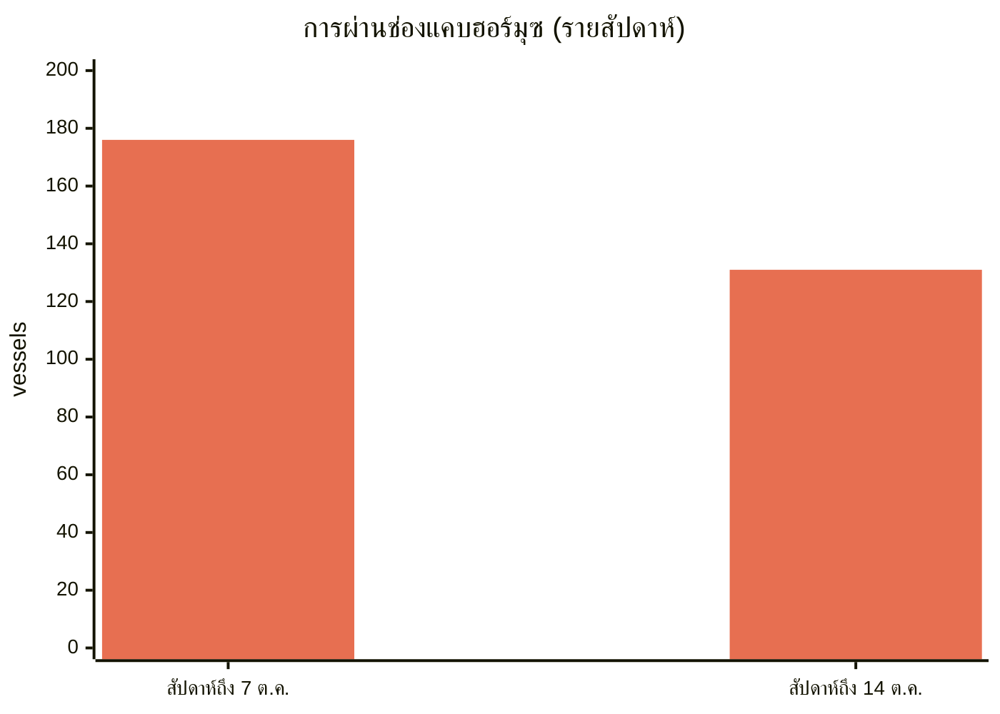

*หมายเหตุ: ข้อมูล Kpler; สัปดาห์สิ้นสุด 7 ต.ค.: 176 ครั้ง; สัปดาห์สิ้นสุด 14 ต.ค.: 131 ครั้ง*

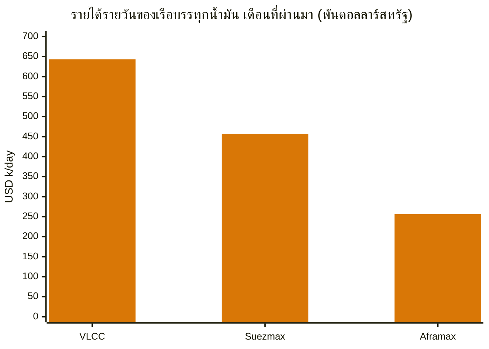

*หมายเหตุ: ประมาณการของนายหน้า Hartland ผ่าน Splash247; VLCC 643,000 ดอลลาร์/วัน, suezmax 457,000 ดอลลาร์/วัน, aframax 256,000 ดอลลาร์/วัน; เส้นทาง MEG–จีนของ VLCC เกิน 1.3 ล้านดอลลาร์/วัน (Veson)*

### 3.3 ดุลการค้าเกินดุล 133,500 ล้านดอลลาร์ของจีนในเดือนกันยายนและยุคทองการค้าเอไอ

กรมศุลกากรจีนรายงาน 14 ตุลาคมว่า การส่งออกเดือนกันยายนพุ่ง 36.3% เมื่อเทียบรายปี เป็น 447,180 ล้านดอลลาร์ — เร็วที่สุดนับตั้งแต่เดือนกุมภาพันธ์ สวนคาดการณ์ 25.5% — ขณะที่การนำเข้าเพิ่ม 31.0% เป็น 313,660 ล้านดอลลาร์ ดุลการค้าเกินดุลรายเดือน 133,500 ล้านดอลลาร์ สูงสุดนับตั้งแต่เดือนมกราคม 2025 สูงสุดในรอบ 20 เดือน ดุลการค้าเกินดุลช่วงมกราคม–กันยายนแตะ 938,500 ล้านดอลลาร์ ทำให้ปีที่สองติดต่อกันเกิน 1 ล้านล้านดอลลาร์อยู่ในสายตา (สถิติปี 2025 ราว 1.2 ล้านล้านดอลลาร์) การส่งออกไปสหรัฐฯ เติบโต 9.8% โดยดุลทวิภาคีเกินดุลราว 34,000 ล้านดอลลาร์ สูงสุดในรอบ 20 เดือน — แม้มีการเพิ่มภาษีสองปี การส่งออกเทคโนโลยีขั้นสูง นำโดยเซมิคอนดักเตอร์เพิ่มขึ้นราว 108% ตั้งแต่ต้นปีตามข้อมูลศุลกากร ขับเคลื่อนการเติบโตของการส่งออกประมาณครึ่งหนึ่ง

สถาบันเศรษฐศาสตร์มหภาคอ่านสัญญาณเดียวกัน WTO ในรายงาน Global Trade Outlook and Statistics วันที่ 8 ตุลาคม ปรับเพิ่มคาดการณ์ปริมาณการค้าสินค้าปี 2026 เป็น 3.9% จากพื้นฐาน 1.9% ในเดือนมีนาคม โดยการค้าสินค้าที่เอื้อเอไอเพิ่มขึ้น 67% เมื่อเทียบรายปีในครึ่งแรกและคิดเป็น 47% ของการเพิ่มขึ้นของมูลค่าการค้า — 14.8% ของการค้าสินค้าโลก คำเตือนของผู้อำนวยการใหญ่ Okonjo-Iweala ชี้ชัด: "ผลกระทบของเอไอกำลังบดบังแนวโน้มอื่นในการค้า ซึ่งไม่ได้อยู่ด้านบวก" รายงาน Trade and Development Report ของ UNCTAD วันที่ 9 ตุลาคม ประเมินการเติบโตโลกปี 2026 ที่ 2.6% ลดลงจาก 2.9% ในปี 2025 และระบุการค้าจีน–สหรัฐฯ ลดลงกว่า 20% นับตั้งแต่ 2024 รายงาน World Economic Outlook ของ IMF วันที่ 13 ตุลาคม กำหนดการเติบโตโลกปี 2026 ไว้ที่ 3.1% (จาก 3.5% ในปี 2025) โดยการลงทุนเอไอชดเชยช็อกพลังงานตะวันออกกลาง; สมมติฐานพื้นฐานคือช่องแคบฮอร์มุซเปิดอีกครั้งในเดือนมีนาคม และประเมินว่าการปิดตัดการเติบโตโลกประมาณ 0.9 จุด ก่อนชดเชยลดผลกระทบสุทธิเหลือราว 0.3 จุด

**การวิเคราะห์:** วัฏจักรฮาร์ดแวร์เอไอกำลังรับภาระหลักของปริมาณการค้าโลก — และไม่เป็นสัดส่วนสำหรับจีน ความขัดแย้งของการส่งออกจีนไปสหรัฐฯ เพิ่ม 9.8% ท่ามกลางการรณรงค์ภาษีสะท้อนการเปลี่ยนเส้นทาง การเร่งล่วงหน้า และแรงดึงของการลงทุนเอไอ; มันยังอธิบายว่าทำไมกรอบ "การปฏิบัติตาม" ในช่วงสงบศึกของวอชิงตันจึงนั่งไม่สบายกับตัวเลข

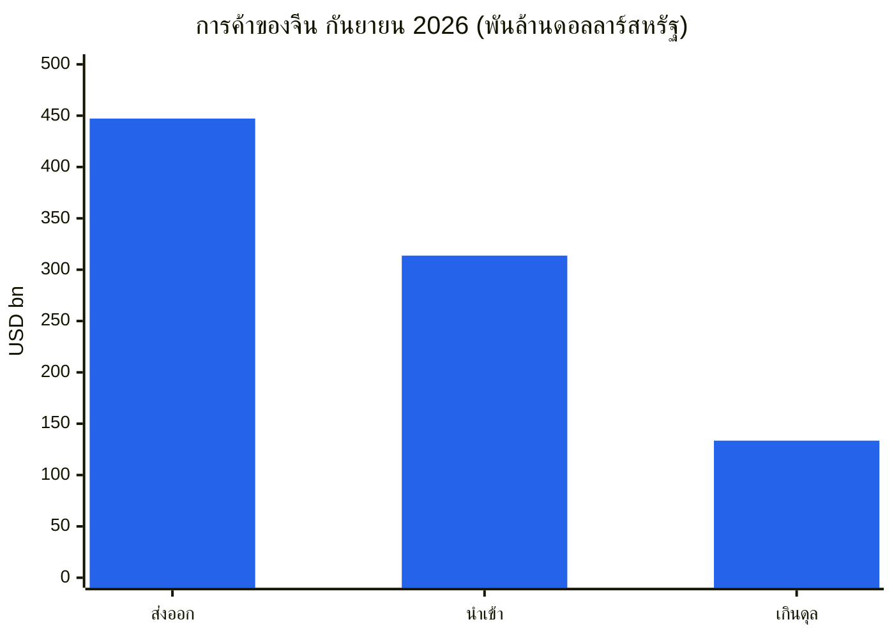

*หมายเหตุ: ข้อมูล GACC เผยแพร่ 14 ต.ค.; ส่งออก 447,180 ล้านดอลลาร์ (+36.3% YoY), นำเข้า 313,660 ล้านดอลลาร์ (+31.0%), เกินดุล 133,500 ล้านดอลลาร์*

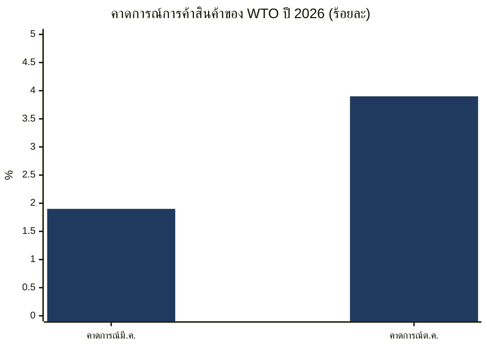

*หมายเหตุ: WTO Global Trade Outlook and Statistics 8 ต.ค. 2026; สินค้าที่เอื้อเอไอ +67% YoY ในครึ่งแรกคิดเป็น 47% ของการเติบโตของมูลค่าการค้า*

### 3.4 ยุโรปกำหนดทิศทางป้องกันการค้า

การประชุมสภายุโรป 15–16 ตุลาคมให้สัญญาณทิศทางชัดเจนที่สุดของสัปดาห์เรื่องนโยบายการค้าสหภาพยุโรป ผู้นำมอบหมายให้คณะกรรมาธิการเจรจาต่อกับปักกิ่ง — การประชุมครั้งต่อไปวางแผนมีนาคม 2027 — ขณะที่ใช้มาตรการป้องกันการค้าที่มีอยู่ "อย่างเต็มที่" และพัฒนาเครื่องมือใหม่ จดหมายฝรั่งเศส–เยอรมนีวันที่ 5 ตุลาคม เสนออำนาจสหภาพยุโรป "ที่ทรงพลังเท่า" มาตรา 301 ของสหรัฐฯ หรือข้อจำกัดแร่สำคัญของจีน ครองการอภิปราย: การสอบสวนป้องกันการค้าที่เร็วขึ้น ครอบคลุมภาคเศรษฐกิจ การดำเนินการเร่งด่วนเรื่องเคมีภัณฑ์ PET และรถยนต์ไฮบริด และการตอบโต้ที่เร็วขึ้นต่อประเทศที่ทำร้ายกลุ่ม การเปลี่ยนท่าทีของเยอรมนีน่าสังเกต — สองปีก่อนเบอร์ลินคัดค้านภาษีตอบโต้การอุดหนุนรถยนต์ไฟฟ้าของสหภาพยุโรป

พื้นหลังคือฉันทามติ 16 ประเด็นของรอบปักกิ่ง 8–9 ตุลาคม ที่การประชุมสุดยอดต้องตีความ การประชุมกลไกปรึกษาหารือการค้าและการลงทุนครั้งที่สองระหว่างกรรมาธิการ Šefčovič และรัฐมนตรี Wang Wentao ให้แถลงการณ์ร่วมครอบคลุมความเข้าใจที่สอดคล้อง WTO เรื่องการค้ารถยนต์ไฮบริด (มีรายงานว่ามีเพดาน 350,000 คันต่อปี ซึ่งอาจตัดการส่งออกไฮบริดจีนกว่าครึ่ง) การลดเงินคืนภาษีส่งออกของจีนสำหรับรถยนต์พลังงานใหม่เหลือ 13% "ช่องทางสีเขียว" สำหรับใบอนุญาตแร่หายากและแม่เหล็กถาวร การดำเนินการตามขั้นตอนราคาผูกมัดในคดีตอบโต้การอุดหนุนรถยนต์ไฟฟ้าของสหภาพยุโรป และการสำรวจการลดภาษี MFN สำหรับการส่งออกของสหภาพยุโรปราว 4,000 ล้านยูโร มูลค่าประหยัดภาษีอย่างน้อย 225 ล้านยูโร ข้อความที่ปักกิ่งเผยแพร่ไม่มีตัวเลขครึ่งหนึ่งของการส่งออกไฮบริด — ข้อมูลที่ทบทวนนำเสนอคำอธิบายของสหภาพยุโรปและข้อความของปักกิ่งว่าแตกต่างกัน และกลไกบังคับใช้ไม่เปิดเผย ดุลการค้าสินค้าของสหภาพยุโรปกับจีนแตะ 360,000 ล้านยูโร (ประมาณ 400,000 ล้านดอลลาร์) ในปี 2025 และอยู่ในเส้นทางเกินกว่านั้นในปี 2026

**การวิเคราะห์:** บรัสเซลส์กำลังเคลื่อนไปสู่ท่าทีป้องกันการค้าที่แข็งกร้าวและเร็วยิ่งขึ้น ขณะที่ยังเปิดช่องเจรจา — ทางคู่ขนานแบบคลาสสิก กรณีทดสอบจะเป็นภาคเร่งด่วนที่ระบุในจดหมายฝรั่งเศส–เยอรมนี (เคมีภัณฑ์ PET ไฮบริด) และว่าความเข้าใจเรื่องรถยนต์ไฮบริดจะบังคับใช้ได้หรือไม่โดยไม่มีข้อความร่วมกัน

### 3.5 แร่หายาก: กระดานหมากรุกวันขอบคุณพระเจ้า

รัฐมนตรีคลัง Bessent กล่าว 18 ตุลาคมในรายการ Sunday Morning Futures ของ Fox News ว่าวอชิงตันหวังสรุปข้อตกลงแร่หายากสหรัฐฯ–จีน "หวังว่า" ภายในวันขอบคุณพระเจ้า (27 พฤศจิกายน) ข้อตกลงตามรายงานจะให้ปักกิ่งระงับข้อจำกัดการส่งออกแร่สำคัญบางรายการหนึ่งปี โดยแร่หายากไหล "อย่างเสรีเหมือนก่อน 4 เมษายน" — วันที่จีนกำหนดข้อกำหนดใบอนุญาตส่งออกเพื่อตอบโต้ภาษีสหรัฐฯ สื่อหนึ่งกรอบข้อตกลงว่าได้บรรลุแล้วในการประชุมทรัมป์–สีปลายเดือนตุลาคมที่เกาหลีใต้; กรอบนั้นยังไม่ได้รับการยืนยัน และมีเพียงคำพูดของ Bessent ที่เป็นที่ยอมรับในข้อมูลที่ทบทวน

เส้นทางขนานคือกฎบริษัทในเครือของ BIS กฎชั่วคราวฉบับสุดท้าย 29 กันยายน 2025 — ระงับ 10 พฤศจิกายน 2025 ถึง 9 พฤศจิกายน 2026 — จะขยายข้อจำกัด EAR โดยอัตโนมัติไปยังนิติบุคคลต่างประเทศที่ถือหุ้นอย่างน้อย 50% ไม่ว่าทางตรง ทางอ้อม หรือรวมกัน โดยบุคคลใน Entity List, Military End-User List หรือ SDN บางราย รวมถึงหน้าที่ตรวจสอบความเป็นเจ้าของเชิงรุก (Red Flag 29) ด้วยการขยายการสงบศึกสหรัฐฯ–จีนถึง 10 มกราคม 2027 Crowell & Moring ประเมิน 14 ตุลาคมว่าการบังคับใช้กฎควรตามการสงบศึก — แต่ ณ 14 ตุลาคม BIS ยังไม่ประกาศราชกิจจานุเบกษาสหรัฐอย่างเป็นทางการเพื่อขยายการระงับ

**การวิเคราะห์:** นาฬิกาสองเรือนกำลังเดิน นาฬิกาการเมืองเล็งวันขอบคุณพระเจ้าสำหรับข้อตกลงแร่หายาก; นาฬิกากฎระเบียบมีวันบังคับใช้อีกครั้งที่แน่นอน 10 พฤศจิกายนสำหรับกฎบริษัทในเครือ โดยไม่มีการขยายอย่างเป็นทางการที่ประกาศ ทีมปฏิบัติตามกฎไม่สามารถพึ่งการประเมินเจตนาของสื่อ — กฎเปิดใช้อีกครั้งตามเงื่อนไขของมันเองเว้นแต่ BIS จะดำเนินการ

### 3.6 การสงบศึกสหรัฐฯ–จีน: ช่วงปฏิบัติตาม ไม่มีถั่วเหลือง

การสงบศึกการค้าสหรัฐฯ–จีนดำเนินถึง 10 มกราคม 2027 — การขยายสองเดือนที่ประกาศโดยรัฐมนตรี Bessent วันที่ 23/24 กันยายน สั้นกว่าหกถึงสิบสองเดือนที่ตลาดคาด USTR Greer อธิบายช่วงสงบศึกว่าเป็น "ช่วงปฏิบัติตาม" เพื่อประเมินการทำตามของจีนเรื่องการซื้อถั่วเหลืองและการเข้าถึงแร่หายาก ดุลการค้าสินค้าของสหรัฐฯ กับจีนลดลงเกือบ 40% นับตั้งแต่การรณรงค์ภาษีเริ่ม ตาม Greer

ในเนื้อหา กรอบ "30 ต่อ 30" — สินค้าที่ไม่ละเอียดอ่อนราว 30,000 ล้านดอลลาร์ของแต่ละฝ่าย — ไม่ได้ใช้งาน: จีนเสนอผลิตภัณฑ์สหรัฐฯ 1,619 รายการ (ข้าวโพด เนื้อสัตว์ ฝ้าย ข้าวฟ่าง ข้าวบาร์เลย์ ข้าวโอ๊ต น้ำมันถั่วเหลือง แต่ไม่ใช่ถั่วเหลืองสำหรับอาหารหรือสกัด); สหรัฐฯ ระบุพิกัดภาษี 77 รายการ (ของใช้ในบ้าน ของเล่น) ที่อาจได้รับอัตราต่ำกว่า ไม่มีอัตราหรือวันเริ่มต้นที่ประกาศ ณ กลางเดือนตุลาคม เรื่องถั่วเหลืองไม่มีข้อผูกพันซื้อใหม่: จีนผูกพันตามข้อตกลงก่อนหน้าที่ 25 ล้านเมตริกตันต่อปีสำหรับ 2026, 2027 และ 2028 โดยข้อมูลขายส่งออกของ USDA แสดงประมาณ 10.2 ล้านเมตริกตันที่ผูกพันสำหรับพืชปี 2026–27 ในรายงานล่าสุด และภาษีตอบโต้ 10% ของจีนสำหรับถั่วเหลืองสหรัฐฯ ยังมีผล จำกัดการเข้าถึงของผู้ซื้อเอกชน

**การวิเคราะห์:** การสงบศึกเป็นรูปแบบรอคอย ไม่ใช่ข้อยุติ ด้วยประกาศการคงอยู่มาตรา 301 วันที่ 7 ตุลาคมที่รักษาภาษีปี 2018 ทั้งหมด — List 1 ที่ 25% บน ~34,000 ล้านดอลลาร์, List 2 ที่ 25% บน ~16,000 ล้านดอลลาร์, List 3 ที่ 25% บน ~200,000 ล้านดอลลาร์, List 4A ที่ 7.5% บน ~120,000 ล้านดอลลาร์ — และการทบทวนสี่ปีรอบที่สองที่เปิดแล้วซึ่งสามารถเพิ่มอัตราได้ สถาปัตยกรรมภาษีฝังแน่นโดยไม่คำนึงชะตากรรมของการสงบศึก

### 3.7 ค่าขนส่ง: การฟื้นตัวของเดือนตุลาคมและการกลับสู่สุเอซ

ดัชนี Drewry World Container Index เพิ่มขึ้น 3% ในการประเมิน 15 ตุลาคม เป็น 4,485 ดอลลาร์ต่อ FEU ขับเคลื่อนโดยเอเชีย–ยุโรป: เซี่ยงไฮ้–รอตเทอร์ดัม +6% เป็น 3,522 ดอลลาร์ และเซี่ยงไฮ้–เจนัว +7% เป็น 3,945 ดอลลาร์ — การเพิ่มขึ้นของเอเชีย–ยุโรปครั้งแรกหลังลดลง 13 สัปดาห์ติดต่อกัน เส้นทางข้ามแปซิฟิกผสม: เซี่ยงไฮ้–ลอสแอนเจลิส +3% เป็น 7,884 ดอลลาร์ เซี่ยงไฮ้–นิวยอร์ก −1% เป็น 10,075 ดอลลาร์ Drewry คาดความผันผวนน้อยลงข้างหน้า การฟื้นตัวตามการผลักดันอัตราหลังโกลเดนวีคของผู้ให้บริการ — ค่า FAK เอเชีย–ยุโรปเหนือใหม่ของ MSC ตั้งแต่ 19 ตุลาคม ตั้งที่ 3,150 ดอลลาร์/TEU และ 4,500 ดอลลาร์/FEU — และการยกเลิกเที่ยวเรือ 44 เที่ยวที่ประกาศสำหรับสัปดาห์ 43–47 (อัตรายกเลิก 6% ของ 713 เที่ยวที่วางแผน) โดยเอเชีย–ยุโรปเหนือ/เมดิเตอร์เรเนียนคิดเป็น 44% ของการยกเลิก

แรงกดดันเชิงโครงสร้างไปอีกทาง Linerlytica รายงานการเติบโตของความต้องการ TEU-mile ถดถอยเป็นครั้งแรกนับตั้งแต่เดือนมกราคม และการกลับสู่สุเอซเร็วกว่าคาด — พันธมิตรคอนเทนเนอร์ทั้งหมดบวก MSC จะส่งเรือบางลำผ่านทะเลแดงภายในสิ้นเดือนตุลาคม; การผ่านสุเอซในสัปดาห์ที่ 39 มีรายงานสูงขึ้น 68% เมื่อเทียบรายปี — เป็นภัยหลักต่อเสถียรภาพอัตราของผู้ให้บริการ มีกำลังระวางสร้างใหม่ราว 200,000 TEU ส่งมอบในเดือนกันยายนโดยไม่มีการรื้อถอน อัตราเอเชีย–ยุโรปลดลงประมาณ 60% นับตั้งแต่เดือนกรกฎาคม แม้ยังเกิน 3,000 ดอลลาร์/FEU — สูงกว่าปีก่อนประมาณ 70% — ขณะที่ฤดูประกวดราคา 2027 เริ่มขึ้น องค์การคลองปานามาเพิ่มช่องจองรายวันรวมเป็น 33 มีผล 15 ตุลาคม เพิ่มอุปทานอีก

เรือเทกองเคลื่อนไปทิศตรงข้าม ดัชนี Baltic Dry ลดลงเป็นสัปดาห์ที่สามติดต่อกันเป็น 2,511 ในวันที่ 16 ตุลาคม — ลดลง 14% ในสัปดาห์ และต่ำสุดนับตั้งแต่ 30 มิถุนายน — ขณะที่ดัชนี Capesize ลดลง 25% สัปดาห์ต่อสัปดาห์เป็น 3,249 (ต่ำสุดนับตั้งแต่ต้นเดือนเมษายน) บนแร่เหล็กที่อ่อนแอซึ่งแตะจุดต่ำสุดในรอบสองปีกลางสัปดาห์ เรือ Panamax ลดลง 1.8% เป็น 2,314; Supramax เป็นข้อยกเว้น เพิ่ม 9 จุดเป็น 1,865

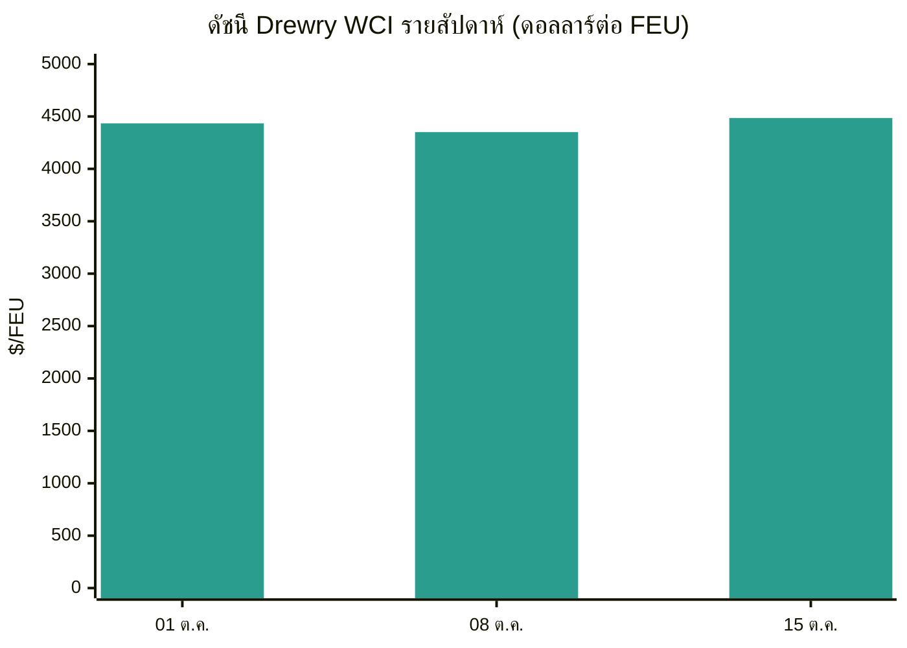

*หมายเหตุ: การประเมินวันพฤหัสบดีของ Drewry; 1 ต.ค.: 4,434 ดอลลาร์ (−1%); 8 ต.ค.: 4,351 ดอลลาร์ (−2%); 15 ต.ค.: 4,485 ดอลลาร์ (+3%)*

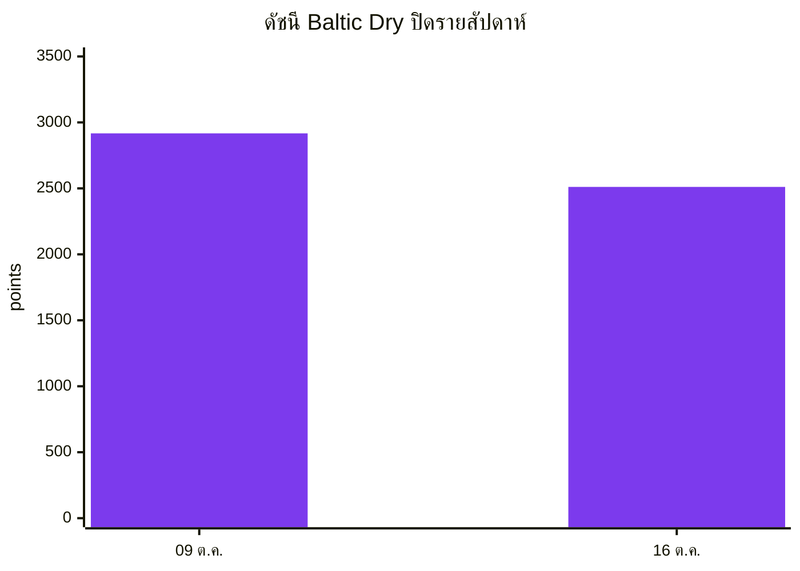

*หมายเหตุ: ปิดวันศุกร์; 9 ต.ค.: 2,917 (−7.3% ในสัปดาห์); 16 ต.ค.: 2,511 (−14% ในสัปดาห์) ต่ำสุดนับตั้งแต่ 30 มิถุนายน*

### 3.8 ภาระภาษี: สิ่งที่ครัวเรือนจ่ายจริง

งานวิจัยสามฉบับในสัปดาห์นี้ประเมินภาระภาษีของครัวเรือนสหรัฐฯ การประเมินกฎหมายปัจจุบันของ Yale Budget Lab กำหนดต้นทุนประมาณ 1,100 ดอลลาร์ต่อครัวเรือนต่อปี สะท้อนการเพิ่มขึ้นของระดับราคาทั่วไปราว 0.7% เมื่อส่งผ่านเต็ม; อัตราภาษีตามกฎหมายเฉลี่ยอยู่ที่ 11% มีกำหนดถึง 11.8% ปลายปี 2026 คิดเป็นประมาณ 92 ดอลลาร์ต่อเดือนต่อครัวเรือนเฉลี่ย ภาษีที่เก็บได้แตะ 7.1% ของมูลค่านำเข้าในเดือนสิงหาคม เทียบ 2.3% ในเดือนมกราคม 2025 — และจะอยู่ที่ 10.1% หากไม่มีการหลีกเลี่ยงเชิงพฤติกรรม การอัปเดต 14 ตุลาคมของ Penn Wharton Budget Model พบว่าภาษีใหม่สร้างรายได้ศุลกากรราว 314,800 ล้านดอลลาร์ตั้งแต่เดือนมกราคม 2025 ถึงสิงหาคม 2026 (ก่อนคืนเงิน IEEPA) โดยสูญเสียอีก 60,700 ล้านดอลลาร์จากการเปลี่ยนแปลงเชิงพฤติกรรม; การเก็บ IEEPA รวมประมาณ 166,000 ล้านดอลลาร์ ทั้งหมดอยู่ภายใต้การคืนเงิน โดย CBP รับรองราว 126,000 ล้านดอลลาร์ (76%) จนถึง 2 ตุลาคม ณ เดือนกรกฎาคม 2026 อัตราภาษีสหรัฐฯ เฉลี่ยที่มีผลอยู่ที่ 6.7% — ราวสามเท่าของ 2.3% ในเดือนมกราคม 2025 — โดยจีนเผชิญ 22.8% เหล็กและอะลูมิเนียม 40.5% และรถยนต์ 13% ตัวติดตามเดือนสิงหาคมของ Tax Foundation กำหนดอัตราเฉลี่ยที่มีผลปี 2026 ไว้ที่ 6.6% สูงสุดนับตั้งแต่ 1969 คิดเป็นประมาณ 820 ดอลลาร์ต่อครัวเรือนในปี 2026

**การวิเคราะห์:** สามแบบจำลองบรรจบกันที่ภาพเดียวกัน — ระบอบภาษีหนักประมาณสามเท่าเมื่อเทียบกับเดือนมกราคม 2025 คิดเป็นต้นทุนครัวเรือนเฉลี่ยราว 1,000 ดอลลาร์ต่อปี โดยช่องทางคืนเงิน IEEPA (166,000 ล้านดอลลาร์อยู่ภายใต้การคืนเงิน 126,000 ล้านดอลลาร์ได้รับการรับรอง) เป็นการโอนงบประมาณค้างที่ใหญ่ที่สุดของสงครามการค้า

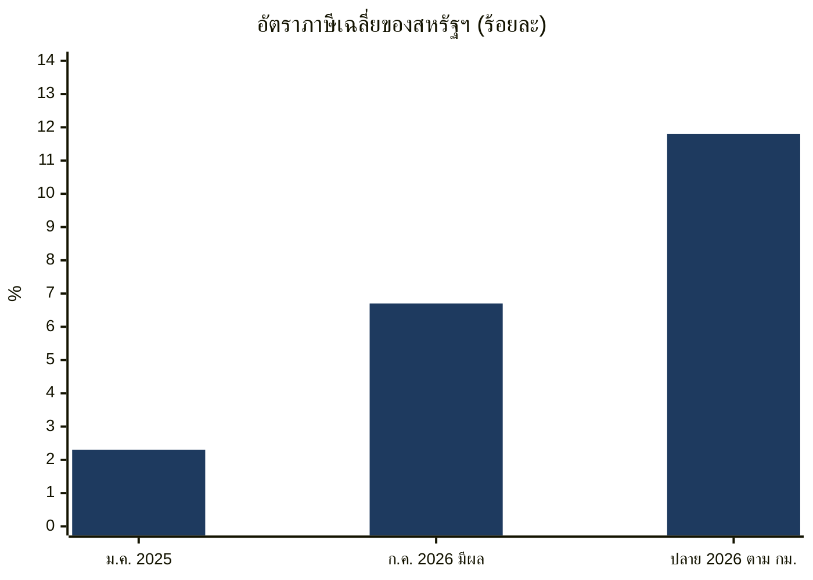

*หมายเหตุ: ม.ค. 2025 มีผล 2.3%; ก.ค. 2026 มีผล 6.7% (Penn Wharton; Tax Foundation 7.2% สำหรับปีปฏิทิน 2026); ปลายปี 2026 ตามกฎหมาย 11.8% (Yale Budget Lab)*

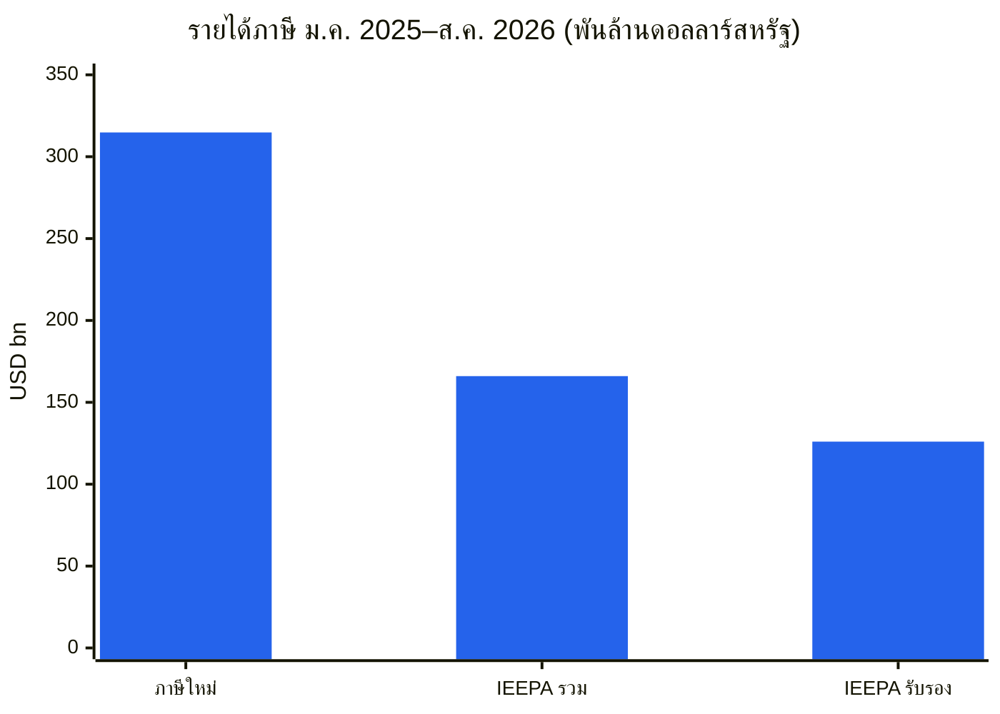

*หมายเหตุ: Penn Wharton Budget Model อัปเดต 14 ต.ค.; รายได้ศุลกากรราวก่อนคืนเงิน IEEPA; IEEPA รับรอง = ที่ CBP รับรองเพื่อเบิกจ่ายจนถึง 2 ต.ค.*

---

## 4. ตัวติดตามภาษีศุลกากร

| ประเทศ / กลุ่มประเทศ | มาตรการ | อัตรา | มีผล | สถานะ | แหล่งที่มา |
|---|---|---|---|---|---|
| สหรัฐอเมริกา | ภาษีมาตรา 112/113 ของพระราชบัญญัติเกรแฮม + บทบัญญัติคว่ำบาตร (500% สำหรับสินค้ารัสเซีย; 100% ทุติยภูมิสำหรับผู้ซื้อพลังงานรัสเซียรายใหญ่และผู้ช่วยเหลือการหลีกเลี่ยง) | ยกเว้น — 0% | ยกเว้นลงนาม 16 ต.ค. 2026; ไม่มีวันสิ้นสุด | ยกเว้นตามมาตรา 115; สามารถเปิดใช้ใหม่โดยคำสั่งประธานาธิบดี/กระทรวงการต่างประเทศ; USTR ติดตาม | [whitehouse.gov](https://www.whitehouse.gov/presidential-actions/2026/10/implementing-the-lindsey-o-graham-sanctioning-russia-and-iran-act-of-2026/) |
| สหรัฐอเมริกา | มาตรา 232 สำหรับอุปกรณ์อุตสาหกรรมเคลื่อนที่ที่มีสิทธิ USMCA (รถยก รถดันดิน รถแบ็กโฮ รถแทรกเตอร์ เครนเคลื่อนที่) ที่มีส่วนประกอบสหรัฐฯ ≥40% | 25% → 15% (ปรับลด) | 14 ต.ค. 2026 | แนวทางการคำนวณของ BIS ประกาศ (FR 2026-20938) | [federalregister.gov](https://www.federalregister.gov/public-inspection/2026-20938/guidance-to-us-customs-and-border-protection-regarding-the-assessment-of-us-content-for-purposes-of) |
| สหรัฐอเมริกา | ค่าธรรมเนียมท่าเรือมาตรา 301 สำหรับเรือที่เชื่อมโยงจีน (การหยุดหมดอายุ) | กลับเป็น 80 ดอลลาร์/ตันเน็ต (เจ้าของ/ผู้ดำเนินการจีน); 23 ดอลลาร์/ตันเน็ต หรือ 153 ดอลลาร์/ตู้ (เรือสร้างในจีน ผู้ดำเนินการไม่ใช่จีน); 46 ดอลลาร์/ตันเน็ต (เรือขนรถสร้างในต่างประเทศ) | 9 พ.ย. 2026, 23:59 น. ตามเวลา ET | ไม่มีประกาศขยายของ USTR ณ 13 ต.ค.; สมาคมกว่า 200 แห่งขอขยาย 23 ก.ย. | [Gateway Lines](https://gatewaylines.com/press-releases/china-ship-fees-301-exclusions-nov-9-2026) |
| สหรัฐอเมริกา | การยกเว้นผลิตภัณฑ์มาตรา 301 จำนวน 178 รายการ (HTS 9903.88.69/70) | List 1/2/3 กลับเป็น 25%; List 4A เป็น 7.5% | 9 พ.ย. 2026, 23:59 น. ตามเวลา ET | หมดอายุ; ไม่มีระยะผ่อนผัน | [Thomson Reuters](https://tax.thomsonreuters.com/blog/section-301-exclusions-expiration/) |
| สหรัฐอเมริกา | การดำเนินการมาตรา 301 กับจีน (2018) ยังคงอยู่ | List 1/2: 25%; List 3: 25%; List 4A: 7.5% | มีผล (ประกาศคงอยู่ 7 ต.ค. 2026) | คงอยู่; การทบทวนสี่ปีรอบที่สองเปิด 6 พ.ค. 2026 — สามารถเพิ่มอัตราได้ | [facohub.com](https://facohub.com/posts/weekly-009) |
| สหรัฐอเมริกา | การดำเนินการมาตรา 301 กรณีแรงงานบังคับ (60 เศรษฐกิจ) | 10% / 12.5% | มีผลตั้งแต่ 24 ก.ค. 2026 | มีผล; ยังอยู่ในคดีที่ CIT |  |
| สหรัฐอเมริกา | FMC เสนอค่าธรรมเนียมเรือติดธงสเปน | 200,000 ดอลลาร์ต่อเที่ยว + ข้อจำกัดนำเข้าสินค้าสเปนที่ระบุ | เสนอ 16 ต.ค. 2026 | ขั้นเสนอ | [Supply Chain Dive](https://www.supplychaindive.com/news/fmc-proposes-fees-on-spanish-flagged-vessels-import-restrictions/833122/) |
| จีน | ร่างควบคุมการส่งออกเทคโนโลยีเอไอ (ประกาศฉบับที่ 48) | เทคโนโลยีต้องห้าม (14) / จำกัด (26) | รับฟังความคิดเห็นถึง 15 พ.ย. 2026; ขึ้นทะเบียนก่อนส่งออกมีผล 16 ต.ค. | ขั้นร่าง | [aiandgpp.com](https://aiandgpp.com/2026/10/19/china-ai-export-controls-model-weights-sovereign-cloud/) |
| จีน | ลดเงินคืนภาษีส่งออกรถยนต์พลังงานใหม่ | ลดเงินคืนเหลือ 13% | ตกลง 8–9 ต.ค. 2026 | ตามฉันทามติ 16 ประเด็นสหภาพยุโรป–จีน | [peoplesdaily.pdnews.cn](https://peoplesdaily.pdnews.cn/china/er/30053309352) |
| จีน | การส่งออกรถยนต์ไฮบริดไปสหภาพยุโรป — ความเข้าใจที่สอดคล้อง WTO | มีรายงานว่าเพดาน 350,000 คัน/ปี | ตกลง 8–9 ต.ค. 2026 | คำอธิบายของสหภาพยุโรป; ข้อความของปักกิ่งไม่มีตัวเลข | [peoplesdaily.pdnews.cn](https://peoplesdaily.pdnews.cn/china/er/30053309352) |
| สหภาพยุโรป | ข้อเสนอเครื่องมือตอบโต้การค้าฉับไวฝรั่งเศส–เยอรมนี | ไม่มีข้อมูล (ข้อเสนอ) | เสนอ 5 ต.ค.; อภิปรายที่การประชุมสุดยอด 15–16 ต.ค. | มอบหมายคณะกรรมาธิการพัฒนาเครื่องมือใหม่ | [985theriver.com](https://985theriver.com/2026/10/05/france-germany-propose-new-rapid-eu-trade-response-tool/) |
| สหภาพยุโรป | ข้อตกลงภาษีสหภาพยุโรป–สหรัฐฯ (ระเบียบ 2026/1455, 2026/1461) | ลบภาษีสหภาพยุโรปที่เหลือสำหรับสินค้าอุตสาหกรรมสหรัฐฯ; มาตรการป้องกันหากภาษีเหล็ก/อะลูมิเนียมของสหรัฐฯ ยังเกิน 15% ในวันที่ 31 ธ.ค. 2026 | ใช้ 1 ก.ค. 2026–31 ธ.ค. 2029 | มีผล; สถาปัตยกรรมมาตรการป้องกันหลายชั้น | [Mondaq](https://www.mondaq.com/italy/export-controls-trade-investment-sanctions/1848092/euus-tariff-agreement-the-new-regulations-and-their-safeguard-architecture) |
| สหภาพยุโรป | CBAM — จัดตั้งคณะผู้พิจารณาข้อพิพาท DS639 ของรัสเซีย | ไม่มีข้อมูล (ข้อพิพาท) | จัดตั้งคณะ 3 ต.ค. 2026 | ขั้นคณะผู้พิจารณา; สหภาพยุโรปจะร่วมเฉพาะคณะ | [news.metal.com](https://news.metal.com/newscontent/104143673-wto-establishes-cbam-dispute-panel-at-russias-request) |
| สหราชอาณาจักร | ภาษีรถยนต์ไฟฟ้าจีน (สูงสุด 45.3%) — ตัดสินใจไม่เรียกเก็บ | 0% (สงวนทางเลือกในอนาคต) | ตัดสินใจ 14 ต.ค. 2026 | ไม่เรียกเก็บ; การประชุมสุดยอดสหราชอาณาจักร–สหภาพยุโรป 20 พ.ย. | [Fleet News](https://www.fleetnews.co.uk/news/minister-reportedly-resists-calls-for-uk-to-impose-chinese-ev-tariffs) |
| สหราชอาณาจักร | ระบอบป้องกันเหล็ก (ลดโควตาปลอดภาษี; ภาษี 50% นอกโควตา) | 50% นอกโควตา | มีผล 1 ก.ค. 2026 | อินเดียขอการยกเว้น ~6 หมวด / 88 พิกัดเหล็ก | [buildwatchnews.com](https://buildwatchnews.com/india-seeks-steel-export-exemptions-uk-safeguard-tariffs/) |
| แคนาดา | ภาษีป้องกันชั่วคราวตู้ไม้/ตู้อ่างล้างหน้า (รหัส 26169A) | 25% | 31 ก.ค. 2026 (สูงสุด 200 วัน) | มีผล; รายละเอียดประกาศ 7 ต.ค. | [adamcabinet.com](https://www.adamcabinet.com/post-canada-cabinet-surtax.html) |
| แคนาดา | ภาษีตอบโต้สินค้าต้นกำเนิดสหรัฐฯ ~900 รายการ (15/25/50%) | 50% สำหรับอุปกรณ์ยิงธนู (9506.99.00) | 8 ก.ย. 2026 | มีผลกับการนำเข้า 27,600 ล้านดอลลาร์แคนาดา | [csaaa.org](https://www.csaaa.org/2026/10/15/50-tariffs-on-archery-equipment-hits-canadian-businesses-hard/) |
| ญี่ปุ่น | ขยายคำสั่งห้ามส่งออกรัสเซีย (แร่ เคมีภัณฑ์ โลหะ เครื่องจักร เครื่องมือวัดแม่นยำ) | ห้าม | 16 ต.ค. 2026 | มีผล (มติคณะรัฐมนตรี 2 ต.ค.; ประกาศคำสั่ง 9 ต.ค.) | [Steptoe](https://www.steptoe.com/en/news-publications/international-compliance-blog/weekly-sanctions-update-october-13-2026.html) |
| เกาหลี | แก้ไขพระราชบัญญัติการค้าต่างประเทศ (เหตุจำกัดขยาย 5 → 9) | ไม่มีข้อมูล | 22 ต.ค. 2026 | พระราชกฤษฎีกาบังคับใช้อนุมัติ 13 ต.ค. | [LinkedIn / Don Southerton](https://www.linkedin.com/pulse/week-review-sunday-october-18-2026-short-version-don-southerton-vkbkc) |
| อินเดีย | FTA อินเดีย–นิวซีแลนด์ | นิวซีแลนด์: ยกเลิกภาษีการส่งออกอินเดียทั้งหมดตั้งแต่วันแรก; อินเดีย: ปลอดภาษีไม้ซุง ถ่านหินโค้ก เศษโลหะ | 20 ต.ค. 2026 | มีผลบังคับ | [Karmactive](https://www.karmactive.com/india-new-zealand-free-trade-agreement-2026/) |
| อินเดีย | โควตาเหล็ก FTA สหภาพยุโรป | โควตาปลอดภาษี ~1.64 ล้านตัน (~68.4% ของการส่งออก ~2.4 ล้านตัน/ปี); โทษ 50% เกินโควตา; ภาษีคาร์บอน 35% หากไม่มีความเท่าเทียม CBAM | ข้อความ FTA (ภาคผนวก 11 ก.ย.) | โควตาต่ำกว่าการจัดสรรปฏิบัติการมิ.ย. 2026 ของสหภาพยุโรป ~300,000 ตัน | [takshashila.org.in](https://takshashila.org.in/content/blogs/2026-10-12-India-EU-FTA-and-its-steel-challenges.html) |
| บราซิล/เมอร์โคซูร์ | FTA เมอร์โคซูร์–EFTA | ยกเลิกภาษี ~99% ของมูลค่าการส่งออกของบราซิลไป EFTA | 1 ต.ค. 2026 (กฤษฎีกา 13,126) | มีผล | [datamarnews.com](https://datamarnews.com/noticias/mercosur-efta-trade-agreement-brazil-business-opportunities/) |
| มาดากัสการ์ | สอบสวนป้องกันการนำเข้าน้ำตาลและลูกกวาดช็อกโกแลต/โกโก้ | ไม่มีข้อมูล (การสอบสวน) | แจ้ง 9 ต.ค.; ความเห็นครบกำหนด 9 พ.ย. 2026 | การสอบสวนที่แจ้ง WTO | [freightnews.co.za](https://www.freightnews.co.za/article/madagascar-launches-safeguard-investigation-on-certain-confectionery) |
| ออสเตรเลีย | การให้สัตยาบัน FTA ออสเตรเลีย–สหภาพยุโรป | ลบภาษี ~98% ของการส่งออกออสเตรเลีย (เนื้อวัว 35,000 ตัน; เนื้อแกะ ~31,000 ตัน) | เสนอสภาต้นปี 2027 | พรรคเนชันแนลขู่ขวาง — จะเป็น FTA ออสเตรเลียฉบับแรกที่ให้สัตยาบันไม่ผ่าน | [particle.news](https://particle.news/story/coalition-split-threatens-passage-of-australiaeu-10bn-free-trade-deal) |
| กาบอง | ห้ามนำเข้าเนื้อไก่ (สหรัฐฯ ท้าทายที่ WTO) | ห้าม | ขั้นท้าทาย/หารือ | สหรัฐฯ ยื่นซักถามรับทราบ 18 ก.ย.; การนำเข้าเนื้อไก่แช่แข็ง ~86.3 ล้านดอลลาร์ในปี 2023 | [malivoice.com](https://malivoice.com/gabons-poultry-import-ban-heads-to-a-wto-dispute-with-washington/) |

---

## 5. วิเคราะห์เชิงลึกนโยบายสหรัฐฯ

### การยกเว้นพระราชบัญญัติเกรแฮม

ครอบคลุมเชิงลึกในมาตรา 2 (A1) และ 3.1 คำสั่งฝ่ายบริหารบังคับใช้ 16 ตุลาคมกำหนดอัตราตามกฎหมาย — 500% สำหรับสินค้าต้นกำเนิดรัสเซีย ภาษีทุติยภูมิ 100% สำหรับผู้นำเข้าน้ำมันดิบและก๊าซธรรมชาติรัสเซีย 5 รายแรกที่ซื้อใหม่ในหรือหลัง 18 ตุลาคม และ 100% สำหรับผู้ช่วยเหลือการหลีกเลี่ยงคว่ำบาตร 5 รายแรก — จากนั้นยกเว้นภายใต้มาตรา 115 พร้อมหนังสือรับรองผลประโยชน์แห่งชาติถึงสภาคองเกรส โดยไม่มีวันสิ้นสุด มาตรการคว่ำบาตรรัสเซียก่อนหน้าภายใต้อำนาจภาวะฉุกเฉินแห่งชาติยังคงมีผล USTR ได้รับมอบหมายให้ติดตามการซื้อพลังงานรัสเซีย มีเสียงวิจารณ์จากทั้งสองพรรคตามมา; ไม่มีการอธิบายโดยละเอียดจากทำเนียบขาวต่อสาธารณะ

### BIS — การควบคุมการส่งออก

**แนวทาง "ส่วนประกอบสหรัฐฯ" สำหรับอุปกรณ์อุตสาหกรรมเคลื่อนที่** ประกาศราชกิจจานุเบกษาสหรัฐ 2026-20938 (91 FR 65162) ประกาศและมีผล 14 ตุลาคม บังคับใช้ข้อ (2)(D) ของประกาศประธานาธิบดี 11032 (1 มิถุนายน 2026) อุปกรณ์อุตสาหกรรมเคลื่อนที่ที่มีสิทธิ USMCA — รถยก รถดันดิน รถแบ็กโฮ รถแทรกเตอร์ เครนเคลื่อนที่ — มีสิทธิอัตรามาตรา 232 ลดเหลือ 25% → 15% หากมูลค่าอย่างน้อย 40% เป็นส่วนประกอบสหรัฐฯ ส่วนประกอบสหรัฐฯ นิยามเป็น (ก) มูลค่าชิ้นส่วนที่ได้มา ผลิต หรือแปรสภาพอย่างมีนัยสำคัญในสหรัฐฯ บวก (ข) มูลค่าเหล็กที่หลอมและเท อะลูมิเนียมที่ถลุงและหล่อ และ/หรือทองแดงที่ถลุงและหล่อในสหรัฐฯ เท่าที่ไม่นับซ้ำ กฎใช้กับสินค้าที่นำเข้าเพื่อการบริโภคหรือถอนจากคลังสินค้าในหรือหลัง 00:01 น. ตามเวลา ET 14 ตุลาคม 2026 ([federalregister.gov](https://www.federalregister.gov/public-inspection/2026-20938/guidance-to-us-customs-and-border-protection-regarding-the-assessment-of-us-content-for-purposes-of))

**การระงับกฎบริษัทในเครือ** กฎชั่วคราวฉบับสุดท้ายกฎบริษัทในเครือ (29 กันยายน 2025) ระงับ 10 พฤศจิกายน 2025–9 พฤศจิกายน 2026 จะขยายข้อจำกัด EAR โดยอัตโนมัติไปยังนิติบุคคลต่างประเทศที่ถือหุ้นอย่างน้อย 50% — ทางตรง ทางอ้อม หรือรวมกัน — โดยบุคคลใน Entity List, Military End-User List หรือ SDN บางราย พร้อมหน้าที่ตรวจสอบความเป็นเจ้าของเชิงรุก (Red Flag 29) หลังการขยายการสงบศึกถึง 10 มกราคม 2027 คาดว่าการระงับจะตามไป แต่ ณ 14 ตุลาคม BIS ยังไม่ประกาศราชกิจจานุเบกษาสหรัฐอย่างเป็นทางการเพื่อขยาย ([Mondaq / Crowell & Moring](https://www.mondaq.com/unitedstates/export-controls-trade-investment-sanctions/1854664/us-china-trade-truce-extended-two-months-bis-affiliates-rule-suspension-follows))

### การคืนเงิน IEEPA: เฟส 3 และคดีกลุ่ม

CAPE เฟส 3 ของ CBP ที่ใช้ 6 ตุลาคมตามคำแถลงของ CBP วันที่ 15 กันยายนต่อศาลการค้าระหว่างประเทศ เปิดคืนเงินสำหรับรายการ IEEPA ที่ชำระเสร็จสมบูรณ์แล้ว — แต่เฉพาะผู้นำเข้าบันทึกที่เป็นโจทก์ในคดี CIT ที่ค้างอยู่ (หมายเลข IOR ส่งภายใน 30 กรกฎาคม 2026; การส่งภายหลังเป็นรอบต่อเนื่อง) เฟส 3 ครอบคลุมราว 11,400 ล้านดอลลาร์ หรือ 6.9% ของภาษี IEEPA ณ 2 ตุลาคม CAPE รับการคืนเงินที่อาจเป็นไปได้และที่รับรองแล้วประมาณ 136,600 ล้านดอลลาร์; ราว 126,000 ล้านดอลลาร์ได้รับการรับรองและส่งกระทรวงการคลังเพื่อเบิกจ่าย; การคืนเงินราว 20,184 รายการ (~1,300 ล้านดอลลาร์) ค้างเพราะขาดรายละเอียด ACH การคืนเงินมาถึง 60–90 วันหลังการรับ พร้อมดอกเบี้ยตาม 19 CFR 24.36; ACE รับอัปโหลด CSV สูงสุด 9,999 รายการต่อการประกาศ แยกกัน วันที่ 8 ตุลาคม CIT รับรองคดีกลุ่มใน *Freestyle World v. CBP* (เลขที่ 26-01088) ครอบคลุมผู้นำเข้าบันทึกที่จ่ายภาษี IEEPA ระหว่าง 1 กุมภาพันธ์ 2025 ถึง 19 กุมภาพันธ์ 2026 — แต่ยังไม่สั่งการเยียวยาสำหรับกลุ่ม รัฐบาลอุทธรณ์ (*V.O.S. Selections v. Trump* เลขที่ 26-1895 ศาลอุทธรณ์วงจรกลาง) โดยอ้าง CIT สั่งคืนเงินให้ผู้นำเข้าที่ไม่ได้ฟ้องไม่ได้; การอุทธรณ์ยังไม่ยุติ (แหล่งที่มา: [Supply Chain Dive](https://www.supplychaindive.com/news/cbp-starts-paying-out-ieepa-tariff-refunds-for-finally-liquidated-entries/832411/), [Thompson Hine](https://www.thompsonhine.com/insights/cbp-confirms-october-6-2026-launch-of-phase-3-of-the-ieepa-tariff-refund-process/), [gingercontrol](https://gingercontrol.com/blog/ieepa-tariff-refund-guide))

### เส้นตายคู่ 9 พฤศจิกายน

มาตรการสองอย่างหมดอายุเวลา 23:59 น. ตามเวลา ET วันจันทร์ที่ 9 พฤศจิกายน 2026 ประการแรก การหยุดหนึ่งปีค่าธรรมเนียมท่าเรือมาตรา 301 ของ USTR สำหรับเรือที่เชื่อมโยงจีน (FR 2025-19873): ค่าธรรมเนียมกลับเป็น 80 ดอลลาร์ต่อตันเน็ตสำหรับเจ้าของและผู้ดำเนินการจีน สูงกว่าระหว่าง 23 ดอลลาร์/ตันเน็ตหรือ 153 ดอลลาร์ต่อตู้ที่ขนลงสำหรับเรือสร้างในจีนภายใต้ผู้ดำเนินการไม่ใช่จีน และ 46 ดอลลาร์/ตันเน็ตสำหรับเรือขนรถสร้างในต่างประเทศ ประการที่สอง การยกเว้นผลิตภัณฑ์มาตรา 301 จำนวน 178 รายการ (FR 2025-21671) ที่อ้างภายใต้ HTS 9903.88.69 และ 9903.88.70: ภาษีผลิตภัณฑ์ List 1/2/3 กลับเป็น 25% และ List 4A เป็น 7.5% โดยไม่มีระยะผ่อนผัน และการยกเว้นลบเฉพาะชั้น 301 — ภาษี MFN, 232 และ AD/CVD ยังใช้อยู่ ณ 13 ตุลาคม ไม่มีประกาศราชกิจจานุเบกษาสหรัฐเลื่อนวันใด; สมาคมการค้ากว่า 200 แห่งเขียนถึง USTR วันที่ 23 กันยายนขอขยายค่าธรรมเนียมท่าเรือ ผู้ค้าควรถือ 9 พฤศจิกายนเป็นวันสิ้นสุด (แหล่งที่มา: [Gateway Lines](https://gatewaylines.com/press-releases/china-ship-fees-301-exclusions-nov-9-2026), [Thomson Reuters](https://tax.thomsonreuters.com/blog/section-301-exclusions-expiration/))

### USTR

ประกาศคงอยู่ 7 ตุลาคม (91 FR 64212, FR Doc 2026-20510) ยืนยันการดำเนินการมาตรา 301 วันที่ 6 กรกฎาคม 2018 และ 23 สิงหาคม 2018 ยังมีผล — USTR ได้รับคำขอคงอยู่ 162 ฉบับ; ฉบับเดียวก็เพียงพอ สถาปัตยกรรมถูกรักษา: List 1 ที่ 25% บน ~34,000 ล้านดอลลาร์, List 2 ที่ 25% บน ~16,000 ล้านดอลลาร์, List 3 ที่ 25% บน ~200,000 ล้านดอลลาร์ (เพิ่มจาก 10% วันที่ 10 พฤษภาคม 2019), List 4A ที่ 7.5% บน ~120,000 ล้านดอลลาร์ การทบทวนสี่ปีรอบที่สองเปิด 6 พฤษภาคม 2026 ตามมาและสามารถเพิ่มอัตราได้ — รอบที่แล้วเพิ่มเซมิคอนดักเตอร์เป็น 50% (2025) เซลล์แสงอาทิตย์เป็น 50% (2024) และเหล็ก/อะลูมิเนียมเป็น 25% (2024) ประกาศปรับให้สอดคล้องในวันเดียวกัน (FR Doc 2026-20511) แก้ไขการยกเว้นหนึ่งรายการสำหรับการเปลี่ยนรหัสสถิติ HTS วันที่ 1 กรกฎาคม 2026 ไม่พบแถลงข่าว USTR ในหน้าต่างเวลาจากการค้นข่าว ([facohub](https://facohub.com/posts/weekly-009))

### การดำเนินงานและการบังคับใช้ของ CBP

**คำสั่งระงับปล่อยสินค้า** วันที่ 29 กันยายน CBP ออก WRO ต่อน้ำมันปาล์มและผลิตภัณฑ์อนุพันธ์จาก Mitra Aneka Rezeki (MAR) และ Hardaya Inti Plantation (HIP) อินโดนีเซีย ภายใต้ 19 U.S.C. §1307 มีผลทันที ข้อมูลที่ทบทวนอ้างบันทึกการสัมภาษณ์ สลิปเงินเดือน โควตาการเก็บเกี่ยว ภาพถ่าย รายงาน NGO และรัฐบาล สื่อข่าวและงานวิจัยวิชาการ; พบคนงานที่ MAR ตกอยู่ภายใต้ตัวชี้วัดแรงงานบังคับ 9 ข้อของ ILO ที่ HIP 7 ข้อ WRO ที่มีผลทั้งหมดอยู่ที่ 60 ฉบับ บวกข้อค้นพบ 8 ฉบับ ([Thompson Hine](https://www.thompsonhine.com/insights/cbp-issues-withhold-release-orders-on-two-indonesian-palm-oil-producers/))

**ค่าธรรมเนียมผู้ใช้ศุลกากร** การปรับปีงบประมาณ 2027 มีผล 1 ตุลาคม: ค่าธรรมเนียมผู้ใช้ใบอนุญาตนายหน้าศุลกากรเพิ่มจาก 185.38 ดอลลาร์เป็น 190.88 ดอลลาร์; อัตราค่าธรรมเนียมประมวลผลสินค้าไม่เปลี่ยนที่ 0.3464% โดยขั้นต่ำ 34.58 ดอลลาร์และขั้นสูง 670.86 ดอลลาร์ (CSMS #69847323; ประกาศ FR เผยแพร่ 31 กรกฎาคม 2026)

**การดำเนินการของ FMC ต่อสเปน** ครอบคลุมในประเด็นเตือน A7: หลังการสอบสวนปี 2024 พบสเปนปฏิเสธการเข้าท่าเรือของเรือติดธงสหรัฐฯ — เรือโครงการความมั่นคงทางทะเลของ Maersk 2 ลำถูกปฏิเสธ — คณะกรรมการการเดินเรือกลางเสนอค่าธรรมเนียม 200,000 ดอลลาร์ต่อเที่ยวสำหรับเรือติดธงสเปน บวกข้อจำกัดนำเข้าน้ำหอมและเครื่องสำอางสเปน น้ำมันและไขมัน เซรามิก ผลิตภัณฑ์หิน น้ำตาลและลูกกวาด ([Supply Chain Dive](https://www.supplychaindive.com/news/fmc-proposes-fees-on-spanish-flagged-vessels-import-restrictions/833122/))

### ราชกิจจานุเบกษาสหรัฐ — AD/CVD 15 ตุลาคม

ประกาศ AD/CVD ของกระทรวงพาณิชย์ห้าฉบับเผยแพร่ 15 ตุลาคม (พาดหัวเท่านั้น; แหล่งที่มาต้องเสียเงิน): พาสต้าบางประเภทจากอิตาลี (A-475-818) — ผลเบื้องต้นและการเพิกถอนบางส่วนของการทบทวนธุรการ AD ปี 2024–2025; ตะปูเหล็กบางประเภทจากโอมาน (A-523-808) — ผลเบื้องต้นและเจตนาเพิกถอนบางส่วน; บล็อกปลายของไหลเหล็กหลอมจากอิตาลี (A-475-840) — คำตัดสินศาลไม่สอดคล้องและผลสุดท้ายที่แก้ไข; ไม้ขึ้นรูปและผลิตภัณฑ์งานไม้จากจีน — ทั้ง CVD (C-570-118) และ AD (A-570-117) ประกาศคำตัดสินศาลไม่สอดคล้องพร้อมผลสุดท้ายที่แก้ไข ไม่เห็นอัตรา ([International Trade Today](https://internationaltradetoday.com/article/2026/10/15/commerce-department-antidumping-and-countervailing-duty-notices-for-oct-15-2610150042))

### รายการประจำ

- **การสงบศึกสหรัฐฯ–จีน** ถึง 10 มกราคม 2027; กรอบ "30 ต่อ 30" ไม่ได้ใช้งาน; ไม่มีข้อผูกพันถั่วเหลืองใหม่ (ดู 3.6)
- **แร่หายาก:** เป้าหมาย "หวังว่าภายในวันขอบคุณพระเจ้า" ของ Bessent (ดู 3.5 และ A8)
- **De minimis:** CBP ระงับการยกเว้นสำหรับการขนส่งที่ไม่ใช่ไปรษณีย์ตั้งแต่ 24 มิถุนายน 2026 — พื้นหลัง นอกหน้าต่างเวลา
- **คดีมาตรา 301 Lists 3/4A** ปิดแล้ว (ศาลฎีกาปฏิเสธการทบทวน 15 มิถุนายน 2026) — ไม่มีการคืนเงินตามทฤษฎีนั้น การดำเนินการมาตรา 301 เซมิคอนดักเตอร์โหนดรุ่นเก่าตัดสินแล้วแต่เลื่อนถึงมิถุนายน 2027 การดำเนินการมาตรา 301 กรณีแรงงานบังคับ (60 เศรษฐกิจ 10%/12.5% มีผล 24 กรกฎาคม 2026) ยังมีผลและยังอยู่ในคดีที่ CIT

---

## 6. นโยบายโลกตามภูมิภาค

### ยุโรป

**การประชุมสุดยอดผู้นำสหภาพยุโรป (บรัสเซลส์ 15–16 ตุลาคม)** ผู้นำมอบหมายให้คณะกรรมาธิการเจรจาต่อกับปักกิ่ง — การประชุมครั้งต่อไปวางแผนมีนาคม 2027 — ขณะที่ใช้มาตรการป้องกันการค้าที่มีอยู่ "อย่างเต็มที่" และพัฒนาเครื่องมือใหม่ ข้อเสนอฝรั่งเศส–เยอรมนีสำหรับเครื่องมือตอบโต้ฉับไวที่ทรงพลังเท่าภาษีมาตรา 301 ของสหรัฐฯ หรือข้อจำกัดแร่สำคัญของจีน ครองการอภิปราย: การสอบสวนป้องกันการค้าที่เร็วขึ้น ครอบคลุมภาคเศรษฐกิจ การดำเนินการเร่งด่วนเรื่องเคมีภัณฑ์ PET และรถยนต์ไฮบริด และการตอบโต้ที่เร็วขึ้นต่อประเทศที่ทำร้ายกลุ่ม ดุลการค้าสินค้าของสหภาพยุโรปกับจีนแตะ 360,000 ล้านยูโร (ประมาณ 400,000 ล้านดอลลาร์) ในปี 2025 และอยู่ในเส้นทางเกินกว่านั้นในปี 2026 ([bworldonline](https://bworldonline.com/world/2026/10/15/787181/eu-leaders-to-tackle-china-exports-energy-prices-budget-at-summit/))

**ฉันทามติ 16 ประเด็นสหภาพยุโรป–จีน (ปักกิ่ง 8–9 ตุลาคม)** การประชุมกลไกปรึกษาหารือการค้าและการลงทุนครั้งที่สองระหว่างกรรมาธิการ Šefčovič และรัฐมนตรี Wang Wentao ให้แถลงการณ์ร่วม: ความเข้าใจที่สอดคล้อง WTO เรื่องการค้ารถยนต์ไฮบริด (มีรายงานว่าเพดาน 350,000 คันต่อปี ซึ่งอาจตัดการส่งออกไฮบริดจีนกว่าครึ่ง — แม้ข้อความที่ปักกิ่งเผยแพร่ไม่มีตัวเลข); การลดเงินคืนภาษีส่งออกของจีนสำหรับรถยนต์พลังงานใหม่เหลือ 13%; "ช่องทางสีเขียว" สำหรับใบอนุญาตแร่หายากและแม่เหล็กถาวร; การดำเนินการตามขั้นตอนราคาผูกมัดในคดีตอบโต้การอุดหนุนรถยนต์ไฟฟ้าของสหภาพยุโรป; และการสำรวจการลดภาษี MFN สำหรับการส่งออกของสหภาพยุโรปราว 4,000 ล้านยูโร มูลค่าประหยัดภาษีอย่างน้อย 225 ล้านยูโร การประชุมทางวิดีโอระดับรัฐมนตรีวางแผนมกราคม 2027 และการปรึกษาหารือครั้งที่สามมีนาคม 2027 ([peoplesdaily.pdnews.cn](https://peoplesdaily.pdnews.cn/china/er/30053309352))

**สหราชอาณาจักรตัดสินใจไม่เก็บภาษีรถยนต์ไฟฟ้าจีน (14 ตุลาคม)** รัฐมนตรีธุรกิจ Jonathan Reynolds บอก The Guardian ว่าสหราชอาณาจักรจะไม่ยอมตามแรงกดดันของสหภาพยุโรปให้ทำตามภาษีสูงสุด 45.3% สำหรับรถยนต์ไฟฟ้าจีน: การตัดสินใจป้องกันการค้า "อิงผลประโยชน์ของสหราชอาณาจักร — ไม่อิงประเทศอื่นใดที่ขอ" ภาษียังคงเป็น "ทางเลือกในอนาคต"; การประชุมสุดยอดสหราชอาณาจักร–สหภาพยุโรปวางแผน 20 พฤศจิกายนที่บรัสเซลส์ การตัดสินใจตามรายงาน 4–7 ตุลาคมว่า Reynolds กำลังร่างมาตรการทำตาม 45% ซึ่งรัฐบาลย้ำว่ายังไม่ตัดสินใจ ([Fleet News](https://www.fleetnews.co.uk/news/minister-reportedly-resists-calls-for-uk-to-impose-chinese-ev-tariffs))

**มาตรการป้องกันเหล็กของสหราชอาณาจักรและการขอการยกเว้นของอินเดีย** อินเดียกำลังขอการยกเว้นเหล็กจากระบอบป้องกันใหม่ของสหราชอาณาจักร (มีผล 1 กรกฎาคม 2026: ลดโควตาเหล็กปลอดภาษี ภาษี 50% นอกโควตา) สำหรับประมาณหกหมวดผลิตภัณฑ์ครอบคลุม 88 พิกัดเหล็ก แยกกัน การผลักดันการบังคับใช้ CETA อินเดีย–สหราชอาณาจักร 12–13 ตุลาคม — คณะกรรมการเศรษฐกิจและการค้าร่วมครั้งแรกนับตั้งแต่ข้อตกลงมีผล 15 กรกฎาคม — ประกาศข้อตกลงพาณิชย์ใหม่กว่า 1,000 ล้านปอนด์ในเบงกาลูรู พร้อมตลาด CETA ในมุมไบและคณะผู้แทนธุรกิจสหราชอาณาจักรราว 200 บริษัท (แหล่งที่มา: [buildwatchnews](https://buildwatchnews.com/india-seeks-steel-export-exemptions-uk-safeguard-tariffs/), [pravasisamwad](https://pravasisamwad.com/india-uk-trade-deal-expected-to-boost-exports-jobs-and-business-opportunities/))

**โควตาเหล็ก FTA อินเดีย–สหภาพยุโรปต่ำกว่าที่ควร** การวิเคราะห์ข้อความ FTA ที่เผยแพร่ 12 ตุลาคมแสดงอินเดียได้โควตาเหล็ก ~1.64 ล้านเมตริกตัน — ครอบคลุมประมาณ 68.4% ของการส่งออก ~2.4 ล้านเมตริกตัน/ปีไปสหภาพยุโรปที่ปลอดภาษี โดยมีโทษ 50% เกินโควตา — แต่ภาคผนวก FTA 11 กันยายนล็อกพื้นฐานต่ำกว่าการจัดสรรปฏิบัติการฝ่ายเดียวมิถุนายน 2026 ของสหภาพยุโรปประมาณ 300,000 ตัน การส่งออกทั้งหมดยังเผชิญภาษีคาร์บอน 35% เว้นแต่อินเดียจะได้รับความเท่าเทียม CBAM ([Takshashila](https://takshashila.org.in/content/blogs/2026-10-12-India-EU-FTA-and-its-steel-challenges.html))

**แรงขับเมอร์โคซูร์** รัฐมนตรีรักษาการบราซิล Márcio Elias Rosa กล่าว 13 ตุลาคมว่าการส่งออกบราซิลไปสหภาพยุโรปเพิ่มขึ้น 30.7% ในเดือนพฤษภาคม–กันยายน (การส่งออกมกราคม–กันยายน 44,170 ล้านดอลลาร์ +20%) โดยการค้าทวิภาคีเมอร์โคซูร์–สหภาพยุโรปเติบโตกว่า 6,000 ล้านดอลลาร์นับตั้งแต่มีผล ApexBrasil ล็อบบี้สมาชิกรัฐสภายุโรปที่บรัสเซลส์ 12–16 ตุลาคมเพื่อกำหนดลงคะแนนให้สัตยาบันของรัฐสภายุโรป การส่งออกเกษตรอุตสาหกรรมอาร์เจนตินาไปสหภาพยุโรปแตะ 1,920 ล้านดอลลาร์ในเดือนพฤษภาคม–สิงหาคม +21% (+44% สำหรับผลิตภัณฑ์สิทธิภาษีพิเศษ) FTA เมอร์โคซูร์–EFTA ของบราซิลมีผล 1 ตุลาคม (กฤษฎีกา 13,126) ยกเลิกภาษีราว 99% ของมูลค่าที่บราซิลส่งออกไป EFTA ([datamarnews](https://datamarnews.com/noticias/mercosur-eu-trade-deal-boosts-brazilian-exports-by-30-7/))

**ข้อพิพาทเรือขนส่งของ EU ETS** สมาคมท่าเรืออังกฤษปฏิเสธข้อค้นพบของหอดูดาว EU ETS สเปนว่าการเติบโตของตู้คอนเทนเนอร์สหราชอาณาจักรสะท้อนการเลี่ยงต้นทุนคาร์บอน โดยอ้างการเติบโตมาจากการลงทุนแทน — 85% ของการเติบโตปี 2025 กระจุกที่ลอนดอนหลัง DP World เปิดท่าเทียบที่สี่มูลค่า 350 ล้านปอนด์ที่ London Gateway ปลายปี 2024 — และการปรับโครงสร้างพันธมิตร (Maersk ย้าย Gemini จาก Felixstowe ไป London Gateway) ข้อมูลรัฐบาลสหราชอาณาจักรแสดงท่าเรือจัดการตู้คอนเทนเนอร์เพิ่มขึ้น 11% ในปี 2025 (+600,000 หน่วย); London Gateway เกิน 3 ล้าน TEU (+52% จาก 1.9 ล้าน) การศึกษาของสเปนพบส่วนแบ่งของสหราชอาณาจักรในกิจกรรมน้ำลึกยุโรปเหนือ (TEU-mile) เพิ่มจาก 17.5% ในปี 2023 เป็นประมาณ 36% ในไตรมาส 1 2026 โดย 76% ของการเปลี่ยนเส้นทางมาจาก EU ETS คณะกรรมาธิการเสนอในเดือนกรกฎาคมว่าท่าเรือนอกสหภาพยุโรปภายใน 150 ไมล์ทะเลของท่าเรือสหภาพยุโรปอาจถูกตัดจากนิยาม "ท่าเทียบ" ของ ETS โดยลดเกณฑ์ถ่ายลำจาก 65% เป็น 50% (แหล่งที่มา: [Splash247](https://splash247.com/uk-ports-hit-back-at-brussels-over-ets-diversion-claims/), [The Loadstar](https://theloadstar.com/uk-port-volume-growth-not-due-to-eu-shippers-avoiding-ets-says-bpa/))

### จีน

**ร่างควบคุมการส่งออกเอไอ** ครอบคลุมในประเด็นเตือน (A4) และมาตรา 3.4: ประกาศฉบับที่ 48 วันที่ 16 ตุลาคมเปิดรับฟังความคิดเห็นถึง 15 พฤศจิกายนเรื่องเพิ่ม 40 เทคโนโลยีเข้าบัญชีต้องห้าม/จำกัด (14 ต้องห้าม 26 จำกัด; 23 รายการเกี่ยวข้องเอไอ) โดยมีเกณฑ์รวมถึงน้ำหนัก LLM เกิน 2 ล้านล้านพารามิเตอร์ การฝึกเกิน 10²⁶ FLOPs หรือโมเดลที่ติดอันดับสิบอันดับแรกของโลก; ข้อกำหนดขึ้นทะเบียนก่อนส่งออกมีผลทันที รวมถึงข้อตกลงที่อยู่ระหว่างดำเนินการ การเข้าถึง API/SaaS ได้รับการยกเว้น; การติดตั้งในต่างประเทศถูกรวมด้วย ([aiandgpp.com](https://aiandgpp.com/2026/10/19/china-ai-export-controls-model-weights-sovereign-cloud/))

**ฉันทามติสหภาพยุโรป–จีน** ครอบคลุมในมาตรา 3.4: ความเข้าใจเรื่องรถยนต์ไฮบริด (มีรายงานเพดาน 350,000 คัน/ปี) ลดเงินคืน NEV เหลือ 13% ช่องทางสีเขียวแร่หายาก การสำรวจ MFN สำหรับการส่งออกของสหภาพยุโรป ~4,000 ล้านยูโร

**จีนเปิดสอบสวนต่อต้านการทุ่มตลาด p-nitrotoluene ของสหภาพยุโรป** (ต่อเนื่องจากหน้าต่างสัปดาห์ก่อน) — บริบทสำหรับภาคเคมีที่อยู่ในรายการดำเนินการเร่งด่วนฝรั่งเศส–เยอรมนี

### อินเดีย

**FTA อินเดีย–นิวซีแลนด์มีผล 20 ตุลาคม** นิวซีแลนด์ยกเลิกภาษีการส่งออกอินเดียทั้งหมดตั้งแต่วันแรก; อินเดียให้การเข้าถึงปลอดภาษีแก่ไม้ซุง ถ่านหินโค้ก และเศษโลหะของนิวซีแลนด์ (เกษตรกรรมยังได้รับการคุ้มครองด้วยโควตา); กรอบการลงทุน 20,000 ล้านดอลลาร์; วีซ่าแรงงานฝีมือ 5,000 ฉบับต่อปีบวกวีซ่าทำงานท่องเที่ยว 1,000 ฉบับ การเปิดเสรีที่หายากในปีที่คุ้มครอง ([Karmactive](https://www.karmactive.com/india-new-zealand-free-trade-agreement-2026/))

**การขอการยกเว้นมาตรการป้องกันเหล็กของสหราชอาณาจักรและโควตาเหล็กสหภาพยุโรปต่ำกว่าที่ควร** — ดูยุโรปข้างต้น

### ตุรกี

ไม่มีมาตรการรัฐบาลตุรกีในหน้าต่างเวลาปรากฏ; ความร่วมมือของ TradeInt วันที่ 30 กันยายนกับกระทรวงพาณิชย์ตุรกี (ทุนให้บริษัทที่ปรึกษาท้องถิ่นเข้าถึงบันทึกการขนส่ง เอกสารศุลกากร และข้อมูล B/L ใน 200+ ประเทศ) อยู่นอกหน้าต่างเล็กน้อยและบันทึกไว้ภายใต้ข่าวกรองผู้ขาย

### แคนาดา

**การบังคับใช้มาตรการป้องกันและภาษีตอบโต้** รายละเอียดประกาศ CBSA 26-17 (คำอธิบายเผยแพร่ 7 ตุลาคม): ภาษีป้องกันชั่วคราว 25% สำหรับตู้ไม้และตู้อ่างล้างหน้าตั้งแต่ 31 กรกฎาคมสูงสุด 200 วัน (รหัสป้องกัน 26169A) สมาคมอาวุธปืนและกระสุนกีฬาของแคนาดารายงาน 15 ตุลาคมว่าอุปกรณ์ยิงธนู (รายการภาษี 9506.99.00) เผชิญภาษีตอบโต้ 50% มีผล 8 กันยายนภายใต้ชุดภาษีตอบโต้สินค้าต้นกำเนิดสหรัฐฯ ~900 รายการ 15/25/50% ครอบคลุมการนำเข้า 27,600 ล้านดอลลาร์แคนาดา มีผลตั้งแต่ 8 กันยายน ลำดับความสำคัญการตรวจสอบของ CBSA เปลี่ยนอย่างมากไปคำสั่งภาษีเพิ่มเติม (รถยนต์ไฟฟ้า/เหล็ก/อะลูมิเนียมจีน; สหรัฐฯ 2025-1 เหล็ก/อะลูมิเนียม ยานยนต์) (แหล่งที่มา: [adamcabinet.com](https://www.adamcabinet.com/post-canada-cabinet-surtax.html), [csaaa.org](https://www.csaaa.org/2026/10/15/50-tariffs-on-archery-equipment-hits-canadian-businesses-hard/))

**เสถียรภาพแรงงานท่าเรือมอนทรีออล** ข้อตกลงร่วมฉบับใหม่ห้าปีสำหรับคนงานท่าเรือ 1,200+ คน (CUPE 375) ครอบคลุม 2024–2028 ย้อนหลัง กำหนดโดยอนุญาโตตุลาการผูกพันหลังการหยุดงานปี 2024 ที่หยุดชะงักห่วงโซ่อุปทานที่ให้บริการ ~110 ล้านคน — เสถียรภาพหลายปีที่ประตูแคนาดา–สหรัฐฯ สำคัญ ([newswire.ca](https://www.newswire.ca/news-releases/a-new-five-year-collective-agreement-takes-effect-ensuring-stability-at-the-port-of-montreal-841357271.html))

### ญี่ปุ่น

**ขยายคำสั่งห้ามส่งออกรัสเซีย (มีผล 16 ตุลาคม)** METI เพิ่มแร่ เคมีภัณฑ์ โลหะ เครื่องจักร อุปกรณ์อุตสาหกรรม และเครื่องมือวัดแม่นยำในรายการห้ามส่งออกภายใต้กฎหมายแลกเปลี่ยนเงินตราต่างประเทศและการค้าต่างประเทศ ตามมติคณะรัฐมนตรี 2 ตุลาคม; คำสั่งควบคุมการค้าส่งออกที่แก้ไขประกาศใช้ 9 ตุลาคม ([Steptoe](https://www.steptoe.com/en/news-publications/international-compliance-blog/weekly-sanctions-update-october-13-2026.html))

### เกาหลี

**พระราชบัญญัติการค้าต่างประเทศที่แก้ไขมีผล 22 ตุลาคม** พระราชกฤษฎีกาบังคับใช้ที่คณะรัฐมนตรีอนุมัติ 13 ตุลาคม ขยายเหตุที่อนุญาตให้จำกัดการค้าจากห้าเป็นเก้า เพิ่มความมั่นคงแห่งชาติ ข้อมูลบุคคลและนิติบุคคล ศีลธรรมอันดี และสมบัติของชาติ; ประกาศบังคับใช้จะตามมา แยกกัน ประกาศแก้ไขของ MOTIR เรื่องการค้าสินค้าเชิงกลยุทธ์ (มีผล 1 กันยายน) เข้มงวดข้อกำหนดข้อมูลผู้ใช้ปลายทาง การขายต่อ และปลายทางสุดท้ายสำหรับการส่งออกสินค้าใช้สองทาง ([LinkedIn / Don Southerton](https://www.linkedin.com/pulse/week-review-sunday-october-18-2026-short-version-don-southerton-vkbkc))

### อาเซียนและออสเตรเลีย

**การต่อสู้ให้สัตยาบัน FTA ออสเตรเลีย–สหภาพยุโรป (18–19 ตุลาคม)** พรรคเนชันแนลกล่าวจะพยายามขวางข้อตกลงราว 10,000 ล้านดอลลาร์ออสเตรเลีย — ซึ่งลบภาษีประมาณ 98% ของการส่งออกออสเตรเลีย โดยมีโควตาเนื้อวัว 35,000 ตันและเนื้อแกะประมาณ 31,000 ตัน — เมื่อเสนอต่อรัฐสภาต้นปีหน้า; จะเป็น FTA ออสเตรเลียฉบับแรกที่ให้สัตยาบันไม่ผ่าน รัฐมนตรีการค้า Don Farrell เรียกร้องสมาชิกรัฐสภาและธุรกิจให้สนับสนุนเมื่อ 12 ตุลาคม ([particle.news](https://particle.news/story/coalition-split-threatens-passage-of-australiaeu-10bn-free-trade-deal))

**มาตรการป้องกันของมาดากัสการ์** การสอบสวนป้องกันที่แจ้ง WTO เรื่องลูกกวาดน้ำตาลและลูกกวาดช็อกโกแลต/โกโก้ (แจ้ง 9 ตุลาคม; ความเห็นครบกำหนด 9 พฤศจิกายน 2026) ([freightnews.co.za](https://www.freightnews.co.za/article/madagascar-launches-safeguard-investigation-on-certain-confectionery))

### พหุภาคี

**WTO Global Trade Outlook and Statistics (8 ตุลาคม)** ครอบคลุมในมาตรา 3.3: คาดการณ์ปริมาณการค้าสินค้าเพิ่มเป็น +3.9% สำหรับ 2026 (จาก 1.9% ในเดือนมีนาคม) และ 4.1% สำหรับ 2027; สินค้าที่เอื้อเอไอ +67% เมื่อเทียบรายปีในครึ่งแรก คิดเป็น 47% ของการเพิ่มขึ้นของมูลค่าการค้า และแตะ 14.8% ของการค้าสินค้าโลก บริการปรับลดเป็น +3.3% ในปี 2026 (จาก 4.8%) — ขนส่ง +0.9% ท่องเที่ยว +0.2% — บนต้นทุนน้ำมันการบินที่สูงขึ้นจากความขัดแย้งตะวันออกกลาง ความเสี่ยง: การหยุดชะงักของฮอร์มุซ ยูเครน การชะลอการลงทุนเอไอ ([Reuters](https://www.reuters.com/world/asia-pacific/wto-upgrades-goods-trade-forecast-ai-boom-offsets-middle-east-disruption-2026-10-08/))

**รายงาน Trade and Development Report 2026 ของ UNCTAD (9 ตุลาคม): "The Geoeconomics of Development"** ประเมินการเติบโตโลกปี 2026 ที่ 2.6% (ลดลงจาก 2.9% ในปี 2025); การค้าสินค้าและบริการเพิ่มขึ้นประมาณ 4% ที่ราคาคงที่หลังสถิติ 35 ล้านล้านดอลลาร์ในปี 2025 การเพิ่มขึ้นส่วนหนึ่งขับเคลื่อนโดยราคาพลังงานที่สูงขึ้น ตัวเลขสำคัญ: การค้าจีน–สหรัฐฯ ลดลงกว่า 20% นับตั้งแต่ 2024; เอเชียจะมีส่วน 59% ของการเติบโตโลก — อินเดีย +7.3% จีน +4.5% อินโดนีเซีย +5.2% รายงานเตือนว่าการค้าที่ขับเคลื่อนโดยเอไอไม่ได้แปลเป็นการพัฒนาที่กว้าง และการควบคุมการส่งออกและการคัดกรองการลงทุนปิดกั้นผู้เข้าใหม่ ([Reuters](https://www.reuters.com/world/asia-pacific/world-economic-growth-slow-26-2026-un-trade-body-says-2026-10-09/))

**ข้อพิพาท WTO** องค์กรระงับข้อพิพาทจัดตั้งคณะ DS639 ตามคำขอของรัสเซีย (3 ตุลาคม) — คำขอครั้งที่สองของรัสเซียหลังสหภาพยุโรปขวางครั้งแรกในเดือนกรกฎาคม 2025 — ท้าทาย CBAM และการจัดสรร ETS ฟรีสำหรับบริษัทสหภาพยุโรปว่าเป็นอุปสรรคการค้าและการอุดหนุนส่งออกต้องห้าม; สหภาพยุโรปเรียก CBAM ว่าสอดคล้อง WTO และจะร่วมเฉพาะคณะ สหรัฐฯ ขวางการแต่งตั้งองค์กรอุทธรณ์อีกครั้ง DSB เลื่อนการรับรองรายงานคณะในข้อพิพาทจีนกับตุรกีเรื่องภาษีรถยนต์ไฟฟ้า/ใบอนุญาตนำเข้าเป็น 27 ตุลาคม และคำตัดสินอินเดีย–ไต้หวันเรื่องภาษี ICT (คณะเมษายน 2023 พบภาษี ICT ของอินเดีย 7.5%→20% ละเมิดข้อผูกพัน) เผชิญการเลื่อนครั้งที่เก้าโดยการรับรองครบกำหนด 27 ตุลาคม สหรัฐฯ ท้าทายการห้ามนำเข้าเนื้อไก่ของกาบอง (การยื่นซักถามรับทราบที่คณะรัฐมนตรีลิเบรอวิลล์ 18 กันยายน; การนำเข้าเนื้อไก่แช่แข็ง ~86.3 ล้านดอลลาร์ในปี 2023); คดีอยู่ในขั้นหารือ (แหล่งที่มา: [news.metal.com](https://news.metal.com/newscontent/104143673-wto-establishes-cbam-dispute-panel-at-russias-request), [TWN](https://www.twn.my/title2/wto.info/2026/ti260923.htm), [malivoice](https://malivoice.com/gabons-poultry-import-ban-heads-to-a-wto-dispute-with-washington/), [eximguru](https://eximguru.com/export-import-news/import-duty/wto-accepts-india-and-taiwan-115907.aspx))

**คณะกรรมการ WTO** คณะกรรมการการเข้าถึงตลาด (12–13 ตุลาคม) บันทึกข้อกังวลการค้า 36 เรื่องสูงสุด แปดเรื่องใหม่ โดยมีรายงานสำนักเลขาธิการฉบับแรกเรื่องการแก้ไขข้อกังวลแสดงงานคณะช่วยยุติข้อพิพาทโดยไม่ต้องฟ้องอย่างเป็นทางการ คณะกรรมการกฎถิ่นกำเนิด (7–8 ตุลาคม) ทบทวนสิทธิพิเศษ LDC: สมาชิก 22 รายให้สิทธิ; สหรัฐฯ รายงานขยายสิทธิ AGOA และเฮติถึงกันยายน 2028; จีนนำเสนอการศึกษาเรื่องการใช้สิทธิ LDC คณะมนตรีใหญ่ (5–6 ตุลาคม) ผลักดันการปฏิรูปก่อน MC15 — "จากกระบวนการสู่เนื้อหา": การปฏิรูปการระงับข้อพิพาทดำเนินต่อภายใต้ประธาน Patriota; ข้อตกลงชั่วคราวของข้อตกลงการพาณิชย์อิเล็กทรอนิกส์ถูกอภิปราย (อินเดียตั้งคำถามกฎหมายเรื่องบทบาทผู้รับฝากของ DG); การมีส่วนร่วม IFDA อยู่ที่สมาชิก 131 ราย; ข้อตกลงเงินอุดหนุนประมงเสี่ยง "หมดอายุ" (แหล่งที่มา: [thehonanews](https://www.thehonanews.com/2026/10/16/report-underlines-value-of-wto-committee-in-helping-resolve-market-access-trade-concerns/), [freightnews.co.za](https://www.freightnews.co.za/article/rules-of-origin-roo-committee-reviews-ldc-preferences-shares-best-practices), [devdiscourse](https://www.devdiscourse.com/article/business/3988145-wto-reform-takes-centre-stage-as-members-push-for-progress-on-trade-and-digital-rules))

**WCO** วันที่ 9 ตุลาคม WCO เปิดแพลตฟอร์มปิด Enforcement e-CENcomm พร้อมจุดติดต่อแห่งชาติ 128 จุดจาก 105 หน่วยงานศุลกากร หลังรายงานการค้าผิดกฎหมาย 2025 แสดงอีคอมเมิร์ซคิดเป็นประมาณ 50% ของคดีการค้าผิดกฎหมายที่รายงาน วันที่ 16 ตุลาคม เลขาธิการ GCC Albudaiwi และเลขาธิการ WCO Saunders ลงนามภาคผนวกทำให้หน่วยงานสหภาพศุลกากร GCC เป็นองค์กรความร่วมมือนำ (การส่งออกภายใน GCC เกิน 177,000 ล้านดอลลาร์ในปี 2025) ([gccscope](https://gccscope.com/gcc-and-wco-sign-addendum-to-advance-gulf-customs-union-framework/))

---

## 7. มาตรการบังคับใช้

| มาตรการ | หน่วยงาน / เวที | วันที่ | รายละเอียด | แหล่งที่มา |
|---|---|---|---|---|
| คำสั่งฝ่ายบริหารพระราชบัญญัติเกรแฮมยกเว้นบทบัญญัติภาษีและคว่ำบาตร | ทำเนียบขาว (การยกเว้นมาตรา 115) | 16 ต.ค. 2026 | ภาษีและบทบัญญัติคว่ำบาตรถูกยกเว้นโดยไม่มีวันสิ้นสุด; มาตรการคว่ำบาตรรัสเซียก่อนหน้านี้คงอยู่; USTR ติดตาม | [whitehouse.gov](https://www.whitehouse.gov/presidential-actions/2026/10/implementing-the-lindsey-o-graham-sanctioning-russia-and-iran-act-of-2026/) |
| ชุดมาตรการรัสเซียของสหราชอาณาจักร: 38 เป้าหมายรวม Zarubezhneft, INK Capital, เรือเงา 12 ลำ | รัฐบาลสหราชอาณาจักร | 8 ต.ค. 2026 | สหราชอาณาจักรคว่ำบาตรเรือเงา 600+ ลำ; อ้าง 90%+ ของกำลังการผลิตน้ำมันรัสเซียอยู่ภายใต้คว่ำบาตร | [gCaptain](https://gcaptain.com/uk-tightens-russian-oil-sanctions-as-u-s-weighs-relief/) |
| สหภาพยุโรปเล็งอู่ต่อเรือรัสเซียรายใหญ่ | ระเบียบสหภาพยุโรป | ประกาศ 12 ต.ค. มีผลวันเดียวกัน | รายละเอียดน้อยในการรายงาน |  |
| ญี่ปุ่นขยายคำสั่งห้ามส่งออกรัสเซีย | METI / คณะรัฐมนตรี | มีผล 16 ต.ค. 2026 | แร่ เคมีภัณฑ์ โลหะ เครื่องจักร อุปกรณ์อุตสาหกรรม เครื่องมือวัดแม่นยำ | [Steptoe](https://www.steptoe.com/en/news-publications/international-compliance-blog/weekly-sanctions-update-october-13-2026.html) |
| CBP ออก WRO น้ำมันปาล์มอินโดนีเซีย (MAR, HIP) | CBP, 19 U.S.C. §1307 | 29 ก.ย. 2026 | ตัวชี้วัดแรงงานบังคับ ILO 9 และ 7 ข้อตามลำดับ; WRO ที่มีผลทั้งหมด 60 + ข้อค้นพบ 8 | [Thompson Hine](https://www.thompsonhine.com/insights/cbp-issues-withhold-release-orders-on-two-indonesian-palm-oil-producers/) |
| CIT รับรองคดีกลุ่ม IEEPA (*Freestyle World v. CBP*) | ศาลการค้าระหว่างประเทศ | 8 ต.ค. 2026 | รับรองกลุ่มสำหรับ IOR ที่จ่ายภาษี IEEPA 1 ก.พ. 2025–19 ก.พ. 2026; ยังไม่สั่งการเยียวยา; รัฐบาลอุทธรณ์ | [gingercontrol](https://gingercontrol.com/blog/ieepa-tariff-refund-guide) |
| CAPE เฟส 3 เริ่มจ่ายคืนเงิน IEEPA สำหรับรายการที่ชำระเสร็จสมบูรณ์แล้ว | CBP | ใช้ 6 ต.ค. 2026 | ~11,400 ล้านดอลลาร์ (6.9% ของภาษี IEEPA); เฉพาะ IOR โจทก์ CIT; ~126,000 ล้านดอลลาร์ได้รับการรับรองจนถึง 2 ต.ค. | [Supply Chain Dive](https://www.supplychaindive.com/news/cbp-starts-paying-out-ieepa-tariff-refunds-for-finally-liquidated-entries/832411/) |
| FMC เสนอค่าธรรมเนียม 200,000 ดอลลาร์/เที่ยวสำหรับเรือติดธงสเปน | คณะกรรมการการเดินเรือกลาง | เสนอ 16 ต.ค. 2026 | ตอบโต้สเปนปฏิเสธการเข้าท่าเรือของเรือติดธงสหรัฐฯ; ข้อจำกัดนำเข้าสินค้าสเปนที่ระบุ | [Supply Chain Dive](https://www.supplychaindive.com/news/fmc-proposes-fees-on-spanish-flagged-vessels-import-restrictions/833122/) |
| จัดตั้งคณะผู้พิจารณา CBAM ของ WTO DS639 ตามคำขอของรัสเซีย | WTO DSB | 3 ต.ค. 2026 | รัสเซียท้าทาย CBAM + การจัดสรร ETS ฟรี; สหภาพยุโรปจะร่วมเฉพาะคณะ | [news.metal.com](https://news.metal.com/newscontent/104143673-wto-establishes-cbam-dispute-panel-at-russias-request) |
| สหรัฐฯ ท้าทายการห้ามนำเข้าเนื้อไก่ของกาบอง | WTO | การยื่นซักถามรับทราบ 18 ก.ย. 2026 | ขั้นหารือ; ไม่มีคำตัดสิน | [malivoice](https://malivoice.com/gabons-poultry-import-ban-heads-to-a-wto-dispute-with-washington/) |
| เยอรมนีขวางข้อเสนอซื้อ Zippel ของ Cosco ด้วยเหตุความมั่นคง | รัฐบาลเยอรมนี | ~12–18 ต.ค. 2026 (พาดหัว JOC) | การคัดกรองการลงทุนสินทรัพย์ท่าเรือ |  |
| สหรัฐฯ คว่ำบาตรเรือบรรทุกน้ำมันอีก 22 ลำ (เกี่ยวกับฮอร์มุซ) | กระทรวงการคลังสหรัฐฯ/OFAC | 8 ต.ค. 2026 | บริบทจุดสูงสุดการโจมตีเรือบรรทุกน้ำมันรายสัปดาห์ |  |

---

## 8. การเผยแพร่ข้อมูล

| รายการเผยแพร่ | ผู้เผยแพร่ | วันที่ | ตัวเลขสำคัญ | แหล่งที่มา |
|---|---|---|---|---|
| การค้าระหว่างประเทศของสหรัฐฯ สิงหาคม 2026 | สำนักสำมะโน / BEA | เผยแพร่ ~7–9 ต.ค. | ดุลการค้าสินค้าและบริการขาดดุลขยาย 13.7% เป็น 105,600 ล้านดอลลาร์ (มากสุดนับตั้งแต่มี.ค. 2025); นำเข้าสถิติ 420,800 ล้านดอลลาร์ (+4.3%); ส่งออก 315,200 ล้านดอลลาร์ (+1.4%); ดุลสินค้า −136,600 ล้านดอลลาร์; ดุลบริการ +31,000 ล้านดอลลาร์; ขาดดุลตั้งแต่ต้นปี −557,000 ล้านดอลลาร์ (−19.9% เทียบ 2025) Goldman ลดคาดการณ์ GDP ไตรมาส 3 ลง 0.3 จุดเป็น 3.1% | [businessday.co.za](https://www.businessday.co.za/world/americas/2026-10-06-us-trade-balance-sinks-deeper-into-the-red-as-imports-hit-record-high/) |
| การค้าสินค้าล่วงหน้าของสหรัฐฯ กันยายน 2026 | สำนักสำมะโน | 30 ก.ย. | ดุลการค้าสินค้าล่วงหน้าขยายเป็น 132,600 ล้านดอลลาร์; นำเข้า +17,400 ล้านดอลลาร์เป็น 336,100 ล้านดอลลาร์; ส่งออก +3,700 ล้านดอลลาร์เป็น 203,400 ล้านดอลลาร์; ปัจจัยขับเคลื่อน: ปิโตรเลียม/วัสดุอุตสาหกรรม สินค้าทุนโครงสร้างพื้นฐานเอไอ | [particle.news](https://particle.news/story/us-goods-trade-deficit-widens-to-1326-billion) |
| การค้าของจีน กันยายน 2026 | GACC | 14 ต.ค. | ส่งออก +36.3% YoY เป็น 447,180 ล้านดอลลาร์; นำเข้า +31.0% เป็น 313,660 ล้านดอลลาร์; เกินดุล 133,500 ล้านดอลลาร์ (สูงสุดในรอบ 20 เดือน); เกินดุลม.ค.–ก.ย. 938,500 ล้านดอลลาร์; ส่งออกไปสหรัฐฯ +9.8% ดุลทวิภาคี ~34,000 ล้านดอลลาร์ (สูงสุดในรอบ 20 เดือน); เซมิคอนดักเตอร์ ~+108% ตั้งแต่ต้นปี | [tradingview](https://www.tradingview.com/news/te_news:591695:0-china-posts-biggest-trade-surplus-in-20-months/) |
| การค้ายูโรโซน สิงหาคม 2026 | Eurostat | 16 ต.ค. | ขาดดุล 16,100 ล้านยูโร — สูงสุดนับตั้งแต่ ม.ค. 2023 (เทียบ +10,700 ล้านยูโรใน ก.ค., −1,700 ล้านยูโรปีก่อน); ส่งออก +9.9% เป็น 227,700 ล้านยูโร; นำเข้า +16.7% เป็น 243,800 ล้านยูโร; เครื่องจักร/ยานยนต์พลิก +7,200 ล้านยูโรเป็น −700 ล้านยูโร; ดุลพลังงาน 26,700 ล้านยูโร; ม.ค.–ส.ค. −5,400 ล้านยูโร เทียบ +90,900 ล้านยูโรในปี 2025; ดุลสหภาพยุโรป −25,200 ล้านยูโร; ช่องว่างทวิภาคีจีน 38,400 ล้านยูโร | [tradingview/dpa](https://www.tradingview.com/news/dpa_afx:398ee56ddbf6a:0-eurozone-trade-balance-swings-to-deficit/) |
| อัปเดต Global Trade Outlook and Statistics | WTO | 8 ต.ค. | ปริมาณการค้าสินค้าปี 2026 +3.9% (จาก 1.9%); 2027 +4.1%; สินค้าที่เอื้อเอไอ +67% YoY ในครึ่งแรก 47% ของการเติบโตของมูลค่า 14.8% ของการค้าสินค้าโลก; บริการ +3.3% (จาก 4.8%) | [wto.org (PDF)](https://www.wto.org/english/res_e/booksp_e/gtos1026_e.pdf) |
| รายงาน Trade and Development Report 2026 | UNCTAD | 9 ต.ค. | การเติบโตโลก 2.6% ในปี 2026; การค้าสินค้า/บริการ ~+4% ที่ราคาคงที่; การค้าจีน–สหรัฐฯ ลดลง >20% นับตั้งแต่ 2024; เอเชีย 59% ของการเติบโตโลก | [Reuters](https://www.reuters.com/world/asia-pacific/world-economic-growth-slow-26-2026-un-trade-body-says-2026-10-09/) |
| รายงาน World Economic Outlook ตุลาคม 2026 | IMF | 13 ต.ค. | การเติบโตโลก 3.1% ในปี 2026, 3.4% ในปี 2027; สหรัฐฯ 2.3% ยูโรโซน 1.1% จีน 4.5% อินเดีย 7.0%; สมมติฐานพื้นฐานว่าฮอร์มุซเปิดอีกครั้งในเดือนมีนาคม; การปิดตัดการเติบโตโลก ~0.9 จุดก่อนชดเชย | [ceo.com.pl](https://ceo.com.pl/en/imf-world-economic-outlook-october-2026-growth-inflation-ai-55142/) |
| อัตราภาษีที่มีผลและรายได้ (อัปเดต) | Penn Wharton Budget Model | 14 ต.ค. | รายได้ศุลกากรราว 314,800 ล้านดอลลาร์ ม.ค. 2025–ส.ค. 2026; สูญเสีย 60,700 ล้านดอลลาร์จากการเปลี่ยนแปลงเชิงพฤติกรรม; IEEPA ~166,000 ล้านดอลลาร์ (ทั้งหมดอยู่ภายใต้การคืนเงิน); ~126,000 ล้านดอลลาร์ได้รับการรับรอง; อัตราที่มีผล 6.7% (ก.ค. 2026) เทียบ 2.3% (ม.ค. 2025); จีน 22.8% เหล็ก/อะลูมิเนียม 40.5% รถยนต์ 13% | [budgetmodel.wharton.upenn.edu](https://budgetmodel.wharton.upenn.edu/p/2026-10-14-effective-tariff-rates-and-revenues-updated-october-14-2026/) |
| สถานะภาษีสหรัฐฯ (กฎหมายปัจจุบัน) | Yale Budget Lab | อ้าง 16 ต.ค. | 1,100 ดอลลาร์/ครัวเรือน/ปี; อัตราตามกฎหมาย 11% → 11.8% ปลายปี 2026; 92 ดอลลาร์/เดือน; ภาษี 7.1% ของมูลค่านำเข้า (ส.ค.) เทียบ 2.3% (ม.ค. 2025); รายได้ 1.9 ล้านล้านดอลลาร์ใน 10 ปี | [fxstreet](https://www.fxstreet.com/analysis/the-us-is-importing-inflation-not-just-goods-heres-what-that-does-to-the-cpi-202610161835) |
| ตัวติดตามภาษีทรัมป์ | Tax Foundation | ฉบับ ส.ค. 2026 อ้างในสัปดาห์นี้ | อัตราเฉลี่ยที่มีผล 6.6% สำหรับ 2026 — สูงสุดนับตั้งแต่ 1969; ~820 ดอลลาร์/ครัวเรือน |  |
| การนำเข้าตู้คอนเทนเนอร์สหรัฐฯ กันยายน 2026 | Descartes (Global Shipping Report) | ~13 ต.ค. | กันยายนสถิติ: 2.55 ล้าน TEU (−2.2% MoM, +10.3% YoY); ม.ค.–ก.ย. +0.8% YoY; ความล่าช้าการผ่านท่าเรือเพิ่มที่ 8 ใน 10 ประตูหลัก | [ajot](https://www.ajot.com/news/descartes-global-shipping-report-u.s-container-imports-reach-highest-september-volume-on-record) |
| ปริมาณคอนเทนเนอร์โลก สิงหาคม 2026 | CTS | 8 ต.ค. | สถิติ 17.46 ล้าน TEU ในเดือนสิงหาคม; ราคาขนส่งทางทะเลสูงสุดในรอบสองปี | [FreightWaves](https://www.freightwaves.com/news/category/news/maritime) |

**การวิเคราะห์:** การเผยแพร่ข้อมูลของสัปดาห์วาดเศรษฐกิจโลกที่ถูกดึงสองทิศทางด้วยแรงเดียวกัน การลงทุนเอไอกำลังขับเคลื่อนการส่งออกจีนสถิติ การนำเข้าสินค้าทุนสหรัฐฯ สถิติ และคาดการณ์การค้าที่ปรับเพิ่มของ WTO — ขณะที่ผลกระทบราคาพลังงานและความขัดแย้งกำลังขยายดุลขาดดุลของยูโรโซนและบีบการค้าบริการ การขยายดุลขาดดุลสหรัฐฯ ควบคู่การนำเข้าสถิติคือความขัดแย้งของภาษีในตัวเลขเดียว: ภาษีอยู่สูงสุดในรอบ 57 ปีตามมาตรการของ Tax Foundation แต่ปริมาณนำเข้ายังเพิ่มขึ้นเพราะสินค้าที่นำเข้า — โครงสร้างพื้นฐานเอไอ วัสดุอุตสาหกรรม — มีสินค้าทดแทนน้อย

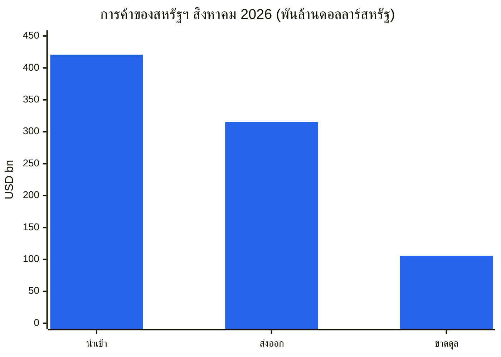

*หมายเหตุ: สำนักสำมะโน/BEA ผ่าน businessday.co.za; นำเข้า 420,800 ล้านดอลลาร์ (สถิติ +4.3%) ส่งออก 315,200 ล้านดอลลาร์ (+1.4%) ขาดดุล 105,600 ล้านดอลลาร์ (+13.7% มากสุดนับตั้งแต่ มี.ค. 2025)*

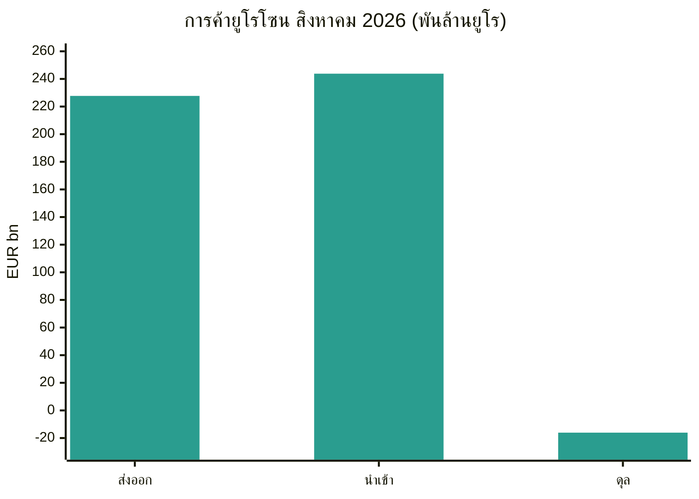

*หมายเหตุ: Eurostat เผยแพร่ 16 ต.ค.; ส่งออก 227,700 ล้านยูโร (+9.9% YoY) นำเข้า 243,800 ล้านยูโร (+16.7%) ดุล −16,100 ล้านยูโร (ขาดดุลสูงสุดนับตั้งแต่ ม.ค. 2023)*

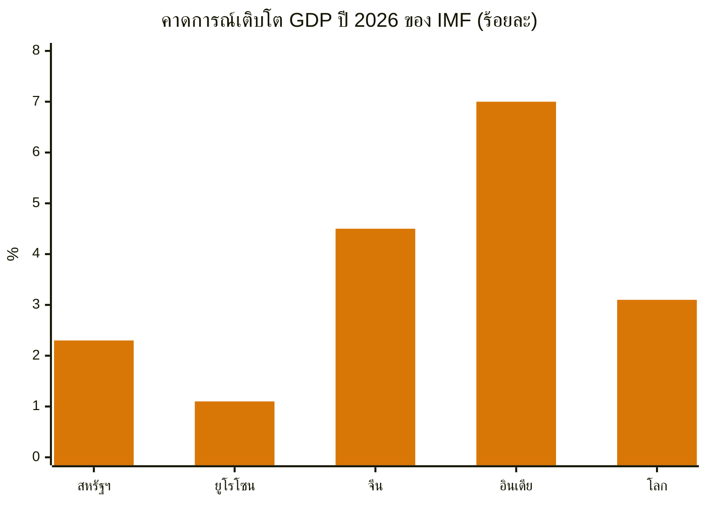

*หมายเหตุ: IMF World Economic Outlook 13 ต.ค. 2026; คาดการณ์โลกปี 2027 3.4%*

---

## 9. ตลาดค่าระวาง

### อัตราค่าระวางสปอตคอนเทนเนอร์ — ดัชนี Drewry World Container Index

การประเมิน 15 ตุลาคมปิดที่ **4,485 ดอลลาร์ต่อ FEU เพิ่มขึ้น 3% สัปดาห์ต่อสัปดาห์** — การฟื้นตัวหลังการอ่าน 8 ตุลาคมที่ 4,351 ดอลลาร์ (−2%) เอเชีย–ยุโรปขับเคลื่อนการเพิ่ม: เซี่ยงไฮ้–รอตเทอร์ดัม +6% เป็น 3,522 ดอลลาร์ เซี่ยงไฮ้–เจนัว +7% เป็น 3,945 ดอลลาร์ การเพิ่มขึ้นของเอเชีย–ยุโรปครั้งแรกหลังลดลง 13 สัปดาห์ติดต่อกัน ข้ามแปซิฟิกผสม: เซี่ยงไฮ้–ลอสแอนเจลิส +3% เป็น 7,884 ดอลลาร์ เซี่ยงไฮ้–นิวยอร์ก −1% เป็น 10,075 ดอลลาร์ Drewry คาดความผันผวนน้อยลงในสัปดาห์ข้างหน้า การประเมินก่อนหน้า (1 ตุลาคม) ปิดที่ 4,434 ดอลลาร์ (−1%)

ตัวติดตามการยกเลิกเที่ยวเรือของ Drewry (16 ตุลาคม) แสดงการยกเลิกเที่ยวเรือ 44 เที่ยวที่ประกาศสำหรับสัปดาห์ 43–47 (19 ตุลาคม–22 พฤศจิกายน) — อัตรายกเลิก 6% ของ 713 เที่ยวที่วางแผน เอเชีย–ยุโรปเหนือ/เมดิเตอร์เรเนียนคิดเป็น 44% ของการยกเลิก ข้ามแปซิฟิกตะวันออก 36% ข้ามแอตแลนติก 20% การขึ้นค่า FAK ที่วางแผนของผู้ให้บริการ 4,500–4,800 ดอลลาร์/FEU บนเอเชีย–ยุโรป (มีผล 19 ตุลาคม) เผชิญการตอบรับที่ไม่แน่นอนเมื่อกำลังระวางสุเอซกลับมา (แหล่งที่มา: [Drewry](https://www.drewry.co.uk/maritime-research-opinion-browser/world-container-index-assessed-by-drewry), [Shipping Telegraph wk41](https://shippingtelegraph.com/freight-news/drewry-the-world-container-index-decreased-2-in-week-41-2026/), [Shipping Telegraph wk42](https://shippingtelegraph.com/freight-news/drewry-the-world-container-index-increased-3-this-week-42-2026/))

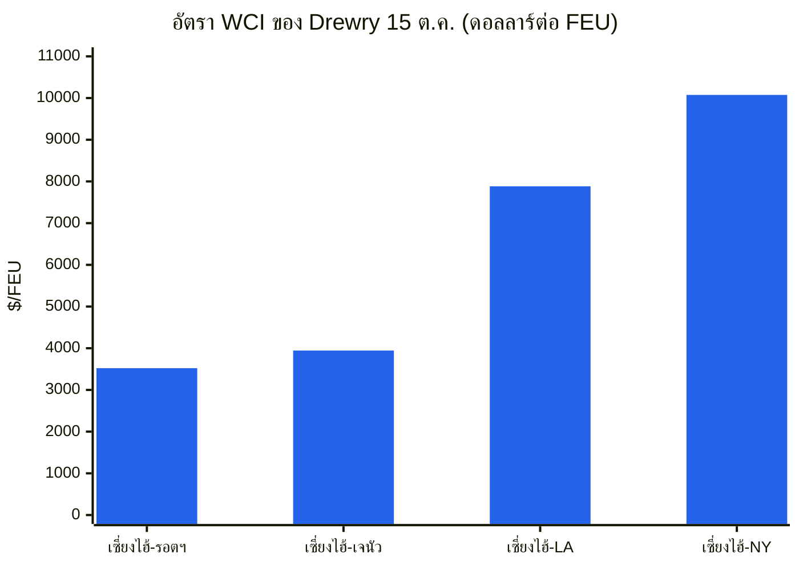

*หมายเหตุ: เซี่ยงไฮ้–รอตเทอร์ดัม 3,522 ดอลลาร์ (+6%) เซี่ยงไฮ้–เจนัว 3,945 ดอลลาร์ (+7%) เซี่ยงไฮ้–ลอสแอนเจลิส 7,884 ดอลลาร์ (+3%) เซี่ยงไฮ้–นิวยอร์ก 10,075 ดอลลาร์ (−1%)*

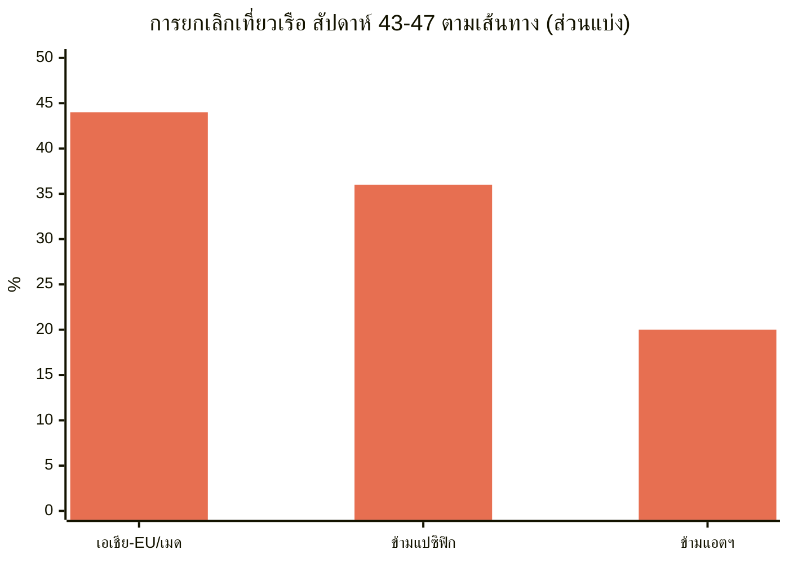

*หมายเหตุ: ตัวติดตามการยกเลิกเที่ยวเรือของ Drewry 16 ต.ค.; ยกเลิก 44 เที่ยวจาก 713 เที่ยวที่วางแผน (อัตรายกเลิก 6%)*

### ดัชนี Freightos Baltic (FBX)

สัปดาห์ถึง 13 ตุลาคม: เอเชีย–ชายฝั่งตะวันตกสหรัฐฯ (FBX01) −2% เป็น 8,149 ดอลลาร์/FEU; เอเชีย–ชายฝั่งตะวันออกสหรัฐฯ (FBX03) คงที่ 9,606 ดอลลาร์/FEU; เอเชีย–ยุโรปเหนือ (FBX11) คงที่ 3,260 ดอลลาร์/FEU; เอเชีย–เมดิเตอร์เรเนียน (FBX13) +7% เป็น 3,804 ดอลลาร์/FEU ทางอากาศ: จีน–อเมริกาเหนือ +3% เป็น 5.77 ดอลลาร์/กก.; จีน–ยุโรปเหนือ −7% เป็น 3.58 ดอลลาร์/กก. — อย่างหลังสะท้อนการสิ้นสุดการยกเว้น de minimis 150 ยูโรของสหภาพยุโรปในเดือนกรกฎาคม (การนำเข้าจีน/ฮ่องกงผ่านแฟรงก์เฟิร์ต −1.8%/−7.4% ในเดือนกันยายน) เกณฑ์มาตรฐานอากาศของ Freightos ยังสูงกว่าปีก่อน 33% อัตราข้ามแปซิฟิกคงที่ผ่านโกลเดนวีคแล้วอ่อนลงเล็กน้อย — การเริ่มเลื่อนหลังวันหยุด ปริมาณคาดลดลงในเดือนพฤศจิกายน–ธันวาคม ([AJOT / Freightos](https://www.ajot.com/news/freightos-weekly-update-attacks-disrupt-saudi-air-cargo-china-europe-air-rates-slump))

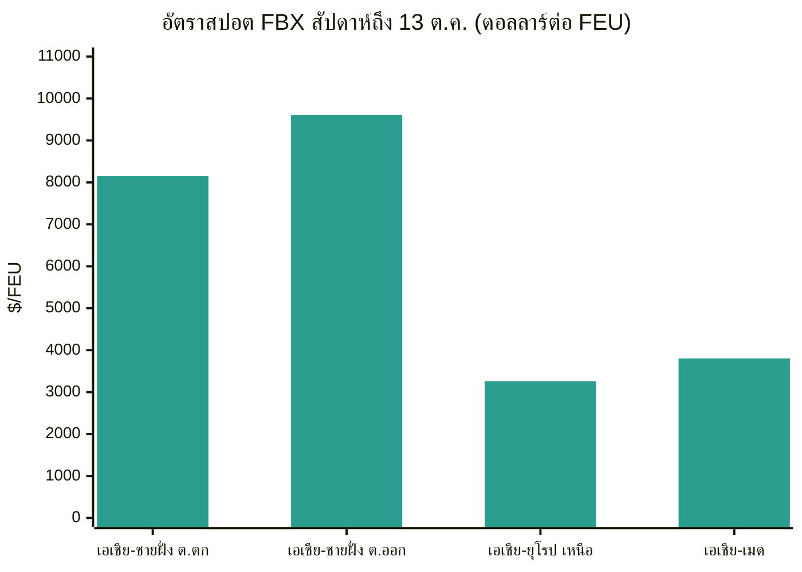

*หมายเหตุ: FBX01 8,149 ดอลลาร์ (−2%) FBX03 9,606 ดอลลาร์ (คงที่) FBX11 3,260 ดอลลาร์ (คงที่) FBX13 3,804 ดอลลาร์ (+7%)*

### เรือเทกอง — Baltic Exchange

**ดัชนี Baltic Dry** ลดลงเป็นสัปดาห์ที่สามติดต่อกัน ปิดวันศุกร์ที่ 16 ตุลาคมที่ **2,511 — ลดลง 14% ในสัปดาห์** ต่ำสุดนับตั้งแต่ 30 มิถุนายน ดัชนี Capesize ลดลง 25% สัปดาห์ต่อสัปดาห์เป็น 3,249 (ต่ำสุดนับตั้งแต่ต้นเดือนเมษายน); รายได้ Capesize 5TC เฉลี่ย 25,961 ดอลลาร์/วัน (−664 ดอลลาร์/วัน) Panamax ลดลง 1.8% เป็น 2,314 (รายได้ 20,827 ดอลลาร์/วัน) Supramax เป็นข้อยกเว้นด้านความแข็งแกร่ง เพิ่ม 9 จุดเป็น 1,865 แร่เหล็กแตะจุดต่ำสุดในรอบสองปีกลางสัปดาห์บนความต้องการจีนที่อ่อนแอและสต็อกที่เพิ่มขึ้นก่อนฟื้นตัววันศุกร์ (แหล่งที่มา: [Baird Maritime](https://www.bairdmaritime.com/shipping/dry-cargo/bulkers/baltic-index-stays-in-the-doldrums-as-capesize-rates-slide-further), [Safety4Sea](https://www.safety4sea.com/baltic-exchange-maritime-market-highlights-october-12-16/))

### ค่าขนส่งทางอากาศ

อัตราสปอตทั่วโลกคงที่ที่ **3.55 ดอลลาร์/กก. ในสัปดาห์ที่ 41** แม้ช่วงโกลเดนวีคจะเงียบ — ปริมาณลดลง 1% สัปดาห์ต่อสัปดาห์เป็นสัปดาห์ที่สามติดต่อกัน แต่เพิ่มขึ้น 9% เมื่อเทียบรายปี; อัตราสปอตเพิ่มขึ้น 34% เมื่อเทียบรายปี; อัตราตลาดเต็ม 3.13 ดอลลาร์/กก. คงที่ อัตราสปอตเอเชียแปซิฟิกลดลง 3% สัปดาห์ต่อสัปดาห์เป็น 4.83 ดอลลาร์/กก.; แอฟริกาสปอตเพิ่มขึ้น 10% น้ำมันเครื่องบินเพิ่มขึ้น 111% เมื่อเทียบรายปี (IATA/Platts) ดัชนี Baltic Air Freight เพิ่มขึ้น 5.0% ในสัปดาห์ถึง 5 ตุลาคม ผลักการเพิ่มเมื่อเทียบรายปีเป็น +25.5% โดยอัตรายังไม่ขึ้นตามน้ำมัน เทคโนโลยีและอิเล็กทรอนิกส์ (เซิร์ฟเวอร์ เซมิคอนดักเตอร์ ชิ้นส่วนศูนย์ข้อมูล) ยังเป็นแหล่งความต้องการที่แข็งแกร่งที่สุด ขณะที่อีคอมเมิร์ซไปสหรัฐฯ หดตัวจากการเปลี่ยนแปลงภาษีนำเข้ามูลค่าต่ำ กำลังการขนส่งในอ่าวหดตัว 4% สัปดาห์ต่อสัปดาห์ในสัปดาห์ที่ 41 จากการโจมตีสนามบินของฮูตี เหลือต่ำกว่าระดับปลายเดือนกุมภาพันธ์ 20% (แหล่งที่มา: [StatTimes / WorldACD](https://www.stattimes.com/air-cargo/global-air-cargo-rates-remain-stable-at-355kg-in-week-41-1360975), [Baltic Exchange](https://www.balticexchange.com/en/news-and-events/news/guest-column/2026/Air-freight-rates-remain-firm-in-September-with-renewed-surge-in-jet-fuel-yet-to-feed-through.html))

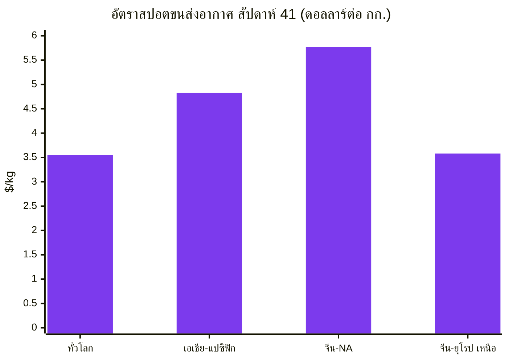

*หมายเหตุ: WorldACD ผ่าน StatTimes (19 ต.ค.) และ Freightos (13 ต.ค.); ทั่วโลก 3.55 ดอลลาร์ (+34% YoY) เอเชียแปซิฟิก 4.83 ดอลลาร์ จีน–อเมริกาเหนือ 5.77 ดอลลาร์ จีน–ยุโรปเหนือ 3.58 ดอลลาร์*

### ความน่าเชื่อถือของตารางเดินเรือ

บัตรคะแนนเดือนกันยายนของ Xeneta: การมาถึงตรงเวลาทั่วโลกลดลง 2 จุดเป็น **27%** เป็นเดือนที่สี่ติดต่อกันที่ลดลง; ความล่าช้าเฉลี่ยแตะ 6 วัน (+2.4 วันนับตั้งแต่ไตรมาส 2) ตะวันออกไกล–ยุโรปทรุดเป็น 4% ตรงเวลาด้วยความล่าช้าเฉลี่ย 9.9 วัน — แย่ที่สุดนับตั้งแต่กันยายน 2021 เอเชีย–อเมริกาเหนือไม่เปลี่ยนที่ 20% ตรงเวลา โดยความล่าช้าเพิ่มเป็น 6.9 วัน ผู้ให้บริการทุกรายที่ติดตามบันทึกความล่าช้าเฉลี่ย 12 เดือนแย่ที่สุด (CMA CGM 30%, Cosco 18%, Hapag-Lloyd 45%, Yang Ming 4% ตรงเวลา) อัตราสปอตจีน–ชายฝั่งตะวันตกสหรัฐฯ เฉลี่ย 7,717 ดอลลาร์/FEU ต้นเดือนตุลาคม — ประมาณสี่เท่าของ 1,778 ดอลลาร์ในเดือนกันยายน 2025; อัตราระยะยาวเพิ่มขึ้น 26% เดือนต่อเดือนเป็น 3,649 ดอลลาร์/FEU ในวันที่ 1 ตุลาคม ([FreightWaves / Port Technology](https://www.olgn.news/freightwaves-shippers-waiting-an-extra-week-for-us-bound-containers/))

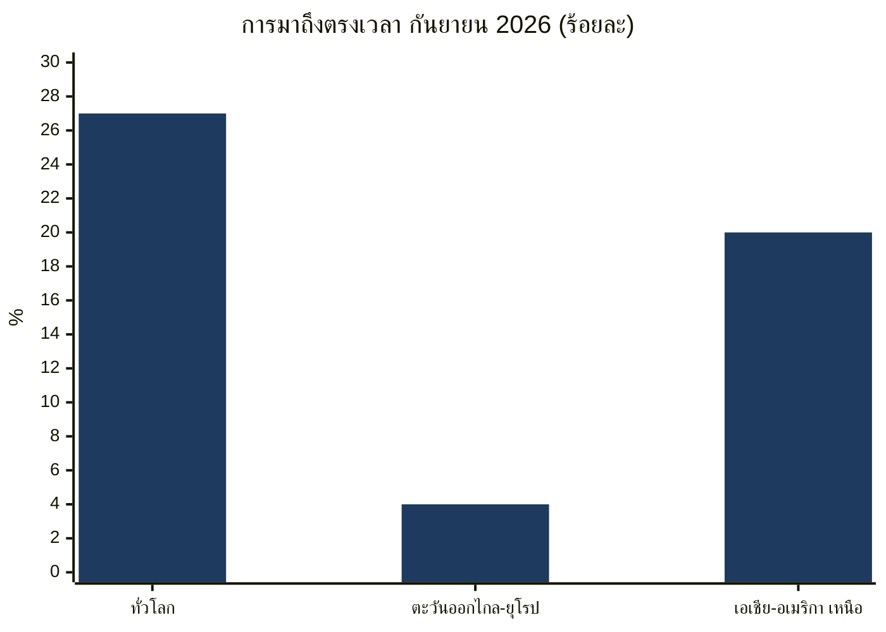

*หมายเหตุ: Xeneta ผ่าน FreightWaves/Port Technology; ทั่วโลก 27% (−2 จุด) ตะวันออกไกล–ยุโรป 4% (ความล่าช้าเฉลี่ย 9.9 วัน) เอเชีย–อเมริกาเหนือ 20% (ความล่าช้า 6.9 วัน)*

### การหยุดชะงักของท่าเรือและโลจิสติกส์

- **ฮอร์มุซ/ฮูตี:** เรือคอนเทนเนอร์ *GFS Pride* จม (15 ตุลาคม); เรือถูกโจมตี 12 ลำในวันที่ 5–11 ตุลาคม; การผ่านช่องแคบลดลงเหลือ 131 ลำ/สัปดาห์; กำลังการขนส่งอากาศในอ่าว −4% WoW ความเห็นประธานของ UNSC รับรองโดยฉันทามติ 15 ตุลาคมประณามการโจมตีของฮูตีต่อซาอุดีอาระเบียและการเดินเรือในทะเลแดง (ดูประเด็นเตือน A2)
- **การเรียกค่าไถ่ทางไซเบอร์:** บริษัทเดินเรือ 38 แห่งใน 18 ประเทศเผชิญเส้นตายค่าไถ่ 19 ตุลาคม เวลา 13:27 UTC (ดูประเด็นเตือน A3)
- **สุเอซ:** การตรวจบังคับและทดสอบเดินเรือสำหรับเรืออายุ 25+ ปีมีผล 6 ตุลาคม; กำลังระวางคอนเทนเนอร์ผ่านคลองในสองสัปดาห์แรกของเดือนตุลาคมเฉลี่ย 753,000 TEU/สัปดาห์ เทียบ 1,457,000 TEU ในช่วงเดียวกันปี 2023 — การกลับมาอยู่ระหว่างทางแต่ยังไกลจากสมบูรณ์
- **เยอรมนี:** ver.di รับข้อตกลงค่าจ้าง 6 ตุลาคม (~11,000 คนงาน ท่าเรือหกแห่ง +3.4% ใน 12 เดือน) ยุติความเสี่ยงการหยุดงานที่ฮัมบูร์ก เบรเมอร์ฮาเฟน และวิลเฮล์มชาเฟน — แต่ระดับน้ำแม่น้ำไรน์ต่ำสุดเป็นประวัติการณ์กำลังจำกัดการจราจรเรือลำเลียงไปรอตเทอร์ดัม/แอนต์เวิร์ป; การใช้ลานเบรเมอร์ฮาเฟนที่ 90% รอตเทอร์ดัมเต็ม 85–90% ด้วยเวลาจอด 14 วัน
- **ปานามา:** องค์การคลองเพิ่มช่องจองรายวันรวมเป็น 33 มีผล 15 ตุลาคม
- **ชายฝั่งตะวันออกสหรัฐฯ:** PhilaPort ประกาศขยาย ~837 ล้านดอลลาร์ — ใหญ่ที่สุดเท่าที่เคย ท่าเทียบใหม่แห่งแรกใน 50 ปี (14 ตุลาคม) ท่าเรือลองบีชทำสถิติรายเดือนสูงสุดในเดือนกันยายน (เข้าใกล้ ~1 ล้านตู้); ท่าเรือลอสแอนเจลิสบันทึกเดือนที่คึกคักที่สุดใน 118 ปี แม้หัวหน้าจะเตือนการเปลี่ยนแหล่งจัดหาที่ขับเคลื่อนโดยภาษีสร้างความเสี่ยงการวางแผน
- **มะนิลา:** การระงับการจองทั้งหมดไปมะนิลาถึงสิ้นปีของ Hapag-Lloyd (รายงานสัปดาห์ก่อน) ยังเป็นกรณีแออัดสุดขั้วที่คงอยู่
- **บังกลาเทศ:** DP World ลงนามสัมปทาน 15 ปีสำหรับท่าเทียบตู้คอนเทนเนอร์ New Mooring ของจิตตะกอง (12 ตุลาคม) ท่ามกลางการประท้วงต่อเนื่องของคนงานท่าเรือต่อการเข้ายึด
- **การลงทุนของผู้ให้บริการ:** คณะกรรมการ HMM อนุมัติการลงทุน 1,620 ล้านดอลลาร์ในเรือคอนเทนเนอร์ 12 ลำ (เรือสร้างใหม่ 13,000-TEU แปดลำบวกเรือสร้างใหม่ขายต่อสี่ลำ รวม 114,100 TEU ส่งมอบภายในธันวาคม 2029) — เล็งเรือ 166 ลำ / 1.47 ล้าน TEU ภายในสิ้นปี 2030 ZIM เพิ่มคาดการณ์กำไรปี 2026 ขึ้น 72% บนความต้องการที่แข็งแกร่ง พาดหัว JOC ยังระบุเยอรมนีขวางข้อเสนอซื้อ Zippel ของ Cosco ด้วยเหตุความมั่นคง และการดำเนินการของ ILWU ชะลอการเปิดท่าเรือ LA–LB

### ข่าวกรองผู้ขาย

- **Descartes — Global Shipping Report (ฉบับกันยายน ~13 ตุลาคม)** การนำเข้าตู้คอนเทนเนอร์สหรัฐฯ แตะปริมาณเดือนกันยายนสูงสุดเป็นประวัติการณ์: 2.55 ล้าน TEU — ลดลง 2.2% จากเดือนสิงหาคม เพิ่มขึ้น 10.3% เมื่อเทียบรายปี; ปริมาณมกราคม–กันยายน +0.8% เมื่อเทียบรายปี การนำเข้าต้นกำเนิดจีนเพิ่มขึ้นแรงเดือนต่อเดือนขณะที่ต้นกำเนิดหลักอื่นส่วนใหญ่ลดลง; ท่าเรือชายฝั่งตะวันตกได้ส่วนแบ่งเพิ่ม; ความล่าช้าการผ่านท่าเรือเพิ่มขึ้นที่ 8 ใน 10 ประตูหลัก (เพิ่มมากสุดที่ NY/NJ) รายการเฝ้าระวังข้างหน้า: เหตุการณ์ตะวันออกกลาง/ฮอร์มุซ ภาษีที่ขยาย (มาตรา 301/232 ภาษีมาตรา 232 ยาเดือนกันยายน) ช่องปานามา เส้นทางทะเลแดง และเศรษฐกิจสหรัฐฯ (อัตราดอกเบี้ยนโยบายเฟด 3.75–4.00%; GDP ไตรมาส 2 2.2% ต่อปี) เป็นการเผยแพร่ข้อมูล ไม่ใช่รายการผลิตภัณฑ์ ([AJOT](https://www.ajot.com/news/descartes-global-shipping-report-u.s-container-imports-reach-highest-september-volume-on-record))
- **Descartes — อัปเดตข้อมูลภาษีรายสัปดาห์ของ CustomsInfo** อัปเดต 16 ตุลาคม: อัปเดตภาษีเม็กซิโกมีผล 14 ตุลาคม (กฤษฎีกา DOF 13/10/2026 — อัตราชั่วคราว ไม่เปลี่ยน HS); มอริเชียสอัปเดตภาษีเท่านั้น อัปเดต 9 ตุลาคม: การแก้ไขทางเทคนิคของสหรัฐฯ สำหรับ HTS 9903.85.67/68 (ประเทศที่เกี่ยวข้องแก้ไขเป็น ALL ไม่ใช่แค่รัสเซีย; ภาษีเพิ่มเติมใช้เฉพาะหากหลอม/หล่อในรัสเซีย); อัปเดตจีน 8 ตุลาคม ([customsinfo.com](https://www.customsinfo.com/resources/industry-updates/))
- **TradeInt — ความร่วมมือกับกระทรวงพาณิชย์ตุรกี (ประกาศ 30 กันยายน ก่อนหน้าต่างเวลา)** ความร่วมมือให้ทุนแก่บริษัทที่ปรึกษาท้องถิ่นเข้าถึงบันทึกการขนส่ง เอกสารศุลกากร และข้อมูล B/L ใน 200+ ประเทศ มุ่งการตัดสินใจส่งออกของ SME ตุรกี; การทบทวนของ TradeInt อ้างการส่งออกตุรกีปี 2025 ที่ 269,700 ล้านดอลลาร์ เป็นรายการความร่วมมือภาครัฐ; ไม่พบการเผยแพร่ของ TradeInt ที่ลงวันที่ในหน้าต่างเวลาในสัปดาห์นี้ และบล็อกข้อมูลเชิงลึกของ TradeInt ไม่มีโพสต์ที่ลงวันที่ในหน้าต่างเวลาที่ตรวจสอบได้ ([bayareametrowire](https://bayareametrowire.com/news/turkiyes-ministry-of-trade-grants-consulting-firms-access-to-global-trade-data-through-tradeint-partnership))

---

## 10. เส้นเวลานโยบาย

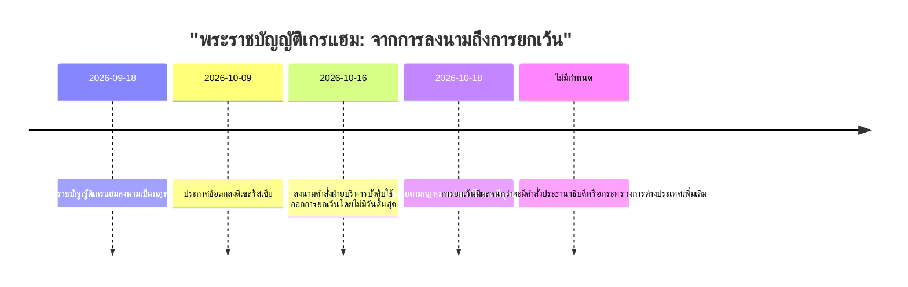

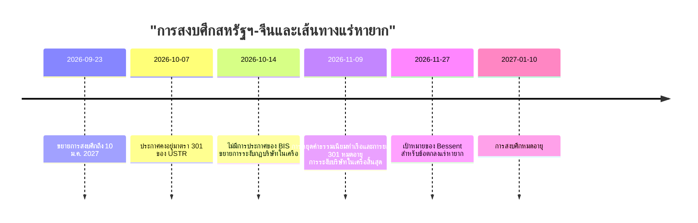

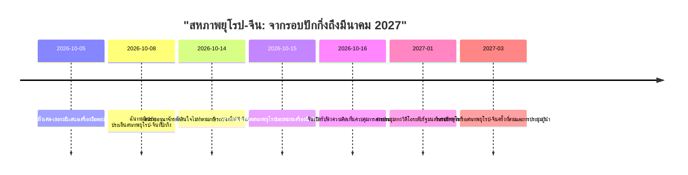

---

## 11. กำหนดการและเหตุการณ์ที่จะมาถึง (90 วันข้างหน้า)

| วันที่ | เหตุการณ์ | เหตุผลความสำคัญ |
|---|---|---|
| 19 ต.ค. 2026 | เส้นตายค่าไถ่การเรียกค่าไถ่ทางไซเบอร์ (13:27 UTC) สำหรับบริษัทเดินเรือ 38 แห่ง | คลื่นเรียกค่าไถ่ทางไซเบอร์การเดินเรือขนาดใหญ่ครั้งแรก; เฝ้าดูการเปิดเผย |
| 20 ต.ค. 2026 | FTA อินเดีย–นิวซีแลนด์มีผลบังคับ | ภาษีนิวซีแลนด์สำหรับการส่งออกอินเดียยกเลิกตั้งแต่วันแรก |
| 22 ต.ค. 2026 | พระราชบัญญัติการค้าต่างประเทศที่แก้ไขของเกาหลีมีผล | เหตุจำกัดการค้าขยายจาก 5 เป็น 9 |
| 27 ต.ค. 2026 | WTO DSB: รับรองรายงานคณะจีนกับตุรกีเรื่องภาษีรถยนต์ไฟฟ้า; เส้นตายรับรองคำตัดสินอินเดีย–ไต้หวันเรื่องภาษี ICT | เหตุการณ์สำคัญข้อพิพาทสองเรื่องในวันเดียวกัน |
| 9 พ.ย. 2026 | การหยุดค่าธรรมเนียมท่าเรือมาตรา 301 หมดอายุ (23:59 น. ตามเวลา ET); การยกเว้นมาตรา 301 จำนวน 178 รายการหมดอายุ; การระงับกฎบริษัทในเครือของ BIS สิ้นสุดตามเงื่อนไข | หน้าผาการปฏิบัติตามสามเท่า — ถือเป็นวันที่แน่นอนเว้นแต่ USTR/BIS ดำเนินการ |
| 9 พ.ย. 2026 | ความเห็นการสอบสวนป้องกันของมาดากัสการ์ครบกำหนด |  |
| 10 พ.ย. 2026 | วันที่ "สแนปแบ็ก" แร่หายากจากแนวทางก่อนหน้า; วันที่บังคับใช้กฎบริษัทในเครืออีกครั้ง | เฝ้าดูการดำเนินการอย่างเป็นทางการของ BIS |
| 15 พ.ย. 2026 | ปิดรับฟังความคิดเห็นควบคุมการส่งออกเอไอของจีน | บัญชี 40 เทคโนโลยีอาจรับรองหลังจากนั้น |
| 20 พ.ย. 2026 | การประชุมสุดยอดสหราชอาณาจักร–สหภาพยุโรป (บรัสเซลส์) | ตามการตัดสินใจภาษีรถยนต์ไฟฟ้าของสหราชอาณาจักร |
| 27 พ.ย. 2026 | วันขอบคุณพระเจ้า — เป้าหมายข้อตกลงแร่หายากของ Bessent |  |
| 31 ธ.ค. 2026 | การทบทวนเหล็ก/อะลูมิเนียมของข้อตกลงสหภาพยุโรป–สหรัฐฯ: การผ่อนปรนระงับได้หากภาษีสหรัฐฯ ยังเกิน 15% | การทดสอบการยับยั้งซึ่งกันและกันครั้งแรกของข้อตกลงสหภาพยุโรป–สหรัฐฯ |
| 10 ม.ค. 2027 | การสงบศึกสหรัฐฯ–จีนหมดอายุ |  |
| ม.ค. 2027 | การประชุมทางวิดีโอระดับรัฐมนตรีสหภาพยุโรป–จีน |  |
| มี.ค. 2027 | การปรึกษาหารือการค้าและการลงทุนสหภาพยุโรป–จีนครั้งที่สาม; การประชุมผู้นำสหภาพยุโรป–จีนครั้งต่อไป; สมมติฐานพื้นฐานของ IMF ว่าฮอร์มุซเปิดอีกครั้ง |  |
| ต้นปี 2027 | FTA ออสเตรเลีย–สหภาพยุโรปเสนอต่อรัฐสภา (การต่อสู้ให้สัตยาบัน) |  |

## 12. แหล่งข้อมูลและระเบียบวิธี

ช่วงเวลาครอบคลุม: 12–19 ตุลาคม 2026

**ข่าวการค้าและการวิเคราะห์:** FreightWaves, The Loadstar, Splash247, gCaptain, Hellenic Shipping News, Container News, Supply Chain Dive, Port Technology International, JOC (พาดหัวเท่านั้น), Shipping Telegraph, Baird Maritime, StatTimes/WorldACD, AJOT/Freightos, Metro Global, บล็อก TradeInt (ไม่มีโพสต์ที่ลงวันที่ในหน้าต่างเวลา)

**นโยบายสหรัฐฯ:** whitehouse.gov (คำสั่งฝ่ายบริหารบังคับใช้พระราชบัญญัติเกรแฮม หลัก), federalregister.gov (แนวทางส่วนประกอบสหรัฐฯ ของ BIS 2026-20938; ประกาศคงอยู่ของ USTR 91 FR 64212), CBP (ผ่านคำแนะนำการค้า: CAPE เฟส 3, WRO, ค่าธรรมเนียมผู้ใช้), FMC (ข้อเสนอค่าธรรมเนียมสเปนผ่าน Supply Chain Dive), USTR (ผ่านรายงานทุติยภูมิ), BIS (ผ่าน Mondaq/Crowell & Moring, Braumiller, Dechert), Thompson Hine, Steptoe, Mondaq, Gateway Lines, Thomson Reuters, JD Supra (ไม่มีรายการในหน้าต่างเวลาปรากฏ), internationaltradetoday.com (พาดหัวเท่านั้น)

**รัฐบาลโลก:** การประชุมสภายุโรป (ผ่านสื่อ), คณะกรรมาธิการยุโรป/DG Trade (ผ่านสื่อ), gov.uk กระทรวงการค้าและธุรกิจ (ผ่าน The Guardian/Fleet News), CBSA/แคนาดา (ผ่านสมาคมอุตสาหกรรม), METI/ศุลกากรญี่ปุ่น (ผ่าน Steptoe/Global Sanctions), MOTIR เกาหลี (ผ่านสรุป LinkedIn), english.mofcom.gov.cn (ดึงโดยตรงไม่สำเร็จ; รายการ MOFCOM ผ่านรายงานทุติยภูมิและสภาแห่งรัฐฉบับภาษาอังกฤษ), กระทรวงพาณิชย์อินเดีย (ผ่านสื่อ), DFAT ออสเตรเลีย (ผ่านสื่อ), MDIC บราซิล (ผ่าน Datamar)

**พหุภาคี:** wto.org (Global Trade Outlook and Statistics 8 ตุลาคม; รายงานคณะและ DSB ผ่านสื่อการค้า), unctad.org (Trade and Development Report 2026), WCO (เปิดตัว e-CENcomm, ภาคผนวก GCC), WTO ITIP (ไม่มีการเผยแพร่ใหม่ในหน้าต่างเวลาปรากฏ), ITC Trade Map (ไม่มีการเผยแพร่ในหน้าต่างเวลาปรากฏ)

**พอร์ทัลข้อมูล:** สำนักสำมะโน/BEA (FT-900 สิงหาคม 2026; สินค้าล่วงหน้ากันยายน 2026), GACC (การค้าจีนกันยายน 2026), Eurostat (การค้ายูโรโซนสิงหาคม 2026), WTO, IMF (WEO ตุลาคม), UNCTADstat, USITC DataWeb / USA Trade Online / UN Comtrade / WITS (ไม่มีการเผยแพร่ชุดข้อมูลใหม่ในหน้าต่างเวลาปรากฏ)

**คลังสมองและงานวิจัย:** Yale Budget Lab (State of U.S. Tariffs; การวิเคราะห์ Tariff Dividends), Penn Wharton Budget Model (Effective Tariff Rates and Revenues อัปเดต 14 ตุลาคม), Tax Foundation (Trump Tariffs Tracker ฉบับสิงหาคม 2026), Mondaq (การวิเคราะห์ข้อตกลงภาษีสหภาพยุโรป–สหรัฐฯ), tradeintelligence.eu (ดึงข้อความไม่สำเร็จในสัปดาห์นี้)

**ค่าขนส่ง:** Drewry (World Container Index การประเมิน 15 ตุลาคม; ตัวติดตามการยกเลิกเที่ยวเรือ 16 ตุลาคม), Baltic Exchange (ไฮไลต์ตลาดรายสัปดาห์; BAI ผ่านคอลัมน์รับเชิญ), ดัชนี Freightos Baltic (สัปดาห์ถึง 13 ตุลาคม), Xeneta (ความน่าเชื่อถือของตารางเดินเรือ ผ่าน FreightWaves/Port Technology), Kpler (การผ่านช่องแคบ), Sea-Intelligence, Linerlytica, Veson, Hartland (รายได้เรือบรรทุกน้ำมัน), Clarksons, SCFI, TAC Index, NRF Global Port Tracker, DHL, DC Velocity

**ข่าวกรองผู้ขาย:** Descartes Systems Group (Global Shipping Report ฉบับกันยายน; อัปเดตข้อมูลภาษีรายสัปดาห์ของ CustomsInfo) และ TradeInt (ความร่วมมือกระทรวงพาณิชย์ตุรกี 30 กันยายน) — เฉพาะรายการข่าวผู้ขาย: การเผยแพร่ข้อมูล ความร่วมมือภาครัฐ และความเคลื่อนไหวตลาด
