# Báo cáo Thương mại Toàn cầu — Tuần 12–19 tháng 10, 2026

**Bản tin hàng tuần.** Phạm vi: 12–19 tháng 10, 2026. Tổng hợp từ khoảng 45 nguồn tin thương mại, chính sách, dữ liệu và cước vận chuyển trên toàn thế giới.

---

## Mục lục

1. [Tóm tắt điều hành](#1-executive-summary)
2. [Cảnh báo](#2-alerts)
3. [Các tin chính — phân tích chuyên sâu](#3-top-stories--deep-dives)
4. [Bộ theo dõi thuế quan](#4-tariff-tracker)
5. [Phân tích chuyên sâu chính sách Hoa Kỳ](#5-us-policy-deep-dive)
6. [Chính sách thế giới theo khu vực](#6-world-policy-by-region)
7. [Hành động cưỡng chế](#7-enforcement-actions)
8. [Số liệu công bố](#8-data-releases)
9. [Thị trường cước vận chuyển](#9-freight-market)
10. [Dòng thời gian chính sách](#10-policy-timelines)
11. [Các thời hạn & sự kiện sắp tới (90 ngày tới)](#11-upcoming-deadlines--events-next-90-days)
12. [Nguồn tin & phương pháp luận](#12-sources--methodology)

---

## 1. Tóm tắt điều hành

Một tuần mà một đạo luật trừng phạt mang tính bước ngoặt bị vô hiệu hóa ngay khi ký ban hành, chiến dịch Hormuz bắt đầu đánh chìm tàu container, và ba nền kinh tế thương mại lớn nhất thế giới công bố những con số đi theo hướng ngược nhau.

- **Đạo luật Graham bị miễn trừ trước khi có hiệu lực.** Một tháng sau khi ký Đạo luật Trừng phạt Nga và Iran của Lindsey O. Graham năm 2026 — với mức thuế gây chú ý 500% đối với hàng hóa Nga và thuế thứ cấp 100% đối với các bên mua năng lượng Nga lớn nhất — Tổng thống Trump đã ký sắc lệnh hành pháp ngày 16/10 thi hành Đạo luật và, trong cùng sắc lệnh, miễn trừ các điều khoản thuế quan và trừng phạt của Đạo luật mà không đặt thời hạn kết thúc. Ấn Độ, Trung Quốc và Thổ Nhĩ Kỳ — những bên mua mà Đạo luật nhắm tới — tiếp tục mua. Các nghị sĩ lưỡng đảng và Kyiv gọi việc miễn trừ là bước rút lui; Nhà Trắng không đưa ra lời giải thích công khai chi tiết.
- **Hormuz đánh chìm tàu container đầu tiên.** Tàu *GFS Pride* treo cờ Singapore (2.824 TEU) bị tấn công, bốc cháy và chìm ngoài khơi Hormuz vào ngày 15/10 — là tàu thứ hai và thứ ba bị đánh chìm kể từ khi xung đột bắt đầu. Mười hai tàu báo cáo bị tấn công trong tuần 5–11/10, mức cao nhất theo tuần kể từ khi chiến tranh bắt đầu; lượt tàu qua eo biển giảm xuống 131 từ 176 của tuần trước và dòng chảy dầu thô giảm xuống ước tính 12,6 mb/ngày. Trong khi đó, thu nhập của tàu chở dầu đạt mức phi thường: tàu VLCC đạt trung bình 643.000 USD/ngày trong tháng qua.
- **Dữ liệu kể ba câu chuyện khác nhau.** Thặng dư thương mại tháng 9 của Trung Quốc đạt 133,5 tỷ USD, mức cao nhất 20 tháng, khi xuất khẩu tăng vọt 36,3% nhờ cơn sốt phần cứng AI — thặng dư tháng 1–9 đạt 938,5 tỷ USD, trong tầm với của năm thứ hai liên tiếp vượt 1 nghìn tỷ USD. Thâm hụt tháng 8 của Mỹ nới rộng 13,7% lên 105,6 tỷ USD khi nhập khẩu lập kỷ lục 420,8 tỷ USD. Khu vực euro ghi nhận thâm hụt thương mại lớn nhất kể từ tháng 1/2023 (16,1 tỷ euro) khi nhập khẩu tăng vọt 16,7%. WTO nâng dự báo thương mại hàng hóa 2026 lên 3,9%, cảnh báo rằng hàng hóa gắn với AI đang che giấu sự yếu kém ở những lĩnh vực khác; triển vọng tháng 10 của IMF đặt tăng trưởng toàn cầu 2026 ở mức 3,1%, với giả định Hormuz mở lại vào tháng 3.
- **Châu Âu định hướng phòng vệ thương mại.** Tại hội nghị thượng đỉnh Brussels ngày 15–16/10, các nhà lãnh đạo EU giao nhiệm vụ "tận dụng toàn bộ" các biện pháp phòng vệ thương mại hiện có đối với Trung Quốc và yêu cầu Ủy ban châu Âu phát triển các công cụ mới, đồng thời giữ đối thoại mở trước cuộc họp tháng 3/2027. Ngược lại, Anh quyết định không áp thuế theo EU tới 45,3% đối với xe điện Trung Quốc, gọi đây là lựa chọn vì lợi ích của riêng Anh. Bắc Kinh mở tham vấn công chúng về kiểm soát xuất khẩu công nghệ AI trên diện rộng, bao gồm trọng số mô hình lớn và phương pháp thiết kế chip.
- **Cước vận chuyển phục hồi một phần.** Chỉ số World Container Index của Drewry tăng 3% lên 4.485 USD/FEU trong đánh giá ngày 15/10 — cước châu Á–châu Âu tăng lần đầu sau 13 tuần — trong khi Chỉ số Baltic Dry giảm tuần thứ ba liên tiếp xuống 2.511 do thu nhập của tàu Capesize sụt giảm. Độ tin cậy lịch trình container toàn cầu giảm xuống 27% trong tháng 9, tháng giảm thứ tư liên tiếp. Ba mươi tám công ty vận tải và cảng trên 18 quốc gia đối mặt với thời hạn đòi tiền chuộc tống tiền qua mạng hàng loạt vào ngày 19/10.

**Cước vận chuyển:** hai bức tranh trái ngược — giá container giao ngay phục hồi nhờ các đợt tăng cước sau Tuần lễ Vàng và các chuyến bị hãng tàu hủy (44 chuyến trong các tuần 43–47), hàng rời khô giảm khi quặng sắt chạm mức thấp hai năm, và hàng không ổn định ở 3,55 USD/kg trong khi nhiên liệu máy bay tăng hơn 100% so với cùng kỳ năm trước.

---

## 2. Cảnh báo

| # | Cảnh báo | Hiệu lực | Tác động | Nguồn |
|---|-------|-----------|--------|--------|
| A1 | Miễn trừ thuế Đạo luật Graham: Sắc lệnh hành pháp ngày 16/10 thi hành Đạo luật Trừng phạt Nga và Iran của Lindsey O. Graham và đồng thời miễn trừ các điều khoản thuế quan và trừng phạt theo Mục 115, không thời hạn kết thúc; các lệnh trừng phạt Nga trước đó được giữ nguyên | 16/10/2026 | Ấn Độ, Trung Quốc, Thổ Nhĩ Kỳ tiếp tục tiếp cận năng lượng Nga mà không bị áp thuế mới của Mỹ; miễn trừ có hiệu lực cho đến khi bị thu hồi | [whitehouse.gov](https://www.whitehouse.gov/presidential-actions/2026/10/implementing-the-lindsey-o-graham-sanctioning-russia-and-iran-act-of-2026/) |
| A2 | Leo thang ở Hormuz: tàu container *GFS Pride* (2.824 TEU) bị đánh chìm ngày 15/10; 12 vụ tấn công tàu trong tuần 5–11/10 (cao nhất theo tuần kể từ khi chiến tranh bắt đầu); lượt tàu qua eo biển giảm xuống 131/tuần; dòng dầu thô ~12,6 mb/ngày | 12–15/10/2026 | Trọng tải container giờ đây gặp rủi ro; điều khoản bảo hiểm chiến tranh siết chặt; thu nhập của tàu chở dầu ở mức phi thường | [Splash247](https://splash247.com/hormuz-claims-two-more-ships-in-fresh-wave-of-strikes/), [FreightWaves](https://www.freightwaves.com/news/container-ship-attacks-escalate-in-strait-of-hormuz) |
| A3 | Tống tiền qua mạng hàng loạt nhằm vào ngành hàng hải: nhóm "n0n" liệt kê 38 công ty vận tải/cảng/logistics trên 18 quốc gia vào ngày 12/10, đe dọa công bố dữ liệu ngày 19/10 lúc 13:27 UTC trừ khi tiền chuộc được trả; mức đòi 400.000–400 triệu USD mỗi công ty; cáo buộc chưa được xác minh | Thời hạn 19/10/2026 | Làn sóng tống tiền qua mạng phối hợp quy mô lớn đầu tiên nhắm vào mục tiêu hàng hải; các mục tiêu gồm ONE, CULines, TS Lines, Santos Brasil | [Splash247](https://splash247.com/shipping-firms-and-ports-caught-in-mass-cyber-extortion-claim/) |
| A4 | Trung Quốc dự thảo kiểm soát xuất khẩu công nghệ AI (Thông báo số 48, 16/10): đề xuất 40 công nghệ vào danh mục cấm/hạn chế (14 cấm, 26 hạn chế), gồm trọng số LLM trên 2 nghìn tỷ tham số; yêu cầu đăng ký trước xuất khẩu có hiệu lực ngay; tham vấn công chúng đến 15/11 | 16/10/2026 (tham vấn đến 15/11) | Có thể hạn chế chuyển giao mô hình AI, tác nhân AI và thiết kế chip ra nước ngoài; triển khai tại chỗ ở nước ngoài bị điều chỉnh | [aiandgpp.com](https://aiandgpp.com/2026/10/19/china-ai-export-controls-model-weights-sovereign-cloud/) |
| A5 | Thời hạn kép ngày 9/11 — không có gia hạn của USTR tính đến 13/10: (a) hết hiệu lực tạm hoãn một năm phí cảng Mục 301 đối với tàu liên quan Trung Quốc (phí quay về 80 USD/NT đối với chủ tàu/vận hành tàu Trung Quốc); (b) hết hạn 178 miễn trừ sản phẩm Mục 301 (thuế Danh mục 1/2/3 quay về 25%, Danh mục 4A về 7,5%) | 9/11/2026, 11:59 tối giờ ET | Nhà nhập khẩu nên coi ngày 9/11 là thời hạn cuối; không có thời gian ân hạn; miễn trừ chỉ gỡ bỏ lớp thuế 301 | [Gateway Lines](https://gatewaylines.com/press-releases/china-ship-fees-301-exclusions-nov-9-2026) |
| A6 | Nhật Bản mở rộng lệnh cấm xuất khẩu sang Nga có hiệu lực ngày 16/10 (công bố 6/10): khoáng sản, hóa chất, kim loại, máy móc, thiết bị công nghiệp và dụng cụ chính xác được bổ sung vào danh sách cấm | 16/10/2026 | Nhà xuất khẩu sang Nga phải rà soát lại phạm vi sản phẩm | [Steptoe](https://www.steptoe.com/en/news-publications/international-compliance-blog/weekly-sanctions-update-october-13-2026.html) |
| A7 | FMC đề xuất phí 200.000 USD/chuyến đối với tàu treo cờ Tây Ban Nha cộng hạn chế nhập khẩu hàng hóa Tây Ban Nha (nước hoa, dầu/mỡ, gốm sứ, đồ đá, đường, bánh kẹo) sau kết luận năm 2024 rằng Tây Ban Nha từ chối cho tàu treo cờ Mỹ cập cảng | Đề xuất 16/10/2026 | Leo thang quyền trả đũa của FMC đối với phân biệt đối xử cờ tàu; hai tàu MSP của Maersk đã bị từ chối cập cảng | [Supply Chain Dive](https://www.supplychaindive.com/news/fmc-proposes-fees-on-spanish-flagged-vessels-import-restrictions/833122/) |
| A8 | Đất hiếm: Bessent cho biết Mỹ hy vọng hoàn tất thỏa thuận đất hiếm với Trung Quốc "hy vọng" trước Lễ Tạ ơn (27/11); đình chỉ Quy định Chi nhánh của BIS (ngày tái áp dụng là 10/11) dự kiến được gia hạn theo thỏa thuận đình chiến đến 10/1/2027, nhưng tính đến 14/10 chưa có thông báo chính thức trên Công báo Liên bang | Mục tiêu 27/11/2026 | Đội ngũ tuân thủ đối mặt với thời hạn tái áp dụng cứng mà chưa có gia hạn chính thức được công bố | [eximguru](https://eximguru.com/export-import-news/export-news/us-china-rare-earths-deal-will-116956.aspx), [Mondaq](https://www.mondaq.com/unitedstates/export-controls-trade-investment-sanctions/1854664/us-china-trade-truce-extended-two-months-bis-affiliates-rule-suspension-follows) |

### A1 — Miễn trừ Đạo luật Graham (chi tiết)

Sắc lệnh hành pháp ký ngày 16/10 có tên "Thi hành Đạo luật Trừng phạt Nga và Iran của Lindsey O. Graham năm 2026" — Đạo luật được ký ngày 18/9/2026 (Công luật 119-111), thông qua Thượng viện với tỷ lệ 86–11 và Hạ viện 262–159. Mục 2 của sắc lệnh ấn định các mức thuế theo luật: cộng thêm 500% theo giá trị đối với hàng hóa xuất xứ Nga; 100% đối với hàng hóa từ năm nước nhập khẩu dầu thô và khí đốt tự nhiên của Nga lớn nhất mà cố ý thực hiện các giao dịch mua mới kể từ ngày 18/10/2026; và 100% đối với hàng hóa từ năm bên tạo điều kiện hàng đầu cho hành vi lách trừng phạt dầu mỏ Nga, tất cả cộng dồn trên các mức thuế hiện hành.

Mục 4(a) sau đó miễn trừ chính các mức thuế đó — cùng các điều khoản trừng phạt tại Mục 102(a), 102(d), 102(e), 103–111 và 117 — theo thẩm quyền miễn trừ tại Mục 115 của Đạo luật, kèm chứng nhận vì lợi ích quốc gia bằng văn bản gửi Quốc hội. Việc miễn trừ không có thời hạn kết thúc: nó duy trì cho đến khi Tổng thống, hoặc Ngoại trưởng sau khi tham vấn Bộ Tài chính và USTR, quyết định có hành động tiếp theo là phù hợp. Mục 4(b) giữ nguyên mọi lệnh trừng phạt Nga trước đó được áp đặt theo các sắc lệnh hành pháp về tình trạng khẩn cấp quốc gia (tình trạng khẩn cấp được gia hạn ngày 24/3/2026), và USTR được giao nhiệm vụ giám sát việc mua năng lượng Nga và báo cáo trở lại.

**Phân tích:** cấu trúc này mang lại cho chính quyền một công cụ đe dọa thuế quan thường trực — bộ máy thi hành và các mức thuế giờ đã được xác định — trong khi hiện tại không áp thuế nào. Chi phí chính trị đến ngay lập tức: các Thượng nghị sĩ Blumenthal, Tillis và Cornyn chỉ trích động thái này, Tổng thống Zelenskyy phản đối, và các dự luật lưỡng đảng nhằm hạn chế thẩm quyền miễn trừ đã được đưa ra, dù chưa dự luật nào thành luật. Nhà Trắng không đưa ra lời giải thích công khai chi tiết, theo tin của AP. Đối với các nhà máy lọc dầu của Ấn Độ và Trung Quốc, việc miễn trừ dỡ bỏ thời hạn từng được ấn định vào ngày 18/10; đối với nhà nhập khẩu Mỹ, rủi ro thuế quan bị hoãn lại chứ không biến mất — một quyết định trong tương lai có thể tái kích hoạt các mức thuế.

### A2 — Hormuz đánh chìm tàu container (chi tiết)

Splash247 đưa tin ngày 15/10 rằng ba tàu container liên quan đến AD Ports/GFS đã bị tấn công gần Hormuz. Tàu *GFS Pride* treo cờ Singapore (đóng năm 2008, 2.824 TEU) bị tấn công, bốc cháy và chìm, toàn bộ 21 thủy thủ được sơ tán. Tàu *GFS Giselle* (2015, 4.400 TEU) bị hư hỏng thân tàu nhưng đã đến được nơi neo đậu, 22 thủy thủ an toàn; tàu *Al Saadiyat* (1.730 TEU, Safeen Feeders) thoát khỏi hư hỏng nghiêm trọng. Riêng tàu chở hàng rời cỡ lớn *Cape Dao* (170.000 dwt) đã chìm khoảng ba tuần sau khi bị tấn công ngoài khơi Oman. Theo dữ liệu tai nạn của IMO, đây là tàu thứ hai và thứ ba bị đánh chìm kể từ khi xung đột bắt đầu.

UKMTO ghi nhận 12 tàu báo cáo bị tấn công trong tuần 5–11/10 — tổng số theo tuần lớn nhất kể từ khi chiến tranh bắt đầu. Kpler đếm được 131 lượt qua eo biển trong tuần kết thúc ngày 14/10, giảm từ 176 của tuần trước; dầu thô qua eo biển ước tính 12,6 mb/ngày vào ngày 13/10, so với khoảng 15 mb/ngày cuối tháng 9. FreightWaves đưa tin các nhà phân tích cảnh báo rằng bảo hiểm chiến tranh có thể bị hủy trong thời gian ngắn khi hàng hóa di chuyển trên tàu không được ghi tên trên vận đơn — một chi tiết chứng từ với hậu quả hợp đồng thực sự đối với các chủ hàng hiện đang định tuyến vòng qua hoặc xuyên qua eo biển.

**Phân tích:** chiến dịch đã chuyển từ quấy rối sang phá hủy trọng tải của vận tải container. Đối với lịch trình các hãng tàu vốn chỉ đạt độ tin cậy toàn cầu 27%, việc mất đi lựa chọn Biển Đỏ và Hormuz càng làm trầm trọng thêm sự gián đoạn. Đối trọng tài chính rất rõ rệt: công ty môi giới Hartland ước tính các chủ tàu VLCC, suezmax và aframax độc lập đang kiếm khoảng 400 triệu USD/ngày vượt kỳ vọng ngân sách; duy trì trong một năm, con số đó sẽ tiệm cận mức lợi nhuận kỷ lục 150 tỷ USD của ngành vận tải container trong năm đại dịch. Tàu VLCC đạt trung bình 643.000 USD/ngày trong tháng qua, với các chuyến Vùng Vịnh–Trung Quốc trên 1,3 triệu USD/ngày (Veson). Giá trị tài sản đã tăng theo: một tàu VLCC năm tuổi được định giá 218 triệu USD, cao hơn 55% so với giá tàu mới đóng, và giá trị tàu VLCC 15 tuổi tăng 196% so với cùng kỳ năm trước.

### A3 — Làn sóng tống tiền qua mạng nhằm vào các công ty hàng hải (chi tiết)

Ngày 12/10, một nhóm tự xưng "n0n" đã bổ sung 38 công ty vận tải, cảng và logistics trên 18 quốc gia vào trang web rò rỉ dữ liệu trên web đen, đe dọa công bố dữ liệu đánh cắp vào ngày 19/10 lúc 13:27 UTC trừ khi tiền chuộc được trả. Các mục tiêu được nêu tên gồm Ocean Network Express, CULines, TS Lines, Samudera, Santos Brasil, Portonave, BNCT, Pusan Newport, TTI Algeciras, Eurogate Tanger, Nam Dinh Vu và NEOM Ports. Cydome đánh giá mức đòi từ 400.000 đến 400 triệu USD mỗi công ty; SOCRadar xem xét các yêu cầu từ 2,4 triệu đến 14 triệu USD bằng Bitcoin. Tính đến thời điểm đưa tin, các cáo buộc chưa được xác minh và chưa công ty nào trong danh sách xác nhận bị xâm nhập.

**Phân tích:** đây là làn sóng tống tiền qua mạng phối hợp quy mô lớn đầu tiên nhắm cụ thể vào các mục tiêu hàng hải. Dù dữ liệu có thật hay không, bài học vận hành vẫn nguyên vẹn: hệ thống CNTT của cảng và hãng tàu đang bị các nhóm tống tiền có tổ chức coi là mục tiêu dễ bị tấn công. Đội ngũ an ninh chuỗi cung ứng nên coi khoảng thời gian đến hạn là thời kỳ rủi ro lừa đảo mạng và xâm nhập tăng cao.

### A4 — Dự thảo kiểm soát xuất khẩu AI của Trung Quốc (chi tiết)

Ngày 16/10, MOFCOM và Bộ Khoa học và Công nghệ mở tham vấn công chúng (kết thúc ngày 15/11) về việc bổ sung 40 công nghệ vào danh mục xuất khẩu bị cấm và hạn chế: 14 cấm, 26 hạn chế, trong đó 23 công nghệ liên quan đến AI. Các ngưỡng rất cụ thể: trọng số mô hình ngôn ngữ lớn trên 2 nghìn tỷ tham số, mô hình được huấn luyện với hơn 10²⁶ FLOPs, hoặc mô hình xếp trong top 10 toàn cầu; tác nhân AI, cụm điện toán và phương pháp thiết kế chip cũng bị điều chỉnh. Yêu cầu đăng ký trước xuất khẩu có hiệu lực ngay trong ngày, kể cả đối với các thương vụ đang thực hiện. Truy cập API và SaaS được loại trừ; triển khai tại chỗ ở nước ngoài bị điều chỉnh.

**Phân tích:** nếu được thông qua, đây sẽ là chế độ kiểm soát xuất khẩu đầu tiên của Trung Quốc nhắm trực tiếp vào trọng số mô hình AI tiên phong — hình ảnh phản chiếu của các biện pháp kiểm soát điện toán của Washington. Việc loại trừ truy cập API/SaaS nhưng điều chỉnh triển khai tại chỗ ở nước ngoài cho thấy Bắc Kinh muốn đánh thuế hoặc chặn chuyển giao trọng số trong khi vẫn giữ dòng doanh thu dịch vụ đám mây. Các tập đoàn đa quốc gia vận hành khối lượng công việc AI trên hạ tầng Trung Quốc, và các công ty AI Trung Quốc cấp phép mô hình ra nước ngoài, nên lập bản đồ phơi nhiễm trước khi tham vấn kết thúc.

---

## 3. Các tin chính — phân tích chuyên sâu

### 3.1 Đạo luật trừng phạt bị vô hiệu hóa ngay khi ký ban hành

Đạo luật Trừng phạt Nga và Iran của Lindsey O. Graham năm 2026 được thiết kế như câu trả lời của Quốc hội đối với hành vi lách trừng phạt: thuế thứ cấp bắt buộc lên tới 100% đối với hàng hóa của các bên mua năng lượng Nga lớn nhất, và 500% đối với hàng hóa Nga, có hiệu lực mà không cần Tổng thống miễn trừ. Đạo luật được thông qua với tỷ lệ áp đảo — 86–11 tại Thượng viện, 262–159 tại Hạ viện — và được ký ngày 18/9. Thời hạn xác định thuế quan là ngày 18/10.

Ngày 16/10, hai ngày trước thời hạn, Tổng thống ký sắc lệnh hành pháp thi hành. Sắc lệnh xác định chính xác các mức thuế, tại Mục 2. Sau đó, tại Mục 4(a), sắc lệnh miễn trừ chúng — sử dụng thẩm quyền miễn trừ mà Quốc hội đã viết vào Mục 115 của Đạo luật. Việc miễn trừ bao trùm cả các điều khoản thuế quan (Mục 112 và 113) lẫn các điều khoản trừng phạt (Mục 102(a), 102(d), 102(e), 103–111, 117), và không có thời hạn kết thúc: nó duy trì cho đến khi Tổng thống hoặc Ngoại trưởng, sau khi tham vấn Bộ Tài chính và USTR, quyết định khác.

**Phân tích:** Quốc hội đã cố viết một đạo luật trừng phạt mà hành pháp không thể miễn trừ; hành pháp miễn trừ nó một tháng sau đó bằng chính điều khoản miễn trừ của Đạo luật. Bộ máy thi hành giờ tồn tại như một công cụ thường trực — các mức thuế đã được xác định, USTR được giao giám sát, nền tảng trừng phạt khẩn cấp quốc gia được giữ nguyên — nên mối đe dọa kích hoạt là có thật ngay cả khi thuế hiện tại bằng không. Sự khác biệt với các đồng minh đang rộng ra: gói ngày 8/10 của Anh bổ sung 38 mục tiêu gồm hai công ty năng lượng và 12 tàu chở dầu đội tàu bóng đêm, với London hiện tuyên bố trừng phạt bao trùm hơn 90% công suất sản xuất dầu của Nga và kêu gọi siết chặt hơn các hạn chế dịch vụ vận tải, trong khi Washington được cho là đang cân nhắc nới lỏng đối với tàu chở dầu để hạ cước vận chuyển kỷ lục. EU riêng rẽ nhắm vào các xưởng đóng tàu lớn của Nga trong một quy định công bố ngày 12/10. Đối với các bên mua năng lượng Nga — trên hết là Ấn Độ — việc miễn trừ dỡ bỏ thời hạn tháng 10 nhưng để lại rủi ro tái kích hoạt hoàn toàn tùy thuộc vào quyết định của chính quyền.

### 3.2 Hormuz: chiến tranh lan sang tàu container

Tháng 10 là tháng mà chiến dịch Hormuz không còn là cuộc chiến tàu chở dầu mà trở thành cuộc chiến tàu container. Vụ chìm tàu *GFS Pride* ngày 15/10 là vụ chìm tàu container đầu tiên của xung đột; 12 vụ tấn công được UKMTO ghi nhận trong tuần 5–11/10 là tổng số theo tuần cao nhất của chiến tranh. Lưu lượng eo biển đang phản ứng: 131 lượt qua trong tuần kết thúc ngày 14/10 so với 176 của tuần trước, và dòng dầu thô giảm xuống ước tính 12,6 mb/ngày từ khoảng 15 mb/ngày cuối tháng 9.

Các tác động thứ cấp đang lan rộng. Chiến dịch của Houthi chống lại Ả Rập Xê Út — các vụ tấn công tên lửa vào sân bay King Khalid ở Riyadh, một lệnh cấm vận hàng hải được tuyên bố, một tuyên bố chủ tịch Hội đồng Bảo an Liên Hợp Quốc được thông qua bằng đồng thuận ngày 15/10 lên án các vụ tấn công — khiến công suất hàng không vùng Vịnh giảm 4% so với tuần trước trong tuần 41, đưa công suất vùng Vịnh thấp hơn 20% so với cuối tháng 2 (WorldACD). Trong khi đó, Cơ quan Quản lý Kênh đào Suez áp đặt kiểm tra bắt buộc và chạy thử trên biển đối với tàu từ 25 năm tuổi trở lên có hiệu lực từ ngày 6/10 — một biện pháp an toàn cũng gây phức tạp cho quá trình quá cảnh của trọng tải đội tàu bóng đêm cũ kỹ (92% tàu chở dầu bóng đêm của Nga trên 15 năm tuổi, theo Viện KSE).

**Phân tích:** kế hoạch quay lại Biển Đỏ của các liên minh container — mọi liên minh cộng MSC đều sẽ đưa một số tàu qua vào cuối tháng 10 — giờ đối mặt với phí rủi ro mới. Các nhà nghiên cứu cước vận chuyển của Drewry nhận định việc nối lại Suez nhanh hơn dự kiến là mối đe dọa chính đối với việc hỗ trợ cước của các hãng tàu; các vụ tấn công tàu container mới tác động theo chiều ngược lại, hỗ trợ cước bằng cách giữ công suất bị giữ chân trên tuyến đường dài. Sự giằng co giữa hai lực này là câu hỏi cước vận chuyển trung tâm của quý IV.

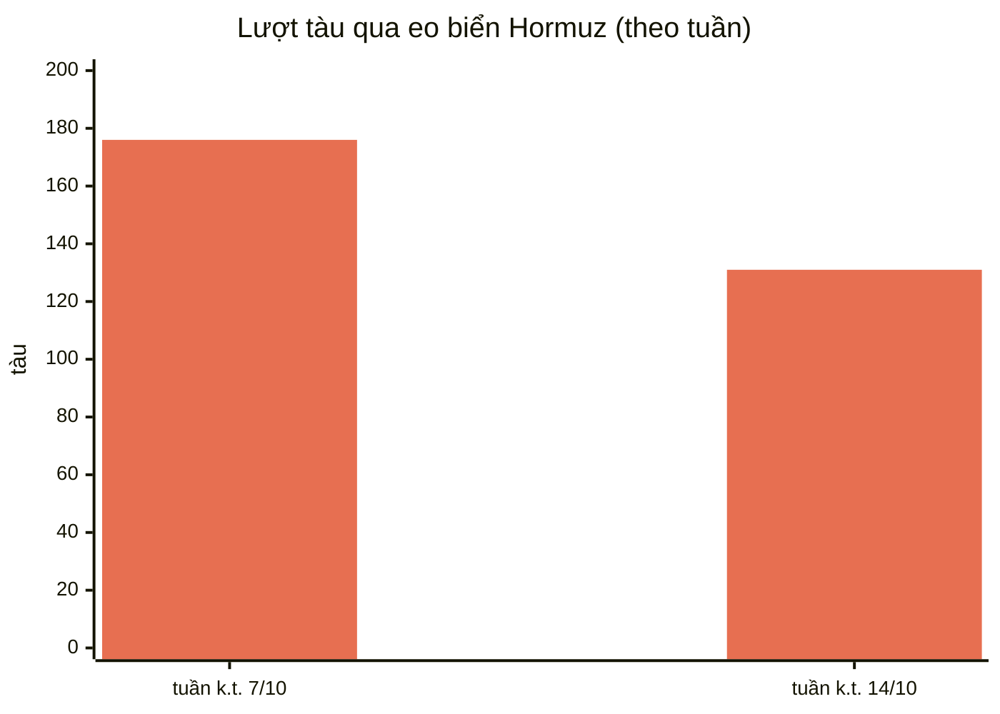

*Ghi chú: Số liệu Kpler; tuần kết thúc ngày 7/10: 176 lượt qua; tuần kết thúc ngày 14/10: 131 lượt qua.*

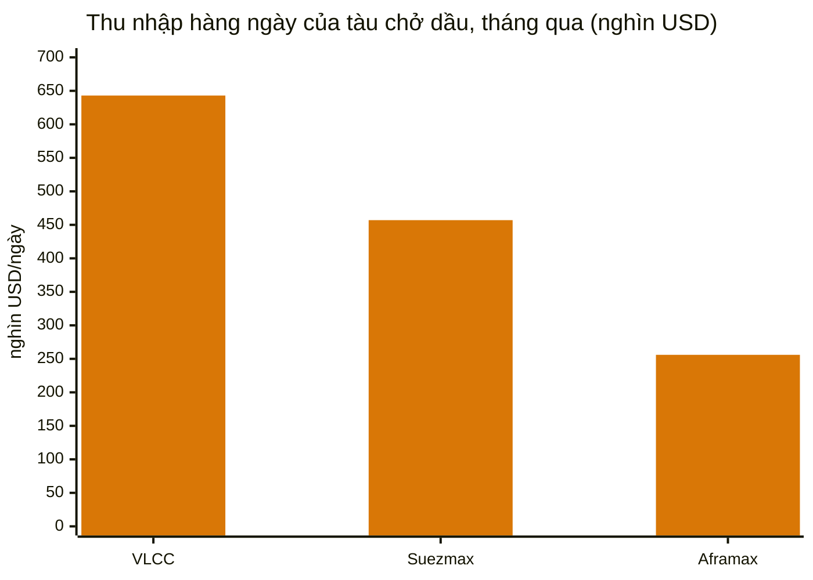

*Ghi chú: Ước tính của công ty môi giới Hartland qua Splash247; VLCC 643.000 USD/ngày, suezmax 457.000 USD/ngày, aframax 256.000 USD/ngày; các chuyến Vùng Vịnh–Trung Quốc của VLCC trên 1,3 triệu USD/ngày (Veson).*

### 3.3 Tháng 9 trị giá 133,5 tỷ USD của Trung Quốc và cơn bùng nổ thương mại AI

Tổng cục Hải quan Trung Quốc báo cáo ngày 14/10 rằng xuất khẩu tháng 9 tăng vọt 36,3% so với cùng kỳ năm trước lên 447,18 tỷ USD — nhanh nhất kể từ tháng 2, vượt dự báo 25,5% — trong khi nhập khẩu tăng 31,0% lên 313,66 tỷ USD. Thặng dư hàng tháng 133,5 tỷ USD là lớn nhất kể từ tháng 1/2025, mức cao nhất 20 tháng. Thặng dư tháng 1–9 đạt 938,5 tỷ USD, đặt năm thứ hai liên tiếp vượt 1 nghìn tỷ USD trong tầm với (kỷ lục năm 2025 là khoảng 1,2 nghìn tỷ USD). Xuất khẩu sang Mỹ tăng 9,8%, với thặng dư song phương ở mức cao nhất 20 tháng khoảng 34 tỷ USD — bất chấp hai năm leo thang thuế quan. Xuất khẩu công nghệ cao, dẫn đầu là chất bán dẫn tăng khoảng 108% từ đầu năm theo số liệu hải quan, đóng góp khoảng một nửa mức tăng xuất khẩu.

Các tổ chức vĩ mô đang cùng đọc một tín hiệu. Báo cáo Triển vọng và Thống kê Thương mại Toàn cầu ngày 8/10 của WTO nâng dự báo khối lượng thương mại hàng hóa 2026 lên 3,9% từ mức 1,9% của tháng 3, với thương mại hàng hóa phục vụ AI tăng 67% so với cùng kỳ năm trước trong nửa đầu năm và chiếm 47% mức tăng giá trị thương mại — 14,8% thương mại hàng hóa thế giới. Lời cảnh báo của Tổng Giám đốc Okonjo-Iweala rất thẳng thắn: "Tác động của AI đang che giấu các xu hướng khác trong thương mại, vốn không tích cực." Báo cáo Thương mại và Phát triển ngày 9/10 của UNCTAD dự báo tăng trưởng toàn cầu 2,6% năm 2026, giảm từ 2,9% năm 2025, và lưu ý thương mại Trung–Mỹ giảm hơn 20% kể từ 2024. Triển vọng Kinh tế Thế giới ngày 13/10 của IMF đặt tăng trưởng toàn cầu 2026 ở mức 3,1% (từ 3,5% năm 2025), với đầu tư AI bù đắp cú sốc năng lượng Trung Đông; kịch bản cơ sở của IMF giả định eo biển Hormuz mở lại vào tháng 3, và ước tính việc đóng cửa đã cắt giảm tăng trưởng toàn cầu khoảng 0,9 điểm phần trăm trước khi các yếu tố bù đắp giảm mức thiệt hại ròng xuống khoảng 0,3 điểm.

**Phân tích:** chu kỳ phần cứng AI đang gánh vác phần lớn khối lượng thương mại thế giới — và một cách không cân xứng là cho Trung Quốc. Nghịch lý của mức tăng 9,8% trong xuất khẩu Trung Quốc sang Mỹ giữa chiến dịch thuế quan phản ánh chuyển tuyến, nhập hàng ồ ạt trước thời điểm áp thuế và sức hút khổng lồ của chi tiêu vốn AI; nó cũng giải thích vì sao cách diễn đạt "tuân thủ" trong thời kỳ đình chiến của Washington khó ăn khớp với dữ liệu.

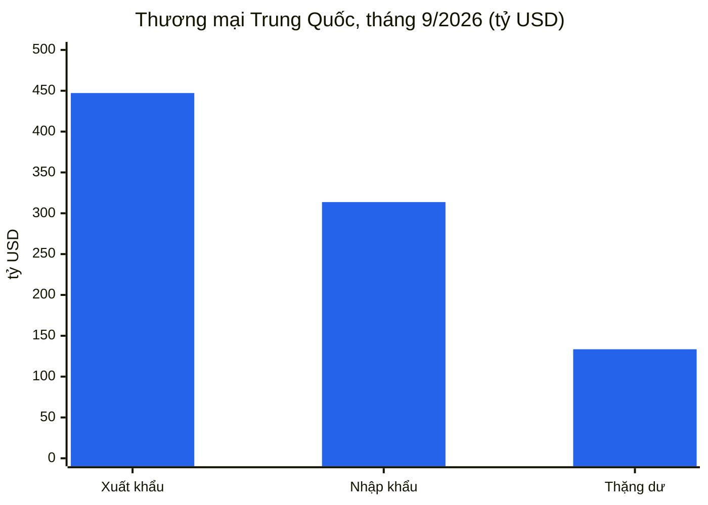

*Ghi chú: Số liệu GACC công bố ngày 14/10; xuất khẩu 447,18 tỷ USD (+36,3% so với cùng kỳ), nhập khẩu 313,66 tỷ USD (+31,0%), thặng dư 133,5 tỷ USD.*

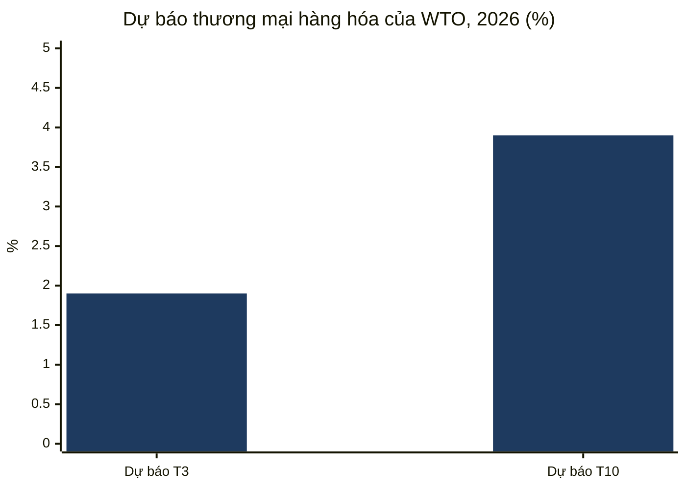

*Ghi chú: Báo cáo Triển vọng và Thống kê Thương mại Toàn cầu của WTO, 8/10/2026; hàng hóa phục vụ AI +67% so với cùng kỳ trong nửa đầu năm, chiếm 47% mức tăng giá trị thương mại.*

### 3.4 Châu Âu định hướng phòng vệ thương mại

Hội nghị thượng đỉnh Hội đồng châu Âu ngày 15–16/10 đưa ra tín hiệu định hướng rõ ràng nhất trong tuần về chính sách thương mại EU. Các nhà lãnh đạo giao cho Ủy ban tiếp tục đối thoại với Bắc Kinh — cuộc họp tiếp theo dự kiến tháng 3/2027 — đồng thời "tận dụng toàn bộ" các biện pháp phòng vệ thương mại hiện có và phát triển các công cụ mới. Bức thư Pháp–Đức ngày 5/10, đề xuất trao cho EU quyền lực "mạnh mẽ như" Mục 301 của Mỹ hay các hạn chế khoáng sản quan trọng của Trung Quốc, đã chi phối cuộc tranh luận: điều tra phòng vệ thương mại nhanh hơn, toàn ngành, hành động khẩn cấp đối với hóa chất, PET và xe hybrid, và trả đũa nhanh hơn đối với các nước gây hại cho khối. Sự chuyển hướng của Đức đáng chú ý — hai năm trước Berlin từng phản đối thuế chống trợ cấp xe điện của EU.

Bối cảnh là đồng thuận 16 điểm của vòng Bắc Kinh ngày 8–9/10 mà hội nghị thượng đỉnh phải diễn giải. Cơ chế Tham vấn Thương mại và Đầu tư lần thứ hai giữa Ủy viên Šefčovič và Bộ trưởng Vương Văn Đào (Wang Wentao) đã đưa ra tuyên bố chung bao gồm một thỏa thuận phù hợp WTO về thương mại xe hybrid (mức trần được cho là 350.000 xe/năm, có thể cắt giảm hơn một nửa xuất khẩu xe hybrid của Trung Quốc), việc Trung Quốc cắt giảm hoàn thuế xuất khẩu xe năng lượng mới xuống 13%, một "kênh ưu tiên" cho giấy phép đất hiếm và nam châm vĩnh cửu, tiếp tục các thủ tục cam kết giá trong vụ kiện chống trợ cấp xe điện của EU, và nghiên cứu cắt giảm thuế MFN đối với khoảng 4 tỷ euro hàng xuất khẩu EU trị giá ít nhất 225 triệu euro tiền thuế tiết kiệm. Văn bản do Bắc Kinh công bố không có con số giảm một nửa đối với xuất khẩu xe hybrid — thông tin được xem xét cho thấy cách diễn đạt của EU và văn bản của Bắc Kinh khác nhau, và cơ chế thực thi chưa được công bố. Thâm hụt thương mại hàng hóa của EU với Trung Quốc đạt 360 tỷ euro (khoảng 400 tỷ USD) năm 2025 và đang trên đà vượt qua con số đó năm 2026.

**Phân tích:** Brussels đang chuyển sang lập trường phòng vệ thương mại cứng rắn và nhanh hơn trong khi vẫn giữ kênh đàm phán mở — cách tiếp cận kép kinh điển. Các trường hợp thử nghiệm sẽ là các ngành khẩn cấp được nêu trong bức thư Pháp–Đức (hóa chất, PET, xe hybrid) và liệu thỏa thuận xe hybrid có chứng tỏ khả thi về thực thi khi không có văn bản chung hay không.

### 3.5 Đất hiếm: bàn cờ Lễ Tạ ơn

Bộ trưởng Tài chính Bessent nói ngày 18/10 trên chương trình Sunday Morning Futures của Fox News rằng Washington hy vọng hoàn tất thỏa thuận đất hiếm Mỹ–Trung "hy vọng" trước Lễ Tạ ơn (27/11). Các điều khoản được đưa tin sẽ yêu cầu Bắc Kinh đình chỉ một số hạn chế xuất khẩu khoáng sản quan trọng trong một năm, với đất hiếm chảy "tự do như trước ngày 4/4" — ngày Trung Quốc áp đặt yêu cầu giấy phép xuất khẩu để đáp trả thuế quan Mỹ. Một hãng tin diễn đạt thỏa thuận như đã đạt được tại cuộc gặp Trump–Tập cuối tháng 10 ở Hàn Quốc; cách diễn đạt đó chưa được xác minh, và chỉ phát biểu của Bessent được xác lập trong thông tin được xem xét.

Tiến trình song song là Quy định Chi nhánh của BIS. Quy định tạm thời cuối cùng ngày 29/9/2025 — bị đình chỉ từ 10/11/2025 đến 9/11/2026 — sẽ tự động mở rộng các hạn chế theo Quy định Quản lý Xuất khẩu (EAR) sang các thực thể nước ngoài mà ít nhất 50% thuộc sở hữu — trực tiếp, gián tiếp hoặc tổng hợp — của các bên trong Danh sách Thực thể, Danh sách Người dùng Cuối Quân sự hoặc một số bên SDN nhất định, kèm nghĩa vụ thẩm tra quyền sở hữu chủ động (Cờ đỏ 29). Với thỏa thuận đình chiến Mỹ–Trung được gia hạn đến 10/1/2027, Crowell & Moring đánh giá ngày 14/10 rằng việc tái áp dụng quy định nên đi theo thỏa thuận đình chiến — nhưng tính đến 14/10, BIS chưa công bố thông báo nào trên Công báo Liên bang gia hạn chính thức việc đình chỉ.

**Phân tích:** hai đồng hồ đang chạy. Đồng hồ chính trị nhắm Lễ Tạ ơn cho một thỏa thuận đất hiếm; đồng hồ quy định có thời hạn tái áp dụng cứng ngày 10/11 đối với Quy định Chi nhánh mà chưa có gia hạn chính thức được công bố. Đội ngũ tuân thủ không thể dựa vào các đánh giá trên báo chí về ý định — quy định tự động có hiệu lực trở lại theo điều khoản của nó trừ khi BIS có hành động.

### 3.6 Đình chiến Mỹ–Trung: giai đoạn tuân thủ, không có đậu nành

Thỏa thuận đình chiến thương mại Mỹ–Trung kéo dài đến 10/1/2027 — một gia hạn hai tháng do Bộ trưởng Bessent công bố ngày 23–24/9, ngắn hơn kỳ vọng sáu đến mười hai tháng của thị trường. Đại diện USTR Greer đã mô tả thời kỳ đình chiến là "giai đoạn tuân thủ" để đánh giá việc Trung Quốc thực hiện các cam kết mua đậu nành và tiếp cận đất hiếm. Thâm hụt thương mại hàng hóa của Mỹ với Trung Quốc đã giảm gần 40% kể từ khi chiến dịch thuế quan bắt đầu, theo Greer.

Về nội dung, khuôn khổ "30-đổi-30" — khoảng 30 tỷ USD hàng hóa không nhạy cảm mỗi bên — không có hiệu lực: Trung Quốc đề xuất 1.619 dòng sản phẩm Mỹ (ngô, thịt, bông, lúa miến, lúa mạch, yến mạch, dầu đậu nành, nhưng không có đậu nành dùng làm thực phẩm hay ép dầu); Mỹ liệt kê 77 dòng thuế (đồ gia dụng, đồ chơi) có thể được hưởng thuế suất thấp hơn. Tính đến giữa tháng 10 chưa có mức thuế hay ngày bắt đầu nào được công bố. Về đậu nành không có cam kết mua mới: Trung Quốc đã cam kết theo một thỏa thuận trước đó mua 25 triệu tấn/năm cho các năm 2026, 2027 và 2028, với số liệu bán hàng xuất khẩu của USDA cho thấy khoảng 10,2 triệu tấn đã cam kết cho vụ mùa 2026–27 tại báo cáo gần nhất, và thuế trả đũa 10% của Trung Quốc đối với đậu nành Mỹ vẫn có hiệu lực, hạn chế khả năng tiếp cận của bên mua tư nhân.

**Phân tích:** thỏa thuận đình chiến là trạng thái chờ, không phải giải pháp. Với thông báo duy trì ngày 7/10 của USTR giữ nguyên mọi mức thuế năm 2018 — Danh mục 1 ở 25% trên ~34 tỷ USD, Danh mục 2 ở 25% trên ~16 tỷ USD, Danh mục 3 ở 25% trên ~200 tỷ USD, Danh mục 4A ở 7,5% trên ~120 tỷ USD — và một đợt rà soát bốn năm lần thứ hai hiện đã mở có thể nâng thuế suất, kiến trúc thuế quan đã ăn sâu bất kể số phận của thỏa thuận đình chiến.

### 3.7 Cước vận chuyển: đợt phục hồi tháng 10 và sự quay lại của Suez

Chỉ số World Container Index của Drewry tăng 3% trong đánh giá ngày 15/10 lên **4.485 USD/FEU** — dẫn dắt bởi châu Á–châu Âu: Thượng Hải–Rotterdam tăng 6% lên 3.522 USD và Thượng Hải–Genoa tăng 7% lên 3.945 USD — lần tăng đầu tiên của châu Á–châu Âu sau 13 tuần giảm liên tiếp. Tuyến xuyên Thái Bình Dương trái chiều: Thượng Hải–Los Angeles +3% lên 7.884 USD, Thượng Hải–New York −1% xuống 10.075 USD. Drewry dự báo biến động ít hơn trong tuần tới. Đà phục hồi theo sau các đợt tăng cước sau Tuần lễ Vàng của các hãng tàu — FAK tuyến châu Á–Bắc Âu mới của MSC có hiệu lực từ ngày 19/10 được ấn định ở 3.150 USD/TEU và 4.500 USD/FEU — và 44 chuyến trống được công bố cho các tuần 43–47 (tỷ lệ hủy 6% trên 713 chuyến dự kiến), với châu Á–Bắc Âu/Địa Trung Hải chiếm 44% số chuyến hủy.

Áp lực cấu trúc đi theo chiều ngược lại. Linerlytica báo cáo tăng trưởng nhu cầu tính theo TEU-dặm suy giảm lần đầu kể từ tháng 1, và việc nối lại Suez nhanh hơn dự kiến — mọi liên minh container cộng MSC sẽ đưa một số tàu qua Biển Đỏ vào cuối tháng 10; lượt quá cảnh Suez trong tuần 39 được cho là cao hơn 68% so với cùng kỳ năm trước — là mối đe dọa chính đối với việc hỗ trợ cước của các hãng tàu. Khoảng 200.000 TEU công suất tàu mới đã được bàn giao trong tháng 9 mà không có tàu nào bị đem phá dỡ. Cước châu Á–châu Âu giảm khoảng 60% kể từ tháng 7, dù vẫn trên 3.000 USD/FEU — cao hơn khoảng 70% so với một năm trước — khi mùa đấu thầu 2027 bắt đầu. Cơ quan Quản lý Kênh đào Panama nâng tổng số lượt đặt chỗ hàng ngày lên 33 có hiệu lực từ 15/10, bổ sung thêm nguồn cung.

Hàng rời khô đi theo hướng ngược lại. Chỉ số Baltic Dry giảm tuần thứ ba liên tiếp xuống 2.511 vào ngày 16/10 — giảm 14% trong tuần và mức thấp nhất kể từ 30/6 — khi chỉ số Capesize giảm 25% so với tuần trước xuống 3.249 (thấp nhất kể từ đầu tháng 4) do quặng sắt yếu, chạm mức thấp hai năm giữa tuần. Panamax giảm 1,8% xuống 2.314; Supramax là điểm sáng duy nhất, tăng 9 điểm lên 1.865.

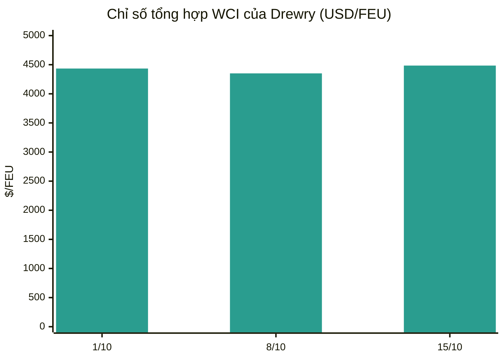

*Ghi chú: Đánh giá thứ Năm của Drewry; 1/10: 4.434 USD (−1%); 8/10: 4.351 USD (−2%); 15/10: 4.485 USD (+3%).*

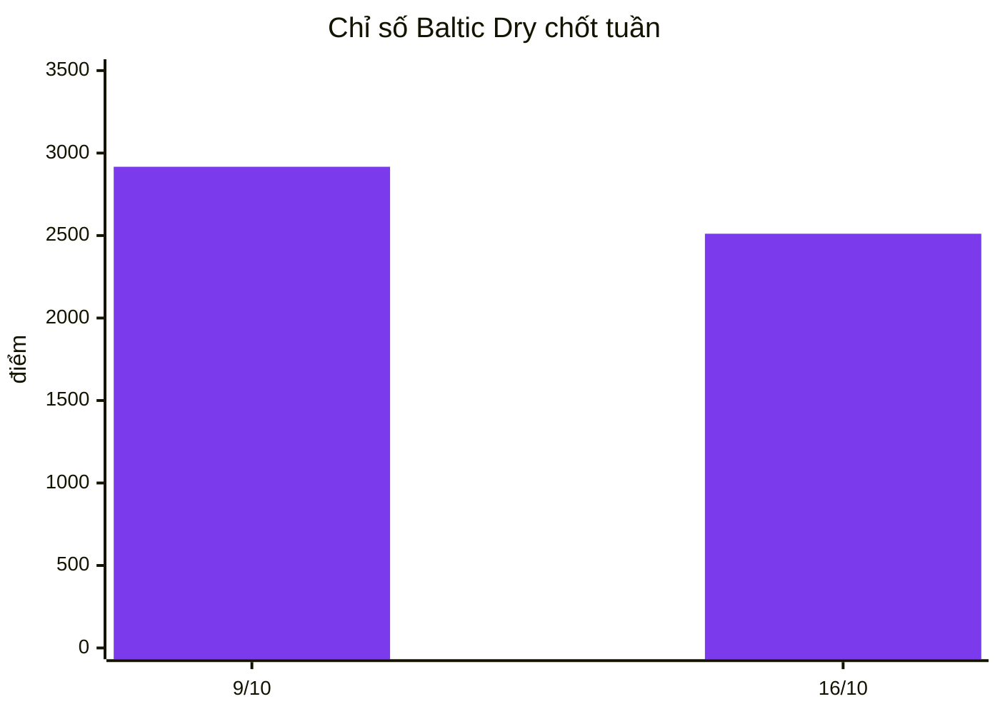

*Ghi chú: Chốt thứ Sáu; 9/10: 2.917 (−7,3% trong tuần); 16/10: 2.511 (−14% trong tuần), thấp nhất kể từ 30/6.*

### 3.8 Gánh nặng thuế quan: các hộ gia đình thực sự phải trả bao nhiêu

Ba ấn phẩm nghiên cứu tuần này đã định lượng gánh nặng thuế quan đối với các hộ gia đình Mỹ. Ước tính theo luật hiện hành của Yale Budget Lab đặt chi phí ở khoảng 1.100 USD/hộ gia đình/năm, phản ánh mức tăng khoảng 0,7% trong mặt bằng giá chung một khi được chuyển đầy đủ vào giá; thuế suất thuế quan bình quân theo luật hiện là 11%, dự kiến đạt 11,8% vào cuối 2026, khiến hộ gia đình trung bình tốn khoảng 92 USD/tháng. Thuế đã thu đạt 7,1% giá trị nhập khẩu trong tháng 8, so với 2,3% tháng 1/2025 — và lẽ ra đã là 10,1% nếu không có hành vi né tránh. Cập nhật ngày 14/10 của Penn Wharton Budget Model cho thấy các mức thuế mới đã mang về 314,8 tỷ USD tổng thu thuế hải quan từ tháng 1/2025 đến tháng 8/2026 (trước hoàn thuế IEEPA), với 60,7 tỷ USD bị mất đi do thay đổi hành vi; thu IEEPA tổng cộng khoảng 166 tỷ USD, tất cả thuộc diện hoàn thuế, với CBP chứng nhận khoảng 126 tỷ USD (76%) tính đến 2/10. Tính đến tháng 7/2026, thuế suất thuế quan hiệu quả bình quân của Mỹ là 6,7% — gấp khoảng ba lần mức 2,3% của tháng 1/2025 — với Trung Quốc chịu 22,8%, thép và nhôm 40,5%, và ô tô 13%. Bảng theo dõi tháng 8 của Tax Foundation đặt mức thuế hiệu quả bình quân 2026 ở 6,6%, cao nhất kể từ 1969, tương đương khoảng 820 USD/hộ gia đình năm 2026.

**Phân tích:** ba mô hình hội tụ về cùng một bức tranh — một chế độ thuế quan nặng gấp khoảng ba lần tháng 1/2025, khiến hộ gia đình trung bình tốn khoảng 1.000 USD/năm, với đường ống hoàn thuế IEEPA (166 tỷ USD thuộc diện hoàn thuế, 126 tỷ USD đã chứng nhận) là khoản chuyển giao tài chính đang chờ xử lý lớn nhất của cuộc chiến thương mại.

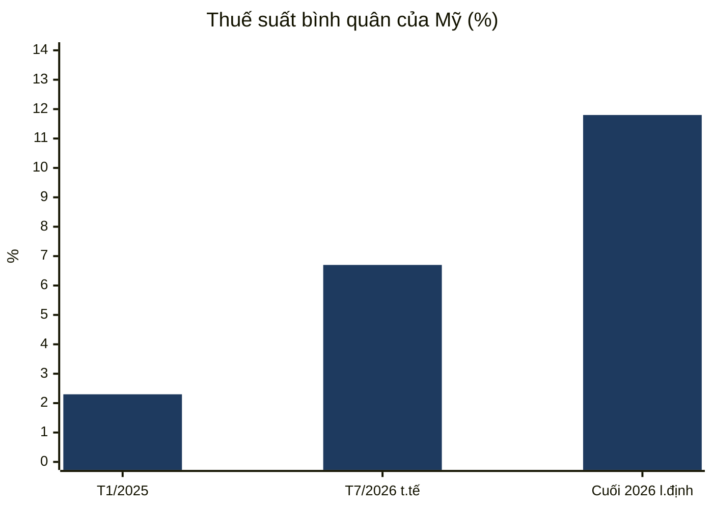

*Ghi chú: T1/2025 hiệu quả 2,3%; T7/2026 hiệu quả 6,7% (Penn Wharton; Tax Foundation 7,2% cho cả năm 2026); cuối 2026 theo luật định 11,8% (Yale Budget Lab).*

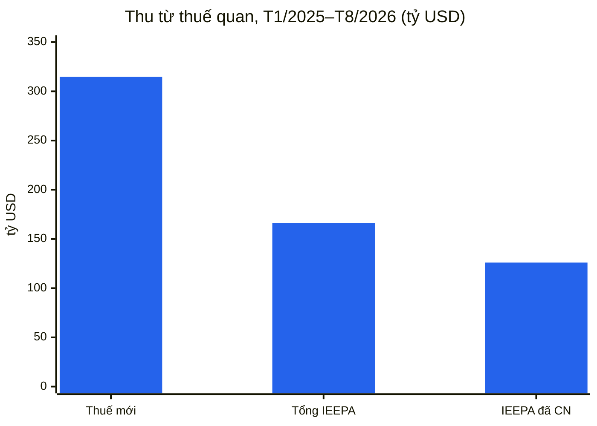

*Ghi chú: Penn Wharton Budget Model, cập nhật ngày 14/10; tổng thu thuế hải quan trước hoàn thuế IEEPA; IEEPA đã chứng nhận = CBP chứng nhận để giải ngân tính đến 2/10.*

---

## 4. Bộ theo dõi thuế quan

| Quốc gia / khối | Biện pháp | Thuế suất | Hiệu lực | Trạng thái | Nguồn |
|---|---|---|---|---|---|
| Hoa Kỳ | Thuế Mục 112/113 Đạo luật Graham + các điều khoản trừng phạt (500% đối với hàng hóa Nga; 100% thứ cấp đối với các bên mua năng lượng Nga hàng đầu và bên tạo điều kiện lách trừng phạt) | Đã miễn trừ — 0% | Miễn trừ ký ngày 16/10/2026; không thời hạn kết thúc | Được miễn trừ theo Mục 115; có thể tái kích hoạt theo quyết định của Tổng thống/Ngoại trưởng; USTR giám sát | [whitehouse.gov](https://www.whitehouse.gov/presidential-actions/2026/10/implementing-the-lindsey-o-graham-sanctioning-russia-and-iran-act-of-2026/) |
| Hoa Kỳ | Mục 232 đối với thiết bị công nghiệp di động đủ điều kiện USMCA (xe nâng, xe ủi, máy xúc, máy kéo, cần cẩu di động) có ≥40% hàm lượng Mỹ | 25% → 15% (đã giảm) | 14/10/2026 | Hướng dẫn tính toán của BIS đã công bố (FR 2026-20938) | [federalregister.gov](https://www.federalregister.gov/public-inspection/2026-20938/guidance-to-us-customs-and-border-protection-regarding-the-assessment-of-us-content-for-purposes-of) |
| Hoa Kỳ | Phí cảng Mục 301 đối với tàu liên quan Trung Quốc (tạm hoãn hết hạn) | Quay về 80 USD/NT (chủ tàu/vận hành tàu Trung Quốc); 23 USD/NT hoặc 153 USD/container (tàu đóng tại Trung Quốc, vận hành bởi bên không phải Trung Quốc); 46 USD/NT (tàu chở xe đóng ngoài Trung Quốc) | 9/11/2026, 11:59 tối giờ ET | Không có gia hạn của USTR tính đến 13/10; hơn 200 hiệp hội đã yêu cầu gia hạn ngày 23/9 | [Gateway Lines](https://gatewaylines.com/press-releases/china-ship-fees-301-exclusions-nov-9-2026) |
| Hoa Kỳ | 178 miễn trừ sản phẩm Mục 301 (HTS 9903.88.69/70) | Danh mục 1/2/3 quay về 25%; Danh mục 4A về 7,5% | 9/11/2026, 11:59 tối giờ ET | Hết hạn; không có thời gian ân hạn | [Thomson Reuters](https://tax.thomsonreuters.com/blog/section-301-exclusions-expiration/) |
| Hoa Kỳ | Các hành động Mục 301 đối với Trung Quốc (2018) được duy trì | Danh mục 1/2: 25%; Danh mục 3: 25%; Danh mục 4A: 7,5% | Có hiệu lực (thông báo duy trì ngày 7/10/2026) | Được duy trì; đợt rà soát bốn năm lần thứ hai mở ngày 6/5/2026 — thuế suất có thể được nâng | [facohub.com](https://facohub.com/posts/weekly-009) |
| Hoa Kỳ | Hành động Mục 301 về lao động cưỡng bức (60 nền kinh tế) | 10% / 12,5% | Có hiệu lực từ 24/7/2026 | Có hiệu lực; vẫn đang kiện tụng tại CIT |  |
| Hoa Kỳ | FMC đề xuất phí đối với tàu treo cờ Tây Ban Nha | 200.000 USD/chuyến + hạn chế nhập khẩu hàng hóa Tây Ban Nha trong danh sách | Đề xuất 16/10/2026 | Giai đoạn đề xuất | [Supply Chain Dive](https://www.supplychaindive.com/news/fmc-proposes-fees-on-spanish-flagged-vessels-import-restrictions/833122/) |
| Trung Quốc | Dự thảo kiểm soát xuất khẩu công nghệ AI (Thông báo số 48) | Công nghệ bị cấm (14) / hạn chế (26) | Tham vấn đến 15/11/2026; đăng ký trước xuất khẩu có hiệu lực ngày 16/10 | Giai đoạn dự thảo | [aiandgpp.com](https://aiandgpp.com/2026/10/19/china-ai-export-controls-model-weights-sovereign-cloud/) |
| Trung Quốc | Cắt giảm hoàn thuế xuất khẩu xe năng lượng mới | Hoàn thuế cắt xuống 13% | Thỏa thuận ngày 8–9/10/2026 | Theo đồng thuận 16 điểm EU–Trung Quốc | [peoplesdaily.pdnews.cn](https://peoplesdaily.pdnews.cn/china/er/30053309352) |
| Trung Quốc | Xuất khẩu xe hybrid sang EU — thỏa thuận phù hợp WTO | Mức trần được cho là 350.000 xe/năm | Thỏa thuận ngày 8–9/10/2026 | Cách diễn đạt của EU; văn bản của Bắc Kinh không có con số | [peoplesdaily.pdnews.cn](https://peoplesdaily.pdnews.cn/china/er/30053309352) |
| EU | Đề xuất công cụ thương mại phản ứng nhanh Pháp–Đức | n/a (đề xuất) | Đề xuất ngày 5/10; thảo luận tại hội nghị thượng đỉnh 15–16/10 | Ủy ban được giao nhiệm vụ phát triển công cụ mới | [985theriver.com](https://985theriver.com/2026/10/05/france-germany-propose-new-rapid-eu-trade-response-tool/) |
| EU | Thỏa thuận thuế quan EU–Mỹ (Quy định 2026/1455, 2026/1461) | Dỡ bỏ thuế EU còn lại đối với hàng công nghiệp Mỹ; biện pháp bảo vệ nếu thuế thép/nhôm của Mỹ vẫn vượt 15% vào ngày 31/12/2026 | Áp dụng 1/7/2026–31/12/2029 | Có hiệu lực; kiến trúc bảo vệ nhiều lớp | [Mondaq](https://www.mondaq.com/italy/export-controls-trade-investment-sanctions/1848092/euus-tariff-agreement-the-new-regulations-and-their-safeguard-architecture) |
| EU | CBAM — ban hội thẩm tranh chấp DS639 của Nga được thành lập | n/a (tranh chấp) | Ban hội thẩm thành lập ngày 3/10/2026 | Giai đoạn ban hội thẩm; EU chỉ tham gia ban hội thẩm | [news.metal.com](https://news.metal.com/newscontent/104143673-wto-establishes-cbam-dispute-panel-at-russias-request) |
| Anh | Thuế xe điện Trung Quốc (tới 45,3%) — quyết định không áp | 0% (giữ lựa chọn cho tương lai) | Quyết định ngày 14/10/2026 | Không áp; hội nghị thượng đỉnh Anh–EU ngày 20/11 | [Fleet News](https://www.fleetnews.co.uk/news/minister-reportedly-resists-calls-for-uk-to-impose-chinese-ev-tariffs) |
| Anh | Chế độ bảo vệ thép (cắt giảm hạn ngạch miễn thuế; thuế 50% ngoài hạn ngạch) | 50% ngoài hạn ngạch | Có hiệu lực 1/7/2026 | Ấn Độ đề nghị miễn trừ cho ~6 nhóm / 88 dòng thép | [buildwatchnews.com](https://buildwatchnews.com/india-seeks-steel-export-exemptions-uk-safeguard-tariffs/) |
| Canada | Thuế tự vệ tạm thời đối với tủ/bồn rửa gỗ (mã 26169A) | 25% | 31/7/2026 (tối đa 200 ngày) | Có hiệu lực; chi tiết công bố ngày 7/10 | [adamcabinet.com](https://www.adamcabinet.com/post-canada-cabinet-surtax.html) |
| Canada | Thuế đối kháng đối với ~900 mặt hàng xuất xứ Mỹ (15/25/50%) | 50% đối với thiết bị bắn cung (9506.99.00) | 8/9/2026 | Có hiệu lực đối với 27,6 tỷ CAD hàng nhập khẩu | [csaaa.org](https://www.csaaa.org/2026/10/15/50-tariffs-on-archery-equipment-hits-canadian-businesses-hard/) |
| Nhật Bản | Mở rộng lệnh cấm xuất khẩu sang Nga (khoáng sản, hóa chất, kim loại, máy móc, dụng cụ chính xác) | Cấm | 16/10/2026 | Có hiệu lực (quyết định Nội các ngày 2/10; sắc lệnh công bố ngày 9/10) | [Steptoe](https://www.steptoe.com/en/news-publications/international-compliance-blog/weekly-sanctions-update-october-13-2026.html) |
| Hàn Quốc | Luật Ngoại thương sửa đổi (căn cứ hạn chế từ 5 → 9) | n/a | 22/10/2026 | Nghị định thi hành được phê duyệt ngày 13/10 | [LinkedIn / Don Southerton](https://www.linkedin.com/pulse/week-review-sunday-october-18-2026-short-version-don-southerton-vkbkc) |
| Ấn Độ | FTA Ấn Độ–New Zealand | NZ: xóa thuế toàn bộ hàng xuất khẩu Ấn Độ từ ngày đầu; Ấn Độ: miễn thuế gỗ tròn, than luyện cốc, phế liệu kim loại | 20/10/2026 | Có hiệu lực | [Karmactive](https://www.karmactive.com/india-new-zealand-free-trade-agreement-2026/) |
| Ấn Độ | Hạn ngạch thép trong FTA với EU | ~1,64 triệu tấn hạn ngạch thuế 0% (~68,4% trong ~2,4 triệu tấn/năm hàng xuất khẩu); phạt 50% vượt hạn ngạch; thuế carbon 35% nếu không có tương đương CBAM | Văn bản FTA (phụ lục ngày 11/9) | Hạn ngạch thấp hơn ~300.000 tấn so với phân bổ vận hành đơn phương tháng 6/2026 của EU | [takshashila.org.in](https://takshashila.org.in/content/blogs/2026-10-12-India-EU-FTA-and-its-steel-challenges.html) |
| Brazil/Mercosur | FTA Mercosur–EFTA | Xóa thuế đối với ~99% giá trị hàng Brazil xuất sang EFTA | 1/10/2026 (Nghị định 13.126) | Có hiệu lực | [datamarnews.com](https://datamarnews.com/noticias/mercosur-efta-trade-agreement-brazil-business-opportunities/) |
| Madagascar | Điều tra tự vệ đối với đường và bánh kẹo sô-cô-la/ca-cao | n/a (điều tra) | Thông báo ngày 9/10; ý kiến đến hạn 9/11/2026 | Điều tra đã thông báo WTO | [freightnews.co.za](https://www.freightnews.co.za/article/madagascar-launches-safeguard-investigation-on-certain-confectionery) |
| Úc | Phê chuẩn FTA Úc–EU | Xóa thuế đối với ~98% hàng xuất khẩu Úc (thịt bò 35.000 tấn; thịt cừu ~31.000 tấn) | Trình quốc hội đầu 2027 | Đảng Quốc gia đe dọa chặn — sẽ là FTA đầu tiên của Úc không được phê chuẩn | [particle.news](https://particle.news/story/coalition-split-threatens-passage-of-australiaeu-10bn-free-trade-deal) |
| Gabon | Lệnh cấm nhập khẩu gia cầm (Mỹ khiếu nại tại WTO) | Cấm | Trong giai đoạn khiếu nại/thảo luận | Chất vấn của Mỹ được ghi nhận ngày 18/9; ~86,3 triệu USD gia cầm đông lạnh nhập khẩu năm 2023 | [malivoice.com](https://malivoice.com/gabons-poultry-import-ban-heads-to-a-wto-dispute-with-washington/) |

---

## 5. Phân tích chuyên sâu chính sách Hoa Kỳ

### Miễn trừ Đạo luật Graham

Được đề cập chuyên sâu trong Mục 2 (A1) và 3.1. Sắc lệnh hành pháp thi hành ngày 16/10 xác định các mức thuế theo luật — 500% đối với hàng hóa xuất xứ Nga, thuế thứ cấp 100% đối với năm nước nhập khẩu dầu thô và khí đốt tự nhiên của Nga lớn nhất thực hiện các giao dịch mua mới kể từ ngày 18/10, và 100% đối với năm bên tạo điều kiện hàng đầu cho hành vi lách trừng phạt — rồi miễn trừ chúng theo Mục 115 kèm chứng nhận vì lợi ích quốc gia bằng văn bản gửi Quốc hội, không thời hạn kết thúc. Các lệnh trừng phạt Nga trước đó theo thẩm quyền khẩn cấp quốc gia vẫn có hiệu lực. USTR được giao nhiệm vụ giám sát việc mua năng lượng Nga. Các chỉ trích lưỡng đảng nổ ra; Nhà Trắng không đưa ra lời giải thích chi tiết công khai.

### BIS — kiểm soát xuất khẩu

**Hướng dẫn "hàm lượng Mỹ" cho thiết bị công nghiệp di động.** Thông báo Công báo Liên bang 2026-20938 (91 FR 65162), công bố và có hiệu lực ngày 14/10, thi hành Điều khoản (2)(D) của Tuyên cáo Tổng thống 11032 (ngày 1/6/2026). Thiết bị công nghiệp di động đủ điều kiện USMCA — xe nâng, xe ủi, máy xúc, máy kéo, cần cẩu di động — được hưởng thuế Mục 232 giảm từ 25% xuống 15% khi có ít nhất 40% giá trị là hàm lượng Mỹ. Hàm lượng Mỹ được định nghĩa là (a) giá trị các bộ phận hoàn toàn thu được, hoàn toàn sản xuất, hoặc chuyển đổi đáng kể tại Hoa Kỳ, cộng (b) giá trị thép nấu chảy-đổ khuôn, nhôm nấu chảy-đúc, và/hoặc đồng nấu chảy-đúc tại Hoa Kỳ, trong phạm vi chưa được tính. Quy định áp dụng đối với hàng hóa nhập để tiêu thụ hoặc rút khỏi kho vào hoặc sau 0:01 sáng giờ ET ngày 14/10/2026. ([federalregister.gov](https://www.federalregister.gov/public-inspection/2026-20938/guidance-to-us-customs-and-border-protection-regarding-the-assessment-of-us-content-for-purposes-of))

**Đình chỉ Quy định Chi nhánh.** Quy định Chi nhánh tạm thời cuối cùng (ngày 29/9/2025), bị đình chỉ từ 10/11/2025 đến 9/11/2026, sẽ tự động mở rộng các hạn chế EAR sang các thực thể nước ngoài mà ít nhất 50% thuộc sở hữu — trực tiếp, gián tiếp hoặc tổng hợp — của các bên trong Danh sách Thực thể, Danh sách Người dùng Cuối Quân sự hoặc một số bên SDN nhất định, kèm nghĩa vụ thẩm tra quyền sở hữu chủ động (Cờ đỏ 29). Sau khi thỏa thuận đình chiến được gia hạn đến 10/1/2027, việc đình chỉ dự kiến được gia hạn theo, nhưng tính đến 14/10 BIS chưa công bố thông báo nào trên Công báo Liên bang gia hạn chính thức việc đình chỉ. ([Mondaq / Crowell & Moring](https://www.mondaq.com/unitedstates/export-controls-trade-investment-sanctions/1854664/us-china-trade-truce-extended-two-months-bis-affiliates-rule-suspension-follows))

### Hoàn thuế IEEPA: Giai đoạn 3 và vụ kiện tập thể

Giai đoạn 3 của CAPE của CBP, triển khai ngày 6/10 theo tuyên bố ngày 15/9 của CBP gửi Tòa án Thương mại Quốc tế, mở hoàn thuế cho các tờ khai IEEPA đã thanh lý cuối cùng — nhưng chỉ cho nhà nhập khẩu ghi danh là nguyên đơn trong các vụ kiện CIT đang chờ xử lý (số IOR nộp trước 30/7/2026; các hồ sơ nộp sau xử lý cuốn chiếu). Giai đoạn 3 bao trùm khoảng 11,4 tỷ USD, tương đương 6,9%, thuế IEEPA. Tính đến 2/10, CAPE đã chấp nhận khoảng 136,6 tỷ USD hoàn thuế tiềm năng và đã chứng nhận; khoảng 126 tỷ USD đã được chứng nhận và gửi Bộ Tài chính để giải ngân; khoảng 20.184 khoản hoàn thuế (~1,3 tỷ USD) bị giữ lại do thiếu thông tin ACH. Hoàn thuế đến 60–90 ngày sau khi chấp nhận, kèm lãi theo 19 CFR 24.36; ACE chấp nhận tải lên CSV tối đa 9.999 tờ khai mỗi khai báo. Riêng ngày 8/10, CIT chứng nhận một vụ kiện tập thể trong vụ *Freestyle World kiện CBP* (Số 26-01088) bao trùm các nhà nhập khẩu ghi danh đã nộp thuế IEEPA từ 1/2/2025 đến 19/2/2026 — nhưng chưa ra lệnh cứu trợ cho tập thể. Chính phủ đã kháng cáo (*V.O.S. Selections kiện Trump*, Số 26-1895, Tòa Phúc thẩm Liên bang), lập luận CIT không thể ra lệnh hoàn thuế cho nhà nhập khẩu không tham gia kiện tụng; kháng cáo chưa được giải quyết. (Nguồn: [Supply Chain Dive](https://www.supplychaindive.com/news/cbp-starts-paying-out-ieepa-tariff-refunds-for-finally-liquidated-entries/832411/), [Thompson Hine](https://www.thompsonhine.com/insights/cbp-confirms-october-6-2026-launch-of-phase-3-of-the-ieepa-tariff-refund-process/), [gingercontrol](https://gingercontrol.com/blog/ieepa-tariff-refund-guide))

### Thời hạn kép ngày 9/11

Hai biện pháp hết hạn lúc 11:59 tối giờ ET thứ Hai, ngày 9/11/2026. Thứ nhất, tạm hoãn một năm phí cảng Mục 301 của USTR đối với tàu liên quan Trung Quốc (FR 2025-19873): phí quay về 80 USD mỗi tấn đăng ký tịnh đối với chủ tàu và vận hành tàu Trung Quốc, mức cao hơn giữa 23 USD/NT hoặc 153 USD mỗi container dỡ xuống đối với tàu đóng tại Trung Quốc do bên vận hành không phải Trung Quốc, và 46 USD/NT đối với tàu chở xe đóng ngoài Trung Quốc. Thứ hai, 178 miễn trừ sản phẩm Mục 301 (FR 2025-21671) khai báo theo HTS 9903.88.69 và 9903.88.70: thuế đối với sản phẩm Danh mục 1/2/3 quay về 25% và Danh mục 4A về 7,5%, không có thời gian ân hạn, và miễn trừ chỉ gỡ bỏ lớp thuế 301 — thuế MFN, 232 và AD/CVD vẫn áp dụng. Tính đến 13/10, chưa có thông báo nào trên Công báo Liên bang dời cả hai thời hạn; hơn 200 hiệp hội thương mại đã viết thư cho USTR ngày 23/9 yêu cầu gia hạn phí cảng. Các nhà giao dịch nên coi ngày 9/11 là thời hạn cuối. (Nguồn: [Gateway Lines](https://gatewaylines.com/press-releases/china-ship-fees-301-exclusions-nov-9-2026), [Thomson Reuters](https://tax.thomsonreuters.com/blog/section-301-exclusions-expiration/))

### USTR

Thông báo duy trì ngày 7/10 (91 FR 64212, Tài liệu FR 2026-20510) xác nhận các hành động Mục 301 ngày 6/7/2018 và 23/8/2018 vẫn có hiệu lực — USTR nhận được 162 yêu cầu duy trì; một yêu cầu cũng đã đủ. Kiến trúc được giữ nguyên: Danh mục 1 ở 25% trên ~34 tỷ USD, Danh mục 2 ở 25% trên ~16 tỷ USD, Danh mục 3 ở 25% trên ~200 tỷ USD (nâng từ 10% ngày 10/5/2019), Danh mục 4A ở 7,5% trên ~120 tỷ USD. Đợt rà soát bốn năm lần thứ hai, mở ngày 6/5/2026, tiếp nối và có thể nâng thuế suất — chu kỳ trước đã nâng chất bán dẫn lên 50% (2025), pin mặt trời lên 50% (2024), và thép/nhôm lên 25% (2024). Một thông báo phù hợp cùng ngày (Tài liệu FR 2026-20511) sửa đổi một miễn trừ cho thay đổi mã thống kê HTS ngày 1/7/2026. Không có thông cáo báo chí nào của USTR trong phạm vi tuần xuất hiện trong tìm kiếm tin tức. ([facohub](https://facohub.com/posts/weekly-009))

### Hoạt động và cưỡng chế của CBP

**Lệnh tạm giữ hàng.** Ngày 29/9, CBP ban hành các WRO đối với dầu cọ và sản phẩm phái sinh từ Mitra Aneka Rezeki (MAR) và Hardaya Inti Plantation (HIP), Indonesia, theo 19 U.S.C. §1307, có hiệu lực ngay. Thông tin được xem xét trích dẫn bản ghi phỏng vấn, phiếu lương, hạn ngạch thu hoạch, ảnh, báo cáo của NGO và chính phủ, tin tức và nghiên cứu học thuật; công nhân tại MAR bị xác định chịu chín chỉ số lao động cưỡng bức của ILO, HIP chịu bảy chỉ số. Tổng số WRO đang hiệu lực hiện là 60, cộng tám Kết luận. ([Thompson Hine](https://www.thompsonhine.com/insights/cbp-issues-withhold-release-orders-on-two-indonesian-palm-oil-producers/))

**Phí người dùng hải quan.** Điều chỉnh năm tài chính 2027 có hiệu lực từ 1/10: Phí Người dùng Giấy phép Môi giới Hải quan tăng từ 185,38 USD lên 190,88 USD; thuế suất phí xử lý hàng hóa giữ nguyên 0,3464%, với mức tối thiểu 34,58 USD và tối đa 670,86 USD (CSMS #69847323; thông báo FR công bố ngày 31/7/2026).

**Hành động của FMC đối với Tây Ban Nha.** Được đề cập trong Cảnh báo A7: sau cuộc điều tra năm 2024 kết luận Tây Ban Nha từ chối cho tàu treo cờ Mỹ cập cảng — hai tàu thuộc Chương trình An ninh Hàng hải của Maersk đã bị từ chối — Ủy ban Hàng hải Liên bang đề xuất phí 200.000 USD/chuyến đối với tàu treo cờ Tây Ban Nha cộng hạn chế nhập khẩu nước hoa và mỹ phẩm, dầu mỡ, gốm sứ, đồ đá, đường và bánh kẹo Tây Ban Nha. ([Supply Chain Dive](https://www.supplychaindive.com/news/fmc-proposes-fees-on-spanish-flagged-vessels-import-restrictions/833122/))

### Công báo Liên bang — AD/CVD, ngày 15/10

Năm thông báo AD/CVD của Bộ Thương mại được công bố ngày 15/10 (chỉ tít báo; nguồn bị chặn trả phí): Mì ống từ Ý (A-475-818) — kết quả sơ bộ và hủy bỏ một phần đợt rà soát hành chính AD 2024–2025; Đinh thép từ Oman (A-523-808) — kết quả sơ bộ và ý định hủy bỏ một phần; Khối đầu bơm thép rèn từ Ý (A-475-840) — quyết định của tòa án không phù hợp và kết quả cuối cùng sửa đổi; Sản phẩm khuôn gỗ và đồ mộc từ Trung Quốc — cả hai thông báo CVD (C-570-118) và AD (A-570-117) về quyết định của tòa án không phù hợp với kết quả cuối cùng sửa đổi. Các mức thuế không hiển thị. ([International Trade Today](https://internationaltradetoday.com/article/2026/10/15/commerce-department-antidumping-and-countervailing-duty-notices-for-oct-15-2610150042))

### Các mục thường xuyên

- **Đình chiến Mỹ–Trung** đến 10/1/2027; khuôn khổ "30-đổi-30" không có hiệu lực; không có cam kết đậu nành mới (xem 3.6).
- **Đất hiếm:** mục tiêu "hy vọng trước Lễ Tạ ơn" của Bessent (xem 3.5 và A8).
- **De minimis:** CBP đình chỉ miễn trừ đối với các lô hàng không qua bưu điện từ 24/6/2026 — bối cảnh, trước phạm vi tuần.
- **Kiện tụng Mục 301 Danh mục 3/4A** đã khép lại (Tòa án Tối cao từ chối xem xét ngày 15/6/2026) — không hoàn thuế theo lý thuyết đó. Hành động Mục 301 đối với chất bán dẫn nút trưởng thành đã được quyết định nhưng hoãn đến tháng 6/2027. Hành động Mục 301 về lao động cưỡng bức (60 nền kinh tế, 10%/12,5%, có hiệu lực từ 24/7/2026) vẫn có hiệu lực và vẫn đang kiện tụng tại CIT.

---

## 6. Chính sách thế giới theo khu vực

### Châu Âu

**Hội nghị thượng đỉnh các nhà lãnh đạo EU (Brussels, 15–16/10).** Các nhà lãnh đạo giao cho Ủy ban tiếp tục đối thoại với Bắc Kinh — cuộc họp tiếp theo dự kiến tháng 3/2027 — đồng thời "tận dụng toàn bộ" các biện pháp phòng vệ thương mại hiện có và phát triển các công cụ mới. Đề xuất Pháp–Đức về công cụ trả đũa phản ứng nhanh, mạnh mẽ như thuế Mục 301 của Mỹ hay các hạn chế khoáng sản quan trọng của Trung Quốc, đã chi phối cuộc tranh luận: điều tra phòng vệ thương mại nhanh hơn, toàn ngành, hành động khẩn cấp đối với hóa chất, PET và xe hybrid, và trả đũa nhanh hơn đối với các nước gây hại cho khối. Thâm hụt thương mại hàng hóa của EU với Trung Quốc đạt 360 tỷ euro (khoảng 400 tỷ USD) năm 2025 và đang trên đà vượt qua con số đó năm 2026. ([bworldonline](https://bworldonline.com/world/2026/10/15/787181/eu-leaders-to-tackle-china-exports-energy-prices-budget-at-summit/))

**Đồng thuận 16 điểm EU–Trung Quốc (Bắc Kinh, 8–9/10).** Cơ chế Tham vấn Thương mại và Đầu tư lần thứ hai giữa Ủy viên Šefčovič và Bộ trưởng Vương Văn Đào (Wang Wentao) đã đưa ra tuyên bố chung: một thỏa thuận phù hợp WTO về thương mại xe hybrid (mức trần được cho là 350.000 xe/năm, có thể cắt giảm hơn một nửa xuất khẩu xe hybrid của Trung Quốc — dù văn bản do Bắc Kinh công bố không có con số); việc Trung Quốc cắt giảm hoàn thuế xuất khẩu xe năng lượng mới xuống 13%; một "kênh ưu tiên" cho giấy phép đất hiếm và nam châm vĩnh cửu; tiếp tục các thủ tục cam kết giá trong vụ kiện chống trợ cấp xe điện của EU; và nghiên cứu cắt giảm thuế MFN đối với khoảng 4 tỷ euro hàng xuất khẩu EU, trị giá ít nhất 225 triệu euro tiền thuế tiết kiệm. Một cuộc họp video cấp bộ trưởng dự kiến tháng 1/2027 và vòng tham vấn thứ ba vào tháng 3/2027. ([peoplesdaily.pdnews.cn](https://peoplesdaily.pdnews.cn/china/er/30053309352))

**Anh quyết định không áp thuế xe điện Trung Quốc (ngày 14/10).** Bộ trưởng Kinh doanh Jonathan Reynolds nói với The Guardian rằng Anh sẽ không chiều theo áp lực của EU để áp thuế tương đương EU tới 45,3% đối với xe điện Trung Quốc: các quyết định phòng vệ thương mại "dựa trên lợi ích của Anh — không dựa trên yêu cầu của bất kỳ quốc gia nào khác." Thuế quan vẫn là "một lựa chọn trong tương lai"; hội nghị thượng đỉnh Anh–EU dự kiến ngày 20/11 tại Brussels. Quyết định được đưa ra sau các tin ngày 4–7/10 rằng Reynolds đang soạn gói thuế 45% tương ứng, điều mà chính phủ nhấn mạnh là chưa quyết định. ([Fleet News](https://www.fleetnews.co.uk/news/minister-reportedly-resists-calls-for-uk-to-impose-chinese-ev-tariffs))

**Biện pháp bảo vệ thép của Anh và đề nghị miễn trừ của Ấn Độ.** Ấn Độ đang đề nghị miễn trừ thép khỏi chế độ bảo vệ mới của Anh (có hiệu lực từ 1/7/2026: cắt giảm hạn ngạch thép miễn thuế, thuế 50% ngoài hạn ngạch) cho khoảng sáu nhóm sản phẩm bao trùm 88 dòng thép. Riêng đợt thúc đẩy thực thi CETA Ấn Độ–Anh ngày 12–13/10 — Ủy ban Kinh tế và Thương mại hỗn hợp đầu tiên kể từ khi thỏa thuận có hiệu lực ngày 15/7 — công bố hơn 1 tỷ bảng Anh các thương vụ mới tại Bengaluru, với Chợ CETA tại Mumbai và phái đoàn doanh nghiệp Anh khoảng 200 công ty. (Nguồn: [buildwatchnews](https://buildwatchnews.com/india-seeks-steel-export-exemptions-uk-safeguard-tariffs/), [pravasisamwad](https://pravasisamwad.com/india-uk-trade-deal-expected-to-boost-exports-jobs-and-business-opportunities/))

**Hạn ngạch thép hụt trong FTA Ấn Độ–EU.** Phân tích văn bản FTA công bố ngày 12/10 cho thấy Ấn Độ nhận được hạn ngạch thép khoảng 1,64 triệu tấn — bao trùm khoảng 68,4% trong ~2,4 triệu tấn/năm hàng xuất khẩu sang EU với thuế 0%, kèm phạt 50% vượt hạn ngạch — nhưng Phụ lục FTA ngày 11/9 chốt mức cơ sở thấp hơn khoảng 300.000 tấn so với phân bổ vận hành đơn phương tháng 6/2026 của EU. Mọi hàng xuất khẩu vẫn chịu thuế carbon 35% trừ khi Ấn Độ đạt được tương đương CBAM. ([Takshashila](https://takshashila.org.in/content/blogs/2026-10-12-India-EU-FTA-and-its-steel-challenges.html))

**Đà Mercosur.** Quyền Bộ trưởng Brazil Márcio Elias Rosa nói ngày 13/10 rằng xuất khẩu Brazil sang EU tăng 30,7% trong tháng 5–9 (xuất khẩu tháng 1–9 đạt 44,17 tỷ USD, +20%), với thương mại song phương Mercosur–EU tăng hơn 6 tỷ USD kể từ khi có hiệu lực. ApexBrasil vận động các nghị sĩ châu Âu tại Brussels ngày 12–16/10 để xếp lịch bỏ phiếu phê chuẩn của Nghị viện châu Âu. Xuất khẩu nông-công nghiệp của Argentina sang EU đạt 1,92 tỷ USD trong tháng 5–8, +21% (+44% đối với các sản phẩm hưởng ưu đãi thuế). FTA Mercosur–EFTA của Brazil có hiệu lực ngày 1/10 (Nghị định 13.126), xóa thuế đối với khoảng 99% giá trị hàng Brazil xuất sang EFTA. ([datamarnews](https://datamarnews.com/noticias/mercosur-eu-trade-deal-boosts-brazilian-exports-by-30-7/))

**Tranh chấp vận tải biển EU ETS.** Hiệp hội Cảng Anh bác bỏ kết luận của Đài quan sát EU ETS Tây Ban Nha rằng tăng trưởng container của Anh phản ánh việc né tránh chi phí carbon, thay vào đó quy tăng trưởng cho đầu tư — 85% tăng trưởng năm 2025 tập trung tại London sau khi DP World khánh thành bến thứ tư trị giá 350 triệu bảng tại London Gateway cuối 2024 — và tái cấu trúc liên minh (Maersk chuyển Gemini từ Felixstowe sang London Gateway). Dữ liệu chính phủ Anh cho thấy các cảng xử lý nhiều hơn 11% container năm 2025 (+600.000 đơn vị); London Gateway vượt 3 triệu TEU (+52% từ 1,9 triệu). Nghiên cứu của Tây Ban Nha cho thấy thị phần của Anh trong hoạt động viễn dương Bắc Âu (TEU-dặm) tăng từ 17,5% năm 2023 lên khoảng 36% trong quý 1/2026, với 76% thay đổi tuyến đường được cho là do EU ETS. Ủy ban đề xuất tháng 7 rằng các cảng ngoài EU trong phạm vi 150 hải lý của một cảng EU có thể bị loại khỏi định nghĩa "cảng ghé" của ETS, với ngưỡng trung chuyển cắt từ 65% xuống 50%. (Nguồn: [Splash247](https://splash247.com/uk-ports-hit-back-at-brussels-over-ets-diversion-claims/), [The Loadstar](https://theloadstar.com/uk-port-volume-growth-not-due-to-eu-shippers-avoiding-ets-says-bpa/))

### Trung Quốc

**Dự thảo kiểm soát xuất khẩu AI.** Được đề cập trong Cảnh báo (A4) và Mục 3.4: Thông báo số 48 ngày 16/10 mở tham vấn đến 15/11 về việc bổ sung 40 công nghệ vào danh mục bị cấm/hạn chế (14 cấm, 26 hạn chế; 23 công nghệ liên quan AI), với các ngưỡng gồm trọng số LLM trên 2 nghìn tỷ tham số, huấn luyện trên 10²⁶ FLOPs, hoặc mô hình xếp top 10 toàn cầu; yêu cầu đăng ký trước xuất khẩu có hiệu lực ngay, kể cả đối với các thương vụ đang thực hiện. Truy cập API/SaaS được loại trừ; triển khai tại chỗ ở nước ngoài bị điều chỉnh. ([aiandgpp.com](https://aiandgpp.com/2026/10/19/china-ai-export-controls-model-weights-sovereign-cloud/))

**Đồng thuận EU–Trung Quốc.** Được đề cập trong Mục 3.4: thỏa thuận xe hybrid (mức trần được cho là 350.000/năm), cắt giảm hoàn thuế xe năng lượng mới xuống 13%, kênh ưu tiên đất hiếm, nghiên cứu MFN đối với ~4 tỷ euro hàng xuất khẩu EU.

**Trung Quốc mở cuộc điều tra chống bán phá giá đối với p-nitrotoluene của EU** (kéo dài từ phạm vi tuần trước) — bối cảnh cho ngành hóa chất hiện được nêu trong danh sách hành động khẩn cấp Pháp–Đức.

### Ấn Độ

**FTA Ấn Độ–New Zealand có hiệu lực ngày 20/10.** New Zealand xóa toàn bộ thuế đối với hàng xuất khẩu Ấn Độ từ ngày đầu; Ấn Độ miễn thuế cho gỗ tròn, than luyện cốc và phế liệu kim loại của New Zealand (nông nghiệp vẫn được bảo vệ bằng hạn ngạch); khung đầu tư 20 tỷ USD; 5.000 thị thực lao động tay nghề hàng năm cộng 1.000 thị thực kỳ nghỉ-làm việc. Một động thái tự do hóa hiếm hoi trong một năm bảo hộ. ([Karmactive](https://www.karmactive.com/india-new-zealand-free-trade-agreement-2026/))

**Đề nghị miễn trừ biện pháp bảo vệ thép của Anh và hạn ngạch thép hụt trong FTA với EU** — xem phần Châu Âu ở trên.

### Thổ Nhĩ Kỳ

Không có biện pháp nào của chính phủ Thổ Nhĩ Kỳ trong phạm vi tuần xuất hiện; quan hệ đối tác ngày 30/9 của TradeInt với Bộ Thương mại Thổ Nhĩ Kỳ (khoản tài trợ cho các công ty tư vấn địa phương tiếp cận hồ sơ lô hàng, tờ khai hải quan và dữ liệu B/L trên 200+ quốc gia) nằm ngay ngoài phạm vi và được ghi trong mục thông tin nhà cung cấp.

### Canada

**Cưỡng chế bảo vệ và thuế đối kháng.** Chi tiết Thông báo 26-17 của CBSA (bản giải thích công bố ngày 7/10): thuế tự vệ tạm thời 25% đối với tủ và bồn rửa gỗ từ 31/7 trong tối đa 200 ngày (mã bảo vệ 26169A). Hiệp hội Vũ khí và Đạn dược Thể thao Canada báo cáo ngày 15/10 rằng thiết bị bắn cung (mặt hàng thuế 9506.99.00) hiện chịu thuế đối kháng 50% có hiệu lực từ 8/9 theo gói thuế đối kháng ~900 mặt hàng, 15/25/50% đối với hàng xuất xứ Mỹ bao trùm 27,6 tỷ CAD hàng nhập khẩu, có hiệu lực từ 8/9. Các ưu tiên xác minh của CBSA đã chuyển mạnh sang các lệnh thuế phụ thu (xe điện/thép/nhôm Trung Quốc; Mỹ 2025-1, thép/nhôm, xe cơ giới). (Nguồn: [adamcabinet.com](https://www.adamcabinet.com/post-canada-cabinet-surtax.html), [csaaa.org](https://www.csaaa.org/2026/10/15/50-tariffs-on-archery-equipment-hits-canadian-businesses-hard/))

**Ổn định lao động tại Cảng Montreal.** Một thỏa thuận tập thể năm năm mới cho hơn 1.200 công nhân bốc xếp (CUPE 375), bao trùm giai đoạn 2024–2028 có hiệu lực hồi tố, được ấn định bằng trọng tài phân xử bắt buộc sau các cuộc đình công năm 2024 đã làm gián đoạn chuỗi cung ứng phục vụ ~110 triệu người — ổn định nhiều năm tại một cửa ngõ quan trọng Canada–Mỹ. ([newswire.ca](https://www.newswire.ca/news-releases/a-new-five-year-collective-agreement-takes-effect-ensuring-stability-at-the-port-of-montreal-841357271.html))

### Nhật Bản

**Mở rộng lệnh cấm xuất khẩu sang Nga (có hiệu lực ngày 16/10).** METI bổ sung khoáng sản, hóa chất, kim loại, máy móc, thiết bị công nghiệp và dụng cụ chính xác vào danh sách cấm xuất khẩu theo Luật Ngoại hối và Ngoại thương, sau quyết định Nội các ngày 2/10; Sắc lệnh Kiểm soát Thương mại Xuất khẩu sửa đổi được công bố ngày 9/10. ([Steptoe](https://www.steptoe.com/en/news-publications/international-compliance-blog/weekly-sanctions-update-october-13-2026.html))

### Hàn Quốc

**Luật Ngoại thương sửa đổi có hiệu lực ngày 22/10.** Nghị định thi hành, được Nội các phê duyệt ngày 13/10, mở rộng các căn cứ cho phép hạn chế thương mại từ năm lên chín, bổ sung an ninh quốc gia, thông tin cá nhân và doanh nghiệp, đạo đức công cộng và bảo vật quốc gia; một thông báo công khai thi hành sẽ được ban hành sau. Riêng Thông báo Công khai sửa đổi của MOTIR về Thương mại Hàng hóa Chiến lược (có hiệu lực từ 1/9) siết chặt yêu cầu thông tin người dùng cuối, bán lại và điểm đến cuối cùng đối với hàng hóa lưỡng dụng. ([LinkedIn / Don Southerton](https://www.linkedin.com/pulse/week-review-sunday-october-18-2026-short-version-don-southerton-vkbkc))

### ASEAN và Úc

**Cuộc chiến phê chuẩn FTA Úc–EU (18–19/10).** Đảng Quốc gia cho biết sẽ tìm cách chặn thỏa thuận trị giá khoảng 10 tỷ AUD — xóa thuế đối với khoảng 98% hàng xuất khẩu Úc, với hạn ngạch thịt bò 35.000 tấn và thịt cừu khoảng 31.000 tấn — khi nó được trình quốc hội đầu năm tới; đây sẽ là FTA đầu tiên của Úc không được phê chuẩn. Bộ trưởng Thương mại Don Farrell kêu gọi các nghị sĩ và doanh nghiệp ủng hộ thỏa thuận ngày 12/10. ([particle.news](https://particle.news/story/coalition-split-threatens-passage-of-australiaeu-10bn-free-trade-deal))

**Biện pháp tự vệ của Madagascar.** Cuộc điều tra tự vệ đã thông báo WTO đối với bánh kẹo đường và bánh kẹo sô-cô-la/ca-cao (thông báo ngày 9/10; ý kiến đến hạn 9/11/2026). ([freightnews.co.za](https://www.freightnews.co.za/article/madagascar-launches-safeguard-investigation-on-certain-confectionery))

### Đa phương

**Triển vọng và Thống kê Thương mại Toàn cầu của WTO (ngày 8/10).** Được đề cập trong Mục 3.3: dự báo khối lượng thương mại hàng hóa nâng lên +3,9% cho năm 2026 (từ 1,9% tháng 3) và 4,1% cho năm 2027; hàng hóa phục vụ AI +67% so với cùng kỳ năm trước trong nửa đầu năm, chiếm 47% mức tăng giá trị thương mại và đạt 14,8% thương mại hàng hóa thế giới. Dịch vụ bị hạ xuống +3,3% năm 2026 (từ 4,8%) — vận tải +0,9%, du lịch +0,2% — do chi phí nhiên liệu hàng không cao hơn từ xung đột Trung Đông. Rủi ro: gián đoạn Hormuz, Ukraine, đầu tư AI chậm lại. ([Reuters](https://www.reuters.com/world/asia-pacific/wto-upgrades-goods-trade-forecast-ai-boom-offsets-middle-east-disruption-2026-10-08/))

**Báo cáo Thương mại và Phát triển 2026 của UNCTAD (ngày 9/10): "Địa kinh tế của Phát triển."** Tăng trưởng toàn cầu dự báo 2,6% năm 2026 (giảm từ 2,9% năm 2025); thương mại hàng hóa và dịch vụ tăng khoảng 4% theo giá cố định sau mức kỷ lục 35 nghìn tỷ USD năm 2025, mức tăng một phần do giá năng lượng cao hơn. Các số liệu chính: thương mại Trung–Mỹ giảm hơn 20% kể từ 2024; châu Á đóng góp 59% tăng trưởng toàn cầu — Ấn Độ +7,3%, Trung Quốc +4,5%, Indonesia +5,2%. Báo cáo cảnh báo lợi ích thương mại do AI thúc đẩy không chuyển thành lợi ích phát triển rộng khắp và rằng kiểm soát xuất khẩu và sàng lọc đầu tư đang loại bỏ các bên tham gia mới. ([Reuters](https://www.reuters.com/world/asia-pacific/world-economic-growth-slow-26-2026-un-trade-body-says-2026-10-09/))

**Tranh chấp WTO.** Cơ quan Giải quyết Tranh chấp thành lập ban hội thẩm DS639 theo yêu cầu của Nga (ngày 3/10) — yêu cầu thứ hai của Nga sau khi EU chặn yêu cầu đầu tháng 7/2025 — thách thức CBAM và phân bổ miễn phí ETS cho doanh nghiệp EU như rào cản thương mại và trợ cấp xuất khẩu bị cấm; EU gọi CBAM là phù hợp WTO và sẽ chỉ tham gia ban hội thẩm. Mỹ lại chặn các bổ nhiệm Cơ quan Phúc thẩm. DSB hoãn thông qua báo cáo ban hội thẩm trong vụ Trung Quốc kiện Thổ Nhĩ Kỳ về thuế xe điện/cấp phép nhập khẩu đến 27/10, và phán quyết vụ Ấn Độ–Đài Loan về thuế ICT (ban hội thẩm tháng 4/2023, kết luận thuế ICT 7,5%→20% của Ấn Độ vi phạm cam kết) đối mặt với lần hoãn thứ chín, thời hạn thông qua giờ là 27/10. Mỹ thách thức lệnh cấm nhập khẩu gia cầm của Gabon (chất vấn được ghi nhận tại Hội đồng Bộ trưởng Libreville ngày 18/9; ~86,3 triệu USD gia cầm đông lạnh nhập khẩu năm 2023); vụ việc đang trong giai đoạn thảo luận. (Nguồn: [news.metal.com](https://news.metal.com/newscontent/104143673-wto-establishes-cbam-dispute-panel-at-russias-request), [TWN](https://www.twn.my/title2/wto.info/2026/ti260923.htm), [malivoice](https://malivoice.com/gabons-poultry-import-ban-heads-to-a-wto-dispute-with-washington/), [eximguru](https://eximguru.com/export-import-news/import-duty/wto-accepts-india-and-taiwan-115907.aspx))

**Các ủy ban WTO.** Ủy ban Tiếp cận Thị trường (12–13/10) ghi nhận kỷ lục 36 quan ngại thương mại, tám quan ngại mới, với báo cáo đầu tiên của Ban Thư ký về giải quyết các quan ngại cho thấy công việc của ủy ban đang giải quyết tranh chấp mà không cần kiện tụng chính thức. Ủy ban Quy tắc Xuất xứ (7–8/10) rà soát ưu đãi cho các nước kém phát triển nhất: 22 thành viên cung cấp ưu đãi; Mỹ báo cáo ưu đãi AGOA và Haiti được gia hạn đến tháng 9/2028; Trung Quốc trình bày nghiên cứu về sử dụng ưu đãi của LDC. Hội đồng Chung (5–6/10) thúc đẩy cải cách trước MC15 — "từ quy trình sang nội dung": cải cách giải quyết tranh chấp tiếp tục dưới sự chủ trì của Chủ tịch Patriota; các thỏa thuận tạm thời của Hiệp định Thương mại điện tử được thảo luận (Ấn Độ đặt câu hỏi pháp lý về vai trò lưu chiểu của Tổng Giám đốc); IFDA có 131 thành viên tham gia; Hiệp định Trợ cấp Thủy sản đối mặt nguy cơ "hết hiệu lực." (Nguồn: [thehonanews](https://www.thehonanews.com/2026/10/16/report-underlines-value-of-wto-committee-in-helping-resolve-market-access-trade-concerns/), [freightnews.co.za](https://www.freightnews.co.za/article/rules-of-origin-roo-committee-reviews-ldc-preferences-shares-best-practices), [devdiscourse](https://www.devdiscourse.com/article/business/3988145-wto-reform-takes-centre-stage-as-members-push-for-progress-on-trade-and-digital-rules))

**WCO.** Ngày 9/10, WCO ra mắt Nền tảng e-CENcomm Thực thi kín với 128 Điểm liên lạc Quốc gia từ 105 cơ quan hải quan, sau khi Báo cáo Thương mại Bất hợp pháp 2025 cho thấy thương mại điện tử chiếm khoảng 50% các vụ thương mại bất hợp pháp được báo cáo. Ngày 16/10, Tổng Thư ký GCC Albudaiwi và Tổng Thư ký WCO Saunders ký phụ lục đưa Cơ quan Liên minh Hải quan GCC thành cơ quan hợp tác chủ chốt (xuất khẩu nội GCC vượt 177 tỷ USD năm 2025). ([gccscope](https://gccscope.com/gcc-and-wco-sign-addendum-to-advance-gulf-customs-union-framework/))

---

## 7. Hành động cưỡng chế

| Hành động | Cơ quan / diễn đàn | Ngày | Chi tiết | Nguồn |
|---|---|---|---|---|
| Sắc lệnh hành pháp Đạo luật Graham miễn trừ các điều khoản thuế quan và trừng phạt | Nhà Trắng (miễn trừ Mục 115) | 16/10/2026 | Các điều khoản thuế và trừng phạt được miễn trừ không thời hạn; các lệnh trừng phạt Nga trước đó được giữ nguyên; USTR giám sát | [whitehouse.gov](https://www.whitehouse.gov/presidential-actions/2026/10/implementing-the-lindsey-o-graham-sanctioning-russia-and-iran-act-of-2026/) |
| Gói Nga của Anh: 38 mục tiêu gồm Zarubezhneft, INK Capital, 12 tàu chở dầu đội tàu bóng đêm | Chính phủ Anh | 8/10/2026 | Anh hiện trừng phạt hơn 600 tàu chở dầu đội tàu bóng đêm; tuyên bố hơn 90% công suất sản xuất dầu của Nga bị trừng phạt | [gCaptain](https://gcaptain.com/uk-tightens-russian-oil-sanctions-as-u-s-weighs-relief/) |
| EU nhắm vào các xưởng đóng tàu lớn của Nga | Quy định EU | Công bố ngày 12/10, có hiệu lực cùng ngày | Chi tiết mỏng trong tin đưa |  |
| Nhật Bản mở rộng lệnh cấm xuất khẩu sang Nga | METI / Nội các | Có hiệu lực 16/10/2026 | Khoáng sản, hóa chất, kim loại, máy móc, thiết bị công nghiệp, dụng cụ chính xác | [Steptoe](https://www.steptoe.com/en/news-publications/international-compliance-blog/weekly-sanctions-update-october-13-2026.html) |
| WRO của CBP đối với dầu cọ Indonesia (MAR, HIP) | CBP, 19 U.S.C. §1307 | 29/9/2026 | Lần lượt 9 và 7 chỉ số lao động cưỡng bức của ILO; WRO đang hiệu lực hiện là 60 + 8 Kết luận | [Thompson Hine](https://www.thompsonhine.com/insights/cbp-issues-withhold-release-orders-on-two-indonesian-palm-oil-producers/) |
| CIT chứng nhận vụ kiện tập thể IEEPA (*Freestyle World kiện CBP*) | Tòa án Thương mại Quốc tế | 8/10/2026 | Vụ kiện tập thể được chứng nhận cho các IOR đã nộp thuế IEEPA từ 1/2/2025–19/2/2026; chưa ra lệnh cứu trợ; chính phủ kháng cáo | [gingercontrol](https://gingercontrol.com/blog/ieepa-tariff-refund-guide) |
| CAPE Giai đoạn 3 bắt đầu chi trả hoàn thuế IEEPA cho các tờ khai đã thanh lý cuối cùng | CBP | Triển khai 6/10/2026 | ~11,4 tỷ USD (6,9% thuế IEEPA); chỉ các IOR là nguyên đơn CIT; ~126 tỷ USD đã chứng nhận tính đến 2/10 | [Supply Chain Dive](https://www.supplychaindive.com/news/cbp-starts-paying-out-ieepa-tariff-refunds-for-finally-liquidated-entries/832411/) |
| FMC đề xuất phí 200.000 USD/chuyến đối với tàu treo cờ Tây Ban Nha | Ủy ban Hàng hải Liên bang | Đề xuất 16/10/2026 | Trả đũa việc Tây Ban Nha từ chối cho tàu treo cờ Mỹ cập cảng; hạn chế nhập khẩu hàng hóa Tây Ban Nha trong danh sách | [Supply Chain Dive](https://www.supplychaindive.com/news/fmc-proposes-fees-on-spanish-flagged-vessels-import-restrictions/833122/) |
| Ban hội thẩm CBAM DS639 của WTO được thành lập theo yêu cầu của Nga | DSB của WTO | 3/10/2026 | Nga thách thức CBAM + phân bổ miễn phí ETS; EU chỉ tham gia ban hội thẩm | [news.metal.com](https://news.metal.com/newscontent/104143673-wto-establishes-cbam-dispute-panel-at-russias-request) |
| Mỹ thách thức lệnh cấm nhập khẩu gia cầm của Gabon | WTO | Chất vấn được ghi nhận 18/9/2026 | Giai đoạn thảo luận; chưa có phán quyết | [malivoice](https://malivoice.com/gabons-poultry-import-ban-heads-to-a-wto-dispute-with-washington/) |
| Đức chặn đề nghị của Cosco mua Zippel vì lo ngại an ninh | Chính phủ Đức | ~12–18/10/2026 (tít báo JOC) | Sàng lọc đầu tư vào tài sản cảng |  |
| Mỹ trừng phạt thêm 22 tàu chở dầu (liên quan Hormuz) | Bộ Tài chính Mỹ/OFAC | 8/10/2026 | Bối cảnh đỉnh tấn công tàu chở dầu theo tuần |  |

---

## 8. Số liệu công bố

| Số liệu công bố | Cơ quan công bố | Ngày | Số liệu chính | Nguồn |
|---|---|---|---|---|
| Thương mại quốc tế Mỹ, tháng 8/2026 | Cục Điều tra Dân số / BEA | Công bố ~7–9/10 | Thâm hụt hàng hóa-dịch vụ nới rộng 13,7% lên 105,6 tỷ USD (lớn nhất kể từ tháng 3/2025); nhập khẩu kỷ lục 420,8 tỷ USD (+4,3%); xuất khẩu 315,2 tỷ USD (+1,4%); thâm hụt hàng hóa −136,6 tỷ USD; thặng dư dịch vụ +31,0 tỷ USD; thâm hụt từ đầu năm −557,0 tỷ USD (−19,9% so với 2025). Goldman cắt giảm dự báo GDP quý 3 đi 0,3 điểm phần trăm xuống 3,1% | [businessday.co.za](https://www.businessday.co.za/world/americas/2026-10-06-us-trade-balance-sinks-deeper-into-the-red-as-imports-hit-record-high/) |
| Thương mại hàng hóa sơ bộ Mỹ, tháng 9/2026 | Cục Điều tra Dân số | 30/9 | Thâm hụt hàng hóa sơ bộ nới rộng lên 132,6 tỷ USD; nhập khẩu +17,4 tỷ USD lên 336,1 tỷ USD; xuất khẩu +3,7 tỷ USD lên 203,4 tỷ USD; động lực: dầu mỏ/vật tư công nghiệp, hàng hóa vốn hạ tầng AI | [particle.news](https://particle.news/story/us-goods-trade-deficit-widens-to-1326-billion) |
| Thương mại Trung Quốc, tháng 9/2026 | GACC | 14/10 | Xuất khẩu +36,3% so với cùng kỳ lên 447,18 tỷ USD; nhập khẩu +31,0% lên 313,66 tỷ USD; thặng dư 133,5 tỷ USD (cao nhất 20 tháng); thặng dư tháng 1–9 đạt 938,5 tỷ USD; xuất khẩu sang Mỹ +9,8%, thặng dư song phương ~34 tỷ USD (cao nhất 20 tháng); chất bán dẫn ~+108% từ đầu năm | [tradingview](https://www.tradingview.com/news/te_news:591695:0-china-posts-biggest-trade-surplus-in-20-months/) |
| Thương mại khu vực euro, tháng 8/2026 | Eurostat | 16/10 | Thâm hụt 16,1 tỷ euro — lớn nhất kể từ tháng 1/2023 (so với +10,7 tỷ euro tháng 7, −1,7 tỷ euro cùng kỳ năm trước); xuất khẩu +9,9% lên 227,7 tỷ euro; nhập khẩu +16,7% lên 243,8 tỷ euro; máy móc/phương tiện đảo chiều +7,2 tỷ euro thành −0,7 tỷ euro; thâm hụt năng lượng 26,7 tỷ euro; tháng 1–8 là −5,4 tỷ euro so với +90,9 tỷ euro năm 2025; thâm hụt toàn EU 25,2 tỷ euro; chênh lệch song phương với Trung Quốc 38,4 tỷ euro | [tradingview/dpa](https://www.tradingview.com/news/dpa_afx:398ee56ddbf6a:0-eurozone-trade-balance-swings-to-deficit/) |
| Cập nhật Triển vọng và Thống kê Thương mại Toàn cầu | WTO | 8/10 | Khối lượng hàng hóa 2026 +3,9% (từ 1,9%); 2027 +4,1%; hàng hóa phục vụ AI +67% so với cùng kỳ trong nửa đầu năm, 47% mức tăng giá trị, 14,8% thương mại hàng hóa thế giới; dịch vụ +3,3% (từ 4,8%) | [wto.org (PDF)](https://www.wto.org/english/res_e/booksp_e/gtos1026_e.pdf) |
| Báo cáo Thương mại và Phát triển 2026 | UNCTAD | 9/10 | Tăng trưởng toàn cầu 2,6% năm 2026; thương mại hàng hóa/dịch vụ ~+4% theo giá cố định; thương mại Trung–Mỹ giảm >20% kể từ 2024; châu Á đóng góp 59% tăng trưởng toàn cầu | [Reuters](https://www.reuters.com/world/asia-pacific/world-economic-growth-slow-26-2026-un-trade-body-says-2026-10-09/) |
| Triển vọng Kinh tế Thế giới, tháng 10/2026 | IMF | 13/10 | Tăng trưởng toàn cầu 3,1% năm 2026, 3,4% năm 2027; Mỹ 2,3%, khu vực euro 1,1%, Trung Quốc 4,5%, Ấn Độ 7,0%; kịch bản cơ sở giả định Hormuz mở lại vào tháng 3; việc đóng cửa cắt giảm tăng trưởng toàn cầu ~0,9 điểm phần trăm trước bù đắp | [ceo.com.pl](https://ceo.com.pl/en/imf-world-economic-outlook-october-2026-growth-inflation-ai-55142/) |
| Thuế suất Hiệu quả và Doanh thu (cập nhật) | Penn Wharton Budget Model | 14/10 | 314,8 tỷ USD tổng thu thuế hải quan tháng 1/2025–tháng 8/2026; 60,7 tỷ USD bị mất do thay đổi hành vi; IEEPA ~166 tỷ USD (tất cả thuộc diện hoàn thuế); ~126 tỷ USD đã chứng nhận; thuế suất hiệu quả 6,7% (tháng 7/2026) so với 2,3% (tháng 1/2025); Trung Quốc 22,8%, thép/nhôm 40,5%, ô tô 13% | [budgetmodel.wharton.upenn.edu](https://budgetmodel.wharton.upenn.edu/p/2026-10-14-effective-tariff-rates-and-revenues-updated-october-14-2026/) |
| Tình trạng Thuế quan Mỹ (luật hiện hành) | Yale Budget Lab | Trích dẫn ngày 16/10 | 1.100 USD/hộ gia đình/năm; thuế suất theo luật 11% → 11,8% vào cuối 2026; 92 USD/tháng; thuế đã thu 7,1% giá trị nhập khẩu (tháng 8) so với 2,3% (tháng 1/2025); 1,9 nghìn tỷ USD doanh thu trong 10 năm | [fxstreet](https://www.fxstreet.com/analysis/the-us-is-importing-inflation-not-just-goods-heres-what-that-does-to-the-cpi-202610161835) |
| Bảng theo dõi Thuế quan Trump | Tax Foundation | Bản tháng 8/2026, trích dẫn tuần này | Thuế suất hiệu quả bình quân 6,6% cho năm 2026 — cao nhất kể từ 1969; ~820 USD/hộ gia đình |  |
| Nhập khẩu container Mỹ, tháng 9/2026 | Descartes (Báo cáo Vận tải Toàn cầu) | ~13/10 | Kỷ lục tháng 9: 2,55 triệu TEU (−2,2% so với tháng trước, +10,3% so với cùng kỳ); tháng 1–9 +0,8% so với cùng kỳ; chậm trễ quá cảnh tại cảng tăng tại 8 trong 10 cửa ngõ hàng đầu | [ajot](https://www.ajot.com/news/descartes-global-shipping-report-u.s-container-imports-reach-highest-september-volume-on-record) |
| Khối lượng container toàn cầu, tháng 8/2026 | CTS | 8/10 | Kỷ lục 17,46 triệu TEU trong tháng 8; giá cước đường biển ở mức cao hai năm | [FreightWaves](https://www.freightwaves.com/news/category/news/maritime) |

**Phân tích:** các số liệu công bố tuần này phác họa một nền kinh tế thế giới bị kéo theo hai hướng bởi cùng một lực. Chi tiêu vốn AI đang thúc đẩy xuất khẩu kỷ lục của Trung Quốc, nhập khẩu kỷ lục hàng hóa vốn của Mỹ, và dự báo thương mại nâng cấp của WTO — trong khi tác động của giá năng lượng và xung đột đang nới rộng thâm hụt của khu vực euro và nén thương mại dịch vụ. Việc thâm hụt Mỹ nới rộng song song với nhập khẩu kỷ lục là nghịch lý thuế quan trong một con số: thuế ở mức cao nhất 57 năm theo thước đo của Tax Foundation, nhưng khối lượng nhập khẩu vẫn tăng vì các hàng hóa được nhập khẩu — hạ tầng AI, vật tư công nghiệp — có ít lựa chọn thay thế.

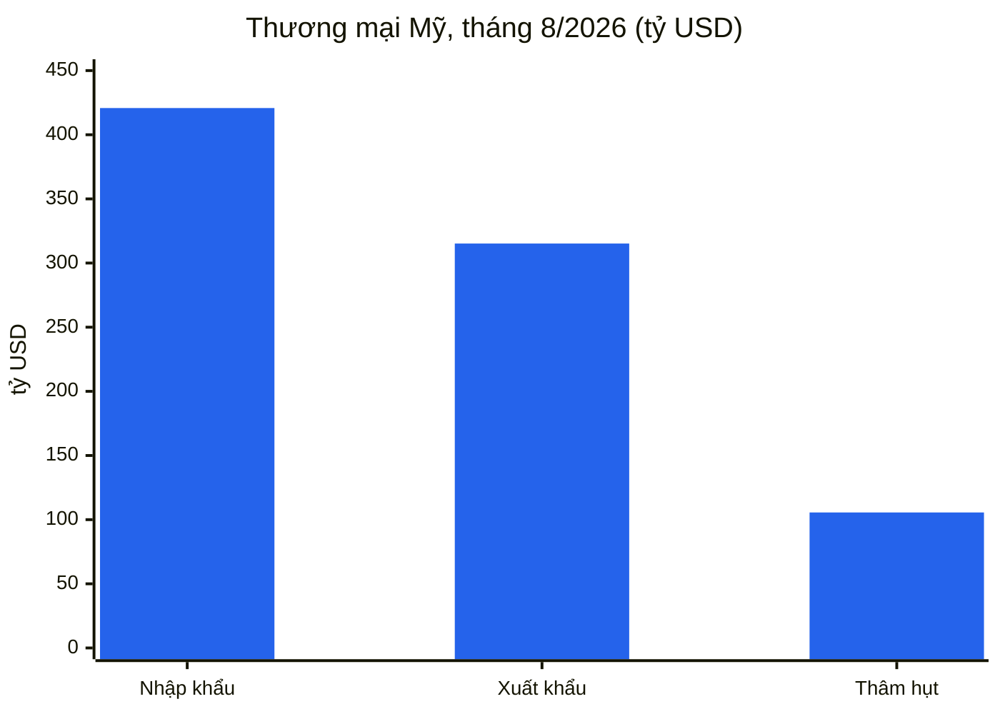

*Ghi chú: Cục Điều tra Dân số/BEA qua businessday.co.za; nhập khẩu 420,8 tỷ USD (kỷ lục, +4,3%), xuất khẩu 315,2 tỷ USD (+1,4%), thâm hụt 105,6 tỷ USD (+13,7%, lớn nhất kể từ tháng 3/2025).*

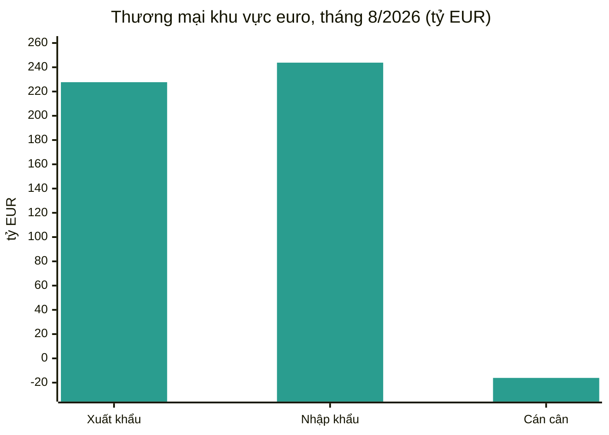

*Ghi chú: Eurostat công bố ngày 16/10; xuất khẩu 227,7 tỷ euro (+9,9% so với cùng kỳ), nhập khẩu 243,8 tỷ euro (+16,7%), cán cân −16,1 tỷ euro (thâm hụt lớn nhất kể từ tháng 1/2023).*

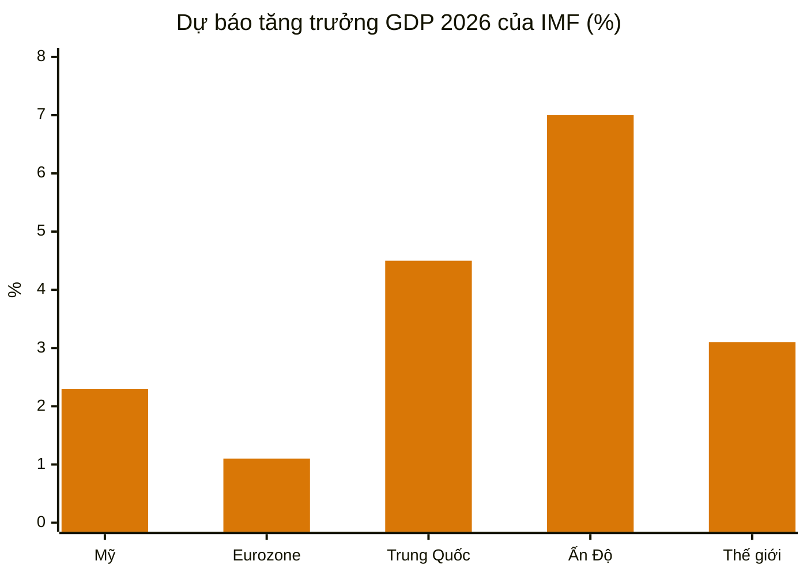

*Ghi chú: Triển vọng Kinh tế Thế giới của IMF, 13/10/2026; dự báo thế giới 2027 là 3,4%.*

---

## 9. Thị trường cước vận chuyển

### Giá container giao ngay — Chỉ số World Container Index của Drewry

Đánh giá ngày 15/10 chốt ở **4.485 USD/FEU, tăng 3% so với tuần trước** — đợt phục hồi sau mức 4.351 USD (−2%) của ngày 8/10. Châu Á–châu Âu dẫn dắt đà tăng: Thượng Hải–Rotterdam +6% lên 3.522 USD, Thượng Hải–Genoa +7% lên 3.945 USD, lần tăng đầu tiên của châu Á–châu Âu sau 13 tuần giảm liên tiếp. Tuyến xuyên Thái Bình Dương trái chiều: Thượng Hải–Los Angeles +3% lên 7.884 USD, Thượng Hải–New York −1% xuống 10.075 USD. Drewry dự báo biến động ít hơn trong tuần tới. Đánh giá trước đó (ngày 1/10) đã chốt ở 4.434 USD (−1%).

Bảng theo dõi Chuyến bị hủy của Drewry (ngày 16/10) cho thấy 44 chuyến trống được công bố cho các tuần 43–47 (19/10–22/11) — tỷ lệ hủy 6% trên 713 chuyến dự kiến. Châu Á–Bắc Âu/Địa Trung Hải chiếm 44% số chuyến hủy, xuyên Thái Bình Dương hướng đông 36%, xuyên Đại Tây Dương 20%. Các đợt tăng cước FAK dự kiến 4.500–4.800 USD/FEU của các hãng tàu trên tuyến châu Á–châu Âu (có hiệu lực từ 19/10) đối mặt với khả năng hấp thụ không chắc chắn khi công suất Suez quay trở lại. (Nguồn: [Drewry](https://www.drewry.co.uk/maritime-research-opinion-browser/world-container-index-assessed-by-drewry), [Shipping Telegraph tuần 41](https://shippingtelegraph.com/freight-news/drewry-the-world-container-index-decreased-2-in-week-41-2026/), [Shipping Telegraph tuần 42](https://shippingtelegraph.com/freight-news/drewry-the-world-container-index-increased-3-this-week-42-2026/))

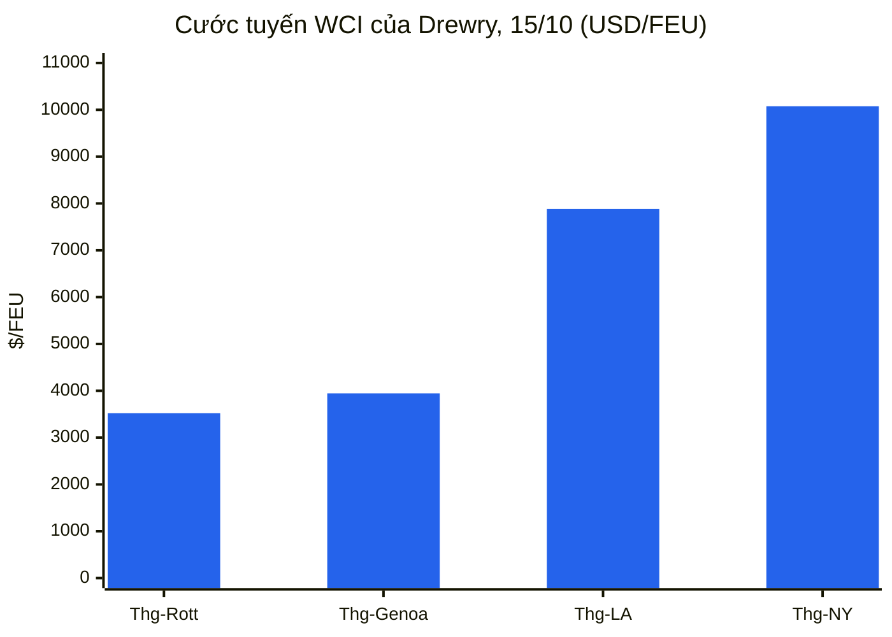

*Ghi chú: Thượng Hải–Rotterdam 3.522 USD (+6%), Thượng Hải–Genoa 3.945 USD (+7%), Thượng Hải–Los Angeles 7.884 USD (+3%), Thượng Hải–New York 10.075 USD (−1%).*

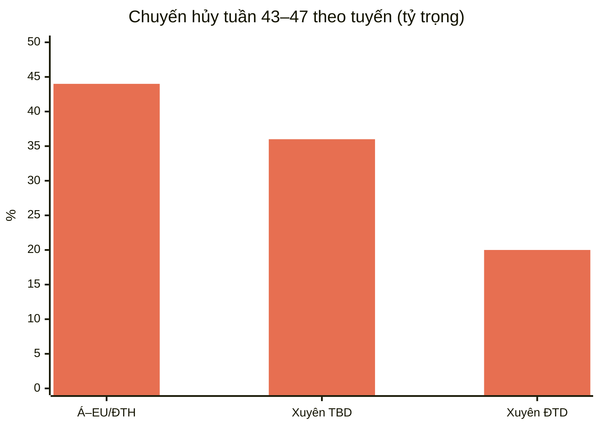

*Ghi chú: Bảng theo dõi Chuyến bị hủy của Drewry, 16/10; 44 chuyến hủy trên 713 chuyến dự kiến (tỷ lệ hủy 6%).*

### Chỉ số Freightos Baltic (FBX)

Tuần đến 13/10: châu Á–Bờ Tây Mỹ (FBX01) −2% xuống 8.149 USD/FEU; châu Á–Bờ Đông Mỹ (FBX03) đi ngang ở 9.606 USD/FEU; châu Á–Bắc Âu (FBX11) đi ngang ở 3.260 USD/FEU; châu Á–Địa Trung Hải (FBX13) +7% lên 3.804 USD/FEU. Hàng không: Trung Quốc–Bắc Mỹ +3% lên 5,77 USD/kg; Trung Quốc–Bắc Âu −7% xuống 3,58 USD/kg — mức giảm sau phản ánh việc EU kết thúc miễn trừ de minimis 150 euro hồi tháng 7 (hàng nhập khẩu Trung Quốc/Hồng Kông qua Frankfurt −1,8%/−7,4% trong tháng 9). Chuẩn hàng không của Freightos vẫn cao hơn 33% so với một năm trước. Cước xuyên Thái Bình Dương đi ngang suốt Tuần lễ Vàng rồi giảm nhẹ — khởi đầu của đà giảm sau kỳ nghỉ, với khối lượng dự báo giảm trong tháng 11–12. ([AJOT / Freightos](https://www.ajot.com/news/freightos-weekly-update-attacks-disrupt-saudi-air-cargo-china-europe-air-rates-slump))

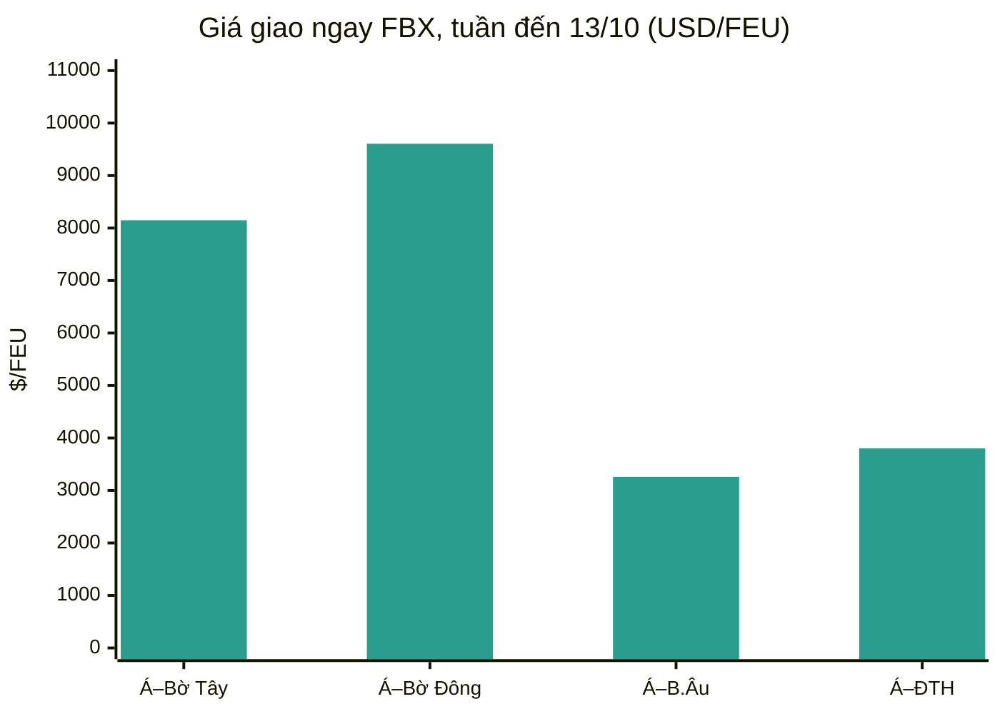

*Ghi chú: FBX01 8.149 USD (−2%), FBX03 9.606 USD (đi ngang), FBX11 3.260 USD (đi ngang), FBX13 3.804 USD (+7%).*

### Hàng rời khô — Sàn giao dịch Baltic

**Chỉ số Baltic Dry** giảm tuần thứ ba liên tiếp, chốt thứ Sáu ngày 16/10 ở **2.511 — giảm 14% trong tuần**, mức thấp nhất kể từ 30/6. Chỉ số Capesize giảm 25% so với tuần trước xuống 3.249 (thấp nhất kể từ đầu tháng 4); thu nhập 5TC của Capesize đạt trung bình 25.961 USD/ngày (−664 USD/ngày). Panamax giảm 1,8% xuống 2.314 (thu nhập 20.827 USD/ngày). Supramax là điểm sáng duy nhất, tăng 9 điểm lên 1.865. Quặng sắt chạm mức thấp hai năm giữa tuần do nhu cầu Trung Quốc yếu và tồn kho tăng trước khi phục hồi thứ Sáu. (Nguồn: [Baird Maritime](https://www.bairdmaritime.com/shipping/dry-cargo/bulkers/baltic-index-stays-in-the-doldrums-as-capesize-rates-slide-further), [Safety4Sea](https://www.safety4sea.com/baltic-exchange-maritime-market-highlights-october-12-16/))

### Hàng không

Giá giao ngay toàn cầu giữ ở **3,55 USD/kg trong tuần 41** bất chấp kỳ nghỉ Tuần lễ Vàng — trọng tải giảm 1% so với tuần trước, tuần giảm thứ ba liên tiếp, nhưng tăng 9% so với cùng kỳ năm trước; giá giao ngay tăng 34% so với cùng kỳ; giá toàn thị trường 3,13 USD/kg ổn định. Giá giao ngay châu Á–Thái Bình Dương giảm 3% so với tuần trước xuống 4,83 USD/kg; giá giao ngay châu Phi tăng 10%. Nhiên liệu máy bay tăng 111% so với cùng kỳ năm trước (IATA/Platts). Chỉ số Cước Hàng không Baltic tăng 5,0% trong tuần đến 5/10, đưa mức tăng so với cùng kỳ năm trước lên +25,5%, với giá cước chưa tăng tương xứng với nhiên liệu. Công nghệ và điện tử (máy chủ, chất bán dẫn, linh kiện trung tâm dữ liệu) vẫn là nguồn cầu mạnh nhất, trong khi thương mại điện tử sang Mỹ đã thu hẹp do thay đổi thuế đối với hàng nhập khẩu giá trị thấp. Công suất vùng Vịnh giảm 4% so với tuần trước trong tuần 41 do các vụ tấn công sân bay của Houthi, thấp hơn 20% so với cuối tháng 2. (Nguồn: [StatTimes / WorldACD](https://www.stattimes.com/air-cargo/global-air-cargo-rates-remain-stable-at-355kg-in-week-41-1360975), [Sàn giao dịch Baltic](https://www.balticexchange.com/en/news-and-events/news/guest-column/2026/Air-freight-rates-remain-firm-in-September-with-renewed-surge-in-jet-fuel-yet-to-feed-through.html))

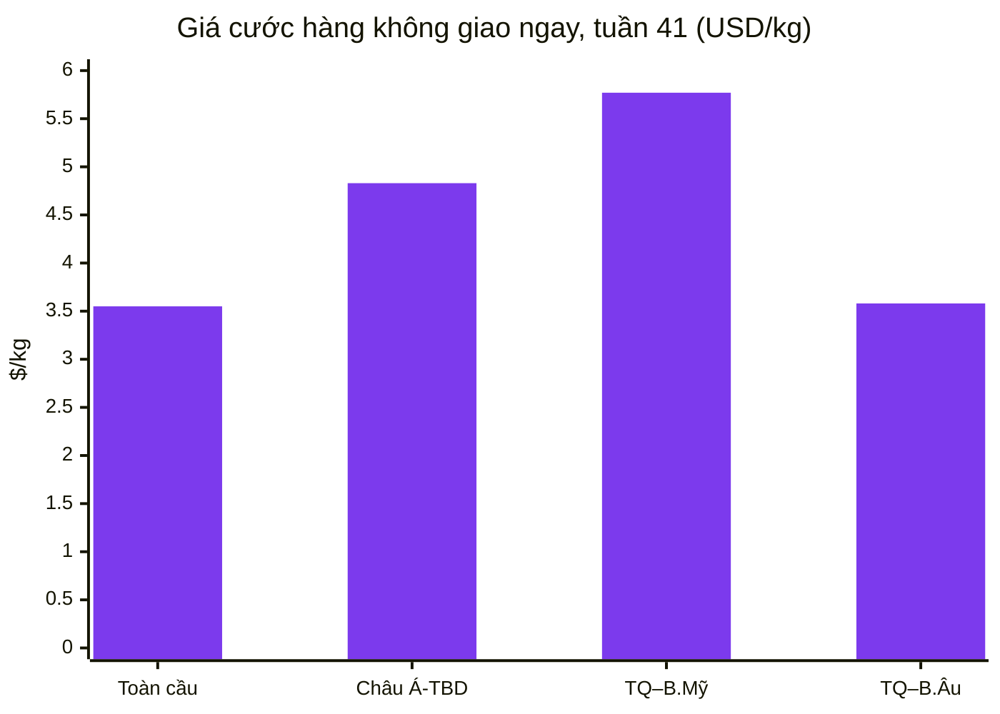

*Ghi chú: WorldACD qua StatTimes (19/10) và Freightos (13/10); toàn cầu 3,55 USD (+34% so với cùng kỳ), châu Á–Thái Bình Dương 4,83 USD, Trung Quốc–Bắc Mỹ 5,77 USD, Trung Quốc–Bắc Âu 3,58 USD.*

### Độ tin cậy lịch trình

Bảng điểm tháng 9 của Xeneta: tàu đến đúng giờ toàn cầu giảm 2 điểm phần trăm xuống **27%**, tháng giảm thứ tư liên tiếp; chậm trễ trung bình đạt 6 ngày (+2,4 ngày kể từ quý 2). Tuyến Viễn Đông–châu Âu sụp đổ xuống 4% đúng giờ với chậm trễ trung bình 9,9 ngày — tệ nhất kể từ tháng 9/2021. Châu Á–Bắc Mỹ không đổi ở 20% đúng giờ, với chậm trễ tăng lên 6,9 ngày. Mọi hãng tàu được theo dõi đều ghi nhận mức chậm trễ trung bình 12 tháng tệ nhất (CMA CGM 30%, Cosco 18%, Hapag-Lloyd 45%, Yang Ming 4% đúng giờ). Giá giao ngay Trung Quốc–Bờ Tây Mỹ đạt trung bình 7.717 USD/FEU đầu tháng 10 — gấp khoảng bốn lần mức 1.778 USD của tháng 9/2025; giá dài hạn tăng 26% so với tháng trước lên 3.649 USD/FEU ngày 1/10. ([FreightWaves / Port Technology](https://www.olgn.news/freightwaves-shippers-waiting-an-extra-week-for-us-bound-containers/))

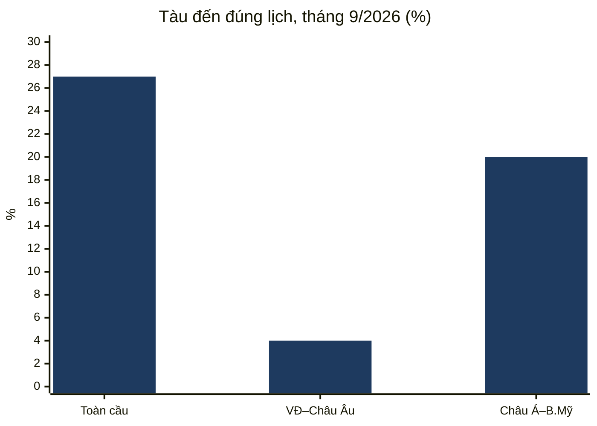

*Ghi chú: Xeneta qua FreightWaves/Port Technology; toàn cầu 27% (−2 điểm phần trăm), Viễn Đông–châu Âu 4% (chậm trễ trung bình 9,9 ngày), châu Á–Bắc Mỹ 20% (chậm trễ 6,9 ngày).*

### Gián đoạn cảng và logistics

- **Hormuz/Houthi:** tàu container *GFS Pride* chìm (ngày 15/10); 12 vụ tấn công tàu trong tuần 5–11/10; lượt qua eo biển giảm xuống 131/tuần; công suất hàng không vùng Vịnh −4% so với tuần trước. Tuyên bố chủ tịch Hội đồng Bảo an Liên Hợp Quốc được thông qua bằng đồng thuận ngày 15/10 lên án các vụ tấn công của Houthi nhằm vào Ả Rập Xê Út và vận tải Biển Đỏ. (Xem Cảnh báo A2.)
- **Tống tiền qua mạng:** 38 công ty hàng hải trên 18 quốc gia đối mặt với thời hạn đòi tiền chuộc ngày 19/10 lúc 13:27 UTC (xem Cảnh báo A3).
- **Suez:** kiểm tra bắt buộc và chạy thử trên biển đối với tàu từ 25 năm tuổi trở lên có hiệu lực từ 6/10; công suất container qua kênh trong hai tuần đầu tháng 10 đạt trung bình 753.000 TEU/tuần so với 1.457.000 TEU cùng kỳ năm 2023 — sự quay lại đang diễn ra nhưng còn xa mới hoàn tất.
- **Đức:** ver.di chấp nhận thỏa thuận lương ngày 6/10 (~11.000 công nhân, sáu cảng, +3,4% trong 12 tháng), chấm dứt nguy cơ đình công tại Hamburg, Bremerhaven và Wilhelmshaven — nhưng mực nước sông Rhine thấp kỷ lục đang hạn chế giao thông sà lan tới Rotterdam/Antwerp; tỷ lệ sử dụng bãi Bremerhaven ở 90%, Rotterdam đầy 85–90% với thời gian lưu bãi 14 ngày.
- **Panama:** Cơ quan Quản lý Kênh đào nâng tổng số lượt đặt chỗ hàng ngày lên 33 có hiệu lực từ 15/10.
- **Bờ Đông Mỹ:** PhilaPort công bố mở rộng ~837 triệu USD — lớn nhất từ trước đến nay, bến mới đầu tiên trong 50 năm (ngày 14/10). Cảng Long Beach lập kỷ lục tháng mọi thời đại trong tháng 9 (tiệm cận ~1 triệu container); Cảng Los Angeles ghi nhận tháng bận rộn nhất trong 118 năm, dù giám đốc cảng cảnh báo các thay đổi nguồn cung ứng do thuế quan tạo ra rủi ro lập kế hoạch.
- **Manila:** việc Hapag-Lloyd đình chỉ mọi đặt chỗ đến Manila đến hết năm (được đưa tin tuần trước) vẫn là trường hợp tắc nghẽn cực đoan nhất.
- **Bangladesh:** DP World ký nhượng quyền 15 năm cho Bến Container New Mooring tại Chittagong (ngày 12/10), giữa các cuộc biểu tình tiếp diễn của công nhân cảng phản đối việc tiếp quản.
- **Đầu tư của hãng tàu:** hội đồng quản trị HMM phê duyệt đầu tư 1,62 tỷ USD vào 12 tàu container (tám tàu mới đóng 13.000 TEU cộng bốn tàu mới mua lại, tổng 114.100 TEU, giao tàu đến tháng 12/2029) — hướng tới 166 tàu / 1,47 triệu TEU vào cuối 2030. ZIM nâng dự báo lợi nhuận 2026 thêm 72% nhờ nhu cầu mạnh. Các tít báo JOC cũng ghi nhận Đức chặn đề nghị của Cosco mua Zippel vì lo ngại an ninh và các hành động của ILWU làm đình trệ khai trương bến tại LA–LB.

### Thông tin nhà cung cấp

- **Descartes — Báo cáo Vận tải Toàn cầu (ấn bản tháng 9, ~13/10).** Nhập khẩu container Mỹ đạt khối lượng tháng 9 cao nhất từ trước đến nay: 2,55 triệu TEU — giảm 2,2% so với tháng 8, tăng 10,3% so với cùng kỳ; khối lượng tháng 1–9 +0,8% so với cùng kỳ. Hàng nhập khẩu xuất xứ Trung Quốc tăng mạnh so với tháng trước trong khi hầu hết các nguồn gốc hàng đầu khác giảm; các cảng Bờ Tây tăng thị phần; chậm trễ quá cảnh tại cảng tăng tại 8 trong 10 cửa ngõ hàng đầu (mức tăng lớn nhất tại NY/NJ). Danh sách theo dõi sắp tới: sự cố Trung Đông/Hormuz, thuế mở rộng (Mục 301/232, thuế Mục 232 dược phẩm tháng 9), lượt đặt chỗ Panama, định tuyến Biển Đỏ, và kinh tế Mỹ (lãi suất Fed 3,75–4,00%; GDP quý 2 2,2% hàng năm). Một số liệu công bố, không phải mục sản phẩm. ([AJOT](https://www.ajot.com/news/descartes-global-shipping-report-u.s-container-imports-reach-highest-september-volume-on-record))
- **Descartes — cập nhật dữ liệu thuế hàng tuần của CustomsInfo.** Cập nhật ngày 16/10: cập nhật thuế Mexico có hiệu lực từ 14/10 (Nghị định DOF 13/10/2026 — thuế tạm thời, không thay đổi HS); chỉ cập nhật thuế Mauritius. Cập nhật ngày 9/10: điều chỉnh kỹ thuật Mỹ cho HTS 9903.85.67/68 (các nước áp dụng được sửa thành TẤT CẢ, không chỉ Nga; thuế bổ sung chỉ áp dụng nếu nấu chảy/đúc tại Nga); cập nhật Trung Quốc ngày 8/10. ([customsinfo.com](https://www.customsinfo.com/resources/industry-updates/))
- **TradeInt — quan hệ đối tác với Bộ Thương mại Thổ Nhĩ Kỳ (công bố ngày 30/9, ngay trước phạm vi tuần).** Quan hệ đối tác cung cấp khoản tài trợ cho các công ty tư vấn địa phương tiếp cận hồ sơ lô hàng, tờ khai hải quan và dữ liệu B/L trên 200+ quốc gia, nhằm hỗ trợ quyết định xuất khẩu của các SME Thổ Nhĩ Kỳ; bài đánh giá của TradeInt trích dẫn xuất khẩu Thổ Nhĩ Kỳ 2025 đạt 269,7 tỷ USD. Một mục quan hệ đối tác chính phủ; tuần này không tìm thấy bản phát hành nào có ngày trong phạm vi của TradeInt, và blog thông tin của TradeInt không có bài đăng nào có ngày xác minh được trong phạm vi. ([bayareametrowire](https://bayareametrowire.com/news/turkiyes-ministry-of-trade-grants-consulting-firms-access-to-global-trade-data-through-tradeint-partnership))

---

## 10. Dòng thời gian chính sách

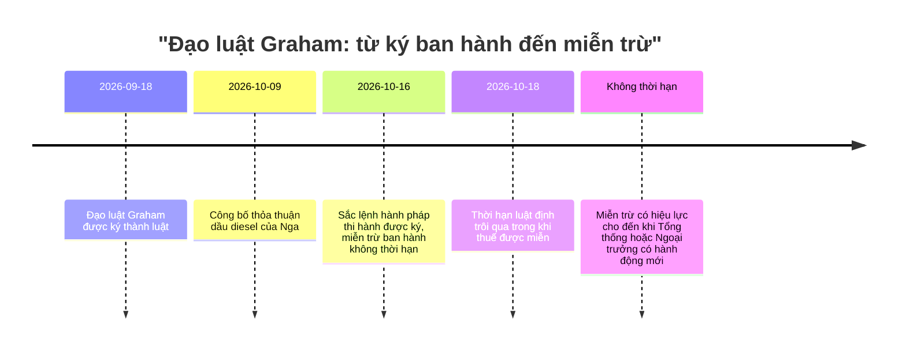

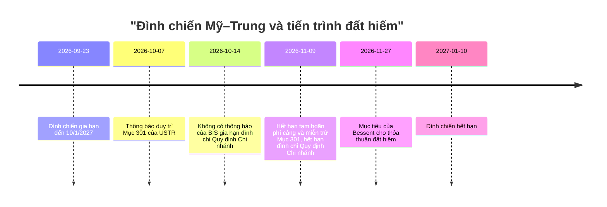

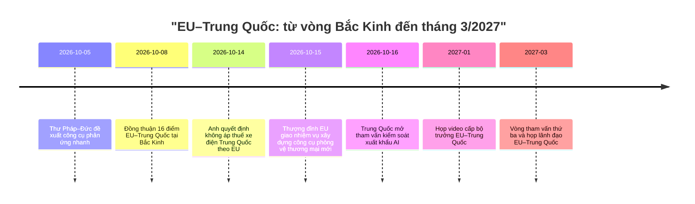

---

## 11. Các thời hạn & sự kiện sắp tới (90 ngày tới)

| Ngày | Sự kiện | Ý nghĩa |
|---|---|---|
| 19/10/2026 | Thời hạn đòi tiền chuộc tống tiền qua mạng (13:27 UTC) đối với 38 công ty hàng hải | Làn sóng tống tiền qua mạng hàng hải quy mô lớn đầu tiên; theo dõi các công bố |
| 20/10/2026 | FTA Ấn Độ–New Zealand có hiệu lực | Thuế của NZ đối với hàng xuất khẩu Ấn Độ được xóa từ ngày đầu |
| 22/10/2026 | Luật Ngoại thương sửa đổi của Hàn Quốc có hiệu lực | Căn cứ hạn chế thương mại mở rộng từ 5 lên 9 |
| 27/10/2026 | DSB của WTO: thông qua báo cáo ban hội thẩm vụ Trung Quốc kiện Thổ Nhĩ Kỳ về thuế xe điện; thời hạn thông qua phán quyết vụ Ấn Độ–Đài Loan về thuế ICT | Hai cột mốc tranh chấp trong cùng một ngày |
| 9/11/2026 | Hết hạn tạm hoãn phí cảng Mục 301 (11:59 tối giờ ET); hết hạn 178 miễn trừ Mục 301; đình chỉ Quy định Chi nhánh của BIS hết hiệu lực theo điều khoản | Vách đá tuân thủ ba lớp — coi là thời hạn cứng nếu USTR/BIS không có hành động |
| 9/11/2026 | Hết hạn ý kiến điều tra tự vệ của Madagascar |  |
| 10/11/2026 | Ngày "tái áp dụng" đất hiếm theo hướng dẫn trước đó; ngày tái áp dụng Quy định Chi nhánh | Theo dõi hành động chính thức của BIS |
| 15/11/2026 | Tham vấn kiểm soát xuất khẩu AI của Trung Quốc kết thúc | Danh mục 40 công nghệ có thể được thông qua sau đó |
| 20/11/2026 | Hội nghị thượng đỉnh Anh–EU (Brussels) | Sau quyết định thuế xe điện của Anh |
| 27/11/2026 | Lễ Tạ ơn — mục tiêu thỏa thuận đất hiếm của Bessent |  |
| 31/12/2026 | Rà soát thép/nhôm trong thỏa thuận EU–Mỹ: nhượng bộ có thể đình chỉ nếu thuế Mỹ vẫn vượt 15% | Bài kiểm tra kiềm chế có đi có lại đầu tiên của thỏa thuận EU–Mỹ |
| 10/1/2027 | Đình chiến Mỹ–Trung hết hạn |  |
| 1/2027 | Họp video cấp bộ trưởng EU–Trung Quốc |  |
| 3/2027 | Vòng Tham vấn Thương mại và Đầu tư EU–Trung Quốc lần thứ ba; họp lãnh đạo EU–Trung Quốc tiếp theo; kịch bản cơ sở của IMF giả định Hormuz mở lại |  |
| Đầu 2027 | FTA Úc–EU trình quốc hội (cuộc chiến phê chuẩn) |  |

## 12. Nguồn tin & phương pháp luận

Phạm vi: 12–19 tháng 10, 2026.

**Tin tức & phân tích thương mại:** FreightWaves, The Loadstar, Splash247, gCaptain, Hellenic Shipping News, Container News, Supply Chain Dive, Port Technology International, JOC (chỉ tít báo), Shipping Telegraph, Baird Maritime, StatTimes/WorldACD, AJOT/Freightos, Metro Global, blog TradeInt (không có bài đăng nào có ngày trong phạm vi).

**Chính sách Mỹ:** whitehouse.gov (Sắc lệnh hành pháp thi hành Đạo luật Graham, nguồn chính), federalregister.gov (hướng dẫn hàm lượng Mỹ của BIS 2026-20938; thông báo duy trì của USTR 91 FR 64212), CBP (qua các khuyến nghị thương mại: CAPE Giai đoạn 3, WRO, phí người dùng), FMC (đề xuất phí Tây Ban Nha qua Supply Chain Dive), USTR (qua tin thứ cấp), BIS (qua Mondaq/Crowell & Moring, Braumiller, Dechert), Thompson Hine, Steptoe, Mondaq, Gateway Lines, Thomson Reuters, JD Supra (không có mục nào trong phạm vi tuần xuất hiện), internationaltradetoday.com (chỉ tít báo).

**Chính phủ các nước:** Hội nghị thượng đỉnh Hội đồng châu Âu (qua báo chí), Ủy ban châu Âu/Tổng vụ Thương mại (qua báo chí), Bộ Kinh doanh và Thương mại gov.uk (qua The Guardian/Fleet News), CBSA/Canada (qua các hiệp hội ngành), METI/Hải quan Nhật Bản (qua Steptoe/Global Sanctions), MOTIR Hàn Quốc (qua tóm tắt LinkedIn), english.mofcom.gov.cn (lấy trực tiếp thất bại; các mục MOFCOM qua tin thứ cấp và tiếng Anh của Quốc vụ viện), Bộ Thương mại Ấn Độ (qua báo chí), DFAT Úc (qua báo chí), MDIC Brazil (qua Datamar).

**Đa phương:** wto.org (Triển vọng và Thống kê Thương mại Toàn cầu, ngày 8/10; tin ủy ban và DSB qua báo chí thương mại), unctad.org (Báo cáo Thương mại và Phát triển 2026), WCO (ra mắt e-CENcomm, phụ lục GCC), ITIP của WTO (không có bản phát hành mới nào trong phạm vi tuần xuất hiện), Trade Map của ITC (không có bản phát hành nào trong phạm vi tuần xuất hiện).

**Cổng dữ liệu:** Cục Điều tra Dân số/BEA (FT-900 tháng 8/2026; hàng hóa sơ bộ tháng 9/2026), GACC (thương mại Trung Quốc tháng 9/2026), Eurostat (khu vực euro tháng 8/2026), WTO, IMF (WEO tháng 10), UNCTADstat, USITC DataWeb / USA Trade Online / UN Comtrade / WITS (không có bộ dữ liệu mới nào trong phạm vi tuần xuất hiện).

**Think tank & nghiên cứu:** Yale Budget Lab (Tình trạng Thuế quan Mỹ; phân tích Cổ tức Thuế quan), Penn Wharton Budget Model (Thuế suất Hiệu quả và Doanh thu, cập nhật ngày 14/10), Tax Foundation (Bảng theo dõi Thuế quan Trump, bản tháng 8/2026), Mondaq (phân tích thỏa thuận thuế quan EU–Mỹ), tradeintelligence.eu (không tiếp cận được qua lấy văn bản tuần này).

**Cước vận chuyển:** Drewry (Chỉ số World Container Index đánh giá ngày 15/10; Bảng theo dõi Chuyến bị hủy ngày 16/10), Sàn giao dịch Baltic (điểm nổi bật thị trường hàng tuần; BAI qua chuyên mục khách mời), Chỉ số Freightos Baltic (tuần đến 13/10), Xeneta (độ tin cậy lịch trình, qua FreightWaves/Port Technology), Kpler (lượt qua eo biển), Sea-Intelligence, Linerlytica, Veson, Hartland (thu nhập tàu chở dầu), Clarksons, SCFI, TAC Index, NRF Global Port Tracker, DHL, DC Velocity.

**Thông tin nhà cung cấp:** Descartes Systems Group (Báo cáo Vận tải Toàn cầu ấn bản tháng 9; cập nhật dữ liệu thuế hàng tuần của CustomsInfo) và TradeInt (quan hệ đối tác với Bộ Thương mại Thổ Nhĩ Kỳ, ngày 30/9) — chỉ các tin tức nhà cung cấp: số liệu công bố, quan hệ đối tác chính phủ và diễn biến thị trường.
