# 全球贸易情报报告——2026年10月12–19日当周

**每周简报。** 覆盖窗口：2026年10月12–19日。汇编自全球约45家贸易新闻、政策、数据与运费来源的信息。

---

## 目录

1. [执行摘要](#1-executive-summary)
2. [预警](#2-alerts)
3. [头条新闻——深度解析](#3-top-stories--deep-dives)
4. [关税追踪](#4-tariff-tracker)
5. [美国政策深度解析](#5-us-policy-deep-dive)
6. [分区域世界政策](#6-world-policy-by-region)
7. [执法行动](#7-enforcement-actions)
8. [数据发布](#8-data-releases)
9. [运费市场](#9-freight-market)
10. [政策时间线](#10-policy-timelines)
11. [即将到来的截止日期与事件（未来90天）](#11-upcoming-deadlines--events-next-90-days)
12. [数据来源与方法](#12-sources--methodology)

---

## 1. 执行摘要

这是一周：标志性制裁法案在签署后即被豁免、霍尔木兹战事开始击沉集装箱船、全球三大贸易经济体公布的数据却指向不同方向。

- **格雷厄姆法案在生效前就被豁免。** 在签署《2026年琳赛·O·格雷厄姆制裁俄罗斯和伊朗法案》一个月后——该法案规定对俄罗斯商品加征500%的关税、对俄罗斯能源最大买家加征100%的二级关税——特朗普总统于10月16日签署行政命令实施该法案，并在同一命令中无限期豁免了其中的关税和制裁条款。印度、中国和土耳其这些法案针对的买家继续采购。两党批评者和基辅称此举是退缩；白宫未给出详细公开解释。
- **霍尔木兹海峡夺走了第一艘集装箱船。** 悬挂新加坡旗的*GFS Pride*轮（2,824标准箱）于10月15日在霍尔木兹附近被击中、起火并沉没——这是冲突爆发以来被击沉的第二和第三艘船。10月5–11日一周有12艘船报告遇袭，为开战以来单周最高；海峡通行量从前一周的176艘降至131艘，原油流量降至估计每日1,260万桶。与此同时，油轮收益达到极高水平：过去一个月VLCC日均收益64.3万美元。
- **数据讲述了三个不同的故事。** 9月中国贸易顺差达1,335亿美元，为20个月新高，出口在人工智能硬件热潮推动下增长36.3%——1–9月顺差达9,385亿美元，连续第二年突破1万亿美元近在咫尺。美国8月贸易逆差扩大13.7%至1,056亿美元，进口创下4,208亿美元的历史新高。欧元区录得2023年1月以来最大贸易逆差（161亿欧元），进口增长16.7%。世贸组织将2026年商品贸易预测上调至3.9%，警告人工智能相关商品正在掩盖其他领域的疲软；国际货币基金组织10月展望预计2026年全球增长3.1%，假设霍尔木兹海峡于3月重新开放。
- **欧洲明确了贸易防御方向。** 在10月15–16日布鲁塞尔峰会上，欧盟领导人要求对中国"充分运用"现有贸易防御措施，并责成欧盟委员会制定新的工具，同时保持对话，定于2027年3月举行下次会议。英国则决定不跟进欧盟对中国电动车最高45.3%的关税，称这是纯粹基于英国利益的决定。北京就覆盖大型模型权重和芯片设计方法的人工智能技术出口管制广泛征求意见。
- **运费部分反弹。** 德路里世界集装箱指数在10月15日评估中上涨3%至4,485美元/FEU——亚欧航线运价13周来首次上涨——而波罗的海干散货指数连续第三周下跌至2,511点，因好望角型船收益崩溃。9月全球集装箱船期准班率降至27%，连续第四个月下滑。38家航运和港口公司（分布在18个国家）面临10月19日的网络勒索赎金最后期限。

**运费：** 呈现分化——集装箱即期运价在黄金周后提价和船公司停航（第43–47周取消44个航次）推动下回升，干散货因铁矿石触及两年低点而下滑，空运价格稳定在3.55美元/公斤，航油价格同比上涨逾100%。

---

## 2. 预警

| # | 预警 | 生效日期 | 影响 | 来源 |
|---|-------|-----------|--------|--------|
| A1 | 格雷厄姆法案关税被豁免：10月16日行政命令实施《琳赛·O·格雷厄姆制裁俄罗斯和伊朗法案》，同时依据第115条无限期豁免其关税和制裁条款；此前的对俄制裁保留 | 2026年10月16日 | 印度、中国、土耳其继续获得俄罗斯能源，不新增美国关税；豁免维持至被撤销 | [whitehouse.gov](https://www.whitehouse.gov/presidential-actions/2026/10/implementing-the-lindsey-o-graham-sanctioning-russia-and-iran-act-of-2026/) |
| A2 | 霍尔木兹升级：集装箱船*GFS Pride*轮（2,824标准箱）10月15日被击沉；10月5–11日12艘船遇袭（开战以来单周最高）；海峡通行降至每周131艘；原油流量约每日1,260万桶 | 2026年10月12–15日 | 集装箱吨位已处风险之中；战争险条款收紧；油轮收益处于极高水平 | [Splash247](https://splash247.com/hormuz-claims-two-more-ships-in-fresh-wave-of-strikes/)、[FreightWaves](https://www.freightwaves.com/news/container-ship-attacks-escalate-in-strait-of-hormuz) |
| A3 | 针对海事部门的大规模网络勒索："n0n"组织10月12日将18个国家的38家航运/港口/物流公司列入暗网泄露站点，威胁10月19日13:27（UTC）前不支付赎金即公布数据；每家赎金40万–4亿美元不等；说法未经证实 | 截止2026年10月19日 | 首次针对海事目标的大规模协同网络勒索浪潮；目标包括ONE、Culines、TS Lines、Santos Brasil | [Splash247](https://splash247.com/shipping-firms-and-ports-caught-in-mass-cyber-extortion-claim/) |
| A4 | 中国起草人工智能技术出口管制（第48号公告，10月16日）：提议将40项技术列入禁止/限制目录（14项禁止、26项限制），包括2万亿参数以上的LLM权重；出口前登记要求即时生效；公开征求意见至11月15日 | 2026年10月16日（征求意见至11月15日） | 可能限制人工智能模型、智能体和芯片设计对外转移；境外部署纳入覆盖 | [aiandgpp.com](https://aiandgpp.com/2026/10/19/china-ai-export-controls-model-weights-sovereign-cloud/) |
| A5 | 11月9日双重截止——截至10月13日USTR未延期：（a）对中国关联船舶的301条款港口费一年暂停到期（中国船东/运营人恢复80美元/净吨）；（b）178项301条款产品豁免到期（清单1/2/3关税回升至25%，清单4A回升至7.5%） | 2026年11月9日23:59（美东时间） | 进口商应将11月9日视为终止日；无宽限期；豁免仅免除301条款这一层 | [Gateway Lines](https://gatewaylines.com/press-releases/china-ship-fees-301-exclusions-nov-9-2026) |
| A6 | 日本扩大对俄出口禁令10月16日生效（10月6日宣布）：矿产、化工、金属、机械、工业设备和精密仪器列入禁止清单 | 2026年10月16日 | 对俄出口商须重新筛查产品覆盖范围 | [Steptoe](https://www.steptoe.com/en/news-publications/international-compliance-blog/weekly-sanctions-update-october-13-2026.html) |
| A7 | FMC提议对西班牙籍船舶每航次收费20万美元，并对西班牙商品（香水化妆品、油脂、陶瓷、石材制品、糖、糖果）实施进口限制，因2024年调查认定西班牙拒绝美国籍船舶靠港 | 2026年10月16日提议 | 联邦海事委员会就船旗歧视升级报复权力；两艘马士基海事安全计划船舶被拒绝靠港 | [Supply Chain Dive](https://www.supplychaindive.com/news/fmc-proposes-fees-on-spanish-flagged-vessels-import-restrictions/833122/) |
| A8 | 稀土：贝森特表示美国希望"有望"在感恩节（11月27日）前与中国敲定稀土协议；BIS关联企业规则暂停（重新实施日为11月10日）预计随休战延长至2027年1月10日，但截至10月14日尚无正式《联邦公报》通知 | 目标2026年11月27日 | 合规团队面临硬性重新实施日期，而正式延期尚未公布 | [eximguru](https://eximguru.com/export-import-news/export-news/us-china-rare-earths-deal-will-116956.aspx)、[Mondaq](https://www.mondaq.com/unitedstates/export-controls-trade-investment-sanctions/1854664/us-china-trade-truce-extended-two-months-bis-affiliates-rule-suspension-follows) |

### A1——格雷厄姆法案豁免（详情）

10月16日签署的行政命令题为"实施《2026年琳赛·O·格雷厄姆制裁俄罗斯和伊朗法案》"——该法案本身于2026年9月18日签署（公法119-111），参议院以86–11、众议院以262–159通过。命令第2条规定了法定税率：对俄罗斯原产商品额外加征500%从价关税；对10月18日或之后知情新增采购的前五大俄罗斯原油和天然气进口国商品加征100%；对前五大俄罗斯石油制裁规避协助方商品加征100%，均在现有税率上叠加。

第4(a)条随后依据该法第115条豁免授权，豁免了这些关税——以及第102(a)、102(d)、102(e)、103–111和117条的制裁条款——并向国会提交了国家利益书面认证。豁免没有终止日期：在总统或国务卿（经与财政部和USTR协商）认定采取进一步行动适当之前一直有效。第4(b)条保留了依据国家紧急状态行政命令实施的所有此前对俄制裁（该紧急状态于2026年3月24日延续），并责成USTR监测俄罗斯能源采购并汇报。

**分析：** 这一结构给了政府一个常备的关税威胁——实施机制和税率已经明确——而今天不征收任何关税。政治代价立竿见影：参议员布卢门撒尔、蒂利斯和科宁提出批评，泽连斯基总统表示反对，两党提出了限制豁免权的法案，但均未成法。据美联社报道，白宫未给出详细公开解释。对印度和中国的炼厂而言，豁免取消了原定10月18日的期限；对美国进口商而言，关税风险是推迟而非消失——未来的认定可以重新激活关税。

### A2——霍尔木兹夺走一艘集装箱船（详情）

Splash247于10月15日报道，三艘与AD Ports/GFS相关的集装箱船在霍尔木兹附近被击中。悬挂新加坡旗的*GFS Pride*轮（2008年建造，2,824标准箱）被击中、起火并沉没，21名船员全部撤离。*GFS Giselle*轮（2015年，4,400标准箱）船体受损但抵达锚地，22名船员无恙；*Al Saadiyat*轮（1,730标准箱，Safeen Feeders）未受严重损伤。另外，海岬型船*Cape Dao*轮（17万载重吨）在阿曼附近被击中约三周后沉没。按国际海事组织伤亡数据，这是冲突爆发以来被击沉的第二和第三艘船。

英国海事贸易行动办公室（UKMTO）记录10月5–11日一周有12艘船报告遇袭——为开战以来单周最高。Kpler统计截至10月14日一周海峡通行131艘，低于前一周的176艘；10月13日经海峡的原油估计为每日1,260万桶，而9月底约为每日1,500万桶。FreightWaves报道分析师警告，当货物装载在提单未列名船舶上时，战争险保障可在短时间内被取消——对于如今绕行或穿越海峡的托运人而言，这一单证细节具有实际的合同后果。

**分析：** 这场战役已从骚扰升级为对集装箱航运吨位的摧毁。对于全球准班率仅27%的班轮船期而言，红海和霍尔木兹航线选择的丧失加剧了混乱。财务上的对冲同样显著：经纪公司Hartland估计，独立VLCC、苏伊士型和阿芙拉型船东的日收益超出预算预期约4亿美元；若维持一年，将接近集装箱航运疫情年份创纪录的1,500亿美元利润。过去一个月VLCC日均收益64.3万美元，中东湾–中国航次超过每日130万美元（Veson）。资产价值随之上涨：五年船龄的VLCC估值2.18亿美元，较新造船溢价55%；15年船龄VLCC估值同比上涨196%。

### A3——针对海事公司的网络勒索浪潮（详情）

10月12日，一个自称"n0n"的组织将其暗网泄露站点新增38家分布在18个国家的航运、港口和物流公司，威胁10月19日13:27（UTC）前不支付赎金即公布窃取的数据。点名目标包括海洋网联船务（Ocean Network Express）、Culines、TS Lines、Samudera、Santos Brasil、Portonave、BNCT、釜山新港、TTI Algeciras、Eurogate Tanger、Nam Dinh Vu和NEOM Ports。Cydome评估每家赎金从40万美元到4亿美元不等；SOCRadar审查的赎金为240万–1,400万美元比特币。截至报道时说法未经证实，没有被点名公司确认遭入侵。

**分析：** 这是首次针对海事目标的大规模协同网络勒索浪潮。无论数据是否属实，运营教训都成立：港口和船公司的信息技术资产正被有组织勒索团伙视为软目标。供应链安全团队应将最后期限窗口视为网络钓鱼和入侵风险升高的时期。

### A4——中国人工智能出口管制草案（详情）

10月16日，商务部和科技部就40项技术列入禁止和限制出口目录公开征求意见（11月15日截止）：14项禁止、26项限制，其中23项与人工智能相关。阈值具体：参数超过2万亿的大语言模型权重、训练算力超过10²⁶ FLOPs的模型，或全球排名前十的模型；AI智能体、算力集群和芯片设计方法也在覆盖之列。出口前登记要求同日生效，包括进行中的交易。API和SaaS访问被排除；境外部署被纳入。

**分析：** 若获采纳，这将是中国首个直接针对前沿人工智能模型权重的出口管制制度——是华盛顿算力管制的镜像。对API/SaaS访问豁免而覆盖境外部署的做法表明，北京希望对权重转移征税或阻断，同时保持云服务收入。在中国基础设施上运行人工智能工作负载的跨国公司，以及向境外授权模型的中国人工智能公司，应在征求意见截止前绘制风险敞口。

---

## 3. 头条新闻——深度解析

### 3.1 被豁免成空文的制裁法

《2026年琳赛·O·格雷厄姆制裁俄罗斯和伊朗法案》的设计初衷是国会对制裁规避的回应：对俄罗斯能源最大买家的商品强制加征最高100%的二级关税，对俄罗斯商品本身加征500%，且总统无权豁免。该法案以接近否决门槛的票数通过——参议院86–11、众议院262–159——并于9月18日签署。关税认定截止日为10月18日。

10月16日，距离截止日两天，总统签署了实施行政命令。该命令在第2条精确规定了税率。然后，在第4(a)条中，它豁免了这些税率——动用的是国会写在该法第115条中的豁免权。豁免同时覆盖关税条款（第112和113条）和制裁条款（第102(a)、102(d)、102(e)、103–111、117条），且没有日落条款：在总统或国务卿（经与财政部和USTR协商）另行决定之前一直有效。

**分析：** 国会试图制定一部行政部门无法豁免的制裁法；行政部门在一个月后用该法自身的豁免条款将其豁免。实施机制如今作为常备工具存在——税率已明确、监测交由USTR、国家紧急状态制裁基线得以保留——因此即使今天的关税为零，激活威胁依然真实。与盟友的分歧正在扩大：英国10月8日的一揽子措施新增38个目标，包括两家能源公司和12艘影子船队油轮，伦敦现在称制裁已覆盖90%以上的俄罗斯石油产能，并敦促收紧航运服务限制，而华盛顿据报道正在考虑为缓解创纪录的运费而放宽油轮限制。欧盟则在10月12日发布的法规中单独制裁了俄罗斯主要造船厂。对于俄罗斯能源买家——首当其冲是印度——豁免取消了10月的期限，但重新激活的风险完全由本届政府自行裁量。

### 3.2 霍尔木兹：战争波及集装箱航运

10月是霍尔木兹战事从油轮战争变为集装箱战争的月份。10月15日*GFS Pride*轮沉没是冲突中第一艘被击沉的集装箱船；英国海事贸易行动办公室记录的10月5–11日12起遇袭报告是开战以来的单周最高。海峡交通正在作出反应：截至10月14日一周通行131艘，而前一周为176艘；原油流量从9月底约每日1,500万桶降至估计每日1,260万桶。

二级效应正在扩散。胡塞武装针对沙特的战役——导弹袭击利雅得哈立德国王机场、宣布海上封锁、联合国安理会10月15日协商一致通过主席声明谴责袭击——导致第41周海湾空运运力环比收缩4%，使海湾运力较2月底水平低20%（WorldACD）。与此同时，苏伊士运河管理局对25年及以上船龄的船舶实施强制检验和试航，自10月6日起生效——这一安全措施也使老旧影子船队吨位的过境更加复杂（据KSE研究所，俄罗斯影子油轮92%船龄超过15年）。

**分析：** 集装箱联盟计划中的红海复航——所有联盟加上地中海航运原定10月底前派部分船舶经行——现在面临重新定价的风险。德路里的运费研究人员指出，苏伊士复航快于预期是支撑船公司运价的主要威胁；新的集装箱船遇袭则朝相反方向作用，通过将运力牵制在长航线上支撑运价。这两种力量的拉锯是第四季度运费的核心问题。

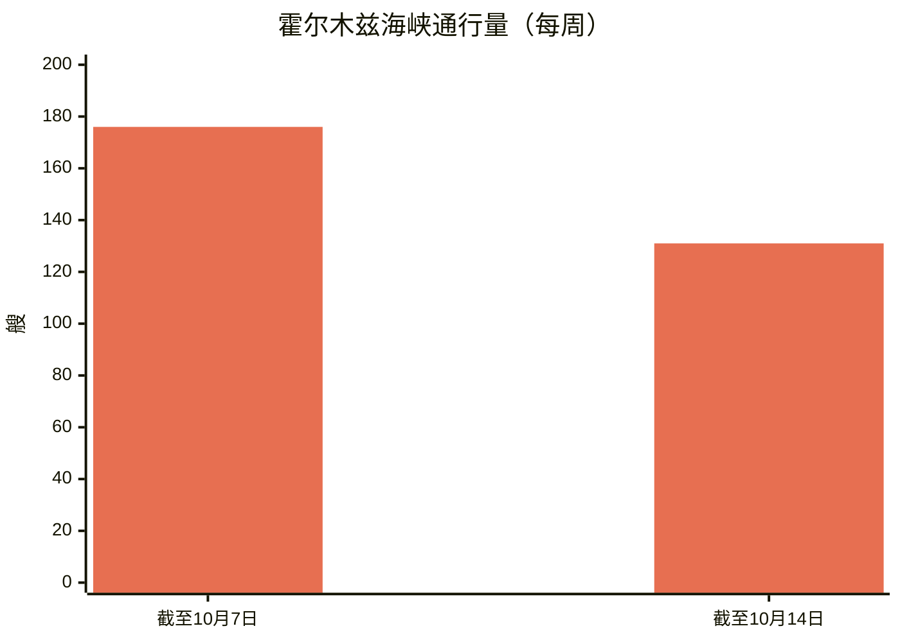

*注：Kpler数据；截至10月7日一周：176艘；截至10月14日一周：131艘。*

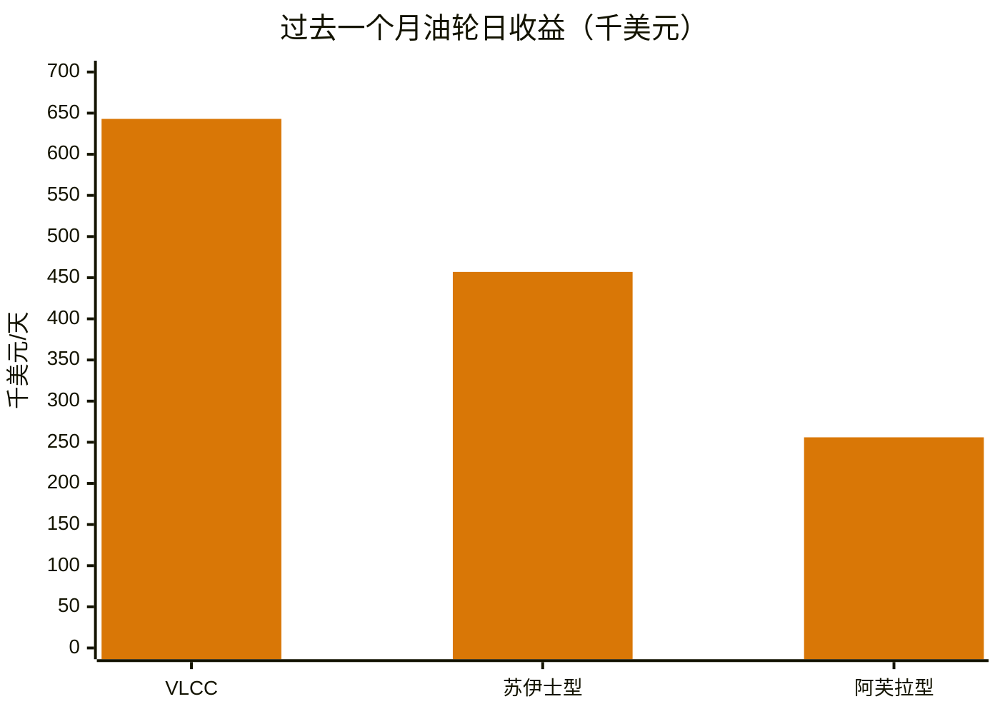

*注：经纪公司Hartland经由Splash247的估计；VLCC日均64.3万美元、苏伊士型45.7万美元、阿芙拉型25.6万美元；中东湾–中国VLCC航次超过每日130万美元（Veson）。*

### 3.3 中国9月1,335亿美元顺差与人工智能贸易热潮

中国海关总署10月14日公布，9月出口同比增长36.3%至4,471.8亿美元——为2月以来最快，高于25.5%的预期——进口增长31.0%至3,136.6亿美元。月度顺差1,335亿美元，为2025年1月以来最大、20个月新高。1–9月顺差达9,385亿美元，连续第二年突破1万亿美元在望（2025年纪录约为1.2万亿美元）。对美出口增长9.8%，双边顺差约340亿美元，为20个月新高——尽管经历了两年的关税升级。海关数据显示高技术产品出口（半导体年初至今约增长108%）贡献了出口增量的一半左右。

宏观机构读到了同样的信号。世贸组织10月8日《全球贸易展望与统计》将2026年商品贸易量预测从3月的1.9%上调至3.9%，上半年人工智能赋能商品贸易同比增长67%，占贸易额增量的47%——占世界商品贸易的14.8%。总干事奥孔乔-伊韦阿拉的警告一针见血："人工智能的影响正在掩盖贸易中的其他趋势，而这些趋势并不乐观。"联合国贸发会议10月9日《2026年贸易和发展报告》预计2026年全球增长2.6%，低于2025年的2.9%，并指出中美贸易自2024年以来下降超过20%。国际货币基金组织10月13日《世界经济展望》预计2026年全球增长3.1%（2025年为3.5%），人工智能投资抵消了中东能源冲击；其基线假设霍尔木兹海峡于3月重新开放，并估计封锁使全球增长下降约0.9个百分点，经对冲后净影响约为0.3个百分点。

**分析：** 人工智能硬件周期正在为世界贸易量承担重任——而且不成比例地利好中国。在关税战背景下中国对美出口增长9.8%的悖论，反映了转口、前置出货和人工智能资本开支的强大拉动；这也解释了为什么华盛顿在休战期的"合规"叙事与数据格格不入。

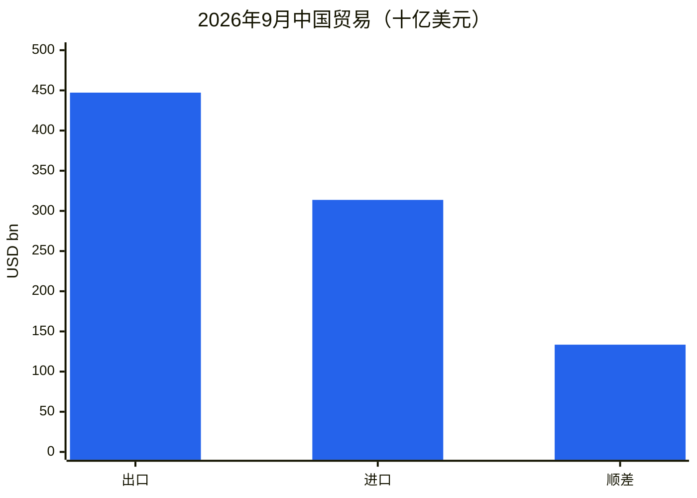

*注：海关总署10月14日发布；出口4,471.8亿美元（同比+36.3%），进口3,136.6亿美元（同比+31.0%），顺差1,335亿美元。*

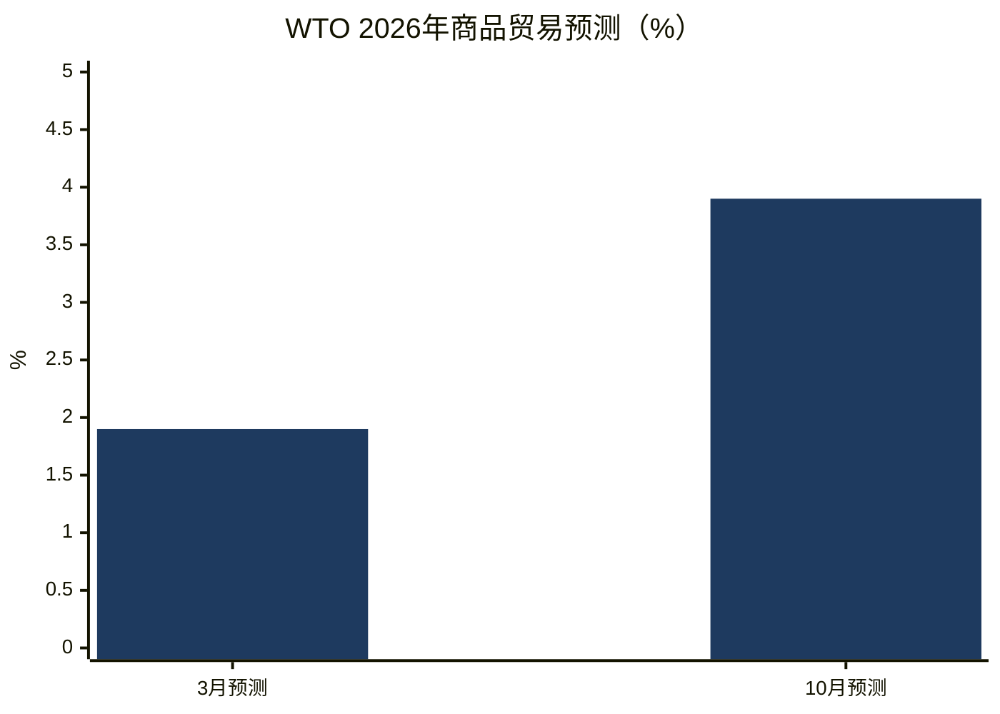

*注：世贸组织《全球贸易展望与统计》，2026年10月8日；上半年人工智能赋能商品同比+67%，占贸易额增量的47%。*

### 3.4 欧洲明确贸易防御方向

10月15–16日欧洲理事会峰会给出了本周欧盟贸易政策最明确的方向信号。领导人责成欧盟委员会继续与北京对话——下次会议定于2027年3月——同时"充分运用"现有贸易防御措施并制定新的工具。10月5日的法德联名信主导了讨论，该信提议欧盟拥有"不逊于"美国301条款或中国关键矿产限制的权力：更快、覆盖全行业的贸易防御调查，对化工、PET和混合动力汽车采取紧急行动，以及对损害欧盟的国家更快报复。德国的转变值得注意——两年前柏林还反对欧盟对电动车的反补贴关税。

背景是10月8–9日北京回合达成的16点共识，峰会必须对其作出解读。欧盟委员会执行副主席谢夫乔维奇与王文涛部长的第二次贸易和投资磋商机制发表联合声明，内容包括：混合动力汽车贸易符合世贸组织的谅解（据报道上限为每年35万辆，可使中国混动出口减少一半以上）、中国将新能源汽车出口退税降至13%、稀土和永磁许可证"绿色通道"、欧盟反补贴电动车案中继续价格承诺程序，以及探讨对约40亿欧元欧盟出口产品给予最惠国关税减让，至少节省2.25亿欧元关税。北京公布的文本没有混动出口减半的数字——审查信息将欧盟的说法与北京的文本并列为存在分歧，执行机制也未披露。2025年欧盟对华货物贸易逆差达3,600亿欧元（约4,000亿美元），2026年有望超过这一水平。

**分析：** 布鲁塞尔正走向更强硬、更快的贸易防御姿态，同时保持谈判渠道畅通——经典的双轨策略。试金石将是法德联名信点名的紧急行业（化工、PET、混动汽车），以及混合动力汽车谅解在没有共同文本的情况下能否得到执行。

### 3.5 稀土：感恩节棋局

财政部长贝森特10月18日在福克斯新闻《周日早间未来》节目中表示，华盛顿希望"有望"在感恩节（11月27日）前与中国敲定稀土协议。据报道，协议条款将是中国暂停某些关键矿产出口限制一年，稀土"像4月4日之前一样自由流动"——中国是在4月4日为回应美国关税而实施出口许可要求的。一家媒体将该协议描述为已在10月底韩国举行的特朗普–习会晤上达成；该说法未经证实，审查信息中唯一确立的是贝森特的表态。

另一条轨道是BIS关联企业规则。2025年9月29日的临时最终规则——自2025年11月10日起暂停至2026年11月9日——将把《出口管理条例》限制自动延伸至被实体清单、军事最终用户清单或特定SDN当事人直接、间接或合计持股至少50%的外国实体，并规定肯定的所有权尽职调查义务（红旗29）。随着美中休战延长至2027年1月10日，Crowell & Moring在10月14日的评估认为该规则的重新实施应随之顺延——但截至10月14日，BIS尚未发布正式延长暂停的《联邦公报》通知。

**分析：** 两个时钟同时在走。政治时钟以感恩节为稀土协议目标；监管时钟则是11月10日关联企业规则硬性重新实施日，而正式延期尚未公布。合规团队不能依赖媒体对意图的评估——除非BIS采取行动，该规则将按自身条款自动恢复。

### 3.6 美中休战：合规期，没有大豆

美中贸易休战延续至2027年1月10日——贝森特部长于9月23/24日宣布延长两个月，短于市场预期的六至十二个月。USTR格里尔将休战期描述为评估中国在大豆采购和稀土准入方面履约情况的"合规期"。据格里尔，自关税战开始以来，美国对华货物贸易逆差已下降近40%。

实质内容上，"30对30"框架——双方各约300亿美元的非敏感商品——并未运行：中国提议1,619个美国产品税号（玉米、肉类、棉花、高粱、大麦、燕麦、豆油，但不包括食用或压榨用大豆）；美国列出77个可能降税的税号（家居用品、玩具）。截至10月中旬，未公布税率或开始日期。大豆没有新的采购承诺：中国在更早的协议中承诺2026、2027和2028年每年2,500万吨，美国农业部出口销售数据显示2026–27年度已签约约1,020万吨，中国对美国大豆10%的报复性关税仍然有效，限制了私人买家的准入。

**分析：** 休战是僵持，不是解决。随着USTR 10月7日的301条款延续通知使2018年所有关税继续有效——清单1约340亿美元25%、清单2约160亿美元25%、清单3约2,000亿美元25%、清单4A约1,200亿美元7.5%——以及2026年5月6日开启的第二次四年期复审（可以提高税率），关税架构已经固化，与休战的命运无关。

### 3.7 运费：10月反弹与苏伊士复航

德路里世界集装箱指数在10月15日评估中上涨3%至4,485美元/FEU——亚欧航线是涨幅来源：上海–鹿特丹+6%至3,522美元，上海–热那亚+7%至3,945美元，为连续13周下跌后亚欧航线首次上涨。跨太平洋涨跌互现：上海–洛杉矶+3%至7,884美元，上海–纽约−1%至10,075美元。德路里预计未来波动减小。反弹源于船公司黄金周后的提价推动——地中海航运自10月19日起的亚欧新FAK定为3,150美元/TEU和4,500美元/FEU——以及第43–47周宣布的44个停航（在713个计划航次中取消率为6%），其中亚欧/地中海占停航的44%。

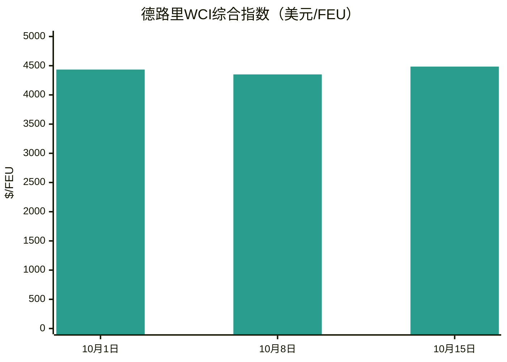

*注：德路里周四评估；10月1日：4,434美元（−1%）；10月8日：4,351美元（−2%）；10月15日：4,485美元（+3%）。*

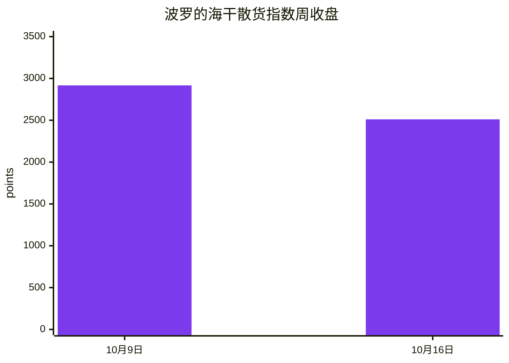

*注：周五收盘；10月9日：2,917点（当周−7.3%）；10月16日：2,511点（当周−14%），为6月30日以来最低。*

结构性压力则朝相反方向。Linerlytica报告TEU–海里需求增长自1月以来首次倒退，而快于预期的苏伊士复航——所有集装箱联盟加地中海航运将在10月底前派部分船舶经红海；据报道第39周苏伊士通行量同比增长68%——是支撑船公司运价的主要威胁。9月交付约20万标准箱新造船运力，零拆解。亚欧航线运价自7月以来下跌约60%，但仍高于3,000美元/FEU——较一年前高出约70%——2027年招标季已经开始。巴拿马运河管理局自10月15日起将每日预约总船闸提高至33个，进一步增加供给。

干散货走势相反。波罗的海干散货指数连续第三周下跌，10月16日收于2,511点——当周下跌14%，为6月30日以来最低。好望角型指数周跌25%至3,249点（4月初以来最低），因铁矿石疲软，周中触及两年低点。巴拿马型下跌1.8%至2,314点；超灵便型是例外，上涨9点至1,865点。

### 3.8 关税负担：家庭实际支付多少

本周三份研究报告量化了美国关税对家庭的负担。耶鲁预算实验室的现行法律估计，关税使每户每年成本约1,100美元，反映全面传导后整体物价水平上升约0.7%；平均法定关税税率现为11%，预计2026年底达到11.8%，平均每户每月约92美元。8月征收的关税达到进口额的7.1%，而2025年1月为2.3%——若无行为规避，本应为10.1%。宾夕法尼亚大学沃顿预算模型10月14日更新发现，2025年1月至2026年8月新关税带来3,148亿美元海关总收入（IEEPA退款前），行为变化导致607亿美元收入落空；IEEPA征收总额约1,660亿美元，全部面临退款，截至10月2日海关与边境保护局已认证约1,260亿美元（76%）。截至2026年7月，美国平均实际关税税率为6.7%——约为2025年1月2.3%的三倍——中国面临22.8%、钢铁和铝40.5%、汽车13%。税收基金会8月的追踪显示2026年平均实际税率为6.6%，为1969年以来最高，2026年每户约820美元。

**分析：** 三个模型指向同一图景——关税制度约为2025年1月时的三倍重，平均每户每年成本约1,000美元，IEEPA退款管道（1,660亿美元面临退款、1,260亿美元已认证）是贸易战中待定的最大财政转移。

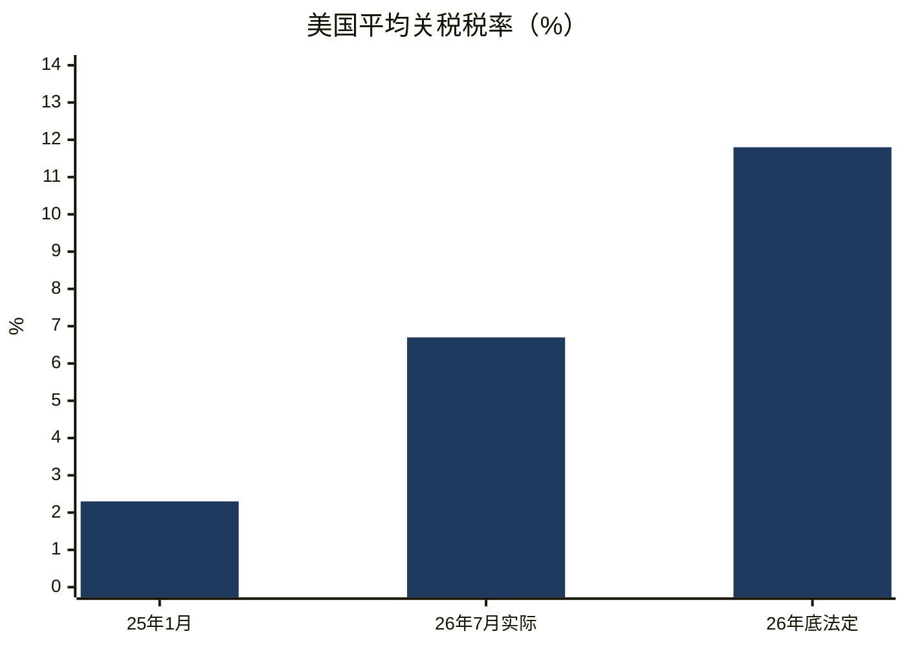

*注：2025年1月实际2.3%；2026年7月实际6.7%（宾大沃顿；税收基金会2026年日历年为7.2%）；2026年底法定11.8%（耶鲁预算实验室）。*

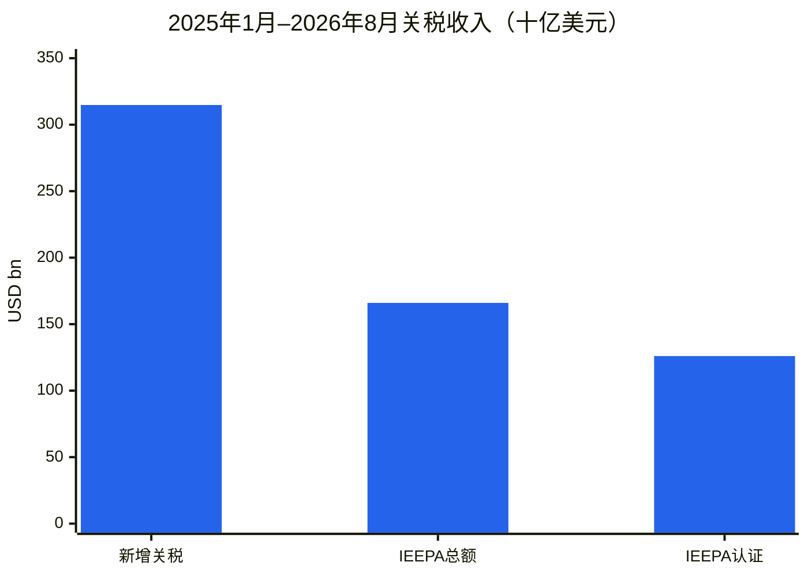

*注：宾大沃顿预算模型10月14日更新；IEEPA退款前的海关总收入；IEEPA认证=截至10月2日海关认证待拨付金额。*

---

## 4. 关税追踪

| 国家/地区 | 措施 | 税率 | 生效日期 | 状态 | 来源 |
|---|---|---|---|---|---|
| 美国 | 格雷厄姆法案第112/113条关税+制裁条款（俄罗斯商品500%；对俄罗斯能源最大买家和规避协助方100%二级关税） | 已豁免——0% | 豁免于2026年10月16日签署；无终止日期 | 依据第115条豁免；可由总统/国务卿认定重新激活；USTR监测中 | [whitehouse.gov](https://www.whitehouse.gov/presidential-actions/2026/10/implementing-the-lindsey-o-graham-sanctioning-russia-and-iran-act-of-2026/) |
| 美国 | 对符合USMCA的移动式工业设备（叉车、推土机、反铲装载机、拖拉机、移动式起重机）的232条款，美产成分≥40% | 25% → 15%（下调） | 2026年10月14日 | BIS计算指引已发布（FR 2026-20938） | [federalregister.gov](https://www.federalregister.gov/public-inspection/2026-20938/guidance-to-us-customs-and-border-protection-regarding-the-assessment-of-us-content-for-purposes-of) |
| 美国 | 对中国关联船舶的301条款港口费（暂停到期） | 恢复至80美元/净吨（中国船东/运营人）；23美元/净吨或153美元/卸箱（中国建造、非中国运营人）；46美元/净吨（外国建造汽车运输船） | 2026年11月9日23:59（美东时间） | 截至10月13日USTR未延期；200多个协会在9月23日要求延期 | [Gateway Lines](https://gatewaylines.com/press-releases/china-ship-fees-301-exclusions-nov-9-2026) |
| 美国 | 178项301条款产品豁免（HTS 9903.88.69/70） | 清单1/2/3回升至25%；清单4A回升至7.5% | 2026年11月9日23:59（美东时间） | 到期；无宽限期 | [Thomson Reuters](https://tax.thomsonreuters.com/blog/section-301-exclusions-expiration/) |
| 美国 | 301条款对华措施（2018年）延续 | 清单1/2：25%；清单3：25%；清单4A：7.5% | 生效中（2026年10月7日延续通知） | 已延续；2026年5月6日开启第二次四年期复审——税率可上调 | [facohub.com](https://facohub.com/posts/weekly-009) |
| 美国 | 强迫劳动301条款行动（60个经济体） | 10% / 12.5% | 自2026年7月24日起生效 | 生效中；仍在国际贸易法院诉讼 |  |
| 美国 | FMC提议对西班牙籍船舶收费 | 每航次20万美元+对所列西班牙商品进口限制 | 2026年10月16日提议 | 提议阶段 | [Supply Chain Dive](https://www.supplychaindive.com/news/fmc-proposes-fees-on-spanish-flagged-vessels-import-restrictions/833122/) |
| 中国 | 人工智能技术出口管制草案（第48号公告） | 禁止（14项）/限制（26项）技术 | 征求意见至2026年11月15日；出口前登记10月16日生效 | 草案阶段 | [aiandgpp.com](https://aiandgpp.com/2026/10/19/china-ai-export-controls-model-weights-sovereign-cloud/) |
| 中国 | 新能源汽车出口退税下调 | 退税降至13% | 2026年10月8–9日达成 | 按欧中16点共识 | [peoplesdaily.pdnews.cn](https://peoplesdaily.pdnews.cn/china/er/30053309352) |
| 中国 | 对欧混合动力汽车出口——符合世贸组织的谅解 | 据报道上限每年35万辆 | 2026年10月8–9日达成 | 欧盟说法；北京文本未给出数字 | [peoplesdaily.pdnews.cn](https://peoplesdaily.pdnews.cn/china/er/30053309352) |
| 欧盟 | 法德快速反应贸易工具提议 | 不适用（提议） | 10月5日提议；10月15–16日峰会讨论 | 峰会责成制定新工具 | [985theriver.com](https://985theriver.com/2026/10/05/france-germany-propose-new-rapid-eu-trade-response-tool/) |
| 欧盟 | 欧美关税安排（第2026/1455、2026/1461号法规） | 取消欧盟对美国工业品的剩余关税；若2026年12月31日美国钢铝关税仍超15%则启动保障 | 2026年7月1日–2029年12月31日适用 | 生效中；分层保障架构 | [Mondaq](https://www.mondaq.com/italy/export-controls-trade-investment-sanctions/1848092/euus-tariff-agreement-the-new-regulations-and-their-safeguard-architecture) |
| 欧盟 | CBAM——俄罗斯争端专家组DS639成立 | 不适用（争端） | 专家组于2026年10月3日成立 | 专家组阶段；欧盟仅与专家组接触 | [news.metal.com](https://news.metal.com/newscontent/104143673-wto-establishes-cbam-dispute-panel-at-russias-request) |
| 英国 | 中国电动车关税（最高45.3%）——决定不征收 | 0%（保留未来选项） | 2026年10月14日决定 | 未征收；11月20日英欧峰会 | [Fleet News](https://www.fleetnews.co.uk/news/minister-reportedly-resists-calls-for-uk-to-impose-chinese-ev-tariffs) |
| 英国 | 钢铁保障制度（免税配额削减；超配额关税50%） | 超配额50% | 2026年7月1日起生效 | 印度寻求约6类/88个钢铁税号豁免 | [buildwatchnews.com](https://buildwatchnews.com/india-seeks-steel-export-exemptions-uk-safeguard-tariffs/) |
| 加拿大 | 木质橱柜/浴室柜临时保障附加税（代码26169A） | 25% | 2026年7月31日（最长200天） | 生效中；10月7日公布细则 | [adamcabinet.com](https://www.adamcabinet.com/post-canada-cabinet-surtax.html) |
| 加拿大 | 对约900项美国原产商品的反制关税（15/25/50%） | 射箭设备（9506.99.00）50% | 2026年9月8日 | 对276亿加元进口生效 | [csaaa.org](https://www.csaaa.org/2026/10/15/50-tariffs-on-archery-equipment-hits-canadian-businesses-hard/) |
| 日本 | 扩大对俄出口禁令（矿产、化工、金属、机械、精密仪器） | 禁止 | 2026年10月16日 | 生效中（内阁10月2日决定；10月9日颁布政令） | [Steptoe](https://www.steptoe.com/en/news-publications/international-compliance-blog/weekly-sanctions-update-october-13-2026.html) |
| 韩国 | 修订《对外贸易法》（限制依据从5项增至9项） | 不适用 | 2026年10月22日 | 实施令10月13日获批 | [LinkedIn / Don Southerton](https://www.linkedin.com/pulse/week-review-sunday-october-18-2026-short-version-don-southerton-vkbkc) |
| 印度 | 印度–新西兰自贸协定 | 新西兰：首日对印度出口零关税；印度：原木、焦煤、废金属免税 | 2026年10月20日 | 即将生效 | [Karmactive](https://www.karmactive.com/india-new-zealand-free-trade-agreement-2026/) |
| 印度 | 欧盟自贸协定钢铁配额 | 约164万吨零关税配额（约占对欧年出口约240万吨的68.4%）；超配额罚50%；无CBAM等效则征35%碳税 | 自贸协定文本（9月11日附件） | 配额较欧盟2026年6月单边运营配额低约30万吨 | [takshashila.org.in](https://takshashila.org.in/content/blogs/2026-10-12-India-EU-FTA-and-its-steel-challenges.html) |
| 巴西/南方共同市场 | 南共市–欧洲自由贸易联盟自贸协定 | 取消巴西对EFTA约99%出口额的关税 | 2026年10月1日（第13,126号法令） | 生效中 | [datamarnews.com](https://datamarnews.com/noticias/mercosur-efta-trade-agreement-brazil-business-opportunities/) |
| 马达加斯加 | 糖及巧克力/可可糖果保障调查 | 不适用（调查） | 10月9日通报；2026年11月9日前提交意见 | 世贸组织通报的调查 | [freightnews.co.za](https://www.freightnews.co.za/article/madagascar-launches-safeguard-investigation-on-certain-confectionery) |
| 澳大利亚 | 澳大利亚–欧盟自贸协定批准 | 取消约98%澳大利亚出口关税（牛肉3.5万吨；羊肉约3.1万吨） | 2027年初提交议会 | 国家党威胁否决——将是澳大利亚首个未获批准的自贸协定 | [particle.news](https://particle.news/story/coalition-split-threatens-passage-of-australiaeu-10bn-free-trade-deal) |
| 加蓬 | 家禽进口禁令（美国在世贸组织提出异议） | 禁令 | 异议/磋商阶段 | 美国质询9月18日获确认；2023年冻禽进口约8,630万美元 | [malivoice.com](https://malivoice.com/gabons-poultry-import-ban-heads-to-a-wto-dispute-with-washington/) |

---

## 5. 美国政策深度解析

### 格雷厄姆法案豁免

第2节（A1）和第3.1节已有深入报道。10月16日的实施行政命令规定了法定税率——俄罗斯原产商品500%、对10月18日或之后新增采购的前五大俄罗斯原油和天然气进口国100%二级关税、对前五大制裁规避协助方100%——随后依据第115条以国会国家利益书面认证予以豁免，无终止日期。此前依据国家紧急状态授权的对俄制裁保留。USTR负责监测俄罗斯能源采购。随后出现两党批评；白宫未给出详细公开解释。

### BIS——出口管制

**移动式工业设备"美产成分"指引。**《联邦公报》通知2026-20938（91 FR 65162）于10月14日发布并生效，实施2026年6月1日第11032号总统公告第(2)(D)款。符合USMCA的移动式工业设备——叉车、推土机、反铲装载机、拖拉机、移动式起重机——在美产成分至少占价值40%的情况下适用下调后的232条款税率25% → 15%。美产成分定义为：(a)在美国全部获得、完全生产或实质性转变的零部件价值，加上(b)在美国熔炼浇注的钢铁、在美国冶炼浇铸的铝和/或在美国冶炼浇铸的铜的价值（未计入部分）。该规则适用于2026年10月14日美东时间凌晨0:01或之后进入消费或从仓库提取的货物。([federalregister.gov](https://www.federalregister.gov/public-inspection/2026-20938/guidance-to-us-customs-and-border-protection-regarding-the-assessment-of-us-content-for-purposes-of))

**关联企业规则暂停。** 临时最终关联企业规则（2025年9月29日）自2025年11月10日至2026年11月9日暂停，将把《出口管理条例》限制自动延伸至被实体清单、军事最终用户清单或特定SDN当事人直接、间接或合计持股至少50%的外国实体，并规定肯定的所有权尽职调查义务（红旗29）。随着休战延长至2027年1月10日，预计暂停随之顺延，但截至10月14日BIS尚未发布正式延长暂停的《联邦公报》通知。([Mondaq / Crowell & Moring](https://www.mondaq.com/unitedstates/export-controls-trade-investment-sanctions/1854664/us-china-trade-truce-extended-two-months-bis-affiliates-rule-suspension-follows))

### IEEPA退款：第三阶段与集体诉讼

海关与边境保护局的CAPE第三阶段按其9月15日向国际贸易法院的声明于10月6日上线，为最终清算的IEEPA报关单开启退款——但仅限于待决国际贸易法院案件原告的备案进口商（IOR编号须在2026年7月30日前提交，之后滚动提交）。第三阶段覆盖约114亿美元，约占IEEPA关税的6.9%。截至10月2日，CAPE已接受约1,366亿美元的潜在和认证退款；约1,260亿美元已认证并送交财政部拨付；约20,184笔退款（约13亿美元）因缺少ACH信息被暂扣。退款在接受后60–90天到账，按19 CFR 24.36计息；ACE接受每份申报最多9,999条报关单的CSV上传。另外，10月8日国际贸易法院在*Freestyle World诉CBP*案（No. 26-01088）中认证了集体诉讼，覆盖2025年2月1日至2026年2月19日期间缴纳IEEPA关税的备案进口商——但尚未为该集体下令救济。政府已上诉（*V.O.S. Selections诉特朗普*案，No. 26-1895，联邦巡回法院），主张国际贸易法院不能为未参与诉讼的进口商下令退款；上诉未决。（来源：[Supply Chain Dive](https://www.supplychaindive.com/news/cbp-starts-paying-out-ieepa-tariff-refunds-for-finally-liquidated-entries/832411/)、[Thompson Hine](https://www.thompsonhine.com/insights/cbp-confirms-october-6-2026-launch-of-phase-3-of-the-ieepa-tariff-refund-process/)、[gingercontrol](https://gingercontrol.com/blog/ieepa-tariff-refund-guide))

### 11月9日双重截止

两项措施于2026年11月9日（周一）美东时间23:59到期。第一，USTR对中国关联船舶301条款港口费的一年暂停（FR 2025-19873）：中国船东和运营人恢复80美元/净吨，中国建造、非中国运营人船舶取23美元/净吨与每卸箱153美元中的较高者，外国建造汽车运输船46美元/净吨。第二，178项301条款产品豁免（FR 2025-21671，HTS 9903.88.69和9903.88.70项下申报）：清单1/2/3产品关税回升至25%，清单4A回升至7.5%，无宽限期，且豁免仅免除301条款这一层——最惠国、232和反倾销/反补贴关税照常适用。截至10月13日，没有《联邦公报》通知调整任一日期；200多个贸易协会于9月23日致函USTR要求延长港口费。贸易商应将11月9日视为终止日。（来源：[Gateway Lines](https://gatewaylines.com/press-releases/china-ship-fees-301-exclusions-nov-9-2026)、[Thomson Reuters](https://tax.thomsonreuters.com/blog/section-301-exclusions-expiration/)）

### USTR

10月7日的延续通知（91 FR 64212，FR Doc 2026-20510）确认2018年7月6日和8月23日的301条款行动继续有效——USTR收到162份延续申请，一份即已足够。架构得以保留：清单1约340亿美元25%、清单2约160亿美元25%、清单3约2,000亿美元25%（2019年5月10日从10%上调）、清单4A约1,200亿美元7.5%。2026年5月6日开启的第二次四年期复审随后进行，可以提高税率——上一轮将半导体提高至50%（2025年）、太阳能电池提高至50%（2024年）、钢铁/铝提高至25%（2024年）。同日的一致性通知（FR Doc 2026-20511）就2026年7月1日的HTS统计代码变更修订了一项豁免。新闻搜索未发现窗口内USTR新闻稿。([facohub](https://facohub.com/posts/weekly-009))

### CBP运营与执法

**暂扣放行令。** 9月29日CBP依据19 U.S.C. §1307对印度尼西亚Mitra Aneka Rezeki（MAR）和Hardaya Inti Plantation（HIP）的棕榈油及衍生产品发布暂扣放行令，立即生效。审查信息援引访谈记录、工资单、采收配额、照片、非政府组织和政府报告、新闻媒体及学术研究；发现MAR工人受九项国际劳工组织强迫劳动指标约束，HIP七项。现行暂扣放行令总数达60项，另有8项裁定。([Thompson Hine](https://www.thompsonhine.com/insights/cbp-issues-withhold-release-orders-on-two-indonesian-palm-oil-producers/))

**海关用户费。** 2027财年调整10月1日生效：海关经纪人许可用户费从185.38美元升至190.88美元；货物处理费费率维持0.3464%不变，最低34.58美元、最高670.86美元（CSMS #69847323；《联邦公报》通知2026年7月31日发布）。

**FMC对西班牙行动。** 见预警A7：在2024年调查认定西班牙拒绝美国籍船舶靠港——两艘马士基海事安全计划船舶被拒绝——之后，联邦海事委员会提议对西班牙籍船舶每航次收费20万美元，并对西班牙香水化妆品、油脂、陶瓷、石材制品、糖和糖果实施进口限制。([Supply Chain Dive](https://www.supplychaindive.com/news/fmc-proposes-fees-on-spanish-flagged-vessels-import-restrictions/833122/))

### 《联邦公报》——10月15日反倾销/反补贴

10月15日发布五份商务部反倾销/反补贴通知（仅标题；来源为付费墙）：意大利某意大利面（A-475-818）——2024–2025年反倾销行政复审初裁结果及部分撤销；阿曼某钢钉（A-523-808）——初裁结果及拟部分撤销；意大利锻钢流体端块（A-475-840）——法院判决不一致及修订终裁结果；中国木线条和木制品——反补贴（C-570-118）和反倾销（A-570-117）法院判决不一致及修订终裁结果通知。税率不可见。([International Trade Today](https://internationaltradetoday.com/article/2026/10/15/commerce-department-antidumping-and-countervailing-duty-notices-for-oct-15-2610150042))

### 常规事项

- **美中休战**至2027年1月10日；"30对30"框架未运行；无新的大豆承诺（见3.6）。
- **稀土：** 贝森特"有望在感恩节前"目标（见3.5和A8）。
- **小额免税：** CBP自2026年6月24日起暂停非邮政货件的免税——背景，窗口之前。
- **301条款清单3/4A诉讼**已终结（最高法院2026年6月15日拒绝受理）——该理论无退款。成熟制程半导体301条款行动已决定但推迟至2027年6月。强迫劳动301条款行动（60个经济体，10%/12.5%，2026年7月24日生效）继续有效，仍在国际贸易法院诉讼。

---

## 6. 分区域世界政策

### 欧洲

**欧盟领导人峰会（布鲁塞尔，10月15–16日）。** 领导人责成欧盟委员会继续与北京对话——下次会议定于2027年3月——同时"充分运用"现有贸易防御措施并制定新的工具。法德关于快速反应报复工具的提议主导了讨论，该工具"不逊于"美国301条款关税或中国关键矿产限制：更快、覆盖全行业的贸易防御调查，对化工、PET和混合动力汽车采取紧急行动，以及对损害欧盟的国家更快报复。2025年欧盟对华货物贸易逆差达3,600亿欧元（约4,000亿美元），2026年有望超过这一水平。([bworldonline](https://bworldonline.com/world/2026/10/15/787181/eu-leaders-to-tackle-china-exports-energy-prices-budget-at-summit/))

**欧中16点共识（北京，10月8–9日）。** 谢夫乔维奇委员与王文涛部长之间的第二次贸易和投资磋商机制发表联合声明：混合动力汽车贸易符合世贸组织的谅解（据报道上限为每年35万辆，可使中国混动出口减少一半以上——但北京公布的文本未给出数字）；中国将新能源汽车出口退税降至13%；稀土和永磁许可证"绿色通道"；欧盟反补贴电动车案中继续价格承诺程序；探讨对约40亿欧元欧盟出口产品给予最惠国关税减让，至少节省2.25亿欧元关税。部长级视频会议定于2027年1月，第三次磋商定于2027年3月。([peoplesdaily.pdnews.cn](https://peoplesdaily.pdnews.cn/china/er/30053309352))

**英国决定不对中国电动车加征关税（10月14日）。** 商务大臣乔纳森·雷诺兹向《卫报》表示，英国不会迫于欧盟压力而跟进欧盟对中国电动车最高45.3%的关税：贸易防御决定"基于英国利益——不是基于其他国家的任何要求"。关税仍是"未来的选项"；英欧峰会定于11月20日在布鲁塞尔举行。此前10月4–7日的报道称雷诺兹正在起草配套45%的方案，政府强调该方案尚未决定。([Fleet News](https://www.fleetnews.co.uk/news/minister-reportedly-resists-calls-for-uk-to-impose-chinese-ev-tariffs))

**英国钢铁保障与印度的豁免申请。** 印度正就英国新保障制度（2026年7月1日生效：免税钢铁配额削减、超配额关税50%）寻求约6个产品类别、覆盖88个钢铁税号的钢铁豁免。另外，10月12–13日的印英全面经济贸易协定（CETA）实施推进——该协定7月15日生效以来的首次联合经济和贸易委员会——在班加罗尔宣布了超过10亿英镑的新商业协议，孟买设立CETA市场，约200家英国企业代表团随行。（来源：[buildwatchnews](https://buildwatchnews.com/india-seeks-steel-export-exemptions-uk-safeguard-tariffs/)、[pravasisamwad](https://pravasisamwad.com/india-uk-trade-deal-expected-to-boost-exports-jobs-and-business-opportunities/)）

**印欧自贸协定钢铁配额缺口。** 10月12日公布的自贸协定文本分析显示，印度获得约164万吨钢铁配额——覆盖其对欧年出口约240万吨的68.4%，零关税，超配额罚50%——但9月11日的自贸协定附件锁定的基线较欧盟2026年6月单边运营配额低约30万吨。除非印度获得CBAM等效，所有出口仍面临35%的碳税。([Takshashila](https://takshashila.org.in/content/blogs/2026-10-12-India-EU-FTA-and-its-steel-challenges.html))

**南方共同市场势头。** 巴西代理部长马尔西奥·埃利亚斯·罗萨10月13日表示，巴西对欧出口5–9月增长30.7%（1–9月出口441.7亿美元，+20%），协定生效以来双边南共市–欧盟贸易增长超过60亿美元。巴西出口投资促进局（ApexBrasil）10月12–16日在布鲁塞尔游说欧洲议会议员安排批准投票。阿根廷对欧农工出口5–8月达19.2亿美元，+21%（关税优惠产品+44%）。巴西的南共市–欧洲自由贸易联盟自贸协定10月1日生效（第13,126号法令），取消巴西对EFTA约99%出口额的关税。([datamarnews](https://datamarnews.com/noticias/mercosur-eu-trade-deal-boosts-brazilian-exports-by-30-7/))

**欧盟碳排放交易体系航运争端。** 英国港口协会驳斥了西班牙欧盟碳排放交易体系观察站的结论——该结论称英国集装箱增长反映了碳成本规避——将增长归因于投资——2025年85%的增长集中在伦敦，因迪拜环球港务3.5亿英镑的伦敦门户第四泊位于2024年底投运——以及联盟重组（马士基的双子星从费利克斯托转向伦敦门户）。英国政府数据显示港口2025年处理集装箱增长11%（+60万标箱）；伦敦门户超过300万标准箱（从190万增长52%）。西班牙研究发现，英国在北欧深海航运（TEU–海里）中的份额从2023年的17.5%升至2026年第一季度的约36%，76%的航线变化归因于欧盟碳排放交易体系。欧盟委员会7月提议，距欧盟港口150海里以内的非欧盟港口可被排除在"挂靠港"碳排放交易体系定义之外，中转门槛从65%降至50%。（来源：[Splash247](https://splash247.com/uk-ports-hit-back-at-brussels-over-ets-diversion-claims/)、[The Loadstar](https://theloadstar.com/uk-port-volume-growth-not-due-to-eu-shippers-avoiding-ets-says-bpa/)）

### 中国

**人工智能出口管制草案。** 见预警（A4）和第3.4节：10月16日第48号公告就40项技术列入禁止/限制目录公开征求意见至11月15日（14项禁止、26项限制；23项与人工智能相关），阈值包括参数超过2万亿的LLM权重、训练算力超过10²⁶ FLOPs或全球排名前十的模型；出口前登记要求即时生效，包括进行中的交易。API/SaaS访问被排除；境外部署被纳入。([aiandgpp.com](https://aiandgpp.com/2026/10/19/china-ai-export-controls-model-weights-sovereign-cloud/))

**欧中16点共识。** 见第3.4节：混合动力汽车谅解（据报道上限每年35万辆）、新能源汽车退税降至13%、稀土绿色通道、对约40亿欧元欧盟出口的最惠国探索。

**中国对欧盟对硝基甲苯发起反倾销调查**（上周窗口延续）——该化工行业现被列入法德紧急行动清单的背景。

### 印度

**印度–新西兰自贸协定10月20日生效。** 新西兰首日取消对印度出口的全部关税；印度给予新西兰原木、焦煤和废金属免税准入（农业仍受配额保护）；200亿美元投资框架；每年5,000个技术工作签证加1,000个打工度假签证。在保护主义之年罕见的新自由化举措。([Karmactive](https://www.karmactive.com/india-new-zealand-free-trade-agreement-2026/))

**英国钢铁保障豁免申请与欧盟钢铁配额缺口**——见欧洲部分。

### 土耳其

窗口内未发现土耳其政府措施；TradeInt 9月30日与土耳其贸易部的合作（向本地咨询公司提供资助，获取覆盖200多个国家的舱单记录、海关申报和提单数据）恰在窗口之外，记于供应商情报项下。

### 加拿大

**保障与反制关税执法。** 加拿大边境服务局26-17号通知细则（10月7日发布说明）：自7月31日起对木质橱柜和浴室柜征收25%临时保障附加税，最长200天（保障代码26169A）。加拿大运动枪械弹药协会10月15日报告，射箭设备（税号9506.99.00）自9月8日起面临50%反制关税，属覆盖276亿加元进口的约900项、15/25/50%美国原产反制关税一揽子措施，9月8日起生效。加拿大边境服务局的核查重点已大幅转向附加税令（中国电动车/钢铁/铝；美国2025-1、钢铁/铝、机动车辆）。（来源：[adamcabinet.com](https://www.adamcabinet.com/post-canada-cabinet-surtax.html)、[csaaa.org](https://www.csaaa.org/2026/10/15/50-tariffs-on-archery-equipment-hits-canadian-businesses-hard/)）

**蒙特利尔港劳工稳定。** 1,200多名码头工人（CUPE 375）的新五年集体协议（追溯覆盖2024–2028年）经有约束力的利益仲裁确定，在2024年罢工扰乱服务约1.1亿人口的供应链之后——为这一关键加美门户带来多年稳定。([newswire.ca](https://www.newswire.ca/news-releases/a-new-five-year-collective-agreement-takes-effect-ensuring-stability-at-the-port-of-montreal-841357271.html))

### 日本

**扩大对俄出口禁令（10月16日生效）。** 经济产业省依据《外汇及外国贸易法》将矿产、化工、金属、机械、工业设备和精密仪器列入出口禁止清单，此前内阁10月2日作出决定；修订后的《出口贸易管理令》于10月9日颁布。([Steptoe](https://www.steptoe.com/en/news-publications/international-compliance-blog/weekly-sanctions-update-october-13-2026.html))

### 韩国

**修订《对外贸易法》10月22日生效。** 内阁10月13日批准的实施令将贸易限制的法定依据从5项扩大至9项，新增国家安全、个人与企业信息、公共道德和国宝；后续将发布实施公告。另外，产业通商资源部修订的《战略物项贸易公告》（9月1日生效）收紧了两用物项出口的最终用户、转售和最终目的地信息要求。([LinkedIn / Don Southerton](https://www.linkedin.com/pulse/week-review-sunday-october-18-2026-short-version-don-southerton-vkbkc))

### 东盟与澳大利亚

**澳大利亚–欧盟自贸协定批准之争（10月18–19日）。** 国家党表示将在明年初提交议会时试图否决这份约100亿澳元的协议——该协议取消约98%澳大利亚出口关税，牛肉配额3.5万吨、羊肉约3.1万吨；这将是澳大利亚首个未获批准的自贸协定。贸易部长唐·法雷尔10月12日敦促议员和企业支持该协议。([particle.news](https://particle.news/story/coalition-split-threatens-passage-of-australiaeu-10bn-free-trade-deal))

**马达加斯加保障。** 世贸组织通报的糖果及巧克力/可可糖果保障调查（10月9日通报；2026年11月9日前提交意见）。([freightnews.co.za](https://www.freightnews.co.za/article/madagascar-launches-safeguard-investigation-on-certain-confectionery))

### 多边

**世贸组织《全球贸易展望与统计》（10月8日）。** 见第3.3节：2026年商品贸易量预测上调至+3.9%（3月为1.9%），2027年+4.1%；上半年人工智能赋能商品同比+67%，占贸易额增量的47%，占世界商品贸易的14.8%。服务贸易下调至2026年+3.3%（原为4.8%）——运输+0.9%、旅行+0.2%——因中东冲突推高航空燃油成本。风险：霍尔木兹中断、乌克兰、人工智能投资放缓。([Reuters](https://www.reuters.com/world/asia-pacific/wto-upgrades-goods-trade-forecast-ai-boom-offsets-middle-east-disruption-2026-10-08/))

**联合国贸发会议《2026年贸易和发展报告》（10月9日）："发展的地缘经济学"。** 预计2026年全球增长2.6%（2025年为2.9%）；2025年创下35万亿美元纪录后，货物和服务贸易按不变价格增长约4%，部分由能源价格上涨驱动。主要数据：中美贸易自2024年以来下降超过20%；亚洲将贡献全球增长的59%——印度+7.3%、中国+4.5%、印度尼西亚+5.2%。报告警告人工智能驱动的贸易收益并未转化为广泛的发展收益，出口管制和投资审查将新进入者拒之门外。([Reuters](https://www.reuters.com/world/asia-pacific/world-economic-growth-slow-26-2026-un-trade-body-says-2026-10-09/))

**世贸组织争端。** 争端解决机构应俄罗斯要求成立专家组DS639（10月3日）——这是继2025年7月欧盟首次阻止后俄罗斯的第二次请求——质疑CBAM和欧盟企业碳排放交易体系免费配额构成贸易壁垒和被禁止的出口补贴；欧盟称CBAM符合世贸组织规则，将仅与专家组接触。美国再次阻止上诉机构成员任命。争端解决机构将中国诉土耳其电动车关税/进口许可争端专家组报告的通过推迟至10月27日，印度–台湾信息通信技术关税裁决（2023年4月专家组认定印度7.5%→20%的信息通信技术关税违反承诺）面临第九次推迟，通过期限现为10月27日。美国质疑加蓬家禽进口禁令（利伯维尔9月18日部长会议确认收到质询；2023年冻禽进口约8,630万美元）；案件处于磋商阶段。（来源：[news.metal.com](https://news.metal.com/newscontent/104143673-wto-establishes-cbam-dispute-panel-at-russias-request)、[TWN](https://www.twn.my/title2/wto.info/2026/ti260923.htm)、[malivoice](https://malivoice.com/gabons-poultry-import-ban-heads-to-a-wto-dispute-with-washington/)、[eximguru](https://eximguru.com/export-import-news/import-duty/wto-accepts-india-and-taiwan-115907.aspx)）

**世贸组织委员会。** 市场准入委员会（10月12–13日）记录了创纪录的36项贸易关切，其中8项为新增，秘书处关于关切解决的首份报告显示委员会工作在无需正式诉讼的情况下化解了争端。原产地规则委员会（10月7–8日）审查了最不发达国家优惠：22个成员提供优惠；美国报告《非洲增长与机会法案》和海地优惠延长至2028年9月；中国介绍了最不发达国家优惠利用率研究。总理事会（10月5–6日）在MC15之前推动改革——"从程序到实质"：争端解决改革在帕特里奥塔主席主持下继续；电子商务协定的临时安排引发讨论（印度就总干事的保存人角色提出法律问题）；投资便利化发展协定参与方达131个；《渔业补贴协定》面临"日落"风险。（来源：[thehonanews](https://www.thehonanews.com/2026/10/16/report-underlines-value-of-wto-committee-in-helping-resolve-market-access-trade-concerns/)、[freightnews.co.za](https://www.freightnews.co.za/article/rules-of-origin-roo-committee-reviews-ldc-preferences-shares-best-practices)、[devdiscourse](https://www.devdiscourse.com/article/business/3988145-wto-reform-takes-centre-stage-as-members-push-for-progress-on-trade-and-digital-rules)）

**世界海关组织。** 10月9日世界海关组织启动封闭的执法e-CENcomm平台，105个海关的128个国家联络点加入，此前《2025年非法贸易报告》显示电子商务约占报告非法贸易案件的50%。10月16日，海合会秘书长布达维与世界海关组织秘书长桑德斯签署附加协议，使海合会关税同盟管理局成为牵头合作机构（2025年海合会内部出口超过1,770亿美元）。([gccscope](https://gccscope.com/gcc-and-wco-sign-addendum-to-advance-gulf-customs-union-framework/))

---

## 7. 执法行动

| 行动 | 机构/管辖 | 日期 | 详情 | 来源 |
|---|---|---|---|---|
| 格雷厄姆法案行政命令豁免关税和制裁条款 | 白宫（第115条豁免） | 2026年10月16日 | 关税和制裁条款无限期豁免；此前对俄制裁保留；USTR监测中 | [whitehouse.gov](https://www.whitehouse.gov/presidential-actions/2026/10/implementing-the-lindsey-o-graham-sanctioning-russia-and-iran-act-of-2026/) |
| 英国对俄一揽子措施：38个目标，包括Zarubezhneft、INK Capital、12艘影子船队油轮 | 英国政府 | 2026年10月8日 | 英国现制裁600多艘影子船队油轮；称90%以上的俄罗斯石油产能已受制裁 | [gCaptain](https://gcaptain.com/uk-tightens-russian-oil-sanctions-as-u-s-weighs-relief/) |
| 欧盟制裁俄罗斯主要造船厂 | 欧盟法规 | 10月12日发布，同日生效 | 报道中细节较少 |  |
| 日本扩大对俄出口禁令 | 经济产业省/内阁 | 2026年10月16日生效 | 矿产、化工、金属、机械、工业设备、精密仪器 | [Steptoe](https://www.steptoe.com/en/news-publications/international-compliance-blog/weekly-sanctions-update-october-13-2026.html) |
| CBP对印度尼西亚棕榈油发布暂扣放行令（MAR、HIP） | CBP，19 U.S.C. §1307 | 2026年9月29日 | 分别适用9项和7项国际劳工组织强迫劳动指标；现行暂扣放行令60项+8项裁定 | [Thompson Hine](https://www.thompsonhine.com/insights/cbp-issues-withhold-release-orders-on-two-indonesian-palm-oil-producers/) |
| 国际贸易法院认证IEEPA集体诉讼（*Freestyle World诉CBP*） | 国际贸易法院 | 2026年10月8日 | 为2025年2月1日–2026年2月19日缴纳IEEPA关税的备案进口商认证集体；尚未下令救济；政府上诉中 | [gingercontrol](https://gingercontrol.com/blog/ieepa-tariff-refund-guide) |
| CAPE第三阶段开始支付最终清算报关单的IEEPA退款 | CBP | 2026年10月6日上线 | 约114亿美元（占IEEPA关税6.9%）；仅限国际贸易法院原告备案进口商；截至10月2日约1,260亿美元已认证 | [Supply Chain Dive](https://www.supplychaindive.com/news/cbp-starts-paying-out-ieepa-tariff-refunds-for-finally-liquidated-entries/832411/) |
| FMC提议对西班牙籍船舶每航次收费20万美元 | 联邦海事委员会 | 2026年10月16日提议 | 报复西班牙拒绝美国籍船舶靠港；对所列西班牙商品实施进口限制 | [Supply Chain Dive](https://www.supplychaindive.com/news/fmc-proposes-fees-on-spanish-flagged-vessels-import-restrictions/833122/) |
| 世贸组织应俄罗斯要求成立CBAM专家组DS639 | 世贸组织争端解决机构 | 2026年10月3日 | 俄罗斯质疑CBAM+碳排放交易体系免费配额；欧盟仅与专家组接触 | [news.metal.com](https://news.metal.com/newscontent/104143673-wto-establishes-cbam-dispute-panel-at-russias-request) |
| 美国质疑加蓬家禽进口禁令 | 世贸组织 | 2026年9月18日确认收到质询 | 磋商阶段；无裁决 | [malivoice](https://malivoice.com/gabons-poultry-import-ban-heads-to-a-wto-dispute-with-washington/) |
| 德国以安全为由阻止中远收购Zippel | 德国政府 | 约2026年10月12–18日（JOC标题） | 港口资产投资审查 |  |
| 美国制裁另外22艘油轮（霍尔木兹相关） | 美国财政部/外国资产控制办公室 | 2026年10月8日 | 油轮遇袭周峰值背景 |  |

---

## 8. 数据发布

| 发布 | 发布机构 | 日期 | 主要数据 | 来源 |
|---|---|---|---|---|
| 美国国际贸易，2026年8月 | 人口普查局/经济分析局 | 约10月7–9日发布 | 货物和服务逆差扩大13.7%至1,056亿美元（2025年3月以来最大）；进口创纪录4,208亿美元（+4.3%）；出口3,152亿美元（+1.4%）；货物逆差−1,366亿美元；服务顺差+310亿美元；年初至今逆差−5,570亿美元（较2025年−19.9%）。高盛将第三季度GDP追踪下调0.3个百分点至3.1% | [businessday.co.za](https://www.businessday.co.za/world/americas/2026-10-06-us-trade-balance-sinks-deeper-into-the-red-as-imports-hit-record-high/) |
| 美国货物贸易预估，2026年9月 | 人口普查局 | 9月30日 | 货物逆差预估扩大至1,326亿美元；进口+174亿美元至3,361亿美元；出口+37亿美元至2,034亿美元；驱动因素：石油/工业用品、人工智能基础设施资本货物 | [particle.news](https://particle.news/story/us-goods-trade-deficit-widens-to-1326-billion) |
| 中国贸易，2026年9月 | 海关总署 | 10月14日 | 出口同比+36.3%至4,471.8亿美元；进口同比+31.0%至3,136.6亿美元；顺差1,335亿美元（20个月新高）；1–9月顺差9,385亿美元；对美出口+9.8%，双边顺差约340亿美元（20个月新高）；半导体年初至今约+108% | [tradingview](https://www.tradingview.com/news/te_news:591695:0-china-posts-biggest-trade-surplus-in-20-months/) |
| 欧元区贸易，2026年8月 | 欧盟统计局 | 10月16日 | 逆差161亿欧元——2023年1月以来最大（7月为顺差107亿欧元，一年前为逆差17亿欧元）；出口+9.9%至2,277亿欧元；进口+16.7%至2,438亿欧元；机械/车辆从顺差72亿欧元转为逆差7亿欧元；能源逆差267亿欧元；1–8月−54亿欧元，而2025年为+909亿欧元；欧盟整体逆差252亿欧元；对华双边逆差384亿欧元 | [tradingview/dpa](https://www.tradingview.com/news/dpa_afx:398ee56ddbf6a:0-eurozone-trade-balance-swings-to-deficit/) |
| 《全球贸易展望与统计》更新 | 世贸组织 | 10月8日 | 2026年商品贸易量+3.9%（原为1.9%）；2027年+4.1%；上半年人工智能赋能商品同比+67%，占贸易额增量的47%，占世界商品贸易的14.8%；服务贸易+3.3%（原为4.8%） | [wto.org (PDF)](https://www.wto.org/english/res_e/booksp_e/gtos1026_e.pdf) |
| 《2026年贸易和发展报告》 | 联合国贸发会议 | 10月9日 | 2026年全球增长2.6%；货物和服务贸易按不变价格增长约4%；中美贸易自2024年以来下降超过20%；亚洲占全球增长的59% | [Reuters](https://www.reuters.com/world/asia-pacific/world-economic-growth-slow-26-2026-un-trade-body-says-2026-10-09/) |
| 《世界经济展望》，2026年10月 | 国际货币基金组织 | 10月13日 | 2026年全球增长3.1%，2027年3.4%；美国2.3%、欧元区1.1%、中国4.5%、印度7.0%；基线假设霍尔木兹海峡3月重新开放；封锁使全球增长下降约0.9个百分点 | [ceo.com.pl](https://ceo.com.pl/en/imf-world-economic-outlook-october-2026-growth-inflation-ai-55142/) |
| 实际关税税率与收入（更新） | 宾大沃顿预算模型 | 10月14日 | 2025年1月–2026年8月海关总收入3,148亿美元；行为变化导致607亿美元落空；IEEPA约1,660亿美元（全部面临退款）；约1,260亿美元已认证；实际税率6.7%（2026年7月）对2.3%（2025年1月）；中国22.8%、钢铁/铝40.5%、汽车13% | [budgetmodel.wharton.upenn.edu](https://budgetmodel.wharton.upenn.edu/p/2026-10-14-effective-tariff-rates-and-revenues-updated-october-14-2026/) |
| 美国关税现状（现行法律） | 耶鲁预算实验室 | 10月16日引用 | 每户每年1,100美元；法定税率11%→2026年底11.8%；每月92美元；关税占进口额7.1%（8月）对2.3%（2025年1月）；10年收入1.9万亿美元 | [fxstreet](https://www.fxstreet.com/analysis/the-us-is-importing-inflation-not-just-goods-heres-what-that-does-to-the-cpi-202610161835) |
| 特朗普关税追踪 | 税收基金会 | 2026年8月版本，本周引用 | 2026年平均实际税率6.6%——1969年以来最高；每户约820美元 |  |
| 美国集装箱进口，2026年9月 | Descartes（《全球航运报告》） | 约10月13日 | 创纪录的9月：255万标准箱（环比−2.2%，同比+10.3%）；1–9月同比+0.8%；十大门户中8个港口中转延误上升 | [ajot](https://www.ajot.com/news/descartes-global-shipping-report-u.s-container-imports-reach-highest-september-volume-on-record) |
| 全球集装箱量，2026年8月 | CTS | 10月8日 | 8月创纪录1,746万标准箱；海运价格处于两年高点 | [FreightWaves](https://www.freightwaves.com/news/category/news/maritime) |

**分析：** 本周的数据发布描绘了一个被同一力量朝两个方向拉扯的世界经济。人工智能资本开支正在推动中国出口创纪录、美国资本货物进口创纪录，以及世贸组织上调贸易预测——而能源价格和冲突效应正在扩大欧元区逆差并压缩服务贸易。美国逆差扩大与进口创纪录并存，是关税悖论在一个数字中的体现：按税收基金会的衡量，关税处于57年高点，但进口量持续上升，因为被进口的商品——人工智能基础设施、工业用品——几乎没有替代品。

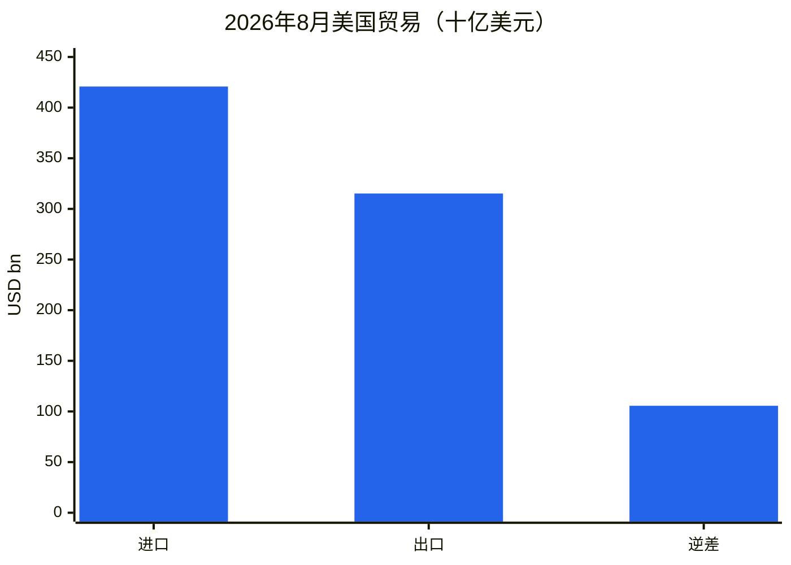

*注：人口普查局/经济分析局经由businessday.co.za；进口4,208亿美元（创纪录，+4.3%），出口3,152亿美元（+1.4%），逆差1,056亿美元（+13.7%，2025年3月以来最大）。*

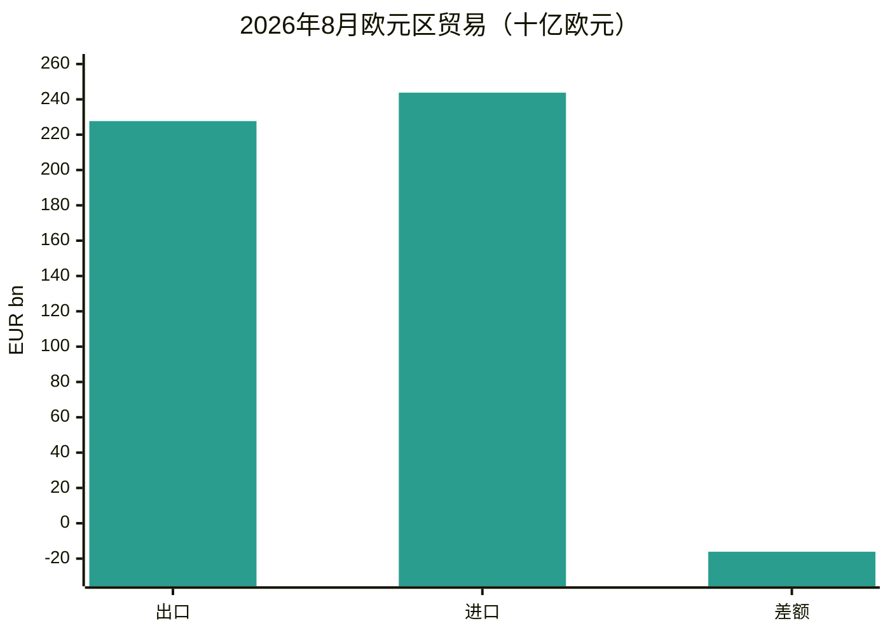

*注：欧盟统计局10月16日发布；出口2,277亿欧元（同比+9.9%），进口2,438亿欧元（同比+16.7%），差额−161亿欧元（2023年1月以来最大逆差）。*

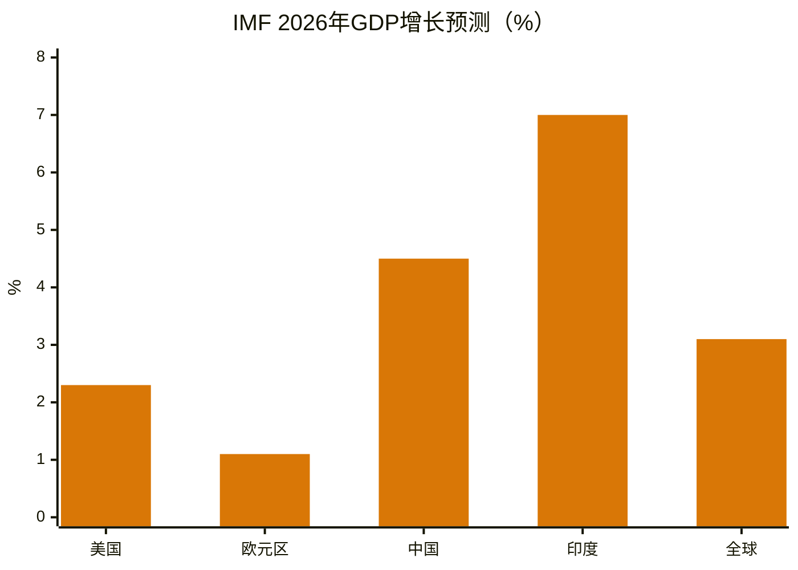

*注：国际货币基金组织《世界经济展望》，2026年10月13日；2027年全球预测3.4%。*

---

## 9. 运费市场

### 集装箱即期运价——德路里世界集装箱指数

10月15日评估收于**4,485美元/FEU，环比上涨3%**——此前10月8日读数为4,351美元（−2%）后的反弹。亚欧航线是涨幅来源：上海–鹿特丹+6%至3,522美元，上海–热那亚+7%至3,945美元，为连续13周下跌后亚欧航线首次上涨。跨太平洋涨跌互现：上海–洛杉矶+3%至7,884美元，上海–纽约−1%至10,075美元。德路里预计未来一周波动减小。此前一次评估（10月1日）收于4,434美元（−1%）。

德路里取消航次追踪（10月16日）显示，第43–47周（10月19日–11月22日）已宣布44个停航——在713个计划航次中取消率为6%。亚欧/地中海占停航的44%，跨太平洋东向36%，跨大西洋20%。船公司计划10月19日起对亚欧航线实施4,500–4,800美元/FEU的FAK涨价，但鉴于苏伊士运力回归，接受度存疑。（来源：[Drewry](https://www.drewry.co.uk/maritime-research-opinion-browser/world-container-index-assessed-by-drewry)、[Shipping Telegraph第41周](https://shippingtelegraph.com/freight-news/drewry-the-world-container-index-decreased-2-in-week-41-2026/)、[Shipping Telegraph第42周](https://shippingtelegraph.com/freight-news/drewry-the-world-container-index-increased-3-this-week-42-2026/)）

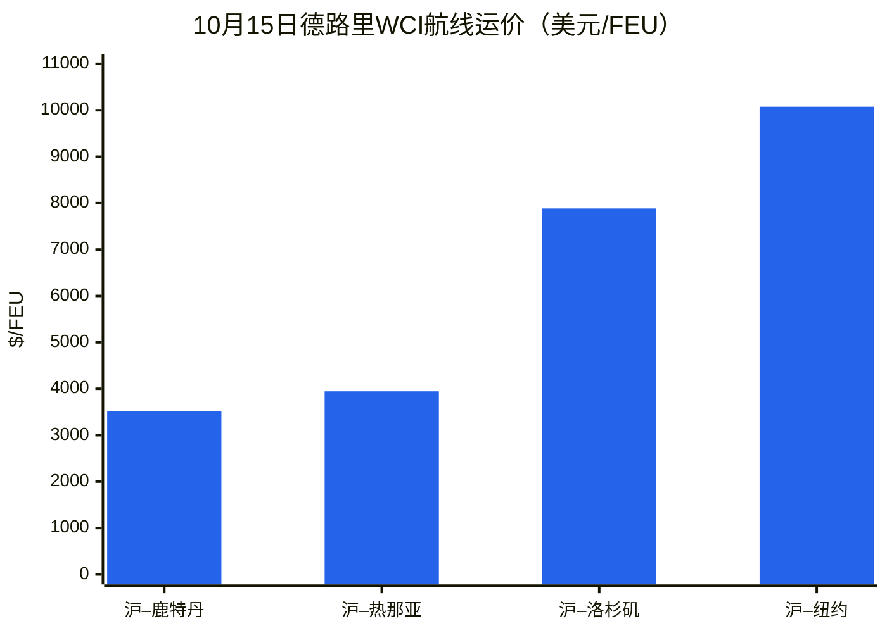

*注：上海–鹿特丹3,522美元（+6%），上海–热那亚3,945美元（+7%），上海–洛杉矶7,884美元（+3%），上海–纽约10,075美元（−1%）。*

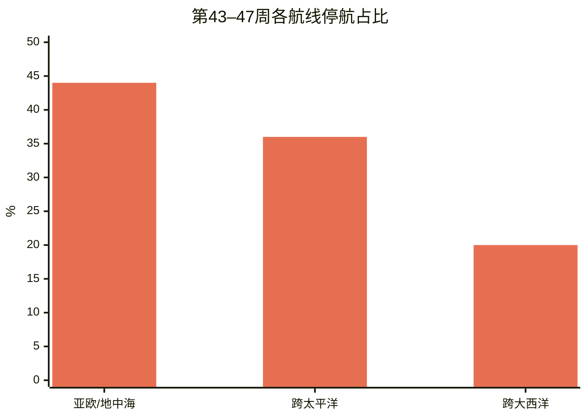

*注：德路里取消航次追踪，10月16日；44个停航，占713个计划航次的6%取消率。*

### 波罗的海运费指数（FBX）

截至10月13日一周：亚洲–美国西海岸（FBX01）−2%至8,149美元/FEU；亚洲–美国东海岸（FBX03）持平于9,606美元/FEU；亚洲–北欧（FBX11）持平于3,260美元/FEU；亚洲–地中海（FBX13）+7%至3,804美元/FEU。空运：中国–北美+3%至5.77美元/公斤；中国–北欧−7%至3.58美元/公斤——后者反映欧盟7月终结150欧元小额免税的影响（9月经法兰克福的中国/香港进口分别−1.8%/−7.4%）。Freightos空运基准仍较一年前高33%。跨太平洋运价在黄金周期间持平后略有回落——节后下滑的开始，预计11–12月货量回落。([AJOT / Freightos](https://www.ajot.com/news/freightos-weekly-update-attacks-disrupt-saudi-air-cargo-china-europe-air-rates-slump))

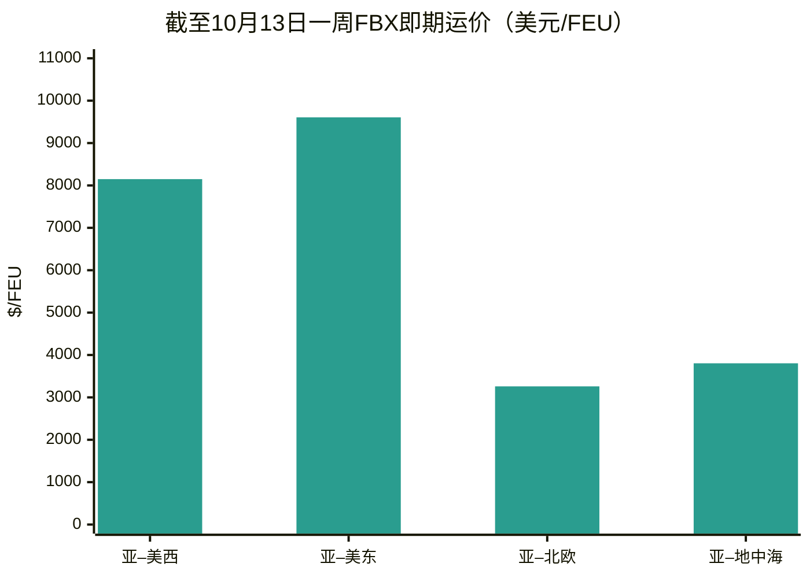

*注：FBX01为8,149美元（−2%），FBX03为9,606美元（持平），FBX11为3,260美元（持平），FBX13为3,804美元（+7%）。*

### 干散货——波罗的海交易所

**波罗的海干散货指数**连续第三周下跌，10月16日周五收于**2,511点——当周下跌14%**，为6月30日以来最低。好望角型指数周跌25%至3,249点（4月初以来最低）；好望角型5TC日均收益25,961美元（−664美元/日）。巴拿马型下跌1.8%至2,314点（日均收益20,827美元）。超灵便型是韧性例外，上涨9点至1,865点。铁矿石周中触及两年低点，因中国需求疲软和库存上升，周五反弹。（来源：[Baird Maritime](https://www.bairdmaritime.com/shipping/dry-cargo/bulkers/baltic-index-stays-in-the-doldrums-as-capesize-rates-slide-further)、[Safety4Sea](https://www.safety4sea.com/baltic-exchange-maritime-market-highlights-october-12-16/)）

### 空运

第41周全球即期运价维持在**3.55美元/公斤**，尽管黄金周货量低迷——货量环比下降1%（连续第三周），但同比增长9%；即期运价同比上涨34%；全市场运价3.13美元/公斤持平。亚太即期运价环比下跌3%至4.83美元/公斤；非洲即期上涨10%。航油同比上涨111%（IATA/Platts）。波罗的海空运指数在截至10月5日一周上涨5.0%，同比涨幅推高至+25.5%，运价尚未跟上燃油涨幅。技术和电子产品（服务器、半导体、数据中心部件）仍是最强需求来源，而受低价值进口关税变化影响，对美电商货量萎缩。第41周海湾运力因胡塞机场袭击环比收缩4%，较2月底水平低20%。（来源：[StatTimes / WorldACD](https://www.stattimes.com/air-cargo/global-air-cargo-rates-remain-stable-at-355kg-in-week-41-1360975)、[Baltic Exchange](https://www.balticexchange.com/en/news-and-events/news/guest-column/2026/Air-freight-rates-remain-firm-in-September-with-renewed-surge-in-jet-fuel-yet-to-feed-through.html)）

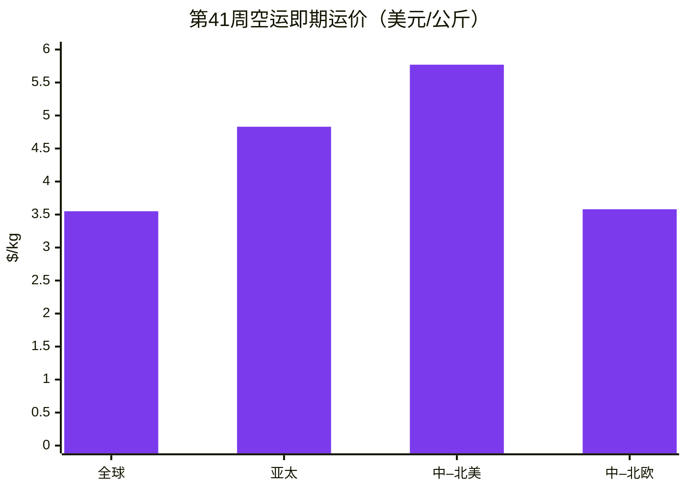

*注：WorldACD经由StatTimes（10月19日）和Freightos（10月13日）；全球3.55美元（同比+34%），亚太4.83美元，中国–北美5.77美元，中国–北欧3.58美元。*

### 船期准班率

Xeneta 9月记分卡：全球准点到港率下降2个百分点至**27%**，连续第四个月下滑；平均延误达6天（自第二季度以来+2.4天）。远东–欧洲崩溃至4%准点、平均延误9.9天——为2021年9月以来最差。亚洲–北美准点率持平于20%，延误升至6.9天。每家被追踪船公司都录得12个月最差平均延误（达飞30%、中远18%、赫伯罗特45%、阳明4%准点）。10月初中国–美国西海岸即期运价均值7,717美元/FEU——约为2025年9月1,778美元的四倍；10月1日长期运价环比上涨26%至3,649美元/FEU。([FreightWaves / Port Technology](https://www.olgn.news/freightwaves-shippers-waiting-an-extra-week-for-us-bound-containers/))

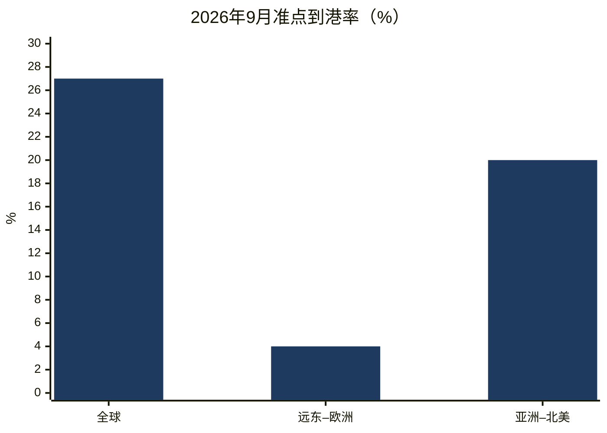

*注：Xeneta经由FreightWaves/Port Technology；全球27%（−2个百分点），远东–欧洲4%（平均延误9.9天），亚洲–北美20%（延误6.9天）。*

### 港口与物流中断

- **霍尔木兹/胡塞：** 集装箱船*GFS Pride*轮被击沉（10月15日）；10月5–11日12艘船遇袭；海峡通行降至每周131艘；海湾空运运力环比−4%。联合国安理会10月15日协商一致通过主席声明，谴责胡塞袭击沙特和红海航运。（见预警A2。）
- **网络勒索：** 18个国家的38家海事公司面临10月19日13:27（UTC）赎金最后期限（见预警A3）。
- **苏伊士：** 25年及以上船龄船舶强制检验和试航10月6日生效；10月前两周经运河的集装箱运力均值75.3万标准箱/周，而2023年同期为145.7万标准箱——复航进行中但远未完成。
- **德国：** ver.di工会10月6日接受加薪协议（约11,000名工人、6个港口、12个月+3.4%），汉堡、不来梅港和威廉港的罢工风险解除——但莱茵河水位创历史新低，限制了往返鹿特丹/安特卫普的驳船运输；不来梅港堆场利用率90%，鹿特丹85–90%满，滞留14天。
- **巴拿马：** 运河管理局自10月15日起将每日预约总船闸提高至33个。
- **美国东海岸：** PhilaPort宣布约8.37亿美元扩建——有史以来最大，50年来首个新泊位（10月14日）。长滩港9月创下历史月度纪录（接近约100万标箱）；洛杉矶港录得118年最繁忙月份，但其负责人警告关税驱动的货源转移带来规划风险。
- **马尼拉：** 赫伯罗特暂停至年底所有马尼拉订舱（上周报道）仍是现存极端拥堵案例。
- **孟加拉国：** 迪拜环球港务签署吉大港新系泊集装箱码头15年特许经营权（10月12日），码头工人抗议接管仍在继续。
- **船公司投资：** 现代商船董事会批准16.2亿美元投资12艘集装箱船（8艘13,000标准箱新造船加4艘转售新造船，合计114,100标准箱，2029年12月前交付）——目标2030年底166艘/147万标准箱。以星将2026年利润预测上调72%，因需求强劲。JOC标题还提到德国以安全为由阻止中远收购Zippel，以及国际码头和仓库工会（ILWU）行动导致洛杉矶–长滩码头开工停滞。

### 供应商情报

- **Descartes——《全球航运报告》（9月版，约10月13日）。** 美国集装箱进口创下9月历史最高：255万标准箱——环比下降2.2%，同比增长10.3%；1–9月货量同比+0.8%。中国始发货量环比大幅上升，而多数其他主要始发地下降；西海岸港口份额上升；十大门户中8个港口中转延误上升（纽约/新泽西增幅最大）。前瞻观察清单：中东/霍尔木兹事件、扩大关税（301/232条款、9月医药232条款关税）、巴拿马船闸、红海绕行，以及美国经济（联邦基金利率3.75–4.00%；第二季度GDP年化2.2%）。属数据发布，非产品事项。([AJOT](https://www.ajot.com/news/descartes-global-shipping-report-u.s-container-imports-reach-highest-september-volume-on-record))
- **Descartes——CustomsInfo每周关税数据更新。** 10月16日更新：墨西哥关税更新10月14日生效（法令DOF 13/10/2026——临时税率，无HS变化）；仅毛里求斯税种更新。10月9日更新：美国技术修正HTS 9903.85.67/68（适用国家修正为全部，而非仅俄罗斯；附加关税仅在俄罗斯熔炼/浇铸时适用）；中国10月8日更新。([customsinfo.com](https://www.customsinfo.com/resources/industry-updates/))
- **TradeInt——与土耳其贸易部的合作（9月30日宣布，恰在窗口之前）。** 该合作为本地咨询公司提供资助，使其获取覆盖200多个国家的舱单记录、海关申报和提单数据，旨在支持土耳其中小企业的出口决策；TradeInt的评论援引土耳其2025年出口为2,697亿美元。属政府合作事项；本周未发现TradeInt有窗口内日期的发布，TradeInt洞察博客无可核实的窗口内日期文章。([bayareametrowire](https://bayareametrowire.com/news/turkiyes-ministry-of-trade-grants-consulting-firms-access-to-global-trade-data-through-tradeint-partnership))

---

## 10. 政策时间线

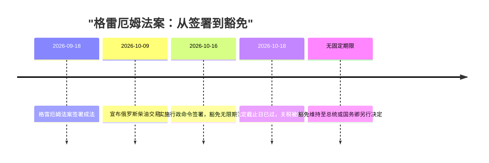

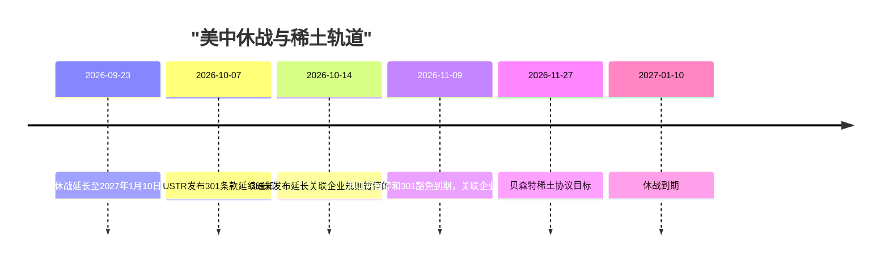

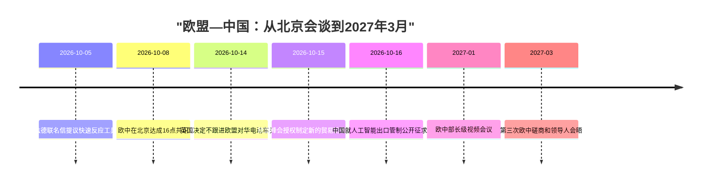

---

## 11. 即将到来的截止日期与事件（未来90天）

| 日期 | 事件 | 重要性 |
|---|---|---|
| 2026年10月19日 | 网络勒索赎金最后期限（13:27 UTC），38家海事公司 | 首次大规模海事网络勒索浪潮；关注披露 |
| 2026年10月20日 | 印度–新西兰自贸协定生效 | 新西兰对印度出口关税首日取消 |
| 2026年10月22日 | 韩国修订《对外贸易法》生效 | 贸易限制依据从5项扩大至9项 |
| 2026年10月27日 | 世贸组织争端解决机构：中国诉土耳其电动车关税专家组报告通过；印度–台湾信息通信技术关税裁决通过期限 | 同日两个争端里程碑 |
| 2026年11月9日 | 301条款港口费暂停到期（美东时间23:59）；178项301条款豁免到期；BIS关联企业规则暂停按条款结束 | 三重合规悬崖——在USTR/BIS采取行动前视为硬性日期 |
| 2026年11月9日 | 马达加斯加保障调查提交意见截止 |  |
| 2026年11月10日 | 稀土"回弹"日期（此前指引）；关联企业规则重新实施日期 | 关注BIS正式行动 |
| 2026年11月15日 | 中国人工智能出口管制征求意见截止 | 40项技术目录此后可能获采纳 |
| 2026年11月20日 | 英欧峰会（布鲁塞尔） | 紧随英国电动车关税决定 |
| 2026年11月27日 | 感恩节——贝森特稀土协议目标 |  |
| 2026年12月31日 | 欧美安排钢铝审查：若美国关税仍超15%则暂停优惠 | 欧美协议首次互惠约束测试 |
| 2027年1月10日 | 美中休战到期 |  |
| 2027年1月 | 欧中部长级视频会议 |  |
| 2027年3月 | 第三次欧中贸易和投资磋商；下次欧中领导人会晤；国际货币基金组织基线假设霍尔木兹重新开放 |  |
| 2027年初 | 澳大利亚–欧盟自贸协定提交议会（批准之争） |  |

## 12. 数据来源与方法

覆盖窗口：2026年10月12–19日。

**贸易新闻与分析：** FreightWaves、The Loadstar、Splash247、gCaptain、Hellenic Shipping News、Container News、Supply Chain Dive、Port Technology International、JOC（仅标题）、Shipping Telegraph、Baird Maritime、StatTimes/WorldACD、AJOT/Freightos、Metro Global、TradeInt博客（无窗口内日期文章）。

**美国政策：** whitehouse.gov（格雷厄姆法案实施行政命令，原始来源）、federalregister.gov（BIS美产成分指引2026-20938；USTR延续通知91 FR 64212）、CBP（经贸易咨询：CAPE第三阶段、暂扣放行令、用户费）、FMC（西班牙收费提议，经Supply Chain Dive）、USTR（经二手报道）、BIS（经Mondaq/Crowell & Moring、Braumiller、Dechert）、Thompson Hine、Steptoe、Mondaq、Gateway Lines、Thomson Reuters、JD Supra（本周未发现窗口内文章）、internationaltradetoday.com（仅标题）。

**世界各国政府：** 欧洲理事会峰会（经媒体）、欧盟委员会/贸易总司（经媒体）、英国政府商业贸易部（经《卫报》/Fleet News）、加拿大边境服务局/加拿大（经行业协会）、日本经济产业省/日本海关（经Steptoe/全球制裁）、韩国产业通商资源部（经LinkedIn综述）、english.mofcom.gov.cn（直接抓取失败；商务部事项经二手报道和国务院英文版）、印度商务部（经媒体）、澳大利亚外交贸易部（经媒体）、巴西发展工业贸易和服务部（经Datamar）。

**多边机构：** wto.org（《全球贸易展望与统计》，10月8日；委员会和争端解决机构报道经贸易媒体）、unctad.org（《2026年贸易和发展报告》）、世界海关组织（e-CENcomm启动、海合会附加协议）、世贸组织综合贸易情报门户（本周未发现窗口内新发布）、国际贸易中心贸易地图（本周未发现窗口内新发布）。

**数据门户：** 人口普查局/经济分析局（2026年8月FT-900；2026年9月货物贸易预估）、中国海关总署（2026年9月中国贸易）、欧盟统计局（2026年8月欧元区）、世贸组织、国际货币基金组织（10月《世界经济展望》）、联合国贸发会议统计、美国国际贸易委员会DataWeb/美国贸易在线/联合国商品贸易统计/世界银行WITS（本周未发现窗口内新数据集发布）。

**智库与研究：** 耶鲁预算实验室（美国关税现状；关税红利分析）、宾大沃顿预算模型（实际关税税率与收入，10月14日更新）、税收基金会（特朗普关税追踪，2026年8月版本）、Mondaq（欧美关税安排分析）、tradeintelligence.eu（本周文本抓取不可达）。

**运费：** 德路里（世界集装箱指数10月15日评估；取消航次追踪10月16日）、波罗的海交易所（每周市场亮点；空运指数经客座专栏）、Freightos波罗的海指数（截至10月13日一周）、Xeneta（船期准班率，经FreightWaves/Port Technology）、Kpler（海峡通行量）、Sea-Intelligence、Linerlytica、Veson、Hartland（油轮收益）、Clarksons、SCFI、TAC指数、NRF全球港口追踪、DHL、DC Velocity。

**供应商情报：** Descartes Systems Group（《全球航运报告》9月版；CustomsInfo每周关税数据更新）和TradeInt（土耳其贸易部合作，9月30日）——仅供应商新闻事项：数据发布、政府合作和市场动态。
