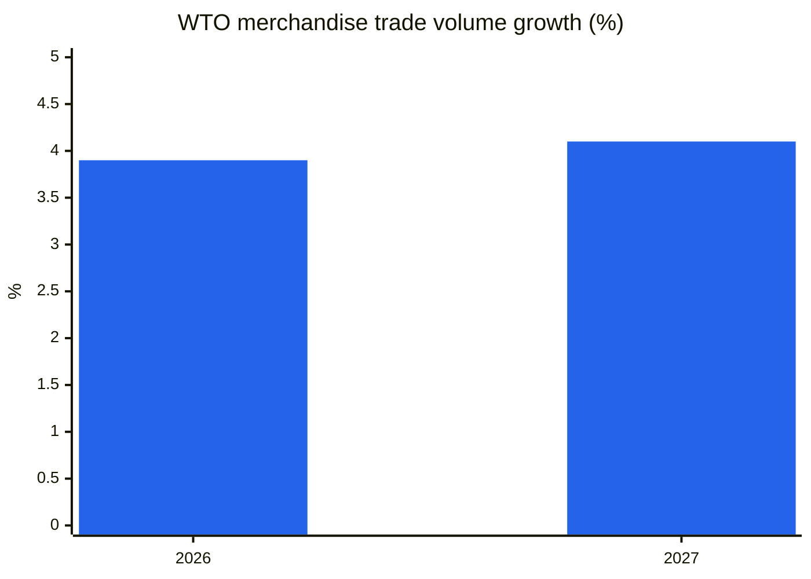
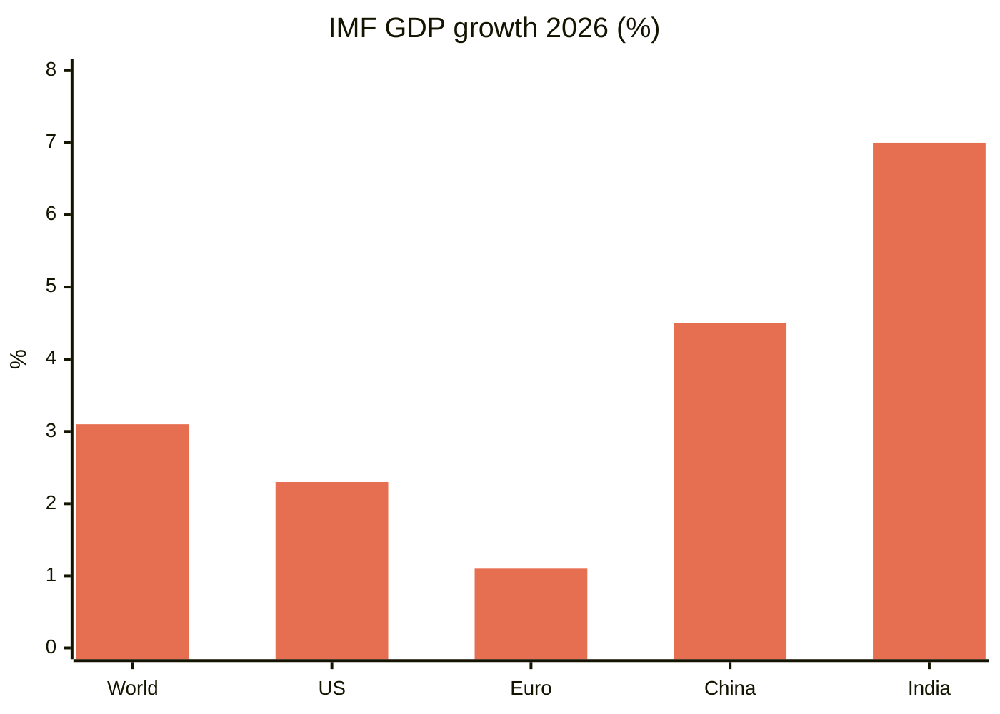
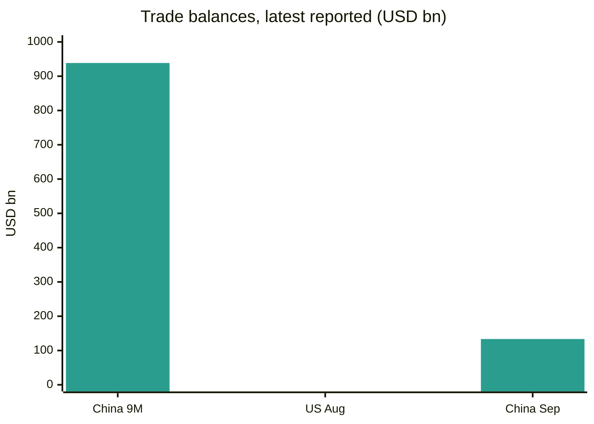
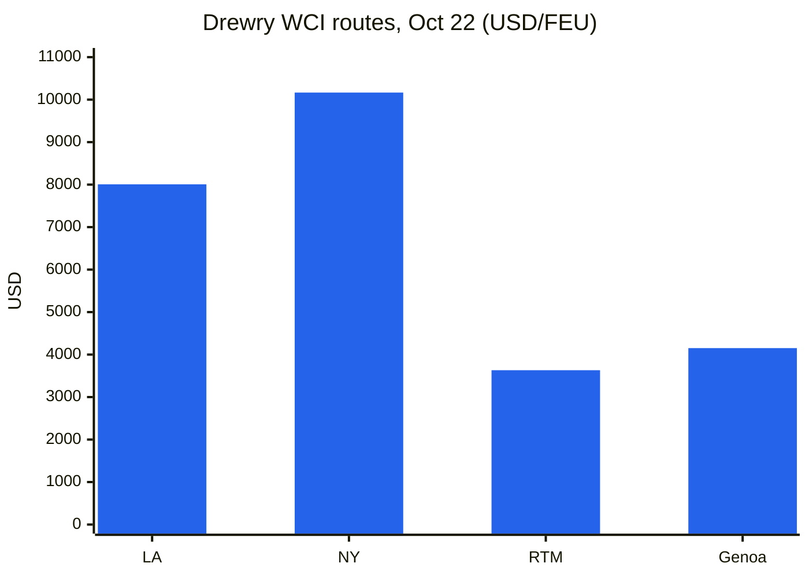
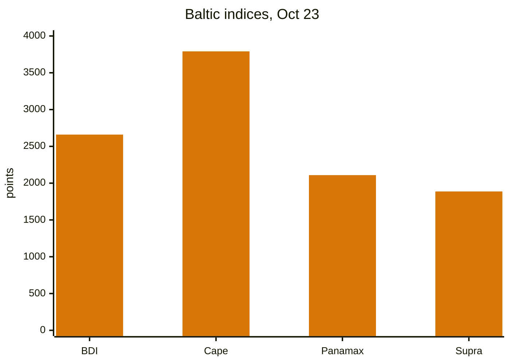
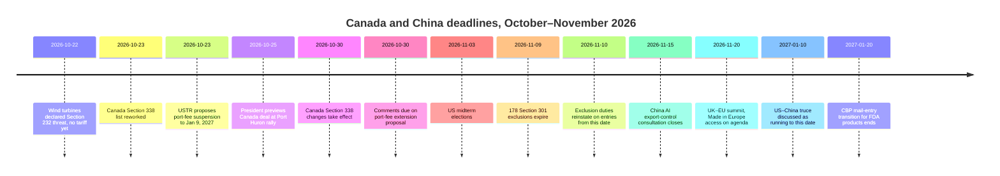
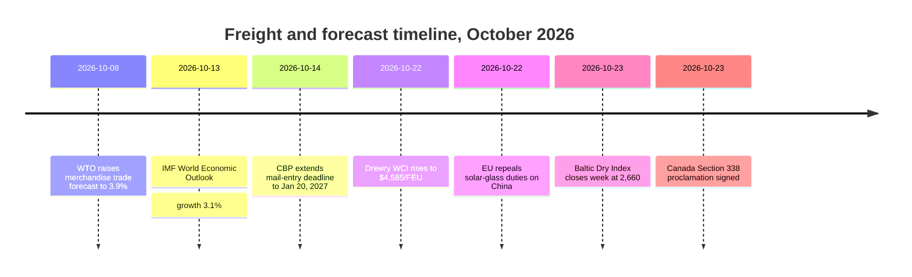

# Global Trade Intelligence Report — Week of October 19–26, 2026

**Weekly briefing.** Coverage window: October 19–26, 2026. Compiled from approximately 45 trade news, policy, data, and freight sources worldwide.

---

## Table of contents

1. [Executive summary](#1-executive-summary)
2. [Alerts](#2-alerts)
3. [Top stories — deep dives](#3-top-stories--deep-dives)
4. [Tariff tracker](#4-tariff-tracker)
5. [US policy deep dive](#5-us-policy-deep-dive)
6. [World policy by region](#6-world-policy-by-region)
7. [Enforcement actions](#7-enforcement-actions)
8. [Data releases](#8-data-releases)
9. [Freight market](#9-freight-market)
10. [Policy timelines](#10-policy-timelines)
11. [Upcoming deadlines & events (next 90 days)](#11-upcoming-deadlines--events-next-90-days)
12. [Sources & methodology](#12-sources--methodology)

---

## 1. Executive summary

A week in which the United States rewrote its Canada tariff list twice in opposite directions, container freight extended its rebound, dry bulk split sharply by vessel size, and the world's two main forecasting institutions described the same global economy in different registers: resilient in goods, fragile in services, and increasingly concentrated in a small number of countries and products.

- **Canada: relief and escalation in the same week.** On October 23, President Trump signed a proclamation removing 50% Section 338 tariffs from a set of Canadian agricultural and forestry products — plywood sheets, some paper products, certain machinery and refrigeration equipment, packing crates and boxes, and fresh and dried seaweed — effective October 30. The same order added other Canadian goods to the 50% list, including carpets, paints, shampoos, cocoa powder, wooden coffins, ice cream sticks, air-conditioning machines, chest freezers, archery equipment and canoes. The relief followed a request from Senator Susan Collins of Maine, whose state's blueberry, potato, apple and seaweed producers rely on Canadian inputs. Separately, after Ontario aired a World Series advertisement using former President Ronald Reagan's remarks on tariffs, the President announced a 10% increase in tariffs on Canadian imports, characterising the advertisement as a serious misrepresentation and a hostile act. Ontario said it would pause the advertisement to allow trade talks to resume. At a Port Huron, Michigan rally on October 25, the President said a Canada trade agreement would be reached "pretty soon" but gave no terms or timeline.
- **Freight: containers up, bulk divided.** The Drewry World Container Index rose 2% to $4,585 per 40ft container on October 22, its highest level in 15 weeks and its second consecutive weekly increase. Shanghai–Los Angeles rose 2% to $8,007, Shanghai–New York 1% to $10,166, Shanghai–Rotterdam 3% to $3,632 and Shanghai–Genoa 5% to $4,152. Drewry counted 56 blank sailings planned for weeks 44–48 out of 714 scheduled sailings, an 8% cancellation rate. The Baltic Dry Index finished the week at 2,660 on October 23, up about 5.9% on the week despite a 1.2% fall on Friday itself: Capesize earnings recovered strongly while Panamax fell to 2,109, its lowest since August 24.
- **The Suez return passed a threshold.** In the first two weeks of October, weekly container capacity transiting the Suez Canal averaged 753,000 TEU, according to Clarksons Research cited by BIMCO, against 1,457,000 TEU in the same period of 2023 — the first time since the Red Sea crisis began that transits exceeded 50% of pre-disruption levels. Sixteen service changes have been announced since early July, and all four major alliances now operate regular westbound Asia–Northern Europe services via Suez. Linerlytica's October outlook forecasts a full-scale return by the first quarter of 2027, subject to security conditions.
- **Forecasts: goods resilient, services weaker, growth concentrated.** The WTO's October update raised 2026 world merchandise trade volume growth to 3.9%, from 1.9% in March, and 2027 to 4.1%, while cutting 2026 commercial services trade growth to 3.3% from 4.8%. The IMF's October World Economic Outlook put global growth at 3.1% in 2026 and 3.4% in 2027, with headline inflation at 4.7% in 2026, and warned that growth is now concentrated: 32 countries account for 95% of global growth, down from 54 in April, with about 47% of economies downgraded.
- **The November 9 deadline split in two.** On October 23, USTR proposed extending the suspension of Section 301 port fees on China-linked vessels (and certain crane and cargo-handling equipment duties) from November 10, 2026 through January 9, 2027, in a Federal Register notice dated October 23 and scheduled for publication October 26, with comments due October 30 (docket USTR-2026-0694). The proposal is not yet final. The 178 Section 301 product exclusions, by contrast, still expire at 11:59 p.m. ET on November 9, 2026, with no extension found in this coverage week. Importers should plan on the written dates for exclusions, and treat the port-fee extension as proposed, not final, until USTR publishes a final notice.
- **Europe kept its China debate open.** The European Commission said it will propose further import curbs on Chinese sectors beyond the hybrid-vehicle understanding reached in Beijing in early October, with France's president pointing to chemicals, plastics and ferro-alloys. The Commission also plans a December proposal for a new instrument to limit reliance on single sources for critical supplies. The UK, meanwhile, continued to resist pressure to match EU duties of up to 45.3% on Chinese electric vehicles, with Business Secretary Jonathan Reynolds saying UK trade-defence decisions are based on UK interest alone. The EU repealed its long-standing solar-glass duties on China on October 22, with repayment claims available for duties paid since July 22, 2025.

**Freight:** containers firmed on general rate increases and capacity withdrawals ahead of January contract negotiations; dry bulk recovered on Capesize strength even as Panamax weakened; Suez capacity continued its gradual return; and Gulf shipping risk remained elevated, with Hormuz crossings reported down sharply in the October 12–18 week and further vessel incidents reported on October 18–20.

---

## 2. Alerts

| # | Alert | Effective | Impact | Source |
|---|-------|-----------|--------|--------|
| A1 | Canada Section 338 list reworked: 50% tariffs removed from plywood sheets, some paper products, certain machinery and refrigeration equipment, packing crates and boxes, fresh and dried seaweed; added for carpets, paints, shampoos, cocoa powder, wooden coffins, ice cream sticks, air-conditioning machines, chest freezers, archery equipment, canoes | Oct 30, 2026 | Maine agricultural and forestry supply chains gain relief; newly listed Canadian exporters face 50% duties | [White House](https://www.whitehouse.gov/fact-sheets/2026/10/fact-sheet-president-donald-j-trump-further-modifies-canadian-products-subject-to-tariffs-under-section-338/), [Supply Chain Dive](https://www.supplychaindive.com/news/trump-tweaks-canada-tariffs-removing-certain-goods-while-adding-others/833895/) |
| A2 | Additional 10% tariff increase on Canadian imports announced after Ontario's World Series advertisement using Ronald Reagan remarks; Ontario said it would pause the advertisement | Announced Oct 2026 | Escalates the US–Canada dispute days before the October 30 list changes and the November 3 midterms | [LawStreet](https://lawstreet.co/international/trump-says-canada-trade-deal-coming-soon-as-white-house-eases-some-tariffs-after-collins-request) |
| A3 | November 9 clocks split: USTR proposes extending the Section 301 port-fee suspension to Jan 9, 2027 (comments to Oct 30, docket USTR-2026-0694); the 178 Section 301 product exclusions still expire 11:59 p.m. ET Nov 9, 2026, with no extension found | Nov 9, 2026 / Jan 9, 2027 (proposed) | Exclusion duties revert to list rates (25% Lists 1–3, 7.5% List 4A) on Nov 10 entries; port fees would reinstate only if the proposal is not finalised | [gCaptain](https://gcaptain.com/ustr-proposes-extending-china-ship-port-fee-suspension-through-january-2027/), [Gateway Lines](https://gatewaylines.com/press-releases/china-ship-fees-301-exclusions-nov-9-2026) |
| A9 | Wind turbines declared a national-security threat under Section 232 (White House proclamation, Oct 22); no tariff imposed yet — trade officials directed to negotiate and report back within 180 days | Oct 22, 2026 | Wind-energy supply chains face a possible future tariff; major suppliers named in reporting include Mexico, France, India, Denmark and Germany |  |
| A4 | Hormuz/Gulf shipping risk remains elevated: tanker AL DASMA damaged in the Strait of Hormuz Oct 20; JIF BARRACUDA damaged near the UAE Oct 18; MarineTraffic reported Hormuz crossings down from 203 to 120 in the Oct 12–18 week | Oct 18–20, 2026 | War-risk, routing and insurance costs stay elevated despite the Suez container recovery | [Daily Caller](https://dailycaller.com/2026/10/22/iran-claims-seven-vessels-attacked-in-persian-gulf) |
| A5 | Black Sea cargo incident: Comoros-flagged cargo vessel Khoryv caught fire and capsized about 15 miles east of Constanta, Romania; 1 crew member dead, 3 missing, 9 recovered alive | Oct 2026 | Black Sea routing and insurance risk; Romanian authorities attributed the incident to a drone strike in local reporting | [Scottish Sun](https://www.thescottishsun.co.uk/news/16978300/cargo-ship-fire-drone-strike-black-sea/) |
| A6 | French port disruption: 24-hour strikes announced across French ports Oct 14 and 16, with another date listed for Oct 30; Fos-sur-Mer terminals and depots closed Oct 20 on adverse weather | Oct 20 and 30, 2026 | Schedule uncertainty at French gateways; shippers should build buffer into late-October routings | [Maritime News](https://www.maritimenews.com/port-operations/port-operations-oct-14-21-2026) |
| A7 | EU solar-glass duties on China repealed Oct 22, 2026; repayment claims available for duties paid since July 22, 2025 | Oct 22, 2026 | Solar importers should review historical duty payments for reclamation | [WiseVoter](https://wisevoter.com/world/2026/10/23/eu-repeals-solar-glass-duties-china) |
| A8 | CBP mail-entry deadline extended: FDA-regulated products, including medicines, may continue using the simplified mail process until Jan 20, 2027, after CBP extended the Oct 22 deadline by 90 days on Oct 14 | Jan 20, 2027 | Mail-order and parcel importers gain a further quarter to move to detailed customs filings |  |

### A1 — Canada: two moves in opposite directions

The October 23 proclamation is best read as a recalibration, not a de-escalation. The White House fact sheet states that the Section 338 tariffs apply regardless of USMCA origin and in addition to Section 232 duties, and that the product additions and removals take effect October 30, 2026 — four days before the November 3 midterm elections. Senator Collins said the relief would aid Maine's blueberry, potato, apple and seaweed producers, many of whom rely on Canadian equipment, packaging and inputs unavailable from American suppliers or replaceable only at significant expense.

**Analysis:** the order preserves the overall architecture of the Canada dispute — 50% duties on about $20 billion of Canadian goods imposed in August, following the breakdown of talks — while shifting its incidence. Exporters of the newly listed goods (carpets, cocoa powder, air-conditioning machines, chest freezers and others) should re-screen classifications immediately; exporters of the delisted goods should confirm that their specific products fall within the proclamation's descriptions before assuming relief, since Section 338 coverage turns on product descriptions, not broad categories.

### A2 — The Reagan advertisement and the 10% increase

Ontario's advertisement, aired during the World Series while the Toronto Blue Jays were playing, used former President Reagan's 1987 remarks warning that high tariffs lead to retaliation and trade wars. The President called the advertisement a serious misrepresentation and a hostile act, ended trade discussions with Ottawa, and announced a 10% increase in tariffs on Canadian imports over and above current levels. The Ronald Reagan Presidential Foundation said it had not approved the use of the clips. Ontario Premier Doug Ford said the advertisement would be phased out after the weekend so the two administrations could resume talks.

**Analysis:** the episode shows how quickly a communications dispute can convert into tariff policy in this cycle, and how election timing amplifies it. The practical question for importers is sequencing: the October 30 list changes, the announced 10% increase, and any Canada deal the President previewed on October 25 are three separate instruments with different legal bases and effective dates. Until each is published, the October 30 proclamation is the only one with a fixed effective date.

### A3 — November 9: the clocks diverge

USTR's continuation notice of October 6, 2026 (published October 7) confirmed that both 2018 China Section 301 actions continue, but it did not extend the exclusions or the port-fee pause. The 178 exclusions — 164 retained in May 2024 plus 14 solar-manufacturing-equipment exclusions added in September 2024 — run through 11:59 p.m. ET on November 9. Goods entered on or after November 10 pay the list rate. On October 23, however, USTR proposed a separate extension for the port-fee suspension only: from November 10, 2026 through January 9, 2027, carriers would incur no liability for port fees under Annexes I, II and III of the original Section 301 action, and the related crane and cargo-handling equipment duties would also be suspended. The notice, dated October 23 and scheduled for publication October 26, takes comments through 5 p.m. ET on October 30 (docket USTR-2026-0694), and is a proposal, not a final rule. More than 200 trade associations wrote to USTR on September 23 asking for an extension.

**Analysis:** the gap between the political calendar (a truce discussed as running to January 10, 2027) and the regulatory calendar (November 9) has narrowed for shipping but not for importers. Carriers price against the written rule; importers should do the same for exclusions, and should identify any entries claiming the exclusion headings before the deadline rather than discovering exposure afterwards. The port-fee proposal, if finalised, prevents a November 10 fee restart; if not, fees resume.

---

## 3. Top stories — deep dives

### 3.1 Canada: tariff policy as election-season instrument

The Canada file dominated the week's US policy news because it combined all three drivers of current US trade policy: a statutory tool (Section 338 of the Tariff Act of 1930, which permits tariffs up to 50% to address discrimination against US commerce), a domestic political calendar (midterms on November 3), and a bilateral negotiation that has been stop-start since August. The original August action covered about $20 billion of Canadian goods, from hockey sticks to cement, after talks broke down; Canada retaliated on an equivalent value of American products.

The October 23 order's stated rationale — that senior officials advised the changes would still offset the alleged discrimination while serving the public interest — is the administration's standard Section 338 formulation. What is new is the explicit linkage, in contemporaneous reporting, to a single senator's request on behalf of named state industries. That linkage does not change the legal effect, but it does change the lobbying lesson: product-specific relief is obtainable when a domestic constituency can show concrete supply-chain dependence.

**Key figures:** 50% Section 338 rate; about $20 billion of Canadian goods originally covered; October 30 effective date; November 3 midterm elections.

**Why it matters:** for Canadian exporters and US importers, the October 30 list is the operative document. For everyone else, the episode is a reminder that tariff lists in this cycle are revised in weeks, not years, and that classification-level diligence is now a recurring cost of importing.

### 3.2 The two forecasts: WTO and IMF agree on resilience, disagree on its breadth

The WTO's October 8 Global Trade Outlook and Statistics update and the IMF's October 13 World Economic Outlook, both released just before this coverage week but dominating its policy discussion, tell a consistent story with different emphases. The WTO upgraded merchandise trade volume growth to 3.9% in 2026 (from 1.9% in March) and 4.1% in 2027, crediting AI-related investment: trade in AI-enabling goods rose 67% year on year in the first half of 2026 and accounted for 47% of global merchandise trade growth. Asia leads 2026 export growth at 9.9%, followed by North America at 5.7% and Africa at 5.6%. At the same time, the WTO cut 2026 commercial services trade growth to 3.3% from 4.8%, with transport at 0.9% and travel at 0.2%, reflecting Middle East disruption, higher aviation fuel costs and flight restrictions.

The IMF put global growth at 3.1% in 2026 and 3.4% in 2027, with headline inflation at 4.7% in 2026 easing to 4.1% in 2027. Its country table shows the United States at 2.3% in both years, the euro area at 1.1% in 2026 and 1.2% in 2027, China at 4.5% and 4.0%, and India at 7.0% on a fiscal-year basis. The Fund's warning is structural: growth is concentrating in economies plugged into the AI investment boom or insulated from the energy shock, while energy-importing economies outside the technology value chain face the most difficult outlook. Its baseline assumes the Strait of Hormuz begins reopening in March 2027, with a broad return to pre-war conditions by October 2027.

*Note: WTO Global Trade Outlook and Statistics, October 2026 update; 2026 forecast raised from 1.9% in March.*

*Note: IMF World Economic Outlook, October 2026. India on a fiscal-year basis.*

**Analysis:** the two institutions agree that AI investment is masking weakness elsewhere. The practical implication for trade planning is that headline trade growth flatters the average: firms outside AI supply chains, or exposed to Middle East energy and transport costs, are experiencing a materially worse year than the global aggregates suggest.

### 3.3 China: a surplus approaching $1 trillion, and a debate about what it means

China's January–September 2026 merchandise trade surplus reached $938.5 billion, with September alone at $133.5 billion, a 20-month high, as exports surged on the AI hardware boom. Sales to the United States grew 40%, the fastest in more than five years, taking China's surplus with the United States to $34 billion, its highest since January 2025. Record-high exports were also bought by Australia, South Korea, Taiwan, Russia and ASEAN economies. Goldman Sachs economists cited in reporting estimate that the number of countries running trade deficits above 3% of GDP with China has more than tripled since 2005, to 82, most of them low-income emerging economies.

**Analysis:** the surplus is both a symptom and a driver of the week's policy news. It strengthens Beijing's negotiating position in the run-up to the November deadlines, and it strengthens the case, in Brussels and Washington, for further defensive measures. It also complicates the narrative that decoupling is advanced: US purchases of Chinese capital goods for AI infrastructure are growing at their fastest pace in five years.

### 3.4 Europe: defence measures advance, but not in one direction

The EU's October debate produced two opposite signals. On the restrictive side, Commission President Ursula von der Leyen said after the October 15–16 summit that the Commission will propose curbs on imports from China beyond the hybrid-vehicle safeguard agreed in Beijing, which is designed to halve inbound shipments of Chinese hybrid cars. France's president pointed to chemicals, plastics and ferro-alloys. The Commission will also propose, in December, a new instrument to limit reliance on single sources for critical supplies, and a solidarity mechanism for countries or sectors subject to coercion. The EU's goods trade deficit with China is running at more than €1 billion a day.

On the liberalising side, the EU repealed its solar-glass duties on China on October 22, ending measures in place since 2014, after the last two EU solar-glass producers stopped production. Importers may apply to national customs authorities for repayment of duties paid since July 22, 2025, under implementing regulations 2026/2314 and 2026/2310.

**Analysis:** the two moves are consistent once the criterion is stated: measures survive where a domestic industry remains to protect, and fall where it does not. The December proposals — a rapid-action instrument and a single-source reliance instrument — are the ones to watch, since they would generalise the hybrid-vehicle approach into standing tools.

### 3.5 The Suez return and the Hormuz risk, side by side

Container shipping's Suez return is now measurable: 753,000 TEU per week in early October, 36% of total container capacity routed via either the canal or the Cape, up from an average of 8% between 2024 and mid-2026, but still well below the pre-crisis 80%. Sixteen service changes have been announced since early July, spanning Gemini, Ocean, Premier and MSC. At the same time, Gulf risk has not receded: MarineTraffic reported Hormuz crossings falling from 203 to 120 in the October 12–18 week, and vessel incidents were reported on October 18 and 20. The IMO's October 21 tally documented 24 casualties and 120 confirmed maritime incidents across the Middle East since the conflict began.

**Analysis:** the container market is pricing two different risks at once — a structural capacity release as Suez normalises, which should pressure rates, and a persistent war-risk premium on Gulf and Black Sea routings, which supports them. The Drewry rebound suggests that, for now, capacity management (blank sailings, general rate increases) is outweighing the Suez release.

### 3.6 The United States trade deficit: a record import month

The US goods and services trade deficit widened 13.7% in August to $105.6 billion, the largest since March 2025, as imports hit a record $420.8 billion (up 4.3%) and exports rose 1.4% to $315.2 billion. The goods deficit alone widened 11.5% to $132.6 billion, with goods imports up 5.5% to $336.1 billion — industrial supplies up 16.6%, capital goods up 4.0% on the AI infrastructure buildout, food up 5.5% — against goods exports of $203.4 billion, up 1.9%. The cumulative January–August deficit, however, remained 19.9% narrower than the same period of 2025, a reminder that single-month and year-to-date readings point in different directions.

**Analysis:** the August data, released in early October and discussed through this week, undercuts the simple claim that tariffs mechanically shrink the deficit in the short run, while the year-to-date improvement undercuts the opposite claim. Both readings can be true because the deficit responds to import prices, AI capital-goods demand and inventory cycles as well as to tariff rates.

---

## 4. Tariff tracker

| Country / origin | Measure | Rate | Effective date | Status | Source |
|---|---|---|---|---|---|
| Canada | Section 338 tariffs — removals: plywood sheets, some paper products, certain machinery and refrigeration equipment, packing crates and boxes, fresh and dried seaweed | 50% removed | Oct 30, 2026 | Proclamation signed Oct 23, 2026 | [White House](https://www.whitehouse.gov/fact-sheets/2026/10/fact-sheet-president-donald-j-trump-further-modifies-canadian-products-subject-to-tariffs-under-section-338/) |
| Canada | Section 338 tariffs — additions: carpets, paints, shampoos, cocoa powder, wooden coffins, ice cream sticks, air-conditioning machines, chest freezers, archery equipment, canoes | 50% | Oct 30, 2026 | Proclamation signed Oct 23, 2026 | [Supply Chain Dive](https://www.supplychaindive.com/news/trump-tweaks-canada-tariffs-removing-certain-goods-while-adding-others/833895/) |
| Canada | Additional tariff increase announced after Ontario advertisement | +10 percentage points | Announced Oct 2026 | Announced; implementing terms n/a | [LawStreet](https://lawstreet.co/international/trump-says-canada-trade-deal-coming-soon-as-white-house-eases-some-tariffs-after-collins-request) |
| China | Section 301 tariffs — 178 product exclusions expire | 25% (Lists 1–3), 7.5% (List 4A) on reversion | Nov 9, 2026, 11:59 p.m. ET | No extension published in coverage week | [Gateway Lines](https://gatewaylines.com/press-releases/china-ship-fees-301-exclusions-nov-9-2026) |
| China | Section 301 port fees on China-linked vessels — suspension extension proposed to Jan 9, 2027 | Fees suspended Nov 10, 2026–Jan 9, 2027 if finalised | Proposed Oct 23, 2026; comments to Oct 30 | Proposal only, not final | [gCaptain](https://gcaptain.com/ustr-proposes-extending-china-ship-port-fee-suspension-through-january-2027/) |
| Wind turbines and components | Section 232 national-security finding | No tariff imposed yet; negotiations and report-back within 180 days | Oct 22, 2026 | Finding issued; tariff possible after negotiation window |  |
| China | EU solar-glass anti-dumping and countervailing duties | Repealed | Oct 22, 2026 | Repealed; repayments from July 22, 2025 | [WiseVoter](https://wisevoter.com/world/2026/10/23/eu-repeals-solar-glass-duties-china) |
| China | EU anti-dumping duties, aluminium flat-rolled products | 14.3%–24.6% | Ongoing | Expiry review initiated Oct 9, 2026; measures remain in force | [We Are Main Street](https://wearemainstreet.org/world/2026/10/25/eu-anti-dumping-duties-chinese-aluminium) |
| China | EU hybrid-vehicle understanding | Shipments to be halved | Agreed Oct 8–9, 2026 | Understanding; implementation procedures pending | [EU Monitoring](https://ieu-monitoring.com/editorial/eu-and-china-reach-trade-understandings-on-hybrid-cars-tariffs-and-rare-earths/1251810) |
| United Kingdom | Standard import duty on Chinese-made cars | 10% | Ongoing | No change; UK resisting EU pressure to match up to 45.3% | [Fleet News](https://www.fleetnews.co.uk/news/minister-reportedly-resists-calls-for-uk-to-impose-chinese-ev-tariffs) |
| India–New Zealand | FTA in force: zero duty on 100% of Indian export tariff lines to New Zealand; India concessions on 70% of lines | 0% (Indian exports to NZ) | Oct 20, 2026 | In force; rules of origin apply | [Devdiscourse](https://www.devdiscourse.com/article/business/3994858-india-new-zealand-fta-to-eliminate-tariffs-on-all-indian-exports-from-october-20-dgft-official?amp) |
| Russia / energy buyers | Graham Act tariffs (500% Russia, 100% top energy buyers and facilitators) | Waived | Oct 16, 2026 waiver | Waived with no end date; monitoring assigned to USTR | [KPMG](https://kpmg.com/us/en/taxnewsflash/news/2026/10/trump-russia-tariffs-sanctions.html) |

---

## 5. US policy deep dive

### Section 338 and Canada

See sections 2 and 3.1. The October 23 fact sheet confirms that Section 338 tariffs apply regardless of USMCA origin and in addition to Section 232 duties, and that the President may suspend, revoke, supplement or amend any Section 338 proclamation when the public interest requires it. That amendment power is what makes further October or November revisions possible without new legislation.

### USTR — Section 301 continuation and the November 9 clocks

USTR confirmed on October 6, 2026 (published October 7) that both 2018 China Section 301 actions continue, opening the next phase of the second four-year review. The review can raise rates as well as maintain them: after the first continuation in September 2022, USTR raised semiconductors to 50% in 2025, solar cells to 50% in 2024, and steel and aluminium products to 25% in 2024. The separate November 9 clocks then diverged in this coverage week: on October 23, USTR proposed extending the port-fee suspension to January 9, 2027 (comments to October 30, docket USTR-2026-0694), while the 178 product exclusions received no extension proposal and still expire November 9.

### Section 232 — wind turbines

On October 22, 2026, the President declared imports of wind turbines and components a threat to national security under Section 232, following a Commerce Department investigation launched in August 2025. He stopped short of imposing tariffs, instead directing trade officials to pursue negotiations with trading partners and report back within 180 days; additional measures, including tariffs, could be considered later. Cited grounds included cybersecurity concerns tied to foreign-made equipment, interference with radar systems and air traffic operations, and increased US reliance on overseas-made goods. Major suppliers named in reporting include Mexico, France, India, Denmark and Germany. No tariff rate has been set.

### CBP operations

CBP extended the mail-entry transition for FDA-regulated products, including medicines, from October 22, 2026 to January 20, 2027, a 90-day extension announced October 14. The extension follows the June 24, 2026 interim final rule that removed the $800 duty-free allowance for mailed packages and moved most small international parcels to a simplified process from July 24, 2026. Products covered by another agency's import rules were given until October 22 to move to more detailed filings; they now have until January 20, 2027.

### Tariff refunds

A US trade judge certified a class action for importers seeking refunds of tariffs struck down by the Supreme Court earlier in 2026, covering importers who have not already submitted claims. Customs has fully processed almost $130 billion in refunds, against more than $166 billion paid in the contested tariffs, with interest potentially running into the billions. The decision, reported October 9, 2026, matters for importers who have not yet filed: the class mechanism may recalculate and refund remaining amounts without individual suits.

### Standing items

The Graham Act waiver of October 16 remains in place with no end date. The US–China truce discussed as running to January 10, 2027 has a proposed — not final — implementing step for the port-fee suspension (to January 9, 2027, comments to October 30), and no extension proposal for the 178 product exclusions. The Supreme Court's tariff-authority case, referenced in Canada-dispute reporting, is scheduled for argument in November.

---

## 6. World policy by region

### Europe

The Commission's post-summit programme is the week's main European development: further China import curbs beyond hybrid vehicles, a December proposal for a single-source reliance instrument, and a solidarity mechanism for coercion cases. The hybrid-vehicle understanding itself, reached at the second EU–China Trade and Investment Consultations meeting in Beijing on October 8–9 between Commissioner Maroš Šefčovič and Minister Wang Wentao, covers seven tariff lines and could cut Chinese hybrid and plug-in hybrid exports to the EU by more than half over four years. Both sides agreed to a third ministerial meeting in March 2027 and a ministerial video-conference in January. The EU–China goods deficit, at more than €1 billion a day, is the stated driver.

The solar-glass repeal and the aluminium flat-rolled expiry review (duties 14.3%–24.6% remaining in force) show the same administration applying opposite tools to different sectors, as discussed in section 3.4.

### China

China's export performance in 2026 — a $938.5 billion nine-month surplus, September exports surging on AI hardware — remains the structural backdrop. China resumed refined fuel exports after the Golden Week pause, with about 3.7 million tons approved for October (diesel, gasoline and jet fuel combined). The AI-technology export-control consultation opened October 16, covering 40 technologies, remains open until November 15, and is a standing item for firms transferring model weights or chip-design methodology.

### United Kingdom

Business Secretary Jonathan Reynolds said the UK would not bow to calls from other countries to impose import taxes on Chinese vehicles, and that UK trade-defence decisions are based on UK interest alone. The UK currently applies its standard 10% duty to Chinese-made cars, against EU combined duties of up to 45.3%. Press reporting in early October suggested the UK was drawing up a package mirroring the EU rate to secure access to the EU's proposed Made in Europe scheme, under which an electric vehicle would qualify for subsidies and public tenders only if at least 70% of its parts are made within the bloc; the minister's October 14 remarks push back on that framing. Prime Minister Andy Burnham has made UK inclusion in the scheme a central objective for the November 20 EU summit. Up to €80 billion (£68 billion) of UK trade is cited as at risk if UK manufacturers are frozen out.

On October 23, the UK government said businesses would save almost £800 million a year by cutting paperwork and extending suspension of some import tariffs, ahead of the first annual budget statement. The package includes £290 million from simpler compliance guidance for small firms, £155 million from extended import tariff suspensions on 250 products used by businesses, £105 million from reduced duplicative reporting for asset managers, and £116 million in costs removed for residential property transactions. The tariff suspensions are direct landed-cost relief for UK importers on those 250 product lines.

### India and New Zealand

The India–New Zealand Free Trade Agreement entered into force on October 20, 2026, eliminating duties on 100% of tariff lines covering India's current exports to New Zealand — the first Indian FTA to provide duty-free access across all tariff lines from its effective date. Indian exporters previously faced duties of up to 10% on textiles, clothing, leather goods and footwear, and up to 5% on pharmaceuticals, agricultural and marine products, plastics, chemicals and electrical goods. India offered concessions on 70% of its tariff lines, covering about 95% of current bilateral trade value, with duty-free access for New Zealand wooden logs, coking coal and metal scrap, and duty-based quotas and safeguards — including minimum import prices — for apples, kiwifruit, manuka honey and albumins. The agreement, signed April 27, 2026 and ratified September 21, 2026, also includes a $20 billion investment facilitation commitment over 15 years and a target of doubling bilateral trade to NZ$7 billion by 2030. Exporters must still meet rules of origin and other conditions to qualify for preferential tariffs.

### China and Japan

China's Foreign Ministry said on October 21 that Beijing's export controls on strategic dual-use materials to Japan aim to curb Tokyo's remilitarisation, responding to reports that Japan's domestic yttrium stockpiles have fallen to several months of consumption. Japan previously sourced over 70% of its yttrium oxide from Chinese refiners, and Chinese customs data showed near-zero monthly volumes for several heavy rare earths. Tokyo has asked Washington to urge Beijing to ease shipments of specialised rare earths. The statement gives a formal security justification for restrictions implemented earlier in 2026 under China's Export Control Law and its dual-use export-control regulations.

Separately, MOFCOM's Announcement No. 48 of 2026 — the same catalogue revision behind the AI-technology controls — advances draft controls on five sensitive biotechnology platforms, targeting outbound transfers of cell and gene therapies, with active deals subject to immediate pre-export registration. The 40 proposed catalogue additions comprise 23 AI, 5 biomedical and 12 photovoltaic technologies, with 14 proposed outright prohibitions and 26 proposed restrictions requiring licences. Outright ownership transfers of foundational drug-discovery platforms to foreign buyers would be prohibited. Chinese drug developers struck 81 outbound licensing transactions worth $110 billion in the first half of 2026 alone, according to the reporting, which underlines how much deal flow the interim registration regime now touches. The consultation closes November 15, 2026.

### Canada

Beyond the US dispute, Ontario's decision to pause the Reagan advertisement after the weekend, following discussions between Premier Doug Ford and Prime Minister Mark Carney, is the week's Canadian development with the most direct trade consequence: it removes the immediate irritant while leaving the tariff instruments in place. The President's October 25 statement that a deal would come "pretty soon" was made at a border-town rally, not in a negotiating document, and should be treated as signalling rather than agreement.

On October 21–22, Prime Minister Mark Carney and Ontario Premier Doug Ford announced a C$8.7 billion industrial support package for steel, automobiles and critical minerals, framed as a response to US tariffs and a way to protect workers in southern Ontario's integrated manufacturing base. No project-by-project breakdown or disbursement timeline was published in the initial coverage. Carney said Canadian automotive exports to the United States had declined by more than 10% while US exports to Canada had fallen by more than 20%, and reiterated that Canada aims to double exports to non-US destinations over the next decade; the United States still absorbed 71.7% of Canadian merchandise exports in 2025, down from 75.9% a year earlier. Canada also confirmed November 30 trade talks with Türkiye as part of that diversification effort.

### Mexico

Mexico said on October 21 that its objective in trade negotiations is to reduce US tariffs on its aluminium, steel and vehicle exports as much as possible before the end of 2026, while preserving its current position: more than 80% of Mexican goods enter the US market tariff-free, and Economy Secretary Marcelo Ebrard cited an average effective tariff of 3% on Mexican exports, lower than for other major exporting countries. The USMCA was not extended for a new 16-year term at the July 1, 2026 joint review, and now proceeds under annual joint reviews; USTR opened public comments for the 2027 cycle on October 5, 2026. Mexico's president confirmed on October 19 that the US president had proposed Mexico buy more US natural gas and give US companies a larger role in raising Mexican oil output, and denied that either proposal is a condition for a trade deal.

### Multilateral

The WTO Secretariat visited Mogadishu for the first time, as part of a joint WTO–ITC technical mission from October 10–15 supporting Somalia's accession bid, including market-access offers on goods and services. WTO Director-General Ngozi Okonjo-Iweala said in Bangkok on October 15 that shifting geopolitics and the wars in Ukraine and the Middle East will have a lasting impact on trade flows, with some alternative routes likely to endure because countries and businesses want to hedge against future shocks. The WTO forecast a 17% drop in Middle East exports this year, with imports down about 15%.

Two WTO developments in this coverage week test the multilateral system's reach. First, a WTO panel was established on September 25, 2026, at Russia's second request, to examine the EU Carbon Border Adjustment Mechanism (CBAM) and an alleged export subsidy in the EU Emissions Trading System; the EU confirmed it will participate. Russia first requested consultations in May 2025. Panel establishment is procedural, not a finding of unlawfulness, but it is the first major WTO test of the EU's flagship border-carbon policy, which covers steel, aluminium, cement, fertilisers, electricity and hydrogen. Second, the WTO Committee on Market Access reviewed a record 36 trade concerns at its October 12–13 meeting, including 8 raised for the first time — among them Canada's measures on steel products, alleged discriminatory clauses in the EU's proposed Industrial Accelerator and Cybersecurity Acts, Indonesia's import regimes for peanuts and halal products, and Türkiye's unit-value surveillance regime. A first Secretariat report lists 51 concerns settled (34 fully, 17 partially) out of 145 raised between April 1995 and March 2026. The WTO also agreed to establish a panel on China's challenge to India's tariffs on certain technology products and incentive schemes for domestic solar manufacturing, after India blocked China's first request in May 2026.

In the wider multilateral system, UNCTAD's Data Hub reported on October 21 that foreign direct investment in developing economies remains highly concentrated, with eight of the ten largest recipient economies located in Asia. The International Trade Centre partnered with South Africa's Department of Trade, Industry and Competition to support SME exports, and the World Customs Organization's SAFE Working Group launched its first MSME Spotlight on supply-chain security and trade facilitation.

---

## 7. Enforcement actions

| Action | Target / scope | Date | Source |
|---|---|---|---|
| CBP mail-entry transition extended | FDA-regulated products, including medicines, using the simplified mail process | Extended Oct 14, 2026 to Jan 20, 2027 |  |
| EU expiry review, aluminium flat-rolled products from China | Duties 14.3%–24.6% remain in force during review | Initiated Oct 9, 2026 | [We Are Main Street](https://wearemainstreet.org/world/2026/10/25/eu-anti-dumping-duties-chinese-aluminium) |
| EU solar-glass duties repealed | Chinese solar glass; repayments from July 22, 2025 | Oct 22, 2026 | [WiseVoter](https://wisevoter.com/world/2026/10/23/eu-repeals-solar-glass-duties-china) |
| Graham Act waiver maintained | Russia tariffs and sanctions provisions waived, no end date | Oct 16, 2026 waiver, still in force | [KPMG](https://kpmg.com/us/en/taxnewsflash/news/2026/10/trump-russia-tariffs-sanctions.html) |
| Tariff refund class action certified | Importers who have not submitted refund claims; almost $130 billion already processed | Oct 9, 2026 | [Moneyweb](https://www.moneyweb.co.za/news/international/judge-sides-with-importers-to-expand-trump-tariff-refund-fight/) |

No new withhold release orders were identified in this coverage week in the information reviewed; the most recent WROs in the record remain the September 29, 2026 orders on Indonesian palm-oil producers Mitra Aneka Rezeki and Hardaya Inti Plantation, which brought total active WROs to 60.

---

## 8. Data releases

| Release | Key figures | Source |
|---|---|---|
| WTO Global Trade Outlook and Statistics, October 2026 update | Merchandise trade volume growth 3.9% in 2026, 4.1% in 2027; services trade 3.3% in 2026, 6.4% in 2027; Asia exports +9.9% in 2026; AI-enabling goods trade +67% year on year in H1 2026, 47% of merchandise trade growth | [WTO](https://www.wto.org/english/res_e/booksp_e/gtos1026_e.pdf) |
| IMF World Economic Outlook, October 2026 | Global growth 3.1% in 2026, 3.4% in 2027; headline inflation 4.7% in 2026, 4.1% in 2027; US 2.3%, euro area 1.1%, China 4.5%, India 7.0% (fiscal year) in 2026; world trade-volume growth 4.6% in 2026, 4.7% in 2027 | [IMF](https://www.imf.org/en/publications/weo/issues/2026/10/13/world-economic-outlook-october-2026) |
| US trade balance, August 2026 | Deficit $105.6 billion (+13.7%), largest since March 2025; imports $420.8 billion (record); exports $315.2 billion; goods deficit $132.6 billion | [Kitco](http://www.kitco.com/news/off-the-wire/2026-10-06/us-trade-balance-sinks-deeper-red-imports-hit-record-high-despite) |
| China trade, January–September 2026 | Surplus $938.5 billion; September surplus $133.5 billion; September exports surge; sales to US +40%; US bilateral surplus $34 billion | [Moneyweb](https://www.moneyweb.co.za/news/international/china-on-cusp-of-1trn-trade-surplus-as-exports-surge/) |
| Drewry World Container Index, Oct 22, 2026 | $4,585/FEU (+2%); Shanghai–Los Angeles $8,007; Shanghai–New York $10,166; Shanghai–Rotterdam $3,632; Shanghai–Genoa $4,152 | [Drewry](https://www.drewry.co.uk/supply-chain-advisors/world-container-index-weekly-update?topics=Freight+Cost+Benchmarking) |
| Baltic Dry Index, Oct 23, 2026 | 2,660 (+5.9% on week); Capesize 3,791 (+16.7% on week); Panamax 2,109 (−8.9% on week, lowest since Aug 24); Supramax 1,887 | [Baird Maritime](https://www.bairdmaritime.com/shipping/dry-cargo/bulkers/baltic-dry-bulk-index-slides-but-locks-in-second-straight-weekly-gain) |
| Port of Antwerp-Bruges, first nine months 2026 | 200.9 million tonnes (−0.8% year on year); container throughput recovered strongly in Q3 after H1 disruptions | [EIN](https://shipping.einnews.com:443/news/y-port-of-antwerp) |
| Japan exports, reported Oct 21, 2026 | Exports +16.7% year on year (down from 19.3%), 13th straight month of growth; semiconductors +49.4%, semiconductor manufacturing equipment +43.9%; exports to Taiwan +37.8%, South Korea +35.5%, US +22.9%, EU +10.5%, China +8.6%; trade deficit ¥536.6 billion, down from ¥1.1 trillion but nearly three times the ¥181 billion forecast | [ActionForex](https://www.actionforex.com/live-comments/658154-japan-exports-slow-to-16-7-despite-ai-chip-boom-trade-deficit-misses-forecast/) |
| UNCTAD Trade and Development Report 2026, Oct 9, 2026 | Global growth 2.6% in 2026 (from 2.9% in 2025); developing economies 4.0% (from 4.7%); trade in goods and services +about 4% at constant prices; global trade reached a record $35 trillion in 2025; Asia to contribute 59% of global growth; China–US trade down more than 20% since 2024 | [UNCTAD](https://unctad.org/press-material/unctad-trade-and-development-report-2026-global-growth-slows-26-and-gaps-widen) |
| India–New Zealand FTA, in force Oct 20, 2026 | Zero duty on 100% of Indian export tariff lines to New Zealand; India concessions on 70% of lines; $20 billion investment facilitation commitment; bilateral trade target NZ$7 billion by 2030 | [Devdiscourse](https://www.devdiscourse.com/article/business/3994858-india-new-zealand-fta-to-eliminate-tariffs-on-all-indian-exports-from-october-20-dgft-official?amp) |
| Suez Canal container transits, first two weeks of October | 753,000 TEU/week average, vs 1,457,000 TEU in same period of 2023; 36% of canal-or-Cape capacity via canal | [MarineLink](https://www.marinelink.com/news/suez-canal-container-ship-transits-543667) |

*Note: China January–September surplus $938.5bn and September surplus $133.5bn are surpluses; US August deficit $105.6bn is shown as a negative value. Sources as in the table above.*

---

## 9. Freight market

### Container spot rates — Drewry World Container Index

The WCI rose 2% to $4,585 per 40ft container on October 22, driven by higher rates on Asia–Europe and Transpacific routes. It is the highest reading in 15 weeks and about double the April 9, 2026 low of $2,309. Shanghai–Los Angeles rose 2% to $8,007 and Shanghai–New York 1% to $10,166; Shanghai–Rotterdam rose 3% to $3,632 and Shanghai–Genoa 5% to $4,152. Drewry expects Transpacific rates to remain stable next week on strong US import demand, with only two blank sailings announced for next week against six this week, while Asia–Europe rates are expected to rise slightly on tight capacity, with eight blank sailings announced for next week against two this week. Congestion at Asian ports has eased: vessel waiting times at Shanghai fell from 97 hours in week 38 to 38 hours in week 42.

Drewry's cancelled-sailings tracker for October 23 adds the forward picture: 56 blank sailings are expected between weeks 44 and 48 out of 714 planned sailings, an 8% cancellation rate. Asia–North Europe/Mediterranean accounts for 54% of cancellations, Transpacific eastbound 32% and Transatlantic 14%. Gemini Cooperation records the lowest blank-sailing rate among major carrier groups, at 1%.

*Note: Drewry WCI, October 22, 2026. LA = Shanghai–Los Angeles; NY = Shanghai–New York; RTM = Shanghai–Rotterdam; Genoa = Shanghai–Genoa.*

### Freightos Baltic Index

Freightos' October 20 update reported Asia–North Europe rates up 6% on the week to $3,442/FEU and Asia–Mediterranean up 3% to $3,927/FEU on general rate increases aimed at January contract negotiations, with some forwarders sceptical the increases will hold. Transpacific rates were stable but elevated at $8,126/FEU to the US West Coast and up 1% to $9,700/FEU to the East Coast, with daily rates showing signs of increase despite cooling volumes, possibly on slow-season capacity reductions. Freightos notes that a gradual Red Sea return, unfolding after the early-July Asia–Europe demand peak and through low-demand months, should mitigate schedule disruption and vessel bunching, while congestion easing at Far East hubs still absorbs capacity and supports rates; a completed return would increase overcapacity risk for carriers in 2027.

### Xeneta divergence and schedule reliability

Xeneta's data for the week ending October 23 tell a different story from Drewry's on levels, though the direction agrees on Europe: Asia–US West Coast $8,311/FEU (+0.2% week on week), Asia–US East Coast $11,525/FEU (+0.2%), Asia–North Europe $3,698/FEU (+6.8%) and Asia–Mediterranean $4,442/FEU (+5.8%). Xeneta's chief analyst called the Europe rise a conundrum, because returning Red Sea capacity should ease rates; strong European demand is offsetting it. The expectation in that analysis is that US trades soften through end-2026, while Europe's direction hinges on demand holding up.

Schedule reliability remains poor on Xeneta's September scorecard, reported in this coverage week: global on-time performance fell for a fourth consecutive month to 27%, with average vessel delay rising to 6 days. Far East–Europe was 4% on-time with an average delay of 9.9 days, the worst since September 2021; Far East–North America was 20% on-time with a 6.9-day average delay. Maersk was the most reliable major carrier at 47%, Yang Ming the least at 4%. Other analysts' methodologies differ sharply — Sea-Intelligence's August reading put global on-time at 49.9% — so reliability figures should always be cited with their source.

### Orderbook

The container orderbook reached 16.2 million TEU on October 23, or 46.5% of the active fleet, a post-2009 peak according to The Loadstar. Chinese yards took a record 4.94 million TEU ordered this year, or 88% of total capacity ordered. Hengli Heavy Industries announced orders on October 23 for 52 ultra-large dual-fuel ships, including 20 of 24,000 TEU, believed to include MSC tonnage. Even as carriers defend 2026 rates with blank sailings, the delivery wave over 2027–2030 structurally pressures future rates — the central tension for 2027 contract negotiations alongside the Suez capacity release.

### Dry bulk — Baltic Exchange

The Baltic Dry Index rebounded to 2,660 on October 23, up from 2,511 on October 16, its lowest in over three months, and up about 5.9% on the week for a second consecutive weekly gain. The weekly gain was driven by Capesize: the Capesize index rose 16.7% on the week to 3,791, with average daily earnings of $30,877 on Friday (down $519 on the day) and the 5TC rising from $30,518 on Monday to $34,380 by Friday in the weekly report's account. Panamax moved the other way: down 8.9% on the week to 2,109, its lowest since August 24, with average daily earnings of $18,981. Supramax edged up 1.18% on the week to 1,887; Handysize was unchanged at 1,020.

*Note: Baltic Exchange, October 23, 2026.*

### Suez and schedule reliability

See section 3.5. The Suez return is service-by-service and conditional: carrier notices condition Red Sea routing on continued regional stability, and individual voyages can be adjusted. A container loaded in October on a Suez-scheduled service may therefore remain subject to routing changes for weeks after departure. The operational lesson is to track routing at container level, not service level, through the transition.

### Air cargo

Global air cargo spot rates were stable at $3.55 per kilo in week 41 (October 5–11, 2026), despite worldwide tonnage falling 1% week on week for a third consecutive week, according to WorldACD Market Data. The decline reflected China's Golden Week holiday, with Asia Pacific chargeable weight down 1% in week 41 after falls of 2% in week 40 and 6% in week 39. Global tonnage in week 41 was still 9% higher year on year, full-market rates were up 29% year on year and spot rates up 34%, with jet fuel up 111% year on year. The Baltic Air Freight Index eased 2.1% in the seven days to October 12 but remained 24.3% higher year on year, with sources indicating that peak-season capacity secured by e-commerce shippers, and unsecured AI-hyperscaler demand, could push rates higher.

The rebound followed in week 42 (October 12–18, reported October 25–26): global air cargo volumes rose 2% week on week as Asia Pacific exports rebounded after Golden Week, with Asia Pacific tonnage up 9% week on week (Asia Pacific to Europe +13%, to the United States +10%) and global average rates up 4% in US dollar terms. A separate WorldACD week-42 summary put tonnages up 6% week on week, the full-market rate up 3% to $2.48 per kilo and the spot rate up 2% to $2.66 per kilo; the two summaries use different definitions and should not be merged. Middle East and South Asia origin rates were up 61% year on year in the October 12–18 week, the highest regional increase.

### Port and logistics disruptions

French ports faced 24-hour strikes on October 14 and 16, with another date listed for October 30, and Fos-sur-Mer terminals and depots closed on October 20 on adverse weather. Antwerp-Bruges reported a strong container recovery in the third quarter after first-half disruptions from weather and nautical-chain strikes, with first-nine-months throughput of 200.9 million tonnes, 0.8% below the same period last year. In the United States, a $200 million rail grant supports the Port of Coos Bay terminal project. A Gulf oil slick, traced to a vessel hit off the UAE coast on October 9, extended to about 190 square kilometres by October 21 and prompted additional beach closures in the UAE.

### Vendor intelligence

No vendor news items meeting the section's criteria were identified in the information reviewed for this coverage week. Vendor coverage in this briefing is limited to news items — data releases, government partnerships and market moves affecting trade — and excludes product launches, feature pitches, event marketing and claimed customer results.

---

## 10. Policy timelines

---

## 11. Upcoming deadlines & events (next 90 days)

| Date | Event / deadline | Why it matters |
|---|---|---|
| Nov 1, 2026 | EU €2 Union handling fee per item on distance sales from non-EU countries (expected; delegated act under scrutiny) | Stacks on the €3 flat duty for consignments up to €150; product identifiers become mandatory on distance-sale declarations | 
| Oct 30, 2026 | Canada Section 338 list changes take effect | Re-screen Canadian product classifications |
| Oct 30, 2026 | Further French port strike date listed | French gateway schedule risk |
| Nov 3, 2026 | US midterm elections | Tariff policy may shift with the political calendar |
| Oct 30, 2026 | Comments due on USTR proposal to extend the Section 301 port-fee suspension to Jan 9, 2027 (docket USTR-2026-0694) | Last chance to comment before a final decision |
| Nov 9, 2026, 11:59 p.m. ET | 178 Section 301 product exclusions expire; port-fee pause expires unless the proposed extension is finalised | Exclusion duties reinstate on Nov 10 entries; port fees reinstate only if the proposal is not finalised |
| Nov 10, 2026 | Entries from this date pay list Section 301 rates on formerly excluded products | Repricing and broker confirmation needed |
| Nov 15, 2026 | China AI-technology export-control consultation closes | Model-weight and chip-design transfer exposure |
| Nov 20, 2026 | UK–EU summit | Made in Europe access and UK tariff alignment on the agenda |
| December 2026 | EU proposal for single-source reliance instrument and further China import curbs | Generalises the hybrid-vehicle approach |
| Jan 10, 2027 | US–China truce discussed as running to this date | Political calendar vs regulatory calendar gap |
| Jan 20, 2027 | CBP mail-entry transition for FDA-regulated products ends | Detailed customs filings required from this date |
| March 2027 | Third EU–China Trade and Investment Consultations ministerial meeting | Next formal EU–China trade checkpoint |
| March 2027 | IMF baseline assumes Strait of Hormuz begins reopening | Freight and energy cost assumptions depend on this |

---

## 12. Sources & methodology

Coverage window: October 19–26, 2026. The information reviewed is drawn from approximately 45 trade news, policy, data and freight sources worldwide, including FreightWaves, The Loadstar, Splash247, gCaptain, Hellenic Shipping News, Container News, Supply Chain Dive, Logistics Management, Air Cargo News and Port Technology; the White House, CBP, USTR, the Federal Register, the International Trade Administration, USITC, the Bureau of Industry and Security and JD Supra; the European Commission, the UK Department for Business and Trade, the Canada Border Services Agency and MOFCOM; the WTO, UNCTAD, the International Trade Centre and the World Customs Organization; USITC DataWeb, USA Trade Online, UN Comtrade, World Bank WITS, Eurostat, World Bank data and the IMF; the Tax Foundation, the Yale Budget Lab and International Trade Intelligence; Drewry, the Baltic Exchange and Freightos; and Descartes and TradeInt. Figures are reported as published by those sources.
