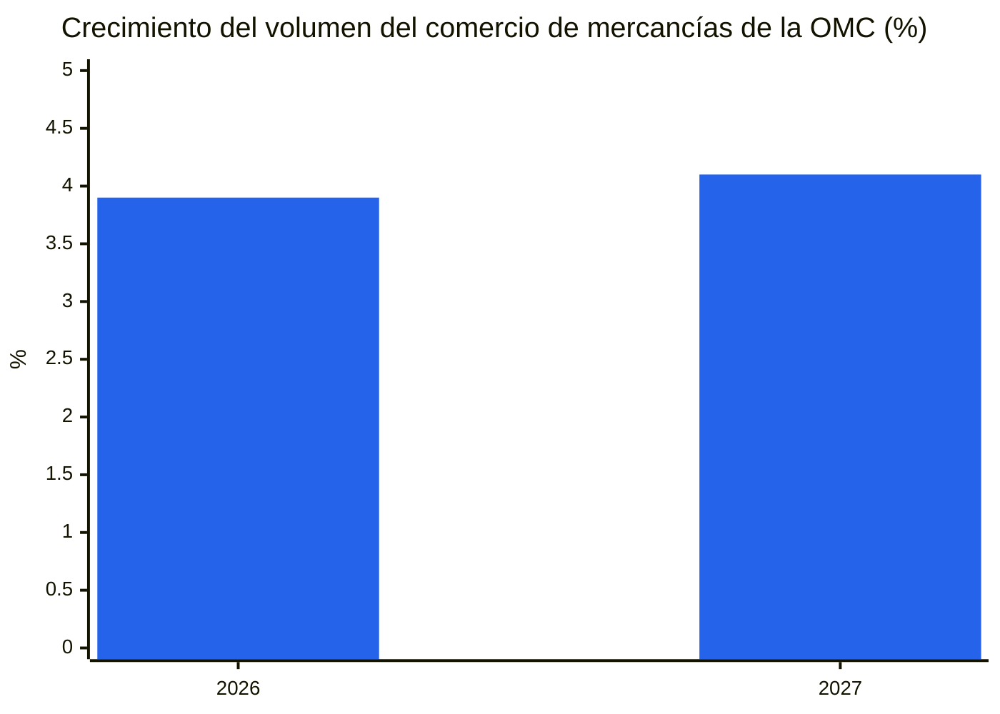
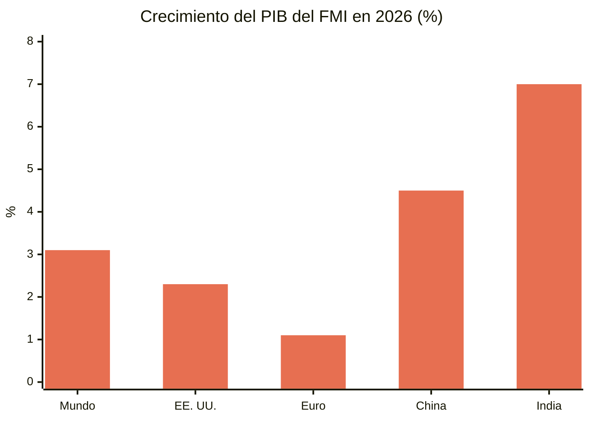
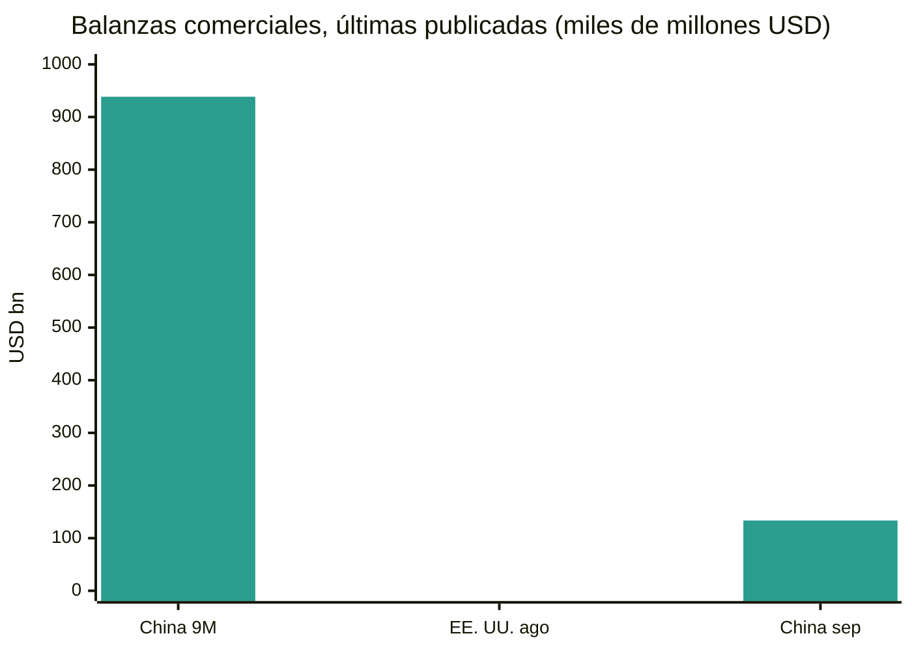
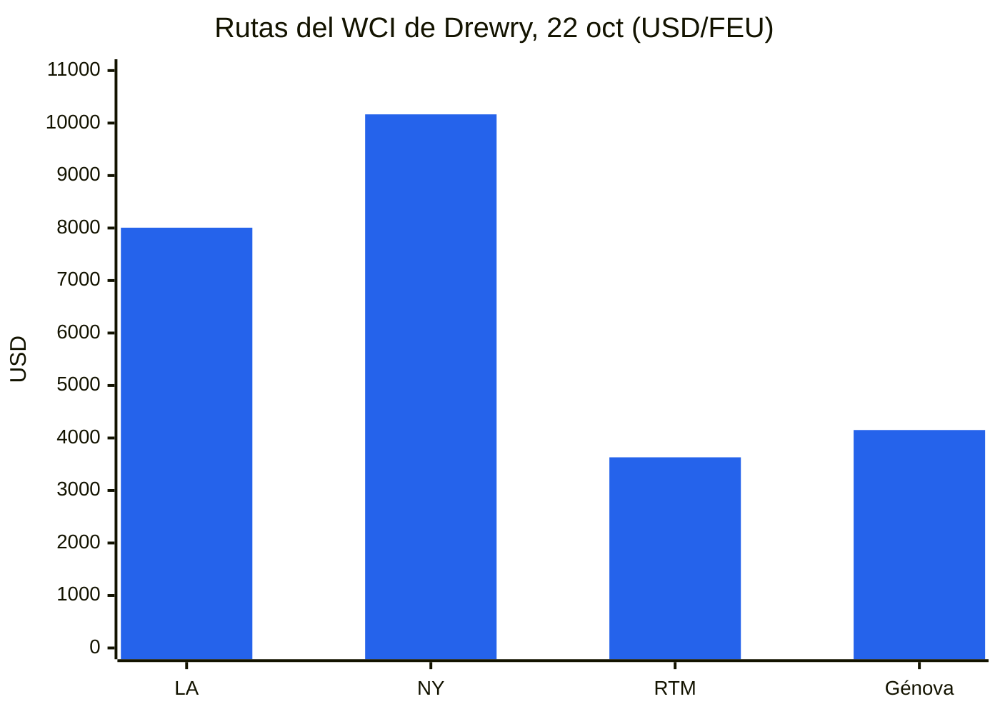
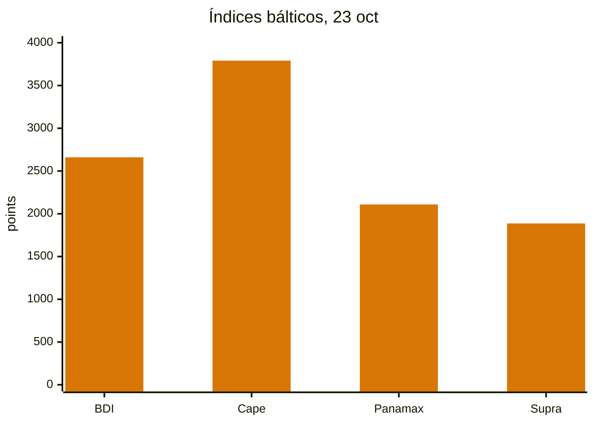
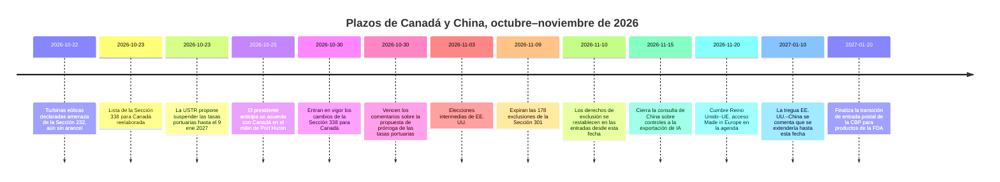
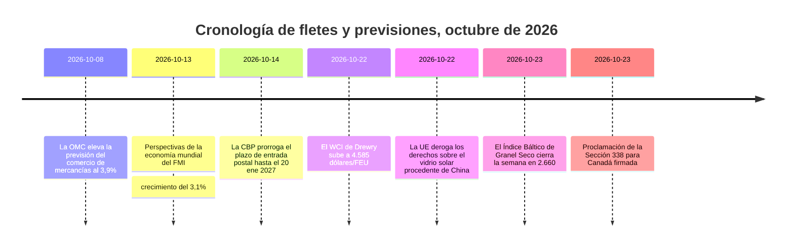

# Informe de inteligencia comercial mundial — Semana del 19 al 26 de octubre de 2026

**Boletín semanal.** Ventana de cobertura: del 19 al 26 de octubre de 2026. Recopilado a partir de aproximadamente 45 fuentes mundiales de noticias comerciales, política, datos y fletes.

---

## Índice

1. [Resumen ejecutivo](#1-executive-summary)
2. [Alertas](#2-alerts)
3. [Historias destacadas — análisis en profundidad](#3-top-stories--deep-dives)
4. [Seguimiento de aranceles](#4-tariff-tracker)
5. [Análisis en profundidad de la política de EE. UU.](#5-us-policy-deep-dive)
6. [Política mundial por región](#6-world-policy-by-region)
7. [Medidas de control](#7-enforcement-actions)
8. [Publicación de datos](#8-data-releases)
9. [Mercado de fletes](#9-freight-market)
10. [Cronologías de políticas](#10-policy-timelines)
11. [Próximos plazos y eventos (próximos 90 días)](#11-upcoming-deadlines--events-next-90-days)
12. [Fuentes y metodología](#12-sources--methodology)

---

## 1. Resumen ejecutivo

Una semana en la que Estados Unidos reescribió su lista de aranceles a Canadá dos veces en direcciones opuestas, el flete de contenedores prolongó su repunte, el granel seco se dividió marcadamente por tamaño de buque, y las dos principales instituciones de previsión del mundo describieron la misma economía mundial en registros distintos: resiliente en bienes, frágil en servicios, y cada vez más concentrada en un pequeño número de países y productos.

- **Canadá: alivio y escalada en la misma semana.** El 23 de octubre, el presidente Trump firmó una proclamación que elimina los aranceles del 50% de la Sección 338 de un conjunto de productos agrícolas y forestales canadienses — láminas de contrachapado, algunos productos de papel, determinada maquinaria y equipos de refrigeración, cajas y cajones de embalaje, y algas frescas y secas — con efecto el 30 de octubre. La misma orden añadió otros productos canadienses a la lista del 50%, entre ellos alfombras, pinturas, champús, cacao en polvo, ataúdes de madera, palitos de helado, máquinas de aire acondicionado, congeladores horizontales, equipos de tiro con arco y canoas. El alivio siguió a una petición de la senadora Susan Collins, de Maine, cuyo estado depende de insumos canadienses para sus productores de arándanos, patatas, manzanas y algas. Por separado, después de que Ontario emitiera un anuncio durante la Serie Mundial en el que se utilizaban declaraciones del expresidente Ronald Reagan sobre los aranceles, el presidente anunció un aumento del 10% en los aranceles a las importaciones canadienses, calificando el anuncio de grave tergiversación y acto hostil. Ontario dijo que pausaría el anuncio para permitir que se reanudaran las conversaciones comerciales. En un mitin en Port Huron, Michigan, el 25 de octubre, el presidente dijo que se alcanzaría un acuerdo comercial con Canadá "muy pronto", pero no dio términos ni plazos.
- **Fletes: contenedores al alza, granel dividido.** El Índice Mundial de Contenedores de Drewry subió un 2% hasta 4.585 dólares por contenedor de 40 pies el 22 de octubre, su nivel más alto en 15 semanas y su segundo aumento semanal consecutivo. Shanghái–Los Ángeles subió un 2% hasta 8.007 dólares, Shanghái–Nueva York un 1% hasta 10.166 dólares, Shanghái–Róterdam un 3% hasta 3.632 dólares y Shanghái–Génova un 5% hasta 4.152 dólares. Drewry contabilizó 56 salidas en blanco previstas para las semanas 44 a 48 de un total de 714 salidas programadas, una tasa de cancelación del 8%. El Índice Báltico de Granel Seco cerró la semana en 2.660 puntos el 23 de octubre, un aumento aproximado del 5,9% en la semana pese a una caída del 1,2% el propio viernes: los ingresos de los Capesize se recuperaron con fuerza, mientras que el Panamax cayó a 2.109, su nivel más bajo desde el 24 de agosto.
- **El retorno por Suez superó un umbral.** En las dos primeras semanas de octubre, la capacidad semanal media de contenedores en tránsito por el canal de Suez fue de 753.000 TEU, según Clarksons Research citado por BIMCO, frente a 1.457.000 TEU en el mismo periodo de 2023 — la primera vez desde que comenzó la crisis del mar Rojo que los tránsitos superaron el 50% de los niveles previos a la perturbación. Desde principios de julio se han anunciado dieciséis cambios de servicio, y las cuatro grandes alianzas operan ahora servicios regulares en dirección oeste entre Asia y el norte de Europa vía Suez. La previsión de octubre de Linerlytica anticipa un retorno a gran escala para el primer trimestre de 2027, sujeto a las condiciones de seguridad.
- **Previsiones: bienes resilientes, servicios más débiles, crecimiento concentrado.** La actualización de octubre de la OMC elevó el crecimiento del volumen del comercio mundial de mercancías en 2026 al 3,9%, desde el 1,9% de marzo, y al 4,1% en 2027, al tiempo que recortó el crecimiento del comercio de servicios comerciales en 2026 al 3,3% desde el 4,8%. El informe de Perspectivas de la economía mundial de octubre del FMI situó el crecimiento mundial en el 3,1% en 2026 y el 3,4% en 2027, con una inflación general del 4,7% en 2026, y advirtió de que el crecimiento está ahora concentrado: 32 países representan el 95% del crecimiento mundial, frente a 54 en abril, con cerca del 47% de las economías revisadas a la baja.
- **El plazo del 9 de noviembre se dividió en dos.** El 23 de octubre, la USTR propuso prorrogar la suspensión de las tasas portuarias de la Sección 301 sobre buques vinculados a China (y determinados derechos sobre grúas y equipos de manipulación de carga) desde el 10 de noviembre de 2026 hasta el 9 de enero de 2027, en un aviso del Registro Federal fechado el 23 de octubre y programado para su publicación el 26 de octubre, con comentarios hasta el 30 de octubre (expediente USTR-2026-0694). La propuesta aún no es definitiva. Las 178 exclusiones de productos de la Sección 301, por el contrario, siguen expirando a las 11:59 p.m., hora del Este, el 9 de noviembre de 2026, sin que en esta semana de cobertura se haya encontrado ninguna prórroga. Los importadores deben planificar según las fechas escritas para las exclusiones, y tratar la prórroga de las tasas portuarias como propuesta, no definitiva, hasta que la USTR publique un aviso final.
- **Europa mantuvo abierto su debate sobre China.** La Comisión Europea dijo que propondrá nuevas restricciones a las importaciones de sectores chinos más allá del entendimiento sobre vehículos híbridos alcanzado en Pekín a principios de octubre, con el presidente de Francia señalando los productos químicos, los plásticos y las ferroaleaciones. La Comisión también planea una propuesta en diciembre de un nuevo instrumento para limitar la dependencia de fuentes únicas de suministros esenciales. El Reino Unido, entretanto, siguió resistiendo la presión para igualar los derechos de la UE de hasta el 45,3% sobre los vehículos eléctricos chinos, y el secretario de Empresa, Jonathan Reynolds, afirmó que las decisiones británicas de defensa comercial se basan únicamente en el interés del Reino Unido. La UE derogó el 22 de octubre sus derechos de larga data sobre el vidrio solar procedente de China, con reclamaciones de devolución disponibles para los derechos pagados desde el 22 de julio de 2025.

**Fletes:** los contenedores se afirmaron por los aumentos generales de tarifas y las retiradas de capacidad antes de las negociaciones de contratos de enero; el granel seco se recuperó gracias a la fortaleza de los Capesize pese al debilitamiento del Panamax; la capacidad por Suez continuó su retorno gradual; y el riesgo del transporte marítimo en el Golfo siguió siendo elevado, con los cruces por Ormuz marcadamente a la baja en la semana del 12 al 18 de octubre y nuevos incidentes con buques los días 18 a 20 de octubre.

---

## 2. Alertas

| # | Alerta | Vigencia | Impacto | Fuente |
|---|-------|-----------|--------|--------|
| A1 | Lista de la Sección 338 para Canadá reelaborada: aranceles del 50% eliminados para láminas de contrachapado, algunos productos de papel, determinada maquinaria y equipos de refrigeración, cajas y cajones de embalaje, algas frescas y secas; añadidos para alfombras, pinturas, champús, cacao en polvo, ataúdes de madera, palitos de helado, máquinas de aire acondicionado, congeladores horizontales, equipos de tiro con arco, canoas | 30 oct 2026 | Las cadenas de suministro agrícolas y forestales de Maine obtienen alivio; los exportadores canadienses recién incluidos afrontan derechos del 50% | [White House](https://www.whitehouse.gov/fact-sheets/2026/10/fact-sheet-president-donald-j-trump-further-modifies-canadian-products-subject-to-tariffs-under-section-338/), [Supply Chain Dive](https://www.supplychaindive.com/news/trump-tweaks-canada-tariffs-removing-certain-goods-while-adding-others/833895/) |
| A2 | Aumento adicional del 10% en los aranceles a las importaciones canadienses anunciado tras el anuncio de Ontario durante la Serie Mundial en el que se utilizaban declaraciones de Ronald Reagan; Ontario dijo que pausaría el anuncio | Anunciado oct 2026 | Agrava la disputa entre EE. UU. y Canadá días antes de los cambios en la lista del 30 de octubre y de las elecciones intermedias del 3 de noviembre | [LawStreet](https://lawstreet.co/international/trump-says-canada-trade-deal-coming-soon-as-white-house-eases-some-tariffs-after-collins-request) |
| A3 | Los relojes del 9 de noviembre se dividen: la USTR propone prorrogar la suspensión de las tasas portuarias de la Sección 301 hasta el 9 ene 2027 (comentarios hasta el 30 oct, expediente USTR-2026-0694); las 178 exclusiones de productos de la Sección 301 siguen expirando a las 11:59 p.m., hora del Este, el 9 nov 2026, sin prórroga encontrada | 9 nov 2026 / 9 ene 2027 (propuesto) | Los derechos de exclusión vuelven a los tipos de lista (25% en las listas 1 a 3, 7,5% en la lista 4A) en las entradas del 10 nov; las tasas portuarias solo se restablecerían si la propuesta no se finaliza | [gCaptain](https://gcaptain.com/ustr-proposes-extending-china-ship-port-fee-suspension-through-january-2027/), [Gateway Lines](https://gatewaylines.com/press-releases/china-ship-fees-301-exclusions-nov-9-2026) |
| A9 | Las turbinas eólicas declaradas amenaza para la seguridad nacional bajo la Sección 232 (proclamación de la Casa Blanca, 22 oct); aún no se ha impuesto ningún arancel — se ordenó a los funcionarios comerciales negociar e informar en un plazo de 180 días | 22 oct 2026 | Las cadenas de suministro de energía eólica afrontan un posible arancel futuro; entre los principales proveedores citados en la información figuran México, Francia, India, Dinamarca y Alemania |  |
| A4 | El riesgo del transporte marítimo en Ormuz y el Golfo sigue siendo elevado: el petrolero AL DASMA resultó dañado en el estrecho de Ormuz el 20 oct; el JIF BARRACUDA resultó dañado cerca de los EAU el 18 oct; MarineTraffic informó de que los cruces por Ormuz bajaron de 203 a 120 en la semana del 12 al 18 oct | 18–20 oct 2026 | Los costes de riesgo bélico, rutas y seguros se mantienen elevados pese a la recuperación de los contenedores por Suez | [Daily Caller](https://dailycaller.com/2026/10/22/iran-claims-seven-vessels-attacked-in-persian-gulf) |
| A5 | Incidente con un carguero en el mar Negro: el buque de carga con pabellón de Comoras Khoryv se incendió y zozobró a unas 15 millas al este de Constanza, Rumanía; 1 tripulante muerto, 3 desaparecidos, 9 rescatados con vida | Oct 2026 | Riesgo de rutas y seguros en el mar Negro; las autoridades rumanas atribuyeron el incidente a un ataque con dron según la información local | [Scottish Sun](https://www.thescottishsun.co.uk/news/16978300/cargo-ship-fire-drone-strike-black-sea/) |
| A6 | Perturbación en los puertos franceses: huelgas de 24 horas anunciadas en los puertos franceses los días 14 y 16 oct, con otra fecha prevista para el 30 oct; las terminales y depósitos de Fos-sur-Mer cerraron el 20 oct por mal tiempo | 20 y 30 oct 2026 | Incertidumbre en los calendarios de las puertas de entrada francesas; los cargadores deben prever margen en las rutas de finales de octubre | [Maritime News](https://www.maritimenews.com/port-operations/port-operations-oct-14-21-2026) |
| A7 | Derechos de la UE sobre el vidrio solar procedente de China derogados el 22 oct 2026; reclamaciones de devolución disponibles para los derechos pagados desde el 22 jul 2025 | 22 oct 2026 | Los importadores de productos solares deben revisar los pagos históricos de derechos para su reclamación | [WiseVoter](https://wisevoter.com/world/2026/10/23/eu-repeals-solar-glass-duties-china) |
| A8 | Plazo de entrada postal de la CBP prorrogado: los productos regulados por la FDA, incluidos los medicamentos, podrán seguir utilizando el proceso postal simplificado hasta el 20 ene 2027, después de que la CBP prorrogara el 14 oct el plazo del 22 oct por 90 días | 20 ene 2027 | Los importadores por correo y paquetería ganan un trimestre más para pasar a las declaraciones aduaneras detalladas |  |

### A1 — Canadá: dos movimientos en direcciones opuestas

La proclamación del 23 de octubre se interpreta mejor como una recalibración, no como una desescalada. La hoja informativa de la Casa Blanca señala que los aranceles de la Sección 338 se aplican con independencia del origen USMCA y además de los derechos de la Sección 232, y que las adiciones y eliminaciones de productos entran en vigor el 30 de octubre de 2026 — cuatro días antes de las elecciones intermedias del 3 de noviembre. La senadora Collins dijo que el alivio ayudaría a los productores de arándanos, patatas, manzanas y algas de Maine, muchos de los cuales dependen de equipos, embalajes e insumos canadienses que no pueden obtenerse de proveedores estadounidenses o solo pueden sustituirse a un coste considerable.

**Análisis:** la orden preserva la arquitectura general de la disputa con Canadá — derechos del 50% sobre unos 20.000 millones de dólares de productos canadienses impuestos en agosto, tras el colapso de las conversaciones — al tiempo que desplaza su incidencia. Los exportadores de los productos recién incluidos (alfombras, cacao en polvo, máquinas de aire acondicionado, congeladores horizontales y otros) deben revisar de inmediato sus clasificaciones; los exportadores de los productos eliminados deben confirmar que sus productos concretos están dentro de las descripciones de la proclamación antes de dar por supuesto el alivio, ya que la cobertura de la Sección 338 depende de las descripciones de los productos, no de categorías amplias.

### A2 — El anuncio de Reagan y el aumento del 10%

El anuncio de Ontario, emitido durante la Serie Mundial mientras jugaban los Toronto Blue Jays, utilizaba las declaraciones de 1987 del expresidente Reagan en las que advertía de que los aranceles altos conducen a represalias y guerras comerciales. El presidente calificó el anuncio de grave tergiversación y acto hostil, puso fin a las conversaciones comerciales con Ottawa y anunció un aumento del 10% en los aranceles a las importaciones canadienses por encima de los niveles vigentes. La Fundación Presidencial Ronald Reagan dijo que no había aprobado el uso de los fragmentos. El primer ministro de Ontario, Doug Ford, dijo que el anuncio se retiraría progresivamente después del fin de semana para que ambas administraciones pudieran reanudar las conversaciones.

**Análisis:** el episodio muestra con qué rapidez una disputa de comunicación puede convertirse en política arancelaria en este ciclo, y cómo el calendario electoral la amplifica. La cuestión práctica para los importadores es la secuencia: los cambios en la lista del 30 de octubre, el aumento anunciado del 10% y cualquier acuerdo con Canadá que el presidente anticipó el 25 de octubre son tres instrumentos distintos, con bases jurídicas y fechas de vigencia diferentes. Hasta que cada uno se publique, la proclamación del 30 de octubre es la única con una fecha de vigencia fija.

### A3 — 9 de noviembre: los relojes divergen

El aviso de continuación de la USTR del 6 de octubre de 2026 (publicado el 7 de octubre) confirmó que ambas acciones de la Sección 301 sobre China de 2018 continúan, pero no prorrogó las exclusiones ni la pausa de las tasas portuarias. Las 178 exclusiones — 164 mantenidas en mayo de 2024 más 14 exclusiones de equipos de fabricación solar añadidas en septiembre de 2024 — rigen hasta las 11:59 p.m., hora del Este, del 9 de noviembre. Las mercancías introducidas el 10 de noviembre o después pagan el tipo de lista. El 23 de octubre, sin embargo, la USTR propuso una prórroga separada solo para la suspensión de las tasas portuarias: desde el 10 de noviembre de 2026 hasta el 9 de enero de 2027, los transportistas no incurrirían en responsabilidad por las tasas portuarias de los anexos I, II y III de la acción original de la Sección 301, y también se suspenderían los derechos conexos sobre grúas y equipos de manipulación de carga. El aviso, fechado el 23 de octubre y programado para su publicación el 26 de octubre, admite comentarios hasta las 5 p.m., hora del Este, del 30 de octubre (expediente USTR-2026-0694), y es una propuesta, no una norma definitiva. Más de 200 asociaciones comerciales escribieron a la USTR el 23 de septiembre pidiendo una prórroga.

**Análisis:** la brecha entre el calendario político (una tregua que se comenta que se extendería hasta el 10 de enero de 2027) y el calendario reglamentario (9 de noviembre) se ha estrechado para el transporte marítimo, pero no para los importadores. Los transportistas fijan precios según la norma escrita; los importadores deben hacer lo mismo con las exclusiones, e identificar cualquier entrada que invoque las partidas de exclusión antes del plazo en lugar de descubrir la exposición después. La propuesta sobre las tasas portuarias, si se finaliza, evita un reinicio de las tasas el 10 de noviembre; si no, las tasas se reanudan.

---

## 3. Historias destacadas — análisis en profundidad

### 3.1 Canadá: la política arancelaria como instrumento de temporada electoral

El expediente de Canadá dominó las noticias de política comercial de EE. UU. de la semana porque combinó los tres motores de la política comercial estadounidense actual: una herramienta legal (la Sección 338 de la Ley Arancelaria de 1930, que permite aranceles de hasta el 50% para responder a la discriminación contra el comercio estadounidense), un calendario político interno (elecciones intermedias el 3 de noviembre) y una negociación bilateral que ha sido intermitente desde agosto. La acción original de agosto abarcó unos 20.000 millones de dólares de productos canadienses, desde palos de hockey hasta cemento, después de que las conversaciones se rompieran; Canadá tomó represalias sobre un valor equivalente de productos estadounidenses.

La justificación declarada de la orden del 23 de octubre — que altos funcionarios aconsejaron que los cambios seguirían compensando la presunta discriminación al tiempo que servían al interés público — es la formulación estándar de la administración para la Sección 338. Lo nuevo es la vinculación explícita, en la información contemporánea, con la petición de una sola senadora en nombre de industrias estatales concretas. Esa vinculación no cambia el efecto jurídico, pero sí cambia la lección para la presión política: el alivio específico por producto puede obtenerse cuando un electorado interno puede demostrar una dependencia concreta de la cadena de suministro.

**Cifras clave:** tipo del 50% de la Sección 338; unos 20.000 millones de dólares de productos canadienses cubiertos originalmente; fecha de vigencia el 30 de octubre; elecciones intermedias el 3 de noviembre.

**Por qué importa:** para los exportadores canadienses y los importadores estadounidenses, la lista del 30 de octubre es el documento operativo. Para todos los demás, el episodio recuerda que las listas de aranceles en este ciclo se revisan en semanas, no en años, y que la diligencia a nivel de clasificación es ahora un coste recurrente de la importación.

### 3.2 Las dos previsiones: la OMC y el FMI coinciden en la resiliencia, discrepan en su amplitud

La actualización de octubre de las Perspectivas y estadísticas del comercio mundial de la OMC, del 8 de octubre, y el informe de Perspectivas de la economía mundial del FMI, del 13 de octubre, ambos publicados justo antes de esta semana de cobertura pero dominando su debate político, cuentan una historia coherente con énfasis distintos. La OMC elevó el crecimiento del volumen del comercio de mercancías al 3,9% en 2026 (desde el 1,9% de marzo) y al 4,1% en 2027, atribuyéndolo a la inversión relacionada con la inteligencia artificial: el comercio de bienes que hacen posible la IA creció un 67% interanual en el primer semestre de 2026 y representó el 47% del crecimiento del comercio mundial de mercancías. Asia lidera el crecimiento de las exportaciones en 2026 con un 9,9%, seguida de América del Norte con un 5,7% y África con un 5,6%. Al mismo tiempo, la OMC recortó el crecimiento del comercio de servicios comerciales en 2026 al 3,3% desde el 4,8%, con el transporte en el 0,9% y los viajes en el 0,2%, lo que refleja la perturbación en Oriente Medio, el aumento de los costes del combustible de aviación y las restricciones de vuelo.

El FMI situó el crecimiento mundial en el 3,1% en 2026 y el 3,4% en 2027, con una inflación general del 4,7% en 2026 que bajaría al 4,1% en 2027. Su tabla por países muestra a Estados Unidos en el 2,3% en ambos años, la zona del euro en el 1,1% en 2026 y el 1,2% en 2027, China en el 4,5% y el 4,0%, e India en el 7,0% en base de ejercicio fiscal. La advertencia del Fondo es estructural: el crecimiento se está concentrando en economías conectadas al auge de la inversión en IA o aisladas del choque energético, mientras que las economías importadoras de energía fuera de la cadena de valor tecnológica afrontan las perspectivas más difíciles. Su escenario base supone que el estrecho de Ormuz comienza a reabrirse en marzo de 2027, con un amplio retorno a las condiciones previas a la guerra hacia octubre de 2027.

*Nota: Perspectivas y estadísticas del comercio mundial de la OMC, actualización de octubre de 2026; la previsión para 2026 se elevó desde el 1,9% de marzo.*

*Nota: Perspectivas de la economía mundial del FMI, octubre de 2026. India en base de ejercicio fiscal.*

**Análisis:** ambas instituciones coinciden en que la inversión en IA está enmascarando la debilidad en otros ámbitos. La implicación práctica para la planificación comercial es que el crecimiento general del comercio halaga al promedio: las empresas fuera de las cadenas de suministro de IA, o expuestas a los costes energéticos y de transporte de Oriente Medio, están viviendo un año materialmente peor que el que sugieren los agregados mundiales.

### 3.3 China: un superávit que se acerca a 1 billón de dólares, y un debate sobre lo que significa

El superávit del comercio de mercancías de China de enero a septiembre de 2026 alcanzó los 938.500 millones de dólares, con solo septiembre en 133.500 millones, un máximo de 20 meses, mientras las exportaciones repuntaban por el auge del hardware de IA. Las ventas a Estados Unidos crecieron un 40%, el ritmo más rápido en más de cinco años, llevando el superávit de China con Estados Unidos a 34.000 millones de dólares, su nivel más alto desde enero de 2025. También se registraron exportaciones récord hacia Australia, Corea del Sur, Taiwán, Rusia y las economías de la ASEAN. Economistas de Goldman Sachs citados en la información estiman que el número de países con déficits comerciales superiores al 3% del PIB con China se ha más que triplicado desde 2005, hasta 82, la mayoría economías emergentes de bajos ingresos.

**Análisis:** el superávit es tanto un síntoma como un motor de las noticias de política de la semana. Fortalece la posición negociadora de Pekín de cara a los plazos de noviembre, y fortalece el argumento, en Bruselas y Washington, a favor de nuevas medidas defensivas. También complica la narrativa de que la desvinculación está avanzada: las compras estadounidenses de bienes de capital chinos para infraestructura de IA están creciendo a su ritmo más rápido en cinco años.

### 3.4 Europa: las medidas de defensa avanzan, pero no en una sola dirección

El debate de octubre en la UE produjo dos señales opuestas. En el lado restrictivo, la presidenta de la Comisión, Ursula von der Leyen, dijo tras la cumbre del 15 y 16 de octubre que la Comisión propondrá restricciones a las importaciones procedentes de China más allá del entendimiento sobre vehículos híbridos acordado en Pekín, que está diseñado para reducir a la mitad los envíos entrantes de automóviles híbridos chinos. El presidente de Francia señaló los productos químicos, los plásticos y las ferroaleaciones. La Comisión también propondrá, en diciembre, un nuevo instrumento para limitar la dependencia de fuentes únicas de suministros esenciales, y un mecanismo de solidaridad para países o sectores objeto de coerción. El déficit del comercio de bienes de la UE con China se sitúa en más de 1.000 millones de euros al día.

En el lado liberalizador, la UE derogó el 22 de octubre sus derechos sobre el vidrio solar procedente de China, poniendo fin a medidas vigentes desde 2014, después de que los dos últimos productores de vidrio solar de la UE cesaran la producción. Los importadores pueden solicitar a las autoridades aduaneras nacionales la devolución de los derechos pagados desde el 22 de julio de 2025, conforme a los reglamentos de ejecución 2026/2314 y 2026/2310.

**Análisis:** ambos movimientos son coherentes una vez enunciado el criterio: las medidas sobreviven donde queda una industria nacional que proteger, y caen donde no la hay. Las propuestas de diciembre — un instrumento de acción rápida y un instrumento de dependencia de fuente única — son las que hay que vigilar, ya que generalizarían el enfoque de los vehículos híbridos convirtiéndolo en herramientas permanentes.

### 3.5 El retorno por Suez y el riesgo de Ormuz, lado a lado

El retorno de los contenedores por Suez ya es medible: 753.000 TEU por semana a principios de octubre, el 36% de la capacidad total de contenedores encaminada por el canal o por el Cabo, frente a un promedio del 8% entre 2024 y mediados de 2026, pero todavía muy por debajo del 80% previo a la crisis. Desde principios de julio se han anunciado dieciséis cambios de servicio, que abarcan a Gemini, Ocean, Premier y MSC. Al mismo tiempo, el riesgo en el Golfo no ha remitido: MarineTraffic informó de que los cruces por Ormuz cayeron de 203 a 120 en la semana del 12 al 18 de octubre, y se informaron incidentes con buques los días 18 y 20 de octubre. El recuento de la OMI del 21 de octubre documentó 24 víctimas y 120 incidentes marítimos confirmados en Oriente Medio desde que comenzó el conflicto.

**Análisis:** el mercado de contenedores está valorando dos riesgos distintos a la vez — una liberación estructural de capacidad a medida que Suez se normaliza, que debería presionar las tarifas a la baja, y una prima persistente de riesgo bélico en las rutas del Golfo y del mar Negro, que las sostiene. El repunte de Drewry sugiere que, por ahora, la gestión de la capacidad (salidas en blanco, aumentos generales de tarifas) está pesando más que la liberación por Suez.

### 3.6 El déficit comercial de Estados Unidos: un mes récord de importaciones

El déficit del comercio de bienes y servicios de EE. UU. se amplió un 13,7% en agosto hasta 105.600 millones de dólares, el mayor desde marzo de 2025, mientras las importaciones alcanzaban un récord de 420.800 millones de dólares (un aumento del 4,3%) y las exportaciones subían un 1,4% hasta 315.200 millones de dólares. Solo el déficit de bienes se amplió un 11,5% hasta 132.600 millones de dólares, con las importaciones de bienes un 5,5% al alza hasta 336.100 millones de dólares — suministros industriales un 16,6% más, bienes de capital un 4,0% más por la construcción de infraestructura de IA, alimentos un 5,5% más — frente a exportaciones de bienes de 203.400 millones de dólares, un 1,9% más. El déficit acumulado de enero a agosto, sin embargo, siguió siendo un 19,9% más estrecho que en el mismo periodo de 2025, un recordatorio de que las lecturas de un solo mes y las acumuladas del año apuntan en direcciones distintas.

**Análisis:** los datos de agosto, publicados a principios de octubre y comentados durante esta semana, socavan la afirmación simple de que los aranceles reducen mecánicamente el déficit a corto plazo, mientras que la mejora acumulada del año socava la afirmación contraria. Ambas lecturas pueden ser ciertas porque el déficit responde a los precios de importación, la demanda de bienes de capital para IA y los ciclos de inventario, además de a los tipos arancelarios.

---

## 4. Seguimiento de aranceles

| País / origen | Medida | Tipo | Fecha de vigencia | Estado | Fuente |
|---|---|---|---|---|---|
| Canadá | Aranceles de la Sección 338 — eliminaciones: láminas de contrachapado, algunos productos de papel, determinada maquinaria y equipos de refrigeración, cajas y cajones de embalaje, algas frescas y secas | 50% eliminado | 30 oct 2026 | Proclamación firmada el 23 oct 2026 | [White House](https://www.whitehouse.gov/fact-sheets/2026/10/fact-sheet-president-donald-j-trump-further-modifies-canadian-products-subject-to-tariffs-under-section-338/) |
| Canadá | Aranceles de la Sección 338 — adiciones: alfombras, pinturas, champús, cacao en polvo, ataúdes de madera, palitos de helado, máquinas de aire acondicionado, congeladores horizontales, equipos de tiro con arco, canoas | 50% | 30 oct 2026 | Proclamación firmada el 23 oct 2026 | [Supply Chain Dive](https://www.supplychaindive.com/news/trump-tweaks-canada-tariffs-removing-certain-goods-while-adding-others/833895/) |
| Canadá | Aumento adicional de aranceles anunciado tras el anuncio de Ontario | +10 puntos porcentuales | Anunciado oct 2026 | Anunciado; términos de aplicación n/d | [LawStreet](https://lawstreet.co/international/trump-says-canada-trade-deal-coming-soon-as-white-house-eases-some-tariffs-after-collins-request) |
| China | Aranceles de la Sección 301 — expiran 178 exclusiones de productos | 25% (listas 1–3), 7,5% (lista 4A) al revertir | 9 nov 2026, 11:59 p.m., hora del Este | Sin prórroga publicada en la semana de cobertura | [Gateway Lines](https://gatewaylines.com/press-releases/china-ship-fees-301-exclusions-nov-9-2026) |
| China | Tasas portuarias de la Sección 301 sobre buques vinculados a China — prórroga de la suspensión propuesta hasta el 9 ene 2027 | Tasas suspendidas del 10 nov 2026 al 9 ene 2027 si se finaliza | Propuesta el 23 oct 2026; comentarios hasta el 30 oct | Solo propuesta, no definitiva | [gCaptain](https://gcaptain.com/ustr-proposes-extending-china-ship-port-fee-suspension-through-january-2027/) |
| Turbinas eólicas y componentes | Determinación de seguridad nacional de la Sección 232 | Aún no se ha impuesto ningún arancel; negociaciones e informe en un plazo de 180 días | 22 oct 2026 | Determinación emitida; posible arancel tras la ventana de negociación |  |
| China | Derechos antidumping y compensatorios de la UE sobre el vidrio solar | Derogados | 22 oct 2026 | Derogados; devoluciones desde el 22 jul 2025 | [WiseVoter](https://wisevoter.com/world/2026/10/23/eu-repeals-solar-glass-duties-china) |
| China | Derechos antidumping de la UE, productos planos de aluminio | 14,3%–24,6% | En curso | Revisión por expiración iniciada el 9 oct 2026; las medidas siguen en vigor | [We Are Main Street](https://wearemainstreet.org/world/2026/10/25/eu-anti-dumping-duties-chinese-aluminium) |
| China | Entendimiento de la UE sobre vehículos híbridos | Envíos a reducir a la mitad | Acordado el 8–9 oct 2026 | Entendimiento; procedimientos de aplicación pendientes | [EU Monitoring](https://ieu-monitoring.com/editorial/eu-and-china-reach-trade-understandings-on-hybrid-cars-tariffs-and-rare-earths/1251810) |
| Reino Unido | Derecho de importación estándar sobre automóviles fabricados en China | 10% | En curso | Sin cambios; el Reino Unido resiste la presión de la UE para igualar hasta el 45,3% | [Fleet News](https://www.fleetnews.co.uk/news/minister-reportedly-resists-calls-for-uk-to-impose-chinese-ev-tariffs) |
| India–Nueva Zelanda | TLC en vigor: derecho cero en el 100% de las líneas arancelarias de exportación de India a Nueva Zelanda; concesiones de India en el 70% de las líneas | 0% (exportaciones indias a NZ) | 20 oct 2026 | En vigor; se aplican las normas de origen | [Devdiscourse](https://www.devdiscourse.com/article/business/3994858-india-new-zealand-fta-to-eliminate-tariffs-on-all-indian-exports-from-october-20-dgft-official?amp) |
| Rusia / compradores de energía | Aranceles de la Ley Graham (500% Rusia, 100% principales compradores de energía y facilitadores) | Eximidos | Exención del 16 oct 2026 | Eximidos sin fecha de finalización; seguimiento asignado a la USTR | [KPMG](https://kpmg.com/us/en/taxnewsflash/news/2026/10/trump-russia-tariffs-sanctions.html) |

---

## 5. Análisis en profundidad de la política de EE. UU.

### La Sección 338 y Canadá

Véanse las secciones 2 y 3.1. La hoja informativa del 23 de octubre confirma que los aranceles de la Sección 338 se aplican con independencia del origen USMCA y además de los derechos de la Sección 232, y que el presidente puede suspender, revocar, complementar o modificar cualquier proclamación de la Sección 338 cuando el interés público lo requiera. Esa facultad de modificación es lo que hace posibles nuevas revisiones en octubre o noviembre sin nueva legislación.

### USTR — continuación de la Sección 301 y los relojes del 9 de noviembre

La USTR confirmó el 6 de octubre de 2026 (publicado el 7 de octubre) que ambas acciones de la Sección 301 sobre China de 2018 continúan, abriendo la siguiente fase de la segunda revisión cuadrienal. La revisión puede elevar los tipos además de mantenerlos: tras la primera continuación en septiembre de 2022, la USTR elevó los semiconductores al 50% en 2025, las células solares al 50% en 2024, y los productos de acero y aluminio al 25% en 2024. Los relojes separados del 9 de noviembre divergieron entonces en esta semana de cobertura: el 23 de octubre, la USTR propuso prorrogar la suspensión de las tasas portuarias hasta el 9 de enero de 2027 (comentarios hasta el 30 de octubre, expediente USTR-2026-0694), mientras que las 178 exclusiones de productos no recibieron ninguna propuesta de prórroga y siguen expirando el 9 de noviembre.

### Sección 232 — turbinas eólicas

El 22 de octubre de 2026, el presidente declaró que las importaciones de turbinas eólicas y componentes constituyen una amenaza para la seguridad nacional bajo la Sección 232, tras una investigación del Departamento de Comercio iniciada en agosto de 2025. Se abstuvo de imponer aranceles y, en su lugar, ordenó a los funcionarios comerciales que entablaran negociaciones con los socios comerciales e informaran en un plazo de 180 días; podrían considerarse medidas adicionales, incluidos aranceles, más adelante. Los motivos citados incluyen preocupaciones de ciberseguridad vinculadas a equipos fabricados en el extranjero, interferencias con los sistemas de radar y las operaciones de tráfico aéreo, y una mayor dependencia estadounidense de productos fabricados en el exterior. Entre los principales proveedores citados en la información figuran México, Francia, India, Dinamarca y Alemania. No se ha fijado ningún tipo arancelario.

### Operaciones de la CBP

La CBP prorrogó la transición de entrada postal para los productos regulados por la FDA, incluidos los medicamentos, del 22 de octubre de 2026 al 20 de enero de 2027, una prórroga de 90 días anunciada el 14 de octubre. La prórroga sigue a la norma final provisional del 24 de junio de 2026 que eliminó la franquicia libre de derechos de 800 dólares para los paquetes enviados por correo y trasladó la mayoría de los pequeños paquetes internacionales a un proceso simplificado desde el 24 de julio de 2026. Los productos cubiertos por las normas de importación de otra agencia tenían hasta el 22 de octubre para pasar a declaraciones más detalladas; ahora tienen hasta el 20 de enero de 2027.

### Devoluciones de aranceles

Un juez comercial de EE. UU. certificó una demanda colectiva para importadores que solicitan la devolución de aranceles anulados por el Tribunal Supremo a principios de 2026, que abarca a los importadores que aún no han presentado reclamaciones. La Aduana ha tramitado íntegramente casi 130.000 millones de dólares en devoluciones, frente a más de 166.000 millones de dólares pagados en los aranceles impugnados, y los intereses podrían ascender a miles de millones. La decisión, comunicada el 9 de octubre de 2026, importa para los importadores que aún no han reclamado: el mecanismo colectivo puede recalcular y devolver las cantidades restantes sin demandas individuales.

### Temas pendientes

La exención de la Ley Graham del 16 de octubre sigue en vigor sin fecha de finalización. La tregua entre EE. UU. y China que se comenta que se extendería hasta el 10 de enero de 2027 tiene un paso de aplicación propuesto — no definitivo — para la suspensión de las tasas portuarias (hasta el 9 de enero de 2027, comentarios hasta el 30 de octubre), y ninguna propuesta de prórroga para las 178 exclusiones de productos. El caso del Tribunal Supremo sobre la autoridad arancelaria, al que se hace referencia en la información sobre la disputa con Canadá, está programado para su argumentación en noviembre.

---

## 6. Política mundial por región

### Europa

El programa posterior a la cumbre de la Comisión es el principal acontecimiento europeo de la semana: nuevas restricciones a las importaciones procedentes de China más allá de los vehículos híbridos, una propuesta en diciembre de un instrumento de dependencia de fuente única, y un mecanismo de solidaridad para los casos de coerción. El propio entendimiento sobre vehículos híbridos, alcanzado en la segunda reunión de Consultas Ministeriales de Comercio e Inversión UE–China en Pekín los días 8 y 9 de octubre entre el comisario Maroš Šefčovič y el ministro Wang Wentao, abarca siete líneas arancelarias y podría reducir las exportaciones chinas de híbridos e híbridos enchufables a la UE en más de la mitad en cuatro años. Ambas partes acordaron una tercera reunión ministerial en marzo de 2027 y una videoconferencia ministerial en enero. El déficit de bienes de la UE con China, de más de 1.000 millones de euros al día, es el motor declarado.

La derogación del vidrio solar y la revisión por expiración del aluminio laminado plano (derechos del 14,3% al 24,6% que siguen en vigor) muestran a la misma administración aplicando herramientas opuestas a sectores distintos, como se analiza en la sección 3.4.

### China

El desempeño exportador de China en 2026 — un superávit de 938.500 millones de dólares en nueve meses, con las exportaciones de septiembre repuntando por el hardware de IA — sigue siendo el telón de fondo estructural. China reanudó las exportaciones de combustible refinado tras la pausa de la Semana Dorada, con unos 3,7 millones de toneladas aprobadas para octubre (diésel, gasolina y combustible de aviación combinados). La consulta sobre controles a la exportación de tecnología de IA, abierta el 16 de octubre y que abarca 40 tecnologías, sigue abierta hasta el 15 de noviembre, y es un tema pendiente para las empresas que transfieren pesos de modelos o metodología de diseño de chips.

### Reino Unido

El secretario de Empresa, Jonathan Reynolds, dijo que el Reino Unido no cedería ante los llamamientos de otros países para imponer impuestos a la importación de vehículos chinos, y que las decisiones británicas de defensa comercial se basan únicamente en el interés del Reino Unido. El Reino Unido aplica actualmente su derecho estándar del 10% a los automóviles fabricados en China, frente a los derechos combinados de la UE de hasta el 45,3%. La información de prensa de principios de octubre sugería que el Reino Unido estaba preparando un paquete que replicaría el tipo de la UE para asegurar el acceso al propuesto esquema Made in Europe de la UE, según el cual un vehículo eléctrico solo reuniría los requisitos para subvenciones y licitaciones públicas si al menos el 70% de sus piezas se fabrican dentro del bloque; las declaraciones del ministro del 14 de octubre rechazan ese planteamiento. El primer ministro Andy Burnham ha hecho de la inclusión del Reino Unido en el esquema un objetivo central para la cumbre UE del 20 de noviembre. Se citan hasta 80.000 millones de euros (68.000 millones de libras) de comercio británico en riesgo si los fabricantes británicos quedan excluidos.

El 23 de octubre, el Gobierno del Reino Unido dijo que las empresas ahorrarían casi 800 millones de libras al año al reducir el papeleo y prorrogar la suspensión de algunos aranceles de importación, antes de la primera declaración presupuestaria anual. El paquete incluye 290 millones de libras por orientaciones de cumplimiento más sencillas para las pequeñas empresas, 155 millones de libras por suspensiones prorrogadas de aranceles de importación sobre 250 productos utilizados por las empresas, 105 millones de libras por la reducción de informes duplicados para los gestores de activos, y 116 millones de libras en costes eliminados para las transacciones de vivienda. Las suspensiones arancelarias suponen un alivio directo del coste de desembarque para los importadores británicos en esas 250 líneas de productos.

### India y Nueva Zelanda

El Tratado de Libre Comercio entre India y Nueva Zelanda entró en vigor el 20 de octubre de 2026, eliminando los derechos en el 100% de las líneas arancelarias que cubren las exportaciones actuales de India a Nueva Zelanda — el primer TLC indio que ofrece acceso libre de derechos en todas las líneas arancelarias desde su fecha de vigencia. Los exportadores indios afrontaban anteriormente derechos de hasta el 10% en textiles, prendas de vestir, artículos de cuero y calzado, y de hasta el 5% en productos farmacéuticos, productos agrícolas y marinos, plásticos, productos químicos y bienes eléctricos. India ofreció concesiones en el 70% de sus líneas arancelarias, que cubren cerca del 95% del valor del comercio bilateral actual, con acceso libre de derechos para troncos de madera, carbón coquizable y chatarra metálica de Nueva Zelanda, y contingentes arancelarios y salvaguardias — incluidos precios mínimos de importación — para manzanas, kiwis, miel de manuka y albúminas. El acuerdo, firmado el 27 de abril de 2026 y ratificado el 21 de septiembre de 2026, incluye también un compromiso de facilitación de la inversión de 20.000 millones de dólares en 15 años y el objetivo de duplicar el comercio bilateral hasta 7.000 millones de dólares neozelandeses en 2030. Los exportadores deben seguir cumpliendo las normas de origen y otras condiciones para acogerse a los aranceles preferenciales.

### China y Japón

El Ministerio de Asuntos Exteriores de China dijo el 21 de octubre que los controles de Pekín a la exportación de materiales estratégicos de doble uso a Japón buscan frenar la remilitarización de Tokio, en respuesta a informes según los cuales las reservas internas de itrio de Japón han caído a varios meses de consumo. Japón obtenía anteriormente más del 70% de su óxido de itrio de refinerías chinas, y los datos de aduanas chinas mostraron volúmenes mensuales casi nulos de varias tierras raras pesadas. Tokio ha pedido a Washington que inste a Pekín a aliviar los envíos de tierras raras especializadas. La declaración ofrece una justificación formal de seguridad para restricciones aplicadas a principios de 2026 conforme a la Ley de Control de Exportaciones de China y sus reglamentos de control de exportaciones de doble uso.

Por separado, el Anuncio n.º 48 de 2026 del MOFCOM — la misma revisión del catálogo que sustenta los controles de tecnología de IA — avanza proyectos de controles sobre cinco plataformas biotecnológicas sensibles, dirigidos a las transferencias salientes de terapias celulares y génicas, con los acuerdos activos sujetos a registro previo a la exportación inmediato. Las 40 adiciones propuestas al catálogo comprenden 23 de IA, 5 biomédicas y 12 fotovoltaicas, con 14 prohibiciones directas propuestas y 26 restricciones propuestas que exigen licencias. Se prohibirían las transferencias directas de propiedad de plataformas fundacionales de descubrimiento de fármacos a compradores extranjeros. Según la información, los desarrolladores chinos de fármacos cerraron 81 operaciones de licencia salientes por valor de 110.000 millones de dólares solo en el primer semestre de 2026, lo que subraya cuánto flujo de acuerdos abarca ahora el régimen provisional de registro. La consulta cierra el 15 de noviembre de 2026.

### Canadá

Más allá de la disputa con EE. UU., la decisión de Ontario de pausar el anuncio de Reagan después del fin de semana, tras conversaciones entre el primer ministro de Ontario, Doug Ford, y el primer ministro de Canadá, Mark Carney, es el acontecimiento canadiense de la semana con la consecuencia comercial más directa: elimina el irritante inmediato al tiempo que deja en vigor los instrumentos arancelarios. La declaración del presidente del 25 de octubre de que un acuerdo llegaría "muy pronto" se hizo en un mitin en una ciudad fronteriza, no en un documento de negociación, y debe tratarse como señalización y no como acuerdo.

Los días 21 y 22 de octubre, el primer ministro Mark Carney y el primer ministro de Ontario, Doug Ford, anunciaron un paquete de apoyo industrial de 8.700 millones de dólares canadienses para el acero, los automóviles y los minerales esenciales, presentado como respuesta a los aranceles estadounidenses y como forma de proteger a los trabajadores de la base manufacturera integrada del sur de Ontario. En la cobertura inicial no se publicó ningún desglose proyecto por proyecto ni calendario de desembolso. Carney dijo que las exportaciones canadienses de automóviles a Estados Unidos habían caído más de un 10%, mientras que las exportaciones estadounidenses a Canadá habían caído más de un 20%, y reiteró que Canadá pretende duplicar las exportaciones a destinos distintos de EE. UU. en la próxima década; Estados Unidos todavía absorbió el 71,7% de las exportaciones canadienses de mercancías en 2025, frente al 75,9% del año anterior. Canadá también confirmó conversaciones comerciales con Türkiye el 30 de noviembre como parte de ese esfuerzo de diversificación.

### México

México dijo el 21 de octubre que su objetivo en las negociaciones comerciales es reducir al máximo los aranceles estadounidenses sobre sus exportaciones de aluminio, acero y vehículos antes de finales de 2026, preservando su posición actual: más del 80% de los productos mexicanos entran en el mercado estadounidense libres de aranceles, y el secretario de Economía, Marcelo Ebrard, citó un arancel efectivo medio del 3% sobre las exportaciones mexicanas, inferior al de otros grandes países exportadores. El USMCA no se prorrogó por un nuevo periodo de 16 años en la revisión conjunta del 1 de julio de 2026, y ahora avanza con revisiones conjuntas anuales; la USTR abrió comentarios públicos para el ciclo de 2027 el 5 de octubre de 2026. La presidenta de México confirmó el 19 de octubre que el presidente de EE. UU. había propuesto que México comprara más gas natural estadounidense y diera a las empresas estadounidenses un papel mayor en el aumento de la producción petrolera mexicana, y negó que cualquiera de las dos propuestas sea condición para un acuerdo comercial.

### Multilateral

La Secretaría de la OMC visitó Mogadiscio por primera vez, como parte de una misión técnica conjunta OMC–ITC del 10 al 15 de octubre en apoyo de la candidatura de adhesión de Somalia, que incluye ofertas de acceso a los mercados de bienes y servicios. La directora general de la OMC, Ngozi Okonjo-Iweala, dijo en Bangkok el 15 de octubre que los cambios geopolíticos y las guerras en Ucrania y Oriente Medio tendrán un impacto duradero en los flujos comerciales, y que algunas rutas alternativas probablemente perdurarán porque los países y las empresas quieren protegerse frente a futuras perturbaciones. La OMC previó una caída del 17% en las exportaciones de Oriente Medio este año, con las importaciones un 15% a la baja.

Dos acontecimientos de la OMC en esta semana de cobertura ponen a prueba el alcance del sistema multilateral. En primer lugar, el 25 de septiembre de 2026 se estableció un grupo especial de la OMC, a petición por segunda vez de Rusia, para examinar el Mecanismo de Ajuste en Frontera por Carbono (CBAM) de la UE y una presunta subvención a la exportación en el Régimen de Comercio de Derechos de Emisión de la UE; la UE confirmó que participará. Rusia solicitó consultas por primera vez en mayo de 2025. El establecimiento del grupo especial es un paso de procedimiento, no una constatación de ilegalidad, pero es la primera gran prueba en la OMC de la política insignia de carbono en frontera de la UE, que abarca el acero, el aluminio, el cemento, los fertilizantes, la electricidad y el hidrógeno. En segundo lugar, el Comité de Acceso a los Mercados de la OMC examinó un récord de 36 preocupaciones comerciales en su reunión del 12 y 13 de octubre, incluidas 8 planteadas por primera vez — entre ellas las medidas de Canadá sobre productos siderúrgicos, presuntas cláusulas discriminatorias en las propuestas de Ley del Acelerador Industrial y Ley de Ciberseguridad de la UE, los regímenes de importación de Indonesia para cacahuetes y productos halal, y el régimen de vigilancia de valores unitarios de Türkiye. Un primer informe de la Secretaría enumera 51 preocupaciones resueltas (34 íntegramente, 17 parcialmente) de las 145 planteadas entre abril de 1995 y marzo de 2026. La OMC también acordó establecer un grupo especial sobre la impugnación de China a los aranceles de India sobre determinados productos tecnológicos y los programas de incentivos para la fabricación nacional de productos solares, después de que India bloqueara la primera solicitud de China en mayo de 2026.

En el sistema multilateral más amplio, el Centro de Datos de la UNCTAD informó el 21 de octubre de que la inversión extranjera directa en las economías en desarrollo sigue estando muy concentrada, con ocho de las diez mayores economías receptoras situadas en Asia. El Centro de Comercio Internacional se asoció con el Departamento de Comercio, Industria y Competencia de Sudáfrica para apoyar las exportaciones de las pymes, y el Grupo de Trabajo SAFE de la Organización Mundial de Aduanas lanzó su primer Enfoque de MIPYME sobre seguridad de la cadena de suministro y facilitación del comercio.

---

## 7. Medidas de control

| Medida | Objetivo / alcance | Fecha | Fuente |
|---|---|---|---|
| Transición de entrada postal de la CBP prorrogada | Productos regulados por la FDA, incluidos los medicamentos, que utilizan el proceso postal simplificado | Prorrogada el 14 oct 2026 hasta el 20 ene 2027 |  |
| Revisión por expiración de la UE, productos planos de aluminio procedentes de China | Derechos del 14,3% al 24,6% que siguen en vigor durante la revisión | Iniciada el 9 oct 2026 | [We Are Main Street](https://wearemainstreet.org/world/2026/10/25/eu-anti-dumping-duties-chinese-aluminium) |
| Derechos de la UE sobre el vidrio solar derogados | Vidrio solar chino; devoluciones desde el 22 jul 2025 | 22 oct 2026 | [WiseVoter](https://wisevoter.com/world/2026/10/23/eu-repeals-solar-glass-duties-china) |
| Exención de la Ley Graham mantenida | Disposiciones de aranceles y sanciones a Rusia eximidas, sin fecha de finalización | Exención del 16 oct 2026, todavía en vigor | [KPMG](https://kpmg.com/us/en/taxnewsflash/news/2026/10/trump-russia-tariffs-sanctions.html) |
| Demanda colectiva de devolución de aranceles certificada | Importadores que no han presentado reclamaciones de devolución; casi 130.000 millones de dólares ya tramitados | 9 oct 2026 | [Moneyweb](https://www.moneyweb.co.za/news/international/judge-sides-with-importers-to-expand-trump-tariff-refund-fight/) |

No se identificaron nuevas órdenes de retención de liberación en esta semana de cobertura en la información revisada; las órdenes de retención de liberación más recientes en el registro siguen siendo las del 29 de septiembre de 2026 sobre los productores indonesios de aceite de palma Mitra Aneka Rezeki y Hardaya Inti Plantation, que elevaron el total de órdenes de retención de liberación activas a 60.

---

## 8. Publicación de datos

| Publicación | Cifras clave | Fuente |
|---|---|---|
| Perspectivas y estadísticas del comercio mundial de la OMC, actualización de octubre de 2026 | Crecimiento del volumen del comercio de mercancías del 3,9% en 2026 y del 4,1% en 2027; comercio de servicios del 3,3% en 2026 y del 6,4% en 2027; exportaciones de Asia +9,9% en 2026; comercio de bienes que hacen posible la IA +67% interanual en el primer semestre de 2026, el 47% del crecimiento del comercio de mercancías | [WTO](https://www.wto.org/english/res_e/booksp_e/gtos1026_e.pdf) |
| Perspectivas de la economía mundial del FMI, octubre de 2026 | Crecimiento mundial del 3,1% en 2026 y del 3,4% en 2027; inflación general del 4,7% en 2026 y del 4,1% en 2027; EE. UU. 2,3%, zona del euro 1,1%, China 4,5%, India 7,0% (ejercicio fiscal) en 2026; crecimiento del volumen del comercio mundial del 4,6% en 2026 y del 4,7% en 2027 | [IMF](https://www.imf.org/en/publications/weo/issues/2026/10/13/world-economic-outlook-october-2026) |
| Balanza comercial de EE. UU., agosto de 2026 | Déficit de 105.600 millones de dólares (+13,7%), el mayor desde marzo de 2025; importaciones de 420.800 millones de dólares (récord); exportaciones de 315.200 millones de dólares; déficit de bienes de 132.600 millones de dólares | [Kitco](http://www.kitco.com/news/off-the-wire/2026-10-06/us-trade-balance-sinks-deeper-red-imports-hit-record-high-despite) |
| Comercio de China, enero–septiembre de 2026 | Superávit de 938.500 millones de dólares; superávit de septiembre de 133.500 millones de dólares; repunte de las exportaciones en septiembre; ventas a EE. UU. +40%; superávit bilateral con EE. UU. de 34.000 millones de dólares | [Moneyweb](https://www.moneyweb.co.za/news/international/china-on-cusp-of-1trn-trade-surplus-as-exports-surge/) |
| Índice Mundial de Contenedores de Drewry, 22 oct 2026 | 4.585 dólares/FEU (+2%); Shanghái–Los Ángeles 8.007 dólares; Shanghái–Nueva York 10.166 dólares; Shanghái–Róterdam 3.632 dólares; Shanghái–Génova 4.152 dólares | [Drewry](https://www.drewry.co.uk/supply-chain-advisors/world-container-index-weekly-update?topics=Freight+Cost+Benchmarking) |
| Índice Báltico de Granel Seco, 23 oct 2026 | 2.660 (+5,9% en la semana); Capesize 3.791 (+16,7% en la semana); Panamax 2.109 (−8,9% en la semana, el más bajo desde el 24 ago); Supramax 1.887 | [Baird Maritime](https://www.bairdmaritime.com/shipping/dry-cargo/bulkers/baltic-dry-bulk-index-slides-but-locks-in-second-straight-weekly-gain) |
| Puerto de Amberes-Brujas, primeros nueve meses de 2026 | 200,9 millones de toneladas (−0,8% interanual); el tráfico de contenedores se recuperó con fuerza en el tercer trimestre tras las perturbaciones del primer semestre | [EIN](https://shipping.einnews.com:443/news/y-port-of-antwerp) |
| Exportaciones de Japón, comunicadas el 21 oct 2026 | Exportaciones +16,7% interanual (desde el 19,3%), decimotercer mes consecutivo de crecimiento; semiconductores +49,4%, equipos de fabricación de semiconductores +43,9%; exportaciones a Taiwán +37,8%, Corea del Sur +35,5%, EE. UU. +22,9%, UE +10,5%, China +8,6%; déficit comercial de 536.600 millones de yenes, frente a 1,1 billones de yenes pero casi el triple de los 181.000 millones de yenes previstos | [ActionForex](https://www.actionforex.com/live-comments/658154-japan-exports-slow-to-16-7-despite-ai-chip-boom-trade-deficit-misses-forecast/) |
| Informe sobre el comercio y el desarrollo de la UNCTAD 2026, 9 oct 2026 | Crecimiento mundial del 2,6% en 2026 (desde el 2,9% en 2025); economías en desarrollo 4,0% (desde el 4,7%); comercio de bienes y servicios +cerca del 4% a precios constantes; el comercio mundial alcanzó un récord de 35 billones de dólares en 2025; Asia aportará el 59% del crecimiento mundial; comercio China–EE. UU. más de un 20% a la baja desde 2024 | [UNCTAD](https://unctad.org/press-material/unctad-trade-and-development-report-2026-global-growth-slows-26-and-gaps-widen) |
| TLC India–Nueva Zelanda, en vigor el 20 oct 2026 | Derecho cero en el 100% de las líneas arancelarias de exportación de India a Nueva Zelanda; concesiones de India en el 70% de las líneas; compromiso de facilitación de la inversión de 20.000 millones de dólares; objetivo de comercio bilateral de 7.000 millones de dólares neozelandeses en 2030 | [Devdiscourse](https://www.devdiscourse.com/article/business/3994858-india-new-zealand-fta-to-eliminate-tariffs-on-all-indian-exports-from-october-20-dgft-official?amp) |
| Tránsitos de contenedores por el canal de Suez, primeras dos semanas de octubre | Media de 753.000 TEU/semana, frente a 1.457.000 TEU en el mismo periodo de 2023; el 36% de la capacidad por el canal o por el Cabo pasa por el canal | [MarineLink](https://www.marinelink.com/news/suez-canal-container-ship-transits-543667) |

*Nota: el superávit de China de enero a septiembre de 938.500 millones de dólares y el superávit de septiembre de 133.500 millones de dólares son superávits; el déficit de EE. UU. en agosto de 105.600 millones de dólares se muestra como valor negativo. Fuentes como en la tabla anterior.*

---

## 9. Mercado de fletes

### Tarifas spot de contenedores — Índice Mundial de Contenedores de Drewry

El WCI subió un 2% hasta 4.585 dólares por contenedor de 40 pies el 22 de octubre, impulsado por tarifas más altas en las rutas Asia–Europa y transpacíficas. Es la lectura más alta en 15 semanas y aproximadamente el doble del mínimo del 9 de abril de 2026, de 2.309 dólares. Shanghái–Los Ángeles subió un 2% hasta 8.007 dólares y Shanghái–Nueva York un 1% hasta 10.166 dólares; Shanghái–Róterdam subió un 3% hasta 3.632 dólares y Shanghái–Génova un 5% hasta 4.152 dólares. Drewry prevé que las tarifas transpacíficas se mantengan estables la próxima semana gracias a la fuerte demanda de importación de EE. UU., con solo dos salidas en blanco anunciadas para la próxima semana frente a seis esta semana, mientras que se prevé que las tarifas Asia–Europa suban ligeramente por la capacidad ajustada, con ocho salidas en blanco anunciadas para la próxima semana frente a dos esta semana. La congestión en los puertos asiáticos se ha aliviado: los tiempos de espera de los buques en Shanghái bajaron de 97 horas en la semana 38 a 38 horas en la semana 42.

El rastreador de salidas canceladas de Drewry del 23 de octubre añade la imagen a futuro: se prevén 56 salidas en blanco entre las semanas 44 y 48 de un total de 714 salidas previstas, una tasa de cancelación del 8%. Asia–norte de Europa/Mediterráneo representa el 54% de las cancelaciones, el transpacífico en dirección este el 32% y el transatlántico el 14%. Gemini Cooperation registra la tasa de salidas en blanco más baja entre los principales grupos de navieras, del 1%.

*Nota: WCI de Drewry, 22 de octubre de 2026. LA = Shanghái–Los Ángeles; NY = Shanghái–Nueva York; RTM = Shanghái–Róterdam; Génova = Shanghái–Génova.*

### Índice Báltico de Freightos

La actualización de Freightos del 20 de octubre informó de que las tarifas Asia–norte de Europa subieron un 6% en la semana hasta 3.442 dólares/FEU y las de Asia–Mediterráneo un 3% hasta 3.927 dólares/FEU, por aumentos generales de tarifas orientados a las negociaciones de contratos de enero, con algunos transitarios escépticos sobre si los aumentos se mantendrán. Las tarifas transpacíficas se mantuvieron estables pero elevadas, en 8.126 dólares/FEU hacia la costa oeste de EE. UU. y un 1% más, hasta 9.700 dólares/FEU, hacia la costa este, con las tarifas diarias mostrando señales de aumento pese al enfriamiento de los volúmenes, posiblemente por reducciones de capacidad en temporada baja. Freightos señala que un retorno gradual por el mar Rojo, que se desarrolla después del pico de demanda Asia–Europa de principios de julio y durante meses de baja demanda, debería mitigar la perturbación de los calendarios y la acumulación de buques, mientras que la menor congestión en los centros del Lejano Oriente sigue absorbiendo capacidad y sosteniendo las tarifas; un retorno completo aumentaría el riesgo de sobrecapacidad para las navieras en 2027.

### Divergencia de Xeneta y fiabilidad de los calendarios

Los datos de Xeneta para la semana que finalizó el 23 de octubre cuentan una historia distinta a la de Drewry en cuanto a niveles, aunque la dirección coincide en Europa: Asia–costa oeste de EE. UU. 8.311 dólares/FEU (+0,2% semanal), Asia–costa este de EE. UU. 11.525 dólares/FEU (+0,2%), Asia–norte de Europa 3.698 dólares/FEU (+6,8%) y Asia–Mediterráneo 4.442 dólares/FEU (+5,8%). El analista jefe de Xeneta calificó el alza en Europa de enigma, porque el retorno de la capacidad por el mar Rojo debería aliviar las tarifas; la fuerte demanda europea lo está compensando. La expectativa en ese análisis es que las rutas de EE. UU. se suavicen hasta finales de 2026, mientras que la dirección de Europa depende de que la demanda se mantenga.

La fiabilidad de los calendarios sigue siendo deficiente según la tarjeta de puntuación de septiembre de Xeneta, comunicada en esta semana de cobertura: el cumplimiento puntual mundial cayó por cuarto mes consecutivo hasta el 27%, con un retraso medio de los buques que subió a 6 días. Lejano Oriente–Europa registró un 4% de puntualidad con un retraso medio de 9,9 días, el peor desde septiembre de 2021; Lejano Oriente–América del Norte registró un 20% de puntualidad con un retraso medio de 6,9 días. Maersk fue la naviera principal más fiable, con un 47%, y Yang Ming la menos, con un 4%. Las metodologías de otros analistas difieren marcadamente — la lectura de agosto de Sea-Intelligence situó la puntualidad mundial en el 49,9% — por lo que las cifras de fiabilidad deben citarse siempre con su fuente.

### Cartera de pedidos

La cartera de pedidos de contenedores alcanzó los 16,2 millones de TEU el 23 de octubre, o el 46,5% de la flota activa, un máximo posterior a 2009 según The Loadstar. Los astilleros chinos recibieron un récord de 4,94 millones de TEU pedidos este año, o el 88% de la capacidad total pedida. Hengli Heavy Industries anunció pedidos el 23 de octubre de 52 buques duales de gran tamaño, incluidos 20 de 24.000 TEU, que se cree que incluyen tonelaje de MSC. Incluso mientras las navieras defienden las tarifas de 2026 con salidas en blanco, la ola de entregas de 2027 a 2030 presiona estructuralmente las tarifas futuras — la tensión central para las negociaciones de contratos de 2027 junto con la liberación de capacidad por Suez.

### Granel seco — Bolsa Báltica

El Índice Báltico de Granel Seco repuntó hasta 2.660 el 23 de octubre, desde 2.511 el 16 de octubre, su nivel más bajo en más de tres meses, y un aumento aproximado del 5,9% en la semana, con una segunda ganancia semanal consecutiva. La ganancia semanal fue impulsada por los Capesize: el índice Capesize subió un 16,7% en la semana hasta 3.791, con ingresos medios diarios de 30.877 dólares el viernes (una bajada de 519 dólares en el día) y el 5TC subiendo de 30.518 dólares el lunes a 34.380 dólares el viernes según el relato del informe semanal. El Panamax se movió en dirección contraria: un 8,9% a la baja en la semana hasta 2.109, su nivel más bajo desde el 24 de agosto, con ingresos medios diarios de 18.981 dólares. El Supramax subió un 1,18% en la semana hasta 1.887; el Handysize se mantuvo sin cambios en 1.020.

*Nota: Bolsa Báltica, 23 de octubre de 2026.*

### Suez y fiabilidad de los calendarios

Véase la sección 3.5. El retorno por Suez es servicio por servicio y condicional: los avisos de las navieras condicionan la ruta por el mar Rojo a la continuidad de la estabilidad regional, y los viajes individuales pueden ajustarse. Por tanto, un contenedor cargado en octubre en un servicio programado por Suez puede seguir sujeto a cambios de ruta durante semanas después de la salida. La lección operativa es hacer un seguimiento de la ruta a nivel de contenedor, no de servicio, durante la transición.

### Carga aérea

Las tarifas spot mundiales de carga aérea se mantuvieron estables en 3,55 dólares por kilo en la semana 41 (del 5 al 11 de octubre de 2026), pese a que el tonelaje mundial cayó un 1% semanal por tercera semana consecutiva, según WorldACD Market Data. La caída reflejó la festividad de la Semana Dorada en China, con el peso facturable de Asia-Pacífico un 1% a la baja en la semana 41 tras caídas del 2% en la semana 40 y del 6% en la semana 39. El tonelaje mundial en la semana 41 seguía siendo un 9% superior interanual, las tarifas de mercado completo un 29% superiores interanualmente y las tarifas spot un 34% superiores, con el combustible de aviación un 111% superior interanual. El Índice Báltico de Fletes Aéreos bajó un 2,1% en los siete días hasta el 12 de octubre, pero se mantuvo un 24,3% superior interanual, y las fuentes indican que la capacidad de temporada alta asegurada por los transportistas de comercio electrónico, y la demanda no asegurada de los hiperescaladores de IA, podrían empujar las tarifas al alza.

El repunte siguió en la semana 42 (del 12 al 18 de octubre, comunicada los días 25 y 26 de octubre): los volúmenes mundiales de carga aérea subieron un 2% semanal a medida que las exportaciones de Asia-Pacífico repuntaban tras la Semana Dorada, con el tonelaje de Asia-Pacífico un 9% superior semanal (Asia-Pacífico a Europa +13%, a Estados Unidos +10%) y las tarifas medias mundiales un 4% superiores en dólares estadounidenses. Un resumen separado de WorldACD para la semana 42 situó los tonelajes un 6% superiores semanal, la tarifa de mercado completo un 3% superior hasta 2,48 dólares por kilo y la tarifa spot un 2% superior hasta 2,66 dólares por kilo; los dos resúmenes utilizan definiciones distintas y no deben fusionarse. Las tarifas de origen de Oriente Medio y Asia meridional subieron un 61% interanual en la semana del 12 al 18 de octubre, el mayor aumento regional.

### Perturbaciones en puertos y logística

Los puertos franceses afrontaron huelgas de 24 horas los días 14 y 16 de octubre, con otra fecha prevista para el 30 de octubre, y las terminales y depósitos de Fos-sur-Mer cerraron el 20 de octubre por mal tiempo. Amberes-Brujas informó de una fuerte recuperación de contenedores en el tercer trimestre tras las perturbaciones del primer semestre por el clima y las huelgas de la cadena náutica, con un tráfico en los primeros nueve meses de 200,9 millones de toneladas, un 0,8% por debajo del mismo periodo del año anterior. En Estados Unidos, una subvención ferroviaria de 200 millones de dólares apoya el proyecto de terminal portuaria de Coos Bay. Una mancha de petróleo en el Golfo, atribuida a un buque alcanzado frente a la costa de los EAU el 9 de octubre, se extendió hasta unos 190 kilómetros cuadrados hacia el 21 de octubre y motivó cierres adicionales de playas en los EAU.

### Inteligencia de proveedores

No se identificaron noticias de proveedores que cumplieran los criterios de la sección en la información revisada para esta semana de cobertura. La cobertura de proveedores en este informe se limita a noticias — publicaciones de datos, asociaciones gubernamentales y movimientos de mercado que afectan al comercio — y excluye lanzamientos de productos, presentaciones de funciones, marketing de eventos y resultados de clientes declarados.

---

## 10. Cronologías de políticas

---

## 11. Próximos plazos y eventos (próximos 90 días)

| Fecha | Evento / plazo | Por qué importa |
|---|---|---|
| 1 nov 2026 | Tasa de gestión de la UE de 2 euros por artículo en ventas a distancia desde países no comunitarios (prevista; acto delegado bajo escrutinio) | Se suma al derecho fijo de 3 euros para envíos de hasta 150 euros; los identificadores de producto pasan a ser obligatorios en las declaraciones de ventas a distancia | 
| 30 oct 2026 | Entran en vigor los cambios en la lista de la Sección 338 para Canadá | Revisar las clasificaciones de productos canadienses |
| 30 oct 2026 | Nueva fecha de huelga en puertos franceses prevista | Riesgo de calendario en las puertas de entrada francesas |
| 3 nov 2026 | Elecciones intermedias de EE. UU. | La política arancelaria puede cambiar con el calendario político |
| 30 oct 2026 | Vencen los comentarios sobre la propuesta de la USTR de prorrogar la suspensión de las tasas portuarias de la Sección 301 hasta el 9 ene 2027 (expediente USTR-2026-0694) | Última oportunidad para comentar antes de una decisión definitiva |
| 9 nov 2026, 11:59 p.m., hora del Este | Expiran las 178 exclusiones de productos de la Sección 301; la pausa de las tasas portuarias expira salvo que se finalice la prórroga propuesta | Los derechos de exclusión se restablecen en las entradas del 10 nov; las tasas portuarias solo se restablecen si la propuesta no se finaliza |
| 10 nov 2026 | Las entradas desde esta fecha pagan los tipos de lista de la Sección 301 sobre productos anteriormente excluidos | Necesidad de repricing y confirmación con el agente de aduanas |
| 15 nov 2026 | Cierra la consulta de China sobre controles a la exportación de tecnología de IA | Exposición de transferencias de pesos de modelos y diseño de chips |
| 20 nov 2026 | Cumbre Reino Unido–UE | Acceso Made in Europe y alineación arancelaria del Reino Unido en la agenda |
| Diciembre de 2026 | Propuesta de la UE de un instrumento de dependencia de fuente única y nuevas restricciones a las importaciones procedentes de China | Generaliza el enfoque de los vehículos híbridos |
| 10 ene 2027 | La tregua EE. UU.–China se comenta que se extendería hasta esta fecha | Brecha entre el calendario político y el calendario reglamentario |
| 20 ene 2027 | Finaliza la transición de entrada postal de la CBP para productos regulados por la FDA | Se exigirán declaraciones aduaneras detalladas desde esta fecha |
| Marzo de 2027 | Tercera reunión ministerial de Consultas de Comercio e Inversión UE–China | Próximo punto de control formal del comercio UE–China |
| Marzo de 2027 | El escenario base del FMI supone que el estrecho de Ormuz comienza a reabrirse | Las hipótesis de costes de fletes y energía dependen de ello |

---

## 12. Fuentes y metodología

Ventana de cobertura: del 19 al 26 de octubre de 2026. La información revisada procede de aproximadamente 45 fuentes mundiales de noticias comerciales, política, datos y fletes, entre ellas FreightWaves, The Loadstar, Splash247, gCaptain, Hellenic Shipping News, Container News, Supply Chain Dive, Logistics Management, Air Cargo News y Port Technology; la Casa Blanca, la CBP, la USTR, el Registro Federal, la Administración de Comercio Internacional, la USITC, la Oficina de Industria y Seguridad y JD Supra; la Comisión Europea, el Departamento de Empresa y Comercio del Reino Unido, la Agencia de Servicios Fronterizos de Canadá y el MOFCOM; la OMC, la UNCTAD, el Centro de Comercio Internacional y la Organización Mundial de Aduanas; USITC DataWeb, USA Trade Online, UN Comtrade, WITS del Banco Mundial, Eurostat, datos del Banco Mundial y el FMI; la Tax Foundation, el Yale Budget Lab e International Trade Intelligence; Drewry, la Bolsa Báltica y Freightos; y Descartes y TradeInt. Las cifras se comunican tal como las publicaron esas fuentes.
