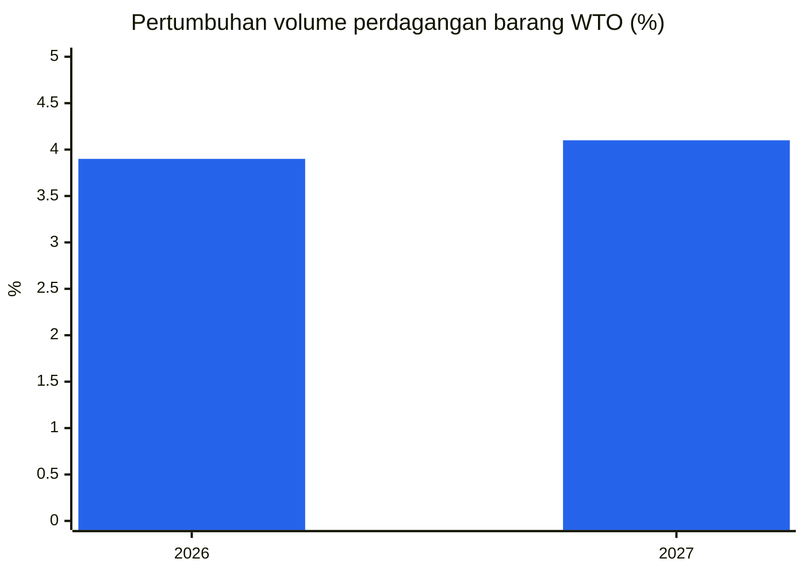
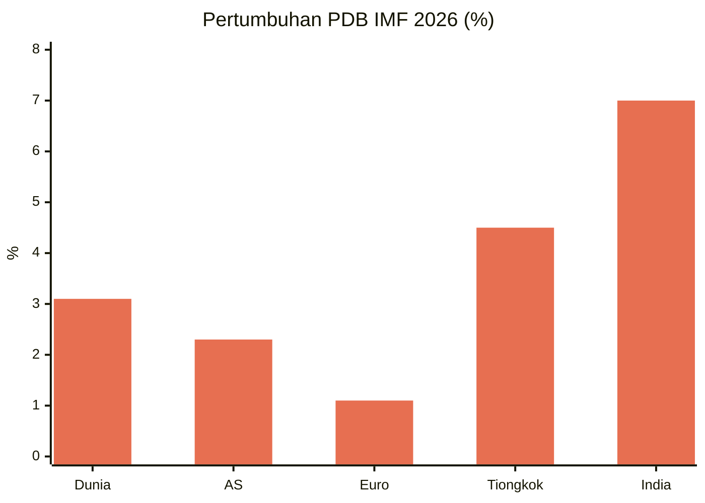
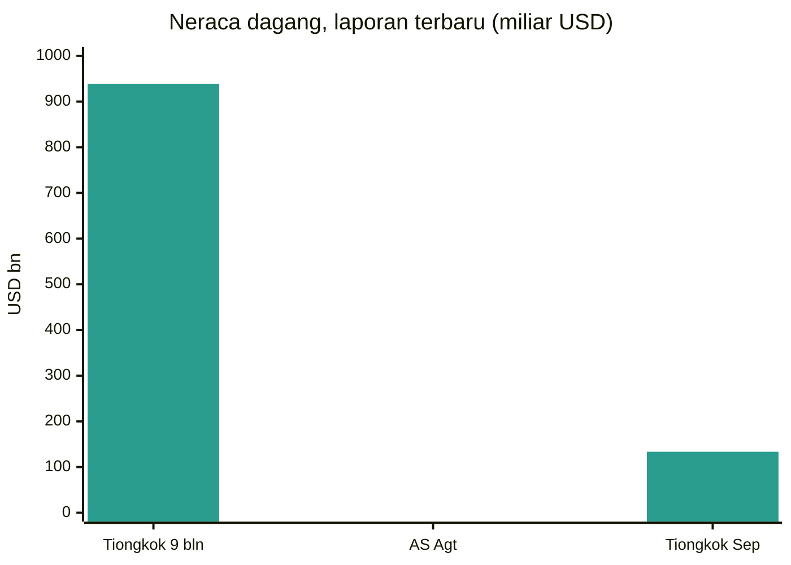
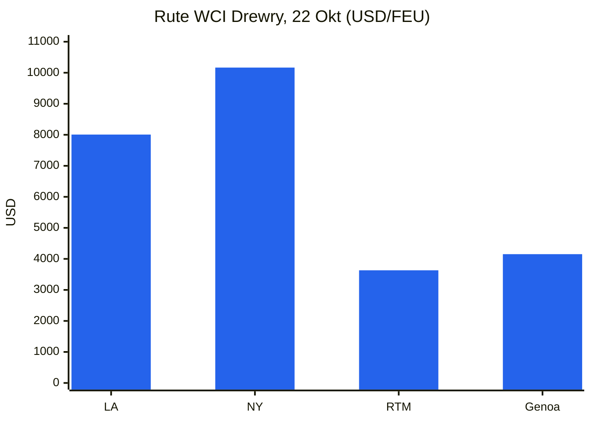
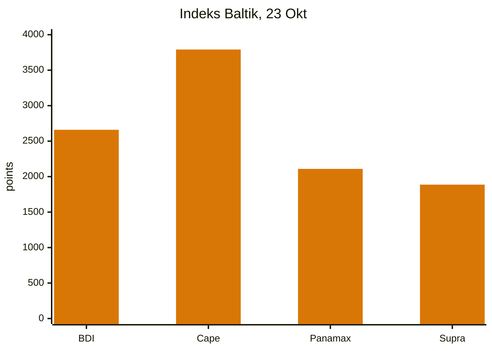
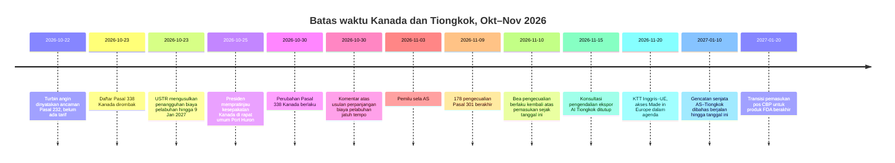
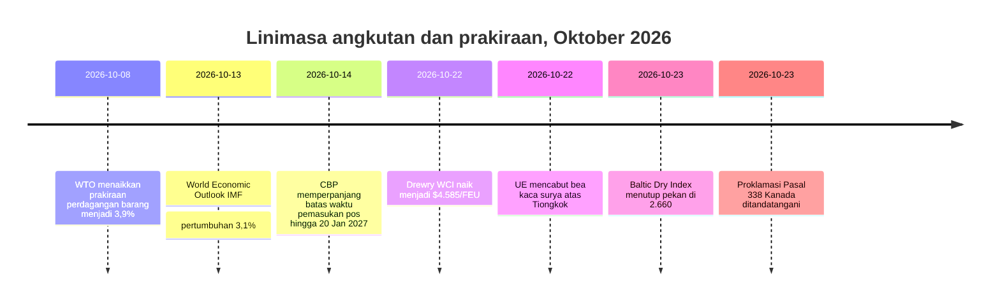

# Laporan Intelijen Perdagangan Global — Pekan 19–26 Oktober 2026

**Taklimat mingguan.** Jendela liputan: 19–26 Oktober 2026. Disusun dari sekitar 45 sumber berita perdagangan, kebijakan, data, dan angkutan di seluruh dunia.

---

## Daftar isi

1. [Ringkasan eksekutif](#1-executive-summary)
2. [Peringatan](#2-alerts)
3. [Berita utama — kajian mendalam](#3-top-stories--deep-dives)
4. [Pelacak tarif](#4-tariff-tracker)
5. [Kajian mendalam kebijakan AS](#5-us-policy-deep-dive)
6. [Kebijakan dunia menurut kawasan](#6-world-policy-by-region)
7. [Tindakan penegakan hukum](#7-enforcement-actions)
8. [Rilis data](#8-data-releases)
9. [Pasar angkutan](#9-freight-market)
10. [Linimasa kebijakan](#10-policy-timelines)
11. [Batas waktu & acara mendatang (90 hari ke depan)](#11-upcoming-deadlines--events-next-90-days)
12. [Sumber & metodologi](#12-sources--methodology)

---

## 1. Ringkasan eksekutif

Pekan di mana Amerika Serikat menulis ulang daftar tarif Kanadanya dua kali ke arah yang berlawanan, angkutan peti kemas melanjutkan pemulihannya, curah kering terbelah tajam menurut ukuran kapal, dan dua lembaga peramal utama dunia menggambarkan perekonomian global yang sama dengan nada berbeda: tangguh dalam barang, rapuh dalam jasa, dan kian terkonsentrasi pada sejumlah kecil negara dan produk.

- **Kanada: keringanan dan eskalasi dalam pekan yang sama.** Pada 23 Oktober, Presiden Trump menandatangani proklamasi yang menghapus tarif Pasal 338 sebesar 50% dari sejumlah produk pertanian dan kehutanan Kanada — lembaran kayu lapis, beberapa produk kertas, mesin dan peralatan pendingin tertentu, peti dan kotak pengepakan, serta rumput laut segar dan kering — berlaku 30 Oktober. Perintah yang sama menambahkan barang Kanada lainnya ke daftar 50%, termasuk karpet, cat, sampo, bubuk kakao, peti mati kayu, stik es krim, mesin pendingin udara, lemari pembeku dada, peralatan panahan, dan kano. Keringanan itu menyusul permintaan Senator Susan Collins dari Maine, yang produsen bluberi, kentang, apel, dan rumput lautnya bergantung pada input Kanada. Secara terpisah, setelah Ontario menayangkan iklan Piala Dunia (World Series) yang menggunakan pernyataan mantan Presiden Ronald Reagan tentang tarif, Presiden mengumumkan kenaikan tarif 10% atas impor Kanada, dengan menyebut iklan itu sebagai pernyataan keliru yang serius dan tindakan bermusuhan. Ontario menyatakan akan menghentikan iklan itu agar perundingan dagang dapat dilanjutkan. Pada rapat umum di Port Huron, Michigan, pada 25 Oktober, Presiden mengatakan kesepakatan dagang Kanada akan tercapai "segera" tetapi tidak memberikan syarat atau jadwal.
- **Angkutan: peti kemas naik, curah terbelah.** Drewry World Container Index naik 2% menjadi $4.585 per peti kemas 40 kaki pada 22 Oktober, level tertinggi dalam 15 pekan dan kenaikan mingguan kedua berturut-turut. Shanghai–Los Angeles naik 2% menjadi $8.007, Shanghai–New York 1% menjadi $10.166, Shanghai–Rotterdam 3% menjadi $3.632, dan Shanghai–Genoa 5% menjadi $4.152. Drewry menghitung 56 pelayaran kosong yang direncanakan untuk pekan 44–48 dari 714 pelayaran terjadwal, tingkat pembatalan 8%. Baltic Dry Index mengakhiri pekan di 2.660 pada 23 Oktober, naik sekitar 5,9% dalam sepekan meskipun turun 1,2% pada hari Jumat itu sendiri: pendapatan Capesize pulih kuat sementara Panamax turun ke 2.109, terendah sejak 24 Agustus.
- **Kembalinya Terusan Suez melewati ambang batas.** Dalam dua pekan pertama Oktober, kapasitas peti kemas mingguan yang melintasi Terusan Suez rata-rata 753.000 TEU, menurut Clarksons Research yang dikutip BIMCO, dibandingkan 1.457.000 TEU pada periode yang sama tahun 2023 — pertama kalinya sejak krisis Laut Merah dimulai, transit melampaui 50% level sebelum gangguan. Enam belas perubahan layanan telah diumumkan sejak awal Juli, dan keempat aliansi besar kini mengoperasikan layanan reguler Asia–Eropa Utara arah barat melalui Suez. Prospek Oktober Linerlytica memperkirakan kembalinya skala penuh pada kuartal pertama 2027, tergantung kondisi keamanan.
- **Prakiraan: barang tangguh, jasa lebih lemah, pertumbuhan terkonsentrasi.** Pembaruan Oktober WTO menaikkan pertumbuhan volume perdagangan barang dunia 2026 menjadi 3,9%, dari 1,9% pada Maret, dan 2027 menjadi 4,1%, sementara memangkas pertumbuhan perdagangan jasa komersial 2026 menjadi 3,3% dari 4,8%. World Economic Outlook Oktober IMF menempatkan pertumbuhan global pada 3,1% pada 2026 dan 3,4% pada 2027, dengan inflasi utama 4,7% pada 2026, dan memperingatkan bahwa pertumbuhan kini terkonsentrasi: 32 negara menyumbang 95% pertumbuhan global, turun dari 54 pada April, dengan sekitar 47% perekonomian diturunkan peringkatnya.
- **Batas waktu 9 November terbelah dua.** Pada 23 Oktober, USTR mengusulkan perpanjangan penangguhan biaya pelabuhan Pasal 301 atas kapal-kapal terkait Tiongkok (dan bea tertentu atas derek dan peralatan penanganan kargo) dari 10 November 2026 hingga 9 Januari 2027, dalam pemberitahuan Federal Register bertanggal 23 Oktober dan dijadwalkan terbit 26 Oktober, dengan komentar jatuh tempo 30 Oktober (dokumen USTR-2026-0694). Usulan itu belum final. Sebaliknya, 178 pengecualian produk Pasal 301 tetap berakhir pada pukul 23.59 ET tanggal 9 November 2026, tanpa perpanjangan yang ditemukan dalam pekan liputan ini. Importir sebaiknya berencana berdasarkan tanggal tertulis untuk pengecualian, dan memperlakukan perpanjangan biaya pelabuhan sebagai usulan, bukan final, hingga USTR menerbitkan pemberitahuan final.
- **Eropa menjaga debat Tiongkoknya tetap terbuka.** Komisi Eropa mengatakan akan mengusulkan pembatasan impor lebih lanjut atas sektor-sektor Tiongkok di luar kesepahaman kendaraan hibrida yang dicapai di Beijing pada awal Oktober, dengan presiden Prancis menunjuk bahan kimia, plastik, dan ferro-alloy. Komisi juga berencana mengusulkan pada Desember instrumen baru untuk membatasi ketergantungan pada sumber tunggal untuk pasokan kritis. Inggris, sementara itu, terus menolak tekanan untuk menyamai bea UE hingga 45,3% atas kendaraan listrik Tiongkok, dengan Menteri Bisnis Jonathan Reynolds mengatakan keputusan pertahanan dagang Inggris didasarkan semata-mata pada kepentingan Inggris. UE mencabut bea kaca surya yang telah lama berlaku atas Tiongkok pada 22 Oktober, dengan klaim pengembalian tersedia untuk bea yang dibayar sejak 22 Juli 2025.

**Angkutan:** peti kemas menguat karena kenaikan tarif umum dan penarikan kapasitas menjelang negosiasi kontrak Januari; curah kering pulih berkat kekuatan Capesize meski Panamax melemah; kapasitas Suez terus kembali secara bertahap; dan risiko pelayaran Teluk tetap tinggi, dengan penyeberangan Hormuz dilaporkan turun tajam pada pekan 12–18 Oktober dan insiden kapal lebih lanjut dilaporkan pada 18–20 Oktober.

---

## 2. Peringatan

| # | Peringatan | Berlaku | Dampak | Sumber |
|---|-------|-----------|--------|--------|
| A1 | Daftar Pasal 338 Kanada dirombak: tarif 50% dihapus dari lembaran kayu lapis, beberapa produk kertas, mesin dan peralatan pendingin tertentu, peti dan kotak pengepakan, rumput laut segar dan kering; ditambahkan untuk karpet, cat, sampo, bubuk kakao, peti mati kayu, stik es krim, mesin pendingin udara, lemari pembeku dada, peralatan panahan, kano | 30 Okt 2026 | Rantai pasok pertanian dan kehutanan Maine mendapat keringanan; eksportir Kanada yang baru terdaftar menghadapi bea 50% | [White House](https://www.whitehouse.gov/fact-sheets/2026/10/fact-sheet-president-donald-j-trump-further-modifies-canadian-products-subject-to-tariffs-under-section-338/), [Supply Chain Dive](https://www.supplychaindive.com/news/trump-tweaks-canada-tariffs-removing-certain-goods-while-adding-others/833895/) |
| A2 | Kenaikan tarif tambahan 10% atas impor Kanada diumumkan setelah iklan Piala Dunia Ontario yang menggunakan pernyataan Ronald Reagan; Ontario menyatakan akan menghentikan iklan itu | Diumumkan Okt 2026 | Meningkatkan sengketa AS–Kanada beberapa hari sebelum perubahan daftar 30 Oktober dan pemilu sela 3 November | [LawStreet](https://lawstreet.co/international/trump-says-canada-trade-deal-coming-soon-as-white-house-eases-some-tariffs-after-collins-request) |
| A3 | Jam 9 November terbelah: USTR mengusulkan perpanjangan penangguhan biaya pelabuhan Pasal 301 hingga 9 Jan 2027 (komentar hingga 30 Okt, dokumen USTR-2026-0694); 178 pengecualian produk Pasal 301 tetap berakhir pukul 23.59 ET tanggal 9 Nov 2026, tanpa perpanjangan yang ditemukan | 9 Nov 2026 / 9 Jan 2027 (diusulkan) | Bea pengecualian kembali ke tarif daftar (25% Daftar 1–3, 7,5% Daftar 4A) pada pemasukan 10 Nov; biaya pelabuhan hanya akan berlaku kembali jika usulan tidak difinalisasi | [gCaptain](https://gcaptain.com/ustr-proposes-extending-china-ship-port-fee-suspension-through-january-2027/), [Gateway Lines](https://gatewaylines.com/press-releases/china-ship-fees-301-exclusions-nov-9-2026) |
| A9 | Turbin angin dinyatakan sebagai ancaman keamanan nasional berdasarkan Pasal 232 (proklamasi Gedung Putih, 22 Okt); belum ada tarif yang dikenakan — pejabat dagang diarahkan bernegosiasi dan melapor kembali dalam 180 hari | 22 Okt 2026 | Rantai pasok energi angin menghadapi kemungkinan tarif di masa depan; pemasok utama yang disebut dalam pemberitaan meliputi Meksiko, Prancis, India, Denmark, dan Jerman |  |
| A4 | Risiko pelayaran Hormuz/Teluk tetap tinggi: kapal tanker AL DASMA rusak di Selat Hormuz pada 20 Okt; JIF BARRACUDA rusak di dekat UEA pada 18 Okt; MarineTraffic melaporkan penyeberangan Hormuz turun dari 203 menjadi 120 pada pekan 12–18 Okt | 18–20 Okt 2026 | Biaya risiko perang, rute, dan asuransi tetap tinggi meskipun pemulihan peti kemas Suez | [Daily Caller](https://dailycaller.com/2026/10/22/iran-claims-seven-vessels-attacked-in-persian-gulf) |
| A5 | Insiden kargo Laut Hitam: kapal kargo berbendera Komoro, Khoryv, terbakar dan terbalik sekitar 15 mil sebelah timur Constanta, Rumania; 1 awak tewas, 3 hilang, 9 ditemukan selamat | Okt 2026 | Risiko rute dan asuransi Laut Hitam; otoritas Rumania mengaitkan insiden itu dengan serangan pesawat nirawak dalam pemberitaan lokal | [Scottish Sun](https://www.thescottishsun.co.uk/news/16978300/cargo-ship-fire-drone-strike-black-sea/) |
| A6 | Gangguan pelabuhan Prancis: mogok 24 jam diumumkan di seluruh pelabuhan Prancis pada 14 dan 16 Okt, dengan tanggal lain terdaftar untuk 30 Okt; terminal dan depo Fos-sur-Mer ditutup 20 Okt karena cuaca buruk | 20 dan 30 Okt 2026 | Ketidakpastian jadwal di gerbang Prancis; pengirim sebaiknya menyisakan kelonggaran dalam rute akhir Oktober | [Maritime News](https://www.maritimenews.com/port-operations/port-operations-oct-14-21-2026) |
| A7 | Bea kaca surya UE atas Tiongkok dicabut 22 Okt 2026; klaim pengembalian tersedia untuk bea yang dibayar sejak 22 Juli 2025 | 22 Okt 2026 | Importir surya sebaiknya meninjau pembayaran bea historis untuk reklamasi | [WiseVoter](https://wisevoter.com/world/2026/10/23/eu-repeals-solar-glass-duties-china) |
| A8 | Batas waktu pemasukan pos CBP diperpanjang: produk yang diatur FDA, termasuk obat-obatan, dapat terus menggunakan proses pos yang disederhanakan hingga 20 Jan 2027, setelah CBP memperpanjang batas waktu 22 Okt selama 90 hari pada 14 Okt | 20 Jan 2027 | Importir pesanan pos dan parsel mendapat satu kuartal tambahan untuk beralih ke pengajuan pabean terperinci |  |

### A1 — Kanada: dua langkah ke arah berlawanan

Proklamasi 23 Oktober paling tepat dibaca sebagai kalibrasi ulang, bukan de-eskalasi. Lembar fakta Gedung Putih menyatakan bahwa tarif Pasal 338 berlaku terlepas dari asal USMCA dan sebagai tambahan atas bea Pasal 232, dan bahwa penambahan serta penghapusan produk berlaku 30 Oktober 2026 — empat hari sebelum pemilu sela 3 November. Senator Collins mengatakan keringanan itu akan membantu produsen bluberi, kentang, apel, dan rumput laut Maine, yang banyak bergantung pada peralatan, kemasan, dan input Kanada yang tidak tersedia dari pemasok Amerika atau hanya dapat diganti dengan biaya besar.

**Analisis:** perintah itu mempertahankan arsitektur keseluruhan sengketa Kanada — bea 50% atas sekitar $20 miliar barang Kanada yang dikenakan pada Agustus, menyusul kegagalan perundingan — sambil menggeser bebannya. Eksportir barang yang baru terdaftar (karpet, bubuk kakao, mesin pendingin udara, lemari pembeku dada, dan lainnya) sebaiknya segera meninjau ulang klasifikasi; eksportir barang yang dihapus dari daftar sebaiknya memastikan produk spesifik mereka tercakup dalam uraian proklamasi sebelum menganggap mendapat keringanan, karena cakupan Pasal 338 bergantung pada uraian produk, bukan kategori luas.

### A2 — Iklan Reagan dan kenaikan 10%

Iklan Ontario, yang ditayangkan selama Piala Dunia saat Toronto Blue Jays bertanding, menggunakan pernyataan mantan Presiden Reagan tahun 1987 yang memperingatkan bahwa tarif tinggi mengarah pada pembalasan dan perang dagang. Presiden menyebut iklan itu sebagai pernyataan keliru yang serius dan tindakan bermusuhan, mengakhiri pembicaraan dagang dengan Ottawa, dan mengumumkan kenaikan tarif 10% atas impor Kanada di atas level yang berlaku. Yayasan Kepresidenan Ronald Reagan menyatakan tidak menyetujui penggunaan klip tersebut. Perdana Menteri Ontario Doug Ford mengatakan iklan itu akan dihentikan secara bertahap setelah akhir pekan agar kedua pemerintahan dapat melanjutkan perundingan.

**Analisis:** episode ini menunjukkan betapa cepat sengketa komunikasi dapat berubah menjadi kebijakan tarif dalam siklus ini, dan bagaimana waktu pemilu memperkuatnya. Pertanyaan praktis bagi importir adalah urutan: perubahan daftar 30 Oktober, kenaikan 10% yang diumumkan, dan kesepakatan Kanada apa pun yang dipratinjau Presiden pada 25 Oktober adalah tiga instrumen terpisah dengan dasar hukum dan tanggal berlaku berbeda. Hingga masing-masing diterbitkan, proklamasi 30 Oktober adalah satu-satunya yang memiliki tanggal berlaku tetap.

### A3 — 9 November: jam-jam itu menyimpang

Pemberitahuan kelanjutan USTR tanggal 6 Oktober 2026 (diterbitkan 7 Oktober) mengonfirmasi bahwa kedua tindakan Pasal 301 Tiongkok 2018 berlanjut, tetapi tidak memperpanjang pengecualian maupun jeda biaya pelabuhan. Sebanyak 178 pengecualian — 164 yang dipertahankan pada Mei 2024 ditambah 14 pengecualian peralatan manufaktur surya yang ditambahkan pada September 2024 — berlaku hingga pukul 23.59 ET tanggal 9 November. Barang yang dimasukkan pada atau setelah 10 November membayar tarif daftar. Pada 23 Oktober, bagaimanapun, USTR mengusulkan perpanjangan terpisah hanya untuk penangguhan biaya pelabuhan: dari 10 November 2026 hingga 9 Januari 2027, pengangkut tidak akan dikenai kewajiban biaya pelabuhan berdasarkan Lampiran I, II, dan III dari tindakan Pasal 301 awal, dan bea terkait atas derek dan peralatan penanganan kargo juga akan ditangguhkan. Pemberitahuan itu, bertanggal 23 Oktober dan dijadwalkan terbit 26 Oktober, menerima komentar hingga pukul 17.00 ET tanggal 30 Oktober (dokumen USTR-2026-0694), dan merupakan usulan, bukan aturan final. Lebih dari 200 asosiasi dagang menulis surat kepada USTR pada 23 September meminta perpanjangan.

**Analisis:** kesenjangan antara kalender politik (gencatan senjata yang dibahas berjalan hingga 10 Januari 2027) dan kalender regulasi (9 November) telah menyempit untuk pelayaran tetapi tidak untuk importir. Pengangkut menetapkan harga berdasarkan aturan tertulis; importir sebaiknya melakukan hal yang sama untuk pengecualian, dan mengidentifikasi pemasukan apa pun yang mengklaim pos pengecualian sebelum batas waktu alih-alih menemukan eksposur setelahnya. Usulan biaya pelabuhan, jika difinalisasi, mencegah dimulainya kembali biaya pada 10 November; jika tidak, biaya berlaku kembali.

---

## 3. Berita utama — kajian mendalam

### 3.1 Kanada: kebijakan tarif sebagai instrumen musim pemilu

Berkas Kanada mendominasi berita kebijakan AS pekan ini karena menggabungkan ketiga pendorong kebijakan dagang AS saat ini: alat statutori (Pasal 338 Undang-Undang Tarif 1930, yang mengizinkan tarif hingga 50% untuk mengatasi diskriminasi terhadap perdagangan AS), kalender politik domestik (pemilu sela pada 3 November), dan negosiasi bilateral yang tersendat-sendat sejak Agustus. Tindakan Agustus awal mencakup sekitar $20 miliar barang Kanada, dari tongkat hoki hingga semen, setelah perundingan gagal; Kanada membalas atas nilai produk Amerika yang setara.

Rasional yang dinyatakan dalam perintah 23 Oktober — bahwa pejabat senior menyarankan perubahan itu tetap mengimbangi dugaan diskriminasi sekaligus melayani kepentingan publik — adalah rumusan standar Pasal 338 pemerintah. Yang baru adalah kaitan eksplisit, dalam pemberitaan kontemporer, dengan permintaan satu senator atas nama industri negara bagian tertentu. Kaitan itu tidak mengubah akibat hukumnya, tetapi mengubah pelajaran lobi: keringanan produk spesifik dapat diperoleh ketika konstituen domestik dapat menunjukkan ketergantungan rantai pasok yang konkret.

**Angka kunci:** tarif Pasal 338 sebesar 50%; sekitar $20 miliar barang Kanada yang awalnya tercakup; tanggal berlaku 30 Oktober; pemilu sela 3 November.

**Mengapa penting:** bagi eksportir Kanada dan importir AS, daftar 30 Oktober adalah dokumen yang berlaku. Bagi semua pihak lain, episode ini mengingatkan bahwa daftar tarif dalam siklus ini direvisi dalam hitungan pekan, bukan tahun, dan bahwa ketekunan tingkat klasifikasi kini menjadi biaya berulang dalam mengimpor.

### 3.2 Dua prakiraan: WTO dan IMF sepakat soal ketahanan, berbeda soal luasnya

Pembaruan Global Trade Outlook and Statistics WTO tanggal 8 Oktober dan World Economic Outlook IMF tanggal 13 Oktober, keduanya dirilis sesaat sebelum pekan liputan ini tetapi mendominasi diskusi kebijakannya, menyampaikan cerita yang konsisten dengan penekanan berbeda. WTO menaikkan pertumbuhan volume perdagangan barang menjadi 3,9% pada 2026 (dari 1,9% pada Maret) dan 4,1% pada 2027, dengan mengkredit investasi terkait AI: perdagangan barang pemungkin AI naik 67% tahun ke tahun pada paruh pertama 2026 dan menyumbang 47% pertumbuhan perdagangan barang global. Asia memimpin pertumbuhan ekspor 2026 pada 9,9%, diikuti Amerika Utara 5,7% dan Afrika 5,6%. Pada saat yang sama, WTO memangkas pertumbuhan perdagangan jasa komersial 2026 menjadi 3,3% dari 4,8%, dengan transportasi 0,9% dan perjalanan 0,2%, yang mencerminkan gangguan Timur Tengah, biaya bahan bakar penerbangan yang lebih tinggi, dan pembatasan penerbangan.

IMF menempatkan pertumbuhan global pada 3,1% pada 2026 dan 3,4% pada 2027, dengan inflasi utama 4,7% pada 2026 melandai menjadi 4,1% pada 2027. Tabel negaranya menunjukkan Amerika Serikat 2,3% pada kedua tahun, kawasan euro 1,1% pada 2026 dan 1,2% pada 2027, Tiongkok 4,5% dan 4,0%, serta India 7,0% atas dasar tahun fiskal. Peringatan Dana bersifat struktural: pertumbuhan terkonsentrasi pada perekonomian yang terhubung dengan ledakan investasi AI atau terlindung dari guncangan energi, sementara perekonomian pengimpor energi di luar rantai nilai teknologi menghadapi prospek paling sulit. Skenario dasarnya mengasumsikan Selat Hormuz mulai dibuka kembali pada Maret 2027, dengan kembalinya secara luas ke kondisi sebelum perang pada Oktober 2027.

*Catatan: Global Trade Outlook and Statistics WTO, pembaruan Oktober 2026; prakiraan 2026 dinaikkan dari 1,9% pada Maret.*

*Catatan: World Economic Outlook IMF, Oktober 2026. India atas dasar tahun fiskal.*

**Analisis:** kedua lembaga sepakat bahwa investasi AI menutupi kelemahan di tempat lain. Implikasi praktis untuk perencanaan dagang adalah bahwa pertumbuhan perdagangan utama membesar-besarkan rata-rata: perusahaan di luar rantai pasok AI, atau yang terpapar biaya energi dan transportasi Timur Tengah, mengalami tahun yang secara material lebih buruk daripada yang disarankan agregat global.

### 3.3 Tiongkok: surplus mendekati $1 triliun, dan perdebatan tentang maknanya

Surplus perdagangan barang Tiongkok Januari–September 2026 mencapai $938,5 miliar, dengan September saja $133,5 miliar, tertinggi dalam 20 bulan, karena ekspor melonjak berkat ledakan perangkat keras AI. Penjualan ke Amerika Serikat tumbuh 40%, tercepat dalam lebih dari lima tahun, sehingga surplus Tiongkok dengan Amerika Serikat menjadi $34 miliar, tertinggi sejak Januari 2025. Ekspor rekor tinggi juga dibeli Australia, Korea Selatan, Taiwan, Rusia, dan negara-negara ASEAN. Ekonom Goldman Sachs yang dikutip dalam pemberitaan memperkirakan jumlah negara yang menjalankan defisit dagang di atas 3% PDB dengan Tiongkok telah lebih dari tiga kali lipat sejak 2005, menjadi 82, sebagian besar perekonomian emerging berpendapatan rendah.

**Analisis:** surplus itu sekaligus gejala dan pendorong berita kebijakan pekan ini. Surplus memperkuat posisi tawar Beijing menjelang batas waktu November, dan memperkuat alasan, di Brussel dan Washington, untuk langkah-langkah defensif lebih lanjut. Surplus juga mempersulit narasi bahwa pemisahan (decoupling) sudah maju: pembelian AS atas barang modal Tiongkok untuk infrastruktur AI tumbuh pada laju tercepat dalam lima tahun.

### 3.4 Eropa: langkah pertahanan maju, tetapi tidak ke satu arah

Debat Oktober UE menghasilkan dua sinyal berlawanan. Di sisi restriktif, Presiden Komisi Ursula von der Leyen mengatakan setelah KTT 15–16 Oktober bahwa Komisi akan mengusulkan pembatasan atas impor dari Tiongkok di luar kesepahaman kendaraan hibrida yang disepakati di Beijing, yang dirancang untuk memangkas separuh pengiriman masuk mobil hibrida Tiongkok. Presiden Prancis menunjuk bahan kimia, plastik, dan ferro-alloy. Komisi juga akan mengusulkan, pada Desember, instrumen baru untuk membatasi ketergantungan pada sumber tunggal untuk pasokan kritis, dan mekanisme solidaritas bagi negara atau sektor yang menjadi sasaran koersi. Defisit perdagangan barang UE dengan Tiongkok berjalan lebih dari €1 miliar per hari.

Di sisi liberalisasi, UE mencabut bea kaca surya atas Tiongkok pada 22 Oktober, mengakhiri langkah-langkah yang berlaku sejak 2014, setelah dua produsen kaca surya UE terakhir berhenti berproduksi. Importir dapat mengajukan kepada otoritas pabean nasional untuk pengembalian bea yang dibayar sejak 22 Juli 2025, berdasarkan peraturan pelaksana 2026/2314 dan 2026/2310.

**Analisis:** kedua langkah itu konsisten setelah kriterianya dinyatakan: langkah-langkah bertahan di mana industri domestik masih ada untuk dilindungi, dan gugur di mana tidak ada. Usulan Desember — instrumen aksi cepat dan instrumen ketergantungan sumber tunggal — adalah yang perlu diperhatikan, karena keduanya akan menggeneralisasi pendekatan kendaraan hibrida menjadi perangkat tetap.

### 3.5 Kembalinya Suez dan risiko Hormuz, berdampingan

Kembalinya Suez bagi pelayaran peti kemas kini terukur: 753.000 TEU per pekan pada awal Oktober, 36% dari total kapasitas peti kemas yang dirutekan melalui kanal atau Tanjung Harapan, naik dari rata-rata 8% antara 2024 dan pertengahan 2026, tetapi masih jauh di bawah 80% sebelum krisis. Enam belas perubahan layanan telah diumumkan sejak awal Juli, mencakup Gemini, Ocean, Premier, dan MSC. Pada saat yang sama, risiko Teluk belum surut: MarineTraffic melaporkan penyeberangan Hormuz turun dari 203 menjadi 120 pada pekan 12–18 Oktober, dan insiden kapal dilaporkan pada 18 dan 20 Oktober. Tally IMO tanggal 21 Oktober mendokumentasikan 24 korban jiwa dan 120 insiden maritim terkonfirmasi di seluruh Timur Tengah sejak konflik dimulai.

**Analisis:** pasar peti kemas menetapkan harga untuk dua risiko berbeda sekaligus — pelepasan kapasitas struktural seiring normalisasi Suez, yang seharusnya menekan tarif, dan premi risiko perang yang persisten pada rute Teluk dan Laut Hitam, yang menopangnya. Pemulihan Drewry menunjukkan bahwa, untuk saat ini, manajemen kapasitas (pelayaran kosong, kenaikan tarif umum) lebih berpengaruh daripada pelepasan Suez.

### 3.6 Defisit dagang Amerika Serikat: bulan impor rekor

Defisit perdagangan barang dan jasa AS melebar 13,7% pada Agustus menjadi $105,6 miliar, terbesar sejak Maret 2025, karena impor mencapai rekor $420,8 miliar (naik 4,3%) dan ekspor naik 1,4% menjadi $315,2 miliar. Defisit barang saja melebar 11,5% menjadi $132,6 miliar, dengan impor barang naik 5,5% menjadi $336,1 miliar — pasokan industri naik 16,6%, barang modal naik 4,0% berkat pembangunan infrastruktur AI, pangan naik 5,5% — berbanding ekspor barang $203,4 miliar, naik 1,9%. Namun, defisit kumulatif Januari–Agustus tetap 19,9% lebih sempit daripada periode yang sama tahun 2025, pengingat bahwa pembacaan satu bulan dan tahun berjalan menunjuk ke arah berbeda.

**Analisis:** data Agustus, yang dirilis awal Oktober dan dibahas sepanjang pekan ini, melemahkan klaim sederhana bahwa tarif secara mekanis menyusutkan defisit dalam jangka pendek, sementara perbaikan tahun berjalan melemahkan klaim sebaliknya. Kedua pembacaan dapat benar karena defisit merespons harga impor, permintaan barang modal AI, dan siklus persediaan selain tarif.

---

## 4. Pelacak tarif

| Negara / asal | Langkah | Tarif | Tanggal berlaku | Status | Sumber |
|---|---|---|---|---|---|
| Kanada | Tarif Pasal 338 — penghapusan: lembaran kayu lapis, beberapa produk kertas, mesin dan peralatan pendingin tertentu, peti dan kotak pengepakan, rumput laut segar dan kering | 50% dihapus | 30 Okt 2026 | Proklamasi ditandatangani 23 Okt 2026 | [White House](https://www.whitehouse.gov/fact-sheets/2026/10/fact-sheet-president-donald-j-trump-further-modifies-canadian-products-subject-to-tariffs-under-section-338/) |
| Kanada | Tarif Pasal 338 — penambahan: karpet, cat, sampo, bubuk kakao, peti mati kayu, stik es krim, mesin pendingin udara, lemari pembeku dada, peralatan panahan, kano | 50% | 30 Okt 2026 | Proklamasi ditandatangani 23 Okt 2026 | [Supply Chain Dive](https://www.supplychaindive.com/news/trump-tweaks-canada-tariffs-removing-certain-goods-while-adding-others/833895/) |
| Kanada | Kenaikan tarif tambahan diumumkan setelah iklan Ontario | +10 poin persentase | Diumumkan Okt 2026 | Diumumkan; syarat pelaksanaan n/a | [LawStreet](https://lawstreet.co/international/trump-says-canada-trade-deal-coming-soon-as-white-house-eases-some-tariffs-after-collins-request) |
| Tiongkok | Tarif Pasal 301 — 178 pengecualian produk berakhir | 25% (Daftar 1–3), 7,5% (Daftar 4A) saat kembali berlaku | 9 Nov 2026, 23.59 ET | Tidak ada perpanjangan yang diterbitkan dalam pekan liputan | [Gateway Lines](https://gatewaylines.com/press-releases/china-ship-fees-301-exclusions-nov-9-2026) |
| Tiongkok | Biaya pelabuhan Pasal 301 atas kapal terkait Tiongkok — perpanjangan penangguhan diusulkan hingga 9 Jan 2027 | Biaya ditangguhkan 10 Nov 2026–9 Jan 2027 jika difinalisasi | Diusulkan 23 Okt 2026; komentar hingga 30 Okt | Usulan saja, belum final | [gCaptain](https://gcaptain.com/ustr-proposes-extending-china-ship-port-fee-suspension-through-january-2027/) |
| Turbin angin dan komponen | Temuan keamanan nasional Pasal 232 | Belum ada tarif yang dikenakan; negosiasi dan laporan kembali dalam 180 hari | 22 Okt 2026 | Temuan diterbitkan; tarif mungkin menyusul setelah jendela negosiasi |  |
| Tiongkok | Bea anti-dumping dan bea imbalan UE atas kaca surya | Dicabut | 22 Okt 2026 | Dicabut; pengembalian sejak 22 Juli 2025 | [WiseVoter](https://wisevoter.com/world/2026/10/23/eu-repeals-solar-glass-duties-china) |
| Tiongkok | Bea anti-dumping UE, produk aluminium canai datar | 14,3%–24,6% | Berjalan | Tinjauan kedaluwarsa dimulai 9 Okt 2026; langkah-langkah tetap berlaku | [We Are Main Street](https://wearemainstreet.org/world/2026/10/25/eu-anti-dumping-duties-chinese-aluminium) |
| Tiongkok | Kesepahaman kendaraan hibrida UE | Pengiriman akan dipangkas separuh | Disepakati 8–9 Okt 2026 | Kesepahaman; prosedur pelaksanaan menunggu | [EU Monitoring](https://ieu-monitoring.com/editorial/eu-and-china-reach-trade-understandings-on-hybrid-cars-tariffs-and-rare-earths/1251810) |
| Inggris | Bea impor standar atas mobil buatan Tiongkok | 10% | Berjalan | Tidak berubah; Inggris menolak tekanan UE untuk menyamai hingga 45,3% | [Fleet News](https://www.fleetnews.co.uk/news/minister-reportedly-resists-calls-for-uk-to-impose-chinese-ev-tariffs) |
| India–Selandia Baru | FTA berlaku: bea nol atas 100% lini tarif ekspor India ke Selandia Baru; konsesi India atas 70% lini | 0% (ekspor India ke NZ) | 20 Okt 2026 | Berlaku; aturan asal berlaku | [Devdiscourse](https://www.devdiscourse.com/article/business/3994858-india-new-zealand-fta-to-eliminate-tariffs-on-all-indian-exports-from-october-20-dgft-official?amp) |
| Rusia / pembeli energi | Tarif Graham Act (500% Rusia, 100% pembeli energi utama dan fasilitator) | Dikesampingkan | Pengesampingan 16 Okt 2026 | Dikesampingkan tanpa tanggal akhir; pemantauan ditugaskan kepada USTR | [KPMG](https://kpmg.com/us/en/taxnewsflash/news/2026/10/trump-russia-tariffs-sanctions.html) |

---

## 5. Kajian mendalam kebijakan AS

### Pasal 338 dan Kanada

Lihat bagian 2 dan 3.1. Lembar fakta 23 Oktober mengonfirmasi bahwa tarif Pasal 338 berlaku terlepas dari asal USMCA dan sebagai tambahan atas bea Pasal 232, dan bahwa Presiden dapat menangguhkan, mencabut, melengkapi, atau mengubah proklamasi Pasal 338 apa pun ketika kepentingan publik mengharuskannya. Kekuasaan amendemen itulah yang membuat revisi lebih lanjut pada Oktober atau November dimungkinkan tanpa undang-undang baru.

### USTR — Kelanjutan Pasal 301 dan jam 9 November

USTR mengonfirmasi pada 6 Oktober 2026 (diterbitkan 7 Oktober) bahwa kedua tindakan Pasal 301 Tiongkok 2018 berlanjut, membuka fase berikutnya dari tinjauan empat tahun kedua. Tinjauan itu dapat menaikkan tarif sekaligus mempertahankannya: setelah kelanjutan pertama pada September 2022, USTR menaikkan semikonduktor menjadi 50% pada 2025, sel surya menjadi 50% pada 2024, dan produk baja dan aluminium menjadi 25% pada 2024. Jam 9 November yang terpisah kemudian menyimpang dalam pekan liputan ini: pada 23 Oktober, USTR mengusulkan perpanjangan penangguhan biaya pelabuhan hingga 9 Januari 2027 (komentar hingga 30 Oktober, dokumen USTR-2026-0694), sementara 178 pengecualian produk tidak menerima usulan perpanjangan dan tetap berakhir 9 November.

### Pasal 232 — turbin angin

Pada 22 Oktober 2026, Presiden menyatakan impor turbin angin dan komponen sebagai ancaman bagi keamanan nasional berdasarkan Pasal 232, menyusul penyelidikan Departemen Perdagangan yang diluncurkan pada Agustus 2025. Ia berhenti sebelum mengenakan tarif, dan sebaliknya mengarahkan pejabat dagang untuk mengejar negosiasi dengan mitra dagang dan melapor kembali dalam 180 hari; langkah tambahan, termasuk tarif, dapat dipertimbangkan kemudian. Alasan yang dikutip meliputi kekhawatiran keamanan siber terkait peralatan buatan asing, gangguan terhadap sistem radar dan operasi lalu lintas udara, serta meningkatnya ketergantungan AS pada barang buatan luar negeri. Pemasok utama yang disebut dalam pemberitaan meliputi Meksiko, Prancis, India, Denmark, dan Jerman. Belum ada tarif yang ditetapkan.

### Operasi CBP

CBP memperpanjang transisi pemasukan pos untuk produk yang diatur FDA, termasuk obat-obatan, dari 22 Oktober 2026 hingga 20 Januari 2027, perpanjangan 90 hari yang diumumkan 14 Oktober. Perpanjangan itu menyusul aturan final sementara 24 Juni 2026 yang menghapus tunjangan bebas bea $800 untuk paket pos dan memindahkan sebagian besar parsel internasional kecil ke proses yang disederhanakan mulai 24 Juli 2026. Produk yang tercakup aturan impor lembaga lain diberi waktu hingga 22 Oktober untuk beralih ke pengajuan yang lebih terperinci; kini mereka memiliki waktu hingga 20 Januari 2027.

### Pengembalian tarif

Seorang hakim dagang AS mensertifikasi gugatan kelompok bagi importir yang mencari pengembalian tarif yang dibatalkan Mahkamah Agung pada awal 2026, mencakup importir yang belum mengajukan klaim. Bea Cukai telah sepenuhnya memproses hampir $130 miliar pengembalian, berbanding lebih dari $166 miliar yang dibayar dalam tarif yang dipersengketakan, dengan bunga yang berpotensi mencapai miliaran. Keputusan itu, yang dilaporkan 9 Oktober 2026, penting bagi importir yang belum mengajukan: mekanisme kelompok dapat menghitung ulang dan mengembalikan sisa jumlah tanpa gugatan individual.

### Butir tetap

Pengesampingan Graham Act tanggal 16 Oktober tetap berlaku tanpa tanggal akhir. Gencatan senjata AS–Tiongkok yang dibahas berjalan hingga 10 Januari 2027 memiliki langkah pelaksanaan yang diusulkan — bukan final — untuk penangguhan biaya pelabuhan (hingga 9 Januari 2027, komentar hingga 30 Oktober), dan tidak ada usulan perpanjangan untuk 178 pengecualian produk. Perkara kewenangan tarif Mahkamah Agung, yang dirujuk dalam pemberitaan sengketa Kanada, dijadwalkan untuk argumentasi pada November.

---

## 6. Kebijakan dunia menurut kawasan

### Eropa

Program pasca-KTT Komisi adalah perkembangan utama Eropa pekan ini: pembatasan impor Tiongkok lebih lanjut di luar kendaraan hibrida, usulan Desember untuk instrumen ketergantungan sumber tunggal, dan mekanisme solidaritas untuk kasus koersi. Kesepahaman kendaraan hibrida itu sendiri, yang dicapai pada pertemuan kedua Konsultasi Perdagangan dan Investasi UE–Tiongkok di Beijing pada 8–9 Oktober antara Komisaris Maroš Šefčovič dan Menteri Wang Wentao, mencakup tujuh lini tarif dan dapat memangkas ekspor hibrida dan hibrida plug-in Tiongkok ke UE lebih dari separuh selama empat tahun. Kedua pihak menyepakati pertemuan ministerial ketiga pada Maret 2027 dan konferensi video ministerial pada Januari. Defisit barang UE–Tiongkok, lebih dari €1 miliar per hari, adalah pendorong yang dinyatakan.

Pencabutan kaca surya dan tinjauan kedaluwarsa aluminium canai datar (bea 14,3%–24,6% tetap berlaku) menunjukkan pemerintahan yang sama menerapkan perangkat berlawanan pada sektor berbeda, sebagaimana dibahas pada bagian 3.4.

### Tiongkok

Kinerja ekspor Tiongkok pada 2026 — surplus sembilan bulan $938,5 miliar, ekspor September melonjak berkat perangkat keras AI — tetap menjadi latar struktural. Tiongkok melanjutkan ekspor bahan bakar olahan setelah jeda Golden Week, dengan sekitar 3,7 juta ton disetujui untuk Oktober (gabungan solar, bensin, dan bahan bakar jet). Konsultasi pengendalian ekspor teknologi AI yang dibuka 16 Oktober, mencakup 40 teknologi, tetap terbuka hingga 15 November, dan merupakan butir tetap bagi perusahaan yang mentransfer bobot model atau metodologi desain cip.

### Inggris

Menteri Bisnis Jonathan Reynolds mengatakan Inggris tidak akan tunduk pada seruan dari negara lain untuk mengenakan pajak impor atas kendaraan Tiongkok, dan bahwa keputusan pertahanan dagang Inggris didasarkan semata-mata pada kepentingan Inggris. Inggris saat ini menerapkan bea standar 10% atas mobil buatan Tiongkok, berbanding bea gabungan UE hingga 45,3%. Pemberitaan pers pada awal Oktober mengisyaratkan Inggris sedang menyusun paket yang mencerminkan tarif UE untuk mengamankan akses ke skema Made in Europe yang diusulkan UE, di mana kendaraan listrik hanya akan memenuhi syarat subsidi dan tender publik jika sekurang-kurangnya 70% komponennya dibuat di dalam blok; pernyataan menteri tanggal 14 Oktober menolak bingkai itu. Perdana Menteri Andy Burnham menjadikan inklusi Inggris dalam skema itu sebagai tujuan utama untuk KTT UE 20 November. Hingga €80 miliar (£68 miliar) perdagangan Inggris disebut berisiko jika produsen Inggris dibekukan keluar.

Pada 23 Oktober, pemerintah Inggris mengatakan dunia usaha akan menghemat hampir £800 juta per tahun dengan memangkas dokumen dan memperpanjang penangguhan beberapa tarif impor, menjelang pernyataan anggaran tahunan pertama. Paket itu mencakup £290 juta dari panduan kepatuhan yang lebih sederhana bagi perusahaan kecil, £155 juta dari penangguhan tarif impor yang diperpanjang atas 250 produk yang digunakan dunia usaha, £105 juta dari pengurangan pelaporan duplikatif bagi manajer aset, dan £116 juta biaya yang dihapus untuk transaksi properti residensial. Penangguhan tarif adalah keringanan biaya pendaratan langsung bagi importir Inggris atas 250 lini produk tersebut.

### India dan Selandia Baru

Perjanjian Perdagangan Bebas India–Selandia Baru mulai berlaku pada 20 Oktober 2026, menghapus bea atas 100% lini tarif yang mencakup ekspor India saat ini ke Selandia Baru — FTA India pertama yang memberikan akses bebas bea di semua lini tarif sejak tanggal berlakunya. Eksportir India sebelumnya menghadapi bea hingga 10% atas tekstil, pakaian, barang kulit, dan alas kaki, serta hingga 5% atas farmasi, produk pertanian dan kelautan, plastik, bahan kimia, dan barang listrik. India menawarkan konsesi atas 70% lini tarifnya, mencakup sekitar 95% nilai perdagangan bilateral saat ini, dengan akses bebas bea untuk kayu gelondongan Selandia Baru, batu bara kokas, dan skrap logam, serta kuota berbasis bea dan pengaman — termasuk harga impor minimum — untuk apel, kiwifruit, madu manuka, dan albumin. Perjanjian itu, ditandatangani 27 April 2026 dan diratifikasi 21 September 2026, juga mencakup komitmen fasilitasi investasi $20 miliar selama 15 tahun dan target menggandakan perdagangan bilateral menjadi NZ$7 miliar pada 2030. Eksportir tetap harus memenuhi aturan asal dan ketentuan lain untuk memenuhi syarat tarif preferensial.

### Tiongkok dan Jepang

Kementerian Luar Negeri Tiongkok mengatakan pada 21 Oktober bahwa pengendalian ekspor Beijing atas bahan dwi-guna strategis ke Jepang bertujuan mengekang remiliterisasi Tokyo, menanggapi laporan bahwa stok itrium domestik Jepang telah turun hingga beberapa bulan konsumsi. Jepang sebelumnya memperoleh lebih dari 70% itrium oksidanya dari kilang Tiongkok, dan data pabean Tiongkok menunjukkan volume bulanan nyaris nol untuk beberapa tanah jarang berat. Tokyo telah meminta Washington mendesak Beijing melonggarkan pengiriman tanah jarang khusus. Pernyataan itu memberikan justifikasi keamanan formal bagi pembatasan yang diterapkan lebih awal pada 2026 berdasarkan Undang-Undang Pengendalian Ekspor Tiongkok dan peraturan pengendalian ekspor dwi-gunanya.

Secara terpisah, Pengumuman MOFCOM No. 48 Tahun 2026 — revisi katalog yang sama di balik pengendalian teknologi AI — memajukan rancangan pengendalian atas lima platform bioteknologi sensitif, yang menargetkan transfer keluar terapi sel dan gen, dengan kesepakatan aktif tunduk pada registrasi pra-ekspor segera. Sebanyak 40 penambahan katalog yang diusulkan terdiri atas 23 AI, 5 biomedis, dan 12 teknologi fotovoltaik, dengan 14 larangan langsung yang diusulkan dan 26 pembatasan yang diusulkan yang memerlukan lisensi. Transfer kepemilikan langsung atas platform penemuan obat dasar kepada pembeli asing akan dilarang. Pengembang obat Tiongkok mencapai 81 transaksi lisensi keluar senilai $110 miliar pada paruh pertama 2026 saja, menurut pemberitaan, yang menggarisbawahi seberapa besar arus kesepakatan yang kini disentuh rezim registrasi sementara. Konsultasi ditutup 15 November 2026.

### Kanada

Di luar sengketa AS, keputusan Ontario menghentikan iklan Reagan setelah akhir pekan, menyusul pembicaraan antara Perdana Menteri Ontario Doug Ford dan Perdana Menteri Mark Carney, adalah perkembangan Kanada pekan ini dengan konsekuensi dagang paling langsung: keputusan itu menghilangkan iritasi langsung sambil membiarkan instrumen tarif tetap berlaku. Pernyataan Presiden tanggal 25 Oktober bahwa kesepakatan akan datang "segera" dibuat pada rapat umum kota perbatasan, bukan dalam dokumen negosiasi, dan sebaiknya diperlakukan sebagai sinyal, bukan kesepakatan.

Pada 21–22 Oktober, Perdana Menteri Mark Carney dan Perdana Menteri Ontario Doug Ford mengumumkan paket dukungan industri C$8,7 miliar untuk baja, mobil, dan mineral kritis, yang dibingkai sebagai respons terhadap tarif AS dan cara melindungi pekerja di basis manufaktur terintegrasi Ontario selatan. Tidak ada rincian proyek per proyek atau jadwal pencairan yang diterbitkan dalam liputan awal. Carney mengatakan ekspor otomotif Kanada ke Amerika Serikat telah turun lebih dari 10% sementara ekspor AS ke Kanada turun lebih dari 20%, dan menegaskan kembali bahwa Kanada bertujuan menggandakan ekspor ke tujuan non-AS selama dekade berikutnya; Amerika Serikat masih menyerap 71,7% ekspor barang Kanada pada 2025, turun dari 75,9% setahun sebelumnya. Kanada juga mengonfirmasi perundingan dagang 30 November dengan Türkiye sebagai bagian dari upaya diversifikasi itu.

### Meksiko

Meksiko mengatakan pada 21 Oktober bahwa tujuannya dalam negosiasi dagang adalah mengurangi tarif AS atas ekspor aluminium, baja, dan kendaraannya semaksimal mungkin sebelum akhir 2026, sambil mempertahankan posisinya saat ini: lebih dari 80% barang Meksiko masuk ke pasar AS bebas tarif, dan Menteri Ekonomi Marcelo Ebrard menyebut tarif efektif rata-rata 3% atas ekspor Meksiko, lebih rendah daripada negara pengekspor utama lainnya. USMCA tidak diperpanjang untuk masa 16 tahun baru pada tinjauan bersama 1 Juli 2026, dan kini berjalan di bawah tinjauan bersama tahunan; USTR membuka komentar publik untuk siklus 2027 pada 5 Oktober 2026. Presiden Meksiko mengonfirmasi pada 19 Oktober bahwa presiden AS telah mengusulkan Meksiko membeli lebih banyak gas alam AS dan memberi perusahaan AS peran lebih besar dalam meningkatkan produksi minyak Meksiko, dan membantah bahwa salah satu usulan itu merupakan syarat kesepakatan dagang.

### Multilateral

Sekretariat WTO mengunjungi Mogadishu untuk pertama kalinya, sebagai bagian dari misi teknis bersama WTO–ITC dari 10–15 Oktober yang mendukung tawaran aksesi Somalia, termasuk penawaran akses pasar atas barang dan jasa. Direktur Jenderal WTO Ngozi Okonjo-Iweala mengatakan di Bangkok pada 15 Oktober bahwa pergeseran geopolitik serta perang di Ukraina dan Timur Tengah akan berdampak abadi pada arus dagang, dengan beberapa rute alternatif kemungkinan bertahan karena negara dan dunia usaha ingin melindungi diri dari guncangan masa depan. WTO memperkirakan penurunan 17% ekspor Timur Tengah tahun ini, dengan impor turun sekitar 15%.

Dua perkembangan WTO dalam pekan liputan ini menguji jangkauan sistem multilateral. Pertama, panel WTO dibentuk pada 25 September 2026, atas permintaan kedua Rusia, untuk memeriksa Mekanisme Penyesuaian Karbon Perbatasan (CBAM) UE dan dugaan subsidi ekspor dalam Sistem Perdagangan Emisi UE; UE mengonfirmasi akan berpartisipasi. Rusia pertama kali meminta konsultasi pada Mei 2025. Pembentukan panel bersifat prosedural, bukan temuan ketidakabsahan, tetapi merupakan uji WTO besar pertama atas kebijakan karbon perbatasan andalan UE, yang mencakup baja, aluminium, semen, pupuk, listrik, dan hidrogen. Kedua, Komite Akses Pasar WTO meninjau rekor 36 masalah dagang pada pertemuan 12–13 Oktober, termasuk 8 yang diangkat pertama kali — di antaranya langkah Kanada atas produk baja, dugaan klausul diskriminatif dalam Rancangan Undang-Undang Akselerator Industri dan Keamanan Siber UE yang diusulkan, rezim impor Indonesia untuk kacang tanah dan produk halal, dan rezim pengawasan nilai satuan Türkiye. Laporan Sekretariat pertama mencatat 51 masalah terselesaikan (34 sepenuhnya, 17 sebagian) dari 145 yang diangkat antara April 1995 dan Maret 2026. WTO juga sepakat membentuk panel atas gugatan Tiongkok terhadap tarif India atas produk teknologi tertentu dan skema insentif bagi manufaktur surya domestik, setelah India memblokir permintaan pertama Tiongkok pada Mei 2026.

Dalam sistem multilateral yang lebih luas, Data Hub UNCTAD melaporkan pada 21 Oktober bahwa investasi langsung asing di perekonomian berkembang tetap sangat terkonsentrasi, dengan delapan dari sepuluh perekonomian penerima terbesar berlokasi di Asia. International Trade Centre bermitra dengan Departemen Perdagangan, Industri, dan Persaingan Afrika Selatan untuk mendukung ekspor UKM, dan Kelompok Kerja SAFE Organisasi Pabean Dunia meluncurkan Sorotan UKM pertama tentang keamanan rantai pasok dan fasilitasi perdagangan.

---

## 7. Tindakan penegakan hukum

| Tindakan | Sasaran / cakupan | Tanggal | Sumber |
|---|---|---|---|
| Transisi pemasukan pos CBP diperpanjang | Produk yang diatur FDA, termasuk obat-obatan, yang menggunakan proses pos yang disederhanakan | Diperpanjang 14 Okt 2026 hingga 20 Jan 2027 |  |
| Tinjauan kedaluwarsa UE, produk aluminium canai datar dari Tiongkok | Bea 14,3%–24,6% tetap berlaku selama tinjauan | Dimulai 9 Okt 2026 | [We Are Main Street](https://wearemainstreet.org/world/2026/10/25/eu-anti-dumping-duties-chinese-aluminium) |
| Bea kaca surya UE dicabut | Kaca surya Tiongkok; pengembalian sejak 22 Juli 2025 | 22 Okt 2026 | [WiseVoter](https://wisevoter.com/world/2026/10/23/eu-repeals-solar-glass-duties-china) |
| Pengesampingan Graham Act dipertahankan | Tarif Rusia dan ketentuan sanksi dikesampingkan, tanpa tanggal akhir | Pengesampingan 16 Okt 2026, masih berlaku | [KPMG](https://kpmg.com/us/en/taxnewsflash/news/2026/10/trump-russia-tariffs-sanctions.html) |
| Gugatan kelompok pengembalian tarif disertifikasi | Importir yang belum mengajukan klaim pengembalian; hampir $130 miliar telah diproses | 9 Okt 2026 | [Moneyweb](https://www.moneyweb.co.za/news/international/judge-sides-with-importers-to-expand-trump-tariff-refund-fight/) |

Tidak ada perintah penahanan pelepasan (withhold release order) baru yang teridentifikasi dalam pekan liputan ini dalam informasi yang ditinjau; WRO terbaru dalam catatan tetap perintah 29 September 2026 atas produsen minyak sawit Indonesia Mitra Aneka Rezeki dan Hardaya Inti Plantation, yang menjadikan total WRO aktif 60.

---

## 8. Rilis data

| Rilis | Angka kunci | Sumber |
|---|---|---|
| Global Trade Outlook and Statistics WTO, Oktober 2026 | Pertumbuhan volume perdagangan barang 3,9% pada 2026, 4,1% pada 2027; perdagangan jasa 3,3% pada 2026, 6,4% pada 2027; ekspor Asia +9,9% pada 2026; perdagangan barang pemungkin AI +67% tahun ke tahun pada H1 2026, 47% pertumbuhan perdagangan barang | [WTO](https://www.wto.org/english/res_e/booksp_e/gtos1026_e.pdf) |
| World Economic Outlook IMF, Oktober 2026 | Pertumbuhan global 3,1% pada 2026, 3,4% pada 2027; inflasi utama 4,7% pada 2026, 4,1% pada 2027; AS 2,3%, kawasan euro 1,1%, Tiongkok 4,5%, India 7,0% (tahun fiskal) pada 2026; pertumbuhan volume perdagangan dunia 4,6% pada 2026, 4,7% pada 2027 | [IMF](https://www.imf.org/en/publications/weo/issues/2026/10/13/world-economic-outlook-october-2026) |
| Neraca dagang AS, Agustus 2026 | Defisit $105,6 miliar (+13,7%), terbesar sejak Maret 2025; impor $420,8 miliar (rekor); ekspor $315,2 miliar; defisit barang $132,6 miliar | [Kitco](http://www.kitco.com/news/off-the-wire/2026-10-06/us-trade-balance-sinks-deeper-red-imports-hit-record-high-despite) |
| Perdagangan Tiongkok, Januari–September 2026 | Surplus $938,5 miliar; surplus September $133,5 miliar; lonjakan ekspor September; penjualan ke AS +40%; surplus bilateral AS $34 miliar | [Moneyweb](https://www.moneyweb.co.za/news/international/china-on-cusp-of-1trn-trade-surplus-as-exports-surge/) |
| Drewry World Container Index, 22 Okt 2026 | $4.585/FEU (+2%); Shanghai–Los Angeles $8.007; Shanghai–New York $10.166; Shanghai–Rotterdam $3.632; Shanghai–Genoa $4.152 | [Drewry](https://www.drewry.co.uk/supply-chain-advisors/world-container-index-weekly-update?topics=Freight+Cost+Benchmarking) |
| Baltic Dry Index, 23 Okt 2026 | 2.660 (+5,9% dalam sepekan); Capesize 3.791 (+16,7% dalam sepekan); Panamax 2.109 (−8,9% dalam sepekan, terendah sejak 24 Agt); Supramax 1.887 | [Baird Maritime](https://www.bairdmaritime.com/shipping/dry-cargo/bulkers/baltic-dry-bulk-index-slides-but-locks-in-second-straight-weekly-gain) |
| Pelabuhan Antwerp-Bruges, sembilan bulan pertama 2026 | 200,9 juta ton (−0,8% tahun ke tahun); throughput peti kemas pulih kuat pada Q3 setelah gangguan H1 | [EIN](https://shipping.einnews.com:443/news/y-port-of-antwerp) |
| Ekspor Jepang, dilaporkan 21 Okt 2026 | Ekspor +16,7% tahun ke tahun (turun dari 19,3%), bulan pertumbuhan ke-13 berturut-turut; semikonduktor +49,4%, peralatan manufaktur semikonduktor +43,9%; ekspor ke Taiwan +37,8%, Korea Selatan +35,5%, AS +22,9%, UE +10,5%, Tiongkok +8,6%; defisit dagang ¥536,6 miliar, turun dari ¥1,1 triliun tetapi hampir tiga kali lipat prakiraan ¥181 miliar | [ActionForex](https://www.actionforex.com/live-comments/658154-japan-exports-slow-to-16-7-despite-ai-chip-boom-trade-deficit-misses-forecast/) |
| Trade and Development Report UNCTAD 2026, 9 Okt 2026 | Pertumbuhan global 2,6% pada 2026 (dari 2,9% pada 2025); perekonomian berkembang 4,0% (dari 4,7%); perdagangan barang dan jasa +sekitar 4% pada harga konstan; perdagangan global mencapai rekor $35 triliun pada 2025; Asia menyumbang 59% pertumbuhan global; perdagangan Tiongkok–AS turun lebih dari 20% sejak 2024 | [UNCTAD](https://unctad.org/press-material/unctad-trade-and-development-report-2026-global-growth-slows-26-and-gaps-widen) |
| FTA India–Selandia Baru, berlaku 20 Okt 2026 | Bea nol atas 100% lini tarif ekspor India ke Selandia Baru; konsesi India atas 70% lini; komitmen fasilitasi investasi $20 miliar; target perdagangan bilateral NZ$7 miliar pada 2030 | [Devdiscourse](https://www.devdiscourse.com/article/business/3994858-india-new-zealand-fta-to-eliminate-tariffs-on-all-indian-exports-from-october-20-dgft-official?amp) |
| Transit peti kemas Terusan Suez, dua pekan pertama Oktober | Rata-rata 753.000 TEU/pekan, berbanding 1.457.000 TEU pada periode yang sama tahun 2023; 36% kapasitas kanal-atau-Tanjung melalui kanal | [MarineLink](https://www.marinelink.com/news/suez-canal-container-ship-transits-543667) |

*Catatan: Surplus Tiongkok Januari–September $938,5 miliar dan surplus September $133,5 miliar adalah surplus; defisit AS Agustus $105,6 miliar ditampilkan sebagai nilai negatif. Sumber sebagaimana dalam tabel di atas.*

---

## 9. Pasar angkutan

### Tarif spot peti kemas — Drewry World Container Index

WCI naik 2% menjadi $4.585 per peti kemas 40 kaki pada 22 Oktober, didorong tarif yang lebih tinggi pada rute Asia–Eropa dan Transpasifik. Angka itu tertinggi dalam 15 pekan dan sekitar dua kali lipat titik terendah 9 April 2026 sebesar $2.309. Shanghai–Los Angeles naik 2% menjadi $8.007 dan Shanghai–New York 1% menjadi $10.166; Shanghai–Rotterdam naik 3% menjadi $3.632 dan Shanghai–Genoa 5% menjadi $4.152. Drewry memperkirakan tarif Transpasifik tetap stabil pekan depan berkat permintaan impor AS yang kuat, dengan hanya dua pelayaran kosong diumumkan untuk pekan depan berbanding enam pekan ini, sementara tarif Asia–Eropa diperkirakan naik sedikit karena kapasitas ketat, dengan delapan pelayaran kosong diumumkan untuk pekan depan berbanding dua pekan ini. Kemacetan di pelabuhan Asia telah mereda: waktu tunggu kapal di Shanghai turun dari 97 jam pada pekan 38 menjadi 38 jam pada pekan 42.

Pelacak pelayaran yang dibatalkan Drewry tanggal 23 Oktober menambah gambaran ke depan: 56 pelayaran kosong diperkirakan antara pekan 44 dan 48 dari 714 pelayaran yang direncanakan, tingkat pembatalan 8%. Asia–Eropa Utara/Mediterania menyumbang 54% pembatalan, Transpasifik arah timur 32%, dan Transatlantik 14%. Gemini Cooperation mencatat tingkat pelayaran kosong terendah di antara kelompok pengangkut besar, sebesar 1%.

*Catatan: Drewry WCI, 22 Oktober 2026. LA = Shanghai–Los Angeles; NY = Shanghai–New York; RTM = Shanghai–Rotterdam; Genoa = Shanghai–Genoa.*

### Freightos Baltic Index

Pembaruan Freightos tanggal 20 Oktober melaporkan tarif Asia–Eropa Utara naik 6% dalam sepekan menjadi $3.442/FEU dan Asia–Mediterania naik 3% menjadi $3.927/FEU karena kenaikan tarif umum yang ditujukan pada negosiasi kontrak Januari, dengan beberapa forwarder skeptis kenaikan itu akan bertahan. Tarif Transpasifik stabil tetapi tinggi pada $8.126/FEU ke Pantai Barat AS dan naik 1% menjadi $9.700/FEU ke Pantai Timur, dengan tarif harian menunjukkan tanda-tanda kenaikan meskipun volume mendingin, kemungkinan karena pengurangan kapasitas musim sepi. Freightos mencatat bahwa kembalinya Laut Merah secara bertahap, yang berlangsung setelah puncak permintaan Asia–Eropa awal Juli dan melalui bulan-bulan permintaan rendah, seharusnya mengurangi gangguan jadwal dan penumpukan kapal, sementara meredanya kemacetan di hub Timur Jauh masih menyerap kapasitas dan menopang tarif; kembalinya yang tuntas akan meningkatkan risiko kelebihan kapasitas bagi pengangkut pada 2027.

### Divergensi Xeneta dan keandalan jadwal

Data Xeneta untuk pekan yang berakhir 23 Oktober menyampaikan cerita berbeda dari Drewry soal level, meskipun arahnya sepakat untuk Eropa: Asia–Pantai Barat AS $8.311/FEU (+0,2% pekan ke pekan), Asia–Pantai Timur AS $11.525/FEU (+0,2%), Asia–Eropa Utara $3.698/FEU (+6,8%), dan Asia–Mediterania $4.442/FEU (+5,8%). Kepala analis Xeneta menyebut kenaikan Eropa sebagai teka-teki, karena kapasitas Laut Merah yang kembali seharusnya melonggarkan tarif; permintaan Eropa yang kuat mengimbanginya. Ekspektasi dalam analisis itu adalah perdagangan AS melunak hingga akhir 2026, sementara arah Eropa bergantung pada permintaan yang bertahan.

Keandalan jadwal tetap buruk pada kartu nilai September Xeneta, yang dilaporkan dalam pekan liputan ini: kinerja tepat waktu global turun untuk bulan keempat berturut-turut menjadi 27%, dengan rata-rata keterlambatan kapal naik menjadi 6 hari. Timur Jauh–Eropa hanya 4% tepat waktu dengan rata-rata keterlambatan 9,9 hari, terburuk sejak September 2021; Timur Jauh–Amerika Utara 20% tepat waktu dengan rata-rata keterlambatan 6,9 hari. Maersk adalah pengangkut besar paling andal pada 47%, Yang Ming paling rendah pada 4%. Metodologi analis lain sangat berbeda — pembacaan Agustus Sea-Intelligence menempatkan ketepatan waktu global pada 49,9% — sehingga angka keandalan selalu harus dikutip beserta sumbernya.

### Buku pesanan

Buku pesanan peti kemas mencapai 16,2 juta TEU pada 23 Oktober, atau 46,5% armada aktif, puncak pasca-2009 menurut The Loadstar. Galangan Tiongkok menerima rekor 4,94 juta TEU yang dipesan tahun ini, atau 88% total kapasitas yang dipesan. Hengli Heavy Industries mengumumkan pesanan pada 23 Oktober untuk 52 kapal dwi-bahan bakar ultra-besar, termasuk 20 kapal 24.000 TEU, yang diyakini mencakup tonase MSC. Bahkan ketika pengangkut mempertahankan tarif 2026 dengan pelayaran kosong, gelombang pengiriman selama 2027–2030 secara struktural menekan tarif masa depan — ketegangan utama bagi negosiasi kontrak 2027 di samping pelepasan kapasitas Suez.

### Curah kering — Bursa Baltik

Baltic Dry Index pulih ke 2.660 pada 23 Oktober, naik dari 2.511 pada 16 Oktober, terendah dalam lebih dari tiga bulan, dan naik sekitar 5,9% dalam sepekan untuk kenaikan mingguan kedua berturut-turut. Kenaikan mingguan didorong Capesize: indeks Capesize naik 16,7% dalam sepekan menjadi 3.791, dengan pendapatan harian rata-rata $30.877 pada hari Jumat (turun $519 pada hari itu) dan 5TC naik dari $30.518 pada Senin menjadi $34.380 pada Jumat dalam catatan laporan mingguan. Panamax bergerak berlawanan: turun 8,9% dalam sepekan menjadi 2.109, terendah sejak 24 Agustus, dengan pendapatan harian rata-rata $18.981. Supramax naik tipis 1,18% dalam sepekan menjadi 1.887; Handysize tidak berubah pada 1.020.

*Catatan: Bursa Baltik, 23 Oktober 2026.*

### Suez dan keandalan jadwal

Lihat bagian 3.5. Kembalinya Suez bersifat per layanan dan bersyarat: pemberitahuan pengangkut mensyaratkan rute Laut Merah pada stabilitas kawasan yang berlanjut, dan pelayaran individual dapat disesuaikan. Peti kemas yang dimuat pada Oktober pada layanan terjadwal Suez karena itu dapat tetap tunduk pada perubahan rute selama berminggu-minggu setelah keberangkatan. Pelajaran operasionalnya adalah melacak rute pada level peti kemas, bukan level layanan, selama transisi.

### Kargo udara

Tarif spot kargo udara global stabil pada $3,55 per kilo pada pekan 41 (5–11 Oktober 2026), meskipun tonase dunia turun 1% pekan ke pekan untuk pekan ketiga berturut-turut, menurut WorldACD Market Data. Penurunan itu mencerminkan libur Golden Week Tiongkok, dengan bobot kena biaya Asia Pasifik turun 1% pada pekan 41 setelah penurunan 2% pada pekan 40 dan 6% pada pekan 39. Tonase global pada pekan 41 masih 9% lebih tinggi tahun ke tahun, tarif pasar penuh naik 29% tahun ke tahun dan tarif spot naik 34%, dengan bahan bakar jet naik 111% tahun ke tahun. Baltic Air Freight Index turun 2,1% dalam tujuh hari hingga 12 Oktober tetapi tetap 24,3% lebih tinggi tahun ke tahun, dengan sumber-sumber mengindikasikan bahwa kapasitas musim puncak yang diamankan pengirim e-commerce, dan permintaan AI-hyperscaler yang tidak terjamin, dapat mendorong tarif lebih tinggi.

Pemulihan menyusul pada pekan 42 (12–18 Oktober, dilaporkan 25–26 Oktober): volume kargo udara global naik 2% pekan ke pekan karena ekspor Asia Pasifik pulih setelah Golden Week, dengan tonase Asia Pasifik naik 9% pekan ke pekan (Asia Pasifik ke Eropa +13%, ke Amerika Serikat +10%) dan tarif rata-rata global naik 4% dalam dolar AS. Ringkasan pekan 42 WorldACD yang terpisah menempatkan tonase naik 6% pekan ke pekan, tarif pasar penuh naik 3% menjadi $2,48 per kilo dan tarif spot naik 2% menjadi $2,66 per kilo; kedua ringkasan menggunakan definisi berbeda dan tidak boleh digabungkan. Tarif asal Timur Tengah dan Asia Selatan naik 61% tahun ke tahun pada pekan 12–18 Oktober, kenaikan regional tertinggi.

### Gangguan pelabuhan dan logistik

Pelabuhan Prancis menghadapi mogok 24 jam pada 14 dan 16 Oktober, dengan tanggal lain terdaftar untuk 30 Oktober, dan terminal serta depo Fos-sur-Mer ditutup pada 20 Oktober karena cuaca buruk. Antwerp-Bruges melaporkan pemulihan peti kemas yang kuat pada kuartal ketiga setelah gangguan paruh pertama akibat cuaca dan mogok rantai nautika, dengan throughput sembilan bulan pertama 200,9 juta ton, 0,8% di bawah periode yang sama tahun lalu. Di Amerika Serikat, hibah rel $200 juta mendukung proyek terminal Pelabuhan Coos Bay. Tumpahan minyak Teluk, yang ditelusuri ke kapal yang terkena di lepas pantai UEA pada 9 Oktober, meluas hingga sekitar 190 kilometer persegi pada 21 Oktober dan memicu penutupan pantai tambahan di UEA.

### Intelijen vendor

Tidak ada berita vendor yang memenuhi kriteria bagian ini yang teridentifikasi dalam informasi yang ditinjau untuk pekan liputan ini. Liputan vendor dalam taklimat ini terbatas pada berita — rilis data, kemitraan pemerintah, dan langkah pasar yang memengaruhi perdagangan — dan mengecualikan peluncuran produk, promosi fitur, pemasaran acara, dan hasil pelanggan yang diklaim.

---

## 10. Linimasa kebijakan

---

## 11. Batas waktu & acara mendatang (90 hari ke depan)

| Tanggal | Acara / batas waktu | Mengapa penting |
|---|---|---|
| 1 Nov 2026 | Biaya penanganan €2 per barang UE atas penjualan jarak jauh dari negara non-UE (diperkirakan; tindakan yang didelegasikan sedang diteliti) | Menumpuk di atas bea tetap €3 untuk kiriman hingga €150; pengenal produk menjadi wajib pada deklarasi penjualan jarak jauh | 
| 30 Okt 2026 | Perubahan daftar Pasal 338 Kanada berlaku | Tinjau ulang klasifikasi produk Kanada |
| 30 Okt 2026 | Tanggal mogok pelabuhan Prancis berikutnya terdaftar | Risiko jadwal gerbang Prancis |
| 3 Nov 2026 | Pemilu sela AS | Kebijakan tarif dapat bergeser seiring kalender politik |
| 30 Okt 2026 | Komentar atas usulan USTR untuk memperpanjang penangguhan biaya pelabuhan Pasal 301 hingga 9 Jan 2027 (dokumen USTR-2026-0694) jatuh tempo | Kesempatan terakhir berkomentar sebelum keputusan final |
| 9 Nov 2026, 23.59 ET | 178 pengecualian produk Pasal 301 berakhir; jeda biaya pelabuhan berakhir kecuali perpanjangan yang diusulkan difinalisasi | Bea pengecualian berlaku kembali atas pemasukan 10 Nov; biaya pelabuhan berlaku kembali hanya jika usulan tidak difinalisasi |
| 10 Nov 2026 | Pemasukan sejak tanggal ini membayar tarif daftar Pasal 301 atas produk yang sebelumnya dikecualikan | Diperlukan penetapan ulang harga dan konfirmasi pialang |
| 15 Nov 2026 | Konsultasi pengendalian ekspor teknologi AI Tiongkok ditutup | Eksposur transfer bobot model dan desain cip |
| 20 Nov 2026 | KTT Inggris–UE | Akses Made in Europe dan keselarasan tarif Inggris dalam agenda |
| Desember 2026 | Usulan UE untuk instrumen ketergantungan sumber tunggal dan pembatasan impor Tiongkok lebih lanjut | Menggeneralisasi pendekatan kendaraan hibrida |
| 10 Jan 2027 | Gencatan senjata AS–Tiongkok dibahas berjalan hingga tanggal ini | Kesenjangan kalender politik vs kalender regulasi |
| 20 Jan 2027 | Transisi pemasukan pos CBP untuk produk yang diatur FDA berakhir | Pengajuan pabean terperinci diperlukan sejak tanggal ini |
| Maret 2027 | Pertemuan ministerial ketiga Konsultasi Perdagangan dan Investasi UE–Tiongkok | Titik pemeriksaan dagang UE–Tiongkok formal berikutnya |
| Maret 2027 | Skenario dasar IMF mengasumsikan Selat Hormuz mulai dibuka kembali | Asumsi biaya angkutan dan energi bergantung pada hal ini |

---

## 12. Sumber & metodologi

Jendela liputan: 19–26 Oktober 2026. Taklimat ini menghimpun sumber sekunder — pers dagang, ringkasan lembaga, dan analisis firma hukum — dan informasi yang ditinjau diambil dari sekitar 45 sumber berita perdagangan, kebijakan, data, dan angkutan di seluruh dunia, termasuk FreightWaves, The Loadstar, Splash247, gCaptain, Hellenic Shipping News, Container News, Supply Chain Dive, Logistics Management, Air Cargo News, dan Port Technology; Gedung Putih, CBP, USTR, Federal Register, International Trade Administration, USITC, Bureau of Industry and Security, dan JD Supra; Komisi Eropa, Departemen Bisnis dan Perdagangan Inggris, Canada Border Services Agency, dan MOFCOM; WTO, UNCTAD, International Trade Centre, dan Organisasi Pabean Dunia; USITC DataWeb, USA Trade Online, UN Comtrade, World Bank WITS, Eurostat, data Bank Dunia, dan IMF; Tax Foundation, Yale Budget Lab, dan International Trade Intelligence; Drewry, Bursa Baltik, dan Freightos; serta Descartes dan TradeInt. Angka-angka dilaporkan sebagaimana diterbitkan oleh sumber-sumber tersebut. Laporan ini menghimpun sumber sekunder dan tidak memanfaatkan platform data dagang pesaing.
