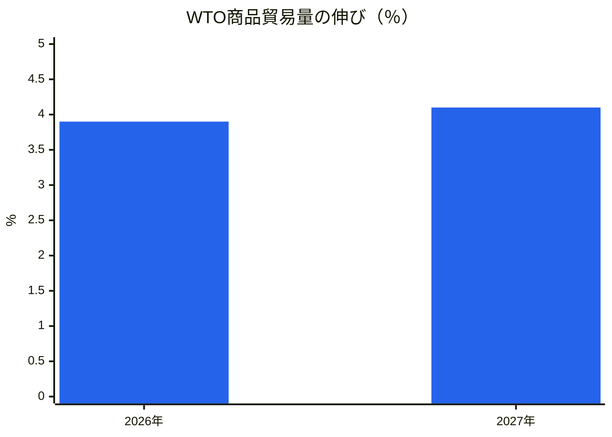
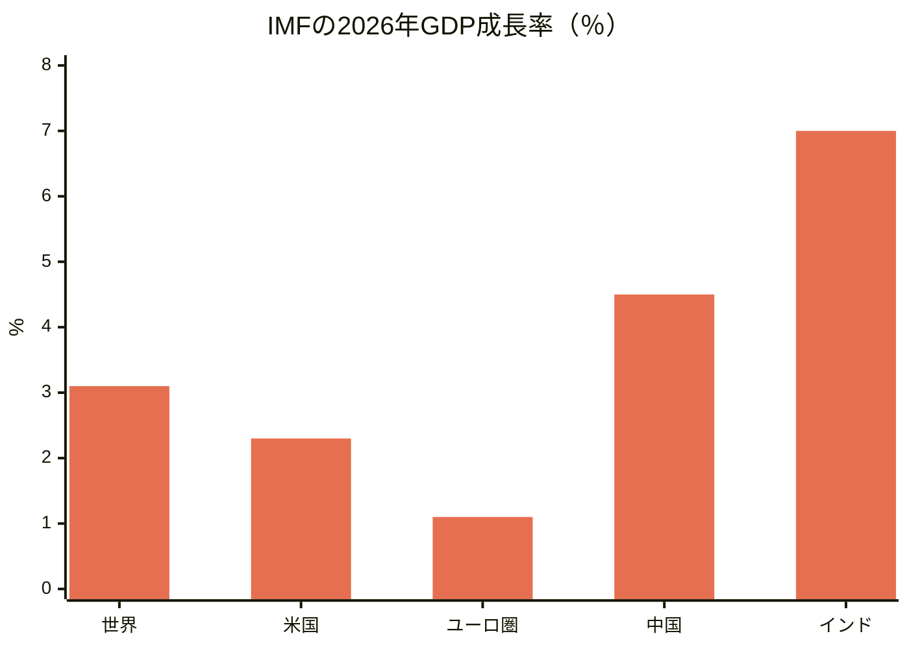
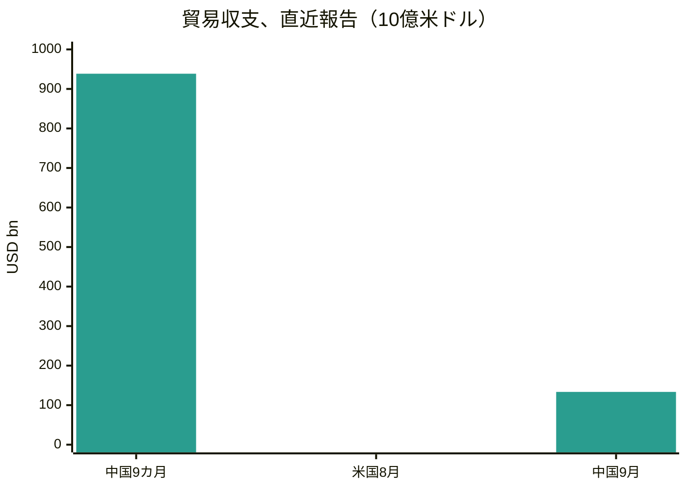
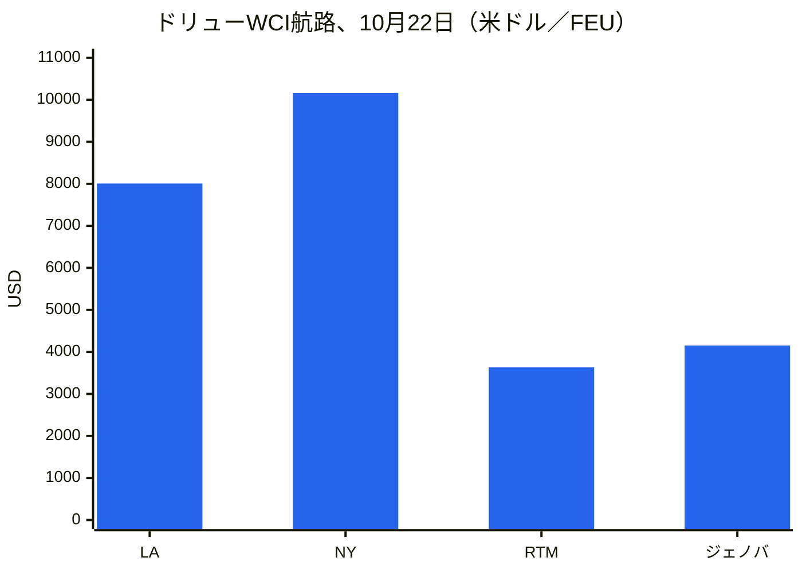
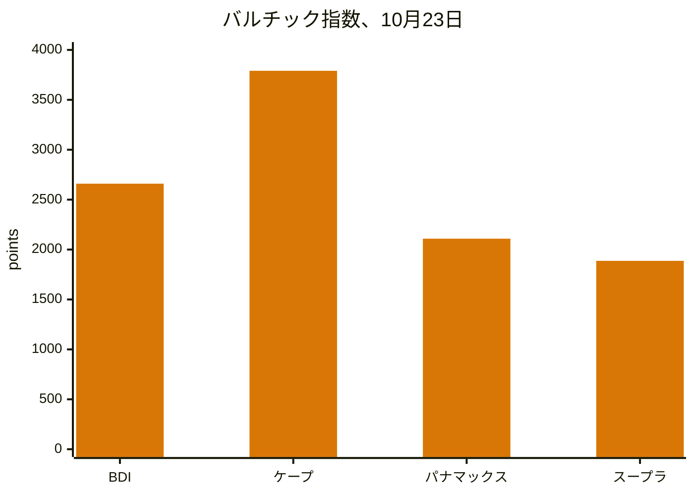
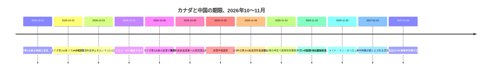
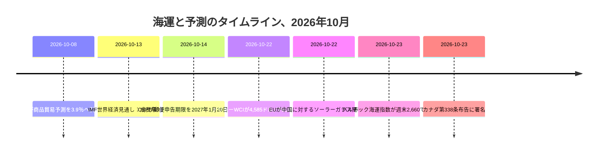

# 世界貿易インテリジェンス・レポート — 2026年10月19～26日週

**週次ブリーフィング。** 対象期間：2026年10月19～26日。世界の貿易ニュース、政策、データ、海運に関する約45のデータソースをもとに編纂。

---

## 目次

1. [エグゼクティブサマリー](#1-executive-summary)
2. [アラート](#2-alerts)
3. [主要ニュース — 詳細分析](#3-top-stories--deep-dives)
4. [関税トラッカー](#4-tariff-tracker)
5. [米国政策の詳細分析](#5-us-policy-deep-dive)
6. [地域別世界政策](#6-world-policy-by-region)
7. [執行措置](#7-enforcement-actions)
8. [データ発表](#8-data-releases)
9. [海運市場](#9-freight-market)
10. [政策タイムライン](#10-policy-timelines)
11. [今後の期限とイベント（今後90日間）](#11-upcoming-deadlines--events-next-90-days)
12. [データソースと調査方法](#12-sources--methodology)

---

## 1. エグゼクティブサマリー

米国がカナダ関税リストを1週間のうちに正反対の方向へ2度書き換え、コンテナ運賃が反発を続け、ドライバルクが船型によって大きく分かれ、世界の2大予測機関が同じ世界経済を異なる調子で描いた週となった。物品貿易は底堅く、サービスは脆弱で、成長は少数の国と製品にますます集中している。

- **カナダ：同じ週に緩和と強化。** 10月23日、トランプ大統領は、合板シート、一部の紙製品、特定の機械・冷蔵設備、梱包用木箱・箱、生鮮および乾燥海藻などカナダ産農林産品に対する50％の第338条関税を撤廃する布告に署名し、10月30日に発効する。同時に、カーペット、塗料、シャンプー、ココアパウダー、木製棺、アイスクリームの棒、空調機器、チェスト型冷凍庫、アーチェリー用品、カヌーなど他のカナダ製品が50％関税リストに追加された。緩和は、カナダ産投入物に依存するメイン州のブルーベリー、ジャガイモ、リンゴ、海藻生産者を抱える同州選出のスーザン・コリンズ上院議員の要請を受けたものだった。別に、オンタリオ州がワールドシリーズの広告でロナルド・レーガン元大統領の関税に関する発言を使用したことを受け、大統領はカナダからの輸入品に対する10％の関税引き上げを発表し、同広告を重大な誤解を招くものであり敵対行為だと述べた。オンタリオ州は貿易交渉の再開を可能にするため同広告を一時停止するとした。10月25日にミシガン州ポートヒューロンで開かれた集会で、大統領はカナダとの貿易協定が「間もなく」成立すると述べたが、条件や時期は示さなかった。
- **海運：コンテナは上昇、バルクは二分。** ドリュー海運世界コンテナ指数（Drewry World Container Index）は10月22日に2％上昇して40フィートコンテナ当たり4,585ドルとなり、15週間ぶりの高水準で、2週連続の上昇となった。上海〜ロサンゼルスは2％上昇して8,007ドル、上海〜ニューヨークは1％上昇して10,166ドル、上海〜ロッテルダムは3％上昇して3,632ドル、上海〜ジェノバは5％上昇して4,152ドルとなった。ドリューは第44～48週に714便中56便の欠航を予定しており、欠航率は8％である。バルチック海運指数（Baltic Dry Index）は10月23日に2,660で週を終え、金曜単日では1.2％下落したものの週間では約5.9％上昇した。ケープサイズの収益が力強く回復する一方、パナマックスは2,109まで下落し、8月24日以来の低水準となった。
- **スエズ運河の復帰が節目を越えた。** BIMCOが引用したクラークソンズ・リサーチによると、10月上旬の2週間におけるスエズ運河を通過する週間コンテナ輸送能力は平均753,000 TEUで、2023年同時期の1,457,000 TEUに対し、紅海危機の発生以来初めて混乱前の水準の50％を超えた。7月上旬以降16件のサービス変更が発表され、主要4アライアンスはすべてアジア〜北欧間の西航スエズ経由定期サービスを運航している。ライナリティカの10月見通しは、安全保障上の条件を前提に、2027年第1四半期までの本格復帰を予測している。
- **予測：物品は底堅く、サービスは弱く、成長は集中。** WTOの10月改定は、2026年の世界商品貿易量の伸びを3月の1.9％から3.9％へ、2027年を4.1％へ引き上げた一方、2026年の商業サービス貿易の伸びを4.8％から3.3％へ引き下げた。IMFの10月世界経済見通しは、2026年の世界成長率を3.1％、2027年を3.4％、2026年の総合インフレ率を4.7％とし、成長が集中していると警告した。世界成長の95％を占める国は4月の54カ国から32カ国に減り、約47％の国が下方修正された。
- **11月9日の期限が2つに分かれた。** 10月23日、USTRは、中国関連船舶に対する第301条港湾料金（および特定のクレーン・貨物取扱設備関税）の停止措置を、2026年11月10日から2027年1月9日まで延長することを提案した。これは10月23日付の連邦官報公示で、10月26日掲載予定、意見提出期限は10月30日（整理番号USTR-2026-0694）である。この提案はまだ最終決定ではない。対照的に、178件の第301条製品適用除外は、2026年11月9日午後11時59分（東部時間）に失効し、この対象期間中に延長は確認されなかった。輸入業者は、適用除外については文書上の日付に従って計画し、港湾料金の延長はUSTRが最終公示を出すまで提案段階のものとして扱うべきである。
- **欧州は対中議論を開いたままにした。** 欧州委員会は、10月上旬に北京で合意したハイブリッド車に関する了解を超え、中国のセクターに対するさらなる輸入規制を提案するとし、フランス大統領は化学品、プラスチック、フェロアロイを挙げた。委員会はまた、重要物資の単一供給源への依存を制限する新たな手段を12月に提案する予定である。一方、英国は、中国製電気自動車に対する最大45.3％のEU関税に追随する圧力に引き続き抵抗し、ジョナサン・レイノルズ・ビジネス長官は英国の貿易救済措置の判断は英国の利益のみに基づくと語った。EUは10月22日に中国に対する長年のソーラーガラス関税を撤廃し、2025年7月22日以降に支払われた関税について返還請求が可能となった。

**海運：** コンテナは1月の契約交渉を控えた一般運賃引き上げと船腹引き揚げで堅調となった。ドライバルクはパナマックスの軟化にもかかわらずケープサイズの強さで回復した。スエズ運河の輸送能力は徐々に回復を続けた。湾岸の海運リスクは引き続き高く、10月12～18日週のホルムズ海峡通過は大幅に減少し、10月18～20日にもさらなる船舶事故が報告された。

---

## 2. アラート

| # | アラート | 発効日 | 影響 | データソース |
|---|-------|-----------|--------|--------|
| A1 | カナダ第338条リストの見直し：合板シート、一部の紙製品、特定の機械・冷蔵設備、梱包用木箱・箱、生鮮および乾燥海藻に対する50％関税を撤廃。カーペット、塗料、シャンプー、ココアパウダー、木製棺、アイスクリームの棒、空調機器、チェスト型冷凍庫、アーチェリー用品、カヌーを追加 | 2026年10月30日 | メイン州の農林サプライチェーンが緩和を受ける一方、新たに指定されたカナダ輸出業者は50％関税に直面 | [White House](https://www.whitehouse.gov/fact-sheets/2026/10/fact-sheet-president-donald-j-trump-further-modifies-canadian-products-subject-to-tariffs-under-section-338/)、[Supply Chain Dive](https://www.supplychaindive.com/news/trump-tweaks-canada-tariffs-removing-certain-goods-while-adding-others/833895/) |
| A2 | オンタリオ州のワールドシリーズ広告（ロナルド・レーガンの発言を使用）を受け、カナダからの輸入品に対する10％の追加関税引き上げを発表。オンタリオ州は同広告を一時停止するとした | 2026年10月発表 | 10月30日のリスト変更と11月3日の中間選挙を控え、米加紛争が激化 | [LawStreet](https://lawstreet.co/international/trump-says-canada-trade-deal-coming-soon-as-white-house-eases-some-tariffs-after-collins-request) |
| A3 | 11月9日の期限が分岐：USTRは第301条港湾料金の停止措置を2027年1月9日まで延長することを提案（意見提出期限10月30日、整理番号USTR-2026-0694）。178件の第301条製品適用除外は2026年11月9日午後11時59分（東部時間）に失効し、延長は確認されていない | 2026年11月9日／2027年1月9日（提案） | 11月10日以降の申告では適用除外関税がリスト税率（リスト1～3は25％、リスト4Aは7.5％）に戻る。港湾料金は提案が最終決定されなければ復活する | [gCaptain](https://gcaptain.com/ustr-proposes-extending-china-ship-port-fee-suspension-through-january-2027/)、[Gateway Lines](https://gatewaylines.com/press-releases/china-ship-fees-301-exclusions-nov-9-2026) |
| A4 | ホルムズ／湾岸の海運リスクは引き続き高い：タンカーAL DASMAが10月20日にホルムズ海峡で損傷。JIF BARRACUDAが10月18日にアラブ首長国連邦近海で損傷。MarineTrafficによると、10月12～18日週のホルムズ海峡通過は203回から120回に減少 | 2026年10月18～20日 | スエズ運河のコンテナ回復にもかかわらず、戦争リスク、航路、保険コストは引き続き高い | [Daily Caller](https://dailycaller.com/2026/10/22/iran-claims-seven-vessels-attacked-in-persian-gulf) |
| A5 | 黒海の貨物事故：コモロ船籍の貨物船Khoryvがルーマニアのコンスタンツァ東方約15マイルで火災を起こし転覆。乗組員1名死亡、3名行方不明、9名救出 | 2026年10月 | 黒海の航路・保険リスク。ルーマニア当局は現地報道でドローン攻撃によるものとしている | [Scottish Sun](https://www.thescottishsun.co.uk/news/16978300/cargo-ship-fire-drone-strike-black-sea/) |
| A6 | フランスの港湾混乱：10月14日と16日にフランス全港で24時間ストライキが発表され、10月30日にも日程が挙がっている。フォス＝シュル＝メールでは10月20日に悪天候でターミナルとデポが閉鎖 | 2026年10月20日と30日 | フランスのゲートウェイにおけるスケジュールの不確実性。10月下旬の航路には余裕を持たせるべき | [Maritime News](https://www.maritimenews.com/port-operations/port-operations-oct-14-21-2026) |
| A7 | 中国に対するEUソーラーガラス関税が2026年10月22日に撤廃。2025年7月22日以降に支払われた関税について返還請求が可能 | 2026年10月22日 | 太陽光輸入業者は返還のため過去の関税支払いを見直すべき | [WiseVoter](https://wisevoter.com/world/2026/10/23/eu-repeals-solar-glass-duties-china) |
| A8 | CBPの郵便申告期限が延長：FDA規制対象製品（医薬品を含む）は、CBPが10月14日に10月22日の期限を90日延長したため、2027年1月20日まで簡易郵便手続きを引き続き利用可能 | 2027年1月20日 | 郵便・小包輸入業者は詳細な税関申告への移行にさらに1四半期の猶予を得た |  |
| A9 | 風力タービンが第232条に基づく国家安全保障上の脅威と宣言された（10月22日のホワイトハウス布告）。関税はまだ課されていない — 貿易当局は交渉を行い180日以内に報告するよう指示された | 2026年10月22日 | 風力エネルギーサプライチェーンは将来の関税の可能性に直面。報道で挙げられた主要供給国はメキシコ、フランス、インド、デンマーク、ドイツ |  |

### A1 — カナダ：正反対の2つの動き

10月23日の布告は、緊張緩和ではなく再調整と読むのが最適である。ホワイトハウスのファクトシートは、第338条関税はUSMCA原産地にかかわらず適用され、第232条関税に加えて課されるとし、追加と撤廃は2026年10月30日に発効する — 11月3日の中間選挙の4日前である。コリンズ上院議員は、緩和はメイン州のブルーベリー、ジャガイモ、リンゴ、海藻生産者を助けると述べた。彼らの多くは、米国供給業者からは入手できない、あるいは多大なコストをかけなければ代替できないカナダ製の設備、包装、投入物に依存している。

**分析：** この命令はカナダ紛争の全体構造 — 8月に交渉決裂を受けて約200億ドル相当のカナダ製品に課された50％関税 — を維持しつつ、その負担の所在を移した。新たに指定された製品の輸出業者（カーペット、ココアパウダー、空調機器、チェスト型冷凍庫など）は直ちに分類を再確認すべきである。指定解除された製品の輸出業者は、幅広いカテゴリーではなく製品の説明によって第338条の適用範囲が決まるため、救済を前提とする前に自社製品が布告の説明に含まれることを確認すべきである。

### A2 — レーガン広告と10％の引き上げ

オンタリオ州の広告は、トロント・ブルージェイズが出場するワールドシリーズ中に放映され、1987年にレーガン元大統領が高関税は報復と貿易戦争を招くと警告した発言を使用した。大統領は同広告を重大な誤解を招くものであり敵対行為だとし、オタワとの貿易協議を打ち切り、現行水準を上回るカナダからの輸入品に対する10％の関税引き上げを発表した。ロナルド・レーガン大統領財団はクリップの使用を承認していなかったと述べた。オンタリオ州のダグ・フォード首相は、両政権が交渉を再開できるよう、週末後に同広告を段階的に廃止すると述べた。

**分析：** この一件は、広報上の紛争がこのサイクルでいかに速く関税政策に転化するか、そして選挙時期がいかにそれを増幅するかを示している。輸入業者にとって実務上の問題は順序である。10月30日のリスト変更、発表された10％の引き上げ、10月25日に大統領が予告したカナダ協定は、法的根拠と発効日が異なる3つの別個の手段である。それぞれが公表されるまで、発効日が確定しているのは10月30日の布告だけである。

### A3 — 11月9日：時計が分かれる

USTRの2026年10月6日付継続公示（10月7日掲載）は、2018年の中国に対する第301条措置の両方が継続することを確認したが、適用除外も港湾料金の一時停止も延長しなかった。178件の適用除外 — 2024年5月に維持された164件に、2024年9月に追加された太陽光製造設備の14件を加えたもの — は、11月9日午後11時59分（東部時間）まで有効である。11月10日以降に申告された貨物はリスト税率を支払う。しかし10月23日、USTRは港湾料金の停止措置についてのみ別途の延長を提案した。2026年11月10日から2027年1月9日まで、運送業者は当初の第301条措置の付属書I、II、IIIに基づく港湾料金の責任を負わず、関連するクレーン・貨物取扱設備の関税も停止される。この公示は10月23日付で10月26日掲載予定であり、10月30日午後5時（東部時間）まで意見を受け付ける（整理番号USTR-2026-0694）。これは提案であり最終規則ではない。200を超える業界団体が9月23日にUSTRに延長を求める書簡を送った。

**分析：** 政治カレンダー（2027年1月10日まで続くとされる休戦）と規制カレンダー（11月9日）の隔たりは、海運については縮まったが、輸入業者については縮まっていない。運送業者は文書上の規則に基づいて価格を設定する。輸入業者も適用除外については同じようにすべきであり、期限前に適用除外の品目に該当する申告を特定し、後になって負担が明らかになる事態を避けるべきである。港湾料金の提案が最終決定されれば11月10日の料金再開は防げる。最終決定されなければ料金は復活する。

---

## 3. 主要ニュース — 詳細分析

### 3.1 カナダ：選挙シーズンの手段としての関税政策

カナダ問題が今週の米国政策ニュースを支配したのは、現行の米国貿易政策の3つの推進要因すべてが絡んだためである。すなわち、法的手段（1930年関税法第338条 — 米国の商業に対する差別に対処するため最大50％の関税を認める）、国内政治カレンダー（11月3日の中間選挙）、そして8月以来断続的に続く二国間交渉である。当初の8月の措置は、交渉決裂後にホッケースティックからセメントまで約200億ドル相当のカナダ製品を対象とした。カナダは同額の米国製品に報復した。

10月23日の命令の根拠とされる説明 — 上級当局者が、変更はなお主張される差別を相殺しつつ公益にかなうとの助言をしたというもの — は、政権の標準的な第338条の定式である。新しいのは、同時期の報道において、特定の州産業を代表する1人の上院議員の要請と明示的に結び付けられたことである。この結び付きは法的効果を変えないが、ロビー活動の教訓は変える。国内の利害関係者が具体的なサプライチェーン依存を示すことができれば、製品別の救済は得られるのである。

**主要数値：** 50％の第338条税率、当初対象となった約200億ドル相当のカナダ製品、10月30日の発効日、11月3日の中間選挙。

**なぜ重要か：** カナダの輸出業者と米国の輸入業者にとって、10月30日のリストが実務上の文書である。それ以外の者にとって、この一件は、このサイクルでは関税リストが数年ではなく数週間単位で改訂されること、そして分類レベルの精査が今や輸入の恒常的コストとなったことを思い起こさせる。

### 3.2 2つの予測：WTOとIMFは底堅さで一致し、その広がりで異なる

WTOの10月8日付「世界貿易見通しと統計」改定とIMFの10月13日付「世界経済見通し」は、ともに対象期間直前に公表され、その政策議論を支配したが、強調点の異なる一貫した物語を語っている。WTOは商品貿易量の伸びを2026年に3.9％（3月の1.9％から）、2027年に4.1％へ引き上げ、AI関連投資を要因に挙げた。AI対応製品の貿易は2026年上半期に前年比67％増加し、世界商品貿易の伸びの47％を占めた。2026年の輸出の伸びはアジアが9.9％で首位、次いで北米が5.7％、アフリカが5.6％である。同時に、WTOは2026年の商業サービス貿易の伸びを4.8％から3.3％へ引き下げた。運輸は0.9％、旅行は0.2％で、中東の混乱、航空燃料費の上昇、飛行制限を反映している。

IMFは2026年の世界成長率を3.1％、2027年を3.4％とし、総合インフレ率を2026年に4.7％、2027年に4.1％へと鈍化するとした。同基金の国別表では、米国が両年とも2.3％、ユーロ圏が2026年に1.1％、2027年に1.2％、中国が4.5％と4.0％、インドが会計年度ベースで7.0％である。同基金の警告は構造的なものである。成長はAI投資ブームに組み込まれた経済やエネルギーショックから隔絶された経済に集中する一方、技術バリューチェーンの外にありエネルギー輸入に依存する経済は最も困難な見通しに直面している。その基準シナリオは、ホルムズ海峡が2027年3月に再開し始め、2027年10月までに戦前の状態へ広く戻ると想定している。

*注：WTO「世界貿易見通しと統計」2026年10月改定。2026年予測は3月の1.9％から引き上げられた。*

*注：IMF「世界経済見通し」2026年10月。インドは会計年度ベース。*

**分析：** 両機関は、AI投資がそれ以外の弱さを覆い隠している点で一致している。貿易計画における実務的な含意は、全体の貿易成長が平均を美化していることである。AIサプライチェーンの外にある企業や、中東のエネルギー・輸送コストにさらされる企業は、世界全体の集計値が示すよりも実質的に厳しい年を経験している。

### 3.3 中国：1兆ドルに迫る黒字と、その意味をめぐる議論

中国の2026年1～9月の商品貿易黒字は9,385億ドルに達し、9月単月では1,335億ドルで20カ月ぶりの高水準となった。AIハードウェアブームを受けた輸出の急増によるものである。米国向け販売は40％増加し、5年以上で最速となり、対米黒字は340億ドルで2025年1月以来の高水準となった。オーストラリア、韓国、台湾、ロシア、ASEAN諸国も過去最高の輸出を購入した。報道で引用されたゴールドマン・サックスのエコノミストの推計によると、対中貿易赤字がGDPの3％を超える国の数は2005年以来3倍以上となり、82カ国に達し、その大半は低所得の新興国である。

**分析：** 黒字は今週の政策ニュースの症状であると同時に推進要因でもある。11月の期限を控えた北京の交渉上の立場を強め、ブリュッセルとワシントンにおけるさらなる防御措置の論拠を強める。また、デカップリング（分断）が進んでいるという見方を複雑にする。AIインフラ向け中国製資本財の米国購入は5年ぶりの速さで伸びているのである。

### 3.4 欧州：防御措置は進むが、一方向ではない

EUの10月の議論は正反対の2つのシグナルを生んだ。制限的な側面では、ウルズラ・フォン・デア・ライエン欧州委員長は10月15～16日の首脳会議後、委員会は北京で合意したハイブリッド車セーフガードを超える中国からの輸入規制を提案すると述べた。同セーフガードは中国製ハイブリッド車のEU向け出荷を半減させるよう設計されている。フランス大統領は化学品、プラスチック、フェロアロイを挙げた。委員会はまた、12月に単一供給源への依存を制限する新たな手段と、威圧の対象となった国やセクターのための連帯メカニズムを提案する。EUの対中商品貿易赤字は1日当たり10億ユーロ超で推移している。

自由化の側面では、EUは10月22日に中国に対するソーラーガラス関税を撤廃し、2014年以来続いた措置を終了した。EUの最後の2社のソーラーガラス生産者が生産を停止したためである。輸入業者は、実施規則2026/2314および2026/2310に基づき、2025年7月22日以降に支払った関税について各国税関当局に返還を申請できる。

**分析：** 基準を明示すれば2つの動きは整合する。保護すべき国内産業が残っている場合は措置が存続し、残っていない場合は廃止されるのである。注目すべきは12月の提案 — 迅速措置手段と単一供給源依存手段 — である。ハイブリッド車のアプローチを常設の手段へと一般化することになるからである。

### 3.5 スエズ運河の復帰とホルムズ海峡のリスク、並行して

コンテナ海運のスエズ運河復帰は今や測定可能である。10月上旬の週間輸送能力は753,000 TEUで、運河経由または喜望峰経由のコンテナ輸送能力全体の36％を占め、2024年から2026年半ばまでの平均8％から上昇したが、危機前の80％には依然として大きく及ばない。7月上旬以降16件のサービス変更が発表され、ジェミニ、オーシャン、プレミア、MSCに及んでいる。同時に、湾岸リスクは後退していない。MarineTrafficは10月12～18日週のホルムズ海峡通過が203回から120回に減少したと報告し、10月18日と20日に船舶事故が報告された。IMOの10月21日の集計では、紛争開始以来、中東全体で24件の死傷事故と120件の確認された海上事故が記録されている。

**分析：** コンテナ市場は2つの異なるリスクを同時に織り込んでいる — スエズ運河の正常化に伴う構造的な船腹放出（運賃を押し下げるはずのもの）と、湾岸および黒海航路に持続する戦争リスクプレミアム（運賃を支えるもの）である。ドリュー指数の反発は、当面は船腹管理（欠航、一般運賃引き上げ）がスエズ運河の放出を上回っていることを示唆している。

### 3.6 米国の貿易赤字：過去最大の輸入月

米国の財・サービス貿易赤字は8月に13.7％拡大して1,056億ドルとなり、2025年3月以来の最大となった。輸入が過去最高の4,208億ドル（4.3％増）に達し、輸出は1.4％増の3,152億ドルとなった。財の赤字だけでも11.5％拡大して1,326億ドルとなり、財の輸入は5.5％増の3,361億ドル — 工業用品が16.6％増、AIインフラ整備を受けた資本財が4.0％増、食品が5.5％増 — に対し、財の輸出は1.9％増の2,034億ドルだった。しかし、1～8月の累計赤字は2025年同期より19.9％縮小したままであり、単月と年初来の読み方が正反対の方向を指すことを思い起こさせる。

**分析：** 10月上旬に公表され今週を通じて議論された8月のデータは、関税が短期的には機械的に赤字を縮小するという単純な主張を弱める一方、年初来の改善は逆の主張を弱める。両方の読み方が真であり得るのは、赤字が関税率だけでなく、輸入価格、AI資本財需要、在庫循環にも反応するためである。

---

## 4. 関税トラッカー

| 国／原産地 | 措置 | 税率 | 発効日 | 現状 | データソース |
|---|---|---|---|---|---|
| カナダ | 第338条関税 — 撤廃：合板シート、一部の紙製品、特定の機械・冷蔵設備、梱包用木箱・箱、生鮮および乾燥海藻 | 50％撤廃 | 2026年10月30日 | 2026年10月23日に布告署名 | [White House](https://www.whitehouse.gov/fact-sheets/2026/10/fact-sheet-president-donald-j-trump-further-modifies-canadian-products-subject-to-tariffs-under-section-338/) |
| カナダ | 第338条関税 — 追加：カーペット、塗料、シャンプー、ココアパウダー、木製棺、アイスクリームの棒、空調機器、チェスト型冷凍庫、アーチェリー用品、カヌー | 50％ | 2026年10月30日 | 2026年10月23日に布告署名 | [Supply Chain Dive](https://www.supplychaindive.com/news/trump-tweaks-canada-tariffs-removing-certain-goods-while-adding-others/833895/) |
| カナダ | オンタリオ州の広告を受けて発表された追加関税引き上げ | ＋10ポイント | 2026年10月発表 | 発表済み。実施条件は未定 | [LawStreet](https://lawstreet.co/international/trump-says-canada-trade-deal-coming-soon-as-white-house-eases-some-tariffs-after-collins-request) |
| 中国 | 第301条関税 — 178件の製品適用除外が失効 | 復帰時は25％（リスト1～3）、7.5％（リスト4A） | 2026年11月9日午後11時59分（東部時間） | 対象期間中に延長は公表されていない | [Gateway Lines](https://gatewaylines.com/press-releases/china-ship-fees-301-exclusions-nov-9-2026) |
| 中国 | 中国関連船舶に対する第301条港湾料金 — 2027年1月9日までの停止延長を提案 | 最終決定されれば2026年11月10日～2027年1月9日は料金停止 | 2026年10月23日に提案。意見提出期限10月30日 | 提案のみ、最終決定ではない | [gCaptain](https://gcaptain.com/ustr-proposes-extending-china-ship-port-fee-suspension-through-january-2027/) |
| 風力タービンおよび部品 | 第232条に基づく国家安全保障上の認定 | 関税はまだ課されていない。交渉と180日以内の報告 | 2026年10月22日 | 認定済み。交渉期間後に課税の可能性 |  |
| 中国 | EUのソーラーガラスに対するアンチダンピング関税および相殺関税 | 撤廃 | 2026年10月22日 | 撤廃。2025年7月22日以降の返還あり | [WiseVoter](https://wisevoter.com/world/2026/10/23/eu-repeals-solar-glass-duties-china) |
| 中国 | EUのアンチダンピング関税、アルミニウム圧延品 | 14.3％～24.6％ | 継続中 | 2026年10月9日に失効見直しを開始。措置は有効 | [We Are Main Street](https://wearemainstreet.org/world/2026/10/25/eu-anti-dumping-duties-chinese-aluminium) |
| 中国 | EUハイブリッド車に関する了解 | 出荷を半減 | 2026年10月8～9日に合意 | 了解。実施手続きは未定 | [EU Monitoring](https://ieu-monitoring.com/editorial/eu-and-china-reach-trade-understandings-on-hybrid-cars-tariffs-and-rare-earths/1251810) |
| 英国 | 中国製自動車に対する標準輸入関税 | 10％ | 継続中 | 変更なし。英国は最大45.3％のEU関税への追随圧力に抵抗 | [Fleet News](https://www.fleetnews.co.uk/news/minister-reportedly-resists-calls-for-uk-to-impose-chinese-ev-tariffs) |
| インド〜ニュージーランド | FTA発効：インドのニュージーランド向け輸出関税ラインの100％が無税。インドはラインの70％で譲許 | 0％（インドからNZへの輸出） | 2026年10月20日 | 発効中。原産地規則が適用 | [Devdiscourse](https://www.devdiscourse.com/article/business/3994858-india-new-zealand-fta-to-eliminate-tariffs-on-all-indian-exports-from-october-20-dgft-official?amp) |
| ロシア／エネルギー購入国 | グラハム法関税（ロシアに500％、主要エネルギー購入国と仲介者に100％） | 免除 | 2026年10月16日の免除 | 終了日なしで免除。監視はUSTRに委任 | [KPMG](https://kpmg.com/us/en/taxnewsflash/news/2026/10/trump-russia-tariffs-sanctions.html) |

---

## 5. 米国政策の詳細分析

### 第338条とカナダ

第2節および第3.1節を参照。10月23日のファクトシートは、第338条関税はUSMCA原産地にかかわらず適用され、第232条関税に加えて課されること、そして大統領は公益上必要と判断すれば第338条布告を停止、撤回、補足、修正できると確認している。この修正権限こそが、新たな立法なしに10月や11月のさらなる改訂を可能にするものである。

### USTR — 第301条の継続と11月9日の時計

USTRは2026年10月6日（10月7日掲載）に、2018年の中国に対する第301条措置の両方が継続することを確認し、2回目の4年見直しの次段階を開始した。この見直しは税率を維持するだけでなく引き上げることも可能である。第1回の継続（2022年9月）後、USTRは半導体を2025年に50％、太陽電池を2024年に50％、鉄鋼・アルミニウム製品を2024年に25％へ引き上げた。その後、対象期間中に2つの11月9日の時計は分かれた。10月23日、USTRは港湾料金の停止措置を2027年1月9日まで延長することを提案した（意見提出期限10月30日、整理番号USTR-2026-0694）。一方、178件の製品適用除外については延長提案がなく、依然として11月9日に失効する。

### 第232条 — 風力タービン

2026年10月22日、大統領は、2025年8月に開始された商務省の調査を受け、風力タービンおよび部品の輸入が第232条に基づく国家安全保障上の脅威であることを宣言した。関税の賦課には踏み込まず、代わりに貿易当局に貿易相手国との交渉を進め、180日以内に報告するよう指示した。追加措置（関税を含む）は後日検討される可能性がある。挙げられた根拠には、外国製設備に結び付いたサイバーセキュリティ上の懸念、レーダーシステムや航空交通運用への干渉、海外製品への米国の依存増大が含まれる。報道で挙げられた主要供給国はメキシコ、フランス、インド、デンマーク、ドイツである。税率は設定されていない。

### CBPの運用

CBPは、FDA規制対象製品（医薬品を含む）の郵便申告移行期限を2026年10月22日から2027年1月20日へ延長した。これは10月14日に発表された90日間の延長である。この延長は、2026年6月24日の中間最終規則（800ドルの免税枠を郵便小包について撤廃し、2026年7月24日からほとんどの小規模国際小包を簡易手続きに移行させたもの）に続くものである。他の機関の輸入規則の対象となる製品は、より詳細な申告への移行期限が10月22日までとされていたが、現在は2027年1月20日までとなった。

### 関税返還

米国の貿易裁判官は、2026年上半期に最高裁判所が違憲とした関税の返還を求める輸入業者について、未請求の輸入業者を対象とする集団訴訟を認定した。税関は、争われた関税1,660億ドル超に対し、ほぼ1,300億ドルの返還をすでに処理済みであり、利息は数十億ドルに達する可能性がある。この2026年10月9日に報じられた決定は、まだ請求していない輸入業者にとって重要である。集団訴訟の仕組みにより、個別訴訟なしに残額を再計算し返還できる可能性がある。

### 継続事項

10月16日のグラハム法免除は終了日なしで有効なままである。2027年1月10日まで続くとされる米中休戦については、港湾料金の停止措置について提案段階の実施措置（2027年1月9日まで、意見提出期限10月30日）があり、178件の製品適用除外については延長提案がない。カナダ紛争の報道で言及された最高裁判所の関税権限訴訟は、11月に口頭弁論が予定されている。

---

## 6. 地域別世界政策

### 欧州

首脳会議後の委員会の計画が今週の主な欧州の動向である。ハイブリッド車を超えるさらなる中国輸入規制、12月の単一供給源依存手段の提案、威圧事例に対する連帯メカニズムである。ハイブリッド車に関する了解自体は、10月8～9日に北京で開かれた第2回EU・中国貿易投資協議閣僚会合で、マロシュ・シェフチョビッチ委員と王文濤商務部長との間で達したもので、7つの関税ラインを対象とし、4年間で中国製ハイブリッド車およびプラグインハイブリッド車のEU向け輸出を半分以上削減する可能性がある。双方は2027年3月に第3回閣僚会合を、1月に閣僚テレビ会議を開くことで合意した。EUの対中商品赤字は1日当たり10億ユーロ超であり、これがその主因とされている。

ソーラーガラスの撤廃とアルミニウム圧延品の失効見直し（14.3％～24.6％の関税が有効なまま）は、第3.4節で論じたように、同じ政権がセクターごとに正反対の手段を適用していることを示している。

### 中国

2026年の中国の輸出実績 — 9,385億ドルの9カ月黒字、AIハードウェアによる9月の輸出急増 — は引き続き構造的な背景である。中国はゴールデンウィークの休止後、精製燃料の輸出を再開し、10月は約370万トン（軽油、ガソリン、ジェット燃料の合計）が承認された。10月16日に開始された40技術を対象とするAI技術輸出管理協議は11月15日まで開かれており、モデルウェイトやチップ設計手法を移転する企業にとって継続事項である。

### 英国

ジョナサン・レイノルズ・ビジネス長官は、英国は他国からの中国車への輸入課税の要請に屈せず、英国の貿易救済措置の判断は英国の利益のみに基づくと述べた。英国は現在、中国製自動車に標準の10％関税を適用しているのに対し、EUの複合関税は最大45.3％である。10月上旬の報道では、英国はEUの「メイド・イン・ヨーロッパ」制度へのアクセスを確保するためEU税率を反映したパッケージを策定中とされた。同制度では、電気自動車が補助金や公共調達の対象となるには部品の少なくとも70％が域内で製造されなければならない。長官の10月14日の発言はこの見方に反論するものである。アンディ・バーナム首相は、11月20日のEU首脳会議に向けた中心目標として英国の同制度への参加を掲げている。英国メーカーが締め出されれば、最大800億ユーロ（680億ポンド）の英国貿易が危険にさらされるとされる。

10月23日、英国政府は、書類手続きの削減と一部の輸入関税の停止延長により、企業が年間約8億ポンド節約できると述べた。これは初の年次予算声明に先立つものである。パッケージには、小規模企業向けの簡素化されたコンプライアンス指針による2億9,000万ポンド、企業が使用する250品目の輸入関税停止延長による1億5,500万ポンド、資産運用会社向けの重複報告削減による1億500万ポンド、住宅不動産取引のコスト削減による1億1,600万ポンドが含まれる。関税停止は当該250品目における英国輸入業者への直接的な着地コスト軽減である。

### インドとニュージーランド

インド〜ニュージーランド自由貿易協定は2026年10月20日に発効し、インドの現行のニュージーランド向け輸出をカバーする関税ラインの100％について関税を撤廃した — インドのFTAとして初めて、発効日からすべての関税ラインで無税アクセスを提供するものである。インドの輸出業者はこれまで、繊維、衣料、皮革製品、履物に最大10％、医薬品、農産物、水産物、プラスチック、化学品、電気製品に最大5％の関税に直面していた。インドは関税ラインの70％で譲許を行い、現在の二国間貿易額の約95％をカバーし、ニュージーランド産の木材原木、コークス用石炭、金属スクラップについて無税アクセスを提供し、リンゴ、キウイフルーツ、マヌカハニー、アルブミンについては関税割当とセーフガード（最低輸入価格を含む）を設けた。同協定は2026年4月27日に署名され、2026年9月21日に批准され、15年間で200億ドルの投資円滑化コミットメントと、2030年までに二国間貿易を70億NZドルへ倍増させる目標も含む。輸出業者は特恵関税の適用を受けるために依然として原産地規則などの条件を満たす必要がある。

### 中国と日本

中国外交部は10月21日、対日戦略的二用途物資に対する北京の輸出管理は東京の再軍備化を抑制することを目的とすると述べた。これは、日本国内のイットリウム在庫が数カ月分まで減少したとの報道を受けたものである。日本はこれまで酸化イットリウムの70％超を中国の精錬業者から調達しており、中国税関データでは一部の重希土類について月間輸出量がほぼゼロとなっていた。東京はワシントンに対し、北京に専門的希土類の出荷緩和を促すよう要請した。この声明は、中国の輸出管理法および二用途輸出管理規則の下で2026年上半期に実施された制限について、正式な安全保障上の正当化を与えるものである。

別に、商務部（MOFCOM）2026年第48号公告 — AI技術管理と同じ目録改定 — は、細胞・遺伝子治療の国外移転を対象とする5つの機微バイオテクノロジー・プラットフォームに対する管理案を進めている。進行中の取引は即時の輸出前登録の対象となる。提案された40件の目録追加は、AIが23件、バイオ医療が5件、太陽光発電が12件で構成され、うち14件が全面的な禁止案、26件が許可を要する制限案である。基盤的創薬プラットフォームの外国買収者への完全な所有権移転は禁止される。中国の創薬企業は2026年上半期だけで1,100億ドル相当の81件の国外ライセンス取引を成立させたと報道されており、中間登録制度が現在どれほどの取引量に触れているかが浮き彫りになる。協議は2026年11月15日に終了する。

### カナダ

米国との紛争以外では、フォード首相とマーク・カーニー首相の協議を受け、オンタリオ州が週末後にレーガン広告を一時停止することを決定したことが、今週のカナダの動向の中で最も直接的な貿易上の影響を持つ。すなわち、即時の刺激要因を取り除きつつ、関税手段はそのまま残るのである。大統領の10月25日の「間もなく」合意するとの発言は、国境の町の集会でのものであり、交渉文書でのものではなく、合意ではなくシグナルとして扱うべきである。

10月21～22日、カーニー首相とフォード首相は、米国関税への対応として、またオンタリオ州南部の統合製造基盤の労働者を保護する手段として、鉄鋼、自動車、重要鉱物に対する87億カナダドルの産業支援パッケージを発表した。当初の報道では、プロジェクト別の内訳や支出時期は公表されなかった。カーニー首相は、カナダの米国向け自動車輸出が10％超減少し、米国からカナダへの輸出が20％超減少したと述べた。また、カナダは今後10年間で非米国向け輸出を倍増させることを目指すと改めて述べた。米国は2025年もカナダの商品輸出の71.7％を吸収したが、前年の75.9％から低下した。カナダはまた、多様化の一環として、トルコとの11月30日の貿易協議を確認した。

### メキシコ

メキシコは10月21日、貿易交渉における目標は、2026年末までにアルミニウム、鉄鋼、自動車輸出に対する米国関税を可能な限り引き下げることであり、現状を維持することだと述べた。メキシコ製品の80％超が米国市場に無税で入っており、マルセロ・エブラルド経済長官は、メキシコ輸出品に対する平均実効関税は3％で、他の主要輸出国より低いとしている。USMCAは2026年7月1日の共同見直しで新たな16年間の延長がなされず、現在は年次共同見直しの下で進められている。USTRは2026年10月5日に2027年サイクルに向けたパブリックコメントを開始した。メキシコ大統領は10月19日、米国大統領がメキシコに対し米国産天然ガスの購入拡大と、メキシコの石油増産における米国企業の役割拡大を提案したことを確認し、どちらも貿易協定の条件ではないと否定した。

### 多国間

WTO事務局は、ソマリアの加盟申請を支援する10月10～15日のWTO・ITC合同技術ミッションの一環として、初めてモガディシュを訪問した。これには財・サービスの市場アクセス・オファーが含まれる。ンゴジ・オコンジョ＝イウェアラWTO事務局長は10月15日にバンコクで、地政学の変化とウクライナおよび中東の戦争は貿易フローに永続的な影響を与え、将来のショックに対するヘッジを求める国や企業の意向から、一部の代替ルートは存続する可能性が高いと述べた。WTOは、中東の輸出が今年17％減少し、輸入が約15％減少すると予測した。

対象期間中の2つのWTOの動向は、多国間システムの射程を試すものである。第一に、WTOパネルが2026年9月25日にロシアの2回目の要請により設置され、EU炭素国境調整メカニズム（CBAM）とEU排出量取引制度における輸出補助金の疑いを検討することになった。EUは参加を確認した。ロシアは2025年5月に初めて協議を要請した。パネルの設置は手続き上のものであり、違法性の認定ではないが、EUの旗艦的国境炭素政策（鉄鋼、アルミニウム、セメント、肥料、電力、水素を対象）に対する初の主要なWTOの試金石である。第二に、WTO市場アクセス委員会は10月12～13日の会合で過去最多の36件の貿易懸念を検討し、そのうち8件が初めて提起された — カナダの鉄鋼製品に対する措置、EUの産業アクセラレーター法案およびサイバーセキュリティ法案における差別的条項の疑い、インドネシアの落花生およびハラル製品の輸入制度、トルコの単位価格監視制度などである。事務局の初回報告では、1995年4月から2026年3月までに提起された145件のうち51件が解決済み（完全解決34件、一部解決17件）とされている。WTOはまた、インドが2026年5月に中国の最初の要請を阻止した後、中国によるインドの特定技術製品に対する関税および国内太陽光製造への奨励制度への異議に関するパネル設置に合意した。

より広い多国間システムでは、UNCTADのデータハブが10月21日、途上国への外国直接投資は引き続き高度に集中しており、受入額上位10カ国のうち8カ国がアジアに位置すると報告した。国際貿易センターは南アフリカ貿易産業競争省と提携して中小企業の輸出を支援し、世界税関機構のSAFEワーキンググループは、サプライチェーンの安全と貿易円滑化に関する初のMSMEスポットライトを開始した。

---

## 7. 執行措置

| 措置 | 対象／範囲 | 日付 | データソース |
|---|---|---|---|
| CBPの郵便申告移行期限の延長 | 簡易郵便手続きを利用するFDA規制対象製品（医薬品を含む） | 2026年10月14日に2027年1月20日まで延長 |  |
| EUの失効見直し、中国産アルミニウム圧延品 | 見直し期間中、14.3％～24.6％の関税が有効 | 2026年10月9日に開始 | [We Are Main Street](https://wearemainstreet.org/world/2026/10/25/eu-anti-dumping-duties-chinese-aluminium) |
| EUのソーラーガラス関税の撤廃 | 中国産ソーラーガラス。2025年7月22日以降の返還あり | 2026年10月22日 | [WiseVoter](https://wisevoter.com/world/2026/10/23/eu-repeals-solar-glass-duties-china) |
| グラハム法の免除維持 | ロシア関税および制裁規定を免除、終了日なし | 2026年10月16日の免除、現在も有効 | [KPMG](https://kpmg.com/us/en/taxnewsflash/news/2026/10/trump-russia-tariffs-sanctions.html) |
| 関税返還の集団訴訟認定 | 返還請求を提出していない輸入業者。ほぼ1,300億ドルがすでに処理済み | 2026年10月9日 | [Moneyweb](https://www.moneyweb.co.za/news/international/judge-sides-with-importers-to-expand-trump-tariff-refund-fight/) |

この対象期間中に検討された情報では、新たな引留命令（WRO）は確認されなかった。記録上、直近のWROは、インドネシアのパーム油生産者Mitra Aneka RezekiおよびHardaya Inti Plantationに対する2026年9月29日の命令であり、これにより有効なWROの総数は60件となった。

---

## 8. データ発表

| 発表 | 主要数値 | データソース |
|---|---|---|
| WTO「世界貿易見通しと統計」2026年10月改定 | 商品貿易量の伸びは2026年に3.9％、2027年に4.1％。サービス貿易は2026年に3.3％、2027年に6.4％。アジアの輸出は2026年に＋9.9％。AI対応製品の貿易は2026年上半期に前年比＋67％で、商品貿易の伸びの47％ | [WTO](https://www.wto.org/english/res_e/booksp_e/gtos1026_e.pdf) |
| IMF「世界経済見通し」2026年10月 | 世界成長率は2026年に3.1％、2027年に3.4％。総合インフレ率は2026年に4.7％、2027年に4.1％。2026年は米国2.3％、ユーロ圏1.1％、中国4.5％、インド7.0％（会計年度）。世界貿易量の伸びは2026年に4.6％、2027年に4.7％ | [IMF](https://www.imf.org/en/publications/weo/issues/2026/10/13/world-economic-outlook-october-2026) |
| 米国貿易収支、2026年8月 | 赤字1,056億ドル（＋13.7％）、2025年3月以来の最大。輸入4,208億ドル（過去最高）。輸出3,152億ドル。財の赤字1,326億ドル | [Kitco](http://www.kitco.com/news/off-the-wire/2026-10-06/us-trade-balance-sinks-deeper-red-imports-hit-record-high-despite) |
| 中国貿易、2026年1～9月 | 黒字9,385億ドル。9月の黒字1,335億ドル。9月の輸出急増。対米販売＋40％。対米二国間黒字340億ドル | [Moneyweb](https://www.moneyweb.co.za/news/international/china-on-cusp-of-1trn-trade-surplus-as-exports-surge/) |
| ドリュー世界コンテナ指数、2026年10月22日 | 4,585ドル／FEU（＋2％）。上海〜ロサンゼルス8,007ドル。上海〜ニューヨーク10,166ドル。上海〜ロッテルダム3,632ドル。上海〜ジェノバ4,152ドル | [Drewry](https://www.drewry.co.uk/supply-chain-advisors/world-container-index-weekly-update?topics=Freight+Cost+Benchmarking) |
| バルチック海運指数、2026年10月23日 | 2,660（週間＋5.9％）。ケープサイズ3,791（週間＋16.7％）。パナマックス2,109（週間−8.9％、8月24日以来の最低）。スープラマックス1,887 | [Baird Maritime](https://www.bairdmaritime.com/shipping/dry-cargo/bulkers/baltic-dry-bulk-index-slides-but-locks-in-second-straight-weekly-gain) |
| アントワープ＝ブルージュ港、2026年1～9月 | 2億90万トン（前年比−0.8％）。上半期の混乱後、第3四半期にコンテナ取扱量が力強く回復 | [EIN](https://shipping.einnews.com:443/news/y-port-of-antwerp) |
| 日本の輸出、2026年10月21日報告 | 輸出は前年比＋16.7％（19.3％から鈍化）、13カ月連続の増加。半導体＋49.4％、半導体製造装置＋43.9％。台湾向け＋37.8％、韓国向け＋35.5％、米国向け＋22.9％、EU向け＋10.5％、中国向け＋8.6％。貿易赤字5,366億円（1兆1,000億円から縮小したが、1,810億円の予測の約3倍） | [ActionForex](https://www.actionforex.com/live-comments/658154-japan-exports-slow-to-16-7-despite-ai-chip-boom-trade-deficit-misses-forecast/) |
| UNCTAD「貿易開発報告2026」、2026年10月9日 | 世界成長率は2026年に2.6％（2025年の2.9％から）。途上国は4.0％（4.7％から）。財・サービス貿易は実質約＋4％。世界貿易は2025年に過去最高の35兆ドルに到達。アジアが世界成長の59％に寄与。中国〜米国間の貿易は2024年以来20％超減少 | [UNCTAD](https://unctad.org/press-material/unctad-trade-and-development-report-2026-global-growth-slows-26-and-gaps-widen) |
| インド〜ニュージーランドFTA、2026年10月20日発効 | インドのニュージーランド向け輸出関税ラインの100％が無税。インドはラインの70％で譲許。200億ドルの投資円滑化コミットメント。2030年までに二国間貿易70億NZドルを目標 | [Devdiscourse](https://www.devdiscourse.com/article/business/3994858-india-new-zealand-fta-to-eliminate-tariffs-on-all-indian-exports-from-october-20-dgft-official?amp) |
| スエズ運河のコンテナ通過、10月上旬の2週間 | 週間平均753,000 TEU、2023年同時期は1,457,000 TEU。運河経由または喜望峰経由の輸送能力の36％が運河経由 | [MarineLink](https://www.marinelink.com/news/suez-canal-container-ship-transits-543667) |

*注：中国の1～9月黒字9,385億ドルと9月黒字1,335億ドルは黒字、米国の8月赤字1,056億ドルは負の値として表示。データソースは上表の通り。*

---

## 9. 海運市場

### コンテナスポット運賃 — ドリュー世界コンテナ指数

WCIは10月22日に2％上昇して40フィートコンテナ当たり4,585ドルとなり、アジア〜欧州および太平洋横断航路の運賃上昇が牽引した。15週間ぶりの高水準であり、2026年4月9日の安値2,309ドルの約2倍である。上海〜ロサンゼルスは2％上昇して8,007ドル、上海〜ニューヨークは1％上昇して10,166ドル、上海〜ロッテルダムは3％上昇して3,632ドル、上海〜ジェノバは5％上昇して4,152ドルとなった。ドリューは、来週の太平洋横断運賃について、米国の強い輸入需要を受けて安定すると予想している。来週の欠航は2便のみで、今週の6便から減少する。一方、アジア〜欧州運賃は、タイトな船腹を受けてやや上昇すると予想され、来週の欠航は8便で、今週の2便から増加する。アジアの港湾の混雑は緩和した。上海での船舶待機時間は第38週の97時間から第42週の38時間に短縮した。

10月23日付のドリューの欠航トラッカーは先行きを示している。第44～48週に714便中56便の欠航が見込まれ、欠航率は8％である。アジア〜北欧／地中海が欠航の54％、太平洋横断東航が32％、大西洋横断が14％を占める。主要運送業者グループの中で、ジェミニ・コオペレーションの欠航率が1％で最も低い。

*注：ドリューWCI、2026年10月22日。LA＝上海〜ロサンゼルス、NY＝上海〜ニューヨーク、RTM＝上海〜ロッテルダム、ジェノバ＝上海〜ジェノバ。*

### フレイタス・バルチック指数

フレイタスの10月20日付報告では、アジア〜北欧運賃が週間6％上昇して3,442ドル／FEU、アジア〜地中海が3％上昇して3,927ドル／FEUとなった。これは1月の契約交渉に向けた一般運賃引き上げによるもので、一部のフォワーダーは引き上げが持続するかに懐疑的である。太平洋横断運賃は安定したまま高水準で、米国西海岸向けが8,126ドル／FEU、東海岸向けが1％上昇して9,700ドル／FEUとなった。取扱量の鈍化にもかかわらず、日次運賃は上昇の兆しを見せており、閑散期の船腹削減が要因の可能性がある。フレイタスは、紅海への段階的な復帰が、7月上旬のアジア〜欧州需要ピークの後、閑散期を通じて進むことで、スケジュールの混乱と船舶の集中を緩和するはずだと指摘する。一方、極東ハブの混雑緩和は依然として船腹を吸収し、運賃を支えている。復帰が完了すれば、2027年の運送業者にとって過剰船腹リスクが高まる。

### ゼネタの乖離と定時運航率

10月23日までの週のゼネタのデータは、水準についてはドリューと異なる物語を示すが、欧州については方向が一致する。アジア〜米国西海岸が8,311ドル／FEU（前週比＋0.2％）、アジア〜米国東海岸が11,525ドル／FEU（＋0.2％）、アジア〜北欧が3,698ドル／FEU（＋6.8％）、アジア〜地中海が4,442ドル／FEU（＋5.8％）である。ゼネタのチーフアナリストは、紅海への船腹復帰が運賃を緩和するはずなのに欧州が上昇したことを不可解と呼んだ。強い欧州需要がそれを相殺しているのである。同分析の見通しでは、米国航路は2026年末にかけて軟化する一方、欧州の方向は需要の持続にかかっている。

定時運航率はゼネタの9月スコアカード（対象期間中に報告）では引き続き低迷している。世界の定時到着率は4カ月連続で低下して27％となり、平均船舶遅延は6日に拡大した。極東〜欧州は定時率4％、平均遅延9.9日で、2021年9月以来の最悪である。極東〜北米は定時率20％、平均遅延6.9日だった。マースクが47％で主要運送業者の中で最も信頼性が高く、陽明海運が4％で最も低かった。他のアナリストの手法は大きく異なる — シー・インテリジェンスの8月の読みでは世界の定時率は49.9％だった — そのため、信頼性数値は常にデータソースとともに引用すべきである。

### 受注残

コンテナ受注残は10月23日に1,620万TEUに達し、現役船隊の46.5％で、ロードスターによると2009年以降のピークである。中国の造船所は今年、過去最高の494万TEUを受注し、受注総量の88％を占めた。恒力重工は10月23日、24,000 TEU級20隻を含む52隻の超大型二元燃料船の受注を発表し、MSC向けとみられている。運送業者が欠航で2026年の運賃を守る一方で、2027～2030年の竣工ラッシュは将来の運賃を構造的に圧迫する — スエズ運河の船腹放出と並び、2027年の契約交渉における中心的な緊張である。

### ドライバルク — バルチック取引所

バルチック海運指数は10月23日に2,660まで反発し、10月16日の2,511（3カ月超ぶりの安値）から上昇し、週間では約5.9％の上昇で2週連続の上昇となった。週間上昇はケープサイズが牽引した。ケープサイズ指数は週間16.7％上昇して3,791となり、金曜の平均日次収益は30,877ドル（当日比519ドル減）で、週間報告によると5TCは月曜の30,518ドルから金曜までに34,380ドルへ上昇した。パナマックスは逆方向に動き、週間8.9％下落して2,109となり、8月24日以来の安値で、平均日次収益は18,981ドルだった。スープラマックスは週間1.18％上昇して1,887、ハンディサイズは1,020で変わらずだった。

*注：バルチック取引所、2026年10月23日。*

### スエズ運河と定時運航率

第3.5節を参照。スエズ運河への復帰はサービスごと、条件付きである。運送業者の通知は、紅海航路を地域の安定継続を条件としており、個々の航海は調整される可能性がある。そのため、10月にスエズ運河経由サービスに積載されたコンテナは、出港後数週間にわたって航路変更の対象となり得る。移行期の運用上の教訓は、サービス単位ではなくコンテナ単位で航路を追跡することである。

### 航空貨物

WorldACDマーケットデータによると、世界の航空貨物スポット運賃は第41週（2026年10月5～11日）に1キロ当たり3.55ドルで安定した。世界の取扱量は前週比1％減少し、3週連続の減少となった。これは中国のゴールデンウィークによるもので、アジア太平洋の課金重量は第40週の2％減、第39週の6％減に続き、第41週に1％減少した。第41週の世界の取扱量は依然として前年比9％増で、フルマーケット運賃は前年比29％増、スポット運賃は34％増、ジェット燃料は前年比111％増だった。バルチック航空貨物指数は10月12日までの7日間で2.1％低下したが、依然として前年比24.3％高く、ピークシーズンの輸送能力を確保した電子商取引荷主や、未確保のAIハイパースケーラー需要が運賃を押し上げる可能性があるとデータソースは示している。

第42週（10月12～18日、10月25～26日報告）には反発が続いた。世界の航空貨物量は前週比2％増加し、アジア太平洋の輸出がゴールデンウィーク後に回復した。アジア太平洋の取扱量は前週比9％増（アジア太平洋〜欧州が＋13％、米国向けが＋10％）で、世界の平均運賃は米ドルベースで4％上昇した。別のWorldACD第42週要約では、取扱量が前週比6％増、フルマーケット運賃が3％上昇して1キロ当たり2.48ドル、スポット運賃が2％上昇して2.66ドルとされた。2つの要約は定義が異なり、統合すべきではない。10月12～18日週の中東・南アジア発の運賃は前年比61％増で、地域別で最大の増加だった。

### 港湾と物流の混乱

フランスの港湾は10月14日と16日に24時間ストライキに直面し、10月30日にも日程が挙がっており、フォス＝シュル＝メールでは10月20日に悪天候でターミナルとデポが閉鎖した。アントワープ＝ブルージュは、天候と航行チェーンのストライキによる上半期の混乱の後、第3四半期に力強いコンテナ回復を報告し、1～9月の取扱量は2億90万トンで、前年同期比0.8％減だった。米国では、2億ドルの鉄道助成金がクーズベイ港ターミナル・プロジェクトを支援している。10月9日にアラブ首長国連邦沖で被弾した船舶に起因する湾岸の油膜は、10月21日までに約190平方キロメートルに広がり、アラブ首長国連邦での追加の海岸閉鎖を促した。

### ベンダーインテリジェンス

この対象期間に検討された情報では、本節の基準を満たすベンダーニュースは確認されなかった。本ブリーフィングにおけるベンダーの対象はニュース項目 — データ発表、政府パートナーシップ、貿易に影響する市場の動き — に限定され、製品発表、機能訴求、イベントマーケティング、主張される顧客成果は除外される。

---

## 10. 政策タイムライン

---

## 11. 今後の期限とイベント（今後90日間）

| 日付 | イベント／期限 | なぜ重要か |
|---|---|---|
| 2026年11月1日 | EUの非EU諸国からの遠隔販売に対する1品目当たり2ユーロの取扱手数料（予定。委任法が審査中） | 150ユーロまでの貨物に対する3ユーロの定額関税に上乗せ。遠隔販売申告では製品識別子が必須に | 
| 2026年10月30日 | カナダ第338条リストの変更が発効 | カナダ製品の分類を再確認 |
| 2026年10月30日 | フランスの港湾ストライキの追加日程 | フランスのゲートウェイにおけるスケジュールリスク |
| 2026年11月3日 | 米国中間選挙 | 政治カレンダーに伴い関税政策が変化する可能性 |
| 2026年10月30日 | 第301条港湾料金停止を2027年1月9日まで延長するUSTR提案への意見提出期限（整理番号USTR-2026-0694） | 最終決定前の最後の意見提出機会 |
| 2026年11月9日午後11時59分（東部時間） | 178件の第301条製品適用除外が失効。港湾料金の一時停止も、提案された延長が最終決定されなければ失効 | 11月10日の申告から適用除外関税が復活。港湾料金は提案が最終決定されなければ復活 |
| 2026年11月10日 | この日以降の申告は、従来適用除外だった製品についてリスト第301条税率を支払う | 再価格設定と通関業者への確認が必要 |
| 2026年11月15日 | 中国AI技術輸出管理協議が終了 | モデルウェイトとチップ設計の移転リスク |
| 2026年11月20日 | 英国〜EU首脳会議 | メイド・イン・ヨーロッパのアクセスと英国の関税調整が議題 |
| 2026年12月 | EUの単一供給源依存手段提案とさらなる中国輸入規制 | ハイブリッド車のアプローチを一般化 |
| 2027年1月10日 | 米中休戦が続くとされる期限 | 政治カレンダーと規制カレンダーの隔たり |
| 2027年1月20日 | FDA規制対象製品のCBP郵便申告移行が終了 | この日以降、詳細な税関申告が必要 |
| 2027年3月 | 第3回EU・中国貿易投資協議閣僚会合 | 次の正式なEU・中国貿易チェックポイント |
| 2027年3月 | IMFの基準シナリオではホルムズ海峡の再開開始を想定 | 海運・エネルギーコストの想定はこれに依存 |

---

## 12. データソースと調査方法

対象期間：2026年10月19～26日。検討された情報は、FreightWaves、The Loadstar、Splash247、gCaptain、Hellenic Shipping News、Container News、Supply Chain Dive、Logistics Management、Air Cargo News、Port Technologyを含む、世界の貿易ニュース、政策、データ、海運に関する約45のデータソースから得られたものである。さらに、ホワイトハウス、CBP、USTR、連邦官報、国際貿易局、USITC、産業安全保障局、JD Supra。欧州委員会、英国ビジネス貿易省、カナダ国境サービス庁、商務部。WTO、UNCTAD、国際貿易センター、世界税関機構。USITC DataWeb、USA Trade Online、UN Comtrade、世界銀行WITS、Eurostat、世界銀行データ、IMF。タックス・ファウンデーション、イェール予算研究所、International Trade Intelligence。ドリュー、バルチック取引所、フレイタス。DescartesおよびTradeIntである。数値はこれらのデータソースが公表した通りに報告されている。
