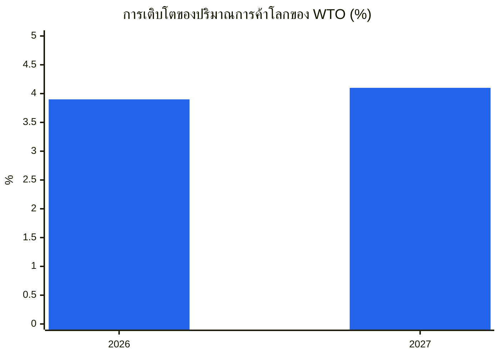
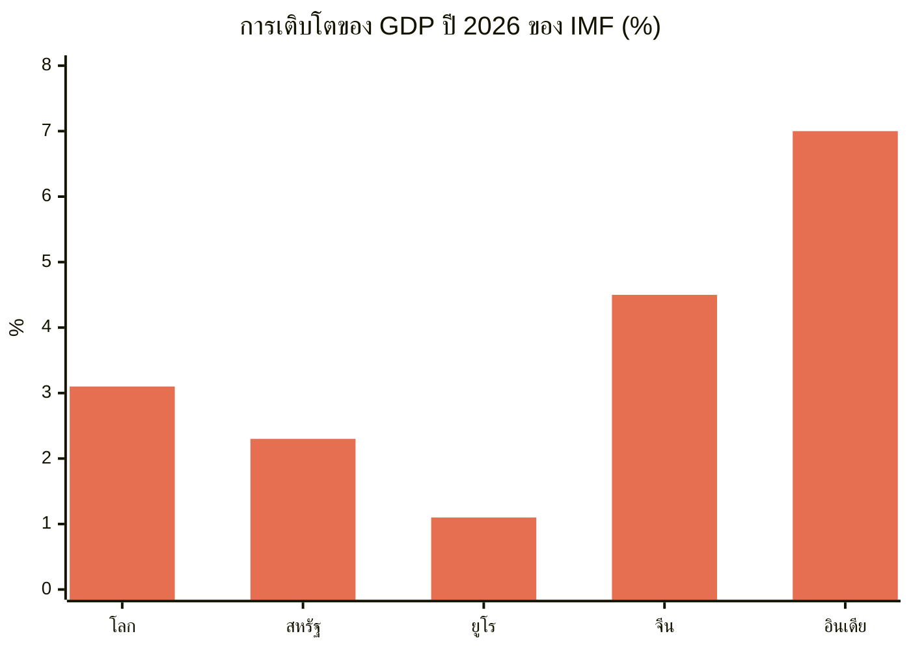
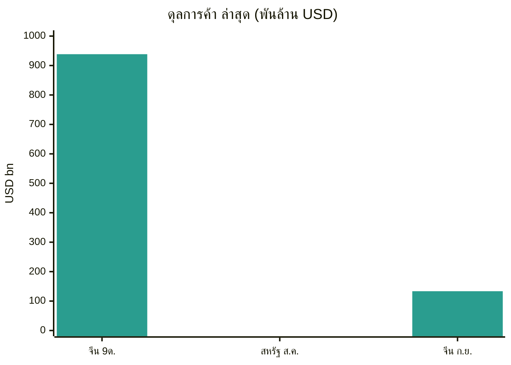
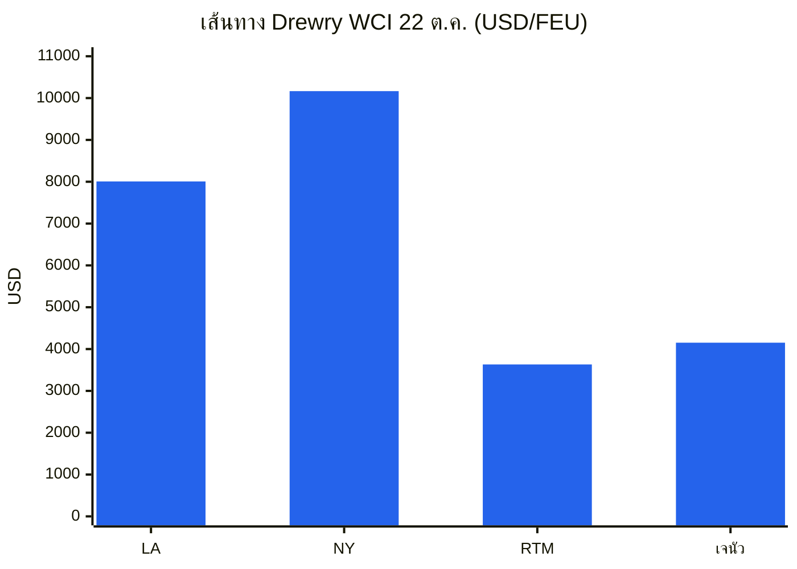
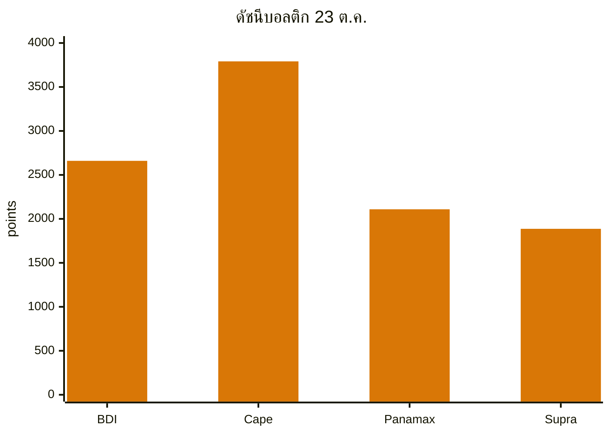
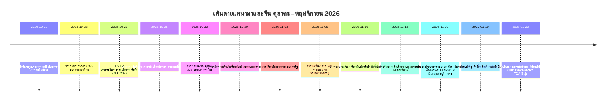
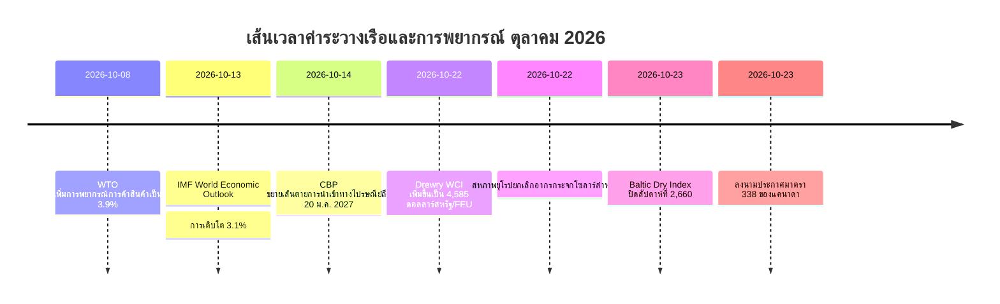

# รายงานข่าวกรองการค้าโลก — สัปดาห์ที่ 19–26 ตุลาคม 2026

**บทสรุปประจำสัปดาห์** ช่วงเวลาที่ครอบคลุม: 19–26 ตุลาคม 2026 รวบรวมจากแหล่งข่าวการค้า นโยบาย ข้อมูล และค่าระวางเรือทั่วโลกประมาณ 45 แหล่ง

---

## สารบัญ

1. [บทสรุปผู้บริหาร](#1-executive-summary)
2. [ประกาศเตือน](#2-alerts)
3. [เรื่องเด่น — วิเคราะห์เชิงลึก](#3-top-stories--deep-dives)
4. [ตัวติดตามภาษีศุลกากร](#4-tariff-tracker)
5. [วิเคราะห์เชิงลึกนโยบายสหรัฐ](#5-us-policy-deep-dive)
6. [นโยบายโลกตามภูมิภาค](#6-world-policy-by-region)
7. [มาตรการบังคับใช้กฎหมาย](#7-enforcement-actions)
8. [ข้อมูลที่เผยแพร่](#8-data-releases)
9. [ตลาดค่าระวางเรือ](#9-freight-market)
10. [เส้นเวลานโยบาย](#10-policy-timelines)
11. [กำหนดเวลาและกิจกรรมที่จะมาถึง (90 วันข้างหน้า)](#11-upcoming-deadlines--events-next-90-days)
12. [แหล่งข้อมูลและระเบียบวิธี](#12-sources--methodology)

---

## 1. บทสรุปผู้บริหาร

สัปดาห์ที่สหรัฐอเมริกาเขียนรายการภาษีแคนาดาใหม่สองครั้งในทิศทางตรงกันข้าม ค่าระวางเรือคอนเทนเนอร์ขยายตัวต่อเนื่อง เรือเทกองแยกตัวชัดเจนตามขนาดเรือ และสถาบันพยากรณ์หลักสองแห่งของโลกอธิบายเศรษฐกิจโลกเดียวกันในน้ำเสียงที่ต่างกัน: สินค้าทนทาน บริการเปราะบาง และการเติบโตกระจุกตัวมากขึ้นในประเทศและผลิตภัณฑ์จำนวนน้อย

- **แคนาดา: ผ่อนคลายและยกระดับในสัปดาห์เดียวกัน** เมื่อวันที่ 23 ตุลาคม ประธานาธิบดีทรัมป์ลงนามประกาศยกเลิกภาษีมาตรา 338 อัตรา 50% สำหรับสินค้าเกษตรและป่าไม้ของแคนาดาบางรายการ — แผ่นไม้อัด ผลิตภัณฑ์กระดาษบางชนิด เครื่องจักรและอุปกรณ์ทำความเย็นบางชนิด ลังและกล่องบรรจุภัณฑ์ และสาหร่ายสดและแห้ง — มีผลตั้งแต่วันที่ 30 ตุลาคม คำสั่งเดียวกันเพิ่มสินค้าแคนาดาอื่น ๆ เข้าในรายการอัตรา 50% ได้แก่ พรม สี แชมพู ผงโกโก้ โลงศพไม้ ไม้ไอศกรีม เครื่องปรับอากาศ ตู้แช่แข็งแบบนอนราบ อุปกรณ์ยิงธนู และเรือแคนู การผ่อนคลายเกิดขึ้นตามคำขอของวุฒิสมาชิกซูซาน คอลลินส์แห่งรัฐเมน ซึ่งผู้ผลิตบลูเบอร์รี มันฝรั่ง แอปเปิล และสาหร่ายของรัฐพึ่งพาปัจจัยการผลิตจากแคนาดา แยกต่างหาก หลังจากออนแทรีโอออกอากาศโฆษณาช่วงเวิลด์ซีรีส์ที่ใช้คำพูดของอดีตประธานาธิบดีโรนัลด์ เรแกนเกี่ยวกับภาษีศุลกากร ประธานาธิบดีประกาศเพิ่มภาษีนำเข้าจากแคนาดาอีก 10% โดยระบุว่าโฆษณาดังกล่าวเป็นการบิดเบือนอย่างร้ายแรงและเป็นการกระทำที่เป็นปฏิปักษ์ ออนแทรีโอกล่าวว่าจะระงับโฆษณาดังกล่าวเพื่อให้การเจรจาการค้ากลับมาดำเนินต่อได้ ในการชุมนุมที่พอร์ตฮูรอน รัฐมิชิแกน เมื่อวันที่ 25 ตุลาคม ประธานาธิบดีกล่าวว่าจะบรรลุข้อตกลงการค้ากับแคนาดา "ในเร็ว ๆ นี้" แต่ไม่ได้ระบุเงื่อนไขหรือกรอบเวลา
- **ค่าระวางเรือ: คอนเทนเนอร์ขึ้น เรือเทกองแยกตัว** ดัชนี Drewry World Container Index เพิ่มขึ้น 2% เป็น 4,585 ดอลลาร์สหรัฐต่อตู้ 40 ฟุต เมื่อวันที่ 22 ตุลาคม ซึ่งเป็นระดับสูงสุดในรอบ 15 สัปดาห์ และเป็นการเพิ่มขึ้นติดต่อกันเป็นสัปดาห์ที่สอง เซี่ยงไฮ้–ลอสแอนเจลิสเพิ่มขึ้น 2% เป็น 8,007 ดอลลาร์สหรัฐ เซี่ยงไฮ้–นิวยอร์กเพิ่มขึ้น 1% เป็น 10,166 ดอลลาร์สหรัฐ เซี่ยงไฮ้–รอตเทอร์ดัมเพิ่มขึ้น 3% เป็น 3,632 ดอลลาร์สหรัฐ และเซี่ยงไฮ้–เจนัวเพิ่มขึ้น 5% เป็น 4,152 ดอลลาร์สหรัฐ Drewry นับเที่ยวเรือที่ยกเลิก 56 เที่ยวที่วางแผนไว้สำหรับสัปดาห์ที่ 44–48 จากเที่ยวเรือที่กำหนดไว้ 714 เที่ยว คิดเป็นอัตราการยกเลิก 8% ดัชนี Baltic Dry Index ปิดสัปดาห์ที่ 2,660 เมื่อวันที่ 23 ตุลาคม เพิ่มขึ้นประมาณ 5.9% ในรอบสัปดาห์ แม้จะลดลง 1.2% ในวันศุกร์เอง: รายได้ของเรือ Capesize ฟื้นตัวแข็งแกร่ง ขณะที่ Panamax ลดลงเหลือ 2,109 ซึ่งเป็นระดับต่ำสุดนับตั้งแต่วันที่ 24 สิงหาคม
- **การกลับมาของคลองสุเอซผ่านเกณฑ์สำคัญ** ในสองสัปดาห์แรกของเดือนตุลาคม ปริมาณเรือคอนเทนเนอร์เฉลี่ยต่อสัปดาห์ที่ผ่านคลองสุเอซอยู่ที่ 753,000 TEU ตามข้อมูลของ Clarksons Research ที่ BIMCO อ้างถึง เทียบกับ 1,457,000 TEU ในช่วงเดียวกันของปี 2023 — เป็นครั้งแรกนับตั้งแต่เกิดวิกฤตทะเลแดงที่การผ่านคลองเกิน 50% ของระดับก่อนเกิดการหยุดชะงัก มีการประกาศเปลี่ยนแปลงบริการ 16 รายการนับตั้งแต่ต้นเดือนกรกฎาคม และพันธมิตรหลักทั้งสี่รายให้บริการประจำเส้นทางตะวันตกจากเอเชีย–ยุโรปเหนือผ่านสุเอซแล้ว Linerlytica คาดการณ์ในแนวโน้มเดือนตุลาคมว่าจะกลับมาเต็มรูปแบบภายในไตรมาสแรกของปี 2027 ขึ้นอยู่กับเงื่อนไขด้านความปลอดภัย
- **การพยากรณ์: สินค้าทนทาน บริการอ่อนแอ การเติบโตกระจุกตัว** ข้อมูลปรับปรุงเดือนตุลาคมของ WTO เพิ่มการเติบโตของปริมาณการค้าโลกในปี 2026 เป็น 3.9% จาก 1.9% ในเดือนมีนาคม และปี 2027 เป็น 4.1% ขณะที่ลดการเติบโตของการค้าบริการเชิงพาณิชย์ในปี 2026 เหลือ 3.3% จาก 4.8% รายงาน World Economic Outlook เดือนตุลาคมของ IMF ประเมินการเติบโตของโลกที่ 3.1% ในปี 2026 และ 3.4% ในปี 2027 โดยมีอัตราเงินเฟ้อทั่วไปที่ 4.7% ในปี 2026 และเตือนว่าการเติบโตกระจุกตัวแล้ว: 32 ประเทศคิดเป็น 95% ของการเติบโตของโลก ลดลงจาก 54 ประเทศในเดือนเมษายน โดยมีเศรษฐกิจประมาณ 47% ถูกปรับลดประมาณการ
- **เส้นตายวันที่ 9 พฤศจิกายนแยกเป็นสองส่วน** เมื่อวันที่ 23 ตุลาคม USTR เสนอขยายการระงับค่าธรรมเนียมท่าเรือมาตรา 301 สำหรับเรือที่เชื่อมโยงกับจีน (และอากรอุปกรณ์เครนและอุปกรณ์ขนถ่ายสินค้าบางชนิด) จากวันที่ 10 พฤศจิกายน 2026 ถึงวันที่ 9 มกราคม 2027 ในประกาศ Federal Register ลงวันที่ 23 ตุลาคม และกำหนดเผยแพร่ในวันที่ 26 ตุลาคม โดยรับความคิดเห็นถึงวันที่ 30 ตุลาคม (เอกสาร USTR-2026-0694) ข้อเสนอนี้ยังไม่ถือเป็นที่สิ้นสุด ในทางตรงกันข้าม การยกเว้นผลิตภัณฑ์มาตรา 301 จำนวน 178 รายการยังคงหมดอายุในเวลา 23:59 น. ตามเวลาตะวันออกของวันที่ 9 พฤศจิกายน 2026 โดยไม่มีการขยายเวลาในช่วงเวลาที่ครอบคลุมนี้ ผู้นำเข้าควรวางแผนตามวันที่ที่ระบุเป็นลายลักษณ์อักษรสำหรับการยกเว้น และถือว่าการขยายค่าธรรมเนียมท่าเรือเป็นเพียงข้อเสนอ ไม่ใช่ข้อสุดท้าย จนกว่า USTR จะเผยแพร่ประกาศสุดท้าย
- **ยุโรปยังคงเปิดประเด็นถกเถียงเรื่องจีน** คณะกรรมาธิการยุโรปกล่าวว่าจะเสนอมาตรการจำกัดการนำเข้าเพิ่มเติมสำหรับภาคส่วนของจีน นอกเหนือจากความเข้าใจเรื่องรถยนต์ไฮบริดที่บรรลุในปักกิ่งเมื่อต้นเดือนตุลาคม โดยประธานาธิบดีฝรั่งเศสชี้ไปที่เคมีภัณฑ์ พลาสติก และเฟอร์โรอัลลอย คณะกรรมาธิการยังวางแผนเสนอเครื่องมือใหม่ในเดือนธันวาคมเพื่อจำกัดการพึ่งพาแหล่งเดียวสำหรับสินค้าจำเป็น ขณะเดียวกัน สหราชอาณาจักรยังคงต่อต้านแรงกดดันให้ปรับอากรของสหภาพยุโรปสูงสุด 45.3% สำหรับรถยนต์ไฟฟ้าของจีน โดยรัฐมนตรีว่าการกระทรวงธุรกิจ โจนาธาน เรย์โนลส์ กล่าวว่าการตัดสินใจด้านการป้องกันทางการค้าของสหราชอาณาจักรตั้งอยู่บนผลประโยชน์ของสหราชอาณาจักรเพียงอย่างเดียว สหภาพยุโรปยกเลิกอากรกระจกโซลาร์ที่มีมายาวนานสำหรับจีนเมื่อวันที่ 22 ตุลาคม โดยสามารถยื่นขอคืนอากรที่จ่ายตั้งแต่วันที่ 22 กรกฎาคม 2025 ได้

**ค่าระวางเรือ:** คอนเทนเนอร์แข็งแกร่งขึ้นจากการขึ้นอัตราทั่วไปและการถอนความจุเรือก่อนการเจรจาสัญญาเดือนมกราคม เรือเทกองฟื้นตัวจากความแข็งแกร่งของ Capesize แม้ Panamax จะอ่อนแอลง ความจุเรือผ่านสุเอซยังคงกลับมาอย่างค่อยเป็นค่อยไป และความเสี่ยงด้านการเดินเรือในอ่าวยังคงสูง โดยมีการรายงานว่าการข้ามช่องแคบฮอร์มุซลดลงอย่างมากในสัปดาห์ที่ 12–18 ตุลาคม และมีรายงานเหตุการณ์เรือเพิ่มเติมในวันที่ 18–20 ตุลาคม

---

## 2. ประกาศเตือน

| # | ประกาศเตือน | มีผล | ผลกระทบ | แหล่งข้อมูล |
|---|-------|-----------|--------|--------|
| A1 | แคนาดาปรับรายการมาตรา 338 ใหม่: ยกเลิกภาษี 50% สำหรับแผ่นไม้อัด ผลิตภัณฑ์กระดาษบางชนิด เครื่องจักรและอุปกรณ์ทำความเย็นบางชนิด ลังและกล่องบรรจุภัณฑ์ สาหร่ายสดและแห้ง เพิ่มสำหรับพรม สี แชมพู ผงโกโก้ โลงศพไม้ ไม้ไอศกรีม เครื่องปรับอากาศ ตู้แช่แข็งแบบนอนราบ อุปกรณ์ยิงธนู เรือแคนู | 30 ต.ค. 2026 | ห่วงโซ่อุปทานเกษตรและป่าไม้ของรัฐเมนได้รับการผ่อนคลาย ผู้ส่งออกแคนาดาที่เพิ่งถูกเพิ่มในรายการเผชิญอากร 50% | [White House](https://www.whitehouse.gov/fact-sheets/2026/10/fact-sheet-president-donald-j-trump-further-modifies-canadian-products-subject-to-tariffs-under-section-338/), [Supply Chain Dive](https://www.supplychaindive.com/news/trump-tweaks-canada-tariffs-removing-certain-goods-while-adding-others/833895/) |
| A2 | ประกาศเพิ่มภาษีนำเข้าจากแคนาดาอีก 10% หลังโฆษณาช่วงเวิลด์ซีรีส์ของออนแทรีโอที่ใช้คำพูดของโรนัลด์ เรแกน ออนแทรีโอกล่าวว่าจะระงับโฆษณาดังกล่าว | ประกาศ ต.ค. 2026 | ยกระดับข้อพิพาทสหรัฐ–แคนาดาไม่กี่วันก่อนการเปลี่ยนแปลงรายการวันที่ 30 ตุลาคมและการเลือกตั้งกลางเทอมวันที่ 3 พฤศจิกายน | [LawStreet](https://lawstreet.co/international/trump-says-canada-trade-deal-coming-soon-as-white-house-eases-some-tariffs-after-collins-request) |
| A3 | นาฬิกาวันที่ 9 พฤศจิกายนแยกกัน: USTR เสนอขยายการระงับค่าธรรมเนียมท่าเรือมาตรา 301 ถึง 9 ม.ค. 2027 (รับความคิดเห็นถึง 30 ต.ค. เอกสาร USTR-2026-0694) การยกเว้นผลิตภัณฑ์มาตรา 301 จำนวน 178 รายการยังคงหมดอายุเวลา 23:59 น. ตามเวลาตะวันออกของวันที่ 9 พ.ย. 2026 โดยไม่มีการขยายเวลา | 9 พ.ย. 2026 / 9 ม.ค. 2027 (เสนอ) | อากรยกเว้นกลับสู่อัตราตามรายการ (25% รายการ 1–3, 7.5% รายการ 4A) สำหรับสินค้าที่เข้าตั้งแต่วันที่ 10 พ.ย. ค่าธรรมเนียมท่าเรือจะกลับมาเรียกเก็บก็ต่อเมื่อข้อเสนอไม่เป็นที่สิ้นสุด | [gCaptain](https://gcaptain.com/ustr-proposes-extending-china-ship-port-fee-suspension-through-january-2027/), [Gateway Lines](https://gatewaylines.com/press-releases/china-ship-fees-301-exclusions-nov-9-2026) |
| A9 | กังหันลมถูกประกาศว่าเป็นภัยคุกคามความมั่นคงแห่งชาติตามมาตรา 232 (ประกาศของทำเนียบขาว 22 ต.ค.) ยังไม่มีการเรียกเก็บภาษี — เจ้าหน้าที่การค้าได้รับคำสั่งให้เจรจาและรายงานกลับภายใน 180 วัน | 22 ต.ค. 2026 | ห่วงโซ่อุปทานพลังงานลมเผชิญภาษีที่เป็นไปได้ในอนาคต ผู้จัดหารายใหญ่ที่ระบุในรายงาน ได้แก่ เม็กซิโก ฝรั่งเศส อินเดีย เดนมาร์ก และเยอรมนี |  |
| A4 | ความเสี่ยงด้านการเดินเรือในฮอร์มุซ/อ่าวยังคงสูง: เรือบรรทุกน้ำมัน AL DASMA เสียหายในช่องแคบฮอร์มุซ 20 ต.ค. เรือ JIF BARRACUDA เสียหายใกล้สหรัฐอาหรับเอมิเรตส์ 18 ต.ค. MarineTraffic รายงานว่าการข้ามฮอร์มุซลดลงจาก 203 เหลือ 120 เที่ยวในสัปดาห์ที่ 12–18 ต.ค. | 18–20 ต.ค. 2026 | ค่าใช้จ่ายด้านความเสี่ยงสงคราม เส้นทางเดินเรือ และประกันภัยยังคงสูง แม้การฟื้นตัวของคอนเทนเนอร์ผ่านสุเอซ | [Daily Caller](https://dailycaller.com/2026/10/22/iran-claims-seven-vessels-attacked-in-persian-gulf) |
| A5 | เหตุการณ์สินค้าในทะเลดำ: เรือสินค้าติดธงคอโมโรส Khoryv เกิดเพลิงไหม้และพลิกคว่ำห่างจากเมืองคอนสตันซา โรมาเนีย ไปทางตะวันออกประมาณ 15 ไมล์ ลูกเรือเสียชีวิต 1 คน สูญหาย 3 คน ได้รับการช่วยเหลืออย่างปลอดภัย 9 คน | ต.ค. 2026 | ความเสี่ยงด้านเส้นทางเดินเรือและประกันภัยในทะเลดำ ทางการโรมาเนียระบุในรายงานท้องถิ่นว่าเหตุการณ์เกิดจากการโจมตีด้วยโดรน | [Scottish Sun](https://www.thescottishsun.co.uk/news/16978300/cargo-ship-fire-drone-strike-black-sea/) |
| A6 | การหยุดชะงักของท่าเรือฝรั่งเศส: ประกาศหยุดงาน 24 ชั่วโมงทั่วท่าเรือฝรั่งเศสในวันที่ 14 และ 16 ต.ค. และมีอีกวันที่ระบุไว้คือ 30 ต.ค. ท่าเรือและคลังสินค้าที่ Fos-sur-Mer ปิดทำการในวันที่ 20 ต.ค. เนื่องจากสภาพอากาศเลวร้าย | 20 และ 30 ต.ค. 2026 | ความไม่แน่นอนของตารางเดินเรือที่ท่าเรือฝรั่งเศส ผู้ส่งสินค้าควรเผื่อเวลาในการวางแผนเส้นทางปลายเดือนตุลาคม | [Maritime News](https://www.maritimenews.com/port-operations/port-operations-oct-14-21-2026) |
| A7 | ยกเลิกอากรกระจกโซลาร์ของสหภาพยุโรปสำหรับจีน 22 ต.ค. 2026 สามารถยื่นขอคืนอากรที่จ่ายตั้งแต่วันที่ 22 ก.ค. 2025 | 22 ต.ค. 2026 | ผู้นำเข้าโซลาร์ควรทบทวนการจ่ายอากรในอดีตเพื่อขอคืน | [WiseVoter](https://wisevoter.com/world/2026/10/23/eu-repeals-solar-glass-duties-china) |
| A8 | ขยายเส้นตายการนำเข้าทางไปรษณีย์ของ CBP: ผลิตภัณฑ์ที่ FDA ควบคุม รวมถึงยา ยังคงใช้กระบวนการไปรษณีย์แบบง่ายได้จนถึง 20 ม.ค. 2027 หลังจาก CBP ขยายเส้นตายวันที่ 22 ต.ค. ออกไปอีก 90 วันเมื่อวันที่ 14 ต.ค. | 20 ม.ค. 2027 | ผู้นำเข้าทางไปรษณีย์และพัสดุมีเวลาอีกหนึ่งไตรมาสในการเปลี่ยนไปยื่นเอกสารศุลกากรแบบละเอียด |  |

### A1 — แคนาดา: สองความเคลื่อนไหวในทิศทางตรงกันข้าม

ประกาศวันที่ 23 ตุลาคมควรมองว่าเป็นการปรับสมดุล ไม่ใช่การลดความตึงเครียด เอกสารข้อเท็จจริงของทำเนียบขาวระบุว่าภาษีมาตรา 338 ใช้บังคับโดยไม่คำนึงถึงถิ่นกำเนิด USMCA และเพิ่มเติมจากอากรมาตรา 232 และว่าการเพิ่มและยกเลิกรายการผลิตภัณฑ์มีผลตั้งแต่วันที่ 30 ตุลาคม 2026 — สี่วันก่อนการเลือกตั้งกลางเทอมวันที่ 3 พฤศจิกายน วุฒิสมาชิกคอลลินส์กล่าวว่าการผ่อนคลายจะช่วยผู้ผลิตบลูเบอร์รี มันฝรั่ง แอปเปิล และสาหร่ายของรัฐเมน ซึ่งหลายรายพึ่งพาอุปกรณ์ บรรจุภัณฑ์ และปัจจัยการผลิตจากแคนาดาที่ไม่มีจากผู้จัดหาในสหรัฐอเมริกาหรือทดแทนได้ด้วยต้นทุนสูงมาก

**บทวิเคราะห์:** คำสั่งนี้รักษาโครงสร้างโดยรวมของข้อพิพาทกับแคนาดา — อากร 50% สำหรับสินค้าแคนาดามูลค่าประมาณ 20,000 ล้านดอลลาร์สหรัฐที่กำหนดในเดือนสิงหาคม หลังการเจรจาล้มเหลว — ขณะที่เปลี่ยนภาระที่ตกแก่ผู้ส่งออก ผู้ส่งออกสินค้าที่เพิ่งถูกเพิ่มในรายการ (พรม ผงโกโก้ เครื่องปรับอากาศ ตู้แช่แข็งแบบนอนราบ และอื่น ๆ) ควรตรวจสอบพิกัดศุลกากรใหม่ทันที ผู้ส่งออกสินค้าที่ถูกยกเลิกจากรายการควรยืนยันว่าผลิตภัณฑ์เฉพาะของตนอยู่ในคำอธิบายของประกาศก่อนจะถือว่าได้รับการผ่อนคลาย เนื่องจากความครอบคลุมของมาตรา 338 ขึ้นอยู่กับคำอธิบายผลิตภัณฑ์ ไม่ใช่หมวดหมู่กว้าง

### A2 — โฆษณาของเรแกนและการเพิ่มภาษี 10%

โฆษณาของออนแทรีโอที่ออกอากาศช่วงเวิลด์ซีรีส์ขณะที่ทีม Toronto Blue Jays กำลังแข่งขัน ใช้คำพูดของอดีตประธานาธิบดีเรแกนในปี 1987 ที่เตือนว่าภาษีสูงนำไปสู่การตอบโต้และสงครามการค้า ประธานาธิบดีเรียกโฆษณาดังกล่าวว่าเป็นการบิดเบือนอย่างร้ายแรงและเป็นการกระทำที่เป็นปฏิปักษ์ ยุติการหารือทางการค้ากับออตตาวา และประกาศเพิ่มภาษีนำเข้าจากแคนาดาอีก 10% เหนือระดับปัจจุบัน มูลนิธิประธานาธิบดีโรนัลด์ เรแกนกล่าวว่าไม่ได้อนุมัติการใช้คลิปดังกล่าว นายกรัฐมนตรีออนแทรีโอ ดัก ฟอร์ด กล่าวว่าโฆษณาจะค่อย ๆ ยุติหลังสุดสัปดาห์เพื่อให้ทั้งสองรัฐบาลกลับมาเจรจาได้

**บทวิเคราะห์:** เหตุการณ์นี้แสดงให้เห็นว่าข้อพิพาทด้านการสื่อสารสามารถเปลี่ยนเป็นนโยบายภาษีได้รวดเร็วเพียงใดในวัฏจักรนี้ และจังหวะการเลือกตั้งยิ่งขยายผล ประเด็นเชิงปฏิบัติสำหรับผู้นำเข้าคือลำดับ: การเปลี่ยนแปลงรายการวันที่ 30 ตุลาคม การเพิ่ม 10% ที่ประกาศ และข้อตกลงกับแคนาดาที่ประธานาธิบดีกล่าวล่วงหน้าเมื่อวันที่ 25 ตุลาคม เป็นเครื่องมือสามอย่างที่แยกกัน มีฐานทางกฎหมายและวันที่มีผลต่างกัน จนกว่าแต่ละอย่างจะได้รับการเผยแพร่ ประกาศวันที่ 30 ตุลาคมเป็นเพียงอย่างเดียวที่มีวันที่มีผลแน่นอน

### A3 — วันที่ 9 พฤศจิกายน: นาฬิกาแยกกัน

ประกาศการดำเนินการต่อของ USTR วันที่ 6 ตุลาคม 2026 (เผยแพร่ 7 ตุลาคม) ยืนยันว่ามาตรการมาตรา 301 กับจีนทั้งสองฉบับในปี 2018 ยังคงมีผลต่อไป แต่ไม่ได้ขยายการยกเว้นหรือการระงับค่าธรรมเนียมท่าเรือ การยกเว้น 178 รายการ — 164 รายการที่คงไว้ในเดือนพฤษภาคม 2024 บวกการยกเว้นอุปกรณ์การผลิตโซลาร์ 14 รายการที่เพิ่มในเดือนกันยายน 2024 — มีผลถึงเวลา 23:59 น. ตามเวลาตะวันออกของวันที่ 9 พฤศจิกายน สินค้าที่เข้าตั้งแต่วันที่ 10 พฤศจิกายนจ่ายอัตราตามรายการ อย่างไรก็ตาม เมื่อวันที่ 23 ตุลาคม USTR เสนอการขยายแยกต่างหากเฉพาะการระงับค่าธรรมเนียมท่าเรือ: ตั้งแต่วันที่ 10 พฤศจิกายน 2026 ถึงวันที่ 9 มกราคม 2027 ผู้ขนส่งจะไม่ต้องรับผิดค่าธรรมเนียมท่าเรือตามภาคผนวก I, II และ III ของมาตรการมาตรา 301 เดิม และอากรอุปกรณ์เครนและอุปกรณ์ขนถ่ายสินค้าที่เกี่ยวข้องก็จะถูกระงับด้วย ประกาศดังกล่าวลงวันที่ 23 ตุลาคมและกำหนดเผยแพร่ในวันที่ 26 ตุลาคม รับความคิดเห็นถึงเวลา 17:00 น. ตามเวลาตะวันออกของวันที่ 30 ตุลาคม (เอกสาร USTR-2026-0694) และเป็นเพียงข้อเสนอ ไม่ใช่กฎสุดท้าย สมาคมการค้ากว่า 200 แห่งเขียนจดหมายถึง USTR เมื่อวันที่ 23 กันยายนเพื่อขอการขยายเวลา

**บทวิเคราะห์:** ช่องว่างระหว่างปฏิทินการเมือง (การพักรบที่หารือกันว่าดำเนินถึงวันที่ 10 มกราคม 2027) กับปฏิทินกฎระเบียบ (วันที่ 9 พฤศจิกายน) แคบลงสำหรับผู้ขนส่งแต่ไม่ใช่สำหรับผู้นำเข้า ผู้ขนส่งกำหนดราคาตามกฎที่เป็นลายลักษณ์อักษร ผู้นำเข้าก็ควรทำเช่นเดียวกันสำหรับการยกเว้น และควรระบุสินค้าที่เข้าซึ่งอ้างหัวข้อการยกเว้นก่อนเส้นตาย แทนที่จะค้นพบความเสี่ยงภายหลัง ข้อเสนอค่าธรรมเนียมท่าเรือหากเป็นที่สิ้นสุดจะป้องกันการเริ่มเรียกเก็บค่าธรรมเนียมอีกครั้งในวันที่ 10 พฤศจิกายน หากไม่เป็นเช่นนั้น ค่าธรรมเนียมจะกลับมา

---

## 3. เรื่องเด่น — วิเคราะห์เชิงลึก

### 3.1 แคนาดา: นโยบายภาษีในฐานะเครื่องมือช่วงเลือกตั้ง

ประเด็นแคนาดาครองข่าวนโยบายสหรัฐในสัปดาห์นี้ เพราะรวมปัจจัยขับเคลื่อนทั้งสามของนโยบายการค้าสหรัฐในปัจจุบัน: เครื่องมือทางกฎหมาย (มาตรา 338 ของพระราชบัญญัติภาษีศุลกากรปี 1930 ซึ่งอนุญาตให้เรียกเก็บภาษีสูงสุด 50% เพื่อตอบโต้การเลือกปฏิบัติต่อการค้าของสหรัฐ) ปฏิทินการเมืองภายในประเทศ (การเลือกตั้งกลางเทอมวันที่ 3 พฤศจิกายน) และการเจรจาทวิภาคีที่หยุดชะงักมาตั้งแต่เดือนสิงหาคม มาตรการเดิมในเดือนสิงหาคมครอบคลุมสินค้าแคนาดามูลค่าประมาณ 20,000 ล้านดอลลาร์สหรัฐ ตั้งแต่ไม้ฮอกกี้ถึงซีเมนต์ หลังการเจรจาล้มเหลว แคนาดาตอบโต้สินค้าอเมริกันในมูลค่าเทียบเท่า

เหตุผลที่ระบุในคำสั่งวันที่ 23 ตุลาคม — ว่าเจ้าหน้าที่ระดับสูงแนะนำว่าการเปลี่ยนแปลงจะยังคงชดเชยการเลือกปฏิบัติที่ถูกกล่าวหา ขณะที่รับใช้ผลประโยชน์สาธารณะ — เป็นสูตรมาตรฐานของรัฐบาลสำหรับมาตรา 338 สิ่งที่ใหม่คือการเชื่อมโยงอย่างชัดแจ้งในรายงานร่วมสมัยกับคำขอของวุฒิสมาชิกเพียงคนเดียวในนามของอุตสาหกรรมของรัฐที่ระบุชื่อ การเชื่อมโยงนั้นไม่เปลี่ยนผลทางกฎหมาย แต่เปลี่ยนบทเรียนด้านการวิ่งเต้น: การผ่อนคลายเฉพาะผลิตภัณฑ์สามารถทำได้เมื่อกลุ่มผลประโยชน์ภายในประเทศแสดงการพึ่งพาห่วงโซ่อุปทานที่เป็นรูปธรรมได้

**ตัวเลขสำคัญ:** อัตรามาตรา 338 ที่ 50% สินค้าแคนาดาที่เดิมครอบคลุมมูลค่าประมาณ 20,000 ล้านดอลลาร์สหรัฐ วันที่มีผล 30 ตุลาคม การเลือกตั้งกลางเทอมวันที่ 3 พฤศจิกายน

**เหตุใดจึงสำคัญ:** สำหรับผู้ส่งออกแคนาดาและผู้นำเข้าสหรัฐ รายการวันที่ 30 ตุลาคมคือเอกสารที่มีผลบังคับ สำหรับผู้อื่น เหตุการณ์นี้เป็นเครื่องเตือนว่ารายการภาษีในวัฏจักรนี้ถูกปรับปรุงในระดับสัปดาห์ ไม่ใช่ปี และการตรวจสอบระดับพิกัดศุลกากรกลายเป็นต้นทุนประจำของการนำเข้าแล้ว

### 3.2 การพยากรณ์สองฉบับ: WTO และ IMF เห็นพ้องเรื่องความทนทาน แต่ไม่เห็นพ้องเรื่องความกว้าง

รายงาน Global Trade Outlook and Statistics ฉบับปรับปรุงวันที่ 8 ตุลาคมของ WTO และรายงาน World Economic Outlook วันที่ 13 ตุลาคมของ IMF ซึ่งทั้งสองฉบับเผยแพร่ก่อนช่วงเวลาที่ครอบคลุมนี้ไม่นานแต่ครองการอภิปรายด้านนโยบายในสัปดาห์นี้ เล่าเรื่องเดียวกันอย่างสอดคล้องกันแต่เน้นต่างกัน WTO ปรับเพิ่มการเติบโตของปริมาณการค้าสินค้าเป็น 3.9% ในปี 2026 (จาก 1.9% ในเดือนมีนาคม) และ 4.1% ในปี 2027 โดยให้เครดิตการลงทุนที่เกี่ยวข้องกับ AI: การค้าสินค้าที่เอื้อต่อ AI เพิ่มขึ้น 67% เมื่อเทียบปีต่อปีในครึ่งแรกของปี 2026 และคิดเป็น 47% ของการเติบโตของการค้าสินค้าโลก เอเชียนำการเติบโตของการส่งออกในปี 2026 ที่ 9.9% ตามด้วยอเมริกาเหนือที่ 5.7% และแอฟริกาที่ 5.6% ในเวลาเดียวกัน WTO ลดการเติบโตของการค้าบริการเชิงพาณิชย์ในปี 2026 เหลือ 3.3% จาก 4.8% โดยการขนส่งอยู่ที่ 0.9% และการท่องเที่ยวที่ 0.2% สะท้อนการหยุดชะงักในตะวันออกกลาง ต้นทุนเชื้อเพลิงการบินที่สูงขึ้น และข้อจำกัดด้านเที่ยวบิน

IMF ประเมินการเติบโตของโลกที่ 3.1% ในปี 2026 และ 3.4% ในปี 2027 โดยมีอัตราเงินเฟ้อทั่วไปที่ 4.7% ในปี 2026 ลดลงเหลือ 4.1% ในปี 2027 ตารางประเทศของกองทุนแสดงสหรัฐอเมริกาที่ 2.3% ในทั้งสองปี ยูโรโซนที่ 1.1% ในปี 2026 และ 1.2% ในปี 2027 จีนที่ 4.5% และ 4.0% และอินเดียที่ 7.0% บนพื้นฐานปีงบประมาณ คำเตือนของกองทุนเป็นเชิงโครงสร้าง: การเติบโตกระจุกตัวในเศรษฐกิจที่เชื่อมโยงกับการลงทุนด้าน AI หรือได้รับการป้องกันจากวิกฤตพลังงาน ขณะที่เศรษฐกิจผู้นำเข้าพลังงานนอกห่วงโซ่มูลค่าเทคโนโลยีเผชิญแนวโน้มยากลำบากที่สุด สมมติฐานพื้นฐานของกองทุนคือช่องแคบฮอร์มุซเริ่มเปิดใหม่ในเดือนมีนาคม 2027 โดยกลับสู่สภาพก่อนสงครามอย่างกว้างขวางภายในเดือนตุลาคม 2027

*หมายเหตุ: WTO Global Trade Outlook and Statistics ข้อมูลปรับปรุงเดือนตุลาคม 2026 การพยากรณ์ปี 2026 เพิ่มขึ้นจาก 1.9% ในเดือนมีนาคม*

*หมายเหตุ: IMF World Economic Outlook เดือนตุลาคม 2026 อินเดียบนพื้นฐานปีงบประมาณ*

**บทวิเคราะห์:** ทั้งสองสถาบันเห็นพ้องว่าการลงทุนด้าน AI กำลังบดบังจุดอ่อนในด้านอื่น ผลกระทบเชิงปฏิบัติต่อการวางแผนการค้าคือ การเติบโตของการค้าโดยรวมทำให้ค่าเฉลี่ยดูดีเกินจริง: บริษัทนอกห่วงโซ่อุปทาน AI หรือที่เผชิญต้นทุนพลังงานและการขนส่งในตะวันออกกลางกำลังประสบปีที่แย่กว่าตัวเลขรวมของโลกอย่างมีนัยสำคัญ

### 3.3 จีน: ดุลเกินดุลใกล้ 1 ล้านล้านดอลลาร์สหรัฐ และข้อถกเถียงว่ามันหมายถึงอะไร

ดุลการค้าสินค้าของจีนเดือนมกราคม–กันยายน 2026 อยู่ที่ 938,500 ล้านดอลลาร์สหรัฐ โดยเดือนกันยายนเพียงเดือนเดียวอยู่ที่ 133,500 ล้านดอลลาร์สหรัฐ ซึ่งเป็นระดับสูงสุดในรอบ 20 เดือน ขณะที่การส่งออกพุ่งสูงจากกระแสฮาร์ดแวร์ AI ยอดขายไปยังสหรัฐอเมริกาเติบโต 40% เร็วที่สุดในรอบกว่าห้าปี ทำให้ดุลเกินดุลของจีนกับสหรัฐอเมริกาอยู่ที่ 34,000 ล้านดอลลาร์สหรัฐ สูงสุดนับตั้งแต่เดือนมกราคม 2025 การส่งออกสูงสุดเป็นประวัติการณ์ยังถูกซื้อโดยออสเตรเลีย เกาหลีใต้ ไต้หวัน รัสเซีย และเศรษฐกิจอาเซียน นักเศรษฐศาสตร์ของ Goldman Sachs ที่อ้างในรายงานประมาณว่าจำนวนประเทศที่ขาดดุลการค้ากับจีนเกิน 3% ของ GDP เพิ่มขึ้นกว่าสามเท่านับตั้งแต่ปี 2005 เป็น 82 ประเทศ โดยส่วนใหญ่เป็นเศรษฐกิจเกิดใหม่ที่มีรายได้ต่ำ

**บทวิเคราะห์:** ดุลเกินดุลเป็นทั้งอาการและตัวขับเคลื่อนของข่าวนโยบายในสัปดาห์นี้ มันเสริมสถานะการเจรจาของปักกิ่งก่อนเส้นตายเดือนพฤศจิกายน และเสริมข้อโต้แย้งในบรัสเซลส์และวอชิงตันสำหรับมาตรการป้องกันเพิ่มเติม นอกจากนี้ยังทำให้เรื่องเล่าที่ว่าการแยกตัวก้าวหน้าไปมากซับซ้อนขึ้น: การซื้อสินค้าทุนของสหรัฐจากจีนสำหรับโครงสร้างพื้นฐาน AI กำลังเติบโตในอัตราที่เร็วที่สุดในรอบห้าปี

### 3.4 ยุโรป: มาตรการป้องกันก้าวหน้า แต่ไม่ได้ไปในทิศทางเดียว

การอภิปรายของสหภาพยุโรปในเดือนตุลาคมส่งสัญญาณตรงกันข้ามสองประการ ด้านจำกัด ประธานคณะกรรมาธิการ อัวร์ซูลา ฟอน แดร์ ไลเอิน กล่าวหลังการประชุมสุดยอดวันที่ 15–16 ตุลาคมว่าคณะกรรมาธิการจะเสนอมาตรการจำกัดการนำเข้าจากจีน นอกเหนือจากมาตรการคุ้มครองรถยนต์ไฮบริดที่ตกลงในปักกิ่ง ซึ่งออกแบบมาเพื่อลดการนำเข้ารถยนต์ไฮบริดของจีนลงครึ่งหนึ่ง ประธานาธิบดีฝรั่งเศสชี้ไปที่เคมีภัณฑ์ พลาสติก และเฟอร์โรอัลลอย คณะกรรมาธิการจะเสนอในเดือนธันวาคมด้วยเครื่องมือใหม่เพื่อจำกัดการพึ่งพาแหล่งเดียวสำหรับสินค้าจำเป็น และกลไกความเป็นน้ำหนึ่งใจเดียวกันสำหรับประเทศหรือภาคส่วนที่ถูกบีบบังคับ ดุลการค้าสินค้าของสหภาพยุโรปกับจีนอยู่ในระดับเกิน 1,000 ล้านยูโรต่อวัน

ด้านเปิดเสรี สหภาพยุโรปยกเลิกอากรกระจกโซลาร์สำหรับจีนเมื่อวันที่ 22 ตุลาคม ยุติมาตรการที่มีผลมาตั้งแต่ปี 2014 หลังจากผู้ผลิตกระจกโซลาร์สองรายสุดท้ายของสหภาพยุโรปหยุดการผลิต ผู้นำเข้าอาจยื่นขอคืนอากรที่จ่ายตั้งแต่วันที่ 22 กรกฎาคม 2025 ต่อหน่วยงานศุลกากรแห่งชาติภายใต้ระเบียบการบังคับใช้ 2026/2314 และ 2026/2310

**บทวิเคราะห์:** ความเคลื่อนไหวทั้งสองสอดคล้องกันเมื่อระบุเกณฑ์: มาตรการยังคงอยู่เมื่อยังมีอุตสาหกรรมภายในประเทศให้ปกป้อง และสิ้นสุดลงเมื่อไม่มี เรื่องที่ควรจับตาคือข้อเสนอในเดือนธันวาคม — เครื่องมือดำเนินการอย่างรวดเร็วและเครื่องมือพึ่งพาแหล่งเดียว — เนื่องจากจะทำให้แนวทางรถยนต์ไฮบริดกลายเป็นเครื่องมือถาวร

### 3.5 การกลับมาของสุเอซและความเสี่ยงฮอร์มุซ เคียงข้างกัน

การกลับมาของเรือคอนเทนเนอร์ผ่านสุเอซวัดได้แล้ว: 753,000 TEU ต่อสัปดาห์ในต้นเดือนตุลาคม คิดเป็น 36% ของความจุเรือคอนเทนเนอร์ทั้งหมดที่เดินทางผ่านคลองหรือแหลมกู๊ดโฮป เพิ่มขึ้นจากเฉลี่ย 8% ระหว่างปี 2024 ถึงกลางปี 2026 แต่ยังต่ำกว่าระดับก่อนวิกฤตที่ 80% อย่างมาก มีการประกาศเปลี่ยนแปลงบริการ 16 รายการนับตั้งแต่ต้นเดือนกรกฎาคม ครอบคลุม Gemini, Ocean, Premier และ MSC ในเวลาเดียวกัน ความเสี่ยงในอ่าวไม่ได้ลดลง: MarineTraffic รายงานว่าการข้ามฮอร์มุซลดลงจาก 203 เหลือ 120 เที่ยวในสัปดาห์ที่ 12–18 ตุลาคม และมีรายงานเหตุการณ์เรือในวันที่ 18 และ 20 ตุลาคม จำนวนผู้เสียชีวิตของ IMO วันที่ 21 ตุลาคมบันทึกผู้เสียชีวิต 24 รายและเหตุการณ์ทางทะเลที่ยืนยันแล้ว 120 เหตุการณ์ทั่วตะวันออกกลางนับตั้งแต่ความขัดแย้งเริ่มต้น

**บทวิเคราะห์:** ตลาดคอนเทนเนอร์กำลังกำหนดราคาความเสี่ยงสองอย่างที่ต่างกันพร้อมกัน — การปลดปล่อยความจุเชิงโครงสร้างเมื่อสุเอซกลับสู่ภาวะปกติ ซึ่งควรกดดันอัตรา และค่าพรีเมียมความเสี่ยงสงครามที่คงอยู่บนเส้นทางอ่าวและทะเลดำ ซึ่งพยุงอัตรา การฟื้นตัวของ Drewry ชี้ว่าสำหรับตอนนี้ การจัดการความจุ (เที่ยวเรือที่ยกเลิก การขึ้นอัตราทั่วไป) มีน้ำหนักมากกว่าการปลดปล่อยจากสุเอซ

### 3.6 ดุลการค้าของสหรัฐอเมริกา: เดือนนำเข้าสูงสุดเป็นประวัติการณ์

ดุลการค้าสินค้าและบริการของสหรัฐขาดดุลเพิ่มขึ้น 13.7% ในเดือนสิงหาคมเป็น 105,600 ล้านดอลลาร์สหรัฐ สูงสุดนับตั้งแต่เดือนมีนาคม 2025 ขณะที่การนำเข้าแตะระดับสูงสุดเป็นประวัติการณ์ที่ 420,800 ล้านดอลลาร์สหรัฐ (เพิ่มขึ้น 4.3%) และการส่งออกเพิ่มขึ้น 1.4% เป็น 315,200 ล้านดอลลาร์สหรัฐ ดุลสินค้าเพียงอย่างเดียวขาดดุลเพิ่มขึ้น 11.5% เป็น 132,600 ล้านดอลลาร์สหรัฐ โดยการนำเข้าสินค้าเพิ่มขึ้น 5.5% เป็น 336,100 ล้านดอลลาร์สหรัฐ — วัสดุอุตสาหกรรมเพิ่มขึ้น 16.6% สินค้าทุนเพิ่มขึ้น 4.0% จากการสร้างโครงสร้างพื้นฐาน AI อาหารเพิ่มขึ้น 5.5% — เทียบกับการส่งออกสินค้า 203,400 ล้านดอลลาร์สหรัฐ เพิ่มขึ้น 1.9% อย่างไรก็ตาม ดุลสะสมเดือนมกราคม–สิงหาคมยังคงแคบกว่าช่วงเดียวกันของปี 2025 ถึง 19.9% ซึ่งเป็นเครื่องเตือนว่าการอ่านค่าเดือนเดียวกับการอ่านค่าตั้งแต่ต้นปีชี้ไปในทิศทางตรงกันข้าม

**บทวิเคราะห์:** ข้อมูลเดือนสิงหาคมที่เผยแพร่ในต้นเดือนตุลาคมและถูกอภิปรายตลอดสัปดาห์นี้ ทำให้ข้ออ้างง่าย ๆ ที่ว่าภาษีทำให้ดุลขาดดุลหดตัวโดยอัตโนมัติในระยะสั้นอ่อนแอลง ขณะที่การปรับปรุงตั้งแต่ต้นปีทำให้ข้ออ้างตรงกันข้ามอ่อนแอลงเช่นกัน การอ่านค่าทั้งสองสามารถเป็นจริงได้เพราะดุลตอบสนองต่อราคานำเข้า ความต้องการสินค้าทุน AI และวัฏจักรสินค้าคงคลัง ตลอดจนอัตราภาษี

---

## 4. ตัวติดตามภาษีศุลกากร

| ประเทศ / แหล่งกำเนิด | มาตรการ | อัตรา | วันที่มีผล | สถานะ | แหล่งข้อมูล |
|---|---|---|---|---|---|
| แคนาดา | ภาษีมาตรา 338 — การยกเลิก: แผ่นไม้อัด ผลิตภัณฑ์กระดาษบางชนิด เครื่องจักรและอุปกรณ์ทำความเย็นบางชนิด ลังและกล่องบรรจุภัณฑ์ สาหร่ายสดและแห้ง | ยกเลิก 50% | 30 ต.ค. 2026 | ลงนามประกาศ 23 ต.ค. 2026 | [White House](https://www.whitehouse.gov/fact-sheets/2026/10/fact-sheet-president-donald-j-trump-further-modifies-canadian-products-subject-to-tariffs-under-section-338/) |
| แคนาดา | ภาษีมาตรา 338 — การเพิ่ม: พรม สี แชมพู ผงโกโก้ โลงศพไม้ ไม้ไอศกรีม เครื่องปรับอากาศ ตู้แช่แข็งแบบนอนราบ อุปกรณ์ยิงธนู เรือแคนู | 50% | 30 ต.ค. 2026 | ลงนามประกาศ 23 ต.ค. 2026 | [Supply Chain Dive](https://www.supplychaindive.com/news/trump-tweaks-canada-tariffs-removing-certain-goods-while-adding-others/833895/) |
| แคนาดา | ประกาศเพิ่มภาษีเพิ่มเติมหลังโฆษณาของออนแทรีโอ | +10 จุดเปอร์เซ็นต์ | ประกาศ ต.ค. 2026 | ประกาศแล้ว เงื่อนไขการบังคับใช้ n/a | [LawStreet](https://lawstreet.co/international/trump-says-canada-trade-deal-coming-soon-as-white-house-eases-some-tariffs-after-collins-request) |
| จีน | ภาษีมาตรา 301 — การยกเว้นผลิตภัณฑ์ 178 รายการหมดอายุ | 25% (รายการ 1–3), 7.5% (รายการ 4A) เมื่อกลับสู่อัตราเดิม | 9 พ.ย. 2026 เวลา 23:59 น. ตามเวลาตะวันออก | ไม่มีการเผยแพร่การขยายเวลาในช่วงเวลาที่ครอบคลุม | [Gateway Lines](https://gatewaylines.com/press-releases/china-ship-fees-301-exclusions-nov-9-2026) |
| จีน | ค่าธรรมเนียมท่าเรือมาตรา 301 สำหรับเรือที่เชื่อมโยงกับจีน — เสนอขยายการระงับถึง 9 ม.ค. 2027 | ระงับค่าธรรมเนียม 10 พ.ย. 2026–9 ม.ค. 2027 หากเป็นที่สิ้นสุด | เสนอ 23 ต.ค. 2026 รับความคิดเห็นถึง 30 ต.ค. | เป็นเพียงข้อเสนอ ไม่ใช่ข้อสุดท้าย | [gCaptain](https://gcaptain.com/ustr-proposes-extending-china-ship-port-fee-suspension-through-january-2027/) |
| กังหันลมและชิ้นส่วน | ข้อค้นพบด้านความมั่นคงแห่งชาติมาตรา 232 | ยังไม่มีการเรียกเก็บภาษี การเจรจาและรายงานกลับภายใน 180 วัน | 22 ต.ค. 2026 | ออกข้อค้นพบแล้ว อาจเรียกเก็บภาษีหลังช่วงเจรจา |  |
| จีน | อากรตอบโต้การทุ่มตลาดและอากรตอบโต้การอุดหนุนของสหภาพยุโรปสำหรับกระจกโซลาร์ | ยกเลิก | 22 ต.ค. 2026 | ยกเลิกแล้ว ขอคืนได้ตั้งแต่วันที่ 22 ก.ค. 2025 | [WiseVoter](https://wisevoter.com/world/2026/10/23/eu-repeals-solar-glass-duties-china) |
| จีน | อากรตอบโต้การทุ่มตลาดของสหภาพยุโรปสำหรับผลิตภัณฑ์อะลูมิเนียมแผ่นรีด | 14.3%–24.6% | กำลังมีผล | เริ่มทบทวนการหมดอายุ 9 ต.ค. 2026 มาตรการยังคงมีผล | [We Are Main Street](https://wearemainstreet.org/world/2026/10/25/eu-anti-dumping-duties-chinese-aluminium) |
| จีน | ความเข้าใจเรื่องรถยนต์ไฮบริดของสหภาพยุโรป | ลดการขนส่งลงครึ่งหนึ่ง | ตกลง 8–9 ต.ค. 2026 | ความเข้าใจ ขั้นตอนการบังคับใช้อยู่ระหว่างดำเนินการ | [EU Monitoring](https://ieu-monitoring.com/editorial/eu-and-china-reach-trade-understandings-on-hybrid-cars-tariffs-and-rare-earths/1251810) |
| สหราชอาณาจักร | อากรนำเข้ามาตรฐานสำหรับรถยนต์ที่ผลิตในจีน | 10% | กำลังมีผล | ไม่เปลี่ยนแปลง สหราชอาณาจักรต่อต้านแรงกดดันของสหภาพยุโรปให้ปรับสูงสุด 45.3% | [Fleet News](https://www.fleetnews.co.uk/news/minister-reportedly-resists-calls-for-uk-to-impose-chinese-ev-tariffs) |
| อินเดีย–นิวซีแลนด์ | FTA มีผล: อากรศูนย์สำหรับ 100% ของรายการภาษีส่งออกของอินเดียไปนิวซีแลนด์ อินเดียให้สัมปทาน 70% ของรายการ | 0% (การส่งออกของอินเดียไปนิวซีแลนด์) | 20 ต.ค. 2026 | มีผลแล้ว กฎว่าด้วยถิ่นกำเนิดใช้บังคับ | [Devdiscourse](https://www.devdiscourse.com/article/business/3994858-india-new-zealand-fta-to-eliminate-tariffs-on-all-indian-exports-from-october-20-dgft-official?amp) |
| รัสเซีย / ผู้ซื้อพลังงาน | ภาษี Graham Act (รัสเซีย 500% ผู้ซื้อพลังงานรายใหญ่และผู้อำนวยความสะดวก 100%) | ยกเว้น | ยกเว้น 16 ต.ค. 2026 | ยกเว้นโดยไม่มีวันสิ้นสุด มอบหมายการติดตามให้ USTR | [KPMG](https://kpmg.com/us/en/taxnewsflash/news/2026/10/trump-russia-tariffs-sanctions.html) |

---

## 5. วิเคราะห์เชิงลึกนโยบายสหรัฐ

### มาตรา 338 และแคนาดา

ดูหัวข้อ 2 และ 3.1 เอกสารข้อเท็จจริงวันที่ 23 ตุลาคมยืนยันว่าภาษีมาตรา 338 ใช้บังคับโดยไม่คำนึงถึงถิ่นกำเนิด USMCA และเพิ่มเติมจากอากรมาตรา 232 และว่าประธานาธิบดีอาจระงับ เพิกถอน เสริม หรือแก้ไขประกาศมาตรา 338 ใด ๆ เมื่อผลประโยชน์สาธารณะต้องการ อำนาจแก้ไขดังกล่าวทำให้การปรับปรุงเพิ่มเติมในเดือนตุลาคมหรือพฤศจิกายนเป็นไปได้โดยไม่ต้องออกกฎหมายใหม่

### USTR — การดำเนินการต่อมาตรา 301 และนาฬิกาวันที่ 9 พฤศจิกายน

USTR ยืนยันเมื่อวันที่ 6 ตุลาคม 2026 (เผยแพร่ 7 ตุลาคม) ว่ามาตรการมาตรา 301 กับจีนทั้งสองฉบับในปี 2018 ยังคงมีผลต่อไป เปิดระยะต่อไปของการทบทวนสี่ปีครั้งที่สอง การทบทวนสามารถเพิ่มอัตราได้เช่นเดียวกับการคงอัตรา: หลังการดำเนินการต่อครั้งแรกในเดือนกันยายน 2022 USTR เพิ่มเซมิคอนดักเตอร์เป็น 50% ในปี 2025 เซลล์โซลาร์เป็น 50% ในปี 2024 และผลิตภัณฑ์เหล็กและอะลูมิเนียมเป็น 25% ในปี 2024 จากนั้นนาฬิกาวันที่ 9 พฤศจิกายนแยกกันในช่วงเวลาที่ครอบคลุมนี้: เมื่อวันที่ 23 ตุลาคม USTR เสนอขยายการระงับค่าธรรมเนียมท่าเรือถึงวันที่ 9 มกราคม 2027 (รับความคิดเห็นถึงวันที่ 30 ตุลาคม เอกสาร USTR-2026-0694) ขณะที่การยกเว้นผลิตภัณฑ์ 178 รายการไม่ได้รับข้อเสนอขยายเวลาและยังคงหมดอายุในวันที่ 9 พฤศจิกายน

### มาตรา 232 — กังหันลม

เมื่อวันที่ 22 ตุลาคม 2026 ประธานาธิบดีประกาศว่าการนำเข้ากังหันลมและชิ้นส่วนเป็นภัยคุกคามต่อความมั่นคงแห่งชาติตามมาตรา 232 หลังการสอบสวนของกระทรวงพาณิชย์ที่เริ่มในเดือนสิงหาคม 2025 เขาหยุดที่จะเรียกเก็บภาษี แต่สั่งให้เจ้าหน้าที่การค้าดำเนินการเจรจากับคู่ค้าและรายงานกลับภายใน 180 วัน มาตรการเพิ่มเติมรวมถึงภาษีอาจได้รับการพิจารณาในภายหลัง เหตุผลที่อ้างรวมถึงข้อกังวลด้านความปลอดภัยทางไซเบอร์ที่เชื่อมโยงกับอุปกรณ์ที่ผลิตในต่างประเทศ การรบกวนระบบเรดาร์และการปฏิบัติการจราจรทางอากาศ และการพึ่งพาสินค้าที่ผลิตในต่างประเทศของสหรัฐที่เพิ่มขึ้น ผู้จัดหารายใหญ่ที่ระบุในรายงาน ได้แก่ เม็กซิโก ฝรั่งเศส อินเดีย เดนมาร์ก และเยอรมนี ยังไม่มีการกำหนดอัตราภาษี

### การดำเนินงานของ CBP

CBP ขยายการเปลี่ยนผ่านการนำเข้าทางไปรษณีย์สำหรับผลิตภัณฑ์ที่ FDA ควบคุม รวมถึงยา จากวันที่ 22 ตุลาคม 2026 เป็นวันที่ 20 มกราคม 2027 เป็นการขยาย 90 วันที่ประกาศเมื่อวันที่ 14 ตุลาคม การขยายนี้ตามหลังกฎชั่วคราวฉบับสุดท้ายวันที่ 24 มิถุนายน 2026 ที่ยกเลิกการยกเว้นอากร 800 ดอลลาร์สหรัฐสำหรับพัสดุทางไปรษณีย์และย้ายพัสดุระหว่างประเทศขนาดเล็กส่วนใหญ่ไปสู่กระบวนการแบบง่ายตั้งแต่วันที่ 24 กรกฎาคม 2026 ผลิตภัณฑ์ที่อยู่ภายใต้กฎการนำเข้าของหน่วยงานอื่นได้รับเวลาถึงวันที่ 22 ตุลาคมในการเปลี่ยนไปยื่นเอกสารแบบละเอียดขึ้น ปัจจุบันมีเวลาถึงวันที่ 20 มกราคม 2027

### การคืนภาษี

ผู้พิพากษาการค้าของสหรัฐรับรองการฟ้องแบบกลุ่มสำหรับผู้นำเข้าที่ขอคืนภาษีที่ศาลฎีกายกเลิกไปก่อนหน้านี้ในปี 2026 ครอบคลุมผู้นำเข้าที่ยังไม่ได้ยื่นคำขอ ศุลกากรดำเนินการคืนเงินเกือบครบ 130,000 ล้านดอลลาร์สหรัฐ เทียบกับภาษีที่โต้แย้งที่จ่ายไปกว่า 166,000 ล้านดอลลาร์สหรัฐ โดยดอกเบี้ยอาจสูงถึงหลายพันล้านดอลลาร์สหรัฐ คำตัดสินดังกล่าวซึ่งรายงานเมื่อวันที่ 9 ตุลาคม 2026 มีความสำคัญสำหรับผู้นำเข้าที่ยังไม่ได้ยื่นคำขอ: กลไกการฟ้องแบบกลุ่มอาจคำนวณใหม่และคืนเงินส่วนที่เหลือโดยไม่ต้องฟ้องรายบุคคล

### ประเด็นที่ยังคงอยู่

การยกเว้น Graham Act วันที่ 16 ตุลาคมยังคงมีผลโดยไม่มีวันสิ้นสุด การพักรบสหรัฐ–จีนที่หารือกันว่าดำเนินถึงวันที่ 10 มกราคม 2027 มีขั้นตอนการบังคับใช้ที่เสนอ — ไม่ใช่ข้อสุดท้าย — สำหรับการระงับค่าธรรมเนียมท่าเรือ (ถึงวันที่ 9 มกราคม 2027 รับความคิดเห็นถึงวันที่ 30 ตุลาคม) และไม่มีข้อเสนอขยายเวลาสำหรับการยกเว้นผลิตภัณฑ์ 178 รายการ คดีอำนาจภาษีของศาลฎีกาซึ่งอ้างในรายงานข้อพิพาทกับแคนาดามีกำหนดไต่สวนในเดือนพฤศจิกายน

---

## 6. นโยบายโลกตามภูมิภาค

### ยุโรป

โครงการหลังการประชุมสุดยอดของคณะกรรมาธิการเป็นความเคลื่อนไหวหลักของยุโรปในสัปดาห์นี้: มาตรการจำกัดการนำเข้าจากจีนเพิ่มเติมนอกเหนือจากรถยนต์ไฮบริด ข้อเสนอในเดือนธันวาคมสำหรับเครื่องมือพึ่งพาแหล่งเดียว และกลไกความเป็นน้ำหนึ่งใจเดียวกันสำหรับกรณีการบีบบังคับ ความเข้าใจเรื่องรถยนต์ไฮบริดเองซึ่งบรรลุในการประชุมการปรึกษาหารือด้านการค้าและการลงทุนสหภาพยุโรป–จีนครั้งที่สองที่ปักกิ่งเมื่อวันที่ 8–9 ตุลาคม ระหว่างกรรมาธิการ มาโรช เชฟโชวิช และรัฐมนตรี หวัง เหวินเทา ครอบคลุมรายการภาษีเจ็ดรายการและอาจลดการส่งออกรถยนต์ไฮบริดและปลั๊กอินไฮบริดของจีนไปยังสหภาพยุโรปลงกว่าครึ่งในสี่ปี ทั้งสองฝ่ายตกลงประชุมระดับรัฐมนตรีครั้งที่สามในเดือนมีนาคม 2027 และการประชุมทางวิดีโอระดับรัฐมนตรีในเดือนมกราคม ดุลการค้าสินค้าของสหภาพยุโรปกับจีนที่เกิน 1,000 ล้านยูโรต่อวันเป็นตัวขับเคลื่อนที่ระบุ

การยกเลิกอากรกระจกโซลาร์และการทบทวนการหมดอายุของอากรอะลูมิเนียมแผ่นรีด (อากร 14.3%–24.6% ยังคงมีผล) แสดงให้เห็นว่ารัฐบาลเดียวกันใช้เครื่องมือตรงกันข้ามกับภาคส่วนที่ต่างกัน ดังที่อภิปรายในหัวข้อ 3.4

### จีน

ผลการส่งออกของจีนในปี 2026 — ดุลเกินดุลเก้าเดือน 938,500 ล้านดอลลาร์สหรัฐ การส่งออกเดือนกันยายนพุ่งสูงจากฮาร์ดแวร์ AI — ยังคงเป็นฉากหลังเชิงโครงสร้าง จีนกลับมาส่งออกเชื้อเพลิงกลั่นหลังช่วงหยุดโกลเด้นวีค โดยอนุมัติประมาณ 3.7 ล้านตันสำหรับเดือนตุลาคม (ดีเซล เบนซิน และเชื้อเพลิงเครื่องบินรวมกัน) การปรึกษาหารือเรื่องการควบคุมการส่งออกเทคโนโลยี AI ที่เปิดเมื่อวันที่ 16 ตุลาคม ครอบคลุมเทคโนโลยี 40 รายการ ยังคงเปิดถึงวันที่ 15 พฤศจิกายน และเป็นประเด็นที่ยังคงอยู่สำหรับบริษัทที่ถ่ายโอนน้ำหนักโมเดลหรือวิธีการออกแบบชิป

### สหราชอาณาจักร

รัฐมนตรีว่าการกระทรวงธุรกิจ โจนาธาน เรย์โนลส์ กล่าวว่าสหราชอาณาจักรจะไม่ยอมตามเสียงเรียกร้องจากประเทศอื่นให้เรียกเก็บภาษีนำเข้ารถยนต์จีน และว่าการตัดสินใจด้านการป้องกันทางการค้าของสหราชอาณาจักรตั้งอยู่บนผลประโยชน์ของสหราชอาณาจักรเพียงอย่างเดียว ปัจจุบันสหราชอาณาจักรใช้อากรมาตรฐาน 10% สำหรับรถยนต์ที่ผลิตในจีน เทียบกับอากรรวมของสหภาพยุโรปสูงสุด 45.3% รายงานข่าวในต้นเดือนตุลาคมชี้ว่าสหราชอาณาจักรกำลังร่างแพ็กเกจที่เลียนแบบอัตราของสหภาพยุโรปเพื่อประกันการเข้าถึงโครงการ Made in Europe ที่เสนอของสหภาพยุโรป ซึ่งรถยนต์ไฟฟ้าจะมีสิทธิ์ได้รับเงินอุดหนุนและการจัดซื้อจัดจ้างภาครัฐก็ต่อเมื่อชิ้นส่วนอย่างน้อย 70% ผลิตภายในกลุ่ม ความเห็นของรัฐมนตรีเมื่อวันที่ 14 ตุลาคมโต้แย้งกรอบดังกล่าว นายกรัฐมนตรี แอนดี เบิร์นแฮม ทำให้การรวมสหราชอาณาจักรในโครงการเป็นวัตถุประสงค์หลักสำหรับการประชุมสุดยอดสหภาพยุโรปวันที่ 20 พฤศจิกายน การค้าของสหราชอาณาจักรมูลค่าสูงสุด 80,000 ล้านยูโร (68,000 ล้านปอนด์) ถูกอ้างว่าอยู่ในความเสี่ยงหากผู้ผลิตสหราชอาณาจักรถูกกีดกัน

เมื่อวันที่ 23 ตุลาคม รัฐบาลสหราชอาณาจักรกล่าวว่าธุรกิจจะประหยัดได้เกือบ 800 ล้านปอนด์ต่อปีจากการลดเอกสารและการขยายการระงับภาษีนำเข้าบางรายการ ก่อนแถลงงบประมาณประจำปีครั้งแรก แพ็กเกจนี้รวมถึง 290 ล้านปอนด์จากคำแนะนำการปฏิบัติตามที่ง่ายขึ้นสำหรับบริษัทขนาดเล็ก 155 ล้านปอนด์จากการขยายการระงับภาษีนำเข้าสำหรับผลิตภัณฑ์ 250 รายการที่ธุรกิจใช้ 105 ล้านปอนด์จากการลดการรายงานซ้ำซ้อนสำหรับผู้จัดการสินทรัพย์ และ 116 ล้านปอนด์จากต้นทุนที่ตัดออกสำหรับธุรกรรมอสังหาริมทรัพย์เพื่อที่อยู่อาศัย การระงับภาษีเป็นการบรรเทาต้นทุนที่ดินโดยตรงสำหรับผู้นำเข้าสหราชอาณาจักรสำหรับผลิตภัณฑ์ 250 รายการนั้น

### อินเดียและนิวซีแลนด์

ข้อตกลงการค้าเสรีอินเดีย–นิวซีแลนด์มีผลตั้งแต่วันที่ 20 ตุลาคม 2026 ยกเลิกอากรสำหรับ 100% ของรายการภาษีที่ครอบคลุมการส่งออกปัจจุบันของอินเดียไปนิวซีแลนด์ — เป็น FTA ฉบับแรกของอินเดียที่ให้การเข้าถึงแบบปลอดอากรครอบคลุมทุกรายการภาษีตั้งแต่วันที่มีผล ผู้ส่งออกอินเดียเคยเผชิญอากรสูงสุด 10% สำหรับสิ่งทอ เครื่องนุ่งห่ม สินค้าเครื่องหนังและรองเท้า และสูงสุด 5% สำหรับยา ผลิตภัณฑ์เกษตรและผลิตภัณฑ์ทางทะเล พลาสติก เคมีภัณฑ์ และสินค้าไฟฟ้า อินเดียให้สัมปทานสำหรับ 70% ของรายการภาษี ครอบคลุมประมาณ 95% ของมูลค่าการค้าทวิภาคีปัจจุบัน โดยให้การเข้าถึงแบบปลอดอากรสำหรับท่อนซุงไม้ ถ่านหินโค้ก และเศษโลหะของนิวซีแลนด์ และโควตาตามอากรและมาตรการคุ้มครอง — รวมถึงราคานำเข้าขั้นต่ำ — สำหรับแอปเปิล กีวีฟรุต น้ำผึ้งมานูกา และอัลบูมิน ข้อตกลงดังกล่าวลงนามเมื่อวันที่ 27 เมษายน 2026 และให้สัตยาบันเมื่อวันที่ 21 กันยายน 2026 ยังรวมถึงคำมั่นด้านการอำนวยความสะดวกด้านการลงทุน 20,000 ล้านดอลลาร์สหรัฐใน 15 ปี และเป้าหมายเพิ่มการค้าทวิภาคีเป็นสองเท่าเป็น 7,000 ล้านดอลลาร์นิวซีแลนด์ภายในปี 2030 ผู้ส่งออกยังต้องปฏิบัติตามกฎว่าด้วยถิ่นกำเนิดและเงื่อนไขอื่น ๆ เพื่อให้มีสิทธิ์ได้รับอัตราพิเศษ

### จีนและญี่ปุ่น

กระทรวงการต่างประเทศจีนกล่าวเมื่อวันที่ 21 ตุลาคมว่ามาตรการควบคุมการส่งออกวัสดุใช้สองทางเชิงยุทธศาสตร์ของปักกิ่งไปยังญี่ปุ่นมีเป้าหมายเพื่อยับยั้งการติดอาวุธใหม่ของโตเกียว ตอบต่อรายงานที่ว่าสต็อกอิตเทรียมภายในประเทศของญี่ปุ่นลดลงเหลือเพียงไม่กี่เดือนของการบริโภค ก่อนหน้านี้ญี่ปุ่นจัดหาอิตเทรียมออกไซด์กว่า 70% จากโรงกลั่นของจีน และข้อมูลศุลกากรจีนแสดงปริมาณรายเดือนใกล้ศูนย์สำหรับแร่หายากหนักหลายชนิด โตเกียวขอให้วอชิงตันกระตุ้นปักกิ่งให้ผ่อนคลายการขนส่งแร่หายากเฉพาะทาง คำแถลงดังกล่าวให้เหตุผลด้านความปลอดภัยอย่างเป็นทางการสำหรับข้อจำกัดที่บังคับใช้ก่อนหน้านี้ในปี 2026 ภายใต้กฎหมายควบคุมการส่งออกของจีนและระเบียบการควบคุมการส่งออกใช้สองทาง

แยกต่างหาก ประกาศ MOFCOM ฉบับที่ 48 ของปี 2026 — การปรับปรุงบัญชีรายการเดียวกันที่อยู่เบื้องหลังมาตรการควบคุม AI — ผลักดันร่างมาตรการควบคุมสำหรับแพลตฟอร์มเทคโนโลยีชีวภาพที่ละเอียดอ่อนห้ารายการ โดยมุ่งเป้าการถ่ายโอนเซลล์และยีนบำบัดออกนอกประเทศ โดยข้อตกลงที่กำลังดำเนินการอยู่จะต้องจดทะเบียนก่อนส่งออกทันที การเพิ่มบัญชีรายการที่เสนอ 40 รายการประกอบด้วย AI 23 รายการ ชีวการแพทย์ 5 รายการ และเทคโนโลยีโฟโตวอลเทอิก 12 รายการ โดยมีการห้ามโดยสิ้นเชิงที่เสนอ 14 รายการ และข้อจำกัดที่เสนอ 26 รายการที่ต้องมีใบอนุญาต การถ่ายโอนกรรมสิทธิ์โดยสิ้นเชิงของแพลตฟอร์มการค้นพบยาพื้นฐานไปยังผู้ซื้อต่างชาติจะถูกห้าม นักพัฒนายาของจีนทำธุรกรรมอนุญาตออกนอกประเทศ 81 รายการมูลค่า 110,000 ล้านดอลลาร์สหรัฐในครึ่งแรกของปี 2026 เพียงอย่างเดียว ตามรายงาน ซึ่งเน้นย้ำว่าปริมาณข้อตกลงที่ระบอบการจดทะเบียนชั่วคราวสัมผัสในปัจจุบันมีมากเพียงใด การปรึกษาหารือปิดในวันที่ 15 พฤศจิกายน 2026

### แคนาดา

นอกเหนือจากข้อพิพาทกับสหรัฐ การตัดสินใจของออนแทรีโอที่จะระงับโฆษณาของเรแกนหลังสุดสัปดาห์ หลังการหารือระหว่างนายกรัฐมนตรีออนแทรีโอ ดัก ฟอร์ด และนายกรัฐมนตรี มาร์ก คาร์นีย์ เป็นความเคลื่อนไหวของแคนาดาในสัปดาห์นี้ที่มีผลทางการค้าโดยตรงที่สุด: มันขจัดสิ่งระคายเคืองในทันที ขณะที่ปล่อยให้เครื่องมือภาษียังคงอยู่ คำแถลงของประธานาธิบดีเมื่อวันที่ 25 ตุลาคมว่าข้อตกลงจะมา "ในเร็ว ๆ นี้" เกิดขึ้นในการชุมนุมที่เมืองชายแดน ไม่ใช่ในเอกสารการเจรจา และควรถือว่าเป็นการส่งสัญญาณ ไม่ใช่ข้อตกลง

เมื่อวันที่ 21–22 ตุลาคม นายกรัฐมนตรี มาร์ก คาร์นีย์ และนายกรัฐมนตรีออนแทรีโอ ดัก ฟอร์ด ประกาศแพ็กเกจสนับสนุนอุตสาหกรรม 8,700 ล้านดอลลาร์แคนาดาสำหรับเหล็ก รถยนต์ และแร่ธาตุสำคัญ โดยอธิบายว่าเป็นการตอบสนองต่อภาษีสหรัฐและเป็นวิธีปกป้องแรงงานในฐานการผลิตแบบบูรณาการทางตอนใต้ของออนแทรีโอ ไม่มีการเผยแพร่รายละเอียดโครงการหรือกรอบเวลาการจ่ายเงินในการรายงานเบื้องต้น คาร์นีย์กล่าวว่าการส่งออกรถยนต์ของแคนาดาไปสหรัฐลดลงกว่า 10% ขณะที่การส่งออกของสหรัฐไปแคนาดาลดลงกว่า 20% และย้ำว่าแคนาดามุ่งเพิ่มการส่งออกไปยังจุดหมายนอกสหรัฐเป็นสองเท่าภายในทศวรรษหน้า สหรัฐยังคงรับการส่งออกสินค้าของแคนาดา 71.7% ในปี 2025 ลดลงจาก 75.9% ในปีก่อน แคนาดายังยืนยันการเจรจาการค้ากับตุรกีในวันที่ 30 พฤศจิกายน ซึ่งเป็นส่วนหนึ่งของความพยายามกระจายตลาดดังกล่าว

### เม็กซิโก

เม็กซิโกกล่าวเมื่อวันที่ 21 ตุลาคมว่าวัตถุประสงค์ในการเจรจาการค้าคือการลดภาษีสหรัฐสำหรับการส่งออกอะลูมิเนียม เหล็ก และยานพาหนะให้มากที่สุดก่อนสิ้นปี 2026 ขณะที่รักษาสถานะปัจจุบัน: สินค้าเม็กซิโกกว่า 80% เข้าสู่ตลาดสหรัฐแบบปลอดภาษี และรัฐมนตรีว่าการกระทรวงเศรษฐกิจ มาร์เซโล เอบราร์ด อ้างอัตราภาษีเฉลี่ยที่มีผล 3% สำหรับการส่งออกของเม็กซิโก ต่ำกว่าประเทศผู้ส่งออกรายใหญ่อื่น ๆ USMCA ไม่ได้รับการขยายเป็นวาระใหม่ 16 ปีในการทบทวนร่วมวันที่ 1 กรกฎาคม 2026 และปัจจุบันดำเนินการภายใต้การทบทวนร่วมประจำปี USTR เปิดรับความคิดเห็นสาธารณะสำหรับรอบปี 2027 เมื่อวันที่ 5 ตุลาคม 2026 ประธานาธิบดีเม็กซิโกยืนยันเมื่อวันที่ 19 ตุลาคมว่าประธานาธิบดีสหรัฐเสนอให้เม็กซิโกซื้อก๊าซธรรมชาติของสหรัฐมากขึ้นและให้บริษัทสหรัฐมีบทบาทมากขึ้นในการเพิ่มผลผลิตน้ำมันของเม็กซิโก และปฏิเสธว่าข้อเสนอใดข้อเสนอหนึ่งเป็นเงื่อนไขสำหรับข้อตกลงการค้า

### พหุภาคี

สำนักเลขาธิการ WTO เดินทางไปโมกาดิชูเป็นครั้งแรก ซึ่งเป็นส่วนหนึ่งของภารกิจเทคนิคร่วม WTO–ITC ระหว่างวันที่ 10–15 ตุลาคมที่สนับสนุนการสมัครเข้าเป็นสมาชิกของโซมาเลีย รวมถึงข้อเสนอการเข้าถึงตลาดสำหรับสินค้าและบริการ ผู้อำนวยการใหญ่ WTO องโกซี โอคอนโจ-อิเวอาลา กล่าวที่กรุงเทพฯ เมื่อวันที่ 15 ตุลาคมว่าภูมิรัฐศาสตร์ที่เปลี่ยนแปลงและสงครามในยูเครนและตะวันออกกลางจะมีผลกระทบยาวนานต่อกระแสการค้า โดยเส้นทางทางเลือกบางเส้นทางอาจคงอยู่ต่อไปเพราะประเทศและธุรกิจต้องการป้องกันความเสี่ยงจากแรงกระแทกในอนาคต WTO พยากรณ์ว่าการส่งออกของตะวันออกกลางจะลดลง 17% ในปีนี้ โดยการนำเข้าลดลงประมาณ 15%

ความเคลื่อนไหวของ WTO สองเรื่องในช่วงเวลาที่ครอบคลุมนี้ทดสอบขอบเขตของระบบพหุภาคี ประการแรก คณะผู้พิจารณาของ WTO ถูกจัดตั้งเมื่อวันที่ 25 กันยายน 2026 ตามคำขอครั้งที่สองของรัสเซีย เพื่อตรวจสอบกลไกการปรับคาร์บอนที่ชายแดน (CBAM) ของสหภาพยุโรปและเงินอุดหนุนการส่งออกที่ถูกกล่าวหาในระบบการซื้อขายการปล่อยมลพิษของสหภาพยุโรป สหภาพยุโรปยืนยันว่าจะเข้าร่วม รัสเซียขอปรึกษาหารือครั้งแรกในเดือนพฤษภาคม 2025 การจัดตั้งคณะผู้พิจารณาเป็นขั้นตอน ไม่ใช่ข้อค้นพบว่าผิดกฎหมาย แต่เป็นการทดสอบครั้งใหญ่ครั้งแรกของ WTO ต่อนโยบายคาร์บอนที่ชายแดนซึ่งเป็นเรือธงของสหภาพยุโรป ซึ่งครอบคลุมเหล็ก อะลูมิเนียม ซีเมนต์ ปุ๋ย ไฟฟ้า และไฮโดรเจน ประการที่สอง คณะกรรมการการเข้าถึงตลาดของ WTO ทบทวนข้อกังวลทางการค้าเป็นประวัติการณ์ 36 เรื่องในการประชุมวันที่ 12–13 ตุลาคม รวมถึง 8 เรื่องที่ยกขึ้นเป็นครั้งแรก — อาทิ มาตรการของแคนาดาต่อผลิตภัณฑ์เหล็ก ข้อกำหนดที่ถูกกล่าวว่าเลือกปฏิบัติในร่างพระราชบัญญัติ Industrial Accelerator และ Cybersecurity ของสหภาพยุโรป ระบอบการนำเข้าของอินโดนีเซียสำหรับถั่วลิสงและผลิตภัณฑ์ฮาลาล และระบอบการเฝ้าระวังมูลค่าต่อหน่วยของตุรกี รายงานแรกของสำนักเลขาธิการระบุข้อกังวลที่ยุติแล้ว 51 เรื่อง (ยุติสมบูรณ์ 34 เรื่อง ยุติบางส่วน 17 เรื่อง) จาก 145 เรื่องที่ยกขึ้นระหว่างเดือนเมษายน 1995 ถึงเดือนมีนาคม 2026 WTO ยังตกลงจัดตั้งคณะผู้พิจารณาเรื่องการท้าทายของจีนต่อภาษีของอินเดียสำหรับผลิตภัณฑ์เทคโนโลยีบางชนิดและโครงการจูงใจสำหรับการผลิตโซลาร์ภายในประเทศ หลังจากอินเดียขัดขวางคำขอครั้งแรกของจีนในเดือนพฤษภาคม 2026

ในระบบพหุภาคีที่กว้างขึ้น Data Hub ของ UNCTAD รายงานเมื่อวันที่ 21 ตุลาคมว่าการลงทุนโดยตรงจากต่างประเทศในเศรษฐกิจกำลังพัฒนายังคงกระจุกตัวสูง โดยแปดในสิบเศรษฐกิจผู้รับรายใหญ่ที่สุดตั้งอยู่ในเอเชีย ศูนย์การค้าระหว่างประเทศร่วมมือกับกระทรวงการค้า อุตสาหกรรม และการแข่งขันของแอฟริกาใต้เพื่อสนับสนุนการส่งออกของ SME และคณะทำงาน SAFE ขององค์การศุลกากรโลกเปิดตัว MSME Spotlight ครั้งแรกด้านความปลอดภัยของห่วงโซ่อุปทานและการอำนวยความสะดวกทางการค้า

---

## 7. มาตรการบังคับใช้กฎหมาย

| มาตรการ | เป้าหมาย / ขอบเขต | วันที่ | แหล่งข้อมูล |
|---|---|---|---|
| ขยายการเปลี่ยนผ่านการนำเข้าทางไปรษณีย์ของ CBP | ผลิตภัณฑ์ที่ FDA ควบคุม รวมถึงยาที่ใช้กระบวนการไปรษณีย์แบบง่าย | ขยาย 14 ต.ค. 2026 ถึง 20 ม.ค. 2027 |  |
| การทบทวนการหมดอายุของสหภาพยุโรปสำหรับผลิตภัณฑ์อะลูมิเนียมแผ่นรีดจากจีน | อากร 14.3%–24.6% ยังคงมีผลระหว่างการทบทวน | เริ่ม 9 ต.ค. 2026 | [We Are Main Street](https://wearemainstreet.org/world/2026/10/25/eu-anti-dumping-duties-chinese-aluminium) |
| ยกเลิกอากรกระจกโซลาร์ของสหภาพยุโรป | กระจกโซลาร์ของจีน ขอคืนได้ตั้งแต่วันที่ 22 ก.ค. 2025 | 22 ต.ค. 2026 | [WiseVoter](https://wisevoter.com/world/2026/10/23/eu-repeals-solar-glass-duties-china) |
| คงการยกเว้น Graham Act | ยกเว้นบทบัญญัติภาษีและมาตรการคว่ำบาตรรัสเซียโดยไม่มีวันสิ้นสุด | ยกเว้น 16 ต.ค. 2026 ยังคงมีผล | [KPMG](https://kpmg.com/us/en/taxnewsflash/news/2026/10/trump-russia-tariffs-sanctions.html) |
| รับรองการฟ้องแบบกลุ่มเพื่อขอคืนภาษี | ผู้นำเข้าที่ยังไม่ได้ยื่นคำขอคืนเงิน ดำเนินการคืนเงินเกือบครบ 130,000 ล้านดอลลาร์สหรัฐแล้ว | 9 ต.ค. 2026 | [Moneyweb](https://www.moneyweb.co.za/news/international/judge-sides-with-importers-to-expand-trump-tariff-refund-fight/) |

ไม่มีคำสั่งระงับการปล่อยสินค้า (withhold release order) ใหม่ที่ระบุในช่วงเวลาที่ครอบคลุมนี้ในข้อมูลที่ทบทวน คำสั่ง WRO ล่าสุดในบันทึกยังคงเป็นคำสั่งวันที่ 29 กันยายน 2026 ต่อผู้ผลิตน้ำมันปาล์มของอินโดนีเซีย Mitra Aneka Rezeki และ Hardaya Inti Plantation ซึ่งทำให้ยอดรวม WRO ที่ใช้งานอยู่เป็น 60 คำสั่ง

---

## 8. ข้อมูลที่เผยแพร่

| ข้อมูลที่เผยแพร่ | ตัวเลขสำคัญ | แหล่งข้อมูล |
|---|---|---|
| WTO Global Trade Outlook and Statistics ข้อมูลปรับปรุงเดือนตุลาคม 2026 | การเติบโตของปริมาณการค้าสินค้า 3.9% ในปี 2026, 4.1% ในปี 2027 การค้าบริการ 3.3% ในปี 2026, 6.4% ในปี 2027 การส่งออกของเอเชีย +9.9% ในปี 2026 การค้าสินค้าที่เอื้อต่อ AI +67% เมื่อเทียบปีต่อปีในครึ่งแรกของปี 2026 คิดเป็น 47% ของการเติบโตของการค้าสินค้า | [WTO](https://www.wto.org/english/res_e/booksp_e/gtos1026_e.pdf) |
| IMF World Economic Outlook เดือนตุลาคม 2026 | การเติบโตของโลก 3.1% ในปี 2026, 3.4% ในปี 2027 อัตราเงินเฟ้อทั่วไป 4.7% ในปี 2026, 4.1% ในปี 2027 สหรัฐ 2.3% ยูโรโซน 1.1% จีน 4.5% อินเดีย 7.0% (ปีงบประมาณ) ในปี 2026 การเติบโตของปริมาณการค้าโลก 4.6% ในปี 2026, 4.7% ในปี 2027 | [IMF](https://www.imf.org/en/publications/weo/issues/2026/10/13/world-economic-outlook-october-2026) |
| ดุลการค้าสหรัฐ เดือนสิงหาคม 2026 | ขาดดุล 105,600 ล้านดอลลาร์สหรัฐ (+13.7%) สูงสุดนับตั้งแต่เดือนมีนาคม 2025 นำเข้า 420,800 ล้านดอลลาร์สหรัฐ (สูงสุดเป็นประวัติการณ์) ส่งออก 315,200 ล้านดอลลาร์สหรัฐ ดุลสินค้าขาดดุล 132,600 ล้านดอลลาร์สหรัฐ | [Kitco](http://www.kitco.com/news/off-the-wire/2026-10-06/us-trade-balance-sinks-deeper-red-imports-hit-record-high-despite) |
| การค้าของจีน เดือนมกราคม–กันยายน 2026 | เกินดุล 938,500 ล้านดอลลาร์สหรัฐ เกินดุลเดือนกันยายน 133,500 ล้านดอลลาร์สหรัฐ การส่งออกเดือนกันยายนพุ่งสูง ยอดขายไปสหรัฐ +40% ดุลเกินดุลทวิภาคีกับสหรัฐ 34,000 ล้านดอลลาร์สหรัฐ | [Moneyweb](https://www.moneyweb.co.za/news/international/china-on-cusp-of-1trn-trade-surplus-as-exports-surge/) |
| Drewry World Container Index 22 ต.ค. 2026 | 4,585 ดอลลาร์สหรัฐ/FEU (+2%) เซี่ยงไฮ้–ลอสแอนเจลิส 8,007 ดอลลาร์สหรัฐ เซี่ยงไฮ้–นิวยอร์ก 10,166 ดอลลาร์สหรัฐ เซี่ยงไฮ้–รอตเทอร์ดัม 3,632 ดอลลาร์สหรัฐ เซี่ยงไฮ้–เจนัว 4,152 ดอลลาร์สหรัฐ | [Drewry](https://www.drewry.co.uk/supply-chain-advisors/world-container-index-weekly-update?topics=Freight+Cost+Benchmarking) |
| Baltic Dry Index 23 ต.ค. 2026 | 2,660 (+5.9% ในรอบสัปดาห์) Capesize 3,791 (+16.7% ในรอบสัปดาห์) Panamax 2,109 (−8.9% ในรอบสัปดาห์ ต่ำสุดนับตั้งแต่ 24 ส.ค.) Supramax 1,887 | [Baird Maritime](https://www.bairdmaritime.com/shipping/dry-cargo/bulkers/baltic-dry-bulk-index-slides-but-locks-in-second-straight-weekly-gain) |
| ท่าเรือ Antwerp-Bruges เก้าเดือนแรกของปี 2026 | 200.9 ล้านตัน (−0.8% เมื่อเทียบปีต่อปี) ปริมาณคอนเทนเนอร์ฟื้นตัวแข็งแกร่งในไตรมาส 3 หลังการหยุดชะงักในครึ่งแรก | [EIN](https://shipping.einnews.com:443/news/y-port-of-antwerp) |
| การส่งออกของญี่ปุ่น รายงาน 21 ต.ค. 2026 | การส่งออก +16.7% เมื่อเทียบปีต่อปี (ลดลงจาก 19.3%) เติบโตติดต่อกันเป็นเดือนที่ 13 เซมิคอนดักเตอร์ +49.4% อุปกรณ์การผลิตเซมิคอนดักเตอร์ +43.9% การส่งออกไปไต้หวัน +37.8% เกาหลีใต้ +35.5% สหรัฐ +22.9% สหภาพยุโรป +10.5% จีน +8.6% ขาดดุลการค้า 536,600 ล้านเยน ลดลงจาก 1.1 ล้านล้านเยน แต่เกือบสามเท่าของการพยากรณ์ 181,000 ล้านเยน | [ActionForex](https://www.actionforex.com/live-comments/658154-japan-exports-slow-to-16-7-despite-ai-chip-boom-trade-deficit-misses-forecast/) |
| UNCTAD Trade and Development Report 2026 วันที่ 9 ต.ค. 2026 | การเติบโตของโลก 2.6% ในปี 2026 (จาก 2.9% ในปี 2025) เศรษฐกิจกำลังพัฒนา 4.0% (จาก 4.7%) การค้าสินค้าและบริการ +ประมาณ 4% ในราคาคงที่ การค้าโลกแตะระดับสูงสุดเป็นประวัติการณ์ 35 ล้านล้านดอลลาร์สหรัฐในปี 2025 เอเชียจะมีส่วนร่วม 59% ของการเติบโตของโลก การค้าจีน–สหรัฐลดลงกว่า 20% นับตั้งแต่ปี 2024 | [UNCTAD](https://unctad.org/press-material/unctad-trade-and-development-report-2026-global-growth-slows-26-and-gaps-widen) |
| FTA อินเดีย–นิวซีแลนด์ มีผล 20 ต.ค. 2026 | อากรศูนย์สำหรับ 100% ของรายการภาษีส่งออกของอินเดียไปนิวซีแลนด์ อินเดียให้สัมปทาน 70% ของรายการ คำมั่นด้านการอำนวยความสะดวกด้านการลงทุน 20,000 ล้านดอลลาร์สหรัฐ เป้าหมายการค้าทวิภาคี 7,000 ล้านดอลลาร์นิวซีแลนด์ภายในปี 2030 | [Devdiscourse](https://www.devdiscourse.com/article/business/3994858-india-new-zealand-fta-to-eliminate-tariffs-on-all-indian-exports-from-october-20-dgft-official?amp) |
| การผ่านคลองสุเอซของเรือคอนเทนเนอร์ สองสัปดาห์แรกของเดือนตุลาคม | เฉลี่ย 753,000 TEU/สัปดาห์ เทียบกับ 1,457,000 TEU ในช่วงเดียวกันของปี 2023 36% ของความจุเรือผ่านคลองหรือแหลมผ่านคลอง | [MarineLink](https://www.marinelink.com/news/suez-canal-container-ship-transits-543667) |

*หมายเหตุ: ดุลเกินดุลของจีนเดือนมกราคม–กันยายน 938,500 ล้านดอลลาร์สหรัฐและดุลเกินดุลเดือนกันยายน 133,500 ล้านดอลลาร์สหรัฐเป็นดุลเกินดุล ขาดดุลของสหรัฐในเดือนสิงหาคม 105,600 ล้านดอลลาร์สหรัฐแสดงเป็นค่าติดลบ แหล่งข้อมูลตามตารางข้างต้น*

---

## 9. ตลาดค่าระวางเรือ

### อัตราค่าระวางเรือคอนเทนเนอร์ — Drewry World Container Index

WCI เพิ่มขึ้น 2% เป็น 4,585 ดอลลาร์สหรัฐต่อตู้ 40 ฟุตเมื่อวันที่ 22 ตุลาคม โดยได้รับแรงหนุนจากอัตราที่สูงขึ้นบนเส้นทางเอเชีย–ยุโรปและข้ามแปซิฟิก เป็นค่าที่สูงที่สุดในรอบ 15 สัปดาห์ และประมาณสองเท่าของระดับต่ำสุดวันที่ 9 เมษายน 2026 ที่ 2,309 ดอลลาร์สหรัฐ เซี่ยงไฮ้–ลอสแอนเจลิสเพิ่มขึ้น 2% เป็น 8,007 ดอลลาร์สหรัฐ และเซี่ยงไฮ้–นิวยอร์กเพิ่มขึ้น 1% เป็น 10,166 ดอลลาร์สหรัฐ เซี่ยงไฮ้–รอตเทอร์ดัมเพิ่มขึ้น 3% เป็น 3,632 ดอลลาร์สหรัฐ และเซี่ยงไฮ้–เจนัวเพิ่มขึ้น 5% เป็น 4,152 ดอลลาร์สหรัฐ Drewry คาดว่าอัตราข้ามแปซิฟิกจะคงที่ในสัปดาห์หน้า จากความต้องการนำเข้าของสหรัฐที่แข็งแกร่ง โดยมีเที่ยวเรือที่ยกเลิกเพียงสองเที่ยวที่ประกาศสำหรับสัปดาห์หน้า เทียบกับหกเที่ยวในสัปดาห์นี้ ขณะที่อัตราระหว่างเอเชีย–ยุโรปคาดว่าจะเพิ่มขึ้นเล็กน้อยจากความจุที่ตึงตัว โดยมีเที่ยวเรือที่ยกเลิกแปดเที่ยวที่ประกาศสำหรับสัปดาห์หน้า เทียบกับสองเที่ยวในสัปดาห์นี้ ความแออัดที่ท่าเรือเอเชียคลี่คลายลง: เวลารอของเรือที่เซี่ยงไฮ้ลดลงจาก 97 ชั่วโมงในสัปดาห์ที่ 38 เหลือ 38 ชั่วโมงในสัปดาห์ที่ 42

ตัวติดตามเที่ยวเรือที่ยกเลิกของ Drewry วันที่ 23 ตุลาคมเพิ่มภาพในอนาคต: คาดว่าจะมีเที่ยวเรือที่ยกเลิก 56 เที่ยวระหว่างสัปดาห์ที่ 44 ถึง 48 จากเที่ยวเรือที่วางแผนไว้ 714 เที่ยว คิดเป็นอัตราการยกเลิก 8% เอเชีย–ยุโรปเหนือ/เมดิเตอร์เรเนียนคิดเป็น 54% ของการยกเลิก ข้ามแปซิฟิกขาไปทิศตะวันออก 32% และข้ามแอตแลนติก 14% Gemini Cooperation มีอัตราการยกเลิกต่ำที่สุดในกลุ่มผู้ขนส่งรายใหญ่ที่ 1%

*หมายเหตุ: Drewry WCI วันที่ 22 ตุลาคม 2026 LA = เซี่ยงไฮ้–ลอสแอนเจลิส NY = เซี่ยงไฮ้–นิวยอร์ก RTM = เซี่ยงไฮ้–รอตเทอร์ดัม เจนัว = เซี่ยงไฮ้–เจนัว*

### ดัชนี Freightos Baltic

ข้อมูลปรับปรุงวันที่ 20 ตุลาคมของ Freightos รายงานว่าอัตราเอเชีย–ยุโรปเหนือเพิ่มขึ้น 6% ในรอบสัปดาห์เป็น 3,442 ดอลลาร์สหรัฐ/FEU และเอเชีย–เมดิเตอร์เรเนียนเพิ่มขึ้น 3% เป็น 3,927 ดอลลาร์สหรัฐ/FEU จากการขึ้นอัตราทั่วไปที่มุ่งเป้าการเจรจาสัญญาเดือนมกราคม โดยมีผู้รับขนส่งบางรายสงสัยว่าการขึ้นราคาจะคงอยู่หรือไม่ อัตราข้ามแปซิฟิกคงที่แต่สูงที่ 8,126 ดอลลาร์สหรัฐ/FEU ไปชายฝั่งตะวันตกของสหรัฐ และเพิ่มขึ้น 1% เป็น 9,700 ดอลลาร์สหรัฐ/FEU ไปชายฝั่งตะวันออก โดยอัตรารายวันแสดงสัญญาณเพิ่มขึ้นแม้ปริมาณจะเย็นลง อาจเกิดจากการลดความจุในช่วงนอกฤดูกาล Freightos ระบุว่าการกลับมาของทะเลแดงอย่างค่อยเป็นค่อยไป ซึ่งเกิดขึ้นหลังจุดสูงสุดของความต้องการเอเชีย–ยุโรปช่วงต้นเดือนกรกฎาคมและผ่านเดือนที่มีความต้องการต่ำ ควรบรรเทาการหยุดชะงักของตารางเดินเรือและการรวมตัวของเรือ ขณะที่ความแออัดที่คลี่คลายที่ศูนย์กลางตะวันออกไกลยังคงดูดซับความจุและพยุงอัตรา การกลับมาอย่างสมบูรณ์จะเพิ่มความเสี่ยงด้านความจุเกินสำหรับผู้ขนส่งในปี 2027

### ความแตกต่างของ Xeneta และความน่าเชื่อถือของตารางเดินเรือ

ข้อมูลของ Xeneta สำหรับสัปดาห์สิ้นสุดวันที่ 23 ตุลาคมเล่าเรื่องที่ต่างจาก Drewry ในระดับราคา แม้ทิศทางจะเห็นพ้องกันในยุโรป: เอเชีย–ชายฝั่งตะวันตกของสหรัฐ 8,311 ดอลลาร์สหรัฐ/FEU (+0.2% เมื่อเทียบสัปดาห์ต่อสัปดาห์) เอเชีย–ชายฝั่งตะวันออกของสหรัฐ 11,525 ดอลลาร์สหรัฐ/FEU (+0.2%) เอเชีย–ยุโรปเหนือ 3,698 ดอลลาร์สหรัฐ/FEU (+6.8%) และเอเชีย–เมดิเตอร์เรเนียน 4,442 ดอลลาร์สหรัฐ/FEU (+5.8%) นักวิเคราะห์หลักของ Xeneta เรียกการเพิ่มขึ้นในยุโรปว่าเป็นปริศนา เพราะความจุเรือที่กลับมาผ่านทะเลแดงควรผ่อนคลายอัตรา ความต้องการที่แข็งแกร่งของยุโรปกำลังชดเชยมัน ความคาดหมายในการวิเคราะห์ดังกล่าวคือการค้าของสหรัฐจะอ่อนตัวลงจนถึงสิ้นปี 2026 ขณะที่ทิศทางของยุโรปขึ้นอยู่กับว่าความต้องการจะคงอยู่หรือไม่

ความน่าเชื่อถือของตารางเดินเรือยังคงต่ำตามบัตรคะแนนเดือนกันยายนของ Xeneta ซึ่งรายงานในช่วงเวลาที่ครอบคลุมนี้: ผลการปฏิบัติงานตรงเวลาทั่วโลกลดลงติดต่อกันเป็นเดือนที่สี่เหลือ 27% โดยความล่าช้าเฉลี่ยของเรือเพิ่มขึ้นเป็น 6 วัน ตะวันออกไกล–ยุโรปตรงเวลา 4% โดยมีความล่าช้าเฉลี่ย 9.9 วัน แย่ที่สุดนับตั้งแต่เดือนกันยายน 2021 ตะวันออกไกล–อเมริกาเหนือตรงเวลา 20% โดยมีความล่าช้าเฉลี่ย 6.9 วัน Maersk เป็นผู้ขนส่งรายใหญ่ที่น่าเชื่อถือที่สุดที่ 47% Yang Ming น้อยที่สุดที่ 4% วิธีการของนักวิเคราะห์รายอื่นแตกต่างกันอย่างมาก — การอ่านค่าเดือนสิงหาคมของ Sea-Intelligence ระบุผลการปฏิบัติงานตรงเวลาทั่วโลกที่ 49.9% — ดังนั้นตัวเลขความน่าเชื่อถือควรอ้างพร้อมแหล่งที่มาเสมอ

### สมุดคำสั่งซื้อ

สมุดคำสั่งซื้อเรือคอนเทนเนอร์แตะ 16.2 ล้าน TEU เมื่อวันที่ 23 ตุลาคม หรือ 46.5% ของกองเรือที่ใช้งาน ซึ่งเป็นระดับสูงสุดหลังปี 2009 ตามข้อมูลของ The Loadstar อู่ต่อเรือจีนรับคำสั่งซื้อสูงสุดเป็นประวัติการณ์ 4.94 ล้าน TEU ในปีนี้ หรือ 88% ของความจุทั้งหมดที่สั่งซื้อ Hengli Heavy Industries ประกาศคำสั่งซื้อเมื่อวันที่ 23 ตุลาคมสำหรับเรือเชื้อเพลิงคู่ขนาดใหญ่มาก 52 ลำ รวมถึงเรือขนาด 24,000 TEU จำนวน 20 ลำ ซึ่งเชื่อว่ารวมเรือของ MSC แม้ผู้ขนส่งจะปกป้องอัตราปี 2026 ด้วยเที่ยวเรือที่ยกเลิก แต่คลื่นการส่งมอบในช่วงปี 2027–2030 กดดันอัตรในอนาคตเชิงโครงสร้าง — ความตึงเครียดหลักสำหรับการเจรจาสัญญาปี 2027 ควบคู่กับการปลดปล่อยความจุเรือผ่านสุเอซ

### เรือเทกอง — Baltic Exchange

ดัชนี Baltic Dry Index ฟื้นตัวเป็น 2,660 เมื่อวันที่ 23 ตุลาคม เพิ่มขึ้นจาก 2,511 เมื่อวันที่ 16 ตุลาคม ซึ่งเป็นระดับต่ำสุดในรอบกว่าสามเดือน และเพิ่มขึ้นประมาณ 5.9% ในรอบสัปดาห์ เป็นการเพิ่มขึ้นติดต่อกันเป็นสัปดาห์ที่สอง การเพิ่มขึ้นในรอบสัปดาห์ขับเคลื่อนโดย Capesize: ดัชนี Capesize เพิ่มขึ้น 16.7% ในรอบสัปดาห์เป็น 3,791 โดยมีรายได้เฉลี่ยต่อวัน 30,877 ดอลลาร์สหรัฐในวันศุกร์ (ลดลง 519 ดอลลาร์สหรัฐในวันนั้น) และ 5TC เพิ่มขึ้นจาก 30,518 ดอลลาร์สหรัฐในวันจันทร์เป็น 34,380 ดอลลาร์สหรัฐภายในวันศุกร์ตามรายงานประจำสัปดาห์ Panamax เคลื่อนไหวในทิศทางตรงกันข้าม: ลดลง 8.9% ในรอบสัปดาห์เป็น 2,109 ซึ่งเป็นระดับต่ำสุดนับตั้งแต่วันที่ 24 สิงหาคม โดยมีรายได้เฉลี่ยต่อวัน 18,981 ดอลลาร์สหรัฐ Supramax เพิ่มขึ้นเล็กน้อย 1.18% ในรอบสัปดาห์เป็น 1,887 Handysize ไม่เปลี่ยนแปลงที่ 1,020

*หมายเหตุ: Baltic Exchange วันที่ 23 ตุลาคม 2026*

### สุเอซและความน่าเชื่อถือของตารางเดินเรือ

ดูหัวข้อ 3.5 การกลับมาของสุเอซเป็นไปทีละบริการและมีเงื่อนไข: ประกาศของผู้ขนส่งกำหนดให้เส้นทางทะเลแดงขึ้นอยู่กับเสถียรภาพในภูมิภาคที่ต่อเนื่อง และเที่ยวเรือแต่ละเที่ยวสามารถปรับเปลี่ยนได้ ดังนั้นตู้คอนเทนเนอร์ที่บรรทุกในเดือนตุลาคมบนบริการที่กำหนดผ่านสุเอซอาจยังคงอยู่ภายใต้การเปลี่ยนแปลงเส้นทางเป็นเวลาหลายสัปดาห์หลังออกเดินทาง บทเรียนเชิงปฏิบัติคือการติดตามเส้นทางในระดับตู้คอนเทนเนอร์ ไม่ใช่ระดับบริการ ตลอดช่วงเปลี่ยนผ่าน

### การขนส่งสินค้าทางอากาศ

อัตราค่าระวางสินค้าทางอากาศทั่วโลกคงที่ที่ 3.55 ดอลลาร์สหรัฐต่อกิโลกรัมในสัปดาห์ที่ 41 (5–11 ตุลาคม 2026) แม้ปริมาณทั่วโลกจะลดลง 1% เมื่อเทียบสัปดาห์ต่อสัปดาห์ติดต่อกันเป็นสัปดาห์ที่สาม ตามข้อมูล WorldACD Market Data การลดลงสะท้อนวันหยุดโกลเด้นวีคของจีน โดยน้ำหนักที่เรียกเก็บได้ของเอเชียแปซิฟิกลดลง 1% ในสัปดาห์ที่ 41 หลังลดลง 2% ในสัปดาห์ที่ 40 และ 6% ในสัปดาห์ที่ 39 ปริมาณทั่วโลกในสัปดาห์ที่ 41 ยังคงสูงขึ้น 9% เมื่อเทียบปีต่อปี อัตราเต็มตลาดเพิ่มขึ้น 29% เมื่อเทียบปีต่อปี และอัตราสปอตเพิ่มขึ้น 34% โดยเชื้อเพลิงเครื่องบินเพิ่มขึ้น 111% เมื่อเทียบปีต่อปี ดัชนี Baltic Air Freight Index ลดลง 2.1% ในเจ็ดวันถึงวันที่ 12 ตุลาคม แต่ยังคงสูงขึ้น 24.3% เมื่อเทียบปีต่อปี โดยแหล่งข้อมูลระบุว่าความจุช่วงพีคที่ผู้ส่งสินค้าอีคอมเมิร์ซจองไว้ และความต้องการที่ยังไม่ได้จองของผู้ให้บริการไฮเปอร์สเกล AI อาจผลักดันอัตราให้สูงขึ้น

การฟื้นตัวตามมาในสัปดาห์ที่ 42 (12–18 ตุลาคม รายงาน 25–26 ตุลาคม): ปริมาณการขนส่งสินค้าทางอากาศทั่วโลกเพิ่มขึ้น 2% เมื่อเทียบสัปดาห์ต่อสัปดาห์ ขณะที่การส่งออกของเอเชียแปซิฟิกฟื้นตัวหลังโกลเด้นวีค โดยปริมาณของเอเชียแปซิฟิกเพิ่มขึ้น 9% เมื่อเทียบสัปดาห์ต่อสัปดาห์ (เอเชียแปซิฟิกไปยุโรป +13% ไปสหรัฐอเมริกา +10%) และอัตรเฉลี่ยทั่วโลกเพิ่มขึ้น 4% ในสกุลดอลลาร์สหรัฐ สรุปสัปดาห์ที่ 42 แยกต่างหากของ WorldACD ระบุปริมาณเพิ่มขึ้น 6% เมื่อเทียบสัปดาห์ต่อสัปดาห์ อัตราเต็มตลาดเพิ่มขึ้น 3% เป็น 2.48 ดอลลาร์สหรัฐต่อกิโลกรัม และอัตราสปอตเพิ่มขึ้น 2% เป็น 2.66 ดอลลาร์สหรัฐต่อกิโลกรัม สรุปทั้งสองฉบับใช้คำนิยามที่ต่างกันและไม่ควรนำมารวมกัน อัตราจากตะวันออกกลางและเอเชียใต้เพิ่มขึ้น 61% เมื่อเทียบปีต่อปีในสัปดาห์ที่ 12–18 ตุลาคม เป็นการเพิ่มขึ้นสูงสุดในภูมิภาค

### การหยุดชะงักของท่าเรือและโลจิสติกส์

ท่าเรือฝรั่งเศสเผชิญการหยุดงาน 24 ชั่วโมงในวันที่ 14 และ 16 ตุลาคม โดยมีอีกวันที่ระบุไว้คือ 30 ตุลาคม และท่าเรือและคลังสินค้าที่ Fos-sur-Mer ปิดทำการในวันที่ 20 ตุลาคมเนื่องจากสภาพอากาศเลวร้าย Antwerp-Bruges รายงานการฟื้นตัวของคอนเทนเนอร์ที่แข็งแกร่งในไตรมาสที่สามหลังการหยุดชะงักในครึ่งแรกจากสภาพอากาศและการหยุดงานของห่วงโซ่การเดินเรือ โดยมีปริมาณเก้าเดือนแรก 200.9 ล้านตัน ต่ำกว่าช่วงเดียวกันของปีก่อน 0.8% ในสหรัฐอเมริกา เงินช่วยเหลือทางรถไฟ 200 ล้านดอลลาร์สหรัฐสนับสนุนโครงการท่าเรือ Port of Coos Bay คราบน้ำมันในอ่าวซึ่งสืบย้อนไปยังเรือที่ถูกโจมตีนอกชายฝั่งสหรัฐอาหรับเอมิเรตส์เมื่อวันที่ 9 ตุลาคม ขยายตัวถึงประมาณ 190 ตารางกิโลเมตรภายในวันที่ 21 ตุลาคม และทำให้มีการปิดชายหาดเพิ่มเติมในสหรัฐอาหรับเอมิเรตส์

### ข่าวกรองผู้ขาย

ไม่มีรายการข่าวผู้ขายที่ตรงตามเกณฑ์ของหัวข้อนี้ที่ระบุในข้อมูลที่ทบทวนสำหรับช่วงเวลาที่ครอบคลุมนี้ ข่าวผู้ขายในรายงานนี้จำกัดเฉพาะรายการข่าว — การเผยแพร่ข้อมูล ความร่วมมือกับรัฐบาล และความเคลื่อนไหวของตลาดที่ส่งผลต่อการค้า — และไม่รวมการเปิดตัวผลิตภัณฑ์ การนำเสนอคุณสมบัติ การตลาดกิจกรรม และผลลัพธ์ของลูกค้าที่อ้าง

---

## 10. เส้นเวลานโยบาย

---

## 11. กำหนดเวลาและกิจกรรมที่จะมาถึง (90 วันข้างหน้า)

| วันที่ | กิจกรรม / เส้นตาย | เหตุใดจึงสำคัญ |
|---|---|---|
| 1 พ.ย. 2026 | ค่าธรรมเนียมจัดการของสหภาพยุโรป 2 ยูโรต่อชิ้นสำหรับการขายระยะไกลจากประเทศนอกสหภาพยุโรป (คาดว่าจะมีผล ระเบียบที่ได้รับมอบหมายอยู่ระหว่างการตรวจสอบ) | เพิ่มเติมจากอากรคงที่ 3 ยูโรสำหรับสินค้าที่ส่งมอบมูลค่าสูงสุด 150 ยูโร ตัวระบุผลิตภัณฑ์กลายเป็นข้อบังคับในการสำแดงสินค้าขายระยะไกล | 
| 30 ต.ค. 2026 | การเปลี่ยนแปลงรายการมาตรา 338 ของแคนาดามีผล | ตรวจสอบพิกัดศุลกากรผลิตภัณฑ์แคนาดาใหม่ |
| 30 ต.ค. 2026 | วันที่หยุดงานท่าเรือฝรั่งเศสเพิ่มเติมที่ระบุไว้ | ความเสี่ยงด้านตารางเดินเรือที่ท่าเรือฝรั่งเศส |
| 3 พ.ย. 2026 | การเลือกตั้งกลางเทอมของสหรัฐ | นโยบายภาษีอาจเปลี่ยนแปลงตามปฏิทินการเมือง |
| 30 ต.ค. 2026 | กำหนดส่งความคิดเห็นเรื่องข้อเสนอของ USTR ในการขยายการระงับค่าธรรมเนียมท่าเรือมาตรา 301 ถึง 9 ม.ค. 2027 (เอกสาร USTR-2026-0694) | โอกาสสุดท้ายในการแสดงความคิดเห็นก่อนการตัดสินใจสุดท้าย |
| 9 พ.ย. 2026 เวลา 23:59 น. ตามเวลาตะวันออก | การยกเว้นผลิตภัณฑ์มาตรา 301 จำนวน 178 รายการหมดอายุ การระงับค่าธรรมเนียมท่าเรือหมดอายุ เว้นแต่ข้อเสนอขยายเวลาจะเป็นที่สิ้นสุด | อากรยกเว้นกลับมาเรียกเก็บสำหรับสินค้าที่เข้าตั้งแต่วันที่ 10 พ.ย. ค่าธรรมเนียมท่าเรือกลับมาเรียกเก็บก็ต่อเมื่อข้อเสนอไม่เป็นที่สิ้นสุด |
| 10 พ.ย. 2026 | สินค้าที่เข้าตั้งแต่วันนี้จ่ายอัตรามาตรา 301 ตามรายการสำหรับผลิตภัณฑ์ที่เคยได้รับการยกเว้น | ต้องการการกำหนดราคาใหม่และการยืนยันจากนายหน้า |
| 15 พ.ย. 2026 | การปรึกษาหารือเรื่องควบคุมการส่งออกเทคโนโลยี AI ของจีนปิด | ความเสี่ยงจากการถ่ายโอนน้ำหนักโมเดลและการออกแบบชิป |
| 20 พ.ย. 2026 | การประชุมสุดยอดสหราชอาณาจักร–สหภาพยุโรป | การเข้าถึง Made in Europe และการปรับอัตราภาษีของสหราชอาณาจักรอยู่ในวาระ |
| ธันวาคม 2026 | ข้อเสนอของสหภาพยุโรปสำหรับเครื่องมือพึ่งพาแหล่งเดียวและมาตรการจำกัดการนำเข้าจากจีนเพิ่มเติม | ทำให้แนวทางรถยนต์ไฮบริดกลายเป็นเรื่องทั่วไป |
| 10 ม.ค. 2027 | การพักรบสหรัฐ–จีนที่หารือกันว่าดำเนินถึงวันนี้ | ช่องว่างระหว่างปฏิทินการเมืองกับปฏิทินกฎระเบียบ |
| 20 ม.ค. 2027 | การเปลี่ยนผ่านการนำเข้าทางไปรษณีย์ของ CBP สำหรับผลิตภัณฑ์ที่ FDA ควบคุมสิ้นสุด | ต้องการยื่นเอกสารศุลกากรแบบละเอียดตั้งแต่วันนี้ |
| มีนาคม 2027 | การประชุมระดับรัฐมนตรีการปรึกษาหารือด้านการค้าและการลงทุนสหภาพยุโรป–จีนครั้งที่สาม | จุดตรวจสอบการค้าสหภาพยุโรป–จีนอย่างเป็นทางการครั้งต่อไป |
| มีนาคม 2027 | สมมติฐานพื้นฐานของ IMF ว่าช่องแคบฮอร์มุซเริ่มเปิดใหม่ | สมมติฐานด้านต้นทุนค่าระวางเรือและพลังงานขึ้นอยู่กับเรื่องนี้ |

---

## 12. แหล่งข้อมูลและระเบียบวิธี

ช่วงเวลาที่ครอบคลุม: 19–26 ตุลาคม 2026 รายงานนี้รวบรวมแหล่งข้อมูลทุติยภูมิ — สื่อการค้า สรุปของหน่วยงาน และการวิเคราะห์ของสำนักงานกฎหมาย — และข้อมูลที่ทบทวนมาจากแหล่งข่าวการค้า นโยบาย ข้อมูล และค่าระวางเรือทั่วโลกประมาณ 45 แหล่ง ได้แก่ FreightWaves, The Loadstar, Splash247, gCaptain, Hellenic Shipping News, Container News, Supply Chain Dive, Logistics Management, Air Cargo News และ Port Technology ทำเนียบขาว CBP, USTR, Federal Register, International Trade Administration, USITC, Bureau of Industry and Security และ JD Supra คณะกรรมาธิการยุโรป กระทรวงการธุรกิจและการค้าของสหราชอาณาจักร Canada Border Services Agency และ MOFCOM WTO, UNCTAD, International Trade Centre และ World Customs Organization USITC DataWeb, USA Trade Online, UN Comtrade, World Bank WITS, Eurostat, ข้อมูลของ World Bank และ IMF Tax Foundation, Yale Budget Lab และ International Trade Intelligence Drewry, Baltic Exchange และ Freightos และ Descartes และ TradeInt ตัวเลขรายงานตามที่แหล่งข้อมูลเหล่านั้นเผยแพร่ รายงานนี้รวบรวมแหล่งข้อมูลทุติยภูมิและไม่ได้ใช้แพลตฟอร์มข้อมูลการค้าของคู่แข่ง
