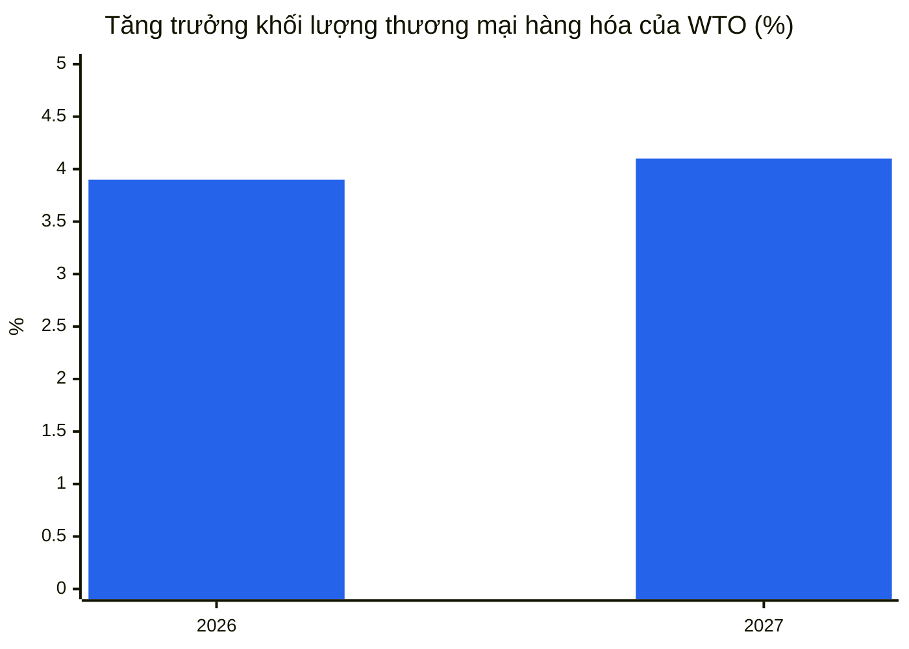
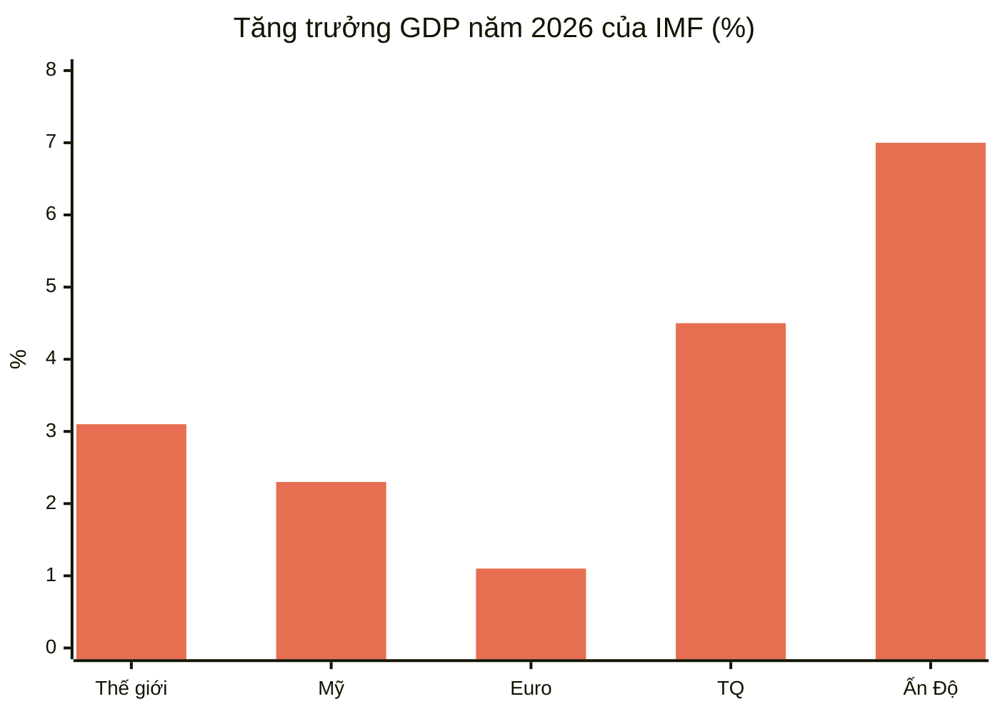
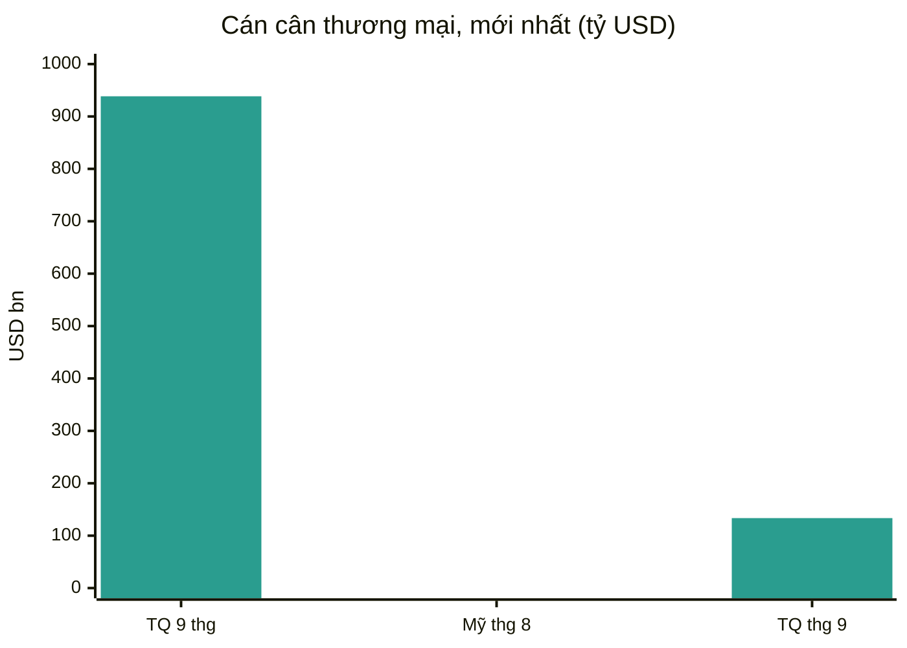
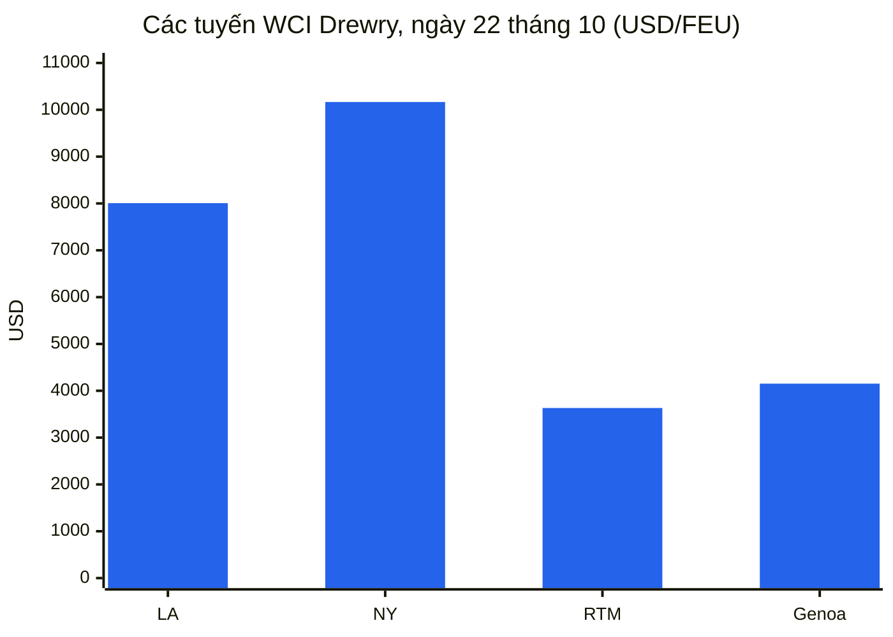
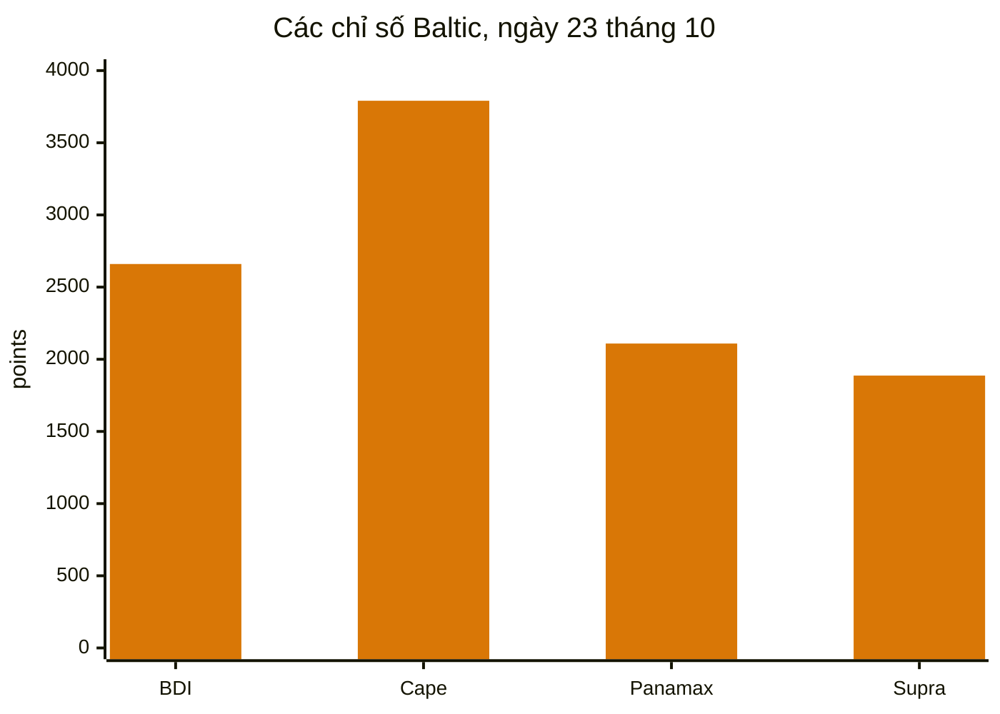
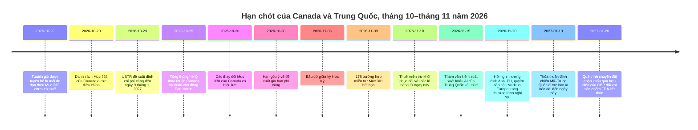
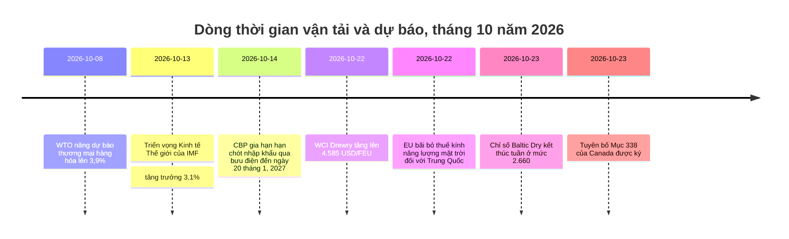

# Báo cáo Tình báo Thương mại Toàn cầu — Tuần từ ngày 19–26 tháng 10 năm 2026

**Bản tin hàng tuần.** Khoảng thời gian bao quát: ngày 19–26 tháng 10 năm 2026. Được biên soạn từ khoảng 45 nguồn tin tức thương mại, chính sách, dữ liệu và vận tải trên toàn thế giới.

---

## Mục lục

1. [Tóm tắt điều hành](#1-executive-summary)
2. [Cảnh báo](#2-alerts)
3. [Tin tức hàng đầu — phân tích chuyên sâu](#3-top-stories--deep-dives)
4. [Bảng theo dõi thuế quan](#4-tariff-tracker)
5. [Phân tích chuyên sâu chính sách Hoa Kỳ](#5-us-policy-deep-dive)
6. [Chính sách thế giới theo khu vực](#6-world-policy-by-region)
7. [Biện pháp thực thi](#7-enforcement-actions)
8. [Công bố dữ liệu](#8-data-releases)
9. [Thị trường vận tải](#9-freight-market)
10. [Dòng thời gian chính sách](#10-policy-timelines)
11. [Hạn chót và sự kiện sắp tới (90 ngày tới)](#11-upcoming-deadlines--events-next-90-days)
12. [Nguồn và phương pháp](#12-sources--methodology)

---

## 1. Tóm tắt điều hành

Một tuần mà Hoa Kỳ đã viết lại danh sách thuế quan Canada hai lần theo hai hướng đối ngược, vận tải container tiếp tục phục hồi, hàng rời khô phân hóa mạnh theo kích cỡ tàu, và hai tổ chức dự báo chính của thế giới mô tả cùng một nền kinh tế toàn cầu bằng những giọng điệu khác nhau: bền vững về hàng hóa, mong manh về dịch vụ, và ngày càng tập trung vào một số ít quốc gia và sản phẩm.

- **Canada: giảm nhẹ và leo thang trong cùng một tuần.** Ngày 23 tháng 10, Tổng thống Trump đã ký một tuyên bố loại bỏ mức thuế 50% theo Mục 338 khỏi một số sản phẩm nông nghiệp và lâm nghiệp của Canada — tấm ván ép, một số sản phẩm giấy, một số máy móc và thiết bị lạnh, thùng và hộp đóng gói, cùng rong biển tươi và khô — có hiệu lực từ ngày 30 tháng 10. Cùng một sắc lệnh bổ sung các mặt hàng khác của Canada vào danh sách 50%, bao gồm thảm, sơn, dầu gội, bột ca cao, quan tài gỗ, que kem, máy điều hòa không khí, tủ đông ngực, thiết bị bắn cung và ca nô. Việc giảm nhẹ này theo sau yêu cầu của Thượng nghị sĩ Susan Collins bang Maine, nơi các nhà sản xuất việt quất, khoai tây, táo và rong biển phụ thuộc vào đầu vào từ Canada. Riêng rẽ, sau khi Ontario phát một quảng cáo trong World Series sử dụng phát biểu của cựu Tổng thống Ronald Reagan về thuế quan, Tổng thống đã công bố tăng 10% thuế quan đối với hàng nhập khẩu từ Canada, mô tả quảng cáo này là xuyên tạc nghiêm trọng và hành động thù địch. Ontario cho biết sẽ tạm dừng quảng cáo để các cuộc đàm phán thương mại có thể nối lại. Tại cuộc vận động ở Port Huron, Michigan ngày 25 tháng 10, Tổng thống nói một thỏa thuận thương mại với Canada sẽ đạt được "khá sớm" nhưng không đưa ra điều khoản hay thời gian biểu nào.
- **Vận tải: container tăng, hàng rời phân hóa.** Chỉ số Container Thế giới Drewry tăng 2% lên 4.585 USD mỗi container 40ft ngày 22 tháng 10, mức cao nhất trong 15 tuần và là tuần tăng thứ hai liên tiếp. Tuyến Thượng Hải–Los Angeles tăng 2% lên 8.007 USD, Thượng Hải–New York tăng 1% lên 10.166 USD, Thượng Hải–Rotterdam tăng 3% lên 3.632 USD và Thượng Hải–Genoa tăng 5% lên 4.152 USD. Drewry đếm được 56 chuyến tàu trống dự kiến cho các tuần 44–48 trong tổng số 714 chuyến theo lịch, tỷ lệ hủy 8%. Chỉ số Baltic Dry kết thúc tuần ở mức 2.660 ngày 23 tháng 10, tăng khoảng 5,9% trong tuần dù giảm 1,2% ngay trong ngày thứ Sáu: thu nhập của tàu Capesize phục hồi mạnh trong khi Panamax giảm xuống 2.109, mức thấp nhất kể từ ngày 24 tháng 8.
- **Sự trở lại của kênh đào Suez đã vượt một ngưỡng.** Trong hai tuần đầu tháng 10, công suất container hàng tuần qua kênh đào Suez trung bình đạt 753.000 TEU, theo Clarksons Research được BIMCO trích dẫn, so với 1.457.000 TEU cùng kỳ năm 2023 — lần đầu tiên kể từ khi khủng hoảng Biển Đỏ bắt đầu, lượng tàu qua kênh vượt 50% mức trước gián đoạn. Mười sáu thay đổi dịch vụ đã được công bố kể từ đầu tháng 7, và cả bốn liên minh lớn hiện đều khai thác các dịch vụ thường xuyên chiều tây Á–Bắc Âu qua Suez. Triển vọng tháng 10 của Linerlytica dự báo sự trở lại toàn diện vào quý đầu năm 2027, tùy thuộc điều kiện an ninh.
- **Dự báo: hàng hóa bền vững, dịch vụ yếu hơn, tăng trưởng tập trung.** Bản cập nhật tháng 10 của WTO nâng tăng trưởng khối lượng thương mại hàng hóa thế giới năm 2026 lên 3,9%, từ mức 1,9% hồi tháng 3, và năm 2027 lên 4,1%, trong khi hạ tăng trưởng thương mại dịch vụ thương mại năm 2026 xuống 3,3% từ 4,8%. Triển vọng Kinh tế Thế giới tháng 10 của IMF đưa tăng trưởng toàn cầu ở mức 3,1% năm 2026 và 3,4% năm 2027, với lạm phát toàn phần ở mức 4,7% năm 2026, và cảnh báo rằng tăng trưởng hiện đang tập trung: 32 quốc gia chiếm 95% tăng trưởng toàn cầu, giảm từ 54 nước hồi tháng 4, với khoảng 47% nền kinh tế bị hạ dự báo.
- **Hạn chót ngày 9 tháng 11 tách làm hai.** Ngày 23 tháng 10, USTR đề xuất kéo dài việc đình chỉ phí cảng theo Mục 301 đối với tàu liên quan đến Trung Quốc (và một số thuế đối với cần cẩu và thiết bị xếp dỡ hàng hóa) từ ngày 10 tháng 11 năm 2026 đến ngày 9 tháng 1 năm 2027, trong một thông báo trên Công báo Liên bang đề ngày 23 tháng 10 và dự kiến công bố ngày 26 tháng 10, với hạn góp ý ngày 30 tháng 10 (hồ sơ USTR-2026-0694). Đề xuất này chưa phải là quyết định cuối cùng. Ngược lại, 178 trường hợp miễn trừ sản phẩm theo Mục 301 vẫn hết hạn lúc 11:59 tối giờ miền Đông ngày 9 tháng 11 năm 2026, và không có gia hạn nào được tìm thấy trong tuần bao quát này. Các nhà nhập khẩu nên lập kế hoạch theo các ngày đã ghi bằng văn bản đối với các trường hợp miễn trừ, và coi việc gia hạn phí cảng là đề xuất, chưa phải cuối cùng, cho đến khi USTR công bố thông báo cuối cùng.
- **Châu Âu giữ cuộc tranh luận về Trung Quốc ở trạng thái mở.** Ủy ban châu Âu cho biết sẽ đề xuất thêm các biện pháp hạn chế nhập khẩu đối với các ngành của Trung Quốc ngoài thỏa thuận về xe hybrid đạt được tại Bắc Kinh đầu tháng 10, với tổng thống Pháp nhắc tới hóa chất, nhựa và hợp kim sắt. Ủy ban cũng dự kiến đề xuất vào tháng 12 một công cụ mới nhằm hạn chế phụ thuộc vào nguồn cung duy nhất đối với các mặt hàng thiết yếu. Trong khi đó, Vương quốc Anh tiếp tục kháng cự áp lực phải áp dụng mức thuế của EU lên tới 45,3% đối với xe điện Trung Quốc, với Bộ trưởng Kinh doanh Jonathan Reynolds nói rằng các quyết định phòng vệ thương mại của Anh chỉ dựa trên lợi ích của Anh. EU đã bãi bỏ các thuế chống bán phá giá lâu nay đối với kính năng lượng mặt trời của Trung Quốc ngày 22 tháng 10, với các yêu cầu hoàn thuế khả dụng đối với thuế đã nộp từ ngày 22 tháng 7 năm 2025.

**Vận tải:** container vững lên nhờ tăng giá chung và rút công suất trước các cuộc đàm phán hợp đồng tháng 1; hàng rời khô phục hồi nhờ sức mạnh của Capesize ngay cả khi Panamax yếu đi; công suất qua Suez tiếp tục trở lại dần dần; và rủi ro vận tải vùng Vịnh vẫn ở mức cao, với số lượt qua Hormuz được báo cáo giảm mạnh trong tuần 12–18 tháng 10 và thêm các sự cố tàu được báo cáo ngày 18–20 tháng 10.

---

## 2. Cảnh báo

| # | Cảnh báo | Hiệu lực | Tác động | Nguồn |
|---|-------|-----------|--------|--------|
| A1 | Danh sách Mục 338 của Canada được điều chỉnh: thuế 50% được loại bỏ khỏi tấm ván ép, một số sản phẩm giấy, một số máy móc và thiết bị lạnh, thùng và hộp đóng gói, rong biển tươi và khô; bổ sung đối với thảm, sơn, dầu gội, bột ca cao, quan tài gỗ, que kem, máy điều hòa không khí, tủ đông ngực, thiết bị bắn cung, ca nô | 30 tháng 10, 2026 | Chuỗi cung ứng nông nghiệp và lâm nghiệp của Maine được giảm nhẹ; các nhà xuất khẩu Canada mới bị liệt kê đối mặt mức thuế 50% | [White House](https://www.whitehouse.gov/fact-sheets/2026/10/fact-sheet-president-donald-j-trump-further-modifies-canadian-products-subject-to-tariffs-under-section-338/), [Supply Chain Dive](https://www.supplychaindive.com/news/trump-tweaks-canada-tariffs-removing-certain-goods-while-adding-others/833895/) |
| A2 | Tăng thêm 10% thuế quan đối với hàng nhập khẩu Canada được công bố sau quảng cáo World Series của Ontario sử dụng phát biểu của Ronald Reagan; Ontario cho biết sẽ tạm dừng quảng cáo | Công bố tháng 10, 2026 | Làm leo thang tranh chấp Mỹ–Canada vài ngày trước các thay đổi danh sách ngày 30 tháng 10 và cuộc bầu cử giữa kỳ ngày 3 tháng 11 | [LawStreet](https://lawstreet.co/international/trump-says-canada-trade-deal-coming-soon-as-white-house-eases-some-tariffs-after-collins-request) |
| A3 | Các đồng hồ ngày 9 tháng 11 tách ra: USTR đề xuất kéo dài việc đình chỉ phí cảng theo Mục 301 đến ngày 9 tháng 1, 2027 (góp ý đến ngày 30 tháng 10, hồ sơ USTR-2026-0694); 178 trường hợp miễn trừ sản phẩm theo Mục 301 vẫn hết hạn lúc 11:59 tối giờ miền Đông ngày 9 tháng 11, 2026, và không có gia hạn nào được tìm thấy | 9 tháng 11, 2026 / 9 tháng 1, 2027 (đề xuất) | Thuế miễn trừ trở về mức thuế danh sách (25% Danh sách 1–3, 7,5% Danh sách 4A) đối với các lô hàng từ ngày 10 tháng 11; phí cảng sẽ chỉ khôi phục nếu đề xuất không được hoàn tất | [gCaptain](https://gcaptain.com/ustr-proposes-extending-china-ship-port-fee-suspension-through-january-2027/), [Gateway Lines](https://gatewaylines.com/press-releases/china-ship-fees-301-exclusions-nov-9-2026) |
| A4 | Rủi ro vận tải Hormuz/Vùng Vịnh vẫn ở mức cao: tàu chở dầu AL DASMA bị hư hại tại eo biển Hormuz ngày 20 tháng 10; JIF BARRACUDA bị hư hại gần UAE ngày 18 tháng 10; MarineTraffic báo cáo số lượt qua Hormuz giảm từ 203 xuống 120 trong tuần 12–18 tháng 10 | 18–20 tháng 10, 2026 | Chi phí rủi ro chiến tranh, định tuyến và bảo hiểm vẫn ở mức cao dù vận tải container qua Suez phục hồi | [Daily Caller](https://dailycaller.com/2026/10/22/iran-claims-seven-vessels-attacked-in-persian-gulf) |
| A5 | Sự cố hàng hải Biển Đen: tàu hàng treo cờ Comoros Khoryv bốc cháy và lật cách Constanta, Romania khoảng 15 dặm về phía đông; 1 thuyền viên thiệt mạng, 3 người mất tích, 9 người được cứu sống | Tháng 10, 2026 | Rủi ro định tuyến và bảo hiểm Biển Đen; chính quyền Romania cho rằng sự cố do tấn công bằng máy bay không người lái theo báo cáo địa phương | [Scottish Sun](https://www.thescottishsun.co.uk/news/16978300/cargo-ship-fire-drone-strike-black-sea/) |
| A6 | Gián đoạn cảng Pháp: đình công 24 giờ được công bố tại các cảng Pháp ngày 14 và 16 tháng 10, với một ngày khác được liệt kê là ngày 30 tháng 10; các bến và kho tại Fos-sur-Mer đóng cửa ngày 20 tháng 10 do thời tiết xấu | 20 và 30 tháng 10, 2026 | Bất ổn lịch trình tại các cửa ngõ Pháp; các chủ hàng nên dự phòng trong các tuyến cuối tháng 10 | [Maritime News](https://www.maritimenews.com/port-operations/port-operations-oct-14-21-2026) |
| A7 | Thuế kính năng lượng mặt trời của EU đối với Trung Quốc bị bãi bỏ ngày 22 tháng 10, 2026; yêu cầu hoàn thuế khả dụng đối với thuế đã nộp từ ngày 22 tháng 7, 2025 | 22 tháng 10, 2026 | Các nhà nhập khẩu năng lượng mặt trời nên rà soát các khoản thuế đã nộp trước đây để đòi hoàn | [WiseVoter](https://wisevoter.com/world/2026/10/23/eu-repeals-solar-glass-duties-china) |
| A8 | Hạn chót nhập khẩu qua bưu điện của CBP được gia hạn: các sản phẩm chịu quản lý của FDA, bao gồm thuốc, có thể tiếp tục sử dụng quy trình bưu điện đơn giản đến ngày 20 tháng 1, 2027, sau khi CBP gia hạn hạn chót ngày 22 tháng 10 thêm 90 ngày vào ngày 14 tháng 10 | 20 tháng 1, 2027 | Các nhà nhập khẩu đặt hàng qua bưu điện và bưu kiện có thêm một quý để chuyển sang tờ khai hải quan chi tiết |  |
| A9 | Tuabin gió được tuyên bố là mối đe dọa an ninh quốc gia theo Mục 232 (tuyên bố của Nhà Trắng, ngày 22 tháng 10); chưa áp thuế nào — các quan chức thương mại được chỉ đạo đàm phán và báo cáo lại trong vòng 180 ngày | 22 tháng 10, 2026 | Chuỗi cung ứng năng lượng gió đối mặt khả năng bị áp thuế trong tương lai; các nhà cung cấp lớn được nêu trong báo cáo gồm Mexico, Pháp, Ấn Độ, Đan Mạch và Đức |  |

### A1 — Canada: hai bước đi ngược chiều nhau

Tuyên bố ngày 23 tháng 10 nên được hiểu tốt nhất là một sự hiệu chỉnh, chứ không phải giảm leo thang. Tờ thông tin của Nhà Trắng nêu rõ thuế Mục 338 áp dụng bất kể xuất xứ theo USMCA và cộng thêm với thuế Mục 232, và các bổ sung và loại bỏ sản phẩm có hiệu lực ngày 30 tháng 10 năm 2026 — bốn ngày trước cuộc bầu cử giữa kỳ ngày 3 tháng 11. Thượng nghị sĩ Collins nói việc giảm nhẹ sẽ giúp các nhà sản xuất việt quất, khoai tây, táo và rong biển của Maine, nhiều người trong số đó phụ thuộc vào thiết bị, bao bì và đầu vào của Canada mà không có nguồn cung từ Mỹ hoặc chỉ thay thế được với chi phí đáng kể.

**Phân tích:** sắc lệnh giữ nguyên kiến trúc tổng thể của tranh chấp Canada — thuế 50% đối với khoảng 20 tỷ USD hàng hóa Canada áp đặt hồi tháng 8, sau khi đàm phán đổ vỡ — trong khi chuyển dịch đối tượng chịu tác động. Các nhà xuất khẩu của các mặt hàng mới bị liệt kê (thảm, bột ca cao, máy điều hòa không khí, tủ đông ngực và các mặt hàng khác) nên rà soát lại phân loại ngay lập tức; các nhà xuất khẩu của các mặt hàng được loại khỏi danh sách nên xác nhận rằng sản phẩm cụ thể của mình nằm trong phạm vi mô tả của tuyên bố trước khi cho rằng được giảm nhẹ, vì phạm vi Mục 338 dựa trên mô tả sản phẩm, không phải danh mục chung.

### A2 — Quảng cáo Reagan và mức tăng 10%

Quảng cáo của Ontario, phát trong World Series khi đội Toronto Blue Jays đang thi đấu, sử dụng phát biểu năm 1987 của cựu Tổng thống Reagan cảnh báo rằng thuế quan cao dẫn tới trả đũa và chiến tranh thương mại. Tổng thống gọi quảng cáo này là xuyên tạc nghiêm trọng và hành động thù địch, chấm dứt đàm phán thương mại với Ottawa, và công bố tăng 10% thuế quan đối với hàng nhập khẩu Canada trên mức hiện tại. Quỹ Tổng thống Ronald Reagan nói rằng họ không chấp thuận việc sử dụng các đoạn clip. Thủ hiến Ontario Doug Ford nói quảng cáo sẽ được gỡ dần sau cuối tuần để hai chính quyền có thể nối lại đàm phán.

**Phân tích:** vụ việc cho thấy một tranh chấp truyền thông có thể nhanh chóng chuyển thành chính sách thuế quan như thế nào trong chu kỳ này, và thời điểm bầu cử khuếch đại nó ra sao. Câu hỏi thực tế đối với các nhà nhập khẩu là trình tự: các thay đổi danh sách ngày 30 tháng 10, mức tăng 10% đã công bố, và bất kỳ thỏa thuận Canada nào mà Tổng thống hé lộ ngày 25 tháng 10 là ba công cụ riêng biệt với cơ sở pháp lý và ngày hiệu lực khác nhau. Cho đến khi từng văn bản được công bố, tuyên bố ngày 30 tháng 10 là văn bản duy nhất có ngày hiệu lực cố định.

### A3 — Ngày 9 tháng 11: các đồng hồ tách ra

Thông báo tiếp tục của USTR ngày 6 tháng 10 năm 2026 (công bố ngày 7 tháng 10) xác nhận cả hai biện pháp Mục 301 năm 2018 đối với Trung Quốc đều tiếp tục, nhưng không gia hạn các trường hợp miễn trừ hay việc tạm dừng phí cảng. 178 trường hợp miễn trừ — 164 trường hợp giữ lại hồi tháng 5 năm 2024 cộng 14 trường hợp miễn trừ thiết bị sản xuất năng lượng mặt trời bổ sung tháng 9 năm 2024 — có hiệu lực đến 11:59 tối giờ miền Đông ngày 9 tháng 11. Hàng hóa nhập từ ngày 10 tháng 11 trở đi chịu mức thuế danh sách. Tuy nhiên, ngày 23 tháng 10, USTR đề xuất gia hạn riêng chỉ cho việc đình chỉ phí cảng: từ ngày 10 tháng 11 năm 2026 đến ngày 9 tháng 1 năm 2027, các hãng vận tải sẽ không phải chịu trách nhiệm phí cảng theo các Phụ lục I, II và III của biện pháp Mục 301 gốc, và các thuế liên quan đối với cần cẩu và thiết bị xếp dỡ hàng hóa cũng sẽ bị đình chỉ. Thông báo này, đề ngày 23 tháng 10 và dự kiến công bố ngày 26 tháng 10, nhận góp ý đến 5 giờ chiều giờ miền Đông ngày 30 tháng 10 (hồ sơ USTR-2026-0694), và là một đề xuất, không phải quy tắc cuối cùng. Hơn 200 hiệp hội thương mại đã viết thư cho USTR ngày 23 tháng 9 yêu cầu gia hạn.

**Phân tích:** khoảng cách giữa lịch chính trị (một thỏa thuận đình chiến được bàn là kéo dài đến ngày 10 tháng 1 năm 2027) và lịch quy định (ngày 9 tháng 11) đã thu hẹp đối với vận tải biển nhưng chưa thu hẹp đối với các nhà nhập khẩu. Các hãng vận tải định giá theo quy tắc đã ghi bằng văn bản; các nhà nhập khẩu nên làm tương tự đối với các trường hợp miễn trừ, và nên xác định bất kỳ lô hàng nào khai báo các mã miễn trừ trước hạn chót thay vì phát hiện rủi ro sau đó. Đề xuất phí cảng, nếu được hoàn tất, sẽ ngăn việc khôi phục phí từ ngày 10 tháng 11; nếu không, phí sẽ khôi phục.

---

## 3. Tin tức hàng đầu — phân tích chuyên sâu

### 3.1 Canada: chính sách thuế quan như công cụ mùa bầu cử

Hồ sơ Canada chiếm ưu thế trong tin tức chính sách Hoa Kỳ tuần này vì nó kết hợp cả ba động lực của chính sách thương mại Hoa Kỳ hiện nay: một công cụ luật định (Mục 338 của Đạo luật Thuế quan năm 1930, cho phép áp thuế tới 50% để đối phó phân biệt đối xử với thương mại Hoa Kỳ), một lịch chính trị trong nước (bầu cử giữa kỳ ngày 3 tháng 11), và một cuộc đàm phán song phương đã chập chờn kể từ tháng 8. Biện pháp gốc hồi tháng 8 bao quát khoảng 20 tỷ USD hàng hóa Canada, từ gậy khúc côn cầu đến xi măng, sau khi đàm phán đổ vỡ; Canada đã trả đũa với giá trị tương đương đối với sản phẩm Mỹ.

Lý do nêu trong sắc lệnh ngày 23 tháng 10 — rằng các quan chức cấp cao khuyên rằng các thay đổi vẫn bù đắp cho hành vi phân biệt đối xử bị cáo buộc trong khi phục vụ lợi ích công cộng — là cách diễn đạt chuẩn của chính quyền theo Mục 338. Điều mới là mối liên hệ rõ ràng, trong báo cáo đương thời, với yêu cầu của một thượng nghị sĩ duy nhất thay mặt các ngành được nêu tên của bang mình. Mối liên hệ đó không thay đổi hiệu lực pháp lý, nhưng thay đổi bài học vận động: việc giảm nhẹ theo từng sản phẩm có thể đạt được khi một nhóm lợi ích trong nước chứng minh được sự phụ thuộc cụ thể vào chuỗi cung ứng.

**Các con số chính:** mức thuế 50% theo Mục 338; khoảng 20 tỷ USD hàng hóa Canada ban đầu bị bao quát; ngày hiệu lực 30 tháng 10; bầu cử giữa kỳ ngày 3 tháng 11.

**Vì sao quan trọng:** đối với các nhà xuất khẩu Canada và nhà nhập khẩu Mỹ, danh sách ngày 30 tháng 10 là văn bản có hiệu lực. Đối với mọi người khác, vụ việc nhắc nhở rằng danh sách thuế quan trong chu kỳ này được sửa đổi trong vài tuần, chứ không phải vài năm, và việc thẩm định ở cấp phân loại giờ đây là chi phí thường xuyên của hoạt động nhập khẩu.

### 3.2 Hai dự báo: WTO và IMF đồng ý về sự bền vững, bất đồng về độ rộng của nó

Bản cập nhật Triển vọng và Thống kê Thương mại Toàn cầu ngày 8 tháng 10 của WTO và Triển vọng Kinh tế Thế giới ngày 13 tháng 10 của IMF, cả hai đều công bố ngay trước tuần bao quát này nhưng chi phối thảo luận chính sách trong tuần, kể một câu chuyện nhất quán với những nhấn mạnh khác nhau. WTO nâng tăng trưởng khối lượng thương mại hàng hóa lên 3,9% năm 2026 (từ 1,9% hồi tháng 3) và 4,1% năm 2027, nhờ đầu tư liên quan đến AI: thương mại hàng hóa hỗ trợ AI tăng 67% so với cùng kỳ trong nửa đầu năm 2026 và chiếm 47% tăng trưởng thương mại hàng hóa toàn cầu. Châu Á dẫn đầu tăng trưởng xuất khẩu năm 2026 ở mức 9,9%, tiếp theo là Bắc Mỹ 5,7% và châu Phi 5,6%. Đồng thời, WTO hạ tăng trưởng thương mại dịch vụ thương mại năm 2026 xuống 3,3% từ 4,8%, với vận tải ở mức 0,9% và du lịch 0,2%, phản ánh gián đoạn tại Trung Đông, chi phí nhiên liệu hàng không cao hơn và hạn chế bay.

IMF đưa tăng trưởng toàn cầu ở mức 3,1% năm 2026 và 3,4% năm 2027, với lạm phát toàn phần ở mức 4,7% năm 2026 giảm xuống 4,1% năm 2027. Bảng quốc gia của Quỹ cho thấy Hoa Kỳ ở mức 2,3% trong cả hai năm, khu vực đồng euro 1,1% năm 2026 và 1,2% năm 2027, Trung Quốc 4,5% và 4,0%, và Ấn Độ 7,0% theo năm tài chính. Cảnh báo của Quỹ mang tính cấu trúc: tăng trưởng đang tập trung vào các nền kinh tế gắn với cơn bùng nổ đầu tư AI hoặc được cách ly khỏi cú sốc năng lượng, trong khi các nền kinh tế nhập khẩu năng lượng ngoài chuỗi giá trị công nghệ đối mặt triển vọng khó khăn nhất. Kịch bản cơ sở của Quỹ giả định eo biển Hormuz bắt đầu mở lại vào tháng 3 năm 2027, với sự trở lại rộng rãi điều kiện trước chiến tranh vào tháng 10 năm 2027.

*Ghi chú: Triển vọng và Thống kê Thương mại Toàn cầu của WTO, bản cập nhật tháng 10 năm 2026; dự báo năm 2026 được nâng từ mức 1,9% hồi tháng 3.*

*Ghi chú: Triển vọng Kinh tế Thế giới của IMF, tháng 10 năm 2026. Ấn Độ theo năm tài chính.*

**Phân tích:** hai tổ chức đồng ý rằng đầu tư AI đang che lấp điểm yếu ở những nơi khác. Hàm ý thực tế cho kế hoạch thương mại là tăng trưởng thương mại toàn phần làm đẹp mức trung bình: các doanh nghiệp ngoài chuỗi cung ứng AI, hoặc chịu chi phí năng lượng và vận tải Trung Đông, đang trải qua một năm tồi tệ hơn đáng kể so với các số liệu tổng hợp toàn cầu.

### 3.3 Trung Quốc: thặng dư gần 1 nghìn tỷ USD, và tranh luận về ý nghĩa của nó

Thặng dư thương mại hàng hóa tháng 1–tháng 9 năm 2026 của Trung Quốc đạt 938,5 tỷ USD, riêng tháng 9 là 133,5 tỷ USD, mức cao nhất trong 20 tháng, khi xuất khẩu tăng vọt nhờ cơn bùng nổ phần cứng AI. Doanh số bán sang Hoa Kỳ tăng 40%, nhanh nhất trong hơn năm năm, đưa thặng dư của Trung Quốc với Hoa Kỳ lên 34 tỷ USD, mức cao nhất kể từ tháng 1 năm 2025. Xuất khẩu kỷ lục cũng được mua bởi Australia, Hàn Quốc, Đài Loan, Nga và các nền kinh tế ASEAN. Các nhà kinh tế của Goldman Sachs được trích dẫn trong báo cáo ước tính số quốc gia thâm hụt thương mại trên 3% GDP với Trung Quốc đã tăng hơn gấp ba lần kể từ năm 2005, lên 82 nước, phần lớn là các nền kinh tế mới nổi thu nhập thấp.

**Phân tích:** thặng dư vừa là triệu chứng vừa là động lực của tin tức chính sách trong tuần. Nó củng cố vị thế đàm phán của Bắc Kinh trước các hạn chót tháng 11, và củng cố lập luận, tại Brussels và Washington, cho thêm các biện pháp phòng vệ. Nó cũng làm phức tạp câu chuyện rằng tách rời đã tiến xa: các giao dịch mua hàng hóa vốn của Mỹ từ Trung Quốc phục vụ hạ tầng AI đang tăng với tốc độ nhanh nhất trong năm năm.

### 3.4 Châu Âu: biện pháp phòng vệ tiến triển, nhưng không theo một hướng

Cuộc tranh luận tháng 10 của EU đưa ra hai tín hiệu đối ngược. Về phía hạn chế, Chủ tịch Ủy ban Ursula von der Leyen nói sau hội nghị thượng đỉnh ngày 15–16 tháng 10 rằng Ủy ban sẽ đề xuất hạn chế nhập khẩu từ Trung Quốc ngoài thỏa thuận xe hybrid đạt được tại Bắc Kinh, được thiết kế để giảm một nửa lượng xe hybrid Trung Quốc nhập khẩu. Tổng thống Pháp nhắc tới hóa chất, nhựa và hợp kim sắt. Ủy ban cũng sẽ đề xuất, vào tháng 12, một công cụ mới nhằm hạn chế phụ thuộc vào nguồn cung duy nhất đối với các mặt hàng thiết yếu, và một cơ chế đoàn kết cho các quốc gia hoặc ngành chịu cưỡng ép. Thâm hụt thương mại hàng hóa của EU với Trung Quốc đang ở mức hơn 1 tỷ euro mỗi ngày.

Về phía tự do hóa, EU đã bãi bỏ thuế kính năng lượng mặt trời đối với Trung Quốc ngày 22 tháng 10, chấm dứt các biện pháp áp dụng từ năm 2014, sau khi hai nhà sản xuất kính năng lượng mặt trời cuối cùng của EU ngừng sản xuất. Các nhà nhập khẩu có thể nộp đơn lên cơ quan hải quan quốc gia để được hoàn thuế đã nộp từ ngày 22 tháng 7 năm 2025, theo các quy định thi hành 2026/2314 và 2026/2310.

**Phân tích:** hai bước đi này nhất quán một khi tiêu chí được nêu rõ: các biện pháp tồn tại nơi vẫn còn ngành trong nước cần bảo vệ, và bị bãi bỏ nơi không còn. Các đề xuất tháng 12 — một công cụ hành động nhanh và một công cụ phụ thuộc nguồn cung duy nhất — là những đề xuất cần theo dõi, vì chúng sẽ khái quát hóa cách tiếp cận xe hybrid thành các công cụ thường trực.

### 3.5 Sự trở lại của Suez và rủi ro Hormuz, song song nhau

Sự trở lại Suez của vận tải container giờ đây có thể đo lường được: 753.000 TEU mỗi tuần đầu tháng 10, chiếm 36% tổng công suất container đi qua kênh đào hoặc mũi Hảo Vọng, tăng từ mức trung bình 8% giữa năm 2024 và giữa năm 2026, nhưng vẫn thấp hơn nhiều so với mức 80% trước khủng hoảng. Mười sáu thay đổi dịch vụ đã được công bố kể từ đầu tháng 7, trải rộng trên Gemini, Ocean, Premier và MSC. Đồng thời, rủi ro vùng Vịnh chưa giảm: MarineTraffic báo cáo số lượt qua Hormuz giảm từ 203 xuống 120 trong tuần 12–18 tháng 10, và các sự cố tàu được báo cáo ngày 18 và 20 tháng 10. Thống kê ngày 21 tháng 10 của IMO ghi nhận 24 thương vong và 120 sự cố hàng hải đã xác nhận trên khắp Trung Đông kể từ khi xung đột bắt đầu.

**Phân tích:** thị trường container đang định giá hai rủi ro khác nhau cùng lúc — một sự giải phóng công suất mang tính cấu trúc khi Suez bình thường hóa, điều này sẽ gây áp lực lên giá cước, và một mức phí rủi ro chiến tranh dai dẳng trên các tuyến vùng Vịnh và Biển Đen, điều này hỗ trợ giá cước. Sự phục hồi của Drewry cho thấy, hiện tại, quản lý công suất (chuyến tàu trống, tăng giá chung) đang lấn át tác động giải phóng của Suez.

### 3.6 Thâm hụt thương mại Hoa Kỳ: một tháng nhập khẩu kỷ lục

Thâm hụt thương mại hàng hóa và dịch vụ của Hoa Kỳ nới rộng 13,7% trong tháng 8 lên 105,6 tỷ USD, mức lớn nhất kể từ tháng 3 năm 2025, khi nhập khẩu chạm kỷ lục 420,8 tỷ USD (tăng 4,3%) và xuất khẩu tăng 1,4% lên 315,2 tỷ USD. Riêng thâm hụt hàng hóa nới rộng 11,5% lên 132,6 tỷ USD, với nhập khẩu hàng hóa tăng 5,5% lên 336,1 tỷ USD — vật tư công nghiệp tăng 16,6%, hàng hóa vốn tăng 4,0% nhờ xây dựng hạ tầng AI, thực phẩm tăng 5,5% — so với xuất khẩu hàng hóa 203,4 tỷ USD, tăng 1,9%. Tuy nhiên, thâm hụt lũy kế tháng 1–tháng 8 vẫn hẹp hơn 19,9% so với cùng kỳ năm 2025, nhắc nhở rằng số liệu một tháng và số liệu từ đầu năm chỉ theo hai hướng khác nhau.

**Phân tích:** dữ liệu tháng 8, công bố đầu tháng 10 và được thảo luận suốt tuần này, làm suy yếu tuyên bố đơn giản rằng thuế quan tự động thu hẹp thâm hụt trong ngắn hạn, trong khi cải thiện từ đầu năm làm suy yếu tuyên bố ngược lại. Cả hai cách đọc đều có thể đúng vì thâm hụt phản ứng với giá nhập khẩu, nhu cầu hàng hóa vốn AI và chu kỳ tồn kho cũng như với mức thuế quan.

---

## 4. Bảng theo dõi thuế quan

| Quốc gia / xuất xứ | Biện pháp | Mức thuế | Ngày hiệu lực | Tình trạng | Nguồn |
|---|---|---|---|---|---|
| Canada | Thuế Mục 338 — loại bỏ: tấm ván ép, một số sản phẩm giấy, một số máy móc và thiết bị lạnh, thùng và hộp đóng gói, rong biển tươi và khô | Loại bỏ 50% | 30 tháng 10, 2026 | Tuyên bố ký ngày 23 tháng 10, 2026 | [White House](https://www.whitehouse.gov/fact-sheets/2026/10/fact-sheet-president-donald-j-trump-further-modifies-canadian-products-subject-to-tariffs-under-section-338/) |
| Canada | Thuế Mục 338 — bổ sung: thảm, sơn, dầu gội, bột ca cao, quan tài gỗ, que kem, máy điều hòa không khí, tủ đông ngực, thiết bị bắn cung, ca nô | 50% | 30 tháng 10, 2026 | Tuyên bố ký ngày 23 tháng 10, 2026 | [Supply Chain Dive](https://www.supplychaindive.com/news/trump-tweaks-canada-tariffs-removing-certain-goods-while-adding-others/833895/) |
| Canada | Tăng thuế bổ sung được công bố sau quảng cáo của Ontario | +10 điểm phần trăm | Công bố tháng 10, 2026 | Đã công bố; điều khoản thi hành chưa có | [LawStreet](https://lawstreet.co/international/trump-says-canada-trade-deal-coming-soon-as-white-house-eases-some-tariffs-after-collins-request) |
| Trung Quốc | Thuế Mục 301 — 178 trường hợp miễn trừ sản phẩm hết hạn | 25% (Danh sách 1–3), 7,5% (Danh sách 4A) khi trở lại | 9 tháng 11, 2026, 11:59 tối giờ miền Đông | Không có gia hạn nào được công bố trong tuần bao quát | [Gateway Lines](https://gatewaylines.com/press-releases/china-ship-fees-301-exclusions-nov-9-2026) |
| Trung Quốc | Phí cảng Mục 301 đối với tàu liên quan đến Trung Quốc — đề xuất gia hạn đình chỉ đến ngày 9 tháng 1, 2027 | Phí được đình chỉ từ ngày 10 tháng 11, 2026 đến ngày 9 tháng 1, 2027 nếu được hoàn tất | Đề xuất ngày 23 tháng 10, 2026; góp ý đến ngày 30 tháng 10 | Chỉ là đề xuất, chưa phải cuối cùng | [gCaptain](https://gcaptain.com/ustr-proposes-extending-china-ship-port-fee-suspension-through-january-2027/) |
| Tuabin gió và linh kiện | Kết luận an ninh quốc gia theo Mục 232 | Chưa áp thuế nào; đàm phán và báo cáo lại trong vòng 180 ngày | 22 tháng 10, 2026 | Kết luận đã ban hành; thuế có thể áp sau thời gian đàm phán |  |
| Trung Quốc | Thuế chống bán phá giá và thuế đối kháng của EU đối với kính năng lượng mặt trời | Đã bãi bỏ | 22 tháng 10, 2026 | Đã bãi bỏ; hoàn thuế từ ngày 22 tháng 7, 2025 | [WiseVoter](https://wisevoter.com/world/2026/10/23/eu-repeals-solar-glass-duties-china) |
| Trung Quốc | Thuế chống bán phá giá của EU, sản phẩm nhôm cán phẳng | 14,3%–24,6% | Đang áp dụng | Rà soát hết hạn bắt đầu ngày 9 tháng 10, 2026; các biện pháp vẫn có hiệu lực | [We Are Main Street](https://wearemainstreet.org/world/2026/10/25/eu-anti-dumping-duties-chinese-aluminium) |
| Trung Quốc | Thỏa thuận xe hybrid của EU | Lượng hàng xuất khẩu sẽ giảm một nửa | Thỏa thuận ngày 8–9 tháng 10, 2026 | Thỏa thuận; thủ tục thi hành đang chờ | [EU Monitoring](https://ieu-monitoring.com/editorial/eu-and-china-reach-trade-understandings-on-hybrid-cars-tariffs-and-rare-earths/1251810) |
| Vương quốc Anh | Thuế nhập khẩu tiêu chuẩn đối với xe sản xuất tại Trung Quốc | 10% | Đang áp dụng | Không thay đổi; Anh kháng cự áp lực của EU về việc áp mức tới 45,3% | [Fleet News](https://www.fleetnews.co.uk/news/minister-reportedly-resists-calls-for-uk-to-impose-chinese-ev-tariffs) |
| Ấn Độ–New Zealand | FTA có hiệu lực: thuế bằng 0 đối với 100% dòng thuế xuất khẩu của Ấn Độ sang New Zealand; Ấn Độ nhượng bộ 70% dòng thuế | 0% (hàng xuất khẩu Ấn Độ sang NZ) | 20 tháng 10, 2026 | Có hiệu lực; áp dụng quy tắc xuất xứ | [Devdiscourse](https://www.devdiscourse.com/article/business/3994858-india-new-zealand-fta-to-eliminate-tariffs-on-all-indian-exports-from-october-20-dgft-official?amp) |
| Nga / các nước mua năng lượng | Thuế Graham Act (500% đối với Nga, 100% đối với các nước mua năng lượng hàng đầu và bên tạo điều kiện) | Được miễn | Miễn ngày 16 tháng 10, 2026 | Được miễn không thời hạn; giám sát giao cho USTR | [KPMG](https://kpmg.com/us/en/taxnewsflash/news/2026/10/trump-russia-tariffs-sanctions.html) |

---

## 5. Phân tích chuyên sâu chính sách Hoa Kỳ

### Mục 338 và Canada

Xem các mục 2 và 3.1. Tờ thông tin ngày 23 tháng 10 xác nhận thuế Mục 338 áp dụng bất kể xuất xứ theo USMCA và cộng thêm với thuế Mục 232, và Tổng thống có thể đình chỉ, thu hồi, bổ sung hoặc sửa đổi bất kỳ tuyên bố Mục 338 nào khi lợi ích công cộng yêu cầu. Quyền sửa đổi đó là điều khiến các sửa đổi tiếp theo trong tháng 10 hoặc tháng 11 có thể thực hiện mà không cần luật mới.

### USTR — Tiếp tục Mục 301 và các đồng hồ ngày 9 tháng 11

USTR xác nhận ngày 6 tháng 10 năm 2026 (công bố ngày 7 tháng 10) rằng cả hai biện pháp Mục 301 năm 2018 đối với Trung Quốc đều tiếp tục, mở ra giai đoạn tiếp theo của đợt rà soát bốn năm lần thứ hai. Đợt rà soát có thể tăng thuế cũng như duy trì thuế: sau lần tiếp tục đầu tiên tháng 9 năm 2022, USTR đã nâng chất bán dẫn lên 50% năm 2025, pin mặt trời lên 50% năm 2024, và sản phẩm thép và nhôm lên 25% năm 2024. Các đồng hồ riêng biệt ngày 9 tháng 11 sau đó tách ra trong tuần bao quát này: ngày 23 tháng 10, USTR đề xuất kéo dài việc đình chỉ phí cảng đến ngày 9 tháng 1 năm 2027 (góp ý đến ngày 30 tháng 10, hồ sơ USTR-2026-0694), trong khi 178 trường hợp miễn trừ sản phẩm không nhận được đề xuất gia hạn nào và vẫn hết hạn ngày 9 tháng 11.

### Mục 232 — tuabin gió

Ngày 22 tháng 10 năm 2026, Tổng thống tuyên bố nhập khẩu tuabin gió và linh kiện là mối đe dọa đối với an ninh quốc gia theo Mục 232, sau cuộc điều tra của Bộ Thương mại bắt đầu tháng 8 năm 2025. Ông dừng lại ở việc không áp thuế, thay vào đó chỉ đạo các quan chức thương mại theo đuổi đàm phán với các đối tác thương mại và báo cáo lại trong vòng 180 ngày; các biện pháp bổ sung, bao gồm thuế quan, có thể được xem xét sau. Các căn cứ được viện dẫn gồm lo ngại an ninh mạng liên quan đến thiết bị sản xuất ở nước ngoài, nhiễu hệ thống radar và hoạt động kiểm soát không lưu, và sự phụ thuộc ngày càng tăng của Hoa Kỳ vào hàng hóa sản xuất ở nước ngoài. Các nhà cung cấp lớn được nêu trong báo cáo gồm Mexico, Pháp, Ấn Độ, Đan Mạch và Đức. Chưa có mức thuế nào được ấn định.

### Hoạt động của CBP

CBP gia hạn quá trình chuyển đổi nhập khẩu qua bưu điện đối với các sản phẩm chịu quản lý của FDA, bao gồm thuốc, từ ngày 22 tháng 10 năm 2026 đến ngày 20 tháng 1 năm 2027, một gia hạn 90 ngày được công bố ngày 14 tháng 10. Việc gia hạn này theo sau quy tắc tạm thời cuối cùng ngày 24 tháng 6 năm 2026, loại bỏ mức miễn thuế 800 USD đối với bưu kiện gửi qua bưu điện và chuyển hầu hết bưu kiện quốc tế nhỏ sang quy trình đơn giản từ ngày 24 tháng 7 năm 2026. Các sản phẩm chịu quy tắc nhập khẩu của cơ quan khác được cho đến ngày 22 tháng 10 để chuyển sang tờ khai chi tiết hơn; giờ đây chúng có đến ngày 20 tháng 1 năm 2027.

### Hoàn thuế quan

Một thẩm phán thương mại Hoa Kỳ đã chứng nhận một vụ kiện tập thể cho các nhà nhập khẩu đòi hoàn các khoản thuế quan bị Tòa án Tối cao bác bỏ đầu năm 2026, bao quát các nhà nhập khẩu chưa nộp đơn yêu cầu. Hải quan đã xử lý đầy đủ gần 130 tỷ USD tiền hoàn, so với hơn 166 tỷ USD thuế tranh chấp đã nộp, với tiền lãi có thể lên tới hàng tỷ USD. Quyết định này, được báo cáo ngày 9 tháng 10 năm 2026, quan trọng đối với các nhà nhập khẩu chưa nộp đơn: cơ chế tập thể có thể tính lại và hoàn các khoản còn lại mà không cần kiện riêng lẻ.

### Các vấn đề thường trực

Việc miễn trừ Graham Act ngày 16 tháng 10 vẫn có hiệu lực không thời hạn. Thỏa thuận đình chiến Mỹ–Trung Quốc được bàn là kéo dài đến ngày 10 tháng 1 năm 2027 có một bước thi hành được đề xuất — chưa phải cuối cùng — cho việc đình chỉ phí cảng (đến ngày 9 tháng 1 năm 2027, góp ý đến ngày 30 tháng 10), và không có đề xuất gia hạn nào cho 178 trường hợp miễn trừ sản phẩm. Vụ án thẩm quyền thuế quan của Tòa án Tối cao, được nhắc tới trong báo cáo tranh chấp Canada, dự kiến tranh tụng vào tháng 11.

---

## 6. Chính sách thế giới theo khu vực

### Châu Âu

Chương trình hậu hội nghị thượng đỉnh của Ủy ban là diễn biến chính của châu Âu trong tuần: thêm các biện pháp hạn chế nhập khẩu từ Trung Quốc ngoài xe hybrid, một đề xuất tháng 12 về công cụ phụ thuộc nguồn cung duy nhất, và một cơ chế đoàn kết cho các trường hợp cưỡng ép. Bản thân thỏa thuận xe hybrid, đạt được tại cuộc họp lần thứ hai của Cơ chế Tham vấn Thương mại và Đầu tư EU–Trung Quốc tại Bắc Kinh ngày 8–9 tháng 10 giữa Ủy viên Maroš Šefčovič và Bộ trưởng Vương Văn Đào, bao quát bảy dòng thuế và có thể cắt giảm hơn một nửa lượng xe hybrid và xe hybrid cắm sạc của Trung Quốc xuất khẩu sang EU trong bốn năm. Cả hai bên đã đồng ý cuộc họp cấp bộ trưởng lần thứ ba vào tháng 3 năm 2027 và một hội nghị truyền hình cấp bộ trưởng vào tháng 1. Thâm hụt thương mại hàng hóa EU–Trung Quốc, ở mức hơn 1 tỷ euro mỗi ngày, là động lực được nêu.

Việc bãi bỏ thuế kính năng lượng mặt trời và rà soát hết hạn đối với nhôm cán phẳng (thuế 14,3%–24,6% vẫn có hiệu lực) cho thấy cùng một chính quyền áp dụng các công cụ đối ngược cho các ngành khác nhau, như đã thảo luận tại mục 3.4.

### Trung Quốc

Hiệu quả xuất khẩu của Trung Quốc năm 2026 — thặng dư chín tháng 938,5 tỷ USD, xuất khẩu tháng 9 tăng vọt nhờ phần cứng AI — vẫn là bối cảnh cấu trúc. Trung Quốc nối lại xuất khẩu nhiên liệu tinh chế sau kỳ nghỉ Tuần lễ Vàng, với khoảng 3,7 triệu tấn được phê duyệt cho tháng 10 (dầu diesel, xăng và nhiên liệu máy bay cộng lại). Cuộc tham vấn kiểm soát xuất khẩu công nghệ AI mở ngày 16 tháng 10, bao quát 40 công nghệ, vẫn mở đến ngày 15 tháng 11, và là vấn đề thường trực đối với các doanh nghiệp chuyển giao trọng số mô hình hoặc phương pháp thiết kế chip.

### Vương quốc Anh

Bộ trưởng Kinh doanh Jonathan Reynolds nói Vương quốc Anh sẽ không khuất phục trước lời kêu gọi từ các nước khác về việc áp thuế nhập khẩu đối với xe Trung Quốc, và các quyết định phòng vệ thương mại của Anh chỉ dựa trên lợi ích của Anh. Anh hiện áp mức thuế tiêu chuẩn 10% đối với xe sản xuất tại Trung Quốc, so với mức thuế kết hợp của EU lên tới 45,3%. Báo cáo đầu tháng 10 cho rằng Anh đang soạn thảo một gói phản ánh mức thuế của EU để đảm bảo quyền tiếp cận chương trình Made in Europe do EU đề xuất, theo đó một xe điện chỉ đủ điều kiện nhận trợ cấp và đấu thầu công nếu ít nhất 70% linh kiện của nó được sản xuất trong khối; phát biểu ngày 14 tháng 10 của bộ trưởng phản bác cách diễn đạt đó. Thủ tướng Andy Burnham đã đặt việc Anh tham gia chương trình này thành mục tiêu trung tâm cho hội nghị thượng đỉnh EU ngày 20 tháng 11. Tới 80 tỷ euro (68 tỷ bảng Anh) thương mại của Anh được cho là có nguy cơ nếu các nhà sản xuất Anh bị loại khỏi chương trình.

Ngày 23 tháng 10, chính phủ Anh nói các doanh nghiệp sẽ tiết kiệm gần 800 triệu bảng Anh mỗi năm nhờ cắt giảm giấy tờ và kéo dài việc đình chỉ một số thuế nhập khẩu, trước tuyên bố ngân sách thường niên đầu tiên. Gói này gồm 290 triệu bảng Anh từ hướng dẫn tuân thủ đơn giản hơn cho doanh nghiệp nhỏ, 155 triệu bảng Anh từ việc kéo dài đình chỉ thuế nhập khẩu đối với 250 sản phẩm doanh nghiệp sử dụng, 105 triệu bảng Anh từ việc giảm báo cáo trùng lặp cho các nhà quản lý tài sản, và 116 triệu bảng Anh chi phí được loại bỏ cho các giao dịch bất động sản nhà ở. Các đình chỉ thuế là giảm chi phí trực tiếp cho các nhà nhập khẩu Anh đối với 250 dòng sản phẩm đó.

### Ấn Độ và New Zealand

Hiệp định Thương mại Tự do Ấn Độ–New Zealand có hiệu lực ngày 20 tháng 10 năm 2026, loại bỏ thuế đối với 100% dòng thuế bao quát hàng xuất khẩu hiện tại của Ấn Độ sang New Zealand — FTA đầu tiên của Ấn Độ cung cấp quyền tiếp cận miễn thuế trên mọi dòng thuế ngay từ ngày hiệu lực. Các nhà xuất khẩu Ấn Độ trước đây phải chịu thuế tới 10% đối với dệt may, quần áo, hàng da và giày dép, và tới 5% đối với dược phẩm, sản phẩm nông nghiệp và thủy sản, nhựa, hóa chất và hàng điện. Ấn Độ đưa ra nhượng bộ đối với 70% dòng thuế, bao quát khoảng 95% giá trị thương mại song phương hiện tại, với quyền tiếp cận miễn thuế đối với gỗ tròn New Zealand, than cốc và phế liệu kim loại, và hạn ngạch theo thuế và biện pháp bảo vệ — bao gồm giá nhập khẩu tối thiểu — đối với táo, kiwi, mật ong manuka và albumin. Hiệp định, ký ngày 27 tháng 4 năm 2026 và phê chuẩn ngày 21 tháng 9 năm 2026, cũng gồm cam kết tạo thuận lợi đầu tư 20 tỷ USD trong 15 năm và mục tiêu tăng gấp đôi thương mại song phương lên 7 tỷ NZD vào năm 2030. Các nhà xuất khẩu vẫn phải đáp ứng quy tắc xuất xứ và các điều kiện khác để đủ điều kiện hưởng thuế ưu đãi.

### Trung Quốc và Nhật Bản

Bộ Ngoại giao Trung Quốc nói ngày 21 tháng 10 rằng các biện pháp kiểm soát xuất khẩu của Bắc Kinh đối với vật liệu lưỡng dụng chiến lược sang Nhật Bản nhằm kiềm chế việc tái vũ trang của Tokyo, đáp lại các báo cáo rằng kho dự trữ yttri trong nước của Nhật Bản đã giảm xuống còn vài tháng tiêu thụ. Trước đây Nhật Bản nhập hơn 70% oxit yttri từ các nhà máy lọc của Trung Quốc, và dữ liệu hải quan Trung Quốc cho thấy khối lượng hàng tháng gần bằng 0 đối với một số đất hiếm nặng. Tokyo đã yêu cầu Washington thúc giục Bắc Kinh nới lỏng các lô hàng đất hiếm chuyên biệt. Tuyên bố đưa ra lý do an ninh chính thức cho các hạn chế đã thi hành đầu năm 2026 theo Luật Kiểm soát Xuất khẩu của Trung Quốc và các quy định kiểm soát xuất khẩu lưỡng dụng của nước này.

Riêng rẽ, Thông báo số 48 năm 2026 của MOFCOM — cùng đợt sửa đổi danh mục đằng sau các biện pháp kiểm soát AI — thúc đẩy dự thảo kiểm soát đối với năm nền tảng công nghệ sinh học nhạy cảm, nhắm vào các chuyển giao ra nước ngoài về liệu pháp tế bào và gen, với các thỏa thuận đang hoạt động phải đăng ký trước xuất khẩu ngay lập tức. 40 bổ sung danh mục được đề xuất gồm 23 công nghệ AI, 5 công nghệ y sinh và 12 công nghệ quang điện, với 14 lệnh cấm hoàn toàn được đề xuất và 26 hạn chế được đề xuất yêu cầu giấy phép. Việc chuyển giao quyền sở hữu hoàn toàn các nền tảng khám phá thuốc nền tảng cho người mua nước ngoài sẽ bị cấm. Các nhà phát triển thuốc Trung Quốc đã thực hiện 81 giao dịch cấp phép ra nước ngoài trị giá 110 tỷ USD chỉ trong nửa đầu năm 2026, theo báo cáo, điều này cho thấy chế độ đăng ký tạm thời hiện nay chạm tới lượng giao dịch lớn đến mức nào. Cuộc tham vấn kết thúc ngày 15 tháng 11 năm 2026.

### Canada

Ngoài tranh chấp với Hoa Kỳ, quyết định của Ontario tạm dừng quảng cáo Reagan sau cuối tuần, sau các cuộc thảo luận giữa Thủ hiến Doug Ford và Thủ tướng Mark Carney, là diễn biến của Canada trong tuần có hệ quả thương mại trực tiếp nhất: nó loại bỏ yếu tố gây khó chịu trước mắt trong khi vẫn giữ nguyên các công cụ thuế quan. Tuyên bố ngày 25 tháng 10 của Tổng thống rằng một thỏa thuận sẽ đến "khá sớm" được đưa ra tại một cuộc vận động ở thị trấn biên giới, không phải trong văn bản đàm phán, và nên được coi là tín hiệu chứ không phải thỏa thuận.

Ngày 21–22 tháng 10, Thủ tướng Mark Carney và Thủ hiến Ontario Doug Ford công bố gói hỗ trợ công nghiệp 8,7 tỷ đô la Canada cho thép, ô tô và khoáng sản thiết yếu, được trình bày như phản ứng với thuế quan của Hoa Kỳ và cách bảo vệ người lao động trong cơ sở sản xuất tích hợp miền nam Ontario. Không có phân tích theo từng dự án hay thời gian biểu giải ngân nào được công bố trong báo cáo ban đầu. Carney nói xuất khẩu ô tô của Canada sang Hoa Kỳ đã giảm hơn 10% trong khi xuất khẩu của Hoa Kỳ sang Canada giảm hơn 20%, và nhắc lại rằng Canada đặt mục tiêu tăng gấp đôi xuất khẩu sang các điểm đến ngoài Hoa Kỳ trong thập kỷ tới; Hoa Kỳ vẫn tiếp nhận 71,7% xuất khẩu hàng hóa của Canada năm 2025, giảm từ 75,9% một năm trước. Canada cũng xác nhận đàm phán thương mại ngày 30 tháng 11 với Thổ Nhĩ Kỳ như một phần của nỗ lực đa dạng hóa đó.

### Mexico

Mexico nói ngày 21 tháng 10 rằng mục tiêu của nước này trong đàm phán thương mại là giảm thuế của Hoa Kỳ đối với xuất khẩu nhôm, thép và xe cộ càng nhiều càng tốt trước cuối năm 2026, trong khi giữ nguyên vị thế hiện tại: hơn 80% hàng hóa Mexico vào thị trường Hoa Kỳ miễn thuế, và Bộ trưởng Kinh tế Marcelo Ebrard viện dẫn mức thuế hiệu dụng trung bình 3% đối với hàng xuất khẩu Mexico, thấp hơn so với các nước xuất khẩu lớn khác. USMCA không được gia hạn thêm 16 năm tại đợt rà soát chung ngày 1 tháng 7 năm 2026, và giờ đây tiếp tục theo các đợt rà soát chung hàng năm; USTR mở góp ý công chúng cho chu kỳ 2027 ngày 5 tháng 10 năm 2026. Tổng thống Mexico xác nhận ngày 19 tháng 10 rằng tổng thống Hoa Kỳ đã đề xuất Mexico mua thêm khí tự nhiên của Hoa Kỳ và trao cho các công ty Hoa Kỳ vai trò lớn hơn trong việc tăng sản lượng dầu của Mexico, và phủ nhận rằng một trong hai đề xuất là điều kiện cho thỏa thuận thương mại.

### Đa phương

Ban Thư ký WTO đã thăm Mogadishu lần đầu tiên, trong khuôn khổ phái đoàn kỹ thuật chung WTO–ITC từ ngày 10–15 tháng 10 hỗ trợ đơn xin gia nhập của Somalia, bao gồm các đề nghị tiếp cận thị trường về hàng hóa và dịch vụ. Tổng Giám đốc WTO Ngozi Okonjo-Iweala nói tại Bangkok ngày 15 tháng 10 rằng địa chính trị thay đổi và các cuộc chiến ở Ukraine và Trung Đông sẽ có tác động lâu dài lên dòng thương mại, với một số tuyến thay thế có thể tồn tại vì các quốc gia và doanh nghiệp muốn phòng ngừa các cú sốc tương lai. WTO dự báo xuất khẩu Trung Đông giảm 17% trong năm nay, với nhập khẩu giảm khoảng 15%.

Hai diễn biến của WTO trong tuần bao quát này kiểm tra phạm vi của hệ thống đa phương. Thứ nhất, một ban hội thẩm WTO được thành lập ngày 25 tháng 9 năm 2026, theo yêu cầu lần thứ hai của Nga, để xem xét Cơ chế Điều chỉnh Biên giới Carbon (CBAM) của EU và một khoản trợ cấp xuất khẩu bị cáo buộc trong Hệ thống Giao dịch Phát thải của EU; EU xác nhận sẽ tham gia. Nga lần đầu yêu cầu tham vấn vào tháng 5 năm 2025. Việc thành lập ban hội thẩm mang tính thủ tục, không phải kết luận về tính bất hợp pháp, nhưng đây là thử nghiệm lớn đầu tiên của WTO đối với chính sách carbon biên giới hàng đầu của EU, bao quát thép, nhôm, xi măng, phân bón, điện và hydro. Thứ hai, Ủy ban Tiếp cận Thị trường của WTO đã xem xét kỷ lục 36 mối quan ngại thương mại tại cuộc họp ngày 12–13 tháng 10, bao gồm 8 mối quan ngại nêu lần đầu — trong đó có các biện pháp của Canada đối với sản phẩm thép, các điều khoản phân biệt đối xử bị cáo buộc trong Đạo luật Tăng tốc Công nghiệp và Đạo luật An ninh mạng được đề xuất của EU, các chế độ nhập khẩu của Indonesia đối với lạc và sản phẩm halal, và chế độ giám sát giá trị đơn vị của Thổ Nhĩ Kỳ. Báo cáo đầu tiên của Ban Thư ký liệt kê 51 mối quan ngại đã giải quyết (34 hoàn toàn, 17 một phần) trong tổng số 145 mối quan ngại nêu ra giữa tháng 4 năm 1995 và tháng 3 năm 2026. WTO cũng đồng ý thành lập ban hội thẩm về khiếu nại của Trung Quốc đối với thuế của Ấn Độ đối với một số sản phẩm công nghệ và chương trình khuyến khích sản xuất năng lượng mặt trời trong nước, sau khi Ấn Độ chặn yêu cầu đầu tiên của Trung Quốc vào tháng 5 năm 2026.

Trong hệ thống đa phương rộng hơn, Trung tâm Dữ liệu UNCTAD báo cáo ngày 21 tháng 10 rằng đầu tư trực tiếp nước ngoài vào các nền kinh tế đang phát triển vẫn tập trung cao, với tám trong mười nền kinh tế nhận đầu tư lớn nhất nằm ở châu Á. Trung tâm Thương mại Quốc tế hợp tác với Bộ Thương mại, Công nghiệp và Cạnh tranh Nam Phi để hỗ trợ xuất khẩu của doanh nghiệp vừa và nhỏ, và Nhóm Công tác SAFE của Tổ chức Hải quan Thế giới đã ra mắt Tiêu điểm MSME đầu tiên về an ninh chuỗi cung ứng và tạo thuận lợi thương mại.

---

## 7. Biện pháp thực thi

| Biện pháp | Đối tượng / phạm vi | Ngày | Nguồn |
|---|---|---|---|
| Quá trình chuyển đổi nhập khẩu qua bưu điện của CBP được gia hạn | Các sản phẩm chịu quản lý của FDA, bao gồm thuốc, sử dụng quy trình bưu điện đơn giản | Gia hạn ngày 14 tháng 10, 2026 đến ngày 20 tháng 1, 2027 |  |
| Rà soát hết hạn của EU, sản phẩm nhôm cán phẳng từ Trung Quốc | Thuế 14,3%–24,6% vẫn có hiệu lực trong thời gian rà soát | Bắt đầu ngày 9 tháng 10, 2026 | [We Are Main Street](https://wearemainstreet.org/world/2026/10/25/eu-anti-dumping-duties-chinese-aluminium) |
| Thuế kính năng lượng mặt trời của EU bị bãi bỏ | Kính năng lượng mặt trời Trung Quốc; hoàn thuế từ ngày 22 tháng 7, 2025 | 22 tháng 10, 2026 | [WiseVoter](https://wisevoter.com/world/2026/10/23/eu-repeals-solar-glass-duties-china) |
| Miễn trừ Graham Act được duy trì | Các điều khoản thuế và trừng phạt đối với Nga được miễn, không thời hạn | Miễn ngày 16 tháng 10, 2026, vẫn có hiệu lực | [KPMG](https://kpmg.com/us/en/taxnewsflash/news/2026/10/trump-russia-tariffs-sanctions.html) |
| Vụ kiện tập thể hoàn thuế quan được chứng nhận | Các nhà nhập khẩu chưa nộp đơn yêu cầu hoàn thuế; gần 130 tỷ USD đã được xử lý | 9 tháng 10, 2026 | [Moneyweb](https://www.moneyweb.co.za/news/international/judge-sides-with-importers-to-expand-trump-tariff-refund-fight/) |

Không có lệnh cấm giữ hàng mới nào được xác định trong tuần bao quát này trong thông tin được xem xét; các lệnh cấm giữ hàng gần nhất trong hồ sơ vẫn là các lệnh ngày 29 tháng 9 năm 2026 đối với các nhà sản xuất dầu cọ Indonesia Mitra Aneka Rezeki và Hardaya Inti Plantation, đưa tổng số lệnh cấm giữ hàng đang hoạt động lên 60.

---

## 8. Công bố dữ liệu

| Công bố | Các con số chính | Nguồn |
|---|---|---|
| Triển vọng và Thống kê Thương mại Toàn cầu của WTO, tháng 10 năm 2026 | Tăng trưởng khối lượng thương mại hàng hóa 3,9% năm 2026, 4,1% năm 2027; thương mại dịch vụ 3,3% năm 2026, 6,4% năm 2027; xuất khẩu châu Á +9,9% năm 2026; thương mại hàng hóa hỗ trợ AI +67% so với cùng kỳ trong nửa đầu 2026, 47% tăng trưởng thương mại hàng hóa | [WTO](https://www.wto.org/english/res_e/booksp_e/gtos1026_e.pdf) |
| Triển vọng Kinh tế Thế giới của IMF, tháng 10 năm 2026 | Tăng trưởng toàn cầu 3,1% năm 2026, 3,4% năm 2027; lạm phát toàn phần 4,7% năm 2026, 4,1% năm 2027; Hoa Kỳ 2,3%, khu vực đồng euro 1,1%, Trung Quốc 4,5%, Ấn Độ 7,0% (năm tài chính) năm 2026; tăng trưởng khối lượng thương mại thế giới 4,6% năm 2026, 4,7% năm 2027 | [IMF](https://www.imf.org/en/publications/weo/issues/2026/10/13/world-economic-outlook-october-2026) |
| Cán cân thương mại Hoa Kỳ, tháng 8 năm 2026 | Thâm hụt 105,6 tỷ USD (+13,7%), lớn nhất kể từ tháng 3 năm 2025; nhập khẩu 420,8 tỷ USD (kỷ lục); xuất khẩu 315,2 tỷ USD; thâm hụt hàng hóa 132,6 tỷ USD | [Kitco](http://www.kitco.com/news/off-the-wire/2026-10-06/us-trade-balance-sinks-deeper-red-imports-hit-record-high-despite) |
| Thương mại Trung Quốc, tháng 1–tháng 9 năm 2026 | Thặng dư 938,5 tỷ USD; thặng dư tháng 9 là 133,5 tỷ USD; xuất khẩu tháng 9 tăng vọt; doanh số bán sang Hoa Kỳ +40%; thặng dư song phương với Hoa Kỳ 34 tỷ USD | [Moneyweb](https://www.moneyweb.co.za/news/international/china-on-cusp-of-1trn-trade-surplus-as-exports-surge/) |
| Chỉ số Container Thế giới Drewry, ngày 22 tháng 10, 2026 | 4.585 USD/FEU (+2%); Thượng Hải–Los Angeles 8.007 USD; Thượng Hải–New York 10.166 USD; Thượng Hải–Rotterdam 3.632 USD; Thượng Hải–Genoa 4.152 USD | [Drewry](https://www.drewry.co.uk/supply-chain-advisors/world-container-index-weekly-update?topics=Freight+Cost+Benchmarking) |
| Chỉ số Baltic Dry, ngày 23 tháng 10, 2026 | 2.660 (+5,9% trong tuần); Capesize 3.791 (+16,7% trong tuần); Panamax 2.109 (−8,9% trong tuần, thấp nhất kể từ ngày 24 tháng 8); Supramax 1.887 | [Baird Maritime](https://www.bairdmaritime.com/shipping/dry-cargo/bulkers/baltic-dry-bulk-index-slides-but-locks-in-second-straight-weekly-gain) |
| Cảng Antwerp-Bruges, chín tháng đầu năm 2026 | 200,9 triệu tấn (−0,8% so với cùng kỳ); sản lượng container phục hồi mạnh trong quý 3 sau gián đoạn nửa đầu năm | [EIN](https://shipping.einnews.com:443/news/y-port-of-antwerp) |
| Xuất khẩu Nhật Bản, báo cáo ngày 21 tháng 10, 2026 | Xuất khẩu +16,7% so với cùng kỳ (giảm từ 19,3%), tháng tăng trưởng thứ 13 liên tiếp; chất bán dẫn +49,4%, thiết bị sản xuất chất bán dẫn +43,9%; xuất khẩu sang Đài Loan +37,8%, Hàn Quốc +35,5%, Hoa Kỳ +22,9%, EU +10,5%, Trung Quốc +8,6%; thâm hụt thương mại 536,6 tỷ yên, giảm từ 1,1 nghìn tỷ yên nhưng gần gấp ba lần mức dự báo 181 tỷ yên | [ActionForex](https://www.actionforex.com/live-comments/658154-japan-exports-slow-to-16-7-despite-ai-chip-boom-trade-deficit-misses-forecast/) |
| Báo cáo Thương mại và Phát triển UNCTAD 2026, ngày 9 tháng 10, 2026 | Tăng trưởng toàn cầu 2,6% năm 2026 (từ 2,9% năm 2025); các nền kinh tế đang phát triển 4,0% (từ 4,7%); thương mại hàng hóa và dịch vụ +khoảng 4% theo giá không đổi; thương mại toàn cầu đạt kỷ lục 35 nghìn tỷ USD năm 2025; châu Á đóng góp 59% tăng trưởng toàn cầu; thương mại Trung Quốc–Hoa Kỳ giảm hơn 20% kể từ năm 2024 | [UNCTAD](https://unctad.org/press-material/unctad-trade-and-development-report-2026-global-growth-slows-26-and-gaps-widen) |
| FTA Ấn Độ–New Zealand, có hiệu lực ngày 20 tháng 10, 2026 | Thuế bằng 0 đối với 100% dòng thuế xuất khẩu của Ấn Độ sang New Zealand; Ấn Độ nhượng bộ 70% dòng thuế; cam kết tạo thuận lợi đầu tư 20 tỷ USD; mục tiêu thương mại song phương 7 tỷ NZD vào năm 2030 | [Devdiscourse](https://www.devdiscourse.com/article/business/3994858-india-new-zealand-fta-to-eliminate-tariffs-on-all-indian-exports-from-october-20-dgft-official?amp) |
| Tàu container qua kênh đào Suez, hai tuần đầu tháng 10 | Trung bình 753.000 TEU/tuần, so với 1.457.000 TEU cùng kỳ năm 2023; 36% công suất qua kênh đào hoặc mũi Hảo Vọng đi qua kênh đào | [MarineLink](https://www.marinelink.com/news/suez-canal-container-ship-transits-543667) |

*Ghi chú: Thặng dư tháng 1–tháng 9 của Trung Quốc là 938,5 tỷ USD và thặng dư tháng 9 là 133,5 tỷ USD; thâm hụt tháng 8 của Hoa Kỳ là 105,6 tỷ USD được thể hiện bằng giá trị âm. Nguồn như trong bảng trên.*

---

## 9. Thị trường vận tải

### Giá cước container giao ngay — Chỉ số Container Thế giới Drewry

WCI tăng 2% lên 4.585 USD mỗi container 40ft ngày 22 tháng 10, nhờ giá cước cao hơn trên các tuyến Á–Âu và xuyên Thái Bình Dương. Đây là mức cao nhất trong 15 tuần và gấp khoảng hai lần mức thấp ngày 9 tháng 4 năm 2026 là 2.309 USD. Tuyến Thượng Hải–Los Angeles tăng 2% lên 8.007 USD và Thượng Hải–New York tăng 1% lên 10.166 USD; Thượng Hải–Rotterdam tăng 3% lên 3.632 USD và Thượng Hải–Genoa tăng 5% lên 4.152 USD. Drewry kỳ vọng giá cước xuyên Thái Bình Dương sẽ ổn định trong tuần tới nhờ nhu cầu nhập khẩu mạnh của Hoa Kỳ, với chỉ hai chuyến tàu trống được công bố cho tuần tới so với sáu chuyến trong tuần này, trong khi giá cước Á–Âu được kỳ vọng tăng nhẹ nhờ công suất eo hẹp, với tám chuyến tàu trống được công bố cho tuần tới so với hai chuyến trong tuần này. Tắc nghẽn tại các cảng châu Á đã giảm: thời gian chờ tàu tại Thượng Hải giảm từ 97 giờ trong tuần 38 xuống 38 giờ trong tuần 42.

Công cụ theo dõi chuyến tàu bị hủy của Drewry ngày 23 tháng 10 bổ sung bức tranh tương lai: 56 chuyến tàu trống dự kiến giữa các tuần 44 và 48 trong tổng số 714 chuyến theo lịch, tỷ lệ hủy 8%. Á–Bắc Âu/Địa Trung Hải chiếm 54% số chuyến hủy, xuyên Thái Bình Dương chiều đông 32% và xuyên Đại Tây Dương 14%. Gemini Cooperation ghi nhận tỷ lệ chuyến tàu trống thấp nhất trong các nhóm hãng tàu lớn, ở mức 1%.

*Ghi chú: WCI Drewry, ngày 22 tháng 10 năm 2026. LA = Thượng Hải–Los Angeles; NY = Thượng Hải–New York; RTM = Thượng Hải–Rotterdam; Genoa = Thượng Hải–Genoa.*

### Chỉ số Baltic Freightos

Bản cập nhật ngày 20 tháng 10 của Freightos báo cáo giá cước Á–Bắc Âu tăng 6% trong tuần lên 3.442 USD/FEU và Á–Địa Trung Hải tăng 3% lên 3.927 USD/FEU nhờ tăng giá chung hướng tới đàm phán hợp đồng tháng 1, với một số công ty giao nhận hoài nghi rằng mức tăng sẽ duy trì. Giá cước xuyên Thái Bình Dương ổn định nhưng ở mức cao là 8.126 USD/FEU tới Bờ Tây Hoa Kỳ và tăng 1% lên 9.700 USD/FEU tới Bờ Đông, với giá cước hàng ngày cho thấy dấu hiệu tăng dù khối lượng hạ nhiệt, có thể do giảm công suất mùa thấp điểm. Freightos lưu ý rằng sự trở lại Biển Đỏ dần dần, diễn ra sau đỉnh nhu cầu Á–Âu đầu tháng 7 và qua các tháng nhu cầu thấp, sẽ giảm thiểu gián đoạn lịch trình và dồn tàu, trong khi tắc nghẽn giảm tại các trung tâm Viễn Đông vẫn hấp thụ công suất và hỗ trợ giá cước; một sự trở lại hoàn tất sẽ làm tăng rủi ro thừa công suất cho các hãng tàu năm 2027.

### Sự phân kỳ của Xeneta và độ tin cậy lịch trình

Dữ liệu của Xeneta cho tuần kết thúc ngày 23 tháng 10 kể một câu chuyện khác với Drewry về mức giá, dù hướng đi đồng ý về châu Âu: Á–Bờ Tây Hoa Kỳ 8.311 USD/FEU (+0,2% so với tuần trước), Á–Bờ Đông Hoa Kỳ 11.525 USD/FEU (+0,2%), Á–Bắc Âu 3.698 USD/FEU (+6,8%) và Á–Địa Trung Hải 4.442 USD/FEU (+5,8%). Trưởng bộ phận phân tích của Xeneta gọi mức tăng ở châu Âu là nghịch lý, vì công suất trở lại Biển Đỏ lẽ ra phải làm giảm giá cước; nhu cầu mạnh của châu Âu đang bù đắp điều đó. Kỳ vọng trong phân tích đó là các tuyến Hoa Kỳ sẽ mềm đi đến cuối năm 2026, trong khi hướng đi của châu Âu phụ thuộc vào việc nhu cầu có duy trì hay không.

Độ tin cậy lịch trình vẫn kém theo bảng điểm tháng 9 của Xeneta, được báo cáo trong tuần bao quát này: hiệu suất đúng giờ toàn cầu giảm tháng thứ tư liên tiếp xuống 27%, với độ trễ trung bình của tàu tăng lên 6 ngày. Tuyến Viễn Đông–châu Âu đúng giờ 4% với độ trễ trung bình 9,9 ngày, tệ nhất kể từ tháng 9 năm 2021; tuyến Viễn Đông–Bắc Mỹ đúng giờ 20% với độ trễ trung bình 6,9 ngày. Maersk là hãng tàu lớn đáng tin cậy nhất ở mức 47%, Yang Ming kém nhất ở mức 4%. Phương pháp của các nhà phân tích khác khác biệt rõ rệt — số liệu tháng 8 của Sea-Intelligence đưa hiệu suất đúng giờ toàn cầu ở mức 49,9% — vì vậy các con số về độ tin cậy nên luôn được trích dẫn kèm nguồn.

### Sổ đặt hàng

Sổ đặt hàng container đạt 16,2 triệu TEU ngày 23 tháng 10, tương đương 46,5% đội tàu đang hoạt động, mức cao nhất kể từ sau năm 2009 theo The Loadstar. Các xưởng đóng tàu Trung Quốc nhận kỷ lục 4,94 triệu TEU được đặt hàng trong năm nay, tương đương 88% tổng công suất được đặt. Hengli Heavy Industries công bố đơn hàng ngày 23 tháng 10 cho 52 tàu chạy nhiên liệu kép siêu lớn, bao gồm 20 tàu 24.000 TEU, được cho là gồm tàu của MSC. Ngay cả khi các hãng tàu bảo vệ giá cước năm 2026 bằng chuyến tàu trống, làn sóng giao tàu trong giai đoạn 2027–2030 gây áp lực cấu trúc lên giá cước tương lai — căng thẳng trung tâm cho đàm phán hợp đồng năm 2027 song song với việc giải phóng công suất qua Suez.

### Hàng rời khô — Sàn giao dịch Baltic

Chỉ số Baltic Dry phục hồi lên 2.660 ngày 23 tháng 10, tăng từ 2.511 ngày 16 tháng 10, mức thấp nhất trong hơn ba tháng, và tăng khoảng 5,9% trong tuần, tuần tăng thứ hai liên tiếp. Mức tăng trong tuần do Capesize dẫn dắt: chỉ số Capesize tăng 16,7% trong tuần lên 3.791, với thu nhập trung bình hàng ngày 30.877 USD vào thứ Sáu (giảm 519 USD trong ngày) và 5TC tăng từ 30.518 USD vào thứ Hai lên 34.380 USD vào thứ Sáu theo tài khoản báo cáo tuần. Panamax đi ngược lại: giảm 8,9% trong tuần xuống 2.109, mức thấp nhất kể từ ngày 24 tháng 8, với thu nhập trung bình hàng ngày 18.981 USD. Supramax tăng nhẹ 1,18% trong tuần lên 1.887; Handysize không đổi ở mức 1.020.

*Ghi chú: Sàn giao dịch Baltic, ngày 23 tháng 10 năm 2026.*

### Suez và độ tin cậy lịch trình

Xem mục 3.5. Sự trở lại Suez diễn ra theo từng dịch vụ và có điều kiện: các thông báo của hãng tàu đặt điều kiện định tuyến qua Biển Đỏ dựa trên sự ổn định khu vực tiếp tục, và từng chuyến tàu riêng lẻ có thể được điều chỉnh. Do đó, một container được xếp lên tàu trong tháng 10 trên dịch vụ theo lịch qua Suez vẫn có thể chịu thay đổi định tuyến trong nhiều tuần sau khi khởi hành. Bài học vận hành là theo dõi định tuyến ở cấp container, không phải cấp dịch vụ, trong giai đoạn chuyển đổi.

### Vận tải hàng không

Giá cước giao ngay vận tải hàng không toàn cầu ổn định ở mức 3,55 USD mỗi kg trong tuần 41 (ngày 5–11 tháng 10 năm 2026), dù tổng trọng lượng toàn cầu giảm 1% so với tuần trước, tuần giảm thứ ba liên tiếp, theo Dữ liệu Thị trường WorldACD. Mức giảm phản ánh kỳ nghỉ Tuần lễ Vàng của Trung Quốc, với trọng lượng tính cước của khu vực châu Á–Thái Bình Dương giảm 1% trong tuần 41 sau các mức giảm 2% trong tuần 40 và 6% trong tuần 39. Tổng trọng lượng toàn cầu trong tuần 41 vẫn cao hơn 9% so với cùng kỳ, giá cước toàn thị trường tăng 29% so với cùng kỳ và giá cước giao ngay tăng 34%, với nhiên liệu máy bay tăng 111% so với cùng kỳ. Chỉ số Vận tải Hàng không Baltic giảm 2,1% trong bảy ngày đến ngày 12 tháng 10 nhưng vẫn cao hơn 24,3% so với cùng kỳ, với các nguồn cho rằng công suất mùa cao điểm được các chủ hàng thương mại điện tử đảm bảo, và nhu cầu chưa đảm bảo của các siêu doanh nghiệp AI, có thể đẩy giá cước lên cao hơn.

Sự phục hồi tiếp theo trong tuần 42 (ngày 12–18 tháng 10, báo cáo ngày 25–26 tháng 10): khối lượng vận tải hàng không toàn cầu tăng 2% so với tuần trước khi xuất khẩu châu Á–Thái Bình Dương phục hồi sau Tuần lễ Vàng, với trọng lượng khu vực châu Á–Thái Bình Dương tăng 9% so với tuần trước (châu Á–Thái Bình Dương sang châu Âu +13%, sang Hoa Kỳ +10%) và giá cước trung bình toàn cầu tăng 4% theo USD. Một bản tóm tắt tuần 42 riêng của WorldACD đưa trọng lượng tăng 6% so với tuần trước, giá cước toàn thị trường tăng 3% lên 2,48 USD mỗi kg và giá cước giao ngay tăng 2% lên 2,66 USD mỗi kg; hai bản tóm tắt sử dụng định nghĩa khác nhau và không nên gộp lại. Giá cước từ khu vực Trung Đông và Nam Á tăng 61% so với cùng kỳ trong tuần 12–18 tháng 10, mức tăng khu vực cao nhất.

### Gián đoạn cảng và logistics

Các cảng Pháp đối mặt đình công 24 giờ ngày 14 và 16 tháng 10, với một ngày khác được liệt kê là ngày 30 tháng 10, và các bến và kho tại Fos-sur-Mer đóng cửa ngày 20 tháng 10 do thời tiết xấu. Antwerp-Bruges báo cáo sự phục hồi container mạnh trong quý 3 sau gián đoạn nửa đầu năm do thời tiết và đình công trong chuỗi hàng hải, với sản lượng chín tháng đầu năm là 200,9 triệu tấn, thấp hơn 0,8% so với cùng kỳ năm ngoái. Tại Hoa Kỳ, khoản tài trợ đường sắt 200 triệu USD hỗ trợ dự án bến cảng Port of Coos Bay. Một vệt dầu vùng Vịnh, bắt nguồn từ một tàu bị tấn công ngoài khơi bờ biển UAE ngày 9 tháng 10, lan rộng tới khoảng 190 km vuông vào ngày 21 tháng 10 và khiến thêm các bãi biển tại UAE phải đóng cửa.

### Thông tin nhà cung cấp

Không có tin tức nhà cung cấp nào đáp ứng tiêu chí của mục này được xác định trong thông tin được xem xét cho tuần bao quát này. Phạm vi bao quát nhà cung cấp trong bản tin này giới hạn ở các tin tức — công bố dữ liệu, quan hệ đối tác với chính phủ và động thái thị trường ảnh hưởng tới thương mại — và loại trừ ra mắt sản phẩm, giới thiệu tính năng, tiếp thị sự kiện và kết quả khách hàng được tuyên bố.

---

## 10. Dòng thời gian chính sách

---

## 11. Hạn chót và sự kiện sắp tới (90 ngày tới)

| Ngày | Sự kiện / hạn chót | Vì sao quan trọng |
|---|---|---|
| 1 tháng 11, 2026 | Phí xử lý 2 euro của EU cho mỗi mặt hàng đối với bán hàng từ xa từ các nước ngoài EU (dự kiến; văn bản ủy quyền đang được xem xét) | Cộng thêm với thuế cố định 3 euro cho các lô hàng tới 150 euro; mã định danh sản phẩm trở thành bắt buộc trên tờ khai bán hàng từ xa | 
| 30 tháng 10, 2026 | Các thay đổi danh sách Mục 338 của Canada có hiệu lực | Rà soát lại phân loại sản phẩm Canada |
| 30 tháng 10, 2026 | Ngày đình công cảng Pháp tiếp theo được liệt kê | Rủi ro lịch trình cửa ngõ Pháp |
| 3 tháng 11, 2026 | Bầu cử giữa kỳ Hoa Kỳ | Chính sách thuế quan có thể thay đổi theo lịch chính trị |
| 30 tháng 10, 2026 | Hạn góp ý về đề xuất của USTR về việc gia hạn đình chỉ phí cảng theo Mục 301 đến ngày 9 tháng 1, 2027 (hồ sơ USTR-2026-0694) | Cơ hội cuối cùng để góp ý trước quyết định cuối cùng |
| 9 tháng 11, 2026, 11:59 tối giờ miền Đông | 178 trường hợp miễn trừ sản phẩm theo Mục 301 hết hạn; việc tạm dừng phí cảng hết hạn trừ khi đề xuất gia hạn được hoàn tất | Thuế miễn trừ khôi phục đối với các lô hàng từ ngày 10 tháng 11; phí cảng chỉ khôi phục nếu đề xuất không được hoàn tất |
| 10 tháng 11, 2026 | Các lô hàng từ ngày này chịu mức thuế Mục 301 theo danh sách đối với các sản phẩm từng được miễn trừ | Cần định giá lại và xác nhận với môi giới |
| 15 tháng 11, 2026 | Tham vấn kiểm soát xuất khẩu công nghệ AI của Trung Quốc kết thúc | Rủi ro chuyển giao trọng số mô hình và thiết kế chip |
| 20 tháng 11, 2026 | Hội nghị thượng đỉnh Anh–EU | Quyền tiếp cận Made in Europe và liên kết thuế quan của Anh trong chương trình nghị sự |
| Tháng 12, 2026 | Đề xuất của EU về công cụ phụ thuộc nguồn cung duy nhất và thêm biện pháp hạn chế nhập khẩu từ Trung Quốc | Khái quát hóa cách tiếp cận xe hybrid |
| 10 tháng 1, 2027 | Thỏa thuận đình chiến Mỹ–Trung Quốc được bàn là kéo dài đến ngày này | Khoảng cách giữa lịch chính trị và lịch quy định |
| 20 tháng 1, 2027 | Quá trình chuyển đổi nhập khẩu qua bưu điện của CBP đối với các sản phẩm chịu quản lý của FDA kết thúc | Cần tờ khai hải quan chi tiết từ ngày này |
| Tháng 3, 2027 | Cuộc họp cấp bộ trưởng lần thứ ba của Cơ chế Tham vấn Thương mại và Đầu tư EU–Trung Quốc | Điểm kiểm tra thương mại EU–Trung Quốc chính thức tiếp theo |
| Tháng 3, 2027 | Kịch bản cơ sở của IMF giả định eo biển Hormuz bắt đầu mở lại | Các giả định về chi phí vận tải và năng lượng phụ thuộc vào điều này |

---

## 12. Nguồn và phương pháp

Khoảng thời gian bao quát: ngày 19–26 tháng 10 năm 2026. Thông tin được xem xét được lấy từ khoảng 45 nguồn tin tức thương mại, chính sách, dữ liệu và vận tải trên toàn thế giới, bao gồm FreightWaves, The Loadstar, Splash247, gCaptain, Hellenic Shipping News, Container News, Supply Chain Dive, Logistics Management, Air Cargo News và Port Technology; Nhà Trắng, CBP, USTR, Công báo Liên bang, Cục Quản lý Thương mại Quốc tế, USITC, Cục Công nghiệp và An ninh và JD Supra; Ủy ban châu Âu, Bộ Kinh doanh và Thương mại Anh, Cơ quan Dịch vụ Biên giới Canada và MOFCOM; WTO, UNCTAD, Trung tâm Thương mại Quốc tế và Tổ chức Hải quan Thế giới; USITC DataWeb, USA Trade Online, UN Comtrade, WITS của Ngân hàng Thế giới, Eurostat, dữ liệu Ngân hàng Thế giới và IMF; Tax Foundation, Yale Budget Lab và International Trade Intelligence; Drewry, Sàn giao dịch Baltic và Freightos; và Descartes và TradeInt. Các con số được báo cáo như các nguồn đó đã công bố.
