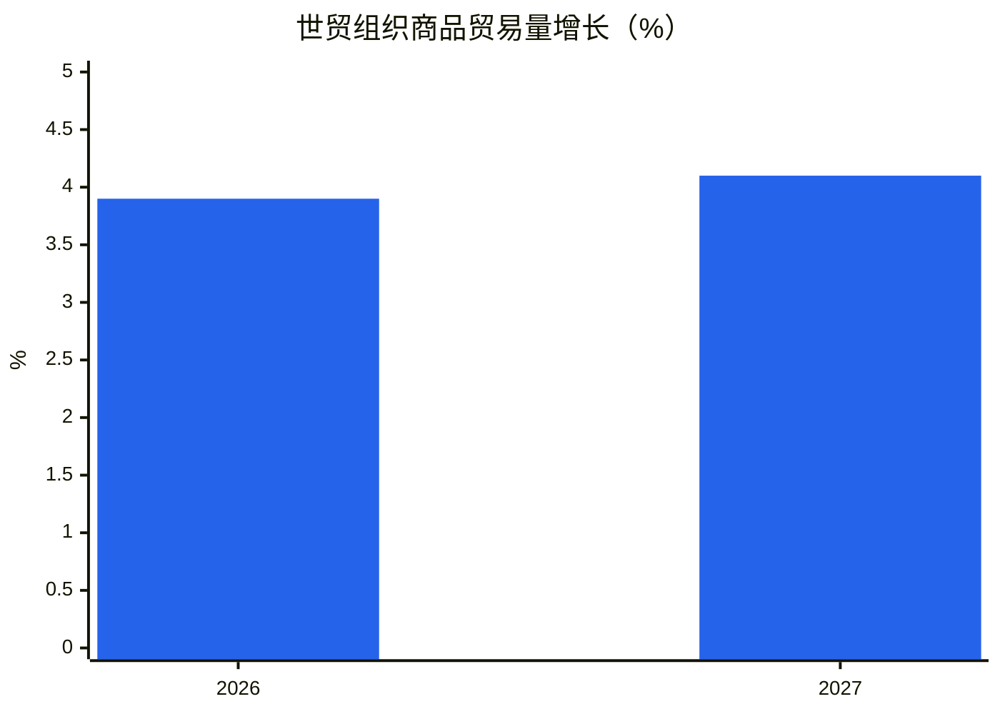
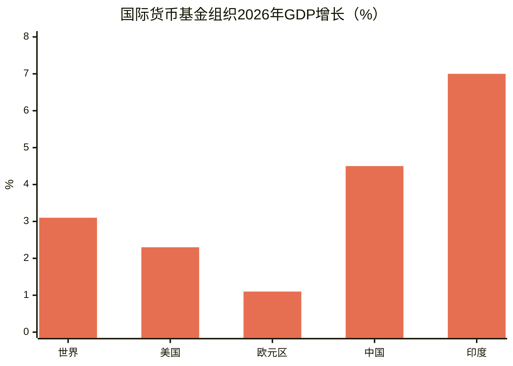
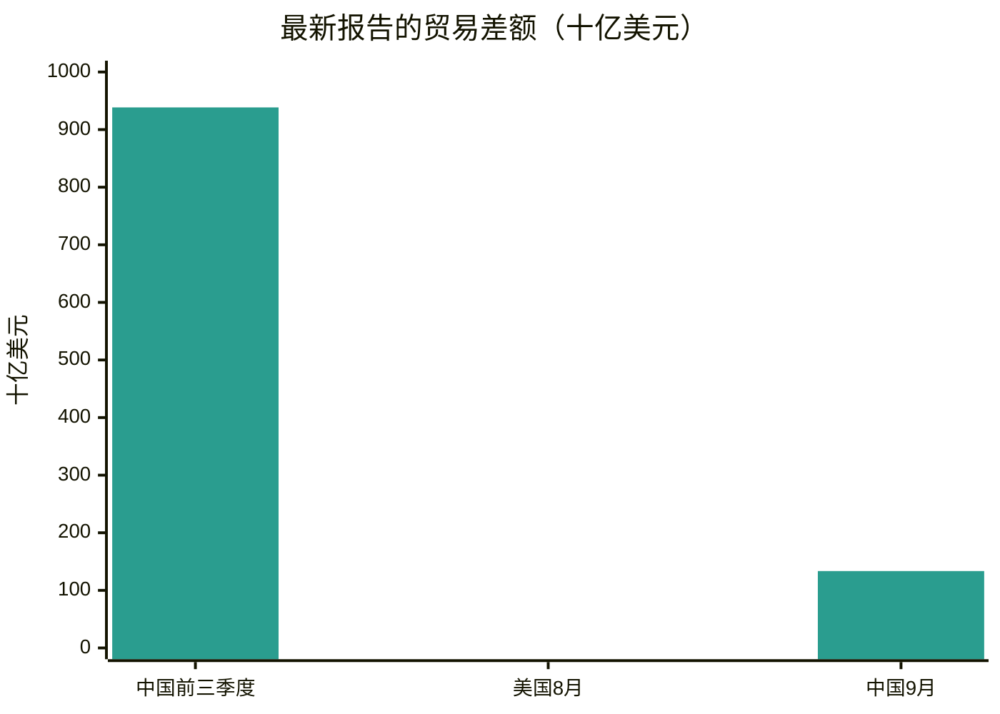
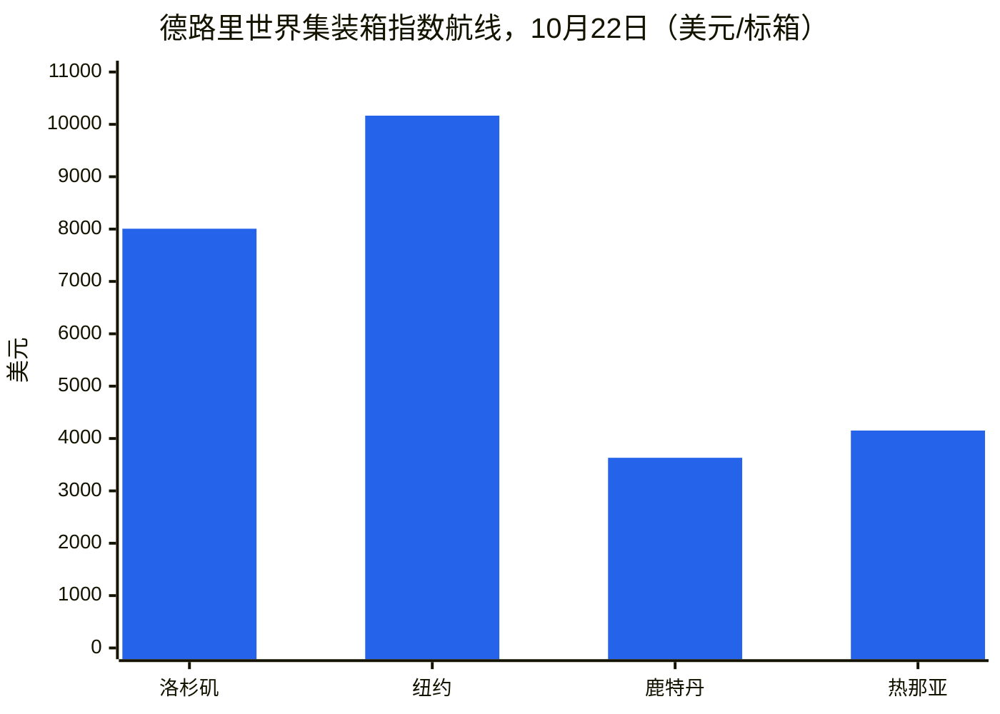
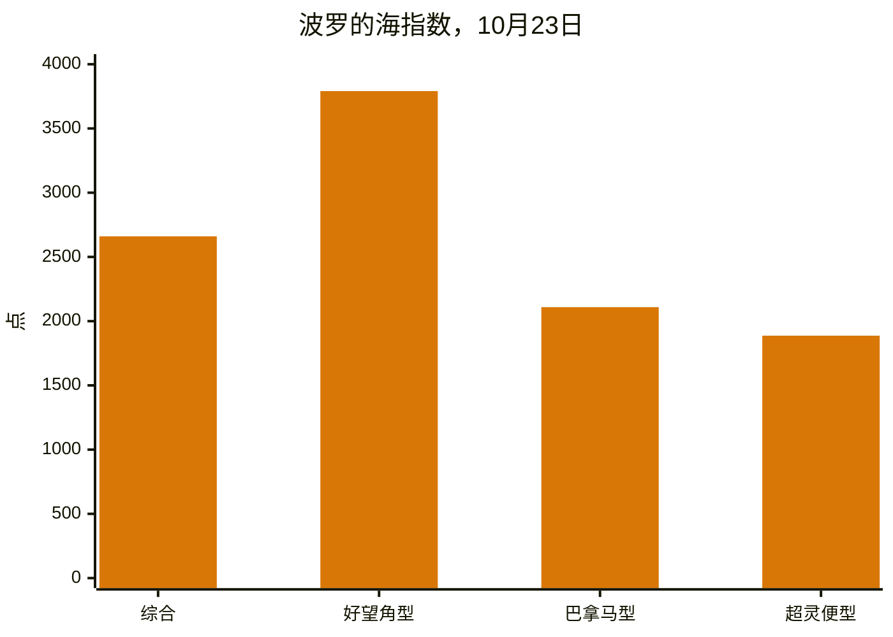
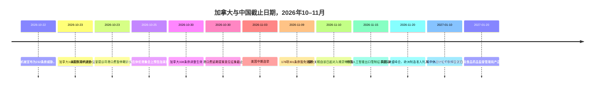
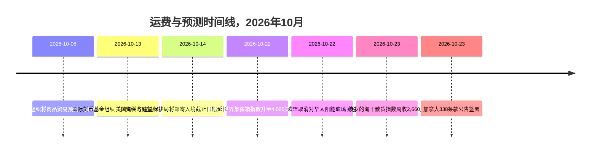

# 全球贸易情报报告——2026年10月19–26日当周

**每周简报。** 覆盖窗口：2026年10月19–26日。汇编自全球约45家贸易新闻、政策、数据与运费来源的信息。

---

## 目录

1. [执行摘要](#1-executive-summary)
2. [预警](#2-alerts)
3. [头条新闻——深度解析](#3-top-stories--deep-dives)
4. [关税追踪](#4-tariff-tracker)
5. [美国政策深度解析](#5-us-policy-deep-dive)
6. [分区域世界政策](#6-world-policy-by-region)
7. [执法行动](#7-enforcement-actions)
8. [数据发布](#8-data-releases)
9. [运费市场](#9-freight-market)
10. [政策时间线](#10-policy-timelines)
11. [即将到来的截止日期与事件（未来90天）](#11-upcoming-deadlines--events-next-90-days)
12. [数据来源与方法](#12-sources--methodology)

---

## 1. 执行摘要

这一周，美国两次以相反方向改写加拿大关税清单，集装箱运费延续反弹，而干散货按船型分化明显，而全球两大预测机构以不同的语调描述了同一个全球经济：商品贸易富有韧性，服务贸易较为脆弱，增长日益集中于少数国家和产品。

- **加拿大：同一周内既有减免也有升级。** 10月23日，特朗普总统签署公告，将50%的338条款关税从一系列加拿大农林产品上移除——胶合板单板、部分纸制品、某些机械和制冷设备、包装箱和包装盒以及新鲜和干制海藻——自10月30日起生效。同一命令将其他加拿大商品列入50%清单，包括地毯、油漆、洗发水、可可粉、木棺、冰淇淋棒、空调机、卧式冷柜、射箭器材和独木舟。减免源于缅因州参议员苏珊·柯林斯的请求，该州蓝莓、马铃薯、苹果和海藻生产商依赖加拿大投入品。另一起事件中，在安大略省播出一则使用前总统罗纳德·里根关于关税言论的世界大赛广告后，总统宣布对加拿大进口商品加征10%关税，称该广告是严重歪曲和敌对行为。安大略省表示将暂停该广告以便贸易谈判恢复。10月25日，在密歇根州休伦港的一场集会上，总统表示加拿大贸易协议将"很快"达成，但未给出条款或时间表。
- **运费：集装箱上涨，干散货分化。** 德路里世界集装箱指数10月22日上涨2%至4,585美元/40英尺集装箱，为15周来最高水平，也是连续第二周上涨。上海–洛杉矶上涨2%至8,007美元，上海–纽约上涨1%至10,166美元，上海–鹿特丹上涨3%至3,632美元，上海–热那亚上涨5%至4,152美元。德路里统计第44–48周计划停航56个航次（共714个计划航次），取消率为8%。波罗的海干散货指数10月23日收于2,660点，周涨约5.9%，尽管周五当日下跌1.2%：好望角型船收益强劲反弹，而巴拿马型船指数跌至2,109点，为8月24日以来最低。
- **苏伊士运河回归越过门槛。** 据BIMCO引用的克拉克森研究数据，10月前两周，经苏伊士运河的集装箱周均运力为753,000标准箱，而2023年同期为1,457,000标准箱——这是自红海危机开始以来，运河通行量首次超过危机前水平的50%。自7月初以来已宣布16项航线调整，四大联盟如今均运营经苏伊士运河的定期西向亚欧北线服务。Linerlytica 10月展望预测，在安全条件允许的情况下，2027年第一季度将全面回归。
- **预测：商品富有韧性，服务较弱，增长集中。** 世贸组织10月更新将2026年世界商品贸易量增长上调至3.9%（3月预测为1.9%），2027年为4.1%，同时将2026年商业服务贸易增长从4.8%下调至3.3%。国际货币基金组织10月《世界经济展望》预计2026年全球增长3.1%，2027年增长3.4%，2026年总体通胀为4.7%，并警告增长如今高度集中：32个国家占全球增长的95%，低于4月的54个，约47%的经济体被下调评级。
- **11月9日截止日期一分为二。** 10月23日，美国贸易代表办公室提议将对中国关联船舶的301条款港口费暂停期（以及某些起重机和货物装卸设备关税）从2026年11月10日延长至2027年1月9日，该提案载于日期为10月23日的《联邦公报》通知，定于10月26日公布，意见征集截止10月30日（案卷号USTR-2026-0694）。该提案尚未最终确定。相比之下，178项301条款产品豁免仍将于2026年11月9日美东时间23:59到期，本覆盖周内未发现延期。进口商应按豁免的书面日期规划，并将港口费延期视为提案而非最终决定，直至美国贸易代表办公室公布最终通知。
- **欧洲对华辩论保持开放。** 欧盟委员会表示，将提议对中国除10月初在北京达成的混合动力汽车谅解之外的其他行业实施进一步进口限制，法国总统提及化工、塑料和铁合金。欧盟委员会还计划于12月提议一项新工具，以限制对单一来源关键物资的依赖。与此同时，英国继续抵制要求其效仿欧盟对中国电动汽车征收最高45.3%关税的压力，商业大臣乔纳森·雷诺兹表示，英国贸易救济决定仅基于英国利益。欧盟于10月22日取消了对中国长期征收的太阳能玻璃关税，自2025年7月22日以来缴纳的关税可申请退还。

**运费：** 集装箱运价在综合费率上调和1月合同谈判前运力撤出推动下走强；干散货在好望角型船走强而巴拿马型船走弱的情况下反弹；苏伊士运河运力继续逐步回归；海湾航运风险仍然较高，10月12–18日一周霍尔木兹海峡通行量据报大幅下降，10月18–20日又报告了更多船舶事件。

---

## 2. 预警

| # | 预警 | 生效日期 | 影响 | 来源 |
|---|-------|-----------|--------|--------|
| A1 | 加拿大338条款清单调整：50%关税从胶合板单板、部分纸制品、某些机械和制冷设备、包装箱和包装盒、新鲜和干制海藻上移除；新增地毯、油漆、洗发水、可可粉、木棺、冰淇淋棒、空调机、卧式冷柜、射箭器材、独木舟 | 2026年10月30日 | 缅因州农林供应链获得减免；新列入清单的加拿大出口商面临50%关税 | [White House](https://www.whitehouse.gov/fact-sheets/2026/10/fact-sheet-president-donald-j-trump-further-modifies-canadian-products-subject-to-tariffs-under-section-338/)、[Supply Chain Dive](https://www.supplychaindive.com/news/trump-tweaks-canada-tariffs-removing-certain-goods-while-adding-others/833895/) |
| A2 | 在安大略省播出使用罗纳德·里根言论的世界大赛广告后，宣布对加拿大进口商品再加征10%关税；安大略省表示将暂停该广告 | 2026年10月宣布 | 在10月30日清单调整和11月3日中期选举前几天加剧美加争端 | [LawStreet](https://lawstreet.co/international/trump-says-canada-trade-deal-coming-soon-as-white-house-eases-some-tariffs-after-collins-request) |
| A3 | 11月9日时钟分化：美国贸易代表办公室提议将301条款港口费暂停期延长至2027年1月9日（意见征集至10月30日，案卷号USTR-2026-0694）；178项301条款产品豁免仍于2026年11月9日美东时间23:59到期，未发现延期 | 2026年11月9日/2027年1月9日（提议） | 11月10日入境货物豁免关税恢复至清单税率（清单1–3为25%，清单4A为7.5%）；港口费仅在提案未最终确定时恢复征收 | [gCaptain](https://gcaptain.com/ustr-proposes-extending-china-ship-port-fee-suspension-through-january-2027/)、[Gateway Lines](https://gatewaylines.com/press-releases/china-ship-fees-301-exclusions-nov-9-2026) |
| A4 | 霍尔木兹/海湾航运风险仍然较高：油轮AL DASMA轮10月20日在霍尔木兹海峡受损；JIF BARRACUDA轮10月18日在阿联酋附近受损；MarineTraffic报告10月12–18日一周霍尔木兹海峡通行量从203艘降至120艘 | 2026年10月18–20日 | 尽管苏伊士运河集装箱业务复苏，战争险、航线和保险成本仍居高不下 | [Daily Caller](https://dailycaller.com/2026/10/22/iran-claims-seven-vessels-attacked-in-persian-gulf) |
| A5 | 黑海货运事件：悬挂科摩罗旗的货轮Khoryv轮在罗马尼亚康斯坦察以东约15英里处起火并倾覆；1名船员死亡，3人失踪，9人获救生还 | 2026年10月 | 黑海航线和保险风险；罗马尼亚当局在当地报道中将该事件归因于无人机袭击 | [Scottish Sun](https://www.thescottishsun.co.uk/news/16978300/cargo-ship-fire-drone-strike-black-sea/) |
| A6 | 法国港口中断：法国各港口宣布10月14日和16日举行24小时罢工，10月30日还有另一罢工日期；福斯-叙尔-梅尔码头和堆场10月20日因恶劣天气关闭 | 2026年10月20日和30日 | 法国门户港口船期不确定性；托运人应在10月下旬航线中预留缓冲时间 | [Maritime News](https://www.maritimenews.com/port-operations/port-operations-oct-14-21-2026) |
| A7 | 欧盟对华太阳能玻璃关税于2026年10月22日取消；自2025年7月22日以来缴纳的关税可申请退还 | 2026年10月22日 | 太阳能进口商应审查历史关税缴纳情况以申请退还 | [WiseVoter](https://wisevoter.com/world/2026/10/23/eu-repeals-solar-glass-duties-china) |
| A8 | 美国海关与边境保护局邮寄入境截止日期延长：包括药品在内的美国食品药品监督管理局监管产品可继续使用简化邮寄流程至2027年1月20日，此前美国海关与边境保护局于10月14日将10月22日截止日期延长90天 | 2027年1月20日 | 邮购和包裹进口商获得又一个季度的时间转向详细报关 |  |
| A9 | 风力涡轮机根据232条款被宣布为国家安全威胁（白宫公告，10月22日）；尚未征收关税——贸易官员受命谈判并在180天内汇报 | 2026年10月22日 | 风能供应链面临未来可能征收关税；报道中提及的主要供应商包括墨西哥、法国、印度、丹麦和德国 |  |

### A1——加拿大：两个方向相反的举措

10月23日公告最好理解为重新校准，而非缓和。白宫情况说明指出，338条款关税无论是否符合美墨加协定原产地规则均适用，且在232条款关税之外加征，产品增减自2026年10月30日起生效——即11月3日中期选举前四天。柯林斯参议员表示，减免将帮助缅因州蓝莓、马铃薯、苹果和海藻生产商，其中许多人依赖加拿大设备、包装和投入品，这些投入品无法从美国供应商处获得，或只能以高昂成本替代。

**分析：** 该命令保留了加美争端的整体架构——8月对约200亿美元加拿大商品征收50%关税，此前谈判破裂——同时改变了其影响分布。新列入清单商品（地毯、可可粉、空调机、卧式冷柜等）的出口商应立即重新筛查商品归类；被取消清单商品的出口商在假定获得减免之前，应确认其具体产品属于公告描述范围，因为338条款覆盖范围取决于产品描述，而非大类。

### A2——里根广告与10%的加征

安大略省的广告在世界大赛期间播出，当时多伦多蓝鸟队正在参赛，广告使用了前总统里根1987年警告高关税导致报复和贸易战的言论。总统称该广告是严重歪曲和敌对行为，结束了与渥太华的贸易讨论，并宣布在现有水平之上对加拿大进口商品加征10%关税。罗纳德·里根总统基金会表示未批准使用这些片段。安大略省省长道格·福特表示，广告将在周末后逐步停播，以便两国政府恢复谈判。

**分析：** 这一事件表明，在本轮周期中，传播争端多么迅速就能转化为关税政策，以及选举时间如何放大这种效应。对进口商而言，实际问题是先后顺序：10月30日清单调整、宣布的10%加征，以及总统10月25日预告的任何加美协议，是三项法律依据和生效日期各不相同的不同工具。在每一项公布之前，10月30日公告是唯一具有固定生效日期的一项。

### A3——11月9日：时钟分化

美国贸易代表办公室2026年10月6日续延通知（10月7日公布）确认两项2018年对华301条款行动继续有效，但未延长豁免或港口费暂停期。178项豁免——包括2024年5月保留的164项和2024年9月新增的14项太阳能制造设备豁免——有效期至11月9日美东时间23:59。11月10日及之后入境的货物按清单税率缴税。然而，10月23日，美国贸易代表办公室仅针对港口费暂停期提议单独延期：2026年11月10日至2027年1月9日，承运人无需承担原301条款行动附件一、二、三项下的港口费，相关起重机和货物装卸设备关税也将暂停征收。该通知日期为10月23日，定于10月26日公布，意见征集截止美东时间10月30日17:00（案卷号USTR-2026-0694），属于提案而非最终规则。200多家贸易协会在9月23日致函美国贸易代表办公室请求延期。

**分析：** 政治日程（讨论中持续至2027年1月10日的休战）与监管日程（11月9日）之间的差距对航运业已经缩小，但对进口商尚未缩小。承运人按书面规则定价；进口商对豁免也应如此，并应在截止日期前识别任何申报豁免税号的入境货物，而不是事后才发现风险。港口费提案如最终确定，可防止11月10日港口费重启；如未确定，费用将恢复征收。

---

## 3. 头条新闻——深度解析

### 3.1 加拿大：作为选举季工具的关税政策

加拿大议题主导了本周美国政策新闻，因为它汇集了当前美国贸易政策的三大驱动因素：法定工具（1930年《关税法》第338条，允许为应对歧视美国商业的行为征收最高50%的关税）、国内政治日程（11月3日中期选举），以及自8月以来时断时续的双边谈判。8月原行动覆盖约200亿美元加拿大商品，从曲棍球杆到水泥，此前谈判破裂；加拿大对等值美国产品实施报复。

10月23日命令给出的理由——高级官员建议这些调整在服务公共利益的同时仍能抵消所谓的歧视——是本届政府标准的338条款表述。新变化在于同期报道中明确将调整与一位参议员代表具名州产业提出的请求挂钩。这种挂钩不改变法律效力，但改变了游说经验：当国内选区能够证明具体的供应链依赖时，针对特定产品的减免是可以争取到的。

**关键数据：** 50%的338条款税率；原覆盖约200亿美元加拿大商品；10月30日生效日期；11月3日中期选举。

**重要意义：** 对加拿大出口商和美国进口商而言，10月30日清单是现行有效文件。对其他人而言，这一事件提醒人们，本轮周期中的关税清单以周而非年为单位修订，归类层面的尽职调查如今已成为进口的经常性成本。

### 3.2 两份预测：世贸组织与国际货币基金组织认同韧性，但对其广度意见不一

世贸组织10月8日《全球贸易展望与统计》更新和国际货币基金组织10月13日《世界经济展望》均在本覆盖周之前发布，但主导了本周的政策讨论，两者讲述了一个一致但侧重点不同的故事。世贸组织将2026年商品贸易量增长上调至3.9%（3月为1.9%），2027年为4.1%，归功于人工智能相关投资：2026年上半年人工智能赋能商品贸易同比增长67%，占全球商品贸易增长的47%。亚洲2026年出口增长居首，为9.9%，其次是北美5.7%和非洲5.6%。与此同时，世贸组织将2026年商业服务贸易增长从4.8%下调至3.3%，其中运输为0.9%，旅行为0.2%，反映中东动荡、航空燃油成本上升和飞行限制。

国际货币基金组织预计2026年全球增长3.1%，2027年增长3.4%，2026年总体通胀为4.7%，2027年降至4.1%。其国别表显示，美国两年均为2.3%，欧元区2026年为1.1%、2027年为1.2%，中国为4.5%和4.0%，印度按财政年度计算为7.0%。该基金的警告是结构性的：增长正集中于接入人工智能投资热潮或免受能源冲击的经济体，而技术价值链之外的能源进口经济体面临最困难的前景。其基线假设霍尔木兹海峡自2027年3月开始重新开放，2027年10月前大体恢复战前状况。

*注：世贸组织《全球贸易展望与统计》，2026年10月更新；2026年预测值由3月的1.9%上调。*

*注：国际货币基金组织《世界经济展望》，2026年10月。印度按财政年度计算。*

**分析：** 两家机构一致认为，人工智能投资正在掩盖其他领域的疲软。对贸易规划的实际意义在于，总体贸易增长美化了平均水平：人工智能供应链之外的企业，或暴露于中东能源和运输成本的企业，所经历的一年比全球总量数据所显示的要糟糕得多。

### 3.3 中国：接近1万亿美元的顺差，以及关于其含义的辩论

中国2026年1–9月商品贸易顺差达9,385亿美元，其中9月单月为1,335亿美元，创20个月新高，出口在人工智能硬件热潮推动下激增。对美销售额增长40%，为五年多来最快，使中国对美顺差达到340亿美元，为2025年1月以来最高。澳大利亚、韩国、台湾、俄罗斯和东盟经济体也购买了创纪录的中国出口商品。报道引用的高盛经济学家估计，自2005年以来，对华贸易逆差超过GDP 3%的国家数量增加两倍多，达到82个，其中多数为低收入新兴经济体。

**分析：** 顺差既是本周政策新闻的症状，也是驱动因素。它增强了北京在11月截止日期前的谈判地位，也增强了布鲁塞尔和华盛顿采取进一步防御措施的理由。它也使"脱钩已取得进展"的说法变得复杂：美国为人工智能基础设施采购中国资本设备的速度为五年来最快。

### 3.4 欧洲：防御措施推进，但方向并不一致

欧盟10月的辩论产生了两个相反信号。在限制性方面，欧盟委员会主席乌尔苏拉·冯德莱恩在10月15–16日峰会后表示，欧盟委员会将提议对中国实施超出在北京达成的混合动力汽车谅解的进口限制，该谅解旨在使中国混合动力汽车入境量减半。法国总统提及化工、塑料和铁合金。欧盟委员会还将于12月提议一项新工具，以限制对单一来源关键物资的依赖，并设立一项针对受胁迫国家或行业的团结机制。欧盟对华货物贸易逆差目前每天超过10亿欧元。

在自由化方面，欧盟于10月22日取消了对华太阳能玻璃关税，结束了自2014年以来实施的措施，此前最后两家欧盟太阳能玻璃生产商已停止生产。进口商可向各国海关当局申请退还自2025年7月22日以来缴纳的关税，依据实施条例2026/2314和2026/2310。

**分析：** 一旦标准明确，这两项举措是一致的：有国内产业需要保护时措施得以保留，无产业可保护时措施取消。12月的提案——快速行动工具和单一来源依赖工具——值得关注，因为它们将把混合动力汽车做法推广为常设工具。

### 3.5 苏伊士运河回归与霍尔木兹风险并存

集装箱航运的苏伊士运河回归如今可以量化：10月初每周753,000标准箱，占经运河或好望角航线总集装箱运力的36%，高于2024年至2026年年中平均8%的水平，但仍远低于危机前80%的水平。自7月初以来已宣布16项航线调整，涉及Gemini、Ocean、Premier和MSC。与此同时，海湾风险并未消退：MarineTraffic报告10月12–18日一周霍尔木兹海峡通行量从203艘降至120艘，10月18日和20日报告了船舶事件。国际海事组织10月21日的统计记录，自冲突开始以来，中东地区共发生24起伤亡事故和120起确认的海事事件。

**分析：** 集装箱市场同时为两种不同的风险定价——苏伊士运河正常化带来的结构性运力释放（应压低运价），以及海湾和黑海航线持续存在的战争风险溢价（支撑运价）。德路里的反弹表明，就目前而言，运力管理（停航、综合费率上调）的影响超过了苏伊士运河释放运力的影响。

### 3.6 美国贸易逆差：创纪录的进口月份

美国8月商品和服务贸易逆差扩大13.7%至1,056亿美元，为2025年3月以来最大，进口创下4,208亿美元的历史新高（增长4.3%），出口增长1.4%至3,152亿美元。商品逆差单项扩大11.5%至1,326亿美元，商品进口增长5.5%至3,361亿美元——工业用品增长16.6%，资本货物在人工智能基础设施建设推动下增长4.0%，食品增长5.5%——商品出口为2,034亿美元，增长1.9%。然而，1–8月累计逆差仍比2025年同期收窄19.9%，提醒人们单月数据与年初至今数据指向不同方向。

**分析：** 10月初公布并贯穿本周讨论的8月数据，削弱了"关税在短期内必然缩小逆差"的简单说法，而年初至今的改善则削弱了相反说法。两种说法都可以成立，因为逆差同时受进口价格、人工智能资本货物需求和库存周期的影响，而不仅仅受关税税率影响。

---

## 4. 关税追踪

| 国家/原产地 | 措施 | 税率 | 生效日期 | 状态 | 来源 |
|---|---|---|---|---|---|
| 加拿大 | 338条款关税——移除：胶合板单板、部分纸制品、某些机械和制冷设备、包装箱和包装盒、新鲜和干制海藻 | 取消50% | 2026年10月30日 | 2026年10月23日签署公告 | [White House](https://www.whitehouse.gov/fact-sheets/2026/10/fact-sheet-president-donald-j-trump-further-modifies-canadian-products-subject-to-tariffs-under-section-338/) |
| 加拿大 | 338条款关税——新增：地毯、油漆、洗发水、可可粉、木棺、冰淇淋棒、空调机、卧式冷柜、射箭器材、独木舟 | 50% | 2026年10月30日 | 2026年10月23日签署公告 | [Supply Chain Dive](https://www.supplychaindive.com/news/trump-tweaks-canada-tariffs-removing-certain-goods-while-adding-others/833895/) |
| 加拿大 | 在安大略省广告事件后宣布进一步加征关税 | 增加10个百分点 | 2026年10月宣布 | 已宣布；实施细则不适用 | [LawStreet](https://lawstreet.co/international/trump-says-canada-trade-deal-coming-soon-as-white-house-eases-some-tariffs-after-collins-request) |
| 中国 | 301条款关税——178项产品豁免到期 | 恢复后25%（清单1–3）、7.5%（清单4A） | 2026年11月9日美东时间23:59 | 本覆盖周内未公布延期 | [Gateway Lines](https://gatewaylines.com/press-releases/china-ship-fees-301-exclusions-nov-9-2026) |
| 中国 | 301条款对中国关联船舶港口费——提议暂停期延长至2027年1月9日 | 如最终确定，2026年11月10日至2027年1月9日暂停收费 | 2026年10月23日提议；意见征集至10月30日 | 仅为提案，尚未最终确定 | [gCaptain](https://gcaptain.com/ustr-proposes-extending-china-ship-port-fee-suspension-through-january-2027/) |
| 风力涡轮机及部件 | 232条款国家安全认定 | 尚未征收关税；180天内谈判并汇报 | 2026年10月22日 | 已发布认定；谈判窗口期后可能征收关税 |  |
| 中国 | 欧盟太阳能玻璃反倾销和反补贴税 | 已取消 | 2026年10月22日 | 已取消；自2025年7月22日起退还 | [WiseVoter](https://wisevoter.com/world/2026/10/23/eu-repeals-solar-glass-duties-china) |
| 中国 | 欧盟铝平板轧材反倾销税 | 14.3%–24.6% | 进行中 | 2026年10月9日启动期终复审；措施继续有效 | [We Are Main Street](https://wearemainstreet.org/world/2026/10/25/eu-anti-dumping-duties-chinese-aluminium) |
| 中国 | 欧盟混合动力汽车谅解 | 货运量减半 | 2026年10月8–9日达成 | 谅解；实施程序待定 | [EU Monitoring](https://ieu-monitoring.com/editorial/eu-and-china-reach-trade-understandings-on-hybrid-cars-tariffs-and-rare-earths/1251810) |
| 英国 | 对中国制造汽车的标准进口关税 | 10% | 进行中 | 无变化；英国抵制效仿欧盟最高45.3%的压力 | [Fleet News](https://www.fleetnews.co.uk/news/minister-reportedly-resists-calls-for-uk-to-impose-chinese-ev-tariffs) |
| 印度–新西兰 | 自贸协定生效：印度对新西兰出口100%税目零关税；印度对70%税目让步 | 0%（印度对新西兰出口） | 2026年10月20日 | 已生效；适用原产地规则 | [Devdiscourse](https://www.devdiscourse.com/article/business/3994858-india-new-zealand-fta-to-eliminate-tariffs-on-all-indian-exports-from-october-20-dgft-official?amp) |
| 俄罗斯/能源买家 | 格雷厄姆法案关税（俄罗斯500%，主要能源买家和协助者100%） | 已豁免 | 2026年10月16日豁免 | 已豁免且无截止日期；监测工作交由美国贸易代表办公室 | [KPMG](https://kpmg.com/us/en/taxnewsflash/news/2026/10/trump-russia-tariffs-sanctions.html) |

---

## 5. 美国政策深度解析

### 338条款与加拿大

见第2节和第3.1节。10月23日情况说明确认，338条款关税无论是否符合美墨加协定原产地规则均适用，且在232条款关税之外加征，总统可在公共利益需要时暂停、撤销、补充或修订任何338条款公告。正是这种修订权，使得10月或11月进一步修订无需新的立法即可实现。

### 美国贸易代表办公室——301条款续延与11月9日时钟

美国贸易代表办公室于2026年10月6日确认（10月7日公布），两项2018年对华301条款行动继续有效，开启了第二次四年复审的下一阶段。复审既可维持税率也可提高税率：2022年9月第一次续延后，美国贸易代表办公室于2025年将半导体税率提高至50%，2024年将太阳能电池提高至50%，2024年将钢铁和铝产品提高至25%。随后，本覆盖周内两个11月9日时钟出现分化：10月23日，美国贸易代表办公室提议将港口费暂停期延长至2027年1月9日（意见征集至10月30日，案卷号USTR-2026-0694），而178项产品豁免未收到延期提案，仍将于11月9日到期。

### 232条款——风力涡轮机

2026年10月22日，总统根据232条款宣布风力涡轮机及部件进口对国家安全构成威胁，此前美国商务部于2025年8月启动调查。他未征收关税，而是指示贸易官员与贸易伙伴谈判并在180天内汇报；之后可考虑包括关税在内的进一步措施。援引的理由包括与外国制造设备相关的网络安全问题、对雷达系统和空中交通运行的干扰，以及美国对海外制造商品依赖的增加。报道中提及的主要供应商包括墨西哥、法国、印度、丹麦和德国。尚未设定关税税率。

### 美国海关与边境保护局业务

美国海关与边境保护局将美国食品药品监督管理局监管产品（包括药品）的邮寄入境过渡期从2026年10月22日延长至2027年1月20日，这项90天延期于10月14日宣布。此次延期源于2026年6月24日临时最终规则，该规则取消了邮寄包裹800美元免税额度，并自2026年7月24日起将大多数小型国际包裹转入简化流程。受另一机构进口规则约束的产品原定于10月22日前转向更详细的申报；如今它们有时间直至2027年1月20日。

### 关税退还

一名美国贸易法官认证了一项集体诉讼，为寻求退还2026年早些时候被最高法院裁定无效的关税的进口商提供救济，涵盖尚未提交索赔的进口商。海关已全额处理近1,300亿美元退还，而争议关税缴纳总额超过1,660亿美元，利息可能达数十亿美元。这一2026年10月9日报道的裁决对尚未申报的进口商意义重大：集体诉讼机制可在无需个别诉讼的情况下重新计算并退还剩余金额。

### 长期事项

10月16日格雷厄姆法案豁免继续有效，无截止日期。讨论中持续至2027年1月10日的美中休战已有提议而非最终的实施步骤——港口费暂停期延长至2027年1月9日（意见征集至10月30日），178项产品豁免则无延期提案。加美争端报道中提及的最高法院关税权限案定于11月开庭辩论。

---

## 6. 分区域世界政策

### 欧洲

欧盟委员会峰会后计划是本周主要的欧洲进展：除混合动力汽车之外对中国实施进一步进口限制，12月提议单一来源依赖工具，并设立针对胁迫情形的团结机制。混合动力汽车谅解本身是在10月8–9日北京举行的第二次欧盟–中国贸易和投资磋商机制会议上达成的，欧盟委员马罗什·谢夫乔维奇与中国商务部部长王文涛出席，涵盖七个税目，未来四年可使中国混合动力和插电式混合动力汽车对欧出口减少一半以上。双方同意2027年3月举行第三次部长级会议，1月举行部长级视频会议。欧盟对华货物逆差每天超过10亿欧元，是其公开宣称的驱动因素。

太阳能玻璃取消和铝平板轧材期终复审（14.3%–24.6%的关税继续有效）表明，同一届政府对不同行业运用了相反的工具，如第3.4节所述。

### 中国

中国2026年出口表现——9个月顺差9,385亿美元，9月出口在人工智能硬件推动下激增——仍是结构性背景。中国在黄金周暂停后恢复精炼燃料出口，10月批准约370万吨（柴油、汽油和航空燃油合计）。10月16日启动的人工智能技术出口管制征求意见涵盖40项技术，征求意见截止11月15日，对转移模型权重或芯片设计方法的企业而言是长期事项。

### 英国

商业大臣乔纳森·雷诺兹表示，英国不会屈从于其他国家要求其对中国汽车征收进口税的呼声，英国贸易救济决定仅基于英国利益。英国目前对中国制造汽车征收标准10%关税，而欧盟综合关税最高达45.3%。10月初的媒体报道称，英国正在起草一揽子方案，效仿欧盟税率以获得欧盟拟议"欧洲制造"计划的准入资格，根据该计划，电动汽车只有至少70%的零部件在欧盟内部制造才有资格获得补贴和公共采购；大臣10月14日的表态反驳了这一说法。安迪·伯纳姆首相已将英国纳入该计划作为11月20日欧盟峰会的核心目标。据称，若英国制造商被排除在外，高达800亿欧元（680亿英镑）的英国贸易将面临风险。

10月23日，英国政府表示，在首份年度预算声明之前，通过削减文书工作和延长部分进口关税暂停期，企业每年将节省近8亿英镑。该一揽子方案包括：为小企业简化合规指南节省2.9亿英镑，延长250种企业用产品进口关税暂停期节省1.55亿英镑，减少资产管理人重复报告节省1.05亿英镑，取消住宅房地产交易成本1.16亿英镑。关税暂停期为英国进口商在这些250种产品线上直接降低到岸成本。

### 印度和新西兰

印度–新西兰自由贸易协定于2026年10月20日生效，取消印度对新西兰出口现行100%税目的关税——这是印度首个自生效之日起对全部税目提供免税准入的自贸协定。印度出口商此前对纺织品、服装、皮革制品和鞋类面临最高10%的关税，对药品、农产品和海产品、塑料、化工和电气产品面临最高5%的关税。印度对70%的税目作出让步，涵盖当前双边贸易额约95%，对新西兰原木、炼焦煤和金属废料提供免税准入，并对苹果、猕猴桃、麦卢卡蜂蜜和白蛋白实行基于关税的配额和保障措施——包括最低进口价格。该协定于2026年4月27日签署，2026年9月21日批准，还包括15年内200亿美元投资便利化承诺，以及到2030年将双边贸易翻番至70亿新西兰元的目标。出口商仍须满足原产地规则和其他条件才能享受优惠关税。

### 中国和日本

中国外交部10月21日表示，北京对日本实施战略两用物资出口管制旨在遏制东京的再军事化，回应了日本国内钇库存已降至仅够数月消费的报道。日本此前超过70%的氧化钇来自中国冶炼厂，中国海关数据显示数月来多种重稀土月度出口量近乎为零。东京已请求华盛顿敦促北京放宽专业稀土出口。这一声明为2026年早些时候根据中国《出口管制法》及其两用物项出口管制条例实施的限制提供了正式的安全理由。

另外，商务部2026年第48号公告——人工智能技术管制背后的同一目录修订——推进了对五个敏感生物技术平台的管制草案，针对细胞和基因疗法的对外转移，现行交易须立即进行出口前登记。40项拟议新增目录包括23项人工智能、5项生物医学和12项光伏技术，其中14项拟议全面禁止，26项拟议限制（须许可证）。向外国买家全面转让基础药物发现平台将被禁止。据报道，仅2026年上半年，中国药物开发商就达成了81笔价值1,100亿美元的对外许可交易，这凸显了临时登记制度如今触及的交易流量之大。征求意见于2026年11月15日截止。

### 加拿大

除美方争端外，安大略省在省长道格·福特与总理马克·卡尼磋商后决定在周末后暂停里根广告，是本周对贸易最直接影响的加拿大进展：它消除了直接的刺激因素，同时关税工具保持不变。总统10月25日表示协议将"很快"达成，这是在边境城镇集会上发表的，而非谈判文件，应视为信号而非协议。

10月21–22日，总理马克·卡尼和安大略省省长道格·福特宣布了一项87亿加元的钢铁、汽车和关键矿产产业支持计划，宣称这是对美国关税的回应，也是保护安大略省南部综合制造基地工人的方式。初始报道中未公布逐项明细或拨付时间表。卡尼表示，加拿大对美汽车出口下降超过10%，美国对加出口下降超过20%，并重申加拿大目标是在未来十年内将对非美目的地出口翻番；美国2025年仍吸收加拿大商品出口的71.7%，低于一年前的75.9%。加拿大还确认将于11月30日与土耳其举行贸易谈判，作为多元化努力的一部分。

### 墨西哥

墨西哥10月21日表示，其在贸易谈判中的目标是在2026年底前尽可能降低美国对其铝、钢铁和汽车出口征收的关税，同时保持现有地位：超过80%的墨西哥商品免税进入美国市场，经济部长马塞洛·埃布拉德援引的墨西哥出口平均有效关税为3%，低于其他主要出口国。美墨加协定未在2026年7月1日联合审查中延长新的16年期限，现按年度联合审查推进；美国贸易代表办公室于2026年10月5日就2027年周期公开征求意见。墨西哥总统10月19日确认，美国总统曾提议墨西哥购买更多美国天然气，并让美国公司在提高墨西哥石油产量方面发挥更大作用，同时否认这两项提议是达成贸易协议的条件。

### 多边

世贸组织秘书处首次访问摩加迪沙，作为10月10–15日世贸组织–国际贸易中心联合技术代表团的一部分，支持索马里的入世申请，包括货物和服务市场准入要约。世贸组织总干事恩戈齐·奥孔乔-伊韦阿拉10月15日在曼谷表示，地缘政治变化以及乌克兰和中东战争将对贸易流产生持久影响，一些替代路线可能长期存在，因为各国和企业希望对冲未来冲击。世贸组织预测今年中东出口下降17%，进口下降约15%。

本周覆盖的两项世贸组织进展考验着多边体系的覆盖范围。第一，世贸组织争端解决机构于2026年9月25日应俄罗斯第二次请求成立专家组，审查欧盟碳边境调节机制（CBAM）以及欧盟排放交易体系中所谓的出口补贴；欧盟确认将参与。俄罗斯于2025年5月首次请求磋商。专家组成立是程序性步骤，而非违法认定，但这是欧盟旗舰边境碳政策首次接受重大世贸组织检验，该政策涵盖钢铁、铝、水泥、化肥、电力和氢。第二，世贸组织市场准入委员会10月12–13日会议审查了创纪录的36项贸易关注，其中8项首次提出——包括加拿大钢铁产品措施、欧盟拟议《工业加速器法》和《网络安全法》中所谓的歧视性条款、印度尼西亚花生和清真产品进口制度，以及土耳其单位价值监控制度。秘书处首份报告列出，1995年4月至2026年3月提出的145项关注中，51项已解决（34项完全解决，17项部分解决）。世贸组织还同意就中国对印度某些技术产品关税和国内太阳能制造激励计划的申诉成立专家组，此前印度于2026年5月阻止了中国的首次请求。

在更广泛的多边体系中，贸发会议数据中心10月21日报告，发展中经济体的外国直接投资仍然高度集中，十大接受国中有八个位于亚洲。国际贸易中心与南非贸易、工业和竞争部合作支持中小企业出口，世界海关组织安全框架工作组启动了首个中小微企业供应链安全与贸易便利化专题。

---

## 7. 执法行动

| 行动 | 目标/范围 | 日期 | 来源 |
|---|---|---|---|
| 美国海关与边境保护局邮寄入境过渡期延长 | 包括药品在内的美国食品药品监督管理局监管产品使用简化邮寄流程 | 2026年10月14日延长至2027年1月20日 |  |
| 欧盟铝平板轧材期终复审（中国产） | 复审期间14.3%–24.6%的关税继续有效 | 2026年10月9日启动 | [We Are Main Street](https://wearemainstreet.org/world/2026/10/25/eu-anti-dumping-duties-chinese-aluminium) |
| 欧盟太阳能玻璃关税取消 | 中国太阳能玻璃；自2025年7月22日起退还 | 2026年10月22日 | [WiseVoter](https://wisevoter.com/world/2026/10/23/eu-repeals-solar-glass-duties-china) |
| 格雷厄姆法案豁免维持 | 俄罗斯关税和制裁条款豁免，无截止日期 | 2026年10月16日豁免，仍有效 | [KPMG](https://kpmg.com/us/en/taxnewsflash/news/2026/10/trump-russia-tariffs-sanctions.html) |
| 关税退还集体诉讼认证 | 尚未提交退还索赔的进口商；近1,300亿美元已处理 | 2026年10月9日 | [Moneyweb](https://www.moneyweb.co.za/news/international/judge-sides-with-importers-to-expand-trump-tariff-refund-fight/) |

在本期审查信息中未发现新的暂扣放行令；记录中最近的暂扣放行令仍为2026年9月29日针对印度尼西亚棕榈油生产商Mitra Aneka Rezeki和Hardaya Inti Plantation的命令，现行暂扣放行令总数达到60项。

---

## 8. 数据发布

| 发布 | 关键数据 | 来源 |
|---|---|---|
| 世贸组织《全球贸易展望与统计》，2026年10月更新 | 2026年商品贸易量增长3.9%，2027年为4.1%；2026年服务贸易增长3.3%，2027年为6.4%；2026年亚洲出口增长9.9%；2026年上半年人工智能赋能商品贸易同比增长67%，占商品贸易增长的47% | [WTO](https://www.wto.org/english/res_e/booksp_e/gtos1026_e.pdf) |
| 国际货币基金组织《世界经济展望》，2026年10月 | 2026年全球增长3.1%，2027年为3.4%；2026年总体通胀4.7%，2027年为4.1%；2026年美国2.3%，欧元区1.1%，中国4.5%，印度7.0%（财政年度）；2026年世界贸易量增长4.6%，2027年为4.7% | [IMF](https://www.imf.org/en/publications/weo/issues/2026/10/13/world-economic-outlook-october-2026) |
| 美国贸易差额，2026年8月 | 逆差1,056亿美元（增长13.7%），为2025年3月以来最大；进口4,208亿美元（创纪录）；出口3,152亿美元；商品逆差1,326亿美元 | [Kitco](http://www.kitco.com/news/off-the-wire/2026-10-06/us-trade-balance-sinks-deeper-red-imports-hit-record-high-despite) |
| 中国贸易，2026年1–9月 | 顺差9,385亿美元；9月顺差1,335亿美元；9月出口激增；对美销售额增长40%；对美双边顺差340亿美元 | [Moneyweb](https://www.moneyweb.co.za/news/international/china-on-cusp-of-1trn-trade-surplus-as-exports-surge/) |
| 德路里世界集装箱指数，2026年10月22日 | 4,585美元/标箱（上涨2%）；上海–洛杉矶8,007美元；上海–纽约10,166美元；上海–鹿特丹3,632美元；上海–热那亚4,152美元 | [Drewry](https://www.drewry.co.uk/supply-chain-advisors/world-container-index-weekly-update?topics=Freight+Cost+Benchmarking) |
| 波罗的海干散货指数，2026年10月23日 | 2,660点（周涨5.9%）；好望角型3,791点（周涨16.7%）；巴拿马型2,109点（周跌8.9%，为8月24日以来最低）；超灵便型1,887点 | [Baird Maritime](https://www.bairdmaritime.com/shipping/dry-cargo/bulkers/baltic-dry-bulk-index-slides-but-locks-in-second-straight-weekly-gain) |
| 安特卫普-布鲁日港，2026年前九个月 | 2.009亿吨（同比下降0.8%）；上半年受干扰后，第三季度集装箱吞吐量强劲恢复 | [EIN](https://shipping.einnews.com:443/news/y-port-of-antwerp) |
| 日本出口，2026年10月21日报告 | 出口同比增长16.7%（低于19.3%），连续第13个月增长；半导体增长49.4%，半导体制造设备增长43.9%；对台湾出口增长37.8%，韩国增长35.5%，美国增长22.9%，欧盟增长10.5%，中国增长8.6%；贸易逆差5,366亿日元，低于1.1万亿日元，但接近预测值1,810亿日元的近三倍 | [ActionForex](https://www.actionforex.com/live-comments/658154-japan-exports-slow-to-16-7-despite-ai-chip-boom-trade-deficit-misses-forecast/) |
| 贸发会议《2026年贸易和发展报告》，2026年10月9日 | 2026年全球增长2.6%（2025年为2.9%）；发展中经济体增长4.0%（2025年为4.7%）；按不变价格计算商品和服务贸易增长约4%；2025年全球贸易创下35万亿美元纪录；亚洲将贡献全球增长的59%；2024年以来中美贸易下降超过20% | [UNCTAD](https://unctad.org/press-material/unctad-trade-and-development-report-2026-global-growth-slows-26-and-gaps-widen) |
| 印度–新西兰自贸协定，2026年10月20日生效 | 印度对新西兰出口100%税目零关税；印度对70%税目让步；200亿美元投资便利化承诺；到2030年双边贸易目标70亿新西兰元 | [Devdiscourse](https://www.devdiscourse.com/article/business/3994858-india-new-zealand-fta-to-eliminate-tariffs-on-all-indian-exports-from-october-20-dgft-official?amp) |
| 苏伊士运河集装箱通行量，10月前两周 | 周均753,000标准箱，而2023年同期为1,457,000标准箱；经运河运力占运河或好望角运力的36% | [MarineLink](https://www.marinelink.com/news/suez-canal-container-ship-transits-543667) |

*注：中国1–9月顺差9,385亿美元和9月顺差1,335亿美元为顺差；美国8月逆差1,056亿美元以负值表示。来源如上表。*

---

## 9. 运费市场

### 集装箱即期运价——德路里世界集装箱指数

世界集装箱指数10月22日上涨2%至4,585美元/40英尺集装箱，受亚欧和跨太平洋航线运价上涨推动。这是15周来最高读数，约为2026年4月9日低点2,309美元的两倍。上海–洛杉矶上涨2%至8,007美元，上海–纽约上涨1%至10,166美元；上海–鹿特丹上涨3%至3,632美元，上海–热那亚上涨5%至4,152美元。德路里预计，下周跨太平洋运价将在美国强劲进口需求支撑下保持稳定，下周仅宣布两个停航航次，而本周为六个；亚欧运价预计在运力紧张情况下略有上涨，下周宣布八个停航航次，而本周为两个。亚洲港口拥堵有所缓解：上海船舶等待时间从第38周的97小时降至第42周的38小时。

德路里10月23日取消航次追踪补充了未来图景：第44–48周预计停航56个航次（共714个计划航次），取消率为8%。亚欧北线/地中海占取消航次的54%，跨太平洋东向占32%，跨大西洋占14%。主要承运人集团中，Gemini Cooperation的停航率最低，为1%。

*注：德路里世界集装箱指数，2026年10月22日。洛杉矶=上海–洛杉矶；纽约=上海–纽约；鹿特丹=上海–鹿特丹；热那亚=上海–热那亚。*

### 弗莱索斯波罗的海指数

弗莱索斯10月20日更新报告，亚欧北线运价周涨6%至3,442美元/标箱，亚欧地中海周涨3%至3,927美元/标箱，原因是针对1月合同谈判的综合费率上调，一些货运代理对上调能否维持表示怀疑。跨太平洋运价保持稳定但处于高位：美西为8,126美元/标箱，美东上涨1%至9,700美元/标箱，尽管货量降温，每日运价仍显示上涨迹象，可能源于淡季运力缩减。弗莱索斯指出，红海逐步回归发生在7月初亚欧需求高峰之后并贯穿需求低迷月份，应能缓解船期紊乱和船舶扎堆，而远东枢纽拥堵缓解仍在吸收运力并支撑运价；全面回归将增加承运人2027年运力过剩风险。

### Xeneta数据分化与船期可靠性

Xeneta截至10月23日一周的数据在水平上与德路里讲述了不同的故事，尽管在欧洲方向上一致：亚美西8,311美元/标箱（周环比上涨0.2%），亚美东11,525美元/标箱（上涨0.2%），亚欧北线3,698美元/标箱（上涨6.8%），亚欧地中海4,442美元/标箱（上涨5.8%）。Xeneta首席分析师称欧洲运价上涨令人费解，因为红海运力回归本应缓解运价；强劲的欧洲需求正在抵消这一影响。该分析预计，美国航线运价将在2026年底前走软，而欧洲方向取决于需求能否维持。

Xeneta 9月船期可靠性记分卡仍不佳，本覆盖周内报告：全球准班率连续第四个月下降至27%，船舶平均延误升至6天。远东–欧洲准班率仅为4%，平均延误9.9天，为2021年9月以来最差；远东–北美准班率为20%，平均延误6.9天。马士基是主要承运人中最可靠的，准班率为47%，阳明最差，为4%。其他分析师的方法差异很大——Sea-Intelligence 8月读数显示全球准班率为49.9%——因此引用可靠性数据时应始终注明来源。

### 订单簿

据The Loadstar报道，集装箱订单簿10月23日达到1,620万标准箱，占现役船队的46.5%，为2009年后最高水平。中国船厂今年承接了创纪录的494万标准箱订单，占总订造运力的88%。恒力重工10月23日宣布订造52艘超大型双燃料船舶，包括20艘24,000标准箱船舶，据信包括地中海航运吨位。尽管承运人以停航捍卫2026年运价，2027–2030年的交付潮仍从结构上压制未来运价——这是2027年合同谈判的核心矛盾，苏伊士运河运力释放也是如此。

### 干散货——波罗的海交易所

波罗的海干散货指数10月23日反弹至2,660点，高于10月16日三个多月来最低的2,511点，周涨约5.9%，连续第二周上涨。本周涨幅由好望角型船推动：好望角型指数周涨16.7%至3,791点，周五平均日收益为30,877美元（当日下跌519美元），周报中5TC从周一的30,518美元升至周五的34,380美元。巴拿马型船走势相反：周跌8.9%至2,109点，为8月24日以来最低，平均日收益为18,981美元。超灵便型微涨1.18%至1,887点；灵便型持平于1,020点。

*注：波罗的海交易所，2026年10月23日。*

### 苏伊士运河与船期可靠性

见第3.5节。苏伊士运河回归是逐航线、附条件的：承运人通知将红海航线以地区持续稳定为条件，个别航次可以调整。因此，10月装载于苏伊士运河计划航线上的集装箱在离港后数周内仍可能面临航线调整。运营上的经验是，在过渡期间应按集装箱而非航线追踪航线。

### 空运

据WorldACD市场数据，尽管全球货量连续第三周周环比下降1%，全球空运即期运价在第41周（2026年10月5–11日）稳定在3.55美元/公斤。下降反映了中国黄金周假期，亚太地区计费重量在第41周下降1%，此前第40周下降2%，第39周下降6%。第41周全球货量仍同比增长9%，全市场运价同比上涨29%，即期运价上涨34%，航油同比上涨111%。波罗的海空运指数在截至10月12日的七天内下跌2.1%，但仍同比上涨24.3%，有来源表明，电商托运人锁定的旺季运力以及未获保障的人工智能超大规模需求可能推高运价。

第42周（10月12–18日，10月25–26日报告）出现反弹：全球空运货量周环比增长2%，亚太出口在黄金周后反弹，亚太货量周环比增长9%（亚太至欧洲增长13%，至美国增长10%），全球平均运价以美元计上涨4%。另一份WorldACD第42周摘要显示，货量周环比增长6%，全市场运价上涨3%至2.48美元/公斤，即期运价上涨2%至2.66美元/公斤；两份摘要定义不同，不应合并。中东和南亚始发运价在10月12–18日一周同比上涨61%，为地区最高涨幅。

### 港口与物流中断

法国港口10月14日和16日面临24小时罢工，10月30日还有另一罢工日期，福斯-叙尔-梅尔码头和堆场10月20日因恶劣天气关闭。安特卫普-布鲁日港报告，上半年受天气和航运链罢工中断影响后，第三季度集装箱业务强劲恢复，前九个月吞吐量为2.009亿吨，同比下降0.8%。在美国，一项2亿美元铁路拨款支持库斯湾港码头项目。阿联酋海岸10月9日一艘船舶遇袭后形成的海湾油污，到10月21日已扩展至约190平方公里，并促使阿联酋更多海滩关闭。

### 供应商情报

本覆盖周审查信息中未发现符合本节标准的供应商新闻。本简报中的供应商报道仅限于新闻事项——数据发布、政府合作以及影响贸易的市场动向——不包括产品发布、功能宣传、活动营销和宣称的客户成果。

---

## 10. 政策时间线

---

## 11. 即将到来的截止日期与事件（未来90天）

| 日期 | 事件/截止日期 | 重要意义 |
|---|---|---|
| 2026年11月1日 | 欧盟对非欧盟国家远程销售每件征收2欧元联盟手续费（预计；授权法案正在审查中） | 在最高150欧元货件3欧元统一关税之外叠加；远程销售申报中产品标识符成为强制要求 |
| 2026年10月30日 | 加拿大338条款清单调整生效 | 重新筛查加拿大产品归类 |
| 2026年10月30日 | 另一法国港口罢工日期 | 法国门户港口船期风险 |
| 2026年11月3日 | 美国中期选举 | 关税政策可能随政治日程变化 |
| 2026年10月30日 | 美国贸易代表办公室延长301条款港口费暂停期至2027年1月9日的提案意见征集截止（案卷号USTR-2026-0694） | 最终决定前的最后评论机会 |
| 2026年11月9日美东时间23:59 | 178项301条款产品豁免到期；港口费暂停期到期，除非拟议延期最终确定 | 11月10日入境货物豁免关税恢复征收；港口费仅在提案未最终确定时恢复征收 |
| 2026年11月10日 | 自该日起入境货物对原豁免产品按清单301条款税率缴税 | 需要重新定价并与报关行确认 |
| 2026年11月15日 | 中国人工智能技术出口管制征求意见截止 | 模型权重和芯片设计转移风险 |
| 2026年11月20日 | 英国–欧盟峰会 | 欧洲制造准入和英国关税协调列入议程 |
| 2026年12月 | 欧盟单一来源依赖工具提案和进一步对华进口限制 | 将混合动力汽车做法推广为通用工具 |
| 2027年1月10日 | 美中休战讨论中持续至该日 | 政治日程与监管日程差距 |
| 2027年1月20日 | 美国海关与边境保护局食品药品监督管理局监管产品邮寄入境过渡期结束 | 自该日起需要详细报关 |
| 2027年3月 | 第三次欧盟–中国贸易和投资磋商机制部长级会议 | 下一个正式欧中贸易检查点 |
| 2027年3月 | 国际货币基金组织基线假设霍尔木兹海峡开始重新开放 | 运费和能源成本假设取决于此 |

---

## 12. 数据来源与方法

覆盖窗口：2026年10月19–26日。审查信息来自全球约45家贸易新闻、政策、数据与运费来源，包括FreightWaves、The Loadstar、Splash247、gCaptain、Hellenic Shipping News、Container News、Supply Chain Dive、Logistics Management、Air Cargo News和Port Technology；白宫、美国海关与边境保护局、美国贸易代表办公室、《联邦公报》、国际贸易管理局、美国国际贸易委员会、工业与安全局和JD Supra；欧盟委员会、英国商业贸易部、加拿大边境服务局和中国商务部；世贸组织、贸发会议、国际贸易中心和世界海关组织；美国国际贸易委员会DataWeb、USA Trade Online、联合国Comtrade、世界银行WITS、欧盟统计局、世界银行数据和国际货币基金组织；税务基金会、耶鲁预算实验室和International Trade Intelligence；德路里、波罗的海交易所和弗莱索斯；以及Descartes和TradeInt。数据按这些来源公布的情况报告。
