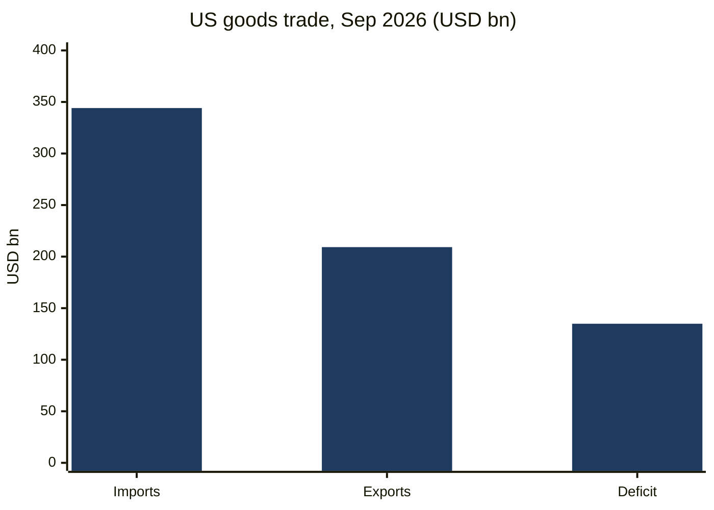
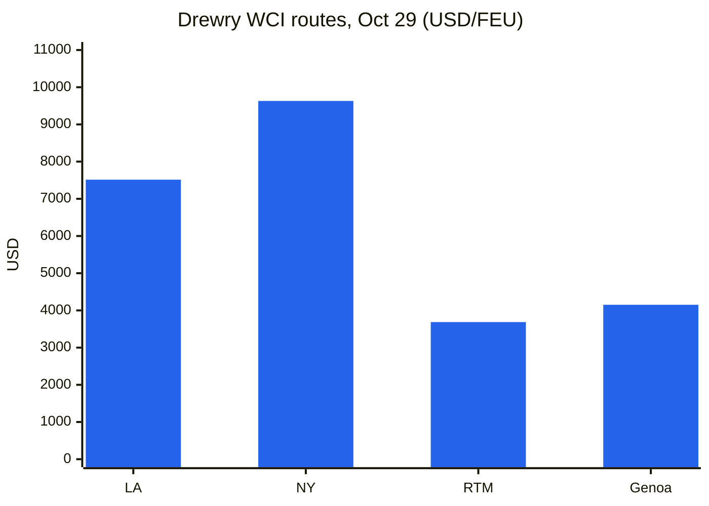
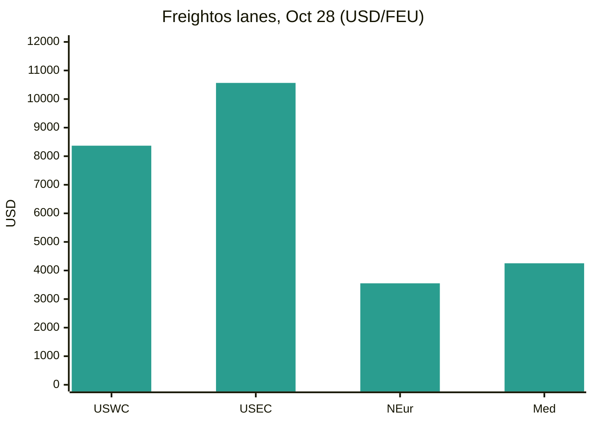
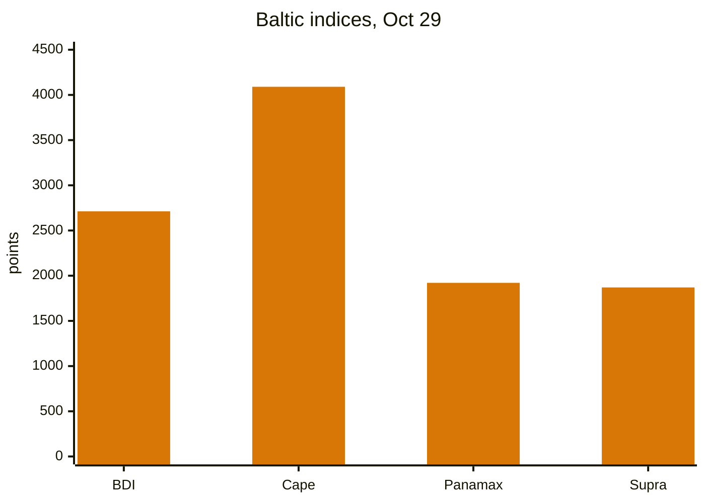
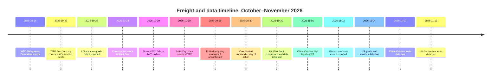

# Global Trade Intelligence Report — Week of October 26–November 2, 2026

**Weekly briefing.** Coverage window: October 26–November 2, 2026. Compiled from approximately 45 trade news, policy, data, and freight sources worldwide.

---

## Table of contents

1. [Executive summary](#1-executive-summary)
2. [Alerts](#2-alerts)
3. [Top stories — deep dives](#3-top-stories--deep-dives)
4. [Tariff tracker](#4-tariff-tracker)
5. [US policy deep dive](#5-us-policy-deep-dive)
6. [World policy by region](#6-world-policy-by-region)
7. [Enforcement actions](#7-enforcement-actions)
8. [Data releases](#8-data-releases)
9. [Freight market](#9-freight-market)
10. [Policy timelines](#10-policy-timelines)
11. [Upcoming deadlines & events (next 90 days)](#11-upcoming-deadlines--events-next-90-days)
12. [Sources & methodology](#12-sources--methodology)

---

## 1. Executive summary

A week dominated by deadlines that have not yet been resolved: the November 9 expiry of 178 China Section 301 product exclusions and of the suspension of Section 301 port fees on China-linked vessels, a 250-worker labour dispute that could idle the busiest United States container port complex the day after the midterm elections, and a sharp escalation in shipping risk in the Strait of Hormuz and the Black Sea. Against that backdrop, the European Union advanced its China trade-defence programme on several fronts at once, Canada's revised 50% tariff list took effect, and the United States reported a record month for goods imports driven by artificial-intelligence-related capital goods.

- **The November 9 cliff is now a week away, and both clocks are still unresolved.** The 178 remaining China Section 301 product exclusions expire at 11:59 p.m. ET on November 9, 2026, with no extension notice found in this coverage week; entries on or after November 10 revert to list rates. USTR's proposal to extend the suspension of Section 301 port fees on China-linked vessels and related crane duties through January 9, 2027 was published in the Federal Register on October 26, with comments closing October 30, but no final notice had been published as of November 2. The two instruments are separate: finalising one does not extend the other. A further published suspension — the Bureau of Industry and Security Affiliates Rule suspension — also expires on its published text on November 9–10, with an announced extension to January 10, 2027 that had not been gazetted as of October 31.
- **Canada's revised 50% list took effect on October 30.** The proclamation signed October 23 removed 22 classifications from the Section 338 list and added 100, keeping the 50% rate unchanged. The duty stacks on top of Section 232 duties and applies even to goods qualifying under the Canada–United States–Mexico Agreement. CBP issued implementation guidance on October 29 (CSMS #70314289). The same week, the Senate voted 50–46 to terminate the national emergency invoked for Canada tariffs — a vote with no legal effect on the duties — and Canada's prime minister said Ottawa was "not near" a deal before the midterms, while Washington described a deal as near. The first legal challenge to Section 338, filed October 20 by a New Jersey cheese importer, was heavily covered in-window alongside the list change.
- **Shipping risk escalated in two theatres at once.** On October 29, a small boat attached two explosive devices to the hull of the Panama-flagged crude tanker Louise 1 in the Strait of Hormuz, about 25 nautical miles north-east of Khasab, Oman; the resulting engine-room fire temporarily disabled the vessel, though the crew was safe and the vessel continued. Reuters, citing three maritime security sources, described it as the first successful limpet-mine strike in the waterway since the United States–Iran war began in February 2026. Drewry reported only two vessels transiting the Strait of Hormuz in the previous week, against 62 Suez Canal transits, the highest weekly level of the year. In the Black Sea, the Liberian-flagged container ship Contship Jet was struck by three sea drones on October 28 inside Bulgaria's exclusive economic zone and sank around midnight; all 18 crew were rescued, but 20 of its 421 containers fell overboard, including lithium-ion batteries and other hazardous materials.
- **Europe's China programme moved from signals to formal cases.** The European Commission imposed definitive anti-dumping duties of 39.8% to 48.1% on Chinese PET Spunbond for five years on October 30, opened an anti-dumping investigation into polyvinylidene fluoride from China, India and Japan on October 28, ordered registration of Chinese silicon imports from October 27 during a duty review, and saw member states approve long-term anti-dumping duties on Chinese titanium dioxide effective January 11. The Commission's December proposal for an instrument to limit reliance on single sources for critical supplies completed its business consultation on October 27, with no sector list, threshold or tariff rate published yet. Separately, the EU's €2 Union Handling Fee on non-EU online purchases took effect on November 1, on top of the €3 duty per item on low-value consignments in place since July 1.
- **The United States imported a record value of goods in September.** The Census Bureau's advance release on October 28 put the September goods deficit at $134.9 billion, up 2.1% from August, on record imports of $344.1 billion. Capital-goods imports rose 7.5% month on month and 77.2% year on year, the AI-infrastructure import surge now the dominant driver of the deficit even as exports also rose 2.6% to $209.2 billion. China's October trade data, which will show whether its year-to-date surplus has passed $1 trillion, is due November 7 and was not released in this window; China's official manufacturing PMI for October, published November 1, fell back into contraction at 49.3, with new export orders at 48.7.
- **Freight split by route and by vessel size.** The Drewry World Container Index fell 3% to $4,429 per 40ft container on October 29, reversing two weekly gains, as Shanghai–Los Angeles fell 6% to $7,514 and Shanghai–New York 5% to $9,631, while Shanghai–Rotterdam edged up 1% to $3,686. The Baltic Dry Index recovered to 2,712 by October 29 on Capesize strength, even as Panamax fell to 1,921, its lowest since April. Schedule reliability remained poor: Sea-Intelligence put global on-time performance at 50.6% in September, up marginally from 49.9% in August. A coordinated dockworker day of action on October 30 touched more than 100 ports, with confirmed operational impact described as limited in most places, and a further French national port strike is noticed for November 5.

**Freight:** container spot rates turned down on the transpacific while Asia–Europe held firm; carriers' November increases are already being discounted; dry bulk recovered only on Capesize iron-ore strength; Suez transits reached a yearly high while Hormuz transits nearly stopped; and air cargo firmed into peak season on demand growth that outran capacity.

---

## 2. Alerts

| # | Alert | Effective | Impact | Source |
|---|-------|-----------|--------|--------|
| A1 | 178 China Section 301 product exclusions expire 11:59 p.m. ET Nov 9, 2026; no extension found; entries Nov 10+ revert to list rates (25% Lists 1–3, 7.5% List 4A) | Nov 9, 2026 | Importers claiming HTSUS 9903.88.69/70 must reprice and confirm entries before the deadline | [Gateway Lines](https://gatewaylines.com/press-releases/china-section-301-tariffs-stay-178-exclusions-end) |
| A2 | USTR proposal to extend Section 301 port-fee suspension to Jan 9, 2027 remains a proposal only; comments closed Oct 30 (docket USTR-2026-0694); no final notice published as of Nov 2 | Nov 9, 2026 (current suspension expires) | If not finalised, port fees and related crane/cargo-handling duties resume Nov 10 | [Federal Register](https://www.federalregister.gov/documents/2026/10/26/2026-21755/request-for-comments-on-further-suspension-of-section-301-action-chinas-targeting-of-the-maritime) |
| A3 | Canada Section 338 list reworked: 22 classifications removed, 100 added; 50% rate unchanged; stacks on Section 232 duties; applies even to USMCA-qualifying goods | Oct 30, 2026 | Entry date, not shipment date, decides 0% vs 50% on the same goods; re-screen classifications immediately | [Baker McKenzie](https://globalimportblog.bakermckenzie.com/2026/10/30/us-further-modifies-section-338-tariffs-on-canadian-goods-as-the-tariffs-face-their-first-legal-challenge/) |
| A4 | Hormuz escalation: limpet-mine attack on tanker Louise 1 on Oct 29; only two Hormuz transits reported in the previous week; further incidents reported Oct 30–Nov 2, including a tanker struck by projectiles east of Ras al Khafji | Oct 29–Nov 2, 2026 | War-risk, routing and insurance costs stay elevated; Gulf routing decisions must price competing official claims about route safety | [gCaptain](https://gcaptain.com/tanker-in-strait-of-hormuz-hit-by-limpet-mines-security-sources-say/) |
| A5 | Black Sea sinking: container ship Contship Jet struck by three sea drones Oct 28 in Bulgaria's exclusive economic zone and sank; 20 of 421 containers overboard, including hazardous materials | Oct 28–29, 2026 | Black Sea war risk now reaches EU/NATO-member waters; drifting dangerous-goods containers create a navigation hazard | [Splash247](https://splash247.com/splash-wrap-new-networks-old-faultlines/) |
| A6 | LA/Long Beach watchmen strike deadline extended to 5 p.m. Pacific Nov 4, 2026; no final agreement; affected terminals handle ~85% of Long Beach cargo and ~33% of Los Angeles cargo | Nov 4, 2026 | A 250-worker dispute could halt vessel, yard and gate work at affected terminals if other ILWU members honour picket lines; one report carried a Nov 5 date instead | [Seatrade Maritime](https://www.seatrade-maritime.com/ports-logistics/impending-strike-threatens-la-lb-ports-container-flow) |
| A7 | EU €2 Union Handling Fee on non-EU online purchases takes effect, on top of the €3 duty per item on consignments up to €150 in place since Jul 1, 2026 | Nov 1, 2026 | Low-value, multi-item e-commerce faces €5 per line before VAT; fee is non-refundable even if goods are returned | [Shipping and Freight Resource](https://www.shippingandfreightresource.com/trade-moves-02-nov-2026/) |
| A8 | Coordinated dockworker day of action Oct 30 across 100+ ports; French national port strike noticed for Nov 5 | Oct 30 / Nov 5, 2026 | Berthing and feeder slippage beyond Oct 30, concentrated in Mediterranean transshipment hubs and French gateways | [Port Technology](https://www.porttechnology.org/news/ports-and-terminals/dockworker-strikes-ports-military-cargo/) |
| A9 | DHS adds three Chinese genomics firms (BGI Group, BGI Genomics, MGI Tech) to the UFLPA Entity List; consolidated list now 190 entities | Oct 29, 2026 | Goods produced in whole or part by these firms are presumed made with forced labour and barred unless the presumption is rebutted | [LexBlog](https://www.lexblog.com/2026/10/29/dhs-updates-uflpa-entity-list-with-three-companies-engaged-in-genetics-testing/) |
| A10 | Section 232 robotics/industrial machinery: national-security finding, no tariff yet; negotiations ordered with a report due within 180 days | Oct 28, 2026 | Tariff risk deferred to spring 2027, not removed; same template as wind turbines | [White House](https://www.whitehouse.gov/fact-sheets/2026/10/fact-sheet-president-donald-j-trump-adjusts-imports-of-robotics-industrial-machinery-and-their-parts-and-components-into-the-united-states/) |

### A1/A2 — The November 9 clocks, one week out

The two November 9 instruments are frequently reported together but operate independently. The product exclusions — 164 retained in May 2024 plus 14 solar-manufacturing-equipment exclusions added in September 2024, claimed under HTSUS 9903.88.69 and 9903.88.70 — expire at 11:59 p.m. ET on November 9, and multiple sources reporting October 29–31 found no extension notice. USTR's October 6/7 continuation notice confirmed that the underlying 2018 Section 301 actions continue; it did not extend the exclusions. The port-fee suspension, by contrast, is the subject of a live proposal: the Federal Register notice published October 26 (91 FR 67388) proposes suspending, from 12:00 a.m. ET November 10, 2026 through 11:59 p.m. ET January 9, 2027, the maritime transport service fees in Annexes I–III of the April 23, 2025 action (as modified October 16, 2025) and the Annex V.A duties on Chinese ship-to-shore cranes and cargo-handling equipment, so that no liability would accrue during the suspension. The stated reason is to allow further negotiation with China. The proposal covers only two months, far shorter than the one-year suspension it would replace.

**Analysis:** importers and carriers face different exposures on the same date. An importer with entries claiming the exclusion headings must plan on list rates from November 10 regardless of what happens to port fees. A carrier faces fee reinstatement only if the proposal is not finalised. Both should be tracked as written instruments, not as a single "truce" — the political calendar (a truce discussed as running to January 10, 2027) and the regulatory calendar (November 9) remain different things.

### A3 — Canada: the list change that took effect mid-week

The October 23 proclamation, published in the Federal Register on October 30 and effective at 12:01 a.m. ET that day for goods entered or withdrawn from warehouse for consumption on or after that date, removed 22 classifications and added 100, all under heading 9903.03.14; headings 9903.03.12 and 9903.03.13 were unchanged. Removed lines include certain plywood sheets, paper products, machinery and refrigeration equipment, packing crates and boxes, plastic wrap, cardboard boxes and food-related machinery. Added lines include carpets and rugs, certain wood and paper products, chemical products such as paints, soaps and lubricants, and consumer products including cocoa powder, vinyl flooring, canoes, chest freezers, shampoos and toilet soap, as well as valves, instruments, window air-conditioning units and diagnostic reagents. Annex descriptions are informational only; the HTS code controls scope.

**Analysis:** the practical consequence is timing. A chest freezer owed only Section 232 steel duties through October 29 and picked up Section 338 on October 30; plywood moved the other way. Because the duty applies regardless of USMCA origin and in addition to Section 232 duties, origin planning does not avoid it. The net effect is a structural swap rather than a de-escalation: relief concentrated in Maine-linked agricultural and forestry supply chains, new exposure spread across consumer and industrial goods.

### A4/A5 — Two theatres, one week

The Hormuz attack on October 29 followed a pattern already visible in the data: non-Iranian-linked Hormuz transits had fallen to 104 in the October 5–11 week from 126 in the September 28–October 4 week, and Lloyd's List Intelligence counted at least 28 reported or confirmed attacks in Hormuz and surrounding waterways in the first half of October. The October 29 incident added a new method — close-range hull explosives delivered by small craft against a moving tanker — to mines and projectiles. Competing claims then complicated the picture: Iran's Islamic Revolutionary Guard Corps said three tankers struck naval mines on an "unauthorised" southern route and the Iranian army reported a fourth east of the waterway, a day after United States Central Command said mine claims were false and primary routes were cleared. UKMTO documented damage but did not confirm mines as the cause. In the Black Sea, the Contship Jet sinking was the fifth drone attack on ships in Bulgaria's exclusive economic zone in October alone, according to BTA as cited in coverage, and the second merchant sinking in the western Black Sea within a week after the Khoryv off Constanța. No official attribution for the Contship Jet attack had been made public; an assessment by Ambrey, via Reuters, that the craft resembled the Russian-made Murena-300S design is not attribution.

**Analysis:** shippers can no longer treat either waterway as a binary open-or-closed question. Hormuz is nearly closed to commercial traffic on Drewry's transit count while Suez normalises; the Black Sea risk now extends to container tonnage on an Israel–Romania run inside an EU member state's exclusive economic zone, with hazardous cargo in the water. Insurance, routing and dangerous-goods declarations all need to be assessed voyage by voyage.

---

## 3. Top stories — deep dives

### 3.1 The November 9 cliff, and a third clock nobody is watching

Beyond the two Section 301 clocks, the Bureau of Industry and Security Affiliates Rule suspension expires on its published text on November 9–10, 2026. The rule, dated September 29, 2025, extends Entity List, Military End User and Specially Designated Nationals restrictions to foreign affiliates owned 50% or more by listed parties. Treasury Secretary Scott Bessent announced on September 24, 2026 that the United States–China truce, and correspondingly the suspension, would extend to January 10, 2027 — but as of an October 31 source cut-off, no Federal Register notice formally extending the suspension had been published. Exporters should not rely on the extension until BIS publishes it. The same caution applies to the port-fee proposal: widely headlined as a delay until January 9, it is a proposal whose comment period closed October 30, not a final rule.

**Analysis:** three separate instruments expire within about a day of each other, each with a different decision-maker and a different legal form. Treating any of them as extended on the basis of an announcement, a headline, or a parallel instrument's fate is the main compliance risk of the coming week. The written Federal Register position on November 9 is the only safe basis for entries, voyages and export screening.

### 3.2 Hormuz and the Black Sea: escalation as a shipping-market variable

The week's shipping news is best read as a single variable — war risk — moving in opposite directions in different waterways. Suez transits rose to 62 vessels in the week reported by Drewry on October 29, the highest weekly level of the year, and Alphaliner estimated nearly two-thirds of total Asia–Europe capacity restored via the Red Sea, including ZIM resuming the route for its joint Asia–United States East Coast service with MSC. More than 100 containerships of 16,000 TEU or more transited Suez since early September, exceeding the 99 recorded in all of 2025 plus January–August 2026 combined, and 192 ultra-large transits were recorded so far in 2026 against 8 in 2025. At the same time, Hormuz transits fell to two vessels in Drewry's weekly count, Brent touched $118 for expiring December contracts on October 30 — its highest since April 30 — and the Houthis claimed missile strikes on Ras Tanura and Rabigh refineries, an Aramco facility at Abqaiq, and Riyadh and Dammam airports, in retaliation for Saudi air raids in Yemen that they said killed 27 people; the Saudi-led coalition said it intercepted missiles and had not confirmed damage. Oman's navy evacuated 25 crew from the burning Panama-flagged tanker Riti on October 30, and a November 2 commodity report citing UKMTO counted ten shipping incidents across Hormuz, the Gulf and the Gulf of Oman between October 31 and November 2.

**Analysis:** the Suez return is releasing effective capacity and pressuring Asia–Europe rates, while Hormuz disruption is tightening energy and Gulf routing costs. The two effects do not cancel: they hit different trades, different cargoes and different insurance lines. The operational consequence is that a "return to normal" narrative for one corridor should not be applied to the other.

### 3.3 Canada: relief, escalation and a court case in the same week

The Canada file combined four separate developments. First, the Section 338 list change took effect October 30 (see section 2, A3). Second, the Senate voted 50–46 on October 29 to terminate the national emergency invoked for Canada tariffs, sponsored by Senator Tim Kaine, with four Republicans — Susan Collins of Maine, Mitch McConnell of Kentucky, Lisa Murkowski of Alaska and Rand Paul of Kentucky — joining Democrats; it followed an October 28 Senate vote against Brazil tariffs. House procedural rules are reported to block consideration and a presidential veto would be possible, so no tariff changes take effect from the vote. Third, the negotiating accounts diverged: Reuters reported October 26 that officials were exploring a deal to ease Section 232 duties of 50% on steel and 25% on cars, with Commerce Secretary Howard Lutnick in regular contact with Canada–United States Trade Minister Dominic LeBlanc; on October 28 a Canadian official described progress as "limited"; on October 29 Prime Minister Mark Carney said Canada was "not near" a deal before the midterms and would not accept one at any cost, noting that talks broke down in August 2026 over United States conditions Canada said would limit its ability to negotiate with other countries, undermine French-language requirements and harm autos. The President, speaking in Michigan on October 25 and South Carolina on October 29, described a deal as nearing and Canada as treating the United States "extremely nicely". Fourth, the first legal challenge to Section 338 — Gellert Global Group v. Trump, filed October 20 in the United States Court of International Trade by a New Jersey food importer of Canadian cheese (about $71 million of Canadian cheese imports in 2025, counsel Liberty Justice Center) — asks the court to declare the duties unlawful, block collection and order refunds with interest, arguing that Section 301 displaced Section 338, that the measures fail Section 338's discrimination and offset tests, and that September additions received only seven days instead of a claimed required 30-day waiting period. No ruling on the merits was reported.

**Analysis:** the vote, the talks and the lawsuit pull in different directions and none of them changes a duty rate this week. The only instrument with immediate commercial effect is the October 30 list change, and the only one that could unwind the regime is the court case, which will take months. Importers should separate political signal from legal effect.

### 3.4 Europe: a trade-defence week, and a December instrument taking shape

The European Union's China programme produced formal action on four tracks in one week. Definitive anti-dumping duties on Chinese PET Spunbond (39.8% to 48.1%, five years, replacing provisional duties of 45.6% to 50% in force since May 2026) were imposed October 30 on a market worth €200 million, with the EU industry based in Germany, Italy and France. An anti-dumping investigation into polyvinylidene fluoride from China, India and Japan opened October 28, following the October 16 opening into furfuryl alcohol from China. Chinese silicon imports were ordered into customs registration from October 27 for nine months while the Commission reviews whether existing anti-dumping duties remain sufficient, a review opened September 1 at the request of Euroalliages, representing all EU producers. Member states approved long-term anti-dumping duties on Chinese titanium dioxide, reported at €0.25 per kilogram for Anhui Jinxing Group and €0.74 per kilogram for Longbai Group, with €0.64 per kilogram for cooperating companies and €0.74 per kilogram for all others, effective January 11 for five years; Chinese titanium dioxide imports exceeded €500 million in 2023. Behind these cases sits the signal from the informal Council meeting in Dublin on October 23, where Trade Commissioner Maroš Šefčovič said the plastics sector was "the closest" to a possible safeguard investigation. The EU goods deficit with China was reported at more than €1 billion per day, over €370 billion in 2025 and expected to exceed €400 billion in 2026, with the first-half 2026 deficit at almost €197 billion in one Politico-based report.

The December instrument advanced in parallel. The business consultation on a tool to force diversification away from single-country dependence for critical supplies wrapped up on October 27, with a proposal due in early December, just before EU leaders meet December 17–18. The consultation confirmed the instrument would target situations where heavy reliance on one supplier country threatens EU supply security or economic stability; no sector list, threshold percentage or tariff rate has been published. BusinessEurope warned that alternative procurement will raise prices; Commissioner Šefčovič said in a June 2026 speech, as cited in coverage, that companies must absorb "the cost of resilience". Two shapes are discussed: a minimalist energy-style diversification mandate for defence and dual-use goods, or a maximalist threshold model under which buying more than a fixed share from one source could trigger tariffs.

**Analysis:** the EU is running a sector-by-sector programme — hybrids capped, plastics closest to a safeguard, chemicals in formal investigation, silicon under review — rather than a single broad measure. The December instrument will show whether that programme generalises into an economy-wide tool or stays sector-specific. Either way, the direction is toward more, not fewer, China trade-defence actions in 2027.

### 3.5 Two deficits, two directions: the United States imports more, China exports more — for now

The Census Bureau's advance September release, published October 28, put the United States goods deficit at $134.9 billion, up $2.8 billion or 2.1% from August's $132.1 billion, the largest since March 2025 and above a Reuters/Bloomberg consensus forecast of $130.2 billion. Imports reached a record $344.1 billion, up $8.1 billion or 2.4%; capital-goods imports rose 7.5% month on month and 77.2% year on year. Exports rose 2.6% to $209.2 billion, with food shipments up 12.8% and consumer-goods exports up 6.5%; consumer-goods imports rose 3.1% and other goods 6.7%, while industrial supplies including gold and petroleum fell 6.0%. Economist estimates put the third-quarter GDP trade drag at 4 percentage points (Pantheon Macroeconomics) and 3.25 percentage points (Oxford Economics); those are estimates, not official data. The fuller goods-and-services release is due November 4. The August goods-and-services deficit, released October 6, was $105.6 billion on a different basis and is not directly comparable to the advance goods figure.

China's September data, reported October 20–21, showed exports up 36.3% year on year to about $447.18 billion and imports up 31% to about $313.65 billion, a monthly surplus of $133.5 billion and a January–September cumulative surplus of $938.1 billion — on pace to surpass the 2025 record of about $1.19 trillion, a threshold not crossed until November in 2025. The September surplus with the European Union was a record $34.8 billion, and the surplus with the United States widened to $34 billion, a 20-month high. But the October picture, published November 1, points the other way: the official manufacturing PMI fell to 49.3 from 50.1 in September, new export orders fell to 48.7 from 50.0, and the production sub-index fell to 49.8 from 51.7. A November 1 article summarising the first three quarters put exports up 16.4% year on year to $3.46 trillion, with mechanical and electrical products up 15.6%, high-technology goods up 21.6% and consumer goods up 14.9%.

**Analysis:** the September boom and the October PMI contraction are not contradictory; they describe different moments. The question for the coming week is whether October customs data, due November 7, confirm a cooling or extend the boom past $1 trillion. Either outcome will be read in Brussels and Washington as evidence about the surplus, not just as a statistic.

### 3.6 Freight: the peak is over on the transpacific, but capacity is not behaving normally

Sea-Intelligence reported on October 29 that weekly capacity hit historic highs on all major East–West lanes, breaking the normal post-Golden-Week taper seen from 2012 to 2025, and attributed it to vessel bunching from Asian port congestion and schedule unreliability pushing third-quarter sailings into October–November, not a demand surge. Asia–North Europe exceeded 350,000 TEU per week in October and November, Asia–Mediterranean exceeded 260,000 TEU per week, Asia–North America West Coast reached nearly 393,000 TEU in October with a forecast unprecedented 400,000 TEU in November, and Asia–East Coast recorded its highest levels of any year in October–November. Typhoon Champi, the strongest storm of 2026, contributed directly: it closed Taiwan's Kaohsiung, Keelung and Taipei ports on October 23, suspended Ningbo from the evening of October 23 to about midday October 25 and Shanghai from the evening of October 24 to about midday October 25, and left congestion-related delays of about four days at Shanghai and Ningbo as backlogs cleared. Global port congestion was put at 3.36 million TEU, or 9.7% of the fleet, in SEKO's October 23 update.

**Analysis:** record deployed capacity alongside weak demand explains why carriers cannot hold rate increases despite congestion headlines. The market is congested and oversupplied at the same time — the congestion is a scheduling artefact, not a demand signal — and that combination points to continued rate pressure into the annual contract season unless capacity is withdrawn faster than bunching releases it.

---

## 4. Tariff tracker

| Country / measure | Rate / detail | Effective / status | Source |
|---|---|---|---|
| Canada — Section 338 list reworked (22 removed, 100 added) | 50% ad valorem, stacks on Section 232, applies even to USMCA-qualifying goods | Effective Oct 30, 2026; CBP CSMS #70314289 Oct 29 | [Baker McKenzie](https://globalimportblog.bakermckenzie.com/2026/10/30/us-further-modifies-section-338-tariffs-on-canadian-goods-as-the-tariffs-face-their-first-legal-challenge/) |
| Canada — counter-tariffs on US goods | 15% / 25% / 50% surtaxes on ~C$27.6bn of US-origin goods (648 items) | In force Sep 8, 2026; tractors/combines/ag-machinery repair parts at 0% remission through Jun 30, 2027 | [JD Supra](https://www.jdsupra.com/legalnews/update-on-the-u-s-canada-trade-conflict-3530187/) |
| Canada — Section 232 steel / cars (US duties) | 50% steel, 25% cars; talks on easing reported Oct 26, no agreement | In force; deal discussions ongoing |  |
| Mexico — US vehicle tariff | 25% currently; Mexico seeking cut to 15% with content-based deductions preserved | No agreement as of Oct 28, 2026 |  |
| China — Section 301 product exclusions (178) | Revert to 25% (Lists 1–3) / 7.5% (List 4A) on expiry | Expire 11:59 p.m. ET Nov 9, 2026; no extension found | [Gateway Lines](https://gatewaylines.com/press-releases/china-section-301-tariffs-stay-178-exclusions-end) |
| China — Section 301 maritime port fees | $50/net tonne (non-Chinese firms using Chinese-built vessels); Chinese firms $18/net tonne or $120/container, whichever higher; vehicle carriers $150/car-equivalent unit — if suspension lapses | Suspension expires 11:59 p.m. ET Nov 9, 2026; extension to Jan 9, 2027 proposed, not final | [Federal Register](https://www.federalregister.gov/documents/2026/10/26/2026-21755/request-for-comments-on-further-suspension-of-section-301-action-chinas-targeting-of-the-maritime) |
| China — Section 232 wind turbines | No tariff yet; negotiations ordered, update within 180 days | Proclamation Oct 22, 2026; FR published Oct 28, 2026; update due by ~Apr 20, 2027 | [Thompson Hine](https://www.thompsonhinesmartrade.com/2026/10/president-trump-opts-for-negotiations-not-tariffs-in-section-232-wind-turbine-investigation/) |
| China — Section 232 robotics / industrial machinery | No tariff, quota or fee yet; negotiations ordered, report within 180 days | Proclamation Oct 28, 2026; FR scheduled Nov 2, 2026; report due by ~Apr 26, 2027 | [White House](https://www.whitehouse.gov/fact-sheets/2026/10/fact-sheet-president-donald-j-trump-adjusts-imports-of-robotics-industrial-machinery-and-their-parts-and-components-into-the-united-states/) |
| China — van-type trailers / subassemblies (AD + CVD orders) | Dumping deposit 129.73% and subsidy rate 134.75% as reported; combined deposits above 260% | Orders published Oct 28, 2026 | [Federal Register (PDF)](https://public-inspection.federalregister.gov/2026-21929.pdf) |
| China — shopping carts / parts (AD + CVD petitions) | Alleged dumping margins 165%–343% plus alleged subsidies (allegations, not duties) | Petitions filed Oct 28, 2026; Commerce initiation due by Nov 17 (Dec 7 if extended); ITC preliminary injury due Dec 14 | [LexBlog](https://www.lexblog.com/2026/10/29/new-ad-cvd-petitions-filed-on-shopping-carts-from-china/) |
| China — corrugated die-cut cardboard boxes (AD investigations, with Malaysia, Türkiye) | Investigations only; no rates yet | Initiated Oct 26, 2026 (applicable Oct 19); scope comments due Nov 9 | [Federal Register (PDF)](https://public-inspection.federalregister.gov/2026-21783.pdf) |
| China — amine compounds / polyurethane catalysts (AD + CVD investigations) | Alleged dumping margins 244.94%–352.32% (allegations, not duties) | Initiated Oct 26, 2026 (applicable Oct 19); ITC preliminary injury expected ~Nov 13 |  |
| EU — PET Spunbond from China (definitive AD) | 39.8%–48.1%, five years | Imposed Oct 30, 2026 (provisional 45.6%–50% since May 2026) | [European Commission](https://policy.trade.ec.europa.eu/news/commission-acts-against-imports-pet-spunbond-china-2026-10-30_en) |
| EU — titanium dioxide from China (long-term AD approved) | €0.25/kg (Anhui Jinxing), €0.74/kg (Longbai), €0.64/kg (cooperating), €0.74/kg (all others) as reported | Effective Jan 11, 2027, five years |  |
| EU — silicon from China (registration during AD review) | Registration for nine months; possible retroactive action preserved | Registration from Oct 27, 2026; review opened Sep 1, 2026 |  |
| EU — PVDF from China, India, Japan (AD investigation) | Investigation only; no rates yet | Opened Oct 28, 2026 |  |
| EU — furfuryl alcohol from China (AD investigation) | Investigation only; no rates yet | Opened Oct 16, 2026 |  |
| EU — solar glass from China (duties repealed) | AD 17.5%–75.4% and CVD 3.2%–17.1% repealed; duties paid since Jul 22, 2025 reclaimable without interest | In force Oct 22, 2026 |  |
| EU — hybrid / plug-in hybrid vehicles (global safeguard understanding) | Cap 350,000/year, rising 6% annually, four years | Agreed ~Oct 9–12, 2026; implementation expected early December 2026 |  |
| EU — Union Handling Fee on non-EU distance sales | €2 per item, on top of €3 duty per item on consignments up to €150 | Effective Nov 1, 2026; €3 duty runs to Jul 1, 2028; €2 fee permanent | [Shipping and Freight Resource](https://www.shippingandfreightresource.com/trade-moves-02-nov-2026/) |
| Japan — nickel-added cold-rolled stainless steel from China / Taiwan (definitive AD) | 3.6%–42.1%, five years | Oct 31, 2026 – Oct 30, 2031 |  |
| Australia — aluminium windows / doors from China (interim AD / CVD securities) | Up to 73.3% for some exporters (interim securities, not final duties) | Effective Oct 15, 2026; final recommendations expected December 2026 |  |
| China — phosphate rock / silver export licensing | Quota management suspended through 2027; shipment licensing retained | Jan 1 – Dec 31, 2027; quota allocations by Dec 15, 2026 |  |
| China — 53 African nations zero-tariff preference | 100% of tariff lines duty-free for 33 least-developed African countries since Dec 1, 2024; 20 non-LDC economies added May 1 under temporary preference to Apr 30, 2028 | Reaffirmed Oct 30, 2026 |  |

---

## 5. US policy deep dive

### Section 338 and Canada

See sections 2 (A3) and 3.3 for the list change, the Senate vote, the negotiating divergence and the Gellert Global Group challenge. Two further points from the week's coverage matter for importers. First, the October 30 Federal Register publication and the October 29 CBP guidance (CSMS #70314289) are the operative implementation documents; the proclamation's annex descriptions are informational and the HTS code controls scope, so classification review must be done line by line rather than by product description. Second, the legal challenge is the first court test of a statute that had never been used before August 2026; an adverse ruling could unwind the regime including the October 30 list, but no ruling on the merits was reported and the duties remain collectible in the meantime. Importers paying Section 338 duties should preserve entry documentation in a form that supports a refund claim if the litigation succeeds, without assuming that outcome.

### A correction on the widely recirculated "10% Canada increase"

No proclamation, Federal Register notice or CBP guidance imposing a new 10% Canada tariff was found in the October 26–November 2 window. The widely recirculated "10% increase over the Ontario Reagan advertisement" story traces to October 2025, when Ontario aired an advertisement during the World Series using former President Ronald Reagan's remarks on tariffs and the President ended Canada talks and posted a 10% increase threat. That episode is not a new October 2026 measure and should not be carried forward as one. Separately, a pre-existing 10% Section 301 forced-labour duty effective July 24, 2026 for a 60-economy action is a distinct instrument. The President said on October 27, 2026 that he did not expect to meet Prime Minister Carney "for a while".

### Section 232 — robotics follows the wind-turbine template

Proclamation 11077, signed October 28, 2026 and scheduled for Federal Register publication November 2 (91 FR 69199–69202), concurred with Commerce's finding that imports of robotics, industrial machinery and their parts and components threaten national security, but imposed no tariff, quota or fee. Commerce Secretary Howard Lutnick and USTR Jamieson Greer must jointly pursue negotiations with trading partners and report progress within 180 days, by about April 26, 2027. Tariffs, duties, quotas, fees or a United States production incentive programme remain possible depending on the talks, and existing steel, aluminium and copper Section 232 tariffs are unchanged. The wind-turbine proclamation (11074, signed October 22, published October 28) follows the same template: a national-security finding citing foreign-made inverter cybersecurity and remote-access risk, grid reliability and radar and air-traffic interference, no new wind-specific tariff, negotiations directed, and at least one update within 180 days (by April 20, 2027). Reported context put United States wind turbine and component imports at about $1.8 billion in 2024, as reported in secondary coverage rather than verified against a primary source.

**Analysis:** the template defers tariff risk to spring 2027 rather than removing it. Importers of robotics and wind equipment should treat the negotiation windows as the period in which product scope and partner exemptions will be decided, and should not price either sector as tariff-free beyond April 2027.

### UFLPA Entity List — genomics firms added

The Department of Homeland Security, as chair of the Forced Labor Enforcement Task Force, added Shenzhen BGI Technology Co., Ltd. (BGI Group), BGI Genomics Co., Ltd. and MGI Tech Co., Ltd. — all Shenzhen-based — to the UFLPA Entity List, with the notice filed for public inspection October 28 and scheduled publication October 29, and the presumption applying from October 29. All three were added under section 2(d)(2)(B)(ii) (working with the Xinjiang government on forced labour); BGI Genomics and BGI Group were also added under section 2(d)(2)(B)(v) (sourcing from Xinjiang). Goods produced in whole or part by them are presumed made with forced labour and barred under 19 U.S.C. §1307 unless the presumption is rebutted. The consolidated list now stands at 190 entities. Beijing condemned the move and promised countermeasures. The life-science supply-chain consequence is direct: sequencing instruments, reagents, consumables and testing kits now require sub-tier tracing for BGI and MGI exposure.

### CBP mail entry — the January 20, 2027 deadline stands

A CBP final rule and Entry Type 13 test modification published October 22, 2026 (91 FR 66638; 91 FR 66707), with coverage October 28–30 confirming the operative position, moved the mandatory compliance date for formal-entry requirements on certain international mail shipments from October 22, 2026 to January 20, 2027 (19 CFR 145.12(a)(2)(v)–(vi)). Covered shipments are mail subject to Partner Government Agency requirements (including FDA), Chapter 98/99 duties, or claiming Chapter 98 or free-trade-agreement duty-free treatment. Separately, CBP modified the Entry Type 13 electronic informal-entry test (for mail up to $2,500, begun September 22, 2026) to temporarily accept filings without complete electronic Partner Government Agency data; CBP will announce the end of that acceptance in a future Federal Register notice, with no end date set. CBP states there are no changes to international mail entry procedures before January 20, 2027 as a result of these requirements. The 90-day reprieve does not restore de minimis and does not create a personal-prescription-drug exemption; pharmacies and carriers still face a hard January 20, 2027 systems deadline, and FDA admissibility rules are unchanged.

### Tariff refunds — no new milestone in-window

No new CBP refund milestone dated October 26–November 2 was located. The latest verified position, for context, is that CAPE Phase 3 launched October 6, 2026 for finally liquidated entries, but only for importers with a Court of International Trade reliquidation order; as of October 2, CBP had accepted about $136.6 billion in IEEPA refund claims into CAPE and sent about $126 billion (interest included) to Treasury for payment, out of about $166 billion total collected on the Congressional Budget Office estimate. On October 8, CIT Judge Eaton certified a nationwide class of importers of record who paid IEEPA duties from February 1, 2025 to February 19, 2026 (excluding separate suits); certification is not a merits ruling and does not order refunds, and the government has appealed parts of the refund order. First Phase 3 payouts are expected from early December to early January on CBP's 60–90-day guidance.

### USTR — other releases in-window

On October 26, Ambassador Greer issued a statement on the status of the United States–European Union détente following a $3.4 billion European Investment Bank loan to Airbus in June 2026, saying USTR had received no details despite requests; Boeing had pressed for transparency in July. USTR warned the loan's terms could bear on the transatlantic aircraft-financing truce, under which EU industrial-goods tariffs were removed in return for a 15% United States tariff on most EU goods. No new tariff was announced. On October 28, USTR issued an "America First Seafood Strategy" press release; no tariff rate change was identified in it.

### BIS export controls — no new major rule; one suspension unresolved

No new major BIS rule was found in-window beyond the October 22 renewal, for one year, of a temporary denial order against a Tehran-based airline and other parties, citing repeated Export Administration Regulations violations involving aircraft and parts. The Affiliates Rule suspension position is described in section 3.1: announced as extended to January 10, 2027, but not gazetted as of October 31.

### Standing items

The November 9 clocks (section 2, A1/A2), the January 20, 2027 mail-entry date, and the April 2027 Section 232 negotiation reports are the standing calendar items. The Senate's October 29 Canada vote and the October 28 vote against Brazil tariffs are political signals with no tariff effect unless the House acts and a veto is overcome.

---

## 6. World policy by region

### Europe

See section 3.4 for the China trade-defence cases and the December critical-supplies instrument. Three further European items belong in the record. First, the solar-glass repeal's implementation analysis, published October 26, confirmed the repeal's narrow basis: Implementing Regulations (EU) 2026/2314 (anti-dumping) and (EU) 2026/2310 (countervailing) repealed definitive duties after an expiry review found no active EU industry and no likelihood of resumption — the last two producers, AGC Glass Europe and GMB Glasmanufaktur Brandenburg GmbH, ceased production in the first quarter of 2025. Duties paid since the review opened July 22, 2025 can be reclaimed without interest, and a Commission estimate cited in coverage put at least four months before benefits materialise, given production and shipping timelines. The repeal is a liberalisation caused by the protected industry's disappearance, not a policy reversal. Second, the EU–India free-trade agreement's signing date was announced but not confirmed: European Council President António Costa announced on October 29 that Prime Minister Narendra Modi will visit Brussels in December to sign the agreement, expected just before the December 17–18 leaders' meeting; India's Ministry of External Affairs spokesperson Randhir Jaiswal said the same day that legal and procedural scrubbing is still ongoing and dates will be shared once fixed, so no specific December day is confirmed by the Indian side. Negotiations concluded in January 2026 and the Commission asked the Council to authorise signature on September 11. Earlier reported contours, not re-verified in-window, put EU tariffs on 96% of EU goods exports to India as eliminated or reduced, and India's car tariff from up to 110% to 10% under a 250,000-vehicle annual quota. Third, a European Parliament International Trade Committee delegation travelled to Beijing and Shanghai on October 27–29, the first such visit in eight years, to discuss fair competition, market access, industrial subsidies, supply chains and critical raw materials. A European People's Party position paper cited a €360 billion EU–China trade deficit — the year was not specified in that report, so it should be treated as the party's figure rather than a verified annual total — and called for faster trade investigations (currently up to 18 months) and stronger customs anti-circumvention checks. Commerce Minister Wang Wentao told committee chair Bernd Lange on October 27 that China "is not the source of the EU's problems, but a partner seeking solutions", called for expanded two-way investment and more Chinese imports from the EU, and expressed concern that EU restrictions harm supply-chain stability.

### United Kingdom

No new United Kingdom decision on Chinese electric-vehicle duties was found in the window. The latest substantive position, from October 14, is Business Secretary Jonathan Reynolds resisting pressure to impose higher Chinese EV tariffs, saying decisions are "based on the UK interest — it's not based on any other country asking for that", while leaving future action open and noting the sector is export-led. Earlier October reporting said the United Kingdom was considering higher tariffs, linked to EU pressure to align as a condition for inclusion in the EU's "Made in Europe" / Industrial Accelerator Act framework, and that Chinese brands accounted for nearly one in four cars sold in the United Kingdom, or 23% of British sales in September 2026. The United Kingdom currently applies the standard 10% import duty on Chinese-made cars, against EU combined duties of up to 45.3% (BYD +17%, Geely +18.8%, SAIC +35.3% on top of 10%; EU definitive countervailing duties imposed October 2024 for five years, 7.8%–35.3% on top of 10%). An October 30 item was a republication of an October 5–6 Times report, not a new decision. On October 20, China's Ministry of Commerce threatened "firm countermeasures" if London imposes duties, following remarks by British trade minister Anas Sarwar confirming discussions with European partners on alignment with EU tariffs of up to 45.3%.

### Canada

See sections 2 (A3) and 3.3 for the Section 338 change, the talks and the Senate vote. Canada's own retaliation remains fully in place: surtaxes of 15%, 25% or 50% on about C$27.6 billion of United States-origin goods (629 tariff items, plus 19 motor-vehicle items at 25% under the 2025 order, for 648 items), covering steel, aluminium, dairy, appliances, agricultural equipment, pulp and paper, plastics and electronics, with certain steel and aluminium counter-tariffs raised from 25% to 50%; CBSA Customs Notice 26-23 administers the order. In-window reporting confirms that tractors, combines and agricultural-machinery repair parts qualify for 0% remission through June 30, 2027, while farm and livestock trailers remain at 25%. The week's diversification signal came from Montreal: the 21st EU–Canada summit on October 29–30 (Costa, von der Leyen, Carney) launched an "Alliance for the Future" across trade and regulatory cooperation, digital and research, critical resources and energy, financial services, security and people-to-people ties, and committed to defining, by the 2027 summit, an "ever-closer association of Canada to the EU, short of full membership" — the draft term "associate membership" was dropped after resistance among EU states. Leaders committed to upgrading the trade partnership, including critical raw materials, energy, clean and digital technologies, critical medicines and maritime industries, and to deepening industrial cooperation through sectoral roadmaps. Separately, Canada and the EU concluded negotiations for a Canada–EU digital trade agreement — Canada's first of its kind — covering cross-border data flows, e-signatures, paperless trade and duties on electronic transmissions. EU–Canada goods and services trade was about €130 billion in 2025 (Consilium; about €131 billion / $178 billion in other summit reporting), up more than 80% against 2016; CETA has removed tariffs on 98% of tariff lines, provisionally applied since 2017 and still not ratified by nine EU capitals including France, Italy and Poland; Canada exported nearly $15 billion in digital services to the EU in 2024.

### China

China's trade-policy week was dominated by new legal tools rather than new tariffs. MOFCOM published draft Special Provisions on the Protection of Chinese Trade Secrets on October 26, with comments open until November 24, authorising sanctions on foreign companies, organisations or individuals whose infringement of Chinese trade secrets harms or poses a real threat to China's sovereignty, security or development interests. Available measures include restricting or prohibiting goods and technology imports and exports and services trade involving China, prohibiting exports of relevant items, restricting or prohibiting new investment in China, restricting or prohibiting entry of personnel and transport, restricting or revoking work permits and stay or residence, and fines. MOFCOM may investigate on its own initiative or on third-party leads, and measures may be revoked, suspended or mitigated on remedial action. The timing follows United States sanctions on October 19 against five Chinese companies over alleged trade-secret theft. On October 30, MOFCOM issued draft Measures on Dual-use Items Export Control Investigation and Enforcement, with comments until November 29, for the first time setting out procedures for MOFCOM's own enforcement arm (Bureau of Industry, Security, Import and Export Control) to investigate through interrogation and seizure and detention of items, assets, documents and facilities, beyond Customs border inquiries; voluntary disclosure in writing within three months of proactively discovering a violation is listed as a penalty-mitigation factor for the first time. An earlier draft, announced October 16 (Announcement No. 48) with comments due November 15 and an interim registration requirement in effect immediately, proposes adding 40 artificial-intelligence (23), biomedicine (5) and photovoltaic (12) technologies to the Catalogue of Technologies Prohibited or Restricted for Export. Prohibited items cannot be exported; restricted items need licensing. Carve-outs cover products manufactured using restricted technologies, which are not subject to restrictions, and AI already in the public domain (open-source and academic), with automatic licensing for open-source releases, overseas data centres, overseas chip fabrication, joint research and development using foreign resources, and international standards work. Solar provisions have limited carve-outs: monocrystalline silicon ingot-pulling, TOPCon and XBC cell manufacturing technologies and equipment are restricted.

On market access, MOFCOM confirmed on October 29 (Announcement No. 53 of 2026) that it will suspend export quota management for phosphate rock and silver through 2027, retaining shipment licensing against executed commercial contracts instead of quantitative ceilings; the regime runs January 1–December 31, 2027, with quota allocations to qualifying applicants by December 15, 2026. Hard caps were assigned to legacy products only: 5.2 million kilograms for licorice and 1.6054 million head for live hogs. On October 30, a Ministry of Foreign Affairs counselor, Shen Sha, reaffirmed at the 10th China–Africa Youth Festival in Beijing that China's zero-tariff preference for 53 African nations carries no political preconditions and requires no reciprocal concessions: about 90% of African exports to China by value (dominated by crude petroleum and unprocessed critical-mineral ores) are covered, 100% of tariff lines are duty-free for 33 least-developed African countries since December 1, 2024, and 20 non-LDC economies were added May 1 under a temporary preference running to April 30, 2028, with permanent Economic Partnership Agreements for Shared Development to be negotiated.

The China–Japan critical-minerals file did not advance in-window but remains the sharpest live example of minerals used as diplomatic leverage. Reporting on October 20–21 said Japan is months from running out of yttrium, has asked the United States government and United States companies to press Beijing to ease controls, and faces shortages as early as end-2026. Yttrium oxide outside China was put at $1,150 per kilogram against $9 per kilogram inside China (Argus, as cited) — a 179-fold rise in two years. Chinese customs clearances for dysprosium and terbium oxides to Japan remained near zero through mid-2026; Japan previously sourced over 70% of yttrium oxide from Chinese refiners, with stockpiles at roughly three months of consumption. On October 21, Ministry of Foreign Affairs spokesperson Mao Ning defended the controls as aimed at curbing Japan's remilitarisation and alleged nuclear ambitions. Separately, China earlier imposed provisional anti-dumping cash deposits of up to 99.2% on Japanese dichlorosilane. The United States–China rare-earth truce is set to expire in November 2026, and a G7 critical-minerals working group meets in Washington on November 16.

### India and New Zealand

The India–New Zealand free-trade agreement entered into force on October 20, 2026, with India's Directorate General of Foreign Trade tariff-rate-quota procedure notified October 19 and a New Zealand Ministry of Foreign Affairs and Trade update on October 27. New Zealand gives 100% duty-free access to Indian exports from entry into force (all tariff lines; previous disadvantage up to 10%); India gives concessions on 70% of tariff lines covering about 95% of current bilateral trade value. On the New Zealand side, 57% of current exports to India are duty-free now, rising to 82% at full implementation within 10 years, plus 13% more with sharp tariff cuts — 95% of current exports benefiting in time. A second round of New Zealand tariff cuts falls on January 1, 2027. India's tariff-rate quotas: apples — no quota in year 1, then 35,000 tonnes (year 2), 37,500 tonnes (year 3), 40,000 tonnes (year 4), 42,500 tonnes (year 5) and 45,000 tonnes per year from year 6, at 25% duty if CIF is at least $1.25 per kilogram, window April 1–August 31; kiwifruit — no quota in year 1, then 8,000 tonnes rising to 15,000 tonnes per year from year 6, duty-free if CIF is at least $1.80 per kilogram, window April 1–October 15; Manuka honey — 40 tonnes in year 1, 200 tonnes per year from year 2. New Zealand also opens 118 services sectors and sub-sectors and a temporary employment visa pathway capped at 5,000 holders at any time for up to three years; New Zealand is to facilitate $20 billion of foreign direct investment into India over 15 years, an investment-promotion undertaking rather than a funded pool.

### Mexico

Mexico is seeking to cut the United States vehicle tariff from 25% to 15%, with content-based deductions preserved, before the November 3 midterms; President Claudia Sheinbaum confirmed on October 28 that negotiations had produced no agreement. Economy Secretary Marcelo Ebrard had spoken with Commerce Secretary Lutnick and USTR Greer. Progress was reported on non-tariff barriers; autos, steel (50%) and aluminium (50%) remain outstanding, and Washington also seeks changes on automotive content requirements and Chinese investment in Mexico. September light-vehicle exports fell 11.9% year on year by unit, while automotive export receipts rose 5.7% and total merchandise exports surged 37.9%.

### Japan and Australia

Japan's cabinet approved on October 28 definitive anti-dumping duties of 3.6% to 42.1% on nickel-added cold-rolled stainless steel coil, sheet and strip from China and Taiwan, following investigations launched in July 2025 by the trade and finance ministries and a customs council recommendation; the duties apply October 31, 2026 to October 30, 2031. Australia's Trade Remedies Commission imposed interim anti-dumping and countervailing securities on certain aluminium window and door imports from China, effective October 15, with rates reaching as high as 73.3% for some exporters; final recommendations are not expected until December.

### Multilateral

The WTO Committee on Safeguards met October 26 and reviewed safeguard actions covering 39 products, 11 of them steel or metal, across a record 48 agenda items, as noted by Switzerland. Japan, Indonesia, China and Australia questioned the EU's post-safeguard steel measure (the EU said it is not a safeguard); Japan and Korea questioned the United Kingdom's post-safeguard steel measure (the United Kingdom said the same). The United Kingdom, Japan, Korea and Türkiye commented on reports of an anticipated EU global safeguard investigation into hybrid vehicles and potential quantitative restrictions; the EU said any investigation would be notified to the Committee. EU grain-oriented electrical steel and United Kingdom polyethylene terephthalate safeguard notifications attracted the most interventions. The next meeting is in the week of April 26, 2027. The WTO Committee on Anti-Dumping Practices met October 27, reviewing new and amended legislation notifications (Comoros, Tajikistan; continued review of the EU, Liberia, Saint Kitts and Nevis and Solomon Islands) and semi-annual reports: 45 members notified anti-dumping actions for January 1–June 30, 2026, 11 reported none, and ad-hoc notifications came from 26 members including China, the EU, India, Japan, Mexico, the United States and the United Kingdom; Mexico raised concerns about Chinese anti-dumping actions. The Committee on Trade and Development met October 26–27, continuing discussions on trade as an engine for growth, integration of trade and investment for industrialisation, and a new proposal on capacity building for mutual recognition of professional qualifications.

At the WTO Dispute Settlement Body meeting on October 27, the United States filed status reports (including United States–Japan hot-rolled steel anti-dumping, WT/DS184, status report October 15, 2026) and stated it "does not support" the proposed decision on Appellate Body appointments (WT/DSB/W/609/Rev.26), saying resurrecting the Appellate Body as proposed is "not a step toward a well-functioning" system. No revival of binding WTO appellate review is therefore in prospect; dispute settlement remains panel-only in practice. WTO reform facilitators' reports, circulated October 22 with a transparency session October 23 and analysis published October 27–28, pave the way for a November "reform month" (meetings in the weeks of November 9–13 and November 16), a combined Heads of Delegations / Trade Negotiations Committee meeting possibly November 30, a transparency session December 9, and a final General Council in late December, targeting an outcome at the 2028 Ministerial Conference. The assessment in coverage is that talks are "rich in ideas, poor (so far) in prospects of agreement"; 82 reform papers have been tabled since July 2019, 20 of them in the WT/GC/REFORM series set up in June 2026.

UNCTAD's 9th World Investment Forum in Doha, October 25–27 (7,000+ participants, 4 prime ministers, 60+ ministers), proposed a Global Initiative for Investment Risk Sharing, new AI-infrastructure financing tools, investment-treaty modernisation principles, a Berne Union declaration on investment insurance cooperation, and the first funded project of an expanded ocean-economy fund in São Tomé and Príncipe. The backdrop: more than 80% of global foreign direct investment went to just 20 economies in 2025; FDI flows rose in the first half of 2026 but new project announcements in development-critical sectors fell more than 25% in developing countries; announced greenfield data-centre investment in developing economies fell by $32 billion; FDI to developing economies rose 8% in the first half of 2026 against the average first half of 2025, while greenfield announcements fell by more than one-fifth.

The World Customs Organization's Permanent Technical Committee met in Brussels on October 26–28 (280+ representatives; 253rd/254th sessions), covering cross-border e-commerce (third four-year review of the WCO E-Commerce Package), data governance, interoperability and cross-border data exchange, emerging technologies, and the Fragile Borders Action Plan; an International Chamber of Commerce keynote covered digital transformation including the newly launched eATA Carnet system, and there was an update on the new Enforcement e-commerce CENcomm platform. The SAFE Working Group, meeting October 21–23, launched the first-ever MSME Spotlight (with the WTO and ICC; contributions from the United States, Morocco and India), agreed to advance a centralised WCO repository of members' Advance Cargo Information requirements, and considered expanding Authorised Economic Operator programmes to cross-border e-commerce.

---

## 7. Enforcement actions

### Antidumping and countervailing duties

| Action | Date | Detail | Source |
|---|---|---|---|
| Van-type trailers / subassemblies from China — AD + CVD orders | Oct 28, 2026 | Commerce orders following final affirmative determinations Aug 31, 2026 and ITC injury finding notified Oct 15, 2026; dumping deposit 129.73% and subsidy rate 134.75% as reported; gap-period relief: no subsidy duties on entries Oct 3 to the day before ITC publication, no dumping duties on entries from Oct 16 over the same gap | [Federal Register (PDF)](https://public-inspection.federalregister.gov/2026-21929.pdf) |
| Shopping carts / parts from China — new petitions | Oct 28, 2026 | Alleged dumping margins 165%–343% plus alleged subsidies; scope covers carts of any size, finished/unfinished, assembled/unassembled, baskets primarily metal, plastic or a combination (HTSUS 8716.80.5090 cited; written scope controls) | [LexBlog](https://www.lexblog.com/2026/10/29/new-ad-cvd-petitions-filed-on-shopping-carts-from-china/) |
| Corrugated die-cut cardboard boxes from China, Malaysia, Türkiye — AD investigations initiated | Oct 26, 2026 | Petitions received Sep 9, 2026 from the American Pizza Boxes Manufacturers Coalition; scope comments due Nov 9, 2026 | [Federal Register (PDF)](https://public-inspection.federalregister.gov/2026-21783.pdf) |
| Amine compounds (polyurethane catalysts) from China — AD + CVD investigations initiated | Oct 26, 2026 | Petitioners Evonik Corp. and Huntsman International LLC; alleged dumping 244.94%–352.32% (allegations only); ITC preliminary injury expected ~Nov 13; Commerce preliminary CVD ~Dec 24, preliminary AD ~Mar 9, 2027 |  |
| Small vertical shaft engines (99cc–225cc) / parts from China — AD + CVD continuation | Oct 26, 2026 | Continuation of orders (91 FR 67272) |  |
| Carbazole Violet Pigment-23 from India — CVD review | Oct 26, 2026 | Final results, and rescission in part, of 2023 review (91 FR 67271) |  |
| Prestressed concrete steel wire strand from Spain — AD review | Oct 26, 2026 | Final results of 2024–2025 review (91 FR 67299) |  |
| Seamless refined copper pipe / tube from Vietnam — AD sunset review | Oct 28, 2026 | Final results of expedited first sunset review (91 FR 67820) |  |
| Rescission of AD / CVD administrative reviews (batch) | Oct 28, 2026 | 91 FR 67819 |  |
| Frozen warmwater shrimp from China — AD review rescinded | Oct 29, 2026 | Rescission of 2025–2026 review (91 FR 68107) |  |
| Non-refillable steel cylinders from China — AD + CVD continuation | Oct 29, 2026 | 91 FR 68110 |  |
| Cheese — foreign government subsidies quarterly update | Oct 29, 2026 | Quarterly update to annual listing of subsidies on cheese subject to an in-quota rate of duty (91 FR 68111) |  |
| Softwood lumber — subsidy programmes request for comment | Oct 29, 2026 | Request for comment under the Softwood Lumber Act of 2008 (91 FR 68109) |  |
| Aluminium foil from Brazil — AD review | Oct 30, 2026 | Final results of 2023–2024 review for Companhia Brasileira de Alumínio / CBA Itapissuma (period of review Nov 1, 2023 – Oct 31, 2024) |  |
| Strontium chromate from France — AD review | Oct 30, 2026 | Final results of 2023–2024 review (91 FR 68492) |  |
| Utility-scale wind towers from Malaysia — CVD sunset review | Oct 30, 2026 | Final results of expedited first sunset review (91 FR 68493) |  |
| Mattresses from Cambodia, China, Malaysia, Serbia, Thailand, Türkiye, Vietnam — ITC five-year reviews | Oct 27, 2026 | ITC five-year AD / CVD review determinations noticed in the Federal Register |  |
| Vaporizer devices — Section 337 | Oct 27, 2026 | Public-interest submission request (Inv. 337-TA-1464) |  |
| Perfluoroalkoxy alkane (PFA) from India — preliminary CVD | Expected Oct 29, 2026 | Clark Hill schedule had the preliminary CVD determination expected Oct 29; no confirmation found that it issued — treated as expected, not confirmed |  |

### CBP seizures and forced labour

CBP Philadelphia seized more than $250,000 in undeclared jewellery on October 25 — a Cartier bracelet valued at $183,818 and a Cartier ring at $67,811 — from a Global Entry member arriving from Amsterdam, and initiated Global Entry revocation. The personal duty exemption is normally $800, and all purchases must still be declared. The same release notes CBP collected nearly $307 billion in duties, taxes and fees on merchandise imports in fiscal year 2026. CBP Louisville intercepted 460 counterfeit watches bearing Audemars Piguet trademarks on October 23, announced October 30–31: the watches came from Hong Kong and were headed to a Texas residence, with a combined manufacturer's suggested retail price of more than $66 million if genuine, and were deemed inauthentic by CBP Centers of Excellence and Expertise. Nearly 90% of CBP intellectual-property seizures originated from China and Hong Kong in fiscal year 2025. Louisville's recent pattern, cited in the same release, runs from May counterfeit jewellery at $14 million through June counterfeit watches at $54 million, July counterfeit watches at $28 million and August 300 counterfeit watches at $43 million. In Norfolk, CBP seized 543 automotive radiators from China on October 6, appraised at $120,296 and addressed to Los Angeles, imported using a victim's stolen identity; trade-press coverage on October 28 put cumulative Norfolk radiator seizures since late August at 3,404 radiators valued at $436,985. A secondary report dated about November 1 described CBP Chicago intercepting 162,000 counterfeit Forever Stamps from China in eight shipments at Chicago O'Hare, with a face value above $118,000 if genuine; the exact CBP release date was not verified in the excerpt and should be confirmed before republication as a dated CBP action.

On forced labour, no new withhold release order, finding or UFLPA entity-list action beyond the October 28–29 BGI/MGI additions (section 5) was found in-window. The most recent prior orders remain the September 29, 2026 orders on Indonesian palm-oil producers Mitra Aneka Rezeki (9 International Labour Organization forced-labour indicators) and Hardaya Inti Plantation (7 indicators), analysed in-window on October 28 by Thompson Hine; total active orders after those stood at 60 withhold release orders and 8 findings under 19 U.S.C. §1307. Separately, on October 29 CBP released detained Ethiopian-made solar cells (Toyo) while Commerce's country-wide circumvention inquiry, opened July 17, 2026 into cells and modules completed in Ethiopia using Chinese components, continues; a preliminary determination is due in mid-December (within 150 days of initiation) unless extended.

### Sanctions

The Office of Foreign Assets Control's October 21 designations of 5 individuals and 4 entities (Panama, Greece, Singapore, United Arab Emirates) under Executive Order 13902, identifying 9 vessels as blocked property, moved into wind-down in-window, with wind-down licences running through 12:01 a.m. EST November 20, 2026. Extreme Networks paid $1,529,685 on October 27 for 9 shipments of networking equipment to blocked Russian defence manufacturer Avangard between September 2018 and March 2022; the conduct was voluntarily self-disclosed but assessed as egregious.

---

## 8. Data releases

### United States — advance goods deficit widens on record imports

See section 3.5 for the full September advance figures. The release's internal composition matters: the deficit widened even though exports rose, because capital-goods imports rose far faster. That composition — AI-related capital goods driving both the import record and the deficit — is the same AI-hardware story behind the WTO's October forecast upgrade, in which AI-enabling goods trade rose 67% year on year in the first half of 2026 and accounted for 47% of merchandise trade growth. The fuller goods-and-services release, including services and inflation-adjusted merchandise trade, is due November 4, with a market-calendar consensus forecast of -$107.6 billion; that forecast is not an official figure.

*Note: Census Bureau advance release, October 28, 2026. Imports $344.1 billion (record), exports $209.2 billion, deficit $134.9 billion.*

### China — October data pending; PMI contracts

See section 3.5. October customs data are due November 7 and were not released in-window; no October surplus figure should be reported yet. The November 1 manufacturing PMI figures (49.3 headline, 48.7 new export orders, 49.8 production) come via a secondary summary of National Bureau of Statistics data and should be verified against the primary release before republication as official figures. The first-three-quarters summary published November 1 (exports up 16.4% year on year to $3.46 trillion) confirms the 2026 export strength was broad-based across mechanical and electrical products, high-technology goods and consumer goods.

### Other national releases

The United Kingdom's Office for National Statistics published its Pink Book annual estimates on October 30 (reported November 2): the 2025 current-account deficit was £91.6 billion, 3.0% of GDP, up from a revised £84.3 billion in 2024 and the second-largest current-account deficit in the G7 in 2025; the trade-balance deficit was 1.3% of GDP in 2025 against a revised 0.7% in 2024; the net international investment liability was £60.7 billion, 2.0% of GDP, at end-2025; and the second-quarter 2026 underlying current-account deficit excluding precious metals was £11.3 billion, 1.4% of GDP, down from £14.3 billion (1.8%) in the first quarter. ONS UK Trade for September 2026 is scheduled for November 12 and was not yet published. Hungary's September goods surplus, released October 30, was €907 million (up €266 million year on year) on exports of €16.2 billion and imports of €15.3 billion; export volume rose 4.6% and import volume 5.4% year on year, and the January–September surplus was €6.2 billion on exports of €124.8 billion and imports of €118.6 billion. South Africa's Revenue Service reported a September surplus of R19.8 billion on October 30 (exports R190.6 billion, imports R170.8 billion); the year-to-date surplus was R169.0 billion against R117.5 billion a year earlier, with Asia taking 30.3% of exports, Africa 26.0%, Europe 24.1% and the Americas only 8.3% (down 11.6% from August). Canada's September wholesale trade flash estimate on October 26 put wholesale trade up 0.6% month on month, reversing a 1.6% decline in August, led by machinery, equipment and supplies and motor vehicles and parts; that is a domestic-distribution signal, not a trade-balance release, and Canada's September international merchandise trade release was not found in-window. No September EU or euro-area aggregate was found published in-window; the latest Eurostat release found was October 16 (August euro-area deficit €16.1 billion, imports €243.8 billion up 16.7% year on year, exports €227.7 billion up 9.9%, January–August deficit €5.4 billion against a €90.9 billion surplus a year earlier).

### Forecasts — no revision in-window

No WTO or IMF forecast revision was published in-window; the operative figures remain the WTO's October 8 update (2026 world merchandise trade volume growth 3.9%, revised up from 1.9% in March; 2027, 4.1%; 2026 commercial services trade growth 3.3%, revised down from 4.8%; 2027, 6.4%; first-half 2026 merchandise trade up 3.5%; WTO global GDP projection 2.6% in 2026, 2.9% in 2027) and the IMF's October 13 World Economic Outlook (global growth 3.1% in 2026 and 3.4% in 2027; United States growth 2.3% in both years; global headline inflation 4.7% in 2026; growth concentrated, with 32 countries accounting for 95% of global growth). UNCTAD's Trade and Development Report 2026 (October 9; commentary October 28) put global growth at 2.6% in 2026, down from 2.9% in 2025, goods and services trade up about 4% at constant prices, world trade at a record $35 trillion in 2025, China–United States trade down more than 20% since 2024, Asia contributing 59% of global growth in 2026, and India at 7.3%, China at 4.5% and Indonesia at 5.2%. UNCTADstat put world merchandise export volumes up 0.3% quarter on quarter in the second quarter of 2026 (against +1.2% in the first quarter), developing economies down 0.5% in the second quarter after +1.0% in the first, and developed economies up 1.1% (against +1.2%).

### Think tanks — no new tariff study in-window

No new Tax Foundation or Yale Budget Lab tariff publication dated October 26–November 2 was found. The Tax Foundation's latest tariff-relevant item was its October 7 analysis arguing that removing all new tariffs (including first-term levies, back to the 2017 baseline) would cost nearly $1.8 trillion in forgone revenue over 2027–2036, and that a broad-based value-added tax of 1% could fully replace that revenue while increasing output, capital stock and hours worked on its modelling. The Yale Budget Lab figures still being cited in-window come from its August 24, 2026 update — about $1,100 per household per year under current law, a price-level impact of about 0.7%, an average statutory rate of about 11.0–11.1% and 10-year revenue of about $1.9 trillion — and should not be dated to this week. Conflicting secondary figures ($570, $600, $820) for different tariff vintages and scenarios were found in-window but are not reconciled and should not be used without the primary study. No tradeintelligence.eu publication dated in-window was found.

### Data portals

No new in-window release was found via search for USITC DataWeb, USA Trade Online, UN Comtrade, World Bank WITS, World Bank data or IMF data portals beyond the WTO, IMF and UNCTAD forecasts above, and no in-window International Trade Centre Trade Map or WTO Integrated Trade Intelligence Portal release was found. No new dataset release for this week should be claimed for those portals.

---

## 9. Freight market

### Container spot rates — Drewry World Container Index

The WCI fell 3% to $4,429 per 40ft container on October 29, reversing two consecutive weekly gains, "mainly due to a decrease in rates on the Transpacific trade route". Shanghai–Los Angeles fell 6% ($493) to $7,514, Shanghai–New York fell 5% ($535) to $9,631, Shanghai–Rotterdam rose 1% ($54) to $3,686 and Shanghai–Genoa was unchanged at $4,151. Other lanes in secondary reporting: Rotterdam–Shanghai unchanged at $646, Los Angeles–Shanghai down 1% to $837, Rotterdam–New York down 2% to $3,106. Drewry expects transpacific rates to fall again next week and Asia–Europe rates to remain stable. The United States National Retail Federation forecast cited by Drewry put United States ocean import volumes down 11% month on month in November. The Loadstar, on Drewry data, described the transpacific fall as the steepest one-week fall since June 2025.

*Note: Drewry WCI, October 29, 2026. LA = Shanghai–Los Angeles; NY = Shanghai–New York; RTM = Shanghai–Rotterdam; Genoa = Shanghai–Genoa.*

### Freightos Baltic Index

Freightos' October 28 update, covering the prior week and therefore predating Drewry's October 29 fall, reported container rates climbing on major lanes despite cooling demand, supported by congestion and blank sailings, plus Red Sea schedule changes and a potential Los Angeles–Long Beach strike. Asia–United States West Coast was $8,368/FEU (+3%), Asia–United States East Coast $10,565/FEU (+9%, described as a high for the year, with daily East Coast prices since retreated but still about $200/FEU above the prior week), Asia–North Europe $3,551/FEU (+3%) and Asia–Mediterranean $4,252/FEU (+8%). The Freightos Baltic Index global reading in the prior (October 22) assessment was $3,560 (+5%); no new global reading for October 30 was found in-window. The two series diverge in timing and methodology — Freightos showed a late-October rise, Drewry then showed a sharp transpacific fall — and together they mark a turning point, not a single direction.

*Note: Freightos, October 28, 2026. USWC = Asia–US West Coast; USEC = Asia–US East Coast; NEur = Asia–North Europe; Med = Asia–Mediterranean.*

### November rate increases — announced, already discounted

The Loadstar reported on October 30 that carriers' November 1 general rate increases on the transpacific ($2,000–$3,000 per 40ft depending on carrier) and November 1 Asia–Europe FAK levels were already being undercut by discounting. Announced November 1 Asia–Europe FAK targets included MSC at $4,500 per 40ft Asia–North Europe, $5,000 Asia–West Mediterranean and $5,100 Asia–East Mediterranean, and CMA CGM at $4,900 Asia–West Mediterranean and $5,200 Asia–East Mediterranean. Early-November spot offers cited by Linerlytica ran lower: Hapag-Lloyd $3,000–$3,200, Maersk $3,200–$3,400 and MSC, Ocean Alliance and Premier Alliance at about $3,400–$3,500 per 40ft. Further November 15 FAK announcements included MSC at $4,600 North Europe and $5,300 West Mediterranean, and CMA CGM at $5,500 Asia–West Mediterranean. Published November increases are a negotiating signal for annual contract tenders, not yet a realised spot-market level.

### Blank sailings and capacity

Drewry's October 29 commentary put next-week blank sailings at 6 on the transpacific (up from 5 this week) and 4 on Asia–Europe (down from 8 this week). Drewry's Cancelled Sailings Tracker on October 30, for weeks 45 (November 2–8) to 49 (December 1–7), counted 56 blank sailings out of 715 planned sailings, an 8% cancellation rate, with 92% of scheduled services expected to operate; Asia–North Europe and Mediterranean accounted for 46% of cancellations, transpacific eastbound 36% and transatlantic 18%, and Gemini Cooperation recorded the lowest projected blank rate at 1%. This weeks 45–49 figure supersedes the older weeks 44–48 figure (56 of 714, 8%) and should not be conflated with it.

### Orderbook

Clarksons data for October, reported November 2, put the global shipbuilding orderbook at 226.1 million compensated gross tonnes, edging past the September 2008 record of 225.5 million, worth about $700 billion, up 24% in a year and triple its 2020 level. Clarksons projects 64 million compensated gross tonnes of deliveries in 2027 (+24% on 2026, +18% above the 2010 record of 55 million) and 72 million in 2028. Containerships are 31% of the orderbook (nearly double their 2008 share); China's yards control 68% of the orderbook and 60% of 2026 output. Separately, Alphaliner analysis on October 28 put the container newbuilding orderbook past 15 million TEU, potentially nearing 16 million TEU by year-end with about 40 more "megamax" contracts expected from Maersk (reportedly 12 × 24,000 TEU at about $240 million each, exclusively talking to Chinese yards), Yang Ming, CMA CGM and MSC; 4.9 million TEU was ordered in 2026 alone, and the orderbook is 45% of the current 34 million TEU fleet on Drewry's figures. Estimates differ by source and methodology and should be cited with their source. Even as carriers defend 2026 rates with blank sailings, the delivery wave over 2027–2030 structurally pressures future rates — the central tension for 2027 contract negotiations alongside the Suez capacity release.

### Dry bulk — Baltic Exchange

On the Reuters/Baird Maritime series, the Baltic Dry Index fell 1.23% to 2,628 on October 26 and about 1% to 2,603 on October 27, its lowest since October 20, then rose 49 points (+1.88%) to 2,652 on October 28 and 60 points (+2.26%) to 2,712 on October 29, its highest since October 13, but headed for a second monthly decline of 14.8%. The recovery was entirely a Capesize story: Capesize rose 184 points (+4.97%) to 3,886 on October 28 with average daily earnings of $31,742, then 204 points (+5.25%) to 4,090 on October 29 with earnings of $33,592, headed for a roughly 22% monthly decline. Panamax moved the other way throughout: down 56 points (-2.77%) to 1,965 on October 28, its lowest since late April, then down 44 points (-2.24%) to 1,921 on October 29, its lowest since April 14, with earnings of $17,289 and a roughly 17.6% monthly decline. Supramax edged down to 1,870 on October 29, on track for a third consecutive monthly gain of 4.5%. A second source put the October 30 headline at 2,714 (+2 points); its segment earnings series conflicts with the Reuters/Baird series by about $3,500 per day for Capesize and is not used here. The prior-week anchor was 2,660 on October 23, up about 5.9% on the week.

*Note: Baltic Exchange via Reuters/Baird Maritime, October 29, 2026.*

### Suez and schedule reliability

See section 3.2 for the Suez return. Two further data points complete the picture. Maersk's canal transits rose from 146 to 276 vessels in January–September 2026, with net tonnage from 7 million to 23.3 million tonnes (Suez Canal Authority via Freightos), and Maersk aims for a full Suez network by March 2027. Yet global schedule reliability was only 50.6% in September (Sea-Intelligence, reported October 28–31), up marginally from 49.9% in August, far below May's 64.5%; Asian port congestion is the main cause, with regional reliability at 32.3% in August and China's at 23.9%. An August baseline from Sea-Intelligence via Magellan put global reliability at 49.9% in August (-5.9 percentage points, the lowest since September 2022), average delay for late vessels at 6.81 days, Maersk the most reliable major carrier at 67.3% and Gemini the strongest alliance at 77.8%, Shanghai on-time at only 12.2%, Ningbo-Zhoushan at 16.9% and Singapore at 32.4%, with Shanghai waiting times at 82 hours and Asian ports accounting for 64% of global congestion. C.H. Robinson's October 1 update put global port congestion absorbing about 12% of vessel capacity, a four-year high. No September reliability figure from a second methodology was found in-window; the September figure should be cited with its source, as methodologies differ sharply.

### Air cargo

IATA's October 29 release put September global air cargo demand (cargo tonne-kilometres) up 7.7% year on year (international +8.6%), capacity up 2.7% (international +3.3%) and the cargo load factor at 47.9% (+2.2 percentage points), with growth in all regions; North American airlines were up 11.8% and Asia-Pacific up 10% internationally on a FreightNews summary. Jet fuel was $184.50 per barrel in September, up 17.5% month on month and 103.4% year on year, and cargo yields including surcharges were up 2% month on month and 25.9% year on year. The TAC Index for the week to October 26 (published October 27) put the Global Baltic Air Freight Index up 3.9% week on week and 27.1% year on year, Hong Kong outbound up 4.2% week on week and 28.0% year on year, and Shanghai outbound up 2.9% week on week and 19.2% year on year; jet fuel was up 118.5% year on year to October 23 on the IATA Jet Fuel Price Monitor via TAC — a different reference date from IATA's September average, so the two fuel figures should not be merged. The Freightos Air Index for the week to October 28 put China–North America at $7.13 per kilogram (+4% week on week), China–North Europe at $4.35 per kilogram (+12%) and North Europe–North America up 7% week on week (rate level not stated in the summary for that lane). The Loadstar on October 26 (TAC/WorldACD) reported rates rising 4–4.7% over the past fortnight and about 26% against the same period in 2025, with Asia-Pacific exports to the United States up 10% week on week and to Europe up 13% by volume. Demand outran capacity into peak season, but fuel more than doubling year on year means volume growth is not translating proportionally into airline profitability — a cost floor under air rates.

### Port and logistics disruptions

The October 30 coordinated dockworker day of action, under "Ports for Peace / Dockworkers do not work for war" against military cargo through civilian ports, was claimed by organisers (Italian USB, with International Transport Workers' Federation backing) at 113 ports in 22 countries or regions involving 25+ unions; the ITF put it at 100+ ports in 17 countries. Those are ports represented, not 113 verified shutdowns, and coverage stresses the distinction. In France, the CGT's 24-hour strike covered about 24 ports with 14,000 port workers including 7,500 dockers; the CGT leader claimed "95% of French ports at a standstill", a union claim not independently counted. Confirmed operational impact was more limited: at Le Havre there were no trucks at either entrance on Friday morning (Agence France-Presse), while HAROPA Port described impact as limited — 1 cruise call cancelled, 8 vessel calls delayed — with a disruption window for Le Havre container terminals from 06:00 October 30 to 06:00 October 31. At Dunkirk the container terminal was unaffected while bulk, liquids and fuel terminals were "completely blocked" (CGT); at Nantes Saint-Nazaire, 9 vessels at berth could not be worked. Marseille-Fos, Rouen and Calais were also included, and the CGT filed notice for a national port strike on November 5. In Italy, a nationwide 24-hour port action was formally registered, with ports named including Genoa, Gioia Tauro, Livorno, Trieste, Civitavecchia, Ancona, Ravenna and Salerno; Genoa's Albertazzi gate was blocked, while a Genoa spokesperson anticipated limited impact, and the transport ministry had issued an October 28 order seeking to postpone strike action in maritime transport. Organiser estimates — up to 40,000 containers delayed for a day, more than 40% of Mediterranean cargo or more than $2 billion in freight at risk, about 40% of Mediterranean container traffic handled by participating ports — are unverified, with no independent methodology published, and should be attributed as organiser estimates rather than stated as measured loss. Even with "limited" confirmed impact, a one-day multi-port stoppage at Mediterranean transshipment hubs creates berthing and feeder slippage beyond October 30.

At Los Angeles and Long Beach, ILWU Local 26 (about 250 watchmen handling gate security and cargo watch) and the Pacific Maritime Association agreed on October 30 to extend their contract — the last agreement expired in July 2025 — through 5 p.m. Pacific on November 4, past the November 1 strike deadline, with federal mediation continuing and no final agreement announced. A Reuters-carried report gave November 5 instead; the November 4 date from PMA, Dimerco and Seatrade is used here, with the discrepancy noted. The Pacific Maritime Association states the affected terminals handle about 85% of Long Beach cargo and about 33% of Los Angeles cargo (more than half of combined cargo), and expects other ILWU members not to cross picket lines, which could halt vessel, yard and gate work at affected terminals. Terminals named in forwarder advisories include APMT, LBCT, TTI, SSA Marine C-60/A-90/LB 206 and PCT; the terminal count (6 locations in one advisory, 8 in another) is unverified, so cargo shares rather than a terminal count are used here. The two ports together handle 31% of all container traffic through United States seaports. The November 4 deadline is the live risk for the coming week, not a resolved item.

Somali piracy re-entered the picture on October 29, when 12 pirates boarded the Iranian fishing vessel Azini between Bandar Bayla and Hafun (21 Iranian crew and 2 Somali guards); the Maritime Security Centre Indian Ocean tracked it eastward toward a commercial lane amid fears of mothership use, and 6 commercial vessels were hijacked from April to August according to Associated Press reporting as carried by Splash247. On the corporate side, Spanish group Boluda agreed on October 29 to acquire Dutch multimodal operator Samskip, creating a shortsea network spanning 28 countries, 32 vessels and 18 routes, while Contship returned to the liner business through Italy's Tarros; Danish forwarder Scan Global Logistics agreed on October 29 to its largest takeover, acquiring United States forwarder OIA Global (terms not disclosed in the summary reviewed); and CME Group added five Platts dry-freight futures (Capesize and Panamax routes Western Australia–Qingdao, Brazil–Qingdao and United States Gulf–Qingdao) with a trade date of November 2, trading on CME Globex and clearing via CME ClearPort under NYMEX rules (notice published October 26).

### Vendor intelligence

No vendor news items meeting the section's criteria were identified in the information reviewed for this coverage week. Descartes' public news page in the window carried only items the section excludes (a product-integration announcement on November 2 and a claimed customer result on October 27), and no TradeInt weekly insights post dated in-window could be verified from the blog page fetched, which returned a stale crawl listing 2025-dated posts.

---

## 10. Policy timelines

```mermaid
timeline
    title Canada and China deadlines, October–November 2026
    2026-10-26 : USTR port-fee extension proposal published
    2026-10-27 : EU silicon registration begins
    2026-10-28 : Robotics Section 232 finding, no tariff yet
    2026-10-28 : Wind turbines Section 232 published
    2026-10-29 : BGI and MGI added to UFLPA Entity List
    2026-10-29 : Hormuz limpet-mine attack on Louise 1
    2026-10-30 : Canada Section 338 list changes take effect
    2026-10-30 : Comments due on port-fee extension proposal
    2026-10-30 : EU PET Spunbond duties imposed
    2026-11-01 : EU 2 euro handling fee takes effect
    2026-11-03 : US midterm elections
    2026-11-04 : LA and Long Beach watchmen deadline
    2026-11-05 : French national port strike noticed
    2026-11-09 : 178 Section 301 exclusions expire
    2026-11-09 : Port-fee suspension expires unless extended
    2026-11-10 : Exclusion duties reinstate on entries
    2026-11-15 : China AI export-control consultation closes
    2026-11-20 : OFAC Iran shipping wind-down ends
    2027-01-09 : Proposed port-fee suspension would end
    2027-01-20 : CBP mail-entry transition ends
```

---

## 11. Upcoming deadlines & events (next 90 days)

| Date | Event / deadline | Why it matters |
|---|---|---|
| Nov 3, 2026 | US midterm elections | Tariff policy may shift with the political calendar, but executive tariff authority means duties are unlikely to be reversed quickly whatever the result |
| Nov 4, 2026, 5 p.m. Pacific | LA/Long Beach ILWU Local 26 contract extension expires | A walkout the day after the midterms could halt vessel, yard and gate work at terminals handling ~85% of Long Beach and ~33% of Los Angeles cargo |
| Nov 4, 2026 | US goods-and-services trade data (September) due | Shows whether the services surplus offsets the record advance goods deficit |
| Nov 5, 2026 | French national port strike noticed (CGT) | French gateway schedule risk |
| Nov 7, 2026 | China October trade data due | Shows whether China's year-to-date surplus has passed $1 trillion |
| Nov 9, 2026, 11:59 p.m. ET | 178 Section 301 product exclusions expire; Section 301 port-fee suspension expires unless the proposed extension is finalised; BIS Affiliates Rule suspension expires on published text; USITC Section 338 information-gathering comments due 5:15 p.m. (docket MISC-053) | Three separate instruments expire on the same date; entries, voyages and export screening must follow the written position |
| Nov 10, 2026 | Entries from this date pay list Section 301 rates on formerly excluded products; proposed maritime suspension would begin if finalised; BIS Affiliates Rule reinstatement date on published text | Repricing and broker confirmation needed; fee reinstatement depends on finalisation |
| Nov 12, 2026 | ONS UK Trade: September 2026 due | First monthly UK trade reading after the Pink Book revision |
| Nov 13, 2026 (approx.) | ITC preliminary injury ruling expected, amine compounds from China | First test of the new petitions |
| Nov 15, 2026 | China AI-technology export-control consultation closes (MOFCOM/MOST draft, Announcement No. 48) | Model-weight and chip-design transfer exposure |
| Nov 16, 2026 | G7 critical-minerals working group meets in Washington | Yttrium and rare-earth leverage on the agenda as the US–China truce expiry approaches |
| Nov 17, 2026 | Commerce initiation decision due, shopping carts from China (Dec 7 if extended) | New high-margin petition enters the formal process |
| Nov 20, 2026 | OFAC Iran-linked shipping wind-down licences expire (12:01 a.m. EST) | End of the wind-down window for the October 21 designations |
| Nov 24, 2026 | Comments close, China trade-secret sanctions draft (MOFCOM) | New retaliatory legal tool takes shape |
| Nov 29, 2026 | Comments close, China dual-use export-control enforcement draft (MOFCOM) | Enforcement moves from the border to the firm |
| Early December 2026 | EU proposal for single-source reliance instrument; EU–China hybrid-vehicle cap implementation expected | Generalises the hybrid-vehicle approach; sector scope still unpublished |
| Dec 14, 2026 | ITC preliminary injury determination due, shopping carts from China | Petition timeline continues |
| Dec 15, 2026 | China phosphate rock / silver quota allocations to qualifying applicants | 2027 licensing regime set |
| Mid-December 2026 | Commerce preliminary determination due, Ethiopia solar circumvention inquiry (within 150 days of Jul 17 initiation, unless extended) | Duty exposure for Ethiopian-completed cells and modules using Chinese components |
| Dec 17–18, 2026 | EU leaders' meeting; EU–India FTA signing expected in December (day unconfirmed by India) | Signing would create a ~2-billion-person market; date still to be fixed |
| Dec 24, 2026 (approx.) | Commerce preliminary CVD determination expected, amine compounds from China | First duty signal in that case |
| Jan 9, 2027 | Proposed end of extended Section 301 maritime suspension | Two-month extension, if finalised, ends |
| Jan 10, 2027 | US–China truce discussed as running to this date; announced BIS Affiliates Rule suspension extension to this date (not yet gazetted) | Political calendar vs regulatory calendar gap |
| Jan 11, 2027 | EU long-term anti-dumping duties on Chinese titanium dioxide take effect | Five-year duties begin |
| Jan 20, 2027 | CBP mail-entry transition for FDA-regulated products ends | Detailed customs filings required from this date |
| Mar 9, 2027 (approx.) | Commerce preliminary AD determination expected, amine compounds from China | Case timeline continues |
| Late April 2027 | WTO Safeguards Committee next meeting (week of Apr 26); Section 232 negotiation updates due (~Apr 20 wind turbines, ~Apr 26 robotics) | Multilateral scrutiny of EU/UK steel measures; tariff decisions deferred to spring |
| Mar 2027 | Third EU–China Trade and Investment Consultations ministerial meeting (expected) | Next formal EU–China trade checkpoint |

---

## 12. Sources & methodology

Coverage window: October 26–November 2, 2026. The information reviewed is drawn from approximately 45 trade news, policy, data and freight sources worldwide, including FreightWaves, The Loadstar, Splash247, gCaptain, Hellenic Shipping News, Container News, Supply Chain Dive, Logistics Management, Air Cargo News and Port Technology; the White House, CBP, USTR, the Federal Register, the International Trade Administration, USITC, the Bureau of Industry and Security and JD Supra; the European Commission, the UK Department for Business and Trade, the Canada Border Services Agency and MOFCOM; the WTO, UNCTAD, the International Trade Centre and the World Customs Organization; USITC DataWeb, USA Trade Online, UN Comtrade, World Bank WITS, Eurostat, World Bank data and the IMF; the Tax Foundation, the Yale Budget Lab and International Trade Intelligence; Drewry, the Baltic Exchange and Freightos; and Descartes and TradeInt. Figures are reported as published by those sources.
