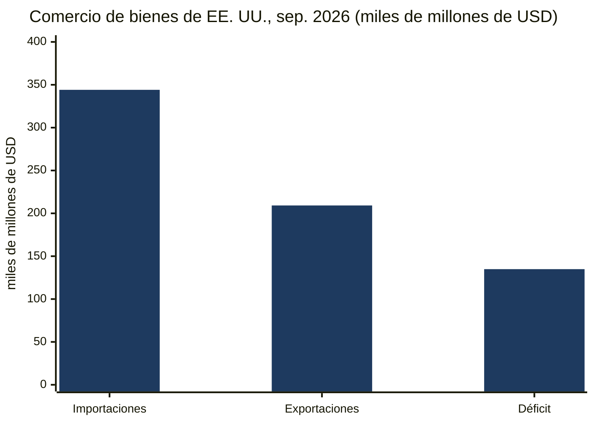
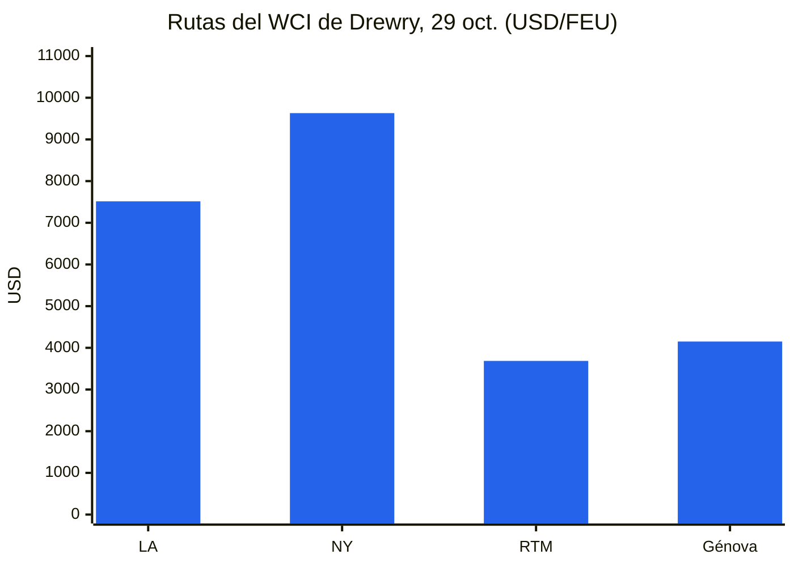
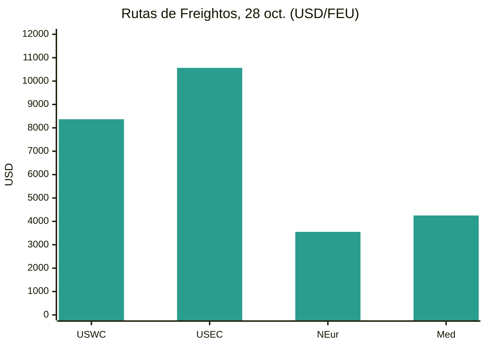
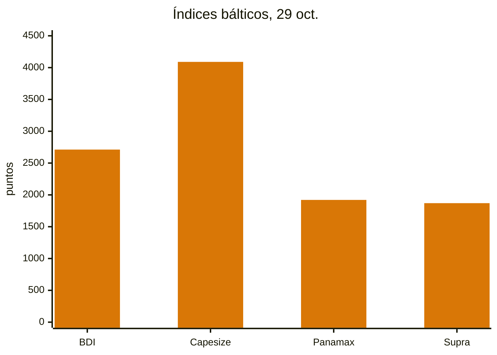
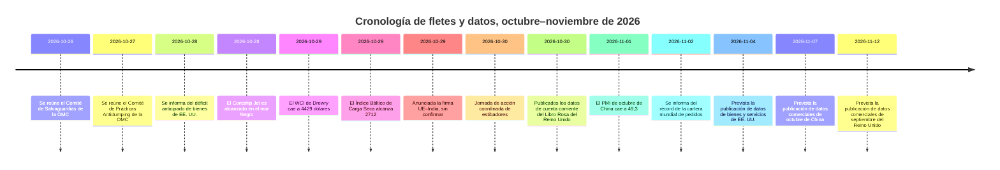

# Informe de Inteligencia Comercial Global — Semana del 26 de octubre al 2 de noviembre de 2026

**Boletín semanal.** Periodo de cobertura: 26 de octubre–2 de noviembre de 2026. Compilado a partir de aproximadamente 45 fuentes mundiales de noticias comerciales, políticas, datos y fletes.

---

## Índice

1. [Resumen ejecutivo](#1-executive-summary)
2. [Alertas](#2-alerts)
3. [Principales noticias — análisis en profundidad](#3-top-stories--deep-dives)
4. [Seguimiento de aranceles](#4-tariff-tracker)
5. [Análisis en profundidad de la política de EE. UU.](#5-us-policy-deep-dive)
6. [Política mundial por región](#6-world-policy-by-region)
7. [Medidas de ejecución](#7-enforcement-actions)
8. [Datos publicados](#8-data-releases)
9. [Mercado de fletes](#9-freight-market)
10. [Cronologías de políticas](#10-policy-timelines)
11. [Próximos plazos y eventos (próximos 90 días)](#11-upcoming-deadlines--events-next-90-days)
12. [Fuentes y metodología](#12-sources--methodology)

---

## 1. Resumen ejecutivo

Una semana dominada por plazos aún sin resolver: el vencimiento el 9 de noviembre de 178 exclusiones de productos de la Sección 301 frente a China y de la suspensión de las tasas portuarias de la Sección 301 sobre buques vinculados a China, un conflicto laboral de 250 trabajadores que podría paralizar el complejo portuario de contenedores más activo de Estados Unidos al día siguiente de las elecciones intermedias, y una fuerte escalada del riesgo naviero en el estrecho de Ormuz y el mar Negro. En ese contexto, la Unión Europea avanzó en varios frentes a la vez en su programa de defensa comercial frente a China, entró en vigor la lista arancelaria revisada del 50% de Canadá y Estados Unidos registró un mes récord de importaciones de bienes impulsadas por bienes de capital relacionados con la inteligencia artificial.

- **El precipicio del 9 de noviembre está ya a una semana, y ambos plazos siguen sin resolverse.** Las 178 exclusiones de productos restantes de la Sección 301 frente a China vencen a las 23:59, hora del Este, del 9 de noviembre de 2026, sin que se haya encontrado ningún aviso de prórroga en esta semana de cobertura; las entradas a partir del 10 de noviembre vuelven a los tipos de lista. La propuesta de la USTR de prorrogar la suspensión de las tasas portuarias de la Sección 301 sobre buques vinculados a China y los derechos conexos sobre grúas hasta el 9 de enero de 2027 se publicó en el Registro Federal el 26 de octubre, con comentarios que cerraron el 30 de octubre, pero hasta el 2 de noviembre no se había publicado ningún aviso definitivo. Los dos instrumentos son independientes: finalizar uno no prorroga el otro. Otra suspensión publicada —la suspensión de la Regla de Afiliados de la Oficina de Industria y Seguridad— también vence según su texto publicado el 9–10 de noviembre, con una prórroga anunciada hasta el 10 de enero de 2027 que no se había publicado en el boletín oficial al 31 de octubre.
- **La lista revisada del 50% de Canadá entró en vigor el 30 de octubre.** La proclamación firmada el 23 de octubre eliminó 22 clasificaciones de la lista de la Sección 338 y añadió 100, manteniendo sin cambios el tipo del 50%. El derecho se acumula sobre los derechos de la Sección 232 y se aplica incluso a mercancías que cumplen los requisitos del Tratado entre México, Estados Unidos y Canadá. La CBP publicó orientaciones de aplicación el 29 de octubre (CSMS n.º 70314289). La misma semana, el Senado votó 50–46 a favor de poner fin a la emergencia nacional invocada para los aranceles a Canadá —una votación sin efecto jurídico sobre los derechos— y el primer ministro de Canadá afirmó que Ottawa estaba "lejos" de un acuerdo antes de las elecciones intermedias, mientras Washington describía un acuerdo como cercano. La primera impugnación judicial de la Sección 338, presentada el 20 de octubre por un importador de queso de Nueva Jersey, recibió una amplia cobertura durante la semana junto con el cambio de lista.
- **El riesgo naviero escaló en dos escenarios a la vez.** El 29 de octubre, una embarcación pequeña adosó dos artefactos explosivos al casco del petrolero de crudo Louise 1, con bandera de Panamá, en el estrecho de Ormuz, a unas 25 millas náuticas al noreste de Jasab, Omán; el incendio resultante en la sala de máquinas dejó temporalmente sin propulsión al buque, aunque la tripulación resultó ilesa y el buque continuó su travesía. Reuters, citando tres fuentes de seguridad marítima, lo describió como el primer ataque exitoso con minas lapa en la vía navegable desde que comenzó la guerra entre Estados Unidos e Irán en febrero de 2026. Drewry informó de solo dos buques en tránsito por el estrecho de Ormuz en la semana anterior, frente a 62 tránsitos por el canal de Suez, el nivel semanal más alto del año. En el mar Negro, el portacontenedores Contship Jet, con bandera de Liberia, fue alcanzado por tres drones marítimos el 28 de octubre dentro de la zona económica exclusiva de Bulgaria y se hundió alrededor de la medianoche; los 18 tripulantes fueron rescatados, pero 20 de sus 421 contenedores cayeron al mar, entre ellos baterías de iones de litio y otros materiales peligrosos.
- **El programa europeo frente a China pasó de las señales a los casos formales.** La Comisión Europea impuso derechos antidumping definitivos del 39,8% al 48,1% sobre el PET Spunbond chino durante cinco años el 30 de octubre, abrió una investigación antidumping sobre el fluoruro de polivinilideno procedente de China, India y Japón el 28 de octubre, ordenó el registro de las importaciones de silicio chino a partir del 27 de octubre durante una revisión de derechos, y vio cómo los Estados miembros aprobaban derechos antidumping a largo plazo sobre el dióxido de titanio chino con efecto a partir del 11 de enero. La propuesta de diciembre de la Comisión de un instrumento para limitar la dependencia de fuentes únicas de suministros críticos completó su consulta empresarial el 27 de octubre, sin que aún se hayan publicado una lista de sectores, un umbral o un tipo arancelario. Por separado, la tasa de gestión de la Unión de 2 euros sobre las compras en línea fuera de la UE entró en vigor el 1 de noviembre, sumándose al derecho de 3 euros por artículo sobre los envíos de bajo valor vigente desde el 1 de julio.
- **Estados Unidos importó un valor récord de bienes en septiembre.** La publicación anticipada de la Oficina del Censo del 28 de octubre situó el déficit de bienes de septiembre en 134.900 millones de dólares, un 2,1% más que en agosto, sobre importaciones récord de 344.100 millones de dólares. Las importaciones de bienes de capital subieron un 7,5% intermensual y un 77,2% interanual, y el auge de las importaciones de infraestructura de inteligencia artificial es ya el principal motor del déficit, aun cuando las exportaciones también subieron un 2,6% hasta 209.200 millones de dólares. Los datos comerciales de octubre de China, que mostrarán si su superávit acumulado en el año ha superado el billón de dólares, se esperan el 7 de noviembre y no se publicaron en esta ventana; el PMI manufacturero oficial de octubre de China, publicado el 1 de noviembre, volvió a la contracción, en 49,3, con los nuevos pedidos de exportación en 48,7.
- **Los fletes se dividieron por ruta y por tamaño de buque.** El Índice Mundial de Contenedores de Drewry cayó un 3% hasta 4.429 dólares por contenedor de 40 pies el 29 de octubre, revirtiendo dos subidas semanales, ya que Shanghái–Los Ángeles cayó un 6% hasta 7.514 dólares y Shanghái–Nueva York un 5% hasta 9.631 dólares, mientras Shanghái–Róterdam subió ligeramente un 1% hasta 3.686 dólares. El Índice Báltico de Carga Seca se recuperó hasta 2.712 el 29 de octubre gracias a la fortaleza de los Capesize, aun cuando el Panamax cayó a 1.921, su nivel más bajo desde abril. La fiabilidad de los itinerarios siguió siendo baja: Sea-Intelligence situó el cumplimiento puntual mundial en el 50,6% en septiembre, ligeramente por encima del 49,9% de agosto. Una jornada de acción coordinada de estibadores el 30 de octubre afectó a más de 100 puertos, con un impacto operativo confirmado descrito como limitado en la mayoría de los lugares, y se ha anunciado otra huelga portuaria nacional en Francia para el 5 de noviembre.

**Fletes:** las tarifas spot de contenedores bajaron en el transpacífico mientras Asia–Europa se mantuvo firme; los aumentos de noviembre de las navieras ya están siendo descontados; la carga seca solo se recuperó por la fortaleza del mineral de hierro en los Capesize; los tránsitos por Suez alcanzaron un máximo anual mientras los tránsitos por Ormuz casi se detuvieron; y la carga aérea se fortaleció de cara a la temporada alta gracias a un crecimiento de la demanda superior al de la capacidad.

---

## 2. Alertas

| N.º | Alerta | Vigencia | Impacto | Fuente |
|---|---|---|---|---|
| A1 | 178 exclusiones de productos de la Sección 301 frente a China vencen a las 23:59, hora del Este, del 9 de nov. de 2026; no se encontró prórroga; las entradas del 10 de nov. en adelante vuelven a los tipos de lista (25% en las listas 1–3, 7,5% en la lista 4A) | 9 de nov. de 2026 | Los importadores que declaran los códigos HTSUS 9903.88.69/70 deben revisar precios y confirmar las entradas antes del plazo | [Gateway Lines](https://gatewaylines.com/press-releases/china-section-301-tariffs-stay-178-exclusions-end) |
| A2 | La propuesta de la USTR de prorrogar la suspensión de las tasas portuarias de la Sección 301 hasta el 9 de ene. de 2027 sigue siendo solo una propuesta; los comentarios cerraron el 30 de oct. (expediente USTR-2026-0694); ningún aviso definitivo publicado al 2 de nov. | 9 de nov. de 2026 (vence la suspensión vigente) | Si no se finaliza, las tasas portuarias y los derechos conexos sobre grúas y manipulación de carga se reanudan el 10 de nov. | [Registro Federal](https://www.federalregister.gov/documents/2026/10/26/2026-21755/request-for-comments-on-further-suspension-of-section-301-action-chinas-targeting-of-the-maritime) |
| A3 | Lista de la Sección 338 de Canadá modificada: 22 clasificaciones eliminadas, 100 añadidas; tipo del 50% sin cambios; se acumula sobre los derechos de la Sección 232; se aplica incluso a mercancías que cumplen el T-MEC | 30 de oct. de 2026 | La fecha de entrada, no la de envío, decide entre el 0% y el 50% sobre las mismas mercancías; revisar las clasificaciones de inmediato | [Baker McKenzie](https://globalimportblog.bakermckenzie.com/2026/10/30/us-further-modifies-section-338-tariffs-on-canadian-goods-as-the-tariffs-face-their-first-legal-challenge/) |
| A4 | Escalada en Ormuz: ataque con minas lapa contra el petrolero Louise 1 el 29 de oct.; solo dos tránsitos por Ormuz registrados en la semana anterior; otros incidentes registrados del 30 de oct. al 2 de nov., incluido un petrolero alcanzado por proyectiles al este de Ras al Khafji | 29 de oct.–2 de nov. de 2026 | Los costes de riesgo bélico, desvío y seguros se mantienen elevados; las decisiones de ruta por el Golfo deben valorar las afirmaciones oficiales contradictorias sobre la seguridad de la ruta | [gCaptain](https://gcaptain.com/tanker-in-strait-of-hormuz-hit-by-limpet-mines-security-sources-say/) |
| A5 | Hundimiento en el mar Negro: el portacontenedores Contship Jet fue alcanzado por tres drones marítimos el 28 de oct. en la zona económica exclusiva de Bulgaria y se hundió; 20 de 421 contenedores cayeron al mar, incluidos materiales peligrosos | 28–29 de oct. de 2026 | El riesgo bélico en el mar Negro alcanza ya aguas de un Estado miembro de la UE y la OTAN; los contenedores de mercancías peligrosas a la deriva crean un peligro para la navegación | [Splash247](https://splash247.com/splash-wrap-new-networks-old-faultlines/) |
| A6 | Plazo de huelga de los vigilantes de LA/Long Beach prorrogado hasta las 17:00, hora del Pacífico, del 4 de nov. de 2026; sin acuerdo definitivo; las terminales afectadas gestionan ~85% de la carga de Long Beach y ~33% de la de Los Ángeles | 4 de nov. de 2026 | Un conflicto de 250 trabajadores podría paralizar el trabajo de buques, patios y puertas en las terminales afectadas si otros miembros del ILWU respetan los piquetes; un informe daba en cambio la fecha del 5 de nov. | [Seatrade Maritime](https://www.seatrade-maritime.com/ports-logistics/impending-strike-threatens-la-lb-ports-container-flow) |
| A7 | La tasa de gestión de la Unión de 2 euros sobre las compras en línea fuera de la UE entra en vigor, sumándose al derecho de 3 euros por artículo sobre envíos de hasta 150 euros vigente desde el 1 de jul. de 2026 | 1 de nov. de 2026 | El comercio electrónico de bajo valor y con varios artículos afronta 5 euros por línea antes del IVA; la tasa no es reembolsable aunque se devuelvan las mercancías | [Shipping and Freight Resource](https://www.shippingandfreightresource.com/trade-moves-02-nov-2026/) |
| A8 | Jornada de acción coordinada de estibadores el 30 de oct. en más de 100 puertos; huelga portuaria nacional francesa anunciada para el 5 de nov. | 30 de oct. / 5 de nov. de 2026 | Deslizamientos de atraques y de servicios feeder más allá del 30 de oct., concentrados en los centros de transbordo mediterráneos y las puertas francesas | [Port Technology](https://www.porttechnology.org/news/ports-and-terminals/dockworker-strikes-ports-military-cargo/) |
| A9 | El DHS añade tres empresas chinas de genómica (BGI Group, BGI Genomics, MGI Tech) a la Lista de Entidades de la UFLPA; la lista consolidada suma ya 190 entidades | 29 de oct. de 2026 | Se presume que las mercancías producidas total o parcialmente por estas empresas se elaboran con trabajo forzoso y están prohibidas salvo que se refute la presunción | [LexBlog](https://www.lexblog.com/2026/10/29/dhs-updates-uflpa-entity-list-with-three-companies-engaged-in-genetics-testing/) |
| A10 | Sección 232 sobre robótica y maquinaria industrial: constatación de seguridad nacional, sin arancel aún; negociaciones ordenadas con un informe previsto en 180 días | 28 de oct. de 2026 | El riesgo arancelario se aplaza a la primavera de 2027, no se elimina; mismo modelo que las turbinas eólicas | [Casa Blanca](https://www.whitehouse.gov/fact-sheets/2026/10/fact-sheet-president-donald-j-trump-adjusts-imports-of-robotics-industrial-machinery-and-their-parts-and-components-into-the-united-states/) |

### A1/A2 — Los plazos del 9 de noviembre, a una semana

Los dos instrumentos del 9 de noviembre suelen citarse juntos, pero funcionan de forma independiente. Las exclusiones de productos —164 mantenidas en mayo de 2024 más 14 exclusiones de equipos de fabricación solar añadidas en septiembre de 2024, declaradas bajo los códigos HTSUS 9903.88.69 y 9903.88.70— vencen a las 23:59, hora del Este, del 9 de noviembre, y varias fuentes que informaron entre el 29 y el 31 de octubre no encontraron ningún aviso de prórroga. El aviso de continuación de la USTR del 6/7 de octubre confirmó que continúan las medidas subyacentes de la Sección 301 de 2018; no prorrogó las exclusiones. La suspensión de las tasas portuarias, en cambio, es objeto de una propuesta vigente: el aviso del Registro Federal publicado el 26 de octubre (91 FR 67388) propone suspender, desde las 00:00, hora del Este, del 10 de noviembre de 2026 hasta las 23:59, hora del Este, del 9 de enero de 2027, las tasas por servicios de transporte marítimo de los anexos I–III de la medida del 23 de abril de 2025 (modificada el 16 de octubre de 2025) y los derechos del anexo V.A sobre grúas buque-tierra chinas y equipos de manipulación de carga, de modo que no se devengaría ninguna obligación durante la suspensión. El motivo declarado es permitir nuevas negociaciones con China. La propuesta abarca solo dos meses, mucho menos que la suspensión de un año a la que sustituiría.

**Análisis:** importadores y navieras afrontan exposiciones distintas en la misma fecha. Un importador con entradas que declaran los epígrafes de exclusión debe planificar con los tipos de lista a partir del 10 de noviembre, con independencia de lo que ocurra con las tasas portuarias. Una naviera solo afronta la reinstauración de las tasas si la propuesta no se finaliza. Ambos deben seguirse como instrumentos escritos, no como una única "tregua": el calendario político (una tregua que se discute hasta el 10 de enero de 2027) y el calendario reglamentario (9 de noviembre) siguen siendo cosas distintas.

### A3 — Canadá: el cambio de lista que entró en vigor a mitad de semana

La proclamación del 23 de octubre, publicada en el Registro Federal el 30 de octubre y efectiva a las 00:01, hora del Este, de ese día para las mercancías entradas o retiradas de almacén para consumo a partir de esa fecha, eliminó 22 clasificaciones y añadió 100, todas bajo el epígrafe 9903.03.14; los epígrafes 9903.03.12 y 9903.03.13 no cambiaron. Entre las líneas eliminadas figuran ciertas láminas de contrachapado, productos de papel, maquinaria y equipos de refrigeración, cajas y cajones de embalaje, film plástico, cajas de cartón y maquinaria alimentaria. Entre las líneas añadidas figuran alfombras y moquetas, ciertos productos de madera y papel, productos químicos como pinturas, jabones y lubricantes, y productos de consumo como cacao en polvo, suelos de vinilo, canoas, arcones congeladores, champús y jabón de tocador, así como válvulas, instrumentos, aparatos de aire acondicionado de ventana y reactivos de diagnóstico. Las descripciones de los anexos son meramente informativas; el código HTS controla el alcance.

**Análisis:** la consecuencia práctica es de calendario. Un arcón congelador solo debía derechos de la Sección 232 sobre el acero hasta el 29 de octubre y sumó la Sección 338 el 30 de octubre; el contrachapado se movió en sentido contrario. Como el derecho se aplica con independencia del origen T-MEC y además de los derechos de la Sección 232, la planificación del origen no lo evita. El efecto neto es un intercambio estructural más que una desescalada: el alivio se concentró en las cadenas de suministro agrícola y forestal vinculadas a Maine, y la nueva exposición se extendió a bienes de consumo e industriales.

### A4/A5 — Dos escenarios, una semana

El ataque en Ormuz del 29 de octubre siguió un patrón ya visible en los datos: los tránsitos por Ormuz no vinculados a Irán habían caído a 104 en la semana del 5 al 11 de octubre, desde 126 en la semana del 28 de septiembre al 4 de octubre, y Lloyd's List Intelligence contó al menos 28 ataques denunciados o confirmados en Ormuz y las vías navegables circundantes en la primera quincena de octubre. El incidente del 29 de octubre añadió un nuevo método —explosivos adosados al casco a corta distancia, lanzados desde pequeñas embarcaciones contra un petrolero en movimiento— a las minas y los proyectiles. Las afirmaciones contradictorias complicaron entonces el panorama: la Guardia Revolucionaria Islámica de Irán afirmó que tres petroleros chocaron con minas navales en una ruta meridional "no autorizada" y el ejército iraní informó de un cuarto al este de la vía navegable, un día después de que el Mando Central de Estados Unidos dijera que las afirmaciones sobre minas eran falsas y que las rutas principales estaban despejadas. La UKMTO documentó daños, pero no confirmó las minas como causa. En el mar Negro, el hundimiento del Contship Jet fue el quinto ataque con drones contra buques en la zona económica exclusiva de Bulgaria solo en octubre, según BTA tal como se cita en la cobertura, y el segundo hundimiento mercante en el mar Negro occidental en una semana, tras el Khoryv frente a Constanza. No se había hecho pública ninguna atribución oficial del ataque al Contship Jet; una evaluación de Ambrey, vía Reuters, según la cual la embarcación se parecía al diseño Murena-300S de fabricación rusa, no es una atribución.

**Análisis:** los cargadores ya no pueden tratar ninguna de las dos vías navegables como una cuestión binaria de abierta o cerrada. Ormuz está casi cerrada al tráfico comercial según el recuento de tránsitos de Drewry, mientras Suez se normaliza; el riesgo en el mar Negro alcanza ya al tonelaje de contenedores en una ruta Israel–Rumanía dentro de la zona económica exclusiva de un Estado miembro de la UE, con carga peligrosa en el agua. Los seguros, el desvío y las declaraciones de mercancías peligrosas deben evaluarse viaje a viaje.

---

## 3. Principales noticias — análisis en profundidad

### 3.1 El precipicio del 9 de noviembre, y un tercer plazo que nadie vigila

Más allá de los dos plazos de la Sección 301, la suspensión de la Regla de Afiliados de la Oficina de Industria y Seguridad vence según su texto publicado el 9–10 de noviembre de 2026. La regla, fechada el 29 de septiembre de 2025, extiende las restricciones de la Lista de Entidades, de Usuario Final Militar y de Nacionales Especialmente Designados a las filiales extranjeras participadas en un 50% o más por partes listadas. El secretario del Tesoro, Scott Bessent, anunció el 24 de septiembre de 2026 que la tregua entre Estados Unidos y China, y en correspondencia la suspensión, se prorrogarían hasta el 10 de enero de 2027, pero al 31 de octubre, fecha de corte de una fuente, no se había publicado ningún aviso en el Registro Federal que prorrogara formalmente la suspensión. Los exportadores no deben confiar en la prórroga hasta que la BIS la publique. La misma cautela se aplica a la propuesta sobre tasas portuarias: ampliamente titulada como un aplazamiento hasta el 9 de enero, es una propuesta cuyo periodo de comentarios cerró el 30 de octubre, no una norma definitiva.

**Análisis:** tres instrumentos distintos vencen con aproximadamente un día de diferencia, cada uno con un decisor distinto y una forma jurídica distinta. Tratar cualquiera de ellos como prorrogado sobre la base de un anuncio, un titular o la suerte de un instrumento paralelo es el principal riesgo de cumplimiento de la próxima semana. La posición escrita del Registro Federal el 9 de noviembre es la única base segura para las entradas, los viajes y la selección de exportaciones.

### 3.2 Ormuz y el mar Negro: la escalada como variable del mercado naviero

Las noticias navieras de la semana se leen mejor como una única variable —el riesgo bélico— que se mueve en direcciones opuestas en distintas vías navegables. Los tránsitos por Suez subieron a 62 buques en la semana comunicada por Drewry el 29 de octubre, el nivel semanal más alto del año, y Alphaliner estimó que casi dos tercios de la capacidad total Asia–Europa se había restablecido vía el mar Rojo, incluido el regreso de ZIM a la ruta para su servicio conjunto Asia–costa este de Estados Unidos con MSC. Más de 100 portacontenedores de 16.000 TEU o más transitaron por Suez desde principios de septiembre, superando los 99 registrados en todo 2025 más enero–agosto de 2026 juntos, y en 2026 se registraron hasta ahora 192 tránsitos de buques ultragrandes, frente a 8 en 2025. Al mismo tiempo, los tránsitos por Ormuz cayeron a dos buques en el recuento semanal de Drewry, el Brent tocó los 118 dólares en los contratos de diciembre que vencían el 30 de octubre —su nivel más alto desde el 30 de abril— y los hutíes reivindicaron ataques con misiles contra las refinerías de Ras Tanura y Rabigh, una instalación de Aramco en Abqaiq y los aeropuertos de Riad y Dammam, en represalia por los bombardeos saudíes en Yemen que, según dijeron, mataron a 27 personas; la coalición liderada por Arabia Saudí afirmó haber interceptado los misiles y no haber confirmado daños. La armada de Omán evacuó a 25 tripulantes del petrolero en llamas Riti, con bandera de Panamá, el 30 de octubre, y un informe de materias primas del 2 de noviembre que citaba a la UKMTO contó diez incidentes navieros en Ormuz, el Golfo y el golfo de Omán entre el 31 de octubre y el 2 de noviembre.

**Análisis:** el regreso a Suez está liberando capacidad efectiva y presionando las tarifas Asia–Europa, mientras la perturbación en Ormuz está tensionando los costes de la energía y de las rutas del Golfo. Los dos efectos no se cancelan: afectan a tráficos distintos, a cargas distintas y a líneas de seguro distintas. La consecuencia operativa es que una narrativa de "regreso a la normalidad" para un corredor no debe aplicarse al otro.

### 3.3 Canadá: alivio, escalada y un caso judicial en la misma semana

El expediente de Canadá combinó cuatro acontecimientos distintos. Primero, el cambio de lista de la Sección 338 entró en vigor el 30 de octubre (véase la sección 2, A3). Segundo, el Senado votó 50–46 el 29 de octubre a favor de poner fin a la emergencia nacional invocada para los aranceles a Canadá, a iniciativa del senador Tim Kaine, con cuatro republicanos —Susan Collins de Maine, Mitch McConnell de Kentucky, Lisa Murkowski de Alaska y Rand Paul de Kentucky— sumándose a los demócratas; siguió a una votación del Senado del 28 de octubre contra los aranceles a Brasil. Las normas de procedimiento de la Cámara, según se informa, bloquean su examen y sería posible un veto presidencial, por lo que la votación no produce ningún cambio arancelario. Tercero, las versiones sobre la negociación divergieron: Reuters informó el 26 de octubre de que los funcionarios exploraban un acuerdo para suavizar los derechos de la Sección 232 del 50% sobre el acero y del 25% sobre los automóviles, con el secretario de Comercio, Howard Lutnick, en contacto regular con el ministro de Comercio Canadá–Estados Unidos, Dominic LeBlanc; el 28 de octubre un funcionario canadiense describió el avance como "limitado"; el 29 de octubre el primer ministro Mark Carney afirmó que Canadá estaba "lejos" de un acuerdo antes de las elecciones intermedias y que no aceptaría uno a cualquier precio, señalando que las conversaciones se rompieron en agosto de 2026 por las condiciones de Estados Unidos que, según Canadá, limitarían su capacidad de negociar con otros países, socavarían los requisitos de lengua francesa y perjudicarían al sector automovilístico. El presidente, hablando en Míchigan el 25 de octubre y en Carolina del Sur el 29 de octubre, describió un acuerdo como cercano y a Canadá tratando a Estados Unidos "extremadamente bien". Cuarto, la primera impugnación judicial de la Sección 338 —Gellert Global Group contra Trump, presentada el 20 de octubre ante el Tribunal de Comercio Internacional de Estados Unidos por un importador de alimentos de Nueva Jersey de queso canadiense (unos 71 millones de dólares de importaciones de queso canadiense en 2025, con el asesoramiento de Liberty Justice Center)— pide al tribunal que declare ilegales los derechos, bloquee su cobro y ordene devoluciones con intereses, argumentando que la Sección 301 desplazó a la Sección 338, que las medidas no superan las pruebas de discriminación y compensación de la Sección 338, y que las adiciones de septiembre solo recibieron siete días en lugar de un periodo de espera obligatorio de 30 días según se alega. No se informó de ninguna resolución sobre el fondo.

**Análisis:** la votación, las conversaciones y la demanda tiran en direcciones distintas y ninguna de ellas cambia un tipo arancelario esta semana. El único instrumento con efecto comercial inmediato es el cambio de lista del 30 de octubre, y el único que podría deshacer el régimen es el caso judicial, que tardará meses. Los importadores deben separar la señal política del efecto jurídico.

### 3.4 Europa: una semana de defensa comercial, y un instrumento de diciembre que toma forma

El programa de la Unión Europea frente a China produjo medidas formales en cuatro vías en una semana. El 30 de octubre se impusieron derechos antidumping definitivos sobre el PET Spunbond chino (39,8% a 48,1%, cinco años, en sustitución de los derechos provisionales del 45,6% al 50% vigentes desde mayo de 2026) sobre un mercado por valor de 200 millones de euros, con la industria de la UE radicada en Alemania, Italia y Francia. El 28 de octubre se abrió una investigación antidumping sobre el fluoruro de polivinilideno procedente de China, India y Japón, tras la apertura el 16 de octubre de la investigación sobre el alcohol furfurílico procedente de China. Se ordenó el registro en aduana de las importaciones de silicio chino a partir del 27 de octubre durante nueve meses, mientras la Comisión revisa si los derechos antidumping vigentes siguen siendo suficientes, una revisión abierta el 1 de septiembre a petición de Euroalliages, que representa a todos los productores de la UE. Los Estados miembros aprobaron derechos antidumping a largo plazo sobre el dióxido de titanio chino, cifrados en 0,25 euros por kilogramo para Anhui Jinxing Group y 0,74 euros por kilogramo para Longbai Group, con 0,64 euros por kilogramo para las empresas cooperantes y 0,74 euros por kilogramo para todas las demás, con efecto a partir del 11 de enero durante cinco años; las importaciones chinas de dióxido de titanio superaron los 500 millones de euros en 2023. Detrás de estos casos está la señal de la reunión informal del Consejo en Dublín el 23 de octubre, en la que el comisario de Comercio, Maroš Šefčovič, afirmó que el sector de los plásticos era "el más cercano" a una posible investigación de salvaguardia. El déficit de bienes de la UE con China se cifró en más de 1.000 millones de euros al día, más de 370.000 millones de euros en 2025 y una previsión superior a 400.000 millones de euros en 2026, con un déficit de casi 197.000 millones de euros en el primer semestre de 2026 según un informe basado en Politico.

El instrumento de diciembre avanzó en paralelo. La consulta empresarial sobre una herramienta para forzar la diversificación frente a la dependencia de un único país proveedor de suministros críticos concluyó el 27 de octubre, con una propuesta prevista para principios de diciembre, justo antes de la reunión de los líderes de la UE del 17–18 de diciembre. La consulta confirmó que el instrumento se dirigiría a situaciones en las que una fuerte dependencia de un único país proveedor amenaza la seguridad del suministro o la estabilidad económica de la UE; no se ha publicado ninguna lista de sectores, porcentaje umbral ni tipo arancelario. BusinessEurope advirtió de que el aprovisionamiento alternativo elevará los precios; el comisario Šefčovič afirmó en un discurso de junio de 2026, según se cita en la cobertura, que las empresas deben absorber "el coste de la resiliencia". Se discuten dos formas: un mandato de diversificación minimalista, al estilo energético, para bienes de defensa y de doble uso, o un modelo maximalista de umbral en el que comprar más de una cuota fija a una sola fuente podría desencadenar aranceles.

**Análisis:** la UE está ejecutando un programa sector por sector —híbridos con tope, plásticos más cerca de una salvaguardia, productos químicos en investigación formal, silicio en revisión— en lugar de una única medida amplia. El instrumento de diciembre mostrará si ese programa se generaliza en una herramienta para toda la economía o se mantiene sectorial. En cualquier caso, la dirección apunta a más, no menos, medidas de defensa comercial frente a China en 2027.

### 3.5 Dos déficits, dos direcciones: Estados Unidos importa más, China exporta más — por ahora

La publicación anticipada de septiembre de la Oficina del Censo, publicada el 28 de octubre, situó el déficit de bienes de Estados Unidos en 134.900 millones de dólares, 2.800 millones de dólares o un 2,1% más que los 132.100 millones de agosto, el mayor desde marzo de 2025 y por encima de una previsión de consenso de Reuters/Bloomberg de 130.200 millones de dólares. Las importaciones alcanzaron un récord de 344.100 millones de dólares, 8.100 millones de dólares o un 2,4% más; las importaciones de bienes de capital subieron un 7,5% intermensual y un 77,2% interanual. Las exportaciones subieron un 2,6% hasta 209.200 millones de dólares, con los envíos de alimentos un 12,8% más y las exportaciones de bienes de consumo un 6,5% más; las importaciones de bienes de consumo subieron un 3,1% y las de otros bienes un 6,7%, mientras los suministros industriales, incluidos el oro y el petróleo, cayeron un 6,0%. Las estimaciones de economistas situaron el lastre comercial del tercer trimestre sobre el PIB en 4 puntos porcentuales (Pantheon Macroeconomics) y 3,25 puntos porcentuales (Oxford Economics); son estimaciones, no datos oficiales. La publicación completa de bienes y servicios se espera el 4 de noviembre. El déficit de bienes y servicios de agosto, publicado el 6 de octubre, fue de 105.600 millones de dólares sobre una base distinta y no es directamente comparable con la cifra anticipada de bienes.

Los datos de septiembre de China, comunicados el 20–21 de octubre, mostraron exportaciones un 36,3% interanual más altas, hasta unos 447.180 millones de dólares, e importaciones un 31% más altas, hasta unos 313.650 millones de dólares, un superávit mensual de 133.500 millones de dólares y un superávit acumulado de enero a septiembre de 938.100 millones de dólares, en camino de superar el récord de 2025 de unos 1,19 billones de dólares, un umbral que en 2025 no se cruzó hasta noviembre. El superávit de septiembre con la Unión Europea fue un récord de 34.800 millones de dólares, y el superávit con Estados Unidos se amplió a 34.000 millones de dólares, un máximo de 20 meses. Pero el panorama de octubre, publicado el 1 de noviembre, apunta en sentido contrario: el PMI manufacturero oficial cayó a 49,3 desde 50,1 en septiembre, los nuevos pedidos de exportación cayeron a 48,7 desde 50,0 y el subíndice de producción cayó a 49,8 desde 51,7. Un artículo del 1 de noviembre que resumía los tres primeros trimestres situó las exportaciones un 16,4% interanual más altas, hasta 3,46 billones de dólares, con los productos mecánicos y eléctricos un 15,6% más, los bienes de alta tecnología un 21,6% más y los bienes de consumo un 14,9% más.

**Análisis:** el auge de septiembre y la contracción del PMI de octubre no son contradictorios; describen momentos distintos. La cuestión para la próxima semana es si los datos aduaneros de octubre, previstos para el 7 de noviembre, confirman un enfriamiento o prolongan el auge más allá del billón de dólares. Cualquiera de los dos resultados se leerá en Bruselas y Washington como evidencia sobre el superávit, no solo como una estadística.

### 3.6 Fletes: el pico ha pasado en el transpacífico, pero la capacidad no se comporta con normalidad

Sea-Intelligence informó el 29 de octubre de que la capacidad semanal alcanzó máximos históricos en todas las principales rutas Este–Oeste, rompiendo la reducción normal posterior a la Semana Dorada observada entre 2012 y 2025, y lo atribuyó a la acumulación de buques por la congestión portuaria asiática y a la falta de fiabilidad de los itinerarios, que desplazó las salidas del tercer trimestre a octubre–noviembre, no a un repunte de la demanda. Asia–Norte de Europa superó los 350.000 TEU semanales en octubre y noviembre, Asia–Mediterráneo superó los 260.000 TEU semanales, Asia–costa oeste de Norteamérica alcanzó casi 393.000 TEU en octubre, con una previsión sin precedentes de 400.000 TEU en noviembre, y Asia–costa este registró sus niveles más altos de cualquier año en octubre–noviembre. El tifón Champi, la tormenta más fuerte de 2026, contribuyó directamente: cerró los puertos taiwaneses de Kaohsiung, Keelung y Taipéi el 23 de octubre, suspendió Ningbo desde la noche del 23 de octubre hasta alrededor del mediodía del 25 de octubre y Shanghái desde la noche del 24 de octubre hasta alrededor del mediodía del 25 de octubre, y dejó retrasos relacionados con la congestión de unos cuatro días en Shanghái y Ningbo mientras se despejaban los atrasos. La congestión portuaria mundial se cifró en 3,36 millones de TEU, o el 9,7% de la flota, en la actualización del 23 de octubre de SEKO.

**Análisis:** una capacidad desplegada récord junto a una demanda débil explica por qué las navieras no pueden sostener los aumentos de tarifas pese a los titulares sobre congestión. El mercado está congestionado y sobreabastecido a la vez —la congestión es un artefacto de programación, no una señal de demanda— y esa combinación apunta a una presión continua sobre las tarifas de cara a la temporada de contratos anuales, a menos que la capacidad se retire más rápido de lo que se libera la acumulación.

---

## 4. Seguimiento de aranceles

| País / medida | Tipo / detalle | Vigencia / situación | Fuente |
|---|---|---|---|
| Canadá — lista de la Sección 338 modificada (22 eliminadas, 100 añadidas) | 50% ad valorem, se acumula sobre la Sección 232, se aplica incluso a mercancías que cumplen el T-MEC | En vigor desde el 30 de oct. de 2026; CSMS de la CBP n.º 70314289 del 29 de oct. | [Baker McKenzie](https://globalimportblog.bakermckenzie.com/2026/10/30/us-further-modifies-section-338-tariffs-on-canadian-goods-as-the-tariffs-face-their-first-legal-challenge/) |
| Canadá — contraaranceles sobre bienes de EE. UU. | Sobretasas del 15% / 25% / 50% sobre ~27.600 millones de dólares canadienses de bienes de origen estadounidense (648 artículos) | En vigor desde el 8 de sep. de 2026; piezas de reparación de tractores, cosechadoras y maquinaria agrícola al 0% de remisión hasta el 30 de jun. de 2027 | [JD Supra](https://www.jdsupra.com/legalnews/update-on-the-u-s-canada-trade-conflict-3530187/) |
| Canadá — acero / automóviles de la Sección 232 (derechos de EE. UU.) | 50% acero, 25% automóviles; conversaciones sobre una suavización comunicadas el 26 de oct., sin acuerdo | En vigor; conversaciones sobre un acuerdo en curso |  |
| México — arancel de EE. UU. sobre vehículos | 25% actualmente; México busca una reducción al 15% manteniendo las deducciones basadas en el contenido | Sin acuerdo al 28 de oct. de 2026 |  |
| China — exclusiones de productos de la Sección 301 (178) | Vuelven al 25% (listas 1–3) / 7,5% (lista 4A) al vencimiento | Vencen a las 23:59, hora del Este, del 9 de nov. de 2026; no se encontró prórroga | [Gateway Lines](https://gatewaylines.com/press-releases/china-section-301-tariffs-stay-178-exclusions-end) |
| China — tasas portuarias marítimas de la Sección 301 | 50 dólares/tonelada neta (empresas no chinas que usan buques construidos en China); empresas chinas 18 dólares/tonelada neta o 120 dólares/contenedor, la cantidad mayor; portavehículos 150 dólares/unidad equivalente a automóvil — si caduca la suspensión | La suspensión vence a las 23:59, hora del Este, del 9 de nov. de 2026; prórroga hasta el 9 de ene. de 2027 propuesta, no definitiva | [Registro Federal](https://www.federalregister.gov/documents/2026/10/26/2026-21755/request-for-comments-on-further-suspension-of-section-301-action-chinas-targeting-of-the-maritime) |
| China — turbinas eólicas de la Sección 232 | Sin arancel aún; negociaciones ordenadas, actualización en 180 días | Proclamación del 22 de oct. de 2026; publicada en el RF el 28 de oct. de 2026; actualización prevista hacia el ~20 de abr. de 2027 | [Thompson Hine](https://www.thompsonhinesmartrade.com/2026/10/president-trump-opts-for-negotiations-not-tariffs-in-section-232-wind-turbine-investigation/) |
| China — robótica / maquinaria industrial de la Sección 232 | Sin arancel, cuota ni tasa aún; negociaciones ordenadas, informe en 180 días | Proclamación del 28 de oct. de 2026; publicación en el RF prevista el 2 de nov. de 2026; informe previsto hacia el ~26 de abr. de 2027 | [Casa Blanca](https://www.whitehouse.gov/fact-sheets/2026/10/fact-sheet-president-donald-j-trump-adjusts-imports-of-robotics-industrial-machinery-and-their-parts-and-components-into-the-united-states/) |
| China — remolques tipo furgón / subconjuntos (órdenes AD + CVD) | Depósito por dumping del 129,73% y tipo de subvención del 134,75% según se informa; depósitos combinados por encima del 260% | Órdenes publicadas el 28 de oct. de 2026 | [Registro Federal (PDF)](https://public-inspection.federalregister.gov/2026-21929.pdf) |
| China — carritos de compra / piezas (peticiones AD + CVD) | Márgenes de dumping alegados del 165%–343% más subvenciones alegadas (alegaciones, no derechos) | Peticiones presentadas el 28 de oct. de 2026; inicio por Comercio previsto el 17 de nov. (7 de dic. si se prorroga); determinación preliminar de daño de la ITC prevista el 14 de dic. | [LexBlog](https://www.lexblog.com/2026/10/29/new-ad-cvd-petitions-filed-on-shopping-carts-from-china/) |
| China — cajas de cartón ondulado troqueladas (investigaciones AD, con Malasia y Turquía) | Solo investigaciones; sin tipos aún | Iniciadas el 26 de oct. de 2026 (aplicables el 19 de oct.); comentarios sobre el alcance previstos el 9 de nov. | [Registro Federal (PDF)](https://public-inspection.federalregister.gov/2026-21783.pdf) |
| China — compuestos de amina / catalizadores de poliuretano (investigaciones AD + CVD) | Márgenes de dumping alegados del 244,94%–352,32% (alegaciones, no derechos) | Iniciadas el 26 de oct. de 2026 (aplicables el 19 de oct.); determinación preliminar de daño de la ITC prevista ~13 de nov. |  |
| UE — PET Spunbond procedente de China (AD definitivo) | 39,8%–48,1%, cinco años | Impuesto el 30 de oct. de 2026 (provisional del 45,6%–50% desde mayo de 2026) | [Comisión Europea](https://policy.trade.ec.europa.eu/news/commission-acts-against-imports-pet-spunbond-china-2026-10-30_en) |
| UE — dióxido de titanio procedente de China (AD a largo plazo aprobado) | 0,25 €/kg (Anhui Jinxing), 0,74 €/kg (Longbai), 0,64 €/kg (cooperantes), 0,74 €/kg (todas las demás) según se informa | En vigor desde el 11 de ene. de 2027, cinco años |  |
| UE — silicio procedente de China (registro durante la revisión AD) | Registro durante nueve meses; se preserva una posible acción retroactiva | Registro desde el 27 de oct. de 2026; revisión abierta el 1 de sep. de 2026 |  |
| UE — PVDF procedente de China, India y Japón (investigación AD) | Solo investigación; sin tipos aún | Abierta el 28 de oct. de 2026 |  |
| UE — alcohol furfurílico procedente de China (investigación AD) | Solo investigación; sin tipos aún | Abierta el 16 de oct. de 2026 |  |
| UE — vidrio solar procedente de China (derechos derogados) | AD del 17,5%–75,4% y CVD del 3,2%–17,1% derogados; derechos pagados desde el 22 de jul. de 2025 reclamables sin intereses | En vigor desde el 22 de oct. de 2026 |  |
| UE — vehículos híbridos / híbridos enchufables (entendimiento de salvaguardia mundial) | Tope de 350.000/año, con aumento del 6% anual, cuatro años | Acordado ~9–12 de oct. de 2026; aplicación prevista para principios de diciembre de 2026 |  |
| UE — tasa de gestión de la Unión sobre ventas a distancia fuera de la UE | 2 € por artículo, además del derecho de 3 € por artículo sobre envíos de hasta 150 € | En vigor desde el 1 de nov. de 2026; derecho de 3 € vigente hasta el 1 de jul. de 2028; tasa de 2 € permanente | [Shipping and Freight Resource](https://www.shippingandfreightresource.com/trade-moves-02-nov-2026/) |
| Japón — acero inoxidable laminado en frío con níquel añadido procedente de China / Taiwán (AD definitivo) | 3,6%–42,1%, cinco años | 31 de oct. de 2026 – 30 de oct. de 2031 |  |
| Australia — ventanas / puertas de aluminio procedentes de China (garantías provisionales AD / CVD) | Hasta el 73,3% para algunos exportadores (garantías provisionales, no derechos definitivos) | En vigor desde el 15 de oct. de 2026; recomendaciones definitivas previstas para diciembre de 2026 |  |
| China — licencias de exportación de roca fosfática / plata | Gestión de cuotas suspendida hasta 2027; se mantiene la licencia de envío | 1 de ene. – 31 de dic. de 2027; asignaciones de cuotas hacia el 15 de dic. de 2026 |  |
| China — preferencia arancelaria cero para 53 naciones africanas | 100% de las líneas arancelarias libres de derechos para 33 países africanos menos adelantados desde el 1 de dic. de 2024; 20 economías no PMA añadidas el 1 de mayo bajo preferencia temporal hasta el 30 de abr. de 2028 | Reafirmada el 30 de oct. de 2026 |  |

---

## 5. Análisis en profundidad de la política de EE. UU.

### La Sección 338 y Canadá

Véanse las secciones 2 (A3) y 3.3 sobre el cambio de lista, la votación del Senado, la divergencia negociadora y la impugnación de Gellert Global Group. Otros dos puntos de la cobertura de la semana importan para los importadores. Primero, la publicación del 30 de octubre en el Registro Federal y la orientación de la CBP del 29 de octubre (CSMS n.º 70314289) son los documentos operativos de aplicación; las descripciones de los anexos de la proclamación son informativas y el código HTS controla el alcance, por lo que la revisión de la clasificación debe hacerse línea por línea y no por descripción del producto. Segundo, la impugnación judicial es la primera prueba judicial de un estatuto que nunca se había utilizado antes de agosto de 2026; una resolución adversa podría deshacer el régimen, incluido el listado del 30 de octubre, pero no se informó de ninguna resolución sobre el fondo y los derechos siguen siendo exigibles entretanto. Los importadores que pagan derechos de la Sección 338 deben conservar la documentación de entrada de forma que sustente una reclamación de devolución si el litigio prospera, sin dar por supuesto ese resultado.

### Una corrección sobre el ampliamente recirculado "aumento del 10% para Canadá"

En la ventana del 26 de octubre al 2 de noviembre no se encontró ninguna proclamación, aviso en el Registro Federal ni orientación de la CBP que impusiera un nuevo arancel del 10% para Canadá. La historia ampliamente recirculada del "aumento del 10% por el anuncio de Ontario con Reagan" se remonta a octubre de 2025, cuando Ontario emitió un anuncio durante las Series Mundiales utilizando declaraciones del expresidente Ronald Reagan sobre los aranceles y el presidente puso fin a las conversaciones con Canadá y publicó una amenaza de aumento del 10%. Ese episodio no es una nueva medida de octubre de 2026 y no debe trasladarse como tal. Por separado, un derecho preexistente del 10% de la Sección 301 por trabajo forzoso, en vigor desde el 24 de julio de 2026 para una medida de 60 economías, es un instrumento distinto. El presidente afirmó el 27 de octubre de 2026 que no esperaba reunirse con el primer ministro Carney "durante un tiempo".

### La Sección 232 — la robótica sigue el modelo de las turbinas eólicas

La Proclamación 11077, firmada el 28 de octubre de 2026 y prevista para su publicación en el Registro Federal el 2 de noviembre (91 FR 69199–69202), coincidió con la constatación de Comercio de que las importaciones de robótica, maquinaria industrial y sus piezas y componentes amenazan la seguridad nacional, pero no impuso ningún arancel, cuota ni tasa. El secretario de Comercio, Howard Lutnick, y la USTR, Jamieson Greer, deben proseguir conjuntamente negociaciones con los socios comerciales e informar de los avances en 180 días, hacia el 26 de abril de 2027. Siguen siendo posibles aranceles, derechos, cuotas, tasas o un programa de incentivos a la producción estadounidense según el resultado de las conversaciones, y los aranceles vigentes de la Sección 232 sobre el acero, el aluminio y el cobre no cambian. La proclamación sobre turbinas eólicas (11074, firmada el 22 de octubre y publicada el 28 de octubre) sigue el mismo modelo: una constatación de seguridad nacional que cita el riesgo de ciberseguridad y acceso remoto de los inversores de fabricación extranjera, la fiabilidad de la red y las interferencias en radares y tráfico aéreo, ningún arancel nuevo específico para la eólica, negociaciones ordenadas y al menos una actualización en 180 días (hacia el 20 de abril de 2027). El contexto comunicado situó las importaciones estadounidenses de turbinas eólicas y componentes en unos 1.800 millones de dólares en 2024, según cobertura secundaria y no verificado frente a una fuente primaria.

**Análisis:** el modelo aplaza el riesgo arancelario a la primavera de 2027 en lugar de eliminarlo. Los importadores de robótica y equipos eólicos deben tratar las ventanas de negociación como el periodo en el que se decidirán el alcance de los productos y las exenciones para los socios, y no deben valorar ninguno de los dos sectores como libre de aranceles más allá de abril de 2027.

### Lista de Entidades de la UFLPA — se añaden empresas de genómica

El Departamento de Seguridad Nacional, como presidente del Grupo de Trabajo para la Aplicación de la Ley contra el Trabajo Forzoso, añadió a Shenzhen BGI Technology Co., Ltd. (BGI Group), BGI Genomics Co., Ltd. y MGI Tech Co., Ltd. —todas radicadas en Shenzhen— a la Lista de Entidades de la UFLPA, con el aviso presentado para inspección pública el 28 de octubre y publicación prevista el 29 de octubre, y la presunción aplicable desde el 29 de octubre. Las tres se añadieron en virtud de la sección 2(d)(2)(B)(ii) (colaboración con el gobierno de Xinjiang en materia de trabajo forzoso); BGI Genomics y BGI Group también se añadieron en virtud de la sección 2(d)(2)(B)(v) (abastecimiento desde Xinjiang). Se presume que las mercancías producidas total o parcialmente por ellas se elaboran con trabajo forzoso y están prohibidas en virtud de 19 U.S.C. §1307, salvo que se refute la presunción. La lista consolidada asciende ya a 190 entidades. Pekín condenó la medida y prometió contramedidas. La consecuencia para la cadena de suministro de las ciencias de la vida es directa: los instrumentos de secuenciación, los reactivos, los consumibles y los kits de pruebas exigen ahora un rastreo de subniveles para detectar la exposición a BGI y MGI.

### Entrada postal de la CBP — el plazo del 20 de enero de 2027 se mantiene

Una norma definitiva de la CBP y una modificación de la prueba de Entrada Tipo 13 publicadas el 22 de octubre de 2026 (91 FR 66638; 91 FR 66707), con cobertura del 28–30 de octubre que confirma la posición operativa, trasladaron la fecha de cumplimiento obligatorio de los requisitos de entrada formal para ciertos envíos postales internacionales del 22 de octubre de 2026 al 20 de enero de 2027 (19 CFR 145.12(a)(2)(v)–(vi)). Los envíos cubiertos son el correo sujeto a requisitos de Agencias Gubernamentales Asociadas (incluida la FDA), a derechos de los capítulos 98/99 o que reclaman el tratamiento libre de derechos del capítulo 98 o de un acuerdo de libre comercio. Por separado, la CBP modificó la prueba de entrada informal electrónica de Entrada Tipo 13 (para correo de hasta 2.500 dólares, iniciada el 22 de septiembre de 2026) para aceptar temporalmente declaraciones sin datos electrónicos completos de las Agencias Gubernamentales Asociadas; la CBP anunciará el fin de esa aceptación en un futuro aviso en el Registro Federal, sin fecha de finalización fijada. La CBP afirma que no hay cambios en los procedimientos de entrada postal internacional antes del 20 de enero de 2027 como resultado de estos requisitos. La prórroga de 90 días no restablece el de minimis ni crea una exención para medicamentos personales con receta; las farmacias y las navieras siguen afrontando un plazo estricto de sistemas el 20 de enero de 2027, y las normas de admisibilidad de la FDA no cambian.

### Devoluciones arancelarias — ningún hito nuevo en la ventana

No se localizó ningún hito nuevo de devolución de la CBP fechado entre el 26 de octubre y el 2 de noviembre. La última posición verificada, como contexto, es que la Fase 3 de CAPE se lanzó el 6 de octubre de 2026 para las entradas finalmente liquidadas, pero solo para importadores con una orden de reliquidación del Tribunal de Comercio Internacional; al 2 de octubre, la CBP había aceptado unos 136.600 millones de dólares en reclamaciones de devolución IEEPA en CAPE y había enviado unos 126.000 millones de dólares (intereses incluidos) al Tesoro para su pago, de un total de unos 166.000 millones de dólares recaudados según la estimación de la Oficina Presupuestaria del Congreso. El 8 de octubre, el juez Eaton del CIT certificó una clase nacional de importadores registrados que pagaron derechos IEEPA entre el 1 de febrero de 2025 y el 19 de febrero de 2026 (excluidas las demandas separadas); la certificación no es una resolución sobre el fondo ni ordena devoluciones, y el gobierno ha recurrido partes de la orden de devolución. Se esperan los primeros pagos de la Fase 3 entre principios de diciembre y principios de enero, según la orientación de 60–90 días de la CBP.

### USTR — otras publicaciones en la ventana

El 26 de octubre, el embajador Greer emitió una declaración sobre el estado de la distensión entre Estados Unidos y la Unión Europea tras un préstamo de 3.400 millones de dólares del Banco Europeo de Inversiones a Airbus en junio de 2026, afirmando que la USTR no había recibido detalles pese a sus solicitudes; Boeing había presionado en favor de la transparencia en julio. La USTR advirtió de que las condiciones del préstamo podrían afectar a la tregua transatlántica sobre financiación de aeronaves, en virtud de la cual se eliminaron los aranceles de la UE sobre bienes industriales a cambio de un arancel estadounidense del 15% sobre la mayoría de los bienes de la UE. No se anunció ningún arancel nuevo. El 28 de octubre, la USTR publicó un comunicado de prensa sobre la "Estrategia de Productos del Mar America First"; en él no se identificó ningún cambio de tipo arancelario.

### Controles de exportación de la BIS — ninguna norma importante nueva; una suspensión sin resolver

No se encontró ninguna norma importante nueva de la BIS en la ventana, más allá de la renovación el 22 de octubre, por un año, de una orden temporal de denegación contra una aerolínea radicada en Teherán y otras partes, que citaba violaciones reiteradas de las Regulaciones de Administración de Exportaciones relacionadas con aeronaves y piezas. La posición de la suspensión de la Regla de Afiliados se describe en la sección 3.1: anunciada como prorrogada hasta el 10 de enero de 2027, pero no publicada en el boletín oficial al 31 de octubre.

### Temas permanentes

Los plazos del 9 de noviembre (sección 2, A1/A2), la fecha de entrada postal del 20 de enero de 2027 y los informes de negociación de la Sección 232 de abril de 2027 son los temas permanentes del calendario. La votación del Senado del 29 de octubre sobre Canadá y la votación del 28 de octubre contra los aranceles a Brasil son señales políticas sin efecto arancelario, salvo que actúe la Cámara y se supere un veto.

---

## 6. Política mundial por región

### Europa

Véase la sección 3.4 sobre los casos de defensa comercial frente a China y el instrumento de suministros críticos de diciembre. Otros tres temas europeos pertenecen al registro. Primero, el análisis de aplicación de la derogación del vidrio solar, publicado el 26 de octubre, confirmó la base restringida de la derogación: los Reglamentos de Ejecución (UE) 2026/2314 (antidumping) y (UE) 2026/2310 (compensatorios) derogaron los derechos definitivos después de que una revisión por expiración constatara que no existía industria activa en la UE ni probabilidad de reanudación: los dos últimos productores, AGC Glass Europe y GMB Glasmanufaktur Brandenburg GmbH, cesaron la producción en el primer trimestre de 2025. Los derechos pagados desde la apertura de la revisión el 22 de julio de 2025 pueden reclamarse sin intereses, y una estimación de la Comisión citada en la cobertura situó en al menos cuatro meses el plazo antes de que se materialicen los beneficios, dados los plazos de producción y envío. La derogación es una liberalización causada por la desaparición de la industria protegida, no un cambio de orientación política. Segundo, se anunció pero no se confirmó la fecha de firma del acuerdo de libre comercio UE–India: el presidente del Consejo Europeo, António Costa, anunció el 29 de octubre que el primer ministro Narendra Modi visitará Bruselas en diciembre para firmar el acuerdo, previsto justo antes de la reunión de líderes del 17–18 de diciembre; el portavoz del Ministerio de Asuntos Exteriores de India, Randhir Jaiswal, afirmó el mismo día que la depuración jurídica y de procedimiento sigue en curso y que las fechas se comunicarán una vez fijadas, por lo que ningún día concreto de diciembre está confirmado por la parte india. Las negociaciones concluyeron en enero de 2026 y la Comisión pidió al Consejo que autorizara la firma el 11 de septiembre. Los contornos comunicados anteriormente, no reverificados en la ventana, situaban los aranceles de la UE sobre el 96% de las exportaciones de bienes de la UE a India como eliminados o reducidos, y el arancel indio sobre automóviles desde hasta el 110% hasta el 10% bajo una cuota anual de 250.000 vehículos. Tercero, una delegación de la Comisión de Comercio Internacional del Parlamento Europeo viajó a Pekín y Shanghái del 27 al 29 de octubre, la primera visita de este tipo en ocho años, para debatir la competencia leal, el acceso al mercado, las subvenciones industriales, las cadenas de suministro y las materias primas críticas. Un documento de posición del Partido Popular Europeo citó un déficit comercial UE–China de 360.000 millones de euros —el año no se especificó en ese informe, por lo que debe tratarse como la cifra del partido y no como un total anual verificado— y pidió investigaciones comerciales más rápidas (actualmente de hasta 18 meses) y controles aduaneros más estrictos contra la elusión. El ministro de Comercio, Wang Wentao, dijo al presidente de la comisión, Bernd Lange, el 27 de octubre, que China "no es la fuente de los problemas de la UE, sino un socio que busca soluciones", pidió una mayor inversión bilateral y más importaciones chinas procedentes de la UE, y expresó su preocupación por que las restricciones de la UE perjudiquen la estabilidad de la cadena de suministro.

### Reino Unido

No se encontró en la ventana ninguna decisión nueva del Reino Unido sobre derechos a los vehículos eléctricos chinos. La última posición sustantiva, del 14 de octubre, es la del secretario de Empresa, Jonathan Reynolds, que se resiste a la presión para imponer aranceles más altos a los vehículos eléctricos chinos, afirmando que las decisiones se toman "en función del interés del Reino Unido, no en función de lo que pida ningún otro país", al tiempo que deja abierta una acción futura y señala que el sector está orientado a la exportación. Informaciones anteriores de octubre decían que el Reino Unido estudiaba aranceles más altos, vinculados a la presión de la UE para alinearse como condición para su inclusión en el marco "Hecho en Europa" / Ley Aceleradora Industrial de la UE, y que las marcas chinas representaban casi uno de cada cuatro automóviles vendidos en el Reino Unido, o el 23% de las ventas británicas en septiembre de 2026. El Reino Unido aplica actualmente el derecho de importación estándar del 10% a los automóviles fabricados en China, frente a los derechos combinados de la UE de hasta el 45,3% (BYD +17%, Geely +18,8%, SAIC +35,3% sobre el 10%; derechos compensatorios definitivos de la UE impuestos en octubre de 2024 durante cinco años, del 7,8% al 35,3% sobre el 10%). Un artículo del 30 de octubre era una republicación de un informe de The Times del 5–6 de octubre, no una decisión nueva. El 20 de octubre, el Ministerio de Comercio de China amenazó con "firmes contramedidas" si Londres impone derechos, tras las declaraciones del ministro británico de Comercio, Anas Sarwar, que confirmaban conversaciones con socios europeos sobre la alineación con los aranceles de la UE de hasta el 45,3%.

### Canadá

Véanse las secciones 2 (A3) y 3.3 sobre el cambio de la Sección 338, las conversaciones y la votación del Senado. La propia represalia de Canadá sigue plenamente en vigor: sobretasas del 15%, 25% o 50% sobre unos 27.600 millones de dólares canadienses de bienes de origen estadounidense (629 artículos arancelarios, más 19 artículos de vehículos de motor al 25% en virtud de la orden de 2025, para un total de 648 artículos), que abarcan acero, aluminio, lácteos, electrodomésticos, equipos agrícolas, pasta y papel, plásticos y electrónica, con ciertos contraaranceles sobre el acero y el aluminio elevados del 25% al 50%; el Aviso de Aduanas 26-23 de la CBSA administra la orden. La información en la ventana confirma que los tractores, las cosechadoras y las piezas de reparación de maquinaria agrícola tienen derecho a una remisión del 0% hasta el 30 de junio de 2027, mientras los remolques agrícolas y ganaderos se mantienen en el 25%. La señal de diversificación de la semana llegó de Montreal: la 21.ª cumbre UE–Canadá del 29–30 de octubre (Costa, von der Leyen, Carney) lanzó una "Alianza para el Futuro" en materia de comercio y cooperación reguladora, digital e investigación, recursos críticos y energía, servicios financieros, seguridad y vínculos entre personas, y se comprometió a definir, para la cumbre de 2027, una "asociación cada vez más estrecha de Canadá con la UE, sin llegar a la plena adhesión" —el proyecto de término "adhesión asociada" se abandonó tras la resistencia de algunos Estados de la UE. Los líderes se comprometieron a mejorar la asociación comercial, incluidas las materias primas críticas, la energía, las tecnologías limpias y digitales, los medicamentos críticos y las industrias marítimas, y a profundizar la cooperación industrial mediante hojas de ruta sectoriales. Por separado, Canadá y la UE concluyeron las negociaciones de un acuerdo de comercio digital Canadá–UE —el primero de este tipo para Canadá— que abarca los flujos transfronterizos de datos, las firmas electrónicas, el comercio sin papel y los derechos sobre las transmisiones electrónicas. El comercio de bienes y servicios UE–Canadá fue de unos 130.000 millones de euros en 2025 (Consilium; unos 131.000 millones de euros / 178.000 millones de dólares según otros informes de la cumbre), más de un 80% más que en 2016; el CETA ha eliminado los aranceles sobre el 98% de las líneas arancelarias, aplicado provisionalmente desde 2017 y aún sin ratificar por nueve capitales de la UE, entre ellas París, Roma y Varsovia; Canadá exportó casi 15.000 millones de dólares en servicios digitales a la UE en 2024.

### China

La semana de política comercial de China estuvo dominada por nuevas herramientas jurídicas más que por nuevos aranceles. El MOFCOM publicó el 26 de octubre un proyecto de Disposiciones Especiales sobre la Protección de los Secretos Comerciales Chinos, con comentarios abiertos hasta el 24 de noviembre, que autoriza sanciones contra empresas, organizaciones o personas extranjeras cuya infracción de secretos comerciales chinos perjudique o suponga una amenaza real para la soberanía, la seguridad o los intereses de desarrollo de China. Entre las medidas disponibles figuran restringir o prohibir las importaciones y exportaciones de bienes y tecnología y el comercio de servicios que impliquen a China, prohibir las exportaciones de los artículos pertinentes, restringir o prohibir nuevas inversiones en China, restringir o prohibir la entrada de personal y medios de transporte, restringir o revocar los permisos de trabajo y la estancia o residencia, y multas. El MOFCOM puede investigar por iniciativa propia o a partir de pistas de terceros, y las medidas pueden revocarse, suspenderse o atenuarse ante medidas correctoras. El momento sigue a las sanciones de Estados Unidos del 19 de octubre contra cinco empresas chinas por presunto robo de secretos comerciales. El 30 de octubre, el MOFCOM publicó un proyecto de Medidas sobre Investigación y Aplicación del Control de Exportaciones de Artículos de Doble Uso, con comentarios hasta el 29 de noviembre, que establece por primera vez los procedimientos para que el propio brazo ejecutor del MOFCOM (Oficina de Industria, Seguridad, Importación y Control de Exportaciones) investigue mediante interrogatorios y la incautación y retención de artículos, activos, documentos e instalaciones, más allá de las consultas fronterizas de Aduanas; la divulgación voluntaria por escrito en los tres meses siguientes a descubrir proactivamente una infracción se recoge por primera vez como factor de atenuación de la sanción. Un proyecto anterior, anunciado el 16 de octubre (Anuncio n.º 48) con comentarios previstos hasta el 15 de noviembre y un requisito provisional de registro en vigor de inmediato, propone añadir 40 tecnologías de inteligencia artificial (23), biomedicina (5) y fotovoltaica (12) al Catálogo de Tecnologías Prohibidas o Restringidas para la Exportación. Los artículos prohibidos no pueden exportarse; los restringidos necesitan licencia. Las exenciones abarcan los productos fabricados con tecnologías restringidas, que no están sujetos a restricciones, y la IA ya de dominio público (código abierto y académico), con licencia automática para las publicaciones de código abierto, los centros de datos en el extranjero, la fabricación de chips en el extranjero, la investigación y el desarrollo conjuntos con recursos extranjeros y el trabajo de normas internacionales. Las disposiciones solares tienen exenciones limitadas: las tecnologías y equipos de extracción de lingotes de silicio monocristalino, de fabricación de células TOPCon y XBC están restringidos.

En materia de acceso al mercado, el MOFCOM confirmó el 29 de octubre (Anuncio n.º 53 de 2026) que suspenderá la gestión de cuotas de exportación de roca fosfática y plata hasta 2027, manteniendo la licencia de envío frente a contratos comerciales ejecutados en lugar de techos cuantitativos; el régimen se extiende del 1 de enero al 31 de diciembre de 2027, con asignaciones de cuotas a los solicitantes cualificados hacia el 15 de diciembre de 2026. Solo se asignaron topes estrictos a productos tradicionales: 5,2 millones de kilogramos para el regaliz y 1,6054 millones de cabezas para cerdos vivos. El 30 de octubre, un consejero del Ministerio de Asuntos Exteriores, Shen Sha, reafirmó en el 10.º Festival de la Juventud China–África en Pekín que la preferencia arancelaria cero de China para 53 naciones africanas no conlleva precondiciones políticas ni exige concesiones recíprocas: alrededor del 90% de las exportaciones africanas a China por valor (dominadas por el petróleo crudo y los minerales críticos sin procesar) están cubiertas, el 100% de las líneas arancelarias están libres de derechos para 33 países africanos menos adelantados desde el 1 de diciembre de 2024, y 20 economías no PMA se añadieron el 1 de mayo bajo una preferencia temporal vigente hasta el 30 de abril de 2028, con Acuerdos de Asociación Económica para el Desarrollo Compartido permanentes que se negociarán.

El expediente de minerales críticos entre China y Japón no avanzó en la ventana, pero sigue siendo el ejemplo vivo más agudo de los minerales utilizados como palanca diplomática. Informaciones del 20–21 de octubre decían que Japón está a meses de agotar el itrio, ha pedido al gobierno de Estados Unidos y a empresas estadounidenses que presionen a Pekín para suavizar los controles, y afronta escasez ya a finales de 2026. El óxido de itrio fuera de China se cifró en 1.150 dólares por kilogramo frente a 9 dólares por kilogramo dentro de China (Argus, según se cita), un aumento de 179 veces en dos años. Los despachos aduaneros chinos de óxidos de disprosio y terbio a Japón se mantuvieron casi en cero hasta mediados de 2026; Japón obtenía anteriormente más del 70% del óxido de itrio de refinerías chinas, con existencias de aproximadamente tres meses de consumo. El 21 de octubre, la portavoz del Ministerio de Asuntos Exteriores, Mao Ning, defendió los controles con el argumento de frenar la remilitarización de Japón y sus supuestas ambiciones nucleares. Por separado, China impuso anteriormente depósitos provisionales antidumping en efectivo de hasta el 99,2% sobre el diclorosilano japonés. La tregua de tierras raras entre Estados Unidos y China expira en noviembre de 2026, y un grupo de trabajo de minerales críticos del G7 se reúne en Washington el 16 de noviembre.

### India y Nueva Zelanda

El acuerdo de libre comercio entre India y Nueva Zelanda entró en vigor el 20 de octubre de 2026, con el procedimiento de contingentes arancelarios de la Dirección General de Comercio Exterior de India notificado el 19 de octubre y una actualización del Ministerio de Asuntos Exteriores y Comercio de Nueva Zelanda el 27 de octubre. Nueva Zelanda concede acceso libre de derechos al 100% de las exportaciones indias desde la entrada en vigor (todas las líneas arancelarias; desventaja anterior de hasta el 10%); India concede concesiones sobre el 70% de las líneas arancelarias que abarcan alrededor del 95% del valor comercial bilateral actual. Por parte de Nueva Zelanda, el 57% de las exportaciones actuales a India están libres de derechos ahora, subiendo al 82% en la plena aplicación dentro de 10 años, más un 13% adicional con fuertes recortes arancelarios: el 95% de las exportaciones actuales se beneficiarán con el tiempo. Una segunda ronda de recortes arancelarios de Nueva Zelanda cae el 1 de enero de 2027. Los contingentes arancelarios de India: manzanas —sin contingente en el año 1, luego 35.000 toneladas (año 2), 37.500 toneladas (año 3), 40.000 toneladas (año 4), 42.500 toneladas (año 5) y 45.000 toneladas anuales a partir del año 6, con un derecho del 25% si el CIF es de al menos 1,25 dólares por kilogramo, ventana del 1 de abril al 31 de agosto; kiwis —sin contingente en el año 1, luego 8.000 toneladas hasta 15.000 toneladas anuales a partir del año 6, libres de derechos si el CIF es de al menos 1,80 dólares por kilogramo, ventana del 1 de abril al 15 de octubre; miel de Manuka —40 toneladas en el año 1, 200 toneladas anuales a partir del año 2. Nueva Zelanda también abre 118 sectores y subsectores de servicios y una vía de visado de empleo temporal con un límite de 5.000 titulares en cualquier momento durante un máximo de tres años; Nueva Zelanda facilitará 20.000 millones de dólares de inversión extranjera directa en India durante 15 años, un compromiso de promoción de la inversión más que un fondo financiado.

### México

México busca reducir el arancel estadounidense sobre vehículos del 25% al 15%, manteniendo las deducciones basadas en el contenido, antes de las elecciones intermedias del 3 de noviembre; la presidenta Claudia Sheinbaum confirmó el 28 de octubre que las negociaciones no habían producido ningún acuerdo. El secretario de Economía, Marcelo Ebrard, había hablado con el secretario de Comercio, Lutnick, y la USTR, Greer. Se informó de avances en las barreras no arancelarias; los automóviles, el acero (50%) y el aluminio (50%) siguen pendientes, y Washington también busca cambios en los requisitos de contenido automovilístico y en la inversión china en México. Las exportaciones de vehículos ligeros de septiembre cayeron un 11,9% interanual en unidades, mientras los ingresos por exportaciones automovilísticas subieron un 5,7% y las exportaciones totales de mercancías se dispararon un 37,9%.

### Japón y Australia

El gabinete de Japón aprobó el 28 de octubre derechos antidumping definitivos del 3,6% al 42,1% sobre bobinas, láminas y flejes de acero inoxidable laminado en frío con níquel añadido procedentes de China y Taiwán, tras investigaciones iniciadas en julio de 2025 por los ministerios de comercio y finanzas y una recomendación del consejo de aduanas; los derechos se aplican del 31 de octubre de 2026 al 30 de octubre de 2031. La Comisión de Medidas Comerciales de Australia impuso garantías provisionales antidumping y compensatorias sobre ciertas importaciones de ventanas y puertas de aluminio procedentes de China, en vigor desde el 15 de octubre, con tipos que alcanzan hasta el 73,3% para algunos exportadores; no se esperan recomendaciones definitivas hasta diciembre.

### Multilateral

El Comité de Salvaguardias de la OMC se reunió el 26 de octubre y revisó medidas de salvaguardia que abarcan 39 productos, 11 de ellos de acero o metal, en un récord de 48 puntos del orden del día, según señaló Suiza. Japón, Indonesia, China y Australia cuestionaron la medida siderúrgica posterior a la salvaguardia de la UE (la UE afirmó que no es una salvaguardia); Japón y Corea cuestionaron la medida siderúrgica posterior a la salvaguardia del Reino Unido (el Reino Unido afirmó lo mismo). El Reino Unido, Japón, Corea y Turquía comentaron informes sobre una prevista investigación mundial de salvaguardia de la UE sobre vehículos híbridos y posibles restricciones cuantitativas; la UE afirmó que cualquier investigación se notificaría al Comité. Las notificaciones de salvaguardia de la UE sobre acero eléctrico de grano orientado y del Reino Unido sobre tereftalato de polietileno atrajeron la mayoría de las intervenciones. La próxima reunión será en la semana del 26 de abril de 2027. El Comité de Prácticas Antidumping de la OMC se reunió el 27 de octubre, revisando notificaciones de legislación nueva y modificada (Comoras, Tayikistán; revisión continuada de la UE, Liberia, San Cristóbal y Nieves e Islas Salomón) e informes semestrales: 45 miembros notificaron medidas antidumping para el 1 de enero–30 de junio de 2026, 11 informaron de ninguna, y llegaron notificaciones ad hoc de 26 miembros, entre ellos China, la UE, India, Japón, México, Estados Unidos y el Reino Unido; México planteó preocupaciones sobre las medidas antidumping chinas. El Comité de Comercio y Desarrollo se reunió el 26–27 de octubre, continuando los debates sobre el comercio como motor de crecimiento, la integración del comercio y la inversión para la industrialización y una nueva propuesta sobre desarrollo de capacidades para el reconocimiento mutuo de cualificaciones profesionales.

En la reunión del Órgano de Solución de Diferencias de la OMC del 27 de octubre, Estados Unidos presentó informes de situación (incluido el de Estados Unidos–Japón sobre antidumping del acero laminado en caliente, WT/DS184, informe de situación del 15 de octubre de 2026) y afirmó que "no apoya" la propuesta de decisión sobre nombramientos del Órgano de Apelación (WT/DSB/W/609/Rev.26), diciendo que resucitar el Órgano de Apelación tal como se propone "no es un paso hacia un sistema que funcione bien". Por tanto, no hay en perspectiva ninguna reactivación de la revisión de apelación vinculante de la OMC; la solución de diferencias sigue siendo, en la práctica, solo de grupos especiales. Los informes de los facilitadores de la reforma de la OMC, distribuidos el 22 de octubre con una sesión de transparencia el 23 de octubre y análisis publicados el 27–28 de octubre, allanan el camino hacia un "mes de la reforma" en noviembre (reuniones en las semanas del 9–13 y del 16 de noviembre), una reunión combinada de Jefes de Delegación / Comité de Negociaciones Comerciales posiblemente el 30 de noviembre, una sesión de transparencia el 9 de diciembre y un Consejo General final a finales de diciembre, con el objetivo de un resultado en la Conferencia Ministerial de 2028. La valoración en la cobertura es que las conversaciones son "ricas en ideas, pobres (hasta ahora) en perspectivas de acuerdo"; se han presentado 82 documentos de reforma desde julio de 2019, 20 de ellos en la serie WT/GC/REFORM creada en junio de 2026.

El 9.º Foro Mundial de Inversiones de la UNCTAD en Doha, del 25 al 27 de octubre (más de 7.000 participantes, 4 primeros ministros, más de 60 ministros), propuso una Iniciativa Mundial para Compartir el Riesgo de Inversión, nuevas herramientas de financiación de infraestructuras de IA, principios de modernización de tratados de inversión, una declaración de la Unión de Berna sobre cooperación en seguros de inversión y el primer proyecto financiado de un fondo ampliado de economía oceánica en Santo Tomé y Príncipe. El contexto: más del 80% de la inversión extranjera directa mundial se destinó a solo 20 economías en 2025; los flujos de IED subieron en el primer semestre de 2026, pero los anuncios de nuevos proyectos en sectores críticos para el desarrollo cayeron más de un 25% en los países en desarrollo; la inversión greenfield anunciada en centros de datos en economías en desarrollo cayó en 32.000 millones de dólares; la IED hacia las economías en desarrollo subió un 8% en el primer semestre de 2026 frente al primer semestre medio de 2025, mientras los anuncios greenfield cayeron más de una quinta parte.

El Comité Técnico Permanente de la Organización Mundial de Aduanas se reunió en Bruselas del 26 al 28 de octubre (más de 280 representantes; sesiones 253.ª/254.ª), abarcando el comercio electrónico transfronterizo (tercera revisión cuatrienal del Paquete de Comercio Electrónico de la OMA), la gobernanza de datos, la interoperabilidad y el intercambio transfronterizo de datos, las tecnologías emergentes y el Plan de Acción de Fronteras Frágiles; una ponencia principal de la Cámara de Comercio Internacional abarcó la transformación digital, incluido el recién lanzado sistema eATA Carnet, y hubo una actualización sobre la nueva plataforma CENcomm de comercio electrónico para la aplicación. El Grupo de Trabajo SAFE, reunido del 21 al 23 de octubre, lanzó el primer Enfoque de MIPYME (con la OMC y la CCI; contribuciones de Estados Unidos, Marruecos e India), acordó avanzar hacia un repositorio centralizado de la OMA de los requisitos de Información Anticipada sobre la Carga de los miembros, y estudió ampliar los programas de Operador Económico Autorizado al comercio electrónico transfronterizo.

---

## 7. Medidas de ejecución

### Derechos antidumping y compensatorios

| Medida | Fecha | Detalle | Fuente |
|---|---|---|---|
| Remolques tipo furgón / subconjuntos procedentes de China — órdenes AD + CVD | 28 de oct. de 2026 | Órdenes de Comercio tras determinaciones definitivas afirmativas del 31 de ago. de 2026 y constatación de daño de la ITC notificada el 15 de oct. de 2026; depósito por dumping del 129,73% y tipo de subvención del 134,75% según se informa; alivio del periodo de carencia: sin derechos de subvención sobre las entradas del 3 de oct. hasta el día anterior a la publicación de la ITC, sin derechos de dumping sobre las entradas desde el 16 de oct. durante la misma carencia | [Registro Federal (PDF)](https://public-inspection.federalregister.gov/2026-21929.pdf) |
| Carritos de compra / piezas procedentes de China — nuevas peticiones | 28 de oct. de 2026 | Márgenes de dumping alegados del 165%–343% más subvenciones alegadas; el alcance abarca carritos de cualquier tamaño, acabados/sin acabar, montados/sin montar, cestas principalmente de metal, plástico o una combinación (se cita HTSUS 8716.80.5090; el alcance escrito controla) | [LexBlog](https://www.lexblog.com/2026/10/29/new-ad-cvd-petitions-filed-on-shopping-carts-from-china/) |
| Cajas de cartón ondulado troqueladas procedentes de China, Malasia y Turquía — investigaciones AD iniciadas | 26 de oct. de 2026 | Peticiones recibidas el 9 de sep. de 2026 de la American Pizza Boxes Manufacturers Coalition; comentarios sobre el alcance previstos el 9 de nov. de 2026 | [Registro Federal (PDF)](https://public-inspection.federalregister.gov/2026-21783.pdf) |
| Compuestos de amina (catalizadores de poliuretano) procedentes de China — investigaciones AD + CVD iniciadas | 26 de oct. de 2026 | Peticionarios Evonik Corp. y Huntsman International LLC; dumping alegado del 244,94%–352,32% (solo alegaciones); determinación preliminar de daño de la ITC prevista ~13 de nov.; CVD preliminar de Comercio ~24 de dic., AD preliminar ~9 de mar. de 2027 |  |
| Motores de eje vertical pequeño (99cc–225cc) / piezas procedentes de China — continuación AD + CVD | 26 de oct. de 2026 | Continuación de las órdenes (91 FR 67272) |  |
| Pigmento Violeta de Carbazol-23 procedente de India — revisión CVD | 26 de oct. de 2026 | Resultados definitivos, y rescisión en parte, de la revisión de 2023 (91 FR 67271) |  |
| Cordón de acero para hormigón pretensado procedente de España — revisión AD | 26 de oct. de 2026 | Resultados definitivos de la revisión 2024–2025 (91 FR 67299) |  |
| Tubo de cobre refinado sin costura procedente de Vietnam — revisión de extinción AD | 28 de oct. de 2026 | Resultados definitivos de la primera revisión de extinción acelerada (91 FR 67820) |  |
| Rescisión de revisiones administrativas AD / CVD (lote) | 28 de oct. de 2026 | 91 FR 67819 |  |
| Camarón de aguas cálidas congelado procedente de China — revisión AD rescindida | 29 de oct. de 2026 | Rescisión de la revisión 2025–2026 (91 FR 68107) |  |
| Cilindros de acero no recargables procedentes de China — continuación AD + CVD | 29 de oct. de 2026 | 91 FR 68110 |  |
| Queso — actualización trimestral de subvenciones de gobiernos extranjeros | 29 de oct. de 2026 | Actualización trimestral del listado anual de subvenciones sobre el queso sujeto a un tipo de derecho dentro de contingente (91 FR 68111) |  |
| Madera blanda — solicitud de comentarios sobre programas de subvenciones | 29 de oct. de 2026 | Solicitud de comentarios en virtud de la Ley de Madera Blanda de 2008 (91 FR 68109) |  |
| Papel de aluminio procedente de Brasil — revisión AD | 30 de oct. de 2026 | Resultados definitivos de la revisión 2023–2024 para Companhia Brasileira de Alumínio / CBA Itapissuma (periodo de revisión 1 de nov. de 2023 – 31 de oct. de 2024) |  |
| Cromato de estroncio procedente de Francia — revisión AD | 30 de oct. de 2026 | Resultados definitivos de la revisión 2023–2024 (91 FR 68492) |  |
| Torres eólicas a escala de servicios públicos procedentes de Malasia — revisión de extinción CVD | 30 de oct. de 2026 | Resultados definitivos de la primera revisión de extinción acelerada (91 FR 68493) |  |
| Colchones procedentes de Camboya, China, Malasia, Serbia, Tailandia, Turquía y Vietnam — revisiones quinquenales de la ITC | 27 de oct. de 2026 | Determinaciones de revisión quinquenal AD / CVD de la ITC comunicadas en el Registro Federal |  |
| Dispositivos vaporizadores — Sección 337 | 27 de oct. de 2026 | Solicitud de presentación de interés público (Inv. 337-TA-1464) |  |
| Perfluoroalcoxi alcano (PFA) procedente de India — CVD preliminar | Previsto el 29 de oct. de 2026 | El calendario de Clark Hill preveía la determinación preliminar CVD para el 29 de oct.; no se encontró confirmación de que se dictara: se trata como prevista, no confirmada |  |

### Incautaciones de la CBP y trabajo forzoso

La CBP de Filadelfia incautó más de 250.000 dólares en joyas no declaradas el 25 de octubre —una pulsera Cartier valorada en 183.818 dólares y un anillo Cartier en 67.811 dólares— a un miembro de Global Entry que llegaba de Ámsterdam, e inició la revocación de Global Entry. La exención personal de derechos es normalmente de 800 dólares, y todas las compras deben seguir declarándose. El mismo comunicado señala que la CBP recaudó casi 307.000 millones de dólares en derechos, impuestos y tasas sobre importaciones de mercancías en el ejercicio fiscal 2026. La CBP de Louisville interceptó 460 relojes falsificados con marcas Audemars Piguet el 23 de octubre, anunciado el 30–31 de octubre: los relojes procedían de Hong Kong y se dirigían a una residencia de Texas, con un precio de venta al público sugerido por el fabricante combinado de más de 66 millones de dólares si fueran auténticos, y fueron considerados no auténticos por los Centros de Excelencia y Experiencia de la CBP. Casi el 90% de las incautaciones de propiedad intelectual de la CBP se originaron en China y Hong Kong en el ejercicio fiscal 2025. El patrón reciente de Louisville, citado en el mismo comunicado, va de joyas falsificadas de 14 millones de dólares en mayo a relojes falsificados de 54 millones de dólares en junio, relojes falsificados de 28 millones de dólares en julio y 300 relojes falsificados de 43 millones de dólares en agosto. En Norfolk, la CBP incautó 543 radiadores de automóvil procedentes de China el 6 de octubre, tasados en 120.296 dólares y dirigidos a Los Ángeles, importados utilizando la identidad robada de una víctima; la cobertura de prensa especializada del 28 de octubre situó las incautaciones acumuladas de radiadores en Norfolk desde finales de agosto en 3.404 radiadores por valor de 436.985 dólares. Un informe secundario fechado hacia el 1 de noviembre describió a la CBP de Chicago interceptando 162.000 sellos Forever falsificados procedentes de China en ocho envíos en el aeropuerto O'Hare de Chicago, con un valor facial superior a 118.000 dólares si fueran auténticos; la fecha exacta del comunicado de la CBP no se verificó en el extracto y debe confirmarse antes de republicarse como una acción fechada de la CBP.

Sobre el trabajo forzoso, no se encontró en la ventana ninguna nueva orden de retención de mercancías, constatación ni medida de la Lista de Entidades de la UFLPA más allá de las adiciones de BGI/MGI del 28–29 de octubre (sección 5). Las órdenes anteriores más recientes siguen siendo las del 29 de septiembre de 2026 sobre los productores indonesios de aceite de palma Mitra Aneka Rezeki (9 indicadores de trabajo forzoso de la Organización Internacional del Trabajo) y Hardaya Inti Plantation (7 indicadores), analizadas en la ventana el 28 de octubre por Thompson Hine; el total de órdenes activas tras aquellas ascendía a 60 órdenes de retención de mercancías y 8 constataciones en virtud de 19 U.S.C. §1307. Por separado, el 29 de octubre la CBP liberó células solares fabricadas en Etiopía (Toyo) que estaban retenidas, mientras continúa la investigación de elusión en todo el país de Comercio, abierta el 17 de julio de 2026, sobre células y módulos completados en Etiopía con componentes chinos; se espera una determinación preliminar a mediados de diciembre (en los 150 días siguientes al inicio), salvo prórroga.

### Sanciones

Las designaciones de la Oficina de Control de Activos Extranjeros del 21 de octubre de 5 personas y 4 entidades (Panamá, Grecia, Singapur, Emiratos Árabes Unidos) en virtud de la Orden Ejecutiva 13902, que identificaban 9 buques como propiedad bloqueada, entraron en liquidación en la ventana, con licencias de liquidación vigentes hasta las 00:01, hora del Este, del 20 de noviembre de 2026. Extreme Networks pagó 1.529.685 dólares el 27 de octubre por 9 envíos de equipos de red al fabricante ruso de defensa bloqueado Avangard entre septiembre de 2018 y marzo de 2022; la conducta fue autodenunciada voluntariamente, pero se consideró atroz.

---

## 8. Datos publicados

### Estados Unidos — el déficit anticipado de bienes se amplía con importaciones récord

Véase la sección 3.5 para las cifras anticipadas completas de septiembre. La composición interna de la publicación importa: el déficit se amplió aunque las exportaciones subieron, porque las importaciones de bienes de capital subieron mucho más rápido. Esa composición —bienes de capital relacionados con la IA impulsando tanto el récord de importaciones como el déficit— es la misma historia del hardware de IA que hay detrás de la mejora de la previsión de octubre de la OMC, en la que el comercio de bienes que facilitan la IA subió un 67% interanual en el primer semestre de 2026 y representó el 47% del crecimiento del comercio de mercancías. La publicación completa de bienes y servicios, incluidos los servicios y el comercio de mercancías ajustado por inflación, se espera el 4 de noviembre, con una previsión de consenso del calendario de mercado de −107.600 millones de dólares; esa previsión no es una cifra oficial.

*Nota: publicación anticipada de la Oficina del Censo, 28 de octubre de 2026. Importaciones 344.100 millones de dólares (récord), exportaciones 209.200 millones de dólares, déficit 134.900 millones de dólares.*

### China — datos de octubre pendientes; el PMI se contrae

Véase la sección 3.5. Los datos aduaneros de octubre se esperan el 7 de noviembre y no se publicaron en la ventana; aún no debe informarse de ninguna cifra de superávit de octubre. Las cifras del PMI manufacturero del 1 de noviembre (49,3 general, 48,7 nuevos pedidos de exportación, 49,8 producción) proceden de un resumen secundario de datos de la Oficina Nacional de Estadística y deben verificarse frente a la publicación primaria antes de republicarse como cifras oficiales. El resumen de los tres primeros trimestres publicado el 1 de noviembre (exportaciones un 16,4% interanual más altas, hasta 3,46 billones de dólares) confirma que la fortaleza exportadora de 2026 fue de base amplia en productos mecánicos y eléctricos, bienes de alta tecnología y bienes de consumo.

### Otras publicaciones nacionales

La Oficina Nacional de Estadística del Reino Unido publicó sus estimaciones anuales del Libro Rosa el 30 de octubre (informadas el 2 de noviembre): el déficit por cuenta corriente de 2025 fue de 91.600 millones de libras, el 3,0% del PIB, frente a un déficit revisado de 84.300 millones de libras en 2024 y el segundo mayor déficit por cuenta corriente del G7 en 2025; el déficit de la balanza comercial fue del 1,3% del PIB en 2025 frente a un 0,7% revisado en 2024; el pasivo neto de inversión internacional fue de 60.700 millones de libras, el 2,0% del PIB, a finales de 2025; y el déficit por cuenta corriente subyacente del segundo trimestre de 2026, excluidos los metales preciosos, fue de 11.300 millones de libras, el 1,4% del PIB, frente a 14.300 millones de libras (1,8%) en el primer trimestre. El Comercio del Reino Unido de la ONS de septiembre de 2026 está previsto para el 12 de noviembre y aún no se había publicado. El superávit de bienes de septiembre de Hungría, publicado el 30 de octubre, fue de 907 millones de euros (266 millones de euros más interanual) sobre exportaciones de 16.200 millones de euros e importaciones de 15.300 millones de euros; el volumen de exportación subió un 4,6% y el de importación un 5,4% interanual, y el superávit de enero a septiembre fue de 6.200 millones de euros sobre exportaciones de 124.800 millones de euros e importaciones de 118.600 millones de euros. El Servicio de Ingresos de Sudáfrica informó de un superávit de septiembre de 19.800 millones de rands el 30 de octubre (exportaciones 190.600 millones de rands, importaciones 170.800 millones de rands); el superávit acumulado en el año fue de 169.000 millones de rands frente a 117.500 millones de rands un año antes, con Asia absorbiendo el 30,3% de las exportaciones, África el 26,0%, Europa el 24,1% y las Américas solo el 8,3% (un 11,6% menos que en agosto). La estimación flash del comercio mayorista de septiembre de Canadá del 26 de octubre situó el comercio mayorista un 0,6% intermensual más alto, revirtiendo una caída del 1,6% en agosto, liderado por la maquinaria, los equipos y los suministros y los vehículos de motor y sus piezas; se trata de una señal de distribución nacional, no de una publicación de balanza comercial, y no se encontró en la ventana la publicación del comercio internacional de mercancías de septiembre de Canadá. No se encontró publicada en la ventana ninguna cifra agregada de septiembre de la UE o de la zona euro; la última publicación de Eurostat encontrada fue del 16 de octubre (déficit de la zona euro de agosto de 16.100 millones de euros, importaciones de 243.800 millones de euros, un 16,7% más interanual, exportaciones de 227.700 millones de euros, un 9,9% más, déficit de enero a agosto de 5.400 millones de euros frente a un superávit de 90.900 millones de euros un año antes).

### Previsiones — ninguna revisión en la ventana

No se publicó en la ventana ninguna revisión de previsiones de la OMC ni del FMI; las cifras operativas siguen siendo la actualización del 8 de octubre de la OMC (crecimiento del volumen del comercio mundial de mercancías del 3,9% en 2026, revisado al alza desde el 1,9% de marzo; 2027, 4,1%; crecimiento del comercio de servicios comerciales del 3,3% en 2026, revisado a la baja desde el 4,8%; 2027, 6,4%; comercio de mercancías del primer semestre de 2026 un 3,5% más; proyección del PIB mundial de la OMC del 2,6% en 2026 y del 2,9% en 2027) y las Perspectivas de la Economía Mundial del FMI del 13 de octubre (crecimiento mundial del 3,1% en 2026 y del 3,4% en 2027; crecimiento de Estados Unidos del 2,3% en ambos años; inflación general mundial del 4,7% en 2026; crecimiento concentrado, con 32 países que representan el 95% del crecimiento mundial). El Informe sobre el Comercio y el Desarrollo 2026 de la UNCTAD (9 de octubre; comentarios del 28 de octubre) situó el crecimiento mundial en el 2,6% en 2026, frente al 2,9% en 2025, el comercio de bienes y servicios un 4% más aproximadamente a precios constantes, el comercio mundial en un récord de 35 billones de dólares en 2025, el comercio China–Estados Unidos más de un 20% por debajo desde 2024, Asia aportando el 59% del crecimiento mundial en 2026, e India en el 7,3%, China en el 4,5% e Indonesia en el 5,2%. UNCTADstat situó los volúmenes de exportación mundial de mercancías un 0,3% intertrimestral más altos en el segundo trimestre de 2026 (frente al +1,2% del primer trimestre), las economías en desarrollo un 0,5% menos en el segundo trimestre tras un +1,0% en el primero, y las economías desarrolladas un 1,1% más (frente al +1,2%).

### Centros de estudios — ningún estudio arancelario nuevo en la ventana

No se encontró ninguna publicación arancelaria nueva de la Tax Foundation ni del Yale Budget Lab fechada entre el 26 de octubre y el 2 de noviembre. El último artículo relevante sobre aranceles de la Tax Foundation fue su análisis del 7 de octubre, que argumentaba que eliminar todos los aranceles nuevos (incluidos los del primer mandato, volviendo a la base de 2017) costaría casi 1,8 billones de dólares en ingresos no percibidos durante 2027–2036, y que un impuesto sobre el valor añadido general del 1% podría sustituir plenamente esos ingresos, aumentando al mismo tiempo la producción, el capital y las horas trabajadas según su modelo. Las cifras del Yale Budget Lab que aún se citan en la ventana proceden de su actualización del 24 de agosto de 2026 —unos 1.100 dólares por hogar al año según la legislación vigente, un impacto sobre el nivel de precios de alrededor del 0,7%, un tipo estatutario medio de alrededor del 11,0–11,1% e ingresos a 10 años de alrededor de 1,9 billones de dólares— y no deben fecharse en esta semana. En la ventana se encontraron cifras secundarias contradictorias (570, 600, 820 dólares) para distintas vigencias y escenarios arancelarios, pero no están conciliadas y no deben utilizarse sin el estudio primario. No se encontró ninguna publicación de tradeintelligence.eu fechada en la ventana.

### Portales de datos

No se encontró ninguna publicación nueva en la ventana, mediante búsqueda, de USITC DataWeb, USA Trade Online, UN Comtrade, WITS del Banco Mundial, datos del Banco Mundial ni portales de datos del FMI más allá de las previsiones de la OMC, el FMI y la UNCTAD anteriores, ni se encontró ninguna publicación en la ventana del Trade Map del Centro de Comercio Internacional ni del Portal Integrado de Inteligencia Comercial de la OMC. No debe afirmarse ninguna publicación nueva de conjuntos de datos para esta semana en esos portales.

---

## 9. Mercado de fletes

### Tarifas spot de contenedores — Índice Mundial de Contenedores de Drewry

El WCI cayó un 3% hasta 4.429 dólares por contenedor de 40 pies el 29 de octubre, revirtiendo dos subidas semanales consecutivas, "principalmente debido a una disminución de las tarifas en la ruta transpacífica". Shanghái–Los Ángeles cayó un 6% (493 dólares) hasta 7.514 dólares, Shanghái–Nueva York cayó un 5% (535 dólares) hasta 9.631 dólares, Shanghái–Róterdam subió un 1% (54 dólares) hasta 3.686 dólares y Shanghái–Génova se mantuvo sin cambios en 4.151 dólares. Otras rutas en informes secundarios: Róterdam–Shanghái sin cambios en 646 dólares, Los Ángeles–Shanghái un 1% menos, hasta 837 dólares, Róterdam–Nueva York un 2% menos, hasta 3.106 dólares. Drewry espera que las tarifas transpacíficas vuelvan a caer la próxima semana y que las tarifas Asia–Europa se mantengan estables. La previsión de la Federación Nacional de Minoristas de Estados Unidos citada por Drewry situó los volúmenes de importación marítima de Estados Unidos un 11% intermensual menos en noviembre. The Loadstar, sobre datos de Drewry, describió la caída transpacífica como la caída semanal más pronunciada desde junio de 2025.

*Nota: WCI de Drewry, 29 de octubre de 2026. LA = Shanghái–Los Ángeles; NY = Shanghái–Nueva York; RTM = Shanghái–Róterdam; Génova = Shanghái–Génova.*

### Índice Báltico de Freightos

La actualización de Freightos del 28 de octubre, que abarca la semana anterior y por tanto es anterior a la caída de Drewry del 29 de octubre, informó de tarifas de contenedores al alza en las principales rutas pese al enfriamiento de la demanda, apoyadas por la congestión y las salidas en blanco, además de los cambios de itinerario en el mar Rojo y una posible huelga en Los Ángeles–Long Beach. Asia–costa oeste de Estados Unidos fue de 8.368 dólares/FEU (+3%), Asia–costa este de Estados Unidos de 10.565 dólares/FEU (+9%, descrito como un máximo del año, con los precios diarios de la costa este desde entonces en retroceso pero aún unos 200 dólares/FEU por encima de la semana anterior), Asia–Norte de Europa de 3.551 dólares/FEU (+3%) y Asia–Mediterráneo de 4.252 dólares/FEU (+8%). La lectura mundial del Índice Báltico de Freightos en la evaluación anterior (22 de octubre) fue de 3.560 dólares (+5%); no se encontró en la ventana ninguna lectura mundial nueva para el 30 de octubre. Las dos series divergen en calendario y metodología —Freightos mostró una subida a finales de octubre, Drewry mostró después una fuerte caída transpacífica— y juntas marcan un punto de inflexión, no una única dirección.

*Nota: Freightos, 28 de octubre de 2026. USWC = Asia–costa oeste de EE. UU.; USEC = Asia–costa este de EE. UU.; NEur = Asia–Norte de Europa; Med = Asia–Mediterráneo.*

### Aumentos de tarifas de noviembre — anunciados, ya descontados

The Loadstar informó el 30 de octubre de que los aumentos generales de tarifas de las navieras del 1 de noviembre en el transpacífico (2.000–3.000 dólares por contenedor de 40 pies según la naviera) y los niveles FAK del 1 de noviembre en Asia–Europa ya estaban siendo socavados por descuentos. Entre los objetivos FAK anunciados para Asia–Europa el 1 de noviembre figuraban MSC con 4.500 dólares por contenedor de 40 pies Asia–Norte de Europa, 5.000 dólares Asia–Mediterráneo occidental y 5.100 dólares Asia–Mediterráneo oriental, y CMA CGM con 4.900 dólares Asia–Mediterráneo occidental y 5.200 dólares Asia–Mediterráneo oriental. Las ofertas spot de principios de noviembre citadas por Linerlytica eran más bajas: Hapag-Lloyd 3.000–3.200 dólares, Maersk 3.200–3.400 dólares y MSC, Ocean Alliance y Premier Alliance en torno a 3.400–3.500 dólares por contenedor de 40 pies. Otros anuncios FAK del 15 de noviembre incluían MSC con 4.600 dólares Norte de Europa y 5.300 dólares Mediterráneo occidental, y CMA CGM con 5.500 dólares Asia–Mediterráneo occidental. Los aumentos de noviembre publicados son una señal de negociación para las licitaciones de contratos anuales, no aún un nivel realizado del mercado spot.

### Salidas en blanco y capacidad

El comentario de Drewry del 29 de octubre situó las salidas en blanco de la próxima semana en 6 en el transpacífico (frente a 5 esta semana) y 4 en Asia–Europa (frente a 8 esta semana). El Rastreador de Salidas Canceladas de Drewry del 30 de octubre, para las semanas 45 (2–8 de noviembre) a 49 (1–7 de diciembre), contó 56 salidas en blanco de 715 salidas previstas, una tasa de cancelación del 8%, con un 92% de los servicios programados que se espera que operen; Asia–Norte de Europa y el Mediterráneo representaron el 46% de las cancelaciones, el transpacífico en dirección este el 36% y el transatlántico el 18%, y Gemini Cooperation registró la tasa de blancos prevista más baja, del 1%. Esta cifra de las semanas 45–49 sustituye a la cifra anterior de las semanas 44–48 (56 de 714, 8%) y no debe confundirse con ella.

### Cartera de pedidos

Los datos de Clarksons de octubre, informados el 2 de noviembre, situaron la cartera mundial de construcción naval en 226,1 millones de toneladas brutas compensadas, superando ligeramente el récord de septiembre de 2008 de 225,5 millones, por un valor aproximado de 700.000 millones de dólares, un 24% más en un año y el triple de su nivel de 2020. Clarksons prevé 64 millones de toneladas brutas compensadas de entregas en 2027 (+24% sobre 2026, +18% por encima del récord de 2010 de 55 millones) y 72 millones en 2028. Los portacontenedores son el 31% de la cartera de pedidos (casi el doble de su cuota de 2008); los astilleros de China controlan el 68% de la cartera de pedidos y el 60% de la producción de 2026. Por separado, un análisis de Alphaliner del 28 de octubre situó la cartera de pedidos de construcción de portacontenedores por encima de los 15 millones de TEU, posiblemente cerca de los 16 millones de TEU a finales de año, con unos 40 contratos "megamax" más esperados de Maersk (según se informa, 12 × 24.000 TEU a unos 240 millones de dólares cada uno, en conversaciones exclusivas con astilleros chinos), Yang Ming, CMA CGM y MSC; en 2026 solo se encargaron 4,9 millones de TEU, y la cartera de pedidos es el 45% de la flota actual de 34 millones de TEU según cifras de Drewry. Las estimaciones difieren según la fuente y la metodología y deben citarse con su fuente. Aunque las navieras defienden las tarifas de 2026 con salidas en blanco, la oleada de entregas de 2027–2030 presiona estructuralmente las tarifas futuras: la tensión central para las negociaciones de contratos de 2027 junto con la liberación de capacidad por Suez.

### Carga seca — Bolsa Báltica

En la serie Reuters/Baird Maritime, el Índice Báltico de Carga Seca cayó un 1,23% hasta 2.628 el 26 de octubre y alrededor de un 1% hasta 2.603 el 27 de octubre, su nivel más bajo desde el 20 de octubre, luego subió 49 puntos (+1,88%) hasta 2.652 el 28 de octubre y 60 puntos (+2,26%) hasta 2.712 el 29 de octubre, su nivel más alto desde el 13 de octubre, pero encaminado a una segunda caída mensual del 14,8%. La recuperación fue enteramente una historia de Capesize: el Capesize subió 184 puntos (+4,97%) hasta 3.886 el 28 de octubre, con ingresos medios diarios de 31.742 dólares, y luego 204 puntos (+5,25%) hasta 4.090 el 29 de octubre, con ingresos de 33.592 dólares, encaminado a una caída mensual aproximada del 22%. El Panamax se movió en sentido contrario durante todo el periodo: bajó 56 puntos (−2,77%) hasta 1.965 el 28 de octubre, su nivel más bajo desde finales de abril, y luego 44 puntos (−2,24%) hasta 1.921 el 29 de octubre, su nivel más bajo desde el 14 de abril, con ingresos de 17.289 dólares y una caída mensual aproximada del 17,6%. El Supramax bajó ligeramente hasta 1.870 el 29 de octubre, en camino de una tercera ganancia mensual consecutiva del 4,5%. Una segunda fuente situó el titular del 30 de octubre en 2.714 (+2 puntos); su serie de ingresos por segmento entra en conflicto con la serie Reuters/Baird en unos 3.500 dólares diarios para el Capesize y no se utiliza aquí. El ancla de la semana anterior fue 2.660 el 23 de octubre, un 5,9% más aproximadamente en la semana.

*Nota: Bolsa Báltica vía Reuters/Baird Maritime, 29 de octubre de 2026.*

### Suez y fiabilidad de los itinerarios

Véase la sección 3.2 sobre el regreso a Suez. Otros dos datos completan el panorama. Los tránsitos de Maersk por el canal subieron de 146 a 276 buques en enero–septiembre de 2026, con un tonelaje neto de 7 millones a 23,3 millones de toneladas (Autoridad del Canal de Suez vía Freightos), y Maersk aspira a una red completa por Suez para marzo de 2027. Sin embargo, la fiabilidad mundial de los itinerarios fue solo del 50,6% en septiembre (Sea-Intelligence, informado el 28–31 de octubre), ligeramente por encima del 49,9% de agosto, muy por debajo del 64,5% de mayo; la congestión portuaria asiática es la causa principal, con una fiabilidad regional del 32,3% en agosto y la de China del 23,9%. Una base de agosto de Sea-Intelligence vía Magellan situó la fiabilidad mundial en el 49,9% en agosto (−5,9 puntos porcentuales, la más baja desde septiembre de 2022), el retraso medio de los buques tardíos en 6,81 días, Maersk como la naviera principal más fiable con el 67,3% y Gemini como la alianza más fuerte con el 77,8%, Shanghái puntual solo en el 12,2%, Ningbo-Zhoushan en el 16,9% y Singapur en el 32,4%, con tiempos de espera en Shanghái de 82 horas y los puertos asiáticos representando el 64% de la congestión mundial. La actualización del 1 de octubre de C.H. Robinson situó la congestión portuaria mundial absorbiendo alrededor del 12% de la capacidad de los buques, un máximo de cuatro años. No se encontró en la ventana ninguna cifra de fiabilidad de septiembre de una segunda metodología; la cifra de septiembre debe citarse con su fuente, ya que las metodologías difieren marcadamente.

### Carga aérea

La publicación de la IATA del 29 de octubre situó la demanda mundial de carga aérea de septiembre (toneladas-kilómetro de carga) un 7,7% interanual más alta (internacional +8,6%), la capacidad un 2,7% más alta (internacional +3,3%) y el factor de carga de mercancías en el 47,9% (+2,2 puntos porcentuales), con crecimiento en todas las regiones; las aerolíneas norteamericanas subieron un 11,8% y las de Asia-Pacífico un 10% internacionalmente según un resumen de FreightNews. El combustible de aviación fue de 184,50 dólares por barril en septiembre, un 17,5% intermensual más y un 103,4% interanual más, y los rendimientos de carga, incluidos los recargos, subieron un 2% intermensual y un 25,9% interanual. El Índice TAC de la semana hasta el 26 de octubre (publicado el 27 de octubre) situó el Índice Mundial de Flete Aéreo Báltico un 3,9% intersemanal más y un 27,1% interanual más, la salida de Hong Kong un 4,2% intersemanal más y un 28,0% interanual más, y la salida de Shanghái un 2,9% intersemanal más y un 19,2% interanual más; el combustible de aviación subió un 118,5% interanual hasta el 23 de octubre según el Monitor de Precios de Combustible de Aviación de la IATA vía TAC —una fecha de referencia distinta de la media de septiembre de la IATA, por lo que las dos cifras de combustible no deben fusionarse. El Índice Aéreo de Freightos de la semana hasta el 28 de octubre situó China–Norteamérica en 7,13 dólares por kilogramo (+4% intersemanal), China–Norte de Europa en 4,35 dólares por kilogramo (+12%) y Norte de Europa–Norteamérica un 7% intersemanal más (nivel de tarifa no indicado en el resumen para esa ruta). The Loadstar del 26 de octubre (TAC/WorldACD) informó de tarifas que subían un 4–4,7% en la última quincena y alrededor de un 26% frente al mismo periodo de 2025, con las exportaciones de Asia-Pacífico a Estados Unidos un 10% intersemanal más y a Europa un 13% más en volumen. La demanda superó a la capacidad de cara a la temporada alta, pero el combustible, que se ha más que duplicado interanualmente, hace que el crecimiento del volumen no se traduzca proporcionalmente en rentabilidad de las aerolíneas: un suelo de costes bajo las tarifas aéreas.

### Perturbaciones portuarias y logísticas

La jornada de acción coordinada de estibadores del 30 de octubre, bajo el lema "Ports for Peace / Los estibadores no trabajan para la guerra" contra la carga militar a través de puertos civiles, fue reivindicada por los organizadores (USB italiano, con el respaldo de la Federación Internacional de Trabajadores del Transporte) en 113 puertos de 22 países o regiones con más de 25 sindicatos; la ITF la situó en más de 100 puertos de 17 países. Se trata de puertos representados, no de 113 cierres verificados, y la cobertura subraya la distinción. En Francia, la huelga de 24 horas de la CGT abarcó unos 24 puertos con 14.000 trabajadores portuarios, incluidos 7.500 estibadores; el líder de la CGT afirmó que el "95% de los puertos franceses estaban paralizados", una afirmación sindical no contada de forma independiente. El impacto operativo confirmado fue más limitado: en Le Havre no había camiones en ninguna de las dos entradas el viernes por la mañana (Agence France-Presse), mientras HAROPA Port describió el impacto como limitado —1 escala de crucero cancelada, 8 escalas de buques retrasadas— con una ventana de perturbación para las terminales de contenedores de Le Havre desde las 06:00 del 30 de octubre hasta las 06:00 del 31 de octubre. En Dunkerque, la terminal de contenedores no se vio afectada, mientras las terminales de graneles, líquidos y combustible quedaron "completamente bloqueadas" (CGT); en Nantes Saint-Nazaire, 9 buques atracados no pudieron ser operados. Marsella-Fos, Ruán y Calais también se incluyeron, y la CGT presentó un preaviso de huelga portuaria nacional para el 5 de noviembre. En Italia, se registró formalmente una acción portuaria nacional de 24 horas, con puertos nombrados como Génova, Gioia Tauro, Livorno, Trieste, Civitavecchia, Ancona, Rávena y Salerno; la puerta Albertazzi de Génova quedó bloqueada, mientras un portavoz de Génova anticipaba un impacto limitado, y el ministerio de Transporte había dictado una orden el 28 de octubre para intentar aplazar la acción de huelga en el transporte marítimo. Las estimaciones de los organizadores —hasta 40.000 contenedores retrasados un día, más del 40% de la carga mediterránea o más de 2.000 millones de dólares en fletes en riesgo, alrededor del 40% del tráfico de contenedores mediterráneo gestionado por los puertos participantes— no están verificadas, sin ninguna metodología independiente publicada, y deben atribuirse como estimaciones de los organizadores y no presentarse como pérdidas medidas. Incluso con un impacto confirmado "limitado", una paralización de un día en varios puertos de los centros de transbordo mediterráneos crea deslizamientos de atraques y de servicios feeder más allá del 30 de octubre.

En Los Ángeles y Long Beach, el ILWU Local 26 (unos 250 vigilantes que se ocupan de la seguridad de las puertas y la vigilancia de la carga) y la Asociación Marítima del Pacífico acordaron el 30 de octubre prorrogar su contrato —el último acuerdo venció en julio de 2025— hasta las 17:00, hora del Pacífico, del 4 de noviembre, más allá del plazo de huelga del 1 de noviembre, con la mediación federal en curso y sin acuerdo definitivo anunciado. Un informe difundido por Reuters daba en cambio el 5 de noviembre; aquí se utiliza la fecha del 4 de noviembre de la PMA, Dimerco y Seatrade, con la discrepancia señalada. La Asociación Marítima del Pacífico afirma que las terminales afectadas gestionan alrededor del 85% de la carga de Long Beach y alrededor del 33% de la de Los Ángeles (más de la mitad de la carga combinada), y espera que otros miembros del ILWU no crucen los piquetes, lo que podría paralizar el trabajo de buques, patios y puertas en las terminales afectadas. Entre las terminales nombradas en los avisos de transitarios figuran APMT, LBCT, TTI, SSA Marine C-60/A-90/LB 206 y PCT; el recuento de terminales (6 ubicaciones en un aviso, 8 en otro) no está verificado, por lo que aquí se utilizan las cuotas de carga y no un recuento de terminales. Los dos puertos juntos gestionan el 31% de todo el tráfico de contenedores a través de los puertos marítimos de Estados Unidos. El plazo del 4 de noviembre es el riesgo vivo para la próxima semana, no un tema resuelto.

La piratería somalí volvió a escena el 29 de octubre, cuando 12 piratas abordaron el pesquero iraní Azini entre Bandar Bayla y Hafun (21 tripulantes iraníes y 2 guardias somalíes); el Centro de Seguridad Marítima del Océano Índico lo siguió hacia el este, hacia una ruta comercial, ante el temor de su uso como buque nodriza, y 6 buques comerciales fueron secuestrados entre abril y agosto según informaciones de Associated Press recogidas por Splash247. En el plano empresarial, el grupo español Boluda acordó el 29 de octubre adquirir el operador multimodal neerlandés Samskip, creando una red de corta distancia que abarca 28 países, 32 buques y 18 rutas, mientras Contship regresó al negocio de líneas regulares a través de la italiana Tarros; el transitario danés Scan Global Logistics acordó el 29 de octubre su mayor adquisición, la del transitario estadounidense OIA Global (condiciones no divulgadas en el resumen revisado); y CME Group añadió cinco futuros de flete seco de Platts (rutas Capesize y Panamax Australia Occidental–Qingdao, Brasil–Qingdao y Golfo de Estados Unidos–Qingdao) con fecha de negociación del 2 de noviembre, negociados en CME Globex y compensados vía CME ClearPort bajo las normas de NYMEX (aviso publicado el 26 de octubre).

### Inteligencia de proveedores

No se identificaron noticias de proveedores que cumplieran los criterios de la sección en la información revisada para esta semana de cobertura. La página pública de noticias de Descartes en la ventana solo incluía artículos que la sección excluye (un anuncio de integración de producto el 2 de noviembre y un resultado de cliente declarado el 27 de octubre), y no pudo verificarse ninguna publicación semanal de TradeInt fechada en la ventana a partir de la página del blog consultada, que devolvió un rastreo obsoleto con publicaciones fechadas en 2025.

---

## 10. Cronologías de políticas

```mermaid
timeline
    title Plazos de Canadá y China, octubre–noviembre de 2026
    2026-10-26 : Publicada la propuesta de prórroga de tasas portuarias de la USTR
    2026-10-27 : Comienza el registro de silicio de la UE
    2026-10-28 : Constatación de la Sección 232 sobre robótica, sin arancel aún
    2026-10-28 : Publicadas las turbinas eólicas de la Sección 232
    2026-10-29 : BGI y MGI añadidas a la Lista de Entidades de la UFLPA
    2026-10-29 : Ataque con minas lapa en Ormuz contra el Louise 1
    2026-10-30 : Entran en vigor los cambios de la lista de la Sección 338 de Canadá
    2026-10-30 : Vencen los comentarios sobre la propuesta de prórroga de tasas portuarias
    2026-10-30 : Impuestos los derechos sobre PET Spunbond de la UE
    2026-11-01 : Entra en vigor la tasa de gestión de 2 euros de la UE
    2026-11-03 : Elecciones intermedias de EE. UU.
    2026-11-04 : Plazo de los vigilantes de LA y Long Beach
    2026-11-05 : Anunciada la huelga portuaria nacional francesa
    2026-11-09 : Vencen las 178 exclusiones de la Sección 301
    2026-11-09 : Vence la suspensión de las tasas portuarias salvo prórroga
    2026-11-10 : Se reinstauran los derechos de exclusión en las entradas
    2026-11-15 : Cierra la consulta sobre control de exportaciones de IA de China
    2026-11-20 : Finaliza la liquidación naviera de la OFAC sobre Irán
    2027-01-09 : Finalizaría la suspensión propuesta de las tasas portuarias
    2027-01-20 : Finaliza la transición de entrada postal de la CBP
```

---

## 11. Próximos plazos y eventos (próximos 90 días)

| Fecha | Evento / plazo | Por qué importa |
|---|---|---|
| 3 de nov. de 2026 | Elecciones intermedias de EE. UU. | La política arancelaria puede cambiar con el calendario político, pero la autoridad arancelaria ejecutiva hace improbable una reversión rápida de los derechos sea cual sea el resultado |
| 4 de nov. de 2026, 17:00, hora del Pacífico | Vence la prórroga del contrato del ILWU Local 26 de LA/Long Beach | Una huelga al día siguiente de las elecciones intermedias podría paralizar el trabajo de buques, patios y puertas en terminales que gestionan ~85% de Long Beach y ~33% de la carga de Los Ángeles |
| 4 de nov. de 2026 | Publicación prevista de los datos de comercio de bienes y servicios de EE. UU. (septiembre) | Muestra si el superávit de servicios compensa el déficit anticipado récord de bienes |
| 5 de nov. de 2026 | Huelga portuaria nacional francesa anunciada (CGT) | Riesgo de itinerarios en las puertas francesas |
| 7 de nov. de 2026 | Publicación prevista de los datos comerciales de octubre de China | Muestra si el superávit acumulado en el año de China ha superado el billón de dólares |
| 9 de nov. de 2026, 23:59, hora del Este | Vencen las 178 exclusiones de productos de la Sección 301; vence la suspensión de las tasas portuarias de la Sección 301 salvo que se finalice la prórroga propuesta; vence la suspensión de la Regla de Afiliados de la BIS según el texto publicado; vencen los comentarios de recopilación de información de la Sección 338 de la USITC a las 17:15 (expediente MISC-053) | Tres instrumentos distintos vencen en la misma fecha; las entradas, los viajes y la selección de exportaciones deben seguir la posición escrita |
| 10 de nov. de 2026 | A partir de esta fecha, las entradas pagan los tipos de lista de la Sección 301 sobre productos anteriormente excluidos; comenzaría la suspensión marítima propuesta si se finaliza; fecha de reinstauración de la Regla de Afiliados de la BIS según el texto publicado | Necesarios la revisión de precios y la confirmación del agente de aduanas; la reinstauración de las tasas depende de la finalización |
| 12 de nov. de 2026 | Comercio del Reino Unido de la ONS: septiembre de 2026 previsto | Primera lectura mensual del comercio del Reino Unido tras la revisión del Libro Rosa |
| 13 de nov. de 2026 (aprox.) | Determinación preliminar de daño de la ITC prevista, compuestos de amina procedentes de China | Primera prueba de las nuevas peticiones |
| 15 de nov. de 2026 | Cierra la consulta sobre control de exportaciones de tecnología de IA de China (proyecto MOFCOM/MOST, Anuncio n.º 48) | Exposición de transferencia de pesos de modelos y diseño de chips |
| 16 de nov. de 2026 | El grupo de trabajo de minerales críticos del G7 se reúne en Washington | El itrio y la palanca de tierras raras en la agenda ante la proximidad del vencimiento de la tregua EE. UU.–China |
| 17 de nov. de 2026 | Decisión de inicio de Comercio prevista, carritos de compra procedentes de China (7 de dic. si se prorroga) | Una nueva petición de alto margen entra en el proceso formal |
| 20 de nov. de 2026 | Vencen las licencias de liquidación naviera vinculada a Irán de la OFAC (00:01, hora del Este) | Fin de la ventana de liquidación para las designaciones del 21 de octubre |
| 24 de nov. de 2026 | Cierran los comentarios, proyecto de sanciones por secretos comerciales de China (MOFCOM) | Toma forma una nueva herramienta jurídica de represalia |
| 29 de nov. de 2026 | Cierran los comentarios, proyecto de aplicación del control de exportaciones de doble uso de China (MOFCOM) | La aplicación pasa de la frontera a la empresa |
| Principios de dic. de 2026 | Propuesta de la UE de instrumento de dependencia de fuente única; aplicación prevista del tope UE–China sobre vehículos híbridos | Generaliza el enfoque de los vehículos híbridos; el alcance sectorial aún no se ha publicado |
| 14 de dic. de 2026 | Determinación preliminar de daño de la ITC prevista, carritos de compra procedentes de China | Continúa el calendario de la petición |
| 15 de dic. de 2026 | Asignaciones de cuotas de roca fosfática / plata de China a los solicitantes cualificados | Se fija el régimen de licencias de 2027 |
| Mediados de dic. de 2026 | Determinación preliminar de Comercio prevista, investigación de elusión solar de Etiopía (en los 150 días siguientes al inicio del 17 de jul., salvo prórroga) | Exposición arancelaria para las células y módulos completados en Etiopía con componentes chinos |
| 17–18 de dic. de 2026 | Reunión de líderes de la UE; firma del TLC UE–India prevista en diciembre (día sin confirmar por India) | La firma crearía un mercado de ~2.000 millones de personas; la fecha aún debe fijarse |
| 24 de dic. de 2026 (aprox.) | Determinación preliminar CVD de Comercio prevista, compuestos de amina procedentes de China | Primera señal arancelaria en ese caso |
| 9 de ene. de 2027 | Fin propuesto de la suspensión marítima prorrogada de la Sección 301 | La prórroga de dos meses, si se finaliza, termina |
| 10 de ene. de 2027 | La tregua EE. UU.–China se discute hasta esta fecha; prórroga anunciada de la suspensión de la Regla de Afiliados de la BIS hasta esta fecha (aún no publicada en el boletín oficial) | Brecha entre el calendario político y el calendario reglamentario |
| 11 de ene. de 2027 | Entran en vigor los derechos antidumping a largo plazo de la UE sobre el dióxido de titanio chino | Comienzan los derechos quinquenales |
| 20 de ene. de 2027 | Finaliza la transición de entrada postal de la CBP para productos regulados por la FDA | Se exigen declaraciones aduaneras detalladas a partir de esta fecha |
| 9 de mar. de 2027 (aprox.) | Determinación preliminar AD de Comercio prevista, compuestos de amina procedentes de China | Continúa el calendario del caso |
| Finales de abr. de 2027 | Próxima reunión del Comité de Salvaguardias de la OMC (semana del 26 de abr.); actualizaciones de negociación de la Sección 232 previstas (~20 de abr. turbinas eólicas, ~26 de abr. robótica) | Escrutinio multilateral de las medidas siderúrgicas de la UE y el Reino Unido; decisiones arancelarias aplazadas a la primavera |
| Mar. de 2027 | Tercera reunión ministerial de Consultas sobre Comercio e Inversión UE–China (prevista) | Próximo punto de control formal del comercio UE–China |

---

## 12. Fuentes y metodología

Periodo de cobertura: 26 de octubre–2 de noviembre de 2026. La información revisada procede de aproximadamente 45 fuentes mundiales de noticias comerciales, políticas, datos y fletes, entre ellas FreightWaves, The Loadstar, Splash247, gCaptain, Hellenic Shipping News, Container News, Supply Chain Dive, Logistics Management, Air Cargo News y Port Technology; la Casa Blanca, la CBP, la USTR, el Registro Federal, la Administración de Comercio Internacional, la USITC, la Oficina de Industria y Seguridad y JD Supra; la Comisión Europea, el Departamento de Empresa y Comercio del Reino Unido, la Agencia de Servicios Fronterizos de Canadá y el MOFCOM; la OMC, la UNCTAD, el Centro de Comercio Internacional y la Organización Mundial de Aduanas; USITC DataWeb, USA Trade Online, UN Comtrade, WITS del Banco Mundial, Eurostat, datos del Banco Mundial y el FMI; la Tax Foundation, el Yale Budget Lab e International Trade Intelligence; Drewry, la Bolsa Báltica y Freightos; y Descartes y TradeInt. Las cifras se comunican tal como las publicaron esas fuentes.
