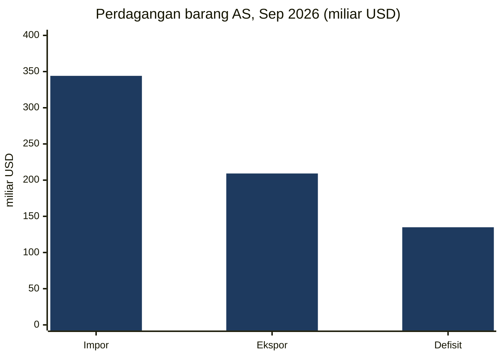
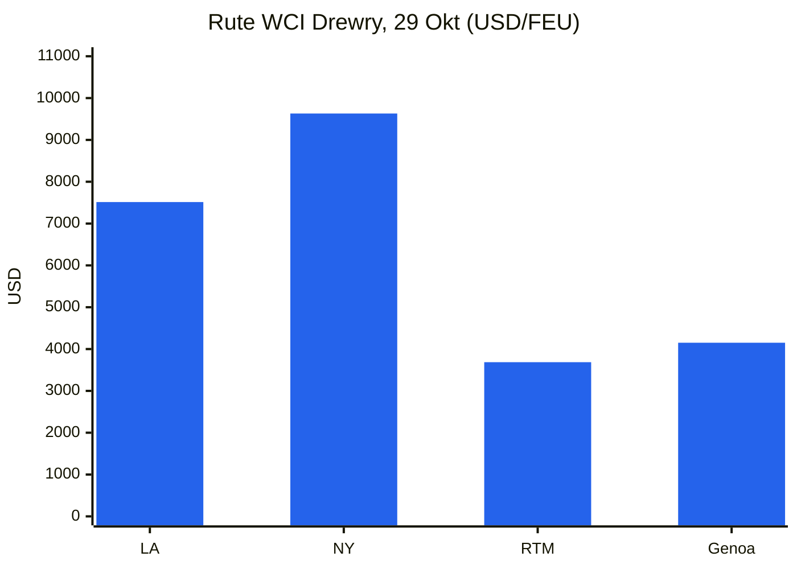
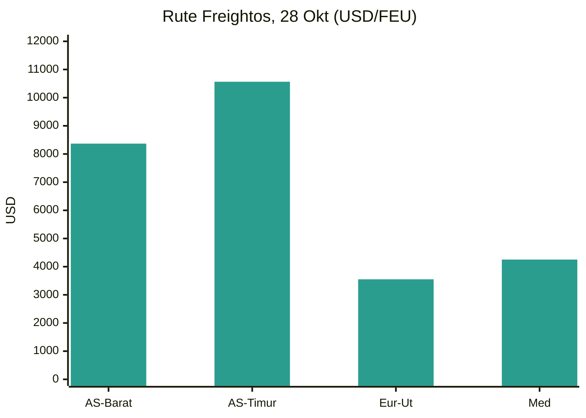
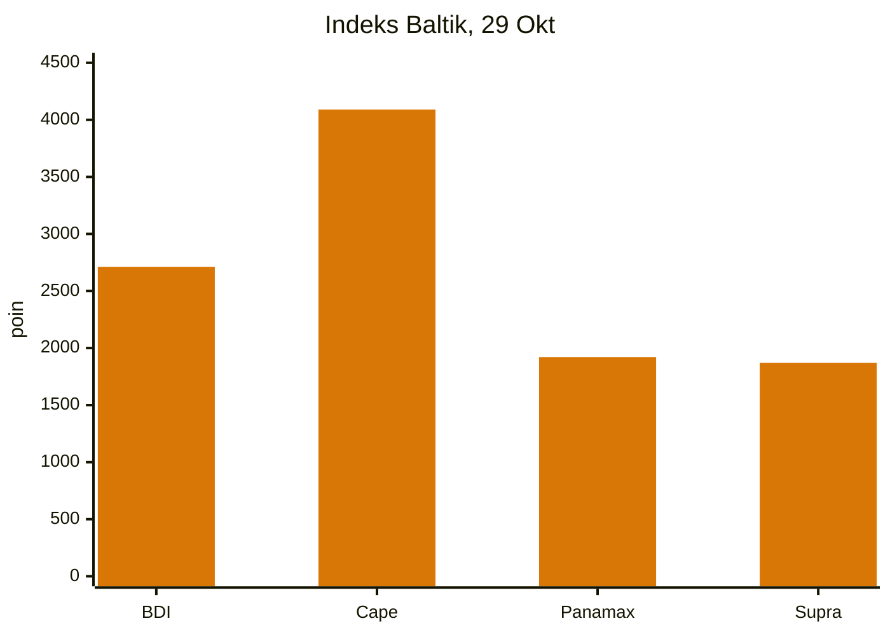
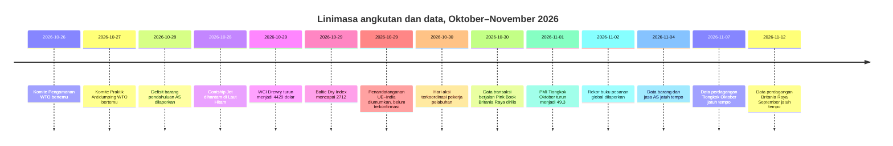

# Laporan Intelijen Perdagangan Global — Pekan 26 Oktober–2 November 2026

**Briefing mingguan.** Jendela liputan: 26 Oktober–2 November 2026. Disusun dari sekitar 45 sumber berita, kebijakan, data, dan angkutan perdagangan di seluruh dunia.

---

## Daftar isi

1. [Ringkasan eksekutif](#1-executive-summary)
2. [Peringatan](#2-alerts)
3. [Berita utama — analisis mendalam](#3-top-stories--deep-dives)
4. [Pelacak tarif](#4-tariff-tracker)
5. [Analisis mendalam kebijakan AS](#5-us-policy-deep-dive)
6. [Kebijakan dunia menurut kawasan](#6-world-policy-by-region)
7. [Tindakan penegakan](#7-enforcement-actions)
8. [Rilis data](#8-data-releases)
9. [Pasar angkutan](#9-freight-market)
10. [Linimasa kebijakan](#10-policy-timelines)
11. [Tenggat & acara mendatang (90 hari ke depan)](#11-upcoming-deadlines--events-next-90-days)
12. [Sumber & metodologi](#12-sources--methodology)

---

## 1. Ringkasan eksekutif

Pekan ini didominasi oleh tenggat yang belum terselesaikan: berakhirnya 178 pengecualian produk Section 301 Tiongkok pada 9 November dan berakhirnya penangguhan biaya pelabuhan Section 301 atas kapal-kapal yang terkait Tiongkok, sengketa perburuhan 250 pekerja yang dapat melumpuhkan kompleks pelabuhan peti kemas tersibuk di Amerika Serikat sehari setelah pemilihan paruh waktu, serta eskalasi tajam risiko pelayaran di Selat Hormuz dan Laut Hitam. Dengan latar tersebut, Uni Eropa memajukan program pertahanan perdagangannya terhadap Tiongkok di beberapa bidang sekaligus, daftar tarif revisi Kanada sebesar 50% mulai berlaku, dan Amerika Serikat melaporkan rekor bulanan impor barang yang didorong oleh barang modal terkait kecerdasan buatan.

- **Tenggat 9 November kini tinggal sepekan, dan kedua tenggat itu masih belum terselesaikan.** Sebanyak 178 pengecualian produk Section 301 Tiongkok yang tersisa berakhir pada pukul 23.59 ET tanggal 9 November 2026, tanpa pemberitahuan perpanjangan yang ditemukan dalam pekan liputan ini; entri pada atau setelah 10 November kembali ke tarif daftar. Usulan USTR untuk memperpanjang penangguhan biaya pelabuhan Section 301 atas kapal-kapal yang terkait Tiongkok dan bea derek terkait hingga 9 Januari 2027 diterbitkan dalam Federal Register pada 26 Oktober, dengan komentar ditutup pada 30 Oktober, tetapi tidak ada pemberitahuan final yang diterbitkan per 2 November. Kedua instrumen itu terpisah: finalisasi salah satunya tidak memperpanjang yang lain. Penangguhan lain yang telah diterbitkan — penangguhan Aturan Afiliasi Bureau of Industry and Security — juga berakhir menurut teks yang diterbitkan pada 9–10 November, dengan perpanjangan yang diumumkan hingga 10 Januari 2027 yang belum diundangkan per 31 Oktober.
- **Daftar revisi Kanada sebesar 50% mulai berlaku pada 30 Oktober.** Proklamasi yang ditandatangani pada 23 Oktober menghapus 22 klasifikasi dari daftar Section 338 dan menambah 100 klasifikasi, dengan tarif 50% tidak berubah. Bea itu ditumpuk di atas bea Section 232 dan berlaku bahkan untuk barang yang memenuhi syarat berdasarkan Perjanjian Kanada–Amerika Serikat–Meksiko. CBP menerbitkan panduan implementasi pada 29 Oktober (CSMS #70314289). Pada pekan yang sama, Senat memberikan suara 50–46 untuk mengakhiri keadaan darurat nasional yang dijadikan dasar tarif Kanada — suara yang tidak berdampak hukum terhadap bea tersebut — dan perdana menteri Kanada mengatakan Ottawa "belum dekat" dengan kesepakatan sebelum pemilihan paruh waktu, sementara Washington menggambarkan kesepakatan itu sudah dekat. Tantangan hukum pertama terhadap Section 338, yang diajukan pada 20 Oktober oleh importir keju asal New Jersey, diliput secara luas dalam jendela liputan bersamaan dengan perubahan daftar tersebut.
- **Risiko pelayaran meningkat di dua kawasan sekaligus.** Pada 29 Oktober, sebuah perahu kecil menempelkan dua alat peledak ke lambung kapal tanker minyak berbendera Panama, Louise 1, di Selat Hormuz, sekitar 25 mil laut di timur laut Khasab, Oman; kebakaran di ruang mesin yang diakibatkannya sempat melumpuhkan kapal tersebut, meskipun awaknya selamat dan kapal itu melanjutkan pelayaran. Reuters, mengutip tiga sumber keamanan maritim, menggambarkannya sebagai serangan ranjau tempel pertama yang berhasil di jalur air itu sejak perang Amerika Serikat–Iran dimulai pada Februari 2026. Drewry melaporkan hanya dua kapal melintasi Selat Hormuz pada pekan sebelumnya, berbanding 62 transit Terusan Suez, tingkat mingguan tertinggi tahun ini. Di Laut Hitam, kapal peti kemas berbendera Liberia, Contship Jet, dihantam tiga drone laut pada 28 Oktober di dalam zona ekonomi eksklusif Bulgaria dan tenggelam sekitar tengah malam; seluruh 18 awak berhasil diselamatkan, tetapi 20 dari 421 peti kemasnya jatuh ke laut, termasuk baterai litium-ion dan bahan berbahaya lainnya.
- **Program Tiongkok Eropa beralih dari sinyal menjadi perkara formal.** Komisi Eropa memberlakukan bea antidumping definitif sebesar 39,8% hingga 48,1% atas PET Spunbond Tiongkok selama lima tahun pada 30 Oktober, membuka penyelidikan antidumping atas polivinilidena fluorida dari Tiongkok, India, dan Jepang pada 28 Oktober, memerintahkan pencatatan impor silikon Tiongkok mulai 27 Oktober selama peninjauan bea, dan menyaksikan negara-negara anggota menyetujui bea antidumping jangka panjang atas titanium dioksida Tiongkok yang berlaku mulai 11 Januari. Usulan Komisi pada Desember mengenai instrumen untuk membatasi ketergantungan pada sumber tunggal untuk pasokan kritis menyelesaikan konsultasi bisnisnya pada 27 Oktober, tanpa daftar sektor, ambang batas, atau tarif yang diterbitkan. Secara terpisah, Biaya Penanganan Uni Eropa sebesar €2 atas pembelian daring non-UE mulai berlaku pada 1 November, di atas bea €3 per barang atas kiriman bernilai rendah yang berlaku sejak 1 Juli.
- **Amerika Serikat mengimpor barang dengan nilai rekor pada September.** Rilis pendahuluan Biro Sensus pada 28 Oktober menempatkan defisit barang September sebesar $134,9 miliar, naik 2,1% dari Agustus, atas impor rekor sebesar $344,1 miliar. Impor barang modal naik 7,5% dari bulan ke bulan dan 77,2% dari tahun ke tahun, lonjakan impor infrastruktur AI kini menjadi pendorong utama defisit bahkan ketika ekspor juga naik 2,6% menjadi $209,2 miliar. Data perdagangan Tiongkok untuk Oktober, yang akan menunjukkan apakah surplus tahun berjalannya telah melampaui $1 triliun, jatuh tempo pada 7 November dan belum dirilis dalam jendela ini; PMI manufaktur resmi Tiongkok untuk Oktober, yang diterbitkan pada 1 November, kembali ke kontraksi pada 49,3, dengan pesanan ekspor baru pada 48,7.
- **Angkutan terbelah menurut rute dan ukuran kapal.** Drewry World Container Index turun 3% menjadi $4.429 per peti kemas 40 kaki pada 29 Oktober, membalikkan dua kenaikan mingguan, karena Shanghai–Los Angeles turun 6% menjadi $7.514 dan Shanghai–New York turun 5% menjadi $9.631, sementara Shanghai–Rotterdam naik tipis 1% menjadi $3.686. Baltic Dry Index pulih ke 2.712 pada 29 Oktober berkat kekuatan Capesize, bahkan ketika Panamax turun ke 1.921, terendah sejak April. Keandalan jadwal tetap buruk: Sea-Intelligence menempatkan kinerja tepat waktu global pada 50,6% pada September, naik tipis dari 49,9% pada Agustus. Hari aksi terkoordinasi pekerja pelabuhan pada 30 Oktober menyentuh lebih dari 100 pelabuhan, dengan dampak operasional yang terkonfirmasi digambarkan terbatas di sebagian besar tempat, dan mogok pelabuhan nasional Prancis berikutnya telah diberitahukan untuk 5 November.

**Angkutan:** tarif spot peti kemas berbalik turun di rute transpasifik sementara Asia–Eropa bertahan kokoh; kenaikan November dari perusahaan pelayaran sudah didiskon; curah kering pulih hanya berkat kekuatan bijih besi Capesize; transit Suez mencapai titik tertinggi tahunan sementara transit Hormuz nyaris berhenti; dan kargo udara menguat memasuki musim puncak karena pertumbuhan permintaan melampaui kapasitas.

---

## 2. Peringatan

| # | Peringatan | Berlaku | Dampak | Sumber |
|---|-------|-----------|--------|--------|
| A1 | 178 pengecualian produk Section 301 Tiongkok berakhir pukul 23.59 ET tanggal 9 Nov 2026; tidak ditemukan perpanjangan; entri 10 Nov+ kembali ke tarif daftar (25% Daftar 1–3, 7,5% Daftar 4A) | 9 Nov 2026 | Importir yang mengklaim HTSUS 9903.88.69/70 harus menetapkan ulang harga dan mengonfirmasi entri sebelum tenggat | [Gateway Lines](https://gatewaylines.com/press-releases/china-section-301-tariffs-stay-178-exclusions-end) |
| A2 | Usulan USTR untuk memperpanjang penangguhan biaya pelabuhan Section 301 hingga 9 Jan 2027 masih sebatas usulan; komentar ditutup 30 Okt (doket USTR-2026-0694); tidak ada pemberitahuan final yang diterbitkan per 2 Nov | 9 Nov 2026 (penangguhan saat ini berakhir) | Jika tidak difinalisasi, biaya pelabuhan dan bea derek/penanganan kargo terkait kembali berlaku 10 Nov | [Federal Register](https://www.federalregister.gov/documents/2026/10/26/2026-21755/request-for-comments-on-further-suspension-of-section-301-action-chinas-targeting-of-the-maritime) |
| A3 | Daftar Section 338 Kanada dirombak: 22 klasifikasi dihapus, 100 ditambah; tarif 50% tidak berubah; ditumpuk di atas bea Section 232; berlaku bahkan untuk barang yang memenuhi syarat USMCA | 30 Okt 2026 | Tanggal entri, bukan tanggal pengiriman, yang menentukan 0% vs 50% atas barang yang sama; segera saring ulang klasifikasi | [Baker McKenzie](https://globalimportblog.bakermckenzie.com/2026/10/30/us-further-modifies-section-338-tariffs-on-canadian-goods-as-the-tariffs-face-their-first-legal-challenge/) |
| A4 | Eskalasi Hormuz: serangan ranjau tempel terhadap tanker Louise 1 pada 29 Okt; hanya dua transit Hormuz yang dilaporkan pada pekan sebelumnya; insiden lanjutan dilaporkan 30 Okt–2 Nov, termasuk tanker yang dihantam proyektil di timur Ras al Khafji | 29 Okt–2 Nov 2026 | Biaya risiko perang, perutean, dan asuransi tetap tinggi; keputusan perutean Teluk harus memperhitungkan klaim resmi yang saling bertentangan tentang keamanan rute | [gCaptain](https://gcaptain.com/tanker-in-strait-of-hormuz-hit-by-limpet-mines-security-sources-say/) |
| A5 | Tenggelam di Laut Hitam: kapal peti kemas Contship Jet dihantam tiga drone laut pada 28 Okt di zona ekonomi eksklusif Bulgaria dan tenggelam; 20 dari 421 peti kemas jatuh ke laut, termasuk bahan berbahaya | 28–29 Okt 2026 | Risiko perang Laut Hitam kini mencapai perairan negara anggota UE/NATO; peti kemas barang berbahaya yang hanyut menciptakan bahaya navigasi | [Splash247](https://splash247.com/splash-wrap-new-networks-old-faultlines/) |
| A6 | Tenggat mogok pengawas LA/Long Beach diperpanjang hingga pukul 17.00 Pasifik tanggal 4 Nov 2026; belum ada kesepakatan final; terminal yang terdampak menangani ~85% kargo Long Beach dan ~33% kargo Los Angeles | 4 Nov 2026 | Sengketa 250 pekerja dapat menghentikan pekerjaan kapal, lapangan, dan gerbang di terminal yang terdampak jika anggota ILWU lain menghormati garis piket; satu laporan mencantumkan tanggal 5 Nov sebagai gantinya | [Seatrade Maritime](https://www.seatrade-maritime.com/ports-logistics/impending-strike-threatens-la-lb-ports-container-flow) |
| A7 | Biaya Penanganan Uni Eropa sebesar €2 atas pembelian daring non-UE mulai berlaku, di atas bea €3 per barang atas kiriman hingga €150 yang berlaku sejak 1 Jul 2026 | 1 Nov 2026 | E-commerce bernilai rendah dengan banyak barang menghadapi €5 per lini sebelum PPN; biaya tidak dapat dikembalikan bahkan jika barang dikembalikan | [Shipping and Freight Resource](https://www.shippingandfreightresource.com/trade-moves-02-nov-2026/) |
| A8 | Hari aksi terkoordinasi pekerja pelabuhan pada 30 Okt di 100+ pelabuhan; mogok pelabuhan nasional Prancis diberitahukan untuk 5 Nov | 30 Okt / 5 Nov 2026 | Penundaan sandar dan feeder setelah 30 Okt, terkonsentrasi di hub transshipment Mediterania dan gerbang Prancis | [Port Technology](https://www.porttechnology.org/news/ports-and-terminals/dockworker-strikes-ports-military-cargo/) |
| A9 | DHS menambahkan tiga perusahaan genomik Tiongkok (BGI Group, BGI Genomics, MGI Tech) ke Daftar Entitas UFLPA; daftar gabungan kini 190 entitas | 29 Okt 2026 | Barang yang diproduksi seluruhnya atau sebagian oleh perusahaan-perusahaan ini dianggap dibuat dengan kerja paksa dan dilarang kecuali praduga itu dibantah | [LexBlog](https://www.lexblog.com/2026/10/29/dhs-updates-uflpa-entity-list-with-three-companies-engaged-in-genetics-testing/) |
| A10 | Section 232 robotika/mesin industri: temuan keamanan nasional, belum ada tarif; negosiasi diperintahkan dengan laporan jatuh tempo dalam 180 hari | 28 Okt 2026 | Risiko tarif ditunda hingga musim semi 2027, bukan dihapus; templat yang sama seperti turbin angin | [White House](https://www.whitehouse.gov/fact-sheets/2026/10/fact-sheet-president-donald-j-trump-adjusts-imports-of-robotics-industrial-machinery-and-their-parts-and-components-into-the-united-states/) |

### A1/A2 — Tenggat 9 November, sepekan lagi

Kedua instrumen 9 November itu sering dilaporkan bersamaan tetapi beroperasi secara independen. Pengecualian produk — 164 yang dipertahankan pada Mei 2024 ditambah 14 pengecualian peralatan manufaktur surya yang ditambahkan pada September 2024, diklaim berdasarkan HTSUS 9903.88.69 dan 9903.88.70 — berakhir pada pukul 23.59 ET tanggal 9 November, dan berbagai sumber yang melaporkan pada 29–31 Oktober tidak menemukan pemberitahuan perpanjangan. Pemberitahuan kelanjutan USTR pada 6/7 Oktober mengonfirmasi bahwa tindakan Section 301 tahun 2018 yang mendasarinya berlanjut; pemberitahuan itu tidak memperpanjang pengecualian. Penangguhan biaya pelabuhan, sebaliknya, menjadi subjek usulan yang masih berjalan: pemberitahuan Federal Register yang diterbitkan pada 26 Oktober (91 FR 67388) mengusulkan penangguhan, mulai pukul 00.00 ET tanggal 10 November 2026 hingga pukul 23.59 ET tanggal 9 Januari 2027, atas biaya layanan transportasi maritim dalam Lampiran I–III tindakan 23 April 2025 (sebagaimana diubah pada 16 Oktober 2025) dan bea Lampiran V.A atas derek ship-to-shore Tiongkok dan peralatan penanganan kargo, sehingga tidak ada kewajiban yang timbul selama penangguhan. Alasan yang dinyatakan adalah untuk memberi waktu negosiasi lanjutan dengan Tiongkok. Usulan itu hanya mencakup dua bulan, jauh lebih singkat daripada penangguhan satu tahun yang akan digantikannya.

**Analisis:** importir dan perusahaan pelayaran menghadapi eksposur berbeda pada tanggal yang sama. Importir dengan entri yang mengklaim pos pengecualian harus merencanakan tarif daftar mulai 10 November terlepas dari apa yang terjadi pada biaya pelabuhan. Perusahaan pelayaran menghadapi pemberlakuan kembali biaya hanya jika usulan itu tidak difinalisasi. Keduanya harus dilacak sebagai instrumen tertulis, bukan sebagai satu "gencatan senjata" — kalender politik (gencatan senjata yang dibahas berjalan hingga 10 Januari 2027) dan kalender regulasi (9 November) tetap berbeda.

### A3 — Kanada: perubahan daftar yang berlaku di tengah pekan

Proklamasi 23 Oktober, yang diterbitkan dalam Federal Register pada 30 Oktober dan berlaku pukul 00.01 ET pada hari itu untuk barang yang dientri atau dikeluarkan dari gudang untuk konsumsi pada atau setelah tanggal tersebut, menghapus 22 klasifikasi dan menambah 100 klasifikasi, semuanya berdasarkan pos 9903.03.14; pos 9903.03.12 dan 9903.03.13 tidak berubah. Lini yang dihapus meliputi lembaran kayu lapis tertentu, produk kertas, mesin dan peralatan pendingin, peti dan kotak pengepakan, pembungkus plastik, kotak karton, dan mesin terkait pangan. Lini yang ditambah meliputi karpet dan permadani, produk kayu dan kertas tertentu, produk kimia seperti cat, sabun, dan pelumas, serta produk konsumen termasuk bubuk kakao, lantai vinil, kano, freezer peti, sampo dan sabun mandi, serta katup, instrumen, unit pendingin udara jendela, dan reagen diagnostik. Deskripsi lampiran hanya bersifat informatif; kode HTS yang menentukan cakupan.

**Analisis:** konsekuensi praktisnya adalah soal waktu. Sebuah freezer peti hanya dikenai bea baja Section 232 hingga 29 Oktober dan dikenai Section 338 pada 30 Oktober; kayu lapis bergerak sebaliknya. Karena bea itu berlaku terlepas dari asal USMCA dan sebagai tambahan atas bea Section 232, perencanaan asal tidak menghindarinya. Dampak bersihnya adalah pertukaran struktural, bukan de-eskalasi: keringanan terkonsentrasi pada rantai pasok pertanian dan kehutanan yang terkait Maine, sementara eksposur baru tersebar di barang konsumen dan industri.

### A4/A5 — Dua kawasan, satu pekan

Serangan Hormuz pada 29 Oktober mengikuti pola yang sudah tampak dalam data: transit Hormuz non-terkait Iran telah turun menjadi 104 pada pekan 5–11 Oktober dari 126 pada pekan 28 September–4 Oktober, dan Lloyd's List Intelligence menghitung sedikitnya 28 serangan yang dilaporkan atau terkonfirmasi di Hormuz dan perairan sekitarnya pada paruh pertama Oktober. Insiden 29 Oktober menambahkan metode baru — bahan peledak lambung jarak dekat yang dikirim perahu kecil terhadap tanker yang sedang bergerak — ke ranjau dan proyektil. Klaim yang saling bertentangan kemudian memperumit gambaran: Korps Garda Revolusi Islam Iran mengatakan tiga tanker menghantam ranjau laut di rute selatan yang "tidak sah" dan tentara Iran melaporkan tanker keempat di timur jalur air itu, sehari setelah Komando Pusat Amerika Serikat mengatakan klaim ranjau itu palsu dan rute utama telah dibersihkan. UKMTO mendokumentasikan kerusakan tetapi tidak mengonfirmasi ranjau sebagai penyebabnya. Di Laut Hitam, tenggelamnya Contship Jet adalah serangan drone kelima terhadap kapal-kapal di zona ekonomi eksklusif Bulgaria pada Oktober saja, menurut BTA sebagaimana dikutip dalam liputan, dan tenggelamnya kapal dagang kedua di Laut Hitam bagian barat dalam sepekan setelah Khoryv di lepas Constanța. Tidak ada atribusi resmi atas serangan Contship Jet yang dipublikasikan; penilaian Ambrey, melalui Reuters, bahwa wahana itu menyerupai desain Murena-300S buatan Rusia bukanlah atribusi.

**Analisis:** pengirim tidak lagi dapat memperlakukan kedua jalur air itu sebagai pertanyaan biner terbuka-atau-tertutup. Hormuz nyaris tertutup bagi lalu lintas komersial menurut hitungan transit Drewry sementara Suez menormalisasi; risiko Laut Hitam kini meluas ke tonase peti kemas pada rute Israel–Rumania di dalam zona ekonomi eksklusif negara anggota UE, dengan kargo berbahaya di perairan. Asuransi, perutean, dan deklarasi barang berbahaya semuanya perlu dinilai per pelayaran.

---

## 3. Berita utama — analisis mendalam

### 3.1 Tenggat 9 November, dan tenggat ketiga yang luput dari perhatian

Di luar dua tenggat Section 301, penangguhan Aturan Afiliasi Bureau of Industry and Security berakhir menurut teks yang diterbitkan pada 9–10 November 2026. Aturan itu, bertanggal 29 September 2025, memperluas pembatasan Entity List, Military End User, dan Specially Designated Nationals ke afiliasi asing yang dimiliki 50% atau lebih oleh pihak-pihak yang terdaftar. Menteri Keuangan Scott Bessent mengumumkan pada 24 September 2026 bahwa gencatan senjata Amerika Serikat–Tiongkok, dan sejalan dengan itu penangguhan tersebut, akan diperpanjang hingga 10 Januari 2027 — tetapi per batas akhir sumber 31 Oktober, tidak ada pemberitahuan Federal Register yang secara resmi memperpanjang penangguhan itu yang diterbitkan. Eksportir tidak boleh mengandalkan perpanjangan itu sampai BIS menerbitkannya. Kehati-hatian yang sama berlaku untuk usulan biaya pelabuhan: yang banyak diberitakan sebagai penundaan hingga 9 Januari, usulan itu adalah usulan yang periode komentarnya ditutup pada 30 Oktober, bukan aturan final.

**Analisis:** tiga instrumen terpisah berakhir dalam kurun sekitar sehari satu sama lain, masing-masing dengan pengambil keputusan berbeda dan bentuk hukum berbeda. Memperlakukan salah satu dari ketiganya sebagai telah diperpanjang atas dasar pengumuman, tajuk berita, atau nasib instrumen paralel adalah risiko kepatuhan utama pada pekan mendatang. Posisi Federal Register tertulis pada 9 November adalah satu-satunya dasar yang aman untuk entri, pelayaran, dan penyaringan ekspor.

### 3.2 Hormuz dan Laut Hitam: eskalasi sebagai variabel pasar pelayaran

Berita pelayaran pekan ini paling baik dibaca sebagai satu variabel — risiko perang — yang bergerak berlawanan arah di jalur air berbeda. Transit Suez naik menjadi 62 kapal pada pekan yang dilaporkan Drewry pada 29 Oktober, tingkat mingguan tertinggi tahun ini, dan Alphaliner memperkirakan hampir dua pertiga total kapasitas Asia–Eropa dipulihkan melalui Laut Merah, termasuk ZIM yang kembali ke rute itu untuk layanan gabungan Asia–Pantai Timur Amerika Serikat bersama MSC. Lebih dari 100 kapal peti kemas berukuran 16.000 TEU atau lebih melintasi Suez sejak awal September, melampaui 99 yang tercatat sepanjang 2025 ditambah Januari–Agustus 2026, dan 192 transit ultra-besar tercatat sepanjang 2026 berbanding 8 pada 2025. Pada saat yang sama, transit Hormuz turun menjadi dua kapal dalam hitungan mingguan Drewry, Brent menyentuh $118 untuk kontrak Desember yang berakhir pada 30 Oktober — tertinggi sejak 30 April — dan Houthi mengklaim serangan rudal terhadap kilang Ras Tanura dan Rabigh, fasilitas Aramco di Abqaiq, serta bandara Riyadh dan Dammam, sebagai balasan atas serangan udara Saudi di Yaman yang menurut mereka menewaskan 27 orang; koalisi pimpinan Saudi mengatakan telah mencegat rudal-rudal itu dan belum mengonfirmasi kerusakan. Angkatan laut Oman mengevakuasi 25 awak dari tanker berbendera Panama yang terbakar, Riti, pada 30 Oktober, dan laporan komoditas 2 November yang mengutip UKMTO menghitung sepuluh insiden pelayaran di Hormuz, Teluk, dan Teluk Oman antara 31 Oktober dan 2 November.

**Analisis:** kembalinya Suez melepaskan kapasitas efektif dan menekan tarif Asia–Eropa, sementara gangguan Hormuz memperketat biaya energi dan perutean Teluk. Kedua dampak itu tidak saling meniadakan: keduanya menghantam perdagangan, kargo, dan lini asuransi yang berbeda. Konsekuensi operasionalnya adalah narasi "kembali normal" untuk satu koridor tidak boleh diterapkan ke koridor lain.

### 3.3 Kanada: keringanan, eskalasi, dan perkara pengadilan dalam pekan yang sama

Berkas Kanada menggabungkan empat perkembangan terpisah. Pertama, perubahan daftar Section 338 berlaku pada 30 Oktober (lihat bagian 2, A3). Kedua, Senat memberikan suara 50–46 pada 29 Oktober untuk mengakhiri keadaan darurat nasional yang dijadikan dasar tarif Kanada, disponsori Senator Tim Kaine, dengan empat senator Republik — Susan Collins dari Maine, Mitch McConnell dari Kentucky, Lisa Murkowski dari Alaska, dan Rand Paul dari Kentucky — bergabung dengan Demokrat; suara itu menyusul suara Senat pada 28 Oktober yang menentang tarif Brasil. Aturan prosedural DPR dilaporkan menghalangi pembahasan dan veto presiden dimungkinkan, sehingga tidak ada perubahan tarif yang berlaku dari suara itu. Ketiga, laporan negosiasi berbeda: Reuters melaporkan pada 26 Oktober bahwa para pejabat sedang menjajaki kesepakatan untuk meringankan bea Section 232 sebesar 50% atas baja dan 25% atas mobil, dengan Menteri Perdagangan Howard Lutnick berkomunikasi rutin dengan Menteri Perdagangan Kanada–Amerika Serikat Dominic LeBlanc; pada 28 Oktober seorang pejabat Kanada menggambarkan kemajuan sebagai "terbatas"; pada 29 Oktober Perdana Menteri Mark Carney mengatakan Kanada "belum dekat" dengan kesepakatan sebelum pemilihan paruh waktu dan tidak akan menerima kesepakatan dengan segala cara, seraya mencatat pembicaraan runtuh pada Agustus 2026 atas syarat-syarat Amerika Serikat yang menurut Kanada akan membatasi kemampuannya bernegosiasi dengan negara lain, melemahkan persyaratan bahasa Prancis, dan merugikan otomotif. Presiden, berbicara di Michigan pada 25 Oktober dan South Carolina pada 29 Oktober, menggambarkan kesepakatan itu sudah dekat dan Kanada memperlakukan Amerika Serikat "dengan sangat baik". Keempat, tantangan hukum pertama terhadap Section 338 — Gellert Global Group v. Trump, diajukan pada 20 Oktober di Pengadilan Perdagangan Internasional Amerika Serikat oleh importir pangan asal New Jersey atas keju Kanada (sekitar $71 juta impor keju Kanada pada 2025, penasihat Liberty Justice Center) — meminta pengadilan menyatakan bea itu melanggar hukum, memblokir pemungutan, dan memerintahkan pengembalian dengan bunga, dengan argumen bahwa Section 301 menggantikan Section 338, bahwa langkah-langkah itu gagal memenuhi uji diskriminasi dan penyeimbang Section 338, dan bahwa penambahan September hanya diberi tujuh hari, bukan periode tunggu 30 hari yang diklaim wajib. Tidak ada putusan atas pokok perkara yang dilaporkan.

**Analisis:** suara itu, pembicaraan itu, dan gugatan itu menarik ke arah berbeda dan tidak satu pun mengubah tarif pada pekan ini. Satu-satunya instrumen dengan dampak komersial langsung adalah perubahan daftar 30 Oktober, dan satu-satunya yang dapat membatalkan rezim itu adalah perkara pengadilan, yang akan memakan waktu berbulan-bulan. Importir harus memisahkan sinyal politik dari dampak hukum.

### 3.4 Eropa: pekan pertahanan perdagangan, dan instrumen Desember yang terbentuk

Program Tiongkok Uni Eropa menghasilkan tindakan formal pada empat jalur dalam satu pekan. Bea antidumping definitif atas PET Spunbond Tiongkok (39,8% hingga 48,1%, lima tahun, menggantikan bea sementara 45,6% hingga 50% yang berlaku sejak Mei 2026) diberlakukan pada 30 Oktober atas pasar senilai €200 juta, dengan industri UE berbasis di Jerman, Italia, dan Prancis. Penyelidikan antidumping atas polivinilidena fluorida dari Tiongkok, India, dan Jepang dibuka pada 28 Oktober, menyusul pembukaan pada 16 Oktober atas alkohol furfuril dari Tiongkok. Impor silikon Tiongkok diperintahkan masuk pencatatan bea cukai mulai 27 Oktober selama sembilan bulan sementara Komisi meninjau apakah bea antidumping yang ada masih memadai, peninjauan yang dibuka pada 1 September atas permintaan Euroalliages, yang mewakili seluruh produsen UE. Negara-negara anggota menyetujui bea antidumping jangka panjang atas titanium dioksida Tiongkok, dilaporkan sebesar €0,25 per kilogram untuk Anhui Jinxing Group dan €0,74 per kilogram untuk Longbai Group, dengan €0,64 per kilogram untuk perusahaan yang bekerja sama dan €0,74 per kilogram untuk semua pihak lain, berlaku mulai 11 Januari selama lima tahun; impor titanium dioksida Tiongkok melampaui €500 juta pada 2023. Di balik perkara-perkara ini terdapat sinyal dari pertemuan informal Dewan di Dublin pada 23 Oktober, ketika Komisaris Perdagangan Maroš Šefčovič mengatakan sektor plastik adalah yang "paling dekat" dengan kemungkinan penyelidikan pengamanan. Defisit barang UE dengan Tiongkok dilaporkan lebih dari €1 miliar per hari, lebih dari €370 miliar pada 2025 dan diperkirakan melampaui €400 miliar pada 2026, dengan defisit paruh pertama 2026 hampir €197 miliar dalam satu laporan berbasis Politico.

Instrumen Desember maju secara paralel. Konsultasi bisnis mengenai alat untuk memaksa diversifikasi dari ketergantungan pada satu negara untuk pasokan kritis berakhir pada 27 Oktober, dengan usulan jatuh tempo pada awal Desember, tepat sebelum para pemimpin UE bertemu pada 17–18 Desember. Konsultasi itu mengonfirmasi instrumen tersebut akan menyasar situasi ketika ketergantungan berat pada satu negara pemasok mengancam keamanan pasokan atau stabilitas ekonomi UE; belum ada daftar sektor, persentase ambang batas, atau tarif yang diterbitkan. BusinessEurope memperingatkan bahwa pengadaan alternatif akan menaikkan harga; Komisaris Šefčovič mengatakan dalam pidato Juni 2026, sebagaimana dikutip dalam liputan, bahwa perusahaan harus menyerap "biaya ketahanan". Dua bentuk dibahas: mandat diversifikasi gaya energi yang minimalis untuk barang pertahanan dan barang dwi-guna, atau model ambang batas maksimalis di mana pembelian lebih dari porsi tetap dari satu sumber dapat memicu tarif.

**Analisis:** UE menjalankan program per sektor — kendaraan hibrida dibatasi, plastik paling dekat dengan pengamanan, bahan kimia dalam penyelidikan formal, silikon dalam peninjauan — bukan satu langkah luas tunggal. Instrumen Desember akan menunjukkan apakah program itu menggeneralisasi menjadi alat ekonomi luas atau tetap spesifik per sektor. Bagaimanapun, arahnya menuju lebih banyak, bukan lebih sedikit, tindakan pertahanan perdagangan Tiongkok pada 2027.

### 3.5 Dua defisit, dua arah: Amerika Serikat mengimpor lebih banyak, Tiongkok mengekspor lebih banyak — untuk saat ini

Rilis pendahuluan September Biro Sensus, yang diterbitkan pada 28 Oktober, menempatkan defisit barang Amerika Serikat sebesar $134,9 miliar, naik $2,8 miliar atau 2,1% dari $132,1 miliar pada Agustus, terbesar sejak Maret 2025 dan di atas perkiraan konsensus Reuters/Bloomberg sebesar $130,2 miliar. Impor mencapai rekor $344,1 miliar, naik $8,1 miliar atau 2,4%; impor barang modal naik 7,5% dari bulan ke bulan dan 77,2% dari tahun ke tahun. Ekspor naik 2,6% menjadi $209,2 miliar, dengan pengiriman pangan naik 12,8% dan ekspor barang konsumen naik 6,5%; impor barang konsumen naik 3,1% dan barang lain 6,7%, sementara pasokan industri termasuk emas dan minyak bumi turun 6,0%. Estimasi ekonom menempatkan hambatan perdagangan terhadap PDB triwulan ketiga pada 4 poin persentase (Pantheon Macroeconomics) dan 3,25 poin persentase (Oxford Economics); itu adalah estimasi, bukan data resmi. Rilis barang-dan-jasa yang lebih lengkap jatuh tempo pada 4 November. Defisit barang-dan-jasa Agustus, yang dirilis pada 6 Oktober, sebesar $105,6 miliar atas dasar berbeda dan tidak dapat dibandingkan langsung dengan angka barang pendahuluan.

Data Tiongkok untuk September, yang dilaporkan pada 20–21 Oktober, menunjukkan ekspor naik 36,3% dari tahun ke tahun menjadi sekitar $447,18 miliar dan impor naik 31% menjadi sekitar $313,65 miliar, surplus bulanan $133,5 miliar dan surplus kumulatif Januari–September $938,1 miliar — berada di jalur melampaui rekor 2025 sekitar $1,19 triliun, ambang batas yang baru dilampaui pada November 2025. Surplus September dengan Uni Eropa adalah rekor $34,8 miliar, dan surplus dengan Amerika Serikat melebar menjadi $34 miliar, tertinggi dalam 20 bulan. Namun gambaran Oktober, yang diterbitkan pada 1 November, mengarah sebaliknya: PMI manufaktur resmi turun menjadi 49,3 dari 50,1 pada September, pesanan ekspor baru turun menjadi 48,7 dari 50,0, dan sub-indeks produksi turun menjadi 49,8 dari 51,7. Sebuah artikel 1 November yang merangkum tiga triwulan pertama menempatkan ekspor naik 16,4% dari tahun ke tahun menjadi $3,46 triliun, dengan produk mekanik dan elektrik naik 15,6%, barang teknologi tinggi naik 21,6%, dan barang konsumen naik 14,9%.

**Analisis:** ledakan September dan kontraksi PMI Oktober tidak bertentangan; keduanya menggambarkan momen berbeda. Pertanyaan untuk pekan mendatang adalah apakah data bea cukai Oktober, jatuh tempo 7 November, mengonfirmasi pendinginan atau memperpanjang ledakan melewati $1 triliun. Hasil mana pun akan dibaca di Brussel dan Washington sebagai bukti tentang surplus, bukan sekadar statistik.

### 3.6 Angkutan: puncak telah berlalu di transpasifik, tetapi kapasitas tidak berperilaku normal

Sea-Intelligence melaporkan pada 29 Oktober bahwa kapasitas mingguan mencapai titik tertinggi bersejarah di semua jalur utama Timur–Barat, mematahkan penurunan pasca-Golden Week normal yang terlihat dari 2012 hingga 2025, dan mengaitkannya dengan penumpukan kapal akibat kemacetan pelabuhan Asia dan ketidakandalan jadwal yang mendorong pelayaran triwulan ketiga ke Oktober–November, bukan lonjakan permintaan. Asia–Eropa Utara melampaui 350.000 TEU per pekan pada Oktober dan November, Asia–Mediterania melampaui 260.000 TEU per pekan, Asia–Pantai Barat Amerika Utara mencapai hampir 393.000 TEU pada Oktober dengan perkiraan 400.000 TEU yang belum pernah terjadi pada November, dan Asia–Pantai Timur mencatat tingkat tertinggi tahun mana pun pada Oktober–November. Topan Champi, badai terkuat tahun 2026, berkontribusi langsung: badai itu menutup pelabuhan Kaohsiung, Keelung, dan Taipei di Taiwan pada 23 Oktober, menangguhkan Ningbo dari malam 23 Oktober hingga sekitar tengah hari 25 Oktober dan Shanghai dari malam 24 Oktober hingga sekitar tengah hari 25 Oktober, serta meninggalkan keterlambatan terkait kemacetan sekitar empat hari di Shanghai dan Ningbo ketika tumpukan dibersihkan. Kemacetan pelabuhan global diperkirakan 3,36 juta TEU, atau 9,7% armada, dalam pembaruan SEKO pada 23 Oktober.

**Analisis:** kapasitas yang dikerahkan pada rekor bersamaan dengan permintaan lemah menjelaskan mengapa perusahaan pelayaran tidak dapat mempertahankan kenaikan tarif meski ada tajuk kemacetan. Pasar itu macet dan kelebihan pasokan pada saat yang sama — kemacetan itu adalah artefak penjadwalan, bukan sinyal permintaan — dan kombinasi itu mengarah pada tekanan tarif berkelanjutan hingga musim kontrak tahunan kecuali kapasitas ditarik lebih cepat daripada pelepasan penumpukan.

---

## 4. Pelacak tarif

| Negara / langkah | Tarif / rincian | Berlaku / status | Sumber |
|---|---|---|---|
| Kanada — daftar Section 338 dirombak (22 dihapus, 100 ditambah) | 50% ad valorem, ditumpuk di atas Section 232, berlaku bahkan untuk barang yang memenuhi syarat USMCA | Berlaku 30 Okt 2026; CBP CSMS #70314289 tanggal 29 Okt | [Baker McKenzie](https://globalimportblog.bakermckenzie.com/2026/10/30/us-further-modifies-section-338-tariffs-on-canadian-goods-as-the-tariffs-face-their-first-legal-challenge/) |
| Kanada — tarif balasan atas barang AS | Surtaks 15% / 25% / 50% atas ~C$27,6 miliar barang asal AS (648 barang) | Berlaku sejak 8 Sep 2026; suku cadang perbaikan traktor/kombinasi/mesin pertanian 0% remisi hingga 30 Jun 2027 | [JD Supra](https://www.jdsupra.com/legalnews/update-on-the-u-s-canada-trade-conflict-3530187/) |
| Kanada — baja / mobil Section 232 (bea AS) | 50% baja, 25% mobil; pembicaraan pelonggaran dilaporkan 26 Okt, belum ada kesepakatan | Berlaku; pembahasan kesepakatan berlanjut |  |
| Meksiko — tarif kendaraan AS | 25% saat ini; Meksiko mengupayakan pemangkasan menjadi 15% dengan pengurangan berbasis kandungan dipertahankan | Belum ada kesepakatan per 28 Okt 2026 |  |
| Tiongkok — pengecualian produk Section 301 (178) | Kembali ke 25% (Daftar 1–3) / 7,5% (Daftar 4A) saat berakhir | Berakhir pukul 23.59 ET tanggal 9 Nov 2026; tidak ditemukan perpanjangan | [Gateway Lines](https://gatewaylines.com/press-releases/china-section-301-tariffs-stay-178-exclusions-end) |
| Tiongkok — biaya pelabuhan maritim Section 301 | $50/ton bersih (perusahaan non-Tiongkok yang menggunakan kapal buatan Tiongkok); perusahaan Tiongkok $18/ton bersih atau $120/peti kemas, mana yang lebih tinggi; kapal pengangkut kendaraan $150/unit setara mobil — jika penangguhan berakhir | Penangguhan berakhir pukul 23.59 ET tanggal 9 Nov 2026; perpanjangan hingga 9 Jan 2027 diusulkan, belum final | [Federal Register](https://www.federalregister.gov/documents/2026/10/26/2026-21755/request-for-comments-on-further-suspension-of-section-301-action-chinas-targeting-of-the-maritime) |
| Tiongkok — turbin angin Section 232 | Belum ada tarif; negosiasi diperintahkan, pembaruan dalam 180 hari | Proklamasi 22 Okt 2026; FR diterbitkan 28 Okt 2026; pembaruan jatuh tempo sekitar 20 Apr 2027 | [Thompson Hine](https://www.thompsonhinesmartrade.com/2026/10/president-trump-opts-for-negotiations-not-tariffs-in-section-232-wind-turbine-investigation/) |
| Tiongkok — robotika / mesin industri Section 232 | Belum ada tarif, kuota, atau biaya; negosiasi diperintahkan, laporan dalam 180 hari | Proklamasi 28 Okt 2026; FR dijadwalkan 2 Nov 2026; laporan jatuh tempo sekitar 26 Apr 2027 | [White House](https://www.whitehouse.gov/fact-sheets/2026/10/fact-sheet-president-donald-j-trump-adjusts-imports-of-robotics-industrial-machinery-and-their-parts-and-components-into-the-united-states/) |
| Tiongkok — trailer tipe van / subrakitan (perintah AD + CVD) | Deposit dumping 129,73% dan tarif subsidi 134,75% sebagaimana dilaporkan; deposit gabungan di atas 260% | Perintah diterbitkan 28 Okt 2026 | [Federal Register (PDF)](https://public-inspection.federalregister.gov/2026-21929.pdf) |
| Tiongkok — kereta belanja / suku cadang (petisi AD + CVD) | Dugaan margin dumping 165%–343% ditambah dugaan subsidi (dugaan, bukan bea) | Petisi diajukan 28 Okt 2026; inisiasi Commerce jatuh tempo 17 Nov (7 Des jika diperpanjang); putusan awal cedera ITC jatuh tempo 14 Des | [LexBlog](https://www.lexblog.com/2026/10/29/new-ad-cvd-petitions-filed-on-shopping-carts-from-china/) |
| Tiongkok — kotak karton potong cetak bergelombang (penyelidikan AD, bersama Malaysia, Türkiye) | Penyelidikan saja; belum ada tarif | Dimulai 26 Okt 2026 (berlaku 19 Okt); komentar cakupan jatuh tempo 9 Nov | [Federal Register (PDF)](https://public-inspection.federalregister.gov/2026-21783.pdf) |
| Tiongkok — senyawa amina / katalis poliuretana (penyelidikan AD + CVD) | Dugaan margin dumping 244,94%–352,32% (dugaan, bukan bea) | Dimulai 26 Okt 2026 (berlaku 19 Okt); putusan awal cedera ITC diperkirakan sekitar 13 Nov |  |
| UE — PET Spunbond dari Tiongkok (AD definitif) | 39,8%–48,1%, lima tahun | Diberlakukan 30 Okt 2026 (sementara 45,6%–50% sejak Mei 2026) | [European Commission](https://policy.trade.ec.europa.eu/news/commission-acts-against-imports-pet-spunbond-china-2026-10-30_en) |
| UE — titanium dioksida dari Tiongkok (AD jangka panjang disetujui) | €0,25/kg (Anhui Jinxing), €0,74/kg (Longbai), €0,64/kg (bekerja sama), €0,74/kg (semua pihak lain) sebagaimana dilaporkan | Berlaku 11 Jan 2027, lima tahun |  |
| UE — silikon dari Tiongkok (pencatatan selama peninjauan AD) | Pencatatan selama sembilan bulan; kemungkinan tindakan retroaktif dipertahankan | Pencatatan mulai 27 Okt 2026; peninjauan dibuka 1 Sep 2026 |  |
| UE — PVDF dari Tiongkok, India, Jepang (penyelidikan AD) | Penyelidikan saja; belum ada tarif | Dibuka 28 Okt 2026 |  |
| UE — alkohol furfuril dari Tiongkok (penyelidikan AD) | Penyelidikan saja; belum ada tarif | Dibuka 16 Okt 2026 |  |
| UE — kaca surya dari Tiongkok (bea dicabut) | AD 17,5%–75,4% dan CVD 3,2%–17,1% dicabut; bea yang dibayar sejak 22 Jul 2025 dapat diklaim kembali tanpa bunga | Berlaku 22 Okt 2026 |  |
| UE — kendaraan hibrida / hibrida plug-in (pemahaman pengamanan global) | Batas 350.000/tahun, naik 6% per tahun, empat tahun | Disepakati sekitar 9–12 Okt 2026; implementasi diperkirakan awal Desember 2026 |  |
| UE — Biaya Penanganan Uni atas penjualan jarak jauh non-UE | €2 per barang, di atas bea €3 per barang atas kiriman hingga €150 | Berlaku 1 Nov 2026; bea €3 berjalan hingga 1 Jul 2028; biaya €2 permanen | [Shipping and Freight Resource](https://www.shippingandfreightresource.com/trade-moves-02-nov-2026/) |
| Jepang — baja tahan karat canai dingin bernikel dari Tiongkok / Taiwan (AD definitif) | 3,6%–42,1%, lima tahun | 31 Okt 2026 – 30 Okt 2031 |  |
| Australia — jendela / pintu aluminium dari Tiongkok (jaminan AD / CVD interim) | Hingga 73,3% untuk beberapa eksportir (jaminan interim, bukan bea final) | Berlaku 15 Okt 2026; rekomendasi final diperkirakan Desember 2026 |  |
| Tiongkok — perizinan ekspor batu fosfat / perak | Pengelolaan kuota ditangguhkan hingga 2027; perizinan pengiriman dipertahankan | 1 Jan – 31 Des 2027; alokasi kuota pada 15 Des 2026 |  |
| Tiongkok — preferensi tarif nol untuk 53 negara Afrika | 100% lini tarif bebas bea untuk 33 negara Afrika paling kurang berkembang sejak 1 Des 2024; 20 ekonomi non-LDC ditambah pada 1 Mei berdasarkan preferensi sementara hingga 30 Apr 2028 | Ditegaskan kembali 30 Okt 2026 |  |

---

## 5. Analisis mendalam kebijakan AS

### Section 338 dan Kanada

Lihat bagian 2 (A3) dan 3.3 mengenai perubahan daftar, suara Senat, perbedaan negosiasi, dan tantangan Gellert Global Group. Dua poin lanjutan dari liputan pekan ini penting bagi importir. Pertama, publikasi Federal Register pada 30 Oktober dan panduan CBP pada 29 Oktober (CSMS #70314289) adalah dokumen implementasi yang berlaku; deskripsi lampiran proklamasi bersifat informatif dan kode HTS yang mengendalikan cakupan, sehingga peninjauan klasifikasi harus dilakukan lini per lini, bukan berdasarkan deskripsi produk. Kedua, tantangan hukum itu adalah uji pengadilan pertama atas undang-undang yang belum pernah digunakan sebelum Agustus 2026; putusan yang merugikan dapat membatalkan rezim itu termasuk daftar 30 Oktober, tetapi tidak ada putusan atas pokok perkara yang dilaporkan dan bea tetap dapat ditagih untuk sementara. Importir yang membayar bea Section 338 harus menyimpan dokumentasi entri dalam bentuk yang mendukung klaim pengembalian jika litigasi berhasil, tanpa mengasumsikan hasil tersebut.

### Koreksi atas cerita "kenaikan Kanada 10%" yang banyak diedarkan ulang

Tidak ditemukan proklamasi, pemberitahuan Federal Register, atau panduan CBP yang memberlakukan tarif Kanada baru sebesar 10% dalam jendela 26 Oktober–2 November. Cerita "kenaikan 10% atas iklan Reagan dari Ontario" yang banyak diedarkan ulang berasal dari Oktober 2025, ketika Ontario menayangkan iklan selama World Series yang menggunakan pernyataan mantan Presiden Ronald Reagan tentang tarif dan Presiden mengakhiri pembicaraan Kanada serta mengunggah ancaman kenaikan 10%. Episode itu bukan langkah baru pada Oktober 2026 dan tidak boleh diteruskan sebagai langkah baru. Secara terpisah, bea Section 301 kerja paksa sebesar 10% yang sudah ada dan berlaku sejak 24 Juli 2026 untuk tindakan 60 ekonomi adalah instrumen yang berbeda. Presiden mengatakan pada 27 Oktober 2026 bahwa ia tidak berharap bertemu Perdana Menteri Carney "untuk sementara waktu".

### Section 232 — robotika mengikuti templat turbin angin

Proklamasi 11077, yang ditandatangani pada 28 Oktober 2026 dan dijadwalkan untuk publikasi Federal Register pada 2 November (91 FR 69199–69202), sependapat dengan temuan Commerce bahwa impor robotika, mesin industri, serta suku cadang dan komponennya mengancam keamanan nasional, tetapi tidak memberlakukan tarif, kuota, atau biaya. Menteri Perdagangan Howard Lutnick dan USTR Jamieson Greer harus bersama-sama mengejar negosiasi dengan mitra dagang dan melaporkan kemajuan dalam 180 hari, sekitar 26 April 2027. Tarif, bea, kuota, biaya, atau program insentif produksi Amerika Serikat tetap dimungkinkan tergantung pada pembicaraan, dan tarif Section 232 baja, aluminium, dan tembaga yang ada tidak berubah. Proklamasi turbin angin (11074, ditandatangani 22 Oktober, diterbitkan 28 Oktober) mengikuti templat yang sama: temuan keamanan nasional yang mengutip risiko keamanan siber dan akses jarak jauh inverter buatan asing, keandalan jaringan listrik, serta gangguan radar dan lalu lintas udara, tanpa tarif khusus angin yang baru, negosiasi diarahkan, dan setidaknya satu pembaruan dalam 180 hari (pada 20 April 2027). Konteks yang dilaporkan menempatkan impor turbin angin dan komponen Amerika Serikat sekitar $1,8 miliar pada 2024, sebagaimana dilaporkan dalam liputan sekunder, bukan diverifikasi terhadap sumber primer.

**Analisis:** templat itu menunda risiko tarif hingga musim semi 2027, bukan menghilangkannya. Importir robotika dan peralatan angin harus memperlakukan jendela negosiasi sebagai periode ketika cakupan produk dan pengecualian mitra akan diputuskan, dan tidak boleh menetapkan harga untuk kedua sektor itu sebagai bebas tarif setelah April 2027.

### Daftar Entitas UFLPA — perusahaan genomik ditambahkan

Departemen Keamanan Dalam Negeri, sebagai ketua Forced Labor Enforcement Task Force, menambahkan Shenzhen BGI Technology Co., Ltd. (BGI Group), BGI Genomics Co., Ltd., dan MGI Tech Co., Ltd. — semuanya berbasis di Shenzhen — ke Daftar Entitas UFLPA, dengan pemberitahuan diajukan untuk pemeriksaan publik pada 28 Oktober dan publikasi dijadwalkan pada 29 Oktober, dan praduga berlaku mulai 29 Oktober. Ketiganya ditambahkan berdasarkan pasal 2(d)(2)(B)(ii) (bekerja sama dengan pemerintah Xinjiang dalam kerja paksa); BGI Genomics dan BGI Group juga ditambahkan berdasarkan pasal 2(d)(2)(B)(v) (mendapatkan pasokan dari Xinjiang). Barang yang diproduksi seluruhnya atau sebagian oleh mereka dianggap dibuat dengan kerja paksa dan dilarang berdasarkan 19 U.S.C. §1307 kecuali praduga itu dibantah. Daftar gabungan kini berjumlah 190 entitas. Beijing mengecam langkah itu dan menjanjikan tindakan balasan. Konsekuensi rantai pasok ilmu hayati bersifat langsung: instrumen sekuensing, reagen, bahan habis pakai, dan kit pengujian kini memerlukan penelusuran sub-tingkat atas eksposur BGI dan MGI.

### Entri pos CBP — tenggat 20 Januari 2027 tetap berlaku

Aturan final CBP dan modifikasi uji Entri Tipe 13 yang diterbitkan pada 22 Oktober 2026 (91 FR 66638; 91 FR 66707), dengan liputan 28–30 Oktober yang mengonfirmasi posisi yang berlaku, memindahkan tanggal kepatuhan wajib atas persyaratan entri formal untuk kiriman pos internasional tertentu dari 22 Oktober 2026 menjadi 20 Januari 2027 (19 CFR 145.12(a)(2)(v)–(vi)). Kiriman yang tercakup adalah pos yang tunduk pada persyaratan Partner Government Agency (termasuk FDA), bea Bab 98/99, atau yang mengklaim perlakuan bebas bea Bab 98 atau perjanjian perdagangan bebas. Secara terpisah, CBP memodifikasi uji entri informal elektronik Entri Tipe 13 (untuk pos hingga $2.500, dimulai 22 September 2026) untuk sementara menerima pengajuan tanpa data Partner Government Agency elektronik yang lengkap; CBP akan mengumumkan berakhirnya penerimaan itu dalam pemberitahuan Federal Register mendatang, tanpa tanggal akhir yang ditetapkan. CBP menyatakan tidak ada perubahan pada prosedur entri pos internasional sebelum 20 Januari 2027 sebagai akibat dari persyaratan ini. Penangguhan 90 hari itu tidak memulihkan de minimis dan tidak menciptakan pengecualian obat resep pribadi; apotek dan perusahaan pengiriman masih menghadapi tenggat sistem yang keras pada 20 Januari 2027, dan aturan penerimaan FDA tidak berubah.

### Pengembalian tarif — tidak ada tonggak baru dalam jendela

Tidak ditemukan tonggak pengembalian CBP baru bertanggal 26 Oktober–2 November. Posisi terverifikasi terbaru, sebagai konteks, adalah CAPE Fase 3 diluncurkan pada 6 Oktober 2026 untuk entri yang telah dilikuidasi secara final, tetapi hanya untuk importir dengan perintah relikuidasi Pengadilan Perdagangan Internasional; per 2 Oktober, CBP telah menerima sekitar $136,6 miliar klaim pengembalian IEEPA ke dalam CAPE dan mengirim sekitar $126 miliar (termasuk bunga) ke Departemen Keuangan untuk pembayaran, dari sekitar $166 miliar total yang dikumpulkan menurut estimasi Congressional Budget Office. Pada 8 Oktober, Hakim CIT Eaton mensertifikasi kelas nasional importir tercatat yang membayar bea IEEPA dari 1 Februari 2025 hingga 19 Februari 2026 (tidak termasuk gugatan terpisah); sertifikasi bukan putusan atas pokok perkara dan tidak memerintahkan pengembalian, dan pemerintah telah mengajukan banding atas sebagian perintah pengembalian itu. Pembayaran Fase 3 pertama diperkirakan mulai awal Desember hingga awal Januari berdasarkan panduan 60–90 hari CBP.

### USTR — rilis lain dalam jendela

Pada 26 Oktober, Duta Besar Greer mengeluarkan pernyataan tentang status détente Amerika Serikat–Uni Eropa menyusul pinjaman European Investment Bank sebesar $3,4 miliar kepada Airbus pada Juni 2026, dengan mengatakan USTR tidak menerima rincian meski telah meminta; Boeing telah mendesak transparansi pada Juli. USTR memperingatkan ketentuan pinjaman itu dapat berpengaruh pada gencatan senjata pembiayaan pesawat transatlantik, di mana tarif barang industri UE dihapus sebagai imbalan atas tarif Amerika Serikat sebesar 15% atas sebagian besar barang UE. Tidak ada tarif baru yang diumumkan. Pada 28 Oktober, USTR mengeluarkan siaran pers "America First Seafood Strategy"; tidak ada perubahan tarif yang teridentifikasi di dalamnya.

### Kontrol ekspor BIS — tidak ada aturan besar baru; satu penangguhan belum terselesaikan

Tidak ditemukan aturan BIS besar baru dalam jendela di luar perpanjangan pada 22 Oktober, selama satu tahun, atas perintah penolakan sementara terhadap maskapai berbasis Teheran dan pihak-pihak lain, dengan alasan pelanggaran berulang Peraturan Administrasi Ekspor yang melibatkan pesawat dan suku cadang. Posisi penangguhan Aturan Afiliasi dijelaskan pada bagian 3.1: diumumkan diperpanjang hingga 10 Januari 2027, tetapi belum diundangkan per 31 Oktober.

### Butir tetap

Tenggat 9 November (bagian 2, A1/A2), tanggal entri pos 20 Januari 2027, dan laporan negosiasi Section 232 pada April 2027 adalah butir kalender tetap. Suara Senat pada 29 Oktober mengenai Kanada dan suara pada 28 Oktober yang menentang tarif Brasil adalah sinyal politik tanpa dampak tarif kecuali DPR bertindak dan veto dapat diatasi.

---

## 6. Kebijakan dunia menurut kawasan

### Eropa

Lihat bagian 3.4 mengenai perkara pertahanan perdagangan Tiongkok dan instrumen pasokan kritis Desember. Tiga butir Eropa lanjutan perlu dicatat. Pertama, analisis implementasi pencabutan kaca surya, yang diterbitkan pada 26 Oktober, mengonfirmasi dasar sempit pencabutan itu: Peraturan Pelaksana (UE) 2026/2314 (antidumping) dan (UE) 2026/2310 (penyeimbang) mencabut bea definitif setelah peninjauan kedaluwarsa menemukan tidak ada industri UE yang aktif dan tidak ada kemungkinan dimulainya kembali — dua produsen terakhir, AGC Glass Europe dan GMB Glasmanufaktur Brandenburg GmbH, berhenti berproduksi pada triwulan pertama 2025. Bea yang dibayar sejak peninjauan dibuka pada 22 Juli 2025 dapat diklaim kembali tanpa bunga, dan estimasi Komisi yang dikutip dalam liputan menempatkan setidaknya empat bulan sebelum manfaat terwujud, mengingat linimasa produksi dan pengiriman. Pencabutan itu adalah liberalisasi yang disebabkan oleh hilangnya industri yang dilindungi, bukan pembalikan kebijakan. Kedua, tanggal penandatanganan perjanjian perdagangan bebas UE–India diumumkan tetapi tidak dikonfirmasi: Presiden Dewan Eropa António Costa mengumumkan pada 29 Oktober bahwa Perdana Menteri Narendra Modi akan mengunjungi Brussel pada Desember untuk menandatangani perjanjian itu, yang diperkirakan tepat sebelum pertemuan para pemimpin pada 17–18 Desember; juru bicara Kementerian Luar Negeri India Randhir Jaiswal mengatakan pada hari yang sama bahwa penghalusan hukum dan prosedural masih berlangsung dan tanggal akan dibagikan setelah ditetapkan, sehingga tidak ada hari spesifik pada Desember yang dikonfirmasi oleh pihak India. Negosiasi berakhir pada Januari 2026 dan Komisi meminta Dewan mengesahkan penandatanganan pada 11 September. Kontur yang dilaporkan sebelumnya, yang tidak diverifikasi ulang dalam jendela, menempatkan tarif UE atas 96% ekspor barang UE ke India sebagai dihapus atau dikurangi, dan tarif mobil India dari hingga 110% menjadi 10% berdasarkan kuota tahunan 250.000 kendaraan. Ketiga, delegasi Komite Perdagangan Internasional Parlemen Eropa melakukan perjalanan ke Beijing dan Shanghai pada 27–29 Oktober, kunjungan pertama semacam itu dalam delapan tahun, untuk membahas persaingan adil, akses pasar, subsidi industri, rantai pasok, dan bahan baku kritis. Dokumen posisi Partai Rakyat Eropa mengutip defisit perdagangan UE–Tiongkok sebesar €360 miliar — tahunnya tidak disebutkan dalam laporan itu, sehingga harus diperlakukan sebagai angka partai, bukan total tahunan yang terverifikasi — dan menyerukan penyelidikan perdagangan yang lebih cepat (saat ini hingga 18 bulan) dan pemeriksaan anti-pengelakan bea cukai yang lebih kuat. Menteri Perdagangan Wang Wentao mengatakan kepada ketua komite Bernd Lange pada 27 Oktober bahwa Tiongkok "bukan sumber masalah UE, melainkan mitra yang mencari solusi", menyerukan perluasan investasi dua arah dan lebih banyak impor Tiongkok dari UE, serta menyatakan kekhawatiran bahwa pembatasan UE merugikan stabilitas rantai pasok.

### Britania Raya

Tidak ditemukan keputusan baru Britania Raya mengenai bea kendaraan listrik Tiongkok dalam jendela. Posisi substantif terbaru, dari 14 Oktober, adalah Menteri Bisnis Jonathan Reynolds yang menolak tekanan untuk memberlakukan tarif EV Tiongkok yang lebih tinggi, dengan mengatakan keputusan "didasarkan pada kepentingan Britania Raya — bukan didasarkan pada permintaan negara lain", sambil membiarkan tindakan di masa depan tetap terbuka dan mencatat sektor itu berorientasi ekspor. Laporan Oktober sebelumnya mengatakan Britania Raya sedang mempertimbangkan tarif yang lebih tinggi, terkait dengan tekanan UE untuk selaras sebagai syarat dimasukkan dalam kerangka "Made in Europe" / Undang-Undang Akselerator Industri UE, dan bahwa merek-merek Tiongkok menyumbang hampir satu dari empat mobil yang dijual di Britania Raya, atau 23% penjualan Britania pada September 2026. Britania Raya saat ini menerapkan bea impor standar 10% atas mobil buatan Tiongkok, berbanding bea gabungan UE hingga 45,3% (BYD +17%, Geely +18,8%, SAIC +35,3% di atas 10%; bea penyeimbang definitif UE yang diberlakukan pada Oktober 2024 selama lima tahun, 7,8%–35,3% di atas 10%). Butir pada 30 Oktober adalah publikasi ulang laporan Times pada 5–6 Oktober, bukan keputusan baru. Pada 20 Oktober, Kementerian Perdagangan Tiongkok mengancam "tindakan balasan tegas" jika London memberlakukan bea, menyusul pernyataan menteri perdagangan Britania Anas Sarwar yang mengonfirmasi pembahasan dengan mitra Eropa mengenai penyelarasan dengan tarif UE hingga 45,3%.

### Kanada

Lihat bagian 2 (A3) dan 3.3 mengenai perubahan Section 338, pembicaraan, dan suara Senat. Retaliasi Kanada sendiri tetap berlaku penuh: surtaks 15%, 25%, atau 50% atas sekitar C$27,6 miliar barang asal Amerika Serikat (629 barang tarif, ditambah 19 barang kendaraan bermotor sebesar 25% berdasarkan perintah 2025, sehingga total 648 barang), mencakup baja, aluminium, produk susu, peralatan rumah tangga, peralatan pertanian, pulp dan kertas, plastik, dan elektronik, dengan tarif balasan baja dan aluminium tertentu dinaikkan dari 25% menjadi 50%; Pemberitahuan Bea Cukai CBSA 26-23 mengelola perintah itu. Liputan dalam jendela mengonfirmasi traktor, kombinasi, dan suku cadang perbaikan mesin pertanian memenuhi syarat remisi 0% hingga 30 Juni 2027, sementara trailer pertanian dan ternak tetap pada 25%. Sinyal diversifikasi pekan ini datang dari Montreal: KTT UE–Kanada ke-21 pada 29–30 Oktober (Costa, von der Leyen, Carney) meluncurkan "Aliansi untuk Masa Depan" di bidang perdagangan dan kerja sama regulasi, digital dan riset, sumber daya kritis dan energi, jasa keuangan, keamanan, dan hubungan antarwarga, serta berkomitmen untuk mendefinisikan, pada KTT 2027, "asosiasi Kanada yang makin erat dengan UE, di bawah keanggotaan penuh" — istilah draf "keanggotaan asosiasi" dihapus setelah penolakan di antara negara-negara UE. Para pemimpin berkomitmen meningkatkan kemitraan perdagangan, termasuk bahan baku kritis, energi, teknologi bersih dan digital, obat-obatan kritis, dan industri maritim, serta memperdalam kerja sama industri melalui peta jalan sektoral. Secara terpisah, Kanada dan UE menyelesaikan negosiasi perjanjian perdagangan digital Kanada–UE — yang pertama bagi Kanada — yang mencakup arus data lintas batas, tanda tangan elektronik, perdagangan tanpa kertas, dan bea atas transmisi elektronik. Perdagangan barang dan jasa UE–Kanada sekitar €130 miliar pada 2025 (Consilium; sekitar €131 miliar / $178 miliar dalam laporan KTT lain), naik lebih dari 80% berbanding 2016; CETA telah menghapus tarif atas 98% lini tarif, diterapkan sementara sejak 2017 dan masih belum diratifikasi oleh sembilan ibu kota UE termasuk Prancis, Italia, dan Polandia; Kanada mengekspor hampir $15 miliar jasa digital ke UE pada 2024.

### Tiongkok

Pekan kebijakan perdagangan Tiongkok didominasi oleh alat hukum baru, bukan tarif baru. MOFCOM menerbitkan draf Ketentuan Khusus tentang Perlindungan Rahasia Dagang Tiongkok pada 26 Oktober, dengan komentar dibuka hingga 24 November, yang memberi wewenang sanksi atas perusahaan, organisasi, atau individu asing yang pelanggaran rahasia dagang Tiongkoknya merugikan atau menimbulkan ancaman nyata terhadap kedaulatan, keamanan, atau kepentingan pembangunan Tiongkok. Langkah yang tersedia meliputi pembatasan atau larangan impor dan ekspor barang dan teknologi serta perdagangan jasa yang melibatkan Tiongkok, larangan ekspor barang terkait, pembatasan atau larangan investasi baru di Tiongkok, pembatasan atau larangan masuknya personel dan transportasi, pembatasan atau pencabutan izin kerja dan izin tinggal, serta denda. MOFCOM dapat menyelidiki atas inisiatif sendiri atau atas petunjuk pihak ketiga, dan langkah dapat dicabut, ditangguhkan, atau diringankan atas tindakan perbaikan. Waktunya menyusul sanksi Amerika Serikat pada 19 Oktober terhadap lima perusahaan Tiongkok atas dugaan pencurian rahasia dagang. Pada 30 Oktober, MOFCOM menerbitkan draf Langkah-Langkah Investigasi dan Penegakan Kontrol Ekspor Barang Dwi-Guna, dengan komentar hingga 29 November, yang untuk pertama kalinya menetapkan prosedur bagi lengan penegakan MOFCOM sendiri (Biro Industri, Keamanan, Kontrol Impor dan Ekspor) untuk menyelidiki melalui interogasi serta penyitaan dan penahanan barang, aset, dokumen, dan fasilitas, melampaui penyelidikan perbatasan Bea Cukai; pengungkapan sukarela secara tertulis dalam tiga bulan setelah secara proaktif menemukan pelanggaran dicantumkan sebagai faktor peringan hukuman untuk pertama kalinya. Draf sebelumnya, yang diumumkan pada 16 Oktober (Pengumuman No. 48) dengan komentar jatuh tempo 15 November dan persyaratan pendaftaran interim yang berlaku segera, mengusulkan penambahan 40 teknologi kecerdasan buatan (23), biomedis (5), dan fotovoltaik (12) ke Katalog Teknologi yang Dilarang atau Dibatasi untuk Ekspor. Barang yang dilarang tidak dapat diekspor; barang yang dibatasi memerlukan lisensi. Pengecualian mencakup produk yang diproduksi menggunakan teknologi yang dibatasi, yang tidak tunduk pada pembatasan, dan AI yang sudah berada di domain publik (sumber terbuka dan akademik), dengan lisensi otomatis untuk rilis sumber terbuka, pusat data luar negeri, fabrikasi cip luar negeri, penelitian dan pengembangan bersama menggunakan sumber daya asing, dan pekerjaan standar internasional. Ketentuan surya memiliki pengecualian terbatas: teknologi dan peralatan manufaktur penarikan ingot silikon monokristalin, sel TOPCon, dan sel XBC dibatasi.

Mengenai akses pasar, MOFCOM mengonfirmasi pada 29 Oktober (Pengumuman No. 53 tahun 2026) bahwa pihaknya akan menangguhkan pengelolaan kuota ekspor untuk batu fosfat dan perak hingga 2027, dengan mempertahankan perizinan pengiriman terhadap kontrak komersial yang telah dieksekusi, bukan plafon kuantitatif; rezim itu berjalan 1 Januari–31 Desember 2027, dengan alokasi kuota kepada pemohon yang memenuhi syarat pada 15 Desember 2026. Batas keras ditetapkan hanya untuk produk lama: 5,2 juta kilogram untuk akar manis dan 1,6054 juta ekor untuk babi hidup. Pada 30 Oktober, seorang konselor Kementerian Luar Negeri, Shen Sha, menegaskan kembali pada Festival Pemuda Tiongkok–Afrika ke-10 di Beijing bahwa preferensi tarif nol Tiongkok untuk 53 negara Afrika tidak memiliki prakondisi politik dan tidak memerlukan konsesi timbal balik: sekitar 90% ekspor Afrika ke Tiongkok menurut nilai (didominasi minyak mentah dan bijih mineral kritis yang belum diolah) tercakup, 100% lini tarif bebas bea untuk 33 negara Afrika paling kurang berkembang sejak 1 Desember 2024, dan 20 ekonomi non-LDC ditambahkan pada 1 Mei berdasarkan preferensi sementara yang berjalan hingga 30 April 2028, dengan Perjanjian Kemitraan Ekonomi untuk Pembangunan Bersama permanen yang akan dinegosiasikan.

Berkas mineral kritis Tiongkok–Jepang tidak maju dalam jendela tetapi tetap menjadi contoh paling tajam mineral yang digunakan sebagai leverage diplomatik. Laporan pada 20–21 Oktober mengatakan Jepang tinggal berbulan-bulan lagi sebelum kehabisan itrium, telah meminta pemerintah Amerika Serikat dan perusahaan-perusahaan Amerika Serikat untuk menekan Beijing agar melonggarkan kontrol, dan menghadapi kekurangan secepat akhir 2026. Oksida itrium di luar Tiongkok diperkirakan $1.150 per kilogram berbanding $9 per kilogram di dalam Tiongkok (Argus, sebagaimana dikutip) — kenaikan 179 kali lipat dalam dua tahun. Izin bea cukai Tiongkok untuk oksida disprosium dan terbium ke Jepang tetap mendekati nol hingga pertengahan 2026; Jepang sebelumnya mendapatkan lebih dari 70% oksida itrium dari kilang Tiongkok, dengan stok sekitar tiga bulan konsumsi. Pada 21 Oktober, juru bicara Kementerian Luar Negeri Mao Ning membela kontrol itu sebagai upaya mengekang remiliterisasi Jepang dan dugaan ambisi nuklir. Secara terpisah, Tiongkok sebelumnya memberlakukan deposit tunai antidumping sementara hingga 99,2% atas diklorosilana Jepang. Gencatan senjata tanah jarang Amerika Serikat–Tiongkok ditetapkan berakhir pada November 2026, dan kelompok kerja mineral kritis G7 bertemu di Washington pada 16 November.

### India dan Selandia Baru

Perjanjian perdagangan bebas India–Selandia Baru mulai berlaku pada 20 Oktober 2026, dengan prosedur kuota tarif Direktorat Jenderal Perdagangan Luar Negeri India yang diberitahukan pada 19 Oktober dan pembaruan Kementerian Luar Negeri dan Perdagangan Selandia Baru pada 27 Oktober. Selandia Baru memberikan akses bebas bea 100% untuk ekspor India sejak berlaku (semua lini tarif; kerugian sebelumnya hingga 10%); India memberikan konsesi atas 70% lini tarif yang mencakup sekitar 95% nilai perdagangan bilateral saat ini. Di pihak Selandia Baru, 57% ekspor saat ini ke India bebas bea sekarang, naik menjadi 82% pada implementasi penuh dalam 10 tahun, ditambah 13% lagi dengan pemangkasan tarif tajam — 95% ekspor saat ini memperoleh manfaat pada waktunya. Putaran kedua pemangkasan tarif Selandia Baru jatuh pada 1 Januari 2027. Kuota tarif India: apel — tanpa kuota pada tahun 1, kemudian 35.000 ton (tahun 2), 37.500 ton (tahun 3), 40.000 ton (tahun 4), 42.500 ton (tahun 5), dan 45.000 ton per tahun mulai tahun 6, dengan bea 25% jika CIF sekurang-kurangnya $1,25 per kilogram, jendela 1 April–31 Agustus; buah kiwi — tanpa kuota pada tahun 1, kemudian 8.000 ton naik menjadi 15.000 ton per tahun mulai tahun 6, bebas bea jika CIF sekurang-kurangnya $1,80 per kilogram, jendela 1 April–15 Oktober; madu Manuka — 40 ton pada tahun 1, 200 ton per tahun mulai tahun 2. Selandia Baru juga membuka 118 sektor dan subsektor jasa serta jalur visa kerja sementara yang dibatasi 5.000 pemegang pada satu waktu hingga tiga tahun; Selandia Baru akan memfasilitasi $20 miliar investasi langsung asing ke India selama 15 tahun, suatu komitmen promosi investasi, bukan kumpulan dana.

### Meksiko

Meksiko mengupayakan pemangkasan tarif kendaraan Amerika Serikat dari 25% menjadi 15%, dengan pengurangan berbasis kandungan dipertahankan, sebelum pemilihan paruh waktu 3 November; Presiden Claudia Sheinbaum mengonfirmasi pada 28 Oktober bahwa negosiasi belum menghasilkan kesepakatan. Menteri Ekonomi Marcelo Ebrard telah berbicara dengan Menteri Perdagangan Lutnick dan USTR Greer. Kemajuan dilaporkan mengenai hambatan non-tarif; otomotif, baja (50%), dan aluminium (50%) tetap belum terselesaikan, dan Washington juga mengupayakan perubahan atas persyaratan kandungan otomotif dan investasi Tiongkok di Meksiko. Ekspor kendaraan ringan September turun 11,9% dari tahun ke tahun menurut unit, sementara penerimaan ekspor otomotif naik 5,7% dan total ekspor barang melonjak 37,9%.

### Jepang dan Australia

Kabinet Jepang menyetujui pada 28 Oktober bea antidumping definitif sebesar 3,6% hingga 42,1% atas baja tahan karat canai dingin bernikel dari Tiongkok dan Taiwan, menyusul penyelidikan yang diluncurkan pada Juli 2025 oleh kementerian perdagangan dan keuangan serta rekomendasi dewan bea cukai; bea itu berlaku 31 Oktober 2026 hingga 30 Oktober 2031. Komisi Remedi Perdagangan Australia memberlakukan jaminan antidumping dan penyeimbang interim atas impor jendela dan pintu aluminium tertentu dari Tiongkok, berlaku sejak 15 Oktober, dengan tarif mencapai 73,3% untuk beberapa eksportir; rekomendasi final tidak diperkirakan hingga Desember.

### Multilateral

Komite Pengamanan WTO bertemu pada 26 Oktober dan meninjau tindakan pengamanan yang mencakup 39 produk, 11 di antaranya baja atau logam, dalam rekor 48 butir agenda, sebagaimana dicatat oleh Swiss. Jepang, Indonesia, Tiongkok, dan Australia mempertanyakan langkah baja pasca-pengamanan UE (UE mengatakan itu bukan pengamanan); Jepang dan Korea mempertanyakan langkah baja pasca-pengamanan Britania Raya (Britania Raya mengatakan hal yang sama). Britania Raya, Jepang, Korea, dan Türkiye mengomentari laporan mengenai penyelidikan pengamanan global UE yang diantisipasi atas kendaraan hibrida dan kemungkinan pembatasan kuantitatif; UE mengatakan penyelidikan apa pun akan diberitahukan kepada Komite. Pemberitahuan pengamanan baja listrik berorientasi butir UE dan polietilena tereftalat Britania Raya menarik intervensi terbanyak. Pertemuan berikutnya pada pekan 26 April 2027. Komite Praktik Antidumping WTO bertemu pada 27 Oktober, meninjau pemberitahuan legislasi baru dan yang diubah (Komoro, Tajikistan; peninjauan lanjutan atas UE, Liberia, Saint Kitts dan Nevis, dan Kepulauan Solomon) dan laporan semesteran: 45 anggota memberitahukan tindakan antidumping untuk 1 Januari–30 Juni 2026, 11 melaporkan tidak ada, dan pemberitahuan ad hoc datang dari 26 anggota termasuk Tiongkok, UE, India, Jepang, Meksiko, Amerika Serikat, dan Britania Raya; Meksiko menyampaikan kekhawatiran tentang tindakan antidumping Tiongkok. Komite Perdagangan dan Pembangunan bertemu pada 26–27 Oktober, melanjutkan pembahasan perdagangan sebagai mesin pertumbuhan, integrasi perdagangan dan investasi untuk industrialisasi, dan usulan baru tentang pembangunan kapasitas untuk pengakuan timbal balik kualifikasi profesional.

Pada pertemuan Badan Penyelesaian Sengketa WTO tanggal 27 Oktober, Amerika Serikat mengajukan laporan status (termasuk baja canai panas Amerika Serikat–Jepang antidumping, WT/DS184, laporan status 15 Oktober 2026) dan menyatakan "tidak mendukung" keputusan yang diusulkan tentang penunjukan Badan Banding (WT/DSB/W/609/Rev.26), dengan mengatakan menghidupkan kembali Badan Banding sebagaimana diusulkan "bukan langkah menuju sistem yang berfungsi baik". Oleh karena itu, tidak ada prospek kebangkitan peninjauan banding WTO yang mengikat; penyelesaian sengketa tetap hanya panel dalam praktiknya. Laporan fasilitator reformasi WTO, yang diedarkan pada 22 Oktober dengan sesi transparansi pada 23 Oktober dan analisis yang diterbitkan pada 27–28 Oktober, membuka jalan bagi "bulan reformasi" pada November (pertemuan pada pekan 9–13 November dan 16 November), pertemuan gabungan Kepala Delegasi / Komite Negosiasi Perdagangan yang mungkin pada 30 November, sesi transparansi pada 9 Desember, dan Dewan Umum final pada akhir Desember, dengan target hasil pada Konferensi Tingkat Menteri 2028. Penilaian dalam liputan adalah pembicaraan itu "kaya gagasan, miskin (sejauh ini) prospek kesepakatan"; 82 makalah reformasi telah diajukan sejak Juli 2019, 20 di antaranya dalam seri WT/GC/REFORM yang dibentuk pada Juni 2026.

Forum Investasi Dunia ke-9 UNCTAD di Doha, 25–27 Oktober (7.000+ peserta, 4 perdana menteri, 60+ menteri), mengusulkan Inisiatif Global untuk Berbagi Risiko Investasi, alat pembiayaan infrastruktur AI baru, prinsip modernisasi perjanjian investasi, deklarasi Berne Union tentang kerja sama asuransi investasi, dan proyek pertama yang didanai dari dana ekonomi kelautan yang diperluas di São Tomé dan Príncipe. Latarnya: lebih dari 80% investasi langsung asing global mengalir ke hanya 20 ekonomi pada 2025; arus FDI naik pada paruh pertama 2026 tetapi pengumuman proyek baru di sektor kritis pembangunan turun lebih dari 25% di negara-negara berkembang; pengumuman investasi pusat data greenfield di negara berkembang turun $32 miliar; FDI ke negara berkembang naik 8% pada paruh pertama 2026 berbanding rata-rata paruh pertama 2025, sementara pengumuman greenfield turun lebih dari seperlima.

Komite Teknis Permanen Organisasi Bea Cukai Dunia bertemu di Brussel pada 26–28 Oktober (280+ perwakilan; sesi ke-253/254), mencakup e-commerce lintas batas (peninjauan empat tahunan ketiga atas Paket E-Commerce WCO), tata kelola data, interoperabilitas dan pertukaran data lintas batas, teknologi baru, dan Rencana Aksi Perbatasan Rapuh; pidato utama Kamar Dagang Internasional mencakup transformasi digital termasuk sistem eATA Carnet yang baru diluncurkan, dan ada pembaruan tentang platform CENcomm e-commerce Penegakan yang baru. Kelompok Kerja SAFE, yang bertemu pada 21–23 Oktober, meluncurkan Sorotan UMKM pertama (bersama WTO dan ICC; kontribusi dari Amerika Serikat, Maroko, dan India), sepakat memajukan repositori terpusat WCO atas persyaratan Informasi Kargo Lanjutan anggota, dan mempertimbangkan perluasan program Operator Ekonomi Resmi ke e-commerce lintas batas.

---

## 7. Tindakan penegakan

### Bea antidumping dan penyeimbang

| Tindakan | Tanggal | Rincian | Sumber |
|---|---|---|---|
| Trailer tipe van / subrakitan dari Tiongkok — perintah AD + CVD | 28 Okt 2026 | Perintah Commerce menyusul penetapan final afirmatif pada 31 Agu 2026 dan temuan cedera ITC yang diberitahukan pada 15 Okt 2026; deposit dumping 129,73% dan tarif subsidi 134,75% sebagaimana dilaporkan; keringanan masa jeda: tidak ada bea subsidi atas entri 3 Okt hingga sehari sebelum publikasi ITC, tidak ada bea dumping atas entri mulai 16 Okt selama jeda yang sama | [Federal Register (PDF)](https://public-inspection.federalregister.gov/2026-21929.pdf) |
| Kereta belanja / suku cadang dari Tiongkok — petisi baru | 28 Okt 2026 | Dugaan margin dumping 165%–343% ditambah dugaan subsidi; cakupan meliputi kereta segala ukuran, jadi/belum jadi, rakitan/belum rakitan, keranjang terutama logam, plastik, atau kombinasi (HTSUS 8716.80.5090 dikutip; cakupan tertulis yang mengendalikan) | [LexBlog](https://www.lexblog.com/2026/10/29/new-ad-cvd-petitions-filed-on-shopping-carts-from-china/) |
| Kotak karton potong cetak bergelombang dari Tiongkok, Malaysia, Türkiye — penyelidikan AD dimulai | 26 Okt 2026 | Petisi diterima 9 Sep 2026 dari American Pizza Boxes Manufacturers Coalition; komentar cakupan jatuh tempo 9 Nov 2026 | [Federal Register (PDF)](https://public-inspection.federalregister.gov/2026-21783.pdf) |
| Senyawa amina (katalis poliuretana) dari Tiongkok — penyelidikan AD + CVD dimulai | 26 Okt 2026 | Pemetisi Evonik Corp. dan Huntsman International LLC; dugaan dumping 244,94%–352,32% (dugaan saja); putusan awal cedera ITC diperkirakan sekitar 13 Nov; CVD awal Commerce sekitar 24 Des, AD awal sekitar 9 Mar 2027 |  |
| Mesin poros vertikal kecil (99cc–225cc) / suku cadang dari Tiongkok — kelanjutan AD + CVD | 26 Okt 2026 | Kelanjutan perintah (91 FR 67272) |  |
| Pigmen Carbazole Violet-23 dari India — peninjauan CVD | 26 Okt 2026 | Hasil final, dan pencabutan sebagian, atas peninjauan 2023 (91 FR 67271) |  |
| Untai kawat baja beton prategang dari Spanyol — peninjauan AD | 26 Okt 2026 | Hasil final atas peninjauan 2024–2025 (91 FR 67299) |  |
| Pipa / tabung tembaga murni tanpa sambungan dari Vietnam — peninjauan sunset AD | 28 Okt 2026 | Hasil final atas peninjauan sunset pertama yang dipercepat (91 FR 67820) |  |
| Pencabutan peninjauan administratif AD / CVD (batch) | 28 Okt 2026 | 91 FR 67819 |  |
| Udang air hangat beku dari Tiongkok — peninjauan AD dicabut | 29 Okt 2026 | Pencabutan peninjauan 2025–2026 (91 FR 68107) |  |
| Silinder baja tidak dapat diisi ulang dari Tiongkok — kelanjutan AD + CVD | 29 Okt 2026 | 91 FR 68110 |  |
| Keju — pembaruan triwulanan subsidi pemerintah asing | 29 Okt 2026 | Pembaruan triwulanan atas daftar tahunan subsidi atas keju yang dikenai tarif dalam kuota (91 FR 68111) |  |
| Kayu lunak — permintaan komentar atas program subsidi | 29 Okt 2026 | Permintaan komentar berdasarkan Softwood Lumber Act tahun 2008 (91 FR 68109) |  |
| Foil aluminium dari Brasil — peninjauan AD | 30 Okt 2026 | Hasil final atas peninjauan 2023–2024 untuk Companhia Brasileira de Alumínio / CBA Itapissuma (periode peninjauan 1 Nov 2023 – 31 Okt 2024) |  |
| Stronsium kromat dari Prancis — peninjauan AD | 30 Okt 2026 | Hasil final atas peninjauan 2023–2024 (91 FR 68492) |  |
| Menara angin skala utilitas dari Malaysia — peninjauan sunset CVD | 30 Okt 2026 | Hasil final atas peninjauan sunset pertama yang dipercepat (91 FR 68493) |  |
| Kasur dari Kamboja, Tiongkok, Malaysia, Serbia, Thailand, Türkiye, Vietnam — peninjauan lima tahun ITC | 27 Okt 2026 | Penetapan peninjauan lima tahun AD / CVD ITC yang diberitahukan dalam Federal Register |  |
| Perangkat vaporizer — Section 337 | 27 Okt 2026 | Permintaan pengajuan kepentingan publik (Inv. 337-TA-1464) |  |
| Perfluoroalkoksi alkana (PFA) dari India — CVD awal | Diperkirakan 29 Okt 2026 | Jadwal Clark Hill menempatkan penetapan CVD awal yang diperkirakan pada 29 Okt; tidak ditemukan konfirmasi bahwa penetapan itu terbit — diperlakukan sebagai diperkirakan, bukan terkonfirmasi |  |

### Penyitaan CBP dan kerja paksa

CBP Philadelphia menyita perhiasan tak dideklarasikan senilai lebih dari $250.000 pada 25 Oktober — gelang Cartier senilai $183.818 dan cincin Cartier senilai $67.811 — dari anggota Global Entry yang tiba dari Amsterdam, dan memulai pencabutan Global Entry. Pembebasan bea pribadi biasanya $800, dan semua pembelian tetap harus dideklarasikan. Rilis yang sama mencatat CBP mengumpulkan hampir $307 miliar bea, pajak, dan biaya atas impor barang pada tahun fiskal 2026. CBP Louisville mencegat 460 jam tangan palsu bermerek Audemars Piguet pada 23 Oktober, diumumkan pada 30–31 Oktober: jam-jam itu berasal dari Hong Kong dan ditujukan ke kediaman di Texas, dengan harga eceran gabungan yang disarankan produsen lebih dari $66 juta jika asli, dan dinilai tidak autentik oleh Pusat Keunggulan dan Keahlian CBP. Hampir 90% penyitaan kekayaan intelektual CBP berasal dari Tiongkok dan Hong Kong pada tahun fiskal 2025. Pola terkini Louisville, yang dikutip dalam rilis yang sama, berjalan dari perhiasan palsu Mei senilai $14 juta, jam tangan palsu Juni senilai $54 juta, jam tangan palsu Juli senilai $28 juta, dan 300 jam tangan palsu Agustus senilai $43 juta. Di Norfolk, CBP menyita 543 radiator otomotif dari Tiongkok pada 6 Oktober, dinilai $120.296 dan ditujukan ke Los Angeles, yang diimpor menggunakan identitas korban yang dicuri; liputan pers perdagangan pada 28 Oktober menempatkan penyitaan radiator Norfolk kumulatif sejak akhir Agustus pada 3.404 radiator senilai $436.985. Laporan sekunder bertanggal sekitar 1 November menggambarkan CBP Chicago mencegat 162.000 Perangko Forever palsu dari Tiongkok dalam delapan pengiriman di Chicago O'Hare, dengan nilai nominal di atas $118.000 jika asli; tanggal rilis CBP yang tepat tidak terverifikasi dalam kutipan dan harus dikonfirmasi sebelum diterbitkan ulang sebagai tindakan CBP bertanggal.

Mengenai kerja paksa, tidak ditemukan perintah penahanan pelepasan baru, temuan, atau tindakan daftar entitas UFLPA di luar penambahan BGI/MGI pada 28–29 Oktober (bagian 5) dalam jendela. Perintah sebelumnya yang terbaru tetap perintah 29 September 2026 atas produsen minyak sawit Indonesia Mitra Aneka Rezeki (9 indikator kerja paksa Organisasi Perburuhan Internasional) dan Hardaya Inti Plantation (7 indikator), yang dianalisis dalam jendela pada 28 Oktober oleh Thompson Hine; total perintah aktif setelah itu berjumlah 60 perintah penahanan pelepasan dan 8 temuan berdasarkan 19 U.S.C. §1307. Secara terpisah, pada 29 Oktober CBP melepas sel surya buatan Etiopia (Toyo) yang ditahan sementara penyelidikan circumvention seluruh negara oleh Commerce, yang dibuka pada 17 Juli 2026 atas sel dan modul yang diselesaikan di Etiopia menggunakan komponen Tiongkok, berlanjut; penetapan awal jatuh tempo pada pertengahan Desember (dalam 150 hari sejak inisiasi) kecuali diperpanjang.

### Sanksi

Penunjukan OFAC pada 21 Oktober atas 5 individu dan 4 entitas (Panama, Yunani, Singapura, Uni Emirat Arab) berdasarkan Perintah Eksekutif 13902, yang mengidentifikasi 9 kapal sebagai properti yang diblokir, memasuki masa wind-down dalam jendela, dengan lisensi wind-down berjalan hingga pukul 00.01 EST tanggal 20 November 2026. Extreme Networks membayar $1.529.685 pada 27 Oktober atas 9 pengiriman peralatan jaringan ke produsen pertahanan Rusia yang diblokir, Avangard, antara September 2018 dan Maret 2022; perilaku itu diungkapkan sendiri secara sukarela tetapi dinilai berat.

---

## 8. Rilis data

### Amerika Serikat — defisit barang pendahuluan melebar atas impor rekor

Lihat bagian 3.5 mengenai angka pendahuluan September selengkapnya. Komposisi internal rilis itu penting: defisit melebar meskipun ekspor naik, karena impor barang modal naik jauh lebih cepat. Komposisi itu — barang modal terkait AI yang mendorong baik rekor impor maupun defisit — adalah kisah perangkat keras AI yang sama di balik peningkatan perkiraan WTO pada Oktober, ketika perdagangan barang pendukung AI naik 67% dari tahun ke tahun pada paruh pertama 2026 dan menyumbang 47% pertumbuhan perdagangan barang. Rilis barang-dan-jasa yang lebih lengkap, termasuk jasa dan perdagangan barang yang disesuaikan inflasi, jatuh tempo pada 4 November, dengan perkiraan konsensus kalender pasar sebesar -$107,6 miliar; perkiraan itu bukan angka resmi.

*Catatan: Rilis pendahuluan Biro Sensus, 28 Oktober 2026. Impor $344,1 miliar (rekor), ekspor $209,2 miliar, defisit $134,9 miliar.*

### Tiongkok — data Oktober tertunda; PMI berkontraksi

Lihat bagian 3.5. Data bea cukai Oktober jatuh tempo pada 7 November dan belum dirilis dalam jendela; belum ada angka surplus Oktober yang boleh dilaporkan. Angka PMI manufaktur 1 November (49,3 utama, 48,7 pesanan ekspor baru, 49,8 produksi) berasal dari ringkasan sekunder atas data Biro Statistik Nasional dan harus diverifikasi terhadap rilis primer sebelum diterbitkan ulang sebagai angka resmi. Ringkasan tiga triwulan pertama yang diterbitkan pada 1 November (ekspor naik 16,4% dari tahun ke tahun menjadi $3,46 triliun) mengonfirmasi kekuatan ekspor 2026 itu berbasis luas di produk mekanik dan elektrik, barang teknologi tinggi, dan barang konsumen.

### Rilis nasional lain

Kantor Statistik Nasional Britania Raya menerbitkan estimasi tahunan Pink Book pada 30 Oktober (dilaporkan pada 2 November): defisit transaksi berjalan 2025 sebesar £91,6 miliar, 3,0% PDB, naik dari £84,3 miliar yang direvisi pada 2024 dan defisit transaksi berjalan terbesar kedua di G7 pada 2025; defisit neraca perdagangan sebesar 1,3% PDB pada 2025 berbanding 0,7% yang direvisi pada 2024; kewajiban investasi internasional neto sebesar £60,7 miliar, 2,0% PDB, pada akhir 2025; dan defisit transaksi berjalan dasar triwulan kedua 2026 tidak termasuk logam mulia sebesar £11,3 miliar, 1,4% PDB, turun dari £14,3 miliar (1,8%) pada triwulan pertama. ONS UK Trade untuk September 2026 dijadwalkan pada 12 November dan belum diterbitkan. Surplus barang Hongaria untuk September, yang dirilis pada 30 Oktober, sebesar €907 juta (naik €266 juta dari tahun ke tahun) atas ekspor €16,2 miliar dan impor €15,3 miliar; volume ekspor naik 4,6% dan volume impor naik 5,4% dari tahun ke tahun, dan surplus Januari–September sebesar €6,2 miliar atas ekspor €124,8 miliar dan impor €118,6 miliar. Layanan Pendapatan Afrika Selatan melaporkan surplus September sebesar R19,8 miliar pada 30 Oktober (ekspor R190,6 miliar, impor R170,8 miliar); surplus tahun berjalan sebesar R169,0 miliar berbanding R117,5 miliar setahun sebelumnya, dengan Asia mengambil 30,3% ekspor, Afrika 26,0%, Eropa 24,1%, dan Amerika hanya 8,3% (turun 11,6% dari Agustus). Estimasi kilat perdagangan grosir September Kanada pada 26 Oktober menempatkan perdagangan grosir naik 0,6% dari bulan ke bulan, membalikkan penurunan 1,6% pada Agustus, dipimpin mesin, peralatan dan pasokan serta kendaraan bermotor dan suku cadang; itu adalah sinyal distribusi domestik, bukan rilis neraca perdagangan, dan rilis perdagangan barang internasional September Kanada tidak ditemukan dalam jendela. Tidak ditemukan agregat UE atau kawasan euro untuk September yang diterbitkan dalam jendela; rilis Eurostat terbaru yang ditemukan adalah 16 Oktober (defisit kawasan euro Agustus €16,1 miliar, impor €243,8 miliar naik 16,7% dari tahun ke tahun, ekspor €227,7 miliar naik 9,9%, defisit Januari–Agustus €5,4 miliar berbanding surplus €90,9 miliar setahun sebelumnya).

### Perkiraan — tidak ada revisi dalam jendela

Tidak ada revisi perkiraan WTO atau IMF yang diterbitkan dalam jendela; angka yang berlaku tetap pembaruan WTO pada 8 Oktober (pertumbuhan volume perdagangan barang dunia 2026 sebesar 3,9%, direvisi naik dari 1,9% pada Maret; 2027, 4,1%; pertumbuhan perdagangan jasa komersial 2026 sebesar 3,3%, direvisi turun dari 4,8%; 2027, 6,4%; perdagangan barang paruh pertama 2026 naik 3,5%; proyeksi PDB global WTO 2,6% pada 2026, 2,9% pada 2027) dan World Economic Outlook IMF pada 13 Oktober (pertumbuhan global 3,1% pada 2026 dan 3,4% pada 2027; pertumbuhan Amerika Serikat 2,3% pada kedua tahun; inflasi utama global 4,7% pada 2026; pertumbuhan terkonsentrasi, dengan 32 negara menyumbang 95% pertumbuhan global). Laporan Perdagangan dan Pembangunan UNCTAD 2026 (9 Oktober; komentar 28 Oktober) menempatkan pertumbuhan global sebesar 2,6% pada 2026, turun dari 2,9% pada 2025, perdagangan barang dan jasa naik sekitar 4% pada harga konstan, perdagangan dunia pada rekor $35 triliun pada 2025, perdagangan Tiongkok–Amerika Serikat turun lebih dari 20% sejak 2024, Asia berkontribusi 59% pertumbuhan global pada 2026, dan India sebesar 7,3%, Tiongkok sebesar 4,5%, dan Indonesia sebesar 5,2%. UNCTADstat menempatkan volume ekspor barang dunia naik 0,3% dari triwulan ke triwulan pada triwulan kedua 2026 (berbanding +1,2% pada triwulan pertama), negara berkembang turun 0,5% pada triwulan kedua setelah +1,0% pada triwulan pertama, dan negara maju naik 1,1% (berbanding +1,2%).

### Lembaga pemikir — tidak ada studi tarif baru dalam jendela

Tidak ditemukan publikasi tarif baru Tax Foundation atau Yale Budget Lab bertanggal 26 Oktober–2 November. Butir terbaru Tax Foundation yang relevan dengan tarif adalah analisisnya pada 7 Oktober yang berargumen bahwa penghapusan semua tarif baru (termasuk pungutan periode pertama, kembali ke garis dasar 2017) akan menelan biaya hampir $1,8 triliun penerimaan yang hilang selama 2027–2036, dan bahwa pajak pertambahan nilai berbasis luas sebesar 1% dapat sepenuhnya menggantikan penerimaan itu sambil meningkatkan output, stok modal, dan jam kerja menurut pemodelannya. Angka Yale Budget Lab yang masih dikutip dalam jendela berasal dari pembaruannya pada 24 Agustus 2026 — sekitar $1.100 per rumah tangga per tahun menurut hukum yang berlaku, dampak tingkat harga sekitar 0,7%, tarif statutory rata-rata sekitar 11,0–11,1%, dan penerimaan 10 tahun sekitar $1,9 triliun — dan tidak boleh diberi tanggal pekan ini. Angka sekunder yang bertentangan ($570, $600, $820) untuk vintage dan skenario tarif berbeda ditemukan dalam jendela tetapi tidak direkonsiliasi dan tidak boleh digunakan tanpa studi primer. Tidak ditemukan publikasi tradeintelligence.eu bertanggal dalam jendela.

### Portal data

Tidak ditemukan rilis baru dalam jendela melalui pencarian untuk USITC DataWeb, USA Trade Online, UN Comtrade, World Bank WITS, data Bank Dunia, atau portal data IMF di luar perkiraan WTO, IMF, dan UNCTAD di atas, dan tidak ditemukan rilis dalam jendela dari Trade Map Pusat Perdagangan Internasional atau Portal Intelijen Perdagangan Terpadu WTO. Tidak ada rilis kumpulan data baru untuk pekan ini yang boleh diklaim untuk portal-portal tersebut.

---

## 9. Pasar angkutan

### Tarif spot peti kemas — Drewry World Container Index

WCI turun 3% menjadi $4.429 per peti kemas 40 kaki pada 29 Oktober, membalikkan dua kenaikan mingguan berturut-turut, "terutama karena penurunan tarif pada rute perdagangan transpasifik". Shanghai–Los Angeles turun 6% ($493) menjadi $7.514, Shanghai–New York turun 5% ($535) menjadi $9.631, Shanghai–Rotterdam naik 1% ($54) menjadi $3.686, dan Shanghai–Genoa tidak berubah pada $4.151. Jalur lain dalam laporan sekunder: Rotterdam–Shanghai tidak berubah pada $646, Los Angeles–Shanghai turun 1% menjadi $837, Rotterdam–New York turun 2% menjadi $3.106. Drewry memperkirakan tarif transpasifik turun lagi pada pekan berikutnya dan tarif Asia–Eropa tetap stabil. Perkiraan Federasi Ritel Nasional Amerika Serikat yang dikutip Drewry menempatkan volume impor laut Amerika Serikat turun 11% dari bulan ke bulan pada November. The Loadstar, atas data Drewry, menggambarkan penurunan transpasifik itu sebagai penurunan satu pekan paling tajam sejak Juni 2025.

*Catatan: Drewry WCI, 29 Oktober 2026. LA = Shanghai–Los Angeles; NY = Shanghai–New York; RTM = Shanghai–Rotterdam; Genoa = Shanghai–Genoa.*

### Indeks Baltik Freightos

Pembaruan Freightos pada 28 Oktober, yang mencakup pekan sebelumnya dan karena itu mendahului penurunan Drewry pada 29 Oktober, melaporkan tarif peti kemas naik pada jalur utama meski permintaan mendingin, didukung kemacetan dan pelayaran kosong, ditambah perubahan jadwal Laut Merah dan potensi mogok Los Angeles–Long Beach. Asia–Pantai Barat Amerika Serikat sebesar $8.368/FEU (+3%), Asia–Pantai Timur Amerika Serikat $10.565/FEU (+9%, digambarkan sebagai titik tertinggi tahun ini, dengan harga harian Pantai Timur sejak itu surut tetapi masih sekitar $200/FEU di atas pekan sebelumnya), Asia–Eropa Utara $3.551/FEU (+3%), dan Asia–Mediterania $4.252/FEU (+8%). Pembacaan global Indeks Baltik Freightos dalam penilaian sebelumnya (22 Oktober) sebesar $3.560 (+5%); tidak ditemukan pembacaan global baru untuk 30 Oktober dalam jendela. Kedua seri itu berbeda dalam waktu dan metodologi — Freightos menunjukkan kenaikan akhir Oktober, Drewry kemudian menunjukkan penurunan transpasifik yang tajam — dan bersama-sama keduanya menandai titik balik, bukan satu arah tunggal.

*Catatan: Freightos, 28 Oktober 2026. AS-Barat = Asia–Pantai Barat AS; AS-Timur = Asia–Pantai Timur AS; Eur-Ut = Asia–Eropa Utara; Med = Asia–Mediterania.*

### Kenaikan tarif November — diumumkan, sudah didiskon

The Loadstar melaporkan pada 30 Oktober bahwa kenaikan tarif umum perusahaan pelayaran pada 1 November di rute transpasifik ($2.000–$3.000 per 40 kaki tergantung perusahaan pelayaran) dan tingkat FAK Asia–Eropa pada 1 November sudah dilemahkan oleh diskon. Target FAK Asia–Eropa 1 November yang diumumkan meliputi MSC sebesar $4.500 per 40 kaki Asia–Eropa Utara, $5.000 Asia–Mediterania Barat, dan $5.100 Asia–Mediterania Timur, serta CMA CGM sebesar $4.900 Asia–Mediterania Barat dan $5.200 Asia–Mediterania Timur. Penawaran spot awal November yang dikutip Linerlytica berjalan lebih rendah: Hapag-Lloyd $3.000–$3.200, Maersk $3.200–$3.400, dan MSC, Ocean Alliance, serta Premier Alliance sekitar $3.400–$3.500 per 40 kaki. Pengumuman FAK 15 November lanjutan meliputi MSC sebesar $4.600 Eropa Utara dan $5.300 Mediterania Barat, serta CMA CGM sebesar $5.500 Asia–Mediterania Barat. Kenaikan November yang diterbitkan adalah sinyal negosiasi untuk tender kontrak tahunan, bukan tingkat pasar spot yang telah terealisasi.

### Pelayaran kosong dan kapasitas

Komentar Drewry pada 29 Oktober menempatkan pelayaran kosong pada pekan berikutnya sebanyak 6 di rute transpasifik (naik dari 5 pada pekan ini) dan 4 di Asia–Eropa (turun dari 8 pada pekan ini). Pelacak Pelayaran Dibatalkan Drewry pada 30 Oktober, untuk pekan 45 (2–8 November) hingga 49 (1–7 Desember), menghitung 56 pelayaran kosong dari 715 pelayaran yang direncanakan, tingkat pembatalan 8%, dengan 92% layanan terjadwal diperkirakan beroperasi; Asia–Eropa Utara dan Mediterania menyumbang 46% pembatalan, transpasifik arah timur 36%, dan transatlantik 18%, dan Gemini Cooperation mencatat tingkat kosong proyeksi terendah sebesar 1%. Angka pekan 45–49 ini menggantikan angka pekan 44–48 yang lebih lama (56 dari 714, 8%) dan tidak boleh dicampuradukkan dengannya.

### Buku pesanan

Data Clarksons untuk Oktober, yang dilaporkan pada 2 November, menempatkan buku pesanan pembuatan kapal global sebesar 226,1 juta ton kotor terkompensasi, melampaui tipis rekor September 2008 sebesar 225,5 juta, senilai sekitar $700 miliar, naik 24% dalam setahun dan tiga kali lipat tingkat 2020. Clarksons memproyeksikan 64 juta ton kotor terkompensasi pengiriman pada 2027 (+24% atas 2026, +18% di atas rekor 2010 sebesar 55 juta) dan 72 juta pada 2028. Kapal peti kemas sebesar 31% buku pesanan (hampir dua kali lipat pangsa 2008 mereka); galangan Tiongkok menguasai 68% buku pesanan dan 60% output 2026. Secara terpisah, analisis Alphaliner pada 28 Oktober menempatkan buku pesanan kapal peti kemas baru melampaui 15 juta TEU, berpotensi mendekati 16 juta TEU pada akhir tahun dengan sekitar 40 kontrak "megamax" lagi yang diperkirakan dari Maersk (dilaporkan 12 × 24.000 TEU dengan harga sekitar $240 juta masing-masing, berbicara secara eksklusif dengan galangan Tiongkok), Yang Ming, CMA CGM, dan MSC; 4,9 juta TEU dipesan pada 2026 saja, dan buku pesanan itu sebesar 45% dari armada saat ini sebesar 34 juta TEU menurut angka Drewry. Estimasi berbeda menurut sumber dan metodologi dan harus dikutip beserta sumbernya. Bahkan ketika perusahaan pelayaran mempertahankan tarif 2026 dengan pelayaran kosong, gelombang pengiriman selama 2027–2030 secara struktural menekan tarif masa depan — ketegangan utama untuk negosiasi kontrak 2027 bersamaan dengan pelepasan kapasitas Suez.

### Curah kering — Bursa Baltik

Dalam seri Reuters/Baird Maritime, Baltic Dry Index turun 1,23% menjadi 2.628 pada 26 Oktober dan sekitar 1% menjadi 2.603 pada 27 Oktober, terendah sejak 20 Oktober, kemudian naik 49 poin (+1,88%) menjadi 2.652 pada 28 Oktober dan 60 poin (+2,26%) menjadi 2.712 pada 29 Oktober, tertinggi sejak 13 Oktober, tetapi menuju penurunan bulanan kedua sebesar 14,8%. Pemulihan itu sepenuhnya kisah Capesize: Capesize naik 184 poin (+4,97%) menjadi 3.886 pada 28 Oktober dengan penghasilan harian rata-rata $31.742, kemudian 204 poin (+5,25%) menjadi 4.090 pada 29 Oktober dengan penghasilan $33.592, menuju penurunan bulanan sekitar 22%. Panamax bergerak sebaliknya sepanjang waktu: turun 56 poin (-2,77%) menjadi 1.965 pada 28 Oktober, terendah sejak akhir April, kemudian turun 44 poin (-2,24%) menjadi 1.921 pada 29 Oktober, terendah sejak 14 April, dengan penghasilan $17.289 dan penurunan bulanan sekitar 17,6%. Supramax turun tipis menjadi 1.870 pada 29 Oktober, berada di jalur kenaikan bulanan ketiga berturut-turut sebesar 4,5%. Sumber kedua menempatkan angka utama 30 Oktober sebesar 2.714 (+2 poin); seri penghasilan segmennya bertentangan dengan seri Reuters/Baird sekitar $3.500 per hari untuk Capesize dan tidak digunakan di sini. Jangkar pekan sebelumnya adalah 2.660 pada 23 Oktober, naik sekitar 5,9% dalam sepekan.

*Catatan: Bursa Baltik melalui Reuters/Baird Maritime, 29 Oktober 2026.*

### Suez dan keandalan jadwal

Lihat bagian 3.2 mengenai kembalinya Suez. Dua titik data lanjutan melengkapi gambaran. Transit kanal Maersk naik dari 146 menjadi 276 kapal pada Januari–September 2026, dengan tonase neto dari 7 juta menjadi 23,3 juta ton (Otoritas Terusan Suez melalui Freightos), dan Maersk menargetkan jaringan Suez penuh pada Maret 2027. Namun keandalan jadwal global hanya 50,6% pada September (Sea-Intelligence, dilaporkan 28–31 Oktober), naik tipis dari 49,9% pada Agustus, jauh di bawah 64,5% pada Mei; kemacetan pelabuhan Asia adalah penyebab utama, dengan keandalan regional sebesar 32,3% pada Agustus dan Tiongkok sebesar 23,9%. Garis dasar Agustus dari Sea-Intelligence melalui Magellan menempatkan keandalan global sebesar 49,9% pada Agustus (-5,9 poin persentase, terendah sejak September 2022), keterlambatan rata-rata untuk kapal yang terlambat sebesar 6,81 hari, Maersk sebagai perusahaan pelayaran besar paling andal sebesar 67,3% dan Gemini sebagai aliansi terkuat sebesar 77,8%, Shanghai tepat waktu hanya 12,2%, Ningbo-Zhoushan 16,9%, dan Singapura 32,4%, dengan waktu tunggu Shanghai sebesar 82 jam dan pelabuhan Asia menyumbang 64% kemacetan global. Pembaruan C.H. Robinson pada 1 Oktober menempatkan kemacetan pelabuhan global menyerap sekitar 12% kapasitas kapal, tertinggi dalam empat tahun. Tidak ditemukan angka keandalan September dari metodologi kedua dalam jendela; angka September harus dikutip beserta sumbernya, karena metodologi berbeda tajam.

### Kargo udara

Rilis IATA pada 29 Oktober menempatkan permintaan kargo udara global September (ton-kilometer kargo) naik 7,7% dari tahun ke tahun (internasional +8,6%), kapasitas naik 2,7% (internasional +3,3%), dan faktor muat kargo sebesar 47,9% (+2,2 poin persentase), dengan pertumbuhan di semua kawasan; maskapai Amerika Utara naik 11,8% dan Asia-Pasifik naik 10% secara internasional menurut ringkasan FreightNews. Bahan bakar jet sebesar $184,50 per barel pada September, naik 17,5% dari bulan ke bulan dan 103,4% dari tahun ke tahun, dan imbal hasil kargo termasuk biaya tambahan naik 2% dari bulan ke bulan dan 25,9% dari tahun ke tahun. Indeks TAC untuk pekan hingga 26 Oktober (diterbitkan 27 Oktober) menempatkan Indeks Kargo Udara Baltik Global naik 3,9% dari pekan ke pekan dan 27,1% dari tahun ke tahun, Hong Kong outbound naik 4,2% dari pekan ke pekan dan 28,0% dari tahun ke tahun, dan Shanghai outbound naik 2,9% dari pekan ke pekan dan 19,2% dari tahun ke tahun; bahan bakar jet naik 118,5% dari tahun ke tahun hingga 23 Oktober menurut Monitor Harga Bahan Bakar Jet IATA melalui TAC — tanggal acuan berbeda dari rata-rata September IATA, sehingga kedua angka bahan bakar itu tidak boleh digabung. Indeks Udara Freightos untuk pekan hingga 28 Oktober menempatkan Tiongkok–Amerika Utara sebesar $7,13 per kilogram (+4% dari pekan ke pekan), Tiongkok–Eropa Utara sebesar $4,35 per kilogram (+12%), dan Eropa Utara–Amerika Utara naik 7% dari pekan ke pekan (tingkat tarif tidak dinyatakan dalam ringkasan untuk jalur itu). The Loadstar pada 26 Oktober (TAC/WorldACD) melaporkan tarif naik 4–4,7% selama dua pekan terakhir dan sekitar 26% berbanding periode yang sama pada 2025, dengan ekspor Asia-Pasifik ke Amerika Serikat naik 10% dari pekan ke pekan dan ke Eropa naik 13% menurut volume. Permintaan melampaui kapasitas memasuki musim puncak, tetapi bahan bakar yang lebih dari dua kali lipat dari tahun ke tahun berarti pertumbuhan volume tidak diterjemahkan secara proporsional ke profitabilitas maskapai — lantai biaya di bawah tarif udara.

### Gangguan pelabuhan dan logistik

Hari aksi terkoordinasi pekerja pelabuhan pada 30 Oktober, dengan tema "Ports for Peace / Pekerja pelabuhan tidak bekerja untuk perang" menentang kargo militer melalui pelabuhan sipil, diklaim penyelenggara (USB Italia, dengan dukungan Federasi Pekerja Transportasi Internasional) di 113 pelabuhan di 22 negara atau kawasan yang melibatkan 25+ serikat pekerja; ITF menempatkannya pada 100+ pelabuhan di 17 negara. Itu adalah pelabuhan yang diwakili, bukan 113 penutupan yang terverifikasi, dan liputan menekankan perbedaan itu. Di Prancis, mogok 24 jam CGT mencakup sekitar 24 pelabuhan dengan 14.000 pekerja pelabuhan termasuk 7.500 buruh pelabuhan; pemimpin CGT mengklaim "95% pelabuhan Prancis lumpuh", klaim serikat yang tidak dihitung secara independen. Dampak operasional yang terkonfirmasi lebih terbatas: di Le Havre tidak ada truk di kedua pintu masuk pada Jumat pagi (Agence France-Presse), sementara HAROPA Port menggambarkan dampak sebagai terbatas — 1 panggilan kapal pesiar dibatalkan, 8 panggilan kapal tertunda — dengan jendela gangguan untuk terminal peti kemas Le Havre dari pukul 06.00 tanggal 30 Oktober hingga pukul 06.00 tanggal 31 Oktober. Di Dunkirk terminal peti kemas tidak terdampak sementara terminal curah, cairan, dan bahan bakar "sepenuhnya diblokir" (CGT); di Nantes Saint-Nazaire, 9 kapal yang bersandar tidak dapat dikerjakan. Marseille-Fos, Rouen, dan Calais juga termasuk, dan CGT mengajukan pemberitahuan mogok pelabuhan nasional pada 5 November. Di Italia, aksi pelabuhan 24 jam nasional terdaftar secara resmi, dengan pelabuhan yang disebutkan meliputi Genoa, Gioia Tauro, Livorno, Trieste, Civitavecchia, Ancona, Ravenna, dan Salerno; gerbang Albertazzi di Genoa diblokir, sementara juru bicara Genoa mengantisipasi dampak terbatas, dan kementerian transportasi telah mengeluarkan perintah pada 28 Oktober yang mengupayakan penundaan aksi mogok dalam transportasi maritim. Estimasi penyelenggara — hingga 40.000 peti kemas tertunda selama sehari, lebih dari 40% kargo Mediterania atau lebih dari $2 miliar angkutan berisiko, sekitar 40% lalu lintas peti kemas Mediterania ditangani pelabuhan peserta — tidak terverifikasi, tanpa metodologi independen yang diterbitkan, dan harus diatribusikan sebagai estimasi penyelenggara, bukan dinyatakan sebagai kerugian terukur. Bahkan dengan dampak terkonfirmasi yang "terbatas", penghentian satu hari di banyak pelabuhan pada hub transshipment Mediterania menciptakan selip sandar dan feeder setelah 30 Oktober.

Di Los Angeles dan Long Beach, ILWU Local 26 (sekitar 250 pengawas yang menangani keamanan gerbang dan pengawasan kargo) dan Pacific Maritime Association sepakat pada 30 Oktober untuk memperpanjang kontrak mereka — perjanjian terakhir berakhir pada Juli 2025 — hingga pukul 17.00 Pasifik tanggal 4 November, melewati tenggat mogok 1 November, dengan mediasi federal berlanjut dan tidak ada kesepakatan final yang diumumkan. Laporan yang dibawa Reuters memberikan tanggal 5 November sebagai gantinya; tanggal 4 November dari PMA, Dimerco, dan Seatrade digunakan di sini, dengan perbedaan itu dicatat. Pacific Maritime Association menyatakan terminal yang terdampak menangani sekitar 85% kargo Long Beach dan sekitar 33% kargo Los Angeles (lebih dari separuh kargo gabungan), dan memperkirakan anggota ILWU lain tidak akan melintasi garis piket, yang dapat menghentikan pekerjaan kapal, lapangan, dan gerbang di terminal yang terdampak. Terminal yang disebutkan dalam advis forwarder meliputi APMT, LBCT, TTI, SSA Marine C-60/A-90/LB 206, dan PCT; jumlah terminal (6 lokasi dalam satu advis, 8 dalam advis lain) tidak terverifikasi, sehingga pangsa kargo, bukan jumlah terminal, digunakan di sini. Kedua pelabuhan bersama-sama menangani 31% seluruh lalu lintas peti kemas melalui pelabuhan laut Amerika Serikat. Tenggat 4 November adalah risiko nyata untuk pekan mendatang, bukan butir yang telah terselesaikan.

Pembajakan Somalia kembali muncul pada 29 Oktober, ketika 12 perompak menaiki kapal penangkap ikan Iran Azini antara Bandar Bayla dan Hafun (21 awak Iran dan 2 penjaga Somalia); Pusat Keamanan Maritim Samudra Hindia melacaknya ke arah timur menuju jalur komersial di tengah kekhawatiran penggunaan kapal induk, dan 6 kapal komersial dibajak dari April hingga Agustus menurut laporan Associated Press sebagaimana dibawa Splash247. Di sisi korporasi, grup Spanyol Boluda sepakat pada 29 Oktober untuk mengakuisisi operator multimodal Belanda Samskip, menciptakan jaringan shortsea yang mencakup 28 negara, 32 kapal, dan 18 rute, sementara Contship kembali ke bisnis pelayaran melalui Tarros dari Italia; forwarder Denmark Scan Global Logistics sepakat pada 29 Oktober atas akuisisi terbesarnya, mengakuisisi forwarder Amerika Serikat OIA Global (ketentuan tidak diungkapkan dalam ringkasan yang ditinjau); dan CME Group menambahkan lima kontrak berjangka angkutan kering Platts (rute Capesize dan Panamax Australia Barat–Qingdao, Brasil–Qingdao, dan Teluk Amerika Serikat–Qingdao) dengan tanggal perdagangan 2 November, diperdagangkan di CME Globex dan dikliring melalui CME ClearPort berdasarkan aturan NYMEX (pemberitahuan diterbitkan pada 26 Oktober).

### Intelijen vendor

Tidak ada butir berita vendor yang memenuhi kriteria bagian ini yang teridentifikasi dalam informasi yang ditinjau untuk pekan liputan ini. Halaman berita publik Descartes dalam jendela hanya memuat butir yang dikecualikan bagian ini (pengumuman integrasi produk pada 2 November dan hasil pelanggan yang diklaim pada 27 Oktober), dan tidak ada tulisan wawasan mingguan TradeInt bertanggal dalam jendela yang dapat diverifikasi dari halaman blog yang diambil, yang mengembalikan hasil perayapan basi yang mencantumkan tulisan bertanggal 2025.

---

## 10. Linimasa kebijakan

```mermaid
timeline
    title Tenggat Kanada dan Tiongkok, Oktober–November 2026
    2026-10-26 : Usulan perpanjangan biaya pelabuhan USTR diterbitkan
    2026-10-27 : Pencatatan silikon UE dimulai
    2026-10-28 : Temuan Section 232 robotika, belum ada tarif
    2026-10-28 : Turbin angin Section 232 diterbitkan
    2026-10-29 : BGI dan MGI ditambahkan ke Daftar Entitas UFLPA
    2026-10-29 : Serangan ranjau tempel Hormuz terhadap Louise 1
    2026-10-30 : Perubahan daftar Section 338 Kanada berlaku
    2026-10-30 : Komentar atas usulan perpanjangan biaya pelabuhan jatuh tempo
    2026-10-30 : Bea PET Spunbond UE diberlakukan
    2026-11-01 : Biaya penanganan UE sebesar 2 euro berlaku
    2026-11-03 : Pemilihan paruh waktu AS
    2026-11-04 : Tenggat pengawas LA dan Long Beach
    2026-11-05 : Mogok pelabuhan nasional Prancis diberitahukan
    2026-11-09 : 178 pengecualian Section 301 berakhir
    2026-11-09 : Penangguhan biaya pelabuhan berakhir kecuali diperpanjang
    2026-11-10 : Bea pengecualian diberlakukan kembali atas entri
    2026-11-15 : Konsultasi kontrol ekspor AI Tiongkok ditutup
    2026-11-20 : Wind-down pengiriman Iran OFAC berakhir
    2027-01-09 : Usulan penangguhan biaya pelabuhan akan berakhir
    2027-01-20 : Transisi entri pos CBP berakhir
```

---

## 11. Tenggat & acara mendatang (90 hari ke depan)

| Tanggal | Acara / tenggat | Mengapa penting |
|---|---|---|
| 3 Nov 2026 | Pemilihan paruh waktu AS | Kebijakan tarif dapat bergeser mengikuti kalender politik, tetapi kewenangan tarif eksekutif berarti bea tidak mungkin dibalik dengan cepat apa pun hasilnya |
| 4 Nov 2026, pukul 17.00 Pasifik | Perpanjangan kontrak ILWU Local 26 LA/Long Beach berakhir | Aksi mogok sehari setelah pemilihan paruh waktu dapat menghentikan pekerjaan kapal, lapangan, dan gerbang di terminal yang menangani ~85% Long Beach dan ~33% kargo Los Angeles |
| 4 Nov 2026 | Data perdagangan barang-dan-jasa AS (September) jatuh tempo | Menunjukkan apakah surplus jasa mengimbangi defisit barang pendahuluan yang rekor |
| 5 Nov 2026 | Mogok pelabuhan nasional Prancis diberitahukan (CGT) | Risiko jadwal gerbang Prancis |
| 7 Nov 2026 | Data perdagangan Tiongkok Oktober jatuh tempo | Menunjukkan apakah surplus tahun berjalan Tiongkok telah melampaui $1 triliun |
| 9 Nov 2026, pukul 23.59 ET | 178 pengecualian produk Section 301 berakhir; penangguhan biaya pelabuhan Section 301 berakhir kecuali usulan perpanjangan difinalisasi; penangguhan Aturan Afiliasi BIS berakhir menurut teks yang diterbitkan; komentar pengumpulan informasi Section 338 USITC jatuh tempo pukul 17.15 (doket MISC-053) | Tiga instrumen terpisah berakhir pada tanggal yang sama; entri, pelayaran, dan penyaringan ekspor harus mengikuti posisi tertulis |
| 10 Nov 2026 | Entri mulai tanggal ini membayar tarif daftar Section 301 atas produk yang sebelumnya dikecualikan; penangguhan maritim yang diusulkan akan dimulai jika difinalisasi; tanggal pemberlakuan kembali Aturan Afiliasi BIS menurut teks yang diterbitkan | Penetapan ulang harga dan konfirmasi broker diperlukan; pemberlakuan kembali biaya bergantung pada finalisasi |
| 12 Nov 2026 | ONS UK Trade: September 2026 jatuh tempo | Pembacaan perdagangan bulanan pertama Britania Raya setelah revisi Pink Book |
| 13 Nov 2026 (sekitar) | Putusan awal cedera ITC diperkirakan, senyawa amina dari Tiongkok | Uji pertama atas petisi baru |
| 15 Nov 2026 | Konsultasi kontrol ekspor teknologi AI Tiongkok ditutup (draf MOFCOM/MOST, Pengumuman No. 48) | Eksposur transfer bobot model dan desain cip |
| 16 Nov 2026 | Kelompok kerja mineral kritis G7 bertemu di Washington | Leverage itrium dan tanah jarang dalam agenda menjelang berakhirnya gencatan senjata AS–Tiongkok |
| 17 Nov 2026 | Keputusan inisiasi Commerce jatuh tempo, kereta belanja dari Tiongkok (7 Des jika diperpanjang) | Petisi bermargin tinggi yang baru memasuki proses formal |
| 20 Nov 2026 | Lisensi wind-down pengiriman terkait Iran OFAC berakhir (pukul 00.01 EST) | Berakhirnya jendela wind-down untuk penunjukan 21 Oktober |
| 24 Nov 2026 | Komentar ditutup, draf sanksi rahasia dagang Tiongkok (MOFCOM) | Alat hukum balasan baru terbentuk |
| 29 Nov 2026 | Komentar ditutup, draf penegakan kontrol ekspor dwi-guna Tiongkok (MOFCOM) | Penegakan beralih dari perbatasan ke perusahaan |
| Awal Desember 2026 | Usulan UE untuk instrumen ketergantungan sumber tunggal; implementasi batas kendaraan hibrida UE–Tiongkok diperkirakan | Menggeneralisasi pendekatan kendaraan hibrida; cakupan sektor masih belum diterbitkan |
| 14 Des 2026 | Penetapan awal cedera ITC jatuh tempo, kereta belanja dari Tiongkok | Linimasa petisi berlanjut |
| 15 Des 2026 | Alokasi kuota batu fosfat / perak Tiongkok kepada pemohon yang memenuhi syarat | Rezim perizinan 2027 ditetapkan |
| Pertengahan Desember 2026 | Penetapan awal Commerce jatuh tempo, penyelidikan circumvention surya Etiopia (dalam 150 hari sejak inisiasi 17 Jul, kecuali diperpanjang) | Eksposur bea untuk sel dan modul yang diselesaikan di Etiopia menggunakan komponen Tiongkok |
| 17–18 Des 2026 | Pertemuan para pemimpin UE; penandatanganan FTA UE–India diperkirakan pada Desember (hari belum dikonfirmasi oleh India) | Penandatanganan akan menciptakan pasar sekitar 2 miliar orang; tanggal masih harus ditetapkan |
| 24 Des 2026 (sekitar) | Penetapan awal CVD Commerce diperkirakan, senyawa amina dari Tiongkok | Sinyal bea pertama dalam perkara itu |
| 9 Jan 2027 | Usulan akhir penangguhan maritim Section 301 yang diperpanjang | Perpanjangan dua bulan, jika difinalisasi, berakhir |
| 10 Jan 2027 | Gencatan senjata AS–Tiongkok dibahas berjalan hingga tanggal ini; perpanjangan penangguhan Aturan Afiliasi BIS yang diumumkan hingga tanggal ini (belum diundangkan) | Kesenjangan kalender politik vs kalender regulasi |
| 11 Jan 2027 | Bea antidumping jangka panjang UE atas titanium dioksida Tiongkok berlaku | Bea lima tahun dimulai |
| 20 Jan 2027 | Transisi entri pos CBP untuk produk yang diatur FDA berakhir | Pengajuan bea cukai terperinci diwajibkan mulai tanggal ini |
| 9 Mar 2027 (sekitar) | Penetapan awal AD Commerce diperkirakan, senyawa amina dari Tiongkok | Linimasa perkara berlanjut |
| Akhir April 2027 | Pertemuan berikutnya Komite Pengamanan WTO (pekan 26 Apr); pembaruan negosiasi Section 232 jatuh tempo (sekitar 20 Apr turbin angin, sekitar 26 Apr robotika) | Pengawasan multilateral atas langkah baja UE/Britania Raya; keputusan tarif ditunda hingga musim semi |
| Mar 2027 | Pertemuan tingkat menteri Konsultasi Perdagangan dan Investasi UE–Tiongkok ketiga (diperkirakan) | Titik pemeriksaan perdagangan formal UE–Tiongkok berikutnya |

---

## 12. Sumber & metodologi

Jendela liputan: 26 Oktober–2 November 2026. Informasi yang ditinjau berasal dari sekitar 45 sumber berita, kebijakan, data, dan angkutan perdagangan di seluruh dunia, termasuk FreightWaves, The Loadstar, Splash247, gCaptain, Hellenic Shipping News, Container News, Supply Chain Dive, Logistics Management, Air Cargo News, dan Port Technology; White House, CBP, USTR, Federal Register, International Trade Administration, USITC, Bureau of Industry and Security, dan JD Supra; Komisi Eropa, Departemen Bisnis dan Perdagangan Britania Raya, Badan Layanan Perbatasan Kanada, dan MOFCOM; WTO, UNCTAD, Pusat Perdagangan Internasional, dan Organisasi Bea Cukai Dunia; USITC DataWeb, USA Trade Online, UN Comtrade, World Bank WITS, Eurostat, data Bank Dunia, dan IMF; Tax Foundation, Yale Budget Lab, dan International Trade Intelligence; Drewry, Bursa Baltik, dan Freightos; serta Descartes dan TradeInt. Angka-angka dilaporkan sebagaimana diterbitkan oleh sumber-sumber tersebut.
