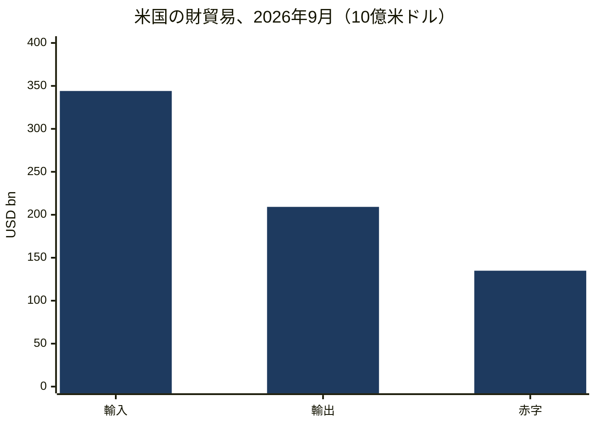
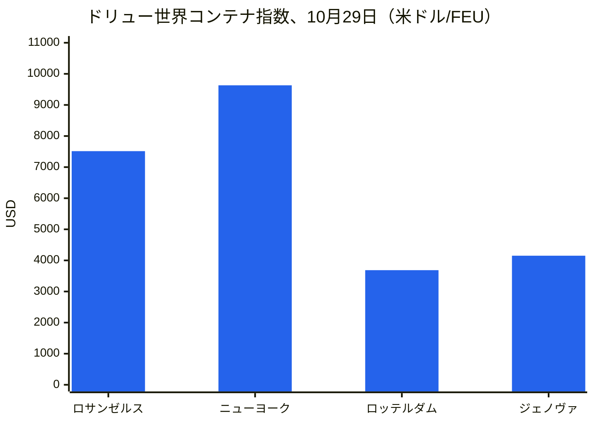
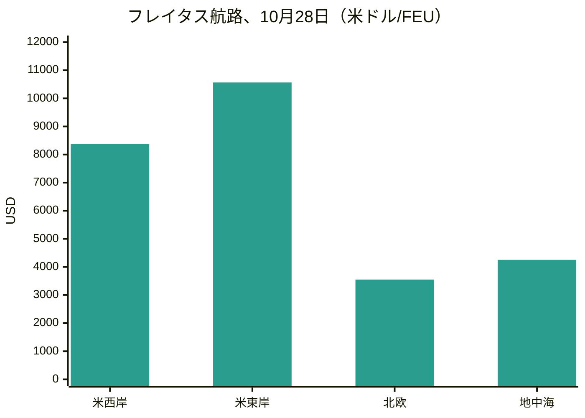
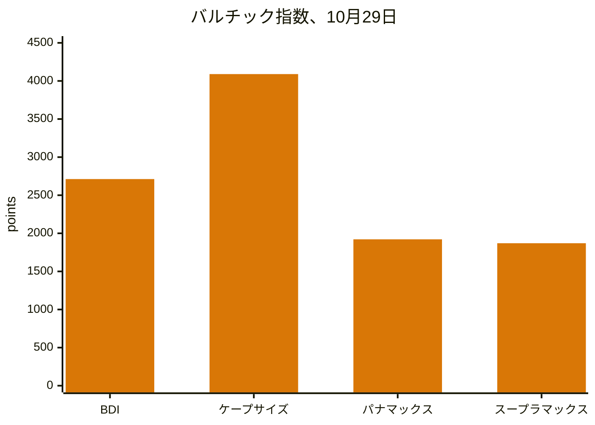
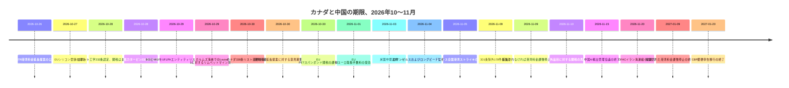
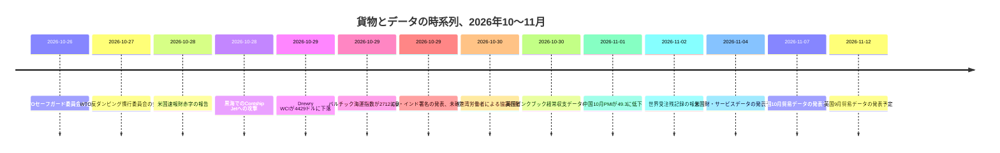

# 世界貿易インテリジェンス報告 — 2026年10月26日～11月2日週

**週次ブリーフィング。** 対象期間：2026年10月26日～11月2日。世界の貿易ニュース、政策、データ、貨物に関する約45のデータソースから編集した。

---

## 目次

1. [エグゼクティブサマリー](#1-executive-summary)
2. [アラート](#2-alerts)
3. [主要ニュース — 詳細分析](#3-top-stories--deep-dives)
4. [関税トラッカー](#4-tariff-tracker)
5. [米国政策の詳細分析](#5-us-policy-deep-dive)
6. [地域別世界政策](#6-world-policy-by-region)
7. [執行措置](#7-enforcement-actions)
8. [データ公表](#8-data-releases)
9. [貨物市場](#9-freight-market)
10. [政策タイムライン](#10-policy-timelines)
11. [今後の期限とイベント（今後90日間）](#11-upcoming-deadlines--events-next-90-days)
12. [データソースと調査方法](#12-sources--methodology)

---

## 1. エグゼクティブサマリー

未解決のまま残る期限が支配した週であった。11月9日に失効する中国に対する301条製品除外178件と中国関連船舶に対する301条港湾料金の課徴停止、米国の中間選挙翌日に米国最大のコンテナ港湾複合体を停止させかねない250人の労働紛争、ホルムズ海峡と黒海における海運リスクの急激な高まりである。こうした背景の中、欧州連合（EU）は対中貿易防衛プログラムを複数の方面で同時に前進させ、カナダの改定50％関税リストが発効し、米国は人工知能関連の資本財にけん引された財輸入の月間記録を報告した。

- **11月9日の崖は1週間後に迫っているが、2つの時計はいずれも未解決のままである。** 中国に対する301条製品除外の残り178件は、2026年11月9日午後11時59分（東部時間）に失効し、この対象期間中に延長通知は確認されていない。11月10日以降の申告はリスト税率に戻る。中国関連船舶に対する301条港湾料金の課徴停止を2027年1月9日まで延長するUSTRの提案は、10月26日に連邦官報に掲載され、意見募集は10月30日に締め切られたが、11月2日時点で最終通知は公表されていない。この2つの措置は別個のものであり、一方の確定が他方を延長するわけではない。さらに公表されているもう1つの停止措置である産業安全保障局（BIS）の関連会社規則の適用停止も、公表文面上は11月9～10日に失効し、2027年1月10日までの延長が発表されているものの、10月31日時点で官報に掲載されていなかった。
- **カナダの改定50％リストが10月30日に発効した。** 10月23日に署名された布告は、338条リストから22分類を削除し、100分類を追加したが、50％の税率は変わらなかった。この関税は232条関税に上乗せされ、カナダ・米国・メキシコ協定（USMCA）の適用対象財にも適用される。CBPは10月29日に実施ガイダンスを発出した（CSMS #70314289）。同じ週、上院は50対46でカナダ関税のために発動された国家緊急事態の終了を可決した。これは関税に法的効力を持たない投票であり、カナダの首相は中間選挙前に合意は「近くない」と述べる一方、ワシントンは合意が近いと説明した。338条に対する初の法的異議申し立ては、ニュージャージー州のチーズ輸入業者が10月20日に提起したもので、リスト変更とともに期間中に大きく報じられた。
- **2つの海域で同時に海運リスクが高まった。** 10月29日、オマーンのハサブの北東約25海里のホルムズ海峡で、小型ボートがパナマ船籍の原油タンカーLouise 1の船体に2個の爆発物を装着し、機関室火災により同船は一時的に航行不能となったが、乗組員は無事で、同船は航行を続けた。Reutersは3つの海上保安情報筋の話として、これを2026年2月に始まった米国・イラン戦争以来、同水路における初の成功したリムペットマイン（吸着機雷）攻撃と報じた。Drewryによれば、前週のホルムズ海峡の通航はわずか2隻にとどまったのに対し、スエズ運河の通航は62隻で、今年最高の週間水準となった。黒海では、リベリア船籍のコンテナ船Contship Jetが10月28日にブルガリアの排他的経済水域内で3機の海上ドローンによる攻撃を受け、深夜ごろに沈没した。乗組員18人全員が救助されたが、421個のコンテナのうち20個が海に落下し、リチウムイオン電池などの危険物が含まれていた。
- **欧州の対中プログラムは兆候から正式な案件へ移行した。** 欧州委員会は10月30日、中国製PETスパンボンドに対する39.8％～48.1％の確定反ダンピング関税を5年間課し、10月28日に中国、インド、日本からのポリフッ化ビニリデンに対する反ダンピング調査を開始し、10月27日から関税見直しの間、中国製シリコンの輸入登録を命じ、加盟国は中国製二酸化チタンに対する長期反ダンピング関税を1月11日から発効させることを承認した。重要物資の単一供給源への依存を制限する仕組みに関する委員会の12月提案は、10月27日に企業協議を終えたが、対象分野リスト、閾値、関税率はまだ公表されていない。別途、EU域外のオンライン購入に対する2ユーロのEU取扱手数料が11月1日に発効し、7月1日から実施されている低額貨物に対する1品目当たり3ユーロの関税に上乗せされた。
- **米国は9月に過去最高額の財を輸入した。** 国勢調査局の10月28日の速報によれば、9月の財貿易赤字は1349億ドルで、8月から2.1％増加し、過去最高の3441億ドルの輸入を記録した。資本財輸入は前月比7.5％、前年比77.2％増加し、輸出も2.6％増の2092億ドルとなったものの、AIインフラ輸入の急増が現在、赤字の最大の要因となっている。中国の10月貿易データは、中国の年初来の黒字が1兆ドルを超えたかどうかを示すもので、11月7日に発表予定であり、この期間中には公表されなかった。中国の10月の公式製造業PMIは11月1日に公表され、49.3と再び縮小圏に落ち込み、新規輸出受注は48.7となった。
- **貨物は航路別、船型別に分かれた。** Drewry世界コンテナ指数は10月29日に3％下落して40フィートコンテナ当たり4429ドルとなり、2週連続の上昇を反転させた。上海～ロサンゼルスは6％下落して7514ドル、上海～ニューヨークは5％下落して9631ドルとなった一方、上海～ロッテルダムは1％上昇して3686ドルとなった。バルチック海運指数は10月29日までに2712まで回復したが、これはケープサイズの好調によるもので、パナマックスは1921まで下落し、4月以来の最低となった。運航スケジュールの信頼性は依然として低く、Sea-Intelligenceによれば、9月の世界の定時運航率は50.6％で、8月の49.9％からわずかに改善した。10月30日の港湾労働者による協調行動は100港以上に及び、確認された操業への影響は大半の場所で限定的とされたほか、11月5日にはフランス全国港湾ストライキが予告されている。

**貨物：** コンテナスポット運賃は太平洋横断航路で下落に転じた一方、アジア～欧州航路は堅調を維持した。船社の11月値上げはすでに値引きされている。ドライバルクはケープサイズの鉄鉱石の好調によってのみ回復した。スエズ運河の通航は年間最高に達した一方、ホルムズ海峡の通航はほぼ停止した。航空貨物は、能力を上回る需要増によりピークシーズンに向けて堅調となった。

---

## 2. アラート

| # | アラート | 発効日 | 影響 | データソース |
|---|-------|-----------|--------|--------|
| A1 | 中国に対する301条製品除外178件が2026年11月9日午後11時59分（東部時間）に失効。延長は確認されず。11月10日以降の申告はリスト税率に戻る（リスト1～3は25％、リスト4Aは7.5％） | 2026年11月9日 | HTSUS 9903.88.69/70を申告する輸入者は、期限前に価格を再設定し、申告を確認しなければならない | [Gateway Lines](https://gatewaylines.com/press-releases/china-section-301-tariffs-stay-178-exclusions-end) |
| A2 | 301条港湾料金の課徴停止を2027年1月9日まで延長するUSTR提案は依然として提案段階にとどまる。意見募集は10月30日に締め切られた（案件番号USTR-2026-0694）。11月2日時点で最終通知は公表されていない | 2026年11月9日（現行の停止措置が失効） | 確定しなければ、港湾料金と関連するクレーン・貨物取扱関税が11月10日に再開する | [Federal Register](https://www.federalregister.gov/documents/2026/10/26/2026-21755/request-for-comments-on-further-suspension-of-section-301-action-chinas-targeting-of-the-maritime) |
| A3 | カナダ338条リストを改定：22分類を削除、100分類を追加。50％の税率は変更なし。232条関税に上乗せされ、USMCA適用対象財にも適用される | 2026年10月30日 | 申告日が、出荷日ではなく、同じ財に対する0％と50％を分ける。分類を直ちに再確認すること | [Baker McKenzie](https://globalimportblog.bakermckenzie.com/2026/10/30/us-further-modifies-section-338-tariffs-on-canadian-goods-as-the-tariffs-face-their-first-legal-challenge/) |
| A4 | ホルムズ海峡の情勢悪化：10月29日にタンカーLouise 1に対するリムペットマイン攻撃。前週に報告されたホルムズ海峡の通航はわずか2隻。10月30日～11月2日には、ラス・アル・ハフジ東方でタンカーが飛翔体による攻撃を受けた事例を含むさらなる事案が報告された | 2026年10月29日～11月2日 | 戦争リスク、航路選択、保険コストは高止まりする。湾岸航路の判断では、航路の安全性に関する競合する公式見解を織り込む必要がある | [gCaptain](https://gcaptain.com/tanker-in-strait-of-hormuz-hit-by-limpet-mines-security-sources-say/) |
| A5 | 黒海での沈没：コンテナ船Contship Jetが10月28日にブルガリアの排他的経済水域内で3機の海上ドローンによる攻撃を受けて沈没。421個のコンテナのうち20個が海に落下し、危険物を含む | 2026年10月28～29日 | 黒海の戦争リスクはEU・NATO加盟国の水域にまで及ぶ。漂流する危険物コンテナが航行上の危険を生む | [Splash247](https://splash247.com/splash-wrap-new-networks-old-faultlines/) |
| A6 | ロサンゼルス／ロングビーチの監視員ストライキ期限が2026年11月4日午後5時（太平洋時間）まで延長された。最終合意なし。対象ターミナルはロングビーチ貨物の約85％、ロサンゼルス貨物の約33％を取り扱う | 2026年11月4日 | 250人の紛争により、他のILWU組合員がピケットラインを尊重すれば、対象ターミナルでの船舶、ヤード、ゲート作業が停止する可能性がある。ある報道では11月5日とされた | [Seatrade Maritime](https://www.seatrade-maritime.com/ports-logistics/impending-strike-threatens-la-lb-ports-container-flow) |
| A7 | EU域外のオンライン購入に対する2ユーロのEU取扱手数料が発効。2026年7月1日から実施されている150ユーロまでの貨物に対する1品目当たり3ユーロの関税に上乗せされる | 2026年11月1日 | 低額・複数品目の電子商取引では、付加価値税の前に1明細当たり5ユーロがかかる。この手数料は商品を返品しても返金されない | [Shipping and Freight Resource](https://www.shippingandfreightresource.com/trade-moves-02-nov-2026/) |
| A8 | 10月30日に100港以上での港湾労働者による協調行動。11月5日にはフランス全国港湾ストライキが予告された | 2026年10月30日／11月5日 | 10月30日以降の着岸およびフィーダー遅延。地中海の積み替え拠点とフランスの玄関口に集中 | [Port Technology](https://www.porttechnology.org/news/ports-and-terminals/dockworker-strikes-ports-military-cargo/) |
| A9 | DHSが中国ゲノミクス企業3社（BGI Group、BGI Genomics、MGI Tech）をUFLPAエンティティリストに追加。統合リストは現在190団体 | 2026年10月29日 | これらの企業が全部または一部を生産した財は、強制労働によるものと推定され、推定が覆されない限り禁止される | [LexBlog](https://www.lexblog.com/2026/10/29/dhs-updates-uflpa-entity-list-with-three-companies-engaged-in-genetics-testing/) |
| A10 | 232条ロボット工学・産業機械：国家安全保障上の認定あり、関税はまだなし。交渉が命じられ、180日以内に報告が求められる | 2026年10月28日 | 関税リスクは2027年春に先送りされたのであり、除去されたのではない。風力タービンと同じ型である | [White House](https://www.whitehouse.gov/fact-sheets/2026/10/fact-sheet-president-donald-j-trump-adjusts-imports-of-robotics-industrial-machinery-and-their-parts-and-components-into-the-united-states/) |

### A1/A2 — 1週間後に迫った11月9日の時計

11月9日の2つの措置はしばしば一緒に報じられるが、別々に機能する。製品除外は、2024年5月に維持された164件に2024年9月に追加された太陽光発電製造装置の除外14件を加えたもので、HTSUS 9903.88.69および9903.88.70の下で申告され、11月9日午後11時59分（東部時間）に失効する。10月29～31日に報じた複数の情報筋は、延長通知を確認していない。USTRの10月6～7日の継続通知は、2018年の301条措置そのものが継続することを確認したものであり、除外を延長したものではない。これに対し港湾料金の課徴停止は、現在進行中の提案の対象である。10月26日に公表された連邦官報通知（91 FR 67388）は、2026年11月10日午前0時（東部時間）から2027年1月9日午後11時59分（東部時間）まで、2025年4月23日の措置（2025年10月16日に修正）の附属書I～IIIに定める海上輸送サービス料金と、中国製シップ・ツー・ショア・クレーンおよび貨物取扱装置に対する附属書V.Aの関税を停止し、停止期間中は債務が発生しないとすることを提案している。理由は中国との交渉をさらに進めるためとされている。この提案は、置き換える1年間の停止措置に比べてはるかに短い2か月間のみを対象としている。

**分析：** 輸入者と船社は、同じ日付に対して異なる曝露に直面する。除外見出しを申告する輸入者は、港湾料金がどうなろうと、11月10日からリスト税率を前提に計画しなければならない。船社は、提案が確定しなければ料金の再開に直面する。両者は、単一の「休戦」としてではなく、文書化された措置として追跡されるべきである。政治カレンダー（2027年1月10日まで続くとされる休戦）と規制カレンダー（11月9日）は依然として異なるものである。

### A3 — カナダ：週半ばに発効したリスト変更

10月23日の布告は、10月30日に連邦官報に掲載され、同日午前0時01分（東部時間）から、その日以降に消費のために申告または倉庫から引き出された財に対して発効した。見出し9903.03.14の下で22分類を削除し、100分類を追加した。見出し9903.03.12および9903.03.13は変更されなかった。削除された品目には、特定の合板シート、紙製品、機械および冷凍装置、梱包用木箱・箱、プラスチックラップ、段ボール箱、食品関連機械が含まれる。追加された品目には、カーペットおよび敷物、特定の木材・紙製品、塗料、石けん、潤滑剤などの化学製品、ココアパウダー、ビニル床材、カヌー、チェストフリーザー、シャンプー、トイレ用石けんなどの消費財のほか、バルブ、計器、窓用エアコン、診断試薬が含まれる。附属書の説明は情報提供のみであり、HTSコードが適用範囲を決定する。

**分析：** 実務上の帰結はタイミングである。チェストフリーザーは10月29日までは232条の鉄鋼関税のみを負っていたが、10月30日から338条が加わった。合板は逆方向に動いた。この関税はUSMCA原産地にかかわらず、232条関税に加えて適用されるため、原産地計画では回避できない。実質的な効果は、緩和ではなく構造的な入れ替えである。救済はメイン州と結びついた農業・林業サプライチェーンに集中し、新たな曝露は消費財と工業製品全体に広がった。

### A4/A5 — 2つの海域、同じ週

10月29日のホルムズ海峡攻撃は、データにすでに表れていた傾向に続くものであった。イランと関係のないホルムズ海峡の通航は、9月28日～10月4日週の126隻から10月5～11日週には104隻に減少し、Lloyd's List Intelligenceは10月上半期にホルムズ海峡と周辺水路で少なくとも28件の報告または確認された攻撃を数えた。10月29日の事案では、機雷と飛翔体に加え、航行中のタンカーに対する小型船による至近距離からの船体爆発物という新たな手法が加わった。競合する主張がその後、状況を複雑にした。イランのイスラム革命防衛隊は、3隻のタンカーが「無許可の」南部航路で海軍機雷に触れたとし、イラン軍は水路東方で4隻目を報告した。これは、米国中央軍が機雷の主張は虚偽であり、主要航路は除去済みと述べた翌日のことであった。UKMTOは損傷を記録したが、原因が機雷であることは確認しなかった。黒海では、Contship Jetの沈没は、BTAの報道として伝えられたところによれば、10月だけでブルガリアの排他的経済水域における船舶へのドローン攻撃として5件目であり、コンスタンツァ沖のKhoryvに続く1週間以内の西黒海における2件目の商船沈没であった。Contship Jet攻撃の公式な帰属は公表されていない。Reuters経由のAmbreyによる、機体がロシア製Murena-300Sの設計に似ているとの評価は、帰属ではない。

**分析：** 荷主は、どちらの水路についても、開いているか閉じているかという二者択一の問題として扱うことはもはやできない。ホルムズ海峡はDrewryの通航数では商業交通がほぼ途絶えている一方、スエズ運河は正常化している。黒海のリスクは、EU加盟国の排他的経済水域内におけるイスラエル～ルーマニア航路のコンテナ船にまで及び、危険物が海中にある。保険、航路、危険物申告はすべて、航海ごとに評価する必要がある。

---

## 3. 主要ニュース — 詳細分析

### 3.1 11月9日の崖と、誰も注目していない3つ目の時計

2つの301条の時計に加え、産業安全保障局（BIS）の関連会社規則の適用停止が、公表文面上は2026年11月9～10日に失効する。この規則は2025年9月29日付で、エンティティリスト、軍事エンドユーザー、特別指定国民（SDN）の規制を、リスト掲載者により50％以上所有される外国関連会社に拡大するものである。スコット・ベッセント財務長官は2026年9月24日、米中休戦と、それに対応する適用停止が2027年1月10日まで延長されると発表した。しかし、10月31日の情報筋の締め切り時点で、適用停止を正式に延長する連邦官報通知は公表されていなかった。輸出者は、BISが公表するまで延長に頼るべきではない。港湾料金の提案についても同じ注意が必要である。1月9日までの遅延として大きく見出しに取り上げられているが、意見募集期間が10月30日に締め切られた提案であり、最終規則ではない。

**分析：** 3つの別個の措置が、ほぼ1日のうちに失効する。それぞれ決定者も法的形態も異なる。発表、見出し、あるいは並行する措置の運命を根拠に、いずれかが延長されたものとして扱うことが、今後1週間の主なコンプライアンスリスクである。11月9日時点の連邦官報に記載された文面こそが、申告、航海、輸出審査の唯一の安全な根拠である。

### 3.2 ホルムズ海峡と黒海：海運市場の変数としての情勢悪化

今週の海運ニュースは、単一の変数、すなわち戦争リスクが、異なる水路で逆方向に動いているものとして読むのが最適である。スエズ運河の通航は、Drewryが10月29日に報告した週に62隻となり、今年最高の週間水準となった。Alphalinerは、アジア～欧州輸送能力のほぼ3分の2が紅海経由で回復したと推計し、ZIMがMSCとの共同アジア～米国東海岸サービスで同航路を再開したことを含む。9月初旬以降、16,000 TEU以上のコンテナ船100隻以上がスエズ運河を通過し、2025年通年と2026年1～8月を合わせた99隻を上回った。2026年のこれまでの超大型船の通航は192隻で、2025年の8隻と対照的である。同時に、ホルムズ海峡の通航はDrewryの週間集計で2隻に減少し、ブレント原油は10月30日に12月限の期近物で118ドルに触れ、4月30日以来の高値となった。フーシ派は、サウジアラビアによるイエメン空爆で27人が死亡したと主張する報復として、ラス・タヌラとラービグの製油所、アブカイクのAramco施設、リヤドとダンマームの空港に対するミサイル攻撃を主張した。サウジ主導の連合はミサイルを迎撃し、損傷を確認していないと述べた。オマーン海軍は10月30日、炎上するパナマ船籍タンカーRitiから乗組員25人を避難させた。11月2日の商品報告書はUKMTOを引用し、10月31日～11月2日にホルムズ海峡、湾岸、オマーン湾で10件の海運事案があったと数えた。

**分析：** スエズ運河の復帰は実効輸送能力を解放し、アジア～欧州運賃を押し下げている一方、ホルムズ海峡の混乱はエネルギーと湾岸航路のコストを引き締めている。この2つの効果は相殺されない。異なる貿易、異なる貨物、異なる保険分野に影響する。運用上の帰結は、一方の回廊についての「正常への復帰」という語りが、他方に適用されるべきではないということである。

### 3.3 カナダ：同じ週における救済、情勢悪化、訴訟

カナダ関連では4つの別個の動きが重なった。第1に、338条のリスト変更が10月30日に発効した（第2節A3参照）。第2に、上院は10月29日、ティム・ケイン上院議員の提案により、カナダ関税のために発動された国家緊急事態の終了を50対46で可決した。共和党からはメイン州のスーザン・コリンズ、ケンタッキー州のミッチ・マコネル、アラスカ州のリサ・マコウスキー、ケンタッキー州のランド・ポールが民主党に加わった。これは10月28日のブラジル関税反対の上院投票に続くものであった。下院の手続き規則が審議を阻むと報じられており、大統領拒否権も可能であるため、この投票から関税変更は生じない。第3に、交渉に関する説明が分かれた。Reutersは10月26日、当局が鉄鋼に対する50％、自動車に対する25％の232条関税の緩和に向けた合意を模索していると報じ、ハワード・ラトニック商務長官がカナダ・米国貿易相ドミニク・ルブランと定期的に連絡を取っているとした。10月28日にはカナダ当局者が進展を「限定的」と説明した。10月29日にはマーク・カーニー首相が、中間選挙前に合意は「近くない」と述べ、いかなる代償を払っても受け入れることはないとし、2026年8月に交渉が決裂したのは、米国側の条件がカナダの他国との交渉能力を制限し、フランス語要件を損ない、自動車産業に害を及ぼすとカナダが判断したためだと指摘した。大統領は、10月25日のミシガン州での発言と10月29日のサウスカロライナ州での発言で、合意が近いとし、カナダは米国を「極めて丁重に」扱っていると述べた。第4に、338条に対する初の法的異議申し立てであるGellert Global Group v. Trumpは、10月20日にニュージャージー州のカナダ産チーズ食品輸入業者（2025年のカナダ産チーズ輸入額は約7100万ドル、代理人はLiberty Justice Center）により米国国際貿易裁判所に提起された。301条が338条に取って代わったこと、措置が338条の差別および相殺テストを満たさないこと、9月の追加措置が主張される30日間の待機期間ではなくわずか7日間しか与えられなかったことを理由に、関税の違法宣言、徴収の差し止め、利息付きの返金を求めている。実体に関する判断は報告されていない。

**分析：** 投票、交渉、訴訟はそれぞれ異なる方向に引っ張っており、いずれも今週の関税率を変更するものではない。直ちに商業的効果を持つのは10月30日のリスト変更のみであり、制度を覆しうるのは訴訟のみで、それには数か月を要する。輸入者は政治的シグナルと法的効果を区別すべきである。

### 3.4 欧州：貿易防衛の週と、形を取りつつある12月の措置

欧州連合の対中プログラムは、1週間で4つの方面で正式な措置を生んだ。中国製PETスパンボンドに対する確定反ダンピング関税（39.8％～48.1％、5年間、2026年5月から実施されていた45.6％～50％の暫定関税に代わるもの）が、2億ユーロ規模の市場に対して10月30日に課された。EU産業はドイツ、イタリア、フランスに拠点を置く。中国、インド、日本からのポリフッ化ビニリデンに対する反ダンピング調査が10月28日に開始され、これは10月16日の中国からのフルフリルアルコールに対する調査開始に続くものである。中国製シリコン輸入は、既存の反ダンピング関税が十分かどうかを委員会が見直す間、10月27日から9か月間、税関登録の対象とされた。この見直しは9月1日に、EU生産者全社を代表するEuroalliagesの要請により開始された。加盟国は、中国製二酸化チタンに対する長期反ダンピング関税を承認した。安徽金星集団（Anhui Jinxing Group）に対しては1キログラム当たり0.25ユーロ、龍佰集団（Longbai Group）に対しては0.74ユーロ、協力企業に対しては0.64ユーロ、その他すべてに対しては0.74ユーロと報じられ、1月11日から5年間発効する。中国製二酸化チタンの輸入は2023年に5億ユーロを超えた。これらの案件の背後には、10月23日のダブリンにおける非公式理事会でのシグナルがある。マロシュ・シェフチョビッチ貿易担当委員は、プラスチック部門がセーフガード調査の可能性に「最も近い」と述べた。EUの対中財貿易赤字は1日当たり10億ユーロ超、2025年は3700億ユーロ超、2026年は4000億ユーロ超と見込まれ、2026年上半期の赤字はあるPoliticoベースの報道でほぼ1970億ユーロとされた。

12月の措置も並行して前進した。重要物資について単一国への依存からの多様化を強制する手段に関する企業協議は10月27日に終了し、提案は12月初旬に予定され、EU首脳が12月17～18日に会合する直前となる。協議では、この措置が、1つの供給国への過度な依存がEUの供給安全保障または経済安定を脅かす状況を対象とすることが確認された。対象分野リスト、閾値割合、関税率は公表されていない。BusinessEuropeは、代替調達が価格を引き上げると警告した。シェフチョビッチ委員は、報道で引用された2026年6月の演説で、企業は「レジリエンスのコスト」を吸収しなければならないと述べた。議論されている形は2つある。防衛およびデュアルユース財を対象とするエネルギー方式の最小限の多様化義務か、あるいは1つの供給源からの購入が一定割合を超えると関税が発動しうる閾値モデルという最大限の形である。

**分析：** EUは、ハイブリッド車に上限を設け、プラスチックがセーフガードに最も近く、化学品が正式調査中、シリコンが見直し中という、分野ごとのプログラムを進めているのであり、単一の広範な措置ではない。12月の措置は、このプログラムが経済全体の手段へ一般化するのか、分野別にとどまるのかを示す。いずれにせよ、方向は2027年における対中貿易防衛措置の減少ではなく増加である。

### 3.5 2つの赤字、2つの方向：米国はより多く輸入し、中国はより多く輸出する — 今のところ

国勢調査局の9月速報は10月28日に公表され、米国の財貿易赤字は1349億ドルで、8月の1321億ドルから28億ドル（2.1％）増加し、2025年3月以来の最大となり、Reuters／Bloombergのコンセンサス予想1302億ドルを上回った。輸入は過去最高の3441億ドルで、81億ドル（2.4％）増加した。資本財輸入は前月比7.5％、前年比77.2％増加した。輸出は2.6％増の2092億ドルで、食品出荷は12.8％、消費財輸出は6.5％増加した。消費財輸入は3.1％、その他の財は6.7％増加した一方、金と石油を含む工業用資材は6.0％減少した。エコノミストの推計では、第3四半期のGDPに対する貿易の足かせは4ポイント（Pantheon Macroeconomics）と3.25ポイント（Oxford Economics）とされた。これらは推計であり、公式データではない。より完全な財・サービス貿易統計は11月4日に発表予定である。10月6日に公表された8月の財・サービス赤字は1056億ドルで、異なる基準によるものであり、速報の財の数値と直接比較できない。

中国の9月データは10月20～21日に報告され、輸出は前年比36.3％増の約4471億8000万ドル、輸入は31％増の約3136億5000万ドル、月間黒字は1335億ドル、1～9月の累計黒字は9381億ドルとなった。これは2025年の記録である約1兆1900億ドルを上回るペースであり、この閾値は2025年には11月まで超えられなかった。9月の対EU黒字は過去最高の348億ドル、対米黒字は340億ドルに拡大し、20か月ぶりの高水準となった。しかし、11月1日に公表された10月の状況は逆方向を示している。公式製造業PMIは9月の50.1から49.3に低下し、新規輸出受注は50.0から48.7に、生産指数は51.7から49.8に低下した。11月1日の記事は最初の3四半期をまとめ、輸出は前年比16.4％増の3兆4600億ドルで、機械・電気製品は15.6％増、ハイテク製品は21.6％増、消費財は14.9％増とした。

**分析：** 9月の好況と10月のPMI縮小は矛盾しない。異なる時点を表している。今後1週間の問題は、11月7日に発表予定の10月の税関データが冷え込みを確認するのか、それとも好況を1兆ドル超まで延長するのかである。どちらの結果も、ブリュッセルとワシントンでは統計としてだけでなく、黒字に関する証拠として読まれることになる。

### 3.6 貨物：太平洋横断航路ではピークは過ぎたが、輸送能力は正常に動いていない

Sea-Intelligenceは10月29日、週間輸送能力が主要な東西航路すべてで過去最高に達し、2012年から2025年に見られたゴールデンウィーク後の通常の縮小を破ったと報告し、これを需要の急増ではなく、アジアの港湾混雑と運航スケジュールの不確実性による船舶の集中により第3四半期の出航が10～11月に押し出されたためと説明した。アジア～北欧は10月と11月に週当たり350,000 TEUを超え、アジア～地中海は週当たり260,000 TEUを超え、アジア～北米西岸は10月にほぼ393,000 TEUに達し、11月には前例のない400,000 TEUが予測され、アジア～東岸は10～11月にどの年の最高水準も記録した。2026年最強の台風である台風Champiも直接寄与した。同台風は10月23日に台湾の高雄、基隆、台北の港を閉鎖し、寧波を10月23日夕方から10月25日正午ごろまで、上海を10月24日夕方から10月25日正午ごろまで停止させ、滞貨の解消に伴い上海と寧波で約4日間の混雑関連の遅延を残した。SEKOの10月23日の更新によれば、世界の港湾混雑は336万TEU、すなわち船隊の9.7％に達した。

**分析：** 需要が弱い中で記録的な配船能力が投入されていることが、船社が混雑の見出しにもかかわらず値上げを維持できない理由を説明する。市場は同時に混雑し、供給過剰である。混雑は需要のシグナルではなく、スケジュールの人工物である。この組み合わせは、船舶の集中が解消されるよりも速く輸送能力が引き揚げられない限り、年間契約シーズンに向けて運賃圧力が続くことを示している。

---

## 4. 関税トラッカー

| 国／措置 | 税率／詳細 | 発効日／現状 | データソース |
|---|---|---|---|
| カナダ — 338条リスト改定（22分類を削除、100分類を追加） | 50％従価税、232条に上乗せ、USMCA適用対象財にも適用 | 2026年10月30日に発効。CBP CSMS #70314289（10月29日） | [Baker McKenzie](https://globalimportblog.bakermckenzie.com/2026/10/30/us-further-modifies-section-338-tariffs-on-canadian-goods-as-the-tariffs-face-their-first-legal-challenge/) |
| カナダ — 米国産品に対する報復関税 | 約276億カナダドルの米国原産品（648品目）に対する15％／25％／50％の付加税 | 2026年9月8日から実施中。トラクター／コンバイン／農業機械修理部品は2027年6月30日まで0％の免除 | [JD Supra](https://www.jdsupra.com/legalnews/update-on-the-u-s-canada-trade-conflict-3530187/) |
| カナダ — 232条鉄鋼／自動車（米国関税） | 鉄鋼50％、自動車25％。緩和に向けた協議が10月26日に報じられたが、合意なし | 実施中。合意に向けた協議が継続中 |  |
| メキシコ — 米国自動車関税 | 現行25％。メキシコは控除を維持した上で15％への引き下げを求めている | 2026年10月28日時点で合意なし |  |
| 中国 — 301条製品除外（178件） | 失効時に25％（リスト1～3）／7.5％（リスト4A）に戻る | 2026年11月9日午後11時59分（東部時間）に失効。延長は確認されず | [Gateway Lines](https://gatewaylines.com/press-releases/china-section-301-tariffs-stay-178-exclusions-end) |
| 中国 — 301条海上港湾料金 | 停止措置が失効した場合、中国製船舶を使用する中国以外の企業は1純トン当たり50ドル。中国企業は1純トン当たり18ドルまたは1コンテナ当たり120ドルのいずれか高い方。自動車運搬船は1台当たり150ドル | 2026年11月9日午後11時59分（東部時間）に停止措置が失効。2027年1月9日までの延長が提案されたが、確定していない | [Federal Register](https://www.federalregister.gov/documents/2026/10/26/2026-21755/request-for-comments-on-further-suspension-of-section-301-action-chinas-targeting-of-the-maritime) |
| 中国 — 232条風力タービン | 関税はまだなし。交渉が命じられ、180日以内に更新あり | 2026年10月22日の布告。10月28日に連邦官報に掲載。更新は2027年4月20日ごろまでに提出 | [Thompson Hine](https://www.thompsonhinesmartrade.com/2026/10/president-trump-opts-for-negotiations-not-tariffs-in-section-232-wind-turbine-investigation/) |
| 中国 — 232条ロボット工学／産業機械 | 関税、割当て、手数料はまだなし。交渉が命じられ、180日以内に報告あり | 2026年10月28日の布告。2026年11月2日に連邦官報掲載予定。報告は2027年4月26日ごろまでに提出 | [White House](https://www.whitehouse.gov/fact-sheets/2026/10/fact-sheet-president-donald-j-trump-adjusts-imports-of-robotics-industrial-machinery-and-their-parts-and-components-into-the-united-states/) |
| 中国 — バン型トレーラー／サブアセンブリー（AD＋CVD命令） | 報告によれば、ダンピング保証金129.73％、補助金率134.75％。保証金の合計は260％超 | 2026年10月28日に命令を公表 | [Federal Register (PDF)](https://public-inspection.federalregister.gov/2026-21929.pdf) |
| 中国 — ショッピングカート／部品（AD＋CVD申立て） | 申立てによるダンピングマージン165％～343％に加え、申立てによる補助金（申立てであり、関税ではない） | 2026年10月28日に申立てを提出。商務省の開始決定は11月17日まで（延長時は12月7日）。ITCの予備的損害決定は12月14日まで | [LexBlog](https://www.lexblog.com/2026/10/29/new-ad-cvd-petitions-filed-on-shopping-carts-from-china/) |
| 中国 — 段ボール製ダイカット箱（AD調査、マレーシア、トルコとともに） | 調査のみ。税率はまだなし | 2026年10月26日に開始（適用は10月19日）。適用範囲に関する意見は11月9日まで | [Federal Register (PDF)](https://public-inspection.federalregister.gov/2026-21783.pdf) |
| 中国 — アミン化合物／ポリウレタン触媒（AD＋CVD調査） | 申立てによるダンピングマージン244.94％～352.32％（申立てであり、関税ではない） | 2026年10月26日に開始（適用は10月19日）。ITCの予備的損害は11月13日ごろに予想 |  |
| EU — 中国製PETスパンボンド（確定AD） | 39.8％～48.1％、5年間 | 2026年10月30日に課税（2026年5月からの暫定関税45.6％～50％） | [European Commission](https://policy.trade.ec.europa.eu/news/commission-acts-against-imports-pet-spunbond-china-2026-10-30_en) |
| EU — 中国製二酸化チタン（長期AD承認） | 報告によれば、1キログラム当たり0.25ユーロ（安徽金星）、0.74ユーロ（龍佰）、0.64ユーロ（協力企業）、0.74ユーロ（その他すべて） | 2027年1月11日から発効、5年間 |  |
| EU — 中国製シリコン（AD見直し中の登録） | 9か月間の登録。遡及措置の可能性を保持 | 2026年10月27日から登録。見直しは2026年9月1日に開始 |  |
| EU — 中国、インド、日本製PVDF（AD調査） | 調査のみ。税率はまだなし | 2026年10月28日に開始 |  |
| EU — 中国製フルフリルアルコール（AD調査） | 調査のみ。税率はまだなし | 2026年10月16日に開始 |  |
| EU — 中国製太陽光ガラス（関税廃止） | AD 17.5％～75.4％およびCVD 3.2％～17.1％を廃止。2025年7月22日以降に支払われた関税は利息なしで還付請求可能 | 2026年10月22日に発効 |  |
| EU — ハイブリッド／プラグインハイブリッド車（世界セーフガード合意） | 年間350,000台の上限、年6％増加、4年間 | 2026年10月9～12日ごろに合意。2026年12月初旬の実施が見込まれる |  |
| EU — EU域外の遠隔販売に対するEU取扱手数料 | 1品目当たり2ユーロ。150ユーロまでの貨物に対する1品目当たり3ユーロの関税に上乗せ | 2026年11月1日から発効。3ユーロの関税は2028年7月1日まで継続。2ユーロの手数料は恒久的 | [Shipping and Freight Resource](https://www.shippingandfreightresource.com/trade-moves-02-nov-2026/) |
| 日本 — 中国／台湾製ニッケル添加冷間圧延ステンレス鋼（確定AD） | 3.6％～42.1％、5年間 | 2026年10月31日～2031年10月30日 |  |
| オーストラリア — 中国製アルミニウム製窓／ドア（暫定AD／CVD担保） | 一部輸出者に対して最大73.3％（暫定担保であり、最終関税ではない） | 2026年10月15日から発効。最終勧告は2026年12月に予想 |  |
| 中国 — リン鉱石／銀の輸出許可 | 2027年を通じて割当て管理を停止。船積み許可を維持 | 2027年1月1日～12月31日。割当ては2026年12月15日までに配分 |  |
| 中国 — アフリカ53か国に対するゼロ関税特恵 | 2024年12月1日から33の後発開発途上国に対して全関税品目が無税。20の非LDC経済が5月1日に2028年4月30日までの暫定特恵の下で追加 | 2026年10月30日に再確認 |  |

---

## 5. 米国政策の詳細分析

### 338条とカナダ

リスト変更、上院投票、交渉の食い違い、Gellert Global Groupの異議申し立てについては、第2節（A3）および第3.3節を参照されたい。今週の報道から、輸入者にとって重要な点がさらに2つある。第1に、10月30日の連邦官報掲載と10月29日のCBPガイダンス（CSMS #70314289）が実施上の文書である。布告の附属書の説明は情報提供のみであり、HTSコードが適用範囲を決定するため、分類の見直しは製品説明ではなく品目ごとに行われなければならない。第2に、この法的異議申し立ては、2026年8月以前には一度も使用されたことのない法令に対する初の法廷テストである。不利な判断が出れば、10月30日のリストを含め制度全体が覆る可能性があるが、実体に関する判断は報告されておらず、関税は当面徴収可能なままである。338条関税を支払っている輸入者は、訴訟が成功した場合の返金請求を裏付ける形で申告書類を保存すべきであるが、その結果を前提とすべきではない。

### 広く再流通した「カナダ10％引き上げ」に関する訂正

2026年10月26日～11月2日の期間中に、新たなカナダ10％関税を課す布告、連邦官報通知、CBPガイダンスは確認されなかった。広く再流通した「オンタリオ州のレーガン広告をめぐる10％引き上げ」の話は、2025年10月にさかのぼる。オンタリオ州がワールドシリーズ中にロナルド・レーガン元大統領の関税に関する発言を用いた広告を放映し、大統領がカナダとの協議を打ち切り、10％引き上げの脅しを投稿した出来事である。この出来事は2026年10月の新たな措置ではなく、そのように引き継がれるべきではない。別途、2026年7月24日から発効している60経済を対象とする措置に対する既存の10％の301条強制労働関税は、別個の措置である。大統領は2026年10月27日、カーニー首相とは「しばらく」会う見込みがないと述べた。

### 232条 — ロボット工学は風力タービンの型に従う

2026年10月28日に署名され、11月2日に連邦官報掲載が予定された布告11077（91 FR 69199–69202）は、ロボット工学、産業機械およびその部品・構成品の輸入が国家安全保障を脅かすとの商務省の認定に同意したが、関税、割当て、手数料は課さなかった。ハワード・ラトニック商務長官とジェイミソン・グリアUSTR代表は、貿易相手国との交渉を共同で進め、180日以内、すなわち2027年4月26日ごろまでに進捗を報告しなければならない。交渉次第では、関税、課徴金、割当て、手数料、または米国生産奨励プログラムが依然として可能であり、既存の鉄鋼、アルミニウム、銅の232条関税は変更されない。風力タービン布告（11074、10月22日に署名、10月28日に公表）も同じ型に従う。外国製インバータのサイバーセキュリティおよび遠隔アクセスリスク、送電網の信頼性、レーダーおよび航空交通への干渉を挙げる国家安全保障上の認定、風力に特化した新たな関税なし、交渉の指示、180日以内（2027年4月20日まで）に少なくとも1回の更新である。報告された背景によれば、米国の風力タービンおよび部品の輸入は2024年に約18億ドルであったが、これは一次資料に対して検証されたものではなく、二次的な報道によるものである。

**分析：** この型は、関税リスクを除去するのではなく、2027年春に先送りするものである。ロボット工学および風力設備の輸入者は、交渉期間を、製品範囲と相手国の免除が決定される期間として扱うべきであり、いずれの分野も2027年4月以降は関税なしとして価格設定すべきではない。

### UFLPAエンティティリスト — ゲノミクス企業を追加

国土安全保障省は、強制労働執行タスクフォースの議長として、深圳市に拠点を置く深圳BGI科技有限公司（BGI Group）、BGI Genomics Co., Ltd.、MGI Tech Co., Ltd.をUFLPAエンティティリストに追加した。通知は10月28日に公衆閲覧に付され、10月29日の公表が予定され、推定は10月29日から適用される。3社すべてが第2条(d)(2)(B)(ii)（新疆政府と協力して強制労働を行うこと）の下で追加された。BGI GenomicsとBGI Groupはさらに第2条(d)(2)(B)(v)（新疆からの調達）の下でも追加された。これらの企業が全部または一部を生産した財は、強制労働によるものと推定され、推定が覆されない限り、19 U.S.C. §1307の下で禁止される。統合リストは現在190団体となった。北京はこの措置を非難し、対抗措置を約束した。ライフサイエンスのサプライチェーンへの影響は直接的である。シーケンシング機器、試薬、消耗品、検査キットは、BGIおよびMGIへの曝露について下位層までの追跡が必要となる。

### CBP郵便申告 — 2027年1月20日の期限は維持される

2026年10月22日に公表されたCBP最終規則および申告タイプ13のテスト変更（91 FR 66638；91 FR 66707）は、10月28～30日の報道により実施上の立場が確認され、特定の国際郵便貨物に対する正式申告要件の義務遵守日を2026年10月22日から2027年1月20日に移行させた（19 CFR 145.12(a)(2)(v)–(vi)）。対象となる貨物は、パートナー政府機関の要件（FDAを含む）の対象となる郵便、第98章／第99章の関税の対象となる郵便、または第98章もしくは自由貿易協定による無税待遇を主張する郵便である。別途、CBPは、申告タイプ13の電子非公式申告テスト（2,500ドルまでの郵便を対象とし、2026年9月22日に開始）を変更し、完全な電子パートナー政府機関データを伴わない申告を一時的に受け付けることとした。CBPは、この受け付けの終了を将来の連邦官報通知で発表する予定であり、終了日は定められていない。CBPによれば、これらの要件の結果として、2027年1月20日より前に国際郵便申告手続きに変更はない。この90日間の猶予はデミニミスを復活させるものではなく、個人用処方薬の免除を設けるものでもない。薬局と運送業者は依然として2027年1月20日という厳しいシステム期限に直面し、FDAの許容性規則は変更されていない。

### 関税返金 — 期間中に新たな節目なし

2026年10月26日～11月2日付の新たなCBP返金節目は確認されなかった。背景として確認されている最新の立場は、CAPEフェーズ3が2026年10月6日に、最終清算済みの申告について開始されたが、国際貿易裁判所の再清算命令を持つ輸入者に限られるということである。10月2日時点で、CBPは約1366億ドルのIEEPA返金請求をCAPEに受け入れ、約1260億ドル（利息を含む）を支払いのために財務省に送付した。これは、議会予算局の推計による徴収総額約1660億ドルのうちの一部である。10月8日、イートンCIT判事は、2025年2月1日から2026年2月19日までにIEEPA関税を支払った記録上の輸入業者（別訴訟を除く）の全国集団を認定した。認定は実体判断ではなく、返金を命じるものでもなく、政府は返金命令の一部について上訴している。フェーズ3の最初の支払いは、CBPの60～90日のガイダンスにより、12月初旬から1月初旬に予想される。

### USTR — 期間中のその他の発表

10月26日、グリア大使は、2026年6月のAirbusに対する34億ドルの欧州投資銀行融資を受けて、米国・EU間の緊張緩和の状況に関する声明を発出し、要請にもかかわらずUSTRは詳細を受け取っていないと述べた。Boeingは7月に透明性を求めていた。USTRは、この融資条件が、大西洋横断の航空機融資休戦に影響しうると警告した。この休戦の下では、EU工業製品関税が撤廃される見返りに、ほとんどのEU製品に対する15％の米国関税が課されている。新たな関税は発表されなかった。10月28日、USTRは「アメリカ第一の水産物戦略」に関するプレスリリースを発出した。その中で関税率の変更は確認されなかった。

### BIS輸出管理 — 新たな主要規則なし。1件の停止措置が未解決

10月22日に、テヘランに拠点を置く航空会社およびその他の当事者に対する一時的拒否命令が1年間更新されたこと以外、期間中に新たな主要なBIS規則は確認されなかった。更新の理由は、航空機および部品に関する輸出管理規則の度重なる違反とされた。関連会社規則の適用停止の立場は第3.1節に記載のとおりである。2027年1月10日まで延長されると発表されたが、10月31日時点で官報に掲載されていない。

### 継続事項

11月9日の時計（第2節A1/A2）、2027年1月20日の郵便申告日、2027年4月の232条交渉報告が、継続するカレンダー事項である。10月29日の上院のカナダ投票と10月28日のブラジル関税反対投票は、下院が行動し、拒否権が覆されない限り、関税効果を持たない政治的シグナルである。

---

## 6. 地域別世界政策

### 欧州

対中貿易防衛案件と12月の重要物資措置については第3.4節を参照されたい。記録に残すべき欧州の項目がさらに3つある。第1に、太陽光ガラス廃止の実施分析は10月26日に公表され、廃止の狭い根拠を確認した。実施規則（EU）2026/2314（反ダンピング）および（EU）2026/2310（相殺関税）は、失効見直しの結果、活動中のEU産業が存在せず、再開の可能性もないとして確定関税を廃止した。最後の2生産者であるAGC Glass EuropeとGMB Glasmanufaktur Brandenburg GmbHは、2025年第1四半期に生産を停止した。見直しが開始された2025年7月22日以降に支払われた関税は利息なしで還付請求でき、報道で引用された委員会の推計では、生産と輸送のタイムラインを踏まえ、利益が現れるまで少なくとも4か月かかるとされた。この廃止は、保護対象産業の消滅による自由化であり、政策の転換ではない。第2に、EU・インド自由貿易協定の署名日が発表されたが、確認はされていない。欧州理事会のアントニオ・コスタ議長は10月29日、ナレンドラ・モディ首相が12月にブリュッセルを訪問して協定に署名すると発表した。署名は12月17～18日の首脳会合の直前と見込まれる。インド外務省のランドヒール・ジャイスワル報道官は同日、法的・手続き的な精査が依然として進行中であり、日程は確定次第共有されると述べ、インド側から特定の12月の日程は確認されていない。交渉は2026年1月に妥結し、委員会は9月11日に理事会に署名の授権を求めた。以前に報じられた概要は期間中に再検証されていないが、インドへのEU製品輸出の96％に対するEU関税が撤廃または削減され、インドの自動車関税が年間250,000台の割当ての下で最大110％から10％に引き下げられるとされた。第3に、欧州議会国際貿易委員会の代表団が10月27～29日に北京と上海を訪問した。8年ぶりの訪問であり、公正な競争、市場アクセス、産業補助金、サプライチェーン、重要原材料について議論した。欧州人民党の立場文書は、3600億ユーロのEU・中国間貿易赤字を引用した。年はその報道では特定されておらず、検証済みの年間合計ではなく、同党の数値として扱うべきである。同文書は、より迅速な貿易調査（現在は最長18か月）と、より強力な税関の迂回防止チェックを求めた。王文濤商務部長は10月27日、ベルント・ランゲ委員長に対し、中国は「EUの問題の原因ではなく、解決策を求めるパートナーである」と述べ、双方向の投資拡大と中国によるEUからの輸入増を呼びかけ、EUの規制がサプライチェーンの安定を損なうことへの懸念を表明した。

### 英国

期間中に中国製電気自動車関税に関する英国の新たな決定は確認されなかった。10月14日時点の最新の実質的な立場は、ジョナサン・レイノルズ・ビジネス担当大臣が、中国製EVに対するより高い関税を課す圧力に抵抗し、決定は「英国の利益に基づいて行われる。他国の要請に基づくものではない」と述べつつ、将来の措置の可能性を残し、同部門は輸出主導型であると指摘したことである。10月初旬の報道によれば、英国はより高い関税を検討しており、これはEUの「メイド・イン・ヨーロッパ」／産業加速法の枠組みへの参加の条件としてEUに歩調を合わせる圧力と結びついており、中国ブランドは英国で販売された自動車のほぼ4台に1台、すなわち2026年9月の英国販売の23％を占めたとされた。英国は現在、中国製自動車に対して標準の10％の輸入関税を適用している。EUの複合関税は最大45.3％である（BYDは17％、Geelyは18.8％、SAICは35.3％に10％を上乗せ。EUの確定相殺関税は2024年10月に5年間課され、10％に上乗せして7.8％～35.3％）。10月30日の記事は、10月5～6日のTimes報道の再掲載であり、新たな決定ではない。10月20日、中国商務部は、英国の貿易大臣アナス・サルワールが、最大45.3％のEU関税への歩調合わせについて欧州のパートナーと協議していることを確認する発言をしたことを受け、ロンドンが関税を課せば「断固たる対抗措置」を取ると脅した。

### カナダ

338条の変更、交渉、上院投票については第2節（A3）および第3.3節を参照されたい。カナダ自身の報復措置は完全に維持されている。約276億カナダドルの米国原産品（629品目に、2025年命令の下での25％の自動車品目19品目を加えた648品目）に対する15％、25％または50％の付加税であり、鉄鋼、アルミニウム、乳製品、家電、農業設備、パルプ・紙、プラスチック、電子機器を対象とし、特定の鉄鋼およびアルミニウムの報復関税は25％から50％に引き上げられた。CBSA税関通知26-23がこの命令を管理している。期間中の報道では、トラクター、コンバイン、農業機械修理部品が2027年6月30日まで0％の免除の対象となる一方、農場用および家畜用トレーラーは25％のままであることが確認された。今週の多様化のシグナルはモントリオールから来た。10月29～30日の第21回EU・カナダ首脳会議（コスタ、フォン・デア・ライエン、カーニー）は、貿易・規制協力、デジタル・研究、重要資源・エネルギー、金融サービス、安全保障、人的交流にわたる「未来のための同盟」を立ち上げ、2027年の首脳会議までに「完全な加盟に至らない、カナダのEUへのますます緊密な連携」を定義することを約束した。草案の用語であった「準加盟」は、EU加盟国の抵抗を受けて削除された。首脳は、重要原材料、エネルギー、クリーン・デジタル技術、重要医薬品、海事産業を含む貿易パートナーシップの格上げと、分野別ロードマップを通じた産業協力の深化を約束した。別途、カナダとEUは、カナダ初のデジタル貿易協定となるカナダ・EUデジタル貿易協定の交渉を妥結した。国境を越えたデータフロー、電子署名、ペーパーレス貿易、電子送信に対する関税を対象とする。EU・カナダ間の財・サービス貿易は2025年に約1300億ユーロであった（Consilium。ほかの首脳会議報道では約1310億ユーロ／1780億ドル）。2016年比で80％超の増加である。CETAは関税品目の98％の関税を撤廃し、2017年から暫定適用されているが、フランス、イタリア、ポーランドを含む9つのEU首都では依然として批准されていない。カナダは2024年にEUへ約150億ドルのデジタルサービスを輸出した。

### 中国

中国の貿易政策の週は、新たな関税ではなく、新たな法的手段が中心であった。商務部（MOFCOM）は10月26日、中国の営業秘密保護に関する特別規定の草案を公表し、意見募集は11月24日まで開かれている。この草案は、中国の営業秘密の侵害が中国の主権、安全保障または発展利益を害し、または現実の脅威をもたらす外国企業、組織または個人に対する制裁を認めるものである。利用可能な措置には、中国に関わる財・技術の輸出入およびサービス貿易の制限または禁止、関連品目の輸出禁止、中国への新規投資の制限または禁止、人員および輸送の入国の制限または禁止、就労許可および滞在・居住の制限または取り消し、罰金が含まれる。MOFCOMは自らの主導または第三者の情報提供により調査でき、措置は是正措置に基づき取り消し、停止または軽減されうる。タイミングは、営業秘密窃取の疑いをめぐる米国による10月19日の中国企業5社に対する制裁に続くものである。10月30日、MOFCOMはデュアルユース品目の輸出管理調査・執行に関する措置の草案を発出し、意見募集は11月29日まで開かれている。この草案は初めて、MOFCOM自身の執行機関（産業安全保障輸出入管理局）が、税関の国境での照会を超えて、尋問ならびに品目、資産、文書および施設の押収・留置により調査する手続きを定めるものである。違反を自発的に発見してから3か月以内に書面で自発的に開示することは、初めて罰金軽減要素として挙げられた。10月16日に発表されたそれ以前の草案（公告第48号）は、意見募集の期限が11月15日で、暫定登録要件が直ちに発効し、人工知能（23件）、生物医学（5件）、太陽光発電（12件）の40技術を輸出禁止または制限技術目録に追加することを提案している。禁止品目は輸出できず、制限品目は許可が必要である。除外規定は、制限技術を用いて製造された製品を対象とし、これらは制限の対象とならない。すでに公有となっているAI（オープンソースおよび学術）は除外され、オープンソースの公開、海外データセンター、海外チップ製造、外国資源を用いた共同研究開発、国際標準化作業については自動許可が適用される。太陽光発電の規定の除外は限定的である。単結晶シリコンインゴット引き上げ、TOPConおよびXBCセル製造技術・装置は制限対象である。

市場アクセス面では、MOFCOMは10月29日（2026年公告第53号）、リン鉱石と銀について2027年を通じて輸出割当て管理を停止し、数量上限に代えて締結済みの商業契約に対する船積み許可を維持することを確認した。この制度は2027年1月1日～12月31日に実施され、割当ては2026年12月15日までに適格申請者に配分される。数量上限は従来品目にのみ設定された。甘草は520万キログラム、生きた豚は160万5400頭である。10月30日、外交部の沈蓓参事官は、北京での第10回中国・アフリカ青年フェスティバルにおいて、アフリカ53か国に対する中国のゼロ関税特恵には政治的前提条件がなく、相互の譲歩を必要としないことを再確認した。アフリカから中国への輸出額の約90％（原油と未加工の重要鉱物鉱石が中心）が対象となり、33の後発開発途上国については2024年12月1日から全関税品目が無税であり、20の非LDC経済が5月1日に2028年4月30日までの暫定特恵の下で追加され、共有発展のための経済連携協定が恒久的に交渉される予定である。

中国・日本の重要鉱物問題は期間中に前進しなかったが、鉱物が外交上のてことして用いられる最も鋭い実例として残っている。10月20～21日の報道によれば、日本はイットリウムが数か月で枯渇する状況にあり、米国政府と米国企業に対して、北京に規制緩和を働きかけるよう要請し、2026年末にも不足に直面する。イットリウム酸化物の中国国外価格は1キログラム当たり1150ドルに対し、中国国内では1キログラム当たり9ドルとされ（Argusの引用による）、2年間で179倍の上昇である。日本向けのジスプロシウムおよびテルビウム酸化物の中国税関許可は、2026年半ばまでほぼゼロのままであった。日本は以前、中国の精製業者からイットリウム酸化物の70％超を調達しており、在庫は約3か月分の消費量であった。10月21日、外交部の毛寧報道官は、規制は日本の再軍備とされる核野心を抑制することを目的としていると擁護した。別途、中国は以前、日本製ジクロロシランに対して最大99.2％の暫定反ダンピング現金保証金を課した。米中レアアース休戦は2026年11月に失効予定であり、G7重要鉱物ワーキンググループは11月16日にワシントンで会合する。

### インドとニュージーランド

インド・ニュージーランド自由貿易協定は2026年10月20日に発効した。インド対外貿易総局の関税割当て手続きは10月19日に通知され、ニュージーランド外務貿易省の更新は10月27日であった。ニュージーランドは、発効時からインド輸出品に対して100％の無税アクセスを与える（全関税品目。従来の不利は最大10％）。インドは関税品目の70％について譲歩を与え、現在の二国間貿易額の約95％を対象とする。ニュージーランド側では、現在インドへの輸出の57％が無税となり、10年以内の完全実施時には82％に上昇し、さらに13％が大幅な関税引き下げを受ける。すなわち、現在の輸出の95％がやがて恩恵を受ける。第2回のニュージーランド関税引き下げは2027年1月1日に行われる。インドの関税割当ては次のとおりである。リンゴは、1年目は割当てなし、その後、2年目35,000トン、3年目37,500トン、4年目40,000トン、5年目42,500トン、6年目以降は年45,000トンで、CIFが1キログラム当たり1.25ドル以上の場合に25％の関税、期間は4月1日～8月31日。キウイフルーツは、1年目は割当てなし、その後8,000トンから6年目以降は年15,000トンまで増加し、CIFが1キログラム当たり1.80ドル以上の場合に無税、期間は4月1日～10月15日。マヌカハニーは、1年目40トン、2年目以降は年200トンである。ニュージーランドはさらに、118のサービス分野およびサブ分野を開放し、一時雇用ビザの経路を設ける。同ビザは常時最大5,000人、最長3年間である。ニュージーランドは15年間でインドへ200億ドルの外国直接投資を促進する。これは資金提供されたプールではなく、投資促進の約束である。

### メキシコ

メキシコは、11月3日の中間選挙前に、米国の自動車関税を25％から15％に引き下げ、内容に基づく控除を維持することを求めている。クラウディア・シェインバウム大統領は10月28日、交渉で合意に至っていないことを確認した。マルセロ・エブラルド経済大臣はラトニック商務長官およびグリアUSTR代表と協議していた。非関税障壁については進展が報じられた。自動車、鉄鋼（50％）、アルミニウム（50％）は未解決のままであり、ワシントンはさらに、自動車の内容要件とメキシコにおける中国投資の変更を求めている。9月の軽自動車輸出は台数ベースで前年比11.9％減少した一方、自動車輸出収入は5.7％増加し、商品輸出総額は37.9％急増した。

### 日本とオーストラリア

日本の内閣は10月28日、中国および台湾からのニッケル添加冷間圧延ステンレス鋼コイル、シート、ストリップに対する3.6％～42.1％の確定反ダンピング関税を承認した。これは、貿易省と財務省が2025年7月に開始した調査と関税審議会の勧告を受けたものである。関税は2026年10月31日から2031年10月30日まで適用される。オーストラリア貿易救済委員会は、中国からの特定のアルミニウム製窓・ドア輸入に対して暫定反ダンピングおよび相殺関税担保を課し、10月15日から発効した。一部輸出者に対する税率は最大73.3％に達する。最終勧告は12月まで予想されていない。

### 多国間

WTOセーフガード委員会は10月26日に会合し、スイスの指摘によれば、記録的な48議題にわたり、39品目に対するセーフガード措置を検討した。そのうち11品目は鉄鋼または金属であった。日本、インドネシア、中国、オーストラリアは、EUのセーフガード後鉄鋼措置について質問した（EUはセーフガードではないと述べた）。日本と韓国は、英国のセーフガード後鉄鋼措置について質問した（英国も同様に述べた）。英国、日本、韓国、トルコは、EUによるハイブリッド車に対する世界セーフガード調査の見込みと潜在的な数量制限に関する報告についてコメントした。EUは、いかなる調査も委員会に通知されると述べた。EUの方向性電磁鋼板と英国のポリエチレンテレフタレートのセーフガード通知が最も多くの介入を集めた。次回の会合は2027年4月26日の週である。WTO反ダンピング慣行委員会は10月27日に会合し、新規および改正された法令の通知（コモロ、タジキスタン。EU、リベリア、セントクリストファー・ネイビス、ソロモン諸島の継続検討）と半期報告を検討した。2026年1月1日～6月30日について、45加盟国が反ダンピング措置を通知し、11加盟国はなしと報告し、26加盟国から特別通知があった。中国、EU、インド、日本、メキシコ、米国、英国を含む。メキシコは中国の反ダンピング措置について懸念を提起した。貿易開発委員会は10月26～27日に会合し、成長の原動力としての貿易、工業化のための貿易と投資の統合、専門資格の相互承認のための能力構築に関する新たな提案についての議論を続けた。

10月27日のWTO紛争解決機関の会合では、米国は現状報告を提出し（米国・日本熱延鋼反ダンピング、WT/DS184、2026年10月15日付現状報告を含む）、上級委員会任命に関する提案決定（WT/DSB/W/609/Rev.26）を「支持しない」と述べた。提案どおりに上級委員会を復活させることは「十分に機能する」制度への一歩ではないと述べた。したがって、拘束力のあるWTO上級審査の復活の見通しはなく、紛争解決は実質的にパネルのみにとどまる。WTO改革ファシリテーターの報告書は10月22日に回覧され、10月23日に透明性セッションが開かれ、10月27～28日に分析が公表された。これにより、11月の「改革月間」（11月9～13日週と11月16日週の会合）、11月30日にも開催される可能性のある代表部長／貿易交渉委員会合同会合、12月9日の透明性セッション、12月下旬の最終理事会へとつながり、2028年の閣僚会議での成果を目指す。報道における評価は、協議は「アイデアは豊富だが、（今のところ）合意の見通しは乏しい」というものである。2019年7月以降、82件の改革文書が提出され、そのうち20件は2026年6月に設置されたWT/GC/REFORMシリーズによるものである。

UNCTADの第9回世界投資フォーラムは、ドーハで10月25～27日に開催され（7,000人超の参加者、首相4人、大臣60人超）、投資リスク共有のためのグローバル・イニシアティブ、新たなAIインフラ融資手段、投資条約近代化原則、投資保険協力に関するベルン連合宣言、サントメ・プリンシペにおける拡大された海洋経済基金の初の資金提供プロジェクトを提案した。背景として、2025年には世界の外国直接投資の80％超がわずか20経済に集中した。2026年上半期にはFDIフローは増加したが、開発上重要な分野における新規プロジェクト発表は発展途上国で25％超減少した。発展途上国における発表済みグリーンフィールド・データセンター投資は320億ドル減少した。発展途上国へのFDIは、2025年上半期の平均に対して2026年上半期に8％増加した一方、グリーンフィールド発表は5分の1超減少した。

世界税関機構（WCO）の常設技術委員会は、ブリュッセルで10月26～28日に会合し（280人超の代表者。第253／254回会合）、国境を越えた電子商取引（WCO電子商取引パッケージの3回目の4年見直し）、データガバナンス、相互運用性と国境を越えたデータ交換、新興技術、脆弱な国境行動計画を扱った。国際商業会議所の基調講演では、新たに開始されたeATAカルネ制度を含むデジタル変革が扱われ、新たな執行電子商取引CENcommプラットフォームに関する更新があった。10月21～23日に会合したSAFEワーキンググループは、初めてのMSMEスポットライトを開始し（WTOおよびICCとともに。米国、モロッコ、インドからの寄稿）、加盟国の事前貨物情報要件に関する集中型WCOリポジトリの推進に合意し、認定事業者（AEO）プログラムの国境を越えた電子商取引への拡大を検討した。

---

## 7. 執行措置

### 反ダンピング関税および相殺関税

| 措置 | 日付 | 詳細 | データソース |
|---|---|---|---|
| 中国製バン型トレーラー／サブアセンブリー — AD＋CVD命令 | 2026年10月28日 | 商務省の命令。2026年8月31日の最終肯定的決定と、2026年10月15日に通知されたITCの損害認定を受けたもの。ダンピング保証金129.73％、補助金率134.75％と報告された。ギャップ期間の救済：10月3日からITC公表前日までの申告には補助金関税なし、10月16日以降の同じギャップ期間の申告にはダンピング関税なし | [Federal Register (PDF)](https://public-inspection.federalregister.gov/2026-21929.pdf) |
| 中国製ショッピングカート／部品 — 新規申立て | 2026年10月28日 | 申立てによるダンピングマージン165％～343％に加え、申立てによる補助金。適用範囲は、あらゆるサイズのカート（完成品／未完成品、組立済み／未組立）、主として金属、プラスチックまたはその組み合わせによるバスケット（HTSUS 8716.80.5090を引用。書面による適用範囲が優先する） | [LexBlog](https://www.lexblog.com/2026/10/29/new-ad-cvd-petitions-filed-on-shopping-carts-from-china/) |
| 中国、マレーシア、トルコ製段ボール製ダイカット箱 — AD調査開始 | 2026年10月26日 | 2026年9月9日にAmerican Pizza Boxes Manufacturers Coalitionから申立てを受領。適用範囲に関する意見は2026年11月9日まで | [Federal Register (PDF)](https://public-inspection.federalregister.gov/2026-21783.pdf) |
| 中国製アミン化合物（ポリウレタン触媒） — AD＋CVD調査開始 | 2026年10月26日 | 申立人はEvonik Corp.およびHuntsman International LLC。申立てによるダンピング244.94％～352.32％（申立てのみ）。ITCの予備的損害は11月13日ごろ、商務省の予備的CVDは12月24日ごろ、予備的ADは2027年3月9日ごろに予想 |  |
| 中国製小型立軸エンジン（99cc～225cc）／部品 — AD＋CVD継続 | 2026年10月26日 | 命令の継続（91 FR 67272） |  |
| インド製カルバゾールバイオレット顔料23 — CVD見直し | 2026年10月26日 | 2023年見直しの最終結果および部分的取り消し（91 FR 67271） |  |
| スペイン製プレストレスト・コンクリート鋼線ストランド — AD見直し | 2026年10月26日 | 2024～2025年見直しの最終結果（91 FR 67299） |  |
| ベトナム製シームレス精製銅管／チューブ — ADサンセット見直し | 2026年10月28日 | 迅速な第1回サンセット見直しの最終結果（91 FR 67820） |  |
| AD／CVD行政見直しの取り消し（一括） | 2026年10月28日 | 91 FR 67819 |  |
| 中国製冷凍温水エビ — AD見直し取り消し | 2026年10月29日 | 2025～2026年見直しの取り消し（91 FR 68107） |  |
| 中国製詰め替え不可鋼製シリンダー — AD＋CVD継続 | 2026年10月29日 | 91 FR 68110 |  |
| チーズ — 外国政府補助金の四半期更新 | 2026年10月29日 | 割当て内税率の対象となるチーズに対する補助金の年次リストへの四半期更新（91 FR 68111） |  |
| 製材 — 補助金プログラムに関する意見募集 | 2026年10月29日 | 2008年製材法に基づく意見募集（91 FR 68109） |  |
| ブラジル製アルミニウム箔 — AD見直し | 2026年10月30日 | Companhia Brasileira de Alumínio／CBA Itapissumaに対する2023～2024年見直しの最終結果（見直し期間2023年11月1日～2024年10月31日） |  |
| フランス製クロム酸ストロンチウム — AD見直し | 2026年10月30日 | 2023～2024年見直しの最終結果（91 FR 68492） |  |
| マレーシア製実用規模風力タワー — CVDサンセット見直し | 2026年10月30日 | 迅速な第1回サンセット見直しの最終結果（91 FR 68493） |  |
| カンボジア、中国、マレーシア、セルビア、タイ、トルコ、ベトナム製マットレス — ITC 5年見直し | 2026年10月27日 | 連邦官報に通知されたITCの5年間AD／CVD見直し決定 |  |
| 気化装置 — 337条 | 2026年10月27日 | 公共の利益に関する提出要請（Inv. 337-TA-1464） |  |
| インド製パーフルオロアルコキシアルカン（PFA） — 予備的CVD | 2026年10月29日に予想 | Clark Hillの予定表では、予備的CVD決定が10月29日に予想されていた。発出されたことの確認は得られていないため、確認済みではなく予想として扱う |  |

### CBP押収および強制労働

CBPフィラデルフィアは10月25日、アムステルダムから到着したGlobal Entry会員から、申告されていない25万ドル超の宝飾品（Cartierブレスレット183,818ドル、Cartierリング67,811ドル）を押収し、Global Entryの取り消し手続きを開始した。個人の免税枠は通常800ドルであり、すべての購入品は依然として申告しなければならない。同じ発表によれば、CBPは2026会計年度に商品輸入に対して約3070億ドルの関税、税金、手数料を徴収した。CBPルイビルは10月23日に香港発でテキサス州の住所宛てのAudemars Piguet商標を付した偽造時計460本を押収し、10月30～31日に発表した。真正品の場合のメーカー希望小売価格の合計は6600万ドル超であり、CBPの卓越性・専門性センターにより真正でないと判断された。2025会計年度におけるCBPの知的財産押収のほぼ90％は中国および香港が原産であった。同じ発表で引用されたルイビルの最近の傾向は、5月の偽造宝飾品1400万ドル、6月の偽造時計5400万ドル、7月の偽造時計2800万ドル、8月の偽造時計300本4300万ドルと続いている。ノーフォークでは、CBPが10月6日に中国製の自動車用ラジエーター543台を押収した。評価額120,296ドルでロサンゼルス宛てであり、被害者の盗まれた身元を用いて輸入されたものであった。10月28日の貿易報道によれば、8月下旬以降のノーフォークにおけるラジエーター押収の累計は3,404台、436,985ドルであった。11月1日ごろの二次報道によれば、CBPシカゴがシカゴ・オヘアで中国からの8件の貨物から偽造Forever切手162,000枚を押収し、真正品の場合の額面は118,000ドル超であった。抜粋からは正確なCBP発表日は検証されておらず、日付のあるCBP措置として再掲載する前に確認すべきである。

強制労働については、10月28～29日のBGI／MGI追加（第5節）を超える新たな保留命令、認定、UFLPAエンティティリスト措置は期間中に確認されなかった。直近の先行命令は、2026年9月29日のインドネシアのパーム油生産者Mitra Aneka Rezeki（国際労働機関の強制労働指標9項目）およびHardaya Inti Plantation（7項目）に対する命令であり、10月28日にThompson Hineが分析した。これらにより、19 U.S.C. §1307の下での有効な命令総数は、保留命令60件、認定8件となった。別途、10月29日にCBPは、エチオピア製太陽電池（Toyo）の留置を解除した。一方、中国製部品を用いてエチオピアで完成されたセルおよびモジュールに対する商務省の国全体の迂回調査は、2026年7月17日に開始され継続中である。予備決定は、延長されない限り、開始から150日以内の12月中旬に予定されている。

### 制裁

財務省外国資産管理室（OFAC）による10月21日の指定（大統領令13902の下での個人5人および団体4社（パナマ、ギリシャ、シンガポール、アラブ首長国連邦）、船舶9隻を凍結資産として特定）は期間中に縮小段階に入り、縮小ライセンスは2026年11月20日午前0時01分（東部標準時間）まで有効である。Extreme Networksは10月27日、2018年9月から2022年3月の間に凍結対象のロシア防衛製造業者Avangardへネットワーク機器9件を出荷したことについて1,529,685ドルを支払った。この行為は自発的に開示されたが、悪質と評価された。

---

## 8. データ公表

### 米国 — 過去最高の輸入により速報の財赤字が拡大

9月速報の全数値については第3.5節を参照されたい。この発表の内訳が重要である。輸出が増加したにもかかわらず赤字が拡大したのは、資本財輸入の増加がはるかに速かったためである。この構成、すなわちAI関連資本財が輸入記録と赤字の両方をけん引していることは、WTOの10月予測上方修正の背景にある同じAIハードウェアの話である。同予測では、AI対応財の貿易が2026年上半期に前年比67％増加し、商品貿易の伸びの47％を占めた。サービスおよびインフレ調整済み商品貿易を含むより完全な財・サービス統計は11月4日に発表予定であり、市場カレンダーのコンセンサス予想はマイナス1076億ドルである。この予想は公式数値ではない。

*注：国勢調査局速報、2026年10月28日。輸入3441億ドル（過去最高）、輸出2092億ドル、赤字1349億ドル。*

### 中国 — 10月データは未発表。PMIは縮小

第3.5節を参照されたい。10月の税関データは11月7日に発表予定であり、期間中には公表されなかった。したがって、10月の黒字数値はまだ報告されるべきではない。11月1日の製造業PMI数値（総合49.3、新規輸出受注48.7、生産49.8）は、国家統計局データの二次的な要約によるものであり、公式数値として再掲載する前に一次発表に対して検証すべきである。11月1日に公表された最初の3四半期の要約（輸出は前年比16.4％増の3兆4600億ドル）は、2026年の輸出の強さが機械・電気製品、ハイテク製品、消費財全体に広がっていたことを確認するものである。

### その他の国の公表

英国国家統計局（ONS）は10月30日にピンクブック年次推計を公表した（11月2日に報告）。2025年の経常収支赤字は916億ポンドでGDPの3.0％、2024年の改定値843億ポンドから増加し、2025年のG7で2番目に大きい経常収支赤字であった。貿易収支赤字は2025年にGDPの1.3％で、2024年の改定値0.7％から拡大した。2025年末の対外純債務は607億ポンドでGDPの2.0％であった。貴金属を除く2026年第2四半期の基礎的経常収支赤字は113億ポンドでGDPの1.4％、第1四半期の143億ポンド（1.8％）から減少した。ONSの2026年9月英国貿易統計は11月12日に予定されており、まだ公表されていない。ハンガリーの9月財黒字は10月30日に公表され、9億700万ユーロ（前年比2億6600万ユーロ増）で、輸出162億ユーロ、輸入153億ユーロであった。輸出数量は前年比4.6％、輸入数量は5.4％増加し、1～9月の黒字は輸出1248億ユーロ、輸入1186億ユーロに対して62億ユーロであった。南アフリカ歳入庁は10月30日に9月黒字198億ランドを報告した（輸出1906億ランド、輸入1708億ランド）。年初来の黒字は1690億ランドで、前年同期の1175億ランドを上回り、アジアが輸出の30.3％、アフリカが26.0％、欧州が24.1％を占め、米州はわずか8.3％（8月から11.6％減）であった。カナダの9月卸売業速報推計は10月26日に発表され、卸売業は前月比0.6％増となり、8月の1.6％減を反転させた。機械、設備・用品、自動車・部品がけん引した。これは国内流通のシグナルであり、貿易収支の公表ではない。カナダの9月国際商品貿易統計は期間中に確認されなかった。期間中に公表された9月のEUまたはユーロ圏の集計は確認されなかった。確認された最新のEurostat発表は10月16日のものであった（8月のユーロ圏赤字161億ユーロ、輸入2438億ユーロで前年比16.7％増、輸出2277億ユーロで前年比9.9％増、1～8月の赤字54億ユーロで、前年同期の909億ユーロの黒字と対照的）。

### 予測 — 期間中に改定なし

期間中にWTOまたはIMFの予測改定は公表されなかった。引き続き有効な数値は、WTOの10月8日の更新（2026年の世界商品貿易量の伸び3.9％、3月の1.9％から上方修正。2027年は4.1％。2026年の商業サービス貿易の伸び3.3％、4.8％から下方修正。2027年は6.4％。2026年上半期の商品貿易は3.5％増。WTOの世界GDP予測は2026年2.6％、2027年2.9％）と、IMFの10月13日の世界経済見通し（世界成長率は2026年3.1％、2027年3.4％。米国成長率は両年とも2.3％。世界の総合インフレ率は2026年4.7％。成長は集中しており、32か国が世界成長の95％を占める）である。UNCTADの貿易開発報告2026（10月9日。10月28日に論評）は、2026年の世界成長率を2.6％（2025年の2.9％から低下）、財・サービス貿易は実質で約4％増、2025年の世界貿易は過去最高の35兆ドル、2024年以降の中国・米国間貿易は20％超減少、アジアが2026年の世界成長の59％に寄与、インド7.3％、中国4.5％、インドネシア5.2％とした。UNCTADstatによれば、世界の商品輸出数量は2026年第2四半期に前期比0.3％増（第1四半期は1.2％増）、発展途上国は第1四半期の1.0％増の後、第2四半期に0.5％減、先進国は1.1％増（1.2％増に対して）であった。

### シンクタンク — 期間中に新たな関税研究なし

2026年10月26日～11月2日付の新たなTax FoundationまたはYale Budget Labの関税公表は確認されなかった。Tax Foundationの最新の関税関連項目は10月7日の分析であり、すべての新関税（第1期の課徴金を含む、2017年の基準への復帰）を撤廃すれば、2027～2036年に約1兆8000億ドルの歳入減となり、1％の広範な付加価値税によりその歳入を完全に代替でき、モデリング上は生産、資本ストック、労働時間が増加すると主張した。期間中に引用され続けているYale Budget Labの数値は、2026年8月24日の更新によるものである。現行法の下で1世帯当たり年約1100ドル、物価水準への影響約0.7％、平均法定税率約11.0～11.1％、10年間の歳入約1兆9000億ドルであり、今週のものとして日付を付けるべきではない。異なる関税時期とシナリオに関する競合する二次的な数値（570ドル、600ドル、820ドル）が期間中に確認されたが、調整されておらず、一次研究なしに使用すべきではない。期間中のtradeintelligence.euの公表は確認されなかった。

### データポータル

WTO、IMF、UNCTADの上記の予測を超えて、USITC DataWeb、USA Trade Online、UN Comtrade、世界銀行WITS、世界銀行データ、IMFデータポータルを通じて期間中に新たな公表は検索では確認されず、期間中の国際貿易センター（ITC）Trade MapまたはWTO統合貿易情報ポータルの公表も確認されなかった。これらのポータルについて、今週の新たなデータセット公表を主張すべきではない。

---

## 9. 貨物市場

### コンテナスポット運賃 — Drewry世界コンテナ指数

WCIは10月29日に3％下落して40フィートコンテナ当たり4429ドルとなり、2週連続の上昇を反転させた。これは「主として太平洋横断航路の運賃下落による」ものである。上海～ロサンゼルスは6％（493ドル）下落して7514ドル、上海～ニューヨークは5％（535ドル）下落して9631ドル、上海～ロッテルダムは1％（54ドル）上昇して3686ドル、上海～ジェノヴァは4151ドルで変わらなかった。二次報道によるその他の航路は次のとおりである。ロッテルダム～上海は646ドルで変わらず、ロサンゼルス～上海は1％下落して837ドル、ロッテルダム～ニューヨークは2％下落して3106ドル。Drewryは、来週も太平洋横断運賃が下落し、アジア～欧州運賃は安定すると予想している。Drewryが引用した米国小売業協会（National Retail Federation）の予測では、11月の米国海上輸入量は前月比11％減とされた。Loadstarは、Drewryのデータに基づき、太平洋横断の下落を2025年6月以来最も急な1週間の下落と評した。

*注：Drewry WCI、2026年10月29日。LA＝上海～ロサンゼルス。NY＝上海～ニューヨーク。RTM＝上海～ロッテルダム。ジェノヴァ＝上海～ジェノヴァ。*

### Freightosバルチック指数

Freightosの10月28日の更新は前週を対象としており、したがってDrewryの10月29日の下落より前のものであるが、需要の冷え込みにもかかわらず、混雑と欠航、紅海のスケジュール変更、ロサンゼルス～ロングビーチのストライキの可能性に支えられ、主要航路でコンテナ運賃が上昇したと報告した。アジア～米国西岸は8368ドル／FEU（3％増）、アジア～米国東岸は10565ドル／FEU（9％増で、今年の高値とされ、その後、日次東岸価格は後退したものの、前週より約200ドル／FEU高い水準を維持）、アジア～北欧は3551ドル／FEU（3％増）、アジア～地中海は4252ドル／FEU（8％増）であった。前回（10月22日）の評価におけるFreightosバルチック指数の世界値は3560ドル（5％増）であった。10月30日の新たな世界値は期間中に確認されなかった。この2つの系列は、時期と方法論が異なり、Freightosは10月下旬の上昇を示し、Drewryはその後、太平洋横断の急落を示した。両者を合わせると、単一の方向ではなく転換点を示している。

*注：Freightos、2026年10月28日。米西岸＝アジア～米国西岸。米東岸＝アジア～米国東岸。北欧＝アジア～北欧。地中海＝アジア～地中海。*

### 11月の値上げ — 発表されたが、すでに値引きされている

Loadstarは10月30日、船社による11月1日の太平洋横断一般運賃値上げ（船社により40フィート当たり2000～3000ドル）と11月1日のアジア～欧州FAK水準が、すでに値引きにより切り下げられていると報じた。発表された11月1日のアジア～欧州FAK目標には、MSCのアジア～北欧40フィート当たり4500ドル、アジア～西地中海5000ドル、アジア～東地中海5100ドル、CMA CGMのアジア～西地中海4900ドル、アジア～東地中海5200ドルが含まれた。Linerlyticaが引用した11月初旬のスポット提示はより低かった。Hapag-Lloydは3000～3200ドル、Maerskは3200～3400ドル、MSC、Ocean Alliance、Premier Allianceは約3400～3500ドル／40フィートであった。11月15日のさらなるFAK発表には、MSCの北欧4600ドル、西地中海5300ドル、CMA CGMのアジア～西地中海5500ドルが含まれた。公表された11月の値上げは、年間契約交渉のための交渉シグナルであり、まだ実現したスポット市場の水準ではない。

### 欠航と輸送能力

Drewryの10月29日の論評によれば、来週の欠航は太平洋横断で6便（今週の5便から増加）、アジア～欧州で4便（今週の8便から減少）であった。Drewryの欠航トラッカー（10月30日）によれば、第45週（11月2～8日）から第49週（12月1～7日）について、計画された715便のうち56便の欠航があり、欠航率は8％で、予定されたサービスの92％が運航される見込みである。アジア～北欧と地中海が欠航の46％、太平洋横断東航が36％、大西洋横断が18％を占め、Gemini Cooperationの予測欠航率が1％で最も低かった。この第45～49週の数値は、従来の第44～48週の数値（714便中56便、8％）に取って代わるものであり、混同すべきではない。

### 受注残

Clarksonsの10月データは11月2日に報告され、世界の造船受注残は2億2610万補償総トンで、2008年9月の記録である2億2550万補償総トンをわずかに上回り、約7000億ドル相当、前年比24％増、2020年の3倍となった。Clarksonsは、2027年に6400万補償総トンの引き渡し（2026年比24％増、2010年の記録5500万トンを18％上回る）と、2028年に7200万トンを予測している。コンテナ船は受注残の31％を占め（2008年のシェアのほぼ2倍）、中国の造船所は受注残の68％と2026年生産の60％を支配している。別途、Alphalinerの10月28日の分析によれば、コンテナ新造船受注残は1500万TEUを超え、Maerskからの約40件の「メガマックス」契約の追加見込み（伝えられるところでは12隻×24,000 TEU、1隻当たり約2億4000万ドルで、中国の造船所とのみ交渉中）、Yang Ming、CMA CGM、MSCにより、年末までに1600万TEU近くに達する可能性がある。2026年だけで490万TEUが発注され、受注残はDrewryの数値による現在の3400万TEU船隊の45％である。推計はデータソースと方法論により異なり、データソースとともに引用すべきである。船社が欠航により2026年の運賃を守る一方で、2027～2030年の引き渡しの波は将来の運賃を構造的に圧迫する。これは、スエズ運河の輸送能力解放と並んで、2027年の契約交渉における中心的な緊張である。

### ドライバルク — バルチック取引所

Reuters／Baird Maritime系列によれば、バルチック海運指数は10月26日に1.23％下落して2628、10月27日に約1％下落して2603となり、10月20日以来の最低となった。その後、10月28日に49ポイント（1.88％）上昇して2652、10月29日に60ポイント（2.26％）上昇して2712となり、10月13日以来の最高となったが、月間では2か月連続の下落となる14.8％減に向かった。回復は完全にケープサイズの話であった。ケープサイズは10月28日に184ポイント（4.97％）上昇して3886となり、1日当たりの平均収益は31742ドル、10月29日には204ポイント（5.25％）上昇して4090となり、収益は33592ドルで、月間では約22％の下落に向かった。パナマックスは終始逆方向に動いた。10月28日に56ポイント（2.77％）下落して1965となり、4月下旬以来の最低、10月29日には44ポイント（2.24％）下落して1921となり、4月14日以来の最低で、収益は17289ドル、月間では約17.6％の下落となった。スープラマックスは10月29日に1870までわずかに下落し、3か月連続の月間上昇となる4.5％増に向かった。別のデータソースによれば、10月30日の見出しは2714（2ポイント増）であった。そのセグメント収益系列は、ケープサイズについてReuters／Baird系列と1日当たり約3500ドル異なっており、ここでは使用していない。前週の基準は10月23日の2660で、週間で約5.9％上昇していた。

*注：Baltic Exchange（Reuters／Baird Maritime経由）、2026年10月29日。*

### スエズ運河と運航スケジュールの信頼性

スエズ運河の復帰については第3.2節を参照されたい。全体像を完成させるデータがさらに2つある。Maerskの運河通航は、2026年1～9月に146隻から276隻に増加し、純トン数は700万トンから2330万トンに増加した（Freightos経由のスエズ運河庁）。Maerskは2027年3月までに完全なスエズ運河ネットワークを目指している。しかし、世界のスケジュール信頼性は9月にわずか50.6％であった（Sea-Intelligence、10月28～31日に報告）。8月の49.9％からわずかに改善したが、5月の64.5％をはるかに下回っている。アジアの港湾混雑が主な原因であり、地域の信頼性は8月に32.3％、中国は23.9％であった。Magellan経由のSea-Intelligenceによる8月の基準では、8月の世界の信頼性は49.9％（5.9ポイント減、2022年9月以来の最低）、遅延船舶の平均遅延は6.81日、最も信頼性の高い主要船社はMaerskの67.3％、最も強いアライアンスはGeminiの77.8％、上海の定時率はわずか12.2％、寧波舟山は16.9％、シンガポールは32.4％、上海の待機時間は82時間、アジアの港湾が世界の混雑の64％を占めた。C.H. Robinsonの10月1日の更新によれば、世界の港湾混雑は船舶輸送能力の約12％を吸収しており、4年ぶりの高水準である。期間中に第2の方法論による9月の信頼性数値は確認されなかった。9月の数値は、方法論が大きく異なるため、データソースとともに引用すべきである。

### 航空貨物

IATAの10月29日の発表によれば、9月の世界の航空貨物需要（貨物トンキロ）は前年比7.7％増（国際線8.6％増）、輸送能力は2.7％増（国際線3.3％増）、貨物搭載率は47.9％（2.2ポイント増）で、すべての地域で成長した。FreightNewsの要約によれば、北米の航空会社は11.8％増、アジア太平洋は国際線で10％増であった。ジェット燃料は9月に1バレル当たり184.50ドルで、前月比17.5％増、前年比103.4％増であり、サーチャージを含む貨物イールドは前月比2％増、前年比25.9％増であった。10月26日までの週のTAC指数（10月27日に公表）によれば、世界バルチック航空貨物指数は前週比3.9％増、前年比27.1％増、香港発は前週比4.2％増、前年比28.0％増、上海発は前週比2.9％増、前年比19.2％増であった。TAC経由のIATAジェット燃料価格モニターによれば、10月23日までのジェット燃料は前年比118.5％増であり、IATAの9月平均とは参照日が異なるため、この2つの燃料数値を統合すべきではない。10月28日までの週のFreightos航空指数によれば、中国～北米は1キログラム当たり7.13ドル（前週比4％増）、中国～北欧は1キログラム当たり4.35ドル（前週比12％増）、北欧～北米は前週比7％増であった（その航路の料金水準は要約には記載されていない）。Loadstarは10月26日（TAC／WorldACD）、料金が過去2週間で4～4.7％上昇し、2025年の同時期に対して約26％上昇し、アジア太平洋から米国への輸出は前週比10％増、欧州向けは数量で13％増と報じた。ピークシーズンに向けて需要が輸送能力を上回ったが、燃料が前年比で2倍以上になったことは、数量の伸びが航空会社の収益性に比例して反映されていないことを意味する。これは航空運賃の下支えとなるコスト要因である。

### 港湾および物流の混乱

10月30日の港湾労働者による協調行動は、「Ports for Peace／Dockworkers do not work for war」（民間港を通じた軍事物資に反対）というスローガンの下、主催者（イタリアのUSB、国際運輸労連（ITF）の支援）の主張によれば、22の国・地域における113港、25以上の組合が参加した。ITFは17か国の100港以上とした。これらは代表された港であり、113件の検証済みの閉鎖ではない。報道はこの区別を強調している。フランスでは、CGTの24時間ストライキが約24港、港湾労働者14,000人（うち港湾荷役労働者7,500人）を対象とした。CGTの指導者は「フランスの港の95％が停止した」と主張したが、これは独立して数えられたものではない。確認された操業への影響はより限定的であった。ル・アーブルでは、金曜日の朝に両入口にトラックがなかった（Agence France-Presse）。一方、HAROPA Portは影響は限定的と説明した。クルーズ船の寄港1件が取り消され、船舶寄港8件が遅延し、ル・アーブルコンテナターミナルの混乱期間は10月30日午前6時から10月31日午前6時までであった。ダンケルクでは、コンテナターミナルは影響を受けなかった一方、ばら積み、液体、燃料ターミナルは「完全に封鎖された」（CGT）。ナント・サン・ナゼールでは、着岸中の船舶9隻が荷役できなかった。マルセイユ・フォス、ルーアン、カレーも含まれ、CGTは11月5日の全国港湾ストライキの予告を提出した。イタリアでは、全国24時間の港湾行動が正式に登録され、ジェノヴァ、ジョイア・タウロ、リヴォルノ、トリエステ、チヴィタヴェッキア、アンコーナ、ラヴェンナ、サレルノなどの港が名指しされた。ジェノヴァのアルベルタッツィ門は封鎖された一方、ジェノヴァの報道官は限定的な影響を予想し、運輸省は10月28日に海上輸送におけるストライキ行動の延期を求める命令を出していた。主催者の推計（1日で最大40,000コンテナの遅延、地中海貨物の40％超または20億ドル超の貨物がリスクにさらされる、参加港が地中海コンテナ取扱量の約40％を扱う）は未検証であり、独立した方法論は公表されておらず、測定された損失としてではなく、主催者の推計として帰属させるべきである。「限定的」とされる確認された影響であっても、地中海の積み替え拠点における1日の複数港停止は、10月30日以降の着岸およびフィーダーのずれを生む。

ロサンゼルスとロングビーチでは、ILWU Local 26（ゲート保安と貨物監視を担当する約250人の監視員）と太平洋海事協会（PMA）が10月30日、契約（前回の合意は2025年7月に失効）を11月1日のストライキ期限を過ぎた11月4日午後5時（太平洋時間）まで延長することで合意した。連邦調停は継続中で、最終合意は発表されていない。Reutersが伝えた報道では11月5日とされた。ここではPMA、Dimerco、Seatradeによる11月4日の日付を用い、食い違いを注記する。太平洋海事協会によれば、対象ターミナルはロングビーチ貨物の約85％とロサンゼルス貨物の約33％（合計貨物の半分超）を取り扱っており、他のILWU組合員がピケットラインを越えないと予想され、対象ターミナルでの船舶、ヤード、ゲート作業が停止する可能性がある。フォワーダー勧告で名指しされたターミナルには、APMT、LBCT、TTI、SSA Marine C-60／A-90／LB 206、PCTが含まれる。ターミナル数（ある勧告では6か所、別の勧告では8か所）は未検証であるため、ここではターミナル数ではなく貨物シェアを用いる。2つの港を合わせると、米国海港を通じたすべてのコンテナ取扱量の31％を占める。11月4日の期限は、今週の現実のリスクであり、解決済みの事項ではない。

ソマリアの海賊行為は10月29日に再び表面化した。12人の海賊がバンダル・ベイラとハフーンの間でイランの漁船Aziniに乗り込んだ（イラン人乗組員21人、ソマリア人警備員2人）。インド洋海上保安センター（Maritime Security Centre Indian Ocean）は、同船が商業航路に向けて東進していることを追跡し、母船としての利用が懸念された。Splash247が伝えたAssociated Pressの報道によれば、4月から8月の間に商業船舶6隻がハイジャックされた。企業面では、スペインのBoludaグループが10月29日、オランダの複合輸送事業者Samskipの買収に合意し、28か国、32隻、18航路に及ぶ短距離海上ネットワークを形成した。ContshipはイタリアのTarrosを通じて定期船事業に復帰した。デンマークのフォワーダーScan Global Logisticsは10月29日、最大の買収として、米国フォワーダーOIA Globalの買収に合意した（検討した要約には条件は開示されていない）。CME Groupは、5つのPlattsドライバルク先物（西オーストラリア～青島、ブラジル～青島、米国メキシコ湾～青島のケープサイズおよびパナマックス航路）を追加し、取引日は11月2日、CME Globexで取引され、NYMEX規則の下でCME ClearPortを通じて決済される（通知は10月26日に公表）。

### ベンダーインテリジェンス

この対象期間について検討された情報の中で、本節の基準を満たすベンダーニュース項目は確認されなかった。Descartesの公開ニュースページは期間中、本節が除外する項目（11月2日の製品統合発表と10月27日の顧客成果の主張）のみを掲載しており、TradeIntの週次インサイト投稿で期間中のものは、取得したブログページからは検証できなかった。同ページは2025年付の投稿を列挙する古いクロールを返した。

---

## 10. 政策タイムライン

---

## 11. 今後の期限とイベント（今後90日間）

| 日付 | イベント／期限 | 重要性 |
|---|---|---|
| 2026年11月3日 | 米国中間選挙 | 関税政策は政治カレンダーとともに変化する可能性があるが、大統領の関税権限により、結果にかかわらず関税が速やかに撤回される可能性は低い |
| 2026年11月4日、午後5時（太平洋時間） | ロサンゼルス／ロングビーチILWU Local 26契約延長が失効 | 中間選挙翌日のストライキにより、ロングビーチの約85％、ロサンゼルスの約33％の貨物を取り扱うターミナルでの船舶、ヤード、ゲート作業が停止する可能性がある |
| 2026年11月4日 | 米国財・サービス貿易データ（9月）が発表予定 | サービス黒字が過去最高の速報財赤字を相殺するかどうかを示す |
| 2026年11月5日 | フランス全国港湾ストライキの予告（CGT） | フランス玄関口のスケジュールリスク |
| 2026年11月7日 | 中国10月貿易データが発表予定 | 中国の年初来黒字が1兆ドルを超えたかどうかを示す |
| 2026年11月9日、午後11時59分（東部時間） | 301条製品除外178件が失効。提案された延長が確定しなければ301条港湾料金課徴停止が失効。BIS関連会社規則の適用停止が公表文面上で失効。USITC 338条情報収集に対する意見募集の期限は午後5時15分（案件番号MISC-053） | 3つの別個の措置が同じ日に失効する。申告、航海、輸出審査は文書化された立場に従わなければならない |
| 2026年11月10日 | この日から申告される品目は、従来除外されていた製品に対してリスト301条税率を支払う。確定すれば提案された海上課徴停止が開始。BIS関連会社規則の再開日は公表文面上 | 価格再設定とブローカー確認が必要。料金の再開は確定次第である |
| 2026年11月12日 | ONS英国貿易統計：2026年9月が発表予定 | ピンクブック改定後の最初の月次英国貿易統計 |
| 2026年11月13日（概算） | 中国製アミン化合物に対するITC予備的損害判断が予想される | 新規申立ての最初のテスト |
| 2026年11月15日 | 中国AI技術輸出管理協議が終了（MOFCOM／MOST草案、公告第48号） | モデルウェイトおよびチップ設計移転への曝露 |
| 2026年11月16日 | G7重要鉱物ワーキンググループがワシントンで会合 | 米中休戦の失効が近づく中、イットリウムとレアアースのてこが議題に |
| 2026年11月17日 | 中国製ショッピングカートに対する商務省の開始決定の期限（延長時は12月7日） | 高マージンの新規申立てが正式な手続きに入る |
| 2026年11月20日 | OFACイラン関連海運の縮小ライセンスが失効（午前0時01分、東部標準時間） | 10月21日の指定に対する縮小期間の終了 |
| 2026年11月24日 | 中国営業秘密制裁草案（MOFCOM）に対する意見募集が終了 | 新たな報復的法的手段が形を取る |
| 2026年11月29日 | 中国デュアルユース輸出管理執行草案（MOFCOM）に対する意見募集が終了 | 執行が国境から企業へ移行する |
| 2026年12月初旬 | EU単一供給源依存措置の提案。EU・中国ハイブリッド車上限の実施が見込まれる | ハイブリッド車のアプローチを一般化する。分野範囲は依然として未公表 |
| 2026年12月14日 | 中国製ショッピングカートに対するITC予備的損害決定の期限 | 申立てのタイムラインが続く |
| 2026年12月15日 | 中国リン鉱石／銀の割当てが適格申請者に配分される | 2027年の許可制度が定まる |
| 2026年12月中旬 | エチオピア太陽光迂回調査に対する商務省の予備決定の期限（7月17日の開始から150日以内、延長されない場合） | 中国製部品を用いたエチオピア完成セル・モジュールに対する関税曝露 |
| 2026年12月17～18日 | EU首脳会合。EU・インドFTA署名が12月に予想される（インドによる日程は未確認） | 署名により約20億人の市場が生まれる。日程は依然として未定 |
| 2026年12月24日（概算） | 中国製アミン化合物に対する商務省の予備的CVD決定が予想される | その案件における最初の関税シグナル |
| 2027年1月9日 | 提案された301条海上課徴停止の延長終了予定 | 確定すれば、2か月間の延長が終了する |
| 2027年1月10日 | 米中休戦がこの日まで続くとされる。発表されたBIS関連会社規則適用停止のこの日までの延長（まだ官報に掲載されていない） | 政治カレンダーと規制カレンダーのずれ |
| 2027年1月11日 | 中国製二酸化チタンに対するEU長期反ダンピング関税が発効 | 5年間の関税が開始される |
| 2027年1月20日 | FDA規制製品に対するCBP郵便申告移行が終了 | この日から詳細な税関申告が必要となる |
| 2027年3月9日（概算） | 中国製アミン化合物に対する商務省の予備的AD決定が予想される | 案件のタイムラインが続く |
| 2027年4月下旬 | WTOセーフガード委員会次回会合（4月26日の週）。232条交渉の更新の期限（風力タービンは4月20日ごろ、ロボット工学は4月26日ごろ） | EU／英国鉄鋼措置に対する多国間の精査。関税決定は春に先送りされる |
| 2027年3月 | 第3回EU・中国貿易投資協議閣僚会合（予定） | 次の正式なEU・中国貿易の節目 |

---

## 12. データソースと調査方法

対象期間：2026年10月26日～11月2日。検討された情報は、世界の貿易ニュース、政策、データ、貨物に関する約45のデータソースから得たものであり、FreightWaves、The Loadstar、Splash247、gCaptain、Hellenic Shipping News、Container News、Supply Chain Dive、Logistics Management、Air Cargo News、Port Technology、White House、CBP、USTR、Federal Register、International Trade Administration、USITC、Bureau of Industry and Security、JD Supra、European Commission、UK Department for Business and Trade、Canada Border Services Agency、MOFCOM、WTO、UNCTAD、International Trade Centre、World Customs Organization、USITC DataWeb、USA Trade Online、UN Comtrade、World Bank WITS、Eurostat、World Bank data、IMF、Tax Foundation、Yale Budget Lab、International Trade Intelligence、Drewry、Baltic Exchange、Freightos、Descartes、TradeIntを含む。数値は、これらのデータソースが公表したとおりに報告している。
