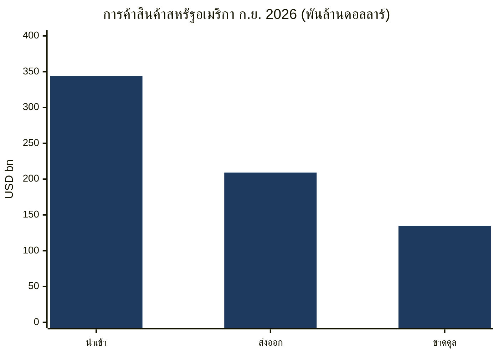
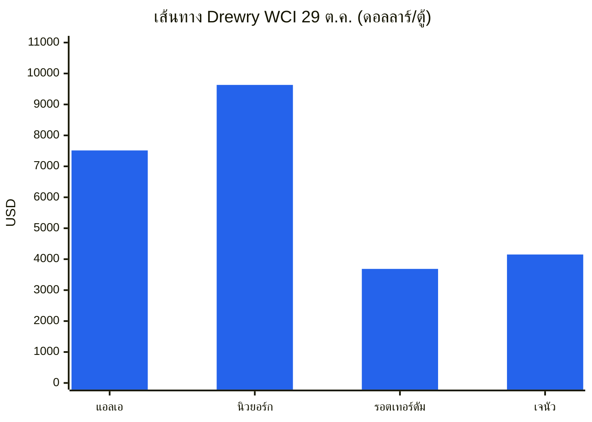
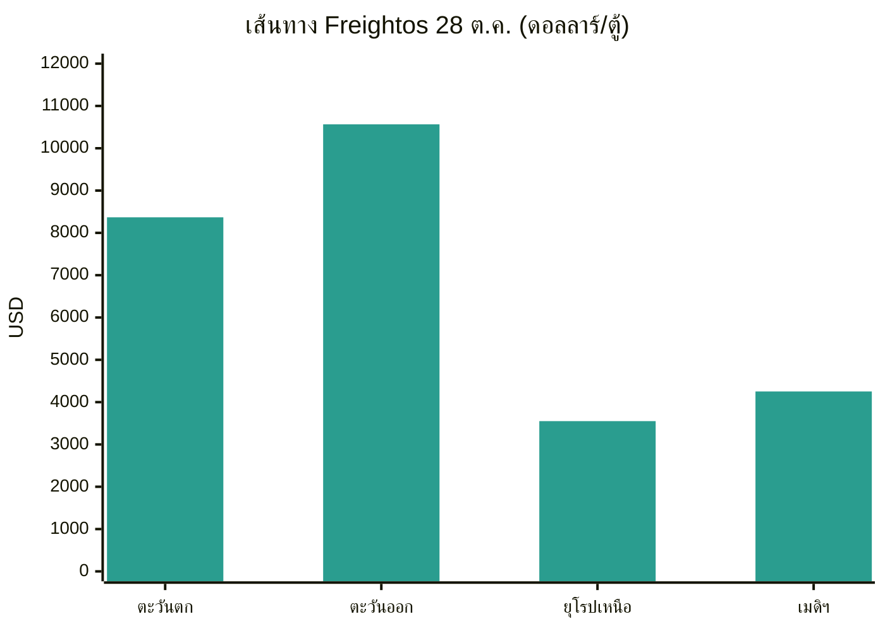
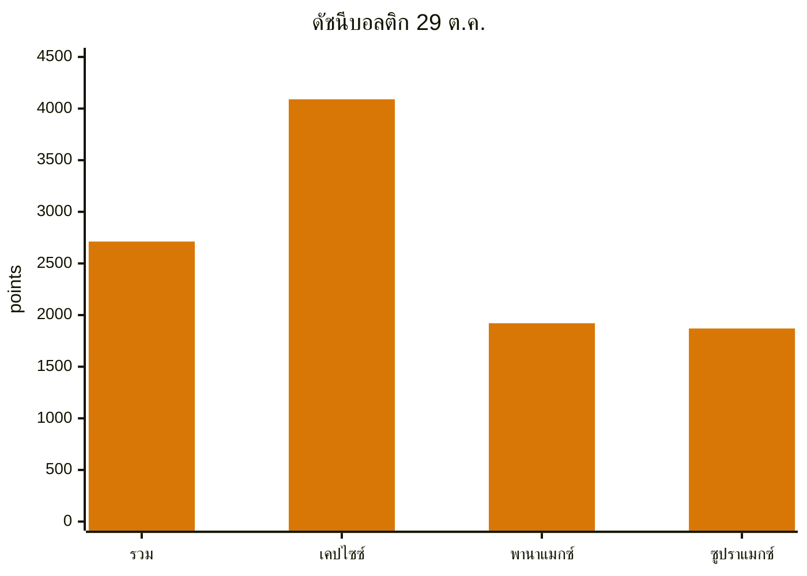
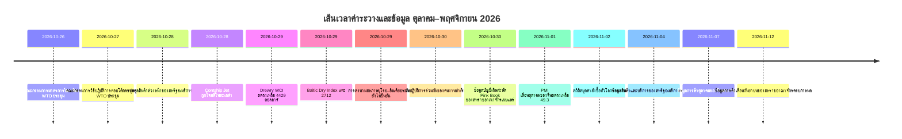

# รายงานข่าวกรองการค้าโลก — สัปดาห์ที่ 26 ตุลาคม–2 พฤศจิกายน 2026

**สรุปประจำสัปดาห์** ช่วงเวลาที่ครอบคลุม: October 26–November 2, 2026 รวบรวมจากแหล่งข่าวการค้า นโยบาย ข้อมูล และค่าระวางประมาณ 45 แหล่งทั่วโลก

---

## สารบัญ

1. [สรุปผู้บริหาร](#1-executive-summary)
2. [การแจ้งเตือน](#2-alerts)
3. [เรื่องเด่น — การวิเคราะห์เชิงลึก](#3-top-stories--deep-dives)
4. [ตัวติดตามภาษีศุลกากร](#4-tariff-tracker)
5. [การวิเคราะห์เชิงลึกนโยบายสหรัฐอเมริกา](#5-us-policy-deep-dive)
6. [นโยบายโลกตามภูมิภาค](#6-world-policy-by-region)
7. [มาตรการบังคับใช้](#7-enforcement-actions)
8. [ข้อมูลที่เผยแพร่](#8-data-releases)
9. [ตลาดค่าระวาง](#9-freight-market)
10. [เส้นเวลาทางนโยบาย](#10-policy-timelines)
11. [เส้นตายและเหตุการณ์ที่จะมาถึง (90 วันข้างหน้า)](#11-upcoming-deadlines--events-next-90-days)
12. [แหล่งข้อมูลและระเบียบวิธี](#12-sources--methodology)

---

## 1. สรุปผู้บริหาร

สัปดาห์นี้ถูกครอบงำโดยเส้นตายที่ยังไม่ได้รับการแก้ไข ได้แก่ การหมดอายุใน November 9 ของการยกเว้นผลิตภัณฑ์ Section 301 สำหรับจีนจำนวน 178 รายการ และการระงับค่าธรรมเนียมท่าเรือ Section 301 สำหรับเรือที่เชื่อมโยงกับจีน ข้อพิพาทแรงงานของคนงาน 250 คนที่อาจทำให้ท่าเรือคอนเทนเนอร์ที่คึกคักที่สุดของสหรัฐอเมริกาหยุดชะงักในวันถัดจากการเลือกตั้งกลางเทอม และการยกระดับความเสี่ยงด้านการเดินเรืออย่างรุนแรงในช่องแคบฮอร์มุซและทะเลดำ ท่ามกลางฉากหลังดังกล่าว สหภาพยุโรปได้ผลักดันโครงการป้องกันทางการค้ากับจีนไปข้างหน้าในหลายด้านพร้อมกัน รายการภาษีศุลกากร 50% ฉบับปรับปรุงของแคนาดามีผลบังคับใช้ และสหรัฐอเมริการายงานเดือนที่มีมูลค่าการนำเข้าสินค้าสูงเป็นประวัติการณ์ อันเนื่องมาจากสินค้าทุนที่เกี่ยวข้องกับปัญญาประดิษฐ์

- **หน้าผา November 9 อยู่ห่างออกไปเพียงหนึ่งสัปดาห์ และนาฬิกาทั้งสองเรือนยังไม่ได้รับการแก้ไข** การยกเว้นผลิตภัณฑ์ Section 301 สำหรับจีนที่เหลืออยู่ 178 รายการจะหมดอายุในเวลา 11:59 p.m. ET ใน November 9, 2026 โดยไม่พบประกาศขยายเวลาในช่วงเวลาที่ครอบคลุมนี้ รายการที่เข้าตั้งแต่ November 10 เป็นต้นไปจะกลับไปใช้อัตราตามรายการ ข้อเสนอของ USTR ที่จะขยายการระงับค่าธรรมเนียมท่าเรือ Section 301 สำหรับเรือที่เชื่อมโยงกับจีนและอากรเครนที่เกี่ยวข้องไปจนถึง January 9, 2027 ได้รับการเผยแพร่ใน Federal Register ใน October 26 โดยปิดรับความคิดเห็นใน October 30 แต่ไม่มีประกาศฉบับสุดท้ายเผยแพร่ ณ November 2 เครื่องมือทั้งสองเป็นเครื่องมือที่แยกจากกัน การสรุปเครื่องมือหนึ่งไม่ได้ขยายอีกเครื่องมือหนึ่ง การระงับอีกฉบับที่เผยแพร่แล้ว คือ การระงับกฎ Affiliates Rule ของ Bureau of Industry and Security ก็หมดอายุตามข้อความที่เผยแพร่ใน November 9–10 เช่นกัน โดยมีการประกาศขยายไปจนถึง January 10, 2027 ซึ่งยังไม่ได้ลงประกาศในราชกิจจานุเบกษา ณ October 31
- **รายการ 50% ฉบับปรับปรุงของแคนาดามีผลบังคับใช้ใน October 30** ประกาศที่ลงนามใน October 23 ได้ถอด 22 ประเภทออกจากรายการ Section 338 และเพิ่ม 100 ประเภท โดยคงอัตรา 50% ไว้เท่าเดิม อากรนี้ซ้อนทับกับอากร Section 232 และใช้บังคับแม้กับสินค้าที่มีคุณสมบัติภายใต้ความตกลง Canada–United States–Mexico Agreement CBP ออกคำแนะนำการปฏิบัติใน October 29 (CSMS #70314289) ในสัปดาห์เดียวกัน วุฒิสภาลงมติ 50–46 ให้ยกเลิกภาวะฉุกเฉินแห่งชาติที่อ้างเพื่อภาษีศุลกากรแคนาดา ซึ่งเป็นมติที่ไม่มีผลทางกฎหมายต่ออากร และนายกรัฐมนตรีแคนาดากล่าวว่าออตตาวา "ยังไม่ใกล้" ข้อตกลงก่อนการเลือกตั้งกลางเทอม ขณะที่วอชิงตันกล่าวว่าข้อตกลงใกล้จะบรรลุแล้ว การท้าทายทางกฎหมายครั้งแรกต่อ Section 338 ซึ่งยื่นใน October 20 โดยผู้นำเข้าชีสจากรัฐนิวเจอร์ซีย์ ได้รับความสนใจอย่างกว้างขวางในช่วงเวลานี้ควบคู่กับการเปลี่ยนแปลงรายการ
- **ความเสี่ยงด้านการเดินเรือยกระดับขึ้นในสองพื้นที่พร้อมกัน** ใน October 29 เรือเล็กได้ติดวัตถุระเบิดสองชิ้นเข้ากับตัวเรือบรรทุกน้ำมันดิบ Louise 1 ซึ่งชักธงปานามาในช่องแคบฮอร์มุซ ห่างจากเมือง Khasab ประเทศโอมานไปทางตะวันออกเฉียงเหนือประมาณ 25 ไมล์ทะเล ไฟไหม้ในห้องเครื่องที่เกิดขึ้นทำให้เรือหยุดทำงานชั่วคราว แม้ลูกเรือจะปลอดภัยและเรือยังคงเดินทางต่อได้ Reuters ซึ่งอ้างแหล่งข่าวด้านความปลอดภัยทางทะเลสามแหล่ง ระบุว่านี่เป็นการโจมตีด้วยทุ่นระเบิดติดตัวเรือที่ประสบความสำเร็จครั้งแรกในเส้นทางน้ำแห่งนี้นับตั้งแต่สงครามสหรัฐอเมริกา–อิหร่านเริ่มขึ้นใน February 2026 Drewry รายงานว่ามีเรือเพียงสองลำที่แล่นผ่านช่องแคบฮอร์มุซในสัปดาห์ก่อนหน้า เทียบกับ 62 เที่ยวผ่านคลองสุเอซ ซึ่งเป็นระดับรายสัปดาห์สูงสุดของปี ในทะเลดำ เรือคอนเทนเนอร์ Contship Jet ซึ่งชักธงไลบีเรียถูกโดรนทะเลสามลำโจมตีใน October 28 ภายในเขตเศรษฐกิจจำเพาะของบัลแกเรียและจมลงราวเที่ยงคืน ลูกเรือทั้ง 18 คนได้รับการช่วยเหลือ แต่ตู้คอนเทนเนอร์ 20 จาก 421 ตู้ตกลงสู่ทะเล รวมถึงแบตเตอรี่ลิเธียมไอออนและวัสดุอันตรายอื่น ๆ
- **โครงการจีนของยุโรปเปลี่ยนจากสัญญาณไปสู่คดีอย่างเป็นทางการ** คณะกรรมาธิการยุโรปได้กำหนดอากรตอบโต้การทุ่มตลาดขั้นสุดท้าย 39.8% ถึง 48.1% สำหรับ PET Spunbond จากจีนเป็นเวลาห้าปีใน October 30 เปิดการสอบสวนการทุ่มตลาดสำหรับโพลีไวนิลิดีนฟลูออไรด์จากจีน อินเดีย และญี่ปุ่นใน October 28 สั่งให้ขึ้นทะเบียนการนำเข้าซิลิคอนจากจีนตั้งแต่วันที่ October 27 ระหว่างการทบทวนอากร และเห็นรัฐสมาชิกอนุมัติอากรตอบโต้การทุ่มตลาดระยะยาวสำหรับไทเทเนียมไดออกไซด์จากจีนซึ่งมีผลตั้งแต่วันที่ January 11 ข้อเสนอในเดือน December ของคณะกรรมาธิการสำหรับเครื่องมือเพื่อจำกัดการพึ่งพาแหล่งเดียวสำหรับสินค้าที่สำคัญได้เสร็จสิ้นการปรึกษาหารือกับภาคธุรกิจใน October 27 โดยยังไม่มีการเผยแพร่รายชื่อภาคส่วน เกณฑ์ หรืออัตราภาษีศุลกากร แยกต่างหาก ค่าธรรมเนียม Union Handling Fee €2 ของสหภาพยุโรปสำหรับการซื้อออนไลน์จากนอกสหภาพยุโรปมีผลบังคับใช้ใน November 1 นอกเหนือจากอากร €3 ต่อชิ้นสำหรับการส่งสินค้ามูลค่าต่ำที่มีผลมาตั้งแต่วันที่ July 1
- **สหรัฐอเมริกานำเข้าสินค้ามูลค่าสูงเป็นประวัติการณ์ในเดือน September** การเผยแพร่ล่วงหน้าของ Census Bureau ใน October 28 ระบุว่าการขาดดุลสินค้าในเดือน September อยู่ที่ $134.9 พันล้าน เพิ่มขึ้น 2.1% จากเดือน August จากการนำเข้าที่สูงเป็นประวัติการณ์ $344.1 พันล้าน การนำเข้าสินค้าทุนเพิ่มขึ้น 7.5% เมื่อเทียบรายเดือนและ 77.2% เมื่อเทียบรายปี โดยกระแสการนำเข้าโครงสร้างพื้นฐานปัญญาประดิษฐ์กลายเป็นตัวขับเคลื่อนหลักของการขาดดุล แม้การส่งออกจะเพิ่มขึ้น 2.6% เป็น $209.2 พันล้าน เช่นกัน ข้อมูลการค้าของจีนในเดือน October ซึ่งจะแสดงว่ายอดเกินดุลสะสมตั้งแต่ต้นปีของจีนทะลุ $1 ล้านล้าน แล้วหรือไม่ มีกำหนดเผยแพร่ใน November 7 และยังไม่เผยแพร่ในช่วงเวลานี้ ดัชนี PMI ภาคการผลิตอย่างเป็นทางการของจีนในเดือน October ซึ่งเผยแพร่ใน November 1 กลับหดตัวที่ 49.3 โดยคำสั่งซื้อส่งออกใหม่อยู่ที่ 48.7
- **ค่าระวางแยกตัวตามเส้นทางและขนาดเรือ** Drewry World Container Index ลดลง 3% เป็น $4,429 ต่อตู้ 40 ฟุตใน October 29 กลับทิศทางจากการเพิ่มขึ้นสองสัปดาห์ติดต่อกัน โดยเส้นทาง Shanghai–Los Angeles ลดลง 6% เป็น $7,514 และ Shanghai–New York ลดลง 5% เป็น $9,631 ขณะที่ Shanghai–Rotterdam ขยับขึ้น 1% เป็น $3,686 Baltic Dry Index ฟื้นตัวเป็น 2,712 ภายใน October 29 จากความแข็งแกร่งของเรือ Capesize แม้เรือ Panamax จะลดลงเป็น 1,921 ซึ่งเป็นระดับต่ำสุดนับตั้งแต่เดือน April ความน่าเชื่อถือของตารางเดินเรือยังคงต่ำ โดย Sea-Intelligence ระบุว่าผลการตรงเวลาทั่วโลกอยู่ที่ 50.6% ในเดือน September เพิ่มขึ้นเล็กน้อยจาก 49.9% ในเดือน August วันปฏิบัติการร่วมกันของคนงานท่าเรือใน October 30 กระทบมากกว่า 100 ท่าเรือ โดยผลกระทบต่อการดำเนินงานที่ยืนยันแล้วถูกระบุว่ามีจำกัดในส่วนใหญ่ และมีการแจ้งการหยุดงานท่าเรือระดับชาติของฝรั่งเศสเพิ่มเติมใน November 5

**ค่าระวาง:** อัตราค่าระวางคอนเทนเนอร์แบบสปอตพลิกกลับลงบนเส้นทางข้ามแปซิฟิก ขณะที่เส้นทางเอเชีย–ยุโรปทรงตัว การขึ้นราคาของผู้ให้บริการขนส่งในเดือน November ถูกหักลบด้วยส่วนลดแล้ว ค่าระวางเรือเทกองแห้งฟื้นตัวเฉพาะจากความแข็งแกร่งของแร่เหล็กของเรือ Capesize เที่ยวผ่านคลองสุเอซแตะระดับสูงสุดของปี ขณะที่เที่ยวผ่านช่องแคบฮอร์มุซเกือบหยุดนิ่ง และค่าระวางขนส่งทางอากาศแข็งแกร่งเข้าสู่ช่วงพีคซีซันจากการเติบโตของอุปสงค์ที่แซงหน้ากำลังการบรรทุก

---

## 2. การแจ้งเตือน

| # | การแจ้งเตือน | มีผล | ผลกระทบ | แหล่งข้อมูล |
|---|-------|-----------|--------|--------|
| A1 | การยกเว้นผลิตภัณฑ์ Section 301 สำหรับจีนจำนวน 178 รายการหมดอายุ 11:59 p.m. ET Nov 9, 2026 ไม่พบการขยายเวลา รายการตั้งแต่ Nov 10 กลับไปใช้อัตราตามรายการ (25% รายการ 1–3, 7.5% รายการ 4A) | Nov 9, 2026 | ผู้นำเข้าที่อ้าง HTSUS 9903.88.69/70 ต้องปรับราคาใหม่และยืนยันรายการก่อนเส้นตาย | [Gateway Lines](https://gatewaylines.com/press-releases/china-section-301-tariffs-stay-178-exclusions-end) |
| A2 | ข้อเสนอของ USTR ที่จะขยายการระงับค่าธรรมเนียมท่าเรือ Section 301 ไปจนถึง Jan 9, 2027 ยังคงเป็นเพียงข้อเสนอ ปิดรับความคิดเห็น Oct 30 (docket USTR-2026-0694) ไม่มีประกาศฉบับสุดท้ายเผยแพร่ ณ Nov 2 | Nov 9, 2026 (การระงับปัจจุบันหมดอายุ) | หากไม่สรุปผล ค่าธรรมเนียมท่าเรือและอากรเครน/การขนถ่ายสินค้าที่เกี่ยวข้องจะกลับมาใช้ใน Nov 10 | [Federal Register](https://www.federalregister.gov/documents/2026/10/26/2026-21755/request-for-comments-on-further-suspension-of-section-301-action-chinas-targeting-of-the-maritime) |
| A3 | รายการ Section 338 ของแคนาดาปรับปรุงใหม่: ถอด 22 ประเภท เพิ่ม 100 ประเภท อัตรา 50% ไม่เปลี่ยนแปลง ซ้อนทับกับอากร Section 232 ใช้บังคับแม้กับสินค้าที่มีคุณสมบัติ USMCA | Oct 30, 2026 | วันที่นำเข้า ไม่ใช่วันที่จัดส่ง เป็นตัวกำหนด 0% เทียบกับ 50% สำหรับสินค้าเดียวกัน ต้องคัดกรองประเภทใหม่ทันที | [Baker McKenzie](https://globalimportblog.bakermckenzie.com/2026/10/30/us-further-modifies-section-338-tariffs-on-canadian-goods-as-the-tariffs-face-their-first-legal-challenge/) |
| A4 | การยกระดับในช่องแคบฮอร์มุซ: การโจมตีด้วยทุ่นระเบิดติดตัวเรือต่อเรือบรรทุกน้ำมัน Louise 1 ใน Oct 29 มีเพียงสองเที่ยวผ่านช่องแคบฮอร์มุซที่รายงานในสัปดาห์ก่อนหน้า มีเหตุการณ์เพิ่มเติมรายงานใน Oct 30–Nov 2 รวมถึงเรือบรรทุกน้ำมันที่ถูกโจมตีด้วยกระสุนทางตะวันออกของ Ras al Khafji | Oct 29–Nov 2, 2026 | ค่าความเสี่ยงสงคราม เส้นทางเดินเรือ และค่าประกันยังคงสูง การตัดสินใจเรื่องเส้นทางในอ่าวต้องคำนึงถึงข้ออ้างอย่างเป็นทางการที่ขัดแย้งกันเกี่ยวกับความปลอดภัยของเส้นทาง | [gCaptain](https://gcaptain.com/tanker-in-strait-of-hormuz-hit-by-limpet-mines-security-sources-say/) |
| A5 | การจมในทะเลดำ: เรือคอนเทนเนอร์ Contship Jet ถูกโดรนทะเลสามลำโจมตีใน Oct 28 ในเขตเศรษฐกิจจำเพาะของบัลแกเรียและจมลง ตู้คอนเทนเนอร์ 20 จาก 421 ตู้ตกลงสู่ทะเล รวมถึงวัสดุอันตราย | Oct 28–29, 2026 | ความเสี่ยงสงครามในทะเลดำขยายไปถึงน่านน้ำของรัฐสมาชิกสหภาพยุโรป/นาโต ตู้สินค้าอันตรายที่ลอยอยู่สร้างอันตรายต่อการเดินเรือ | [Splash247](https://splash247.com/splash-wrap-new-networks-old-faultlines/) |
| A6 | เส้นตายการหยุดงานของพนักงานเฝ้าระวังท่าเรือ LA/Long Beach ขยายไปจนถึง 5 p.m. Pacific Nov 4, 2026 ยังไม่มีข้อตกลงขั้นสุดท้าย ท่าเรือที่ได้รับผลกระทบจัดการสินค้าประมาณ 85% ของ Long Beach และประมาณ 33% ของ Los Angeles | Nov 4, 2026 | ข้อพิพาทของคนงาน 250 คนอาจทำให้งานเรือ ลาน และประตูที่ท่าเรือที่ได้รับผลกระทบหยุดชะงัก หากสมาชิก ILWU คนอื่นเคารพแนวรั้วประท้วง รายงานฉบับหนึ่งระบุวันที่ Nov 5 แทน | [Seatrade Maritime](https://www.seatrade-maritime.com/ports-logistics/impending-strike-threatens-la-lb-ports-container-flow) |
| A7 | ค่าธรรมเนียม Union Handling Fee €2 ของสหภาพยุโรปสำหรับการซื้อออนไลน์จากนอกสหภาพยุโรปมีผลบังคับใช้ นอกเหนือจากอากร €3 ต่อชิ้นสำหรับการส่งสินค้าสูงสุด €150 ที่มีผลมาตั้งแต่ Jul 1, 2026 | Nov 1, 2026 | อีคอมเมิร์ซมูลค่าต่ำแบบหลายรายการเผชิญ €5 ต่อรายการก่อนภาษีมูลค่าเพิ่ม ค่าธรรมเนียมไม่สามารถขอคืนได้แม้สินค้าจะถูกส่งคืน | [Shipping and Freight Resource](https://www.shippingandfreightresource.com/trade-moves-02-nov-2026/) |
| A8 | วันปฏิบัติการร่วมกันของคนงานท่าเรือ Oct 30 ครอบคลุมกว่า 100 ท่าเรือ การหยุดงานท่าเรือระดับชาติของฝรั่งเศสแจ้งไว้สำหรับ Nov 5 | Oct 30 / Nov 5, 2026 | การเทียบท่าและการเลื่อนของเรือป้อนล่วงเลย Oct 30 โดยกระจุกตัวในศูนย์กลางถ่ายลำเมดิเตอร์เรเนียนและประตูสู่ฝรั่งเศส | [Port Technology](https://www.porttechnology.org/news/ports-and-terminals/dockworker-strikes-ports-military-cargo/) |
| A9 | DHS เพิ่มบริษัทจีโนมิกส์ของจีนสามแห่ง (BGI Group, BGI Genomics, MGI Tech) ในบัญชีรายชื่อนิติบุคคล UFLPA บัญชีรวมปัจจุบันมี 190 นิติบุคคล | Oct 29, 2026 | สินค้าที่ผลิตทั้งหมดหรือบางส่วนโดยบริษัทเหล่านี้ถูกสันนิษฐานว่าผลิตโดยใช้แรงงานบังคับและถูกห้าม เว้นแต่จะหักล้างข้อสันนิษฐานได้ | [LexBlog](https://www.lexblog.com/2026/10/29/dhs-updates-uflpa-entity-list-with-three-companies-engaged-in-genetics-testing/) |
| A10 | Section 232 หุ่นยนต์/เครื่องจักรอุตสาหกรรม: ข้อสรุปด้านความมั่นคงแห่งชาติ ยังไม่มีภาษีศุลกากร สั่งให้เจรจาโดยมีรายงานครบกำหนดภายใน 180 วัน | Oct 28, 2026 | ความเสี่ยงด้านภาษีศุลกากรเลื่อนไปถึงฤดูใบไม้ผลิ 2027 ไม่ได้ถูกยกเลิก ใช้แม่แบบเดียวกับกังหันลม | [White House](https://www.whitehouse.gov/fact-sheets/2026/10/fact-sheet-president-donald-j-trump-adjusts-imports-of-robotics-industrial-machinery-and-their-parts-and-components-into-the-united-states/) |

### A1/A2 — นาฬิกา November 9 ห่างออกไปหนึ่งสัปดาห์

เครื่องมือทั้งสองใน November 9 มักถูกรายงานร่วมกัน แต่ดำเนินการอย่างอิสระจากกัน การยกเว้นผลิตภัณฑ์ — 164 รายการที่คงไว้ใน May 2024 บวกการยกเว้นอุปกรณ์ผลิตพลังงานแสงอาทิตย์ 14 รายการที่เพิ่มใน September 2024 ซึ่งอ้างภายใต้ HTSUS 9903.88.69 และ 9903.88.70 — หมดอายุในเวลา 11:59 p.m. ET ใน November 9 และแหล่งข้อมูลหลายแห่งที่รายงานใน October 29–31 ไม่พบประกาศขยายเวลา ประกาศการคงไว้ของ USTR ใน October 6/7 ยืนยันว่ามาตรการ Section 301 ปี 2018 ที่เป็นพื้นฐานยังคงดำเนินต่อไป แต่ไม่ได้ขยายการยกเว้น ในทางตรงกันข้าม การระงับค่าธรรมเนียมท่าเรือเป็นเรื่องของข้อเสนอที่กำลังพิจารณา ประกาศใน Federal Register ที่เผยแพร่ใน October 26 (91 FR 67388) เสนอให้ระงับ ตั้งแต่ 12:00 a.m. ET November 10, 2026 จนถึง 11:59 p.m. ET January 9, 2027 ค่าธรรมเนียมบริการขนส่งทางทะเลในภาคผนวก I–III ของมาตรการใน April 23, 2025 (ตามที่แก้ไขใน October 16, 2025) และอากรในภาคผนวก V.A สำหรับเครนท่าเรือจากจีนและอุปกรณ์ขนถ่ายสินค้า เพื่อไม่ให้เกิดหนี้สินในช่วงการระงับ เหตุผลที่ระบุคือเพื่อให้มีเวลาเจรจากับจีนต่อไป ข้อเสนอครอบคลุมเพียงสองเดือน ซึ่งสั้นกว่าการระงับหนึ่งปีที่ข้อเสนอนี้จะมาแทนที่มาก

**การวิเคราะห์:** ผู้นำเข้าและผู้ให้บริการขนส่งเผชิญความเสี่ยงที่แตกต่างกันในวันเดียวกัน ผู้นำเข้าที่มีรายการอ้างหัวข้อการยกเว้นต้องวางแผนตามอัตราตามรายการตั้งแต่วันที่ November 10 ไม่ว่าจะเกิดอะไรขึ้นกับค่าธรรมเนียมท่าเรือ ผู้ให้บริการขนส่งเผชิญการกลับมาเก็บค่าธรรมเนียมเฉพาะเมื่อข้อเสนอไม่ได้รับการสรุปผล ทั้งสองควรได้รับการติดตามในฐานะเครื่องมือที่เป็นลายลักษณ์อักษร ไม่ใช่ในฐานะ "การพักรบ" เดียว — ปฏิทินทางการเมือง (การพักรบที่กล่าวถึงว่าดำเนินไปจนถึง January 10, 2027) และปฏิทินด้านกฎระเบียบ (November 9) ยังคงเป็นสิ่งที่แตกต่างกัน

### A3 — แคนาดา: การเปลี่ยนแปลงรายการที่มีผลกลางสัปดาห์

ประกาศใน October 23 ซึ่งเผยแพร่ใน Federal Register ใน October 30 และมีผลในเวลา 12:01 a.m. ET ในวันนั้นสำหรับสินค้าที่นำเข้าหรือถอนจากคลังสินค้าเพื่อการบริโภคในหรือหลังวันนั้น ได้ถอด 22 ประเภทและเพิ่ม 100 ประเภท ทั้งหมดภายใต้หัวข้อ 9903.03.14 หัวข้อ 9903.03.12 และ 9903.03.13 ไม่เปลี่ยนแปลง รายการที่ถอดออกได้แก่ แผ่นไม้อัดบางชนิด ผลิตภัณฑ์กระดาษ เครื่องจักรและอุปกรณ์ทำความเย็น ลังและกล่องบรรจุ ฟิล์มพลาสติก กล่องกระดาษแข็ง และเครื่องจักรที่เกี่ยวกับอาหาร รายการที่เพิ่มได้แก่ พรมและเสื่อ ผลิตภัณฑ์ไม้และกระดาษบางชนิด ผลิตภัณฑ์เคมี เช่น สี สบู่ และสารหล่อลื่น และผลิตภัณฑ์ผู้บริโภค เช่น ผงโกโก้ พื้นไวนิล เรือแคนู ตู้แช่แข็งแบบฝาเปิด แชมพูและสบู่ห้องน้ำ ตลอดจนวาล์ว เครื่องมือ เครื่องปรับอากาศแบบหน้าต่าง และน้ำยาตรวจวินิจฉัย คำอธิบายในภาคผนวกเป็นข้อมูลเท่านั้น รหัส HTS เป็นตัวกำหนดขอบเขต

**การวิเคราะห์:** ผลในทางปฏิบัติคือเรื่องของจังหวะเวลา ตู้แช่แข็งแบบฝาเปิดต้องเสียเพียงอากรเหล็ก Section 232 จนถึง October 29 และต้องเสีย Section 338 ใน October 30 ไม้อัดเคลื่อนไหวในทิศทางตรงกันข้าม เนื่องจากอากรใช้บังคับโดยไม่คำนึงถึงแหล่งกำเนิด USMCA และเพิ่มเติมจากอากร Section 232 การวางแผนเรื่องแหล่งกำเนิดจึงไม่สามารถหลีกเลี่ยงได้ ผลสุทธิคือการแลกเปลี่ยนเชิงโครงสร้างมากกว่าการลดความตึงเครียด โดยการบรรเทากระจุกตัวในห่วงโซ่อุปทานเกษตรกรรมและป่าไม้ที่เชื่อมโยงกับรัฐ Maine ส่วนความเสี่ยงใหม่กระจายไปทั่วสินค้าผู้บริโภคและสินค้าอุตสาหกรรม

### A4/A5 — สองพื้นที่ หนึ่งสัปดาห์

การโจมตีในช่องแคบฮอร์มุซใน October 29 เป็นไปตามรูปแบบที่เห็นได้จากข้อมูลอยู่แล้ว เที่ยวผ่านช่องแคบฮอร์มุซที่ไม่เชื่อมโยงกับอิหร่านลดลงเหลือ 104 เที่ยวในสัปดาห์ October 5–11 จาก 126 เที่ยวในสัปดาห์ September 28–October 4 และ Lloyd's List Intelligence นับการโจมตีที่รายงานหรือยืนยันแล้วอย่างน้อย 28 ครั้งในช่องแคบฮอร์มุซและเส้นทางน้ำโดยรอบในช่วงครึ่งแรกของเดือน October เหตุการณ์ใน October 29 เพิ่มวิธีการใหม่ — วัตถุระเบิดติดตัวเรือระยะใกล้ที่ส่งโดยเรือเล็กต่อเรือบรรทุกน้ำมันที่กำลังเคลื่อนที่ — เข้าไปในทุ่นระเบิดและกระสุน ข้ออ้างที่แข่งขันกันทำให้ภาพซับซ้อนขึ้น กองกำลังพิทักษ์การปฏิวัติอิสลามของอิหร่านกล่าวว่าเรือบรรทุกน้ำมันสามลำชนทุ่นระเบิดทางทะเลบนเส้นทางใต้ที่ "ไม่ได้รับอนุญาต" และกองทัพอิหร่านรายงานเรือลำที่สี่ทางตะวันออกของเส้นทางน้ำ หนึ่งวันหลังจากกองบัญชาการกลางสหรัฐอเมริกากล่าวว่าข้ออ้างเรื่องทุ่นระเบิดเป็นเท็จและเส้นทางหลักได้รับการเคลียร์แล้ว UKMTO บันทึกความเสียหายไว้แต่ไม่ได้ยืนยันว่าทุ่นระเบิดเป็นสาเหตุ ในทะเลดำ การจมของ Contship Jet เป็นการโจมตีด้วยโดรนครั้งที่ห้าต่อเรือในเขตเศรษฐกิจจำเพาะของบัลแกเรียในเดือน October เพียงเดือนเดียว ตามข้อมูลของ BTA ที่อ้างในการรายงาน และเป็นการจมของเรือพาณิชย์ครั้งที่สองในทะเลดำตะวันตกภายในหนึ่งสัปดาห์หลังจากเรือ Khoryv นอกเมือง Constanța ไม่มีการระบุผู้รับผิดชอบอย่างเป็นทางการสำหรับการโจมตี Contship Jet ที่เผยแพร่ต่อสาธารณะ การประเมินของ Ambrey ผ่าน Reuters ว่ายานดังกล่าวคล้ายกับการออกแบบ Murena-300S ที่ผลิตในรัสเซียไม่ใช่การระบุผู้รับผิดชอบ

**การวิเคราะห์:** ผู้ส่งสินค้าไม่สามารถถือว่าเส้นทางน้ำใดเส้นทางน้ำหนึ่งเป็นคำถามแบบเปิดหรือปิดแบบทวิภาคได้อีกต่อไป ช่องแคบฮอร์มุซเกือบปิดสำหรับการจราจรเชิงพาณิชย์ตามจำนวนเที่ยวผ่านของ Drewry ขณะที่คลองสุเอซกลับสู่ภาวะปกติ ความเสี่ยงในทะเลดำขยายไปถึงเรือคอนเทนเนอร์ในเส้นทาง Israel–Romania ภายในเขตเศรษฐกิจจำเพาะของรัฐสมาชิกสหภาพยุโรป โดยมีสินค้าอันตรายอยู่ในน้ำ การประกันภัย เส้นทางเดินเรือ และการสำแดงสินค้าอันตรายทั้งหมดจำเป็นต้องได้รับการประเมินเป็นรายเที่ยวเรือ

---

## 3. เรื่องเด่น — การวิเคราะห์เชิงลึก

### 3.1 หน้าผา November 9 และนาฬิกาเรือนที่สามที่ไม่มีใครเฝ้าดู

นอกเหนือจากนาฬิกา Section 301 ทั้งสองเรือนแล้ว การระงับกฎ Affiliates Rule ของ Bureau of Industry and Security จะหมดอายุตามข้อความที่เผยแพร่ใน November 9–10, 2026 กฎดังกล่าวลงวันที่ September 29, 2025 ขยายข้อกำหนดของ Entity List, Military End User และ Specially Designated Nationals ไปยังบริษัทในเครือต่างประเทศที่ถือหุ้น 50% ขึ้นไปโดยบุคคลที่อยู่ในรายชื่อ รัฐมนตรีคลัง Scott Bessent ประกาศใน September 24, 2026 ว่าการพักรบสหรัฐอเมริกา–จีน และตามนั้นการระงับดังกล่าว จะขยายไปจนถึง January 10, 2027 — แต่ ณ วันที่ตัดข้อมูลใน October 31 ยังไม่มีประกาศใน Federal Register ที่ขยายการระงับอย่างเป็นทางการ ผู้ส่งออกไม่ควรพึ่งพาการขยายเวลาจนกว่า BIS จะเผยแพร่ ความระมัดระวังเดียวกันนี้ใช้กับข้อเสนอค่าธรรมเนียมท่าเรือ ซึ่งถูกพาดหัวอย่างกว้างขวางว่าเป็นการเลื่อนไปจนถึง January 9 แต่เป็นข้อเสนอที่ระยะเวลารับความคิดเห็นปิดลงใน October 30 ไม่ใช่กฎฉบับสุดท้าย

**การวิเคราะห์:** เครื่องมือสามฉบับแยกกันหมดอายุภายในประมาณหนึ่งวันของกันและกัน แต่ละฉบับมีผู้ตัดสินใจต่างกันและรูปแบบทางกฎหมายต่างกัน การถือว่าเครื่องมือใดเครื่องมือหนึ่งได้รับการขยายบนพื้นฐานของประกาศ พาดหัวข่าว หรือชะตากรรมของเครื่องมือคู่ขนานคือความเสี่ยงด้านการปฏิบัติตามกฎระเบียบหลักของสัปดาห์ที่จะมาถึง ตำแหน่งที่เป็นลายลักษณ์อักษรใน Federal Register ใน November 9 เป็นพื้นฐานที่ปลอดภัยเพียงอย่างเดียวสำหรับรายการ เที่ยวเรือ และการคัดกรองการส่งออก

### 3.2 ช่องแคบฮอร์มุซและทะเลดำ: การยกระดับในฐานะตัวแปรของตลาดการเดินเรือ

ข่าวการเดินเรือประจำสัปดาห์อ่านได้ดีที่สุดในฐานะตัวแปรเดียว — ความเสี่ยงสงคราม — ที่เคลื่อนไหวในทิศทางตรงกันข้ามในเส้นทางน้ำที่แตกต่างกัน เที่ยวผ่านคลองสุเอซเพิ่มขึ้นเป็น 62 ลำในสัปดาห์ที่ Drewry รายงานใน October 29 ซึ่งเป็นระดับรายสัปดาห์สูงสุดของปี และ Alphaliner ประเมินว่ากำลังการบรรทุกเอเชีย–ยุโรปเกือบสองในสามได้รับการฟื้นฟูผ่านทะเลแดง รวมถึง ZIM ที่กลับมาใช้เส้นทางนี้สำหรับบริการร่วมเอเชีย–ชายฝั่งตะวันออกของสหรัฐอเมริกากับ MSC เรือคอนเทนเนอร์มากกว่า 100 ลำขนาด 16,000 TEU ขึ้นไปแล่นผ่านคลองสุเอซตั้งแต่ต้นเดือน September ซึ่งเกินกว่า 99 ลำที่บันทึกในทั้งหมดของปี 2025 บวก January–August 2026 รวมกัน และมีการบันทึกเที่ยวผ่านของเรือขนาดใหญ่มาก 192 เที่ยวในปี 2026 เทียบกับ 8 เที่ยวในปี 2025 ในเวลาเดียวกัน เที่ยวผ่านช่องแคบฮอร์มุซลดลงเหลือสองลำตามจำนวนรายสัปดาห์ของ Drewry ราคาน้ำมัน Brent แตะ $118 สำหรับสัญญาเดือน December ที่หมดอายุใน October 30 ซึ่งเป็นระดับสูงสุดนับตั้งแต่ April 30 และกลุ่มฮูษีอ้างว่าได้ยิงขีปนาวุธใส่โรงกลั่น Ras Tanura และ Rabigh โรงงาน Aramco ที่ Abqaiq และสนามบิน Riyadh และ Dammam เพื่อตอบโต้การโจมตีทางอากาศของซาอุดีอาระเบียในเยเมนที่พวกเขากล่าวว่าคร่าชีวิตผู้คน 27 คน กลุ่มพันธมิตรที่นำโดยซาอุดีอาระเบียกล่าวว่าได้สกัดกั้นขีปนาวุธและยังไม่ได้ยืนยันความเสียหาย กองทัพเรือโอมานอพยพลูกเรือ 25 คนจากเรือบรรทุกน้ำมัน Riti ซึ่งชักธงปานามาและกำลังลุกไหม้ใน October 30 และรายงานสินค้าโภคภัณฑ์ใน November 2 ที่อ้าง UKMTO นับเหตุการณ์การเดินเรือสิบครั้งทั่วช่องแคบฮอร์มุซ อ่าว และอ่าวโอมานระหว่าง October 31 ถึง November 2

**การวิเคราะห์:** การกลับมาของคลองสุเอซกำลังปล่อยกำลังการบรรทุกที่มีประสิทธิภาพและกดดันอัตราค่าระวางเอเชีย–ยุโรป ขณะที่การหยุดชะงักในช่องแคบฮอร์มุซกำลังทำให้ต้นทุนพลังงานและเส้นทางในอ่าวตึงตัว ผลกระทบทั้งสองไม่ได้หักล้างกัน แต่กระทบการค้าที่แตกต่างกัน สินค้าที่แตกต่างกัน และสายประกันที่แตกต่างกัน ผลในทางปฏิบัติคือเรื่องเล่าเรื่อง "การกลับสู่ภาวะปกติ" สำหรับเส้นทางหนึ่งไม่ควรนำไปใช้กับอีกเส้นทางหนึ่ง

### 3.3 แคนาดา: การบรรเทา การยกระดับ และคดีความในสัปดาห์เดียวกัน

แฟ้มแคนาดารวมพัฒนาการสี่ประการแยกกัน ประการแรก การเปลี่ยนแปลงรายการ Section 338 มีผลบังคับใช้ใน October 30 (ดูส่วนที่ 2, A3) ประการที่สอง วุฒิสภาลงมติ 50–46 ใน October 29 ให้ยกเลิกภาวะฉุกเฉินแห่งชาติที่อ้างเพื่อภาษีศุลกากรแคนาดา โดยเสนอโดยวุฒิสมาชิก Tim Kaine โดยมีสมาชิกพรรครีพับลิกันสี่คน — Susan Collins จากรัฐ Maine, Mitch McConnell จากรัฐ Kentucky, Lisa Murkowski จากรัฐ Alaska และ Rand Paul จากรัฐ Kentucky — ร่วมกับพรรคเดโมแครต มติดังกล่าวตามหลังมติวุฒิสภาใน October 28 ที่คัดค้านภาษีศุลกากรบราซิล กฎระเบียบขั้นตอนของสภาผู้แทนราษฎรมีรายงานว่าขัดขวางการพิจารณา และประธานาธิบดีอาจใช้สิทธิยับยั้ง ดังนั้นจึงไม่มีการเปลี่ยนแปลงภาษีศุลกากรใด ๆ จากมตินี้ ประการที่สาม บัญชีการเจรจาแตกต่างกัน Reuters รายงานใน October 26 ว่าเจ้าหน้าที่กำลังสำรวจข้อตกลงเพื่อผ่อนคลายอากร Section 232 ที่ 50% สำหรับเหล็กและ 25% สำหรับรถยนต์ โดยมีรัฐมนตรีพาณิชย์ Howard Lutnick ติดต่อกับรัฐมนตรีการค้าสหรัฐอเมริกา–แคนาดา Dominic LeBlanc อย่างสม่ำเสมอ ใน October 28 เจ้าหน้าที่แคนาดาระบุว่าความคืบหน้า "จำกัด" ใน October 29 นายกรัฐมนตรี Mark Carney กล่าวว่าแคนาดา "ยังไม่ใกล้" ข้อตกลงก่อนการเลือกตั้งกลางเทอมและจะไม่ยอมรับข้อตกลงใด ๆ ก็ได้ โดยระบุว่าการเจรจาล้มเหลวใน August 2026 เนื่องจากเงื่อนไขของสหรัฐอเมริกาที่แคนาดากล่าวว่าจะจำกัดความสามารถในการเจรจากับประเทศอื่น บ่อนทำลายข้อกำหนดภาษาฝรั่งเศส และทำร้ายอุตสาหกรรมยานยนต์ ประธานาธิบดีซึ่งกล่าวในรัฐ Michigan ใน October 25 และรัฐ South Carolina ใน October 29 กล่าวว่าข้อตกลงใกล้จะบรรลุและแคนาดาปฏิบัติต่อสหรัฐอเมริกา "อย่างดีอย่างยิ่ง" ประการที่สี่ การท้าทายทางกฎหมายครั้งแรกต่อ Section 338 — Gellert Global Group v. Trump ซึ่งยื่นใน October 20 ต่อศาลการค้าระหว่างประเทศของสหรัฐอเมริกาโดยผู้นำเข้าอาหารจากรัฐนิวเจอร์ซีย์ที่นำเข้าชีสแคนาดา (การนำเข้าชีสแคนาดาประมาณ $71 ล้าน ในปี 2025 ทนายความคือ Liberty Justice Center) — ขอให้ศาลประกาศว่าอากรดังกล่าวไม่ชอบด้วยกฎหมาย ระงับการจัดเก็บ และสั่งคืนเงินพร้อมดอกเบี้ย โดยโต้แย้งว่า Section 301 ได้แทนที่ Section 338 มาตรการดังกล่าวไม่ผ่านการทดสอบการเลือกปฏิบัติและการชดเชยของ Section 338 และการเพิ่มเติมในเดือน September ได้รับเวลาเพียงเจ็ดวันแทนที่จะเป็นระยะเวลารอ 30 วันที่อ้างว่าจำเป็น ไม่มีการรายงานคำวินิจฉัยในเนื้อหา

**การวิเคราะห์:** มติ การเจรจา และคดีความดึงไปในทิศทางที่แตกต่างกัน และไม่มีสิ่งใดเปลี่ยนแปลงอัตราภาษีศุลกากรในสัปดาห์นี้ เครื่องมือเดียวที่มีผลเชิงพาณิชย์ทันทีคือการเปลี่ยนแปลงรายการใน October 30 และเครื่องมือเดียวที่อาจยกเลิกมาตรการทั้งหมดคือคดีความซึ่งจะใช้เวลาหลายเดือน ผู้นำเข้าควรแยกสัญญาณทางการเมืองออกจากผลทางกฎหมาย

### 3.4 ยุโรป: สัปดาห์แห่งการป้องกันทางการค้า และเครื่องมือในเดือน December ที่กำลังเป็นรูปเป็นร่าง

โครงการจีนของสหภาพยุโรปก่อให้เกิดการดำเนินการอย่างเป็นทางการในสี่แนวทางในหนึ่งสัปดาห์ อากรตอบโต้การทุ่มตลาดขั้นสุดท้ายสำหรับ PET Spunbond จากจีน (39.8% ถึง 48.1% ห้าปี แทนที่อากรชั่วคราว 45.6% ถึง 50% ที่มีผลมาตั้งแต่ May 2026) ถูกกำหนดใน October 30 สำหรับตลาดมูลค่า €200 ล้าน โดยมีอุตสาหกรรมของสหภาพยุโรปตั้งอยู่ในเยอรมนี อิตาลี และฝรั่งเศส การสอบสวนการทุ่มตลาดสำหรับโพลีไวนิลิดีนฟลูออไรด์จากจีน อินเดีย และญี่ปุ่นเปิดขึ้นใน October 28 หลังจากการเปิดการสอบสวนเฟอร์ฟูริลแอลกอฮอล์จากจีนใน October 16 การนำเข้าซิลิคอนจากจีนถูกสั่งให้ขึ้นทะเบียนศุลกากรตั้งแต่วันที่ October 27 เป็นเวลาเก้าเดือนขณะที่คณะกรรมาธิการทบทวนว่าอากรตอบโต้การทุ่มตลาดที่มีอยู่ยังเพียงพอหรือไม่ ซึ่งเป็นการทบทวนที่เปิดใน September 1 ตามคำขอของ Euroalliages ซึ่งเป็นตัวแทนผู้ผลิตทั้งหมดของสหภาพยุโรป รัฐสมาชิกอนุมัติอากรตอบโต้การทุ่มตลาดระยะยาวสำหรับไทเทเนียมไดออกไซด์จากจีน ซึ่งรายงานที่ €0.25 ต่อกิโลกรัมสำหรับ Anhui Jinxing Group และ €0.74 ต่อกิโลกรัมสำหรับ Longbai Group โดย €0.64 ต่อกิโลกรัมสำหรับบริษัทที่ให้ความร่วมมือและ €0.74 ต่อกิโลกรัมสำหรับบริษัทอื่นทั้งหมด มีผลตั้งแต่วันที่ January 11 เป็นเวลาห้าปี การนำเข้าไทเทเนียมไดออกไซด์จากจีนเกิน €500 ล้าน ในปี 2023 เบื้องหลังคดีเหล่านี้คือสัญญาณจากการประชุมคณะมนตรีอย่างไม่เป็นทางการที่ Dublin ใน October 23 ซึ่งกรรมาธิการการค้า Maroš Šefčovič กล่าวว่าภาคพลาสติก "ใกล้ที่สุด" ต่อการสอบสวนมาตรการป้องกันที่เป็นไปได้ การขาดดุลสินค้าของสหภาพยุโรปกับจีนรายงานที่มากกว่า €1 พันล้าน ต่อวัน มากกว่า €370 พันล้าน ในปี 2025 และคาดว่าจะเกิน €400 พันล้าน ในปี 2026 โดยการขาดดุลครึ่งแรกของปี 2026 อยู่ที่เกือบ €197 พันล้าน ในรายงานหนึ่งที่อิง Politico

เครื่องมือในเดือน December ก้าวหน้าไปพร้อมกัน การปรึกษาหารือกับภาคธุรกิจเกี่ยวกับเครื่องมือเพื่อบังคับให้เกิดการกระจายความเสี่ยงออกจากประเทศผู้จัดหาเพียงรายเดียวสำหรับสินค้าที่สำคัญสิ้นสุดลงใน October 27 โดยมีข้อเสนอครบกำหนดในต้นเดือน December ก่อนที่ผู้นำสหภาพยุโรปจะประชุมใน December 17–18 การปรึกษาหารือยืนยันว่าเครื่องมือดังกล่าวจะมุ่งเป้าไปที่สถานการณ์ที่การพึ่งพาผู้จัดหาประเทศเดียวอย่างหนักคุกคามความมั่นคงด้านอุปทานหรือเสถียรภาพทางเศรษฐกิจของสหภาพยุโรป ยังไม่มีการเผยแพร่รายชื่อภาคส่วน เกณฑ์ร้อยละ หรืออัตราภาษีศุลกากร BusinessEurope เตือนว่าการจัดซื้อทางเลือกจะทำให้ราคาสูงขึ้น กรรมาธิการ Šefčovič กล่าวในสุนทรพจน์เดือน June 2026 ตามที่อ้างในการรายงานว่าบริษัทต้องรับ "ต้นทุนของความยืดหยุ่น" รูปแบบสองแบบที่กำลังหารือกัน ได้แก่ คำสั่งกระจายความเสี่ยงแบบเรียบง่ายสไตล์พลังงานสำหรับสินค้าป้องกันประเทศและสินค้าใช้สองทาง หรือแบบจำลองเกณฑ์สูงสุดที่การซื้อเกินสัดส่วนคงที่จากแหล่งเดียวอาจกระตุ้นให้เกิดภาษีศุลกากร

**การวิเคราะห์:** สหภาพยุโรปกำลังดำเนินโครงการตามภาคส่วน — รถยนต์ไฮบริดถูกจำกัด พลาสติกใกล้มาตรการป้องกันมากที่สุด สารเคมีอยู่ในการสอบสวนอย่างเป็นทางการ ซิลิคอนอยู่ระหว่างการทบทวน — มากกว่ามาตรการกว้าง ๆ เดียว เครื่องมือในเดือน December จะแสดงว่าโครงการดังกล่าวขยายเป็นเครื่องมือทั่วทั้งเศรษฐกิจหรือยังคงเฉพาะภาคส่วน ไม่ว่าจะทางใด ทิศทางคือไปสู่มาตรการป้องกันทางการค้ากับจีนที่มากขึ้น ไม่ใช่น้อยลง ในปี 2027

### 3.5 การขาดดุลสองแบบ สองทิศทาง: สหรัฐอเมริกานำเข้ามากขึ้น จีนส่งออกมากขึ้น — ชั่วคราว

การเผยแพร่ล่วงหน้าสำหรับเดือน September ของ Census Bureau ซึ่งเผยแพร่ใน October 28 ระบุว่าการขาดดุลสินค้าของสหรัฐอเมริกาอยู่ที่ $134.9 พันล้าน เพิ่มขึ้น $2.8 พันล้าน หรือ 2.1% จาก $132.1 พันล้าน ในเดือน August ซึ่งเป็นระดับสูงสุดนับตั้งแต่ March 2025 และสูงกว่าการคาดการณ์ฉันทามติของ Reuters/Bloomberg ที่ $130.2 พันล้าน การนำเข้าแตะระดับสูงสุดเป็นประวัติการณ์ $344.1 พันล้าน เพิ่มขึ้น $8.1 พันล้าน หรือ 2.4% การนำเข้าสินค้าทุนเพิ่มขึ้น 7.5% เมื่อเทียบรายเดือนและ 77.2% เมื่อเทียบรายปี การส่งออกเพิ่มขึ้น 2.6% เป็น $209.2 พันล้าน โดยการส่งออกอาหารเพิ่มขึ้น 12.8% และการส่งออกสินค้าผู้บริโภคเพิ่มขึ้น 6.5% การนำเข้าสินค้าผู้บริโภคเพิ่มขึ้น 3.1% และสินค้าอื่น ๆ 6.7% ขณะที่สินค้าอุตสาหกรรมรวมถึงทองคำและปิโตรเลียมลดลง 6.0% การประมาณการของนักเศรษฐศาสตร์ระบุว่าการค้าจะฉุด GDP ในไตรมาสที่สาม 4 จุดร้อยละ (Pantheon Macroeconomics) และ 3.25 จุดร้อยละ (Oxford Economics) ซึ่งเป็นประมาณการ ไม่ใช่ข้อมูลอย่างเป็นทางการ การเผยแพร่สินค้าและบริการฉบับเต็มมีกำหนดใน November 4 การขาดดุลสินค้าและบริการในเดือน August ซึ่งเผยแพร่ใน October 6 อยู่ที่ $105.6 พันล้าน บนพื้นฐานที่แตกต่างกันและไม่สามารถเปรียบเทียบโดยตรงกับตัวเลขสินค้าล่วงหน้าได้

ข้อมูลเดือน September ของจีนซึ่งรายงานใน October 20–21 แสดงว่าการส่งออกเพิ่มขึ้น 36.3% เมื่อเทียบรายปีเป็นประมาณ $447.18 พันล้าน และการนำเข้าเพิ่มขึ้น 31% เป็นประมาณ $313.65 พันล้าน ยอดเกินดุลรายเดือน $133.5 พันล้าน และยอดเกินดุลสะสม January–September $938.1 พันล้าน — อยู่ในเส้นทางที่จะแซงหน้าสถิติปี 2025 ที่ประมาณ $1.19 ล้านล้าน ซึ่งเป็นเกณฑ์ที่ไม่ได้ข้ามจนกระทั่งเดือน November ในปี 2025 ยอดเกินดุลเดือน September กับสหภาพยุโรปเป็นสถิติ $34.8 พันล้าน และยอดเกินดุลกับสหรัฐอเมริกาขยายเป็น $34 พันล้าน ซึ่งเป็นระดับสูงสุดในรอบ 20 เดือน แต่ภาพในเดือน October ซึ่งเผยแพร่ใน November 1 ชี้ไปในทิศทางตรงกันข้าม ดัชนี PMI ภาคการผลิตอย่างเป็นทางการลดลงเป็น 49.3 จาก 50.1 ในเดือน September คำสั่งซื้อส่งออกใหม่ลดลงเป็น 48.7 จาก 50.0 และดัชนีย่อยการผลิตลดลงเป็น 49.8 จาก 51.7 บทความใน November 1 ที่สรุปสามไตรมาสแรกระบุว่าการส่งออกเพิ่มขึ้น 16.4% เมื่อเทียบรายปีเป็น $3.46 ล้านล้าน โดยผลิตภัณฑ์เครื่องกลและไฟฟ้าขึ้น 15.6% สินค้าเทคโนโลยีสูงขึ้น 21.6% และสินค้าผู้บริโภคขึ้น 14.9%

**การวิเคราะห์:** ความเฟื่องฟูในเดือน September และการหดตัวของ PMI ในเดือน October ไม่ได้ขัดแย้งกัน แต่บรรยายช่วงเวลาที่แตกต่างกัน คำถามสำหรับสัปดาห์ที่จะมาถึงคือข้อมูลศุลกากรเดือน October ซึ่งครบกำหนดใน November 7 จะยืนยันการชะลอตัวหรือขยายความเฟื่องฟูให้ทะลุ $1 ล้านล้าน ไม่ว่าผลจะเป็นอย่างไร จะถูกอ่านในกรุงบรัสเซลส์และวอชิงตันว่าเป็นหลักฐานเกี่ยวกับยอดเกินดุล ไม่ใช่เพียงสถิติ

### 3.6 ค่าระวาง: ช่วงพีคสิ้นสุดลงบนเส้นทางข้ามแปซิฟิก แต่กำลังการบรรทุกไม่ได้มีพฤติกรรมปกติ

Sea-Intelligence รายงานใน October 29 ว่ากำลังการบรรทุกรายสัปดาห์แตะระดับสูงสุดเป็นประวัติการณ์ในทุกเส้นทางหลักตะวันออก–ตะวันตก ทำลายรูปแบบการลดลงหลัง Golden Week ตามปกติที่เห็นตั้งแต่ปี 2012 ถึง 2025 และระบุว่าเป็นผลมาจากการรวมกลุ่มของเรือจากความแออัดของท่าเรือเอเชียและความไม่น่าเชื่อถือของตารางเดินเรือที่ผลักดันเที่ยวเรือในไตรมาสที่สามไปสู่เดือน October–November ไม่ใช่กระแสอุปสงค์ เส้นทางเอเชีย–ยุโรปเหนือเกิน 350,000 TEU ต่อสัปดาห์ในเดือน October และ November เส้นทางเอเชีย–เมดิเตอร์เรเนียนเกิน 260,000 TEU ต่อสัปดาห์ เส้นทางเอเชีย–ชายฝั่งตะวันตกของอเมริกาเหนือแตะเกือบ 393,000 TEU ในเดือน October โดยคาดการณ์ว่าจะถึง 400,000 TEU ในเดือน November ซึ่งเป็นระดับที่ไม่เคยมีมาก่อน และเส้นทางเอเชีย–ชายฝั่งตะวันออกบันทึกระดับสูงสุดของทุกปีในเดือน October–November พายุไต้ฝุ่น Champi ซึ่งเป็นพายุที่รุนแรงที่สุดของปี 2026 มีส่วนโดยตรง โดยปิดท่าเรือ Kaohsiung, Keelung และ Taipei ของไต้หวันใน October 23 ระงับท่าเรือ Ningbo ตั้งแต่เย็น October 23 ถึงประมาณเที่ยง October 25 และท่าเรือ Shanghai ตั้งแต่เย็น October 24 ถึงประมาณเที่ยง October 25 และทิ้งความล่าช้าที่เกี่ยวข้องกับความแออัดประมาณสี่วันที่ Shanghai และ Ningbo ขณะที่งานค้างได้รับการเคลียร์ ความแออัดของท่าเรือทั่วโลกอยู่ที่ 3.36 ล้าน TEU หรือ 9.7% ของกองเรือ ในการอัปเดตของ SEKO ใน October 23

**การวิเคราะห์:** กำลังการบรรทุกที่ติดตั้งเป็นประวัติการณ์ควบคู่กับอุปสงค์ที่อ่อนแอ อธิบายว่าทำไมผู้ให้บริการขนส่งไม่สามารถรักษาการขึ้นราคาได้แม้จะมีพาดหัวเรื่องความแออัด ตลาดแออัดและมีอุปทานมากเกินไปในเวลาเดียวกัน — ความแออัดเป็นผลพลอยได้จากตารางเดินเรือ ไม่ใช่สัญญาณอุปสงค์ — และการผสมผสานดังกล่าวชี้ไปสู่แรงกดดันด้านราคาอย่างต่อเนื่องเข้าสู่ฤดูกาลสัญญาประจำปี เว้นแต่กำลังการบรรทุกจะถูกถอนออกเร็วกว่าการคลายตัวของการรวมกลุ่ม

---

## 4. ตัวติดตามภาษีศุลกากร

| ประเทศ / มาตรการ | อัตรา / รายละเอียด | มีผล / สถานะ | แหล่งข้อมูล |
|---|---|---|---|
| แคนาดา — รายการ Section 338 ปรับปรุงใหม่ (ถอด 22 เพิ่ม 100) | 50% ตามมูลค่า ซ้อนทับกับ Section 232 ใช้บังคับแม้กับสินค้าที่มีคุณสมบัติ USMCA | มีผล Oct 30, 2026; CBP CSMS #70314289 Oct 29 | [Baker McKenzie](https://globalimportblog.bakermckenzie.com/2026/10/30/us-further-modifies-section-338-tariffs-on-canadian-goods-as-the-tariffs-face-their-first-legal-challenge/) |
| แคนาดา — ภาษีตอบโต้ต่อสินค้าสหรัฐอเมริกา | ภาษีเพิ่มเติม 15% / 25% / 50% สำหรับสินค้าต้นกำเนิดสหรัฐอเมริกาประมาณ C$27.6bn (648 รายการ) | มีผล Sep 8, 2026; รถแทรกเตอร์/รถเกี่ยว/ชิ้นส่วนซ่อมเครื่องจักรเกษตรที่ 0% แบบผ่อนผันจนถึง Jun 30, 2027 | [JD Supra](https://www.jdsupra.com/legalnews/update-on-the-u-s-canada-trade-conflict-3530187/) |
| แคนาดา — เหล็ก / รถยนต์ Section 232 (อากรสหรัฐอเมริกา) | เหล็ก 50% รถยนต์ 25% มีรายงานการเจรจาผ่อนคลายใน Oct 26 ยังไม่มีข้อตกลง | มีผลอยู่ การหารือเรื่องข้อตกลงกำลังดำเนิน |  |
| เม็กซิโก — ภาษีรถยนต์ของสหรัฐอเมริกา | 25% ในปัจจุบัน เม็กซิโกขอให้ลดเป็น 15% โดยคงส่วนหักตามเนื้อหาไว้ | ยังไม่มีข้อตกลง ณ Oct 28, 2026 |  |
| จีน — การยกเว้นผลิตภัณฑ์ Section 301 (178 รายการ) | กลับไป 25% (รายการ 1–3) / 7.5% (รายการ 4A) เมื่อหมดอายุ | หมดอายุ 11:59 p.m. ET Nov 9, 2026 ไม่พบการขยายเวลา | [Gateway Lines](https://gatewaylines.com/press-releases/china-section-301-tariffs-stay-178-exclusions-end) |
| จีน — ค่าธรรมเนียมท่าเรือทางทะเล Section 301 | $50/ตันสุทธิ (บริษัทที่ไม่ใช่จีนที่ใช้เรือที่สร้างในจีน) บริษัทจีน $18/ตันสุทธิ หรือ $120/ตู้ แล้วแต่สูงกว่า ผู้ให้บริการรถยนต์ $150/หน่วยเทียบเท่ารถยนต์ — หากการระงับสิ้นสุด | การระงับหมดอายุ 11:59 p.m. ET Nov 9, 2026 การขยายไปจนถึง Jan 9, 2027 เสนอแล้ว ยังไม่สรุปผล | [Federal Register](https://www.federalregister.gov/documents/2026/10/26/2026-21755/request-for-comments-on-further-suspension-of-section-301-action-chinas-targeting-of-the-maritime) |
| จีน — กังหันลม Section 232 | ยังไม่มีภาษีศุลกากร สั่งให้เจรจา อัปเดตภายใน 180 วัน | ประกาศ Oct 22, 2026; เผยแพร่ใน FR Oct 28, 2026; อัปเดตครบกำหนดประมาณ Apr 20, 2027 | [Thompson Hine](https://www.thompsonhinesmartrade.com/2026/10/president-trump-opts-for-negotiations-not-tariffs-in-section-232-wind-turbine-investigation/) |
| จีน — หุ่นยนต์ / เครื่องจักรอุตสาหกรรม Section 232 | ยังไม่มีภาษีศุลกากร โควตา หรือค่าธรรมเนียม สั่งให้เจรจา รายงานภายใน 180 วัน | ประกาศ Oct 28, 2026; กำหนดเผยแพร่ใน FR Nov 2, 2026; รายงานครบกำหนดประมาณ Apr 26, 2027 | [White House](https://www.whitehouse.gov/fact-sheets/2026/10/fact-sheet-president-donald-j-trump-adjusts-imports-of-robotics-industrial-machinery-and-their-parts-and-components-into-the-united-states/) |
| จีน — รถพ่วงแบบแวน / ชิ้นส่วนย่อย (คำสั่ง AD + CVD) | เงินมัดจำการทุ่มตลาด 129.73% และอัตราการอุดหนุน 134.75% ตามที่รายงาน เงินมัดจำรวมสูงกว่า 260% | คำสั่งเผยแพร่ Oct 28, 2026 | [Federal Register (PDF)](https://public-inspection.federalregister.gov/2026-21929.pdf) |
| จีน — รถเข็นช็อปปิ้ง / ชิ้นส่วน (คำร้อง AD + CVD) | อัตรากำไรจากการทุ่มตลาดที่กล่าวหา 165%–343% บวกการอุดหนุนที่กล่าวหา (ข้อกล่าวหา ไม่ใช่อากร) | คำร้องยื่น Oct 28, 2026; การเริ่มสอบสวนของ Commerce ครบกำหนดภายใน Nov 17 (Dec 7 หากขยาย); การพิจารณาการบาดเจ็บเบื้องต้นของ ITC ครบกำหนด Dec 14 | [LexBlog](https://www.lexblog.com/2026/10/29/new-ad-cvd-petitions-filed-on-shopping-carts-from-china/) |
| จีน — กล่องกระดาษลูกฟูกตัดด้วยแม่พิมพ์ (การสอบสวน AD ร่วมกับมาเลเซีย ตุรกี) | การสอบสวนเท่านั้น ยังไม่มีอัตรา | เริ่ม Oct 26, 2026 (ใช้บังคับ Oct 19); ความคิดเห็นเรื่องขอบเขตครบกำหนด Nov 9 | [Federal Register (PDF)](https://public-inspection.federalregister.gov/2026-21783.pdf) |
| จีน — สารประกอบเอมีน / ตัวเร่งปฏิกิริยาโพลียูรีเทน (การสอบสวน AD + CVD) | อัตรากำไรจากการทุ่มตลาดที่กล่าวหา 244.94%–352.32% (ข้อกล่าวหา ไม่ใช่อากร) | เริ่ม Oct 26, 2026 (ใช้บังคับ Oct 19); การพิจารณาการบาดเจ็บเบื้องต้นของ ITC คาดประมาณ Nov 13 |  |
| สหภาพยุโรป — PET Spunbond จากจีน (AD ขั้นสุดท้าย) | 39.8%–48.1% ห้าปี | กำหนด Oct 30, 2026 (ชั่วคราว 45.6%–50% ตั้งแต่ May 2026) | [European Commission](https://policy.trade.ec.europa.eu/news/commission-acts-against-imports-pet-spunbond-china-2026-10-30_en) |
| สหภาพยุโรป — ไทเทเนียมไดออกไซด์จากจีน (อนุมัติ AD ระยะยาว) | €0.25/kg (Anhui Jinxing), €0.74/kg (Longbai), €0.64/kg (ให้ความร่วมมือ), €0.74/kg (อื่นทั้งหมด) ตามที่รายงาน | มีผล Jan 11, 2027 ห้าปี |  |
| สหภาพยุโรป — ซิลิคอนจากจีน (การขึ้นทะเบียนระหว่างการทบทวน AD) | การขึ้นทะเบียนเก้าเดือน สงวนสิทธิการดำเนินการย้อนหลัง | การขึ้นทะเบียนตั้งแต่วันที่ Oct 27, 2026; การทบทวนเปิด Sep 1, 2026 |  |
| สหภาพยุโรป — PVDF จากจีน อินเดีย ญี่ปุ่น (การสอบสวน AD) | การสอบสวนเท่านั้น ยังไม่มีอัตรา | เปิด Oct 28, 2026 |  |
| สหภาพยุโรป — เฟอร์ฟูริลแอลกอฮอล์จากจีน (การสอบสวน AD) | การสอบสวนเท่านั้น ยังไม่มีอัตรา | เปิด Oct 16, 2026 |  |
| สหภาพยุโรป — กระจกโซลาร์จากจีน (ยกเลิกอากร) | ยกเลิก AD 17.5%–75.4% และ CVD 3.2%–17.1% อากรที่จ่ายตั้งแต่ Jul 22, 2025 ขอคืนได้โดยไม่มีดอกเบี้ย | มีผล Oct 22, 2026 |  |
| สหภาพยุโรป — รถยนต์ไฮบริด / ปลั๊กอินไฮบริด (ความเข้าใจมาตรการป้องกันทั่วโลก) | เพดาน 350,000 คัน/ปี เพิ่มขึ้น 6% ต่อปี สี่ปี | ตกลงประมาณ Oct 9–12, 2026; คาดการปฏิบัติต้นเดือน December 2026 |  |
| สหภาพยุโรป — ค่าธรรมเนียม Union Handling Fee สำหรับการขายระยะไกลจากนอกสหภาพยุโรป | €2 ต่อชิ้น นอกเหนือจากอากร €3 ต่อชิ้นสำหรับการส่งสินค้าสูงสุด €150 | มีผล Nov 1, 2026; อากร €3 ดำเนินไปจนถึง Jul 1, 2028; ค่าธรรมเนียม €2 ถาวร | [Shipping and Freight Resource](https://www.shippingandfreightresource.com/trade-moves-02-nov-2026/) |
| ญี่ปุ่น — เหล็กกล้าไร้สนิมรีดเย็นผสมนิกเกิลจากจีน / ไต้หวัน (AD ขั้นสุดท้าย) | 3.6%–42.1% ห้าปี | Oct 31, 2026 – Oct 30, 2031 |  |
| ออสเตรเลีย — หน้าต่าง / ประตูอะลูมิเนียมจากจีน (หลักประกัน AD / CVD ชั่วคราว) | สูงสุด 73.3% สำหรับผู้ส่งออกบางราย (หลักประกันชั่วคราว ไม่ใช่อากรขั้นสุดท้าย) | มีผล Oct 15, 2026; ข้อเสนอแนะขั้นสุดท้ายคาด December 2026 |  |
| จีน — การออกใบอนุญาตส่งออกหินฟอสเฟต / เงิน | ระงับการจัดการโควตาจนถึงปี 2027 คงใบอนุญาตการจัดส่งไว้ | Jan 1 – Dec 31, 2027; การจัดสรรโควตาภายใน Dec 15, 2026 |  |
| จีน — สิทธิพิเศษปลอดภาษีสำหรับ 53 ชาติแอฟริกา | 100% ของรายการภาษีปลอดภาษีสำหรับ 33 ประเทศพัฒนาน้อยที่สุดในแอฟริกาตั้งแต่ Dec 1, 2024; 20 เศรษฐกิจที่ไม่ใช่ LDC เพิ่ม May 1 ภายใต้สิทธิพิเศษชั่วคราวจนถึง Apr 30, 2028 | ยืนยันอีกครั้ง Oct 30, 2026 |  |

---

## 5. การวิเคราะห์เชิงลึกนโยบายสหรัฐอเมริกา

### Section 338 และแคนาดา

ดูส่วนที่ 2 (A3) และ 3.3 สำหรับการเปลี่ยนแปลงรายการ มติวุฒิสภา ความแตกต่างในการเจรจา และการท้าทายของ Gellert Global Group ประเด็นเพิ่มเติมสองประการจากการรายงานประจำสัปดาห์มีความสำคัญสำหรับผู้นำเข้า ประการแรก การเผยแพร่ใน Federal Register ใน October 30 และคำแนะนำของ CBP ใน October 29 (CSMS #70314289) เป็นเอกสารการปฏิบัติที่เป็นทางการ คำอธิบายภาคผนวกของประกาศเป็นข้อมูล และรหัส HTS เป็นตัวกำหนดขอบเขต ดังนั้นการทบทวนการจำแนกประเภทต้องทำทีละรายการ ไม่ใช่ตามคำอธิบายผลิตภัณฑ์ ประการที่สอง การท้าทายทางกฎหมายคือการทดสอบในศาลครั้งแรกของกฎหมายที่ไม่เคยใช้มาก่อน August 2026 คำวินิจฉัยที่ไม่เป็นผลดีอาจยกเลิกมาตรการทั้งหมดรวมถึงรายการใน October 30 แต่ไม่มีการรายงานคำวินิจฉัยในเนื้อหา และอากรยังคงเก็บได้ในระหว่างนี้ ผู้นำเข้าที่จ่ายอากร Section 338 ควรเก็บรักษาเอกสารการนำเข้าในรูปแบบที่สนับสนุนการขอคืนเงินหากการฟ้องร้องประสบผลสำเร็จ โดยไม่ถือว่าผลดังกล่าวจะเกิดขึ้น

### การแก้ไขเรื่อง "การเพิ่มขึ้น 10% สำหรับแคนาดา" ที่แพร่หลาย

ไม่พบประกาศ คำสั่งใน Federal Register หรือคำแนะนำของ CBP ที่กำหนดภาษีศุลกากรแคนาดาใหม่ 10% ในช่วง October 26–November 2 เรื่อง "การเพิ่มขึ้น 10% จากโฆษณา Reagan ของออนแทรีโอ" ที่แพร่หลายย้อนไปถึง October 2025 เมื่อออนแทรีโอออกอากาศโฆษณาในช่วง World Series โดยใช้คำพูดของอดีตประธานาธิบดี Ronald Reagan เกี่ยวกับภาษีศุลกากร และประธานาธิบดีได้ยุติการเจรจากับแคนาดาและโพสต์ภัยคุกคามการเพิ่มขึ้น 10% เหตุการณ์ดังกล่าวไม่ใช่มาตรการใหม่ในเดือน October 2026 และไม่ควรนำเสนอต่อไปในฐานะมาตรการดังกล่าว แยกต่างหาก อากรแรงงานบังคับ Section 301 10% ที่มีอยู่ก่อนซึ่งมีผล July 24, 2026 สำหรับมาตรการ 60 เศรษฐกิจเป็นเครื่องมือที่แยกต่างหาก ประธานาธิบดีกล่าวใน October 27, 2026 ว่าเขาไม่คาดว่าจะพบกับนายกรัฐมนตรี Carney "ในเร็ว ๆ นี้"

### Section 232 — หุ่นยนต์ใช้แม่แบบเดียวกับกังหันลม

ประกาศ 11077 ซึ่งลงนามใน October 28, 2026 และกำหนดเผยแพร่ใน Federal Register ใน November 2 (91 FR 69199–69202) เห็นพ้องกับข้อสรุปของ Commerce ว่าการนำเข้าหุ่นยนต์ เครื่องจักรอุตสาหกรรม และชิ้นส่วนและส่วนประกอบของสิ่งเหล่านั้นคุกคามความมั่นคงแห่งชาติ แต่ไม่ได้กำหนดภาษีศุลกากร โควตา หรือค่าธรรมเนียม รัฐมนตรีพาณิชย์ Howard Lutnick และ USTR Jamieson Greer ต้องร่วมกันดำเนินการเจรจากับคู่ค้าและรายงานความคืบหน้าภายใน 180 วัน ภายในประมาณ April 26, 2027 ภาษีศุลกากร อากร โควตา ค่าธรรมเนียม หรือโครงการจูงใจการผลิตในสหรัฐอเมริกายังคงเป็นไปได้ขึ้นอยู่กับการเจรจา และภาษีศุลกากร Section 232 สำหรับเหล็ก อะลูมิเนียม และทองแดงที่มีอยู่ไม่เปลี่ยนแปลง ประกาศกังหันลม (11074 ลงนาม October 22 เผยแพร่ October 28) ใช้แม่แบบเดียวกัน ข้อสรุปด้านความมั่นคงแห่งชาติที่อ้างความเสี่ยงด้านความปลอดภัยทางไซเบอร์ของอินเวอร์เตอร์ที่ผลิตในต่างประเทศและการเข้าถึงระยะไกล ความน่าเชื่อถือของโครงข่ายไฟฟ้า และการรบกวนเรดาร์และการจราจรทางอากาศ ไม่มีการกำหนดภาษีศุลกากรเฉพาะสำหรับลม การเจรจาถูกสั่ง และมีการอัปเดตอย่างน้อยหนึ่งครั้งภายใน 180 วัน (ภายใน April 20, 2027) บริบทที่รายงานระบุว่าการนำเข้ากังหันลมและส่วนประกอบของสหรัฐอเมริกาอยู่ที่ประมาณ $1.8 พันล้าน ในปี 2024 ตามที่รายงานในการรายงานรอง ไม่ได้ตรวจสอบเทียบกับแหล่งข้อมูลหลัก

**การวิเคราะห์:** แม่แบบดังกล่าวเลื่อนความเสี่ยงด้านภาษีศุลกากรไปถึงฤดูใบไม้ผลิ 2027 มากกว่าจะยกเลิก ผู้นำเข้าหุ่นยนต์และอุปกรณ์ลมควรปฏิบัติต่อช่วงเวลาการเจรจาว่าเป็นช่วงที่ขอบเขตผลิตภัณฑ์และการยกเว้นคู่ค้าจะได้รับการตัดสิน และไม่ควรกำหนดราคาภาคส่วนใดภาคส่วนหนึ่งว่าปลอดภาษีศุลกากรเกิน April 2027

### บัญชีรายชื่อนิติบุคคล UFLPA — เพิ่มบริษัทจีโนมิกส์

กรมความมั่นคงแห่งมาตุภูมิ ในฐานะประธานคณะทำงานบังคับใช้แรงงานบังคับ ได้เพิ่ม Shenzhen BGI Technology Co., Ltd. (BGI Group), BGI Genomics Co., Ltd. และ MGI Tech Co., Ltd. — ทั้งหมดตั้งอยู่ใน Shenzhen — ในบัญชีรายชื่อนิติบุคคล UFLPA โดยประกาศยื่นเพื่อตรวจสอบสาธารณะใน October 28 และกำหนดเผยแพร่ใน October 29 และข้อสันนิษฐานใช้บังคับตั้งแต่วันที่ October 29 ทั้งสามแห่งถูกเพิ่มภายใต้มาตรา 2(d)(2)(B)(ii) (ทำงานร่วมกับรัฐบาลซินเจียงด้านแรงงานบังคับ) BGI Genomics และ BGI Group ยังถูกเพิ่มภายใต้มาตรา 2(d)(2)(B)(v) (จัดหาจากซินเจียง) สินค้าที่ผลิตทั้งหมดหรือบางส่วนโดยบริษัทเหล่านี้ถูกสันนิษฐานว่าผลิตโดยใช้แรงงานบังคับและถูกห้ามภายใต้ 19 U.S.C. §1307 เว้นแต่จะหักล้างข้อสันนิษฐานได้ บัญชีรวมปัจจุบันอยู่ที่ 190 นิติบุคคล ปักกิ่งประณามการดำเนินการดังกล่าวและสัญญาว่าจะมีมาตรการตอบโต้ ผลต่อห่วงโซ่อุปทานวิทยาศาสตร์ชีวภาพโดยตรง เครื่องมือจัดลำดับ รีเอเจนต์ วัสดุสิ้นเปลือง และชุดทดสอบจำเป็นต้องมีการติดตามระดับย่อยสำหรับความเสี่ยงจาก BGI และ MGI

### การนำเข้าทางไปรษณีย์ของ CBP — เส้นตาย January 20, 2027 ยังคงอยู่

กฎฉบับสุดท้ายของ CBP และการแก้ไขการทดสอบ Entry Type 13 ซึ่งเผยแพร่ใน October 22, 2026 (91 FR 66638; 91 FR 66707) โดยมีการรายงานใน October 28–30 ยืนยันตำแหน่งที่เป็นทางการ ได้เลื่อนวันที่บังคับใช้ข้อกำหนดการนำเข้าอย่างเป็นทางการสำหรับการส่งสินค้าทางไปรษณีย์ระหว่างประเทศบางประเภทจาก October 22, 2026 เป็น January 20, 2027 (19 CFR 145.12(a)(2)(v)–(vi)) การส่งสินค้าที่ครอบคลุมคือไปรษณีย์ที่อยู่ภายใต้ข้อกำหนดของหน่วยงานรัฐบาลคู่ค้า (รวมถึง FDA) อากรในบทที่ 98/99 หรือการอ้างสิทธิการปลอดภาษีตามบทที่ 98 หรือความตกลงการค้าเสรี แยกต่างหาก CBP ได้แก้ไขการทดสอบการนำเข้าอย่างไม่เป็นทางการทางอิเล็กทรอนิกส์ Entry Type 13 (สำหรับไปรษณีย์สูงสุด $2,500 เริ่ม September 22, 2026) เพื่อรับเอกสารชั่วคราวโดยไม่มีข้อมูลหน่วยงานรัฐบาลคู่ค้าทางอิเล็กทรอนิกส์ที่สมบูรณ์ CBP จะประกาศการสิ้นสุดการรับดังกล่าวในประกาศ Federal Register ในอนาคต โดยไม่มีวันสิ้นสุดที่กำหนด CBP ระบุว่าไม่มีการเปลี่ยนแปลงขั้นตอนการนำเข้าทางไปรษณีย์ระหว่างประเทศก่อน January 20, 2027 อันเป็นผลจากข้อกำหนดเหล่านี้ การผ่อนผัน 90 วันไม่ได้ฟื้นฟู de minimis และไม่ได้สร้างการยกเว้นยาตามใบสั่งแพทย์ส่วนบุคคล ร้านขายยาและผู้ให้บริการขนส่งยังคงเผชิญเส้นตายระบบที่เข้มงวดใน January 20, 2027 และกฎการรับเข้าของ FDA ไม่เปลี่ยนแปลง

### การคืนภาษีศุลกากร — ไม่มีเหตุการณ์สำคัญใหม่ในช่วงเวลา

ไม่พบเหตุการณ์สำคัญการคืนเงินใหม่ของ CBP ที่ลงวันที่ October 26–November 2 ตำแหน่งที่ตรวจสอบล่าสุดเพื่อเป็นบริบทคือ CAPE ระยะที่ 3 เปิดตัวใน October 6, 2026 สำหรับรายการที่ชำระบัญชีขั้นสุดท้าย แต่เฉพาะสำหรับผู้นำเข้าที่มีคำสั่งชำระบัญชีใหม่จากศาลการค้าระหว่างประเทศ ณ October 2 CBP ได้รับคำขอคืนเงิน IEEPA ประมาณ $136.6 พันล้าน เข้าสู่ CAPE และส่งประมาณ $126 พันล้าน (รวมดอกเบี้ย) ไปยังกระทรวงการคลังเพื่อชำระเงิน จากประมาณ $166 พันล้าน ทั้งหมดที่เก็บได้ตามการประมาณการของ Congressional Budget Office ใน October 8 ผู้พิพากษา CIT Eaton รับรองกลุ่มทั่วประเทศของผู้นำเข้าที่บันทึกไว้ซึ่งจ่ายอากร IEEPA ตั้งแต่ February 1, 2025 ถึง February 19, 2026 (ไม่รวมคดีแยกต่างหาก) การรับรองไม่ใช่คำวินิจฉัยในเนื้อหาและไม่ได้สั่งคืนเงิน และรัฐบาลได้อุทธรณ์บางส่วนของคำสั่งคืนเงิน การจ่ายเงินระยะที่ 3 ครั้งแรกคาดตั้งแต่ต้นเดือน December ถึงต้นเดือน January ตามคำแนะนำ 60–90 วันของ CBP

### USTR — การเผยแพร่เพิ่มเติมในช่วงเวลา

ใน October 26 เอกอัครราชทูต Greer ออกแถลงการณ์เกี่ยวกับสถานะของการผ่อนคลายความตึงเครียดสหรัฐอเมริกา–สหภาพยุโรป หลังจากเงินกู้ $3.4 พันล้าน ของธนาคารเพื่อการลงทุนยุโรปแก่ Airbus ใน June 2026 โดยกล่าวว่า USTR ไม่ได้รับรายละเอียดแม้จะมีการร้องขอ Boeing ได้ผลักดันให้เกิดความโปร่งใสในเดือน July USTR เตือนว่าเงื่อนไขเงินกู้อาจส่งผลต่อการพักรบด้านการเงินอากาศยานข้ามแอตแลนติก ซึ่งภายใต้การพักรบดังกล่าวภาษีศุลกากรสินค้าอุตสาหกรรมของสหภาพยุโรปถูกยกเลิกเพื่อแลกกับภาษีศุลกากรสหรัฐอเมริกา 15% สำหรับสินค้าสหภาพยุโรปส่วนใหญ่ ไม่มีการประกาศภาษีศุลกากรใหม่ ใน October 28 USTR ออกข่าวประชาสัมพันธ์ "America First Seafood Strategy" ไม่มีการระบุการเปลี่ยนแปลงอัตราภาษีศุลกากรในข่าวดังกล่าว

### การควบคุมการส่งออกของ BIS — ไม่มีกฎสำคัญใหม่ การระงับหนึ่งฉบับยังไม่ได้รับการแก้ไข

ไม่พบกฎสำคัญใหม่ของ BIS ในช่วงเวลานอกเหนือจากการต่ออายุใน October 22 เป็นเวลาหนึ่งปีของคำสั่งปฏิเสธชั่วคราวต่อสายการบินที่มีฐานในเตหะรานและบุคคลอื่น โดยอ้างการละเมิดกฎระเบียบการบริหารการส่งออกซ้ำ ๆ เกี่ยวกับอากาศยานและชิ้นส่วน ตำแหน่งการระงับกฎ Affiliates Rule อธิบายไว้ในส่วนที่ 3.1 โดยประกาศว่าขยายไปจนถึง January 10, 2027 แต่ยังไม่ได้ลงประกาศ ณ October 31

### รายการคงค้าง

นาฬิกา November 9 (ส่วนที่ 2, A1/A2) วันที่นำเข้าทางไปรษณีย์ January 20, 2027 และรายงานการเจรจา Section 232 ในเดือน April 2027 เป็นรายการปฏิทินคงค้าง มติวุฒิสภาใน October 29 สำหรับแคนาดาและมติใน October 28 ที่คัดค้านภาษีศุลกากรบราซิลเป็นสัญญาณทางการเมืองที่ไม่มีผลต่อภาษีศุลกากร เว้นแต่สภาผู้แทนราษฎรจะดำเนินการและเสียงยับยั้งจะถูกเอาชนะ

---

## 6. นโยบายโลกตามภูมิภาค

### ยุโรป

ดูส่วนที่ 3.4 สำหรับคดีป้องกันทางการค้ากับจีนและเครื่องมือสินค้าที่สำคัญในเดือน December รายการยุโรปเพิ่มเติมสามรายการอยู่ในบันทึก ประการแรก การวิเคราะห์การปฏิบัติการยกเลิกกระจกโซลาร์ซึ่งเผยแพร่ใน October 26 ยืนยันพื้นฐานที่แคบของการยกเลิก กฎระเบียบการปฏิบัติ (EU) 2026/2314 (การตอบโต้การทุ่มตลาด) และ (EU) 2026/2310 (การตอบโต้การอุดหนุน) ยกเลิกอากรขั้นสุดท้ายหลังจากการทบทวนการหมดอายุพบว่าไม่มีอุตสาหกรรมที่ดำเนินการอยู่ในสหภาพยุโรปและไม่มีโอกาสที่จะกลับมาดำเนินการ — ผู้ผลิตสองรายสุดท้ายคือ AGC Glass Europe และ GMB Glasmanufaktur Brandenburg GmbH หยุดการผลิตในไตรมาสแรกของปี 2025 อากรที่จ่ายตั้งแต่การทบทวนเปิดใน July 22, 2025 สามารถขอคืนได้โดยไม่มีดอกเบี้ย และการประมาณการของคณะกรรมาธิการที่อ้างในการรายงานระบุว่าต้องใช้เวลาอย่างน้อยสี่เดือนก่อนที่ประโยชน์จะเกิดขึ้นจริง เนื่องจากระยะเวลาการผลิตและการจัดส่ง การยกเลิกเป็นการเปิดเสรีที่เกิดจากการหายไปของอุตสาหกรรมที่ได้รับการคุ้มครอง ไม่ใช่การกลับนโยบาย ประการที่สอง วันที่ลงนามความตกลงการค้าเสรีสหภาพยุโรป–อินเดียได้รับการประกาศแต่ไม่ได้รับการยืนยัน ประธานคณะมนตรียุโรป António Costa ประกาศใน October 29 ว่านายกรัฐมนตรี Narendra Modi จะเยือนกรุงบรัสเซลส์ในเดือน December เพื่อลงนามความตกลง ซึ่งคาดว่าจะเกิดขึ้นก่อนการประชุมผู้นำใน December 17–18 โฆษกกระทรวงการต่างประเทศของอินเดีย Randhir Jaiswal กล่าวในวันเดียวกันว่าการตรวจสอบทางกฎหมายและขั้นตอนยังคงดำเนินอยู่ และจะมีการแจ้งวันเมื่อกำหนดแล้ว ดังนั้นจึงไม่มีวันเฉพาะในเดือน December ที่ได้รับการยืนยันจากฝ่ายอินเดีย การเจรจาสิ้นสุดใน January 2026 และคณะกรรมาธิการขอให้คณะมนตรีอนุมัติการลงนามใน September 11 โครงร่างที่รายงานก่อนหน้านี้ซึ่งไม่ได้ตรวจสอบซ้ำในช่วงเวลาระบุว่าภาษีศุลกากรของสหภาพยุโรปสำหรับ 96% ของการส่งออกสินค้าของสหภาพยุโรปไปยังอินเดียถูกยกเลิกหรือลดลง และภาษีศุลกากรรถยนต์ของอินเดียจากสูงสุด 110% เหลือ 10% ภายใต้โควตาประจำปี 250,000 คัน ประการที่สาม คณะผู้แทนคณะกรรมการการค้าระหว่างประเทศของรัฐสภายุโรปเดินทางไปปักกิ่งและเซี่ยงไฮ้ใน October 27–29 ซึ่งเป็นการเยือนครั้งแรกในรอบแปดปี เพื่อหารือเรื่องการแข่งขันที่เป็นธรรม การเข้าถึงตลาด การอุดหนุนอุตสาหกรรม ห่วงโซ่อุปทาน และวัตถุดิบที่สำคัญ เอกสารจุดยืนของพรรคประชาชนยุโรปอ้างการขาดดุลการค้าสหภาพยุโรป–จีน €360 พันล้าน — ไม่ได้ระบุปีในรายงานดังกล่าว ดังนั้นควรถือว่าเป็นตัวเลขของพรรคมากกว่ายอดรวมรายปีที่ตรวจสอบแล้ว — และเรียกร้องให้มีการสอบสวนทางการค้าที่เร็วขึ้น (ปัจจุบันใช้เวลาสูงสุด 18 เดือน) และการตรวจสอบการหลีกเลี่ยงทางศุลกากรที่เข้มงวดขึ้น รัฐมนตรีพาณิชย์ Wang Wentao กล่าวกับประธานคณะกรรมการ Bernd Lange ใน October 27 ว่าจีน "ไม่ใช่ต้นตอของปัญหาของสหภาพยุโรป แต่เป็นคู่ค้าที่แสวงหาทางออก" เรียกร้องให้ขยายการลงทุนสองทางและการนำเข้าจากสหภาพยุโรปของจีนมากขึ้น และแสดงความกังวลว่าข้อกำหนดของสหภาพยุโรปทำร้ายเสถียรภาพของห่วงโซ่อุปทาน

### สหราชอาณาจักร

ไม่พบการตัดสินใจใหม่ของสหราชอาณาจักรเกี่ยวกับอากรยานยนต์ไฟฟ้าจากจีนในช่วงเวลา ตำแหน่งสำคัญล่าสุดจาก October 14 คือรัฐมนตรีธุรกิจ Jonathan Reynolds ต่อต้านแรงกดดันให้กำหนดอากรยานยนต์ไฟฟ้าจากจีนที่สูงขึ้น โดยกล่าวว่าการตัดสินใจ "ขึ้นอยู่กับผลประโยชน์ของสหราชอาณาจักร — ไม่ได้ขึ้นอยู่กับประเทศอื่นใดที่ขอเช่นนั้น" ขณะที่เปิดโอกาสให้ดำเนินการในอนาคตและระบุว่าภาคส่วนนี้ขับเคลื่อนด้วยการส่งออก การรายงานก่อนหน้านี้ในเดือน October กล่าวว่าสหราชอาณาจักรกำลังพิจารณาภาษีศุลกากรที่สูงขึ้น ซึ่งเชื่อมโยงกับแรงกดดันของสหภาพยุโรปให้สอดคล้องกันเป็นเงื่อนไขสำหรับการรวมอยู่ในกรอบ "Made in Europe" / Industrial Accelerator Act ของสหภาพยุโรป และแบรนด์จีนคิดเป็นเกือบหนึ่งในสี่ของรถยนต์ที่ขายในสหราชอาณาจักร หรือ 23% ของยอดขายในอังกฤษในเดือน September 2026 สหราชอาณาจักรปัจจุบันใช้อากรนำเข้ามาตรฐาน 10% สำหรับรถยนต์ที่ผลิตในจีน เทียบกับอากรรวมของสหภาพยุโรปสูงสุด 45.3% (BYD +17%, Geely +18.8%, SAIC +35.3% นอกเหนือจาก 10% อากรตอบโต้การอุดหนุนขั้นสุดท้ายของสหภาพยุโรปที่กำหนดใน October 2024 เป็นเวลาห้าปี 7.8%–35.3% นอกเหนือจาก 10%) รายการใน October 30 เป็นการตีพิมพ์ซ้ำของรายงาน Times ใน October 5–6 ไม่ใช่การตัดสินใจใหม่ ใน October 20 กระทรวงพาณิชย์ของจีนขู่ว่าจะมี "มาตรการตอบโต้ที่เด็ดขาด" หากลอนดอนกำหนดอากร หลังจากคำพูดของรัฐมนตรีการค้าอังกฤษ Anas Sarwar ที่ยืนยันการหารือกับคู่ค้ายุโรปเกี่ยวกับการสอดคล้องกับภาษีศุลกากรของสหภาพยุโรปสูงสุด 45.3%

### แคนาดา

ดูส่วนที่ 2 (A3) และ 3.3 สำหรับการเปลี่ยนแปลง Section 338 การเจรจา และมติวุฒิสภา การตอบโต้ของแคนาดาเองยังคงมีผลอย่างเต็มที่ ภาษีเพิ่มเติม 15%, 25% หรือ 50% สำหรับสินค้าต้นกำเนิดสหรัฐอเมริกาประมาณ C$27.6 พันล้าน (629 รายการภาษี บวก 19 รายการยานยนต์ที่ 25% ภายใต้คำสั่งปี 2025 รวม 648 รายการ) ครอบคลุมเหล็ก อะลูมิเนียม ผลิตภัณฑ์นม เครื่องใช้ไฟฟ้า อุปกรณ์เกษตร เยื่อและกระดาษ พลาสติก และอิเล็กทรอนิกส์ โดยภาษีตอบโต้เหล็กและอะลูมิเนียมบางรายการเพิ่มขึ้นจาก 25% เป็น 50% ประกาศศุลกากร CBSA 26-23 บริหารคำสั่งดังกล่าว การรายงานในช่วงเวลายืนยันว่ารถแทรกเตอร์ รถเกี่ยว และชิ้นส่วนซ่อมเครื่องจักรเกษตรมีสิทธิได้รับการผ่อนผัน 0% จนถึง June 30, 2027 ขณะที่รถพ่วงฟาร์มและปศุสัตว์ยังคงอยู่ที่ 25% สัญญาณการกระจายความเสี่ยงประจำสัปดาห์มาจากมอนทรีออล การประชุมสุดยอดสหภาพยุโรป–แคนาดาครั้งที่ 21 ใน October 29–30 (Costa, von der Leyen, Carney) เปิดตัว "Alliance for the Future" ครอบคลุมการค้าและความร่วมมือด้านกฎระเบียบ ดิจิทัลและการวิจัย ทรัพยากรที่สำคัญและพลังงาน บริการทางการเงิน ความมั่นคง และความสัมพันธ์ระหว่างประชาชน และมุ่งมั่นที่จะกำหนดภายใน การประชุมสุดยอดปี 2027 เรื่อง "การเชื่อมโยงแคนาดากับสหภาพยุโรปอย่างใกล้ชิดยิ่งขึ้น โดยไม่ถึงขั้นเป็นสมาชิกเต็มรูปแบบ" — ร่างคำว่า "สมาชิกสมทบ" ถูกตัดออกหลังจากการต่อต้านในหมู่รัฐสหภาพยุโรป ผู้นำมุ่งมั่นที่จะยกระดับความร่วมมือทางการค้า รวมถึงวัตถุดิบที่สำคัญ พลังงาน เทคโนโลยีสะอาดและดิจิทัล ยาที่สำคัญ และอุตสาหกรรมทางทะเล และทำให้ความร่วมมือทางอุตสาหกรรมลึกซึ้งยิ่งขึ้นผ่านแผนงานตามภาคส่วน แยกต่างหาก แคนาดาและสหภาพยุโรปได้สรุปการเจรจาความตกลงการค้าดิจิทัลแคนาดา–สหภาพยุโรป — ความตกลงแรกของแคนาดาในลักษณะนี้ — ครอบคลุมการไหลของข้อมูลข้ามพรมแดน ลายเซ็นอิเล็กทรอนิกส์ การค้าที่ไร้กระดาษ และอากรสำหรับการส่งสัญญาณอิเล็กทรอนิกส์ การค้าสินค้าและบริการสหภาพยุโรป–แคนาดาอยู่ที่ประมาณ €130 พันล้าน ในปี 2025 (Consilium; ประมาณ €131 พันล้าน / $178 พันล้าน ในการรายงานการประชุมสุดยอดอื่น) เพิ่มขึ้นมากกว่า 80% เทียบกับปี 2016 CETA ได้ยกเลิกภาษีศุลกากรสำหรับ 98% ของรายการภาษี โดยใช้บังคับชั่วคราวตั้งแต่ปี 2017 และยังไม่ได้รับการให้สัตยาบันโดยเก้าเมืองหลวงของสหภาพยุโรป รวมถึงฝรั่งเศส อิตาลี และโปแลนด์ แคนาดาส่งออกบริการดิจิทัลไปยังสหภาพยุโรปเกือบ $15 พันล้าน ในปี 2024

### จีน

สัปดาห์นโยบายการค้าของจีนถูกครอบงำโดยเครื่องมือทางกฎหมายใหม่มากกว่าภาษีศุลกากรใหม่ MOFCOM เผยแพร่ร่างข้อกำหนดพิเศษว่าด้วยการคุ้มครองความลับทางการค้าของจีนใน October 26 โดยเปิดรับความคิดเห็นจนถึง November 24 อนุญาตให้ลงโทษบริษัท องค์กร หรือบุคคลต่างชาติที่ละเมิดความลับทางการค้าของจีนซึ่งเป็นอันตรายหรือก่อภัยคุกคามอย่างแท้จริงต่ออธิปไตย ความมั่นคง หรือผลประโยชน์ด้านการพัฒนาของจีน มาตรการที่มีได้แก่ การจำกัดหรือห้ามการนำเข้าและส่งออกสินค้าและเทคโนโลยีและการค้าบริการที่เกี่ยวข้องกับจีน การห้ามส่งออกสินค้าที่เกี่ยวข้อง การจำกัดหรือห้ามการลงทุนใหม่ในจีน การจำกัดหรือห้ามการเข้าของบุคลากรและการขนส่ง การจำกัดหรือเพิกถอนใบอนุญาตทำงานและการอยู่หรือพำนัก และค่าปรับ MOFCOM อาจสอบสวนด้วยตนเองหรือตามเบาะแสของบุคคลที่สาม และมาตรการอาจถูกเพิกถอน ระงับ หรือบรรเทาเมื่อมีการแก้ไข จังหวะเวลาตามหลังการลงโทษของสหรัฐอเมริกาใน October 19 ต่อบริษัทจีนห้าแห่งจากข้อกล่าวหาการขโมยความลับทางการค้า ใน October 30 MOFCOM ออก ร่างมาตรการว่าด้วยการสอบสวนและบังคับใช้การควบคุมการส่งออกสินค้าใช้สองทาง โดยเปิดรับความคิดเห็นจนถึง November 29 เป็นครั้งแรกที่กำหนดขั้นตอนให้หน่วยบังคับใช้ของ MOFCOM เอง (Bureau of Industry, Security, Import and Export Control) สอบสวนผ่านการสอบปากคำและการยึดและกักสินทรัพย์ เอกสาร และสถานที่ นอกเหนือจากการสอบถามชายแดนของศุลกากร การเปิดเผยโดยสมัครใจเป็นลายลักษณ์อักษรภายในสามเดือนหลังจากค้นพบการละเมิดอย่างเชิงรุกถูกระบุเป็นครั้งแรกว่าเป็นปัจจัยบรรเทาโทษ ร่างก่อนหน้านี้ซึ่งประกาศใน October 16 (ประกาศฉบับที่ 48) โดยเปิดรับความคิดเห็นจนถึง November 15 และมีข้อกำหนดการขึ้นทะเบียนชั่วคราวมีผลทันที เสนอให้เพิ่มเทคโนโลยีปัญญาประดิษฐ์ 40 รายการ (23) ชีวการแพทย์ (5) และโฟโตโวลตาอิก (12) ในบัญชีเทคโนโลยีที่ห้ามหรือจำกัดการส่งออก สินค้าที่ห้ามไม่สามารถส่งออกได้ สินค้าที่จำกัดต้องมีใบอนุญาต ข้อยกเว้นครอบคลุมผลิตภัณฑ์ที่ผลิตโดยใช้เทคโนโลยีที่จำกัดซึ่งไม่อยู่ภายใต้ข้อกำหนด และปัญญาประดิษฐ์ที่อยู่ในโดเมนสาธารณะแล้ว (โอเพนซอร์สและวิชาการ) โดยมีการออกใบอนุญาตอัตโนมัติสำหรับการเผยแพร่โอเพนซอร์ส ศูนย์ข้อมูลต่างประเทศ การผลิตชิปต่างประเทศ การวิจัยและพัฒนาร่วมโดยใช้ทรัพยากรต่างประเทศ และงานมาตรฐานสากล ข้อกำหนดพลังงานแสงอาทิตย์มีข้อยกเว้นจำกัด เทคโนโลยีและอุปกรณ์การดึงแท่งซิลิคอนผลึกเดี่ยว การผลิตเซลล์ TOPCon และ XBC ถูกจำกัด

ด้านการเข้าถึงตลาด MOFCOM ยืนยันใน October 29 (ประกาศฉบับที่ 53 ประจำปี 2026) ว่าจะระงับการจัดการโควตาการส่งออกสำหรับหินฟอสเฟตและเงินจนถึงปี 2027 โดยคงใบอนุญาตการจัดส่งตามสัญญาเชิงพาณิชย์ที่ดำเนินการแทนเพดานเชิงปริมาณ ระบอบดังกล่าวดำเนิน January 1–December 31, 2027 โดยมีการจัดสรรโควตาให้ผู้ขอที่มีคุณสมบัติภายใน December 15, 2026 เพดานตายตัวถูกกำหนดให้กับผลิตภัณฑ์เก่าเท่านั้น 5.2 ล้าน กิโลกรัมสำหรับชะเอมเทศ และ 1.6054 ล้าน ตัวสำหรับสุกรมีชีวิต ใน October 30 ที่ปรึกษากระทรวงการต่างประเทศ Shen Sha ยืนยันอีกครั้งในเทศกาลเยาวชนจีน–แอฟริกาครั้งที่ 10 ที่ปักกิ่งว่าสิทธิพิเศษปลอดภาษีของจีนสำหรับ 53 ชาติแอฟริกาไม่มีเงื่อนไขทางการเมืองและไม่ต้องการการตอบแทน การส่งออกของแอฟริกาไปยังจีนประมาณ 90% ตามมูลค่า (ครอบงำโดยปิโตรเลียมดิบและแร่วัตถุดิบที่สำคัญที่ยังไม่แปรรูป) ได้รับความคุ้มครอง 100% ของรายการภาษีปลอดภาษีสำหรับ 33 ประเทศพัฒนาน้อยที่สุดในแอฟริกาตั้งแต่ December 1, 2024 และ 20 เศรษฐกิจที่ไม่ใช่ LDC ถูกเพิ่มใน May 1 ภายใต้สิทธิพิเศษชั่วคราวที่ดำเนินไปจนถึง April 30, 2028 โดยจะมีการเจรจาความตกลงหุ้นส่วนเศรษฐกิจถาวรเพื่อการพัฒนาร่วมกัน

แฟ้มแร่ธาตุสำคัญจีน–ญี่ปุ่นไม่ได้ก้าวหน้าในช่วงเวลา แต่ยังคงเป็นตัวอย่างที่คมชัดที่สุดของแร่ธาตุที่ใช้เป็นเครื่องมือทางการทูต การรายงานใน October 20–21 กล่าวว่าญี่ปุ่นเหลือเวลาหลายเดือนก่อนที่อิตเทรียมจะหมด ได้ขอให้รัฐบาลสหรัฐอเมริกาและบริษัทสหรัฐอเมริกากดดันปักกิ่งให้ผ่อนคลายการควบคุม และเผชิญภาวะขาดแคลนตั้งแต่ปลายปี 2026 อิตเทรียมออกไซด์นอกประเทศจีนอยู่ที่ $1,150 ต่อกิโลกรัม เทียบกับ $9 ต่อกิโลกรัมภายในประเทศจีน (Argus ตามที่อ้าง) — เพิ่มขึ้น 179 เท่าในสองปี การเคลียร์ศุลกากรของจีนสำหรับดิสโพรเซียมและเทอร์เบียมออกไซด์ไปยังญี่ปุ่นยังคงใกล้ศูนย์จนถึงกลางปี 2026 ญี่ปุ่นเคยจัดหาอิตเทรียมออกไซด์มากกว่า 70% จากโรงกลั่นของจีน โดยมีสต็อกประมาณสามเดือนของการบริโภค ใน October 21 โฆษกกระทรวงการต่างประเทศ Mao Ning ปกป้องการควบคุมว่ากำหนดเป้าหมายเพื่อยับยั้งการฟื้นฟูกองทัพของญี่ปุ่นและความทะเยอทะยานด้านนิวเคลียร์ที่ถูกกล่าวหา แยกต่างหาก จีนเคยกำหนดเงินมัดจำเงินสดตอบโต้การทุ่มตลาดชั่วคราวสูงสุด 99.2% สำหรับไดคลอโรซิเลนจากญี่ปุ่น การพักรบแร่หายากสหรัฐอเมริกา–จีนกำหนดหมดอายุใน November 2026 และคณะทำงานแร่ธาตุสำคัญ G7 ประชุมที่วอชิงตันใน November 16

### อินเดียและนิวซีแลนด์

ความตกลงการค้าเสรีอินเดีย–นิวซีแลนด์มีผลบังคับใช้ใน October 20, 2026 โดยขั้นตอนโควตาอัตราภาษีของ Directorate General of Foreign Trade ของอินเดียแจ้งใน October 19 และการอัปเดตของกระทรวงการต่างประเทศและการค้าของนิวซีแลนด์ใน October 27 นิวซีแลนด์ให้การเข้าถึงปลอดภาษี 100% แก่การส่งออกของอินเดียตั้งแต่วันที่มีผลบังคับใช้ (ทุกรายการภาษี ข้อเสียเปรียบก่อนหน้านี้สูงสุด 10%) อินเดียให้สัมปทานสำหรับ 70% ของรายการภาษีครอบคลุมประมาณ 95% ของมูลค่าการค้าทวิภาคีปัจจุบัน ด้านนิวซีแลนด์ 57% ของการส่งออกปัจจุบันไปยังอินเดียปลอดภาษีแล้ว เพิ่มขึ้นเป็น 82% เมื่อปฏิบัติเต็มรูปแบบภายใน 10 ปี บวกอีก 13% ที่มีการลดภาษีศุลกากรอย่างรุนแรง — 95% ของการส่งออกปัจจุบันได้รับประโยชน์ในที่สุด การลดภาษีศุลกากรของนิวซีแลนด์รอบที่สองตกใน January 1, 2027 โควตาอัตราภาษีของอินเดีย แอปเปิล — ไม่มีโควตาในปีที่ 1 จากนั้น 35,000 ตัน (ปีที่ 2), 37,500 ตัน (ปีที่ 3), 40,000 ตัน (ปีที่ 4), 42,500 ตัน (ปีที่ 5) และ 45,000 ตันต่อปีตั้งแต่ปีที่ 6 ที่อากร 25% หาก CIF อย่างน้อย $1.25 ต่อกิโลกรัม ช่วง April 1–August 31 กีวี — ไม่มีโควตาในปีที่ 1 จากนั้น 8,000 ตันเพิ่มขึ้นเป็น 15,000 ตันต่อปีตั้งแต่ปีที่ 6 ปลอดภาษีหาก CIF อย่างน้อย $1.80 ต่อกิโลกรัม ช่วง April 1–October 15 น้ำผึ้งมานูกา — 40 ตันในปีที่ 1, 200 ตันต่อปีตั้งแต่ปีที่ 2 นิวซีแลนด์ยังเปิดภาคบริการและภาคย่อย 118 ภาค และเส้นทางวีซ่าทำงานชั่วคราวจำกัดสูงสุด 5,000 ผู้ถือในเวลาใดเวลาหนึ่งสูงสุดสามปี นิวซีแลนด์จะอำนวยความสะดวกให้เกิดการลงทุนโดยตรงจากต่างประเทศ $20 พันล้าน เข้าสู่อินเดียในระยะ 15 ปี ซึ่งเป็นคำมั่นด้านการส่งเสริมการลงทุนมากกว่ากองทุนที่ได้รับเงินแล้ว

### เม็กซิโก

เม็กซิโกกำลังขอให้ลดภาษีรถยนต์ของสหรัฐอเมริกาจาก 25% เป็น 15% โดยคงส่วนหักตามเนื้อหาไว้ ก่อนการเลือกตั้งกลางเทอมใน November 3 ประธานาธิบดี Claudia Sheinbaum ยืนยันใน October 28 ว่าการเจรจาไม่ได้ข้อตกลง รัฐมนตรีเศรษฐกิจ Marcelo Ebrard ได้พูดคุยกับรัฐมนตรีพาณิชย์ Lutnick และ USTR Greer มีรายงานความคืบหน้าเรื่องอุปสรรคที่ไม่ใช่ภาษีศุลกากร ยานยนต์ เหล็ก (50%) และอะลูมิเนียม (50%) ยังคงค้างอยู่ และวอชิงตันยังต้องการการเปลี่ยนแปลงเรื่องข้อกำหนดเนื้อหายานยนต์และการลงทุนของจีนในเม็กซิโก การส่งออกรถยนต์เบาในเดือน September ลดลง 11.9% เมื่อเทียบรายปีตามจำนวนหน่วย ขณะที่รายรับจากการส่งออกยานยนต์เพิ่มขึ้น 5.7% และการส่งออกสินค้าทั้งหมดพุ่งขึ้น 37.9%

### ญี่ปุ่นและออสเตรเลีย

คณะรัฐมนตรีญี่ปุ่นอนุมัติใน October 28 อากรตอบโต้การทุ่มตลาดขั้นสุดท้าย 3.6% ถึง 42.1% สำหรับเหล็กกล้าไร้สนิมรีดเย็นผสมนิกเกิลชนิดม้วน แผ่น และแถบจากจีนและไต้หวัน หลังจากการสอบสวนที่เริ่มใน July 2025 โดยกระทรวงพาณิชย์และการคลังและคำแนะนำของสภาศุลกากร อากรใช้บังคับ October 31, 2026 ถึง October 30, 2031 คณะกรรมการมาตรการเยียวยาทางการค้าของออสเตรเลียกำหนดหลักประกันการตอบโต้การทุ่มตลาดและการตอบโต้การอุดหนุนชั่วคราวสำหรับการนำเข้าหน้าต่างและประตูอะลูมิเนียมบางประเภทจากจีน มีผล October 15 โดยอัตราสูงถึง 73.3% สำหรับผู้ส่งออกบางราย ข้อเสนอแนะขั้นสุดท้ายไม่คาดว่าจะมีจนถึงเดือน December

### พหุภาคี

คณะกรรมการมาตรการป้องกันของ WTO ประชุมใน October 26 และทบทวนมาตรการป้องกันที่ครอบคลุม 39 ผลิตภัณฑ์ โดย 11 รายการเป็นเหล็กหรือโลหะ ครอบคลุมวาระสูงสุดเป็นประวัติการณ์ 48 รายการ ตามที่สวิตเซอร์แลนด์ระบุ ญี่ปุ่น อินโดนีเซีย จีน และออสเตรเลียตั้งคำถามเกี่ยวกับมาตรการเหล็กหลังมาตรการป้องกันของสหภาพยุโรป (สหภาพยุโรปกล่าวว่าไม่ใช่มาตรการป้องกัน) ญี่ปุ่นและเกาหลีตั้งคำถามเกี่ยวกับมาตรการเหล็กหลังมาตรการป้องกันของสหราชอาณาจักร (สหราชอาณาจักรกล่าวเช่นเดียวกัน) สหราชอาณาจักร ญี่ปุ่น เกาหลี และตุรกีแสดงความคิดเห็นเกี่ยวกับรายงานการสอบสวนมาตรการป้องกันทั่วโลกของสหภาพยุโรปที่คาดการณ์ไว้สำหรับรถยนต์ไฮบริดและข้อกำหนดเชิงปริมาณที่เป็นไปได้ สหภาพยุโรปกล่าวว่าการสอบสวนใด ๆ จะได้รับการแจ้งต่อคณะกรรมการ เหล็กกล้าไฟฟ้าชนิดเกรนของสหภาพยุโรปและการแจ้งมาตรการป้องกันโพลีเอทิลีนเทเรฟทาเลตของสหราชอาณาจักรดึงดูดการแทรกแซงมากที่สุด การประชุมครั้งต่อไปอยู่ในสัปดาห์ของ April 26, 2027 คณะกรรมการว่าด้วยวิธีปฏิบัติการตอบโต้การทุ่มตลาดของ WTO ประชุมใน October 27 ทบทวนการแจ้งกฎหมายใหม่และที่แก้ไข (คอโมโรส ทาจิกิสถาน การทบทวนต่อเนื่องของสหภาพยุโรป ไลบีเรีย เซนต์คิตส์และเนวิส และหมู่เกาะโซโลมอน) และรายงานครึ่งปี สมาชิก 45 ประเทศแจ้งมาตรการตอบโต้การทุ่มตลาดสำหรับ January 1–June 30, 2026 สมาชิก 11 ประเทศรายงานว่าไม่มี และมีการแจ้งเฉพาะกิจจากสมาชิก 26 ประเทศ รวมถึงจีน สหภาพยุโรป อินเดีย ญี่ปุ่น เม็กซิโก สหรัฐอเมริกา และสหราชอาณาจักร เม็กซิโกยกข้อกังวลเกี่ยวกับมาตรการตอบโต้การทุ่มตลาดของจีน คณะกรรมการว่าด้วยการค้าและการพัฒนา ประชุม October 26–27 ดำเนินการหารือเรื่องการค้าในฐานะเครื่องยนต์แห่งการเติบโต การบูรณาการการค้าและการลงทุนเพื่อการอุตสาหกรรม และข้อเสนอใหม่เรื่องการสร้างขีดความสามารถสำหรับการยอมรับคุณวุฒิวิชาชีพร่วมกัน

ในการประชุมคณะกรรมการระงับข้อพิพาทของ WTO ใน October 27 สหรัฐอเมริกายื่นรายงานสถานะ (รวมถึงเหล็กรีดร้อนสหรัฐอเมริกา–ญี่ปุ่น การตอบโต้การทุ่มตลาด WT/DS184 รายงานสถานะ October 15, 2026) และระบุว่า "ไม่สนับสนุน" ร่างการตัดสินใจเรื่องการแต่งตั้งคณะกรรมการอุทธรณ์ (WT/DSB/W/609/Rev.26) โดยกล่าวว่าการฟื้นฟูคณะกรรมการอุทธรณ์ตามที่เสนอ "ไม่ใช่ก้าวไปสู่ระบบที่ทำงานได้ดี" ดังนั้นจึงไม่มีแนวโน้มการฟื้นฟูการทบทวนอุทธรณ์ที่มีผลผูกพันของ WTO การระงับข้อพิพาทยังคงเป็นเพียงระดับคณะผู้พิจารณาในทางปฏิบัติ รายงานของผู้อำนวยความสะดวกการปฏิรูป WTO ซึ่งเผยแพร่ใน October 22 โดยมีการประชุมความโปร่งใสใน October 23 และการวิเคราะห์เผยแพร่ใน October 27–28 ปูทางไปสู่ "เดือนแห่งการปฏิรูป" ในเดือน November (การประชุมในสัปดาห์ November 9–13 และ November 16) การประชุมรวมของหัวหน้าคณะผู้แทน / คณะกรรมการเจรจาการค้าที่อาจเกิดขึ้นใน November 30 การประชุมความโปร่งใสใน December 9 และการประชุมคณะมนตรีทั่วไปครั้งสุดท้ายในปลายเดือน December โดยมุ่งเป้าผลลัพธ์ที่การประชุมรัฐมนตรีปี 2028 การประเมินในการรายงานคือการเจรจา "อุดมด้วยแนวคิด แต่จนถึงขณะนี้ขาดโอกาสในการบรรลุข้อตกลง" มีเอกสารปฏิรูป 82 ฉบับยื่นตั้งแต่ July 2019 โดย 20 ฉบับอยู่ในชุด WT/GC/REFORM ที่ตั้งขึ้นใน June 2026

เวิลด์อินเวสต์เมนต์ฟอรัมครั้งที่ 9 ของ UNCTAD ที่โดฮา October 25–27 (ผู้เข้าร่วมมากกว่า 7,000 คน นายกรัฐมนตรี 4 คน รัฐมนตรีมากกว่า 60 คน) เสนอโครงการริเริ่มระดับโลกสำหรับการแบ่งปันความเสี่ยงด้านการลงทุน เครื่องมือการเงินโครงสร้างพื้นฐานปัญญาประดิษฐ์ใหม่ หลักการปรับปรุงสนธิสัญญาการลงทุนให้ทันสมัย คำประกาศของ Berne Union ว่าด้วยความร่วมมือด้านประกันการลงทุน และโครงการแรกที่ได้รับเงินทุนของกองทุนเศรษฐกิจมหาสมุทรที่ขยายในเซาตูเมและปรินซิปี ฉากหลัง มากกว่า 80% ของการลงทุนโดยตรงจากต่างประเทศทั่วโลกไปยังเพียง 20 เศรษฐกิจในปี 2025 กระแส FDI เพิ่มขึ้นในครึ่งแรกของปี 2026 แต่ประกาศโครงการใหม่ในภาคส่วนที่สำคัญต่อการพัฒนาในประเทศกำลังพัฒนาลดลงมากกว่า 25% ประกาศการลงทุนกรีนฟิลด์ศูนย์ข้อมูลในเศรษฐกิจกำลังพัฒนาลดลง $32 พันล้าน FDI ไปยังเศรษฐกิจกำลังพัฒนาเพิ่มขึ้น 8% ในครึ่งแรกของปี 2026 เทียบกับค่าเฉลี่ยครึ่งแรกของปี 2025 ขณะที่ประกาศกรีนฟิลด์ลดลงมากกว่าหนึ่งในห้า

คณะกรรมการเทคนิคถาวรขององค์การศุลกากรโลกประชุมที่กรุงบรัสเซลส์ใน October 26–28 (ผู้แทนมากกว่า 280 คน การประชุมครั้งที่ 253/254) ครอบคลุมอีคอมเมิร์ซข้ามพรมแดน (การทบทวนสี่ปีครั้งที่สามของแพ็กเกจอีคอมเมิร์ซของ WCO) การกำกับดูแลข้อมูล การทำงานร่วมกันและการแลกเปลี่ยนข้อมูลข้ามพรมแดน เทคโนโลยีเกิดใหม่ และแผนปฏิบัติการชายแดนเปราะบาง ปาฐกถาหลักของหอการค้าระหว่างประเทศครอบคลุมการเปลี่ยนผ่านดิจิทัลรวมถึงระบบ eATA Carnet ที่เพิ่งเปิดตัว และมีการอัปเดตแพลตฟอร์มอีคอมเมิร์ซเพื่อการบังคับใช้ CENcomm ใหม่ คณะทำงาน SAFE ซึ่งประชุม October 21–23 เปิดตัว MSME Spotlight ครั้งแรก (ร่วมกับ WTO และ ICC ผลงานจากสหรัฐอเมริกา โมร็อกโก และอินเดีย) ตกลงที่จะผลักดันคลังข้อมูลกลางของ WCO เกี่ยวกับข้อกำหนดข้อมูลสินค้าล่วงหน้าของสมาชิก และพิจารณาขยายโครงการผู้ประกอบการเศรษฐกิจที่ได้รับอนุญาตไปยังอีคอมเมิร์ซข้ามพรมแดน

---

## 7. มาตรการบังคับใช้

### การตอบโต้การทุ่มตลาดและการตอบโต้การอุดหนุน

| มาตรการ | วันที่ | รายละเอียด | แหล่งข้อมูล |
|---|---|---|---|
| รถพ่วงแบบแวน / ชิ้นส่วนย่อยจากจีน — คำสั่ง AD + CVD | Oct 28, 2026 | คำสั่งของ Commerce หลังจากการวินิจฉัยขั้นสุดท้ายที่เป็นบวกใน Aug 31, 2026 และข้อสรุปการบาดเจ็บของ ITC ที่แจ้งใน Oct 15, 2026 เงินมัดจำการทุ่มตลาด 129.73% และอัตราการอุดหนุน 134.75% ตามที่รายงาน การบรรเทาช่วงว่าง ไม่มีการเก็บอากรอุดหนุนสำหรับรายการ Oct 3 จนถึงวันก่อนการเผยแพร่ของ ITC ไม่มีการเก็บอากรทุ่มตลาดสำหรับรายการตั้งแต่วันที่ Oct 16 ในช่วงว่างเดียวกัน | [Federal Register (PDF)](https://public-inspection.federalregister.gov/2026-21929.pdf) |
| รถเข็นช็อปปิ้ง / ชิ้นส่วนจากจีน — คำร้องใหม่ | Oct 28, 2026 | อัตรากำไรจากการทุ่มตลาดที่กล่าวหา 165%–343% บวกการอุดหนุนที่กล่าวหา ขอบเขตครอบคลุมรถเข็นทุกขนาด สำเร็จ/ไม่สำเร็จ ประกอบแล้ว/ยังไม่ประกอบ ตะกร้าส่วนใหญ่เป็นโลหะ พลาสติก หรือผสมกัน (อ้าง HTSUS 8716.80.5090 ขอบเขตที่เป็นลายลักษณ์อักษรเป็นตัวกำหนด) | [LexBlog](https://www.lexblog.com/2026/10/29/new-ad-cvd-petitions-filed-on-shopping-carts-from-china/) |
| กล่องกระดาษลูกฟูกตัดด้วยแม่พิมพ์จากจีน มาเลเซีย ตุรกี — เริ่มสอบสวน AD | Oct 26, 2026 | คำร้องได้รับ Sep 9, 2026 จาก American Pizza Boxes Manufacturers Coalition ความคิดเห็นเรื่องขอบเขตครบกำหนด Nov 9, 2026 | [Federal Register (PDF)](https://public-inspection.federalregister.gov/2026-21783.pdf) |
| สารประกอบเอมีน (ตัวเร่งปฏิกิริยาโพลียูรีเทน) จากจีน — เริ่มสอบสวน AD + CVD | Oct 26, 2026 | ผู้ร้อง Evonik Corp. และ Huntsman International LLC อัตรากำไรจากการทุ่มตลาดที่กล่าวหา 244.94%–352.32% (ข้อกล่าวหาเท่านั้น) การพิจารณาการบาดเจ็บเบื้องต้นของ ITC คาดประมาณ Nov 13 CVD เบื้องต้นของ Commerce ประมาณ Dec 24 AD เบื้องต้นประมาณ Mar 9, 2027 |  |
| เครื่องยนต์เพลาตั้งขนาดเล็ก (99cc–225cc) / ชิ้นส่วนจากจีน — การคงไว้ AD + CVD | Oct 26, 2026 | การคงไว้คำสั่ง (91 FR 67272) |  |
| Carbazole Violet Pigment-23 จากอินเดีย — การทบทวน CVD | Oct 26, 2026 | ผลขั้นสุดท้าย และการเพิกถอนบางส่วน ของการทบทวนปี 2023 (91 FR 67271) |  |
| ลวดเหล็กกล้าอัดแรงจากสเปน — การทบทวน AD | Oct 26, 2026 | ผลขั้นสุดท้ายของการทบทวนปี 2024–2025 (91 FR 67299) |  |
| ท่อทองแดงกลั่นไร้ตะเข็บจากเวียดนาม — การทบทวนพระอาทิตย์ตก AD | Oct 28, 2026 | ผลขั้นสุดท้ายของการทบทวนพระอาทิตย์ตกแบบเร่งครั้งแรก (91 FR 67820) |  |
| การเพิกถอนการทบทวนบริหาร AD / CVD (เป็นชุด) | Oct 28, 2026 | 91 FR 67819 |  |
| กุ้งน้ำอุ่นแช่แข็งจากจีน — เพิกถอนการทบทวน AD | Oct 29, 2026 | การเพิกถอนการทบทวนปี 2025–2026 (91 FR 68107) |  |
| ถังเหล็กแบบใช้ครั้งเดียวจากจีน — การคงไว้ AD + CVD | Oct 29, 2026 | 91 FR 68110 |  |
| ชีส — การอัปเดตรายไตรมาสเงินอุดหนุนจากรัฐบาลต่างประเทศ | Oct 29, 2026 | การอัปเดตรายไตรมาสของรายการประจำปีของเงินอุดหนุนสำหรับชีสที่อยู่ภายใต้  อัตราอากรในโควตา (91 FR 68111) |  |
| ไม้เนื้ออ่อน — คำขอความคิดเห็นเรื่องโครงการอุดหนุน | Oct 29, 2026 | คำขอความคิดเห็นภายใต้ Softwood Lumber Act ปี 2008 (91 FR 68109) |  |
| ฟอยล์อะลูมิเนียมจากบราซิล — การทบทวน AD | Oct 30, 2026 | ผลขั้นสุดท้ายของการทบทวนปี 2023–2024 สำหรับ Companhia Brasileira de Alumínio / CBA Itapissuma (ช่วงการทบทวน Nov 1, 2023 – Oct 31, 2024) |  |
| สตรอนเทียมโครเมตจากฝรั่งเศส — การทบทวน AD | Oct 30, 2026 | ผลขั้นสุดท้ายของการทบทวนปี 2023–2024 (91 FR 68492) |  |
| หอคอยกังหันลมขนาดสาธารณูปโภคจากมาเลเซีย — การทบทวนพระอาทิตย์ตก CVD | Oct 30, 2026 | ผลขั้นสุดท้ายของการทบทวนพระอาทิตย์ตกแบบเร่งครั้งแรก (91 FR 68493) |  |
| ที่นอนจากกัมพูชา จีน มาเลเซีย เซอร์เบีย ไทย ตุรกี เวียดนาม — การทบทวนห้าปีของ ITC | Oct 27, 2026 | การวินิจฉัยการทบทวน AD / CVD ห้าปีของ ITC ที่แจ้งใน Federal Register |  |
| อุปกรณ์ระเหย — Section 337 | Oct 27, 2026 | คำขอส่งเอกสารเพื่อประโยชน์สาธารณะ (Inv. 337-TA-1464) |  |
| เพอร์ฟลูออโรอัลคอกซีอัลเคน (PFA) จากอินเดีย — CVD เบื้องต้น | คาด Oct 29, 2026 | กำหนดการของ Clark Hill ระบุว่าการวินิจฉัย CVD เบื้องต้นคาดใน Oct 29 ไม่พบการยืนยันว่าออกแล้ว — ถือว่าคาดไว้ ไม่ใช่ยืนยันแล้ว |  |

### การยึดของ CBP และแรงงานบังคับ

CBP Philadelphia ยึดเครื่องประดับที่ไม่ได้สำแดงมูลค่ามากกว่า $250,000 ใน October 25 — สร้อยข้อมือ Cartier มูลค่า $183,818 และแหวน Cartier มูลค่า $67,811 — จากสมาชิก Global Entry ที่เดินทางมาจาก Amsterdam และเริ่มเพิกถอน Global Entry การยกเว้นอากรส่วนบุคคลปกติคือ $800 และสินค้าที่ซื้อทั้งหมดยังคงต้องสำแดง การเผยแพร่เดียวกันระบุว่า CBP เก็บอากร ภาษี และค่าธรรมเนียมจากการนำเข้าสินค้าเกือบ $307 พันล้าน ในปีงบประมาณ 2026 CBP Louisville สกัดกั้นนาฬิกาปลอม 460 เรือนที่มีเครื่องหมายการค้า Audemars Piguet ใน October 23 ซึ่งประกาศใน October 30–31 นาฬิกาดังกล่าวมาจากฮ่องกงและมุ่งหน้าไปยังที่พักอาศัยในรัฐ Texas โดยมีราคาขายปลีกที่แนะนำโดยผู้ผลิตรวมมากกว่า $66 ล้าน หากเป็นของแท้ และถูกพิจารณาว่าไม่แท้โดยศูนย์ความเป็นเลิศและความเชี่ยวชาญของ CBP การยึดทรัพย์สินทางปัญญาของ CBP เกือบ 90% มีต้นกำเนิดจากจีนและฮ่องกงในปีงบประมาณ 2025 รูปแบบล่าสุดของ Louisville ซึ่งอ้างในการเผยแพร่เดียวกัน เริ่มจากเครื่องประดับปลอมในเดือน May ที่ $14 ล้าน ผ่านนาฬิกาปลอมในเดือน June ที่ $54 ล้าน นาฬิกาปลอมในเดือน July ที่ $28 ล้าน และนาฬิกาปลอม 300 เรือนในเดือน August ที่ $43 ล้าน ที่ Norfolk CBP ยึดหม้อน้ำรถยนต์ 543 ชิ้นจากจีนใน October 6 ประเมินมูลค่า $120,296 และส่งไปยัง Los Angeles ซึ่งนำเข้าโดยใช้ตัวตนที่ถูกขโมยของเหยื่อ การรายงานข่าวการค้าใน October 28 ระบุว่าการยึดหม้อน้ำสะสมที่ Norfolk ตั้งแต่ปลายเดือน August อยู่ที่ 3,404 ชิ้น มูลค่า $436,985 รายงานรองที่ลงวันที่ประมาณ November 1 ระบุว่า CBP Chicago สกัดกั้นแสตมป์ Forever ปลอม 162,000 ดวงจากจีนในแปดการจัดส่งที่ Chicago O'Hare โดยมีมูลค่าหน้าแสตมป์สูงกว่า $118,000 หากเป็นของแท้ ไม่ได้ตรวจสอบวันที่เผยแพร่ของ CBP ที่แน่นอนในสารสกัด และควรยืนยันก่อนตีพิมพ์ซ้ำในฐานะมาตรการของ CBP ที่ลงวันที่

ด้านแรงงานบังคับ ไม่พบคำสั่งระงับการปล่อยสินค้า ข้อสรุป หรือมาตรการในบัญชีรายชื่อนิติบุคคล UFLPA ใหม่นอกเหนือจากการเพิ่ม BGI/MGI ใน October 28–29 (ส่วนที่ 5) ในช่วงเวลา คำสั่งก่อนหน้าล่าสุดยังคงเป็นคำสั่งใน September 29, 2026 สำหรับผู้ผลิตน้ำมันปาล์มอินโดนีเซีย Mitra Aneka Rezeki (ตัวชี้วัดแรงงานบังคับขององค์การแรงงานระหว่างประเทศ 9 ตัว) และ Hardaya Inti Plantation (7 ตัว) ซึ่งวิเคราะห์ในช่วงเวลาใน October 28 โดย Thompson Hine ยอดรวมคำสั่งที่ยังมีผลหลังจากนั้นอยู่ที่ 60 คำสั่งระงับการปล่อยสินค้าและ 8 ข้อสรุปภายใต้ 19 U.S.C. §1307 แยกต่างหาก ใน October 29 CBP ปล่อยเซลล์แสงอาทิตย์ที่ผลิตในเอธิโอเปีย (Toyo) ที่ถูกกักไว้ ขณะที่การสอบสวนการหลีกเลี่ยงทั่วประเทศของ Commerce ซึ่งเปิดใน July 17, 2026 สำหรับเซลล์และโมดูลที่ผลิตเสร็จในเอธิโอเปียโดยใช้ส่วนประกอบของจีนยังคงดำเนินต่อไป การวินิจฉัยเบื้องต้นครบกำหนดกลางเดือน December (ภายใน 150 วันนับจากการเริ่ม) เว้นแต่จะขยาย

### มาตรการคว่ำบาตร

การกำหนดของสำนักงานควบคุมทรัพย์สินต่างประเทศใน October 21 สำหรับบุคคล 5 รายและนิติบุคคล 4 แห่ง (ปานามา กรีซ สิงคโปร์ สหรัฐอาหรับเอมิเรตส์) ภายใต้คำสั่งบริหาร 13902 โดยระบุเรือ 9 ลำว่าเป็นทรัพย์สินที่ถูกอายัด เข้าสู่การผ่อนผันในช่วงเวลา โดยมีใบอนุญาตผ่อนผันดำเนินไปจนถึง 12:01 a.m. EST November 20, 2026 Extreme Networks จ่าย $1,529,685 ใน October 27 สำหรับการจัดส่งอุปกรณ์เครือข่าย 9 ครั้งไปยังผู้ผลิตด้านกลาโหมของรัสเซียที่ถูกอายัด Avangard ระหว่าง September 2018 ถึง March 2022 พฤติกรรมดังกล่าวเปิดเผยด้วยตนเองโดยสมัครใจแต่ถูกประเมินว่าร้ายแรง

---

## 8. ข้อมูลที่เผยแพร่

### สหรัฐอเมริกา — การขาดดุลสินค้าล่วงหน้าขยายตัวจากการนำเข้าที่สูงเป็นประวัติการณ์

ดูส่วนที่ 3.5 สำหรับตัวเลขล่วงหน้าสำหรับเดือน September ฉบับเต็ม องค์ประกอบภายในของการเผยแพร่มีความสำคัญ การขาดดุลขยายตัวแม้การส่งออกจะเพิ่มขึ้น เนื่องจากการนำเข้าสินค้าทุนเพิ่มขึ้นเร็วกว่ามาก องค์ประกอบดังกล่าว — สินค้าทุนที่เกี่ยวข้องกับปัญญาประดิษฐ์ขับเคลื่อนทั้งสถิติการนำเข้าและการขาดดุล — เป็นเรื่องฮาร์ดแวร์ปัญญาประดิษฐ์เดียวกันที่อยู่เบื้องหลังการปรับเพิ่มการคาดการณ์ของ WTO ในเดือน October ซึ่งสินค้าที่ช่วยให้ปัญญาประดิษฐ์เพิ่มขึ้น 67% เมื่อเทียบรายปีในครึ่งแรกของปี 2026 และคิดเป็น 47% ของการเติบโตของการค้าสินค้า การเผยแพร่สินค้าและบริการฉบับเต็ม รวมถึงบริการและการค้าสินค้าที่ปรับตามอัตราเงินเฟ้อ มีกำหนดใน November 4 โดยมีการคาดการณ์ฉันทามติของปฏิทินตลาดที่ -$107.6 พันล้าน การคาดการณ์ดังกล่าวไม่ใช่ตัวเลขอย่างเป็นทางการ

*หมายเหตุ: การเผยแพร่ล่วงหน้าของ Census Bureau, October 28, 2026 การนำเข้า $344.1 พันล้าน (สถิติสูงสุด) การส่งออก $209.2 พันล้าน การขาดดุล $134.9 พันล้าน*

### จีน — ข้อมูลเดือน October รอดำเนินการ PMI หดตัว

ดูส่วนที่ 3.5 ข้อมูลศุลกากรเดือน October มีกำหนดใน November 7 และยังไม่เผยแพร่ในช่วงเวลา ยังไม่ควรรายงานตัวเลขยอดเกินดุลเดือน October ตัวเลข PMI ภาคการผลิตใน November 1 (49.3 โดยรวม 48.7 คำสั่งซื้อส่งออกใหม่ 49.8 การผลิต) มาจากบทสรุปรองของข้อมูลของ National Bureau of Statistics และควรตรวจสอบเทียบกับการเผยแพร่หลักก่อนตีพิมพ์ซ้ำในฐานะตัวเลขอย่างเป็นทางการ บทสรุปสามไตรมาสแรกที่เผยแพร่ใน November 1 (การส่งออกเพิ่มขึ้น 16.4% เมื่อเทียบรายปีเป็น $3.46 ล้านล้าน) ยืนยันว่าความแข็งแกร่งด้านการส่งออกในปี 2026 กระจายไปทั่วผลิตภัณฑ์เครื่องกลและไฟฟ้า สินค้าเทคโนโลยีสูง และสินค้าผู้บริโภค

### การเผยแพร่ระดับชาติอื่น ๆ

สำนักงานสถิติแห่งชาติของสหราชอาณาจักรเผยแพร่การประมาณการประจำปี Pink Book ใน October 30 (รายงานใน November 2) การขาดดุลบัญชีเดินสะพัดในปี 2025 อยู่ที่ £91.6 พันล้าน คิดเป็น 3.0% ของ GDP เพิ่มขึ้นจาก £84.3 พันล้าน ที่ปรับปรุงแล้วในปี 2024 และเป็นการขาดดุลบัญชีเดินสะพัดที่ใหญ่เป็นอันดับสองในกลุ่ม G7 ในปี 2025 การขาดดุลการค้าอยู่ที่ 1.3% ของ GDP ในปี 2025 เทียบกับ 0.7% ที่ปรับปรุงแล้วในปี 2024 หนี้สินการลงทุนระหว่างประเทศสุทธิอยู่ที่ £60.7 พันล้าน คิดเป็น 2.0% ของ GDP ณ สิ้นปี 2025 และการขาดดุลบัญชีเดินสะพัดพื้นฐานในไตรมาสที่สองของปี 2026 ไม่รวมโลหะมีค่าอยู่ที่ £11.3 พันล้าน คิดเป็น 1.4% ของ GDP ลดลงจาก £14.3 พันล้าน (1.8%) ในไตรมาสแรก ONS UK Trade สำหรับเดือน September 2026 กำหนดใน November 12 และยังไม่เผยแพร่ การเกินดุลสินค้าเดือน September ของฮังการีซึ่งเผยแพร่ใน October 30 อยู่ที่ €907 ล้าน (เพิ่มขึ้น €266 ล้าน เมื่อเทียบรายปี) จากการส่งออก €16.2 พันล้าน และการนำเข้า €15.3 พันล้าน ปริมาณการส่งออกเพิ่มขึ้น 4.6% และปริมาณการนำเข้าเพิ่มขึ้น 5.4% เมื่อเทียบรายปี และการเกินดุล January–September อยู่ที่ €6.2 พันล้าน จากการส่งออก €124.8 พันล้าน และการนำเข้า €118.6 พันล้าน หน่วยงานสรรพากรของแอฟริกาใต้รายงานการเกินดุลเดือน September ที่ R19.8 พันล้าน ใน October 30 (การส่งออก R190.6 พันล้าน การนำเข้า R170.8 พันล้าน) การเกินดุลตั้งแต่ต้นปีอยู่ที่ R169.0 พันล้าน เทียบกับ R117.5 พันล้าน ในปีก่อนหน้า โดยเอเชียรับการส่งออก 30.3% แอฟริกา 26.0% ยุโรป 24.1% และอเมริกาเพียง 8.3% (ลดลง 11.6% จากเดือน August) การประมาณการเบื้องต้นการค้าส่งเดือน September ของแคนาดาใน October 26 ระบุว่าการค้าส่งเพิ่มขึ้น 0.6% เมื่อเทียบรายเดือน กลับทิศทางจากการลดลง 1.6% ในเดือน August นำโดยเครื่องจักร อุปกรณ์และวัสดุ และยานยนต์และชิ้นส่วน ซึ่งเป็นสัญญาณการกระจายภายในประเทศ ไม่ใช่การเผยแพร่ดุลการค้าระหว่างประเทศ และการเผยแพร่การค้าสินค้าระหว่างประเทศเดือน September ของแคนาดาไม่พบในช่วงเวลา ไม่พบการเผยแพร่รวมของสหภาพยุโรปหรือเขตยูโรในเดือน September ที่เผยแพร่ในช่วงเวลา การเผยแพร่ล่าสุดของ Eurostat ที่พบคือ October 16 (การขาดดุลเขตยูโรในเดือน August €16.1 พันล้าน การนำเข้า €243.8 พันล้าน เพิ่มขึ้น 16.7% เมื่อเทียบรายปี การส่งออก €227.7 พันล้าน เพิ่มขึ้น 9.9% การขาดดุล January–August €5.4 พันล้าน เทียบกับยอดเกินดุล €90.9 พันล้าน ในปีก่อนหน้า)

### การคาดการณ์ — ไม่มีการปรับปรุงในช่วงเวลา

ไม่มีการปรับปรุงการคาดการณ์ของ WTO หรือ IMF ที่เผยแพร่ในช่วงเวลา ตัวเลขที่เป็นทางการยังคงเป็นการอัปเดตของ WTO ใน October 8 (การเติบโตของปริมาณการค้าสินค้าโลกในปี 2026 ที่ 3.9% ปรับขึ้นจาก 1.9% ในเดือน March ปี 2027 ที่ 4.1% การเติบโตของการค้าบริการเชิงพาณิชย์ในปี 2026 ที่ 3.3% ปรับลงจาก 4.8% ปี 2027 ที่ 6.4% การค้าสินค้าในครึ่งแรกของปี 2026 เพิ่มขึ้น 3.5% การคาดการณ์ GDP โลกของ WTO ที่ 2.6% ในปี 2026, 2.9% ในปี 2027) และ World Economic Outlook ของ IMF ใน October 13 (การเติบโตทั่วโลก 3.1% ในปี 2026 และ 3.4% ในปี 2027 การเติบโตของสหรัฐอเมริกา 2.3% ในทั้งสองปี อัตราเงินเฟ้อทั่วไปทั่วโลก 4.7% ในปี 2026 การเติบโตกระจุกตัว โดยมี 32 ประเทศคิดเป็น 95% ของการเติบโตทั่วโลก) รายงานการค้าและการพัฒนาปี 2026 ของ UNCTAD (October 9 บทวิจารณ์ October 28) ระบุการเติบโตทั่วโลกที่ 2.6% ในปี 2026 ลดลงจาก 2.9% ในปี 2025 การค้าสินค้าและบริการเพิ่มขึ้นประมาณ 4% ที่ราคาคงที่ การค้าโลกที่สถิติ $35 ล้านล้าน ในปี 2025 การค้าจีน–สหรัฐอเมริกาลดลงมากกว่า 20% นับตั้งแต่ปี 2024 เอเชียมีส่วน 59% ของการเติบโตทั่วโลกในปี 2026 และอินเดียที่ 7.3% จีนที่ 4.5% และอินโดนีเซียที่ 5.2% UNCTADstat ระบุปริมาณการส่งออกสินค้าโลกเพิ่มขึ้น 0.3% เมื่อเทียบไตรมาสในไตรมาสที่สองของปี 2026 (เทียบกับ +1.2% ในไตรมาสแรก) เศรษฐกิจกำลังพัฒนาลดลง 0.5% ในไตรมาสที่สองหลังจาก +1.0% ในไตรมาสแรก และเศรษฐกิจพัฒนาแล้วเพิ่มขึ้น 1.1% (เทียบกับ +1.2%)

### สถาบันวิจัย — ไม่มีการศึกษาเรื่องภาษีศุลกากรใหม่ในช่วงเวลา

ไม่พบสิ่งพิมพ์เรื่องภาษีศุลกากรใหม่ของ Tax Foundation หรือ Yale Budget Lab ที่ลงวันที่ October 26–November 2 รายการล่าสุดที่เกี่ยวข้องกับภาษีศุลกากรของ Tax Foundation คือการวิเคราะห์ใน October 7 ซึ่งโต้แย้งว่าการยกเลิกภาษีศุลกากรใหม่ทั้งหมด (รวมถึงภาษีในวาระแรก กลับไปสู่ฐานปี 2017) จะทำให้สูญเสียรายได้เกือบ $1.8 ล้านล้าน ในช่วงปี 2027–2036 และภาษีมูลค่าเพิ่มแบบกว้าง 1% สามารถทดแทนรายได้นั้นได้อย่างเต็มที่ ขณะที่เพิ่มผลผลิต สต็อกทุน และชั่วโมงการทำงานตามแบบจำลองของสถาบัน ตัวเลขของ Yale Budget Lab ที่ยังคงถูกอ้างในช่วงเวลามาจากการอัปเดตใน August 24, 2026 — ประมาณ $1,100 ต่อครัวเรือนต่อปีภายใต้กฎหมายปัจจุบัน ผลกระทบต่อระดับราคาประมาณ 0.7% อัตราตามกฎหมายเฉลี่ยประมาณ 11.0–11.1% และรายได้ 10 ปีประมาณ $1.9 ล้านล้าน — และไม่ควรลงวันที่เป็นสัปดาห์นี้ ตัวเลขรองที่ขัดแย้งกัน ($570, $600, $820) สำหรับภาษีรุ่นและสถานการณ์ที่แตกต่างกันพบในช่วงเวลาแต่ไม่ได้ปรับให้สอดคล้องกันและไม่ควรใช้โดยไม่มีการศึกษาหลัก ไม่พบสิ่งพิมพ์ของ tradeintelligence.eu ที่ลงวันที่ในช่วงเวลา

### พอร์ทัลข้อมูล

ไม่พบการเผยแพร่ใหม่ในช่วงเวลาผ่านการค้นหาสำหรับ USITC DataWeb, USA Trade Online, UN Comtrade, World Bank WITS ข้อมูล World Bank หรือพอร์ทัลข้อมูล IMF นอกเหนือจากการคาดการณ์ของ WTO, IMF และ UNCTAD ข้างต้น และไม่พบการเผยแพร่ในช่วงเวลาของ International Trade Centre Trade Map หรือ WTO Integrated Trade Intelligence Portal ไม่ควรอ้างการเผยแพร่ชุดข้อมูลใหม่สำหรับสัปดาห์นี้สำหรับพอร์ทัลเหล่านั้น

---

## 9. ตลาดค่าระวาง

### อัตราค่าระวางคอนเทนเนอร์แบบสปอต — Drewry World Container Index

WCI ลดลง 3% เป็น $4,429 ต่อตู้ 40 ฟุตใน October 29 กลับทิศทางจากการเพิ่มขึ้นสองสัปดาห์ติดต่อกัน "ส่วนใหญ่เนื่องจากอัตราค่าระวางที่ลดลงบนเส้นทางการค้าข้ามแปซิฟิก" Shanghai–Los Angeles ลดลง 6% ($493) เป็น $7,514 Shanghai–New York ลดลง 5% ($535) เป็น $9,631 Shanghai–Rotterdam เพิ่มขึ้น 1% ($54) เป็น $3,686 และ Shanghai–Genoa ไม่เปลี่ยนแปลงที่ $4,151 เส้นทางอื่นในการรายงานรอง Rotterdam–Shanghai ไม่เปลี่ยนแปลงที่ $646 Los Angeles–Shanghai ลดลง 1% เป็น $837 Rotterdam–New York ลดลง 2% เป็น $3,106 Drewry คาดว่าอัตราค่าระวางข้ามแปซิฟิกจะลดลงอีกในสัปดาห์หน้า และอัตราค่าระวางเอเชีย–ยุโรปจะยังคงทรงตัว การคาดการณ์ของ National Retail Federation ของสหรัฐอเมริกาที่ Drewry อ้างระบุว่าปริมาณการนำเข้าทางทะเลของสหรัฐอเมริกาลดลง 11% เมื่อเทียบรายเดือนในเดือน November The Loadstar ซึ่งอ้างข้อมูล Drewry ระบุว่าการลดลงบนเส้นทางข้ามแปซิฟิกเป็นการลดลงในหนึ่งสัปดาห์ที่ชันที่สุดนับตั้งแต่ June 2025

*หมายเหตุ: Drewry WCI, October 29, 2026 LA = Shanghai–Los Angeles; NY = Shanghai–New York; RTM = Shanghai–Rotterdam; Genoa = Shanghai–Genoa*

### ดัชนี Freightos Baltic

การอัปเดตของ Freightos ใน October 28 ซึ่งครอบคลุมสัปดาห์ก่อนหน้าและดังนั้นจึงก่อนการลดลงของ Drewry ใน October 29 รายงานว่าอัตราค่าระวางคอนเทนเนอร์เพิ่มขึ้นบนเส้นทางหลักแม้ความต้องการจะเย็นลง โดยได้รับการสนับสนุนจากความแออัดและการยกเลิกเที่ยวเรือ รวมถึงการเปลี่ยนแปลงตารางเดินเรือในทะเลแดงและการหยุดงานที่อาจเกิดขึ้นที่ Los Angeles–Long Beach เส้นทางเอเชีย–ชายฝั่งตะวันตกของสหรัฐอเมริกาอยู่ที่ $8,368/FEU (+3%) เส้นทางเอเชีย–ชายฝั่งตะวันออกของสหรัฐอเมริกาอยู่ที่ $10,565/FEU (+9% ซึ่งระบุว่าเป็นระดับสูงสุดของปี โดยราคาชายฝั่งตะวันออกรายวันนับแต่นั้นถอยลงแต่ยังคงสูงกว่าสัปดาห์ก่อนประมาณ $200/FEU) เส้นทางเอเชีย–ยุโรปเหนืออยู่ที่ $3,551/FEU (+3%) และเส้นทางเอเชีย–เมดิเตอร์เรเนียนอยู่ที่ $4,252/FEU (+8%) ค่าอ่านทั่วโลกของ Freightos Baltic Index ในการประเมินก่อนหน้า (October 22) อยู่ที่ $3,560 (+5%) ไม่พบค่าอ่านทั่วโลกใหม่สำหรับ October 30 ในช่วงเวลา ชุดข้อมูลทั้งสองแตกต่างกันในจังหวะเวลาและระเบียบวิธี — Freightos แสดงการเพิ่มขึ้นในช่วงปลายเดือน October จากนั้น Drewry แสดงการลดลงอย่างรุนแรงบนเส้นทางข้ามแปซิฟิก — และเมื่อรวมกันแล้วบ่งชี้จุดเปลี่ยน ไม่ใช่ทิศทางเดียว

*หมายเหตุ: Freightos, October 28, 2026 USWC = Asia–US West Coast; USEC = Asia–US East Coast; NEur = Asia–North Europe; Med = Asia–Mediterranean*

### การขึ้นราคาในเดือน November — ประกาศแล้ว แต่ถูกหักลบแล้ว

The Loadstar รายงานใน October 30 ว่าการขึ้นราคาทั่วไปของผู้ให้บริการขนส่งใน November 1 บนเส้นทางข้ามแปซิฟิก ($2,000–$3,000 ต่อตู้ 40 ฟุตขึ้นอยู่กับผู้ให้บริการ) และระดับ FAK ใน November 1 สำหรับเอเชีย–ยุโรปถูกบ่อนทำลายด้วยการให้ส่วนลดแล้ว เป้าหมาย FAK ใน November 1 สำหรับเอเชีย–ยุโรปที่ประกาศได้แก่ MSC ที่ $4,500 ต่อตู้ 40 ฟุตสำหรับเอเชีย–ยุโรปเหนือ $5,000 สำหรับเอเชีย–เมดิเตอร์เรเนียนตะวันตก และ $5,100 สำหรับเอเชีย–เมดิเตอร์เรเนียนตะวันออก และ CMA CGM ที่ $4,900 สำหรับเอเชีย–เมดิเตอร์เรเนียนตะวันตกและ $5,200 สำหรับเอเชีย–เมดิเตอร์เรเนียนตะวันออก ข้อเสนอสปอตต้นเดือน November ที่ Linerlytica อ้างมีราคาต่ำกว่า Hapag-Lloyd $3,000–$3,200 Maersk $3,200–$3,400 และ MSC, Ocean Alliance และ Premier Alliance ที่ประมาณ $3,400–$3,500 ต่อตู้ 40 ฟุต ประกาศ FAK เพิ่มเติมใน November 15 ได้แก่ MSC ที่ $4,600 สำหรับยุโรปเหนือและ $5,300 สำหรับเมดิเตอร์เรเนียนตะวันตก และ CMA CGM ที่ $5,500 สำหรับเอเชีย–เมดิเตอร์เรเนียนตะวันตก การขึ้นราคาที่เผยแพร่ในเดือน November เป็นสัญญาณการเจรจาสำหรับการประกวดราคาสัญญาประจำปี ไม่ใช่ระดับตลาดสปอตที่เกิดขึ้นจริงแล้ว

### การยกเลิกเที่ยวเรือและกำลังการบรรทุก

คำวิจารณ์ของ Drewry ใน October 29 ระบุว่าการยกเลิกเที่ยวเรือในสัปดาห์หน้าอยู่ที่ 6 เที่ยวบนเส้นทางข้ามแปซิฟิก (เพิ่มขึ้นจาก 5 เที่ยวในสัปดาห์นี้) และ 4 เที่ยวบนเส้นทางเอเชีย–ยุโรป (ลดลงจาก 8 เที่ยวในสัปดาห์นี้) Cancelled Sailings Tracker ของ Drewry ใน October 30 สำหรับสัปดาห์ที่ 45 (November 2–8) ถึง 49 (December 1–7) นับการยกเลิกเที่ยวเรือ 56 เที่ยวจากเที่ยวเรือที่วางแผนไว้ 715 เที่ยว อัตราการยกเลิก 8% โดยคาดว่าบริการตามตาราง 92% จะดำเนินการ เส้นทางเอเชีย–ยุโรปเหนือและเมดิเตอร์เรเนียนคิดเป็น 46% ของการยกเลิก เส้นทางข้ามแปซิฟิกขาไปตะวันออก 36% และข้ามแอตแลนติก 18% และ Gemini Cooperation บันทึกอัตราการยกเลิกที่คาดการณ์ต่ำที่สุดที่ 1% ตัวเลขสัปดาห์ที่ 45–49 นี้แทนที่ตัวเลขสัปดาห์ที่ 44–48 ที่เก่ากว่า (56 จาก 714, 8%) และไม่ควรปะปนกัน

### สมุดคำสั่งซื้อ

ข้อมูล Clarksons สำหรับเดือน October ซึ่งรายงานใน November 2 ระบุว่าสมุดคำสั่งซื้อการต่อเรือทั่วโลกอยู่ที่ 226.1 ล้าน ตันกรอสรวมชดเชย แซงหน้าสถิติใน September 2008 ที่ 225.5 ล้าน เล็กน้อย มูลค่าประมาณ $700 พันล้าน เพิ่มขึ้น 24% ในหนึ่งปีและสามเท่าของระดับปี 2020 Clarksons คาดการณ์การส่งมอบ 64 ล้าน ตันกรอสรวมชดเชยในปี 2027 (+24% จากปี 2026, +18% เหนือสถิติปี 2010 ที่ 55 ล้าน) และ 72 ล้าน ในปี 2028 เรือคอนเทนเนอร์คิดเป็น 31% ของสมุดคำสั่งซื้อ (เกือบสองเท่าของส่วนแบ่งในปี 2008) อู่ต่อเรือของจีนควบคุม 68% ของสมุดคำสั่งซื้อและ 60% ของผลผลิตในปี 2026 แยกต่างหาก การวิเคราะห์ของ Alphaliner ใน October 28 ระบุว่าสมุดคำสั่งซื้อเรือคอนเทนเนอร์ใหม่ทะลุ 15 ล้าน TEU ซึ่งอาจใกล้ 16 ล้าน TEU ภายในสิ้นปี โดยมีสัญญา "megamax" อีกประมาณ 40 ฉบับที่คาดจาก Maersk (รายงานว่า 12 × 24,000 TEU ที่ประมาณ $240 ล้าน ต่อลำ โดยเจรจากับอู่ต่อเรือจีนเพียงแห่งเดียว) Yang Ming, CMA CGM และ MSC มีคำสั่งซื้อ 4.9 ล้าน TEU ในปี 2026 เพียงปีเดียว และสมุดคำสั่งซื้อคิดเป็น 45% ของกองเรือปัจจุบัน 34 ล้าน TEU ตามตัวเลขของ Drewry การประมาณการแตกต่างกันตามแหล่งข้อมูลและระเบียบวิธีและควรอ้างพร้อมแหล่งข้อมูล แม้ผู้ให้บริการขนส่งจะปกป้องอัตราค่าระวางในปี 2026 ด้วยการยกเลิกเที่ยวเรือ คลื่นการส่งมอบในช่วงปี 2027–2030 กดดันอัตราค่าระวางในอนาคตอย่างมีโครงสร้าง — ความตึงเครียดหลักสำหรับการเจรจาสัญญาปี 2027 ควบคู่กับการปล่อยกำลังการบรรทุกของคลองสุเอซ

### เรือเทกองแห้ง — Baltic Exchange

ตามชุดข้อมูล Reuters/Baird Maritime Baltic Dry Index ลดลง 1.23% เป็น 2,628 ใน October 26 และประมาณ 1% เป็น 2,603 ใน October 27 ซึ่งเป็นระดับต่ำสุดนับตั้งแต่ October 20 จากนั้นเพิ่มขึ้น 49 จุด (+1.88%) เป็น 2,652 ใน October 28 และ 60 จุด (+2.26%) เป็น 2,712 ใน October 29 ซึ่งเป็นระดับสูงสุดนับตั้งแต่ October 13 แต่กำลังมุ่งหน้าสู่การลดลงรายเดือนครั้งที่สองที่ 14.8% การฟื้นตัวเป็นเรื่องของเรือ Capesize ทั้งหมด Capesize เพิ่มขึ้น 184 จุด (+4.97%) เป็น 3,886 ใน October 28 โดยมีรายได้เฉลี่ยต่อวัน $31,742 จากนั้นเพิ่มขึ้น 204 จุด (+5.25%) เป็น 4,090 ใน October 29 โดยมีรายได้ $33,592 และกำลังมุ่งหน้าสู่การลดลงรายเดือนประมาณ 22% เรือ Panamax เคลื่อนไหวในทิศทางตรงกันข้ามตลอด ลดลง 56 จุด (-2.77%) เป็น 1,965 ใน October 28 ซึ่งเป็นระดับต่ำสุดนับตั้งแต่ปลายเดือน April จากนั้นลดลง 44 จุด (-2.24%) เป็น 1,921 ใน October 29 ซึ่งเป็นระดับต่ำสุดนับตั้งแต่ April 14 โดยมีรายได้ $17,289 และการลดลงรายเดือนประมาณ 17.6% เรือ Supramax ขยับลงเป็น 1,870 ใน October 29 โดยอยู่ในเส้นทางที่จะเพิ่มขึ้นรายเดือนติดต่อกันเป็นครั้งที่สามที่ 4.5% แหล่งข้อมูลที่สองระบุตัวเลขหลักใน October 30 ที่ 2,714 (+2 จุด) ชุดรายได้ต่อกลุ่มของแหล่งดังกล่าวขัดแย้งกับชุด Reuters/Baird ประมาณ $3,500 ต่อวันสำหรับเรือ Capesize และไม่ได้ใช้ที่นี่ จุดยึดของสัปดาห์ก่อนคือ 2,660 ใน October 23 เพิ่มขึ้นประมาณ 5.9% ในสัปดาห์

*หมายเหตุ: Baltic Exchange ผ่าน Reuters/Baird Maritime, October 29, 2026*

### คลองสุเอซและความน่าเชื่อถือของตารางเดินเรือ

ดูส่วนที่ 3.2 สำหรับการกลับมาของคลองสุเอซ ข้อมูลเพิ่มเติมสองรายการทำให้ภาพสมบูรณ์ การแล่นผ่านคลองของ Maersk เพิ่มขึ้นจาก 146 เป็น 276 ลำใน January–September 2026 โดยมีน้ำหนักสุทธิจาก 7 ล้าน เป็น 23.3 ล้าน ตัน (Suez Canal Authority ผ่าน Freightos) และ Maersk ตั้งเป้าเครือข่ายคลองสุเอซเต็มรูปแบบภายใน March 2027 ทว่าคວາມน่าเชื่อถือของตารางเดินเรือทั่วโลกอยู่ที่เพียง 50.6% ในเดือน September (Sea-Intelligence รายงาน October 28–31) เพิ่มขึ้นเล็กน้อยจาก 49.9% ในเดือน August ต่ำกว่า 64.5% ในเดือน May มาก ความแออัดของท่าเรือเอเชียเป็นสาเหตุหลัก โดยความน่าเชื่อถือระดับภูมิภาคอยู่ที่ 32.3% ในเดือน August และของจีนที่ 23.9% ฐานเดือน August จาก Sea-Intelligence ผ่าน Magellan ระบุความน่าเชื่อถือทั่วโลกที่ 49.9% ในเดือน August (-5.9 จุดร้อยละ ต่ำสุดนับตั้งแต่ September 2022) ความล่าช้าเฉลี่ยสำหรับเรือที่ล่าช้าอยู่ที่ 6.81 วัน Maersk เป็นผู้ให้บริการรายใหญ่ที่น่าเชื่อถือที่สุดที่ 67.3% และ Gemini เป็นพันธมิตรที่แข็งแกร่งที่สุดที่ 77.8% Shanghai ตรงเวลาเพียง 12.2% Ningbo-Zhoushan ที่ 16.9% และ Singapore ที่ 32.4% โดยเวลารอที่ Shanghai อยู่ที่ 82 ชั่วโมง และท่าเรือเอเชียคิดเป็น 64% ของความแออัดทั่วโลก การอัปเดตของ C.H. Robinson ใน October 1 ระบุว่าความแออัดของท่าเรือทั่วโลกดูดซับกำลังการบรรทุกของเรือประมาณ 12% ซึ่งเป็นระดับสูงสุดในรอบสี่ปี ไม่พบตัวเลขความน่าเชื่อถือเดือน September จากระเบียบวิธีที่สองในช่วงเวลา ตัวเลขเดือน September ควรอ้างพร้อมแหล่งข้อมูล เนื่องจากระเบียบวิธีแตกต่างกันอย่างมาก

### ขนส่งทางอากาศ

การเผยแพร่ของ IATA ใน October 29 ระบุว่าความต้องการขนส่งทางอากาศทั่วโลกในเดือน September (ตัน-กิโลเมตรขนส่ง) เพิ่มขึ้น 7.7% เมื่อเทียบรายปี (ระหว่างประเทศ +8.6%) กำลังการบรรทุกเพิ่มขึ้น 2.7% (ระหว่างประเทศ +3.3%) และอัตราการบรรทุกสินค้าอยู่ที่ 47.9% (+2.2 จุดร้อยละ) โดยเติบโตในทุกภูมิภาค สายการบินอเมริกาเหนือเพิ่มขึ้น 11.8% และเอเชีย-แปซิฟิกเพิ่มขึ้น 10% ระหว่างประเทศตามบทสรุปของ FreightNews เชื้อเพลิงเครื่องบินอยู่ที่ $184.50 ต่อบาร์เรลในเดือน September เพิ่มขึ้น 17.5% เมื่อเทียบรายเดือนและ 103.4% เมื่อเทียบรายปี และผลตอบแทนสินค้ารวมค่าธรรมเนียมเพิ่มเติมเพิ่มขึ้น 2% เมื่อเทียบรายเดือนและ 25.9% เมื่อเทียบรายปี TAC Index สำหรับสัปดาห์ถึง October 26 (เผยแพร่ October 27) ระบุว่าดัชนี Global Baltic Air Freight เพิ่มขึ้น 3.9% เมื่อเทียบสัปดาห์และ 27.1% เมื่อเทียบรายปี ฮ่องกงขาออกเพิ่มขึ้น 4.2% เมื่อเทียบสัปดาห์และ 28.0% เมื่อเทียบรายปี และเซี่ยงไฮ้ขาออกเพิ่มขึ้น 2.9% เมื่อเทียบสัปดาห์และ 19.2% เมื่อเทียบรายปี เชื้อเพลิงเครื่องบินเพิ่มขึ้น 118.5% เมื่อเทียบรายปีถึง October 23 ตาม IATA Jet Fuel Price Monitor ผ่าน TAC — วันที่อ้างอิงต่างจากค่าเฉลี่ยเดือน September ของ IATA ดังนั้นตัวเลขเชื้อเพลิงทั้งสองไม่ควรรวมกัน ดัชนี Freightos Air สำหรับสัปดาห์ถึง October 28 ระบุว่าจีน–อเมริกาเหนืออยู่ที่ $7.13 ต่อกิโลกรัม (+4% เมื่อเทียบสัปดาห์) จีน–ยุโรปเหนืออยู่ที่ $4.35 ต่อกิโลกรัม (+12%) และยุโรปเหนือ–อเมริกาเหนือเพิ่มขึ้น 7% เมื่อเทียบสัปดาห์ (ไม่ได้ระบุระดับราคาสำหรับเส้นทางดังกล่าวในบทสรุป) The Loadstar ใน October 26 (TAC/WorldACD) รายงานว่าอัตราเพิ่มขึ้น 4–4.7% ในสองสัปดาห์ที่ผ่านมาและประมาณ 26% เทียบกับช่วงเดียวกันในปี 2025 โดยการส่งออกของเอเชีย-แปซิฟิกไปยังสหรัฐอเมริกาเพิ่มขึ้น 10% เมื่อเทียบสัปดาห์และไปยังยุโรปเพิ่มขึ้น 13% ตามปริมาณ ความต้องการแซงหน้ากำลังการบรรทุกเข้าสู่ช่วงพีคซีซัน แต่เชื้อเพลิงที่เพิ่มขึ้นมากกว่าสองเท่าเมื่อเทียบรายปีหมายความว่าการเติบโตของปริมาณไม่ได้แปลงเป็นความสามารถในการทำกำไรของสายการบินตามสัดส่วน — เป็นต้นทุนขั้นต่ำภายใต้ค่าระวางทางอากาศ

### การหยุดชะงักของท่าเรือและโลจิสติกส์

วันปฏิบัติการร่วมกันของคนงานท่าเรือใน October 30 ภายใต้ชื่อ "Ports for Peace / Dockworkers do not work for war" ต่อสินค้าทางทหารผ่านท่าเรือพลเรือน ถูกอ้างโดยผู้จัด (USB ของอิตาลี โดยได้รับการสนับสนุนจาก International Transport Workers' Federation) ที่ 113 ท่าเรือใน 22 ประเทศหรือภูมิภาค โดยมีสหภาพมากกว่า 25 แห่ง ITF ระบุที่มากกว่า 100 ท่าเรือใน 17 ประเทศ ตัวเลขดังกล่าวคือท่าเรือที่เป็นตัวแทน ไม่ใช่ 113 การปิดที่ตรวจสอบแล้ว และการรายงานเน้นความแตกต่างดังกล่าว ในฝรั่งเศส การหยุดงาน 24 ชั่วโมงของ CGT ครอบคลุมประมาณ 24 ท่าเรือ โดยมีคนงานท่าเรือ 14,000 คนรวมถึงคนงานท่าเรือ 7,500 คน ผู้นำ CGT อ้างว่า "95% ของท่าเรือฝรั่งเศสหยุดนิ่ง" ซึ่งเป็นข้ออ้างของสหภาพที่ไม่ได้ถูกนับอย่างอิสระ ผลกระทบต่อการดำเนินงานที่ยืนยันแล้วมีจำกัดกว่า ที่ Le Havre ไม่มีรถบรรทุกที่ทางเข้าทั้งสองแห่งในเช้าวันศุกร์ (Agence France-Presse) ขณะที่ HAROPA Port ระบุว่าผลกระทบมีจำกัด — ยกเลิกการเรียกเรือสำราญ 1 เที่ยว เลื่อนการเรียกเรือ 8 เที่ยว — โดยมีช่วงการหยุดชะงักสำหรับท่าเรือคอนเทนเนอร์ Le Havre ตั้งแต่ 06:00 October 30 ถึง 06:00 October 31 ที่ Dunkirk ท่าเรือคอนเทนเนอร์ไม่ได้รับผลกระทบ ขณะที่ท่าเรือเทกอง ของเหลว และเชื้อเพลิง "ถูกปิดกั้นโดยสิ้นเชิง" (CGT) ที่ Nantes Saint-Nazaire เรือ 9 ลำที่เทียบท่าไม่สามารถทำงานได้ Marseille-Fos, Rouen และ Calais ก็รวมอยู่ด้วย และ CGT ได้ยื่นแจ้งการหยุดงานท่าเรือระดับชาติใน November 5 ในอิตาลี มีการจดทะเบียนการดำเนินการท่าเรือทั่วประเทศ 24 ชั่วโมงอย่างเป็นทางการ โดยมีท่าเรือที่ระบุได้แก่ Genoa, Gioia Tauro, Livorno, Trieste, Civitavecchia, Ancona, Ravenna และ Salerno ประตู Albertazzi ของ Genoa ถูกปิดกั้น ขณะที่โฆษกของ Genoa คาดว่าผลกระทบมีจำกัด และกระทรวงคมนาคมได้ออกคำสั่งใน October 28 เพื่อขอเลื่อนการหยุดงานในภาคขนส่งทางทะเล การประมาณการของผู้จัด — ตู้คอนเทนเนอร์มากถึง 40,000 ตู้ล่าช้าเป็นเวลาหนึ่งวัน มากกว่า 40% ของสินค้าเมดิเตอร์เรเนียนหรือมากกว่า $2 พันล้าน ในค่าระวางที่เสี่ยง ประมาณ 40% ของการจราจรคอนเทนเนอร์เมดิเตอร์เรเนียนที่จัดการโดยท่าเรือที่เข้าร่วม — ยังไม่ได้รับการตรวจสอบ โดยไม่มีระเบียบวิธีอิสระที่เผยแพร่ และควรระบุว่าเป็นการประมาณการของผู้จัดมากกว่าการระบุว่าเป็นการสูญเสียที่วัดได้ แม้ผลกระทบที่ยืนยันแล้วจะ "จำกัด" การหยุดงานหลายท่าเรือหนึ่งวัน ณ ศูนย์กลางถ่ายลำเมดิเตอร์เรเนียนก็สร้างการเลื่อนของการเทียบท่าและเรือป้อนที่ล่วงเลย October 30

ที่ Los Angeles และ Long Beach ILWU Local 26 (คนงานเฝ้าระวังประมาณ 250 คนที่ดูแลความปลอดภัยประตูและการเฝ้าสินค้า) และ Pacific Maritime Association ตกลงใน October 30 ที่จะขยายสัญญา — ข้อตกลงล่าสุดหมดอายุใน July 2025 — จนถึง 5 p.m. Pacific ใน November 4 ผ่านเส้นตายการหยุดงานใน November 1 โดยมีการไกล่เกลี่ยของรัฐบาลกลางดำเนินต่อไปและไม่มีการประกาศข้อตกลงขั้นสุดท้าย รายงานที่ Reuters นำเสนอให้วันที่ November 5 แทน วันที่ November 4 จาก PMA, Dimerco และ Seatrade ใช้ที่นี่ โดยระบุความคลาดเคลื่อนไว้ Pacific Maritime Association ระบุว่าท่าเรือที่ได้รับผลกระทบจัดการสินค้าประมาณ 85% ของ Long Beach และประมาณ 33% ของ Los Angeles (มากกว่าครึ่งของสินค้ารวม) และคาดว่าสมาชิก ILWU คนอื่นจะไม่ข้ามแนวรั้วประท้วง ซึ่งอาจทำให้งานเรือ ลาน และประตูที่ท่าเรือที่ได้รับผลกระทบหยุดชะงัก ท่าเรือที่ระบุในคำแนะนำของผู้ส่งสินค้าได้แก่ APMT, LBCT, TTI, SSA Marine C-60/A-90/LB 206 และ PCT จำนวนท่าเรือ (6 แห่งในคำแนะนำหนึ่ง 8 แห่งในอีกคำแนะนำหนึ่ง) ยังไม่ได้รับการตรวจสอบ ดังนั้นจึงใช้ส่วนแบ่งสินค้าแทนจำนวนท่าเรือที่นี่ ท่าเรือทั้งสองแห่งรวมกันจัดการ 31% ของการจราจรคอนเทนเนอร์ทั้งหมดผ่านท่าเรือทะเลของสหรัฐอเมริกา เส้นตาย November 4 คือความเสี่ยงที่ยังมีชีวิตสำหรับสัปดาห์ที่จะมาถึง ไม่ใช่รายการที่ได้รับการแก้ไขแล้ว

การละเมิดลิขสิทธิ์ของโซมาเลียกลับมาปรากฏใน October 29 เมื่อโจรสลัด 12 คนขึ้นเรือประมงอิหร่าน Azini ระหว่าง Bandar Bayla และ Hafun (ลูกเรืออิหร่าน 21 คนและเจ้าหน้าที่รักษาความปลอดภัยโซมาเลีย 2 คน) Maritime Security Centre Indian Ocean ติดตามเรือดังกล่าวไปทางตะวันออกสู่เส้นทางเชิงพาณิชย์ท่ามกลางความกลัวว่าจะใช้เป็นเรือแม่ และเรือพาณิชย์ 6 ลำถูกจี้ตั้งแต่เดือน April ถึง August ตามรายงานของ Associated Press ที่ Splash247 นำเสนอ ด้านองค์กร กลุ่มสเปน Boluda ตกลงใน October 29 ที่จะเข้าซื้อผู้ประกอบการขนส่งหลายรูปแบบของเนเธอร์แลนด์ Samskip สร้างเครือข่ายเรือระยะสั้นที่ครอบคลุม 28 ประเทศ เรือ 32 ลำ และ 18 เส้นทาง ขณะที่ Contship กลับสู่ธุรกิจเรือประจำผ่าน Tarros ของอิตาลี ผู้ส่งสินค้าเดนมาร์ก Scan Global Logistics ตกลงใน October 29 ที่จะเข้าซื้อกิจการครั้งใหญ่ที่สุด โดยเข้าซื้อผู้ส่งสินค้าสหรัฐอเมริกา OIA Global (ไม่ได้เปิดเผยเงื่อนไขในบทสรุปที่ทบทวน) และ CME Group เพิ่มสัญญาซื้อขายล่วงหน้าค่าระวางแห้งของ Platts ห้าฉบับ (เส้นทาง Capesize และ Panamax ออสเตรเลียตะวันตก–Qingdao บราซิล–Qingdao และอ่าวสหรัฐอเมริกา–Qingdao) โดยมีวันที่ซื้อขาย November 2 ซื้อขายบน CME Globex และชำระผ่าน CME ClearPort ภายใต้กฎ NYMEX (แจ้งเผยแพร่ October 26)

### ข่าวกรองผู้ขาย

ไม่พบรายการข่าวผู้ขายที่ตรงตามเกณฑ์ของส่วนนี้ในข้อมูลที่ทบทวนสำหรับสัปดาห์ที่ครอบคลุมนี้ หน้าข่าวของ Descartes ในช่วงเวลามีเพียงรายการที่ส่วนนี้ไม่รวม (ประกาศการบูรณาการผลิตภัณฑ์ใน November 2 และผลลัพธ์ลูกค้าที่อ้างใน October 27) และไม่สามารถตรวจสอบโพสต์ข่าวสารประจำสัปดาห์ของ TradeInt ที่ลงวันที่ในช่วงเวลาจากหน้าบล็อกที่ดึงมา ซึ่งส่งคืนข้อมูลเก่าที่ระบุโพสต์ที่ลงวันที่ในปี 2025

---

## 10. เส้นเวลาทางนโยบาย

```mermaid
timeline
    title เส้นตายแคนาดาและจีน ตุลาคม–พฤศจิกายน 2026
    2026-10-26 : ข้อเสนอขยายค่าธรรมเนียมท่าเรือของ USTR เผยแพร่
    2026-10-27 : การขึ้นทะเบียนซิลิคอนของสหภาพยุโรปเริ่มขึ้น
    2026-10-28 : ข้อสรุป Section 232 หุ่นยนต์ ยังไม่มีภาษีศุลกากร
    2026-10-28 : กังหันลม Section 232 เผยแพร่
    2026-10-29 : BGI และ MGI เพิ่มในบัญชีรายชื่อนิติบุคคล UFLPA
    2026-10-29 : การโจมตีด้วยทุ่นระเบิดติดตัวเรือในช่องแคบฮอร์มุซต่อเรือ Louise 1
    2026-10-30 : การเปลี่ยนแปลงรายการ Section 338 ของแคนาดามีผล
    2026-10-30 : ความคิดเห็นเรื่องข้อเสนอขยายค่าธรรมเนียมท่าเรือครบกำหนด
    2026-10-30 : อากร PET Spunbond ของสหภาพยุโรปกำหนด
    2026-11-01 : ค่าธรรมเนียมจัดการ 2 ยูโรของสหภาพยุโรปมีผล
    2026-11-03 : การเลือกตั้งกลางเทอมของสหรัฐอเมริกา
    2026-11-04 : เส้นตายพนักงานเฝ้าระวัง LA และ Long Beach
    2026-11-05 : การหยุดงานท่าเรือระดับชาติของฝรั่งเศสแจ้งไว้
    2026-11-09 : การยกเว้น Section 301 จำนวน 178 รายการหมดอายุ
    2026-11-09 : การระงับค่าธรรมเนียมท่าเรือหมดอายุเว้นแต่จะขยาย
    2026-11-10 : อากรการยกเว้นกลับมาใช้กับรายการ
    2026-11-15 : การปรึกษาหารือการควบคุมการส่งออกปัญญาประดิษฐ์ของจีนปิดลง
    2026-11-20 : การผ่อนผันการขนส่งที่เชื่อมโยงกับอิหร่านของ OFAC สิ้นสุด
    2027-01-09 : การระงับค่าธรรมเนียมท่าเรือที่เสนอจะสิ้นสุด
    2027-01-20 : การเปลี่ยนผ่านการนำเข้าทางไปรษณีย์ของ CBP สิ้นสุด
```

---

## 11. เส้นตายและเหตุการณ์ที่จะมาถึง (90 วันข้างหน้า)

| วันที่ | เหตุการณ์ / เส้นตาย | เหตุใดจึงสำคัญ |
|---|---|---|
| Nov 3, 2026 | การเลือกตั้งกลางเทอมของสหรัฐอเมริกา | นโยบายภาษีศุลกากรอาจเปลี่ยนแปลงตามปฏิทินการเมือง แต่อำนาจภาษีศุลกากรของฝ่ายบริหารหมายความว่าอากรไม่น่าจะถูกยกเลิกอย่างรวดเร็วไม่ว่าผลจะเป็นอย่างไร |
| Nov 4, 2026, 5 p.m. Pacific | การขยายสัญญา ILWU Local 26 ของ LA/Long Beach หมดอายุ | การหยุดงานในวันถัดจากการเลือกตั้งกลางเทอมอาจทำให้งานเรือ ลาน และประตูที่ท่าเรือที่จัดการสินค้าประมาณ 85% ของ Long Beach และประมาณ 33% ของ Los Angeles หยุดชะงัก |
| Nov 4, 2026 | ข้อมูลการค้าสินค้าและบริการของสหรัฐอเมริกา (September) ครบกำหนด | แสดงว่ายอดเกินดุลบริการชดเชยการขาดดุลสินค้าล่วงหน้าที่สูงเป็นประวัติการณ์หรือไม่ |
| Nov 5, 2026 | การหยุดงานท่าเรือระดับชาติของฝรั่งเศสแจ้งไว้ (CGT) | ความเสี่ยงด้านตารางเดินเรือของประตูสู่ฝรั่งเศส |
| Nov 7, 2026 | ข้อมูลการค้าตุลาคมของจีนครบกำหนด | แสดงว่ายอดเกินดุลสะสมตั้งแต่ต้นปีของจีนทะลุ $1 ล้านล้าน แล้วหรือไม่ |
| Nov 9, 2026, 11:59 p.m. ET | การยกเว้นผลิตภัณฑ์ Section 301 จำนวน 178 รายการหมดอายุ การระงับค่าธรรมเนียมท่าเรือ Section 301 หมดอายุเว้นแต่การขยายที่เสนอจะได้รับการสรุปผล การระงับกฎ Affiliates Rule ของ BIS หมดอายุตามข้อความที่เผยแพร่ ความคิดเห็นการรวบรวมข้อมูล Section 338 ของ USITC ครบกำหนด 5:15 p.m. (docket MISC-053) | เครื่องมือสามฉบับแยกกันหมดอายุในวันเดียวกัน รายการ เที่ยวเรือ และการคัดกรองการส่งออกต้องปฏิบัติตามตำแหน่งที่เป็นลายลักษณ์อักษร |
| Nov 10, 2026 | รายการตั้งแต่วันนี้จ่ายอัตราตามรายการ Section 301 สำหรับผลิตภัณฑ์ที่เคยได้รับการยกเว้น การระงับทางทะเลที่เสนอจะเริ่มหากได้รับการสรุปผล วันที่การกลับมาใช้กฎ Affiliates Rule ของ BIS ตามข้อความที่เผยแพร่ | ต้องการการปรับราคาใหม่และการยืนยันจากนายหน้า การกลับมาเก็บค่าธรรมเนียมขึ้นอยู่กับการสรุปผล |
| Nov 12, 2026 | ONS UK Trade: September 2026 ครบกำหนด | การอ่านการค้าประจำเดือนครั้งแรกของสหราชอาณาจักรหลังการปรับปรุง Pink Book |
| Nov 13, 2026 (โดยประมาณ) | การวินิจฉัยการบาดเจ็บเบื้องต้นของ ITC คาด สำหรับสารประกอบเอมีนจากจีน | การทดสอบครั้งแรกของคำร้องใหม่ |
| Nov 15, 2026 | การปรึกษาหารือการควบคุมการส่งออกเทคโนโลยีปัญญาประดิษฐ์ของจีนปิดลง (ร่าง MOFCOM/MOST ประกาศฉบับที่ 48) | ความเสี่ยงด้านการถ่ายโอนน้ำหนักแบบจำลองและการออกแบบชิป |
| Nov 16, 2026 | คณะทำงานแร่ธาตุสำคัญ G7 ประชุมที่วอชิงตัน | อิตเทรียมและอำนาจต่อรองแร่หายากอยู่ในวาระขณะที่การหมดอายุของการพักรบสหรัฐอเมริกา–จีนใกล้เข้ามา |
| Nov 17, 2026 | การตัดสินใจเริ่มสอบสวนของ Commerce ครบกำหนด สำหรับรถเข็นช็อปปิ้งจากจีน (Dec 7 หากขยาย) | คำร้องที่มีอัตรากำไรสูงใหม่เข้าสู่กระบวนการอย่างเป็นทางการ |
| Nov 20, 2026 | ใบอนุญาตผ่อนผันการขนส่งที่เชื่อมโยงกับอิหร่านของ OFAC หมดอายุ (12:01 a.m. EST) | สิ้นสุดช่วงผ่อนผันสำหรับการกำหนดใน October 21 |
| Nov 24, 2026 | ความคิดเห็นปิดลง ร่างการลงโทษความลับทางการค้าของจีน (MOFCOM) | เครื่องมือทางกฎหมายตอบโต้ใหม่กำลังเป็นรูปเป็นร่าง |
| Nov 29, 2026 | ความคิดเห็นปิดลง ร่างการบังคับใช้การควบคุมการส่งออกสินค้าใช้สองทางของจีน (MOFCOM) | การบังคับใช้ย้ายจากชายแดนไปสู่บริษัท |
| Early December 2026 | ข้อเสนอของสหภาพยุโรปสำหรับเครื่องมือการพึ่งพาแหล่งเดียว คาดการปฏิบัติเพดานรถยนต์ไฮบริดสหภาพยุโรป–จีน | ขยายแนวทางรถยนต์ไฮบริด ขอบเขตภาคส่วนยังไม่เผยแพร่ |
| Dec 14, 2026 | การวินิจฉัยการบาดเจ็บเบื้องต้นของ ITC ครบกำหนด สำหรับรถเข็นช็อปปิ้งจากจีน | เส้นเวลาคำร้องดำเนินต่อไป |
| Dec 15, 2026 | การจัดสรรโควตาหินฟอสเฟต / เงินของจีนแก่ผู้ขอที่มีคุณสมบัติ | ระบอบการออกใบอนุญาตปี 2027 กำหนดแล้ว |
| Mid-December 2026 | การวินิจฉัยเบื้องต้นของ Commerce ครบกำหนด การสอบสวนการหลีกเลี่ยงพลังงานแสงอาทิตย์ของเอธิโอเปีย (ภายใน 150 วันนับจากการเริ่ม Jul 17 เว้นแต่จะขยาย) | ความเสี่ยงด้านอากรสำหรับเซลล์และโมดูลที่ผลิตเสร็จในเอธิโอเปียโดยใช้ส่วนประกอบของจีน |
| Dec 17–18, 2026 | การประชุมผู้นำสหภาพยุโรป คาดการลงนาม FTA สหภาพยุโรป–อินเดียในเดือน December (วันไม่ยืนยันโดยอินเดีย) | การลงนามจะสร้างตลาดประมาณ 2 พันล้านคน วันยังต้องกำหนด |
| Dec 24, 2026 (โดยประมาณ) | การวินิจฉัย CVD เบื้องต้นของ Commerce คาด สำหรับสารประกอบเอมีนจากจีน | สัญญาณอากรแรกในคดีดังกล่าว |
| Jan 9, 2027 | วันสิ้นสุดที่เสนอของการระงับทางทะเล Section 301 ที่ขยาย | การขยายสองเดือน หากได้รับการสรุปผล จะสิ้นสุด |
| Jan 10, 2027 | การพักรบสหรัฐอเมริกา–จีนที่กล่าวว่าดำเนินไปจนถึงวันดังกล่าว การขยายการระงับกฎ Affiliates Rule ของ BIS ที่ประกาศไปจนถึงวันดังกล่าว (ยังไม่ได้ลงประกาศ) | ช่องว่างระหว่างปฏิทินการเมืองกับปฏิทินด้านกฎระเบียบ |
| Jan 11, 2027 | อากรตอบโต้การทุ่มตลาดระยะยาวของสหภาพยุโรปสำหรับไทเทเนียมไดออกไซด์จากจีนมีผล | อากรห้าปีเริ่มขึ้น |
| Jan 20, 2027 | การเปลี่ยนผ่านการนำเข้าทางไปรษณีย์ของ CBP สำหรับผลิตภัณฑ์ที่ FDA ควบคุมสิ้นสุด | ต้องการเอกสารศุลกากรโดยละเอียดตั้งแต่วันดังกล่าว |
| Mar 9, 2027 (โดยประมาณ) | การวินิจฉัย AD เบื้องต้นของ Commerce คาด สำหรับสารประกอบเอมีนจากจีน | เส้นเวลาคดีดำเนินต่อไป |
| Late April 2027 | การประชุมครั้งต่อไปของคณะกรรมการมาตรการป้องกัน WTO (สัปดาห์ของ Apr 26) การอัปเดตการเจรจา Section 232 ครบกำหนด (ประมาณ Apr 20 กังหันลม ประมาณ Apr 26 หุ่นยนต์) | การตรวจสอบพหุภาคีของมาตรการเหล็กสหภาพยุโรป/สหราชอาณาจักร การตัดสินใจเรื่องภาษีศุลกากรเลื่อนไปถึงฤดูใบไม้ผลิ |
| Mar 2027 | การประชุมระดับรัฐมนตรีการปรึกษาหารือการค้าและการลงทุนสหภาพยุโรป–จีนครั้งที่สาม (คาด) | จุดตรวจสอบการค้าอย่างเป็นทางการครั้งต่อไปของสหภาพยุโรป–จีน |

---

## 12. แหล่งข้อมูลและระเบียบวิธี

ช่วงเวลาที่ครอบคลุม: October 26–November 2, 2026 ข้อมูลที่ทบทวนมาจากแหล่งข่าวการค้า นโยบาย ข้อมูล และค่าระวางประมาณ 45 แหล่งทั่วโลก รวมถึง FreightWaves, The Loadstar, Splash247, gCaptain, Hellenic Shipping News, Container News, Supply Chain Dive, Logistics Management, Air Cargo News และ Port Technology; White House, CBP, USTR, Federal Register, International Trade Administration, USITC, Bureau of Industry and Security และ JD Supra; European Commission, UK Department for Business and Trade, Canada Border Services Agency และ MOFCOM; WTO, UNCTAD, International Trade Centre และ World Customs Organization; USITC DataWeb, USA Trade Online, UN Comtrade, World Bank WITS, Eurostat, World Bank data และ IMF; Tax Foundation, Yale Budget Lab และ International Trade Intelligence; Drewry, Baltic Exchange และ Freightos; และ Descartes และ TradeInt ตัวเลขรายงานตามที่แหล่งข้อมูลเหล่านั้นเผยแพร่
