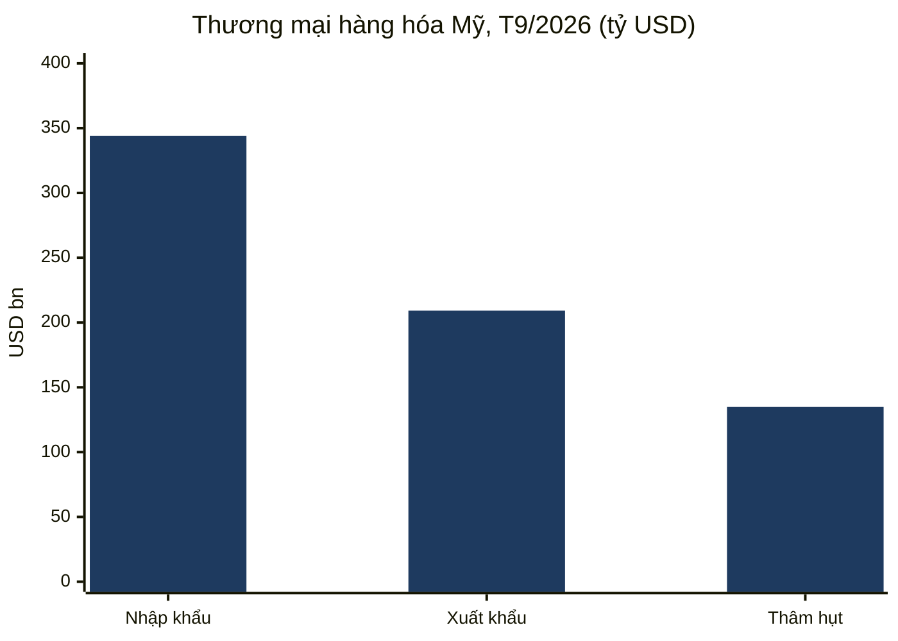
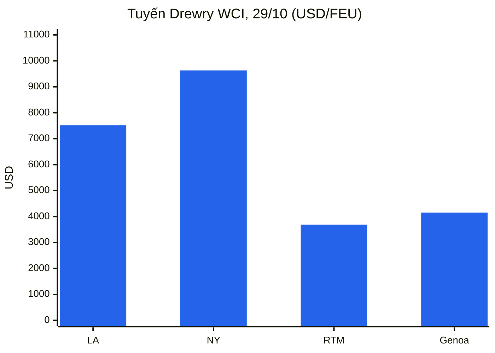
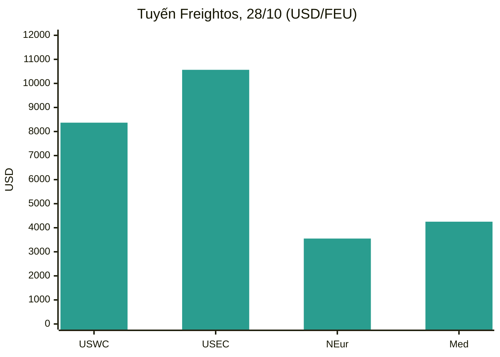
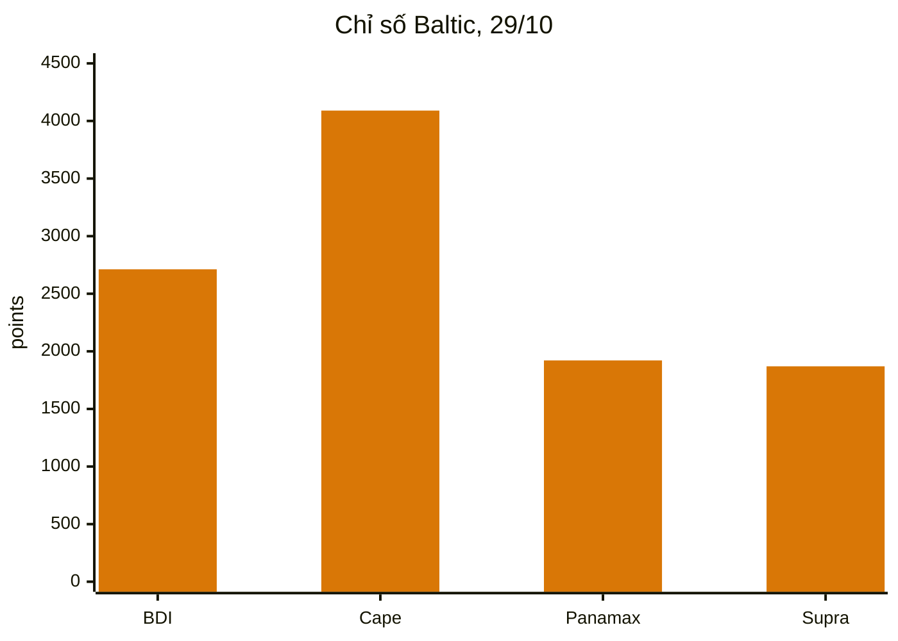
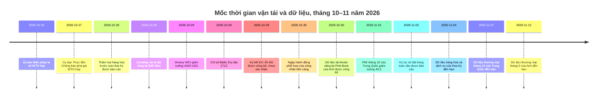

# Báo cáo Tình báo Thương mại Toàn cầu — Tuần từ 26 tháng 10 đến 2 tháng 11 năm 2026

**Bản tin hàng tuần.** Thời hạn bao phủ: 26 tháng 10 – 2 tháng 11 năm 2026. Được biên soạn từ khoảng 45 nguồn tin tức, chính sách, dữ liệu và vận tải trên toàn thế giới.

---

## Mục lục

1. [Tóm tắt điều hành](#1-executive-summary)
2. [Cảnh báo](#2-alerts)
3. [Các tin chính — phân tích sâu](#3-top-stories--deep-dives)
4. [Bảng theo dõi thuế quan](#4-tariff-tracker)
5. [Phân tích sâu chính sách Mỹ](#5-us-policy-deep-dive)
6. [Chính sách thế giới theo khu vực](#6-world-policy-by-region)
7. [Các biện pháp thực thi](#7-enforcement-actions)
8. [Các bản công bố dữ liệu](#8-data-releases)
9. [Thị trường vận tải](#9-freight-market)
10. [Mốc thời gian chính sách](#10-policy-timelines)
11. [Các thời hạn & sự kiện sắp tới (90 ngày tới)](#11-upcoming-deadlines--events-next-90-days)
12. [Nguồn & phương pháp](#12-sources--methodology)

---

## 1. Tóm tắt điều hành

Một tuần chi phối bởi các thời hạn chưa được giải quyết: ngày 9 tháng 11 hết hạn 178 trường hợp miễn trừ sản phẩm theo Mục 301 đối với Trung Quốc và việc tạm dừng thu phí cảng theo Mục 301 đối với tàu liên quan đến Trung Quốc, một tranh chấp lao động với 250 công nhân có thể khiến cụm cảng container bận rộn nhất của Hoa Kỳ ngừng hoạt động vào ngày sau cuộc bầu cử giữa kỳ, và sự leo thang mạnh mẽ về rủi ro vận tải tại eo biển Hormuz và Biển Đen. Trong bối cảnh đó, Liên minh châu Âu đã thúc đẩy chương trình phòng vệ thương mại với Trung Quốc trên nhiều mặt trận cùng lúc, danh sách thuế quan 50% sửa đổi của Canada có hiệu lực, và Hoa Kỳ báo cáo một tháng kỷ lục về nhập khẩu hàng hóa do hàng hóa vốn liên quan đến trí tuệ nhân tạo dẫn dắt.

- **Mốc ngày 9 tháng 11 hiện chỉ còn một tuần nữa, và cả hai đồng hồ vẫn chưa được giải quyết.** 178 trường hợp miễn trừ sản phẩm còn lại theo Mục 301 đối với Trung Quốc hết hạn lúc 11:59 tối theo giờ miền Đông ngày 9 tháng 11 năm 2026, mà không có thông báo gia hạn nào được tìm thấy trong tuần bao phủ này; các lô hàng nhập từ ngày 10 tháng 11 trở đi sẽ quay lại mức thuế theo danh sách. Đề xuất của USTR về việc gia hạn tạm dừng thu phí cảng theo Mục 301 đối với tàu liên quan đến Trung Quốc và các loại thuế cần cẩu liên quan đến ngày 9 tháng 1 năm 2027 đã được công bố trên Công báo Liên bang ngày 26 tháng 10, với thời hạn nhận ý kiến đóng vào ngày 30 tháng 10, nhưng tính đến ngày 2 tháng 11 vẫn chưa có thông báo cuối cùng nào được công bố. Hai công cụ này là riêng biệt: việc hoàn tất một công cụ không gia hạn công cụ còn lại. Một lệnh tạm dừng đã công bố khác — lệnh tạm dừng Quy tắc Công ty liên kết của Cục Công nghiệp và An ninh — cũng hết hạn theo văn bản đã công bố vào ngày 9–10 tháng 11, với thông báo gia hạn đến ngày 10 tháng 1 năm 2027 mà tính đến ngày 31 tháng 10 vẫn chưa được đăng công báo.
- **Danh sách 50% sửa đổi của Canada có hiệu lực ngày 30 tháng 10.** Sắc lệnh ký ngày 23 tháng 10 đã loại bỏ 22 phân loại khỏi danh sách theo Mục 338 và bổ sung 100 phân loại, giữ nguyên mức thuế 50%. Thuế này cộng dồn lên trên thuế theo Mục 232 và áp dụng ngay cả với hàng hóa đủ điều kiện theo Hiệp định Canada–Hoa Kỳ–Mexico. CBP đã ban hành hướng dẫn thực hiện ngày 29 tháng 10 (CSMS #70314289). Cùng tuần đó, Thượng viện đã bỏ phiếu 50–46 để chấm dứt tình trạng khẩn cấp quốc gia được viện dẫn cho thuế quan Canada — một cuộc bỏ phiếu không có hiệu lực pháp lý đối với các loại thuế — và thủ tướng Canada nói Ottawa "chưa gần" một thỏa thuận trước cuộc bầu cử giữa kỳ, trong khi Washington mô tả một thỏa thuận là đã gần kề. Thách thức pháp lý đầu tiên đối với Mục 338, do một nhà nhập khẩu phô mai ở New Jersey đệ đơn ngày 20 tháng 10, đã được đưa tin rộng rãi trong tuần cùng với thay đổi danh sách.
- **Rủi ro vận tải leo thang tại hai khu vực cùng lúc.** Ngày 29 tháng 10, một thuyền nhỏ đã gắn hai thiết bị nổ vào thân tàu chở dầu thô Louise 1 treo cờ Panama tại eo biển Hormuz, cách Khasab, Oman khoảng 25 hải lý về phía đông bắc; vụ cháy phòng máy sau đó đã tạm thời làm tàu mất khả năng hoạt động, dù thủy thủ đoàn an toàn và tàu vẫn tiếp tục hành trình. Reuters, trích dẫn ba nguồn an ninh hàng hải, mô tả đây là vụ tấn công bằng mìn limpet thành công đầu tiên tại tuyến đường thủy này kể từ khi chiến tranh Hoa Kỳ–Iran bắt đầu vào tháng 2 năm 2026. Drewry báo cáo chỉ có hai tàu quá cảnh eo biển Hormuz trong tuần trước đó, so với 62 lượt quá cảnh kênh đào Suez, mức cao nhất trong tuần của năm. Tại Biển Đen, tàu container Contship Jet treo cờ Liberia đã bị ba xuồng không người lái trên biển tấn công ngày 28 tháng 10 trong vùng đặc quyền kinh tế của Bulgaria và chìm vào khoảng nửa đêm; toàn bộ 18 thuyền viên đã được cứu, nhưng 20 trong số 421 container của tàu đã rơi xuống biển, bao gồm pin lithium-ion và các vật liệu nguy hiểm khác.
- **Chương trình Trung Quốc của châu Âu chuyển từ tín hiệu sang các vụ việc chính thức.** Ủy ban châu Âu đã áp thuế chống bán phá giá cuối cùng từ 39,8% đến 48,1% đối với PET Spunbond của Trung Quốc trong năm năm kể từ ngày 30 tháng 10, mở cuộc điều tra chống bán phá giá đối với polyvinylidene fluoride từ Trung Quốc, Ấn Độ và Nhật Bản ngày 28 tháng 10, ra lệnh đăng ký nhập khẩu silicon của Trung Quốc từ ngày 27 tháng 10 trong một đợt rà soát thuế, và chứng kiến các quốc gia thành viên phê duyệt thuế chống bán phá giá dài hạn đối với titanium dioxide của Trung Quốc có hiệu lực từ ngày 11 tháng 1. Đề xuất tháng 12 của Ủy ban về một công cụ nhằm hạn chế phụ thuộc vào nguồn cung duy nhất đối với các mặt hàng cung ứng quan trọng đã hoàn tất tham vấn doanh nghiệp ngày 27 tháng 10, mà chưa công bố danh sách ngành, ngưỡng hay mức thuế nào. Riêng rẽ, Phí Xử lý của Liên minh trị giá 2 euro của EU đối với mua hàng trực tuyến ngoài EU có hiệu lực ngày 1 tháng 11, cộng thêm vào mức thuế 3 euro mỗi mặt hàng đối với các lô hàng giá trị thấp đã áp dụng từ ngày 1 tháng 7.
- **Hoa Kỳ nhập khẩu lượng hàng hóa kỷ lục trong tháng 9.** Bản công bố trước của Cục Điều tra Dân số ngày 28 tháng 10 đưa thâm hụt hàng hóa tháng 9 ở mức 134,9 tỷ USD, tăng 2,1% so với tháng 8, trên nhập khẩu kỷ lục 344,1 tỷ USD. Nhập khẩu hàng hóa vốn tăng 7,5% so với tháng trước và 77,2% so với cùng kỳ năm trước, làn sóng nhập khẩu hạ tầng AI hiện là động lực chính của thâm hụt ngay cả khi xuất khẩu cũng tăng 2,6% lên 209,2 tỷ USD. Dữ liệu thương mại tháng 10 của Trung Quốc, sẽ cho thấy liệu thặng dư từ đầu năm của nước này có vượt 1 nghìn tỷ USD hay không, đến hạn ngày 7 tháng 11 và chưa được công bố trong khung thời gian này; chỉ số PMI sản xuất chính thức tháng 10 của Trung Quốc, công bố ngày 1 tháng 11, đã quay lại vùng suy giảm ở mức 49,3, với đơn hàng xuất khẩu mới ở mức 48,7.
- **Vận tải phân hóa theo tuyến và theo kích cỡ tàu.** Chỉ số Container Thế giới của Drewry giảm 3% xuống 4.429 USD mỗi container 40ft ngày 29 tháng 10, đảo ngược hai tuần tăng liên tiếp, khi tuyến Thượng Hải–Los Angeles giảm 6% xuống 7.514 USD và Thượng Hải–New York giảm 5% xuống 9.631 USD, trong khi Thượng Hải–Rotterdam tăng nhẹ 1% lên 3.686 USD. Chỉ số Baltic Dry phục hồi lên 2.712 vào ngày 29 tháng 10 nhờ sức mạnh của tàu Capesize, ngay cả khi tàu Panamax giảm xuống 1.921, mức thấp nhất kể từ tháng 4. Độ tin cậy lịch trình vẫn kém: Sea-Intelligence đưa hiệu suất đúng giờ toàn cầu ở mức 50,6% trong tháng 9, tăng nhẹ so với 49,9% trong tháng 8. Một ngày hành động phối hợp của công nhân bến cảng ngày 30 tháng 10 đã chạm tới hơn 100 cảng, với tác động vận hành được xác nhận được mô tả là hạn chế tại hầu hết các nơi, và một cuộc đình công cảng quốc gia nữa của Pháp đã được thông báo cho ngày 5 tháng 11.

**Vận tải:** giá giao ngay container quay đầu giảm trên tuyến xuyên Thái Bình Dương trong khi tuyến Á–Âu giữ vững; các mức tăng tháng 11 của hãng tàu đã bị chiết khấu; hàng rời khô chỉ phục hồi nhờ sức mạnh quặng sắt của tàu Capesize; lượt quá cảnh Suez đạt mức cao nhất trong năm trong khi lượt quá cảnh Hormuz gần như dừng hẳn; và vận tải hàng không vững lên khi bước vào mùa cao điểm nhờ tăng trưởng nhu cầu vượt công suất.

---

## 2. Cảnh báo

| # | Cảnh báo | Hiệu lực | Tác động | Nguồn |
|---|-------|-----------|--------|--------|
| A1 | 178 trường hợp miễn trừ sản phẩm theo Mục 301 đối với Trung Quốc hết hạn lúc 11:59 tối theo giờ miền Đông ngày 9 tháng 11 năm 2026; không tìm thấy gia hạn; các lô hàng từ ngày 10 tháng 11 trở đi quay lại mức thuế theo danh sách (25% đối với Danh sách 1–3, 7,5% đối với Danh sách 4A) | 9 tháng 11, 2026 | Các nhà nhập khẩu khai báo mã HTSUS 9903.88.69/70 phải định giá lại và xác nhận các lô hàng trước thời hạn | [Gateway Lines](https://gatewaylines.com/press-releases/china-section-301-tariffs-stay-178-exclusions-end) |
| A2 | Đề xuất của USTR về gia hạn tạm dừng thu phí cảng theo Mục 301 đến ngày 9 tháng 1 năm 2027 vẫn chỉ là đề xuất; thời hạn nhận ý kiến đóng ngày 30 tháng 10 (hồ sơ USTR-2026-0694); tính đến ngày 2 tháng 11 chưa có thông báo cuối cùng nào được công bố | 9 tháng 11, 2026 (lệnh tạm dừng hiện tại hết hạn) | Nếu không được hoàn tất, phí cảng và các loại thuế cần cẩu/xử lý hàng hóa liên quan sẽ quay lại từ ngày 10 tháng 11 | [Federal Register](https://www.federalregister.gov/documents/2026/10/26/2026-21755/request-for-comments-on-further-suspension-of-section-301-action-chinas-targeting-of-the-maritime) |
| A3 | Danh sách theo Mục 338 của Canada được điều chỉnh: 22 phân loại bị loại bỏ, 100 phân loại được bổ sung; mức thuế 50% không đổi; cộng dồn lên thuế theo Mục 232; áp dụng ngay cả với hàng hóa đủ điều kiện USMCA | 30 tháng 10, 2026 | Ngày nhập khẩu, không phải ngày vận chuyển, quyết định mức 0% hay 50% đối với cùng một loại hàng hóa; rà soát lại phân loại ngay lập tức | [Baker McKenzie](https://globalimportblog.bakermckenzie.com/2026/10/30/us-further-modifies-section-338-tariffs-on-canadian-goods-as-the-tariffs-face-their-first-legal-challenge/) |
| A4 | Leo thang tại Hormuz: tấn công bằng mìn limpet vào tàu chở dầu Louise 1 ngày 29 tháng 10; chỉ hai lượt quá cảnh Hormuz được báo cáo trong tuần trước đó; các sự cố khác được báo cáo ngày 30 tháng 10 – 2 tháng 11, bao gồm một tàu chở dầu bị đạn tấn công phía đông Ras al Khafji | 29 tháng 10 – 2 tháng 11, 2026 | Chi phí rủi ro chiến tranh, định tuyến và bảo hiểm vẫn ở mức cao; các quyết định định tuyến vùng Vịnh phải tính đến các tuyên bố chính thức mâu thuẫn nhau về an toàn tuyến đường | [gCaptain](https://gcaptain.com/tanker-in-strait-of-hormuz-hit-by-limpet-mines-security-sources-say/) |
| A5 | Chìm tàu tại Biển Đen: tàu container Contship Jet bị ba xuồng không người lái trên biển tấn công ngày 28 tháng 10 trong vùng đặc quyền kinh tế của Bulgaria và chìm; 20 trong số 421 container rơi xuống biển, bao gồm vật liệu nguy hiểm | 28–29 tháng 10, 2026 | Rủi ro chiến tranh tại Biển Đen hiện chạm tới vùng biển của các nước thành viên EU/NATO; các container hàng nguy hiểm trôi dạt tạo ra nguy hiểm hàng hải | [Splash247](https://splash247.com/splash-wrap-new-networks-old-faultlines/) |
| A6 | Thời hạn đình công của nhân viên gác cảng LA/Long Beach được gia hạn đến 5 giờ chiều theo giờ Thái Bình Dương ngày 4 tháng 11 năm 2026; chưa có thỏa thuận cuối cùng; các bến bị ảnh hưởng xử lý ~85% hàng hóa của Long Beach và ~33% hàng hóa của Los Angeles | 4 tháng 11, 2026 | Một tranh chấp với 250 công nhân có thể làm ngừng công việc tàu, bãi và cổng tại các bến bị ảnh hưởng nếu các thành viên ILWU khác tôn trọng hàng rào đình công; một báo cáo đưa ra ngày 5 tháng 11 thay vào đó | [Seatrade Maritime](https://www.seatrade-maritime.com/ports-logistics/impending-strike-threatens-la-lb-ports-container-flow) |
| A7 | Phí Xử lý của Liên minh trị giá 2 euro của EU đối với mua hàng trực tuyến ngoài EU có hiệu lực, cộng thêm vào mức thuế 3 euro mỗi mặt hàng đối với các lô hàng đến 150 euro đã áp dụng từ ngày 1 tháng 7 năm 2026 | 1 tháng 11, 2026 | Thương mại điện tử giá trị thấp, nhiều mặt hàng phải chịu 5 euro mỗi dòng trước VAT; phí không được hoàn lại ngay cả khi hàng hóa bị trả lại | [Shipping and Freight Resource](https://www.shippingandfreightresource.com/trade-moves-02-nov-2026/) |
| A8 | Ngày hành động phối hợp của công nhân bến cảng ngày 30 tháng 10 trên hơn 100 cảng; đình công cảng quốc gia của Pháp được thông báo cho ngày 5 tháng 11 | 30 tháng 10 / 5 tháng 11, 2026 | Việc cập bến và trung chuyển bị trượt lịch sau ngày 30 tháng 10, tập trung tại các trung tâm trung chuyển Địa Trung Hải và các cửa ngõ của Pháp | [Port Technology](https://www.porttechnology.org/news/ports-and-terminals/dockworker-strikes-ports-military-cargo/) |
| A9 | DHS bổ sung ba công ty gen của Trung Quốc (BGI Group, BGI Genomics, MGI Tech) vào Danh sách Thực thể UFLPA; danh sách hợp nhất hiện có 190 thực thể | 29 tháng 10, 2026 | Hàng hóa được sản xuất toàn bộ hoặc một phần bởi các công ty này được cho là sản xuất bằng lao động cưỡng bức và bị cấm trừ khi giả định đó bị bác bỏ | [LexBlog](https://www.lexblog.com/2026/10/29/dhs-updates-uflpa-entity-list-with-three-companies-engaged-in-genetics-testing/) |
| A10 | Mục 232 về robot/máy móc công nghiệp: kết luận về an ninh quốc gia, chưa có thuế; đàm phán được yêu cầu với báo cáo đến hạn trong vòng 180 ngày | 28 tháng 10, 2026 | Rủi ro thuế quan được hoãn đến mùa xuân 2027, không bị loại bỏ; cùng mẫu với tua-bin gió | [White House](https://www.whitehouse.gov/fact-sheets/2026/10/fact-sheet-president-donald-j-trump-adjusts-imports-of-robotics-industrial-machinery-and-their-parts-and-components-into-the-united-states/) |

### A1/A2 — Các đồng hồ ngày 9 tháng 11, còn một tuần nữa

Hai công cụ ngày 9 tháng 11 thường được báo cáo cùng nhau nhưng vận hành độc lập. Các trường hợp miễn trừ sản phẩm — 164 trường hợp được giữ lại tháng 5 năm 2024 cộng 14 trường hợp miễn trừ thiết bị sản xuất năng lượng mặt trời được bổ sung tháng 9 năm 2024, khai báo theo mã HTSUS 9903.88.69 và 9903.88.70 — hết hạn lúc 11:59 tối theo giờ miền Đông ngày 9 tháng 11, và nhiều nguồn tin báo cáo ngày 29–31 tháng 10 không tìm thấy thông báo gia hạn nào. Thông báo tiếp tục ngày 6/7 tháng 10 của USTR xác nhận các biện pháp theo Mục 301 năm 2018 vẫn tiếp tục; nó không gia hạn các trường hợp miễn trừ. Ngược lại, việc tạm dừng thu phí cảng là đối tượng của một đề xuất đang có hiệu lực: thông báo trên Công báo Liên bang công bố ngày 26 tháng 10 (91 FR 67388) đề xuất tạm dừng, từ 12:00 sáng theo giờ miền Đông ngày 10 tháng 11 năm 2026 đến 11:59 tối theo giờ miền Đông ngày 9 tháng 1 năm 2027, các phí dịch vụ vận tải biển tại Phụ lục I–III của biện pháp ngày 23 tháng 4 năm 2025 (sửa đổi ngày 16 tháng 10 năm 2025) và các loại thuế tại Phụ lục V.A đối với cần cẩu bờ–tàu và thiết bị xử lý hàng hóa của Trung Quốc, để không phát sinh trách nhiệm nào trong thời gian tạm dừng. Lý do nêu ra là để cho phép đàm phán thêm với Trung Quốc. Đề xuất chỉ bao phủ hai tháng, ngắn hơn nhiều so với lệnh tạm dừng một năm mà nó sẽ thay thế.

**Phân tích:** các nhà nhập khẩu và hãng tàu đối mặt với mức độ rủi ro khác nhau trong cùng một ngày. Một nhà nhập khẩu có các lô hàng khai báo theo các mã miễn trừ phải lên kế hoạch theo mức thuế theo danh sách từ ngày 10 tháng 11 bất kể điều gì xảy ra với phí cảng. Một hãng tàu chỉ đối mặt với việc khôi phục phí nếu đề xuất không được hoàn tất. Cả hai đều nên được theo dõi như các công cụ bằng văn bản, không phải như một "thỏa thuận đình chiến" duy nhất — lịch chính trị (một thỏa thuận đình chiến được thảo luận là kéo dài đến ngày 10 tháng 1 năm 2027) và lịch quy định (ngày 9 tháng 11) vẫn là những thứ khác nhau.

### A3 — Canada: thay đổi danh sách có hiệu lực giữa tuần

Sắc lệnh ngày 23 tháng 10, công bố trên Công báo Liên bang ngày 30 tháng 10 và có hiệu lực lúc 12:01 sáng theo giờ miền Đông ngày đó đối với hàng hóa nhập khẩu hoặc rút khỏi kho để tiêu dùng từ ngày đó trở đi, đã loại bỏ 22 phân loại và bổ sung 100 phân loại, tất cả theo mã 9903.03.14; các mã 9903.03.12 và 9903.03.13 không thay đổi. Các dòng bị loại bỏ bao gồm một số tấm ván ép, sản phẩm giấy, máy móc và thiết bị lạnh, thùng và hộp đóng gói, màng nhựa, hộp các-tông và máy móc liên quan đến thực phẩm. Các dòng được bổ sung bao gồm thảm và rugs, một số sản phẩm gỗ và giấy, sản phẩm hóa chất như sơn, xà phòng và chất bôi trơn, và sản phẩm tiêu dùng bao gồm bột ca cao, sàn vinyl, ca-nô, tủ đông ngực, dầu gội và xà phòng vệ sinh, cũng như van, dụng cụ, máy điều hòa cửa sổ và thuốc thử chẩn đoán. Mô tả trong phụ lục chỉ mang tính thông tin; mã HTS quyết định phạm vi.

**Phân tích:** hậu quả thực tế là vấn đề thời điểm. Một tủ đông ngực chỉ phải chịu thuế thép theo Mục 232 đến ngày 29 tháng 10 và phải chịu thêm Mục 338 từ ngày 30 tháng 10; ván ép thì ngược lại. Vì thuế áp dụng bất kể xuất xứ USMCA và cộng thêm vào thuế theo Mục 232, việc lập kế hoạch xuất xứ không tránh được nó. Tác động ròng là một sự hoán đổi cấu trúc chứ không phải giảm leo thang: giảm nhẹ tập trung vào các chuỗi cung ứng nông nghiệp và lâm nghiệp liên quan đến Maine, rủi ro mới lan rộng trên hàng tiêu dùng và hàng công nghiệp.

### A4/A5 — Hai khu vực, một tuần

Vụ tấn công tại Hormuz ngày 29 tháng 10 diễn ra theo mô hình đã thấy rõ trong dữ liệu: lượt quá cảnh Hormuz không liên quan đến Iran đã giảm xuống 104 trong tuần 5–11 tháng 10 từ 126 trong tuần 28 tháng 9 – 4 tháng 10, và Lloyd's List Intelligence đếm ít nhất 28 vụ tấn công được báo cáo hoặc xác nhận tại Hormuz và các tuyến đường thủy xung quanh trong nửa đầu tháng 10. Sự cố ngày 29 tháng 10 bổ sung một phương thức mới — thuốc nổ gắn vào thân tàu ở cự ly gần do thuyền nhỏ đưa tới nhằm vào một tàu chở dầu đang di chuyển — vào mìn và đạn. Các tuyên bố mâu thuẫn sau đó làm bức tranh phức tạp hơn: Lực lượng Vệ binh Cách mạng Hồi giáo Iran nói ba tàu chở dầu đã trúng mìn hải quân trên một tuyến đường phía nam "không được phép" và quân đội Iran báo cáo một vụ thứ tư phía đông tuyến đường thủy, một ngày sau khi Bộ Tư lệnh Trung tâm Hoa Kỳ nói các tuyên bố về mìn là sai sự thật và các tuyến chính đã được dọn sạch. UKMTO ghi nhận thiệt hại nhưng không xác nhận mìn là nguyên nhân. Tại Biển Đen, vụ chìm Contship Jet là vụ tấn công bằng xuồng không người lái thứ năm nhằm vào tàu trong vùng đặc quyền kinh tế của Bulgaria chỉ trong tháng 10, theo BTA như được trích dẫn trong tin tức, và là vụ chìm tàu thương mại thứ hai tại phía tây Biển Đen trong vòng một tuần sau tàu Khoryv ngoài khơi Constanța. Không có quy kết chính thức nào cho vụ tấn công Contship Jet được công bố; đánh giá của Ambrey, qua Reuters, rằng phương tiện này giống thiết kế Murena-300S do Nga sản xuất không phải là quy kết.

**Phân tích:** các chủ hàng không còn có thể coi một trong hai tuyến đường thủy là câu hỏi nhị phân mở hay đóng. Hormuz gần như đóng cửa đối với giao thông thương mại theo số liệu quá cảnh của Drewry trong khi Suez bình thường hóa; rủi ro tại Biển Đen hiện mở rộng tới tàu container trên tuyến Israel–Romania trong vùng đặc quyền kinh tế của một quốc gia thành viên EU, với hàng nguy hiểm dưới nước. Bảo hiểm, định tuyến và khai báo hàng nguy hiểm đều cần được đánh giá theo từng chuyến.

---

## 3. Các tin chính — phân tích sâu

### 3.1 Mốc ngày 9 tháng 11, và một đồng hồ thứ ba không ai để ý

Ngoài hai đồng hồ theo Mục 301, lệnh tạm dừng Quy tắc Công ty liên kết của Cục Công nghiệp và An ninh hết hạn theo văn bản đã công bố vào ngày 9–10 tháng 11 năm 2026. Quy tắc này, ban hành ngày 29 tháng 9 năm 2025, mở rộng các hạn chế trong Danh sách Thực thể, Danh sách Người dùng Cuối Quân sự và Danh sách Công dân Được Chỉ định Đặc biệt sang các công ty liên kết nước ngoài do các bên bị liệt kê sở hữu từ 50% trở lên. Bộ trưởng Tài chính Scott Bessent đã thông báo ngày 24 tháng 9 năm 2026 rằng thỏa thuận đình chiến Hoa Kỳ–Trung Quốc, và tương ứng lệnh tạm dừng, sẽ kéo dài đến ngày 10 tháng 1 năm 2027 — nhưng tính đến thời điểm cắt nguồn ngày 31 tháng 10, vẫn chưa có thông báo nào trên Công báo Liên bang chính thức gia hạn lệnh tạm dừng được công bố. Các nhà xuất khẩu không nên dựa vào việc gia hạn cho đến khi BIS công bố nó. Sự thận trọng tương tự cũng áp dụng cho đề xuất về phí cảng: được đưa tin rộng rãi là hoãn đến ngày 9 tháng 1, nó là một đề xuất mà thời hạn nhận ý kiến đã đóng ngày 30 tháng 10, không phải một quy tắc cuối cùng.

**Phân tích:** ba công cụ riêng biệt hết hạn trong khoảng một ngày của nhau, mỗi công cụ có một bên ra quyết định khác nhau và một hình thức pháp lý khác nhau. Việc coi bất kỳ công cụ nào trong số đó là đã được gia hạn dựa trên một thông báo, một tiêu đề, hay số phận của một công cụ song song là rủi ro tuân thủ chính của tuần tới. Lập trường bằng văn bản trên Công báo Liên bang vào ngày 9 tháng 11 là cơ sở an toàn duy nhất cho các lô hàng nhập, chuyến tàu và sàng lọc xuất khẩu.

### 3.2 Hormuz và Biển Đen: leo thang như một biến số của thị trường vận tải

Tin tức vận tải trong tuần được đọc tốt nhất như một biến số duy nhất — rủi ro chiến tranh — di chuyển theo hướng ngược nhau tại các tuyến đường thủy khác nhau. Lượt quá cảnh Suez tăng lên 62 tàu trong tuần được Drewry báo cáo ngày 29 tháng 10, mức cao nhất trong tuần của năm, và Alphaliner ước tính gần hai phần ba tổng công suất Á–Âu đã được khôi phục qua Biển Đỏ, bao gồm ZIM nối lại tuyến đường này cho dịch vụ chung Á–Bờ Đông Hoa Kỳ với MSC. Hơn 100 tàu container từ 16.000 TEU trở lên đã quá cảnh Suez kể từ đầu tháng 9, vượt qua 99 tàu được ghi nhận trong cả năm 2025 cộng tháng 1–8 năm 2026, và 192 lượt quá cảnh tàu siêu lớn đã được ghi nhận trong năm 2026 cho đến nay so với 8 lượt trong năm 2025. Cùng lúc đó, lượt quá cảnh Hormuz giảm xuống hai tàu theo số liệu hàng tuần của Drewry, dầu Brent chạm 118 USD đối với hợp đồng tháng 12 sắp hết hạn ngày 30 tháng 10 — mức cao nhất kể từ ngày 30 tháng 4 — và Houthi tuyên bố tấn công bằng tên lửa vào các nhà máy lọc dầu Ras Tanura và Rabigh, một cơ sở của Aramco tại Abqaiq, và các sân bay Riyadh và Dammam, để trả đũa các cuộc không kích của Saudi tại Yemen mà họ nói đã giết 27 người; liên minh do Saudi dẫn đầu nói đã đánh chặn tên lửa và chưa xác nhận thiệt hại. Hải quân Oman đã sơ tán 25 thuyền viên khỏi tàu chở dầu treo cờ Panama Riti đang bốc cháy ngày 30 tháng 10, và một báo cáo hàng hóa ngày 2 tháng 11 trích dẫn UKMTO đếm mười sự cố vận tải trên khắp Hormuz, vùng Vịnh và vịnh Oman trong khoảng ngày 31 tháng 10 đến 2 tháng 11.

**Phân tích:** sự trở lại của Suez đang giải phóng công suất hiệu dụng và gây áp lực lên giá cước Á–Âu, trong khi gián đoạn tại Hormuz đang thắt chặt chi phí năng lượng và định tuyến vùng Vịnh. Hai tác động này không triệt tiêu nhau: chúng ảnh hưởng đến các tuyến thương mại, hàng hóa và loại hình bảo hiểm khác nhau. Hệ quả vận hành là một câu chuyện "trở lại bình thường" cho một hành lang không nên được áp dụng cho hành lang còn lại.

### 3.3 Canada: giảm nhẹ, leo thang và một vụ kiện trong cùng một tuần

Hồ sơ Canada kết hợp bốn diễn biến riêng biệt. Thứ nhất, thay đổi danh sách theo Mục 338 có hiệu lực ngày 30 tháng 10 (xem mục 2, A3). Thứ hai, Thượng viện đã bỏ phiếu 50–46 ngày 29 tháng 10 để chấm dứt tình trạng khẩn cấp quốc gia được viện dẫn cho thuế quan Canada, do Thượng nghị sĩ Tim Kaine bảo trợ, với bốn nghị sĩ Cộng hòa — Susan Collins của Maine, Mitch McConnell của Kentucky, Lisa Murkowski của Alaska và Rand Paul của Kentucky — cùng phe Dân chủ; nó diễn ra sau cuộc bỏ phiếu ngày 28 tháng 10 của Thượng viện chống lại thuế quan Brazil. Các quy tắc thủ tục của Hạ viện được báo cáo là ngăn cản việc xem xét và một quyền phủ quyết của tổng thống là có thể, vì vậy không có thay đổi thuế nào có hiệu lực từ cuộc bỏ phiếu. Thứ ba, các tài khoản đàm phán khác nhau: Reuters báo cáo ngày 26 tháng 10 rằng các quan chức đang tìm hiểu một thỏa thuận nhằm nới lỏng thuế theo Mục 232 ở mức 50% đối với thép và 25% đối với ô tô, với Bộ trưởng Thương mại Howard Lutnick liên lạc thường xuyên với Bộ trưởng Thương mại Canada–Hoa Kỳ Dominic LeBlanc; ngày 28 tháng 10 một quan chức Canada mô tả tiến triển là "hạn chế"; ngày 29 tháng 10 Thủ tướng Mark Carney nói Canada "chưa gần" một thỏa thuận trước cuộc bầu cử giữa kỳ và sẽ không chấp nhận một thỏa thuận bằng mọi giá, lưu ý rằng các cuộc đàm phán đã đổ vỡ tháng 8 năm 2026 do các điều kiện của Hoa Kỳ mà Canada nói sẽ hạn chế khả năng đàm phán với các nước khác, làm suy yếu các yêu cầu về tiếng Pháp và gây hại cho ngành ô tô. Tổng thống, phát biểu tại Michigan ngày 25 tháng 10 và South Carolina ngày 29 tháng 10, mô tả một thỏa thuận là sắp đạt được và Canada đối xử với Hoa Kỳ "cực kỳ tốt". Thứ tư, thách thức pháp lý đầu tiên đối với Mục 338 — Gellert Global Group kiện Trump, đệ đơn ngày 20 tháng 10 tại Tòa án Thương mại Quốc tế Hoa Kỳ bởi một nhà nhập khẩu thực phẩm ở New Jersey chuyên phô mai Canada (khoảng 71 triệu USD nhập khẩu phô mai Canada năm 2025, luật sư là Liberty Justice Center) — yêu cầu tòa tuyên bố các loại thuế là bất hợp pháp, chặn việc thu thuế và ra lệnh hoàn thuế kèm lãi, lập luận rằng Mục 301 đã thay thế Mục 338, rằng các biện pháp không đáp ứng các kiểm tra phân biệt đối xử và bù trừ của Mục 338, và rằng các bổ sung tháng 9 chỉ nhận được bảy ngày thay vì thời gian chờ 30 ngày được cho là bắt buộc. Không có phán quyết nào về nội dung được báo cáo.

**Phân tích:** cuộc bỏ phiếu, các cuộc đàm phán và vụ kiện kéo theo các hướng khác nhau và không có cái nào thay đổi mức thuế trong tuần này. Công cụ duy nhất có tác động thương mại tức thời là thay đổi danh sách ngày 30 tháng 10, và công cụ duy nhất có thể gỡ bỏ chế độ này là vụ kiện, sẽ mất nhiều tháng. Các nhà nhập khẩu nên tách tín hiệu chính trị khỏi hiệu lực pháp lý.

### 3.4 Châu Âu: một tuần phòng vệ thương mại, và một công cụ tháng 12 đang hình thành

Chương trình Trung Quốc của Liên minh châu Âu đã tạo ra hành động chính thức trên bốn hướng trong một tuần. Thuế chống bán phá giá cuối cùng đối với PET Spunbond của Trung Quốc (39,8% đến 48,1%, năm năm, thay thế thuế tạm thời 45,6% đến 50% có hiệu lực từ tháng 5 năm 2026) được áp dụng ngày 30 tháng 10 trên một thị trường trị giá 200 triệu euro, với ngành công nghiệp EU đặt tại Đức, Ý và Pháp. Một cuộc điều tra chống bán phá giá đối với polyvinylidene fluoride từ Trung Quốc, Ấn Độ và Nhật Bản mở ngày 28 tháng 10, sau cuộc điều tra mở ngày 16 tháng 10 đối với rượu furfuryl từ Trung Quốc. Nhập khẩu silicon của Trung Quốc được lệnh đăng ký hải quan từ ngày 27 tháng 10 trong chín tháng trong khi Ủy ban rà soát liệu thuế chống bán phá giá hiện hành có còn đủ hay không, một cuộc rà soát mở ngày 1 tháng 9 theo yêu cầu của Euroalliages, đại diện cho toàn bộ các nhà sản xuất EU. Các quốc gia thành viên đã phê duyệt thuế chống bán phá giá dài hạn đối với titanium dioxide của Trung Quốc, được báo cáo ở mức 0,25 euro mỗi kilôgam đối với Anhui Jinxing Group và 0,74 euro mỗi kilôgam đối với Longbai Group, với 0,64 euro mỗi kilôgam đối với các công ty hợp tác và 0,74 euro mỗi kilôgam đối với tất cả các công ty còn lại, có hiệu lực từ ngày 11 tháng 1 trong năm năm; nhập khẩu titanium dioxide của Trung Quốc vượt 500 triệu euro năm 2023. Đằng sau các vụ việc này là tín hiệu từ cuộc họp không chính thức của Hội đồng tại Dublin ngày 23 tháng 10, nơi Ủy viên Thương mại Maroš Šefčovič nói ngành nhựa là "gần nhất" với một cuộc điều tra biện pháp tự vệ có thể xảy ra. Thâm hụt hàng hóa của EU với Trung Quốc được báo cáo ở mức hơn 1 tỷ euro mỗi ngày, trên 370 tỷ euro năm 2025 và dự kiến vượt 400 tỷ euro năm 2026, với thâm hụt nửa đầu năm 2026 ở mức gần 197 tỷ euro trong một báo cáo dựa trên Politico.

Công cụ tháng 12 tiến triển song song. Tham vấn doanh nghiệp về một công cụ buộc đa dạng hóa khỏi phụ thuộc vào một quốc gia duy nhất đối với các mặt hàng cung ứng quan trọng đã kết thúc ngày 27 tháng 10, với đề xuất đến hạn vào đầu tháng 12, ngay trước khi các nhà lãnh đạo EU họp ngày 17–18 tháng 12. Tham vấn xác nhận công cụ sẽ nhắm vào các tình huống mà phụ thuộc nặng nề vào một quốc gia cung ứng đe dọa an ninh cung ứng hoặc ổn định kinh tế của EU; chưa có danh sách ngành, tỷ lệ ngưỡng hay mức thuế nào được công bố. BusinessEurope cảnh báo rằng mua sắm thay thế sẽ làm tăng giá; Ủy viên Šefčovič nói trong bài phát biểu tháng 6 năm 2026, như được trích dẫn trong tin tức, rằng các công ty phải gánh chịu "chi phí của khả năng phục hồi". Hai hình thức đang được thảo luận: một yêu cầu đa dạng hóa tối giản kiểu năng lượng đối với hàng hóa quốc phòng và lưỡng dụng, hoặc một mô hình ngưỡng tối đa theo đó việc mua hơn một tỷ lệ cố định từ một nguồn có thể kích hoạt thuế quan.

**Phân tích:** EU đang vận hành một chương trình theo từng ngành — xe hybrid bị giới hạn, nhựa gần nhất với biện pháp tự vệ, hóa chất trong điều tra chính thức, silicon đang được rà soát — thay vì một biện pháp rộng duy nhất. Công cụ tháng 12 sẽ cho thấy liệu chương trình đó có được tổng quát hóa thành một công cụ toàn nền kinh tế hay vẫn mang tính ngành cụ thể. Dù thế nào, hướng đi là hướng tới nhiều hơn, chứ không ít hơn, các biện pháp phòng vệ thương mại với Trung Quốc trong năm 2027.

### 3.5 Hai thâm hụt, hai hướng: Hoa Kỳ nhập khẩu nhiều hơn, Trung Quốc xuất khẩu nhiều hơn — tạm thời

Bản công bố trước tháng 9 của Cục Điều tra Dân số, công bố ngày 28 tháng 10, đưa thâm hụt hàng hóa của Hoa Kỳ ở mức 134,9 tỷ USD, tăng 2,8 tỷ USD hay 2,1% so với 132,1 tỷ USD của tháng 8, mức lớn nhất kể từ tháng 3 năm 2025 và cao hơn dự báo đồng thuận Reuters/Bloomberg là 130,2 tỷ USD. Nhập khẩu đạt kỷ lục 344,1 tỷ USD, tăng 8,1 tỷ USD hay 2,4%; nhập khẩu hàng hóa vốn tăng 7,5% so với tháng trước và 77,2% so với cùng kỳ năm trước. Xuất khẩu tăng 2,6% lên 209,2 tỷ USD, với lô hàng thực phẩm tăng 12,8% và xuất khẩu hàng tiêu dùng tăng 6,5%; nhập khẩu hàng tiêu dùng tăng 3,1% và hàng hóa khác tăng 6,7%, trong khi vật tư công nghiệp bao gồm vàng và dầu mỏ giảm 6,0%. Ước tính của các nhà kinh tế đưa mức kéo giảm GDP quý ba do thương mại ở mức 4 điểm phần trăm (Pantheon Macroeconomics) và 3,25 điểm phần trăm (Oxford Economics); đó là các ước tính, không phải dữ liệu chính thức. Bản công bố đầy đủ về hàng hóa và dịch vụ đến hạn ngày 4 tháng 11. Thâm hụt hàng hóa và dịch vụ tháng 8, công bố ngày 6 tháng 10, là 105,6 tỷ USD trên một cơ sở khác và không thể so sánh trực tiếp với con số hàng hóa trước.

Dữ liệu tháng 9 của Trung Quốc, được báo cáo ngày 20–21 tháng 10, cho thấy xuất khẩu tăng 36,3% so với cùng kỳ năm trước lên khoảng 447,18 tỷ USD và nhập khẩu tăng 31% lên khoảng 313,65 tỷ USD, thặng dư hàng tháng 133,5 tỷ USD và thặng dư tích lũy tháng 1–9 là 938,1 tỷ USD — đang trên đà vượt kỷ lục năm 2025 khoảng 1,19 nghìn tỷ USD, một ngưỡng mà năm 2025 phải đến tháng 11 mới vượt qua. Thặng dư tháng 9 với Liên minh châu Âu là kỷ lục 34,8 tỷ USD, và thặng dư với Hoa Kỳ nới rộng lên 34 tỷ USD, mức cao nhất trong 20 tháng. Nhưng bức tranh tháng 10, công bố ngày 1 tháng 11, lại chỉ theo hướng ngược lại: PMI sản xuất chính thức giảm xuống 49,3 từ 50,1 trong tháng 9, đơn hàng xuất khẩu mới giảm xuống 48,7 từ 50,0, và chỉ số phụ về sản xuất giảm xuống 49,8 từ 51,7. Một bài báo ngày 1 tháng 11 tóm tắt ba quý đầu năm đưa xuất khẩu tăng 16,4% so với cùng kỳ năm trước lên 3,46 nghìn tỷ USD, với sản phẩm cơ khí và điện tăng 15,6%, hàng hóa công nghệ cao tăng 21,6% và hàng tiêu dùng tăng 14,9%.

**Phân tích:** sự bùng nổ tháng 9 và sự suy giảm PMI tháng 10 không mâu thuẫn nhau; chúng mô tả các thời điểm khác nhau. Câu hỏi cho tuần tới là liệu dữ liệu hải quan tháng 10, đến hạn ngày 7 tháng 11, có xác nhận sự hạ nhiệt hay kéo dài sự bùng nổ vượt 1 nghìn tỷ USD. Dù kết quả nào, nó cũng sẽ được đọc tại Brussels và Washington như bằng chứng về thặng dư, không chỉ là một con số thống kê.

### 3.6 Vận tải: mùa cao điểm đã qua trên tuyến xuyên Thái Bình Dương, nhưng công suất không vận hành bình thường

Sea-Intelligence báo cáo ngày 29 tháng 10 rằng công suất hàng tuần đạt mức cao lịch sử trên tất cả các tuyến Đông–Tây chính, phá vỡ mức giảm thông thường sau Tuần lễ Vàng từ năm 2012 đến 2025, và cho rằng nguyên nhân là do tàu dồn ứ từ tắc nghẽn cảng châu Á và lịch trình không đáng tin cậy đẩy các chuyến tàu quý ba sang tháng 10–11, chứ không phải do nhu cầu tăng vọt. Tuyến Á–Bắc Âu vượt 350.000 TEU mỗi tuần trong tháng 10 và tháng 11, Á–Địa Trung Hải vượt 260.000 TEU mỗi tuần, Á–Bờ Tây Bắc Mỹ đạt gần 393.000 TEU trong tháng 10 với dự báo chưa từng có 400.000 TEU trong tháng 11, và Á–Bờ Đông ghi nhận mức cao nhất của bất kỳ năm nào trong tháng 10–11. Bão Champi, cơn bão mạnh nhất năm 2026, đóng góp trực tiếp: nó đóng cửa các cảng Kaohsiung, Keelung và Taipei của Đài Loan ngày 23 tháng 10, đình chỉ Ningbo từ tối ngày 23 tháng 10 đến khoảng trưa ngày 25 tháng 10 và Thượng Hải từ tối ngày 24 tháng 10 đến khoảng trưa ngày 25 tháng 10, và để lại chậm trễ liên quan đến tắc nghẽn khoảng bốn ngày tại Thượng Hải và Ningbo khi lượng hàng tồn đọng được giải tỏa. Tắc nghẽn cảng toàn cầu được đưa ở mức 3,36 triệu TEU, hay 9,7% đội tàu, trong cập nhật ngày 23 tháng 10 của SEKO.

**Phân tích:** công suất triển khai kỷ lục đi cùng nhu cầu yếu giải thích vì sao các hãng tàu không thể giữ mức tăng giá bất chấp các tiêu đề về tắc nghẽn. Thị trường vừa tắc nghẽn vừa dư cung cùng lúc — tắc nghẽn là hệ quả của lịch trình, không phải tín hiệu nhu cầu — và sự kết hợp đó chỉ ra áp lực giá tiếp tục kéo dài vào mùa hợp đồng hàng năm trừ khi công suất được rút nhanh hơn tốc độ giải phóng lượng tàu dồn ứ.

---

## 4. Bảng theo dõi thuế quan

| Quốc gia / biện pháp | Mức thuế / chi tiết | Hiệu lực / trạng thái | Nguồn |
|---|---|---|---|
| Canada — Danh sách theo Mục 338 được điều chỉnh (22 loại bỏ, 100 bổ sung) | 50% theo giá trị, cộng dồn lên thuế theo Mục 232, áp dụng ngay cả với hàng hóa đủ điều kiện USMCA | Có hiệu lực ngày 30 tháng 10 năm 2026; CBP CSMS #70314289 ngày 29 tháng 10 | [Baker McKenzie](https://globalimportblog.bakermckenzie.com/2026/10/30/us-further-modifies-section-338-tariffs-on-canadian-goods-as-the-tariffs-face-their-first-legal-challenge/) |
| Canada — thuế đối ứng đối với hàng hóa Mỹ | Thuế phụ thu 15% / 25% / 50% đối với ~27,6 tỷ đô la Canada hàng hóa có xuất xứ Mỹ (648 mặt hàng) | Có hiệu lực ngày 8 tháng 9 năm 2026; máy kéo/máy gặt/máy nông nghiệp phụ tùng sửa chữa ở mức 0% miễn trừ đến ngày 30 tháng 6 năm 2027 | [JD Supra](https://www.jdsupra.com/legalnews/update-on-the-u-s-canada-trade-conflict-3530187/) |
| Canada — Thuế thép / ô tô theo Mục 232 (thuế của Mỹ) | 50% thép, 25% ô tô; đàm phán nới lỏng được báo cáo ngày 26 tháng 10, chưa có thỏa thuận | Đang có hiệu lực; thảo luận thỏa thuận đang tiếp diễn |  |
| Mexico — Thuế xe của Mỹ | Hiện 25%; Mexico tìm cách giảm xuống 15% với các khoản khấu trừ dựa trên hàm lượng được giữ nguyên | Chưa có thỏa thuận tính đến ngày 28 tháng 10 năm 2026 |  |
| Trung Quốc — Các trường hợp miễn trừ sản phẩm theo Mục 301 (178) | Quay lại 25% (Danh sách 1–3) / 7,5% (Danh sách 4A) khi hết hạn | Hết hạn lúc 11:59 tối theo giờ miền Đông ngày 9 tháng 11 năm 2026; không tìm thấy gia hạn | [Gateway Lines](https://gatewaylines.com/press-releases/china-section-301-tariffs-stay-178-exclusions-end) |
| Trung Quốc — Phí cảng biển theo Mục 301 | 50 USD/tấn tịnh (các công ty không phải Trung Quốc sử dụng tàu đóng tại Trung Quốc); công ty Trung Quốc 18 USD/tấn tịnh hoặc 120 USD/container, tùy mức nào cao hơn; tàu chở xe 150 USD/đơn vị tương đương xe — nếu lệnh tạm dừng hết hiệu lực | Lệnh tạm dừng hết hạn lúc 11:59 tối theo giờ miền Đông ngày 9 tháng 11 năm 2026; gia hạn đến ngày 9 tháng 1 năm 2027 được đề xuất, chưa hoàn tất | [Federal Register](https://www.federalregister.gov/documents/2026/10/26/2026-21755/request-for-comments-on-further-suspension-of-section-301-action-chinas-targeting-of-the-maritime) |
| Trung Quốc — Tua-bin gió theo Mục 232 | Chưa có thuế; đàm phán được yêu cầu, cập nhật trong vòng 180 ngày | Sắc lệnh ngày 22 tháng 10 năm 2026; Công báo Liên bang công bố ngày 28 tháng 10 năm 2026; cập nhật đến hạn vào ~ngày 20 tháng 4 năm 2027 | [Thompson Hine](https://www.thompsonhinesmartrade.com/2026/10/president-trump-opts-for-negotiations-not-tariffs-in-section-232-wind-turbine-investigation/) |
| Trung Quốc — Robot / máy móc công nghiệp theo Mục 232 | Chưa có thuế, hạn ngạch hay phí; đàm phán được yêu cầu, báo cáo trong vòng 180 ngày | Sắc lệnh ngày 28 tháng 10 năm 2026; Công báo Liên bang dự kiến ngày 2 tháng 11 năm 2026; báo cáo đến hạn vào ~ngày 26 tháng 4 năm 2027 | [White House](https://www.whitehouse.gov/fact-sheets/2026/10/fact-sheet-president-donald-j-trump-adjusts-imports-of-robotics-industrial-machinery-and-their-parts-and-components-into-the-united-states/) |
| Trung Quốc — Rơ-moóc loại van / cụm phụ (lệnh AD + CVD) | Tiền đặt cọc chống bán phá giá 129,73% và mức trợ cấp 134,75% theo báo cáo; tiền đặt cọc cộng dồn trên 260% | Lệnh công bố ngày 28 tháng 10 năm 2026 | [Federal Register (PDF)](https://public-inspection.federalregister.gov/2026-21929.pdf) |
| Trung Quốc — Xe đẩy mua sắm / phụ tùng (đơn kiện AD + CVD) | Biên độ bán phá giá bị cáo buộc 165%–343% cộng trợ cấp bị cáo buộc (cáo buộc, không phải thuế) | Đơn kiện nộp ngày 28 tháng 10 năm 2026; quyết định khởi xướng của Bộ Thương mại đến hạn ngày 17 tháng 11 (ngày 7 tháng 12 nếu gia hạn); ITC sơ bộ về thiệt hại đến hạn ngày 14 tháng 12 | [LexBlog](https://www.lexblog.com/2026/10/29/new-ad-cvd-petitions-filed-on-shopping-carts-from-china/) |
| Trung Quốc — Hộp các-tông sóng cắt khuôn (điều tra AD, cùng Malaysia, Türkiye) | Chỉ điều tra; chưa có mức thuế | Khởi xướng ngày 26 tháng 10 năm 2026 (áp dụng ngày 19 tháng 10); ý kiến về phạm vi đến hạn ngày 9 tháng 11 | [Federal Register (PDF)](https://public-inspection.federalregister.gov/2026-21783.pdf) |
| Trung Quốc — Hợp chất amin / chất xúc tác polyurethane (điều tra AD + CVD) | Biên độ bán phá giá bị cáo buộc 244,94%–352,32% (cáo buộc, không phải thuế) | Khởi xướng ngày 26 tháng 10 năm 2026 (áp dụng ngày 19 tháng 10); ITC sơ bộ về thiệt hại dự kiến ~ngày 13 tháng 11 |  |
| EU — PET Spunbond từ Trung Quốc (AD cuối cùng) | 39,8%–48,1%, năm năm | Áp dụng ngày 30 tháng 10 năm 2026 (tạm thời 45,6%–50% từ tháng 5 năm 2026) | [European Commission](https://policy.trade.ec.europa.eu/news/commission-acts-against-imports-pet-spunbond-china-2026-10-30_en) |
| EU — Titanium dioxide từ Trung Quốc (AD dài hạn đã phê duyệt) | 0,25 euro/kg (Anhui Jinxing), 0,74 euro/kg (Longbai), 0,64 euro/kg (hợp tác), 0,74 euro/kg (tất cả các công ty còn lại) theo báo cáo | Có hiệu lực ngày 11 tháng 1 năm 2027, năm năm |  |
| EU — Silicon từ Trung Quốc (đăng ký trong đợt rà soát AD) | Đăng ký trong chín tháng; giữ nguyên khả năng áp dụng hồi tố | Đăng ký từ ngày 27 tháng 10 năm 2026; rà soát mở ngày 1 tháng 9 năm 2026 |  |
| EU — PVDF từ Trung Quốc, Ấn Độ, Nhật Bản (điều tra AD) | Chỉ điều tra; chưa có mức thuế | Mở ngày 28 tháng 10 năm 2026 |  |
| EU — Rượu furfuryl từ Trung Quốc (điều tra AD) | Chỉ điều tra; chưa có mức thuế | Mở ngày 16 tháng 10 năm 2026 |  |
| EU — Kính năng lượng mặt trời từ Trung Quốc (thuế bị bãi bỏ) | AD 17,5%–75,4% và CVD 3,2%–17,1% bị bãi bỏ; thuế đã nộp từ ngày 22 tháng 7 năm 2025 được hoàn lại không lãi | Có hiệu lực ngày 22 tháng 10 năm 2026 |  |
| EU — Xe hybrid / xe hybrid cắm sạc (thỏa thuận biện pháp tự vệ toàn cầu) | Giới hạn 350.000 xe/năm, tăng 6% mỗi năm, bốn năm | Thỏa thuận ~ngày 9–12 tháng 10 năm 2026; triển khai dự kiến đầu tháng 12 năm 2026 |  |
| EU — Phí Xử lý của Liên minh đối với bán hàng từ xa ngoài EU | 2 euro mỗi mặt hàng, cộng thêm 3 euro thuế mỗi mặt hàng đối với các lô hàng đến 150 euro | Có hiệu lực ngày 1 tháng 11 năm 2026; thuế 3 euro kéo dài đến ngày 1 tháng 7 năm 2028; phí 2 euro vĩnh viễn | [Shipping and Freight Resource](https://www.shippingandfreightresource.com/trade-moves-02-nov-2026/) |
| Nhật Bản — Thép không gỉ cán nguội có niken từ Trung Quốc / Đài Loan (AD cuối cùng) | 3,6%–42,1%, năm năm | 31 tháng 10 năm 2026 – 30 tháng 10 năm 2031 |  |
| Úc — Cửa sổ / cửa ra vào nhôm từ Trung Quốc (bảo đảm AD / CVD tạm thời) | Lên tới 73,3% đối với một số nhà xuất khẩu (bảo đảm tạm thời, không phải thuế cuối cùng) | Có hiệu lực ngày 15 tháng 10 năm 2026; khuyến nghị cuối cùng dự kiến tháng 12 năm 2026 |  |
| Trung Quốc — Giấy phép xuất khẩu đá phốt phát / bạc | Quản lý hạn ngạch bị tạm dừng đến năm 2027; giữ lại giấy phép vận chuyển | 1 tháng 1 – 31 tháng 12 năm 2027; phân bổ hạn ngạch trước ngày 15 tháng 12 năm 2026 |  |
| Trung Quốc — Ưu đãi thuế bằng 0 cho 53 quốc gia châu Phi | 100% dòng thuế miễn thuế đối với 33 nước kém phát triển nhất châu Phi từ ngày 1 tháng 12 năm 2024; 20 nền kinh tế không thuộc nhóm LDC được bổ sung ngày 1 tháng 5 theo ưu đãi tạm thời đến ngày 30 tháng 4 năm 2028 | Được tái khẳng định ngày 30 tháng 10 năm 2026 |  |

---

## 5. Phân tích sâu chính sách Mỹ

### Mục 338 và Canada

Xem mục 2 (A3) và 3.3 về thay đổi danh sách, cuộc bỏ phiếu của Thượng viện, sự khác biệt trong đàm phán và thách thức Gellert Global Group. Hai điểm nữa từ tin tức trong tuần quan trọng đối với các nhà nhập khẩu. Thứ nhất, bản công bố ngày 30 tháng 10 trên Công báo Liên bang và hướng dẫn ngày 29 tháng 10 của CBP (CSMS #70314289) là các văn bản thực hiện có hiệu lực; mô tả trong phụ lục của sắc lệnh chỉ mang tính thông tin và mã HTS quyết định phạm vi, vì vậy việc rà soát phân loại phải được thực hiện theo từng dòng thay vì theo mô tả sản phẩm. Thứ hai, thách thức pháp lý là lần kiểm tra đầu tiên tại tòa đối với một đạo luật chưa từng được sử dụng trước tháng 8 năm 2026; một phán quyết bất lợi có thể gỡ bỏ chế độ bao gồm danh sách ngày 30 tháng 10, nhưng không có phán quyết nào về nội dung được báo cáo và các loại thuế vẫn có thể thu trong thời gian chờ đợi. Các nhà nhập khẩu đang nộp thuế theo Mục 338 nên giữ tài liệu nhập khẩu ở dạng hỗ trợ yêu cầu hoàn thuế nếu vụ kiện thành công, mà không giả định kết quả đó.

### Một đính chính về câu chuyện "tăng 10% đối với Canada" được lan truyền rộng rãi

Không có sắc lệnh, thông báo trên Công báo Liên bang hay hướng dẫn của CBP nào áp đặt thuế Canada mới 10% được tìm thấy trong khung thời gian 26 tháng 10 – 2 tháng 11. Câu chuyện "tăng 10% do quảng cáo Reagan của Ontario" được lan truyền rộng rãi bắt nguồn từ tháng 10 năm 2025, khi Ontario phát sóng một quảng cáo trong World Series sử dụng phát biểu của cựu Tổng thống Ronald Reagan về thuế quan và Tổng thống đã chấm dứt đàm phán với Canada và đăng đe dọa tăng 10%. Sự việc đó không phải là một biện pháp mới tháng 10 năm 2026 và không nên được chuyển tiếp như một biện pháp như vậy. Riêng rẽ, một loại thuế 10% theo Mục 301 về lao động cưỡng bức đã có từ trước có hiệu lực ngày 24 tháng 7 năm 2026 đối với một biện pháp 60 nền kinh tế là một công cụ khác biệt. Tổng thống nói ngày 27 tháng 10 năm 2026 rằng ông không kỳ vọng sẽ gặp Thủ tướng Carney "trong một thời gian".

### Mục 232 — robot theo mẫu tua-bin gió

Sắc lệnh 11077, ký ngày 28 tháng 10 năm 2026 và dự kiến công bố trên Công báo Liên bang ngày 2 tháng 11 (91 FR 69199–69202), đồng tình với kết luận của Bộ Thương mại rằng nhập khẩu robot, máy móc công nghiệp và các bộ phận, linh kiện của chúng đe dọa an ninh quốc gia, nhưng không áp thuế, hạn ngạch hay phí nào. Bộ trưởng Thương mại Howard Lutnick và USTR Jamieson Greer phải cùng nhau theo đuổi đàm phán với các đối tác thương mại và báo cáo tiến triển trong vòng 180 ngày, vào khoảng ngày 26 tháng 4 năm 2027. Thuế quan, thuế, hạn ngạch, phí hoặc một chương trình khuyến khích sản xuất tại Hoa Kỳ vẫn có thể xảy ra tùy thuộc vào các cuộc đàm phán, và các thuế hiện hành theo Mục 232 đối với thép, nhôm và đồng không thay đổi. Sắc lệnh về tua-bin gió (11074, ký ngày 22 tháng 10, công bố ngày 28 tháng 10) theo cùng một mẫu: một kết luận về an ninh quốc gia viện dẫn rủi ro an ninh mạng và truy cập từ xa của bộ biến tần do nước ngoài sản xuất, độ tin cậy lưới điện và nhiễu radar và giao thông hàng không, không có thuế mới dành riêng cho gió, đàm phán được chỉ đạo, và ít nhất một bản cập nhật trong vòng 180 ngày (đến ngày 20 tháng 4 năm 2027). Bối cảnh được báo cáo đưa nhập khẩu tua-bin gió và linh kiện của Hoa Kỳ ở mức khoảng 1,8 tỷ USD năm 2024, theo báo cáo thứ cấp chứ không được xác minh dựa trên nguồn chính.

**Phân tích:** mẫu này hoãn rủi ro thuế quan đến mùa xuân 2027 thay vì loại bỏ nó. Các nhà nhập khẩu robot và thiết bị gió nên coi các khung đàm phán là giai đoạn mà phạm vi sản phẩm và các miễn trừ đối tác sẽ được quyết định, và không nên định giá cả hai ngành là miễn thuế sau tháng 4 năm 2027.

### Danh sách Thực thể UFLPA — các công ty gen được bổ sung

Bộ An ninh Nội địa, với tư cách chủ tịch Lực lượng Đặc nhiệm Thực thi Lao động Cưỡng bức, đã bổ sung Shenzhen BGI Technology Co., Ltd. (BGI Group), BGI Genomics Co., Ltd. và MGI Tech Co., Ltd. — tất cả đều có trụ sở tại Thâm Quyến — vào Danh sách Thực thể UFLPA, với thông báo nộp để kiểm tra công khai ngày 28 tháng 10 và công bố dự kiến ngày 29 tháng 10, và giả định áp dụng từ ngày 29 tháng 10. Cả ba đều được bổ sung theo mục 2(d)(2)(B)(ii) (làm việc với chính quyền Tân Cương về lao động cưỡng bức); BGI Genomics và BGI Group cũng được bổ sung theo mục 2(d)(2)(B)(v) (mua hàng từ Tân Cương). Hàng hóa được sản xuất toàn bộ hoặc một phần bởi các công ty này được cho là sản xuất bằng lao động cưỡng bức và bị cấm theo 19 U.S.C. §1307 trừ khi giả định đó bị bác bỏ. Danh sách hợp nhất hiện có 190 thực thể. Bắc Kinh lên án động thái này và hứa hẹn các biện pháp đối phó. Hệ quả đối với chuỗi cung ứng khoa học sự sống là trực tiếp: dụng cụ giải trình tự, thuốc thử, vật tư tiêu hao và bộ xét nghiệm hiện yêu cầu truy vết cấp dưới đối với rủi ro BGI và MGI.

### Nhập khẩu qua thư của CBP — thời hạn ngày 20 tháng 1 năm 2027 vẫn giữ nguyên

Một quy tắc cuối cùng của CBP và sửa đổi kiểm tra Loại nhập khẩu 13 công bố ngày 22 tháng 10 năm 2026 (91 FR 66638; 91 FR 66707), với tin tức ngày 28–30 tháng 10 xác nhận lập trường có hiệu lực, đã chuyển ngày tuân thủ bắt buộc đối với các yêu cầu nhập khẩu chính thức đối với một số lô hàng thư quốc tế từ ngày 22 tháng 10 năm 2026 sang ngày 20 tháng 1 năm 2027 (19 CFR 145.12(a)(2)(v)–(vi)). Các lô hàng được bao phủ là thư chịu yêu cầu của Cơ quan Chính phủ Đối tác (bao gồm FDA), thuế theo Chương 98/99, hoặc yêu cầu miễn thuế theo Chương 98 hoặc hiệp định thương mại tự do. Riêng rẽ, CBP đã sửa đổi kiểm tra nhập khẩu không chính thức điện tử Loại nhập khẩu 13 (đối với thư đến 2.500 USD, bắt đầu ngày 22 tháng 9 năm 2026) để tạm thời chấp nhận hồ sơ mà không có dữ liệu điện tử đầy đủ của Cơ quan Chính phủ Đối tác; CBP sẽ thông báo việc kết thúc chấp nhận đó trong một thông báo Công báo Liên bang trong tương lai, mà chưa ấn định ngày kết thúc. CBP tuyên bố không có thay đổi nào đối với thủ tục nhập khẩu thư quốc tế trước ngày 20 tháng 1 năm 2027 do các yêu cầu này. Khoảng hoãn 90 ngày không khôi phục de minimis và không tạo ra miễn trừ thuốc kê đơn cá nhân; các hiệu thuốc và hãng vận chuyển vẫn đối mặt với thời hạn hệ thống cứng ngày 20 tháng 1 năm 2027, và các quy tắc về khả năng chấp nhận của FDA không thay đổi.

### Hoàn thuế quan — không có cột mốc mới trong tuần

Không có cột mốc hoàn thuế mới nào của CBP có ngày 26 tháng 10 – 2 tháng 11 được xác định. Lập trường đã xác minh mới nhất, để tham khảo, là CAPE Giai đoạn 3 đã ra mắt ngày 6 tháng 10 năm 2026 đối với các lô hàng đã thanh lý cuối cùng, nhưng chỉ dành cho các nhà nhập khẩu có lệnh thanh lý lại của Tòa án Thương mại Quốc tế; tính đến ngày 2 tháng 10, CBP đã chấp nhận khoảng 136,6 tỷ USD yêu cầu hoàn thuế IEEPA vào CAPE và gửi khoảng 126 tỷ USD (bao gồm lãi) tới Bộ Tài chính để thanh toán, trong tổng số khoảng 166 tỷ USD đã thu theo ước tính của Văn phòng Ngân sách Quốc hội. Ngày 8 tháng 10, Thẩm phán CIT Eaton đã chứng nhận một nhóm nguyên đơn toàn quốc gồm các nhà nhập khẩu chính thức đã nộp thuế IEEPA từ ngày 1 tháng 2 năm 2025 đến ngày 19 tháng 2 năm 2026 (không bao gồm các vụ kiện riêng); việc chứng nhận không phải là phán quyết về nội dung và không ra lệnh hoàn thuế, và chính phủ đã kháng cáo một phần lệnh hoàn thuế. Các khoản thanh toán Giai đoạn 3 đầu tiên dự kiến từ đầu tháng 12 đến đầu tháng 1 theo hướng dẫn 60–90 ngày của CBP.

### USTR — các bản công bố khác trong tuần

Ngày 26 tháng 10, Đại sứ Greer đã ra tuyên bố về tình trạng giảm căng thẳng Hoa Kỳ–Liên minh châu Âu sau khoản vay 3,4 tỷ USD của Ngân hàng Đầu tư châu Âu cho Airbus tháng 6 năm 2026, nói rằng USTR không nhận được chi tiết nào mặc dù đã yêu cầu; Boeing đã thúc ép minh bạch vào tháng 7. USTR cảnh báo các điều khoản của khoản vay có thể ảnh hưởng đến thỏa thuận đình chiến tài trợ máy bay xuyên Đại Tây Dương, theo đó thuế công nghiệp của EU đã được dỡ bỏ đổi lại mức thuế 15% của Hoa Kỳ đối với hầu hết hàng hóa EU. Không có thuế mới nào được công bố. Ngày 28 tháng 10, USTR đã ra thông cáo báo chí "Chiến lược Hải sản Ưu tiên Hoa Kỳ"; không có thay đổi mức thuế nào được xác định trong đó.

### Kiểm soát xuất khẩu của BIS — không có quy tắc lớn mới; một lệnh tạm dừng chưa được giải quyết

Không có quy tắc lớn mới nào của BIS được tìm thấy trong tuần ngoài việc gia hạn ngày 22 tháng 10, trong một năm, lệnh từ chối tạm thời đối với một hãng hàng không có trụ sở tại Tehran và các bên khác, viện dẫn các vi phạm lặp lại Quy định Quản lý Xuất khẩu liên quan đến máy bay và phụ tùng. Lập trường tạm dừng Quy tắc Công ty liên kết được mô tả tại mục 3.1: được thông báo là gia hạn đến ngày 10 tháng 1 năm 2027, nhưng chưa được đăng công báo tính đến ngày 31 tháng 10.

### Các mục thường trực

Các đồng hồ ngày 9 tháng 11 (mục 2, A1/A2), ngày nhập khẩu qua thư 20 tháng 1 năm 2027, và các báo cáo đàm phán Mục 232 tháng 4 năm 2027 là các mục lịch thường trực. Cuộc bỏ phiếu Canada ngày 29 tháng 10 của Thượng viện và cuộc bỏ phiếu ngày 28 tháng 10 chống lại thuế quan Brazil là các tín hiệu chính trị không có tác động thuế trừ khi Hạ viện hành động và một quyền phủ quyết bị vượt qua.

---

## 6. Chính sách thế giới theo khu vực

### Châu Âu

Xem mục 3.4 về các vụ việc phòng vệ thương mại với Trung Quốc và công cụ vật tư quan trọng tháng 12. Ba mục châu Âu nữa thuộc về hồ sơ. Thứ nhất, phân tích thực hiện việc bãi bỏ kính năng lượng mặt trời, công bố ngày 26 tháng 10, xác nhận cơ sở hẹp của việc bãi bỏ: Quy định Thực hiện (EU) 2026/2314 (chống bán phá giá) và (EU) 2026/2310 (chống trợ cấp) đã bãi bỏ thuế cuối cùng sau một đợt rà soát hết hạn cho thấy không còn ngành công nghiệp EU đang hoạt động và không có khả năng nối lại — hai nhà sản xuất cuối cùng, AGC Glass Europe và GMB Glasmanufaktur Brandenburg GmbH, đã ngừng sản xuất trong quý đầu năm 2025. Thuế đã nộp kể từ khi đợt rà soát mở ngày 22 tháng 7 năm 2025 có thể được hoàn lại không lãi, và một ước tính của Ủy ban được trích dẫn trong tin tức đưa ra ít nhất bốn tháng trước khi lợi ích hiện hữu, xét đến thời gian sản xuất và vận chuyển. Việc bãi bỏ là một sự tự do hóa do ngành công nghiệp được bảo hộ biến mất, không phải đảo ngược chính sách. Thứ hai, ngày ký hiệp định thương mại tự do EU–Ấn Độ đã được công bố nhưng chưa được xác nhận: Chủ tịch Hội đồng châu Âu António Costa thông báo ngày 29 tháng 10 rằng Thủ tướng Narendra Modi sẽ thăm Brussels tháng 12 để ký hiệp định, dự kiến ngay trước cuộc họp các nhà lãnh đạo ngày 17–18 tháng 12; phát ngôn viên Bộ Ngoại giao Ấn Độ Randhir Jaiswal nói cùng ngày rằng việc rà soát pháp lý và thủ tục vẫn đang tiếp diễn và ngày tháng sẽ được chia sẻ khi đã cố định, vì vậy không có ngày cụ thể nào trong tháng 12 được phía Ấn Độ xác nhận. Đàm phán kết thúc tháng 1 năm 2026 và Ủy ban đã yêu cầu Hội đồng cho phép ký kết ngày 11 tháng 9. Các đường nét được báo cáo trước đó, chưa được xác minh lại trong tuần, đưa thuế của EU đối với 96% hàng hóa xuất khẩu của EU sang Ấn Độ là bị loại bỏ hoặc giảm, và thuế ô tô của Ấn Độ từ mức tối đa 110% xuống 10% theo hạn ngạch hàng năm 250.000 xe. Thứ ba, một phái đoàn của Ủy ban Thương mại Quốc tế thuộc Nghị viện châu Âu đã tới Bắc Kinh và Thượng Hải ngày 27–29 tháng 10, chuyến thăm đầu tiên như vậy trong tám năm, để thảo luận cạnh tranh công bằng, tiếp cận thị trường, trợ cấp công nghiệp, chuỗi cung ứng và nguyên liệu thô quan trọng. Một tài liệu lập trường của Đảng Nhân dân châu Âu trích dẫn thâm hụt thương mại EU–Trung Quốc 360 tỷ euro — năm không được nêu trong báo cáo đó, vì vậy nên coi là con số của đảng chứ không phải tổng số hàng năm đã xác minh — và kêu gọi điều tra thương mại nhanh hơn (hiện lên tới 18 tháng) và kiểm tra chống lẩn tránh hải quan mạnh mẽ hơn. Bộ trưởng Thương mại Vương Văn Đào nói với chủ tịch ủy ban Bernd Lange ngày 27 tháng 10 rằng Trung Quốc "không phải là nguồn gốc của các vấn đề của EU, mà là một đối tác tìm kiếm giải pháp", kêu gọi mở rộng đầu tư hai chiều và nhập khẩu nhiều hơn từ EU của Trung Quốc, và bày tỏ lo ngại rằng các hạn chế của EU gây hại cho ổn định chuỗi cung ứng.

### Vương quốc Anh

Không có quyết định mới nào của Vương quốc Anh về thuế xe điện Trung Quốc được tìm thấy trong tuần. Lập trường thực chất mới nhất, từ ngày 14 tháng 10, là Bộ trưởng Kinh doanh Jonathan Reynolds chống lại áp lực áp thuế xe điện Trung Quốc cao hơn, nói rằng các quyết định "dựa trên lợi ích của Vương quốc Anh — không dựa trên bất kỳ nước nào khác yêu cầu điều đó", trong khi vẫn để ngỏ hành động trong tương lai và lưu ý ngành này hướng tới xuất khẩu. Tin tức đầu tháng 10 nói Vương quốc Anh đang xem xét thuế cao hơn, liên quan đến áp lực của EU về việc căn chỉnh như một điều kiện để được đưa vào khuôn khổ "Sản xuất tại châu Âu" / Đạo luật Tăng tốc Công nghiệp của EU, và rằng các thương hiệu Trung Quốc chiếm gần một trong bốn xe bán ra tại Vương quốc Anh, hay 23% doanh số bán hàng tại Anh tháng 9 năm 2026. Vương quốc Anh hiện áp dụng mức thuế nhập khẩu tiêu chuẩn 10% đối với xe sản xuất tại Trung Quốc, so với thuế kết hợp của EU lên tới 45,3% (BYD +17%, Geely +18,8%, SAIC +35,3% cộng thêm 10%; thuế đối kháng cuối cùng của EU áp dụng tháng 10 năm 2024 trong năm năm, 7,8%–35,3% cộng thêm 10%). Một mục ngày 30 tháng 10 là bản tái xuất của báo cáo ngày 5–6 tháng 10 của Times, không phải quyết định mới. Ngày 20 tháng 10, Bộ Thương mại Trung Quốc đe dọa "các biện pháp đối phó kiên quyết" nếu London áp thuế, sau phát biểu của bộ trưởng thương mại Anh Anas Sarwar xác nhận thảo luận với các đối tác châu Âu về việc căn chỉnh với thuế của EU lên tới 45,3%.

### Canada

Xem mục 2 (A3) và 3.3 về thay đổi Mục 338, các cuộc đàm phán và cuộc bỏ phiếu của Thượng viện. Thuế trả đũa của chính Canada vẫn hoàn toàn có hiệu lực: thuế phụ thu 15%, 25% hoặc 50% đối với khoảng 27,6 tỷ đô la Canada hàng hóa có xuất xứ Hoa Kỳ (629 mặt hàng thuế, cộng 19 mặt hàng xe cơ giới ở mức 25% theo lệnh năm 2025, tổng cộng 648 mặt hàng), bao phủ thép, nhôm, sữa, thiết bị gia dụng, thiết bị nông nghiệp, bột giấy và giấy, nhựa và điện tử, với một số thuế đối kháng thép và nhôm tăng từ 25% lên 50%; Thông báo Hải quan CBSA 26-23 quản lý lệnh này. Tin tức trong tuần xác nhận máy kéo, máy gặt và phụ tùng sửa chữa máy nông nghiệp đủ điều kiện miễn trừ 0% đến ngày 30 tháng 6 năm 2027, trong khi rơ-moóc nông trại và chăn nuôi vẫn ở mức 25%. Tín hiệu đa dạng hóa trong tuần đến từ Montreal: hội nghị thượng đỉnh EU–Canada lần thứ 21 ngày 29–30 tháng 10 (Costa, von der Leyen, Carney) đã khởi động một "Liên minh vì Tương lai" trên hợp tác thương mại và quy định, kỹ thuật số và nghiên cứu, tài nguyên quan trọng và năng lượng, dịch vụ tài chính, an ninh và giao lưu nhân dân, và cam kết xác định, trước hội nghị thượng đỉnh 2027, một "hiệp hội ngày càng chặt chẽ hơn của Canada với EU, chưa tới mức thành viên đầy đủ" — thuật ngữ dự thảo "thành viên liên kết" đã bị loại bỏ sau sự phản đối trong các nước EU. Các nhà lãnh đạo cam kết nâng cấp quan hệ đối tác thương mại, bao gồm nguyên liệu thô quan trọng, năng lượng, công nghệ sạch và kỹ thuật số, thuốc quan trọng và ngành hàng hải, và tăng cường hợp tác công nghiệp thông qua các lộ trình theo ngành. Riêng rẽ, Canada và EU đã kết thúc đàm phán một hiệp định thương mại kỹ thuật số Canada–EU — hiệp định đầu tiên thuộc loại này của Canada — bao phủ luồng dữ liệu xuyên biên giới, chữ ký điện tử, thương mại không giấy tờ và thuế đối với truyền tải điện tử. Thương mại hàng hóa và dịch vụ EU–Canada khoảng 130 tỷ euro năm 2025 (Consilium; khoảng 131 tỷ euro / 178 tỷ USD trong tin tức hội nghị thượng đỉnh khác), tăng hơn 80% so với năm 2016; CETA đã loại bỏ thuế đối với 98% dòng thuế, áp dụng tạm thời từ năm 2017 và vẫn chưa được chín thủ đô EU phê chuẩn bao gồm Pháp, Ý và Ba Lan; Canada đã xuất khẩu gần 15 tỷ USD dịch vụ kỹ thuật số sang EU năm 2024.

### Trung Quốc

Tuần chính sách thương mại của Trung Quốc bị chi phối bởi các công cụ pháp lý mới chứ không phải thuế mới. MOFCOM đã công bố dự thảo Quy định Đặc biệt về Bảo vệ Bí mật Thương mại của Trung Quốc ngày 26 tháng 10, với thời hạn nhận ý kiến đến ngày 24 tháng 11, cho phép trừng phạt các công ty, tổ chức hoặc cá nhân nước ngoài mà hành vi xâm phạm bí mật thương mại của Trung Quốc gây hại hoặc gây ra mối đe dọa thực sự đối với chủ quyền, an ninh hoặc lợi ích phát triển của Trung Quốc. Các biện pháp có sẵn bao gồm hạn chế hoặc cấm nhập khẩu và xuất khẩu hàng hóa và công nghệ và thương mại dịch vụ liên quan đến Trung Quốc, cấm xuất khẩu các mặt hàng liên quan, hạn chế hoặc cấm đầu tư mới vào Trung Quốc, hạn chế hoặc cấm nhập cảnh của nhân sự và phương tiện vận tải, hạn chế hoặc thu hồi giấy phép lao động và lưu trú hoặc cư trú, và tiền phạt. MOFCOM có thể điều tra theo sáng kiến của mình hoặc theo thông tin của bên thứ ba, và các biện pháp có thể bị thu hồi, đình chỉ hoặc giảm nhẹ khi có hành động khắc phục. Thời điểm này diễn ra sau các lệnh trừng phạt ngày 19 tháng 10 của Hoa Kỳ đối với năm công ty Trung Quốc về cáo buộc trộm cắp bí mật thương mại. Ngày 30 tháng 10, MOFCOM đã ban hành dự thảo Biện pháp Điều tra và Thực thi Kiểm soát Xuất khẩu Hàng hóa Lưỡng dụng, với thời hạn nhận ý kiến đến ngày 29 tháng 11, lần đầu tiên quy định thủ tục cho cơ quan thực thi của chính MOFCOM (Cục Công nghiệp, An ninh, Nhập khẩu và Xuất khẩu) điều tra thông qua thẩm vấn và tịch thu và tạm giữ các mặt hàng, tài sản, tài liệu và cơ sở, vượt ra ngoài các cuộc kiểm tra biên giới của Hải quan; việc tự nguyện khai báo bằng văn bản trong vòng ba tháng kể từ khi chủ động phát hiện vi phạm được liệt kê lần đầu tiên như một yếu tố giảm nhẹ hình phạt. Một dự thảo trước đó, công bố ngày 16 tháng 10 (Thông báo số 48) với thời hạn nhận ý kiến đến ngày 15 tháng 11 và yêu cầu đăng ký tạm thời có hiệu lực ngay lập tức, đề xuất bổ sung 40 công nghệ trí tuệ nhân tạo (23), y sinh (5) và quang điện (12) vào Danh mục Công nghệ Bị cấm hoặc Hạn chế Xuất khẩu. Các mặt hàng bị cấm không thể xuất khẩu; các mặt hàng bị hạn chế cần giấy phép. Các trường hợp ngoại lệ bao phủ sản phẩm được sản xuất bằng công nghệ bị hạn chế, không chịu hạn chế, và AI đã thuộc phạm vi công cộng (mã nguồn mở và học thuật), với cấp phép tự động cho phát hành mã nguồn mở, trung tâm dữ liệu ở nước ngoài, chế tạo chip ở nước ngoài, nghiên cứu và phát triển chung sử dụng tài nguyên nước ngoài, và công tác tiêu chuẩn quốc tế. Các quy định về năng lượng mặt trời có ngoại lệ hạn chế: công nghệ và thiết bị sản xuất thỏi silicon đơn tinh thể kéo, tế bào TOPCon và XBC bị hạn chế.

Về tiếp cận thị trường, MOFCOM xác nhận ngày 29 tháng 10 (Thông báo số 53 năm 2026) rằng sẽ tạm dừng quản lý hạn ngạch xuất khẩu đối với đá phốt phát và bạc đến năm 2027, giữ lại giấy phép vận chuyển dựa trên hợp đồng thương mại đã ký thay vì mức trần định lượng; chế độ này kéo dài từ ngày 1 tháng 1 đến 31 tháng 12 năm 2027, với phân bổ hạn ngạch cho các đơn vị đủ điều kiện trước ngày 15 tháng 12 năm 2026. Mức trần cứng chỉ được ấn định cho các sản phẩm truyền thống: 5,2 triệu kilôgam đối với cam thảo và 1,6054 triệu con đối với lợn sống. Ngày 30 tháng 10, một cố vấn của Bộ Ngoại giao, Thẩm Thiệu, tái khẳng định tại Lễ hội Thanh niên Trung Quốc–châu Phi lần thứ 10 tại Bắc Kinh rằng ưu đãi thuế bằng 0 của Trung Quốc cho 53 quốc gia châu Phi không kèm điều kiện chính trị và không yêu cầu nhượng bộ tương hỗ: khoảng 90% xuất khẩu của châu Phi sang Trung Quốc theo giá trị (chủ yếu là dầu thô và quặng khoáng sản quan trọng chưa chế biến) được bao phủ, 100% dòng thuế miễn thuế đối với 33 nước kém phát triển nhất châu Phi từ ngày 1 tháng 12 năm 2024, và 20 nền kinh tế không thuộc nhóm LDC được bổ sung ngày 1 tháng 5 theo ưu đãi tạm thời kéo dài đến ngày 30 tháng 4 năm 2028, với các Hiệp định Đối tác Kinh tế vì Phát triển Chung vĩnh viễn sẽ được đàm phán.

Hồ sơ khoáng sản quan trọng Trung Quốc–Nhật Bản không tiến triển trong tuần nhưng vẫn là ví dụ sống động nhất về khoáng sản được sử dụng làm đòn bẩy ngoại giao. Tin tức ngày 20–21 tháng 10 nói Nhật Bản còn vài tháng nữa là cạn kiệt yttrium, đã yêu cầu chính phủ Hoa Kỳ và các công ty Hoa Kỳ gây áp lực với Bắc Kinh để nới lỏng kiểm soát, và đối mặt với tình trạng thiếu hụt sớm nhất vào cuối năm 2026. Yttrium oxide ngoài Trung Quốc được đưa ở mức 1.150 USD mỗi kilôgam so với 9 USD mỗi kilôgam trong Trung Quốc (Argus, như được trích dẫn) — tăng 179 lần trong hai năm. Thông quan hải quan Trung Quốc đối với dysprosium và terbium oxide sang Nhật Bản vẫn gần bằng 0 đến giữa năm 2026; Nhật Bản trước đây mua hơn 70% yttrium oxide từ các nhà máy lọc Trung Quốc, với tồn kho khoảng ba tháng tiêu dùng. Ngày 21 tháng 10, phát ngôn viên Bộ Ngoại giao Mao Ninh bảo vệ các biện pháp kiểm soát nhằm kiềm chế tái vũ trang của Nhật Bản và tham vọng hạt nhân bị cáo buộc. Riêng rẽ, Trung Quốc trước đó đã áp tiền đặt cọc chống bán phá giá tạm thời lên tới 99,2% đối với dichlorosilane của Nhật Bản. Thỏa thuận đình chiến đất hiếm Hoa Kỳ–Trung Quốc sẽ hết hạn tháng 11 năm 2026, và một nhóm công tác khoáng sản quan trọng của G7 họp tại Washington ngày 16 tháng 11.

### Ấn Độ và New Zealand

Hiệp định thương mại tự do Ấn Độ–New Zealand có hiệu lực ngày 20 tháng 10 năm 2026, với thủ tục hạn ngạch thuế quan của Tổng cục Ngoại thương Ấn Độ được thông báo ngày 19 tháng 10 và cập nhật ngày 27 tháng 10 của Bộ Ngoại giao và Thương mại New Zealand. New Zealand dành 100% quyền tiếp cận miễn thuế cho xuất khẩu của Ấn Độ từ khi có hiệu lực (tất cả các dòng thuế; bất lợi trước đó lên tới 10%); Ấn Độ dành nhượng bộ trên 70% dòng thuế bao phủ khoảng 95% giá trị thương mại song phương hiện tại. Về phía New Zealand, 57% xuất khẩu hiện tại sang Ấn Độ được miễn thuế ngay, tăng lên 82% khi thực hiện đầy đủ trong vòng 10 năm, cộng thêm 13% nữa với mức cắt giảm thuế mạnh — 95% xuất khẩu hiện tại được hưởng lợi theo thời gian. Đợt cắt giảm thuế thứ hai của New Zealand rơi vào ngày 1 tháng 1 năm 2027. Hạn ngạch thuế quan của Ấn Độ: táo — không có hạn ngạch năm 1, sau đó 35.000 tấn (năm 2), 37.500 tấn (năm 3), 40.000 tấn (năm 4), 42.500 tấn (năm 5) và 45.000 tấn mỗi năm từ năm 6, ở mức thuế 25% nếu CIF ít nhất 1,25 USD mỗi kilôgam, khung thời gian 1 tháng 4 – 31 tháng 8; kiwi — không có hạn ngạch năm 1, sau đó 8.000 tấn tăng lên 15.000 tấn mỗi năm từ năm 6, miễn thuế nếu CIF ít nhất 1,80 USD mỗi kilôgam, khung thời gian 1 tháng 4 – 15 tháng 10; mật ong Manuka — 40 tấn năm 1, 200 tấn mỗi năm từ năm 2. New Zealand cũng mở 118 ngành và phân ngành dịch vụ và một lộ trình thị thực lao động tạm thời giới hạn 5.000 người giữ tại bất kỳ thời điểm nào trong tối đa ba năm; New Zealand sẽ tạo điều kiện cho 20 tỷ USD đầu tư trực tiếp nước ngoài vào Ấn Độ trong 15 năm, một cam kết xúc tiến đầu tư chứ không phải quỹ đã cấp vốn.

### Mexico

Mexico đang tìm cách giảm thuế xe của Hoa Kỳ từ 25% xuống 15%, với các khoản khấu trừ dựa trên hàm lượng được giữ nguyên, trước cuộc bầu cử giữa kỳ ngày 3 tháng 11; Tổng thống Claudia Sheinbaum xác nhận ngày 28 tháng 10 rằng đàm phán chưa đạt thỏa thuận. Bộ trưởng Kinh tế Marcelo Ebrard đã trao đổi với Bộ trưởng Thương mại Lutnick và USTR Greer. Tiến triển được báo cáo về các rào cản phi thuế; ô tô, thép (50%) và nhôm (50%) vẫn chưa giải quyết, và Washington cũng tìm cách thay đổi yêu cầu hàm lượng ô tô và đầu tư của Trung Quốc tại Mexico. Xuất khẩu xe nhẹ tháng 9 giảm 11,9% so với cùng kỳ năm trước theo đơn vị, trong khi thu nhập xuất khẩu ô tô tăng 5,7% và tổng xuất khẩu hàng hóa tăng vọt 37,9%.

### Nhật Bản và Úc

Nội các Nhật Bản đã phê duyệt ngày 28 tháng 10 thuế chống bán phá giá cuối cùng từ 3,6% đến 42,1% đối với thép không gỉ cán nguội có niken dạng cuộn, tấm và dải từ Trung Quốc và Đài Loan, sau các cuộc điều tra khởi động tháng 7 năm 2025 bởi các bộ thương mại và tài chính và khuyến nghị của hội đồng hải quan; các loại thuế áp dụng từ ngày 31 tháng 10 năm 2026 đến ngày 30 tháng 10 năm 2031. Ủy ban Biện pháp Thương mại của Úc đã áp bảo đảm chống bán phá giá và chống trợ cấp tạm thời đối với một số mặt hàng nhập khẩu cửa sổ và cửa ra vào nhôm từ Trung Quốc, có hiệu lực ngày 15 tháng 10, với mức thuế lên tới 73,3% đối với một số nhà xuất khẩu; khuyến nghị cuối cùng dự kiến không sớm hơn tháng 12.

### Đa phương

Ủy ban WTO về Biện pháp tự vệ họp ngày 26 tháng 10 và rà soát các biện pháp tự vệ bao phủ 39 sản phẩm, 11 trong số đó là thép hoặc kim loại, trên kỷ lục 48 mục chương trình, như Thụy Sĩ lưu ý. Nhật Bản, Indonesia, Trung Quốc và Úc chất vấn biện pháp thép hậu tự vệ của EU (EU nói đó không phải biện pháp tự vệ); Nhật Bản và Hàn Quốc chất vấn biện pháp thép hậu tự vệ của Vương quốc Anh (Vương quốc Anh nói tương tự). Vương quốc Anh, Nhật Bản, Hàn Quốc và Türkiye bình luận về các báo cáo về một cuộc điều tra biện pháp tự vệ toàn cầu dự kiến của EU đối với xe hybrid và các hạn chế định lượng có thể xảy ra; EU nói bất kỳ cuộc điều tra nào cũng sẽ được thông báo cho Ủy ban. Các thông báo biện pháp tự vệ về thép điện hạt định hướng của EU và polyethylene terephthalate của Vương quốc Anh thu hút nhiều can thiệp nhất. Cuộc họp tiếp theo diễn ra trong tuần 26 tháng 4 năm 2027. Ủy ban WTO về Thực tiễn Chống bán phá giá họp ngày 27 tháng 10, rà soát các thông báo luật mới và sửa đổi (Comoros, Tajikistan; rà soát tiếp tục đối với EU, Liberia, Saint Kitts và Nevis và Quần đảo Solomon) và các báo cáo bán niên: 45 thành viên thông báo các biện pháp chống bán phá giá cho giai đoạn 1 tháng 1 – 30 tháng 6 năm 2026, 11 thành viên báo cáo không có biện pháp, và các thông báo đặc biệt đến từ 26 thành viên bao gồm Trung Quốc, EU, Ấn Độ, Nhật Bản, Mexico, Hoa Kỳ và Vương quốc Anh; Mexico nêu lo ngại về các biện pháp chống bán phá giá của Trung Quốc. Ủy ban Thương mại và Phát triển họp ngày 26–27 tháng 10, tiếp tục thảo luận về thương mại như động lực tăng trưởng, tích hợp thương mại và đầu tư cho công nghiệp hóa, và một đề xuất mới về xây dựng năng lực cho công nhận lẫn nhau về trình độ chuyên môn.

Tại cuộc họp Cơ quan Giải quyết Tranh chấp WTO ngày 27 tháng 10, Hoa Kỳ đã nộp các báo cáo tình trạng (bao gồm thép cán nóng chống bán phá giá Hoa Kỳ–Nhật Bản, WT/DS184, báo cáo tình trạng ngày 15 tháng 10 năm 2026) và tuyên bố "không ủng hộ" quyết định đề xuất về việc bổ nhiệm Cơ quan Phúc thẩm (WT/DSB/W/609/Rev.26), nói rằng việc khôi phục Cơ quan Phúc thẩm như đề xuất "không phải là bước tiến tới một hệ thống vận hành tốt". Do đó, không có triển vọng khôi phục xét xử phúc thẩm ràng buộc của WTO; giải quyết tranh chấp vẫn thực tế chỉ ở cấp ban hội thẩm. Các báo cáo của điều phối viên cải cách WTO, lưu hành ngày 22 tháng 10 với phiên minh bạch ngày 23 tháng 10 và phân tích công bố ngày 27–28 tháng 10, mở đường cho một "tháng cải cách" tháng 11 (các cuộc họp trong tuần 9–13 tháng 11 và 16 tháng 11), một cuộc họp kết hợp Trưởng phái đoàn / Ủy ban Đàm phán Thương mại có thể diễn ra ngày 30 tháng 11, một phiên minh bạch ngày 9 tháng 12, và một Hội đồng Chung cuối cùng vào cuối tháng 12, hướng tới kết quả tại Hội nghị Bộ trưởng 2028. Đánh giá trong tin tức là các cuộc đàm phán "giàu ý tưởng, nghèo (cho đến nay) triển vọng thỏa thuận"; 82 tài liệu cải cách đã được trình bày từ tháng 7 năm 2019, 20 trong số đó thuộc chuỗi WT/GC/REFORM được thiết lập tháng 6 năm 2026.

Diễn đàn Đầu tư Thế giới lần thứ 9 của UNCTAD tại Doha, ngày 25–27 tháng 10 (hơn 7.000 người tham dự, 4 thủ tướng, hơn 60 bộ trưởng), đề xuất một Sáng kiến Toàn cầu về Chia sẻ Rủi ro Đầu tư, các công cụ tài trợ hạ tầng AI mới, các nguyên tắc hiện đại hóa hiệp định đầu tư, một tuyên bố của Liên minh Berne về hợp tác bảo hiểm đầu tư, và dự án đầu tiên được tài trợ của một quỹ kinh tế biển mở rộng tại São Tomé và Príncipe. Bối cảnh: hơn 80% đầu tư trực tiếp nước ngoài toàn cầu đổ vào chỉ 20 nền kinh tế năm 2025; dòng FDI tăng trong nửa đầu năm 2026 nhưng các thông báo dự án mới trong các ngành quan trọng cho phát triển giảm hơn 25% tại các nước đang phát triển; đầu tư greenfield trung tâm dữ liệu đã công bố tại các nền kinh tế đang phát triển giảm 32 tỷ USD; FDI vào các nền kinh tế đang phát triển tăng 8% trong nửa đầu năm 2026 so với trung bình nửa đầu năm 2025, trong khi thông báo greenfield giảm hơn một phần năm.

Ủy ban Kỹ thuật Thường trực của Tổ chức Hải quan Thế giới họp tại Brussels ngày 26–28 tháng 10 (hơn 280 đại diện; phiên thứ 253/254), bao phủ thương mại điện tử xuyên biên giới (đợt rà soát bốn năm lần thứ ba của Gói Thương mại Điện tử WCO), quản trị dữ liệu, khả năng tương tác và trao đổi dữ liệu xuyên biên giới, công nghệ mới nổi, và Kế hoạch Hành động Biên giới Mong manh; một bài phát biểu chính của Phòng Thương mại Quốc tế bao phủ chuyển đổi số bao gồm hệ thống eATA Carnet mới ra mắt, và có cập nhật về nền tảng CENcomm thương mại điện tử Thực thi mới. Nhóm Công tác SAFE, họp ngày 21–23 tháng 10, đã khởi động Điểm nhấn MSME đầu tiên (với WTO và ICC; đóng góp từ Hoa Kỳ, Morocco và Ấn Độ), đồng ý thúc đẩy một kho lưu trữ tập trung của WCO về yêu cầu Thông tin Hàng hóa Trước của các thành viên, và xem xét mở rộng các chương trình Nhà điều hành Kinh tế Được ủy quyền sang thương mại điện tử xuyên biên giới.

---

## 7. Các biện pháp thực thi

### Chống bán phá giá và chống trợ cấp

| Biện pháp | Ngày | Chi tiết | Nguồn |
|---|---|---|---|
| Rơ-moóc loại van / cụm phụ từ Trung Quốc — lệnh AD + CVD | 28 tháng 10, 2026 | Lệnh của Bộ Thương mại sau các quyết định khẳng định cuối cùng ngày 31 tháng 8 năm 2026 và kết luận thiệt hại của ITC được thông báo ngày 15 tháng 10 năm 2026; tiền đặt cọc chống bán phá giá 129,73% và mức trợ cấp 134,75% theo báo cáo; giảm nhẹ giai đoạn khoảng trống: không thu thuế trợ cấp đối với các lô hàng từ ngày 3 tháng 10 đến ngày trước khi ITC công bố, không thu thuế chống bán phá giá đối với các lô hàng từ ngày 16 tháng 10 trong cùng khoảng trống | [Federal Register (PDF)](https://public-inspection.federalregister.gov/2026-21929.pdf) |
| Xe đẩy mua sắm / phụ tùng từ Trung Quốc — đơn kiện mới | 28 tháng 10, 2026 | Biên độ bán phá giá bị cáo buộc 165%–343% cộng trợ cấp bị cáo buộc; phạm vi bao phủ xe đẩy mọi kích cỡ, thành phẩm/chưa thành phẩm, đã lắp ráp/chưa lắp ráp, giỏ chủ yếu bằng kim loại, nhựa hoặc kết hợp (HTSUS 8716.80.5090 được trích dẫn; phạm vi bằng văn bản quyết định) | [LexBlog](https://www.lexblog.com/2026/10/29/new-ad-cvd-petitions-filed-on-shopping-carts-from-china/) |
| Hộp các-tông sóng cắt khuôn từ Trung Quốc, Malaysia, Türkiye — điều tra AD được khởi xướng | 26 tháng 10, 2026 | Đơn kiện nhận ngày 9 tháng 9 năm 2026 từ Liên minh các nhà sản xuất hộp pizza Mỹ; ý kiến về phạm vi đến hạn ngày 9 tháng 11 năm 2026 | [Federal Register (PDF)](https://public-inspection.federalregister.gov/2026-21783.pdf) |
| Hợp chất amin (chất xúc tác polyurethane) từ Trung Quốc — điều tra AD + CVD được khởi xướng | 26 tháng 10, 2026 | Các đơn kiện Evonik Corp. và Huntsman International LLC; bán phá giá bị cáo buộc 244,94%–352,32% (chỉ là cáo buộc); ITC sơ bộ về thiệt hại dự kiến ~ngày 13 tháng 11; Bộ Thương mại sơ bộ CVD ~ngày 24 tháng 12, sơ bộ AD ~ngày 9 tháng 3 năm 2027 |  |
| Động cơ trục đứng nhỏ (99cc–225cc) / phụ tùng từ Trung Quốc — tiếp tục AD + CVD | 26 tháng 10, 2026 | Tiếp tục các lệnh (91 FR 67272) |  |
| Chất màu Carbazole Violet Pigment-23 từ Ấn Độ — rà soát CVD | 26 tháng 10, 2026 | Kết quả cuối cùng, và hủy bỏ một phần, đợt rà soát 2023 (91 FR 67271) |  |
| Sợi thép dự ứng lực từ Tây Ban Nha — rà soát AD | 26 tháng 10, 2026 | Kết quả cuối cùng đợt rà soát 2024–2025 (91 FR 67299) |  |
| Ống đồng tinh chế liền mạch từ Việt Nam — rà soát hoàng hôn AD | 28 tháng 10, 2026 | Kết quả cuối cùng đợt rà soát hoàng hôn nhanh đầu tiên (91 FR 67820) |  |
| Hủy bỏ các đợt rà soát hành chính AD / CVD (theo lô) | 28 tháng 10, 2026 | 91 FR 67819 |  |
| Tôm nước ấm đông lạnh từ Trung Quốc — rà soát AD bị hủy | 29 tháng 10, 2026 | Hủy bỏ đợt rà soát 2025–2026 (91 FR 68107) |  |
| Xi-lanh thép không nạp lại từ Trung Quốc — tiếp tục AD + CVD | 29 tháng 10, 2026 | 91 FR 68110 |  |
| Phô mai — cập nhật hàng quý về trợ cấp của chính phủ nước ngoài | 29 tháng 10, 2026 | Cập nhật hàng quý cho danh sách hàng năm các khoản trợ cấp đối với phô mai chịu mức thuế trong hạn ngạch (91 FR 68111) |  |
| Gỗ xẻ mềm — yêu cầu ý kiến về chương trình trợ cấp | 29 tháng 10, 2026 | Yêu cầu ý kiến theo Đạo luật Gỗ xẻ mềm 2008 (91 FR 68109) |  |
| Lá nhôm từ Brazil — rà soát AD | 30 tháng 10, 2026 | Kết quả cuối cùng đợt rà soát 2023–2024 cho Companhia Brasileira de Alumínio / CBA Itapissuma (giai đoạn rà soát 1 tháng 11 năm 2023 – 31 tháng 10 năm 2024) |  |
| Strontium chromate từ Pháp — rà soát AD | 30 tháng 10, 2026 | Kết quả cuối cùng đợt rà soát 2023–2024 (91 FR 68492) |  |
| Tháp gió quy mô tiện ích từ Malaysia — rà soát hoàng hôn CVD | 30 tháng 10, 2026 | Kết quả cuối cùng đợt rà soát hoàng hôn nhanh đầu tiên (91 FR 68493) |  |
| Nệm từ Campuchia, Trung Quốc, Malaysia, Serbia, Thái Lan, Türkiye, Việt Nam — rà soát 5 năm của ITC | 27 tháng 10, 2026 | Các quyết định rà soát AD / CVD 5 năm của ITC được thông báo trên Công báo Liên bang |  |
| Thiết bị hóa hơi — Mục 337 | 27 tháng 10, 2026 | Yêu cầu nộp ý kiến vì lợi ích công cộng (Vụ 337-TA-1464) |  |
| Perfluoroalkoxy alkane (PFA) từ Ấn Độ — CVD sơ bộ | Dự kiến ngày 29 tháng 10, 2026 | Lịch trình của Clark Hill dự kiến quyết định CVD sơ bộ ngày 29 tháng 10; không tìm thấy xác nhận đã ban hành — được coi là dự kiến, chưa xác nhận |  |

### Thu giữ của CBP và lao động cưỡng bức

CBP Philadelphia đã thu giữ hơn 250.000 USD trang sức không khai báo ngày 25 tháng 10 — một vòng tay Cartier trị giá 183.818 USD và một nhẫn Cartier trị giá 67.811 USD — từ một thành viên Global Entry đến từ Amsterdam, và khởi xướng thu hồi Global Entry. Mức miễn thuế cá nhân thông thường là 800 USD, và mọi giao dịch mua vẫn phải khai báo. Cùng bản tin này lưu ý CBP đã thu gần 307 tỷ USD thuế, phí và lệ phí đối với hàng hóa nhập khẩu trong năm tài chính 2026. CBP Louisville đã chặn 460 đồng hồ giả mang nhãn hiệu Audemars Piguet ngày 23 tháng 10, công bố ngày 30–31 tháng 10: các đồng hồ đến từ Hồng Kông và đang trên đường tới một hộ gia đình tại Texas, với tổng giá bán lẻ đề xuất của nhà sản xuất hơn 66 triệu USD nếu là hàng thật, và được các Trung tâm Xuất sắc và Chuyên môn của CBP xác định là không chính hãng. Gần 90% vụ thu giữ sở hữu trí tuệ của CBP bắt nguồn từ Trung Quốc và Hồng Kông trong năm tài chính 2025. Mô hình gần đây của Louisville, được trích dẫn trong cùng bản tin, kéo dài từ trang sức giả tháng 5 trị giá 14 triệu USD qua đồng hồ giả tháng 6 trị giá 54 triệu USD, đồng hồ giả tháng 7 trị giá 28 triệu USD và tháng 8 có 300 đồng hồ giả trị giá 43 triệu USD. Tại Norfolk, CBP đã thu giữ 543 bộ tản nhiệt ô tô từ Trung Quốc ngày 6 tháng 10, được định giá 120.296 USD và gửi tới Los Angeles, nhập khẩu bằng danh tính bị đánh cắp của một nạn nhân; tin tức thương mại ngày 28 tháng 10 đưa tổng số vụ thu giữ bộ tản nhiệt tại Norfolk kể từ cuối tháng 8 là 3.404 bộ trị giá 436.985 USD. Một báo cáo thứ cấp có ngày khoảng 1 tháng 11 mô tả CBP Chicago chặn 162.000 tem Forever giả từ Trung Quốc trong tám lô hàng tại Chicago O'Hare, với mệnh giá trên 118.000 USD nếu là hàng thật; ngày công bố chính xác của CBP chưa được xác minh trong đoạn trích và nên được xác nhận trước khi tái xuất bản như một biện pháp có ngày của CBP.

Về lao động cưỡng bức, không có lệnh cấm vận mới, kết luận hay biện pháp danh sách thực thể UFLPA nào ngoài các bổ sung BGI/MGI ngày 28–29 tháng 10 (mục 5) được tìm thấy trong tuần. Các lệnh trước đó gần nhất vẫn là các lệnh ngày 29 tháng 9 năm 2026 đối với các nhà sản xuất dầu cọ Indonesia Mitra Aneka Rezeki (9 chỉ số lao động cưỡng bức của Tổ chức Lao động Quốc tế) và Hardaya Inti Plantation (7 chỉ số), được Thompson Hine phân tích trong tuần ngày 28 tháng 10; tổng số lệnh đang hoạt động sau đó là 60 lệnh cấm vận và 8 kết luận theo 19 U.S.C. §1307. Riêng rẽ, ngày 29 tháng 10 CBP đã giải phóng các tế bào năng lượng mặt trời sản xuất tại Ethiopia bị tạm giữ (Toyo) trong khi cuộc điều tra lẩn tránh toàn quốc của Bộ Thương mại, mở ngày 17 tháng 7 năm 2026 về tế bào và mô-đun hoàn thiện tại Ethiopia sử dụng linh kiện Trung Quốc, vẫn tiếp tục; quyết định sơ bộ đến hạn vào giữa tháng 12 (trong vòng 150 ngày kể từ khi khởi xướng) trừ khi được gia hạn.

### Trừng phạt

Các chỉ định ngày 21 tháng 10 của Văn phòng Kiểm soát Tài sản Nước ngoài đối với 5 cá nhân và 4 thực thể (Panama, Hy Lạp, Singapore, Các Tiểu vương quốc Ả Rập Thống nhất) theo Sắc lệnh Hành pháp 13902, xác định 9 tàu là tài sản bị phong tỏa, đã chuyển sang giai đoạn giảm dần trong tuần, với các giấy phép giảm dần kéo dài đến 12:01 sáng theo giờ miền Đông ngày 20 tháng 11 năm 2026. Extreme Networks đã nộp 1.529.685 USD ngày 27 tháng 10 cho 9 lô hàng thiết bị mạng tới nhà sản xuất quốc phòng Nga bị phong tỏa Avangard trong khoảng tháng 9 năm 2018 đến tháng 3 năm 2022; hành vi này đã được tự nguyện khai báo nhưng được đánh giá là nghiêm trọng.

---

## 8. Các bản công bố dữ liệu

### Hoa Kỳ — thâm hụt hàng hóa trước tăng rộng trên nhập khẩu kỷ lục

Xem mục 3.5 về toàn bộ số liệu trước tháng 9. Thành phần nội bộ của bản công bố rất quan trọng: thâm hụt nới rộng ngay cả khi xuất khẩu tăng, vì nhập khẩu hàng hóa vốn tăng nhanh hơn nhiều. Thành phần đó — hàng hóa vốn liên quan đến AI thúc đẩy cả kỷ lục nhập khẩu và thâm hụt — là cùng câu chuyện phần cứng AI đằng sau nâng cấp dự báo tháng 10 của WTO, trong đó thương mại hàng hóa hỗ trợ AI tăng 67% so với cùng kỳ năm trước trong nửa đầu năm 2026 và chiếm 47% tăng trưởng thương mại hàng hóa. Bản công bố đầy đủ về hàng hóa và dịch vụ, bao gồm dịch vụ và thương mại hàng hóa đã điều chỉnh lạm phát, đến hạn ngày 4 tháng 11, với dự báo đồng thuận lịch thị trường là -107,6 tỷ USD; dự báo đó không phải là con số chính thức.

*Ghi chú: Bản công bố trước của Cục Điều tra Dân số, ngày 28 tháng 10 năm 2026. Nhập khẩu 344,1 tỷ USD (kỷ lục), xuất khẩu 209,2 tỷ USD, thâm hụt 134,9 tỷ USD.*

### Trung Quốc — dữ liệu tháng 10 đang chờ; PMI suy giảm

Xem mục 3.5. Dữ liệu hải quan tháng 10 đến hạn ngày 7 tháng 11 và chưa được công bố trong tuần; chưa nên báo cáo con số thặng dư tháng 10 nào. Các số liệu PMI sản xuất ngày 1 tháng 11 (49,3 tổng thể, 48,7 đơn hàng xuất khẩu mới, 49,8 sản xuất) đến qua bản tóm tắt thứ cấp về dữ liệu của Cục Thống kê Quốc gia và nên được xác minh dựa trên bản công bố chính trước khi tái xuất bản như số liệu chính thức. Bản tóm tắt ba quý đầu năm công bố ngày 1 tháng 11 (xuất khẩu tăng 16,4% so với cùng kỳ năm trước lên 3,46 nghìn tỷ USD) xác nhận sức mạnh xuất khẩu năm 2026 là rộng khắp trên các sản phẩm cơ khí và điện, hàng hóa công nghệ cao và hàng tiêu dùng.

### Các bản công bố quốc gia khác

Văn phòng Thống kê Quốc gia của Vương quốc Anh đã công bố ước tính hàng năm Pink Book ngày 30 tháng 10 (báo cáo ngày 2 tháng 11): thâm hụt tài khoản vãng lai năm 2025 là 91,6 tỷ bảng, 3,0% GDP, tăng từ mức đã sửa đổi 84,3 tỷ bảng năm 2024 và là thâm hụt tài khoản vãng lai lớn thứ hai trong G7 năm 2025; thâm hụt cán cân thương mại là 1,3% GDP năm 2025 so với 0,7% đã sửa đổi năm 2024; nợ đầu tư quốc tế ròng là 60,7 tỷ bảng, 2,0% GDP, cuối năm 2025; và thâm hụt tài khoản vãng lai cơ bản quý hai năm 2026 không bao gồm kim loại quý là 11,3 tỷ bảng, 1,4% GDP, giảm từ 14,3 tỷ bảng (1,8%) trong quý đầu. ONS UK Trade tháng 9 năm 2026 dự kiến ngày 12 tháng 11 và chưa được công bố. Thặng dư hàng hóa tháng 9 của Hungary, công bố ngày 30 tháng 10, là 907 triệu euro (tăng 266 triệu euro so với cùng kỳ năm trước) trên xuất khẩu 16,2 tỷ euro và nhập khẩu 15,3 tỷ euro; khối lượng xuất khẩu tăng 4,6% và khối lượng nhập khẩu tăng 5,4% so với cùng kỳ năm trước, và thặng dư tháng 1–9 là 6,2 tỷ euro trên xuất khẩu 124,8 tỷ euro và nhập khẩu 118,6 tỷ euro. Cơ quan Thuế vụ Nam Phi báo cáo thặng dư tháng 9 là 19,8 tỷ rand ngày 30 tháng 10 (xuất khẩu 190,6 tỷ rand, nhập khẩu 170,8 tỷ rand); thặng dư từ đầu năm là 169,0 tỷ rand so với 117,5 tỷ rand một năm trước, với châu Á chiếm 30,3% xuất khẩu, châu Phi 26,0%, châu Âu 24,1% và châu Mỹ chỉ 8,3% (giảm 11,6% so với tháng 8). Ước tính nhanh thương mại bán buôn tháng 9 của Canada ngày 26 tháng 10 đưa thương mại bán buôn tăng 0,6% so với tháng trước, đảo ngược mức giảm 1,6% trong tháng 8, dẫn đầu bởi máy móc, thiết bị và vật tư và xe cơ giới và phụ tùng; đó là tín hiệu phân phối nội địa, không phải bản công bố cán cân thương mại, và bản công bố thương mại hàng hóa quốc tế tháng 9 của Canada không được tìm thấy trong tuần. Không có tổng số tháng 9 nào của EU hay khu vực đồng euro được tìm thấy công bố trong tuần; bản công bố Eurostat mới nhất được tìm thấy là ngày 16 tháng 10 (thâm hụt khu vực đồng euro tháng 8 là 16,1 tỷ euro, nhập khẩu 243,8 tỷ euro tăng 16,7% so với cùng kỳ năm trước, xuất khẩu 227,7 tỷ euro tăng 9,9%, thâm hụt tháng 1–8 là 5,4 tỷ euro so với thặng dư 90,9 tỷ euro một năm trước).

### Dự báo — không có sửa đổi trong tuần

Không có sửa đổi dự báo nào của WTO hay IMF được công bố trong tuần; các số liệu đang có hiệu lực vẫn là cập nhật ngày 8 tháng 10 của WTO (tăng trưởng khối lượng thương mại hàng hóa thế giới năm 2026 là 3,9%, sửa đổi tăng từ 1,9% tháng 3; năm 2027 là 4,1%; tăng trưởng thương mại dịch vụ thương mại năm 2026 là 3,3%, sửa đổi giảm từ 4,8%; năm 2027 là 6,4%; thương mại hàng hóa nửa đầu năm 2026 tăng 3,5%; dự báo GDP toàn cầu của WTO là 2,6% năm 2026, 2,9% năm 2027) và Triển vọng Kinh tế Thế giới ngày 13 tháng 10 của IMF (tăng trưởng toàn cầu 3,1% năm 2026 và 3,4% năm 2027; tăng trưởng Hoa Kỳ 2,3% trong cả hai năm; lạm phát tiêu đề toàn cầu 4,7% năm 2026; tăng trưởng tập trung, với 32 quốc gia chiếm 95% tăng trưởng toàn cầu). Báo cáo Thương mại và Phát triển 2026 của UNCTAD (ngày 9 tháng 10; bình luận ngày 28 tháng 10) đưa tăng trưởng toàn cầu ở mức 2,6% năm 2026, giảm từ 2,9% năm 2025, thương mại hàng hóa và dịch vụ tăng khoảng 4% theo giá không đổi, thương mại thế giới đạt kỷ lục 35 nghìn tỷ USD năm 2025, thương mại Trung Quốc–Hoa Kỳ giảm hơn 20% kể từ năm 2024, châu Á đóng góp 59% tăng trưởng toàn cầu năm 2026, và Ấn Độ ở mức 7,3%, Trung Quốc ở mức 4,5% và Indonesia ở mức 5,2%. UNCTADstat đưa khối lượng xuất khẩu hàng hóa thế giới tăng 0,3% theo quý trong quý hai năm 2026 (so với +1,2% trong quý đầu), các nền kinh tế đang phát triển giảm 0,5% trong quý hai sau +1,0% trong quý đầu, và các nền kinh tế phát triển tăng 1,1% (so với +1,2%).

### Các viện nghiên cứu — không có nghiên cứu thuế mới trong tuần

Không có ấn phẩm thuế mới nào của Tax Foundation hay Yale Budget Lab có ngày 26 tháng 10 – 2 tháng 11 được tìm thấy. Mục liên quan đến thuế mới nhất của Tax Foundation là phân tích ngày 7 tháng 10 lập luận rằng việc loại bỏ mọi loại thuế mới (bao gồm thuế nhiệm kỳ đầu, quay lại mức cơ sở 2017) sẽ tốn gần 1,8 nghìn tỷ USD doanh thu bị mất trong giai đoạn 2027–2036, và rằng thuế giá trị gia tăng cơ sở rộng 1% có thể thay thế hoàn toàn doanh thu đó trong khi tăng sản lượng, vốn và giờ làm việc theo mô hình của họ. Các số liệu của Yale Budget Lab vẫn được trích dẫn trong tuần đến từ cập nhật ngày 24 tháng 8 năm 2026 — khoảng 1.100 USD mỗi hộ gia đình mỗi năm theo luật hiện hành, tác động mức giá khoảng 0,7%, mức thuế theo luật trung bình khoảng 11,0–11,1% và doanh thu 10 năm khoảng 1,9 nghìn tỷ USD — và không nên ghi ngày là trong tuần này. Các số liệu thứ cấp mâu thuẫn (570 USD, 600 USD, 820 USD) cho các thời kỳ thuế và kịch bản khác nhau được tìm thấy trong tuần nhưng chưa được đối chiếu và không nên sử dụng nếu không có nghiên cứu chính. Không tìm thấy ấn phẩm nào của tradeintelligence.eu có ngày trong tuần.

### Các cổng dữ liệu

Không tìm thấy bản công bố mới nào trong tuần qua tìm kiếm đối với USITC DataWeb, USA Trade Online, UN Comtrade, World Bank WITS, dữ liệu World Bank hay các cổng dữ liệu IMF ngoài các dự báo của WTO, IMF và UNCTAD nêu trên, và không tìm thấy bản công bố nào trong tuần của Trade Map thuộc Trung tâm Thương mại Quốc tế hay Cổng Thông tin Tình báo Thương mại Tích hợp của WTO. Không nên tuyên bố bản công bố tập dữ liệu mới nào trong tuần này cho các cổng đó.

---

## 9. Thị trường vận tải

### Giá giao ngay container — Chỉ số Container Thế giới của Drewry

WCI giảm 3% xuống 4.429 USD mỗi container 40ft ngày 29 tháng 10, đảo ngược hai tuần tăng liên tiếp, "chủ yếu do giá giảm trên tuyến thương mại xuyên Thái Bình Dương". Thượng Hải–Los Angeles giảm 6% (493 USD) xuống 7.514 USD, Thượng Hải–New York giảm 5% (535 USD) xuống 9.631 USD, Thượng Hải–Rotterdam tăng 1% (54 USD) lên 3.686 USD và Thượng Hải–Genoa không đổi ở mức 4.151 USD. Các tuyến khác trong báo cáo thứ cấp: Rotterdam–Thượng Hải không đổi ở mức 646 USD, Los Angeles–Thượng Hải giảm 1% xuống 837 USD, Rotterdam–New York giảm 2% xuống 3.106 USD. Drewry kỳ vọng giá xuyên Thái Bình Dương sẽ giảm trở lại tuần tới và giá Á–Âu vẫn ổn định. Dự báo của Liên đoàn Bán lẻ Quốc gia Hoa Kỳ được Drewry trích dẫn đưa khối lượng nhập khẩu đường biển của Hoa Kỳ giảm 11% so với tháng trước trong tháng 11. The Loadstar, dựa trên dữ liệu Drewry, mô tả mức giảm xuyên Thái Bình Dương là mức giảm một tuần mạnh nhất kể từ tháng 6 năm 2025.

*Ghi chú: Drewry WCI, ngày 29 tháng 10 năm 2026. LA = Thượng Hải–Los Angeles; NY = Thượng Hải–New York; RTM = Thượng Hải–Rotterdam; Genoa = Thượng Hải–Genoa.*

### Chỉ số Freightos Baltic

Cập nhật ngày 28 tháng 10 của Freightos, bao phủ tuần trước đó và do đó trước mức giảm ngày 29 tháng 10 của Drewry, báo cáo giá container tăng trên các tuyến chính bất chấp nhu cầu hạ nhiệt, được hỗ trợ bởi tắc nghẽn và hủy chuyến, cộng với thay đổi lịch trình Biển Đỏ và khả năng đình công tại Los Angeles–Long Beach. Á–Bờ Tây Hoa Kỳ là 8.368 USD/FEU (+3%), Á–Bờ Đông Hoa Kỳ là 10.565 USD/FEU (+9%, được mô tả là mức cao nhất trong năm, với giá hàng ngày tại Bờ Đông kể từ đó đã giảm nhưng vẫn cao hơn khoảng 200 USD/FEU so với tuần trước), Á–Bắc Âu là 3.551 USD/FEU (+3%) và Á–Địa Trung Hải là 4.252 USD/FEU (+8%). Chỉ số toàn cầu của Chỉ số Freightos Baltic trong đánh giá trước đó (ngày 22 tháng 10) là 3.560 USD (+5%); không tìm thấy chỉ số toàn cầu mới nào cho ngày 30 tháng 10 trong tuần. Hai chuỗi dữ liệu khác nhau về thời điểm và phương pháp — Freightos cho thấy mức tăng cuối tháng 10, Drewry sau đó cho thấy mức giảm mạnh xuyên Thái Bình Dương — và cùng nhau chúng đánh dấu một bước ngoặt, không phải một hướng duy nhất.

*Ghi chú: Freightos, ngày 28 tháng 10 năm 2026. USWC = Á–Bờ Tây Hoa Kỳ; USEC = Á–Bờ Đông Hoa Kỳ; NEur = Á–Bắc Âu; Med = Á–Địa Trung Hải.*

### Tăng giá tháng 11 — đã công bố, đã bị chiết khấu

The Loadstar báo cáo ngày 30 tháng 10 rằng các mức tăng giá chung ngày 1 tháng 11 của hãng tàu trên tuyến xuyên Thái Bình Dương (2.000–3.000 USD mỗi container 40ft tùy hãng) và mức FAK ngày 1 tháng 11 tuyến Á–Âu đã bị chiết khấu làm giảm. Các mục tiêu FAK Á–Âu ngày 1 tháng 11 đã công bố bao gồm MSC ở mức 4.500 USD mỗi container 40ft Á–Bắc Âu, 5.000 USD Á–Tây Địa Trung Hải và 5.100 USD Á–Đông Địa Trung Hải, và CMA CGM ở mức 4.900 USD Á–Tây Địa Trung Hải và 5.200 USD Á–Đông Địa Trung Hải. Các chào giá giao ngay đầu tháng 11 được Linerlytica trích dẫn thấp hơn: Hapag-Lloyd 3.000–3.200 USD, Maersk 3.200–3.400 USD và MSC, Ocean Alliance và Premier Alliance ở mức khoảng 3.400–3.500 USD mỗi container 40ft. Các thông báo FAK ngày 15 tháng 11 tiếp theo bao gồm MSC ở mức 4.600 USD Bắc Âu và 5.300 USD Tây Địa Trung Hải, và CMA CGM ở mức 5.500 USD Á–Tây Địa Trung Hải. Các mức tăng tháng 11 đã công bố là tín hiệu đàm phán cho các gói thầu hợp đồng hàng năm, chưa phải mức giao ngay đã thực hiện.

### Hủy chuyến và công suất

Bình luận ngày 29 tháng 10 của Drewry đưa số chuyến bị hủy tuần tới là 6 trên tuyến xuyên Thái Bình Dương (tăng từ 5 chuyến tuần này) và 4 trên tuyến Á–Âu (giảm từ 8 chuyến tuần này). Công cụ Theo dõi Chuyến bị hủy của Drewry ngày 30 tháng 10, cho các tuần 45 (2–8 tháng 11) đến 49 (1–7 tháng 12), đếm 56 chuyến bị hủy trong tổng số 715 chuyến theo kế hoạch, tỷ lệ hủy 8%, với 92% dịch vụ theo lịch dự kiến vận hành; Á–Bắc Âu và Địa Trung Hải chiếm 46% số chuyến hủy, tuyến xuyên Thái Bình Dương chiều đông chiếm 36% và xuyên Đại Tây Dương chiếm 18%, và Gemini Cooperation ghi nhận tỷ lệ hủy dự kiến thấp nhất ở mức 1%. Con số tuần 45–49 này thay thế con số cũ hơn tuần 44–48 (56 trên 714, 8%) và không nên bị nhầm lẫn với nó.

### Sổ đặt hàng

Dữ liệu Clarksons tháng 10, báo cáo ngày 2 tháng 11, đưa sổ đặt hàng đóng tàu toàn cầu ở mức 226,1 triệu tấn tổng bù đắp, vượt nhẹ kỷ lục tháng 9 năm 2008 là 225,5 triệu, trị giá khoảng 700 tỷ USD, tăng 24% trong một năm và gấp ba mức năm 2020. Clarksons dự báo 64 triệu tấn tổng bù đắp giao hàng năm 2027 (+24% so với năm 2026, +18% so với kỷ lục năm 2010 là 55 triệu) và 72 triệu năm 2028. Tàu container chiếm 31% sổ đặt hàng (gần gấp đôi tỷ lệ năm 2008); các xưởng đóng tàu của Trung Quốc kiểm soát 68% sổ đặt hàng và 60% sản lượng năm 2026. Riêng rẽ, phân tích ngày 28 tháng 10 của Alphaliner đưa sổ đặt hàng đóng mới tàu container vượt 15 triệu TEU, có thể gần 16 triệu TEU cuối năm với khoảng 40 hợp đồng "megamax" nữa dự kiến từ Maersk (được báo cáo là 12 × 24.000 TEU với giá khoảng 240 triệu USD mỗi chiếc, chỉ đàm phán với các xưởng Trung Quốc), Yang Ming, CMA CGM và MSC; 4,9 triệu TEU đã được đặt hàng chỉ trong năm 2026, và sổ đặt hàng bằng 45% đội tàu hiện tại 34 triệu TEU theo số liệu của Drewry. Các ước tính khác nhau theo nguồn và phương pháp và nên được trích dẫn kèm nguồn. Ngay cả khi các hãng tàu bảo vệ giá năm 2026 bằng hủy chuyến, làn sóng giao hàng trong giai đoạn 2027–2030 gây áp lực cấu trúc lên giá tương lai — căng thẳng trung tâm cho đàm phán hợp đồng 2027 cùng với việc giải phóng công suất Suez.

### Hàng rời khô — Sàn giao dịch Baltic

Theo chuỗi Reuters/Baird Maritime, Chỉ số Baltic Dry giảm 1,23% xuống 2.628 ngày 26 tháng 10 và khoảng 1% xuống 2.603 ngày 27 tháng 10, mức thấp nhất kể từ ngày 20 tháng 10, sau đó tăng 49 điểm (+1,88%) lên 2.652 ngày 28 tháng 10 và 60 điểm (+2,26%) lên 2.712 ngày 29 tháng 10, mức cao nhất kể từ ngày 13 tháng 10, nhưng hướng tới tháng giảm thứ hai 14,8%. Sự phục hồi hoàn toàn là câu chuyện Capesize: Capesize tăng 184 điểm (+4,97%) lên 3.886 ngày 28 tháng 10 với thu nhập trung bình hàng ngày 31.742 USD, sau đó tăng 204 điểm (+5,25%) lên 4.090 ngày 29 tháng 10 với thu nhập 33.592 USD, hướng tới mức giảm hàng tháng khoảng 22%. Panamax di chuyển theo hướng ngược lại suốt thời gian: giảm 56 điểm (-2,77%) xuống 1.965 ngày 28 tháng 10, mức thấp nhất kể từ cuối tháng 4, sau đó giảm 44 điểm (-2,24%) xuống 1.921 ngày 29 tháng 10, mức thấp nhất kể từ ngày 14 tháng 4, với thu nhập 17.289 USD và mức giảm hàng tháng khoảng 17,6%. Supramax giảm nhẹ xuống 1.870 ngày 29 tháng 10, trên đà tăng tháng liên tiếp thứ ba 4,5%. Một nguồn thứ hai đưa tiêu đề ngày 30 tháng 10 ở mức 2.714 (+2 điểm); chuỗi thu nhập theo phân khúc của nó mâu thuẫn với chuỗi Reuters/Baird khoảng 3.500 USD mỗi ngày đối với Capesize và không được sử dụng ở đây. Mốc tuần trước là 2.660 ngày 23 tháng 10, tăng khoảng 5,9% trong tuần.

*Ghi chú: Sàn giao dịch Baltic qua Reuters/Baird Maritime, ngày 29 tháng 10 năm 2026.*

### Suez và độ tin cậy lịch trình

Xem mục 3.2 về sự trở lại của Suez. Hai điểm dữ liệu nữa hoàn thiện bức tranh. Lượt quá cảnh kênh đào của Maersk tăng từ 146 lên 276 tàu trong tháng 1–9 năm 2026, với tổng trọng tải tịnh từ 7 triệu lên 23,3 triệu tấn (Cơ quan Quản lý Kênh đào Suez qua Freightos), và Maersk đặt mục tiêu mạng lưới Suez đầy đủ vào tháng 3 năm 2027. Tuy nhiên, độ tin cậy lịch trình toàn cầu chỉ đạt 50,6% trong tháng 9 (Sea-Intelligence, báo cáo ngày 28–31 tháng 10), tăng nhẹ so với 49,9% trong tháng 8, thấp hơn nhiều so với 64,5% của tháng 5; tắc nghẽn cảng châu Á là nguyên nhân chính, với độ tin cậy khu vực ở mức 32,3% trong tháng 8 và của Trung Quốc ở mức 23,9%. Một mốc tháng 8 từ Sea-Intelligence qua Magellan đưa độ tin cậy toàn cầu ở mức 49,9% trong tháng 8 (-5,9 điểm phần trăm, mức thấp nhất kể từ tháng 9 năm 2022), độ trễ trung bình đối với tàu trễ là 6,81 ngày, Maersk là hãng đáng tin cậy nhất trong các hãng lớn ở mức 67,3% và Gemini là liên minh mạnh nhất ở mức 77,8%, Thượng Hải đúng giờ chỉ 12,2%, Ningbo-Zhoushan ở mức 16,9% và Singapore ở mức 32,4%, với thời gian chờ tại Thượng Hải là 82 giờ và các cảng châu Á chiếm 64% tắc nghẽn toàn cầu. Cập nhật ngày 1 tháng 10 của C.H. Robinson đưa tắc nghẽn cảng toàn cầu chiếm khoảng 12% công suất tàu, mức cao nhất trong bốn năm. Không tìm thấy số liệu độ tin cậy tháng 9 nào từ phương pháp thứ hai trong tuần; số liệu tháng 9 nên được trích dẫn kèm nguồn, vì các phương pháp khác nhau rất nhiều.

### Vận tải hàng không

Bản công bố ngày 29 tháng 10 của IATA đưa nhu cầu vận tải hàng không toàn cầu tháng 9 (tấn-km hàng hóa) tăng 7,7% so với cùng kỳ năm trước (quốc tế +8,6%), công suất tăng 2,7% (quốc tế +3,3%) và hệ số tải hàng hóa ở mức 47,9% (+2,2 điểm phần trăm), với tăng trưởng tại mọi khu vực; các hãng hàng không Bắc Mỹ tăng 11,8% và châu Á–Thái Bình Dương tăng 10% quốc tế theo bản tóm tắt của FreightNews. Nhiên liệu máy bay là 184,50 USD mỗi thùng trong tháng 9, tăng 17,5% so với tháng trước và 103,4% so với cùng kỳ năm trước, và lợi nhuận hàng hóa bao gồm phụ phí tăng 2% so với tháng trước và 25,9% so với cùng kỳ năm trước. Chỉ số TAC cho tuần đến ngày 26 tháng 10 (công bố ngày 27 tháng 10) đưa Chỉ số Vận tải Hàng không Baltic Toàn cầu tăng 3,9% so với tuần trước và 27,1% so với cùng kỳ năm trước, Hồng Kông đi tăng 4,2% so với tuần trước và 28,0% so với cùng kỳ năm trước, và Thượng Hải đi tăng 2,9% so với tuần trước và 19,2% so với cùng kỳ năm trước; nhiên liệu máy bay tăng 118,5% so với cùng kỳ năm trước đến ngày 23 tháng 10 theo Chỉ số Giá Nhiên liệu Máy bay của IATA qua TAC — một ngày tham chiếu khác với mức trung bình tháng 9 của IATA, vì vậy hai con số nhiên liệu không nên gộp lại. Chỉ số Hàng không Freightos cho tuần đến ngày 28 tháng 10 đưa Trung Quốc–Bắc Mỹ ở mức 7,13 USD mỗi kilôgam (+4% so với tuần trước), Trung Quốc–Bắc Âu ở mức 4,35 USD mỗi kilôgam (+12%) và Bắc Âu–Bắc Mỹ tăng 7% so với tuần trước (mức giá không được nêu trong bản tóm tắt cho tuyến đó). The Loadstar ngày 26 tháng 10 (TAC/WorldACD) báo cáo giá tăng 4–4,7% trong hai tuần qua và khoảng 26% so với cùng kỳ năm 2025, với xuất khẩu châu Á–Thái Bình Dương sang Hoa Kỳ tăng 10% so với tuần trước và sang châu Âu tăng 13% theo khối lượng. Nhu cầu vượt công suất khi bước vào mùa cao điểm, nhưng nhiên liệu tăng hơn gấp đôi so với cùng kỳ năm trước có nghĩa tăng trưởng khối lượng không chuyển thành lợi nhuận của hãng hàng không theo tỷ lệ — một mức sàn chi phí dưới giá hàng không.

### Gián đoạn cảng và logistics

Ngày hành động phối hợp của công nhân bến cảng ngày 30 tháng 10, dưới khẩu hiệu "Cảng vì Hòa bình / Công nhân bến cảng không làm việc cho chiến tranh" chống lại hàng quân sự qua cảng dân sự, được các nhà tổ chức (USB của Ý, với sự ủng hộ của Liên đoàn Công nhân Vận tải Quốc tế) tuyên bố tại 113 cảng ở 22 quốc gia hoặc khu vực liên quan đến hơn 25 công đoàn; ITF đưa con số là hơn 100 cảng tại 17 quốc gia. Đó là các cảng được đại diện, không phải 113 vụ đóng cửa đã xác minh, và tin tức nhấn mạnh sự khác biệt này. Tại Pháp, cuộc đình công 24 giờ của CGT bao phủ khoảng 24 cảng với 14.000 công nhân cảng bao gồm 7.500 công nhân bến; lãnh đạo CGT tuyên bố "95% cảng của Pháp đình trệ", một tuyên bố của công đoàn chưa được đếm độc lập. Tác động vận hành được xác nhận hạn chế hơn: tại Le Havre không có xe tải tại cả hai lối vào sáng thứ Sáu (Agence France-Presse), trong khi HAROPA Port mô tả tác động là hạn chế — 1 lượt tàu du lịch bị hủy, 8 lượt tàu bị hoãn — với khung gián đoạn cho các bến container Le Havre từ 06:00 ngày 30 tháng 10 đến 06:00 ngày 31 tháng 10. Tại Dunkirk, bến container không bị ảnh hưởng trong khi các bến hàng rời, lỏng và nhiên liệu "hoàn toàn bị chặn" (CGT); tại Nantes Saint-Nazaire, 9 tàu tại bến không thể làm hàng. Marseille-Fos, Rouen và Calais cũng được bao gồm, và CGT đã nộp thông báo đình công cảng quốc gia ngày 5 tháng 11. Tại Ý, một hành động cảng 24 giờ toàn quốc đã được đăng ký chính thức, với các cảng được nêu bao gồm Genoa, Gioia Tauro, Livorno, Trieste, Civitavecchia, Ancona, Ravenna và Salerno; cổng Albertazzi của Genoa bị chặn, trong khi phát ngôn viên của Genoa dự đoán tác động hạn chế, và bộ giao thông đã ban hành lệnh ngày 28 tháng 10 tìm cách hoãn hành động đình công trong vận tải biển. Các ước tính của nhà tổ chức — lên tới 40.000 container bị hoãn trong một ngày, hơn 40% hàng hóa Địa Trung Hải hoặc hơn 2 tỷ USD tiền cước gặp rủi ro, khoảng 40% lưu lượng container Địa Trung Hải do các cảng tham gia xử lý — chưa được xác minh, không có phương pháp độc lập nào được công bố, và nên được ghi là ước tính của nhà tổ chức chứ không phải tổn thất đã đo lường. Ngay cả với tác động được xác nhận là "hạn chế", một vụ ngừng hoạt động một ngày tại nhiều cảng tại các trung tâm trung chuyển Địa Trung Hải tạo ra trượt lịch cập bến và trung chuyển sau ngày 30 tháng 10.

Tại Los Angeles và Long Beach, ILWU Local 26 (khoảng 250 nhân viên gác xử lý an ninh cổng và giám sát hàng hóa) và Hiệp hội Hàng hải Thái Bình Dương đã đồng ý ngày 30 tháng 10 gia hạn hợp đồng của họ — thỏa thuận cuối cùng hết hạn tháng 7 năm 2025 — đến 5 giờ chiều theo giờ Thái Bình Dương ngày 4 tháng 11, qua thời hạn đình công ngày 1 tháng 11, với hòa giải liên bang tiếp tục và chưa có thỏa thuận cuối cùng nào được công bố. Một báo cáo do Reuters đăng tải đưa ra ngày 5 tháng 11 thay vào đó; ngày 4 tháng 11 từ PMA, Dimerco và Seatrade được sử dụng ở đây, với sự khác biệt được lưu ý. Hiệp hội Hàng hải Thái Bình Dương tuyên bố các bến bị ảnh hưởng xử lý khoảng 85% hàng hóa của Long Beach và khoảng 33% hàng hóa của Los Angeles (hơn một nửa hàng hóa kết hợp), và kỳ vọng các thành viên ILWU khác không vượt qua hàng rào đình công, điều này có thể làm ngừng công việc tàu, bãi và cổng tại các bến bị ảnh hưởng. Các bến được nêu trong khuyến cáo của đơn vị giao nhận bao gồm APMT, LBCT, TTI, SSA Marine C-60/A-90/LB 206 và PCT; số lượng bến (6 địa điểm trong một khuyến cáo, 8 trong một khuyến cáo khác) chưa được xác minh, vì vậy tỷ lệ hàng hóa chứ không phải số lượng bến được sử dụng ở đây. Hai cảng cùng nhau xử lý 31% tổng lưu lượng container qua các cảng biển Hoa Kỳ. Thời hạn ngày 4 tháng 11 là rủi ro trực tiếp cho tuần tới, không phải một mục đã giải quyết.

Cướp biển Somalia quay trở lại ngày 29 tháng 10, khi 12 tên cướp biển lên tàu cá Iran Azini giữa Bandar Bayla và Hafun (21 thuyền viên Iran và 2 lính gác Somalia); Trung tâm An ninh Hàng hải Ấn Độ Dương theo dõi nó di chuyển về phía đông tới một tuyến thương mại trong lo ngại sử dụng làm tàu mẹ, và 6 tàu thương mại đã bị cướp từ tháng 4 đến tháng 8 theo tin tức của Associated Press do Splash247 đăng tải. Về phía doanh nghiệp, tập đoàn Tây Ban Nha Boluda đã đồng ý ngày 29 tháng 10 mua lại nhà điều hành đa phương thức Hà Lan Samskip, tạo ra một mạng lưới vận tải biển ngắn trải dài 28 quốc gia, 32 tàu và 18 tuyến, trong khi Contship quay lại kinh doanh tuyến tàu qua Tarros của Ý; đơn vị giao nhận Đan Mạch Scan Global Logistics đã đồng ý ngày 29 tháng 10 về vụ thâu tóm lớn nhất của mình, mua lại đơn vị giao nhận Hoa Kỳ OIA Global (điều khoản không được tiết lộ trong bản tóm tắt đã xem); và CME Group đã bổ sung năm hợp đồng tương lai cước khô của Platts (các tuyến Capesize và Panamax Tây Úc–Thanh Đảo, Brazil–Thanh Đảo và Vịnh Hoa Kỳ–Thanh Đảo) với ngày giao dịch 2 tháng 11, giao dịch trên CME Globex và thanh toán qua CME ClearPort theo quy tắc NYMEX (thông báo công bố ngày 26 tháng 10).

### Thông tin nhà cung cấp

Không có tin tức nhà cung cấp nào đáp ứng tiêu chí của mục này được xác định trong thông tin được xem xét cho tuần bao phủ này. Trang tin tức công khai của Descartes trong tuần chỉ đăng các mục mà mục này loại trừ (một thông báo tích hợp sản phẩm ngày 2 tháng 11 và một kết quả khách hàng được tuyên bố ngày 27 tháng 10), và không có bài đăng thông tin chuyên sâu hàng tuần nào của TradeInt có ngày trong tuần có thể được xác minh từ trang blog đã tải, trang này trả về bản thu thập cũ liệt kê các bài đăng có ngày 2025.

---

## 10. Mốc thời gian chính sách

```mermaid
timeline
    title Các thời hạn của Canada và Trung Quốc, tháng 10–11 năm 2026
    2026-10-26 : Đề xuất gia hạn phí cảng của USTR được công bố
    2026-10-27 : Bắt đầu đăng ký silicon của EU
    2026-10-28 : Kết luận Mục 232 về robot, chưa có thuế
    2026-10-28 : Tua-bin gió theo Mục 232 được công bố
    2026-10-29 : BGI và MGI được bổ sung vào Danh sách Thực thể UFLPA
    2026-10-29 : Tấn công bằng mìn limpet tại Hormuz vào tàu Louise 1
    2026-10-30 : Thay đổi danh sách theo Mục 338 của Canada có hiệu lực
    2026-10-30 : Hạn chót nhận ý kiến về đề xuất gia hạn phí cảng
    2026-10-30 : Thuế PET Spunbond của EU được áp dụng
    2026-11-01 : Phí xử lý 2 euro của EU có hiệu lực
    2026-11-03 : Bầu cử giữa kỳ Hoa Kỳ
    2026-11-04 : Thời hạn nhân viên gác cảng LA và Long Beach
    2026-11-05 : Đình công cảng quốc gia của Pháp được thông báo
    2026-11-09 : 178 trường hợp miễn trừ theo Mục 301 hết hạn
    2026-11-09 : Lệnh tạm dừng phí cảng hết hạn trừ khi được gia hạn
    2026-11-10 : Thuế miễn trừ được khôi phục đối với các lô hàng
    2026-11-15 : Tham vấn kiểm soát xuất khẩu AI của Trung Quốc đóng
    2026-11-20 : Giảm dần vận tải liên quan đến Iran của OFAC kết thúc
    2027-01-09 : Lệnh tạm dừng phí cảng được đề xuất sẽ kết thúc
    2027-01-20 : Chuyển đổi nhập khẩu qua thư của CBP kết thúc
```

---

## 11. Các thời hạn & sự kiện sắp tới (90 ngày tới)

| Ngày | Sự kiện / thời hạn | Vì sao quan trọng |
|---|---|---|
| 3 tháng 11, 2026 | Bầu cử giữa kỳ Hoa Kỳ | Chính sách thuế quan có thể thay đổi theo lịch chính trị, nhưng quyền thuế quan hành pháp có nghĩa thuế khó có thể bị đảo ngược nhanh chóng bất kể kết quả |
| 4 tháng 11, 2026, 5 giờ chiều theo giờ Thái Bình Dương | Gia hạn hợp đồng ILWU Local 26 tại LA/Long Beach hết hạn | Một cuộc đình công vào ngày sau cuộc bầu cử giữa kỳ có thể làm ngừng công việc tàu, bãi và cổng tại các bến xử lý ~85% hàng hóa của Long Beach và ~33% hàng hóa của Los Angeles |
| 4 tháng 11, 2026 | Dữ liệu thương mại hàng hóa và dịch vụ của Hoa Kỳ (tháng 9) đến hạn | Cho thấy liệu thặng dư dịch vụ có bù đắp thâm hụt hàng hóa trước kỷ lục hay không |
| 5 tháng 11, 2026 | Đình công cảng quốc gia của Pháp được thông báo (CGT) | Rủi ro lịch trình tại các cửa ngõ của Pháp |
| 7 tháng 11, 2026 | Dữ liệu thương mại tháng 10 của Trung Quốc đến hạn | Cho thấy liệu thặng dư từ đầu năm của Trung Quốc có vượt 1 nghìn tỷ USD hay không |
| 9 tháng 11, 2026, 11:59 tối theo giờ miền Đông | 178 trường hợp miễn trừ sản phẩm theo Mục 301 hết hạn; lệnh tạm dừng phí cảng theo Mục 301 hết hạn trừ khi đề xuất gia hạn được hoàn tất; lệnh tạm dừng Quy tắc Công ty liên kết của BIS hết hạn theo văn bản đã công bố; ý kiến thu thập thông tin theo Mục 338 của USITC đến hạn lúc 5:15 chiều (hồ sơ MISC-053) | Ba công cụ riêng biệt hết hạn cùng một ngày; các lô hàng, chuyến tàu và sàng lọc xuất khẩu phải tuân theo lập trường bằng văn bản |
| 10 tháng 11, 2026 | Các lô hàng từ ngày này phải chịu mức thuế theo danh sách Mục 301 đối với các sản phẩm trước đây được miễn trừ; lệnh tạm dừng hàng hải được đề xuất sẽ bắt đầu nếu được hoàn tất; ngày khôi phục Quy tắc Công ty liên kết của BIS theo văn bản đã công bố | Cần định giá lại và xác nhận của môi giới; việc khôi phục phí phụ thuộc vào việc hoàn tất |
| 12 tháng 11, 2026 | ONS UK Trade: tháng 9 năm 2026 đến hạn | Bản đọc thương mại hàng tháng đầu tiên của Anh sau sửa đổi Pink Book |
| 13 tháng 11, 2026 (khoảng) | Phán quyết sơ bộ về thiệt hại của ITC dự kiến, hợp chất amin từ Trung Quốc | Kiểm tra đầu tiên đối với các đơn kiện mới |
| 15 tháng 11, 2026 | Tham vấn kiểm soát xuất khẩu công nghệ AI của Trung Quốc đóng (dự thảo MOFCOM/MOST, Thông báo số 48) | Rủi ro chuyển giao trọng số mô hình và thiết kế chip |
| 16 tháng 11, 2026 | Nhóm công tác khoáng sản quan trọng G7 họp tại Washington | Đòn bẩy yttrium và đất hiếm nằm trong chương trình nghị sự khi thời hạn hết hạn thỏa thuận đình chiến Hoa Kỳ–Trung Quốc đến gần |
| 17 tháng 11, 2026 | Quyết định khởi xướng của Bộ Thương mại đến hạn, xe đẩy mua sắm từ Trung Quốc (ngày 7 tháng 12 nếu gia hạn) | Đơn kiện biên độ cao mới bước vào quy trình chính thức |
| 20 tháng 11, 2026 | Giấy phép giảm dần vận tải liên quan đến Iran của OFAC hết hạn (12:01 sáng theo giờ miền Đông) | Kết thúc khung giảm dần cho các chỉ định ngày 21 tháng 10 |
| 24 tháng 11, 2026 | Hạn chót nhận ý kiến, dự thảo trừng phạt bí mật thương mại của Trung Quốc (MOFCOM) | Công cụ pháp lý trả đũa mới đang hình thành |
| 29 tháng 11, 2026 | Hạn chót nhận ý kiến, dự thảo thực thi kiểm soát xuất khẩu lưỡng dụng của Trung Quốc (MOFCOM) | Thực thi chuyển từ biên giới sang doanh nghiệp |
| Đầu tháng 12, 2026 | Đề xuất của EU về công cụ phụ thuộc nguồn duy nhất; triển khai giới hạn xe hybrid EU–Trung Quốc dự kiến | Tổng quát hóa cách tiếp cận xe hybrid; phạm vi ngành vẫn chưa công bố |
| 14 tháng 12, 2026 | Quyết định sơ bộ về thiệt hại của ITC đến hạn, xe đẩy mua sắm từ Trung Quốc | Tiến trình đơn kiện tiếp tục |
| 15 tháng 12, 2026 | Phân bổ hạn ngạch đá phốt phát / bạc của Trung Quốc cho các đơn vị đủ điều kiện | Chế độ cấp phép năm 2027 được ấn định |
| Giữa tháng 12, 2026 | Quyết định sơ bộ của Bộ Thương mại đến hạn, điều tra lẩn tránh năng lượng mặt trời Ethiopia (trong vòng 150 ngày kể từ khi khởi xướng ngày 17 tháng 7, trừ khi gia hạn) | Rủi ro thuế đối với tế bào và mô-đun hoàn thiện tại Ethiopia sử dụng linh kiện Trung Quốc |
| 17–18 tháng 12, 2026 | Họp các nhà lãnh đạo EU; ký kết FTA EU–Ấn Độ dự kiến trong tháng 12 (ngày chưa được Ấn Độ xác nhận) | Việc ký kết sẽ tạo ra một thị trường ~2 tỷ người; ngày vẫn chưa cố định |
| 24 tháng 12, 2026 (khoảng) | Quyết định CVD sơ bộ của Bộ Thương mại dự kiến, hợp chất amin từ Trung Quốc | Tín hiệu thuế đầu tiên trong vụ việc đó |
| 9 tháng 1, 2027 | Ngày kết thúc đề xuất của lệnh tạm dừng hàng hải theo Mục 301 được gia hạn | Gia hạn hai tháng, nếu được hoàn tất, kết thúc |
| 10 tháng 1, 2027 | Thỏa thuận đình chiến Hoa Kỳ–Trung Quốc được thảo luận là kéo dài đến ngày này; gia hạn lệnh tạm dừng Quy tắc Công ty liên kết của BIS được thông báo đến ngày này (chưa được đăng công báo) | Khoảng cách giữa lịch chính trị và lịch quy định |
| 11 tháng 1, 2027 | Thuế chống bán phá giá dài hạn của EU đối với titanium dioxide của Trung Quốc có hiệu lực | Thuế năm năm bắt đầu |
| 20 tháng 1, 2027 | Chuyển đổi nhập khẩu qua thư của CBP đối với sản phẩm chịu quy định của FDA kết thúc | Từ ngày này yêu cầu khai báo hải quan chi tiết |
| 9 tháng 3, 2027 (khoảng) | Quyết định AD sơ bộ của Bộ Thương mại dự kiến, hợp chất amin từ Trung Quốc | Tiến trình vụ việc tiếp tục |
| Cuối tháng 4, 2027 | Cuộc họp tiếp theo của Ủy ban Biện pháp tự vệ WTO (tuần 26 tháng 4); cập nhật đàm phán Mục 232 đến hạn (~ngày 20 tháng 4 tua-bin gió, ~ngày 26 tháng 4 robot) | Giám sát đa phương đối với các biện pháp thép của EU/Anh; quyết định thuế hoãn đến mùa xuân |
| Tháng 3, 2027 | Cuộc họp bộ trưởng Tham vấn Thương mại và Đầu tư EU–Trung Quốc lần thứ ba (dự kiến) | Điểm kiểm tra thương mại EU–Trung Quốc chính thức tiếp theo |

---

## 12. Nguồn & phương pháp

Thời hạn bao phủ: 26 tháng 10 – 2 tháng 11 năm 2026. Thông tin được xem xét được lấy từ khoảng 45 nguồn tin tức, chính sách, dữ liệu và vận tải trên toàn thế giới, bao gồm FreightWaves, The Loadstar, Splash247, gCaptain, Hellenic Shipping News, Container News, Supply Chain Dive, Logistics Management, Air Cargo News và Port Technology; Nhà Trắng, CBP, USTR, Công báo Liên bang, Cơ quan Quản lý Thương mại Quốc tế, USITC, Cục Công nghiệp và An ninh và JD Supra; Ủy ban châu Âu, Bộ Kinh doanh và Thương mại Anh, Cơ quan Dịch vụ Biên giới Canada và MOFCOM; WTO, UNCTAD, Trung tâm Thương mại Quốc tế và Tổ chức Hải quan Thế giới; USITC DataWeb, USA Trade Online, UN Comtrade, World Bank WITS, Eurostat, dữ liệu World Bank và IMF; Tax Foundation, Yale Budget Lab và International Trade Intelligence; Drewry, Sàn giao dịch Baltic và Freightos; và Descartes và TradeInt. Các số liệu được báo cáo như các nguồn đó đã công bố.
