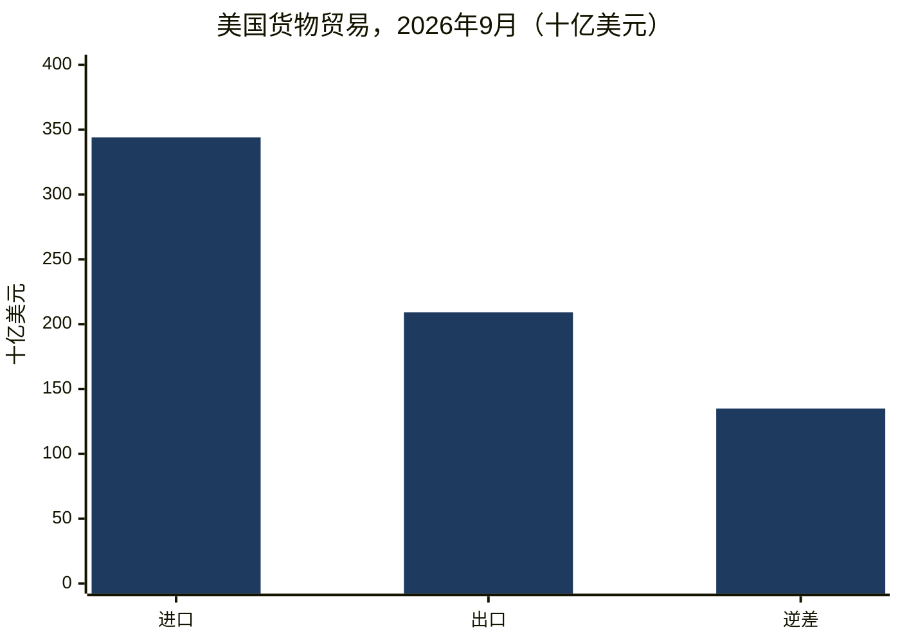
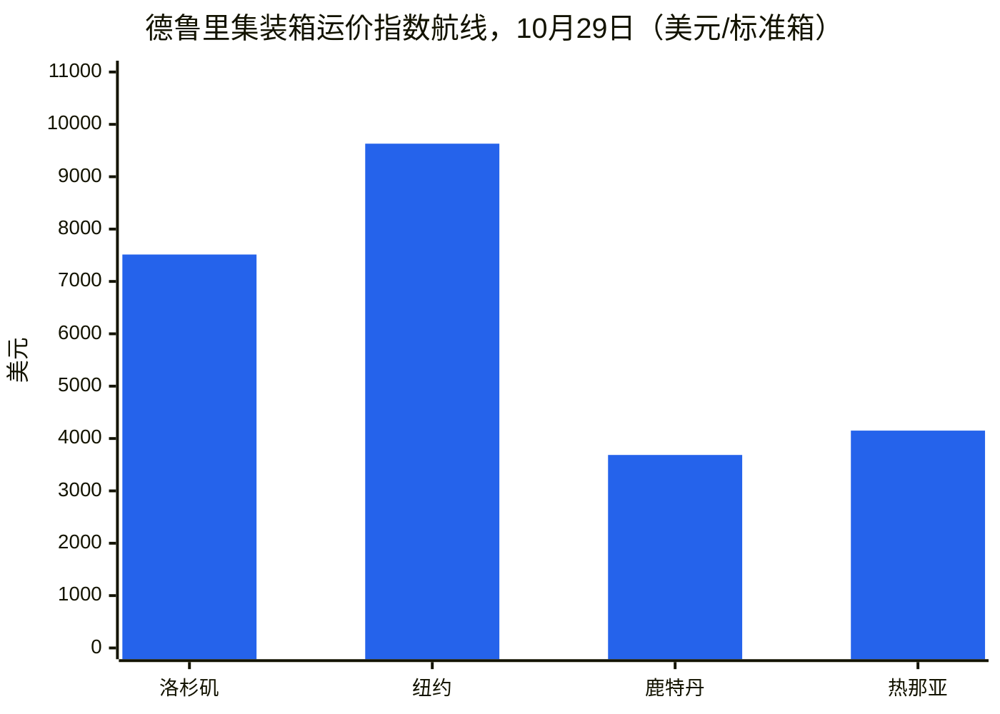
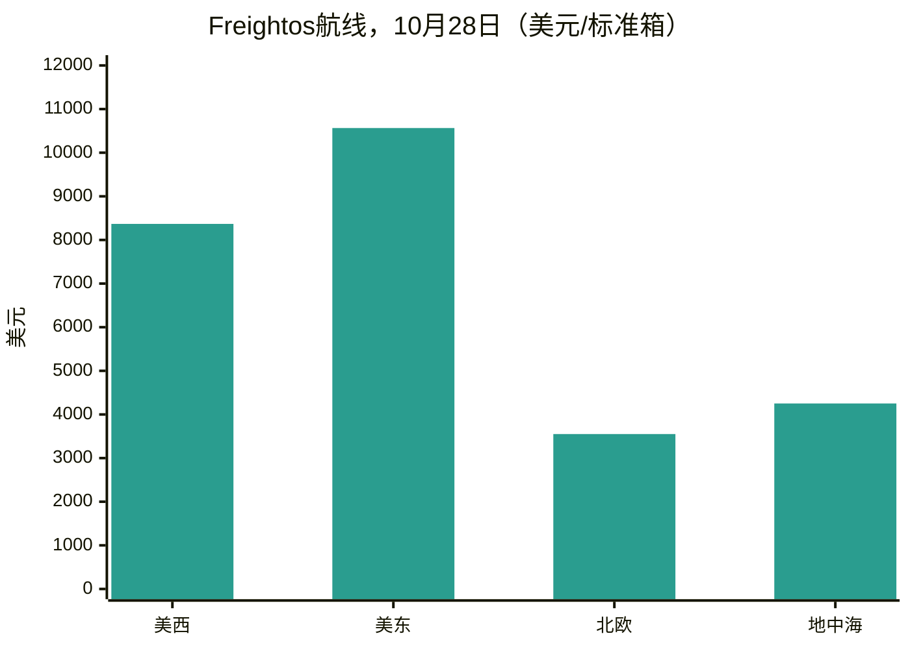
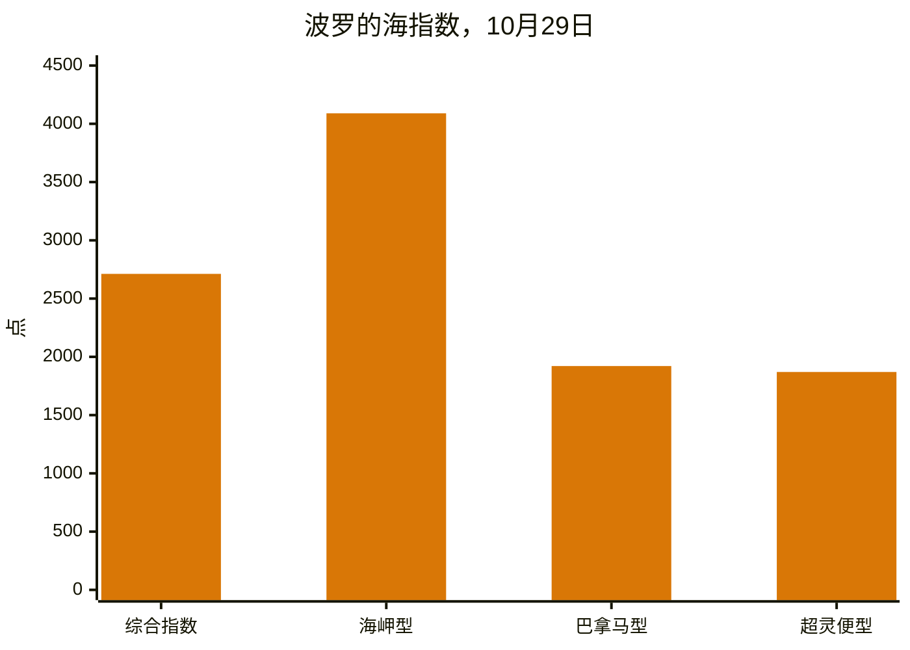
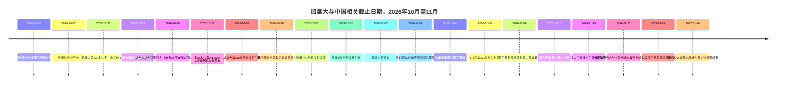
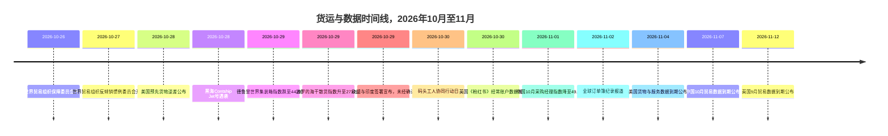

# 全球贸易情报报告——2026年10月26日至11月2日一周

**每周简报。**覆盖窗口：2026年10月26日至11月2日。由全球约45家贸易新闻、政策、数据与货运来源汇编而成。

---

## 目录

1. [执行摘要](#1-executive-summary)
2. [警报](#2-alerts)
3. [头条新闻——深度分析](#3-top-stories--deep-dives)
4. [关税追踪](#4-tariff-tracker)
5. [美国政策深度分析](#5-us-policy-deep-dive)
6. [按地区划分的世界政策](#6-world-policy-by-region)
7. [执法行动](#7-enforcement-actions)
8. [数据发布](#8-data-releases)
9. [货运市场](#9-freight-market)
10. [政策时间线](#10-policy-timelines)
11. [未来90天内的截止日期与事件](#11-upcoming-deadlines--events-next-90-days)
12. [来源与方法](#12-sources--methodology)

---

## 1. 执行摘要

本周的主线是尚未解决的截止日期：11月9日到期的178项中国第301条产品豁免和针对中国关联船舶的第301条港口费暂停措施、一场可能在中期选举次日导致美国最繁忙集装箱港口群停摆的250名工人劳资纠纷，以及霍尔木兹海峡与黑海航运风险的急剧升级。在此背景下，欧盟同时在多个方面推进了对华贸易防御计划，加拿大修订后的50%关税清单生效，美国则报告了由人工智能相关资本货物推动的创纪录的货物进口月度数据。

- **11月9日的悬崖已迫近一周，而两项时钟均未解决。**178项剩余的中国第301条产品豁免将于美国东部时间2026年11月9日晚上11:59到期，在本覆盖周内未发现延期通知；11月10日及之后的报关将恢复适用清单税率。美国贸易代表办公室关于将针对中国关联船舶的第301条港口费暂停措施延长至2027年1月9日的提案于10月26日在《联邦公报》上发布，征求意见截止于10月30日，但截至11月2日尚未发布最终通知。这两项工具相互独立：完成其中一项并不延长另一项。另一项已公布的暂停措施——美国商务部工业与安全局关联公司规则暂停措施——按其公布文本也将于11月9日至10日到期，而宣布的延长至2027年1月10日的措施截至10月31日尚未刊登。
- **加拿大修订后的50%清单于10月30日生效。**10月23日签署的公告从第338条清单中删除了22个税目并新增了100个，50%的税率保持不变。该关税叠加于第232条关税之上，即使符合《美墨加协定》条件的货物也适用。美国海关与边境保护局于10月29日发布了实施指南（CSMS #70314289）。同一周，参议院以50比46投票决定终止为加拿大关税援引的国家紧急状态——该投票对关税没有法律效力——加拿大总理表示渥太华在中期选举前“远未”达成协议，而华盛顿则称协议已近。针对第338条的首起法律挑战由新泽西州一家奶酪进口商于10月20日提起，在清单变更的同一周受到广泛报道。
- **两个战区的航运风险同时升级。**10月29日，一艘小艇在霍尔木兹海峡将两枚爆炸装置贴附在巴拿马籍原油油轮Louise 1号的船体上，事发地点位于阿曼哈萨卜东北约25海里处；由此引发的机舱火灾使该船暂时失去动力，不过船员安全，船舶继续航行。路透社援引三名海事安全消息人士的话称，这是自2026年2月美伊战争开始以来该水道首次成功的水雷式吸附爆炸袭击。德鲁里报告称，前一周仅有两艘船舶通过霍尔木兹海峡，而苏伊士运河通行量为62艘次，创下今年最高周度水平。在黑海，利比里亚籍集装箱船Contship Jet号于10月28日在保加利亚专属经济区内遭三架海上无人机击中，并于午夜前后沉没；18名船员全部获救，但其421个集装箱中有20个落水，其中包括锂离子电池和其他危险品。
- **欧洲的对华计划从信号转向正式案件。**欧盟委员会于10月30日对中国PET纺粘产品征收39.8%至48.1%的最终反倾销税，为期五年；于10月28日对来自中国、印度和日本的聚偏氟乙烯发起反倾销调查；自10月27日起对中国硅进口进行登记，同时对关税进行复审；成员国批准了对中国二氧化钛的长期反倾销税，自1月11日起生效。欧盟委员会12月提出的限制对单一来源关键物资依赖的工具的企业咨询于10月27日结束，尚未公布行业清单、门槛或税率。此外，欧盟对非欧盟网购商品征收的2欧元联盟手续费于11月1日生效，叠加于自7月1日起对低价值货物每件征收的3欧元关税之上。
- **美国9月货物进口创下纪录。**美国人口普查局10月28日的预先发布数据显示，9月货物逆差为1349亿美元，较8月增长2.1%，进口额创下3441亿美元的纪录。资本货物进口环比增长7.5%，同比增长77.2%，人工智能基础设施进口激增目前是逆差的主要驱动因素，尽管出口也增长2.6%至2092亿美元。中国10月贸易数据将于11月7日公布，届时将显示其年初至今的顺差是否已超过1万亿美元，本窗口内尚未发布；中国10月官方制造业采购经理指数于11月1日公布，回落至收缩区间49.3，新出口订单为48.7。
- **货运市场按航线和船型分化。**德鲁里世界集装箱指数10月29日下跌3%至每40英尺集装箱4429美元，扭转了连续两周的涨势，上海至洛杉矶航线下跌6%至7514美元，上海至纽约下跌5%至9631美元，而上海至鹿特丹微涨1%至3686美元。波罗的海干散货指数在好望角型船走强的带动下于10月29日回升至2712点，而巴拿马型船指数跌至1921点，为4月以来最低。船期可靠性依然不佳：Sea-Intelligence的数据显示，9月全球准班率为50.6%，较8月的49.9%略有上升。10月30日一场涉及100多个港口的码头工人协同行动日得到确认，在多数地方的实际运营影响被描述为有限，另有一场法国全国港口罢工已通知将于11月5日举行。

**货运：**跨太平洋集装箱现货运价转跌，亚欧航线保持坚挺；承运人11月的涨价已开始打折；干散货仅在好望角型铁矿石需求走强的带动下回升；苏伊士运河通行量创下年内新高，而霍尔木兹海峡通行量几近停滞；空运市场在需求增长超过运力的推动下进入旺季而走强。

---

## 2. 警报

| # | 警报 | 生效时间 | 影响 | 来源 |
|---|-------|-----------|--------|--------|
| A1 | 178项中国第301条产品豁免于美国东部时间2026年11月9日晚上11:59到期；未发现延期；11月10日及之后的报关恢复适用清单税率（清单1至3为25%，清单4A为7.5%） | 2026年11月9日 | 申报HTSUS 9903.88.69/70的进口商必须在截止日期前重新定价并确认报关 | [Gateway Lines](https://gatewaylines.com/press-releases/china-section-301-tariffs-stay-178-exclusions-end) |
| A2 | 美国贸易代表办公室关于将第301条港口费暂停措施延长至2027年1月9日的提案仍仅为提案；征求意见已于10月30日截止（案卷USTR-2026-0694）；截至11月2日未发布最终通知 | 2026年11月9日（现行暂停措施到期） | 如未最终确定，港口费及相关起重机/货物装卸关税将于11月10日恢复 | [Federal Register](https://www.federalregister.gov/documents/2026/10/26/2026-21755/request-for-comments-on-further-suspension-of-section-301-action-chinas-targeting-of-the-maritime) |
| A3 | 加拿大第338条清单调整：删除22个税目，新增100个；50%税率不变；叠加于第232条关税；即使符合美墨加协定条件的货物也适用 | 2026年10月30日 | 报关日期而非装运日期决定同一货物适用0%还是50%；立即重新筛查税目 | [Baker McKenzie](https://globalimportblog.bakermckenzie.com/2026/10/30/us-further-modifies-section-338-tariffs-on-canadian-goods-as-the-tariffs-face-their-first-legal-challenge/) |
| A4 | 霍尔木兹海峡升级：10月29日油轮Louise 1号遭吸附水雷袭击；前一周仅报告两艘次霍尔木兹海峡通行；10月30日至11月2日又报告了其他事件，包括一艘油轮在哈夫吉角以东遭弹体击中 | 2026年10月29日至11月2日 | 战争险、航线选择和保险成本居高不下；海湾航线决策必须权衡关于航线安全性的相互矛盾的官方说法 | [gCaptain](https://gcaptain.com/tanker-in-strait-of-hormuz-hit-by-limpet-mines-security-sources-say/) |
| A5 | 黑海沉船：集装箱船Contship Jet号10月28日在保加利亚专属经济区内遭三架海上无人机击中并沉没；421个集装箱中有20个落水，包括危险品 | 2026年10月28日至29日 | 黑海战争风险现已波及欧盟/北约成员国水域；漂流的危险品集装箱构成航行隐患 | [Splash247](https://splash247.com/splash-wrap-new-networks-old-faultlines/) |
| A6 | 洛杉矶/长滩守望员工会罢工最后期限延长至太平洋时间2026年11月4日下午5点；未达成最终协议；受影响码头处理约85%的长滩货物和约33%的洛杉矶货物 | 2026年11月4日 | 一场250名工人的纠纷可能导致受影响码头船舶、堆场和闸口作业停摆，如果其他国际码头与仓库工会成员遵守纠察线；一份报告给出的日期为11月5日 | [Seatrade Maritime](https://www.seatrade-maritime.com/ports-logistics/impending-strike-threatens-la-lb-ports-container-flow) |
| A7 | 欧盟对非欧盟网购商品征收的2欧元联盟手续费生效，叠加于自2026年7月1日起对价值不超过150欧元的货物每件征收的3欧元关税之上 | 2026年11月1日 | 低价值、多件电子商务每行商品在增值税之外面临5欧元费用；即使货物退回，手续费也不退还 | [Shipping and Freight Resource](https://www.shippingandfreightresource.com/trade-moves-02-nov-2026/) |
| A8 | 10月30日100多个港口码头工人协同行动日；法国全国港口罢工已通知将于11月5日举行 | 2026年10月30日/11月5日 | 10月30日之后的靠泊和支线延误，集中在地中海中转枢纽和法国门户港 | [Port Technology](https://www.porttechnology.org/news/ports-and-terminals/dockworker-strikes-ports-military-cargo/) |
| A9 | 国土安全部将三家中国基因组企业（华大集团、华大基因、华大智造）列入《维吾尔强迫劳动预防法》实体清单；合并清单现为190家实体 | 2026年10月29日 | 由这些企业全部或部分生产的货物被推定为强迫劳动产品并被禁止，除非该推定被推翻 | [LexBlog](https://www.lexblog.com/2026/10/29/dhs-updates-uflpa-entity-list-with-three-companies-engaged-in-genetics-testing/) |
| A10 | 第232条机器人/工业机械：国家安全认定已作出，尚未征收关税；已下令谈判，报告须在180天内提交 | 2026年10月28日 | 关税风险推迟至2027年春季，而非消除；与风力涡轮机采用相同模式 | [White House](https://www.whitehouse.gov/fact-sheets/2026/10/fact-sheet-president-donald-j-trump-adjusts-imports-of-robotics-industrial-machinery-and-their-parts-and-components-into-the-united-states/) |

### A1/A2——11月9日时钟，距今一周

11月9日的两项工具经常被放在一起报道，但各自独立运行。产品豁免——2024年5月保留的164项加上2024年9月新增的14项太阳能制造设备豁免，申报税号为HTSUS 9903.88.69和9903.88.70——将于11月9日美国东部时间晚上11:59到期，10月29日至31日报道的多家来源均未发现延期通知。美国贸易代表办公室10月6日至7日的延续通知确认了2018年第301条措施继续有效；它并未延长豁免。相比之下，港口费暂停措施是一项正在进行的提案：10月26日发布的《联邦公报》通知（91 FR 67388）提议，自2026年11月10日美国东部时间午夜起至2027年1月9日美国东部时间晚上11:59，暂停2025年4月23日措施（经2025年10月16日修订）附件一至三中的海运服务费以及附件五A中针对中国岸桥和货物装卸设备的关税，使暂停期间不产生任何责任。所述理由是为与中国的进一步谈判留出时间。该提案仅涵盖两个月，远短于它将取代的一年期暂停措施。

**分析：**进口商和承运人在同一日期面临不同的风险敞口。申报豁免税号的进口商必须做好准备，无论港口费发生什么变化，自11月10日起均适用清单税率。承运人只有在提案未最终确定的情况下才面临费用恢复。两者都应作为书面工具分别追踪，而非视为单一的“休战”——政治日程（据讨论休战将持续至2027年1月10日）与监管日程（11月9日）仍然不同。

### A3——加拿大：本周中生效的清单变更

10月23日的公告于10月30日在《联邦公报》上发布，并于当日美国东部时间凌晨12:01起对当日及之后报关或从保税仓库提取消费的货物生效，删除了22个税目并新增了100个，均归入税号9903.03.14；税号9903.03.12和9903.03.13保持不变。删除的税目包括某些胶合板、纸制品、机械和制冷设备、包装箱、塑料包装膜、纸板箱和食品相关机械。新增的税目包括地毯和小地毯、某些木材和纸制品、油漆、肥皂和润滑剂等化工产品，以及可可粉、乙烯基地板、独木舟、卧式冷柜、洗发水和盥洗皂等消费品，还有阀门、仪器、窗式空调机组和诊断试剂。附件描述仅供参考；海关编码决定适用范围。

**分析：**实际后果在于时间。一台卧式冷柜在10月29日之前仅需缴纳第232条钢铁关税，10月30日起则需缴纳第338条关税；胶合板则方向相反。由于该关税不论美墨加协定原产地如何均适用，且叠加于第232条关税之上，原产地规划无法规避。净效应是结构性置换而非降级：减免集中在与缅因州相关的农业和林业供应链，新增敞口则分布于消费品和工业品。

### A4/A5——两个战区，同一周

10月29日的霍尔木兹海峡袭击延续了数据中已显现的模式：10月5日至11日一周内，非伊朗关联的霍尔木兹海峡通行量从9月28日至10月4日一周的126艘次降至104艘次，劳氏船级社情报统计10月上半月霍尔木兹海峡及周边水道至少发生28起已报告或已确认的袭击。10月29日的事件增加了一种新方式——由小艇对航行中的油轮近距离实施船体爆炸——此前已有水雷和弹体袭击。随后相互矛盾的说法使局面更加复杂：伊朗伊斯兰革命卫队称三艘油轮在一条“未经授权”的南部航线上触雷，伊朗军队报告第四艘在水道以东遇袭，而此前一天美国中央司令部称水雷说法不实，主要航线已经清理。英国海上贸易行动办公室记录了损害，但未确认水雷是原因。在黑海，Contship Jet号沉没是10月当月保加利亚专属经济区内发生的第五起针对船舶的无人机袭击，据报道中引用的保加利亚通讯社称，也是康斯坦察附近Khoryv号之后一周内西部黑海第二起商船沉没事件。Contship Jet号袭击的官方归因尚未公开；安布雷公司经路透社作出的评估认为该无人机类似俄罗斯制造的Murena-300S型号，但这并非归因。

**分析：**托运人已不能再将任一水道视为简单的开放或关闭问题。按德鲁里的通行统计，霍尔木兹海峡几近关闭商业通行，而苏伊士运河正在恢复正常；黑海风险现已波及以色列至罗马尼亚航线上、位于欧盟成员国专属经济区内的集装箱运力，且危险货物已落入水中。保险、航线选择和危险品申报均需逐航次评估。

---

## 3. 头条新闻——深度分析

### 3.1 11月9日悬崖，以及无人关注的第三个时钟

除两项第301条时钟外，美国商务部工业与安全局关联公司规则暂停措施按其公布文本将于2026年11月9日至10日到期。该规则日期为2025年9月29日，将实体清单、军事最终用户和特别指定国民限制扩展至由被列入清单方持股50%或以上的外国关联公司。财政部长斯科特·贝森特于2026年9月24日宣布，美中休战以及相应暂停措施将延长至2027年1月10日——但截至10月31日的来源截止时，尚未发布正式延长暂停措施的《联邦公报》通知。在工业与安全局发布通知之前，出口商不应依赖该延期。同样的谨慎也适用于港口费提案：它被广泛报道为推迟至1月9日，但它是一项征求意见期已于10月30日结束的提案，而非最终规则。

**分析：**三项独立的工具在大约一天内相继到期，各自的决策者和法律形式均不相同。以公告、标题或平行工具的命运为依据，将其中任何一项视为已延期，是未来一周主要的合规风险。11月9日《联邦公报》上的书面立场是报关、航行和出口筛查的唯一安全依据。

### 3.2 霍尔木兹海峡与黑海：升级作为航运市场变量

本周的航运新闻最好理解为一个变量——战争风险——在不同水道朝相反方向移动。德鲁里10月29日报告的苏伊士运河通行量在一周内升至62艘次，为今年最高周度水平，Alphaliner估计近三分之二的亚欧总运力已恢复经红海航行，包括以星恢复与地中海航运公司联营的亚洲至美国东海岸航线的红海航行。自9月初以来，已有100多艘16000标准箱及以上集装箱船通过苏伊士运河，超过2025年全年加2026年1月至8月合计的99艘次，2026年至今已记录192艘次超大型船舶通行，而2025年仅为8艘次。与此同时，霍尔木兹海峡通行量在德鲁里的周度统计中降至两艘次，布伦特原油12月到期合约10月30日触及118美元，为4月30日以来最高，胡塞武装声称对拉斯塔努拉和拉比格炼油厂、阿卜盖格的一处沙特阿美设施以及利雅得和达曼机场实施了导弹袭击，以报复沙特在也门造成27人死亡的空袭；沙特领导的联军称拦截了导弹，尚未确认损失。阿曼海军10月30日从起火的巴拿马籍油轮Riti号上撤离了25名船员，一份11月2日的商品报告援引英国海上贸易行动办公室的数据称，10月31日至11月2日期间霍尔木兹海峡、海湾和阿曼湾共发生十起航运事件。

**分析：**苏伊士运河的恢复正在释放有效运力并压低亚欧运价，而霍尔木兹海峡的中断正在推高能源和海湾航线成本。这两种效应并不抵消：它们影响不同的贸易、不同的货物和不同的保险险种。其实际后果是，一条走廊“恢复正常”的说法不应套用于另一条走廊。

### 3.3 加拿大：同一周内的减免、升级与诉讼

加拿大方面结合了四项独立进展。第一，第338条清单变更于10月30日生效（见第2节A3）。第二，参议院10月29日以50比46投票决定终止为加拿大关税援引的国家紧急状态，该动议由参议员蒂姆·凯恩发起，缅因州的苏珊·柯林斯、肯塔基州的米奇·麦康奈尔、阿拉斯加州的丽莎·穆尔科斯基和肯塔基州的兰德·保罗四名共和党人加入民主党一方；此前参议院10月28日投票反对巴西关税。据报道，众议院程序规则阻碍审议，且总统否决也存在可能，因此该投票不会使任何关税发生变化。第三，谈判说法出现分歧：路透社10月26日报道，官员们正在探讨达成协议以缓和对钢铁征收50%和对汽车征收25%的第232条关税，商务部长霍华德·拉特尼克与加拿大-美国贸易部长多米尼克·勒布朗保持定期联系；10月28日一名加拿大官员称进展“有限”；10月29日总理马克·卡尼表示，加拿大在中期选举前“远未”达成协议，也不会不惜代价接受协议，并指出谈判于2026年8月破裂，原因是美国的条件据称会限制加拿大与其他国家谈判的能力、削弱法语要求并损害汽车业。总统10月25日在密歇根州和10月29日在南卡罗来纳州讲话时称协议已近，加拿大对美国“极为友好”。第四，针对第338条的首起法律挑战——Gellert Global Group诉特朗普案，由新泽西州一家加拿大奶酪食品进口商（2025年加拿大奶酪进口额约7100万美元，代理律师为自由正义中心）于10月20日向美国国际贸易法院提起——请求法院宣布关税非法、阻止征收并下令退还已缴税款及利息，理由是第301条取代了第338条，这些措施未通过第338条的歧视与抵消测试，且9月新增措施仅给予七天而非据称要求的30天等待期。尚未报道任何实体裁决。

**分析：**投票、谈判和诉讼朝不同方向拉动，本周均未改变任何税率。唯一具有直接商业效应的工具是10月30日的清单变更，唯一可能推翻该制度的是需要数月时间的法院案件。进口商应区分政治信号与法律效力。

### 3.4 欧洲：贸易防御周，以及正在成形的12月工具

欧盟的对华计划在一周内通过四条轨道采取了正式行动。对中国PET纺粘产品征收最终反倾销税（39.8%至48.1%，五年，取代自2026年5月起实施的45.6%至50%临时税）于10月30日实施，涉及市场规模2亿欧元，欧盟产业位于德国、意大利和法国。对来自中国、印度和日本的聚偏氟乙烯的反倾销调查于10月28日立案，此前10月16日已对来自中国的糠醇立案。中国硅进口自10月27日起被要求进行海关登记，为期九个月，同时欧盟委员会复审现行反倾销税是否仍然充分，该复审于9月1日应代表所有欧盟生产商的Euroalliages的请求启动。成员国批准了对中国二氧化钛的长期反倾销税，据报道安徽金星集团为每公斤0.25欧元，龙佰集团为每公斤0.74欧元，合作企业为每公斤0.64欧元，其他企业为每公斤0.74欧元，自1月11日起生效，为期五年；中国二氧化钛进口额2023年超过5亿欧元。这些案件背后是10月23日都柏林非正式理事会会议释放的信号，贸易委员马罗什·谢夫乔维奇在会上表示，塑料行业“最接近”可能发起保障调查。据报道，欧盟对华货物逆差每天超过10亿欧元，2025年超过3700亿欧元，预计2026年将超过4000亿欧元，一份基于Politico的报道称2026年上半年逆差接近1970亿欧元。

12月工具同步推进。关于迫使关键物资供应摆脱单一国家依赖的工具的企业咨询于10月27日结束，提案将于12月初出台，恰在欧盟领导人12月17日至18日会晤之前。咨询确认，该工具将针对对单一供应国严重依赖威胁欧盟供应安全或经济稳定的情形；尚未公布行业清单、门槛比例或税率。欧洲工业联合会警告称，替代采购将推高价格；谢夫乔维奇委员在2026年6月的一次演讲中（据报道引用）表示，企业必须承担“韧性成本”。目前讨论两种形态：针对国防和军民两用货物的极简能源式多元化强制要求，或极繁的门槛模式，即从单一来源采购超过固定份额可能触发关税。

**分析：**欧盟正在推行按行业推进的计划——混合动力汽车设限、塑料最接近保障措施、化工品进入正式调查、硅接受复审——而非单一的广泛措施。12月工具将显示该计划是泛化为全经济工具还是保持行业特定性。无论如何，2027年对华贸易防御行动只会增加，不会减少。

### 3.5 两个逆差，两个方向：美国进口更多，中国出口更多——目前如此

美国人口普查局10月28日发布的9月预先数据显示，美国货物逆差为1349亿美元，较8月的1321亿美元增加28亿美元或2.1%，为2025年3月以来最大，高于路透社/彭博社一致预测的1302亿美元。进口额创下3441亿美元的纪录，增加81亿美元或2.4%；资本货物进口环比增长7.5%，同比增长77.2%。出口增长2.6%至2092亿美元，其中食品出口增长12.8%，消费品出口增长6.5%；消费品进口增长3.1%，其他货物增长6.7%，而包括黄金和石油在内的工业用品下降6.0%。经济学家估计第三季度国内生产总值贸易拖累为4个百分点（万神殿宏观经济学）和3.25个百分点（牛津经济研究院）；这些是估计值，并非官方数据。更完整的货物与服务贸易数据将于11月4日发布。10月6日发布的8月货物与服务逆差为1056亿美元，统计口径不同，不能直接与预先货物数据比较。

中国9月数据于10月20日至21日报道，出口同比增长36.3%至约4471.8亿美元，进口增长31%至约3136.5亿美元，月度顺差1335亿美元，1月至9月累计顺差9381亿美元——有望超过2025年约1.19万亿美元的纪录，而2025年直到11月才突破该门槛。9月对欧盟顺差创下348亿美元的纪录，对美国顺差扩大至340亿美元，为20个月高点。但11月1日公布的10月数据指向相反方向：官方制造业采购经理指数从9月的50.1降至49.3，新出口订单从50.0降至48.7，生产分项指数从51.7降至49.8。一篇11月1日总结前三季度的文章称，出口同比增长16.4%至3.46万亿美元，其中机电产品增长15.6%，高技术产品增长21.6%，消费品增长14.9%。

**分析：**9月的繁荣与10月采购经理指数的收缩并不矛盾；它们描述的是不同时刻。未来一周的问题是，11月7日到期的10月海关数据是确认降温，还是将繁荣延续至1万亿美元以上。无论哪种结果，布鲁塞尔和华盛顿都会将其解读为关于顺差的证据，而不仅仅是一个统计数字。

### 3.6 货运：跨太平洋旺季已过，但运力表现并不正常

Sea-Intelligence 10月29日报告称，所有主要东西航线的周度运力均创下历史新高，打破了2012年至2025年国庆黄金周后常见的运力收缩，原因在于亚洲港口拥堵和船期不可靠导致第三季度航次推迟至10月至11月，而非需求激增。亚洲至北欧航线10月和11月每周超过350000标准箱，亚洲至地中海每周超过260000标准箱，亚洲至北美西海岸10月接近393000标准箱，预计11月将达到前所未有的400000标准箱，亚洲至东海岸10月至11月创下历年来最高水平。2026年最强台风“灿鸿”直接造成影响：10月23日关闭了台湾高雄、基隆和台北港口，宁波港自10月23日晚至约10月25日中午停运，上海港自10月24日晚至约10月25日中午停运，随着积压货物清理，上海和宁波出现约四天的拥堵相关延误。SEKO 10月23日的更新称，全球港口拥堵量为336万标准箱，占船队的9.7%。

**分析：**创纪录的部署运力与疲弱的需求并存，解释了为何承运人尽管有拥堵消息仍无法维持涨价。市场同时出现拥堵和运力过剩——拥堵是船期安排的人为现象，而非需求信号——这种组合表明，除非运力撤出速度快于积压释放速度，否则运价压力将持续至年度合同季。

---

## 4. 关税追踪

| 国家/措施 | 税率/详情 | 生效时间/状态 | 来源 |
|---|---|---|---|
| 加拿大——第338条清单调整（删除22项，新增100项） | 50%从价税，叠加于第232条关税，即使符合美墨加协定条件的货物也适用 | 2026年10月30日生效；海关与边境保护局CSMS #70314289（10月29日） | [Baker McKenzie](https://globalimportblog.bakermckenzie.com/2026/10/30/us-further-modifies-section-338-tariffs-on-canadian-goods-as-the-tariffs-face-their-first-legal-challenge/) |
| 加拿大——对美国货物的反制关税 | 对约276亿加元美国原产货物（648项）征收15%/25%/50%附加税 | 自2026年9月8日起实施；拖拉机/联合收割机/农业机械维修零部件0%减免至2027年6月30日 | [JD Supra](https://www.jdsupra.com/legalnews/update-on-the-u-s-canada-trade-conflict-3530187/) |
| 加拿大——第232条钢铁/汽车（美国关税） | 钢铁50%，汽车25%；10月26日报道正在谈判缓和，未达成协议 | 实施中；协议谈判进行中 |  |
| 墨西哥——美国汽车关税 | 目前为25%；墨西哥寻求降至15%，同时保留基于含量的扣除 | 截至2026年10月28日未达成协议 |  |
| 中国——第301条产品豁免（178项） | 到期后恢复25%（清单1至3）/7.5%（清单4A） | 美国东部时间2026年11月9日晚上11:59到期；未发现延期 | [Gateway Lines](https://gatewaylines.com/press-releases/china-section-301-tariffs-stay-178-exclusions-end) |
| 中国——第301条海运港口费 | 非中国企业使用中国建造船舶：每净吨50美元；中国企业：每净吨18美元或每集装箱120美元，取较高者；汽车运输船：每车当量单位150美元——如暂停措施失效 | 暂停措施于美国东部时间2026年11月9日晚上11:59到期；延长至2027年1月9日的提案已提出，未最终确定 | [Federal Register](https://www.federalregister.gov/documents/2026/10/26/2026-21755/request-for-comments-on-further-suspension-of-section-301-action-chinas-targeting-of-the-maritime) |
| 中国——第232条风力涡轮机 | 尚未征收关税；已下令谈判，180天内更新 | 2026年10月22日公告；10月28日在《联邦公报》发布；更新截止约2027年4月20日 | [Thompson Hine](https://www.thompsonhinesmartrade.com/2026/10/president-trump-opts-for-negotiations-not-tariffs-in-section-232-wind-turbine-investigation/) |
| 中国——第232条机器人/工业机械 | 尚未征收关税、配额或费用；已下令谈判，180天内报告 | 2026年10月28日公告；《联邦公报》定于2026年11月2日发布；报告截止约2027年4月26日 | [White House](https://www.whitehouse.gov/fact-sheets/2026/10/fact-sheet-president-donald-j-trump-adjusts-imports-of-robotics-industrial-machinery-and-their-parts-and-components-into-the-united-states/) |
| 中国——厢式挂车/子组件（反倾销+反补贴令） | 据报道倾销保证金129.73%，补贴率134.75%；合计保证金超过260% | 命令于2026年10月28日发布 | [Federal Register (PDF)](https://public-inspection.federalregister.gov/2026-21929.pdf) |
| 中国——购物车/零部件（反倾销+反补贴申诉） | 指控倾销幅度165%至343%，另有指控补贴（指控，非关税） | 申诉于2026年10月28日提交；商务部立案决定截止11月17日（如延长则为12月7日）；国际贸易委员会初步损害裁定截止12月14日 | [LexBlog](https://www.lexblog.com/2026/10/29/new-ad-cvd-petitions-filed-on-shopping-carts-from-china/) |
| 中国——瓦楞模切纸板箱（反倾销调查，涉及马来西亚、土耳其） | 仅为调查；尚未确定税率 | 2026年10月26日立案（适用日期10月19日）；范围意见截止11月9日 | [Federal Register (PDF)](https://public-inspection.federalregister.gov/2026-21783.pdf) |
| 中国——胺类化合物/聚氨酯催化剂（反倾销+反补贴调查） | 指控倾销幅度244.94%至352.32%（指控，非关税） | 2026年10月26日立案（适用日期10月19日）；国际贸易委员会初步损害裁定预计约11月13日 |  |
| 欧盟——中国PET纺粘产品（最终反倾销税） | 39.8%至48.1%，五年 | 2026年10月30日实施（2026年5月起临时税45.6%至50%） | [European Commission](https://policy.trade.ec.europa.eu/news/commission-acts-against-imports-pet-spunbond-china-2026-10-30_en) |
| 欧盟——中国二氧化钛（长期反倾销税已批准） | 据报道每公斤0.25欧元（安徽金星）、每公斤0.74欧元（龙佰）、每公斤0.64欧元（合作企业）、每公斤0.74欧元（其他企业） | 2027年1月11日生效，五年 |  |
| 欧盟——中国硅（反倾销复审期间登记） | 登记九个月；保留追溯措施的可能性 | 自2026年10月27日起登记；复审于2026年9月1日启动 |  |
| 欧盟——中国、印度、日本聚偏氟乙烯（反倾销调查） | 仅为调查；尚未确定税率 | 2026年10月28日立案 |  |
| 欧盟——中国糠醇（反倾销调查） | 仅为调查；尚未确定税率 | 2026年10月16日立案 |  |
| 欧盟——中国太阳能玻璃（关税废除） | 反倾销税17.5%至75.4%和反补贴税3.2%至17.1%废除；自2025年7月22日起缴纳的关税可无息追回 | 2026年10月22日起实施 |  |
| 欧盟——混合动力/插电式混合动力汽车（全球保障谅解） | 上限每年350000辆，每年增长6%，四年 | 约2026年10月9日至12日达成；预计2026年12月初实施 |  |
| 欧盟——非欧盟远程销售联盟手续费 | 每件2欧元，叠加于价值不超过150欧元的货物每件3欧元的关税之上 | 2026年11月1日生效；3欧元关税持续至2028年7月1日；2欧元手续费永久有效 | [Shipping and Freight Resource](https://www.shippingandfreightresource.com/trade-moves-02-nov-2026/) |
| 日本——中国/台湾地区镍添加冷轧不锈钢（最终反倾销税） | 3.6%至42.1%，五年 | 2026年10月31日至2031年10月30日 |  |
| 澳大利亚——中国铝窗/门（临时反倾销/反补贴保证金） | 部分出口商最高达73.3%（临时保证金，非最终关税） | 2026年10月15日起生效；最终建议预计2026年12月出台 |  |
| 中国——磷矿石/白银出口许可 | 配额管理暂停至2027年；保留装运许可 | 2027年1月1日至12月31日；配额分配截止2026年12月15日 |  |
| 中国——53个非洲国家零关税优惠 | 33个最不发达非洲国家自2024年12月1日起100%税目免税；20个非最不发达经济体自5月1日起纳入临时优惠至2028年4月30日 | 2026年10月30日重申 |  |

---

## 5. 美国政策深度分析

### 第338条与加拿大

关于清单变更、参议院投票、谈判分歧和Gellert Global Group挑战，见第2节（A3）和第3.3节。本周报道中还有两点对进口商很重要。第一，10月30日的《联邦公报》发布和10月29日的海关与边境保护局指南（CSMS #70314289）是实施的操作性文件；公告的附件描述仅供参考，海关编码决定适用范围，因此税目审查必须逐行进行，而非按产品描述进行。第二，该法律挑战是自2026年8月以来首次使用该法条的首次法院检验；不利裁决可能推翻包括10月30日清单在内的整个制度，但尚未报道任何实体裁决，关税目前仍可征收。缴纳第338条关税的进口商应以支持诉讼成功后退税申请的形式保存报关文件，但不应假定这一结果。

### 关于广为流传的“加拿大加征10%”的更正

在2026年10月26日至11月2日窗口内，未发现任何公告、《联邦公报》通知或海关与边境保护局指南征收新的10%加拿大关税。广为流传的“因安大略省里根广告而加征10%”的说法源于2025年10月，当时安大略省在世界职业棒球大赛期间播出了一则使用前总统罗纳德·里根关于关税言论的广告，总统结束了与加拿大的谈判并发布了加征10%的威胁。该事件并非2026年10月的新措施，不应作为新措施沿用。此外，一项自2026年7月24日起生效的针对60个经济体的10%第301条强迫劳动关税是一项不同的工具。总统于2026年10月27日表示，他预计“一段时间内”不会与卡尼总理会面。

### 第232条——机器人遵循风力涡轮机模式

2026年10月28日签署、定于11月2日在《联邦公报》发布的第11077号公告（91 FR 69199–69202）赞同商务部关于机器人、工业机械及其零部件进口威胁国家安全的认定，但未征收关税、配额或费用。商务部长霍华德·拉特尼克和美国贸易代表贾米森·格里尔必须共同与贸易伙伴开展谈判，并在180天内（约2027年4月26日前）报告进展。根据谈判情况，关税、税费、配额、费用或美国生产激励计划仍有可能出台，现行钢铁、铝和铜第232条关税保持不变。风力涡轮机公告（第11074号，10月22日签署，10月28日发布）遵循相同模式：作出国家安全认定，理由包括外国制造逆变器的网络安全与远程访问风险、电网可靠性以及雷达和空中交通干扰；未征收新的风电专项关税；已指示谈判；至少在180天内（2027年4月20日前）更新一次。据报道，美国风力涡轮机及零部件进口额2024年约为18亿美元，该数据来自其他媒体报道，未经与原始来源核对。

**分析：**该模式将关税风险推迟至2027年春季，而非消除。机器人和风电设备进口商应将谈判窗口视为决定产品范围和伙伴豁免的时期，不应将这两个行业在2027年4月之后视为免税。

### 《维吾尔强迫劳动预防法》实体清单——基因组企业被列入

国土安全部作为强迫劳动执法工作组主席，将深圳华大基因科技有限公司（华大集团）、华大基因股份有限公司和华大智造科技股份有限公司——均为深圳企业——列入《维吾尔强迫劳动预防法》实体清单，通知于10月28日提交公开查阅，定于10月29日发布，推定自10月29日起适用。三家企业均根据第2(d)(2)(B)(ii)款（与新疆政府合作实施强迫劳动）被列入；华大基因和华大集团还根据第2(d)(2)(B)(v)款（从新疆采购）被列入。由它们全部或部分生产的货物被推定为强迫劳动产品，并根据《美国法典》第19编第1307条被禁止，除非该推定被推翻。合并清单现为190家实体。北京谴责了这一举动并承诺采取反制措施。对生命科学供应链的直接影响是：测序仪器、试剂、耗材和检测试剂盒现在需要对华大和华大智造的次级供应链进行追溯。

### 海关与边境保护局邮件报关——2027年1月20日截止日期不变

海关与边境保护局10月22日发布的最终规则和第13类报关测试修改（91 FR 66638；91 FR 66707），经10月28日至30日的报道确认了操作性立场，将某些国际邮件货物正式报关要求的强制合规日期从2026年10月22日推迟至2027年1月20日（《联邦法规》第19编第145.12(a)(2)(v)–(vi)条）。涵盖的货物包括受伙伴政府机构要求（包括食品药品监督管理局）约束的邮件、适用第98/99章关税的邮件，或申报第98章或自由贸易协定免税待遇的邮件。此外，海关与边境保护局修改了第13类电子非正式报关测试（适用于价值不超过2500美元的邮件，自2026年9月22日开始），暂时接受没有完整电子伙伴政府机构数据的申报；海关与边境保护局将在未来的《联邦公报》通知中宣布该接受措施的结束日期，目前未设定结束日期。海关与边境保护局表示，由于这些要求，2027年1月20日之前国际邮件报关程序没有变化。90天的宽限并未恢复小额免税，也未创设个人处方药豁免；药房和承运人仍面临2027年1月20日的硬性系统截止日期，食品药品监督管理局的可受理性规则保持不变。

### 关税退税——窗口内无新进展

未发现2026年10月26日至11月2日期间的海关与边境保护局退税新进展。作为背景，最新的已核实情况是，CAPE第三阶段于2026年10月6日启动，适用于最终清算的报关，但仅适用于持有国际贸易法院重新清算令的进口商；截至10月2日，海关与边境保护局已将约1366亿美元的《国际紧急经济权力法》退税申请纳入CAPE，并向财政部发送约1260亿美元（含利息）用于支付，而根据国会预算办公室的估计，征收总额约为1660亿美元。10月8日，国际贸易法院伊顿法官认证了一个全国性集体，涵盖2025年2月1日至2026年2月19日期间缴纳《国际紧急经济权力法》关税的登记进口商（不包括另案诉讼）；认证并非实体裁决，也不下令退税，政府已就退税令的部分内容提出上诉。根据海关与边境保护局60至90天的指导，首批第三阶段付款预计自12月初至1月初发放。

### 美国贸易代表办公室——窗口内其他发布

10月26日，格里尔大使就欧洲投资银行2026年6月向空客提供的34亿美元贷款之后的美欧缓和状态发表声明，称美国贸易代表办公室尽管提出要求仍未收到详情；波音公司7月曾要求提高透明度。美国贸易代表办公室警告称，该贷款条款可能影响跨大西洋飞机融资休战，根据该休战，欧盟工业品关税被取消，换取美国对大多数欧盟商品征收15%的关税。未宣布新的关税。10月28日，美国贸易代表办公室发布了一份“美国优先海产品战略”新闻稿；其中未发现关税税率变化。

### 工业与安全局出口管制——无重大新规；一项暂停措施未解决

除10月22日对一家德黑兰航空公司及其他方实施为期一年的临时拒绝令续期（理由是多次违反《出口管理条例》，涉及飞机及零部件）外，窗口内未发现重大工业与安全局新规。关联公司规则暂停措施的立场如第3.1节所述：已宣布延长至2027年1月10日，但截至10月31日尚未刊登。

### 常设事项

11月9日时钟（第2节A1/A2）、2027年1月20日邮件报关日期和2027年4月第232条谈判报告是常设日程事项。参议院10月29日关于加拿大的投票和10月28日反对巴西关税的投票是政治信号，除非众议院采取行动且否决被推翻，否则没有关税效力。

---

## 6. 按地区划分的世界政策

### 欧洲

关于对华贸易防御案件和12月关键物资工具，见第3.4节。另有三项欧洲事项应记入。第一，太阳能玻璃废除措施的实施分析于10月26日发布，确认了废除的狭窄依据：第（欧盟）2026/2314号（反倾销）和第（欧盟）2026/2310号（反补贴）实施条例在期终复审发现不存在活跃的欧盟产业且无恢复可能后废除了最终关税——最后两家生产商AGC Glass Europe和GMB Glasmanufaktur Brandenburg GmbH已于2025年第一季度停产。自2025年7月22日复审启动以来缴纳的关税可无息追回，报道中引用的欧盟委员会估计称，考虑到生产和运输时间，至少需要四个月才能实现收益。此次废除是由于受保护产业消失而导致的自由化，并非政策逆转。第二，欧盟与印度自由贸易协定的签署日期已宣布但未确认：欧洲理事会主席安东尼奥·科斯塔10月29日宣布，纳伦德拉·莫迪总理将于12月访问布鲁塞尔签署协定，预计就在12月17日至18日领导人会议之前；印度外交部发言人兰迪尔·贾伊斯瓦尔同日表示，法律和程序清理工作仍在进行，日期确定后将公布，因此印度方面未确认具体的12月日期。谈判于2026年1月结束，欧盟委员会于9月11日请求理事会授权签署。此前报道的轮廓（窗口内未重新核实）称，欧盟对印度96%的欧盟货物出口关税将被取消或降低，印度汽车关税将从最高110%降至10%，年度配额为250000辆。第三，欧洲议会国际贸易委员会代表团于10月27日至29日访问北京和上海，这是八年来的首次此类访问，讨论公平竞争、市场准入、产业补贴、供应链和关键原材料。欧洲人民党的一份立场文件引用了3600亿欧元的欧盟对华贸易逆差——该报告未说明年份，因此应视为该党的数字而非经核实的年度总额——并呼吁加快贸易调查（目前最长18个月）并加强海关反规避检查。中国商务部长王文涛10月27日对委员会主席贝恩德·朗格表示，中国“不是欧盟问题的根源，而是寻求解决方案的伙伴”，呼吁扩大双向投资和增加中国从欧盟的进口，并对欧盟限制措施损害供应链稳定表示关切。

### 英国

窗口内未发现英国关于中国电动汽车关税的新决定。最新的实质性立场来自10月14日，商务大臣乔纳森·雷诺兹抵制了提高中国电动汽车关税的压力，称决策“基于英国利益——不是基于任何其他国家的要求”，同时保留未来采取行动的可能性，并指出该行业以出口为主。此前10月的报道称，英国正在考虑提高关税，原因与欧盟施压要求其保持一致以作为纳入欧盟“欧洲制造”/《工业加速法》框架的条件有关，中国品牌占英国汽车销量的近四分之一，即2026年9月英国销量的23%。英国目前对中国制造汽车征收标准的10%进口关税，而欧盟综合关税最高达45.3%（比亚迪加征17%、吉利加征18.8%、上汽加征35.3%，均在10%基础上；欧盟最终反补贴税于2024年10月实施，为期五年，在10%基础上加征7.8%至35.3%）。10月30日的一篇文章是10月5日至6日《泰晤士报》报道的转载，并非新决定。10月20日，中国商务部在英国贸易大臣阿纳斯·萨瓦尔确认与欧洲伙伴讨论与欧盟最高45.3%的关税保持一致后，威胁称如伦敦征收关税将采取“坚决反制措施”。

### 加拿大

关于第338条变更、谈判和参议院投票，见第2节（A3）和第3.3节。加拿大自身的反制措施仍然完全有效：对约276亿加元美国原产货物（629个税目，外加2025年命令下19个汽车税目按25%征收，合计648项）征收15%、25%或50%的附加税，涵盖钢铁、铝、乳制品、家电、农业设备、纸浆和纸张、塑料和电子产品，某些钢铁和铝反制关税从25%提高至50%；加拿大边境服务局第26-23号海关通知负责执行该命令。窗口内报道确认，拖拉机、联合收割机和农业机械维修零部件可享受0%减免至2027年6月30日，而农场和牲畜拖车仍为25%。本周的多元化信号来自蒙特利尔：10月29日至30日第21届欧盟-加拿大峰会（科斯塔、冯德莱恩、卡尼）启动了涵盖贸易与监管合作、数字与研究、关键资源与能源、金融服务、安全和人文交流的“未来联盟”，并承诺在2027年峰会前界定“加拿大与欧盟更紧密的联系，但不及正式成员资格”——“准成员资格”这一草案措辞在欧盟国家抵制后被删除。领导人承诺升级贸易伙伴关系，包括关键原材料、能源、清洁和数字技术、关键药品和海事产业，并通过行业路线图深化产业合作。此外，加拿大和欧盟缔结了加拿大-欧盟数字贸易协定谈判——加拿大首个此类协定——涵盖跨境数据流动、电子签名、无纸化贸易和电子传输关税。2025年欧盟与加拿大货物和服务贸易额约为1300亿欧元（欧洲理事会；其他峰会报道约为1310亿欧元/1780亿美元），较2016年增长80%以上；《综合经济贸易协定》已取消98%税目的关税，自2017年起临时适用，仍未获得包括法国、意大利和波兰在内的九个欧盟国家首都的批准；加拿大2024年向欧盟出口数字服务近150亿美元。

### 中国

中国的贸易政策周以新的法律工具而非新关税为主导。商务部10月26日发布了《中国贸易秘密保护特别规定》草案，征求意见截止11月24日，授权对侵犯中国商业秘密、损害或对中国主权、安全或发展利益构成现实威胁的外国公司、组织或个人实施制裁。可采取的措施包括限制或禁止涉及中国的货物和技术进出口及服务贸易、禁止相关物项出口、限制或禁止在中国的新投资、限制或禁止人员和运输工具入境、限制或撤销工作许可和停留或居留，以及罚款。商务部可依职权或根据第三方线索进行调查，措施可在采取补救行动后撤销、暂停或减轻。这一时间点紧随美国10月19日以涉嫌商业秘密盗窃为由对五家中国公司实施制裁。10月30日，商务部发布了《两用物项出口管制调查与执法办法》草案，征求意见截止11月29日，首次规定了商务部自身执法机构（产业安全与进出口管制局）通过询问以及扣押和拘留物项、资产、文件和设施进行调查的程序，超出海关边境查询范围；首次将主动发现违规后三个月内书面自愿披露列为处罚减轻因素。此前一项草案于10月16日宣布（第48号公告），征求意见截止11月15日，临时登记要求立即生效，提议将40项人工智能（23项）、生物医药（5项）和光伏（12项）技术列入《禁止或限制出口技术目录》。禁止类物项不得出口；限制类物项需要许可。豁免情形包括使用受限技术制造的产品不受限制，以及已进入公共领域的人工智能（开源和学术），开源发布、海外数据中心、海外芯片制造、使用外国资源开展联合研发和国际标准工作实行自动许可。太阳能条款的豁免有限：单晶硅拉棒、TOPCon和XBC电池制造技术和设备受到限制。

在市场准入方面，商务部10月29日确认（2026年第53号公告），将暂停磷矿石和白银的出口配额管理至2027年，保留依据已签署商业合同的装运许可，取代数量上限；该制度自2027年1月1日至12月31日运行，合格申请人的配额分配截止2026年12月15日。硬性上限仅适用于传统产品：甘草520万公斤，活猪160.54万头。10月30日，外交部参赞沈少在北京第十届中非青年节上重申，中国对53个非洲国家的零关税优惠不附带政治条件，也不需要对等让步：非洲对华出口按价值计算约90%（以原油和未加工关键矿产矿石为主）被覆盖，33个最不发达非洲国家自2024年12月1日起100%税目免税，20个非最不发达经济体自5月1日起纳入临时优惠，持续至2028年4月30日，并将谈判缔结永久性的共同发展经济伙伴关系协定。

中日关键矿产问题在窗口内没有进展，但仍是矿产被用作外交杠杆的最尖锐的现实例子。10月20日至21日的报道称，日本距离钇耗尽还有数月，已请求美国政府和美国公司向北京施压以放宽管制，最早在2026年底面临短缺。钇氧化物在中国境外的价格为每公斤1150美元，而中国境内为9美元（Argus数据，据引用）——两年内上涨179倍。中国海关对日本的镝和铽氧化物清关量截至2026年年中仍接近于零；日本此前超过70%的氧化钇来自中国精炼企业，库存约为三个月消费量。10月21日，外交部发言人毛宁为管制辩护，称其旨在遏制日本再军事化和所谓的核野心。此外，中国此前对日本二氯硅烷征收最高99.2%的临时反倾销保证金。美中稀土休战将于2026年11月到期，七国集团关键矿产工作组将于11月16日在华盛顿开会。

### 印度与新西兰

印度与新西兰自由贸易协定于2026年10月20日生效，印度对外贸易总局的关税配额程序于10月19日通知，新西兰外交贸易部于10月27日更新。新西兰自生效起对印度出口给予100%免税准入（所有税目；此前最高劣势为10%）；印度对70%税目给予优惠，涵盖目前双边贸易额约95%。在新西兰方面，目前57%的对印度出口免税，十年内全面实施时升至82%，另有13%大幅削减关税——最终95%的现有出口将受益。新西兰第二轮关税削减将于2027年1月1日实施。印度的关税配额：苹果——第1年无配额，随后第2年35000吨、第3年37500吨、第4年40000吨、第5年42500吨、第6年起每年45000吨，到岸价至少每公斤1.25美元时征收25%关税，窗口为4月1日至8月31日；猕猴桃——第1年无配额，随后第2年起8000吨，第6年起每年15000吨，到岸价至少每公斤1.80美元时免税，窗口为4月1日至10月15日；麦卢卡蜂蜜——第1年40吨，第2年起每年200吨。新西兰还开放118个服务行业和子行业，以及一项临时就业签证通道，任何时候上限为5000名持有人，最长三年；新西兰将在15年内推动200亿美元外国直接投资进入印度，这是一项投资促进承诺，而非已拨付资金池。

### 墨西哥

墨西哥寻求在11月3日中期选举前将美国汽车关税从25%降至15%，同时保留基于含量的扣除；总统克劳迪娅·辛鲍姆10月28日确认谈判未达成协议。经济部长马塞洛·埃布拉德曾与商务部长拉特尼克和美国贸易代表格里尔通话。据报道，非关税壁垒方面取得进展；汽车、钢铁（50%）和铝（50%）仍未解决，华盛顿还寻求改变汽车含量要求和中国在墨西哥的投资。9月轻型汽车出口量同比下降11.9%，汽车出口收入增长5.7%，商品出口总额激增37.9%。

### 日本与澳大利亚

日本内阁10月28日批准对来自中国和台湾地区的镍添加冷轧不锈钢卷、板和带征收3.6%至42.1%的最终反倾销税，此前贸易和财务主管部门于2025年7月启动调查并经海关委员会建议；关税适用于2026年10月31日至2031年10月30日。澳大利亚贸易救济委员会对来自中国的某些铝窗和门进口征收临时反倾销和反补贴保证金，自10月15日起生效，部分出口商的税率高达73.3%；最终建议预计12月前不会出台。

### 多边

世界贸易组织保障委员会10月26日开会，审查了涵盖39种产品（其中11种为钢铁或金属）的保障措施，共48个议程项目，创下纪录，据瑞士方面指出。日本、印度尼西亚、中国和澳大利亚就欧盟的后保障钢铁措施提出质疑（欧盟称其并非保障措施）；日本和韩国就英国的后保障钢铁措施提出质疑（英国作出同样表态）。英国、日本、韩国和土耳其就欧盟对混合动力汽车进行全球保障调查并可能实施数量限制的预期报告发表评论；欧盟表示，任何调查都将通知委员会。欧盟取向电工钢和英国聚对苯二甲酸乙二醇酯保障通知受到最多干预。下次会议定于2027年4月26日当周。世界贸易组织反倾销惯例委员会10月27日开会，审查了新的和修订的立法通知（科摩罗、塔吉克斯坦；继续审查欧盟、利比里亚、圣基茨和尼维斯和所罗门群岛）和半年度报告：45个成员通报了2026年1月1日至6月30日的反倾销措施，11个成员报告无措施，26个成员（包括中国、欧盟、印度、日本、墨西哥、美国和英国）提交了特别通知；墨西哥对中国的反倾销措施表示关切。贸易与发展委员会10月26日至27日开会，继续讨论贸易作为增长引擎、贸易与投资一体化促进工业化，以及关于相互承认专业资格能力建设的新提案。

在10月27日的世界贸易组织争端解决机构会议上，美国提交了状态报告（包括美国与日本热轧钢反倾销案WT/DS184，状态报告日期为2026年10月15日），并表示“不支持”关于上诉机构任命的拟议决定（WT/DSB/W/609/Rev.26），称按提议恢复上诉机构“不是迈向有效运行的一步”。因此，恢复具有约束力的世界贸易组织上诉审查并无前景；争端解决在实践中仍仅限于专家组。世界贸易组织改革协调员的报告于10月22日分发，10月23日举行透明度会议，10月27日至28日发布分析，为11月“改革月”（11月9日至13日和11月16日当周的会议）、可能于11月30日举行的总代表团团长/贸易谈判委员会联合会议、12月9日的透明度会议和12月下旬的最后一次总理事会铺平道路，目标是在2028年部长级会议上取得成果。报道中的评估是，谈判“想法丰富，达成协议的前景（迄今）有限”；自2019年7月以来已提交82份改革文件，其中20份属于2026年6月设立的WT/GC/REFORM系列。

联合国贸易和发展会议第九届世界投资论坛于10月25日至27日在多哈举行（7000多名参与者、4位总理、60多位部长），提出了全球投资风险分担倡议、新型人工智能基础设施融资工具、投资条约现代化原则、伯尔尼联盟关于投资保险合作的宣言，以及扩大后的海洋经济基金在圣多美和普林西比的首个资助项目。背景是：2025年全球外国直接投资80%以上流向仅20个经济体；2026年上半年外国直接投资流量上升，但发展中国家发展关键行业的新项目公告下降超过25%；发展中经济体已宣布的绿地数据中心投资下降320亿美元；发展中经济体外国直接投资2026年上半年较2025年上半年平均水平增长8%，而绿地公告下降超过五分之一。

世界海关组织常设技术委员会10月26日至28日在布鲁塞尔开会（280多名代表；第253/254届会议），议题包括跨境电子商务（世界海关组织电子商务一揽子计划第三次四年期审查）、数据治理、互操作性和跨境数据交换、新兴技术以及脆弱边境行动计划；国际商会的一次主旨演讲涵盖数字化转型，包括新推出的eATA单证册系统，并介绍了新的执法电子商务CENcomm平台的最新情况。安全工作组10月21日至23日开会，启动了首个中小微企业聚焦（与世界贸易组织和国际商会合作；美国、摩洛哥和印度提供材料），同意推进世界海关组织成员国预先货物信息要求的集中存储库，并考虑将经认证的经营者计划扩展至跨境电子商务。

---

## 7. 执法行动

### 反倾销与反补贴税

| 行动 | 日期 | 详情 | 来源 |
|---|---|---|---|
| 中国厢式挂车/子组件——反倾销+反补贴令 | 2026年10月28日 | 商务部在2026年8月31日最终肯定裁定和国际贸易委员会10月15日通知的损害认定之后发布命令；据报道倾销保证金129.73%，补贴率134.75%；空档期救济：10月3日至国际贸易委员会发布前一日之间的报关不征收补贴税，10月16日起同一空档期的报关不征收倾销税 | [Federal Register (PDF)](https://public-inspection.federalregister.gov/2026-21929.pdf) |
| 中国购物车/零部件——新申诉 | 2026年10月28日 | 指控倾销幅度165%至343%，另有指控补贴；范围涵盖任何尺寸的购物车，无论成品/半成品、组装/未组装，篮体主要为金属、塑料或两者组合（引用HTSUS 8716.80.5090；书面范围为准） | [LexBlog](https://www.lexblog.com/2026/10/29/new-ad-cvd-petitions-filed-on-shopping-carts-from-china/) |
| 中国、马来西亚、土耳其瓦楞模切纸板箱——反倾销调查立案 | 2026年10月26日 | 2026年9月9日收到美国披萨盒制造商联盟的申诉；范围意见截止2026年11月9日 | [Federal Register (PDF)](https://public-inspection.federalregister.gov/2026-21783.pdf) |
| 中国胺类化合物（聚氨酯催化剂）——反倾销+反补贴调查立案 | 2026年10月26日 | 申诉方为Evonik Corp.和Huntsman International LLC；指控倾销幅度244.94%至352.32%（仅为指控）；国际贸易委员会初步损害裁定预计约11月13日；商务部初步反补贴裁定约12月24日，初步反倾销裁定约2027年3月9日 |  |
| 中国小立轴发动机（99cc至225cc）/零部件——反倾销+反补贴延续 | 2026年10月26日 | 命令延续（91 FR 67272） |  |
| 印度咔唑紫颜料23——反补贴复审 | 2026年10月26日 | 2023年复审的最终结果及部分撤销（91 FR 67271） |  |
| 西班牙预应力混凝土钢绞线——反倾销复审 | 2026年10月26日 | 2024至2025年复审的最终结果（91 FR 67299） |  |
| 越南无缝精炼铜管——反倾销日落复审 | 2026年10月28日 | 首次加速日落复审的最终结果（91 FR 67820） |  |
| 反倾销/反补贴行政复审撤销（批量） | 2026年10月28日 | 91 FR 67819 |  |
| 中国冻暖水虾——反倾销复审撤销 | 2026年10月29日 | 2025至2026年复审的撤销（91 FR 68107） |  |
| 中国不可再充装钢瓶——反倾销+反补贴延续 | 2026年10月29日 | 91 FR 68110 |  |
| 奶酪——外国政府补贴季度更新 | 2026年10月29日 | 适用配额内税率的奶酪补贴年度清单季度更新（91 FR 68111） |  |
| 软木木材——补贴项目征求意见 | 2026年10月29日 | 根据2008年《软木木材法》征求意见（91 FR 68109） |  |
| 巴西铝箔——反倾销复审 | 2026年10月30日 | 巴西铝业公司/伊塔皮苏马2023至2024年复审的最终结果（复审期2023年11月1日至2024年10月31日） |  |
| 法国铬酸锶——反倾销复审 | 2026年10月30日 | 2023至2024年复审的最终结果（91 FR 68492） |  |
| 马来西亚公用事业规模风塔——反补贴日落复审 | 2026年10月30日 | 首次加速日落复审的最终结果（91 FR 68493） |  |
| 柬埔寨、中国、马来西亚、塞尔维亚、泰国、土耳其、越南床垫——国际贸易委员会五年期复审 | 2026年10月27日 | 国际贸易委员会五年期反倾销/反补贴复审裁定在《联邦公报》上通知 |  |
| 雾化器设备——第337条 | 2026年10月27日 | 公共利益意见提交请求（337-TA-1464号调查） |  |
| 印度全氟烷氧基烷烃（PFA）——初步反补贴 | 预计2026年10月29日 | Clark Hill的日程显示初步反补贴裁定预计10月29日；未发现其已发布的确认——视为预计而非已确认 |  |

### 海关与边境保护局查获与强迫劳动

海关与边境保护局费城分局10月25日查获了价值超过25万美元的未申报珠宝——一只价值183818美元的卡地亚手镯和一只价值67811美元的卡地亚戒指——来自一名从阿姆斯特丹抵达的全球入境计划成员，并启动了全球入境资格撤销程序。个人免税额通常为800美元，所有购买物品仍须申报。同一份通报指出，海关与边境保护局在2026财年对进口商品征收了近3070亿美元的关税、税费。海关与边境保护局路易斯维尔分局10月23日截获了460只带有爱彼商标的假冒手表，于10月30日至31日公布：这些手表来自香港，寄往得克萨斯州一处住所，如为真品，制造商建议零售价合计超过6600万美元，经海关与边境保护局卓越与专业中心鉴定为假冒。2025财年海关与边境保护局近90%的知识产权查获来自中国和香港。同一份通报中引用的路易斯维尔近期模式为：5月假冒珠宝1400万美元、6月假冒手表5400万美元、7月假冒手表2800万美元、8月300只假冒手表4300万美元。在诺福克，海关与边境保护局10月6日查获了543个来自中国的汽车散热器，估值120296美元，寄往洛杉矶，使用受害者被盗身份进口；10月28日的贸易媒体报道称，自8月下旬以来诺福克累计查获散热器3404个，价值436985美元。一份约11月1日的其他报道称，海关与边境保护局芝加哥分局在芝加哥奥黑尔机场八批货物中截获了162000张来自中国的假冒永久邮票，如为真品，面值超过118000美元；该摘录中未核实海关与边境保护局通报的确切日期，在作为注明日期的海关与边境保护局行动转载之前应予以确认。

在强迫劳动方面，窗口内除10月28日至29日的华大/华大智造列入（第5节）外，未发现新的暂扣令、认定或《维吾尔强迫劳动预防法》实体清单行动。最近的先前命令仍为2026年9月29日针对印度尼西亚棕榈油生产商Mitra Aneka Rezeki（9项国际劳工组织强迫劳动指标）和Hardaya Inti Plantation（7项指标）的命令，10月28日由Thompson Hine分析；此后有效命令总数为60项暂扣令和8项根据《美国法典》第19编第1307条作出的认定。此外，10月29日海关与边境保护局放行了被扣留的埃塞俄比亚制造太阳能电池（Toyo），而商务部于2026年7月17日启动的针对使用中国零部件在埃塞俄比亚完成制造的电池和组件的全国性规避调查仍在继续；初步裁定将于12月中旬（启动后150天内）作出，除非延期。

### 制裁

外国资产控制办公室10月21日对5名个人和4家实体（巴拿马、希腊、新加坡、阿拉伯联合酋长国）根据第13902号行政令作出的指定，认定9艘船舶为被冻结财产，在窗口内进入逐步结束阶段，逐步结束许可有效期至美国东部时间2026年11月20日凌晨12:01。Extreme Networks于10月27日支付了1529685美元，原因是2018年9月至2022年3月期间向被冻结的俄罗斯国防制造商Avangard运送了9批网络设备；该行为系自愿披露，但被评估为严重违规。

---

## 8. 数据发布

### 美国——预先货物逆差因创纪录进口而扩大

9月预先数据的完整情况见第3.5节。该数据的内部构成很重要：尽管出口上升，逆差仍扩大，因为资本货物进口增长远快于出口。这种构成——人工智能相关资本货物同时推动进口纪录和逆差——与世界贸易组织10月预测上调背后的同一人工智能硬件故事相符，在该预测中，人工智能赋能货物贸易2026年上半年同比增长67%，占商品贸易增长的47%。更完整的货物与服务贸易数据将于11月4日发布，市场日程一致预测为-1076亿美元；该预测并非官方数据。

*注：人口普查局预先发布，2026年10月28日。进口3441亿美元（创纪录），出口2092亿美元，逆差1349亿美元。*

### 中国——10月数据待公布；采购经理指数收缩

见第3.5节。10月海关数据将于11月7日公布，窗口内尚未发布；目前不应报道任何10月顺差数字。11月1日制造业采购经理指数数据（总体49.3、新出口订单48.7、生产49.8）来自国家统计局数据的相关报道摘要，在作为官方数据转载之前应与原始发布核对。11月1日发布的前三季度摘要（出口同比增长16.4%至3.46万亿美元）证实，2026年出口强劲势头在机电产品、高技术产品和消费品方面具有广泛基础。

### 其他国家发布

英国国家统计局10月30日发布了《粉红书》年度估计（11月2日报道）：2025年经常账户逆差为916亿英镑，占国内生产总值的3.0%，高于2024年修订后的843亿英镑，为2025年七国集团中第二大经常账户逆差；2025年贸易逆差占国内生产总值的1.3%，而2024年修订后为0.7%；2025年底净国际投资负债为607亿英镑，占国内生产总值的2.0%；2026年第二季度不含贵金属的基础经常账户逆差为113亿英镑，占国内生产总值的1.4%，低于第一季度的143亿英镑（1.8%）。英国国家统计局9月贸易数据定于11月12日发布，尚未公布。匈牙利9月货物顺差10月30日发布，为9.07亿欧元（同比增加2.66亿欧元），出口162亿欧元，进口153亿欧元；出口量同比增长4.6%，进口量增长5.4%，1月至9月顺差为62亿欧元，出口1248亿欧元，进口1186亿欧元。南非税务局10月30日报告9月顺差为198亿兰特（出口1906亿兰特，进口1708亿兰特）；年初至今顺差为1690亿兰特，而去年同期为1175亿兰特，亚洲占出口的30.3%，非洲占26.0%，欧洲占24.1%，美洲仅占8.3%（较8月下降11.6%）。加拿大10月26日的9月批发贸易快速估计显示，批发贸易环比增长0.6%，扭转了8月1.6%的降幅，主要受机械、设备和用品以及汽车和零部件的带动；这是国内分销信号，而非贸易差额发布，窗口内未发现加拿大9月国际商品贸易发布。窗口内未发现已公布的9月欧盟或欧元区总量；发现的最新欧盟统计局发布为10月16日（8月欧元区逆差161亿欧元，进口2438亿欧元，同比增长16.7%，出口2277亿欧元，同比增长9.9%，1月至8月逆差54亿欧元，而去年同期顺差909亿欧元）。

### 预测——窗口内无修订

窗口内未发布世界贸易组织或国际货币基金组织预测修订；现行数据仍为世界贸易组织10月8日更新（2026年世界商品贸易量增长3.9%，高于3月预测的1.9%；2027年为4.1%；2026年商业服务贸易增长3.3%，低于4.8%；2027年为6.4%；2026年上半年商品贸易增长3.5%；世界贸易组织全球国内生产总值预测2026年为2.6%，2027年为2.9%）和国际货币基金组织10月13日《世界经济展望》（2026年和2027年全球增长分别为3.1%和3.4%；美国两年均为2.3%；2026年全球总体通胀率为4.7%；增长集中，32个国家占全球增长的95%）。联合国贸易和发展会议《2026年贸易与发展报告》（10月9日；10月28日评论）称，2026年全球增长为2.6%，低于2025年的2.9%，货物和服务贸易按不变价格计算增长约4%，2025年世界贸易创下35万亿美元的纪录，中美贸易自2024年以来下降超过20%，亚洲占2026年全球增长的59%，印度为7.3%，中国为4.5%，印度尼西亚为5.2%。联合国贸易和发展会议统计数据显示，世界商品出口量2026年第二季度环比增长0.3%（第一季度为+1.2%），发展中经济体第二季度下降0.5%（第一季度为+1.0%），发达经济体增长1.1%（第一季度为+1.2%）。

### 智库——窗口内无新关税研究

未发现2026年10月26日至11月2日期间的税务基金会或耶鲁预算实验室新关税出版物。税务基金会最新的关税相关内容是其10月7日的分析，认为取消所有新关税（包括首届任期关税，回到2017年基线）将在2027至2036年间损失近1.8万亿美元收入，而1%的广义增值税可在其模型下完全替代该收入，同时提高产出、资本存量和工时。窗口内仍在引用的耶鲁预算实验室数据来自其2026年8月24日的更新——现行法律下每户每年约1100美元、价格水平影响约0.7%、平均法定税率约11.0%至11.1%、十年收入约1.9万亿美元——不应标注为本周数据。窗口内发现了相互冲突的其他数据（570美元、600美元、820美元），对应不同的关税版本和情景，尚未调和，未经原始研究核实不应使用。未发现窗口内注明日期的tradeintelligence.eu出版物。

### 数据门户

除上述世界贸易组织、国际货币基金组织和联合国贸易和发展会议预测外，通过搜索未发现美国国际贸易委员会DataWeb、美国贸易在线、联合国商品贸易统计数据库、世界银行WITS、世界银行数据或国际货币基金组织数据门户的窗口内新发布，也未发现窗口内国际贸易中心Trade Map或世界贸易组织综合贸易情报门户的发布。本周不应声称这些门户有新的数据集发布。

---

## 9. 货运市场

### 集装箱现货运价——德鲁里世界集装箱指数

世界集装箱指数10月29日下跌3%至每40英尺集装箱4429美元，扭转了连续两周的涨势，“主要原因是跨太平洋航线运价下降”。上海至洛杉矶下跌6%（493美元）至7514美元，上海至纽约下跌5%（535美元）至9631美元，上海至鹿特丹上涨1%（54美元）至3686美元，上海至热那亚持平于4151美元。其他航线的其他报道：鹿特丹至上海持平于646美元，洛杉矶至上海下跌1%至837美元，鹿特丹至纽约下跌2%至3106美元。德鲁里预计跨太平洋运价下周将再次下跌，亚欧运价将保持稳定。德鲁里引用的美国全国零售联合会预测称，美国海运进口量11月环比下降11%。《劳氏日报》根据德鲁里数据称，跨太平洋运价下跌是自2025年6月以来最陡峭的单周跌幅。

*注：德鲁里世界集装箱指数，2026年10月29日。洛杉矶=上海至洛杉矶；纽约=上海至纽约；鹿特丹=上海至鹿特丹；热那亚=上海至热那亚。*

### Freightos波罗的海指数

Freightos 10月28日的更新涵盖前一周，因此早于德鲁里10月29日的下跌，报告称尽管需求降温，主要航线集装箱运价仍在攀升，受到拥堵和停航以及红海船期变化和洛杉矶-长滩潜在罢工的支撑。亚洲至美国西海岸为每标准箱8368美元（+3%），亚洲至美国东海岸为每标准箱10565美元（+9%，被描述为年内高点，此后东海岸每日价格虽已回落，但仍比前一周高约每标准箱200美元），亚洲至北欧为每标准箱3551美元（+3%），亚洲至地中海为每标准箱4252美元（+8%）。Freightos波罗的海指数在前一次（10月22日）评估中的全球读数为3560美元（+5%）；窗口内未发现10月30日的新全球读数。两个系列在时间和统计方法上存在差异——Freightos显示10月下旬上涨，德鲁里随后显示跨太平洋运价大幅下跌——两者共同标志着一个转折点，而非单一方向。

*注：Freightos，2026年10月28日。美西=亚洲至美国西海岸；美东=亚洲至美国东海岸；北欧=亚洲至北欧；地中海=亚洲至地中海。*

### 11月涨价——已宣布，已打折

《劳氏日报》10月30日报道，承运人11月1日跨太平洋一般运价上调（每40英尺2000至3000美元，视承运人而定）和11月1日亚欧运价（FAK）水平已被折扣侵蚀。已公布的11月1日亚欧FAK目标包括：地中海航运亚洲至北欧每40英尺4500美元、亚洲至西地中海5000美元、亚洲至东地中海5100美元；达飞亚洲至西地中海4900美元、亚洲至东地中海5200美元。Linerlytica引用的11月初现货报价较低：赫伯罗特3000至3200美元、马士基3200至3400美元、地中海航运、海洋联盟和Premier Alliance约为每40英尺3400至3500美元。11月15日进一步公布的FAK包括：地中海航运北欧4600美元、西地中海5300美元；达飞亚洲至西地中海5500美元。已公布的11月涨价是年度合同招标的谈判信号，尚未成为已实现的现货市场水平。

### 停航与运力

德鲁里10月29日的评论称，下周跨太平洋停航为6班（本周为5班），亚欧停航为4班（本周为8班）。德鲁里10月30日的停航追踪数据显示，第45周（11月2日至8日）至第49周（12月1日至7日）715个计划航次中有56个停航，停航率为8%，预计92%的计划服务将运营；亚洲至北欧和地中海占停航的46%，跨太平洋东行占36%，跨大西洋占18%，双子座合作组织预计停航率最低，为1%。第45至49周的数据取代了较旧的第44至48周数据（714个航次中56个停航，8%），不应混淆。

### 订单簿

克拉克森10月数据（11月2日报道）显示，全球造船订单簿为2.261亿修正总吨，略高于2008年9月2.255亿修正总吨的纪录，价值约7000亿美元，一年内增长24%，为2020年水平的三倍。克拉克森预计2027年交付6400万修正总吨（较2026年增长24%，高于2010年5500万修正总吨的纪录18%），2028年为7200万修正总吨。集装箱船占订单簿的31%（接近2008年份额的两倍）；中国船厂控制订单簿的68%和2026年产量的60%。此外，Alphaliner 10月28日的分析称，集装箱新船订单簿已超过1500万标准箱，到年底可能接近1600万标准箱，预计马士基（据报道12艘24000标准箱船舶，每艘约2.4亿美元，仅与中国船厂洽谈）、阳明海运、达飞和地中海航运还将签订约40份“超大型”合同；2026年当年已订造490万标准箱，订单簿按德鲁里数据占目前3400万标准箱船队的45%。不同来源和统计方法的估计存在差异，引用时应注明来源。即使承运人以停航捍卫2026年运价，2027至2030年的交付潮仍在结构上压低未来运价——这是2027年合同谈判的核心矛盾，也是苏伊士运河运力释放之外的另一因素。

### 干散货——波罗的海交易所

根据路透社/贝尔德海事系列，波罗的海干散货指数10月26日下跌1.23%至2628点，10月27日下跌约1%至2603点，为10月20日以来最低，随后10月28日上涨49点（+1.88%）至2652点，10月29日上涨60点（+2.26%）至2712点，为10月13日以来最高，但月度仍将下跌14.8%，为连续第二个月下跌。此次回升完全是好望角型船的故事：好望角型船10月28日上涨184点（+4.97%）至3886点，日均收益31742美元，随后10月29日上涨204点（+5.25%）至4090点，日均收益33592美元，月度跌幅约22%。巴拿马型船则全程反向：10月28日下跌56点（-2.77%）至1965点，为4月下旬以来最低，随后10月29日下跌44点（-2.24%）至1921点，为4月14日以来最低，日均收益17289美元，月度跌幅约17.6%。超灵便型船10月29日微跌至1870点，有望连续第三个月上涨4.5%。另一来源给出的10月30日数据为2714点（+2点）；其分项收益系列与路透社/贝尔德系列相差约每天3500美元的好望角型船收益，本文未采用该系列。前一周的锚点为10月23日的2660点，周涨幅约5.9%。

*注：波罗的海交易所，经路透社/贝尔德海事，2026年10月29日。*

### 苏伊士运河与船期可靠性

关于苏伊士运河的恢复，见第3.2节。另有两个数据点可完整呈现情况。马士基运河通行量从2026年1月至9月的146艘次增至276艘次，净吨位从700万吨增至2330万吨（苏伊士运河管理局经Freightos），马士基力争2027年3月前实现完整的苏伊士网络。然而，全球船期可靠性9月仅为50.6%（Sea-Intelligence，10月28日至31日报道），较8月的49.9%略有上升，远低于5月的64.5%；亚洲港口拥堵是主要原因，8月地区可靠性为32.3%，中国为23.9%。Sea-Intelligence经Magellan提供的8月基线显示，8月全球可靠性为49.9%（-5.9个百分点，为2022年9月以来最低），晚到船舶平均延误6.81天，马士基为最可靠的主要承运人（67.3%），双子座为最强联盟（77.8%），上海准班率仅为12.2%，宁波舟山为16.9%，新加坡为32.4%，上海等待时间为82小时，亚洲港口占全球拥堵的64%。C.H. Robinson 10月1日的更新称，全球港口拥堵消耗约12%的船舶运力，为四年来最高。窗口内未发现第二种统计方法的9月可靠性数据；9月数据应注明来源，因为统计方法差异很大。

### 空运

国际航空运输协会10月29日的发布称，9月全球空运需求（货运吨公里）同比增长7.7%（国际增长8.6%），运力增长2.7%（国际增长3.3%），货运载运率为47.9%（+2.2个百分点），所有地区均增长；根据FreightNews的摘要，北美航空公司增长11.8%，亚太地区国际增长10%。9月航空燃油价格为每桶184.50美元，环比上涨17.5%，同比上涨103.4%，含附加费的货运收益率环比上涨2%，同比上涨25.9%。截至10月26日当周的TAC指数（10月27日发布）显示，全球波罗的海空运指数周涨3.9%，同比上涨27.1%，香港出境周涨4.2%，同比上涨28.0%，上海出境周涨2.9%，同比上涨19.2%；根据国际航空运输协会航空燃油价格监测经TAC的数据，截至10月23日航空燃油同比上涨118.5%——与国际航空运输协会9月平均数据的参考日期不同，因此两个燃油数据不应合并。截至10月28日当周的Freightos空运指数显示，中国至北美每公斤7.13美元（周涨4%），中国至北欧每公斤4.35美元（周涨12%），北欧至北美周涨7%（该航线该周费率水平在摘要中未说明）。《劳氏日报》10月26日（TAC/WorldACD）报道，过去两周运价上涨4%至4.7%，较2025年同期上涨约26%，亚太地区对美国出口量周涨10%，对欧洲出口量增长13%。需求在旺季超过运力，但燃油同比翻倍以上意味着运量增长并未按比例转化为航空公司盈利——这是空运费率的成本下限。

### 港口与物流中断

10月30日以“港口为和平/码头工人不为战争工作”为口号、反对军用货物通过民用港口的码头工人协同行动日，据组织者（意大利USB工会，获国际运输工人联合会支持）称，涉及22个国家或地区的113个港口和25个以上工会；国际运输工人联合会称其为17个国家的100多个港口。这些是所代表的港口，而非113个经核实的停摆，报道强调了这一区别。在法国，总工会的24小时罢工涵盖约24个港口和14000名港口工人，其中包括7500名码头工人；总工会领导人声称“95%的法国港口陷入停顿”，这一工会说法未经独立统计。已确认的实际运营影响更为有限：勒阿弗尔周五上午两个入口均无卡车（法新社），而HAROPA港口称影响有限——1个邮轮挂靠取消，8个船舶挂靠延误——勒阿弗尔集装箱码头的中断窗口为10月30日06:00至10月31日06:00。在敦刻尔克，集装箱码头未受影响，而散货、液体和燃料码头“完全封锁”（总工会）；在南特圣纳泽尔，9艘在泊船舶无法作业。马赛福斯、鲁昂和加莱也被包括在内，总工会已提交11月5日全国港口罢工通知。在意大利，全国24小时港口行动已正式登记，涉及的港口包括热那亚、焦亚陶罗、里窝那、的里雅斯特、奇维塔韦基亚、安科纳、拉文纳和萨莱诺；热那亚的Albertazzi闸口被封锁，而热那亚发言人预计影响有限，交通部已于10月28日发布命令，寻求推迟海运罢工行动。组织者的估计——一天内多达40000个集装箱延误、超过40%的地中海货物或超过20亿美元的运费面临风险、参与港口处理约40%的地中海集装箱流量——未经核实，未公布独立统计方法，应作为组织者估计而非实测损失来引用。即使已确认的影响“有限”，地中海中转枢纽为期一天的多港口停摆仍会在10月30日之后造成靠泊和支线延误。

在洛杉矶和长滩，国际码头与仓库工会第26分会（约250名负责闸口安全和货物看守的守望员）与太平洋海事协会于10月30日同意延长合同——上一份协议已于2025年7月到期——至太平洋时间11月4日下午5点，超过11月1日的罢工最后期限，联邦调解继续进行，尚未宣布最终协议。路透社转载的一份报告给出的日期为11月5日；本文采用太平洋海事协会、Dimerco和Seatrade给出的11月4日，并注明了这一差异。太平洋海事协会表示，受影响码头处理约85%的长滩货物和约33%的洛杉矶货物（合计超过一半），并预计其他国际码头与仓库工会成员不会越过纠察线，这可能导致受影响码头的船舶、堆场和闸口作业停摆。货运代理建议中提到的码头包括APMT、LBCT、TTI、SSA Marine C-60/A-90/LB 206和PCT；码头数量（一份建议中为6处，另一份为8处）未经核实，因此本文使用货物份额而非码头数量。两个港口合计处理美国海港集装箱总流量的31%。11月4日的最后期限是未来一周的现实风险，而非已解决事项。

索马里海盗问题10月29日重现，12名海盗在班达尔贝拉与哈丰之间登上伊朗渔船Azini号（21名伊朗船员和2名索马里警卫）；印度洋海事安全中心追踪其向东驶向一条商业航线，担心被用作母船，据Splash247转载的美联社报道，4月至8月期间有6艘商船被劫持。在企业方面，西班牙Boluda集团10月29日同意收购荷兰多式联运运营商Samskip，创建一个覆盖28个国家、32艘船舶和18条航线的短途海运网络，Contship通过意大利Tarros重返班轮业务；丹麦货运代理Scan Global Logistics于10月29日同意其最大规模收购，收购美国货运代理OIA Global（所审摘要中未披露条款）；芝加哥商品交易所集团新增了五种普氏干散货期货（好望角型和巴拿马型航线：西澳大利亚至青岛、巴西至青岛和美国墨西哥湾至青岛），交易日期为11月2日，在CME Globex交易并通过CME ClearPort清算，适用纽约商品交易所规则（通知于10月26日发布）。

### 供应商动态

在本覆盖周的审查信息中，未发现符合本节标准的供应商新闻条目。Descartes的公开新闻页面在窗口内仅刊载了本节排除的条目（11月2日的一则产品整合公告和10月27日的一则据称客户成果），且从所获取的博客页面未能核实TradeInt窗口内注明日期的每周洞察文章，该页面返回的是列出2025年文章的陈旧抓取结果。

---

## 10. 政策时间线

---

## 11. 未来90天内的截止日期与事件

| 日期 | 事件/截止日期 | 重要性 |
|---|---|---|
| 2026年11月3日 | 美国中期选举 | 关税政策可能随政治日程变化，但行政关税权力意味着无论结果如何，关税都不太可能迅速撤销 |
| 2026年11月4日，下午5点（太平洋时间） | 洛杉矶/长滩国际码头与仓库工会第26分会合同延期到期 | 中期选举次日的罢工可能导致处理约85%长滩货物和约33%洛杉矶货物的码头船舶、堆场和闸口作业停摆 |
| 2026年11月4日 | 美国货物与服务贸易数据（9月）到期公布 | 显示服务顺差是否抵消创纪录的预先货物逆差 |
| 2026年11月5日 | 法国全国港口罢工通知（总工会） | 法国门户港船期风险 |
| 2026年11月7日 | 中国10月贸易数据到期公布 | 显示中国年初至今顺差是否已超过1万亿美元 |
| 2026年11月9日，晚上11:59（美国东部时间） | 178项第301条产品豁免到期；第301条港口费暂停措施到期，除非拟议延长最终确定；工业与安全局关联公司规则暂停措施按公布文本到期；美国国际贸易委员会第338条信息收集意见截止下午5:15（案卷MISC-053） | 三项独立工具同日到期；报关、航行和出口筛查必须遵循书面立场 |
| 2026年11月10日 | 自该日起的报关对原豁免产品缴纳清单第301条税率；如最终确定，拟议海运暂停措施将开始；工业与安全局关联公司规则按公布文本恢复日期 | 需要重新定价和经纪人确认；费用恢复取决于最终确定 |
| 2026年11月12日 | 英国国家统计局贸易数据：2026年9月到期公布 | 《粉红书》修订后的首次英国月度贸易数据 |
| 2026年11月13日（约） | 国际贸易委员会初步损害裁定预计公布，中国胺类化合物 | 新申诉的首次检验 |
| 2026年11月15日 | 中国人工智能技术出口管制咨询截止（商务部/科技部草案，第48号公告） | 模型权重和芯片设计转移风险 |
| 2026年11月16日 | 七国集团关键矿产工作组在华盛顿开会 | 随着美中休战到期临近，钇和稀土杠杆列入议程 |
| 2026年11月17日 | 商务部立案决定截止，中国购物车（延长则为12月7日） | 高利润申诉进入正式程序 |
| 2026年11月20日 | 外国资产控制办公室伊朗相关航运逐步结束许可到期（美国东部时间凌晨12:01） | 10月21日指定的逐步结束窗口结束 |
| 2026年11月24日 | 中国商业秘密制裁草案征求意见截止（商务部） | 新的报复制裁法律工具成形 |
| 2026年11月29日 | 中国两用物项出口管制执法草案征求意见截止（商务部） | 执法从边境转向企业 |
| 2026年12月初 | 欧盟单一来源依赖工具提案；欧盟与中国混合动力汽车上限实施预计 | 推广混合动力汽车做法；行业范围仍未公布 |
| 2026年12月14日 | 国际贸易委员会初步损害裁定截止，中国购物车 | 申诉时间线继续 |
| 2026年12月15日 | 中国磷矿石/白银配额分配给合格申请人 | 2027年许可制度确定 |
| 2026年12月中旬 | 商务部初步裁定截止，埃塞俄比亚太阳能规避调查（7月17日启动后150天内，除非延期） | 使用中国零部件在埃塞俄比亚完成的电池和组件的关税风险 |
| 2026年12月17日至18日 | 欧盟领导人会议；欧盟与印度自由贸易协定预计12月签署（印度未确认日期） | 签署将创建一个约20亿人口的市场；日期仍待确定 |
| 2026年12月24日（约） | 商务部初步反补贴裁定预计公布，中国胺类化合物 | 该案的首个关税信号 |
| 2027年1月9日 | 拟议延长第301条海运暂停措施结束 | 如最终确定，两个月的延长结束 |
| 2027年1月10日 | 美中休战据讨论持续至该日；已宣布的工业与安全局关联公司规则暂停措施延长至该日（尚未刊登） | 政治日程与监管日程的差距 |
| 2027年1月11日 | 欧盟对中国二氧化钛长期反倾销税生效 | 五年关税开始 |
| 2027年1月20日 | 海关与边境保护局针对食品药品监督管理局监管产品的邮件报关过渡期结束 | 自该日起需要详细的海关申报 |
| 2027年3月9日（约） | 商务部初步反倾销裁定预计公布，中国胺类化合物 | 案件时间线继续 |
| 2027年4月下旬 | 世界贸易组织保障委员会下次会议（4月26日当周）；第232条谈判更新到期（风力涡轮机约4月20日，机器人约4月26日） | 多边审议欧盟/英国钢铁措施；关税决定推迟至春季 |
| 2027年3月 | 第三届欧盟与中国贸易与投资磋商部长级会议（预计） | 下一个正式的欧盟与中国贸易检查点 |

---

## 12. 来源与方法

覆盖窗口：2026年10月26日至11月2日。审查信息来自全球约45家贸易新闻、政策、数据与货运来源，包括FreightWaves、The Loadstar、Splash247、gCaptain、Hellenic Shipping News、Container News、Supply Chain Dive、Logistics Management、Air Cargo News和Port Technology；白宫、海关与边境保护局、美国贸易代表办公室、《联邦公报》、国际贸易管理局、美国国际贸易委员会、工业与安全局和JD Supra；欧盟委员会、英国商业贸易部、加拿大边境服务局和商务部；世界贸易组织、联合国贸易和发展会议、国际贸易中心和世界海关组织；美国国际贸易委员会DataWeb、美国贸易在线、联合国商品贸易统计数据库、世界银行WITS、欧盟统计局、世界银行数据和国际货币基金组织；税务基金会、耶鲁预算实验室和International Trade Intelligence；德鲁里、波罗的海交易所和Freightos；以及Descartes和TradeInt。数据按这些来源公布的情况报道。
