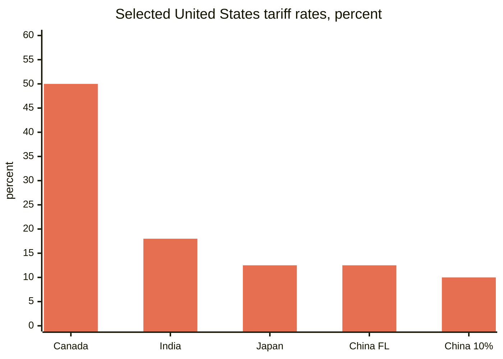
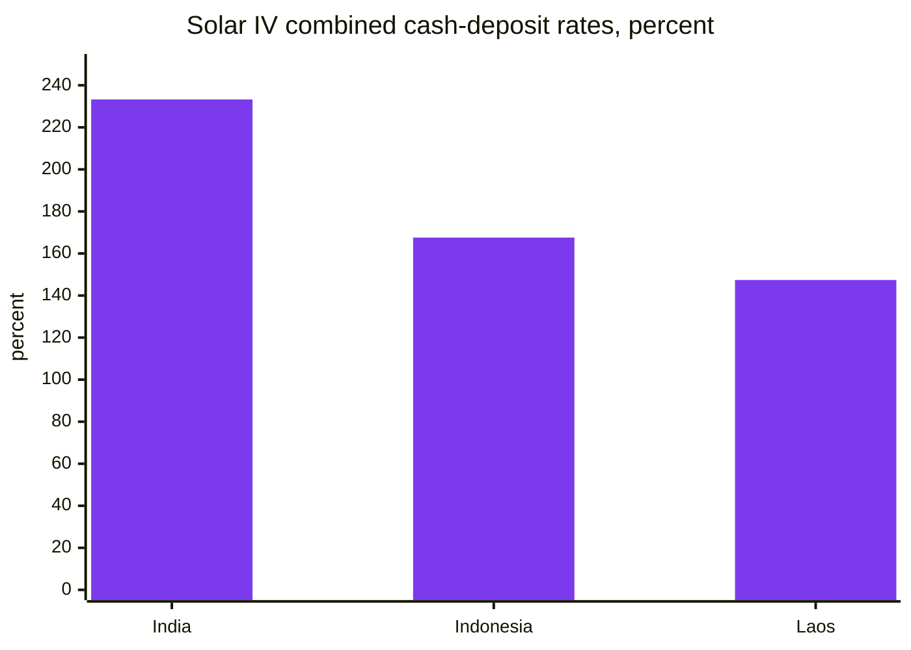
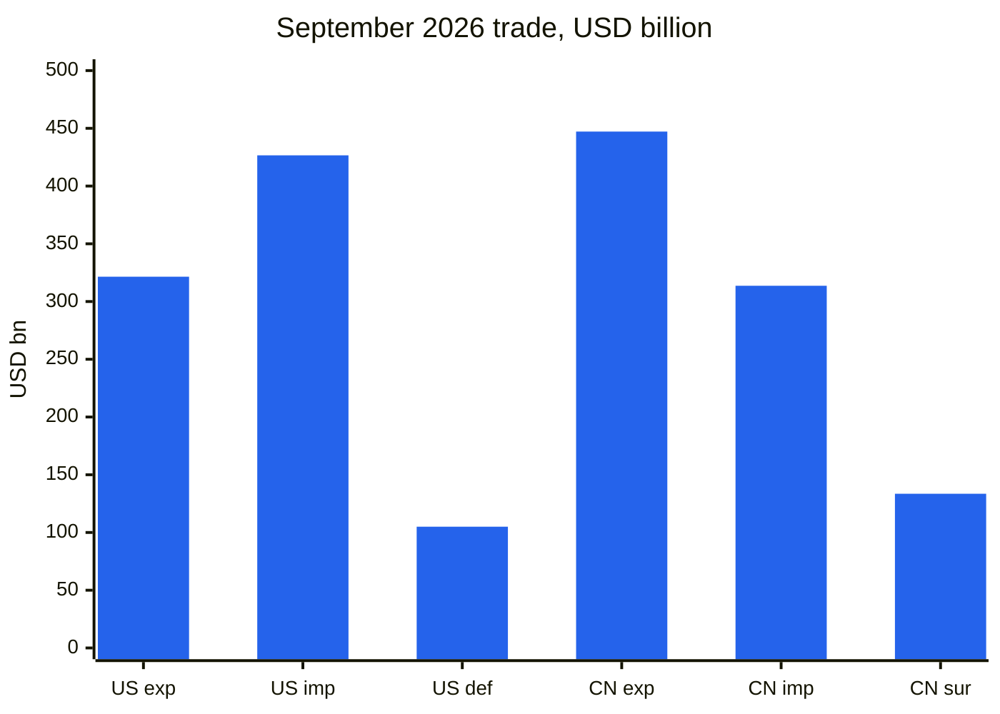
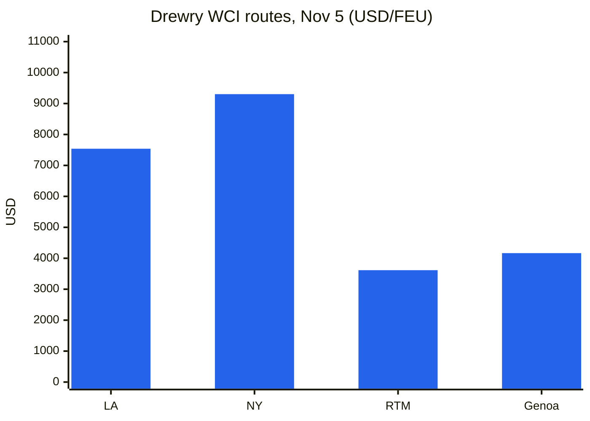
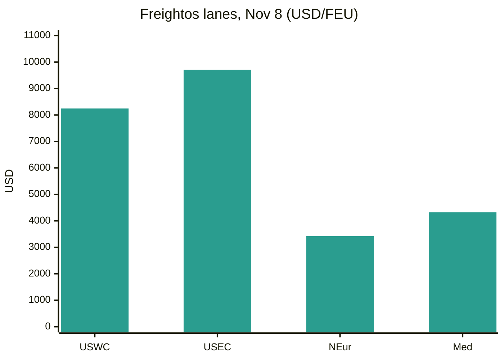
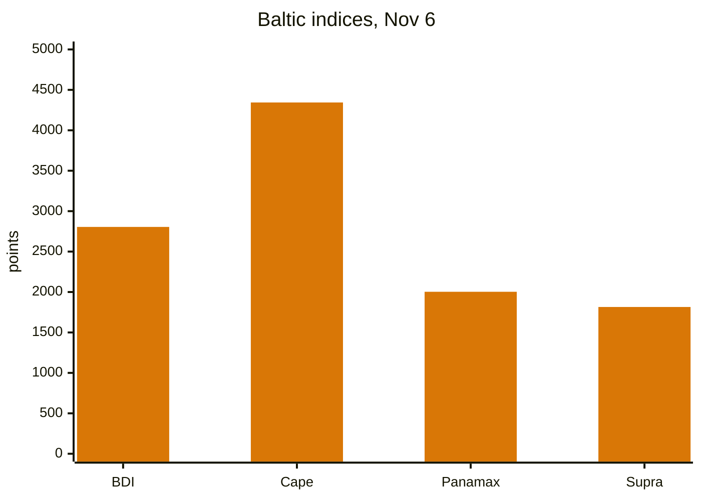
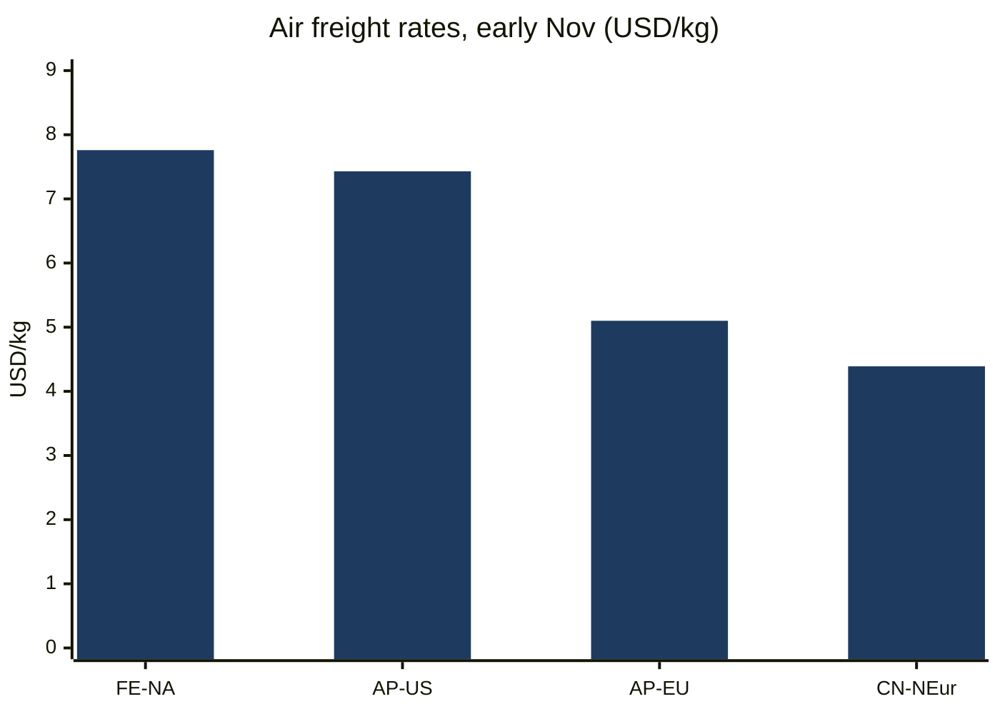
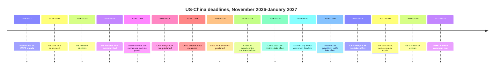
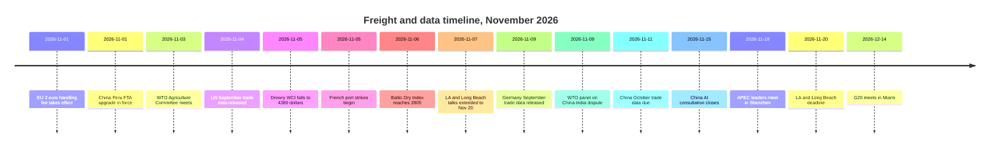

# Global Trade Intelligence Report — Week of November 2–9, 2026

**Weekly briefing.** Coverage window: November 2–9, 2026. Compiled from approximately 45 trade news, policy, data, and freight sources worldwide.

---

## Table of contents

1. [Executive summary](#1-executive-summary)
2. [Alerts](#2-alerts)
3. [Top stories — deep dives](#3-top-stories--deep-dives)
4. [Tariff tracker](#4-tariff-tracker)
5. [US policy deep dive](#5-us-policy-deep-dive)
6. [World policy by region](#6-world-policy-by-region)
7. [Enforcement actions](#7-enforcement-actions)
8. [Data releases](#8-data-releases)
9. [Freight market](#9-freight-market)
10. [Policy timelines](#10-policy-timelines)
11. [Upcoming deadlines & events (next 90 days)](#11-upcoming-deadlines--events-next-90-days)
12. [Sources & methodology](#12-sources--methodology)

---

## 1. Executive summary

A week in which the November 9 cliff was defused at the last minute, twice over, and then moved to January. On November 6, the Office of the United States Trade Representative posted notices extending all 178 China Section 301 product exclusions and the suspension of Section 301 port fees on China-linked vessels through January 9, 2027; on November 9, China extended its own side of the truce — the suspension of its 24% additional tariff on United States goods, its port-fee suspension and its critical-mineral export-control waivers — to January 10, 2027. The two-month reprieve is real, but it is short: the same instruments now expire within a day of each other in January, and the broader tariff package discussed after the September Washington summit remains unfinalised. Elsewhere, India and the United States announced a trade deal cutting United States tariffs on Indian goods to 18% from as high as 50%, Democrats won control of both chambers of Congress in the midterm elections without changing the tariff outlook, the European Union's €2 handling fee and product-identifier requirement took effect on November 1, and China widened its export-control net toward artificial intelligence, biopharma and solar manufacturing technologies.

- **The November 9 clocks were extended, not removed.** USTR's November 6 notices extend the 178 Section 301 product exclusions (164 general, 14 solar-manufacturing) and the further suspension of the Section 301 maritime action through 11:59 p.m. ET on January 9, 2027; entries from November 10, 2026 fall inside the new window. The Bureau of Industry and Security filed an extension of its 50% Affiliates Rule suspension through January 10, 2027. China, announcing on November 9, kept its 24% additional tariff on United States goods suspended for two more months from November 10, retained a 10% additional rate, and extended its port-fee suspension, critical-mineral export-control waivers and the suspension of measures against 11 United States firms on its unreliable-entities list and 16 on its export-control list to January 10, 2027. The asymmetry is small but real: the United States instruments expire January 9, China's January 10, and no United States presidential document formalising a truce extension had been published as of November 9.
- **India and the United States clinched a deal on November 2.** Washington cut tariffs on Indian goods to 18% from as high as 50% — a 25% reciprocal rate plus a 25% penalty for Russian-oil purchases — and withdrew the Russian-oil levy. President Trump said India had agreed to stop buying Russian oil and to increase purchases from the United States; the Indian government has not publicly confirmed specific energy-sourcing commitments. The agreement is described as the first tranche of a broader bilateral deal, with a $500 billion bilateral trade target by 2030, but no signed text, tariff schedule or entry-into-force date had been published as of November 3. It follows days after India concluded a free-trade agreement with the European Union.
- **The midterms changed the politics of trade, not the tariffs.** Democrats won control of both the House and the Senate on November 3, according to Associated Press declarations. Analysts expect oversight hearings and symbolic rollback votes in 2027, but not repeal: Democrats remain far short of the two-thirds majorities needed to override a presidential veto, and the administration has rebuilt its tariff structure on Section 301 and Section 232 authorities after the Supreme Court struck down the IEEPA tariffs in February 2026. The Senate had already voted 51–47 on October 29 to terminate the national emergency behind the global tariffs. Section 122 surcharges, capped at 150 days without legislation, are the one instrument the new Congress could constrain.
- **Europe's low-value e-commerce reset took effect.** From November 1, a €2 customs handling fee applies per item line on distance-sale consignments shipped directly from outside the European Union to EU consumers, on top of the flat €3-per-tariff-line duty in force since July 1, 2026 for consignments of €150 or less. Every product in a business-to-consumer shipment must now also carry three Product Identifiers, regardless of value. The combined duty and fee can reach €5 per tariff line before VAT. EU customs processed about 6 billion e-commerce parcels in 2025, about 90% from China.
- **China's export controls widened toward technology and industrial equipment.** A joint MOFCOM and Ministry of Science and Technology proposal (Announcement No. 48, October 16) would add 40 technologies — 23 in artificial intelligence, 5 in biopharmaceuticals, 12 in photovoltaics — to the export-control catalogue, with comments due November 15 and interim pre-export registration already in force. Separately, dual-use controls on drones, tunnel boring machines and dredgers take effect November 18. The solar curbs are assessed as the most consequential, given China's dominance in photovoltaic production.
- **The United States reported a record month for imports; China heads for a $1 trillion surplus.** The Census Bureau and Bureau of Economic Analysis reported on November 4 that the September goods-and-services deficit was $105.0 billion, on record imports of $426.6 billion and record goods imports of $346.9 billion, with capital-goods imports at a record $158.0 billion. China's September surplus was $133.53 billion on exports of $447.18 billion, up 36.3% year on year; a Reuters poll forecasts October exports up 33.5% and a surplus of $125.8 billion, which would take the January–October cumulative surplus above $1 trillion. China's official manufacturing PMI fell to 49.3 in October, with new export orders at 48.7.
- **Freight split again: ocean softened, air surged.** The Drewry World Container Index fell 1% to $4,389 per 40ft container on November 5, still 124% higher year on year, as carriers' November 1 general rate increases failed to stick. The Baltic Dry Index closed the week at 2,805, up 3.4% week on week, on Capesize strength. Air freight moved the other way: Far East–North America reached $7.76 per kilogram on November 3, up 9% in a week and a 2026 high, near the $8.00 peak of early December 2025. About 60% of Asia–Europe container capacity now uses the Suez Canal, according to Drewry. The Los Angeles–Long Beach watchmen dispute was deferred again, to November 20, while French ports were hit by two days of strikes and a trucker blockade at Chile's Port of San Antonio threatened the cherry export season.

**Freight:** container spot rates eased on both the transpacific and Asia–Europe trades while carriers' November increases were discounted; dry bulk rose for a third consecutive week on Capesize earnings; air cargo hit a 2026 high into peak season; Suez transits continued to recover; and labour disputes at Los Angeles–Long Beach, in France and in Chile kept port risk live through peak season.

---

## 2. Alerts

| # | Alert | Effective | Impact | Source |
|---|-------|-----------|--------|--------|
| A1 | USTR extends all 178 China Section 301 product exclusions through 11:59 p.m. ET Jan 9, 2027; entries from Nov 10, 2026 fall in the new window; Federal Register publication not yet confirmed as of Nov 8 | Nov 6, 2026 (posted) | Two-month reprieve only; entries after Jan 9, 2027 pay full list rates (25% Lists 1–3, 7.5% List 4A) | [TechTimes](https://www.techtimes.com/articles/330285/20261109/ustr-extends-section-301-tariff-exclusions-chinese-goods-entries-after-january-9-pay-full-duty.htm) |
| A2 | USTR further suspends Section 301 maritime action (port fees on China-linked vessels, Annex V.A duties) through 11:59 p.m. ET Jan 9, 2027 | Nov 9, 2026 | Fees stay suspended; the suspension and the exclusions expire on the same date in January | [Gateway Lines](https://gatewaylines.com/press-releases/china-ship-fee-delay-jan-9-2027-301-exclusions) |
| A3 | China extends suspension of its 24% additional tariff on US goods for two months from Nov 10, keeps 10% in force; extends port-fee suspension, critical-mineral export-control waivers and entity-list suspensions to Jan 10, 2027 | Nov 9–10, 2026 | US exporters keep the 10% rate; the truce now runs to Jan 10, 2027 on China's side | [Reuters via SRN News](https://srnnews.com/china-extends-suspension-of-24-tariff-on-us-imports-for-two-months/) |
| A4 | India–US trade deal announced: US tariffs on Indian goods cut to 18% from up to 50%; Russian-oil levy withdrawn; no signed text published as of Nov 3 | Nov 2, 2026 | Repricing for India-origin goods; energy-sourcing commitments unconfirmed by New Delhi | [Economic Times](https://www.eximguru.com/export-import-news/export-news/india-us-trade-deal-lifts-a-117126.aspx) |
| A5 | CBP interim final rule: foreign importers of record must be CTPAT-validated or use a CTPAT-validated broker from Jan 5, 2027; 32% of foreign IORs currently meet neither condition | Jan 5, 2027 | Foreign sellers shipping direct to US buyers must switch brokers or obtain validation; comments due Jan 5, 2027 | [CBP](https://www.cbp.gov/newsroom/national-media-release/cbp-announces-heightened-requirements-foreign-importers-record) |
| A6 | EU €2 handling fee per item line and three Product Identifiers required on all B2C shipments into the EU from Nov 1; combined duty and fee up to €5 per tariff line before VAT | Nov 1, 2026 | Low-value, multi-item e-commerce landed costs rise; shipments without identifiers risk delay or refusal | [Logistik Heute](https://logistik-heute.de/en/news/eu-customs-policy-new-package-fee-increases-costs-cross-border-online-trade-291550.html) |
| A7 | Commerce issues final AD/CVD orders on crystalline silicon solar cells from India, Indonesia and Laos; combined all-in rates up to about 233% (India), 168% (Indonesia), 147% (Laos) | Nov 9, 2026 | Cash deposits resume from Nov 5; modules made in a third country using covered cells fall within the orders | [MLex](https://www.mlex.com/mlex/articles/2547289/us-commerce-imposes-duties-for-indonesian-laotian-and-indian-solar-cells) |
| A8 | LA/Long Beach watchmen strike threat deferred again; talks extended to Nov 20, 2026; about 250 workers at six terminals; ~85% of Long Beach cargo and ~33% of Los Angeles cargo at risk | Nov 20, 2026 | A stoppage the day after the midterms was avoided, but the dispute now runs into late peak season with a large rail backlog already in place | [gCaptain](https://maritimenewsbd.com/la-long-beach-port-strike-threat-deferred-november-20/) |
| A9 | China AI/biopharma/solar export-control catalogue proposal: comments due Nov 15, 2026; interim pre-export registration already applies; dual-use controls on drones, tunnel boring machines and dredgers effective Nov 18 | Nov 15 / Nov 18, 2026 | 40 technologies affected (14 prohibited, 26 restricted); solar manufacturing know-how is the sharpest edge | [China Briefing](https://www.china-briefing.com/news/china-technology-export-controls/) |
| A10 | Democrats win both chambers in the Nov 3 midterms; tariff structure expected to persist; Senate voted 51–47 on Oct 29 to terminate the national emergency behind the global tariffs | Nov 3, 2026 | Oversight and symbolic rollback votes expected in 2027; Section 122 is the instrument the new Congress could constrain | [SupplyChainBrain](https://www.supplychainbrain.com/general-scm/regulation-compliance/article/16424361/us-midterm-rout-unlikely-to-change-trumps-trade-policy) |

### A1/A2 — The November 9 clocks, extended at the last minute

The two instruments that dominated last week's briefing were both extended on November 6, when USTR posted two notices on its website. The first extends all 178 China Section 301 product exclusions — 164 general exclusions under HTSUS 9903.88.69 and 14 solar-manufacturing exclusions under 9903.88.70 — through 11:59 p.m. ET on January 9, 2027, covering goods entered for consumption, or withdrawn from warehouse for consumption, on or after 12:01 a.m. ET on November 10, 2026. No exclusions were added or removed, and no new comments were requested; USTR relied on comments to its September 16, 2025 notice. The second notice further suspends the Section 301 action on China's maritime, logistics and shipbuilding practices, including the covered vessel fees and Annex V.A duties, effective November 9, 2026 through 11:59 p.m. ET on January 9, 2027. USTR had proposed the maritime extension on October 26 (91 FR 67388); the comment period closed October 30. As of November 8, no corresponding Federal Register publication had been identified for either notice, and the exclusions notice contains an internal inconsistency — its Dates section and annexes say January 9, 2027, while other text refers to January 10; the operative date is January 9. Without the extension, entries from November 10 would have paid full list rates. An exclusion lifts only the list duty: the 12.5% Section 301 forced-labour tariff, Section 232 duties, antidumping and countervailing duties and most-favoured-nation rates still apply. On November 4, the Software & Information Industry Association and 23 other organisations had asked USTR for at least a one-year extension; USTR granted two months.

### A3 — China acts the same day the truce was due to lapse

China announced on Monday, November 9 that it will continue to suspend its 24% additional tariff on United States goods for two more months, from 13:01 Beijing time on November 10, keeping a 10% additional rate in force. The Customs Tariff Commission's Announcement No. 6 of 2026 implements the consensus reached at the September Washington summit between Presidents Trump and Xi. In parallel, China's Commerce Ministry extended export-control waivers for certain critical minerals and related technologies until January 10, 2027, measures affecting 11 United States firms on China's unreliable-entities list and 16 on its export-control list remain suspended through January 10, 2027, and the suspension of special port fees on United States-linked vessels was extended to the same date. Sanctions on five United States subsidiaries of Hanwha Ocean were also suspended for two additional months. The asymmetry matters for planning: Beijing has acted by formal announcement, while no United States presidential document formalising a truce extension had been published as of November 9, and the United States instruments expire January 9 while China's run to January 10. The proposed $60 billion reciprocal tariff-cut package discussed after the September summit, including $17 billion in United States farm goods imported by China in 2024, remains unfinalised.

### A4 — India–US deal: 18% and the Russian-oil question

India and the United States clinched a trade deal following months of strained negotiations, culminating in a phone call between Prime Minister Narendra Modi and President Donald Trump late on Monday, November 2. Washington announced a cut in tariffs on Indian goods to 18% from as high as 50% — a 25% reciprocal rate plus a 25% penalty imposed for purchasing Russian oil — and withdrew the penal levy. President Trump said India had agreed to stop buying Russian oil and increase purchases from the United States and potentially Venezuela, and to buy American goods "at a much higher level"; the Indian government has not publicly commented on specific energy-sourcing commitments. Reuters reported India agreed to step up purchases of United States petroleum, defence goods, electronics, pharmaceuticals, telecom equipment and aircraft. The agreement is described as the first tranche of a broader bilateral deal, with negotiations continuing and a $500 billion bilateral trade target by 2030, up from about $191 billion currently. As of November 3 reporting, no signed text, tariff schedule or entry-into-force date had been published, and the 18% rate from the February 2026 framework had never previously been applied — most Indian goods have faced a 10% Section 301 duty since July 24, 2026.

### A5 — CBP foreign importer-of-record rule

CBP published an interim final rule, "Heightened Requirements for Foreign Importers of Record" (CBP Dec. 26-19, 91 FR 69977), on November 6, 2026, implementing Section 2 of Executive Order 14411 ("Strengthening Customs Enforcement," signed June 3, 2026). From January 5, 2027, a foreign importer of record may enter merchandise for consumption only if it is itself CTPAT-validated or files through a CTPAT-validated licensed customs broker. CBP's own analysis: 0.4% of foreign importers of record are CTPAT-validated and 68% already use a validated broker; the remaining 32% will not be able to continue importing into the United States unless they switch brokers or become CTPAT-validated themselves. New Part 110 of the customs regulations defines a "U.S. IOR"; importer status must be declared at entry and entry summary; brokers must verify clients' status and retain verification records for five years; comments are due January 5, 2027. The rule does not impose the blanket ban on informal entries for foreign importers of record that the executive order directed, but invites comment on a full ban as an alternative. Estimated monetised cost is about $1,233,253 per year.

### A6 — EU €2 fee and Product Identifiers

From November 1, 2026, a €2 customs handling fee applies per item line on distance-sale consignments shipped directly from outside the European Union to EU consumers, regardless of value, under Delegated Regulation (EU) 2026/2152. It sits on top of the flat €3-per-tariff-line duty in force since July 1, 2026 for consignments of €150 or less under Regulation (EU) 2026/382, which abolished the €150 de minimis duty exemption. From the same date, every product in a business-to-consumer shipment to the EU — regardless of value — must carry three Product Identifiers. The combined duty and fee can therefore reach €5 per tariff line, excluding VAT. The interim regime runs to July 1, 2028, when a centralised EU customs data system is scheduled to replace the flat levy with standard duties. The fee is non-refundable even if goods are returned.

### A7 — Solar IV orders: combined rates up to about 233%

Commerce issued antidumping and countervailing duty orders on crystalline silicon photovoltaic cells, whether or not assembled into modules, from India, Indonesia and Laos on November 9, 2026, following the USITC's affirmative final injury determinations published November 5 (91 FR 69865). India: antidumping margin 123.04% (cash deposit 107.17% after subsidy offsets) and countervailing duty 126.09%, a combined cash-deposit rate of 233.26%. Indonesia: antidumping 94.36% and countervailing 73.20% (all-others combined 167.56%). Laos: antidumping 65.43% and countervailing 82.03% (combined 147.39%). Suspension of liquidation and cash-deposit collection resume from November 5, 2026. Modules, laminates and panels made in a third country using covered cells fall within the orders; modules assembled in India using third-country cells do not. The USITC's full public report (USITC Publication 5804) is due by November 23, 2026.

### A8 — LA/Long Beach: deferred to November 20

A threatened strike by security workers (watchmen) at container terminals in Los Angeles and Long Beach has been put off again, with talks now extended to November 20, Bloomberg reported via gCaptain on November 7. ILWU Local 26 represents about 250 security workers at six container terminals; their previous contract expired in July 2025, members have authorised a strike, and the two sides are negotiating with help from the Federal Mediation and Conciliation Service. The Pacific Maritime Association says disruption could hit about 85% of cargo moving through the Port of Long Beach and a third of cargo at the Port of Los Angeles, because other dockworkers are not expected to cross Local 26 picket lines. The complex was already strained: about 35,688 import containers were waiting for rail service at the two ports, 10,562 of them for nine days or more, and rail-bound imports sat an average of 7.19 days in September, up from 6.75 in August. The Port of Los Angeles handled 1 million boxes in a month, a new record, even as its chief warns of tariff-driven planning risk.

### A9 — China export controls: comments close November 15, dual-use rules take effect November 18

MOFCOM and the Ministry of Science and Technology propose adding 40 technologies to the Catalogue of Technologies Prohibited and Restricted from Export: 23 in artificial intelligence, 5 in biopharmaceuticals, 12 in photovoltaics. Fourteen would be prohibited from export; 26 restricted (licence required). Since October 16, 2026, interim pre-export registration of the listed technologies — including exports already under way and transfers of ownership or control of a domestic enterprise holding the technologies to an overseas entity — applies through MOFCOM's Technology Trade Management Information application. Public comments close November 15. Separately, three announcements revise the Dual-Use Items Export Control List for unmanned aerial vehicles, tunnel boring machines and dredgers, all effective November 18, 2026, and MOFCOM and the General Administration of Customs issued Notice 52 revising procedures under which customs may hold goods presented for export without a licence. MOFCOM describes the package as "precise and limited".

### A10 — Midterms: Democrats take Congress; tariffs expected to stay

The November 3 midterm elections produced a historically large swing toward Democrats in the House, the Senate and other offices; reporting on November 4 described a Democratic sweep of both chambers. All 435 House seats and 35 of 100 Senate seats were on the ballot. Trade experts and congressional aides told Reuters that a Democratic Congress would bring oversight hearings and symbolic tariff-rollback votes in 2027 but not repeal: Democrats remain far short of the two-thirds majorities needed to override a presidential veto, and the White House says President Trump will not waver from his America First trade agenda. The Senate had already voted 51–47 on October 29, 2026 to terminate the national emergency behind the global tariffs, with four Republicans joining Democrats, but that vote did not dismantle the tariff structure. Analysts note the administration has rebuilt its tariffs on Section 301 and Section 232 authorities after the Supreme Court struck down the IEEPA tariffs on February 20, 2026, and those have so far stuck; 25 states have sued to block the Section 301 duties and the case is pending. C.H. Robinson's November 5 customs update warned shippers to prepare for the possibility of additional Section 301 tariffs on specific countries later in 2026 and into 2027.

---
## 3. Top stories — deep dives

### 3.1 The truce, extended two months — and the January cliff it creates

The week's central story is a pair of extensions that together keep the United States–China trade truce alive into January, while compressing the next decision into a two-month window. The sequence matters. On November 6, USTR posted two notices: one extending all 178 China Section 301 product exclusions through 11:59 p.m. ET on January 9, 2027, the other further suspending the Section 301 maritime action — port fees on China-linked vessels and Annex V.A duties — through the same date. On November 5, BIS filed an extension of the suspension of its 50% Affiliates Rule export-control measure through January 10, 2027. On November 9, China extended its side: the 24% additional tariff on United States goods stays suspended for two more months from November 10, a 10% additional rate stays in force, and the suspensions of special port fees on United States-linked vessels, critical-mineral export-control waivers, and measures against 11 United States firms on the unreliable-entities list and 16 on the export-control list all run to January 10, 2027.

Three features deserve attention. First, the extensions are short — two months, where the September arrangement had been understood to run a year — and they were granted after industry asked for at least a year. The Software & Information Industry Association and 23 other organisations asked USTR on November 4 for at least a one-year extension of the exclusions; USTR granted two months. Second, the dates do not align exactly: the United States instruments expire January 9, China's January 10, and the United States truce itself was described by Treasury Secretary Scott Bessent in September as running to January 10. Third, the substance behind the truce remains unfinished. On November 6, USTR Jamieson Greer and Secretary Bessent held a video call with Vice Premier He Lifeng; Greer stressed "the critical importance of China taking concrete actions to fully implement its past commitments," particularly agricultural purchases, rare earths and other critical minerals, while China expressed "serious concern" about United States trade restrictions. Neither side's readout mentioned the deadlines. The proposed $60 billion reciprocal tariff-cut package discussed after the September summit remains unfinalised.

**Key figures:** 178 exclusions extended (164 general, 14 solar-manufacturing); without the extension, entries from November 10 would have paid 25% (Lists 1–3) or 7.5% (List 4A); China's 24% additional tariff stays suspended, 10% retained; the truce now runs to January 9–10, 2027.

**Why it matters:** importers have two months of certainty instead of a cliff this week, but the cliff has moved, not disappeared. The next decision point is the APEC leaders' meeting in Shenzhen on November 18–19, where Presidents Trump and Xi meet for the third time this year, followed by the G20 in Miami on December 14–15. Entries, voyages and export screening must be planned against the written position: the exclusions attach on entry date, not shipment date, so goods shipped in November but entered after January 9 fall outside the extension.

**Sources:** [TechTimes](https://www.techtimes.com/articles/330285/20261109/ustr-extends-section-301-tariff-exclusions-chinese-goods-entries-after-january-9-pay-full-duty.htm); [Gateway Lines](https://gatewaylines.com/press-releases/china-ship-fee-delay-jan-9-2027-301-exclusions); [Reuters via SRN News](https://srnnews.com/china-extends-suspension-of-24-tariff-on-us-imports-for-two-months/); [BusinessWorld](https://bworldonline.com/world/2026/11/09/792445/china-extends-suspensions-of-24-tariff-on-us-goods-port-fees-on-us-ships-for-two-months/)

### 3.2 India–US deal: the largest single uncertainty over India's export economy lifts

The November 2 announcement removes the largest single source of uncertainty hanging over India's export economy, lifts pressure on the rupee — which had been hitting record lows — and Indian equities, and, if the Russian-oil halt holds, reshapes crude flows for one of the world's biggest buyers. The United States is India's top export destination, taking about 20% of merchandise exports. The deal cuts United States tariffs on Indian goods to 18% from as high as 50% and withdraws the additional penal levy imposed for purchasing Russian oil. The two sides target $500 billion in bilateral trade by 2030, up from about $191 billion currently (Indian officials cite $131.84 billion on a narrower measure).

The uncertainties are material. No signed text, tariff schedule or entry-into-force date had been published as of November 3, and the 18% rate from the February 2026 framework had never previously been applied — most Indian goods have faced a 10% Section 301 duty since July 24, 2026. President Trump's statement that India agreed to stop buying Russian oil and increase purchases from the United States and potentially Venezuela has not been publicly confirmed by New Delhi in specific terms. Reuters reported India agreed to step up purchases of United States petroleum, defence goods, electronics, pharmaceuticals, telecom equipment and aircraft. The deal comes days after India concluded a free-trade agreement with the European Union, giving India two major deals in one week — and it arrives alongside a separate India story this week: Commerce Minister Piyush Goyal said on November 3 that India has never opened its dairy sector in any free-trade agreement and will not allow imports of genetically modified products, a red line relevant to every live FTA track.

**Key figures:** tariffs cut to 18% from up to 50% (25% reciprocal + 25% Russian-oil penalty); bilateral trade about $191 billion; $500 billion target by 2030; April–September 2026 Indian exports about $480 billion, up about 14% year on year; India aims for $1 trillion in goods and services exports in 2026–27.

**Why it matters:** for Indian exporters, the deal replaces a 50% worst case with an 18% rate — if the text confirms it. For energy markets, the Russian-oil question is the live variable: India is one of the world's largest crude buyers, and a halt would redirect substantial volumes. For trade policy, the deal shows the administration settling major bilateral files by announcement ahead of text, a pattern importers should price into planning.

**Sources:** [Economic Times](https://www.eximguru.com/export-import-news/export-news/india-us-trade-deal-lifts-a-117126.aspx); [Reuters via Reporter World News](https://www.reporterworldnews.com/news/business/2026/11/03/piyush-goyal-commerce-dairy-products)

### 3.3 Midterms and the tariff outlook: new politics, same duties

The November 3 elections gave Democrats control of both chambers, but the tariff architecture is built on executive authority that a change of Congress does not unwind. The administration's tariffs now rest principally on Section 301 and Section 232, after the Supreme Court struck down the IEEPA tariffs on February 20, 2026 in *Learning Resources, Inc. v. Trump*. Those authorities do not depend on the election cycle, and Democrats remain far short of the two-thirds majorities needed to override a presidential veto. What changes is scrutiny: oversight hearings, symbolic rollback votes, and pressure for targeted relief — notably on Canada — are expected in 2027. The one instrument the new Congress could constrain is Section 122, whose surcharges are capped at 150 days without legislation; any extension of that framework would require the incoming Congress. The new Congress convenes in January 2027; until then tariff statutes remain as written.

The litigation front is now about money, not authority. On November 2, FedEx filed suit in the United States Court of International Trade against the United States, CBP and CBP Commissioner Rodney Scott, seeking a full refund of all tariffs it paid as importer of record under the IEEPA tariff orders invalidated by the Supreme Court — reported to be the first major corporation to sue for its share of an estimated $175 billion in collected IEEPA duties. The Supreme Court did not rule on refunds, leaving that question to the lower courts. Also on November 2, the Liberty Justice Center launched "Operation Refund Rescue," offering to fund narrowly targeted Court of International Trade actions for qualifying small businesses whose IEEPA entries reached final liquidation and therefore cannot recover through CBP's CAPE refund system without a court order; initial capacity is 100 filings. CBP's CAPE refund system launched in ACE on April 20, 2026, and CBP says valid refunds generally arrive within 60–90 days of acceptance. On October 8, the Court of International Trade certified a class in *Freestyle World, Inc. v. U.S. Customs and Border Protection* for importers of record who paid the challenged IEEPA duties. Separately, the Section 301 forced-labour tariff (12.5%, effective July 24, 2026) is under challenge at the Court of International Trade; oral argument was heard September 30, 2026, with no ruling reported as of early October. Twenty-five states have sued to block the Section 301 duties and the case is pending.

**Key figures:** Senate vote 51–47 on October 29 to terminate the national emergency behind the global tariffs; estimated $175 billion in collected IEEPA duties; CAPE refunds generally within 60–90 days; 100 initial filings under Operation Refund Rescue.

**Why it matters:** shippers should plan on the current tariff stack persisting through the president's final two years, with the USMCA review and new Section 301 actions as the live fronts. The refund litigation is a separate, material cash-flow question for importers of record: only the importer of record (or its broker) can claim, and refunds go to the importer, not consumers.

**Sources:** [SupplyChainBrain](https://www.supplychainbrain.com/general-scm/regulation-compliance/article/16424361/us-midterm-rout-unlikely-to-change-trumps-trade-policy); [Liberty Justice Center](https://libertyjusticecenter.org/pressrelease/liberty-justice-center-launches-operation-refund-rescue-to-help-small-businesses-recover-unlawful-ieepa-tariff-payments/); [JD Supra](https://www.jdsupra.com/legalnews/old-tariffs-new-tariffs-future-tariffs-5121636/)

### 3.4 Europe: the low-value e-commerce reset takes effect, and Mercosur shows its first results

Two European developments this week pull in opposite directions: one raises barriers for low-value imports, the other shows a new free-trade area already moving goods. The €2 handling fee and Product Identifier requirement that took effect November 1 are the first operational layer of the customs-reform framework the Council approved on September 3, 2026, which modernises customs procedures, expands data use, and makes non-EU e-commerce platforms liable as importers for duties and taxes. Regulation (EU) 2026/2108 reforms the Union Customs Code, to gradually replace the current code from 2028. The Commission must assess monthly (from October 1, 2026) whether trade-flow diversion is occurring under the low-value regime. For sellers, the change is both a cost and a data obligation: shipments without the three Product Identifiers risk delay or refusal, and the fee is non-refundable even if goods are returned.

The EU–Mercosur Interim Trade Agreement, signed January 17, 2026 in Asunción, reached six months of provisional application on November 1, and the first hard data shows rapid uptake. Brazilian agribusiness exports to the EU rose 14.8% in value in May–September 2026 to $12.21 billion, on 17.74 million tonnes (up 8.1% year on year). Brazilian exports to the EU overall were reported up 31% in May–September; Argentina's agro-industrial exports rose 21% in the first four months, with tariff-reduced products up 44%. The legal footing remains provisional: the European Parliament has still not given final consent and has referred the agreement to the Court of Justice of the EU; provisional application rests on the Council's January 2026 decision. Separately, the EU suspended Brazilian beef, poultry and honey imports on September 3, 2026 over antimicrobial-use compliance; relisting for poultry and honey was reported as possible after an audit, with no confirmed date.

**Key figures:** €2 per item line (handling fee); €3 per tariff line (flat duty since July 1, 2026); about 6 billion e-commerce parcels processed by EU customs in 2025, about 90% from China; Brazilian agribusiness exports to the EU $12.21 billion (May–September 2026, up 14.8%); 99,000-tonne beef quota at 7.5%; EU removes duties on 92% of Mercosur exports.

**Why it matters:** the November 1 fee and identifier rules change the economics of every low-value parcel into the EU weeks before peak season, hitting China-origin platforms (Shein, Temu) and any seller shipping direct to EU consumers. The Mercosur data shows the world's largest free-trade area by population (700 million-plus people) already moving goods at scale — but market access remains conditional, as the Brazilian suspension shows.

**Sources:** [Logistik Heute](https://logistik-heute.de/en/news/eu-customs-policy-new-package-fee-increases-costs-cross-border-online-trade-291550.html); [European Commission, Access2Markets](https://trade.ec.europa.eu/access-to-markets/en/news/application-eu-mercosur-interim-trade-agreement-1-may-2026); [EUR-Lex, Regulation (EU) 2026/382](https://eur-lex.europa.eu/legal-content/EN/TXT/?uri=OJ:L_202600382)

### 3.5 China widens its export-control net: AI models, biopharma platforms, solar know-how

China's export-control programme advanced on three fronts this week, and the most consequential is the one aimed at manufacturing know-how rather than finished goods. The joint MOFCOM and Ministry of Science and Technology proposal (Announcement No. 48, October 16) would add 40 technologies to the Catalogue of Technologies Prohibited and Restricted from Export: 23 in artificial intelligence, 5 in biopharmaceuticals, 12 in photovoltaics. Fourteen would be prohibited from export; 26 restricted (licence required). Since October 16, interim pre-export registration of the listed technologies — including exports already under way and transfers of ownership or control of a domestic enterprise holding the technologies to an overseas entity — applies through MOFCOM's Technology Trade Management Information application. In artificial intelligence, API, app, web and software-as-a-service deployment and lightweight on-device deployment to a restricted large model fall outside the controls; overseas local deployment and moving covered weights abroad would require a licence. In biopharma, transfers of ownership of covered cell and gene therapy and siRNA platforms would be prohibited, but licensing, contract research and manufacturing services and technology necessary for product research and development or manufacture in an outbound business-development transaction would not be. In solar, prohibitions include certain polysilicon production technologies, silicon-wafer preparation at 70 micrometres or thinner, and perovskite and tandem solar-cell fabrication and associated equipment manufacturing technologies — with limited exemptions, so the solar curbs are assessed as the most consequential for foreign manufacturers, given China's dominance in photovoltaic production and frontier solar technology. MOFCOM describes the revision as routine and not directed at any particular country. Comments close November 15.

The dual-use package runs on a parallel track. Three announcements revise the Dual-Use Items Export Control List for unmanned aerial vehicles (Announcement No. 49), tunnel boring machines and dredgers, all effective November 18, 2026. MOFCOM and the General Administration of Customs also issued Notice 52 (October 19) revising procedures under which customs may hold goods presented for export without a licence that may be subject to controls and require a licence. Separately, on October 13 MOFCOM released draft measures replacing individual licensing with an "export certificate" system for certain dual-use items in civil aviation. MOFCOM describes the package as "precise and limited", paired with facilitation measures whose details were not all released. At the same time, China extended its export-control waivers for certain critical minerals and related technologies until January 10, 2027 — the truce-related relief noted in section 3.1 — so the week's controls and the week's waivers move in opposite directions on different product sets.

**Key figures:** 40 technologies (23 AI / 5 biopharma / 12 PV); 14 prohibited, 26 restricted; comments due November 15, 2026; dual-use controls effective November 18, 2026.

**Why it matters:** the catalogue proposal reaches frontier AI models trained on Chinese "core data", cell and gene therapy platforms, and the core manufacturing know-how behind next-generation solar. For foreign manufacturers, the solar provisions are the sharpest edge: they reach the equipment and processes behind perovskite and tandem cells, not just finished modules. The November 15 comment deadline and November 18 effective date are immediate compliance points.

**Sources:** [China Briefing](https://www.china-briefing.com/news/china-technology-export-controls/); [Mondaq](https://alpha.mondaq.com/unitedstates/export-controls-trade-investment-sanctions/1865934/chinas-proposed-biopharma-and-ai-technology-export-controls-pre-export-registration-already-applies); [Akin Gump](https://www.akingump.com/print/v2/content/1138573/new-chinese-export-control-measures-tighten-restrictions-on-the-export-of-advanced-technologies-and-dual-use-goods-strengthen-enforcement.pdf)

### 3.6 Freight: softening ocean, surging air, and the Suez return

The container market was calm but softening this week, with slight declines on both the transpacific and Asia–Europe trades as capacity constraints eased and demand remained seasonally subdued. Drewry's World Container Index fell 1% to $4,389 per 40ft container in the November 5 assessment, but remains 124% higher year on year. Shanghai–Los Angeles was unchanged at $7,539 per 40ft, Shanghai–New York fell 3% to $9,303, Shanghai–Rotterdam fell 2% to $3,615 and Shanghai–Genoa was flat at $4,166. Carriers' November 1 freight-all-kinds increases — aiming for around $4,500 per 40ft to North Europe and $5,000 to the Mediterranean — failed to stick, and a further attempt at similar levels is scheduled for November 15, though European forwarders told The Loadstar that modest demand and ample capacity are likely to weigh against them. Linerlytica reported carriers offering discounted rates of $2,700–$3,400 per 40ft on Asia–North Europe and expected spot rates to decline some 30% over the course of 2027. Drewry counted three blank sailings announced for next week, down from five this week, and projects a further decline in transpacific rates next week; 46 of 717 sailings are blanked for weeks 46–50 (6%), against 56 of 715 a week earlier. Container Trade Statistics data reported November 6 put global container volumes at 17.35 million TEU in September, up 8% year on year, with the CTS Global Price Index at 123.

Air freight moved the other way. Freightos' November 3 update put Far East–North America at $7.76 per kilogram — up 9% in a single week, the highest level of 2026, roughly 40% above the same week last year, and within 3% of the $8.00 per kilogram peak reached in early December 2025. Freightos attributed the rise to the peak-season demand bump; North Europe–North America air rates rose 12% in the week, while China–North Europe rose 1% to $4.39 per kilogram. TAC Index figures reported by Air Cargo News on November 2 show average Hong Kong outbound rates climbing from $7.16 per kilogram at the start of October to $8.17 per kilogram at the end of the month. WorldACD week-43 data showed Asia Pacific–United States spot rates up 7% to $7.43 per kilogram and Asia Pacific–Europe spot rates up 5% to $5.10 per kilogram, with Asia Pacific capacity down 1%, partly because a typhoon disrupted flights in Taiwan. The contrast with ocean freight is stark: container spot rates are falling while air rates surge into the pre-Christmas peak, and the de minimis removal means every shipment also now carries duty.

The Suez return continued. Drewry reported about 60% of Asia–Europe capacity now uses the canal, and warned of vessel bunching and European port congestion if the shift comes quickly. Maersk's ME1 India–Europe service is returning via the Red Sea (reported November 2); Evergreen and Yang Ming vessels were scheduled for Suez transits November 7–16. FreightWaves flagged Houthi attacks on Saudi infrastructure as a new geopolitical risk to softening container rates ahead of 2027 contract negotiations. On the corporate side, Maersk raised its profit outlook as earnings surged, but shares slid on an expectations miss; ONE lifted its profit forecast to $2 billion as earnings surged.

**Key figures:** Drewry WCI $4,389 per 40ft (down 1% week on week, up 124% year on year); Shanghai–Los Angeles $7,539; Shanghai–New York $9,303; Shanghai–Rotterdam $3,615; Shanghai–Genoa $4,166; Far East–North America air $7.76 per kilogram (up 9% week on week, 2026 high); Hong Kong outbound $8.17 per kilogram at end-October; global container volumes 17.35 million TEU in September (up 8% year on year).

**Why it matters:** rates remain far above year-ago levels even as they soften, and carriers are struggling to push through increases into weak demand — a signal that 2027 contract negotiations will favour shippers. The Middle East risk is the wildcard: any renewed Red Sea disruption would reverse the easing quickly. For shippers who missed the ocean peak-season window, near-record air rates are the cost of the alternative.

**Sources:** [Drewry](https://www.drewry.co.uk/maritime-research-opinion-browser/world-container-index-assessed-by-drewry); [The Loadstar](https://theloadstar.com/calmer-waters-for-container-spot-rates-but-fragile-middle-east-a-threat/); [Freightos](https://www.freightos.com/freight-resources/asia-us-air-rates-already-nearing-last-years-high-on-peak-season-volumes-november-3-2026-update/); [Forwarder News](https://www.forwardernews.com/news/2026-11-07-september-box-trade-up-8)

### 3.7 Two deficits, two directions: the United States imports a record, China heads past $1 trillion

The United States reported on November 4 (Census Bureau CB 26–178, BEA 26–47) that the September goods-and-services deficit was $105.0 billion, down $0.7 billion from a revised $105.7 billion in August. The goods deficit was $135.9 billion (down $0.7 billion); the services surplus was $30.9 billion. Exports were $321.5 billion (up $5.8 billion from August); imports were $426.6 billion (up $5.2 billion) — a record high. Goods exports were $211.0 billion (up $5.1 billion); goods imports $346.9 billion, also a record. Capital-goods imports hit a record $158.0 billion (computers up $7.6 billion, computer accessories up $5.7 billion; semiconductors down $1.2 billion). The three-month average deficit was $101.2 billion, up $11.3 billion from the prior three-month period. Year to date (January–September 2026), the goods-and-services deficit is down $92.4 billion (12.2%) against the same period in 2025. The real (inflation-adjusted) goods deficit on a Census basis rose $3.5 billion to $119.5 billion; BEA attributes the divergence between nominal and real measures to a nonmonetary-gold balance-of-payments adjustment. The Census-basis goods deficit with Taiwan widened $3.6 billion to $21.9 billion.

China's September figures, released October 14, put exports at $447.18 billion, up 36.3% year on year (the fastest since February; August was up 25.0%), imports at $313.65 billion, up 31.0% year on year, and the monthly surplus at $133.53 billion (August $119.1 billion). The January–September cumulative surplus was $938.11 billion, against $1.189 trillion for all of 2025. Semiconductor export value rose 108.1% year on year in January–September; automatic data-processing equipment and parts exports rose 54.6%. The record bilateral surplus with the EU was $34.8 billion in September. A Reuters poll of economists (November 9) forecasts October exports up 33.5% year on year, imports up 32%, and a surplus of $125.8 billion — enough to take the January–October cumulative surplus above $1 trillion. Actual October figures are due November 11, after this coverage window. Germany's September trade data (Destatis, November 9) put exports at €141.1 billion (up 2.0% month on month, 7.7% year on year), imports at €125.5 billion, and the surplus at €15.6 billion.

**Key figures:** United States September deficit $105.0 billion; goods deficit $135.9 billion; services surplus $30.9 billion; imports $426.6 billion (record); China September surplus $133.53 billion; January–September cumulative surplus $938.11 billion; October forecast surplus $125.8 billion; Germany September surplus €15.6 billion.

**Why it matters:** the artificial-intelligence infrastructure import surge is now the dominant driver of the United States deficit even as exports also rise, while China's surplus is on course to pass $1 trillion in the first ten months of the year — a tenth consecutive month of very strong export growth that will intensify trade-friction pressure from the EU and others. The tension to watch when China's October data land on November 11 is the contrast between the export-orders contraction in the PMI (48.7) and the forecast of 33.5% export growth.

**Sources:** [BEA](https://bea.gov/sites/default/files/2026-11/trad0926.pdf); [Reuters](https://www.reuters.com/world/asia-pacific/chinas-export-growth-expected-have-remained-strong-october-2026-11-09/); [Destatis](https://www.destatis.de/EN/Press/2026/11/PE26_390_51.html)

---
## 4. Tariff tracker

| Country / origin | Measure | Rate | Effective date | Status | Source |
|---|---|---|---|---|---|
| China | Section 301 product exclusions (178 products; HTSUS 9903.88.69 / 9903.88.70) — extension | Exclusion from list duties (25% Lists 1–3; 7.5% List 4A if lapsed) | Nov 10, 2026 – Jan 9, 2027 (11:59 p.m. ET) | Extended Nov 6 by USTR notice; Federal Register publication not yet confirmed as of Nov 8 | [TechTimes](https://www.techtimes.com/articles/330285/20261109/ustr-extends-section-301-tariff-exclusions-chinese-goods-entries-after-january-9-pay-full-duty.htm) |
| China | Section 301 maritime action suspension (port fees on Chinese-built/operated vessels; Annex V.A duties) | Fees suspended | Nov 9, 2026 – Jan 9, 2027 | Further suspension determined Nov 6 by USTR; proposed Oct 26 (91 FR 67388), comments closed Oct 30 | [Gateway Lines](https://gatewaylines.com/press-releases/china-ship-fee-delay-jan-9-2027-301-exclusions) |
| United States (China-side) | Suspension of 24% additional tariff on US goods; 10% rate retained; port fees, critical-mineral export-control waivers and entity-list measures suspended | 24% suspended; 10% in force | Nov 10, 2026 – Jan 10, 2027 | Announced Nov 9 by China's State Council / MOFCOM / transport ministry | [Reuters via SRN News](https://srnnews.com/china-extends-suspension-of-24-tariff-on-us-imports-for-two-months/) |
| India | US tariffs on Indian goods cut; Russian-oil penalty levy withdrawn | 18% (from up to 50%) | Announced Nov 2, 2026 | Announced; no signed text, tariff schedule or entry-into-force date published as of Nov 3 | [Economic Times](https://www.eximguru.com/export-import-news/export-news/india-us-trade-deal-lifts-a-117126.aspx) |
| Canada | Section 338 duties, expanded product list (100 classifications added, 22 removed; incl. medical technologies, diagnostic/lab reagents, electrosurgical instruments) | 50% | Oct 30, 2026 | In force; stacks on Section 232 duties; no USMCA exemption | [Hashtag Investing](https://www.hashtaginvesting.com/blog/trumps-50-tariffs-now-cover-canadian-medical-technologies-as-industry-warns-of-hospital-supply-risks) |
| China (60 economies incl. China) | Section 301 forced-labour duty (base layer replacing IEEPA) | 10% or 12.5% | Since Jul 24, 2026 | In force; under challenge at the Court of International Trade (oral argument Sep 30, 2026) | [Traddal](https://traddal.com/resources/us-tariff-changes) |
| Japan | Section 301 tariff on Japan | 12.5% | Announced Jul 23, 2026 | In force; 2,000+ items exempted; Japan's $550bn US investment pledge reported in doubt after the midterms | [Nomura Research Institute](https://www.nri.com:443/en/media/journal/kiuchi/20260814.html) |
| India / Indonesia / Laos | AD/CVD orders — crystalline silicon photovoltaic cells (Solar IV) | Combined cash-deposit rates about 233% / 168% / 147% | Orders published Nov 9, 2026; cash deposits resume from Nov 5 | Orders issued; USITC affirmative injury determination published Nov 5 (91 FR 69865) | [MLex](https://www.mlex.com/mlex/articles/2547289/us-commerce-imposes-duties-for-indonesian-laotian-and-indian-solar-cells) |
| All origins | Section 232 — polysilicon | 15% (10% for the UK) | Dec 4, 2026 | Announced; not yet in force | [Traddal](https://traddal.com/resources/us-tariff-changes) |
| All origins | Section 232 — robotics, industrial machinery and parts (Proclamation 11077) | No tariff imposed | n/a (negotiations; progress report due within 180 days, ~Apr 26, 2027) | Published in Federal Register Nov 2, 2026 (91 FR 69199–69202); signed Oct 28 | [White House](https://www.whitehouse.gov/fact-sheets/2026/10/fact-sheet-president-donald-j-trump-adjusts-imports-of-robotics-industrial-machinery-and-their-parts-and-components-into-the-united-states/) |
| All origins | IEEPA tariffs | n/a | Ended Feb 2026 | Unlawful per Supreme Court, *Learning Resources v. Trump*, Feb 20, 2026; refunds via CBP CAPE process and litigation | [JD Supra](https://www.jdsupra.com/legalnews/old-tariffs-new-tariffs-future-tariffs-5121636/) |
| Non-EU origins | EU €2 customs handling fee per item line on distance-sale consignments, plus €3 flat duty per tariff line (consignments ≤€150) | €2 fee + €3 duty per line | Nov 1, 2026 (fee); Jul 1, 2026 (duty) | In force; interim regime runs to Jul 1, 2028 | [Logistik Heute](https://logistik-heute.de/en/news/eu-customs-policy-new-package-fee-increases-costs-cross-border-online-trade-291550.html) |
| United Kingdom | Import tariff suspensions extended (250+ products) | Suspensions extended | Dec 2028 (Dec 2026 expiries); Dec 2027 (Jun 2027 group) | Announced Oct 23, 2026; consultation window opens Nov 11, 2026, closes Feb 3, 2027 | [Hallys & Co](https://hallysandco.co.uk/2026/11/05/import-tariff-relief-extended-for-businesses/) |
| Mexico | Import duties on 1,463 tariff lines for goods from countries without a Mexican trade agreement | 5%–50% | Since Jan 1, 2026 | In force (standing rule; no new measure in-window) | [Latam Thread](https://latamthread.com/country/mexico/guide/taxes/customs-duties/) |
| India | Bulk Scotch whisky duty under India–UK CETA | 75% (from 150%) | In force since Jul 15, 2026; assurance given Nov 2 | Commerce ministry assured industry the cut applies to bulk shipments; administrative guidelines due by Nov 30, 2026 | [The Drinks Business](https://www.thedrinksbusiness.com/2026/11/india-agrees-to-cut-tariffs-on-bulk-scotch-whisky/) |

*Note: Canada = Section 338 rate (50%); India = announced rate under the November 2 deal (18%); Japan = Section 301 rate (12.5%); China FL = Section 301 forced-labour duty (12.5%); China 10% = additional tariff China retains on United States goods. Sources: USTR, White House, Economic Times, Reuters.*

*Note: combined antidumping cash-deposit rate plus countervailing duty, all-others rates. India: AD 107.17% + CVD 126.09%; Indonesia: AD 94.36% + CVD 73.20%; Laos: AD 65.43% + CVD 82.03%. Source: Commerce AD/CVD orders, November 9, 2026.*

---

## 5. US policy deep dive

### Section 301 — the November 6 notices

USTR posted a Notice of Product Exclusion Extensions on November 6, 2026, extending all 178 current exclusions from the China Section 301 (technology-transfer and intellectual-property) tariffs. The exclusions — 164 general exclusions under HTSUS 9903.88.69 and 14 solar-manufacturing exclusions under 9903.88.70 — had been scheduled to expire at 11:59 p.m. ET on November 9, 2026. The new window covers goods entered for consumption, or withdrawn from warehouse for consumption, on or after 12:01 a.m. ET on November 10, 2026, and before 11:59 p.m. ET on January 9, 2027. The notice's Dates section and annexes say January 9, 2027, while other text refers to January 10; the operative date is January 9. The notice was posted on USTR's exclusions page; as of November 8, no corresponding Federal Register publication had been identified (the public-inspection service showed an availability warning). USTR posted a separate November 6 notice determining to further suspend the Section 301 action on China's maritime, logistics and shipbuilding practices — including the covered vessel fees (Annexes I–III) and Annex V.A duties — effective November 9, 2026 through 11:59 p.m. ET on January 9, 2027. It does not adopt Annex V.B. USTR said the extension was "to allow for further negotiation with China." Port fees were first collected October 14, 2025 and suspended November 10, 2025 under the United States–China arrangement. More than 250 groups asked USTR on October 30 to make the suspension permanent.

### Section 232 — robotics follows the wind-turbine template

Proclamation 11077, signed October 28, 2026, was published in the Federal Register on November 2, 2026 (91 FR 69199–69202; FR Doc. 2026-22385). It finds that imports of robotics, industrial machinery and their parts and components threaten to impair United States national security under Section 232 of the Trade Expansion Act of 1962, based on a Commerce Department report transmitted within the preceding 90 days (investigation opened September 2, 2025). The proclamation imposes no tariff, quota or fee. It directs the Commerce Secretary and the USTR to jointly negotiate agreements with trading partners and report progress within 180 days (by about April 26, 2027). Tariffs, quotas, fees and a domestic investment-incentive programme remain possible remedies "depending on the status or outcome of such negotiations." Scope: CNC machining centres, welding, stamping and laser-cutting equipment, autoclaves, industrial ovens and components. Drones are excluded (separate August Section 232 order: 25%–100% duties from September 3). The proclamation notes the sector supported about $7.1 trillion in manufactured-goods shipments and about $86 billion in equipment production in 2024, and that the United States relies on foreign imports for most types of robotics and industrial machinery. The White House fact sheet places the action alongside earlier Section 232 measures on steel, aluminium, copper, automobiles, trucks, timber and lumber, semiconductors, pharmaceuticals, polysilicon and drones. A related wind-turbine Section 232 proclamation (Proclamation 11074, October 22) likewise directs negotiations and imposes no tariff yet.

### CBP — foreign importer of record; ACAS extended

CBP published the interim final rule "Heightened Requirements for Foreign Importers of Record" (CBP Dec. 26-19, 91 FR 69977; FR Doc. 2026-22735) on November 6, 2026, implementing Section 2 of Executive Order 14411. From January 5, 2027, a foreign importer of record may enter merchandise for consumption only if it is itself CTPAT-validated or files through a CTPAT-validated licensed customs broker. A new Part 110 of the customs regulations defines a "U.S. IOR" (United States citizen or lawful permanent resident, or entity organised under United States law and located in the United States, with additional ownership or real-property conditions — for example, at least 51% beneficial ownership by United States citizens or lawful permanent residents with control, or direct ownership of significant unencumbered United States real property). United States or foreign importer status must be declared at entry and entry summary (new 19 CFR 141.21–141.22); brokers must verify clients' United States-importer status by reviewing records and retain verification records for five years; three new data fields were added to CBP Forms 3461 and 7501 (and electronic equivalents) via CSMS message. Brokers may request delayed compliance by January 5, 2027; all brokers are expected in full compliance by May 6, 2027. The rule also broadens circumstances under which brokers may face penalties under 19 U.S.C. 1592. Comments are due January 5, 2027 (docket USCBP-2026-1387). Separately, CBP extended the phased enforcement period for the Enhanced Air Cargo Advance Screening (ACAS) Interim Final Rule: full enforcement, originally set for November 21, 2026, is now pushed back to May 1, 2027.

### BIS export controls — Affiliates Rule suspended to January 10; suppressors move to Commerce control

BIS filed an extension (FR Doc. 2026-22793, signed by Under Secretary Jeffrey Kessler) on November 5, 2026, scheduled for Federal Register publication November 9, extending the suspension of the Affiliates Rule through January 10, 2027. The rule had been due to return on November 10, 2026. The Affiliates Rule (interim final rule, September 29, 2025) extends Entity List and Military End-User List restrictions to any foreign company owned 50% or more, directly or indirectly, individually or in aggregate, by listed parties or certain sanctioned parties. It was suspended for one year on November 10, 2025 (90 FR 50857) as part of the United States–China Busan arrangement; the suspension was written to self-terminate, reimposing the rule on November 10, 2026 absent further action. The new date matches the United States–China trade truce (to January 10, 2027). The notice gives no reason and does not mention China or the truce; the rule "remains on the books" and BIS retains the ability to shorten or end the suspension through further rulemaking. BIS also announced that, as of November 20, 2026, exports of certain silencers, mufflers and sound suppressors move from the State Department's United States Munitions List to BIS Export Administration Regulations control; suppressors will be added to the Commerce Control List and BIS will require a licence for certain exports, reexports or in-country transfers.

### USTR — USMCA review consultation; Rapid Response at Madobox

The Office of the United States Trade Representative has formally opened the public consultation process ahead of the 2027 joint review of the United States–Mexico–Canada Agreement. Following the July 2026 review, when the United States did not agree to extend the deal for another 16-year term, USMCA moved into annual reviews until all three countries agree to an extension or the deal expires in 2036. Written comments and requests to participate in the public hearing (dockets USTR-2026-0595 and USTR-2026-0596; Federal Register 91 FR 63379) are due January 12, 2027. Input is requested on rules of origin, customs procedures, compliance, the North American investment environment and regional competitiveness. Separately, USTR invoked the Rapid Response labour mechanism at Madobox in Uruapan, Michoacán, on November 2, directing suspension of liquidation of unliquidated entries of goods produced at the facility. Mexico's Economy Secretary said on November 4 that the fourth bilateral review round had waited for the United States election and that the treaty remains in force; as of November 8 no date for the fourth round had been announced. President Sheinbaum said on November 8 that Mexico is evaluating increased purchases of United States goods — and smaller purchases from other countries — to narrow a bilateral trade surplus that reached $102.6 billion in the first half of 2026.

### Federal Register — other AD/CVD activity in the window

November 2 (public inspection): Commerce's annual opportunity to request administrative review of AD/CVD orders with November anniversary dates — requests due by the last day of November 2026 (FR Doc. 2026-22345). Covered proceedings include, among others, oil country tubular goods (Argentina), aluminium foil (Armenia, Brazil), strontium chromate (Austria, France), thermal paper (Germany), paper file folders (India). November 4: Commerce postponed the final determination in the AD investigation of certain oil country tubular goods (FR Doc. 2026-22532, filed November 3), and published final results of the first sunset review of the AD order on certain metal lockers and parts from China. November 5: Commerce published initiation of AD/CVD administrative reviews for orders with September anniversary dates (for example, certain cold-rolled steel flat products and heavy-walled rectangular welded carbon steel pipes and tubes from Korea; period of review September 1, 2025–August 31, 2026), and final results of the CVD administrative review of wood mouldings and millwork products from China (C-570-118; applicable November 5, 2026). A BIS order under EAR Section 766.24 (denial of export privileges, Rossiya-related) was also published November 5, effective immediately for one year.

### Standing items

- **UFLPA / Entity List:** no new UFLPA Entity List additions or new withhold release orders were identified in the November 2–9 window. The most recent Entity List additions (43 companies) were announced July 31, 2026; CBP's current forced-labour operational guidance for importers dates from June 2026.
- **White House:** no new tariff proclamation or fact sheet was issued in the window; the only Section 232 proclamation published in the window (11077, robotics) was signed October 28.
- **USITC / HTS:** no new HTS rate changes were identified in the window beyond the Solar IV orders. The USITC's full public report on Solar IV (USITC Publication 5804) is due on the USITC website by November 23, 2026.
- **trade.gov / market intelligence:** no new market-intelligence release specific to United States tariff policy was identified in the window.
- **internationaltradetoday.com:** paywalled; headlines confirmed the CBP foreign importer-of-record rule story (November 5).

---

## 6. World policy by region

### Europe

The €2 handling fee and Product Identifier requirement took effect November 1 (see sections 3.4 and A6). The EU–Mercosur Interim Trade Agreement reached six months of provisional application on November 1, with Brazilian agribusiness exports to the EU up 14.8% in May–September 2026 to $12.21 billion (see section 3.4). On sanctions, the European Commission convened senior officials from EU member states and international partners in Brussels on November 5 to examine weaknesses in sanctions enforcement against Russia, covering cryptocurrency transactions, foreign payment networks, military procurement and the maritime infrastructure supporting Russian oil exports. It was the Commission's tenth High-Level Group on Union Restrictive Measures, chaired by Financial Services Commissioner Maria Luís Albuquerque. The 21st sanctions package, adopted July 23, 2026, extended transaction prohibitions to another 33 Russian financial institutions and four banks in third countries, and added 41 vessels to EU restrictions, bringing the total to more than 670. On October 12 the EU adopted its largest single expansion of the sanctions list since the invasion, adding 1,569 individuals and entities. Windward reported seven sanctioned Russian tankers spoofing AIS signals for 90 days to mask voyages from Novorossiysk. Shadow tankers carried 70% of Russia's seaborne crude exports in May 2026, according to the KSE Institute. In the United States, the Lindsey O. Graham Sanctioning Russia and Iran Act was signed September 18, 2026, but on October 16 President Trump signed Executive Order 14436 invoking a national-interest waiver that substantially limits the new law's immediate reach; on October 9 OFAC issued General License 135 authorising certain transactions involving Russian-origin diesel, including imports into the United States, until April 7, 2027, after Trump announced Russia would supply more than 300,000 tonnes of diesel to United States and global markets. A Russian diesel tanker was reported heading for the United States following the Trump–Putin diesel arrangement (FreightWaves, November 9).

### United Kingdom

The European Commission circulated a roughly 200-page draft sanitary and phytosanitary (SPS) agreement to EU member states on November 3, 2026. It would remove many export health certificates, routine SPS border checks and fees on dairy, fish, eggs, meat, plants and plant products, by aligning relevant United Kingdom rules with EU legislation. The text is a draft under review, not a final binding agreement; it will be examined by EU ambassadors ahead of the November 20 summit in Brussels. Implementation timing is unresolved: United Kingdom guidance points to mid-2027, but recent reporting indicates a possible delay to early 2028; on October 28 ministers confirmed in a parliamentary answer that no formal implementation date had been announced. The Department for Business and Trade estimates up to £5.1 billion per year added to the United Kingdom economy from the wider agreement (implementation-dependent). Separately, existing import tariff suspensions on more than 250 products were extended (announced October 23; reported in-window November 5): suspensions due to expire December 31, 2026 will generally run to December 2028; a separate group due to expire June 2027 is extended six months to December 2027 while a longer extension is considered. Estimated savings are up to £155 million per year across chemicals, plastics, automotive manufacturing, hydrogen, food and drink. A further window for businesses to comment on existing suspensions and suggest additional products opens November 11, 2026 and closes February 3, 2027. Machinery-of-government note: the GOV.UK organisation page for the Department for Business and Trade now states that the department "has closed" and "has been replaced by the Department for Business, Innovation, Science and Trade (BIST)"; the exact effective date of the change was not stated on the page.

### Canada

Finance Canada refreshed its guidance page "Tariff relief for Canadian importers importing goods from the U.S." on October 22, 2026 (reported November 2). It consolidates existing relief routes against Canada's United States counter-tariffs; it creates no new tariff and adds no products. The underlying United States counter-tariffs remain effective from September 8, 2026 (surtax 15%, 25% or 50% on specified United States-origin goods, surtax codes 26186A/B/C). Horizontal remission is available retroactively and prospectively until June 30, 2027. CBSA Customs Notice 26-23 (revised October 23) clarifies that goods under Chapters 98/99 are generally exempt from the surtax unless the Chapter 98/99 item is listed in Schedule 4 and otherwise classifiable under Schedules 1–3. Separately, on November 2 CBSA updated Customs Notice 26-07 to extend scheduled-goods remission for steel derivatives to Schedules 1–3, introduce special authorisation codes for Schedules 2 and 3, clarify eligibility, and remove Appendix A (wind-tower remission guidance). CBSA updated its trade-compliance verification priorities in October 2026, covering tariff classification reviews, surtaxes on United States and Chinese imports, and compliance checks on energy commodities and electricity imports, and released verification results showing errors in categories including steel, aluminium, electric vehicles and frozen desserts. Related operational items: from October 1, 2026, aluminium products imported under General Import Permit No. 83 must report country of largest smelt, second-largest smelt and country of most recent cast; from September 1, 2026, United Kingdom-origin goods became eligible for CPTPP treatment following the United Kingdom's CPTPP entry; Customs Notice 26-24 introduced an air-mode exception for authorised Courier Low Value Shipment participants; on October 30 CBSA clarified cargo-container reporting under ACI/eManifest. Context: the Canadian International Trade Tribunal terminated the expiry review of duties on Chinese crystalline-silicon photovoltaic modules and laminates on September 17, 2026, revoking antidumping duties of 9.3%–154.4% (most exporters at 154.4%) and countervailing duty of CNY 0.340/W; collection ceased September 18. The Tribunal held that continued dumping and subsidisation would not amount to a threat of material injury. The most-favoured-nation rate of zero now applies.

### China

China's export-control proposals and the truce extension are covered in sections 3.1, 3.5 and A3/A9. In addition, Peru issued a decree on October 27, 2026 announcing that the Protocol to Upgrade the China–Peru Free Trade Agreement will enter into force on November 1, 2026; MOFCOM addressed the entry into force at its regular press conference on October 29. China's October trade data are due November 11 (see section 8); a Reuters poll (November 9) forecasts exports up 33.5% year on year and a surplus of $125.8 billion. China's official manufacturing PMI fell to 49.3 in October (from 50.1 in September), with new export orders at 48.7 (from 50.0) and production at 49.8 (from 51.7); small and medium enterprises recorded 48.4 and 47.5 respectively, while high-tech manufacturing (51.3) and equipment manufacturing (50.6) stayed in expansion. MOFCOM's English portal was reachable and rendering normally on November 9, 2026.

### India and New Zealand

The India–United States deal is covered in sections 3.2 and A4. In India, Commerce ministry officials assured liquor industry executives on November 2 that bulk Scotch whisky imports qualify for the reduced 75% tariff under the India–United Kingdom Comprehensive Economic and Trade Agreement, in force since July 15, 2026, and that administrative steps are under way to preserve the concession. The assurance resolves — at political level — a dispute in which tax authorities had contended the cut from 150% to 75% applied only to whisky bottled at origin, and the Directorate of Revenue Intelligence had told companies bulk Scotch should be classified in a way attracting the 150% rate, with searches at multiple locations in October. Implementation details remain open: no public timetable, and no statement on whether the cut will be backdated to July 15. One report says the commerce ministry will finalise administrative guidelines by November 30, 2026. Bulk shipments are about 80% of Scotch sent to India. Scotch whisky exports to India were worth $335 million in 2024 (Reuters) and £286 million ($386.1 million) in 2025; the Scotch Whisky Association forecast an additional $1.34 billion over five years from the deal. The Central Board of Indirect Taxes and Customs issued Notification No. 34/2026-Customs on October 27, 2026 (effective November 1), amending customs-duty exemptions for defence and marine goods. No new Australia or New Zealand trade-policy announcement dated November 2–9, 2026 was found; the most recent substantive item is the Australia–New Zealand Closer Economic Relations Ministerial Meeting in Auckland on September 4, 2026.

### Mexico

President Sheinbaum said Mexico is evaluating increased purchases of United States goods — and smaller purchases from other countries — to narrow a bilateral trade surplus that reached $102.6 billion in the first half of 2026, ahead of the fourth round of the USMCA joint review in Washington. She said she had spoken by telephone with President Trump about tariffs on steel, aluminium, their derivatives and vehicles, and about the treaty review; formal conversations began at the end of September. The review decides whether the agreement is extended by ten or sixteen years. Standing context: a decree published December 29, 2025 raised import duties on 1,463 tariff lines (5%–50%) for goods from countries without a Mexican trade agreement, effective January 1, 2026 — for example, passenger cars to 50%, auto parts 25%–50%, steel, glass, tubes and bed linen up to 35%, cosmetics 10% to 25%. China is the largest affected country, but the measure is written by trade-agreement status, not by country. Courier thresholds: up to $50 from a USMCA country — no import tax and no value-added tax (fixed customs processing fee of MXN $462 for 2026 still due); $50–$117 — 17% global rate; over $117 — 19% global rate; non-USMCA courier shipments pay a 33.5% global rate (raised from 19% on August 15, 2025).

### Japan and Australia

No new Japan-originated trade-policy development dated November 2–9, 2026 was found. United States-side context: a new United States Section 301 tariff of 12.5% on Japan was announced July 23, 2026, with 2,000-plus items exempted; Japan and South Korea's $550 billion and $350 billion United States investment pledges were reported on November 4, 2026 as now in doubt after the United States midterm elections, with both countries facing the new 12.5% rate. The Nomura Research Institute estimated the GDP impact on Japan at 0.06% per year (about ¥402 billion). No new Australia or New Zealand development was found in-window (see above).

### Multilateral

The WTO agreed on November 9 to establish a dispute settlement panel to examine China's complaint against India's import duties on selected information-technology products and incentive schemes for domestic solar manufacturing. China argues the measures are inconsistent with India's WTO obligations. India blocked China's first panel request in May 2026; under Dispute Settlement Understanding rules a second request must be accepted automatically. Bilateral consultations failed to produce a settlement. The panel will examine compliance with GATT, the Agreement on Subsidies and Countervailing Measures and the Agreement on Trade-Related Investment Measures. (China's original consultation request dates to December 2025.) With the Appellate Body still non-functional, a panel ruling would be appealable into the void, limiting enforceability but not the political signal. In a special session on November 3, the WTO Committee on Agriculture received Secretariat briefings on the evolution of agriculture negotiations since the Uruguay Round, covering export competition and public food stockholding by developing-country governments at administered prices. The next meeting on November 23, 2026 will cover export restrictions and the special safeguard mechanism, with a cotton presentation planned for early 2027. The WTO Committee on Anti-Dumping Practices met October 27 (reported November 3): 45 members notified anti-dumping actions taken January 1–June 30, 2026; 11 reported no new actions; 48 members submitted one-time notifications that they have no competent investigating authority and have taken no anti-dumping actions. Mexico raised concerns regarding anti-dumping actions by China. The Integrated Trade Intelligence Portal is live and accessible; no new I-TIP data release dated in-window was identified.

UNCTAD published analysis on November 2 of pump prices showing diesel rose more than 50% in 18 of 25 economies examined between February 23 and August 31, 2026: Nigeria up 82.7%, Lebanon up 73.6%, Peru up 66.7%, Ireland about 9%. Gasoline rose 50.7% in Myanmar and 3% in Sweden. Brent crude rose from about $70 per barrel in January to above $120 in March after disruptions to Strait of Hormuz supplies (the strait normally carries about a fifth of world oil). UNCTAD estimates a sustained 50% rise in refined petroleum product prices would raise the combined annual net import bill of the least developed countries and small island developing states examined by more than $20 billion; 65 of 75 LDCs and SIDS examined are net importers of oil and petroleum products. On November 5, UNCTAD reported global exports of non-plastic substitutes reached $484 billion in 2024, 14% below the 2022 peak; developing economies raised their share of those exports from about 25% in 2005 to 42% in 2024, with value-added products accounting for $170 billion. UNCTAD's Trade and Development Report 2026 ("The geoeconomics of development") is published; the Trade and Development Board holds its 79th executive session on November 23–24, 2026.

The International Trade Centre and Afreximbank launched a report on November 3 in St John's, Antigua and Barbuda, "Reshaping Africa-Caribbean Trade: Opportunities for Economic Transformation," finding annual goods and services trade between Africa and the Caribbean could reach up to $1.65 billion by 2030, excluding mineral fuels. Around 80% of Africa's annual goods export potential to the Caribbean remains untapped; Caribbean export potential lies mainly in services, reaching $481 million. Findings rest on trade and export-potential analysis, sector assessments and a survey of 1,175 businesses and business support organisations. Afreximbank announced a $5 billion regional financing commitment (against about $1 billion in approved transactions). A July 2025 ITC/Afreximbank projection of $2.1 billion by 2030 was higher; the new figure excludes mineral fuels, so the two are not directly comparable.

The World Customs Organization's Smart Customs Project Global Event (October 29–30, Brussels) formally launched the updated WCO Study Report on Disruptive Technologies, covering adoption of artificial intelligence and machine learning, blockchain, cloud computing, drones and the Internet of Things in customs. The Nigeria Customs Service showcased its digital transformation, including the B'Odogwu Unified Customs Management System, AI-driven operations, data-driven decision-making and geospatial technology. Liberia hosted the 17th Annual Joint Meeting of National Contact Points for the WCO's Regional Intelligence Liaison Offices for West and Central Africa on November 2–6, bringing delegates from 24 customs administrations; 17 of the region's 24 customs administrations participated in the recent Operation CRIFAX 11. The 4th WCO Symposium on "Removing Counterfeits from E-Commerce" is scheduled for November 11, 2026 (hybrid, WCO headquarters Brussels and online).

---
## 7. Enforcement actions

### Antidumping and countervailing duties

Commerce issued final antidumping and countervailing duty orders on crystalline silicon photovoltaic cells, whether or not assembled into modules, from India, Indonesia and Laos on November 9, 2026 (Solar IV investigation; petition filed July 2025 by the Alliance for American Solar Manufacturing and Trade — Hanwha Qcells USA, First Solar, Mission Solar Energy). The USITC's affirmative final injury determinations were published November 5, 2026 (91 FR 69865); Commerce's order notices (FR Docs. 2026-22824 and 2026-22825) were published November 9. Rates: India — antidumping weighted-average margin 123.04% (cash deposit 107.17% after subsidy offsets); countervailing duty 126.09% (Mundra Solar Energy and Mundra Solar PV, applied to all other Indian producers and exporters). Indonesia — antidumping 94.36%; countervailing 73.20% (PT REC Solar Energy Indonesia) to 173.70% (PT Blue Sky Solar Indonesia). Laos — antidumping 65.43%; countervailing 82.03% (Solarspace Technology) to 153.67% (Vietnam Sunergy). Combined all-in rates reach roughly 233% (India), 168% (Indonesia) and 147% (Laos) on a cash-deposit basis. Suspension of liquidation and cash-deposit collection resume from November 5, 2026 (ITC determination publication). Entries in the provisional gaps fall outside the duties (countervailing duty from June 26; antidumping from October 25, both through November 4). Countervailing duty reaches back to November 28, 2025 for Indonesia; India and Laos receive refunds for that earlier period. Modules, laminates and panels made in a third country using covered cells fall within the orders; modules assembled in India using third-country cells do not.

Other Federal Register items in-window: Commerce postponed the final determination in the antidumping investigation of certain oil country tubular goods (Federal Register Vol. 91, No. 212, November 4, 2026; FR Doc. 2026-22532, dated October 29, 2026); the preliminary determination was published September 8, 2026, and the final determination may be postponed up to 135 days after the preliminary determination under Section 735(a)(2). Commerce published a notice on November 3, 2026 (Doc. 2026-22431) on certain softwood lumber products from Canada: a NAFTA Binational Panel final action of October 19, 2026 was not in harmony with Commerce's countervailing duty final determination, and Commerce is amending the final determination and countervailing duty order for Canfor, J.D. Irving, Resolute FP Canada, Tolko, West Fraser and all other companies. Commerce published final results of the first sunset review of the antidumping duty order on certain metal lockers and parts thereof (November 4, 2026), and final results of a sunset review of the countervailing duty order on ripe olives from Spain (Agro Sevilla selected). The preliminary less-than-fair-value determination on tris(hydroxymethyl)aminomethane from China was postponed, due no later than November 17, 2026 (announced September 4, 2026; petitioner Advancion Corporation).

### CBP seizures and forced labour

No new withhold release order or finding was identified as issued in the November 2–9 window. For context: CBP's most recent withhold release order covered work gloves from Shanghai Select Safety Products Co. Ltd and two subsidiaries, based on information reasonably indicating convict labour under 19 U.S.C. § 1307; at that issuance CBP oversaw 52 withhold release orders and 8 findings. CBP published consolidated forced-labour enforcement operational guidance for importers on June 12, 2026 (Publication 5359-0126). A November 2026 trade-press item reported CBP action against a Serbian copper producer under forced-labour authorities; details (date, instrument) could not be verified from the sources checked.

### Sanctions

OFAC designated eight Canadian money services businesses on November 6, 2026 under Executive Order 13902 for converting Iranian rials into digital assets for the Islamic Revolutionary Guard Corps, sanctioned Iranian exchanges and drug-trafficking networks (the Canadian leg of "Operation Economic Outcast"): Million Exchange (Diverse Trade Inc), 1380079 BC Ltd (Amin Exchange), Top PC Technician Inc (Amin Exchange), NIA Nations Currency Ltd, Farah Exchange (2397639 Ontario Ltd), CCC Inc, B Galaxy Inc (Cryptoyal) and Darvish Exchange. Six are in Ontario, two in British Columbia. The same day, FinCEN issued an order cutting MEXC Global off from United States dollar clearing, citing at least $16 billion in illicit transactions tied to Iranian, North Korean and Russian sanctions evasion and cybercrime. On November 5, 2026 (effective date), the State Department and OFAC designated ten Cuba targets, including Cuban elites, a crude-oil shipping network, state-owned import and technical-support entities and China-based suppliers of the regime's military forces; five associated vessels were identified as blocked property. A Treasury determination authorises sanctions on any foreign person operating in the electronics, manufacturing, marine and technology sectors of the Cuban economy. OFAC General License 135 (October 9, 2026) temporarily authorises transactions related to the sale, delivery, offloading and importation of Russian-origin diesel fuel, through 12:01 a.m. EDT on April 7, 2027; the International Criminal Court was designated to the SDN List the same day with four new general licenses. On October 16, 2026, the President signed an executive order waiving mandatory sanctions and tariffs on Russia under the Lindsey Graham Act.

---

## 8. Data releases

### United States — September 2026 international trade

Released November 4, 2026 (Census Bureau CB 26–178, BEA 26–47). Goods-and-services deficit $105.0 billion in September, down $0.7 billion from a revised $105.7 billion in August. Goods deficit $135.9 billion (down $0.7 billion); services surplus $30.9 billion (down less than $0.1 billion). Exports $321.5 billion (up $5.8 billion from August); imports $426.6 billion (up $5.2 billion) — a record high. Goods exports $211.0 billion (up $5.1 billion); goods imports $346.9 billion (record). Three-month average deficit $101.2 billion, up $11.3 billion from the prior three-month period. Year to date (January–September 2026), the goods-and-services deficit is down $92.4 billion (12.2%) against the same period in 2025. Capital-goods imports hit a record $158.0 billion (computers up $7.6 billion, computer accessories up $5.7 billion; semiconductors down $1.2 billion). The real goods deficit on a Census basis rose $3.5 billion to $119.5 billion. The Census-basis goods deficit with Taiwan widened $3.6 billion to $21.9 billion. Next release: December 8, 2026 (October 2026 data). [BEA](https://bea.gov/sites/default/files/2026-11/trad0926.pdf)

### China — September 2026 trade and October expectations

September 2026 actuals (General Administration of Customs, released October 14, 2026): exports $447.18 billion, up 36.3% year on year; imports $313.65 billion, up 31.0% year on year; monthly surplus $133.53 billion (August $119.1 billion); January–September cumulative surplus $938.11 billion, against $1.189 trillion for all of 2025. In yuan terms: exports CNY 3,034.39 billion (up 29.6% year on year), imports CNY 1,918.11 billion (up 24.6%), surplus CNY 905.97 billion. Semiconductor export value up 108.1% year on year in January–September; automatic data-processing equipment and parts exports up 54.6%. Record bilateral surplus with the EU of $34.8 billion in September. October 2026 (not yet released; due November 10–11): Reuters poll of economists (November 9, 2026) — median forecast: exports up 33.5% year on year, imports up 32%, monthly surplus $125.8 billion, which would take the January–October cumulative surplus above $1 trillion. [Reuters](https://www.reuters.com/world/asia-pacific/chinas-export-growth-expected-have-remained-strong-october-2026-11-09/)

*Note: US = United States September 2026 (BEA/Census, released November 4); CN = China September 2026 (General Administration of Customs). "def" = goods-and-services deficit; "sur" = goods surplus. Sources: BEA, Reuters.*

### Euro area and Germany

Euro area international trade in goods, August 2026 (released October 16, 2026): deficit €16.1 billion. The September 2026 euro-area release had not appeared in the sources checked by November 9; the next Eurostat release was pending. Germany, September 2026 (Destatis, press release No. 390, November 9, 2026): exports €141.1 billion (up 2.0% month on month, 7.7% year on year, calendar- and seasonally-adjusted); imports €125.5 billion (up 4.2% month on month, 8.7% year on year); foreign trade surplus €15.6 billion. Exports to the EU €80.8 billion; to third countries €60.3 billion; imports from third countries €62.7 billion. Hungary, September 2026 (KSH, October 30, 2026): goods surplus €907 million; exports €16.2 billion (up 21% year on year in value), imports €15.3 billion (up 20%); January–September surplus €6.2 billion. [Destatis](https://www.destatis.de/EN/Press/2026/11/PE26_390_51.html)

### Forecasts

No WTO or IMF forecast revision was published in-window; the operative figures remain the WTO's October 8 update (2026 world merchandise trade volume growth 3.9%, revised up from 1.9% in March; 2027, 4.1%; 2026 commercial services trade growth 3.3%, revised down from 4.8%; 2027, 6.4%; first-half 2026 merchandise trade up 3.5%; WTO global GDP projection 2.6% in 2026, 2.9% in 2027) and the IMF's October 13 World Economic Outlook (global growth 3.1% in 2026 and 3.4% in 2027; United States growth 2.3% in both years; global headline inflation 4.7% in 2026; world trade volume projected to grow 4.6% in 2026 and 4.7% in 2027; oil price assumption $95.74 per barrel average in 2026, up 41.3% from $67.74 in 2025, $87.39 in 2027; trade in AI-related goods up 29% cumulatively over 2023–2025; without AI, overall trade growth would have been 4.6% against 8.3% cumulative). UNCTAD's Trade and Development Report 2026 (October 9; commentary October 28) put global growth at 2.6% in 2026, down from 2.9% in 2025, goods and services trade up about 4% at constant prices, world trade at a record $35 trillion in 2025, China–United States trade down more than 20% since 2024, Asia contributing 59% of global growth in 2026, and India at 7.3%, China at 4.5% and Indonesia at 5.2%. UNCTADstat put world merchandise export volumes up 0.3% quarter on quarter in the second quarter of 2026 (against 1.2% in the first quarter), developing economies down 0.5% in the second quarter after 1.0% in the first, and developed economies up 1.1% (against 1.2%). The United Kingdom's Office for National Statistics published its Pink Book annual estimates on October 30 (reported November 2): the 2025 current-account deficit was £91.6 billion, 3.0% of GDP, up from a revised £84.3 billion in 2024; the trade-balance deficit was 1.3% of GDP in 2025 against a revised 0.7% in 2024; the net international investment liability was £60.7 billion, 2.0% of GDP, at end-2025. [IMF](https://www.imf.org/-/media/files/publications/weo/2026/october/english/execsum.pdf)

### Think tanks

The Tax Foundation's Trump Tariffs Tracker (current-law estimates): new tariffs apply to 54% of United States goods imports in 2026; United States tariff policy has changed more than 50 times since January 2025. Applied tariff rate 11.8% (up from 1.5% in 2022); effective tariff rate (revenues collected) 7.2% for calendar year 2026. Tariffs increase taxes by an average of $820 per United States household in 2026 (latest tracker estimate; earlier estimates ranged $700–$1,300 depending on assumptions and whether IEEPA tariffs were included). After the Supreme Court's February 20, 2026 ruling striking down the IEEPA tariffs, the remaining Section 232 tariffs are estimated at roughly $400–$700 per household. Section 301 forced-labour tariffs are projected to raise $611.7 billion over 2026–2035 (conventional, net of offsets; $797 billion before offsets). The Yale Budget Lab's latest full update is April 8, 2026 (no new Budget Lab tariff update was published in the November 2–9 window; the August 24, 2026 update remains the latest cited in-window): average statutory tariff rate 11.0% as of August 24, 2026, projected to reach 11.8% by end-2026 under scheduled increases; ultimate price-level impact about 0.7%, translating to approximately $1,100 per year for the average household; current-law tariffs projected to raise about $1.9 trillion over ten years; long-run United States economy persistently 0.1% smaller; manufacturing output 1.1% higher in the long run, construction 2.5% lower, mining 1.0% lower; burden on the bottom income decile about three times that on the top decile as a share of post-tax-and-transfer income (lowest decile about $517 per year); average effective tariff rate peaked at 18.0% in October 2025 (highest since 1934, per Yale) and is estimated at 6.6% for 2026 — highest since 1969. A Federal Reserve research paper (Feler and Hacioglu Hoke, revised August 2026, cited in-window November 2) found that at mean tariff exposure, spending on affected goods fell about 4% while prices rose only 1–2% — consumers cut spending by more than price increases alone explain — based on 126,448 households' transactions and a 21,000-respondent tariff-sentiment survey. September CPI rose 3.7% year on year (BLS); toy prices rose 4.2% month on month, seasonally adjusted, in September. No new tradeintelligence.eu publication was identified in-window. [Tax Foundation](https://taxfoundation.org/research/all/federal/trump-tariffs-trade-war/); [Yale Budget Lab](https://budgetlab.yale.edu/sites/default/files/page_to_pdf/1466/publication_1466.pdf)

### Data portals

No new in-window release was found via search for USITC DataWeb, USA Trade Online, UN Comtrade, World Bank WITS, World Bank data or IMF data portals beyond the WTO, IMF and UNCTAD figures above, and no in-window International Trade Centre Trade Map or WTO Integrated Trade Intelligence Portal release was found. No new dataset release for this week should be claimed for those portals. Container Trade Statistics, September 2026 (reported by FreightWaves, November 6): global container volumes 17.35 million TEU in September, up 8% year on year; CTS Global Price Index rose to 123 in September.

---

## 9. Freight market

### Container spot rates — Drewry World Container Index

The WCI fell 1% to $4,389 per 40ft container on November 5, reversing the pattern of the prior week. Shanghai–Los Angeles was unchanged at $7,539, Shanghai–New York fell 3% to $9,303, Shanghai–Rotterdam fell 2% to $3,615 and Shanghai–Genoa was flat at $4,166. Drewry expects transpacific rates to fall again next week and Asia–Europe rates to remain stable. The Loadstar, on Drewry data, described the transpacific fall of the prior week as the steepest one-week fall since June 2025. [Drewry](https://www.drewry.co.uk/maritime-research-opinion-browser/world-container-index-assessed-by-drewry)

*Note: Drewry WCI, November 5, 2026. LA = Shanghai–Los Angeles; NY = Shanghai–New York; RTM = Shanghai–Rotterdam; Genoa = Shanghai–Genoa.*

### Freightos Baltic Index

Freightos' November 3 update put Asia–United States West Coast at about $8,368 per FEU, Asia–United States East Coast down 6% to about $9,900 per FEU, Asia–North Europe up 1% to $3,595 per FEU and Asia–Mediterranean up 3% to $4,375 per FEU; rates to North Europe were up 10% and to the Mediterranean up 23% over the past month. A later reading (IndexBox republication of Freightos data, about November 8) put the global Freightos Baltic Index at $3,452 (down 3.0%), with Asia–United States West Coast $8,245, Asia–United States East Coast $9,708, Asia–North Europe $3,422 and Asia–Mediterranean $4,324. The Shanghai Containerized Freight Index composite was 3,633.45 on November 6 (down 1.46% week on week): United States West Coast $7,381 per FEU (down $98), United States East Coast $9,857 per FEU (down $342), Europe $2,325 per TEU (down $45), Mediterranean $3,393 per TEU (up $43). The China Containerized Freight Index was 1,924.69 on November 6 (up 2.28% week on week).

*Note: Freightos Baltic Index via IndexBox, about November 8, 2026. USWC = Asia–US West Coast; USEC = Asia–US East Coast; NEur = Asia–North Europe; Med = Asia–Mediterranean.*

### November rate increases — announced, already discounted

Carriers' November 1 general rate increases on the transpacific ($2,000–$3,000 per 40ft depending on carrier) and November 1 Asia–Europe freight-all-kinds levels were already being undercut by discounting. Announced November 1 Asia–Europe freight-all-kinds targets included MSC at $4,500 per 40ft Asia–North Europe, $5,000 Asia–West Mediterranean and $5,100 Asia–East Mediterranean, and CMA CGM at $4,900 Asia–West Mediterranean and $5,200 Asia–East Mediterranean. Early-November spot offers cited by Linerlytica ran lower: Hapag-Lloyd $3,000–$3,200, Maersk $3,200–$3,400 and MSC, Ocean Alliance and Premier Alliance at about $3,400–$3,500 per 40ft. Further November 15 freight-all-kinds announcements included MSC at $4,600 North Europe and $5,300 West Mediterranean, and CMA CGM at $5,500 Asia–West Mediterranean. Published November increases are a negotiating signal for annual contract tenders, not yet a realised spot-market level.

### Blank sailings and capacity

Drewry's November 5 commentary put next-week blank sailings at 3 on the transpacific (down from 5 this week) and 46 of 717 sailings blanked for weeks 46–50 (6%), against 56 of 715 a week earlier. Drewry's Cancelled Sailings Tracker, for weeks 45 (November 2–8) to 49 (December 1–7), counted 56 blank sailings out of 715 planned sailings, an 8% cancellation rate, with 92% of scheduled services expected to operate; Asia–North Europe and Mediterranean accounted for 46% of cancellations, transpacific eastbound 36% and transatlantic 18%, and Gemini Cooperation recorded the lowest projected blank rate at 1%.

### Orderbook

Clarksons data for October, reported November 2, put the global shipbuilding orderbook at 226.1 million compensated gross tonnes, edging past the September 2008 record of 225.5 million, worth about $700 billion, up 24% in a year and triple its 2020 level. Clarksons projects 64 million compensated gross tonnes of deliveries in 2027 (up 24% on 2026, 18% above the 2010 record of 55 million) and 72 million in 2028. Containerships are 31% of the orderbook (nearly double their 2008 share); China's yards control 68% of the orderbook and 60% of 2026 output. Separately, Alphaliner analysis on October 28 put the container newbuilding orderbook past 15 million TEU, potentially nearing 16 million TEU by year-end; 4.9 million TEU was ordered in 2026 alone, and the orderbook is 45% of the current 34 million TEU fleet on Drewry's figures. Even as carriers defend 2026 rates with blank sailings, the delivery wave over 2027–2030 structurally pressures future rates — the central tension for 2027 contract negotiations alongside the Suez capacity release.

### Dry bulk — Baltic Exchange

The Baltic Dry Index fell 2.43% to 2,648 on November 2 (lowest since October 27), then 2.19% to 2,590 on November 3 (lowest since October 19; the Panamax losing streak reached 15 sessions), rebounded 4.02% to 2,694 on November 4, rose 1.71% to 2,740 on November 5, and closed the week at 2,805 on November 6 (up 2.37% on the day, up 3.4% week on week, highest since October 12) — a third consecutive weekly gain. Segments on November 6: Capesize index 4,344 (up 3.65% on the day, up 5.3% week on week), average daily earnings $35,892 (up $1,382); Panamax 2,003 (up 2.40%, up 6% week on week), earnings $18,030 (up $427); Supramax 1,815 (down 0.49%, down 2.7% week on week, lowest since October 9).

*Note: Baltic Exchange, November 6, 2026.*

### Suez and schedule reliability

About 60% of Asia–Europe container capacity now uses the Suez Canal, according to Drewry, which warns of vessel bunching and European port congestion if the shift comes quickly. Maersk's ME1 India–Europe service is returning via the Red Sea (reported November 2); Evergreen and Yang Ming vessels were scheduled for Suez transits November 7–16. Maersk's canal transits rose from 146 to 276 vessels in January–September 2026, with net tonnage from 7 million to 23.3 million tonnes (Suez Canal Authority via Freightos), and Maersk aims for a full Suez network by March 2027. Global schedule reliability was only 50.6% in September (Sea-Intelligence, reported October 28–31), up marginally from 49.9% in August, far below May's 64.5%; Asian port congestion is the main cause, with regional reliability at 32.3% in August and China's at 23.9%. C.H. Robinson's October 1 update put global port congestion absorbing about 12% of vessel capacity, a four-year high. Congestion at Chinese ports eased — average waiting time at Shanghai down to 35 hours (Drewry, November 5); the emergency response at Shanghai and Ningbo after Typhoon Champi ended October 26. Port of Rotterdam throughput rose 0.9% in the first nine months of 2026. The Vincent Thomas Bridge at the Port of Los Angeles closed to all traffic from 00:01 Pacific on November 7 for a deck replacement expected to run about 16 months.

### Air cargo

IATA's October 29 release put September global air cargo demand (cargo tonne-kilometres) up 7.7% year on year (international up 8.6%), capacity up 2.7% (international up 3.3%) and the cargo load factor at 47.9% (up 2.2 percentage points), with growth in all regions; North American airlines were up 11.8% and Asia-Pacific up 10% internationally. Jet fuel was $184.50 per barrel in September, up 17.5% month on month and 103.4% year on year, and cargo yields including surcharges were up 2% month on month and 25.9% year on year. Freightos' November 3 update put Far East–North America at $7.76 per kilogram (up 9% week on week, 2026 high), China–North Europe at $4.39 per kilogram (up 1%, up 11% year on year) and North Europe–North America up 7% week on week. The TAC Index for the week to October 26 put the Global Baltic Air Freight Index up 3.9% week on week and 27.1% year on year, Hong Kong outbound up 4.2% week on week and 28.0% year on year, and Shanghai outbound up 2.9% week on week and 19.2% year on year. WorldACD week-43 data showed Asia Pacific–United States spot rates up 7% to $7.43 per kilogram and Asia Pacific–Europe spot rates up 5% to $5.10 per kilogram. Demand outran capacity into peak season, but fuel more than doubling year on year means volume growth is not translating proportionally into airline profitability — a cost floor under air rates.

*Note: FE-NA = Far East–North America, Freightos November 3, 2026; AP-US and AP-EU = Asia Pacific–United States and Asia Pacific–Europe spot rates, WorldACD week 43; CN-NEur = China–North Europe, Freightos November 3, 2026.*

### Port and logistics disruptions

France's major seaports faced successive industrial stoppages on November 5–6, 2026 as a nationwide CGT dockworkers' strike was followed by a separate walkout by port tugboat crews and maritime officers. Le Havre's harbourmaster confirmed disruption to container terminals, locks and movable port infrastructure from 06:00 Thursday to 06:00 Friday, followed by restrictions on marine operations from 08:00 Friday to 08:00 Saturday; Calais warned of significant disruption 11:00–15:00 Thursday, potentially affecting Dover–Calais freight and passenger services. Strike calls extended to Marseille-Fos, Dunkirk, Rouen and Bordeaux, with actual cargo impact varying by terminal and workforce participation. Separately in Chile, a strike by independent truckers at the Port of San Antonio — under way since October 28 — has put more than 200 trucks out of commission and blocked container terminals and off-port depots. The first Cherry Express sailing of the 2026–27 season, carrying Chilean cherries to China, was due to load over the weekend of November 7–8 and sail Monday, November 9; industry body Frutas de Chile cancelled the season-launch ceremony scheduled for November 5. About half of the fruit Chile exports leaves through San Antonio. Truckers are protesting rising fuel prices, stalled freight fees and new charges on Route 78, the main highway to Santiago. In the United States, the Los Angeles–Long Beach watchmen dispute was deferred to November 20 (see A8), and the Port of Los Angeles handled 1 million boxes in a month, a new record. On the corporate side, Spanish group Boluda agreed on October 29 to acquire Dutch multimodal operator Samskip, creating a shortsea network spanning 28 countries, 32 vessels and 18 routes, while Danish forwarder Scan Global Logistics agreed on October 29 to its largest takeover, acquiring United States forwarder OIA Global (terms not disclosed in the summary reviewed).

### Vendor intelligence

No qualifying vendor news was recorded for November 2–9, 2026. Descartes' public news page in the window carried only items this section excludes (a product-integration announcement on November 2, a fiscal-results date notice on November 2, an industry award listing on November 6 and a blog post relaying carrier Christmas ship-by dates on November 4), and no TradeInt weekly insights post dated in-window could be verified — direct fetches of tradeint.com returned HTTP 403 on November 9 and the search index for the blog is stale. The November edition of the Descartes Global Shipping Report (October 2026 import data) had not been released as of the morning of November 9 and is the item to watch for next week.

---

## 10. Policy timelines

---

## 11. Upcoming deadlines & events (next 90 days)

| Date | Event / deadline | Why it matters |
|---|---|---|
| Nov 10, 2026 | USTR's extended Section 301 exclusions window opens (entries from 12:01 a.m. ET); China's 24% tariff suspension extension takes effect (13:01 Beijing time); BIS Affiliates Rule suspension extension takes effect | Repricing and broker confirmation needed; exclusion attaches on entry date, not shipment date |
| Nov 11, 2026 | China October trade data due; WCO 4th Symposium on "Removing Counterfeits from E-Commerce" (Brussels, hybrid); UK tariff-suspension consultation window opens | Shows whether China's year-to-date surplus has passed $1 trillion |
| Nov 12, 2026 | ONS UK Trade: September 2026 due | First monthly UK trade reading after the Pink Book revision |
| Nov 13, 2026 (approx.) | ITC preliminary injury ruling expected, amine compounds from China | First test of the new petitions |
| Nov 15, 2026 | China AI-technology export-control consultation closes (MOFCOM/MOST draft, Announcement No. 48) | Model-weight and chip-design transfer exposure |
| Nov 16, 2026 | G7 critical-minerals working group meets in Washington | Yttrium and rare-earth leverage on the agenda as the US–China truce expiry approaches |
| Nov 17, 2026 | Commerce initiation decision due, shopping carts from China (Dec 7 if extended) | New high-margin petition enters the formal process |
| Nov 17, 2026 | Commerce preliminary LTFV determination due, tris(hydroxymethyl)aminomethane from China | Duty exposure for that chemical |
| Nov 18, 2026 | China dual-use export controls (drones, tunnel boring machines, dredgers) take effect; APEC leaders' meeting opens in Shenzhen (Nov 18–19) | Near-term compliance deadline; the next decision point for the US–China truce |
| Nov 20, 2026 | LA/Long Beach ILWU Local 26 contract extension expires; BIS suppressor export-control transfer takes effect | A walkout could halt vessel, yard and gate work at terminals handling ~85% of Long Beach and ~33% of Los Angeles cargo |
| Nov 23, 2026 | USITC full public report on Solar IV due (Publication 5804); WTO Committee on Agriculture meets (export restrictions, special safeguard mechanism) | Full injury analysis for the solar orders; agriculture friction files advance |
| Nov 24, 2026 | Comments close, China trade-secret sanctions draft (MOFCOM) | New retaliatory legal tool takes shape |
| Nov 29, 2026 | Comments close, China dual-use export-control enforcement draft (MOFCOM) | Enforcement moves from the border to the firm |
| Nov 30, 2026 | Deadline to request AD/CVD administrative reviews for November-anniversary orders; India Scotch whisky administrative guidelines expected | Petition timelines continue; FTA concession administration clarified |
| Dec 4, 2026 | Section 232 polysilicon tariffs take effect (15%; 10% for the UK) | Duty exposure for polysilicon imports |
| Dec 8, 2026 | US October trade data due | First full-month reading after the September record |
| Dec 14, 2026 | ITC preliminary injury determination due, shopping carts from China | Petition timeline continues |
| Dec 14–15, 2026 | G20 leaders' meeting, Miami | Trade and tariff politics on the leaders' agenda |
| Dec 17–18, 2026 | EU leaders' meeting; EU–India FTA signing expected in December (day unconfirmed by India) | Signing would create a ~2-billion-person market; date still to be fixed |
| Dec 24, 2026 (approx.) | Commerce preliminary CVD determination expected, amine compounds from China | First duty signal in that case |
| Jan 5, 2027 | CBP foreign-IOR interim final rule takes effect; comments due same day | Foreign importers of record must be CTPAT-validated or use a validated broker |
| Jan 9, 2027 | 178 China Section 301 exclusions expire (11:59 p.m. ET); Section 301 maritime suspension expires | Two-month extension ends; entries after this date pay full list rates |
| Jan 10, 2027 | US–China truce expires; BIS Affiliates Rule suspension expires (rule reimposes) | Political calendar vs regulatory calendar gap |
| Jan 12, 2027 | USMCA review comments due (11:59 p.m. EST) | Formal channel for companies to document USMCA problems before the 2027 review |
| Jan 20, 2027 | CBP mail-entry transition for FDA-regulated products ends | Detailed customs filings required from this date |
| Feb 3, 2027 | UK tariff-suspension consultation window closes | Last chance for businesses to comment on existing suspensions and suggest products |
| Mar 9, 2027 (approx.) | Commerce preliminary AD determination expected, amine compounds from China | Case timeline continues |
| ~Apr 26, 2027 | Commerce/USTR progress report on Section 232 robotics negotiations due (180 days from Oct 28, 2026) | Tariff decisions deferred to spring |
| May 1, 2027 | CBP ACAS full enforcement begins | Air cargo advance screening becomes mandatory |
| May 6, 2027 | Full broker compliance expected under CBP foreign-IOR rule | Brokers must be fully compliant with the new verification regime |

---

## 12. Sources & methodology

Coverage window: November 2–9, 2026. The information reviewed is drawn from approximately 45 trade news, policy, data and freight sources worldwide, including FreightWaves, The Loadstar, Splash247, gCaptain, Hellenic Shipping News, Container News, Supply Chain Dive, Logistics Management, Air Cargo News and Port Technology; the White House, CBP, USTR, the Federal Register, the International Trade Administration, USITC, the Bureau of Industry and Security and JD Supra; the European Commission, the UK Department for Business and Trade, the Canada Border Services Agency and MOFCOM; the WTO, UNCTAD, the International Trade Centre and the World Customs Organization; USITC DataWeb, USA Trade Online, UN Comtrade, World Bank WITS, Eurostat, World Bank data and the IMF; the Tax Foundation, the Yale Budget Lab and International Trade Intelligence; Drewry, the Baltic Exchange and Freightos; and Descartes and TradeInt. Figures are reported as published by those sources.
