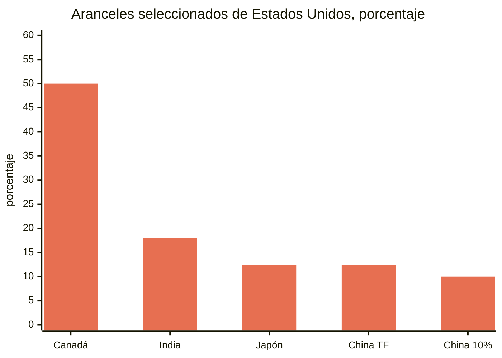
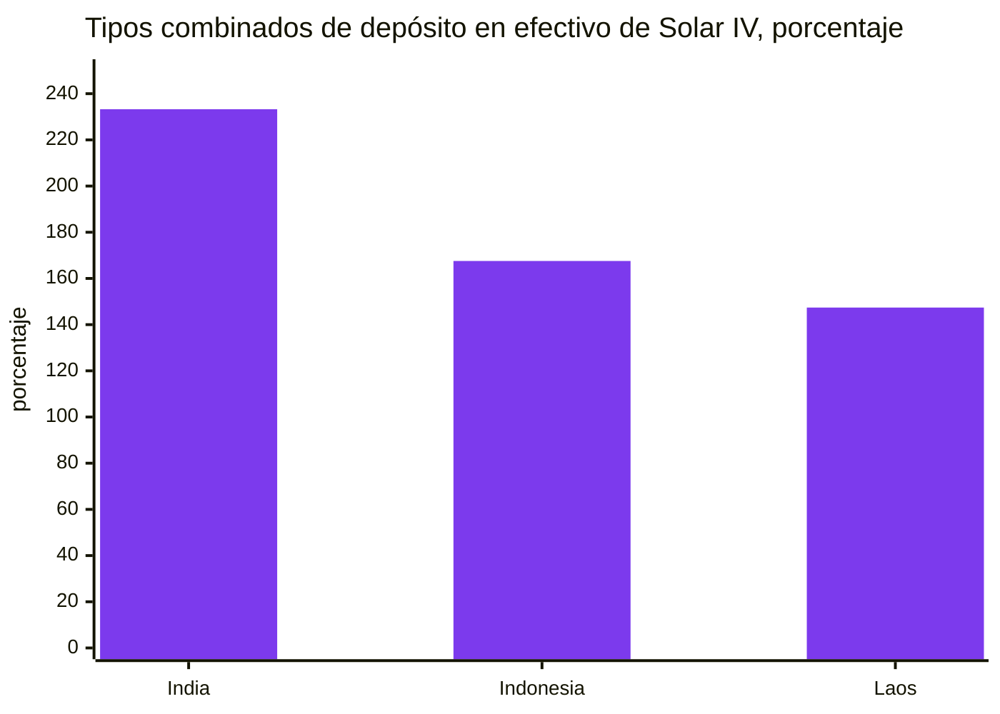
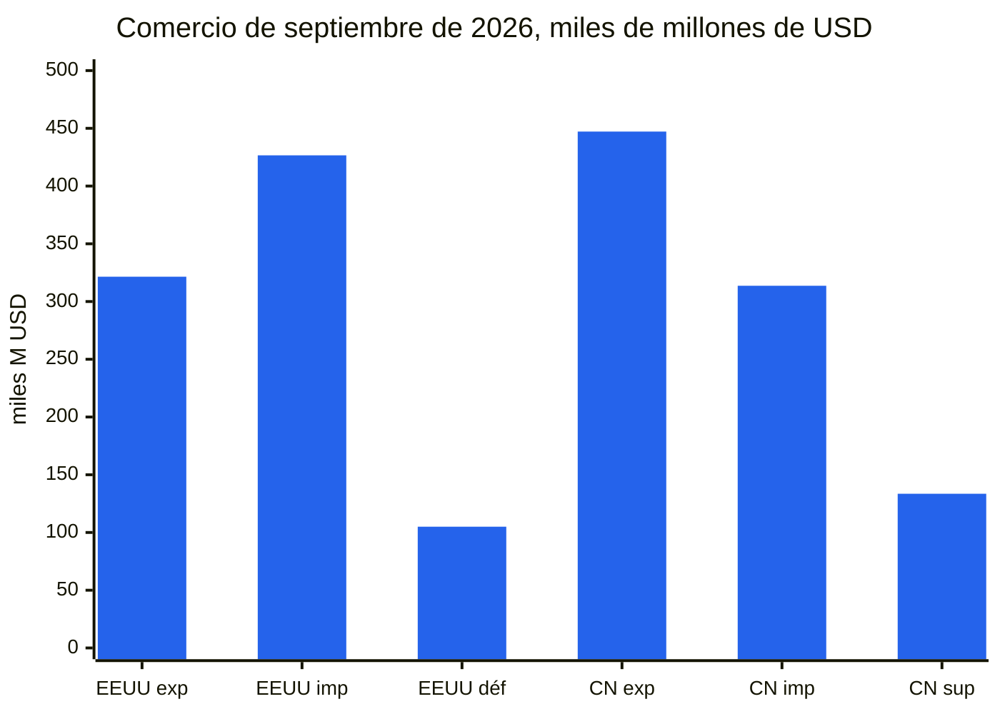
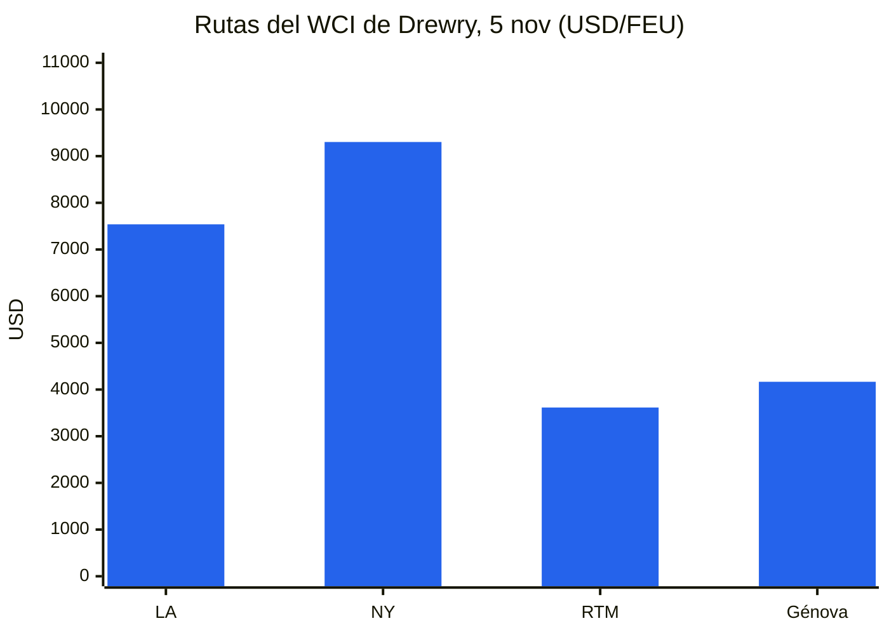
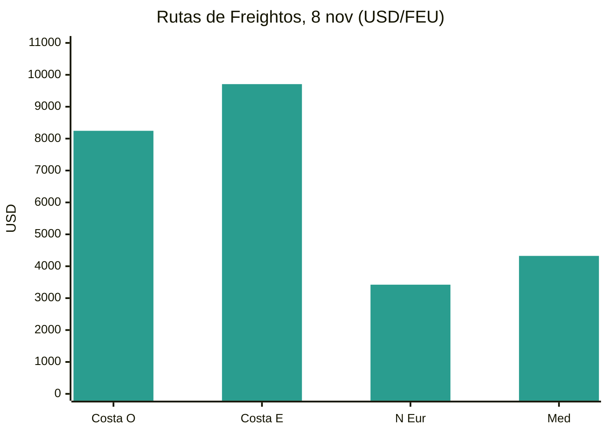
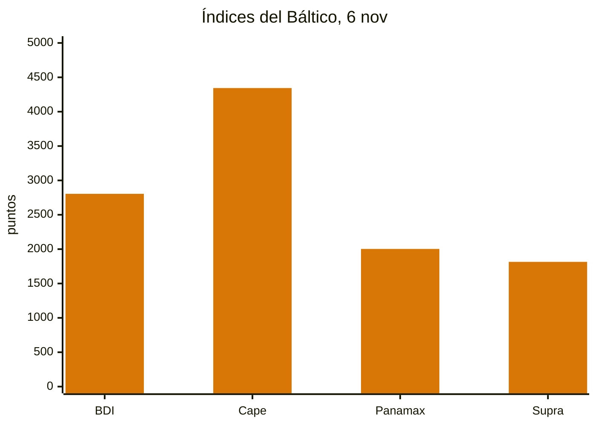
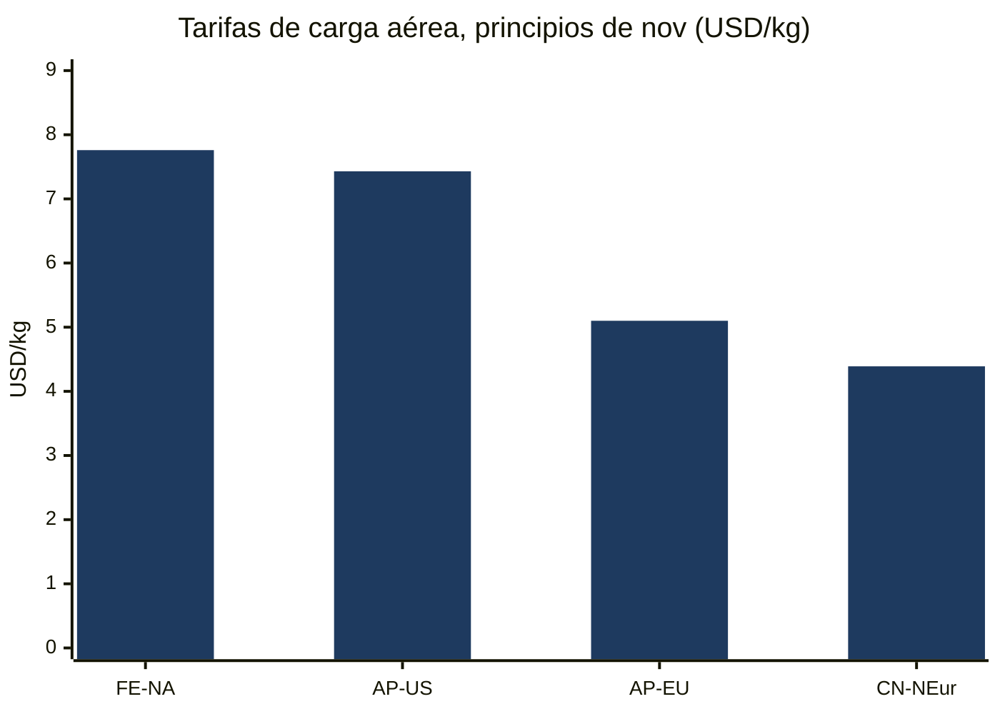
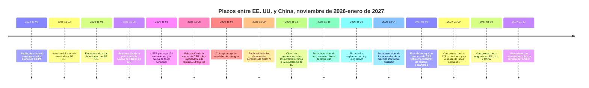
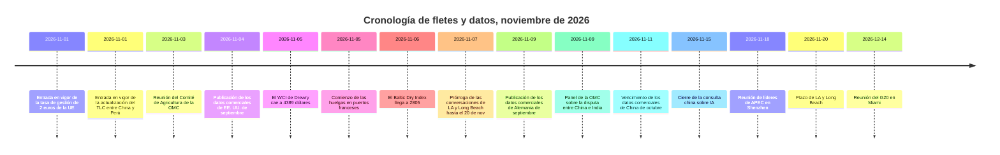

# Informe de Inteligencia Comercial Global — Semana del 2 al 9 de noviembre de 2026

**Informe semanal.** Periodo de cobertura: 2–9 de noviembre de 2026. Recopilado a partir de aproximadamente 45 fuentes mundiales de noticias, políticas, datos y fletes comerciales.

---

## Índice

1. [Resumen ejecutivo](#1-executive-summary)
2. [Alertas](#2-alerts)
3. [Principales noticias — análisis en profundidad](#3-top-stories--deep-dives)
4. [Seguimiento arancelario](#4-tariff-tracker)
5. [Análisis en profundidad de la política estadounidense](#5-us-policy-deep-dive)
6. [Política mundial por región](#6-world-policy-by-region)
7. [Medidas de aplicación](#7-enforcement-actions)
8. [Publicación de datos](#8-data-releases)
9. [Mercado de fletes](#9-freight-market)
10. [Cronologías de políticas](#10-policy-timelines)
11. [Próximos plazos y eventos (próximos 90 días)](#11-upcoming-deadlines--events-next-90-days)
12. [Fuentes y metodología](#12-sources--methodology)

---

## 1. Resumen ejecutivo

Una semana en la que el plazo del 9 de noviembre se desactivó en el último minuto, dos veces, y luego se trasladó a enero. El 6 de noviembre, la Oficina del Representante Comercial de los Estados Unidos publicó avisos que prorrogaban las 178 exclusiones de productos de la Sección 301 sobre China y la suspensión de las tasas portuarias de la Sección 301 sobre buques vinculados a China hasta el 9 de enero de 2027; el 9 de noviembre, China prorrogó su parte de la tregua —la suspensión de su arancel adicional del 24% sobre los productos estadounidenses, su suspensión de tasas portuarias y sus exenciones de control de exportaciones de minerales críticos— hasta el 10 de enero de 2027. La prórroga de dos meses es real, pero breve: los mismos instrumentos vencen ahora con un día de diferencia en enero, y el paquete arancelario más amplio debatido tras la cumbre de Washington de septiembre sigue sin cerrarse. En otros frentes, India y Estados Unidos anunciaron un acuerdo comercial que reduce los aranceles estadounidenses sobre los productos indios al 18% desde un máximo del 50%, los demócratas ganaron el control de ambas cámaras del Congreso en las elecciones de mitad de mandato sin cambiar las perspectivas arancelarias, la tasa de gestión de 2 euros y el requisito de identificador de producto de la Unión Europea entraron en vigor el 1 de noviembre, y China amplió su red de controles de exportación hacia la inteligencia artificial, la biofarmacia y las tecnologías de fabricación solar.

- **Los plazos del 9 de noviembre se prorrogaron, no se eliminaron.** Los avisos del USTR del 6 de noviembre prorrogan las 178 exclusiones de productos de la Sección 301 (164 generales, 14 de fabricación solar) y la suspensión adicional de la acción marítima de la Sección 301 hasta las 11:59 p. m., hora del este, del 9 de enero de 2027; las entradas a partir del 10 de noviembre de 2026 quedan dentro de la nueva ventana. La Oficina de Industria y Seguridad presentó una prórroga de la suspensión de su Norma de Filiales del 50% hasta el 10 de enero de 2027. China, al anunciar el 9 de noviembre, mantuvo suspendido su arancel adicional del 24% sobre los productos estadounidenses durante dos meses más a partir del 10 de noviembre, mantuvo en vigor un tipo adicional del 10% y prorrogó su suspensión de tasas portuarias, las exenciones de control de exportaciones de minerales críticos y la suspensión de las medidas contra 11 empresas estadounidenses de su lista de entidades no fiables y 16 de su lista de control de exportaciones hasta el 10 de enero de 2027. La asimetría es pequeña pero real: los instrumentos estadounidenses vencen el 9 de enero, los de China el 10 de enero, y hasta el 9 de noviembre no se había publicado ningún documento presidencial estadounidense que formalizara la prórroga de la tregua.
- **India y Estados Unidos cerraron un acuerdo el 2 de noviembre.** Washington redujo los aranceles sobre los productos indios al 18% desde un máximo del 50% —un tipo recíproco del 25% más una sanción del 25% por las compras de petróleo ruso— y retiró el gravamen por el petróleo ruso. El presidente Trump afirmó que India había acordado dejar de comprar petróleo ruso y aumentar las compras a Estados Unidos; el Gobierno indio no ha confirmado públicamente compromisos concretos de abastecimiento energético. El acuerdo se describe como el primer tramo de un acuerdo bilateral más amplio, con un objetivo de comercio bilateral de 500.000 millones de dólares para 2030, pero hasta el 3 de noviembre no se había publicado ningún texto firmado, calendario arancelario ni fecha de entrada en vigor. Llega días después de que India concluyera un acuerdo de libre comercio con la Unión Europea.
- **Las elecciones de mitad de mandato cambiaron la política del comercio, no los aranceles.** Los demócratas ganaron el control de la Cámara y del Senado el 3 de noviembre, según las declaraciones de Associated Press. Los analistas prevén audiencias de supervisión y votaciones simbólicas de derogación en 2027, pero no una derogación: los demócratas siguen muy lejos de las mayorías de dos tercios necesarias para anular un veto presidencial, y la Administración ha reconstruido su estructura arancelaria sobre las autoridades de la Sección 301 y la Sección 232 después de que el Tribunal Supremo anulara los aranceles IEEPA en febrero de 2026. El Senado ya había votado 51–47 el 29 de octubre para poner fin a la emergencia nacional que sustentaba los aranceles globales. Los recargos de la Sección 122, limitados a 150 días sin legislación, son el único instrumento que el nuevo Congreso podría restringir.
- **El reajuste europeo del comercio electrónico de bajo valor entró en vigor.** Desde el 1 de noviembre, se aplica una tasa de gestión aduanera de 2 euros por línea de artículo en los envíos de venta a distancia remitidos directamente desde fuera de la Unión Europea a consumidores de la UE, además del derecho fijo de 3 euros por línea arancelaria en vigor desde el 1 de julio de 2026 para envíos de 150 euros o menos. Cada producto de un envío entre empresas y consumidores debe llevar ahora también tres identificadores de producto, con independencia de su valor. El derecho y la tasa combinados pueden alcanzar 5 euros por línea arancelaria antes del IVA. Las aduanas de la UE tramitaron unos 6.000 millones de paquetes de comercio electrónico en 2025, alrededor del 90% procedentes de China.
- **Los controles de exportación de China se ampliaron hacia la tecnología y los equipos industriales.** Una propuesta conjunta del MOFCOM y el Ministerio de Ciencia y Tecnología (Anuncio n.º 48, del 16 de octubre) añadiría 40 tecnologías —23 de inteligencia artificial, 5 de biofarmacia, 12 de energía fotovoltaica— al catálogo de controles de exportación, con comentarios hasta el 15 de noviembre y un registro provisional previo a la exportación ya en vigor. Por separado, los controles de doble uso sobre drones, tuneladoras y dragas entran en vigor el 18 de noviembre. Las restricciones solares se consideran las más trascendentes, dada la posición dominante de China en la producción fotovoltaica.
- **Estados Unidos registró un mes récord de importaciones; China se encamina hacia un superávit de 1 billón de dólares.** La Oficina del Censo y la Oficina de Análisis Económico informaron el 4 de noviembre de que el déficit de bienes y servicios de septiembre fue de 105.000 millones de dólares, con importaciones récord de 426.600 millones de dólares e importaciones de bienes récord de 346.900 millones de dólares, y las importaciones de bienes de capital en un récord de 158.000 millones de dólares. El superávit de China en septiembre fue de 133.530 millones de dólares, con exportaciones de 447.180 millones de dólares, un 36,3% más interanual; una encuesta de Reuters prevé exportaciones de octubre un 33,5% más altas y un superávit de 125.800 millones de dólares, lo que situaría el superávit acumulado de enero a octubre por encima de 1 billón de dólares. El PMI manufacturero oficial de China cayó a 49,3 en octubre, con los nuevos pedidos de exportación en 48,7.
- **Los fletes se dividieron de nuevo: el marítimo se suavizó, el aéreo se disparó.** El Índice Mundial de Contenedores de Drewry cayó un 1% hasta 4.389 dólares por contenedor de 40 pies el 5 de noviembre, todavía un 124% más alto interanual, ya que los aumentos generales de tarifas de los transportistas del 1 de noviembre no se mantuvieron. El Baltic Dry Index cerró la semana en 2.805, un 3,4% más en la semana, por la fortaleza de los Capesize. La carga aérea se movió en sentido contrario: el Lejano Oriente–Norteamérica llegó a 7,76 dólares por kilogramo el 3 de noviembre, un 9% más en una semana y un máximo de 2026, cerca del máximo de 8,00 dólares de principios de diciembre de 2025. Alrededor del 60% de la capacidad de contenedores entre Asia y Europa utiliza ahora el Canal de Suez, según Drewry. La disputa de los vigilantes de Los Ángeles–Long Beach se aplazó de nuevo, hasta el 20 de noviembre, mientras los puertos franceses sufrieron dos días de huelgas y un bloqueo de camioneros en el puerto chileno de San Antonio amenazó la temporada de exportación de cerezas.

**Fletes:** las tarifas spot de contenedores bajaron tanto en el transpacífico como en Asia–Europa mientras se descontaban los aumentos de noviembre de los transportistas; la carga seca a granel subió por tercera semana consecutiva por los ingresos de los Capesize; la carga aérea alcanzó un máximo de 2026 al entrar en la temporada alta; los tránsitos por Suez siguieron recuperándose; y los conflictos laborales en Los Ángeles–Long Beach, en Francia y en Chile mantuvieron vivo el riesgo portuario durante la temporada alta.

---

## 2. Alertas

| # | Alerta | Vigencia | Impacto | Fuente |
|---|-------|-----------|--------|--------|
| A1 | El USTR prorroga las 178 exclusiones de productos de la Sección 301 sobre China hasta las 11:59 p. m., hora del este, del 9 de ene. de 2027; las entradas a partir del 10 de nov. de 2026 quedan en la nueva ventana; la publicación en el Registro Federal aún no estaba confirmada al 8 de nov. | 6 de nov. de 2026 (publicado) | Prórroga de solo dos meses; las entradas posteriores al 9 de ene. de 2027 pagan los tipos íntegros de lista (25% en las Listas 1–3, 7,5% en la Lista 4A) | [TechTimes](https://www.techtimes.com/articles/330285/20261109/ustr-extends-section-301-tariff-exclusions-chinese-goods-entries-after-january-9-pay-full-duty.htm) |
| A2 | El USTR suspende además la acción marítima de la Sección 301 (tasas portuarias sobre buques vinculados a China, derechos del Anexo V.A) hasta las 11:59 p. m., hora del este, del 9 de ene. de 2027 | 9 de nov. de 2026 | Las tasas siguen suspendidas; la suspensión y las exclusiones vencen en la misma fecha de enero | [Gateway Lines](https://gatewaylines.com/press-releases/china-ship-fee-delay-jan-9-2027-301-exclusions) |
| A3 | China prorroga la suspensión de su arancel adicional del 24% sobre los productos estadounidenses durante dos meses a partir del 10 de nov., mantiene en vigor el 10%; prorroga la suspensión de tasas portuarias, las exenciones de control de exportaciones de minerales críticos y las suspensiones de listas de entidades hasta el 10 de ene. de 2027 | 9–10 de nov. de 2026 | Los exportadores estadounidenses mantienen el tipo del 10%; la tregua se extiende ahora hasta el 10 de ene. de 2027 por parte de China | [Reuters via SRN News](https://srnnews.com/china-extends-suspension-of-24-tariff-on-us-imports-for-two-months/) |
| A4 | Anuncio del acuerdo comercial entre India y EE. UU.: aranceles estadounidenses sobre los productos indios reducidos al 18% desde un máximo del 50%; retirada del gravamen por el petróleo ruso; sin texto firmado publicado al 3 de nov. | 2 de nov. de 2026 | Reajuste de precios para los productos de origen indio; compromisos de abastecimiento energético no confirmados por Nueva Delhi | [Economic Times](https://www.eximguru.com/export-import-news/export-news/india-us-trade-deal-lifts-a-117126.aspx) |
| A5 | Norma final provisional de la CBP: los importadores de registro extranjeros deben estar validados por CTPAT o utilizar un agente de aduanas validado por CTPAT a partir del 5 de ene. de 2027; el 32% de los importadores de registro extranjeros no cumple actualmente ninguna de las dos condiciones | 5 de ene. de 2027 | Los vendedores extranjeros que envían directamente a compradores estadounidenses deben cambiar de agente u obtener la validación; comentarios hasta el 5 de ene. de 2027 | [CBP](https://www.cbp.gov/newsroom/national-media-release/cbp-announces-heightened-requirements-foreign-importers-record) |
| A6 | Tasa de gestión de 2 euros de la UE por línea de artículo y tres identificadores de producto obligatorios en todos los envíos entre empresas y consumidores hacia la UE a partir del 1 de nov.; derecho y tasa combinados de hasta 5 euros por línea arancelaria antes del IVA | 1 de nov. de 2026 | Aumentan los costes de aterrizaje del comercio electrónico de bajo valor y con varios artículos; los envíos sin identificadores corren el riesgo de retraso o rechazo | [Logistik Heute](https://logistik-heute.de/en/news/eu-customs-policy-new-package-fee-increases-costs-cross-border-online-trade-291550.html) |
| A7 | Comercio emite órdenes definitivas de derechos antidumping y compensatorios sobre células solares de silicio cristalino procedentes de India, Indonesia y Laos; tipos combinados totales de hasta alrededor del 233% (India), 168% (Indonesia), 147% (Laos) | 9 de nov. de 2026 | Los depósitos en efectivo se reanudan a partir del 5 de nov.; los módulos fabricados en un tercer país con células cubiertas quedan dentro de las órdenes | [MLex](https://www.mlex.com/mlex/articles/2547289/us-commerce-imposes-duties-for-indonesian-laotian-and-indian-solar-cells) |
| A8 | La amenaza de huelga de los vigilantes de LA/Long Beach se aplaza de nuevo; las conversaciones se extienden hasta el 20 de nov. de 2026; unos 250 trabajadores en seis terminales; ~85% de la carga de Long Beach y ~33% de la de Los Ángeles en riesgo | 20 de nov. de 2026 | Se evitó un paro al día siguiente de las elecciones de mitad de mandato, pero la disputa se adentra ahora en la última parte de la temporada alta con un gran retraso ferroviario ya acumulado | [gCaptain](https://maritimenewsbd.com/la-long-beach-port-strike-threat-deferred-november-20/) |
| A9 | Propuesta de catálogo de controles de exportación de China sobre IA/biofarmacia/solar: comentarios hasta el 15 de nov. de 2026; el registro provisional previo a la exportación ya se aplica; los controles de doble uso sobre drones, tuneladoras y dragas entran en vigor el 18 de nov. | 15 de nov. / 18 de nov. de 2026 | 40 tecnologías afectadas (14 prohibidas, 26 restringidas); el conocimiento de fabricación solar es el filo más afilado | [China Briefing](https://www.china-briefing.com/news/china-technology-export-controls/) |
| A10 | Los demócratas ganan ambas cámaras en las elecciones de mitad de mandato del 3 de nov.; se prevé que la estructura arancelaria se mantenga; el Senado votó 51–47 el 29 de oct. para poner fin a la emergencia nacional que sustentaba los aranceles globales | 3 de nov. de 2026 | Se prevén supervisión y votaciones simbólicas de derogación en 2027; la Sección 122 es el instrumento que el nuevo Congreso podría restringir | [SupplyChainBrain](https://www.supplychainbrain.com/general-scm/regulation-compliance/article/16424361/us-midterm-rout-unlikely-to-change-trumps-trade-policy) |

### A1/A2 — Los plazos del 9 de noviembre, prorrogados en el último minuto

Los dos instrumentos que dominaron el informe de la semana pasada se prorrogaron el 6 de noviembre, cuando el USTR publicó dos avisos en su sitio web. El primero prorroga las 178 exclusiones de productos de la Sección 301 sobre China —164 exclusiones generales bajo el HTSUS 9903.88.69 y 14 exclusiones de fabricación solar bajo el 9903.88.70— hasta las 11:59 p. m., hora del este, del 9 de enero de 2027, y cubre las mercancías introducidas para el consumo, o retiradas de almacén para el consumo, a partir de las 12:01 a. m., hora del este, del 10 de noviembre de 2026. No se añadieron ni se eliminaron exclusiones, ni se solicitaron nuevos comentarios; el USTR se basó en los comentarios a su aviso del 16 de septiembre de 2025. El segundo aviso suspende además la acción de la Sección 301 sobre las prácticas marítimas, logísticas y de construcción naval de China, incluidas las tasas sobre buques cubiertos y los derechos del Anexo V.A, con vigencia del 9 de noviembre de 2026 hasta las 11:59 p. m., hora del este, del 9 de enero de 2027. El USTR había propuesto la prórroga marítima el 26 de octubre (91 FR 67388); el periodo de comentarios cerró el 30 de octubre. Al 8 de noviembre no se había identificado ninguna publicación correspondiente en el Registro Federal para ninguno de los dos avisos, y el aviso de exclusiones contiene una incoherencia interna —su sección de fechas y sus anexos dicen 9 de enero de 2027, mientras que otro texto se refiere al 10 de enero; la fecha operativa es el 9 de enero. Sin la prórroga, las entradas a partir del 10 de noviembre habrían pagado los tipos íntegros de lista. Una exclusión solo elimina el derecho de lista: el arancel de la Sección 301 por trabajo forzoso del 12,5%, los derechos de la Sección 232, los derechos antidumping y compensatorios y los tipos de nación más favorecida siguen aplicándose. El 4 de noviembre, la Software & Information Industry Association y otras 23 organizaciones habían pedido al USTR una prórroga de al menos un año; el USTR concedió dos meses.

### A3 — China actúa el mismo día en que la tregua debía expirar

China anunció el lunes 9 de noviembre que seguirá suspendiendo su arancel adicional del 24% sobre los productos estadounidenses durante dos meses más, a partir de las 13:01, hora de Pekín, del 10 de noviembre, manteniendo en vigor un tipo adicional del 10%. El Anuncio n.º 6 de 2026 de la Comisión de Aranceles Aduaneros aplica el consenso alcanzado en la cumbre de Washington de septiembre entre los presidentes Trump y Xi. En paralelo, el Ministerio de Comercio de China prorrogó las exenciones de control de exportaciones para determinados minerales críticos y tecnologías relacionadas hasta el 10 de enero de 2027, las medidas que afectan a 11 empresas estadounidenses de la lista china de entidades no fiables y a 16 de su lista de control de exportaciones siguen suspendidas hasta el 10 de enero de 2027, y la suspensión de las tasas portuarias especiales sobre buques vinculados a Estados Unidos se prorrogó hasta la misma fecha. También se suspendieron durante dos meses más las sanciones contra cinco filiales estadounidenses de Hanwha Ocean. La asimetría importa para la planificación: Pekín ha actuado mediante un anuncio formal, mientras que hasta el 9 de noviembre no se había publicado ningún documento presidencial estadounidense que formalizara la prórroga de la tregua, y los instrumentos estadounidenses vencen el 9 de enero mientras que los de China se extienden hasta el 10 de enero. El paquete propuesto de recortes arancelarios recíprocos por 60.000 millones de dólares debatido tras la cumbre de septiembre, incluidos 17.000 millones de dólares en productos agrícolas estadounidenses importados por China en 2024, sigue sin cerrarse.

### A4 — Acuerdo entre India y EE. UU.: 18% y la cuestión del petróleo ruso

India y Estados Unidos cerraron un acuerdo comercial tras meses de negociaciones tensas, que culminaron en una llamada telefónica entre el primer ministro Narendra Modi y el presidente Donald Trump a última hora del lunes 2 de noviembre. Washington anunció una reducción de los aranceles sobre los productos indios al 18% desde un máximo del 50% —un tipo recíproco del 25% más una sanción del 25% impuesta por la compra de petróleo ruso— y retiró el gravamen penal. El presidente Trump afirmó que India había acordado dejar de comprar petróleo ruso y aumentar las compras a Estados Unidos y posiblemente a Venezuela, y comprar productos estadounidenses «a un nivel mucho mayor»; el Gobierno indio no ha comentado públicamente compromisos concretos de abastecimiento energético. Reuters informó de que India acordó intensificar las compras de petróleo, productos de defensa, electrónica, productos farmacéuticos, equipos de telecomunicaciones y aeronaves estadounidenses. El acuerdo se describe como el primer tramo de un acuerdo bilateral más amplio, con negociaciones en curso y un objetivo de comercio bilateral de 500.000 millones de dólares para 2030, frente a unos 191.000 millones de dólares actuales. Al 3 de noviembre, según la información publicada, no se había publicado ningún texto firmado, calendario arancelario ni fecha de entrada en vigor, y el tipo del 18% del marco de febrero de 2026 nunca se había aplicado antes —la mayoría de los productos indios han estado sujetos a un derecho del 10% de la Sección 301 desde el 24 de julio de 2026.

### A5 — Norma de la CBP sobre importadores de registro extranjeros

La CBP publicó una norma final provisional, «Requisitos reforzados para los importadores de registro extranjeros» (CBP Dec. 26-19, 91 FR 69977), el 6 de noviembre de 2026, en aplicación de la Sección 2 de la Orden Ejecutiva 14411 («Refuerzo de la aplicación aduanera», firmada el 3 de junio de 2026). A partir del 5 de enero de 2027, un importador de registro extranjero solo podrá introducir mercancías para el consumo si está validado por CTPAT o presenta la declaración a través de un agente de aduanas autorizado validado por CTPAT. Según el propio análisis de la CBP: el 0,4% de los importadores de registro extranjeros están validados por CTPAT y el 68% ya utiliza un agente validado; el 32% restante no podrá seguir importando a Estados Unidos a menos que cambie de agente u obtenga la validación CTPAT. La nueva Parte 110 del reglamento aduanero define un «importador de registro estadounidense»; la condición de importador debe declararse en la entrada y en el resumen de entrada; los agentes deben verificar la condición de sus clientes y conservar los registros de verificación durante cinco años; los comentarios vencen el 5 de enero de 2027. La norma no impone la prohibición general de entradas informales para los importadores de registro extranjeros que ordenaba la orden ejecutiva, pero invita a comentar una prohibición total como alternativa. El coste monetizado estimado es de unos 1.233.253 dólares al año.

### A6 — Tasa de 2 euros e identificadores de producto de la UE

Desde el 1 de noviembre de 2026, se aplica una tasa de gestión aduanera de 2 euros por línea de artículo en los envíos de venta a distancia remitidos directamente desde fuera de la Unión Europea a consumidores de la UE, con independencia de su valor, en virtud del Reglamento Delegado (UE) 2026/2152. Se suma al derecho fijo de 3 euros por línea arancelaria en vigor desde el 1 de julio de 2026 para envíos de 150 euros o menos en virtud del Reglamento (UE) 2026/382, que abolió la exención de derechos de minimis de 150 euros. Desde la misma fecha, cada producto de un envío entre empresas y consumidores a la UE —con independencia de su valor— debe llevar tres identificadores de producto. El derecho y la tasa combinados pueden, por tanto, alcanzar 5 euros por línea arancelaria, sin incluir el IVA. El régimen provisional se extiende hasta el 1 de julio de 2028, cuando un sistema centralizado de datos aduaneros de la UE está previsto que sustituya el gravamen fijo por derechos estándar. La tasa no es reembolsable aunque se devuelvan las mercancías.

### A7 — Órdenes de Solar IV: tipos combinados de hasta alrededor del 233%

Comercio emitió órdenes de derechos antidumping y compensatorios sobre células fotovoltaicas de silicio cristalino, estén o no ensambladas en módulos, procedentes de India, Indonesia y Laos el 9 de noviembre de 2026, tras las determinaciones definitivas afirmativas de daño de la USITC publicadas el 5 de noviembre (91 FR 69865). India: margen antidumping del 123,04% (depósito en efectivo del 107,17% tras las compensaciones por subvenciones) y derecho compensatorio del 126,09%, un tipo combinado de depósito en efectivo del 233,26%. Indonesia: antidumping del 94,36% y derecho compensatorio del 73,20% (tipo combinado para todos los demás del 167,56%). Laos: antidumping del 65,43% y derecho compensatorio del 82,03% (combinado del 147,39%). La suspensión de la liquidación y el cobro de depósitos en efectivo se reanudan a partir del 5 de noviembre de 2026. Los módulos, laminados y paneles fabricados en un tercer país con células cubiertas quedan dentro de las órdenes; los módulos ensamblados en India con células de terceros países no. El informe público completo de la USITC (Publicación 5804 de la USITC) debe publicarse antes del 23 de noviembre de 2026.

### A8 — LA/Long Beach: aplazado hasta el 20 de noviembre

Una amenaza de huelga de los trabajadores de seguridad (vigilantes) en las terminales de contenedores de Los Ángeles y Long Beach se ha aplazado de nuevo, y las conversaciones se extienden ahora hasta el 20 de noviembre, informó Bloomberg a través de gCaptain el 7 de noviembre. El ILWU Local 26 representa a unos 250 trabajadores de seguridad en seis terminales de contenedores; su contrato anterior venció en julio de 2025, los miembros han autorizado una huelga y ambas partes negocian con ayuda del Servicio Federal de Mediación y Conciliación. La Asociación Marítima del Pacífico afirma que la interrupción podría afectar a alrededor del 85% de la carga que circula por el puerto de Long Beach y a un tercio de la carga del puerto de Los Ángeles, porque no se espera que otros estibadores crucen los piquetes del Local 26. El complejo ya estaba tensionado: unos 35.688 contenedores de importación esperaban servicio ferroviario en ambos puertos, 10.562 de ellos durante nueve días o más, y las importaciones con destino ferroviario permanecieron una media de 7,19 días en septiembre, frente a 6,75 en agosto. El puerto de Los Ángeles movió 1 millón de contenedores en un mes, un nuevo récord, aun cuando su director advierte del riesgo de planificación derivado de los aranceles.

### A9 — Controles de exportación de China: los comentarios cierran el 15 de noviembre; las normas de doble uso entran en vigor el 18 de noviembre

El MOFCOM y el Ministerio de Ciencia y Tecnología proponen añadir 40 tecnologías al Catálogo de Tecnologías Prohibidas y Restringidas para la Exportación: 23 de inteligencia artificial, 5 de biofarmacia, 12 de energía fotovoltaica. Catorce quedarían prohibidas para la exportación; 26 restringidas (con licencia obligatoria). Desde el 16 de octubre de 2026, se aplica un registro provisional previo a la exportación de las tecnologías enumeradas —incluidas las exportaciones ya en curso y las transferencias de propiedad o control de una empresa nacional titular de las tecnologías a una entidad extranjera— a través de la aplicación de Gestión de Información sobre Comercio de Tecnología del MOFCOM. Los comentarios públicos cierran el 15 de noviembre. Por separado, tres anuncios revisan la Lista de Control de Exportaciones de Artículos de Doble Uso para vehículos aéreos no tripulados, tuneladoras y dragas, todos con vigencia a partir del 18 de noviembre de 2026, y el MOFCOM y la Administración General de Aduanas emitieron el Aviso 52 por el que se revisan los procedimientos conforme a los cuales las aduanas pueden retener mercancías presentadas para la exportación sin licencia. El MOFCOM describe el paquete como «preciso y limitado».

### A10 — Elecciones de mitad de mandato: los demócratas toman el Congreso; se prevé que los aranceles se mantengan

Las elecciones de mitad de mandato del 3 de noviembre produjeron un giro históricamente amplio hacia los demócratas en la Cámara, el Senado y otros cargos; la información del 4 de noviembre describió una victoria demócrata en ambas cámaras. Estaban en juego los 435 escaños de la Cámara y 35 de los 100 del Senado. Expertos en comercio y asesores del Congreso dijeron a Reuters que un Congreso demócrata traería audiencias de supervisión y votaciones simbólicas de derogación arancelaria en 2027, pero no una derogación: los demócratas siguen muy lejos de las mayorías de dos tercios necesarias para anular un veto presidencial, y la Casa Blanca afirma que el presidente Trump no se apartará de su agenda comercial de «Estados Unidos primero». El Senado ya había votado 51–47 el 29 de octubre de 2026 para poner fin a la emergencia nacional que sustentaba los aranceles globales, con cuatro republicanos que se sumaron a los demócratas, pero esa votación no desmanteló la estructura arancelaria. Los analistas señalan que la Administración ha reconstruido sus aranceles sobre las autoridades de la Sección 301 y la Sección 232 después de que el Tribunal Supremo anulara los aranceles IEEPA el 20 de febrero de 2026, y que hasta ahora se han mantenido; 25 estados han demandado para bloquear los derechos de la Sección 301 y el caso está pendiente. La actualización aduanera del 5 de noviembre de C.H. Robinson advirtió a los cargadores que se prepararan para la posibilidad de aranceles adicionales de la Sección 301 sobre países concretos a finales de 2026 y en 2027.

---

## 3. Principales noticias — análisis en profundidad

### 3.1 La tregua, prorrogada dos meses — y el plazo de enero que crea

La historia central de la semana es un par de prórrogas que juntas mantienen viva la tregua comercial entre Estados Unidos y China hasta enero, al tiempo que comprimen la próxima decisión en una ventana de dos meses. La secuencia importa. El 6 de noviembre, el USTR publicó dos avisos: uno que prorroga las 178 exclusiones de productos de la Sección 301 sobre China hasta las 11:59 p. m., hora del este, del 9 de enero de 2027, y otro que suspende además la acción marítima de la Sección 301 —tasas portuarias sobre buques vinculados a China y derechos del Anexo V.A— hasta la misma fecha. El 5 de noviembre, el BIS presentó una prórroga de la suspensión de su medida de control de exportaciones de la Norma de Filiales del 50% hasta el 10 de enero de 2027. El 9 de noviembre, China prorrogó su parte: el arancel adicional del 24% sobre los productos estadounidenses sigue suspendido dos meses más a partir del 10 de noviembre, se mantiene en vigor un tipo adicional del 10%, y las suspensiones de las tasas portuarias especiales sobre buques vinculados a Estados Unidos, las exenciones de control de exportaciones de minerales críticos y las medidas contra 11 empresas estadounidenses de la lista de entidades no fiables y 16 de la lista de control de exportaciones se extienden todas hasta el 10 de enero de 2027.

Tres rasgos merecen atención. Primero, las prórrogas son breves —dos meses, cuando se entendía que el acuerdo de septiembre duraba un año— y se concedieron después de que la industria pidiera al menos un año. La Software & Information Industry Association y otras 23 organizaciones pidieron al USTR el 4 de noviembre una prórroga de al menos un año de las exclusiones; el USTR concedió dos meses. Segundo, las fechas no coinciden exactamente: los instrumentos estadounidenses vencen el 9 de enero, los de China el 10 de enero, y el propio secretario del Tesoro, Scott Bessent, describió en septiembre la tregua estadounidense como vigente hasta el 10 de enero. Tercero, el fondo de la tregua sigue sin resolverse. El 6 de noviembre, el representante comercial Jamieson Greer y el secretario Bessent mantuvieron una videollamada con el viceprimer ministro He Lifeng; Greer subrayó «la importancia fundamental de que China adopte medidas concretas para aplicar plenamente sus compromisos anteriores», en particular las compras agrícolas, las tierras raras y otros minerales críticos, mientras que China expresó «seria preocupación» por las restricciones comerciales estadounidenses. Ninguna de las dos lecturas mencionó los plazos. El paquete propuesto de recortes arancelarios recíprocos por 60.000 millones de dólares debatido tras la cumbre de septiembre sigue sin cerrarse.

**Cifras clave:** 178 exclusiones prorrogadas (164 generales, 14 de fabricación solar); sin la prórroga, las entradas a partir del 10 de noviembre habrían pagado el 25% (Listas 1–3) o el 7,5% (Lista 4A); el arancel adicional del 24% de China sigue suspendido, se mantiene el 10%; la tregua se extiende ahora hasta el 9–10 de enero de 2027.

**Por qué importa:** los importadores tienen dos meses de certidumbre en lugar de un plazo esta semana, pero el plazo se ha movido, no ha desaparecido. El próximo punto de decisión es la reunión de líderes de APEC en Shenzhen los días 18–19 de noviembre, donde los presidentes Trump y Xi se reúnen por tercera vez este año, seguida por el G20 en Miami los días 14–15 de diciembre. Las entradas, los viajes y la selección de exportaciones deben planificarse conforme a la posición escrita: las exclusiones se aplican según la fecha de entrada, no la fecha de embarque, de modo que las mercancías embarcadas en noviembre pero introducidas después del 9 de enero quedan fuera de la prórroga.

**Fuentes:** [TechTimes](https://www.techtimes.com/articles/330285/20261109/ustr-extends-section-301-tariff-exclusions-chinese-goods-entries-after-january-9-pay-full-duty.htm); [Gateway Lines](https://gatewaylines.com/press-releases/china-ship-fee-delay-jan-9-2027-301-exclusions); [Reuters via SRN News](https://srnnews.com/china-extends-suspension-of-24-tariff-on-us-imports-for-two-months/); [BusinessWorld](https://bworldonline.com/world/2026/11/09/792445/china-extends-suspensions-of-24-tariff-on-us-goods-port-fees-on-us-ships-for-two-months/)

### 3.2 Acuerdo entre India y EE. UU.: se disipa la mayor incertidumbre sobre la economía exportadora india

El anuncio del 2 de noviembre elimina la mayor fuente de incertidumbre que pesaba sobre la economía exportadora de India, alivia la presión sobre la rupia —que venía marcando mínimos históricos— y sobre la renta variable india y, si se mantiene la interrupción del petróleo ruso, reconfigura los flujos de crudo de uno de los mayores compradores del mundo. Estados Unidos es el principal destino de exportación de India, con alrededor del 20% de las exportaciones de mercancías. El acuerdo reduce los aranceles estadounidenses sobre los productos indios al 18% desde un máximo del 50% y retira el gravamen penal adicional impuesto por la compra de petróleo ruso. Ambas partes fijan un objetivo de comercio bilateral de 500.000 millones de dólares para 2030, frente a unos 191.000 millones de dólares actuales (las autoridades indias citan 131.840 millones de dólares con una medida más restrictiva).

Las incertidumbres son importantes. Hasta el 3 de noviembre no se había publicado ningún texto firmado, calendario arancelario ni fecha de entrada en vigor, y el tipo del 18% del marco de febrero de 2026 nunca se había aplicado antes —la mayoría de los productos indios han estado sujetos a un derecho del 10% de la Sección 301 desde el 24 de julio de 2026. La afirmación del presidente Trump de que India acordó dejar de comprar petróleo ruso y aumentar las compras a Estados Unidos y posiblemente a Venezuela no ha sido confirmada públicamente por Nueva Delhi en términos concretos. Reuters informó de que India acordó intensificar las compras de petróleo, productos de defensa, electrónica, productos farmacéuticos, equipos de telecomunicaciones y aeronaves estadounidenses. El acuerdo llega días después de que India concluyera un acuerdo de libre comercio con la Unión Europea, lo que da a India dos grandes acuerdos en una semana —y llega junto a otra noticia india esta semana: el ministro de Comercio, Piyush Goyal, afirmó el 3 de noviembre que India nunca ha abierto su sector lácteo en ningún acuerdo de libre comercio y no permitirá importaciones de productos modificados genéticamente, una línea roja relevante para todas las vías de TLC en curso.

**Cifras clave:** aranceles reducidos al 18% desde un máximo del 50% (25% recíproco + 25% de sanción por el petróleo ruso); comercio bilateral de unos 191.000 millones de dólares; objetivo de 500.000 millones de dólares para 2030; exportaciones indias de abril a septiembre de 2026 de unos 480.000 millones de dólares, un 14% más interanual; India aspira a 1 billón de dólares en exportaciones de bienes y servicios en 2026–27.

**Por qué importa:** para los exportadores indios, el acuerdo sustituye un peor escenario del 50% por un tipo del 18% —si el texto lo confirma. Para los mercados energéticos, la cuestión del petróleo ruso es la variable activa: India es uno de los mayores compradores de crudo del mundo, y una interrupción redirigiría volúmenes sustanciales. Para la política comercial, el acuerdo muestra que la Administración cierra los grandes expedientes bilaterales mediante anuncios antes del texto, un patrón que los importadores deberían incorporar a su planificación.

**Fuentes:** [Economic Times](https://www.eximguru.com/export-import-news/export-news/india-us-trade-deal-lifts-a-117126.aspx); [Reuters via Reporter World News](https://www.reporterworldnews.com/news/business/2026/11/03/piyush-goyal-commerce-dairy-products)

### 3.3 Elecciones de mitad de mandato y perspectivas arancelarias: nueva política, mismos derechos

Las elecciones del 3 de noviembre dieron a los demócratas el control de ambas cámaras, pero la arquitectura arancelaria se sustenta en la autoridad ejecutiva, que un cambio de Congreso no deshace. Los aranceles de la Administración se apoyan ahora principalmente en la Sección 301 y la Sección 232, después de que el Tribunal Supremo anulara los aranceles IEEPA el 20 de febrero de 2026 en *Learning Resources, Inc. v. Trump*. Esas autoridades no dependen del ciclo electoral, y los demócratas siguen muy lejos de las mayorías de dos tercios necesarias para anular un veto presidencial. Lo que cambia es el escrutinio: se prevén audiencias de supervisión, votaciones simbólicas de derogación y presión para un alivio selectivo —en particular sobre Canadá— en 2027. El único instrumento que el nuevo Congreso podría restringir es la Sección 122, cuyos recargos están limitados a 150 días sin legislación; cualquier prórroga de ese marco requeriría al Congreso entrante. El nuevo Congreso se reúne en enero de 2027; hasta entonces, los estatutos arancelarios se mantienen tal como están redactados.

El frente judicial versa ahora sobre el dinero, no sobre la autoridad. El 2 de noviembre, FedEx demandó ante el Tribunal de Comercio Internacional de los Estados Unidos contra Estados Unidos, la CBP y el comisionado de la CBP, Rodney Scott, solicitando el reembolso íntegro de todos los aranceles que pagó como importador de registro en virtud de las órdenes arancelarias IEEPA invalidadas por el Tribunal Supremo —según se informó, la primera gran empresa en demandar por su parte de unos 175.000 millones de dólares estimados en derechos IEEPA recaudados. El Tribunal Supremo no se pronunció sobre los reembolsos, y dejó esa cuestión a los tribunales inferiores. También el 2 de noviembre, el Liberty Justice Center lanzó la «Operation Refund Rescue», que ofrece financiar acciones selectivas ante el Tribunal de Comercio Internacional para pequeñas empresas que cumplan los requisitos y cuyas entradas IEEPA llegaron a la liquidación definitiva y, por tanto, no pueden recuperarlas a través del sistema de reembolso CAPE de la CBP sin una orden judicial; la capacidad inicial es de 100 presentaciones. El sistema de reembolso CAPE de la CBP se puso en marcha en ACE el 20 de abril de 2026, y la CBP afirma que los reembolsos válidos suelen llegar en un plazo de 60–90 días desde su aceptación. El 8 de octubre, el Tribunal de Comercio Internacional certificó una demanda colectiva en *Freestyle World, Inc. v. U.S. Customs and Border Protection* para los importadores de registro que pagaron los derechos IEEPA impugnados. Por separado, el arancel de la Sección 301 por trabajo forzoso (12,5%, en vigor desde el 24 de julio de 2026) está impugnado ante el Tribunal de Comercio Internacional; la vista oral se celebró el 30 de septiembre de 2026, sin que se haya informado de resolución alguna a principios de octubre. Veinticinco estados han demandado para bloquear los derechos de la Sección 301 y el caso está pendiente.

**Cifras clave:** votación del Senado de 51–47 el 29 de octubre para poner fin a la emergencia nacional que sustentaba los aranceles globales; unos 175.000 millones de dólares estimados en derechos IEEPA recaudados; reembolsos CAPE generalmente en un plazo de 60–90 días; 100 presentaciones iniciales en el marco de la Operation Refund Rescue.

**Por qué importa:** los cargadores deberían planificar que la actual pila arancelaria persista durante los dos últimos años del presidente, con la revisión del T-MEC y las nuevas acciones de la Sección 301 como frentes activos. El litigio por los reembolsos es una cuestión de flujo de caja aparte y material para los importadores de registro: solo el importador de registro (o su agente) puede reclamar, y los reembolsos van al importador, no a los consumidores.

**Fuentes:** [SupplyChainBrain](https://www.supplychainbrain.com/general-scm/regulation-compliance/article/16424361/us-midterm-rout-unlikely-to-change-trumps-trade-policy); [Liberty Justice Center](https://libertyjusticecenter.org/pressrelease/liberty-justice-center-launches-operation-refund-rescue-to-help-small-businesses-recover-unlawful-ieepa-tariff-payments/); [JD Supra](https://www.jdsupra.com/legalnews/old-tariffs-new-tariffs-future-tariffs-5121636/)

### 3.4 Europa: el reajuste del comercio electrónico de bajo valor entra en vigor, y Mercosur muestra sus primeros resultados

Dos acontecimientos europeos de esta semana tiran en direcciones opuestas: uno eleva las barreras a las importaciones de bajo valor, y el otro muestra que una nueva zona de libre comercio ya mueve mercancías. La tasa de gestión de 2 euros y el requisito de identificador de producto que entraron en vigor el 1 de noviembre son la primera capa operativa del marco de reforma aduanera que el Consejo aprobó el 3 de septiembre de 2026, que moderniza los procedimientos aduaneros, amplía el uso de datos y hace responsables a las plataformas de comercio electrónico no pertenecientes a la UE como importadoras de derechos e impuestos. El Reglamento (UE) 2026/2108 reforma el Código Aduanero de la Unión, que sustituirá gradualmente el código actual a partir de 2028. La Comisión debe evaluar mensualmente (a partir del 1 de octubre de 2026) si se está produciendo una desviación de los flujos comerciales en el marco del régimen de bajo valor. Para los vendedores, el cambio es tanto un coste como una obligación de datos: los envíos sin los tres identificadores de producto corren el riesgo de retraso o rechazo, y la tasa no es reembolsable aunque se devuelvan las mercancías.

El Acuerdo Comercial Provisional UE–Mercosur, firmado el 17 de enero de 2026 en Asunción, cumplió seis meses de aplicación provisional el 1 de noviembre, y los primeros datos sólidos muestran una rápida adopción. Las exportaciones agroindustriales brasileñas a la UE aumentaron un 14,8% en valor en mayo–septiembre de 2026, hasta 12.210 millones de dólares, con 17,74 millones de toneladas (un 8,1% más interanual). Las exportaciones brasileñas totales a la UE aumentaron, según se informó, un 31% en mayo–septiembre; las exportaciones agroindustriales de Argentina subieron un 21% en los cuatro primeros meses, con los productos con arancel reducido un 44% más. La base jurídica sigue siendo provisional: el Parlamento Europeo aún no ha dado su consentimiento definitivo y ha remitido el acuerdo al Tribunal de Justicia de la UE; la aplicación provisional se basa en la decisión del Consejo de enero de 2026. Por separado, la UE suspendió las importaciones de carne de vacuno, aves de corral y miel brasileñas el 3 de septiembre de 2026 por el cumplimiento en el uso de antimicrobianos; se informó de que la readmisión de las aves de corral y la miel era posible tras una auditoría, sin fecha confirmada.

**Cifras clave:** 2 euros por línea de artículo (tasa de gestión); 3 euros por línea arancelaria (derecho fijo desde el 1 de julio de 2026); unos 6.000 millones de paquetes de comercio electrónico tramitados por las aduanas de la UE en 2025, alrededor del 90% procedentes de China; exportaciones agroindustriales brasileñas a la UE de 12.210 millones de dólares (mayo–septiembre de 2026, un 14,8% más); contingente de carne de vacuno de 99.000 toneladas al 7,5%; la UE elimina los derechos sobre el 92% de las exportaciones del Mercosur.

**Por qué importa:** la tasa y las normas de identificadores del 1 de noviembre cambian la economía de cada paquete de bajo valor que entra en la UE semanas antes de la temporada alta, y afectan a las plataformas de origen chino (Shein, Temu) y a cualquier vendedor que envíe directamente a los consumidores de la UE. Los datos del Mercosur muestran que la mayor zona de libre comercio del mundo por población (más de 700 millones de personas) ya mueve mercancías a escala —pero el acceso al mercado sigue siendo condicional, como muestra la suspensión brasileña.

**Fuentes:** [Logistik Heute](https://logistik-heute.de/en/news/eu-customs-policy-new-package-fee-increases-costs-cross-border-online-trade-291550.html); [European Commission, Access2Markets](https://trade.ec.europa.eu/access-to-markets/en/news/application-eu-mercosur-interim-trade-agreement-1-may-2026); [EUR-Lex, Regulation (EU) 2026/382](https://eur-lex.europa.eu/legal-content/EN/TXT/?uri=OJ:L_202600382)

### 3.5 China amplía su red de controles de exportación: modelos de IA, plataformas biofarmacéuticas y conocimiento solar

El programa chino de controles de exportación avanzó en tres frentes esta semana, y el más trascendente es el dirigido al conocimiento de fabricación y no a los productos acabados. La propuesta conjunta del MOFCOM y el Ministerio de Ciencia y Tecnología (Anuncio n.º 48, del 16 de octubre) añadiría 40 tecnologías al Catálogo de Tecnologías Prohibidas y Restringidas para la Exportación: 23 de inteligencia artificial, 5 de biofarmacia, 12 de energía fotovoltaica. Catorce quedarían prohibidas para la exportación; 26 restringidas (con licencia obligatoria). Desde el 16 de octubre, se aplica un registro provisional previo a la exportación de las tecnologías enumeradas —incluidas las exportaciones ya en curso y las transferencias de propiedad o control de una empresa nacional titular de las tecnologías a una entidad extranjera— a través de la aplicación de Gestión de Información sobre Comercio de Tecnología del MOFCOM. En inteligencia artificial, el despliegue mediante API, aplicaciones, web y software como servicio y el despliegue ligero en dispositivos de un modelo grande restringido quedan fuera de los controles; el despliegue local en el extranjero y el traslado de los pesos cubiertos al extranjero requerirían una licencia. En biofarmacia, las transferencias de propiedad de las plataformas cubiertas de terapia celular y génica y de siRNA quedarían prohibidas, pero no así las licencias, los servicios de investigación y fabricación por contrato ni la tecnología necesaria para la investigación y el desarrollo de productos o la fabricación en una transacción de desarrollo empresarial en el extranjero. En el sector solar, las prohibiciones incluyen determinadas tecnologías de producción de polisilicio, la preparación de obleas de silicio de 70 micrómetros o menos, y la fabricación de células solares de perovskita y en tándem y las tecnologías de fabricación de equipos asociados —con exenciones limitadas, por lo que las restricciones solares se consideran las más trascendentes para los fabricantes extranjeros, dada la posición dominante de China en la producción fotovoltaica y la tecnología solar de vanguardia. El MOFCOM describe la revisión como rutinaria y no dirigida a ningún país en particular. Los comentarios cierran el 15 de noviembre.

El paquete de doble uso sigue una vía paralela. Tres anuncios revisan la Lista de Control de Exportaciones de Artículos de Doble Uso para vehículos aéreos no tripulados (Anuncio n.º 49), tuneladoras y dragas, todos con vigencia a partir del 18 de noviembre de 2026. El MOFCOM y la Administración General de Aduanas también emitieron el Aviso 52 (19 de octubre) por el que se revisan los procedimientos conforme a los cuales las aduanas pueden retener mercancías presentadas para la exportación sin licencia que puedan estar sujetas a controles y exigir una licencia. Por separado, el 13 de octubre el MOFCOM publicó un proyecto de medidas que sustituyen la concesión de licencias individuales por un sistema de «certificado de exportación» para determinados artículos de doble uso en la aviación civil. El MOFCOM describe el paquete como «preciso y limitado», junto con medidas de facilitación cuyos detalles no se publicaron en su totalidad. Al mismo tiempo, China prorrogó sus exenciones de control de exportaciones para determinados minerales críticos y tecnologías relacionadas hasta el 10 de enero de 2027 —el alivio relacionado con la tregua señalado en la sección 3.1— de modo que los controles de la semana y las exenciones de la semana se mueven en direcciones opuestas sobre conjuntos de productos distintos.

**Cifras clave:** 40 tecnologías (23 de IA / 5 de biofarmacia / 12 de energía fotovoltaica); 14 prohibidas, 26 restringidas; comentarios hasta el 15 de noviembre de 2026; controles de doble uso en vigor el 18 de noviembre de 2026.

**Por qué importa:** la propuesta de catálogo alcanza a los modelos de IA de vanguardia entrenados con «datos básicos» chinos, a las plataformas de terapia celular y génica y al conocimiento de fabricación básico de la energía solar de próxima generación. Para los fabricantes extranjeros, las disposiciones solares son el filo más afilado: alcanzan a los equipos y procesos detrás de las células de perovskita y en tándem, no solo a los módulos acabados. El plazo de comentarios del 15 de noviembre y la fecha de entrada en vigor del 18 de noviembre son puntos de cumplimiento inmediatos.

**Fuentes:** [China Briefing](https://www.china-briefing.com/news/china-technology-export-controls/); [Mondaq](https://alpha.mondaq.com/unitedstates/export-controls-trade-investment-sanctions/1865934/chinas-proposed-biopharma-and-ai-technology-export-controls-pre-export-registration-already-applies); [Akin Gump](https://www.akingump.com/print/v2/content/1138573/new-chinese-export-control-measures-tighten-restrictions-on-the-export-of-advanced-technologies-and-dual-use-goods-strengthen-enforcement.pdf)

### 3.6 Fletes: marítimo en retroceso, aéreo en alza y el regreso de Suez

El mercado de contenedores estuvo tranquilo pero en retroceso esta semana, con ligeros descensos tanto en el transpacífico como en Asia–Europa a medida que se aliviaron las restricciones de capacidad y la demanda se mantuvo estacionalmente moderada. El Índice Mundial de Contenedores de Drewry cayó un 1% hasta 4.389 dólares por contenedor de 40 pies en la evaluación del 5 de noviembre, pero se mantiene un 124% más alto interanual. Shanghái–Los Ángeles se mantuvo sin cambios en 7.539 dólares por 40 pies, Shanghái–Nueva York cayó un 3% hasta 9.303 dólares, Shanghái–Róterdam cayó un 2% hasta 3.615 dólares y Shanghái–Génova se mantuvo en 4.166 dólares. Los aumentos de fletes de todo tipo de los transportistas del 1 de noviembre —que apuntaban a unos 4.500 dólares por 40 pies hacia el norte de Europa y 5.000 dólares hacia el Mediterráneo— no se mantuvieron, y está previsto un nuevo intento a niveles similares para el 15 de noviembre, aunque los transitarios europeos dijeron a The Loadstar que es probable que la demanda moderada y la amplia capacidad pesen en su contra. Linerlytica informó de que los transportistas ofrecían tarifas con descuento de 2.700–3.400 dólares por 40 pies en Asia–norte de Europa y preveía que las tarifas spot bajaran alrededor de un 30% a lo largo de 2027. Drewry contó tres salidas en blanco anunciadas para la próxima semana, frente a cinco esta semana, y prevé un nuevo descenso de las tarifas transpacíficas la próxima semana; 46 de 717 salidas están en blanco para las semanas 46–50 (6%), frente a 56 de 715 una semana antes. Los datos de Container Trade Statistics publicados el 6 de noviembre situaron los volúmenes mundiales de contenedores en 17,35 millones de TEU en septiembre, un 8% más interanual, con el Índice Mundial de Precios de CTS en 123.

La carga aérea se movió en sentido contrario. La actualización del 3 de noviembre de Freightos situó el Lejano Oriente–Norteamérica en 7,76 dólares por kilogramo —un 9% más en una sola semana, el nivel más alto de 2026, aproximadamente un 40% por encima de la misma semana del año pasado, y a menos del 3% del máximo de 8,00 dólares por kilogramo alcanzado a principios de diciembre de 2025. Freightos atribuyó el aumento al repunte de la demanda de la temporada alta; las tarifas aéreas del norte de Europa–Norteamérica subieron un 12% en la semana, mientras que China–norte de Europa subió un 1% hasta 4,39 dólares por kilogramo. Las cifras del TAC Index publicadas por Air Cargo News el 2 de noviembre muestran que las tarifas medias de salida de Hong Kong subieron de 7,16 dólares por kilogramo a principios de octubre a 8,17 dólares por kilogramo a finales de mes. Los datos de WorldACD de la semana 43 mostraron que las tarifas spot de Asia-Pacífico–Estados Unidos subieron un 7% hasta 7,43 dólares por kilogramo y las de Asia-Pacífico–Europa un 5% hasta 5,10 dólares por kilogramo, con la capacidad de Asia-Pacífico un 1% menos, en parte porque un tifón interrumpió los vuelos en Taiwán. El contraste con el flete marítimo es marcado: las tarifas spot de contenedores caen mientras las tarifas aéreas se disparan antes del máximo prenavideño, y la eliminación del de minimis significa que cada envío conlleva ahora también derechos.

El regreso de Suez continuó. Drewry informó de que alrededor del 60% de la capacidad entre Asia y Europa utiliza ahora el canal, y advirtió de la acumulación de buques y la congestión de los puertos europeos si el cambio se produce rápidamente. El servicio ME1 India–Europa de Maersk regresa por el mar Rojo (informado el 2 de noviembre); los buques de Evergreen y Yang Ming tenían previstos tránsitos por Suez entre el 7 y el 16 de noviembre. FreightWaves señaló los ataques hutíes contra infraestructuras saudíes como un nuevo riesgo geopolítico para el abaratamiento de las tarifas de contenedores antes de las negociaciones de contratos de 2027. En el ámbito empresarial, Maersk elevó sus previsiones de beneficios al dispararse sus ganancias, pero sus acciones cayeron por no cumplir las expectativas; ONE elevó su previsión de beneficios a 2.000 millones de dólares al dispararse sus ganancias.

**Cifras clave:** WCI de Drewry de 4.389 dólares por 40 pies (un 1% menos en la semana, un 124% más interanual); Shanghái–Los Ángeles 7.539 dólares; Shanghái–Nueva York 9.303 dólares; Shanghái–Róterdam 3.615 dólares; Shanghái–Génova 4.166 dólares; carga aérea Lejano Oriente–Norteamérica 7,76 dólares por kilogramo (un 9% más en la semana, máximo de 2026); salida de Hong Kong 8,17 dólares por kilogramo a finales de octubre; volúmenes mundiales de contenedores de 17,35 millones de TEU en septiembre (un 8% más interanual).

**Por qué importa:** las tarifas se mantienen muy por encima de los niveles del año pasado aunque se suavicen, y los transportistas tienen dificultades para imponer aumentos en un contexto de demanda débil —una señal de que las negociaciones de contratos de 2027 favorecerán a los cargadores. El riesgo de Oriente Medio es la variable impredecible: cualquier nueva interrupción en el mar Rojo revertiría rápidamente el abaratamiento. Para los cargadores que perdieron la ventana de la temporada alta marítima, las tarifas aéreas casi récord son el coste de la alternativa.

**Fuentes:** [Drewry](https://www.drewry.co.uk/maritime-research-opinion-browser/world-container-index-assessed-by-drewry); [The Loadstar](https://theloadstar.com/calmer-waters-for-container-spot-rates-but-fragile-middle-east-a-threat/); [Freightos](https://www.freightos.com/freight-resources/asia-us-air-rates-already-nearing-last-years-high-on-peak-season-volumes-november-3-2026-update/); [Forwarder News](https://www.forwardernews.com/news/2026-11-07-september-box-trade-up-8)

### 3.7 Dos déficits, dos direcciones: Estados Unidos importa un récord, China supera 1 billón de dólares

Estados Unidos informó el 4 de noviembre (Oficina del Censo CB 26–178, BEA 26–47) de que el déficit de bienes y servicios de septiembre fue de 105.000 millones de dólares, 700 millones menos que los 105.700 millones de dólares revisados de agosto. El déficit de bienes fue de 135.900 millones de dólares (700 millones menos); el superávit de servicios fue de 30.900 millones de dólares. Las exportaciones fueron de 321.500 millones de dólares (5.800 millones más que en agosto); las importaciones fueron de 426.600 millones de dólares (5.200 millones más) —un máximo histórico. Las exportaciones de bienes fueron de 211.000 millones de dólares (5.100 millones más); las importaciones de bienes, de 346.900 millones de dólares, también un récord. Las importaciones de bienes de capital alcanzaron un récord de 158.000 millones de dólares (ordenadores, 7.600 millones más; accesorios informáticos, 5.700 millones más; semiconductores, 1.200 millones menos). El déficit medio de tres meses fue de 101.200 millones de dólares, 11.300 millones más que en el periodo de tres meses anterior. En lo que va de año (enero–septiembre de 2026), el déficit de bienes y servicios ha bajado 92.400 millones de dólares (12,2%) frente al mismo periodo de 2025. El déficit real de bienes (ajustado por inflación) sobre la base del Censo aumentó 3.500 millones de dólares hasta 119.500 millones de dólares; la BEA atribuye la divergencia entre las medidas nominales y reales a un ajuste de la balanza de pagos por el oro no monetario. El déficit de bienes sobre la base del Censo con Taiwán se amplió 3.600 millones de dólares hasta 21.900 millones de dólares.

Las cifras de septiembre de China, publicadas el 14 de octubre, situaron las exportaciones en 447.180 millones de dólares, un 36,3% más interanual (el ritmo más rápido desde febrero; agosto subió un 25,0%), las importaciones en 313.650 millones de dólares, un 31,0% más interanual, y el superávit mensual en 133.530 millones de dólares (agosto, 119.100 millones de dólares). El superávit acumulado de enero a septiembre fue de 938.110 millones de dólares, frente a 1,189 billones de dólares en todo 2025. El valor de las exportaciones de semiconductores aumentó un 108,1% interanual en enero–septiembre; las exportaciones de equipos y piezas de procesamiento automático de datos aumentaron un 54,6%. El superávit bilateral récord con la UE fue de 34.800 millones de dólares en septiembre. Una encuesta de Reuters entre economistas (9 de noviembre) prevé exportaciones de octubre un 33,5% más interanual, importaciones un 32% más y un superávit de 125.800 millones de dólares —suficiente para situar el superávit acumulado de enero a octubre por encima de 1 billón de dólares. Las cifras reales de octubre vencen el 11 de noviembre, después de este periodo de cobertura. Los datos comerciales de septiembre de Alemania (Destatis, 9 de noviembre) situaron las exportaciones en 141.100 millones de euros (un 2,0% más mensual, un 7,7% interanual), las importaciones en 125.500 millones de euros y el superávit en 15.600 millones de euros.

**Cifras clave:** déficit de septiembre de Estados Unidos de 105.000 millones de dólares; déficit de bienes de 135.900 millones de dólares; superávit de servicios de 30.900 millones de dólares; importaciones de 426.600 millones de dólares (récord); superávit de septiembre de China de 133.530 millones de dólares; superávit acumulado de enero a septiembre de 938.110 millones de dólares; superávit previsto para octubre de 125.800 millones de dólares; superávit de septiembre de Alemania de 15.600 millones de euros.

**Por qué importa:** el auge de las importaciones de infraestructura de inteligencia artificial es ahora el principal motor del déficit estadounidense, aun cuando las exportaciones también aumentan, mientras que el superávit de China va camino de superar 1 billón de dólares en los diez primeros meses del año —un décimo mes consecutivo de crecimiento exportador muy fuerte que intensificará la presión de fricción comercial por parte de la UE y otros. La tensión que habrá que observar cuando lleguen los datos de octubre de China el 11 de noviembre es el contraste entre la contracción de los pedidos de exportación en el PMI (48,7) y la previsión de un crecimiento exportador del 33,5%.

**Fuentes:** [BEA](https://bea.gov/sites/default/files/2026-11/trad0926.pdf); [Reuters](https://www.reuters.com/world/asia-pacific/chinas-export-growth-expected-have-remained-strong-october-2026-11-09/); [Destatis](https://www.destatis.de/EN/Press/2026/11/PE26_390_51.html)

---

## 4. Seguimiento arancelario

| País / origen | Medida | Tipo | Fecha de vigencia | Estado | Fuente |
|---|---|---|---|---|---|
| China | Exclusiones de productos de la Sección 301 (178 productos; HTSUS 9903.88.69 / 9903.88.70) — prórroga | Exclusión de los derechos de lista (25% en las Listas 1–3; 7,5% en la Lista 4A si caducan) | 10 de nov. de 2026 – 9 de ene. de 2027 (11:59 p. m., hora del este) | Prorrogadas el 6 de nov. por aviso del USTR; publicación en el Registro Federal aún no confirmada al 8 de nov. | [TechTimes](https://www.techtimes.com/articles/330285/20261109/ustr-extends-section-301-tariff-exclusions-chinese-goods-entries-after-january-9-pay-full-duty.htm) |
| China | Suspensión de la acción marítima de la Sección 301 (tasas portuarias sobre buques construidos u operados por China; derechos del Anexo V.A) | Tasas suspendidas | 9 de nov. de 2026 – 9 de ene. de 2027 | Suspensión adicional determinada el 6 de nov. por el USTR; propuesta el 26 de oct. (91 FR 67388), comentarios cerrados el 30 de oct. | [Gateway Lines](https://gatewaylines.com/press-releases/china-ship-fee-delay-jan-9-2027-301-exclusions) |
| Estados Unidos (parte china) | Suspensión del arancel adicional del 24% sobre los productos estadounidenses; se mantiene el tipo del 10%; tasas portuarias, exenciones de control de exportaciones de minerales críticos y medidas de listas de entidades suspendidas | 24% suspendido; 10% en vigor | 10 de nov. de 2026 – 10 de ene. de 2027 | Anunciado el 9 de nov. por el Consejo de Estado / MOFCOM / ministerio de transporte de China | [Reuters via SRN News](https://srnnews.com/china-extends-suspension-of-24-tariff-on-us-imports-for-two-months/) |
| India | Aranceles estadounidenses sobre los productos indios reducidos; retirada del gravamen penal por el petróleo ruso | 18% (desde un máximo del 50%) | Anunciado el 2 de nov. de 2026 | Anunciado; sin texto firmado, calendario arancelario ni fecha de entrada en vigor publicados al 3 de nov. | [Economic Times](https://www.eximguru.com/export-import-news/export-news/india-us-trade-deal-lifts-a-117126.aspx) |
| Canadá | Derechos de la Sección 338, lista de productos ampliada (100 clasificaciones añadidas, 22 eliminadas; incl. tecnologías médicas, reactivos de diagnóstico/laboratorio, instrumentos electroquirúrgicos) | 50% | 30 de oct. de 2026 | En vigor; se acumulan a los derechos de la Sección 232; sin exención del T-MEC | [Hashtag Investing](https://www.hashtaginvesting.com/blog/trumps-50-tariffs-now-cover-canadian-medical-technologies-as-industry-warns-of-hospital-supply-risks) |
| China (60 economías, incl. China) | Derecho de la Sección 301 por trabajo forzoso (capa base que sustituye a la IEEPA) | 10% o 12,5% | Desde el 24 de jul. de 2026 | En vigor; impugnado ante el Tribunal de Comercio Internacional (vista oral el 30 de sep. de 2026) | [Traddal](https://traddal.com/resources/us-tariff-changes) |
| Japón | Arancel de la Sección 301 sobre Japón | 12,5% | Anunciado el 23 de jul. de 2026 | En vigor; más de 2.000 artículos exentos; el compromiso de inversión de 550.000 millones de dólares de Japón en EE. UU. se considera en duda tras las elecciones de mitad de mandato | [Nomura Research Institute](https://www.nri.com:443/en/media/journal/kiuchi/20260814.html) |
| India / Indonesia / Laos | Órdenes de derechos antidumping y compensatorios — células fotovoltaicas de silicio cristalino (Solar IV) | Tipos combinados de depósito en efectivo de alrededor del 233% / 168% / 147% | Órdenes publicadas el 9 de nov. de 2026; los depósitos en efectivo se reanudan a partir del 5 de nov. | Órdenes emitidas; determinación afirmativa de daño de la USITC publicada el 5 de nov. (91 FR 69865) | [MLex](https://www.mlex.com/mlex/articles/2547289/us-commerce-imposes-duties-for-indonesian-laotian-and-indian-solar-cells) |
| Todos los orígenes | Sección 232 — polisilicio | 15% (10% para el Reino Unido) | 4 de dic. de 2026 | Anunciado; aún no en vigor | [Traddal](https://traddal.com/resources/us-tariff-changes) |
| Todos los orígenes | Sección 232 — robótica, maquinaria industrial y piezas (Proclamación 11077) | Sin arancel impuesto | n. a. (negociaciones; informe de situación previsto en un plazo de 180 días, ~26 de abr. de 2027) | Publicada en el Registro Federal el 2 de nov. de 2026 (91 FR 69199–69202); firmada el 28 de oct. | [White House](https://www.whitehouse.gov/fact-sheets/2026/10/fact-sheet-president-donald-j-trump-adjusts-imports-of-robotics-industrial-machinery-and-their-parts-and-components-into-the-united-states/) |
| Todos los orígenes | Aranceles IEEPA | n. a. | Finalizados en feb. de 2026 | Ilegales según el Tribunal Supremo, *Learning Resources v. Trump*, 20 de feb. de 2026; reembolsos mediante el proceso CAPE de la CBP y litigios | [JD Supra](https://www.jdsupra.com/legalnews/old-tariffs-new-tariffs-future-tariffs-5121636/) |
| Orígenes no pertenecientes a la UE | Tasa de gestión aduanera de 2 euros de la UE por línea de artículo en envíos de venta a distancia, más derecho fijo de 3 euros por línea arancelaria (envíos ≤150 euros) | Tasa de 2 euros + derecho de 3 euros por línea | 1 de nov. de 2026 (tasa); 1 de jul. de 2026 (derecho) | En vigor; el régimen provisional se extiende hasta el 1 de jul. de 2028 | [Logistik Heute](https://logistik-heute.de/en/news/eu-customs-policy-new-package-fee-increases-costs-cross-border-online-trade-291550.html) |
| Reino Unido | Suspensiones de aranceles de importación prorrogadas (más de 250 productos) | Suspensiones prorrogadas | Dic. de 2028 (vencimientos de dic. de 2026); dic. de 2027 (grupo de jun. de 2027) | Anunciado el 23 de oct. de 2026; la ventana de consulta se abre el 11 de nov. de 2026 y cierra el 3 de feb. de 2027 | [Hallys & Co](https://hallysandco.co.uk/2026/11/05/import-tariff-relief-extended-for-businesses/) |
| México | Derechos de importación sobre 1.463 líneas arancelarias para mercancías procedentes de países sin acuerdo comercial con México | 5%–50% | Desde el 1 de ene. de 2026 | En vigor (norma permanente; sin nueva medida en el periodo) | [Latam Thread](https://latamthread.com/country/mexico/guide/taxes/customs-duties/) |
| India | Derecho sobre el whisky escocés a granel en virtud del CETA entre India y el Reino Unido | 75% (desde el 150%) | En vigor desde el 15 de jul. de 2026; garantía dada el 2 de nov. | El ministerio de Comercio aseguró a la industria que la reducción se aplica a los envíos a granel; directrices administrativas previstas antes del 30 de nov. de 2026 | [The Drinks Business](https://www.thedrinksbusiness.com/2026/11/india-agrees-to-cut-tariffs-on-bulk-scotch-whisky/) |

*Nota: Canadá = tipo de la Sección 338 (50%); India = tipo anunciado en el acuerdo del 2 de noviembre (18%); Japón = tipo de la Sección 301 (12,5%); China TF = derecho de la Sección 301 por trabajo forzoso (12,5%); China 10% = arancel adicional que China mantiene sobre los productos estadounidenses. Fuentes: USTR, White House, Economic Times, Reuters.*

*Nota: tipo combinado de depósito en efectivo antidumping más derecho compensatorio, tipos para todos los demás. India: AD 107,17% + CVD 126,09%; Indonesia: AD 94,36% + CVD 73,20%; Laos: AD 65,43% + CVD 82,03%. Fuente: órdenes de derechos antidumping y compensatorios de Comercio, 9 de noviembre de 2026.*

---

## 5. Análisis en profundidad de la política estadounidense

### Sección 301 — los avisos del 6 de noviembre

El USTR publicó un Aviso de Prórroga de Exclusiones de Productos el 6 de noviembre de 2026, que prorroga las 178 exclusiones vigentes de los aranceles de la Sección 301 sobre China (transferencia de tecnología y propiedad intelectual). Las exclusiones —164 exclusiones generales bajo el HTSUS 9903.88.69 y 14 exclusiones de fabricación solar bajo el 9903.88.70— debían expirar a las 11:59 p. m., hora del este, del 9 de noviembre de 2026. La nueva ventana cubre las mercancías introducidas para el consumo, o retiradas de almacén para el consumo, a partir de las 12:01 a. m., hora del este, del 10 de noviembre de 2026, y antes de las 11:59 p. m., hora del este, del 9 de enero de 2027. La sección de fechas y los anexos del aviso dicen 9 de enero de 2027, mientras que otro texto se refiere al 10 de enero; la fecha operativa es el 9 de enero. El aviso se publicó en la página de exclusiones del USTR; al 8 de noviembre no se había identificado ninguna publicación correspondiente en el Registro Federal (el servicio de inspección pública mostraba una advertencia de disponibilidad). El USTR publicó un aviso aparte el 6 de noviembre por el que se determinaba suspender además la acción de la Sección 301 sobre las prácticas marítimas, logísticas y de construcción naval de China —incluidas las tasas sobre buques cubiertos (Anexos I–III) y los derechos del Anexo V.A— con vigencia del 9 de noviembre de 2026 hasta las 11:59 p. m., hora del este, del 9 de enero de 2027. No adopta el Anexo V.B. El USTR afirmó que la prórroga era «para permitir nuevas negociaciones con China». Las tasas portuarias se cobraron por primera vez el 14 de octubre de 2025 y se suspendieron el 10 de noviembre de 2025 en el marco del acuerdo entre Estados Unidos y China. Más de 250 grupos pidieron al USTR el 30 de octubre que la suspensión se hiciera permanente.

### Sección 232 — la robótica sigue el modelo de las turbinas eólicas

La Proclamación 11077, firmada el 28 de octubre de 2026, se publicó en el Registro Federal el 2 de noviembre de 2026 (91 FR 69199–69202; FR Doc. 2026-22385). Concluye que las importaciones de robótica, maquinaria industrial y sus piezas y componentes amenazan con menoscabar la seguridad nacional de Estados Unidos en virtud de la Sección 232 de la Ley de Expansión Comercial de 1962, sobre la base de un informe del Departamento de Comercio transmitido en los 90 días anteriores (investigación abierta el 2 de septiembre de 2025). La proclamación no impone ningún arancel, contingente ni tasa. Ordena al secretario de Comercio y al USTR negociar conjuntamente acuerdos con los socios comerciales e informar de los avances en un plazo de 180 días (hacia el 26 de abril de 2027). Los aranceles, los contingentes, las tasas y un programa nacional de incentivos a la inversión siguen siendo posibles remedios «en función del estado o el resultado de dichas negociaciones». Alcance: centros de mecanizado CNC, equipos de soldadura, estampación y corte por láser, autoclaves, hornos industriales y componentes. Los drones quedan excluidos (orden aparte de la Sección 232 de agosto: derechos del 25%–100% a partir del 3 de septiembre). La proclamación señala que el sector respaldó unos 7,1 billones de dólares en envíos de bienes manufacturados y unos 86.000 millones de dólares en producción de equipos en 2024, y que Estados Unidos depende de las importaciones extranjeras para la mayoría de los tipos de robótica y maquinaria industrial. La hoja informativa de la Casa Blanca sitúa la medida junto a medidas anteriores de la Sección 232 sobre acero, aluminio, cobre, automóviles, camiones, madera y productos madereros, semiconductores, productos farmacéuticos, polisilicio y drones. Una proclamación conexa de la Sección 232 sobre turbinas eólicas (Proclamación 11074, del 22 de octubre) ordena igualmente negociaciones y aún no impone ningún arancel.

### CBP — importador de registro extranjero; ACAS prorrogado

La CBP publicó la norma final provisional «Requisitos reforzados para los importadores de registro extranjeros» (CBP Dec. 26-19, 91 FR 69977; FR Doc. 2026-22735) el 6 de noviembre de 2026, en aplicación de la Sección 2 de la Orden Ejecutiva 14411. A partir del 5 de enero de 2027, un importador de registro extranjero solo podrá introducir mercancías para el consumo si está validado por CTPAT o presenta la declaración a través de un agente de aduanas autorizado validado por CTPAT. Una nueva Parte 110 del reglamento aduanero define un «importador de registro estadounidense» (ciudadano estadounidense o residente permanente legal, o entidad constituida conforme a la legislación estadounidense y ubicada en Estados Unidos, con condiciones adicionales de propiedad o de bienes inmuebles —por ejemplo, al menos el 51% de la propiedad efectiva por ciudadanos estadounidenses o residentes permanentes legales con control, o la propiedad directa de bienes inmuebles estadounidenses significativos no gravados). La condición de importador estadounidense o extranjero debe declararse en la entrada y en el resumen de entrada (nuevo 19 CFR 141.21–141.22); los agentes deben verificar la condición de importador estadounidense de sus clientes revisando los registros y conservar los registros de verificación durante cinco años; se añadieron tres nuevos campos de datos a los formularios 3461 y 7501 de la CBP (y equivalentes electrónicos) mediante un mensaje CSMS. Los agentes pueden solicitar un cumplimiento diferido antes del 5 de enero de 2027; se prevé que todos los agentes cumplan plenamente antes del 6 de mayo de 2027. La norma también amplía las circunstancias en las que los agentes pueden enfrentarse a sanciones en virtud de 19 U.S.C. 1592. Los comentarios vencen el 5 de enero de 2027 (expediente USCBP-2026-1387). Por separado, la CBP prorrogó el periodo de aplicación gradual de la Norma Final Provisional de Detección Avanzada de Carga Aérea (ACAS): la aplicación plena, fijada inicialmente para el 21 de noviembre de 2026, se aplaza ahora hasta el 1 de mayo de 2027.

### Controles de exportación del BIS — Norma de Filiales suspendida hasta el 10 de enero; los supresores pasan al control de Comercio

El BIS presentó una prórroga (FR Doc. 2026-22793, firmada por el subsecretario Jeffrey Kessler) el 5 de noviembre de 2026, cuya publicación en el Registro Federal estaba prevista para el 9 de noviembre, por la que se prorroga la suspensión de la Norma de Filiales hasta el 10 de enero de 2027. La norma debía volver el 10 de noviembre de 2026. La Norma de Filiales (norma final provisional, 29 de septiembre de 2025) extiende las restricciones de la Lista de Entidades y de la Lista de Usuarios Finales Militares a cualquier empresa extranjera participada en un 50% o más, directa o indirectamente, individualmente o en conjunto, por partes incluidas en la lista o determinadas partes sancionadas. Se suspendió durante un año el 10 de noviembre de 2025 (90 FR 50857) como parte del acuerdo entre Estados Unidos y China de Busan; la suspensión se redactó para autoterminarse y reimponer la norma el 10 de noviembre de 2026 en ausencia de nuevas medidas. La nueva fecha coincide con la tregua comercial entre Estados Unidos y China (hasta el 10 de enero de 2027). El aviso no da ningún motivo ni menciona a China o la tregua; la norma «sigue vigente» y el BIS conserva la capacidad de acortar o poner fin a la suspensión mediante nuevas normas. El BIS también anunció que, a partir del 20 de noviembre de 2026, las exportaciones de determinados silenciadores y supresores de sonido pasan de la Lista de Municiones de Estados Unidos del Departamento de Estado al control del Reglamento de Administración de Exportaciones del BIS; los supresores se añadirán a la Lista de Control de Comercio y el BIS exigirá una licencia para determinadas exportaciones, reexportaciones o transferencias dentro del país.

### USTR — consulta de revisión del T-MEC; respuesta rápida en Madobox

La Oficina del Representante Comercial de los Estados Unidos ha abierto formalmente el proceso de consulta pública previo a la revisión conjunta de 2027 del Acuerdo entre Estados Unidos, México y Canadá. Tras la revisión de julio de 2026, en la que Estados Unidos no aceptó prorrogar el acuerdo por otro periodo de 16 años, el T-MEC pasó a revisiones anuales hasta que los tres países acuerden una prórroga o el acuerdo expire en 2036. Los comentarios escritos y las solicitudes de participación en la audiencia pública (expedientes USTR-2026-0595 y USTR-2026-0596; Registro Federal 91 FR 63379) vencen el 12 de enero de 2027. Se solicitan aportaciones sobre las normas de origen, los procedimientos aduaneros, el cumplimiento, el entorno de inversión norteamericano y la competitividad regional. Por separado, el USTR invocó el mecanismo laboral de respuesta rápida en Madobox, en Uruapán, Michoacán, el 2 de noviembre, y ordenó la suspensión de la liquidación de las entradas no liquidadas de mercancías producidas en la instalación. El secretario de Economía de México afirmó el 4 de noviembre que la cuarta ronda de revisión bilateral había esperado a las elecciones estadounidenses y que el tratado sigue en vigor; al 8 de noviembre no se había anunciado ninguna fecha para la cuarta ronda. La presidenta Sheinbaum afirmó el 8 de noviembre que México está evaluando aumentar las compras de productos estadounidenses —y reducir las compras a otros países— para reducir un superávit comercial bilateral que alcanzó los 102.600 millones de dólares en el primer semestre de 2026.

### Registro Federal — otra actividad antidumping y compensatoria en el periodo

2 de noviembre (inspección pública): oportunidad anual de Comercio para solicitar la revisión administrativa de las órdenes de derechos antidumping y compensatorios con fechas de aniversario en noviembre —solicitudes hasta el último día de noviembre de 2026 (FR Doc. 2026-22345). Los procedimientos cubiertos incluyen, entre otros, los tubos para la industria petrolera (Argentina), el papel de aluminio (Armenia, Brasil), el cromato de estroncio (Austria, Francia), el papel térmico (Alemania) y las carpetas de archivos de papel (India). 4 de noviembre: Comercio aplazó la determinación definitiva en la investigación antidumping sobre determinados tubos para la industria petrolera (FR Doc. 2026-22532, presentado el 3 de noviembre), y publicó los resultados definitivos de la primera revisión por extinción de la orden antidumping sobre determinados casilleros metálicos y piezas procedentes de China. 5 de noviembre: Comercio publicó el inicio de revisiones administrativas de derechos antidumping y compensatorios para órdenes con fechas de aniversario en septiembre (por ejemplo, determinados productos planos de acero laminado en frío y tubos de acero al carbono soldados de pared gruesa de sección rectangular procedentes de Corea; periodo de revisión del 1 de septiembre de 2025 al 31 de agosto de 2026), y los resultados definitivos de la revisión administrativa de derechos compensatorios de molduras y carpintería de madera procedentes de China (C-570-118; aplicable el 5 de noviembre de 2026). También se publicó el 5 de noviembre una orden del BIS en virtud de la Sección 766.24 de las EAR (denegación de privilegios de exportación, relacionada con Rossiya), con vigencia inmediata durante un año.

### Temas permanentes

- **UFLPA / Lista de Entidades:** no se identificaron nuevas incorporaciones a la Lista de Entidades de la UFLPA ni nuevas órdenes de retención de mercancías en el periodo del 2 al 9 de noviembre. Las incorporaciones más recientes a la Lista de Entidades (43 empresas) se anunciaron el 31 de julio de 2026; la orientación operativa vigente de la CBP sobre trabajo forzoso para importadores data de junio de 2026.
- **Casa Blanca:** no se emitió ninguna nueva proclamación arancelaria ni hoja informativa en el periodo; la única proclamación de la Sección 232 publicada en el periodo (11077, robótica) se firmó el 28 de octubre.
- **USITC / HTS:** no se identificaron nuevos cambios de tipos del HTS en el periodo más allá de las órdenes de Solar IV. El informe público completo de la USITC sobre Solar IV (Publicación 5804 de la USITC) debe publicarse en el sitio web de la USITC antes del 23 de noviembre de 2026.
- **trade.gov / inteligencia de mercado:** no se identificó ninguna nueva publicación de inteligencia de mercado específica sobre la política arancelaria estadounidense en el periodo.
- **internationaltradetoday.com:** de pago; los titulares confirmaron la noticia de la norma de la CBP sobre importadores de registro extranjeros (5 de noviembre).

---

## 6. Política mundial por región

### Europa

La tasa de gestión de 2 euros y el requisito de identificador de producto entraron en vigor el 1 de noviembre (véanse las secciones 3.4 y A6). El Acuerdo Comercial Provisional UE–Mercosur cumplió seis meses de aplicación provisional el 1 de noviembre, con las exportaciones agroindustriales brasileñas a la UE un 14,8% más altas en mayo–septiembre de 2026, hasta 12.210 millones de dólares (véase la sección 3.4). En materia de sanciones, la Comisión Europea reunió el 5 de noviembre en Bruselas a altos funcionarios de los Estados miembros de la UE y socios internacionales para examinar las deficiencias en la aplicación de las sanciones contra Rusia, que abarcan las transacciones con criptomonedas, las redes de pago extranjeras, la contratación militar y la infraestructura marítima que respalda las exportaciones rusas de petróleo. Fue el décimo Grupo de Alto Nivel de la Comisión sobre Medidas Restrictivas de la Unión, presidido por la comisaria de Servicios Financieros, Maria Luís Albuquerque. El 21.º paquete de sanciones, adoptado el 23 de julio de 2026, extendió las prohibiciones de transacciones a otras 33 instituciones financieras rusas y cuatro bancos de terceros países, y añadió 41 buques a las restricciones de la UE, con lo que el total supera los 670. El 12 de octubre, la UE adoptó su mayor ampliación individual de la lista de sanciones desde la invasión, con 1.569 personas y entidades añadidas. Windward informó de que siete petroleros rusos sancionados falsificaban las señales AIS durante 90 días para ocultar viajes desde Novorossiysk. Los petroleros en la sombra transportaron el 70% de las exportaciones rusas de crudo por mar en mayo de 2026, según el KSE Institute. En Estados Unidos, la Ley de Sanciones a Rusia e Irán de Lindsey O. Graham se firmó el 18 de septiembre de 2026, pero el 16 de octubre el presidente Trump firmó la Orden Ejecutiva 14436 por la que invocaba una exención de interés nacional que limita sustancialmente el alcance inmediato de la nueva ley; el 9 de octubre, la OFAC emitió la Licencia General 135 por la que se autorizan determinadas transacciones con diésel de origen ruso, incluidas las importaciones a Estados Unidos, hasta el 7 de abril de 2027, después de que Trump anunciara que Rusia suministraría más de 300.000 toneladas de diésel a Estados Unidos y a los mercados mundiales. Se informó de que un petrolero ruso de diésel se dirigía a Estados Unidos tras el acuerdo de diésel entre Trump y Putin (FreightWaves, 9 de noviembre).

### Reino Unido

La Comisión Europea distribuyó un proyecto de acuerdo sanitario y fitosanitario (SPS) de unas 200 páginas a los Estados miembros de la UE el 3 de noviembre de 2026. Eliminaría muchos certificados sanitarios de exportación, controles fronterizos SPS rutinarios y tasas sobre productos lácteos, pescado, huevos, carne, plantas y productos vegetales, al alinear las normas pertinentes del Reino Unido con la legislación de la UE. El texto es un proyecto en revisión, no un acuerdo definitivo vinculante; será examinado por los embajadores de la UE antes de la cumbre del 20 de noviembre en Bruselas. El calendario de aplicación no está resuelto: las orientaciones del Reino Unido apuntan a mediados de 2027, pero informaciones recientes indican un posible retraso hasta principios de 2028; el 28 de octubre, los ministros confirmaron en una respuesta parlamentaria que no se había anunciado ninguna fecha formal de aplicación. El Departamento de Empresa y Comercio estima hasta 5.100 millones de libras al año añadidos a la economía del Reino Unido gracias al acuerdo más amplio (según la aplicación). Por separado, se prorrogaron las suspensiones arancelarias de importación vigentes sobre más de 250 productos (anunciado el 23 de octubre; informado en el periodo el 5 de noviembre): las suspensiones que vencían el 31 de diciembre de 2026 se extenderán en general hasta diciembre de 2028; un grupo aparte que vencía en junio de 2027 se prorroga seis meses hasta diciembre de 2027 mientras se estudia una prórroga más larga. El ahorro estimado es de hasta 155 millones de libras al año en los sectores químico, del plástico, de la fabricación de automóviles, del hidrógeno y de la alimentación y las bebidas. Una nueva ventana para que las empresas comenten las suspensiones vigentes y sugieran productos adicionales se abre el 11 de noviembre de 2026 y cierra el 3 de febrero de 2027. Nota de organización administrativa: la página de organización de GOV.UK del Departamento de Empresa y Comercio afirma ahora que el departamento «ha cerrado» y «ha sido sustituido por el Departamento de Empresa, Innovación, Ciencia y Comercio (BIST)»; en la página no se indicaba la fecha exacta del cambio.

### Canadá

Finance Canada actualizó su página de orientación «Alivio arancelario para los importadores canadienses que importan mercancías de EE. UU.» el 22 de octubre de 2026 (informado el 2 de noviembre). Consolida las vías de alivio existentes frente a los contraaranceles canadienses a Estados Unidos; no crea ningún arancel nuevo ni añade productos. Los contraaranceles estadounidenses subyacentes siguen en vigor desde el 8 de septiembre de 2026 (recargo del 15%, 25% o 50% sobre determinadas mercancías de origen estadounidense, códigos de recargo 26186A/B/C). La remisión horizontal está disponible con carácter retroactivo y prospectivo hasta el 30 de junio de 2027. El Aviso de Aduanas 26-23 de la CBSA (revisado el 23 de octubre) aclara que las mercancías de los capítulos 98/99 están generalmente exentas del recargo, a menos que el artículo del capítulo 98/99 figure en la Lista 4 y sea clasificable además en las Listas 1–3. Por separado, el 2 de noviembre la CBSA actualizó el Aviso de Aduanas 26-07 para extender la remisión de mercancías programadas para derivados del acero a las Listas 1–3, introducir códigos de autorización especiales para las Listas 2 y 3, aclarar la elegibilidad y eliminar el Apéndice A (orientación sobre remisión de torres eólicas). La CBSA actualizó sus prioridades de verificación del cumplimiento comercial en octubre de 2026, que abarcan las revisiones de clasificación arancelaria, los recargos sobre las importaciones estadounidenses y chinas, y los controles de cumplimiento sobre productos energéticos y las importaciones de electricidad, y publicó resultados de verificación que muestran errores en categorías como el acero, el aluminio, los vehículos eléctricos y los postres congelados. Otros elementos operativos relacionados: desde el 1 de octubre de 2026, los productos de aluminio importados en virtud del Permiso General de Importación n.º 83 deben declarar el país de mayor fundición, el segundo país de mayor fundición y el país de fundición más reciente; desde el 1 de septiembre de 2026, las mercancías de origen británico pasaron a ser elegibles para el tratamiento CPTPP tras la entrada del Reino Unido en el CPTPP; el Aviso de Aduanas 26-24 introdujo una excepción para el modo aéreo para los participantes autorizados en envíos de mensajería de bajo valor; el 30 de octubre, la CBSA aclaró la presentación de informes sobre contenedores de carga en el marco de ACI/eManifest. Contexto: el Tribunal de Comercio Internacional de Canadá puso fin a la revisión por expiración de los derechos sobre módulos y laminados fotovoltaicos de silicio cristalino chinos el 17 de septiembre de 2026, y revocó los derechos antidumping del 9,3%–154,4% (la mayoría de los exportadores al 154,4%) y el derecho compensatorio de 0,340 CNY/W; la recaudación cesó el 18 de septiembre. El Tribunal sostuvo que la continuación del dumping y la subvención no equivaldría a una amenaza de daño material. Se aplica ahora el tipo de nación más favorecida de cero.

### China

Las propuestas de control de exportaciones de China y la prórroga de la tregua se tratan en las secciones 3.1, 3.5 y A3/A9. Además, Perú emitió un decreto el 27 de octubre de 2026 por el que se anuncia que el Protocolo para Modernizar el Tratado de Libre Comercio entre China y Perú entrará en vigor el 1 de noviembre de 2026; el MOFCOM abordó la entrada en vigor en su conferencia de prensa ordinaria del 29 de octubre. Los datos comerciales de octubre de China vencen el 11 de noviembre (véase la sección 8); una encuesta de Reuters (9 de noviembre) prevé exportaciones un 33,5% más altas interanual y un superávit de 125.800 millones de dólares. El PMI manufacturero oficial de China cayó a 49,3 en octubre (desde 50,1 en septiembre), con los nuevos pedidos de exportación en 48,7 (desde 50,0) y la producción en 49,8 (desde 51,7); las pequeñas y medianas empresas registraron 48,4 y 47,5 respectivamente, mientras que la manufactura de alta tecnología (51,3) y la manufactura de equipos (50,6) se mantuvieron en expansión. El portal en inglés del MOFCOM era accesible y se mostraba con normalidad el 9 de noviembre de 2026.

### India y Nueva Zelanda

El acuerdo entre India y Estados Unidos se trata en las secciones 3.2 y A4. En India, funcionarios del ministerio de Comercio aseguraron a los ejecutivos de la industria licorera el 2 de noviembre que las importaciones de whisky escocés a granel cumplen los requisitos para el arancel reducido del 75% en virtud del Acuerdo Económico y Comercial Integral entre India y el Reino Unido, en vigor desde el 15 de julio de 2026, y que se están adoptando medidas administrativas para preservar la concesión. La garantía resuelve —a nivel político— una disputa en la que las autoridades fiscales habían sostenido que la reducción del 150% al 75% se aplicaba solo al whisky embotellado en origen, y la Dirección de Inteligencia de Ingresos había comunicado a las empresas que el whisky escocés a granel debía clasificarse de forma que atrajera el tipo del 150%, con registros en varias ubicaciones en octubre. Los detalles de aplicación siguen abiertos: no hay calendario público ni declaración sobre si la reducción se retrotraerá al 15 de julio. Un informe señala que el ministerio de Comercio ultimará las directrices administrativas antes del 30 de noviembre de 2026. Los envíos a granel representan alrededor del 80% del whisky escocés enviado a India. Las exportaciones de whisky escocés a India ascendieron a 335 millones de dólares en 2024 (Reuters) y a 286 millones de libras (386,1 millones de dólares) en 2025; la Scotch Whisky Association previó 1.340 millones de dólares adicionales en cinco años gracias al acuerdo. La Junta Central de Impuestos Indirectos y Aduanas emitió la Notificación n.º 34/2026-Aduanas el 27 de octubre de 2026 (en vigor el 1 de noviembre), por la que se modifican las exenciones de derechos de aduana para mercancías de defensa y marina. No se encontró ningún nuevo anuncio de política comercial de Australia o Nueva Zelanda con fecha del 2 al 9 de noviembre de 2026; el elemento sustantivo más reciente es la Reunión Ministerial de Relaciones Económicas Más Estrechas entre Australia y Nueva Zelanda en Auckland el 4 de septiembre de 2026.

### México

La presidenta Sheinbaum afirmó que México está evaluando aumentar las compras de productos estadounidenses —y reducir las compras a otros países— para reducir un superávit comercial bilateral que alcanzó los 102.600 millones de dólares en el primer semestre de 2026, antes de la cuarta ronda de la revisión conjunta del T-MEC en Washington. Afirmó que había hablado por teléfono con el presidente Trump sobre los aranceles al acero, el aluminio, sus derivados y los vehículos, y sobre la revisión del tratado; las conversaciones formales comenzaron a finales de septiembre. La revisión decide si el acuerdo se prorroga diez o dieciséis años. Contexto permanente: un decreto publicado el 29 de diciembre de 2025 elevó los derechos de importación sobre 1.463 líneas arancelarias (5%–50%) para mercancías procedentes de países sin acuerdo comercial con México, con vigencia a partir del 1 de enero de 2026 —por ejemplo, los turismos al 50%, las piezas de automóvil del 25%–50%, el acero, el vidrio, los tubos y la ropa de cama hasta el 35%, los cosméticos del 10% al 25%. China es el país más afectado, pero la medida está redactada según la condición de acuerdo comercial, no por país. Umbrales de mensajería: hasta 50 dólares desde un país del T-MEC —sin impuesto de importación ni impuesto sobre el valor añadido (sigue debiéndose la tasa fija de tramitación aduanera de 462 MXN para 2026); 50–117 dólares —tipo global del 17%; más de 117 dólares —tipo global del 19%; los envíos de mensajería no procedentes del T-MEC pagan un tipo global del 33,5% (elevado desde el 19% el 15 de agosto de 2025).

### Japón y Australia

No se encontró ningún nuevo acontecimiento de política comercial originado en Japón con fecha del 2 al 9 de noviembre de 2026. Contexto por parte de Estados Unidos: un nuevo arancel estadounidense de la Sección 301 del 12,5% sobre Japón se anunció el 23 de julio de 2026, con más de 2.000 artículos exentos; el 4 de noviembre de 2026 se informó de que los compromisos de inversión de Japón y Corea del Sur en Estados Unidos por 550.000 millones y 350.000 millones de dólares están ahora en duda tras las elecciones de mitad de mandato estadounidenses, y ambos países se enfrentan al nuevo tipo del 12,5%. El Instituto de Investigación Nomura estimó el impacto en el PIB de Japón en un 0,06% anual (unos 402.000 millones de yenes). No se encontró ningún nuevo acontecimiento de Australia o Nueva Zelanda en el periodo (véase arriba).

### Multilateral

La OMC acordó el 9 de noviembre establecer un grupo especial de solución de diferencias para examinar la reclamación de China contra los derechos de importación de India sobre determinados productos de tecnología de la información y los planes de incentivos para la fabricación nacional de energía solar. China sostiene que las medidas son incompatibles con las obligaciones de India en el marco de la OMC. India bloqueó la primera solicitud de grupo especial de China en mayo de 2026; en virtud de las normas del Entendimiento sobre Solución de Diferencias, una segunda solicitud debe aceptarse automáticamente. Las consultas bilaterales no produjeron un acuerdo. El grupo especial examinará el cumplimiento del GATT, el Acuerdo sobre Subvenciones y Medidas Compensatorias y el Acuerdo sobre Medidas en materia de Inversiones relacionadas con el Comercio. (La solicitud original de consultas de China data de diciembre de 2025.) Con el Órgano de Apelación todavía inoperante, una resolución del grupo especial sería recurrible al vacío, lo que limita su aplicabilidad pero no la señal política. En una sesión especial el 3 de noviembre, el Comité de Agricultura de la OMC recibió exposiciones de la Secretaría sobre la evolución de las negociaciones agrícolas desde la Ronda Uruguay, que abarcaron la competencia de las exportaciones y las existencias públicas de alimentos de los gobiernos de países en desarrollo a precios administrados. La próxima reunión, el 23 de noviembre de 2026, abarcará las restricciones a la exportación y el mecanismo especial de salvaguardia, con una presentación sobre el algodón prevista para principios de 2027. El Comité de Prácticas Antidumping de la OMC se reunió el 27 de octubre (informado el 3 de noviembre): 45 miembros notificaron medidas antidumping adoptadas entre el 1 de enero y el 30 de junio de 2026; 11 informaron de que no habían adoptado nuevas medidas; 48 miembros presentaron notificaciones únicas de que no tienen autoridad investigadora competente y no han adoptado medidas antidumping. México planteó preocupaciones sobre las medidas antidumping de China. El Portal Integrado de Inteligencia Comercial está activo y es accesible; no se identificó ninguna nueva publicación de datos de I-TIP con fecha en el periodo.

La UNCTAD publicó el 2 de noviembre un análisis de los precios en surtidor que muestra que el diésel subió más del 50% en 18 de las 25 economías examinadas entre el 23 de febrero y el 31 de agosto de 2026: Nigeria un 82,7% más, Líbano un 73,6% más, Perú un 66,7% más, Irlanda alrededor de un 9%. La gasolina subió un 50,7% en Myanmar y un 3% en Suecia. El crudo Brent subió de unos 70 dólares por barril en enero a más de 120 dólares en marzo tras las interrupciones en los suministros del estrecho de Ormuz (el estrecho transporta normalmente alrededor de una quinta parte del petróleo mundial). La UNCTAD estima que un aumento sostenido del 50% en los precios de los productos refinados del petróleo elevaría la factura neta anual combinada de importación de los países menos adelantados y los pequeños Estados insulares en desarrollo examinados en más de 20.000 millones de dólares; 65 de los 75 PMA y PEID examinados son importadores netos de petróleo y productos petrolíferos. El 5 de noviembre, la UNCTAD informó de que las exportaciones mundiales de sustitutos no plásticos alcanzaron 484.000 millones de dólares en 2024, un 14% por debajo del máximo de 2022; las economías en desarrollo elevaron su participación en esas exportaciones de alrededor del 25% en 2005 al 42% en 2024, y los productos de valor añadido representaron 170.000 millones de dólares. El Informe sobre Comercio y Desarrollo 2026 de la UNCTAD («La geoeconomía del desarrollo») está publicado; la Junta de Comercio y Desarrollo celebra su 79.ª sesión ejecutiva los días 23–24 de noviembre de 2026.

El Centro de Comercio Internacional y Afreximbank presentaron un informe el 3 de noviembre en Saint John's, Antigua y Barbuda, «Reconfigurar el comercio entre África y el Caribe: oportunidades de transformación económica», según el cual el comercio anual de bienes y servicios entre África y el Caribe podría alcanzar hasta 1.650 millones de dólares en 2030, sin contar los combustibles minerales. Alrededor del 80% del potencial anual de exportación de bienes de África al Caribe sigue sin aprovecharse; el potencial de exportación del Caribe se encuentra principalmente en los servicios, hasta 481 millones de dólares. Las conclusiones se basan en análisis de comercio y potencial de exportación, evaluaciones sectoriales y una encuesta a 1.175 empresas y organizaciones de apoyo empresarial. Afreximbank anunció un compromiso de financiación regional de 5.000 millones de dólares (frente a unos 1.000 millones de dólares en transacciones aprobadas). Una proyección de julio de 2025 del ITC/Afreximbank de 2.100 millones de dólares para 2030 era más alta; la nueva cifra excluye los combustibles minerales, por lo que ambas no son directamente comparables.

El Evento Mundial del Proyecto de Aduanas Inteligentes de la Organización Mundial de Aduanas (29–30 de octubre, Bruselas) presentó formalmente el Informe de Estudio actualizado de la OMA sobre Tecnologías Disruptivas, que abarca la adopción de la inteligencia artificial y el aprendizaje automático, la cadena de bloques, la computación en la nube, los drones y el internet de las cosas en las aduanas. El Servicio de Aduanas de Nigeria mostró su transformación digital, incluidos el Sistema Unificado de Gestión Aduanera B'Odogwu, las operaciones impulsadas por IA, la toma de decisiones basada en datos y la tecnología geoespacial. Liberia acogió la 17.ª Reunión Anual Conjunta de Puntos de Contacto Nacionales de las Oficinas Regionales de Enlace de Inteligencia de la OMA para África Occidental y Central los días 2–6 de noviembre, con delegados de 24 administraciones aduaneras; 17 de las 24 administraciones aduaneras de la región participaron en la reciente Operación CRIFAX 11. El 4.º Simposio de la OMA sobre «Eliminar las falsificaciones del comercio electrónico» está previsto para el 11 de noviembre de 2026 (híbrido, sede de la OMA en Bruselas y en línea).

---

## 7. Medidas de aplicación

### Derechos antidumping y compensatorios

Comercio emitió órdenes definitivas de derechos antidumping y compensatorios sobre células fotovoltaicas de silicio cristalino, estén o no ensambladas en módulos, procedentes de India, Indonesia y Laos el 9 de noviembre de 2026 (investigación Solar IV; petición presentada en julio de 2025 por la Alianza para la Fabricación y el Comercio Solar Estadounidense —Hanwha Qcells USA, First Solar, Mission Solar Energy). Las determinaciones definitivas afirmativas de daño de la USITC se publicaron el 5 de noviembre de 2026 (91 FR 69865); los avisos de órdenes de Comercio (FR Docs. 2026-22824 y 2026-22825) se publicaron el 9 de noviembre. Tipos: India —margen medio ponderado antidumping del 123,04% (depósito en efectivo del 107,17% tras las compensaciones por subvenciones); derecho compensatorio del 126,09% (Mundra Solar Energy y Mundra Solar PV, aplicado a todos los demás productores y exportadores indios). Indonesia —antidumping del 94,36%; derecho compensatorio del 73,20% (PT REC Solar Energy Indonesia) al 173,70% (PT Blue Sky Solar Indonesia). Laos —antidumping del 65,43%; derecho compensatorio del 82,03% (Solarspace Technology) al 153,67% (Vietnam Sunergy). Los tipos combinados totales alcanzan aproximadamente el 233% (India), el 168% (Indonesia) y el 147% (Laos) sobre la base del depósito en efectivo. La suspensión de la liquidación y el cobro de depósitos en efectivo se reanudan a partir del 5 de noviembre de 2026 (publicación de la determinación de la ITC). Las entradas en los intervalos provisionales quedan fuera de los derechos (derecho compensatorio desde el 26 de junio; antidumping desde el 25 de octubre, ambos hasta el 4 de noviembre). El derecho compensatorio se retrotrae al 28 de noviembre de 2025 para Indonesia; India y Laos reciben reembolsos por ese periodo anterior. Los módulos, laminados y paneles fabricados en un tercer país con células cubiertas quedan dentro de las órdenes; los módulos ensamblados en India con células de terceros países no.

Otros elementos del Registro Federal en el periodo: Comercio aplazó la determinación definitiva en la investigación antidumping sobre determinados tubos para la industria petrolera (Registro Federal Vol. 91, n.º 212, 4 de noviembre de 2026; FR Doc. 2026-22532, de 29 de octubre de 2026); la determinación preliminar se publicó el 8 de septiembre de 2026, y la determinación definitiva puede aplazarse hasta 135 días después de la determinación preliminar en virtud de la Sección 735(a)(2). Comercio publicó un aviso el 3 de noviembre de 2026 (Doc. 2026-22431) sobre determinados productos de madera blanda aserrada procedentes de Canadá: una acción definitiva de un Grupo Binacional del TLCAN del 19 de octubre de 2026 no estaba en armonía con la determinación definitiva de derechos compensatorios de Comercio, y Comercio está modificando la determinación definitiva y la orden de derechos compensatorios para Canfor, J.D. Irving, Resolute FP Canada, Tolko, West Fraser y todas las demás empresas. Comercio publicó los resultados definitivos de la primera revisión por extinción de la orden de derechos antidumping sobre determinados casilleros metálicos y piezas (4 de noviembre de 2026), y los resultados definitivos de una revisión por extinción de la orden de derechos compensatorios sobre aceitunas maduras procedentes de España (Agro Sevilla seleccionada). La determinación preliminar de valor inferior al justo sobre el tris(hidroximetil)aminometano procedente de China se aplazó, con vencimiento no más tarde del 17 de noviembre de 2026 (anunciado el 4 de septiembre de 2026; peticionario Advancion Corporation).

### Incautaciones de la CBP y trabajo forzoso

No se identificó ninguna nueva orden de retención de mercancías ni constatación emitida en el periodo del 2 al 9 de noviembre. Como contexto: la orden de retención de mercancías más reciente de la CBP abarcaba guantes de trabajo de Shanghai Select Safety Products Co. Ltd y dos filiales, sobre la base de información que indicaba razonablemente el trabajo de presos en virtud de 19 U.S.C. § 1307; en esa emisión, la CBP supervisaba 52 órdenes de retención de mercancías y 8 constataciones. La CBP publicó orientaciones operativas consolidadas de aplicación sobre el trabajo forzoso para importadores el 12 de junio de 2026 (Publicación 5359-0126). Un artículo de la prensa comercial de noviembre de 2026 informó de una acción de la CBP contra un productor serbio de cobre en virtud de las autoridades sobre trabajo forzoso; los detalles (fecha, instrumento) no constaban en las fuentes consultadas.

### Sanciones

La OFAC designó a ocho empresas canadienses de servicios monetarios el 6 de noviembre de 2026 en virtud de la Orden Ejecutiva 13902 por convertir riales iraníes en activos digitales para el Cuerpo de la Guardia Revolucionaria Islámica, bolsas iraníes sancionadas y redes de narcotráfico (la rama canadiense de la «Operación Economic Outcast»): Million Exchange (Diverse Trade Inc), 1380079 BC Ltd (Amin Exchange), Top PC Technician Inc (Amin Exchange), NIA Nations Currency Ltd, Farah Exchange (2397639 Ontario Ltd), CCC Inc, B Galaxy Inc (Cryptoyal) y Darvish Exchange. Seis están en Ontario, dos en Columbia Británica. El mismo día, FinCEN emitió una orden que corta a MEXC Global de la compensación en dólares estadounidenses, alegando al menos 16.000 millones de dólares en transacciones ilícitas vinculadas a la evasión de sanciones iraníes, norcoreanas y rusas y a la ciberdelincuencia. El 5 de noviembre de 2026 (fecha de vigencia), el Departamento de Estado y la OFAC designaron diez objetivos cubanos, entre ellos élites cubanas, una red de transporte marítimo de petróleo crudo, entidades estatales de importación y apoyo técnico y proveedores con sede en China de las fuerzas militares del régimen; cinco buques asociados fueron identificados como bienes bloqueados. Una determinación del Tesoro autoriza sanciones contra cualquier persona extranjera que opere en los sectores de la electrónica, la manufactura, la marina y la tecnología de la economía cubana. La Licencia General 135 de la OFAC (9 de octubre de 2026) autoriza temporalmente las transacciones relacionadas con la venta, entrega, descarga e importación de combustible diésel de origen ruso, hasta las 12:01 a. m., hora del este, del 7 de abril de 2027; la Corte Penal Internacional fue designada en la Lista SDN el mismo día con cuatro nuevas licencias generales. El 16 de octubre de 2026, el presidente firmó una orden ejecutiva por la que se eximían las sanciones y los aranceles obligatorios sobre Rusia en virtud de la Ley Lindsey Graham.

---

## 8. Publicación de datos

### Estados Unidos — comercio internacional de septiembre de 2026

Publicado el 4 de noviembre de 2026 (Oficina del Censo CB 26–178, BEA 26–47). Déficit de bienes y servicios de 105.000 millones de dólares en septiembre, 700 millones menos que los 105.700 millones de dólares revisados de agosto. Déficit de bienes de 135.900 millones de dólares (700 millones menos); superávit de servicios de 30.900 millones de dólares (menos de 100 millones menos). Exportaciones de 321.500 millones de dólares (5.800 millones más que en agosto); importaciones de 426.600 millones de dólares (5.200 millones más) —un máximo histórico. Exportaciones de bienes de 211.000 millones de dólares (5.100 millones más); importaciones de bienes de 346.900 millones de dólares (récord). Déficit medio de tres meses de 101.200 millones de dólares, 11.300 millones más que en el periodo de tres meses anterior. En lo que va de año (enero–septiembre de 2026), el déficit de bienes y servicios ha bajado 92.400 millones de dólares (12,2%) frente al mismo periodo de 2025. Las importaciones de bienes de capital alcanzaron un récord de 158.000 millones de dólares (ordenadores, 7.600 millones más; accesorios informáticos, 5.700 millones más; semiconductores, 1.200 millones menos). El déficit real de bienes sobre la base del Censo aumentó 3.500 millones de dólares hasta 119.500 millones de dólares. El déficit de bienes sobre la base del Censo con Taiwán se amplió 3.600 millones de dólares hasta 21.900 millones de dólares. Próxima publicación: 8 de diciembre de 2026 (datos de octubre de 2026). [BEA](https://bea.gov/sites/default/files/2026-11/trad0926.pdf)

### China — comercio de septiembre de 2026 y expectativas de octubre

Datos reales de septiembre de 2026 (Administración General de Aduanas, publicados el 14 de octubre de 2026): exportaciones de 447.180 millones de dólares, un 36,3% más interanual; importaciones de 313.650 millones de dólares, un 31,0% más interanual; superávit mensual de 133.530 millones de dólares (agosto, 119.100 millones de dólares); superávit acumulado de enero a septiembre de 938.110 millones de dólares, frente a 1,189 billones de dólares en todo 2025. En términos de yuanes: exportaciones de 3.034.390 millones de CNY (un 29,6% más interanual), importaciones de 1.918.110 millones de CNY (un 24,6% más), superávit de 905.970 millones de CNY. El valor de las exportaciones de semiconductores subió un 108,1% interanual en enero–septiembre; las exportaciones de equipos y piezas de procesamiento automático de datos subieron un 54,6%. Superávit bilateral récord con la UE de 34.800 millones de dólares en septiembre. Octubre de 2026 (aún no publicado; previsto para el 10–11 de noviembre): encuesta de Reuters entre economistas (9 de noviembre de 2026) —previsión mediana: exportaciones un 33,5% más interanual, importaciones un 32% más, superávit mensual de 125.800 millones de dólares, lo que situaría el superávit acumulado de enero a octubre por encima de 1 billón de dólares. [Reuters](https://www.reuters.com/world/asia-pacific/chinas-export-growth-expected-have-remained-strong-october-2026-11-09/)

*Nota: EE. UU. = Estados Unidos en septiembre de 2026 (BEA/Censo, publicado el 4 de noviembre); CN = China en septiembre de 2026 (Administración General de Aduanas). «déf» = déficit de bienes y servicios; «sup» = superávit de bienes. Fuentes: BEA, Reuters.*

### Zona del euro y Alemania

Comercio internacional de bienes de la zona del euro, agosto de 2026 (publicado el 16 de octubre de 2026): déficit de 16.100 millones de euros. La publicación de septiembre de 2026 de la zona del euro no había aparecido en las fuentes consultadas al 9 de noviembre; la próxima publicación de Eurostat estaba pendiente. Alemania, septiembre de 2026 (Destatis, comunicado de prensa n.º 390, 9 de noviembre de 2026): exportaciones de 141.100 millones de euros (un 2,0% más mensual, un 7,7% interanual, ajustadas por calendario y estacionalidad); importaciones de 125.500 millones de euros (un 4,2% más mensual, un 8,7% interanual); superávit comercial exterior de 15.600 millones de euros. Exportaciones a la UE de 80.800 millones de euros; a terceros países, 60.300 millones de euros; importaciones de terceros países, 62.700 millones de euros. Hungría, septiembre de 2026 (KSH, 30 de octubre de 2026): superávit de bienes de 907 millones de euros; exportaciones de 16.200 millones de euros (un 21% más interanual en valor), importaciones de 15.300 millones de euros (un 20% más); superávit de enero a septiembre de 6.200 millones de euros. [Destatis](https://www.destatis.de/EN/Press/2026/11/PE26_390_51.html)

### Previsiones

No se publicó ninguna revisión de previsiones de la OMC ni del FMI en el periodo; las cifras operativas siguen siendo la actualización de la OMC del 8 de octubre (crecimiento del volumen del comercio mundial de mercancías del 3,9% en 2026, revisado al alza desde el 1,9% de marzo; 4,1% en 2027; crecimiento del comercio de servicios comerciales del 3,3% en 2026, revisado a la baja desde el 4,8%; 6,4% en 2027; comercio de mercancías del primer semestre de 2026 un 3,5% más; proyección del PIB mundial de la OMC del 2,6% en 2026, del 2,9% en 2027) y las Perspectivas de la Economía Mundial del FMI del 13 de octubre (crecimiento mundial del 3,1% en 2026 y del 3,4% en 2027; crecimiento de Estados Unidos del 2,3% en ambos años; inflación general mundial del 4,7% en 2026; volumen del comercio mundial con un crecimiento previsto del 4,6% en 2026 y del 4,7% en 2027; supuesto del precio del petróleo de 95,74 dólares por barril de media en 2026, un 41,3% más que los 67,74 dólares de 2025, 87,39 dólares en 2027; comercio de bienes relacionados con la IA un 29% más acumulado en 2023–2025; sin IA, el crecimiento general del comercio habría sido del 4,6% frente al 8,3% acumulado). El Informe sobre Comercio y Desarrollo 2026 de la UNCTAD (9 de octubre; comentario del 28 de octubre) situó el crecimiento mundial en el 2,6% en 2026, frente al 2,9% en 2025, el comercio de bienes y servicios un 4% más a precios constantes, el comercio mundial en un récord de 35 billones de dólares en 2025, el comercio entre China y Estados Unidos un 20% menos desde 2024, Asia aportando el 59% del crecimiento mundial en 2026, e India en el 7,3%, China en el 4,5% e Indonesia en el 5,2%. UNCTADstat situó los volúmenes mundiales de exportación de mercancías un 0,3% más trimestral en el segundo trimestre de 2026 (frente al 1,2% del primer trimestre), las economías en desarrollo un 0,5% menos en el segundo trimestre tras un 1,0% más en el primero, y las economías desarrolladas un 1,1% más (frente al 1,2%). La Oficina Nacional de Estadística del Reino Unido publicó sus estimaciones anuales del Libro Rosa el 30 de octubre (informado el 2 de noviembre): el déficit por cuenta corriente de 2025 fue de 91.600 millones de libras, el 3,0% del PIB, frente a 84.300 millones de libras revisados en 2024; el déficit de la balanza comercial fue del 1,3% del PIB en 2025 frente al 0,7% revisado en 2024; el pasivo neto de inversión internacional fue de 60.700 millones de libras, el 2,0% del PIB, a finales de 2025. [IMF](https://www.imf.org/-/media/files/publications/weo/2026/october/english/execsum.pdf)

### Centros de estudios

El Trump Tariffs Tracker de la Tax Foundation (estimaciones según la legislación vigente): los nuevos aranceles se aplican al 54% de las importaciones de bienes estadounidenses en 2026; la política arancelaria estadounidense ha cambiado más de 50 veces desde enero de 2025. Tipo arancelario aplicado del 11,8% (frente al 1,5% en 2022); tipo arancelario efectivo (ingresos recaudados) del 7,2% para el año natural 2026. Los aranceles aumentan los impuestos en una media de 820 dólares por hogar estadounidense en 2026 (última estimación del rastreador; las estimaciones anteriores oscilaban entre 700 y 1.300 dólares según los supuestos y si se incluían los aranceles IEEPA). Tras la sentencia del Tribunal Supremo del 20 de febrero de 2026 por la que se anularon los aranceles IEEPA, los aranceles restantes de la Sección 232 se estiman en aproximadamente 400–700 dólares por hogar. Se prevé que los aranceles de la Sección 301 por trabajo forzoso recauden 611.700 millones de dólares en 2026–2035 (convencional, netos de compensaciones; 797.000 millones de dólares antes de compensaciones). La última actualización completa del Yale Budget Lab es del 8 de abril de 2026 (no se publicó ninguna nueva actualización arancelaria del Budget Lab en el periodo del 2 al 9 de noviembre; la actualización del 24 de agosto de 2026 sigue siendo la última citada en el periodo): tipo arancelario medio legal del 11,0% al 24 de agosto de 2026, con previsión de alcanzar el 11,8% a finales de 2026 en virtud de los aumentos programados; impacto último en el nivel de precios de alrededor del 0,7%, que se traduce en aproximadamente 1.100 dólares al año para el hogar medio; se prevé que los aranceles según la legislación vigente recauden unos 1,9 billones de dólares en diez años; la economía estadounidense a largo plazo será persistentemente un 0,1% más pequeña; la producción manufacturera un 1,1% mayor a largo plazo, la construcción un 2,5% menor, la minería un 1,0% menor; la carga sobre el decil de ingresos más bajo es unas tres veces la del decil más alto como proporción de los ingresos tras impuestos y transferencias (decil más bajo, unos 517 dólares al año); el tipo arancelario efectivo medio alcanzó un máximo del 18,0% en octubre de 2025 (el más alto desde 1934, según Yale) y se estima en el 6,6% para 2026 —el más alto desde 1969. Un documento de investigación de la Reserva Federal (Feler y Hacioglu Hoke, revisado en agosto de 2026, citado en el periodo el 2 de noviembre) constató que, con una exposición arancelaria media, el gasto en bienes afectados cayó alrededor de un 4% mientras que los precios subieron solo un 1–2% —los consumidores redujeron el gasto más de lo que explican por sí solos los aumentos de precios— sobre la base de las transacciones de 126.448 hogares y una encuesta de opinión sobre aranceles a 21.000 encuestados. El IPC de septiembre subió un 3,7% interanual (BLS); los precios de los juguetes subieron un 4,2% mensual, desestacionalizado, en septiembre. No se identificó ninguna nueva publicación de tradeintelligence.eu en el periodo. [Tax Foundation](https://taxfoundation.org/research/all/federal/trump-tariffs-trade-war/); [Yale Budget Lab](https://budgetlab.yale.edu/sites/default/files/page_to_pdf/1466/publication_1466.pdf)

### Portales de datos

No se encontró ninguna nueva publicación en el periodo mediante búsqueda en USITC DataWeb, USA Trade Online, UN Comtrade, World Bank WITS, datos del Banco Mundial ni portales de datos del FMI más allá de las cifras de la OMC, el FMI y la UNCTAD anteriores, y no se encontró ninguna publicación en el periodo del Trade Map del Centro de Comercio Internacional ni del Portal Integrado de Inteligencia Comercial de la OMC. No debe atribuirse a esos portales ninguna nueva publicación de conjuntos de datos para esta semana. Container Trade Statistics, septiembre de 2026 (informado por FreightWaves, 6 de noviembre): volúmenes mundiales de contenedores de 17,35 millones de TEU en septiembre, un 8% más interanual; el Índice Mundial de Precios de CTS subió a 123 en septiembre.

---

## 9. Mercado de fletes

### Tarifas spot de contenedores — Índice Mundial de Contenedores de Drewry

El WCI cayó un 1% hasta 4.389 dólares por contenedor de 40 pies el 5 de noviembre, invirtiendo el patrón de la semana anterior. Shanghái–Los Ángeles se mantuvo sin cambios en 7.539 dólares, Shanghái–Nueva York cayó un 3% hasta 9.303 dólares, Shanghái–Róterdam cayó un 2% hasta 3.615 dólares y Shanghái–Génova se mantuvo en 4.166 dólares. Drewry prevé que las tarifas transpacíficas vuelvan a caer la próxima semana y que las tarifas Asia–Europa se mantengan estables. The Loadstar, sobre datos de Drewry, describió la caída transpacífica de la semana anterior como la caída semanal más pronunciada desde junio de 2025. [Drewry](https://www.drewry.co.uk/maritime-research-opinion-browser/world-container-index-assessed-by-drewry)

*Nota: WCI de Drewry, 5 de noviembre de 2026. LA = Shanghái–Los Ángeles; NY = Shanghái–Nueva York; RTM = Shanghái–Róterdam; Génova = Shanghái–Génova.*

### Índice Báltico de Freightos

La actualización del 3 de noviembre de Freightos situó Asia–costa oeste de Estados Unidos en unos 8.368 dólares por FEU, Asia–costa este de Estados Unidos un 6% menos hasta unos 9.900 dólares por FEU, Asia–norte de Europa un 1% más hasta 3.595 dólares por FEU y Asia–Mediterráneo un 3% más hasta 4.375 dólares por FEU; las tarifas hacia el norte de Europa subieron un 10% y hacia el Mediterráneo un 23% en el último mes. Una lectura posterior (republicación de IndexBox de los datos de Freightos, alrededor del 8 de noviembre) situó el Índice Báltico global de Freightos en 3.452 (un 3,0% menos), con Asia–costa oeste de Estados Unidos en 8.245 dólares, Asia–costa este de Estados Unidos en 9.708 dólares, Asia–norte de Europa en 3.422 dólares y Asia–Mediterráneo en 4.324 dólares. El Índice Compuesto de Fletes Contenerizados de Shanghái fue de 3.633,45 el 6 de noviembre (un 1,46% menos en la semana): costa oeste de Estados Unidos, 7.381 dólares por FEU (98 dólares menos); costa este de Estados Unidos, 9.857 dólares por FEU (342 dólares menos); Europa, 2.325 dólares por TEU (45 dólares menos); Mediterráneo, 3.393 dólares por TEU (43 dólares más). El Índice de Fletes Contenerizados de China fue de 1.924,69 el 6 de noviembre (un 2,28% más en la semana).

*Nota: Índice Báltico de Freightos vía IndexBox, alrededor del 8 de noviembre de 2026. Costa O = Asia–costa oeste de EE. UU.; Costa E = Asia–costa este de EE. UU.; N Eur = Asia–norte de Europa; Med = Asia–Mediterráneo.*

### Aumentos de tarifas de noviembre — anunciados y ya descontados

Los aumentos generales de tarifas de los transportistas del 1 de noviembre en el transpacífico (2.000–3.000 dólares por 40 pies según el transportista) y los niveles de fletes de todo tipo de Asia–Europa del 1 de noviembre ya estaban siendo rebajados por los descuentos. Los objetivos anunciados de fletes de todo tipo de Asia–Europa del 1 de noviembre incluían MSC a 4.500 dólares por 40 pies Asia–norte de Europa, 5.000 dólares Asia–Mediterráneo occidental y 5.100 dólares Asia–Mediterráneo oriental, y CMA CGM a 4.900 dólares Asia–Mediterráneo occidental y 5.200 dólares Asia–Mediterráneo oriental. Las ofertas spot de principios de noviembre citadas por Linerlytica eran más bajas: Hapag-Lloyd 3.000–3.200 dólares, Maersk 3.200–3.400 dólares y MSC, Ocean Alliance y Premier Alliance en torno a 3.400–3.500 dólares por 40 pies. Otros anuncios de fletes de todo tipo del 15 de noviembre incluían MSC a 4.600 dólares norte de Europa y 5.300 dólares Mediterráneo occidental, y CMA CGM a 5.500 dólares Asia–Mediterráneo occidental. Los aumentos de noviembre publicados son una señal de negociación para las licitaciones de contratos anuales, no aún un nivel realizado del mercado spot.

### Salidas en blanco y capacidad

El comentario de Drewry del 5 de noviembre situó las salidas en blanco de la próxima semana en 3 en el transpacífico (frente a 5 esta semana) y 46 de 717 salidas en blanco para las semanas 46–50 (6%), frente a 56 de 715 una semana antes. El Rastreador de Salidas Canceladas de Drewry, para las semanas 45 (2–8 de noviembre) a 49 (1–7 de diciembre), contó 56 salidas en blanco de 715 salidas previstas, una tasa de cancelación del 8%, con un 92% de los servicios programados que se espera que operen; Asia–norte de Europa y el Mediterráneo representaron el 46% de las cancelaciones, el transpacífico en dirección este el 36% y el transatlántico el 18%, y Gemini Cooperation registró la tasa de salidas en blanco prevista más baja, del 1%.

### Cartera de pedidos

Los datos de Clarksons de octubre, informados el 2 de noviembre, situaron la cartera mundial de pedidos de construcción naval en 226,1 millones de toneladas brutas compensadas, superando ligeramente el récord de septiembre de 2008 de 225,5 millones, por un valor de unos 700.000 millones de dólares, un 24% más en un año y el triple de su nivel de 2020. Clarksons prevé 64 millones de toneladas brutas compensadas de entregas en 2027 (un 24% más que en 2026, un 18% por encima del récord de 2010 de 55 millones) y 72 millones en 2028. Los portacontenedores representan el 31% de la cartera de pedidos (casi el doble de su participación en 2008); los astilleros chinos controlan el 68% de la cartera de pedidos y el 60% de la producción de 2026. Por separado, un análisis de Alphaliner del 28 de octubre situó la cartera de pedidos de portacontenedores por encima de 15 millones de TEU, posiblemente cerca de 16 millones de TEU a finales de año; en 2026 se pidieron 4,9 millones de TEU, y la cartera de pedidos equivale al 45% de la flota actual de 34 millones de TEU según las cifras de Drewry. Aunque los transportistas defienden las tarifas de 2026 con salidas en blanco, la oleada de entregas de 2027–2030 presiona estructuralmente las tarifas futuras —la tensión central para las negociaciones de contratos de 2027 junto con la liberación de capacidad de Suez.

### Carga seca a granel — Baltic Exchange

El Baltic Dry Index cayó un 2,43% hasta 2.648 el 2 de noviembre (el nivel más bajo desde el 27 de octubre), luego un 2,19% hasta 2.590 el 3 de noviembre (el nivel más bajo desde el 19 de octubre; la racha de pérdidas de los Panamax llegó a 15 sesiones), repuntó un 4,02% hasta 2.694 el 4 de noviembre, subió un 1,71% hasta 2.740 el 5 de noviembre y cerró la semana en 2.805 el 6 de noviembre (un 2,37% más en el día, un 3,4% más en la semana, el nivel más alto desde el 12 de octubre) —una tercera ganancia semanal consecutiva. Segmentos el 6 de noviembre: índice Capesize 4.344 (un 3,65% más en el día, un 5,3% más en la semana), ingresos diarios medios de 35.892 dólares (1.382 dólares más); Panamax 2.003 (un 2,40% más, un 6% más en la semana), ingresos de 18.030 dólares (427 dólares más); Supramax 1.815 (un 0,49% menos, un 2,7% menos en la semana, el nivel más bajo desde el 9 de octubre).

*Nota: Baltic Exchange, 6 de noviembre de 2026.*

### Suez y fiabilidad de los horarios

Alrededor del 60% de la capacidad de contenedores entre Asia y Europa utiliza ahora el Canal de Suez, según Drewry, que advierte de la acumulación de buques y la congestión de los puertos europeos si el cambio se produce rápidamente. El servicio ME1 India–Europa de Maersk regresa por el mar Rojo (informado el 2 de noviembre); los buques de Evergreen y Yang Ming tenían previstos tránsitos por Suez entre el 7 y el 16 de noviembre. Los tránsitos por el canal de Maersk aumentaron de 146 a 276 buques en enero–septiembre de 2026, con un tonelaje neto de 7 millones a 23,3 millones de toneladas (Autoridad del Canal de Suez vía Freightos), y Maersk aspira a una red completa por Suez para marzo de 2027. La fiabilidad mundial de los horarios fue solo del 50,6% en septiembre (Sea-Intelligence, informado el 28–31 de octubre), ligeramente por encima del 49,9% de agosto, muy por debajo del 64,5% de mayo; la congestión de los puertos asiáticos es la causa principal, con una fiabilidad regional del 32,3% en agosto y del 23,9% en China. La actualización del 1 de octubre de C.H. Robinson situó la congestión portuaria mundial absorbiendo alrededor del 12% de la capacidad de los buques, un máximo de cuatro años. La congestión en los puertos chinos se alivió —el tiempo medio de espera en Shanghái bajó a 35 horas (Drewry, 5 de noviembre); la respuesta de emergencia en Shanghái y Ningbo tras el tifón Champi terminó el 26 de octubre. El tráfico del puerto de Róterdam aumentó un 0,9% en los nueve primeros meses de 2026. El puente Vincent Thomas del puerto de Los Ángeles se cerró a todo el tráfico a partir de las 00:01, hora del Pacífico, del 7 de noviembre para una sustitución de la cubierta que se prevé que dure unos 16 meses.

### Carga aérea

La publicación de la IATA del 29 de octubre situó la demanda mundial de carga aérea de septiembre (toneladas-kilómetro de carga) un 7,7% más interanual (internacional, un 8,6% más), la capacidad un 2,7% más (internacional, un 3,3% más) y el factor de carga en el 47,9% (2,2 puntos porcentuales más), con crecimiento en todas las regiones; las aerolíneas norteamericanas subieron un 11,8% y las de Asia-Pacífico un 10% a nivel internacional. El combustible de aviación fue de 184,50 dólares por barril en septiembre, un 17,5% más mensual y un 103,4% más interanual, y los rendimientos de carga, incluidos los recargos, subieron un 2% mensual y un 25,9% interanual. La actualización del 3 de noviembre de Freightos situó el Lejano Oriente–Norteamérica en 7,76 dólares por kilogramo (un 9% más en la semana, máximo de 2026), China–norte de Europa en 4,39 dólares por kilogramo (un 1% más, un 11% más interanual) y el norte de Europa–Norteamérica un 7% más en la semana. El TAC Index de la semana hasta el 26 de octubre situó el Índice Mundial Báltico de Carga Aérea un 3,9% más en la semana y un 27,1% más interanual, la salida de Hong Kong un 4,2% más en la semana y un 28,0% más interanual, y la salida de Shanghái un 2,9% más en la semana y un 19,2% más interanual. Los datos de WorldACD de la semana 43 mostraron que las tarifas spot de Asia-Pacífico–Estados Unidos subieron un 7% hasta 7,43 dólares por kilogramo y las de Asia-Pacífico–Europa un 5% hasta 5,10 dólares por kilogramo. La demanda superó a la capacidad al entrar en la temporada alta, pero el combustible, que se ha más que duplicado interanual, significa que el crecimiento del volumen no se traduce proporcionalmente en rentabilidad de las aerolíneas —un suelo de costes bajo las tarifas aéreas.

*Nota: FE-NA = Lejano Oriente–Norteamérica, Freightos 3 de noviembre de 2026; AP-US y AP-EU = tarifas spot de Asia-Pacífico–Estados Unidos y Asia-Pacífico–Europa, WorldACD semana 43; CN-NEur = China–norte de Europa, Freightos 3 de noviembre de 2026.*

### Interrupciones en puertos y logística

Los principales puertos marítimos de Francia sufrieron sucesivos paros industriales los días 5–6 de noviembre de 2026, ya que una huelga nacional de estibadores de la CGT fue seguida por un paro aparte de las tripulaciones de remolcadores portuarios y los oficiales marítimos. El capitán del puerto de Le Havre confirmó interrupciones en las terminales de contenedores, las esclusas y la infraestructura portuaria móvil desde las 06:00 del jueves hasta las 06:00 del viernes, seguidas de restricciones a las operaciones marítimas desde las 08:00 del viernes hasta las 08:00 del sábado; Calais advirtió de una interrupción significativa de 11:00 a 15:00 el jueves, que podría afectar a los servicios de mercancías y pasajeros Dover–Calais. Las convocatorias de huelga se extendieron a Marsella-Fos, Dunkerque, Ruán y Burdeos, con un impacto real en la carga que varía según la terminal y la participación de los trabajadores. Por separado, en Chile, una huelga de camioneros independientes en el puerto de San Antonio —en curso desde el 28 de octubre— ha dejado fuera de servicio más de 200 camiones y ha bloqueado las terminales de contenedores y los depósitos fuera del puerto. La primera salida Cherry Express de la temporada 2026–27, que transportaba cerezas chilenas a China, debía cargarse durante el fin de semana del 7–8 de noviembre y zarpar el lunes 9 de noviembre; el organismo del sector Frutas de Chile canceló la ceremonia de lanzamiento de la temporada prevista para el 5 de noviembre. Alrededor de la mitad de la fruta que exporta Chile sale por San Antonio. Los camioneros protestan por el aumento de los precios del combustible, las tarifas de flete estancadas y los nuevos cargos en la Ruta 78, la principal autopista hacia Santiago. En Estados Unidos, la disputa de los vigilantes de Los Ángeles–Long Beach se aplazó hasta el 20 de noviembre (véase A8), y el puerto de Los Ángeles movió 1 millón de contenedores en un mes, un nuevo récord. En el ámbito empresarial, el grupo español Boluda acordó el 29 de octubre adquirir el operador multimodal neerlandés Samskip, creando una red de corta distancia que abarca 28 países, 32 buques y 18 rutas, mientras que el transitario danés Scan Global Logistics acordó el 29 de octubre su mayor adquisición, la del transitario estadounidense OIA Global (términos no revelados en el resumen revisado).

### Inteligencia de proveedores

No se registró ninguna noticia de proveedores que cumpliera los requisitos para el periodo del 2 al 9 de noviembre de 2026. La página pública de noticias de Descartes en el periodo solo incluía artículos que esta sección excluye (un anuncio de integración de productos el 2 de noviembre, un aviso de fecha de resultados fiscales el 2 de noviembre, una lista de premios del sector el 6 de noviembre y una entrada de blog que transmitía las fechas límite de envío navideño de los transportistas el 4 de noviembre), y no se pudo verificar ninguna publicación semanal de análisis de TradeInt con fecha en el periodo —las consultas directas a tradeint.com devolvieron HTTP 403 el 9 de noviembre y el índice de búsqueda del blog está desactualizado. La edición de noviembre del Informe Mundial de Transporte Marítimo de Descartes (datos de importación de octubre de 2026) no se había publicado hasta la mañana del 9 de noviembre y es el elemento que habrá que seguir la próxima semana.

---

## 10. Cronologías de políticas

---

## 11. Próximos plazos y eventos (próximos 90 días)

| Fecha | Evento / plazo | Por qué importa |
|---|---|---|
| 10 de nov. de 2026 | Se abre la ventana de exclusiones prorrogadas de la Sección 301 del USTR (entradas a partir de las 12:01 a. m., hora del este); entra en vigor la prórroga de la suspensión del arancel del 24% de China (13:01, hora de Pekín); entra en vigor la prórroga de la suspensión de la Norma de Filiales del BIS | Necesidad de reajustar precios y de confirmación por parte de los agentes; la exclusión se aplica según la fecha de entrada, no la fecha de embarque |
| 11 de nov. de 2026 | Vencimiento de los datos comerciales de China de octubre; 4.º Simposio de la OMA sobre «Eliminar las falsificaciones del comercio electrónico» (Bruselas, híbrido); se abre la ventana de consulta sobre suspensiones arancelarias del Reino Unido | Muestra si el superávit de China en lo que va de año ha superado 1 billón de dólares |
| 12 de nov. de 2026 | Publicación de Comercio del Reino Unido de la ONS: septiembre de 2026 | Primera lectura mensual del comercio británico tras la revisión del Libro Rosa |
| 13 de nov. de 2026 (aprox.) | Prevista la resolución preliminar de daño de la ITC, compuestos de amina procedentes de China | Primera prueba de las nuevas peticiones |
| 15 de nov. de 2026 | Cierre de la consulta sobre controles de exportación de tecnología de IA de China (borrador del MOFCOM/MOST, Anuncio n.º 48) | Exposición de la transferencia de pesos de modelos y diseño de chips |
| 16 de nov. de 2026 | Reunión en Washington del grupo de trabajo del G7 sobre minerales críticos | El itrio y la influencia de las tierras raras en la agenda a medida que se acerca el vencimiento de la tregua entre EE. UU. y China |
| 17 de nov. de 2026 | Vencimiento de la decisión de inicio de Comercio, carritos de compra procedentes de China (7 de dic. si se prorroga) | Una nueva petición de alto margen entra en el proceso formal |
| 17 de nov. de 2026 | Vencimiento de la determinación preliminar de valor inferior al justo de Comercio, tris(hidroximetil)aminometano procedente de China | Exposición a derechos para ese producto químico |
| 18 de nov. de 2026 | Entran en vigor los controles chinos de exportación de doble uso (drones, tuneladoras, dragas); se abre la reunión de líderes de APEC en Shenzhen (18–19 de nov.) | Plazo de cumplimiento a corto plazo; el próximo punto de decisión para la tregua entre EE. UU. y China |
| 20 de nov. de 2026 | Vence la prórroga del contrato del ILWU Local 26 de LA/Long Beach; entra en vigor la transferencia del control de exportación de supresores del BIS | Un paro podría detener el trabajo de buques, patios y puertas en terminales que mueven ~85% de Long Beach y ~33% de la carga de Los Ángeles |
| 23 de nov. de 2026 | Vencimiento del informe público completo de la USITC sobre Solar IV (Publicación 5804); reunión del Comité de Agricultura de la OMC (restricciones a la exportación, mecanismo especial de salvaguardia) | Análisis completo de daño para las órdenes solares; avanzan los expedientes de fricción agrícola |
| 24 de nov. de 2026 | Cierre de comentarios, proyecto chino de sanciones por secretos comerciales (MOFCOM) | Toma forma una nueva herramienta jurídica de represalia |
| 29 de nov. de 2026 | Cierre de comentarios, proyecto chino de aplicación de controles de exportación de doble uso (MOFCOM) | La aplicación pasa de la frontera a la empresa |
| 30 de nov. de 2026 | Plazo para solicitar revisiones administrativas de derechos antidumping y compensatorios para órdenes con aniversario en noviembre; previstas las directrices administrativas de India sobre el whisky escocés | Continúan los plazos de las peticiones; se aclara la administración de la concesión del TLC |
| 4 de dic. de 2026 | Entran en vigor los aranceles de la Sección 232 sobre polisilicio (15%; 10% para el Reino Unido) | Exposición a derechos para las importaciones de polisilicio |
| 8 de dic. de 2026 | Vencimiento de los datos comerciales de EE. UU. de octubre | Primera lectura de un mes completo tras el récord de septiembre |
| 14 de dic. de 2026 | Vencimiento de la determinación preliminar de daño de la ITC, carritos de compra procedentes de China | Continúa el calendario de la petición |
| 14–15 de dic. de 2026 | Reunión de líderes del G20, Miami | El comercio y la política arancelaria en la agenda de los líderes |
| 17–18 de dic. de 2026 | Reunión de líderes de la UE; prevista la firma del TLC UE–India en diciembre (día sin confirmar por India) | La firma crearía un mercado de ~2.000 millones de personas; la fecha aún debe fijarse |
| 24 de dic. de 2026 (aprox.) | Prevista la determinación preliminar de derechos compensatorios de Comercio, compuestos de amina procedentes de China | Primera señal de derechos en ese caso |
| 5 de ene. de 2027 | Entra en vigor la norma final provisional de la CBP sobre importadores de registro extranjeros; comentarios hasta el mismo día | Los importadores de registro extranjeros deben estar validados por CTPAT o utilizar un agente validado |
| 9 de ene. de 2027 | Vencen las 178 exclusiones de la Sección 301 sobre China (11:59 p. m., hora del este); vence la suspensión marítima de la Sección 301 | Termina la prórroga de dos meses; las entradas posteriores a esta fecha pagan los tipos íntegros de lista |
| 10 de ene. de 2027 | Vence la tregua entre EE. UU. y China; vence la suspensión de la Norma de Filiales del BIS (la norma se reimpone) | Brecha entre el calendario político y el calendario normativo |
| 12 de ene. de 2027 | Vencen los comentarios sobre la revisión del T-MEC (11:59 p. m., hora del este) | Canal formal para que las empresas documenten los problemas del T-MEC antes de la revisión de 2027 |
| 20 de ene. de 2027 | Termina la transición de entradas por correo de la CBP para productos regulados por la FDA | Se exigen declaraciones aduaneras detalladas a partir de esta fecha |
| 3 de feb. de 2027 | Cierre de la ventana de consulta sobre suspensiones arancelarias del Reino Unido | Última oportunidad para que las empresas comenten las suspensiones vigentes y sugieran productos |
| 9 de mar. de 2027 (aprox.) | Prevista la determinación preliminar antidumping de Comercio, compuestos de amina procedentes de China | Continúa el calendario del caso |
| ~26 de abr. de 2027 | Vencimiento del informe de situación de Comercio/USTR sobre las negociaciones de la Sección 232 sobre robótica (180 días desde el 28 de oct. de 2026) | Las decisiones arancelarias se aplazan hasta la primavera |
| 1 de may. de 2027 | Comienza la aplicación plena de ACAS de la CBP | La detección avanzada de carga aérea se vuelve obligatoria |
| 6 de may. de 2027 | Prevista la plena conformidad de los agentes en virtud de la norma de la CBP sobre importadores de registro extranjeros | Los agentes deben cumplir plenamente el nuevo régimen de verificación |

---

## 12. Fuentes y metodología

Periodo de cobertura: 2–9 de noviembre de 2026. La información revisada procede de aproximadamente 45 fuentes mundiales de noticias, políticas, datos y fletes comerciales, entre ellas FreightWaves, The Loadstar, Splash247, gCaptain, Hellenic Shipping News, Container News, Supply Chain Dive, Logistics Management, Air Cargo News y Port Technology; la Casa Blanca, la CBP, el USTR, el Registro Federal, la Administración de Comercio Internacional, la USITC, la Oficina de Industria y Seguridad y JD Supra; la Comisión Europea, el Departamento de Empresa y Comercio del Reino Unido, la Agencia de Servicios Fronterizos de Canadá y el MOFCOM; la OMC, la UNCTAD, el Centro de Comercio Internacional y la Organización Mundial de Aduanas; USITC DataWeb, USA Trade Online, UN Comtrade, World Bank WITS, Eurostat, datos del Banco Mundial y el FMI; la Tax Foundation, el Yale Budget Lab e International Trade Intelligence; Drewry, el Baltic Exchange y Freightos; y Descartes y TradeInt. Las cifras se presentan tal como las publicaron esas fuentes.
