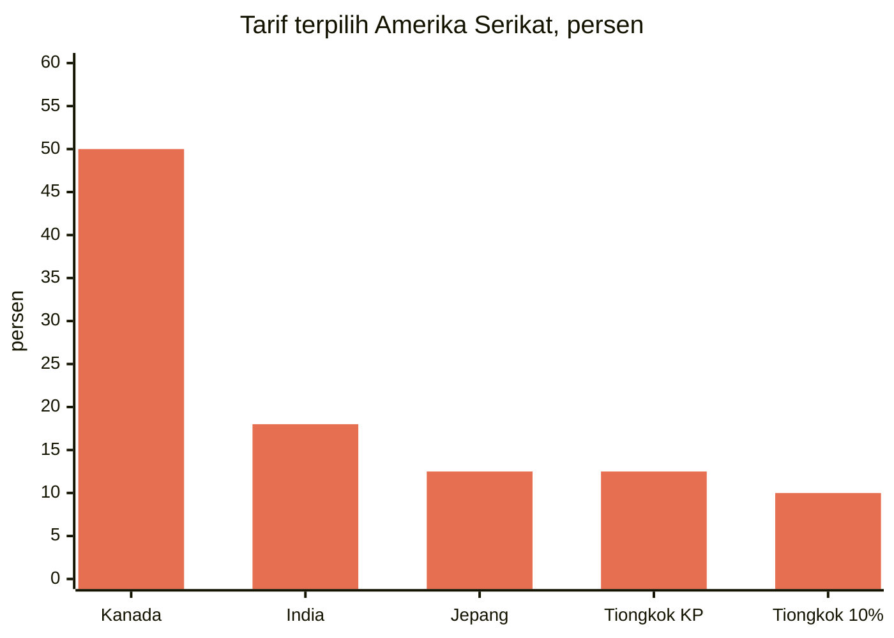
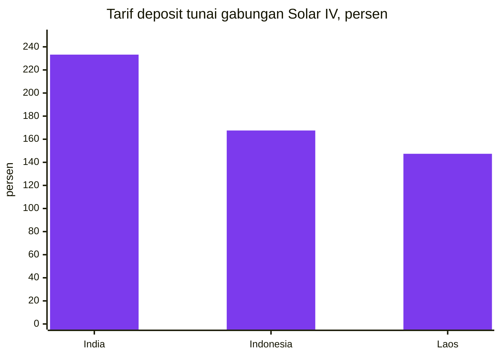
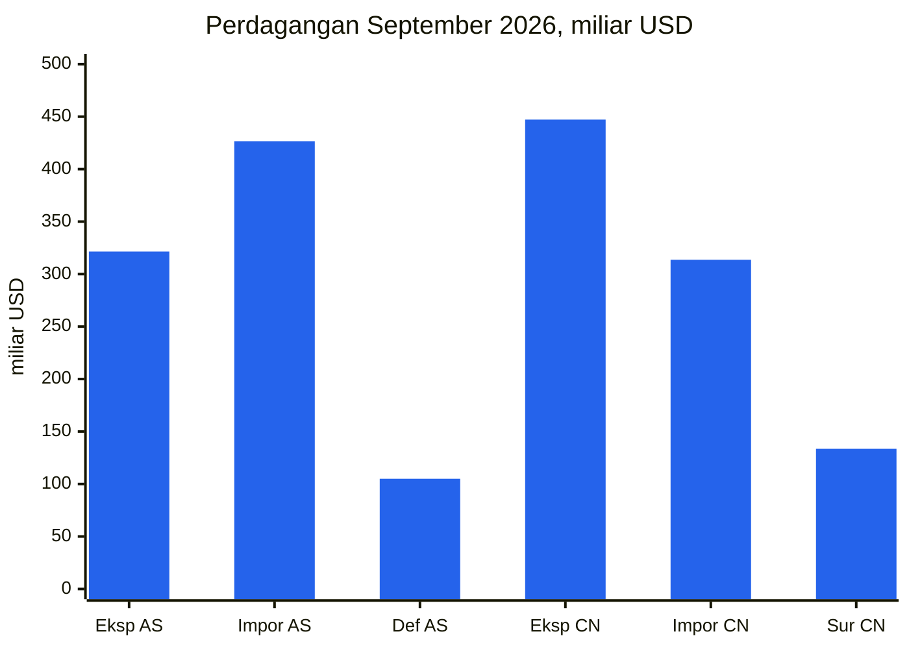
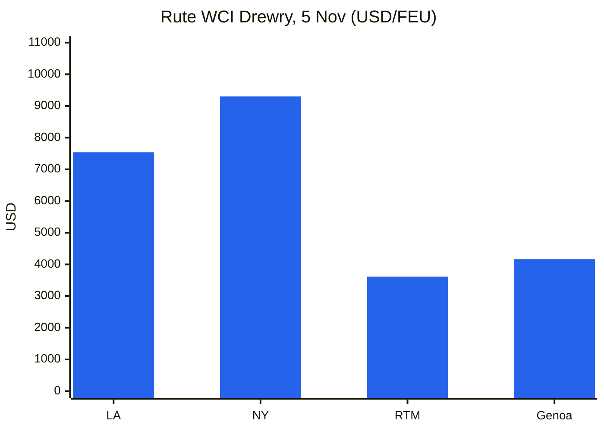
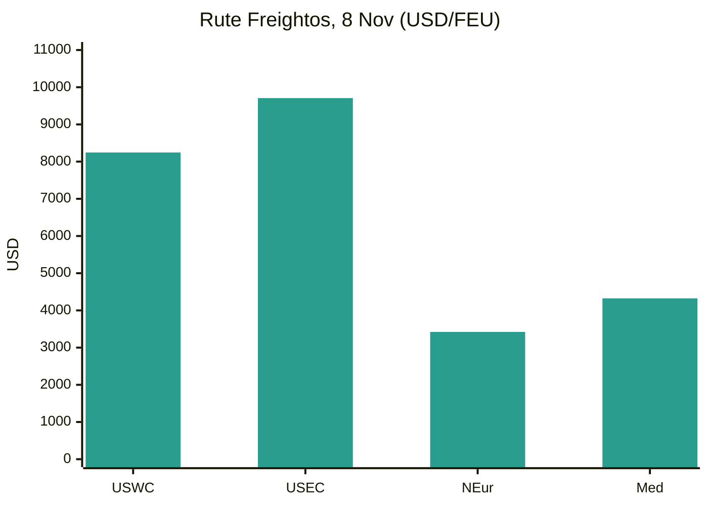
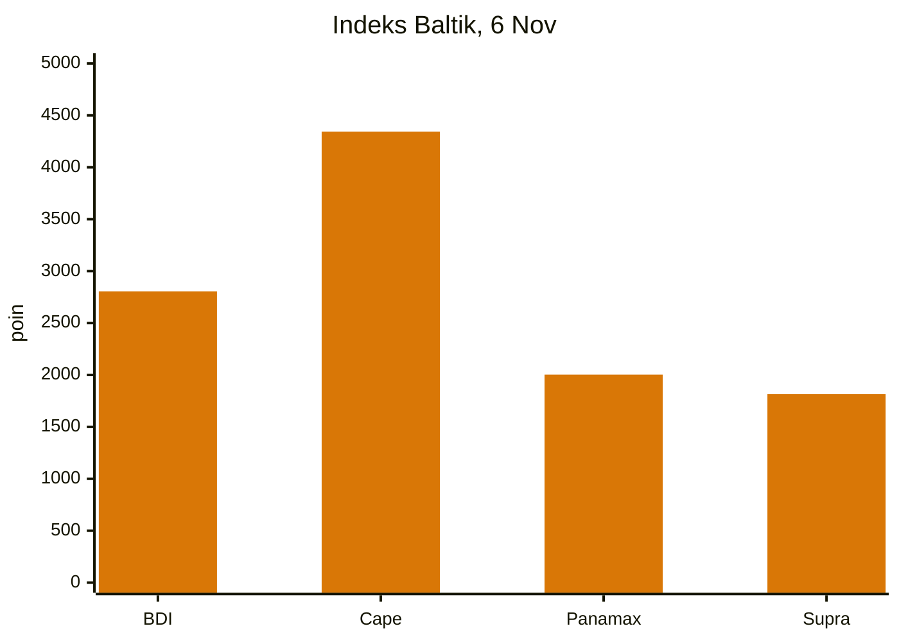
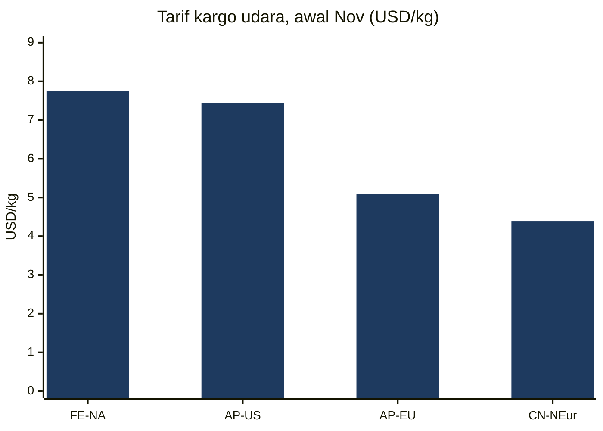
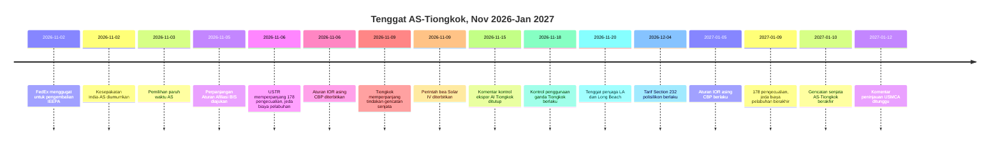
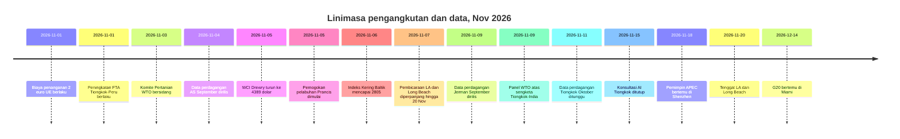

# Laporan Intelijen Perdagangan Global — Minggu 2–9 November 2026

**Briefing mingguan.** Jendela liputan: 2–9 November 2026. Disusun dari sekitar 45 sumber berita, kebijakan, data, dan pengangkutan perdagangan di seluruh dunia.

---

## Daftar isi

1. [Ringkasan eksekutif](#1-executive-summary)
2. [Peringatan](#2-alerts)
3. [Cerita utama — analisis mendalam](#3-top-stories--deep-dives)
4. [Pelacak tarif](#4-tariff-tracker)
5. [Analisis mendalam kebijakan AS](#5-us-policy-deep-dive)
6. [Kebijakan dunia menurut kawasan](#6-world-policy-by-region)
7. [Tindakan penegakan](#7-enforcement-actions)
8. [Rilis data](#8-data-releases)
9. [Pasar pengangkutan](#9-freight-market)
10. [Linimasa kebijakan](#10-policy-timelines)
11. [Tenggat & acara mendatang (90 hari ke depan)](#11-upcoming-deadlines--events-next-90-days)
12. [Sumber & metodologi](#12-sources--methodology)

---

## 1. Ringkasan eksekutif

Minggu di mana tenggat 9 November berhasil dihindari pada menit terakhir, dua kali, lalu digeser ke Januari. Pada 6 November, Kantor Perwakilan Dagang Amerika Serikat mempublikasikan pemberitahuan yang memperpanjang seluruh 178 pengecualian produk Section 301 atas Tiongkok dan penangguhan biaya pelabuhan Section 301 atas kapal-kapal terkait Tiongkok hingga 9 Januari 2027; pada 9 November, Tiongkok memperpanjang pihaknya sendiri dari gencatan senjata — penangguhan tarif tambahan 24% atas barang Amerika Serikat, penangguhan biaya pelabuhannya, dan pengecualian kontrol ekspor mineral kritisnya — hingga 10 Januari 2027. Penangguhan dua bulan itu nyata, tetapi singkat: instrumen yang sama kini berakhir dalam selisih sehari pada Januari, dan paket tarif yang lebih luas yang dibahas setelah KTT Washington bulan September masih belum difinalisasi. Di tempat lain, India dan Amerika Serikat mengumumkan kesepakatan dagang yang memangkas tarif Amerika Serikat atas barang India menjadi 18% dari setinggi 50%, Partai Demokrat memenangkan kendali atas kedua majelis Kongres dalam pemilihan paruh waktu tanpa mengubah prospek tarif, biaya penanganan €2 dan persyaratan pengenal produk Uni Eropa mulai berlaku pada 1 November, dan Tiongkok memperluas jaring kontrol ekspornya ke arah kecerdasan buatan, biofarmasi, dan teknologi manufaktur surya.

- **Tenggat 9 November diperpanjang, bukan dihapus.** Pemberitahuan USTR tanggal 6 November memperpanjang 178 pengecualian produk Section 301 (164 pengecualian umum, 14 pengecualian manufaktur surya) dan penangguhan lebih lanjut atas tindakan maritim Section 301 hingga pukul 23.59 ET pada 9 Januari 2027; barang yang masuk mulai 10 November 2026 berada dalam jendela baru. Biro Industri dan Keamanan mengajukan perpanjangan penangguhan Aturan Afiliasi 50% hingga 10 Januari 2027. Tiongkok, yang mengumumkan pada 9 November, mempertahankan penangguhan tarif tambahan 24% atas barang Amerika Serikat selama dua bulan lagi mulai 10 November, mempertahankan tarif tambahan 10%, dan memperpanjang penangguhan biaya pelabuhan, pengecualian kontrol ekspor mineral kritis, dan penangguhan tindakan terhadap 11 perusahaan Amerika Serikat dalam daftar entitas tidak dapat diandalkan serta 16 perusahaan dalam daftar kontrol ekspornya hingga 10 Januari 2027. Asimetrinya kecil tetapi nyata: instrumen Amerika Serikat berakhir 9 Januari, Tiongkok 10 Januari, dan hingga 9 November belum ada dokumen presiden Amerika Serikat yang memformalkan perpanjangan gencatan senjata yang dipublikasikan.
- **India dan Amerika Serikat mencapai kesepakatan pada 2 November.** Washington memangkas tarif atas barang India menjadi 18% dari setinggi 50% — tarif resiprokal 25% ditambah penalti 25% untuk pembelian minyak Rusia — dan mencabut pungutan minyak Rusia. Presiden Trump mengatakan India telah setuju untuk berhenti membeli minyak Rusia dan meningkatkan pembelian dari Amerika Serikat; pemerintah India belum secara terbuka mengonfirmasi komitmen pengadaan energi tertentu. Kesepakatan ini digambarkan sebagai tahap pertama dari kesepakatan bilateral yang lebih luas, dengan target perdagangan bilateral $500 miliar pada 2030, tetapi hingga 3 November belum ada teks yang ditandatangani, jadwal tarif, atau tanggal pemberlakuan yang dipublikasikan. Kesepakatan ini menyusul beberapa hari setelah India merampungkan perjanjian perdagangan bebas dengan Uni Eropa.
- **Pemilihan paruh waktu mengubah politik perdagangan, bukan tarifnya.** Partai Demokrat memenangkan kendali atas Dewan Perwakilan Rakyat dan Senat pada 3 November, menurut deklarasi Associated Press. Para analis memperkirakan sidang pengawasan dan pemungutan suara simbolis untuk membatalkan tarif pada 2027, tetapi bukan pencabutan: Partai Demokrat masih jauh dari mayoritas dua pertiga yang diperlukan untuk menolak veto presiden, dan pemerintahan telah membangun kembali struktur tarifnya berdasarkan kewenangan Section 301 dan Section 232 setelah Mahkamah Agung membatalkan tarif IEEPA pada Februari 2026. Senat telah memberikan suara 51–47 pada 29 Oktober untuk mengakhiri keadaan darurat nasional di balik tarif global. Pungutan Section 122, yang dibatasi 150 hari tanpa undang-undang, adalah satu-satunya instrumen yang dapat dibatasi Kongres baru.
- **Reset e-commerce bernilai rendah Eropa mulai berlaku.** Mulai 1 November, biaya penanganan bea cukai €2 berlaku per baris item pada kiriman penjualan jarak jauh yang dikirim langsung dari luar Uni Eropa ke konsumen UE, di samping bea tetap €3 per baris tarif yang berlaku sejak 1 Juli 2026 untuk kiriman senilai €150 atau kurang. Setiap produk dalam kiriman business-to-consumer kini juga harus membawa tiga Pengenal Produk, tanpa memandang nilai. Gabungan bea dan biaya dapat mencapai €5 per baris tarif sebelum PPN. Bea cukai UE memproses sekitar 6 miliar paket e-commerce pada 2025, sekitar 90% dari Tiongkok.
- **Kontrol ekspor Tiongkok melebar ke arah teknologi dan peralatan industri.** Usulan bersama MOFCOM dan Kementerian Ilmu Pengetahuan dan Teknologi (Pengumuman No. 48, 16 Oktober) akan menambah 40 teknologi — 23 di bidang kecerdasan buatan, 5 di bidang biofarmasi, 12 di bidang fotovoltaik — ke katalog kontrol ekspor, dengan komentar ditutup 15 November dan pendaftaran pra-ekspor sementara sudah berlaku. Secara terpisah, kontrol penggunaan ganda atas drone, mesin bor terowongan, dan kapal keruk berlaku mulai 18 November. Pembatasan surya dinilai paling berdampak, mengingat dominasi Tiongkok dalam produksi fotovoltaik.
- **Amerika Serikat melaporkan rekor impor bulanan; Tiongkok menuju surplus $1 triliun.** Biro Sensus dan Biro Analisis Ekonomi melaporkan pada 4 November bahwa defisit barang dan jasa September mencapai $105,0 miliar, atas impor rekor $426,6 miliar dan impor barang rekor $346,9 miliar, dengan impor barang modal pada rekor $158,0 miliar. Surplus Tiongkok pada September mencapai $133,53 miliar atas ekspor $447,18 miliar, naik 36,3% tahun ke tahun; jajak pendapat Reuters memperkirakan ekspor Oktober naik 33,5% dan surplus $125,8 miliar, yang akan membawa surplus kumulatif Januari–Oktober melampaui $1 triliun. PMI manufaktur resmi Tiongkok turun menjadi 49,3 pada Oktober, dengan pesanan ekspor baru pada 48,7.
- **Pengangkutan kembali terbelah: laut melunak, udara melonjak.** Indeks Kontainer Dunia Drewry turun 1% menjadi $4.389 per kontainer 40 kaki pada 5 November, masih 124% lebih tinggi tahun ke tahun, karena kenaikan tarif umum yang diterapkan operator pada 1 November gagal bertahan. Indeks Kering Baltik menutup minggu pada 2.805, naik 3,4% minggu ke minggu, atas kekuatan Capesize. Pengangkutan udara bergerak ke arah sebaliknya: Timur Jauh–Amerika Utara mencapai $7,76 per kilogram pada 3 November, naik 9% dalam seminggu dan tertinggi pada 2026, mendekati puncak $8,00 pada awal Desember 2025. Sekitar 60% kapasitas kontainer Asia–Eropa kini menggunakan Terusan Suez, menurut Drewry. Sengketa penjaga pelabuhan Los Angeles–Long Beach ditunda lagi, hingga 20 November, sementara pelabuhan Prancis dilanda pemogokan dua hari dan blokade sopir truk di Pelabuhan San Antonio, Chili, mengancam musim ekspor ceri.

**Pengangkutan:** tarif spot kontainer melunak pada perdagangan transpasifik maupun Asia–Eropa sementara kenaikan November yang diterapkan operator didiskon; curah kering naik untuk minggu ketiga berturut-turut atas pendapatan Capesize; kargo udara mencapai level tertinggi 2026 menjelang musim puncak; transit Suez terus pulih; dan sengketa buruh di Los Angeles–Long Beach, Prancis, dan Chili membuat risiko pelabuhan tetap hidup sepanjang musim puncak.

---

## 2. Peringatan

| # | Peringatan | Berlaku | Dampak | Sumber |
|---|-------|-----------|--------|--------|
| A1 | USTR memperpanjang seluruh 178 pengecualian produk Section 301 atas Tiongkok hingga pukul 23.59 ET 9 Jan 2027; barang yang masuk mulai 10 Nov 2026 berada dalam jendela baru; publikasi Federal Register belum dikonfirmasi hingga 8 Nov | 6 Nov 2026 (dipublikasikan) | Penangguhan dua bulan saja; barang yang masuk setelah 9 Jan 2027 membayar tarif daftar penuh (25% Daftar 1–3, 7,5% Daftar 4A) | [TechTimes](https://www.techtimes.com/articles/330285/20261109/ustr-extends-section-301-tariff-exclusions-chinese-goods-entries-after-january-9-pay-full-duty.htm) |
| A2 | USTR menangguhkan lebih lanjut tindakan maritim Section 301 (biaya pelabuhan atas kapal terkait Tiongkok, bea Lampiran V.A) hingga pukul 23.59 ET 9 Jan 2027 | 9 Nov 2026 | Biaya tetap ditangguhkan; penangguhan dan pengecualian berakhir pada tanggal yang sama pada Januari | [Gateway Lines](https://gatewaylines.com/press-releases/china-ship-fee-delay-jan-9-2027-301-exclusions) |
| A3 | Tiongkok memperpanjang penangguhan tarif tambahan 24% atas barang AS selama dua bulan mulai 10 Nov, mempertahankan tarif 10%; memperpanjang penangguhan biaya pelabuhan, pengecualian kontrol ekspor mineral kritis, dan penangguhan daftar entitas hingga 10 Jan 2027 | 9–10 Nov 2026 | Eksportir AS tetap dikenakan tarif 10%; gencatan senjata kini berjalan hingga 10 Jan 2027 di pihak Tiongkok | [Reuters via SRN News](https://srnnews.com/china-extends-suspension-of-24-tariff-on-us-imports-for-two-months/) |
| A4 | Kesepakatan dagang India–AS diumumkan: tarif AS atas barang India dipangkas menjadi 18% dari hingga 50%; pungutan minyak Rusia dicabut; belum ada teks yang ditandatangani yang dipublikasikan hingga 3 Nov | 2 Nov 2026 | Penentuan harga ulang untuk barang asal India; komitmen pengadaan energi belum dikonfirmasi New Delhi | [Economic Times](https://www.eximguru.com/export-import-news/export-news/india-us-trade-deal-lifts-a-117126.aspx) |
| A5 | Aturan final sementara CBP: importir asing yang tercatat harus tervalidasi CTPAT atau menggunakan broker yang tervalidasi CTPAT mulai 5 Jan 2027; 32% importir asing yang tercatat saat ini tidak memenuhi kedua syarat | 5 Jan 2027 | Penjual asing yang mengirim langsung ke pembeli AS harus berganti broker atau memperoleh validasi; komentar ditutup 5 Jan 2027 | [CBP](https://www.cbp.gov/newsroom/national-media-release/cbp-announces-heightened-requirements-foreign-importers-record) |
| A6 | Biaya €2 UE per baris item dan tiga Pengenal Produk diwajibkan atas semua kiriman B2C ke UE mulai 1 Nov; gabungan bea dan biaya hingga €5 per baris tarif sebelum PPN | 1 Nov 2026 | Biaya pendaratan e-commerce bernilai rendah dan multi-item naik; kiriman tanpa pengenal berisiko tertunda atau ditolak | [Logistik Heute](https://logistik-heute.de/en/news/eu-customs-policy-new-package-fee-increases-costs-cross-border-online-trade-291550.html) |
| A7 | Commerce menerbitkan perintah AD/CVD final atas sel surya silikon kristal dari India, Indonesia, dan Laos; tarif gabungan menyeluruh hingga sekitar 233% (India), 168% (Indonesia), 147% (Laos) | 9 Nov 2026 | Deposit tunai berlanjut mulai 5 Nov; modul yang dibuat di negara ketiga menggunakan sel yang tercakup masuk dalam perintah | [MLex](https://www.mlex.com/mlex/articles/2547289/us-commerce-imposes-duties-for-indonesian-laotian-and-indian-solar-cells) |
| A8 | Ancaman pemogokan penjaga pelabuhan LA/Long Beach ditunda lagi; pembicaraan diperpanjang hingga 20 Nov 2026; sekitar 250 pekerja di enam terminal; ~85% kargo Long Beach dan ~33% kargo Los Angeles berisiko | 20 Nov 2026 | Penghentian kerja sehari setelah pemilihan paruh waktu berhasil dihindari, tetapi sengketa kini berlanjut hingga akhir musim puncak dengan tunggakan rel yang sudah besar | [gCaptain](https://maritimenewsbd.com/la-long-beach-port-strike-threat-deferred-november-20/) |
| A9 | Usulan katalog kontrol ekspor AI/biofarmasi/surya Tiongkok: komentar ditutup 15 Nov 2026; pendaftaran pra-ekspor sementara sudah berlaku; kontrol penggunaan ganda atas drone, mesin bor terowongan, dan kapal keruk berlaku 18 Nov | 15 Nov / 18 Nov 2026 | 40 teknologi terdampak (14 dilarang, 26 dibatasi); pengetahuan manufaktur surya adalah sisi tertajam | [China Briefing](https://www.china-briefing.com/news/china-technology-export-controls/) |
| A10 | Partai Demokrat memenangkan kedua majelis dalam pemilihan paruh waktu 3 Nov; struktur tarif diperkirakan bertahan; Senat memberikan suara 51–47 pada 29 Okt untuk mengakhiri keadaan darurat nasional di balik tarif global | 3 Nov 2026 | Sidang pengawasan dan pemungutan suara simbolis untuk membatalkan tarif diperkirakan pada 2027; Section 122 adalah instrumen yang dapat dibatasi Kongres baru | [SupplyChainBrain](https://www.supplychainbrain.com/general-scm/regulation-compliance/article/16424361/us-midterm-rout-unlikely-to-change-trumps-trade-policy) |

### A1/A2 — Tenggat 9 November, diperpanjang pada menit terakhir

Dua instrumen yang mendominasi briefing minggu lalu keduanya diperpanjang pada 6 November, ketika USTR mempublikasikan dua pemberitahuan di situs webnya. Pemberitahuan pertama memperpanjang seluruh 178 pengecualian produk Section 301 atas Tiongkok — 164 pengecualian umum berdasarkan HTSUS 9903.88.69 dan 14 pengecualian manufaktur surya berdasarkan 9903.88.70 — hingga pukul 23.59 ET pada 9 Januari 2027, mencakup barang yang masuk untuk konsumsi, atau ditarik dari gudang untuk konsumsi, pada atau setelah pukul 00.01 ET pada 10 November 2026. Tidak ada pengecualian yang ditambah atau dihapus, dan tidak ada komentar baru yang diminta; USTR mengandalkan komentar atas pemberitahuannya tanggal 16 September 2025. Pemberitahuan kedua menangguhkan lebih lanjut tindakan Section 301 atas praktik maritim, logistik, dan pembangunan kapal Tiongkok, termasuk biaya kapal yang tercakup dan bea Lampiran V.A, berlaku 9 November 2026 hingga pukul 23.59 ET pada 9 Januari 2027. USTR telah mengusulkan perpanjangan maritim pada 26 Oktober (91 FR 67388); periode komentar ditutup 30 Oktober. Hingga 8 November, belum ada publikasi Federal Register terkait yang teridentifikasi untuk kedua pemberitahuan tersebut, dan pemberitahuan pengecualian mengandung inkonsistensi internal — bagian Dates dan lampirannya menyebut 9 Januari 2027, sementara teks lain merujuk pada 10 Januari; tanggal yang berlaku adalah 9 Januari. Tanpa perpanjangan, barang yang masuk mulai 10 November akan membayar tarif daftar penuh. Pengecualian hanya menghilangkan bea daftar: tarif kerja paksa Section 301 sebesar 12,5%, bea Section 232, bea antidumping dan countervailing, serta tarif most-favoured-nation tetap berlaku. Pada 4 November, Software & Information Industry Association dan 23 organisasi lain telah meminta USTR untuk perpanjangan setidaknya satu tahun; USTR memberikan dua bulan.

### A3 — Tiongkok bertindak pada hari yang sama gencatan senjata seharusnya berakhir

Tiongkok mengumumkan pada Senin, 9 November bahwa pihaknya akan terus menangguhkan tarif tambahan 24% atas barang Amerika Serikat selama dua bulan lagi, mulai pukul 13.01 waktu Beijing pada 10 November, dengan mempertahankan tarif tambahan 10%. Pengumuman No. 6 Tahun 2026 Komisi Tarif Bea Cukai mengimplementasikan konsensus yang dicapai pada KTT Washington bulan September antara Presiden Trump dan Xi. Secara paralel, Kementerian Perdagangan Tiongkok memperpanjang pengecualian kontrol ekspor untuk mineral kritis tertentu dan teknologi terkait hingga 10 Januari 2027, tindakan terhadap 11 perusahaan Amerika Serikat dalam daftar entitas tidak dapat diandalkan dan 16 perusahaan dalam daftar kontrol ekspornya tetap ditangguhkan hingga 10 Januari 2027, dan penangguhan biaya pelabuhan khusus atas kapal-kapal terkait Amerika Serikat diperpanjang hingga tanggal yang sama. Sanksi atas lima anak perusahaan Amerika Serikat dari Hanwha Ocean juga ditangguhkan selama dua bulan tambahan. Asimetri ini penting untuk perencanaan: Beijing telah bertindak melalui pengumuman resmi, sementara hingga 9 November belum ada dokumen presiden Amerika Serikat yang memformalkan perpanjangan gencatan senjata yang dipublikasikan, dan instrumen Amerika Serikat berakhir 9 Januari sementara Tiongkok berjalan hingga 10 Januari. Usulan paket pemangkasan tarif resiprokal senilai $60 miliar yang dibahas setelah KTT September, termasuk $17 miliar barang pertanian Amerika Serikat yang diimpor Tiongkok pada 2024, masih belum difinalisasi.

### A4 — Kesepakatan India–AS: 18% dan pertanyaan minyak Rusia

India dan Amerika Serikat mencapai kesepakatan dagang setelah negosiasi yang tegang selama berbulan-bulan, yang berpuncak pada panggilan telepon antara Perdana Menteri Narendra Modi dan Presiden Donald Trump pada Senin malam, 2 November. Washington mengumumkan pemangkasan tarif atas barang India menjadi 18% dari setinggi 50% — tarif resiprokal 25% ditambah penalti 25% yang dikenakan karena pembelian minyak Rusia — dan mencabut pungutan penalti tersebut. Presiden Trump mengatakan India telah setuju untuk berhenti membeli minyak Rusia dan meningkatkan pembelian dari Amerika Serikat dan kemungkinan Venezuela, serta membeli barang-barang Amerika "pada tingkat yang jauh lebih tinggi"; pemerintah India belum secara terbuka mengomentari komitmen pengadaan energi tertentu. Reuters melaporkan India setuju untuk meningkatkan pembelian minyak bumi, barang pertahanan, elektronik, farmasi, peralatan telekomunikasi, dan pesawat Amerika Serikat. Kesepakatan ini digambarkan sebagai tahap pertama dari kesepakatan bilateral yang lebih luas, dengan negosiasi berlanjut dan target perdagangan bilateral $500 miliar pada 2030, naik dari sekitar $191 miliar saat ini. Hingga pelaporan 3 November, belum ada teks yang ditandatangani, jadwal tarif, atau tanggal pemberlakuan yang dipublikasikan, dan tarif 18% dari kerangka Februari 2026 belum pernah diterapkan sebelumnya — sebagian besar barang India telah dikenakan bea Section 301 sebesar 10% sejak 24 Juli 2026.

### A5 — Aturan importir asing yang tercatat dari CBP

CBP menerbitkan aturan final sementara, "Heightened Requirements for Foreign Importers of Record" (CBP Dec. 26-19, 91 FR 69977), pada 6 November 2026, yang mengimplementasikan Bagian 2 dari Perintah Eksekutif 14411 ("Strengthening Customs Enforcement," ditandatangani 3 Juni 2026). Mulai 5 Januari 2027, importir asing yang tercatat hanya dapat memasukkan barang untuk konsumsi jika dirinya sendiri tervalidasi CTPAT atau mengajukan melalui broker bea cukai berlisensi yang tervalidasi CTPAT. Analisis CBP sendiri: 0,4% importir asing yang tercatat tervalidasi CTPAT dan 68% sudah menggunakan broker yang tervalidasi; 32% sisanya tidak akan dapat terus mengimpor ke Amerika Serikat kecuali mereka berganti broker atau menjadi tervalidasi CTPAT sendiri. Bagian 110 yang baru dari peraturan bea cukai mendefinisikan "U.S. IOR"; status importir harus dinyatakan pada saat masuk dan ringkasan masuk; broker harus memverifikasi status klien dan menyimpan catatan verifikasi selama lima tahun; komentar ditutup 5 Januari 2027. Aturan ini tidak memberlakukan larangan menyeluruh atas entri informal untuk importir asing yang tercatat seperti yang diperintahkan perintah eksekutif, tetapi mengundang komentar atas larangan penuh sebagai alternatif. Perkiraan biaya yang dimonetisasi adalah sekitar $1.233.253 per tahun.

### A6 — Biaya €2 UE dan Pengenal Produk

Mulai 1 November 2026, biaya penanganan bea cukai €2 berlaku per baris item pada kiriman penjualan jarak jauh yang dikirim langsung dari luar Uni Eropa ke konsumen UE, tanpa memandang nilai, berdasarkan Peraturan Delegasi (UE) 2026/2152. Biaya ini berada di atas bea tetap €3 per baris tarif yang berlaku sejak 1 Juli 2026 untuk kiriman senilai €150 atau kurang berdasarkan Peraturan (UE) 2026/382, yang menghapus pembebasan bea de minimis €150. Mulai tanggal yang sama, setiap produk dalam kiriman business-to-consumer ke UE — tanpa memandang nilai — harus membawa tiga Pengenal Produk. Gabungan bea dan biaya karena itu dapat mencapai €5 per baris tarif, tidak termasuk PPN. Rezim sementara berjalan hingga 1 Juli 2028, ketika sistem data bea cukai UE terpusat dijadwalkan menggantikan pungutan tetap dengan bea standar. Biaya ini tidak dapat dikembalikan meskipun barang dikembalikan.

### A7 — Perintah Solar IV: tarif gabungan hingga sekitar 233%

Commerce menerbitkan perintah bea antidumping dan countervailing atas sel fotovoltaik silikon kristal, baik yang dirakit menjadi modul maupun tidak, dari India, Indonesia, dan Laos pada 9 November 2026, menyusul penetapan akhir cedera afirmatif USITC yang dipublikasikan 5 November (91 FR 69865). India: margin antidumping 123,04% (deposit tunai 107,17% setelah offset subsidi) dan bea countervailing 126,09%, tarif deposit tunai gabungan 233,26%. Indonesia: antidumping 94,36% dan countervailing 73,20% (gabungan semua-pihak-lain 167,56%). Laos: antidumping 65,43% dan countervailing 82,03% (gabungan 147,39%). Penangguhan likuidasi dan penagihan deposit tunai berlanjut mulai 5 November 2026. Modul, laminasi, dan panel yang dibuat di negara ketiga menggunakan sel yang tercakup masuk dalam perintah; modul yang dirakit di India menggunakan sel negara ketiga tidak masuk. Laporan publik lengkap USITC (Publikasi USITC 5804) ditunggu paling lambat 23 November 2026.

### A8 — LA/Long Beach: ditunda hingga 20 November

Ancaman pemogokan oleh pekerja keamanan (penjaga pelabuhan) di terminal kontainer Los Angeles dan Long Beach telah ditunda lagi, dengan pembicaraan kini diperpanjang hingga 20 November, dilaporkan Bloomberg melalui gCaptain pada 7 November. ILWU Local 26 mewakili sekitar 250 pekerja keamanan di enam terminal kontainer; kontrak mereka sebelumnya berakhir Juli 2025, para anggota telah mengesahkan pemogokan, dan kedua pihak bernegosiasi dengan bantuan Layanan Mediasi dan Konsiliasi Federal. Asosiasi Maritim Pasifik mengatakan gangguan dapat berdampak pada sekitar 85% kargo yang bergerak melalui Pelabuhan Long Beach dan sepertiga kargo di Pelabuhan Los Angeles, karena pekerja pelabuhan lain diperkirakan tidak akan melintasi garis piket Local 26. Kompleks tersebut sudah tegang: sekitar 35.688 kontainer impor menunggu layanan rel di kedua pelabuhan, 10.562 di antaranya selama sembilan hari atau lebih, dan impor yang menuju rel menunggu rata-rata 7,19 hari pada September, naik dari 6,75 pada Agustus. Pelabuhan Los Angeles menangani 1 juta boks dalam sebulan, rekor baru, bahkan ketika pimpinannya memperingatkan risiko perencanaan akibat tarif.

### A9 — Kontrol ekspor Tiongkok: komentar ditutup 15 November, aturan penggunaan ganda berlaku 18 November

MOFCOM dan Kementerian Ilmu Pengetahuan dan Teknologi mengusulkan penambahan 40 teknologi ke Katalog Teknologi yang Dilarang dan Dibatasi untuk Diekspor: 23 di bidang kecerdasan buatan, 5 di bidang biofarmasi, 12 di bidang fotovoltaik. Empat belas akan dilarang diekspor; 26 dibatasi (memerlukan lisensi). Sejak 16 Oktober 2026, pendaftaran pra-ekspor sementara atas teknologi yang terdaftar — termasuk ekspor yang sudah berjalan dan pengalihan kepemilikan atau kendali atas perusahaan domestik yang memegang teknologi tersebut kepada entitas luar negeri — berlaku melalui aplikasi Technology Trade Management Information MOFCOM. Komentar publik ditutup 15 November. Secara terpisah, tiga pengumuman merevisi Daftar Kontrol Ekspor Barang Penggunaan Ganda untuk kendaraan udara tak berawak, mesin bor terowongan, dan kapal keruk, semuanya berlaku 18 November 2026, dan MOFCOM serta Administrasi Umum Bea Cukai menerbitkan Pemberitahuan 52 yang merevisi prosedur di mana bea cukai dapat menahan barang yang diajukan untuk diekspor tanpa lisensi. MOFCOM menggambarkan paket itu sebagai "tepat dan terbatas".

### A10 — Pemilihan paruh waktu: Partai Demokrat merebut Kongres; tarif diperkirakan bertahan

Pemilihan paruh waktu 3 November menghasilkan pergeseran besar yang bersejarah ke arah Partai Demokrat di Dewan Perwakilan Rakyat, Senat, dan jabatan lainnya; pelaporan pada 4 November menggambarkan kemenangan menyeluruh Partai Demokrat di kedua majelis. Seluruh 435 kursi Dewan dan 35 dari 100 kursi Senat diperebutkan. Para ahli perdagangan dan staf kongres mengatakan kepada Reuters bahwa Kongres Demokrat akan membawa sidang pengawasan dan pemungutan suara simbolis untuk membatalkan tarif pada 2027 tetapi bukan pencabutan: Partai Demokrat masih jauh dari mayoritas dua pertiga yang diperlukan untuk menolak veto presiden, dan Gedung Putih mengatakan Presiden Trump tidak akan bergeming dari agenda perdagangan America First-nya. Senat telah memberikan suara 51–47 pada 29 Oktober 2026 untuk mengakhiri keadaan darurat nasional di balik tarif global, dengan empat anggota Partai Republik bergabung dengan Partai Demokrat, tetapi pemungutan suara itu tidak membongkar struktur tarif. Para analis mencatat pemerintahan telah membangun kembali tarifnya berdasarkan kewenangan Section 301 dan Section 232 setelah Mahkamah Agung membatalkan tarif IEEPA pada 20 Februari 2026, dan kewenangan itu sejauh ini bertahan; 25 negara bagian telah menggugat untuk memblokir bea Section 301 dan kasusnya masih tertunda. Pembaruan bea cukai C.H. Robinson tanggal 5 November memperingatkan para pengirim untuk bersiap menghadapi kemungkinan tarif Section 301 tambahan atas negara-negara tertentu pada akhir 2026 dan memasuki 2027.

---

## 3. Cerita utama — analisis mendalam

### 3.1 Gencatan senjata, diperpanjang dua bulan — dan tenggat Januari yang diciptakannya

Cerita utama minggu ini adalah sepasang perpanjangan yang bersama-sama menjaga gencatan senjata perdagangan Amerika Serikat–Tiongkok tetap hidup hingga Januari, sekaligus memadatkan keputusan berikutnya ke dalam jendela dua bulan. Urutannya penting. Pada 6 November, USTR mempublikasikan dua pemberitahuan: satu memperpanjang seluruh 178 pengecualian produk Section 301 atas Tiongkok hingga pukul 23.59 ET pada 9 Januari 2027, yang lain menangguhkan lebih lanjut tindakan maritim Section 301 — biaya pelabuhan atas kapal terkait Tiongkok dan bea Lampiran V.A — hingga tanggal yang sama. Pada 5 November, BIS mengajukan perpanjangan penangguhan tindakan kontrol ekspor Aturan Afiliasi 50% hingga 10 Januari 2027. Pada 9 November, Tiongkok memperpanjang pihaknya: tarif tambahan 24% atas barang Amerika Serikat tetap ditangguhkan selama dua bulan lagi mulai 10 November, tarif tambahan 10% tetap berlaku, dan penangguhan biaya pelabuhan khusus atas kapal terkait Amerika Serikat, pengecualian kontrol ekspor mineral kritis, serta tindakan terhadap 11 perusahaan Amerika Serikat dalam daftar entitas tidak dapat diandalkan dan 16 perusahaan dalam daftar kontrol ekspor semuanya berjalan hingga 10 Januari 2027.

Tiga hal patut diperhatikan. Pertama, perpanjangannya singkat — dua bulan, padahal pengaturan September dipahami berjalan setahun — dan diberikan setelah industri meminta setidaknya satu tahun. Software & Information Industry Association dan 23 organisasi lain meminta USTR pada 4 November untuk perpanjangan setidaknya satu tahun atas pengecualian tersebut; USTR memberikan dua bulan. Kedua, tanggal-tanggalnya tidak selaras persis: instrumen Amerika Serikat berakhir 9 Januari, Tiongkok 10 Januari, dan gencatan senjata Amerika Serikat sendiri digambarkan oleh Menteri Keuangan Scott Bessent pada September sebagai berjalan hingga 10 Januari. Ketiga, substansi di balik gencatan senjata masih belum selesai. Pada 6 November, USTR Jamieson Greer dan Menteri Bessent mengadakan panggilan video dengan Wakil Perdana Menteri He Lifeng; Greer menekankan "pentingnya Tiongkok mengambil tindakan konkret untuk sepenuhnya melaksanakan komitmen masa lalunya," terutama pembelian pertanian, tanah jarang, dan mineral kritis lainnya, sementara Tiongkok menyatakan "keprihatinan serius" atas pembatasan perdagangan Amerika Serikat. Tidak satu pun pembacaan dari kedua pihak yang menyebut tenggat waktu. Usulan paket pemangkasan tarif resiprokal senilai $60 miliar yang dibahas setelah KTT September masih belum difinalisasi.

**Angka kunci:** 178 pengecualian diperpanjang (164 umum, 14 manufaktur surya); tanpa perpanjangan, barang yang masuk mulai 10 November akan membayar 25% (Daftar 1–3) atau 7,5% (Daftar 4A); tarif tambahan 24% Tiongkok tetap ditangguhkan, 10% dipertahankan; gencatan senjata kini berjalan hingga 9–10 Januari 2027.

**Mengapa hal ini penting:** importir memperoleh kepastian dua bulan alih-alih tenggat minggu ini, tetapi tenggatnya telah bergeser, bukan hilang. Titik keputusan berikutnya adalah pertemuan pemimpin APEC di Shenzhen pada 18–19 November, di mana Presiden Trump dan Xi bertemu untuk ketiga kalinya tahun ini, diikuti G20 di Miami pada 14–15 Desember. Barang yang masuk, pelayaran, dan penyaringan ekspor harus direncanakan berdasarkan posisi tertulis: pengecualian melekat pada tanggal masuk, bukan tanggal pengiriman, sehingga barang yang dikirim pada November tetapi masuk setelah 9 Januari berada di luar perpanjangan.

**Sumber:** [TechTimes](https://www.techtimes.com/articles/330285/20261109/ustr-extends-section-301-tariff-exclusions-chinese-goods-entries-after-january-9-pay-full-duty.htm); [Gateway Lines](https://gatewaylines.com/press-releases/china-ship-fee-delay-jan-9-2027-301-exclusions); [Reuters via SRN News](https://srnnews.com/china-extends-suspension-of-24-tariff-on-us-imports-for-two-months/); [BusinessWorld](https://bworldonline.com/world/2026/11/09/792445/china-extends-suspensions-of-24-tariff-on-us-goods-port-fees-on-us-ships-for-two-months/)

### 3.2 Kesepakatan India–AS: ketidakpastian tunggal terbesar atas ekonomi ekspor India terangkat

Pengumuman 2 November menghilangkan sumber ketidakpastian tunggal terbesar yang membayangi ekonomi ekspor India, meredakan tekanan pada rupee — yang telah mencapai rekor terendah — dan ekuitas India, dan, jika penghentian minyak Rusia bertahan, membentuk kembali arus minyak mentah bagi salah satu pembeli terbesar dunia. Amerika Serikat adalah tujuan ekspor utama India, menyerap sekitar 20% ekspor barang dagangan. Kesepakatan ini memangkas tarif Amerika Serikat atas barang India menjadi 18% dari setinggi 50% dan mencabut pungutan penalti tambahan yang dikenakan karena pembelian minyak Rusia. Kedua pihak menargetkan perdagangan bilateral $500 miliar pada 2030, naik dari sekitar $191 miliar saat ini (para pejabat India menyebut $131,84 miliar dengan ukuran yang lebih sempit).

Ketidakpastiannya material. Hingga 3 November belum ada teks yang ditandatangani, jadwal tarif, atau tanggal pemberlakuan yang dipublikasikan, dan tarif 18% dari kerangka Februari 2026 belum pernah diterapkan sebelumnya — sebagian besar barang India telah dikenakan bea Section 301 sebesar 10% sejak 24 Juli 2026. Pernyataan Presiden Trump bahwa India setuju untuk berhenti membeli minyak Rusia dan meningkatkan pembelian dari Amerika Serikat dan kemungkinan Venezuela belum dikonfirmasi secara terbuka oleh New Delhi dalam istilah tertentu. Reuters melaporkan India setuju untuk meningkatkan pembelian minyak bumi, barang pertahanan, elektronik, farmasi, peralatan telekomunikasi, dan pesawat Amerika Serikat. Kesepakatan ini datang beberapa hari setelah India merampungkan perjanjian perdagangan bebas dengan Uni Eropa, memberikan India dua kesepakatan besar dalam satu minggu — dan kesepakatan ini tiba bersamaan dengan cerita India lain minggu ini: Menteri Perdagangan Piyush Goyal mengatakan pada 3 November bahwa India tidak pernah membuka sektor susu dalam perjanjian perdagangan bebas apa pun dan tidak akan mengizinkan impor produk yang dimodifikasi secara genetik, garis merah yang relevan untuk setiap jalur FTA yang masih berjalan.

**Angka kunci:** tarif dipangkas menjadi 18% dari hingga 50% (25% resiprokal + 25% penalti minyak Rusia); perdagangan bilateral sekitar $191 miliar; target $500 miliar pada 2030; ekspor India April–September 2026 sekitar $480 miliar, naik sekitar 14% tahun ke tahun; India menargetkan ekspor barang dan jasa $1 triliun pada 2026–27.

**Mengapa hal ini penting:** bagi eksportir India, kesepakatan ini menggantikan skenario terburuk 50% dengan tarif 18% — jika teks mengonfirmasinya. Bagi pasar energi, pertanyaan minyak Rusia adalah variabel yang hidup: India adalah salah satu pembeli minyak mentah terbesar dunia, dan penghentian akan mengalihkan volume yang substansial. Bagi kebijakan perdagangan, kesepakatan ini menunjukkan pemerintahan menyelesaikan berkas bilateral besar melalui pengumuman sebelum teks, pola yang harus diperhitungkan importir dalam perencanaan.

**Sumber:** [Economic Times](https://www.eximguru.com/export-import-news/export-news/india-us-trade-deal-lifts-a-117126.aspx); [Reuters via Reporter World News](https://www.reporterworldnews.com/news/business/2026/11/03/piyush-goyal-commerce-dairy-products)

### 3.3 Pemilihan paruh waktu dan prospek tarif: politik baru, bea yang sama

Pemilihan 3 November memberikan Partai Demokrat kendali atas kedua majelis, tetapi arsitektur tarif dibangun atas kewenangan eksekutif yang tidak dibatalkan oleh pergantian Kongres. Tarif pemerintahan kini bertumpu terutama pada Section 301 dan Section 232, setelah Mahkamah Agung membatalkan tarif IEEPA pada 20 Februari 2026 dalam *Learning Resources, Inc. v. Trump*. Kewenangan itu tidak bergantung pada siklus pemilu, dan Partai Demokrat masih jauh dari mayoritas dua pertiga yang diperlukan untuk menolak veto presiden. Yang berubah adalah pengawasan: sidang pengawasan, pemungutan suara simbolis untuk membatalkan tarif, dan tekanan untuk keringanan yang ditargetkan — terutama atas Kanada — diperkirakan pada 2027. Satu-satunya instrumen yang dapat dibatasi Kongres baru adalah Section 122, yang pungutannya dibatasi 150 hari tanpa undang-undang; perpanjangan kerangka itu akan memerlukan Kongres baru. Kongres baru bersidang pada Januari 2027; hingga saat itu undang-undang tarif tetap seperti tertulis.

Front litigasi kini menyangkut uang, bukan kewenangan. Pada 2 November, FedEx mengajukan gugatan di Pengadilan Perdagangan Internasional Amerika Serikat terhadap Amerika Serikat, CBP, dan Komisaris CBP Rodney Scott, meminta pengembalian penuh atas semua tarif yang dibayarkannya sebagai importir yang tercatat berdasarkan perintah tarif IEEPA yang dibatalkan Mahkamah Agung — dilaporkan sebagai perusahaan besar pertama yang menggugat bagiannya dari perkiraan $175 miliar bea IEEPA yang dikumpulkan. Mahkamah Agung tidak memutuskan soal pengembalian, menyerahkan pertanyaan itu kepada pengadilan yang lebih rendah. Juga pada 2 November, Liberty Justice Center meluncurkan "Operation Refund Rescue," menawarkan pendanaan untuk tindakan Pengadilan Perdagangan Internasional yang ditargetkan secara sempit bagi usaha kecil yang memenuhi syarat yang entri IEEPA-nya telah mencapai likuidasi final dan karena itu tidak dapat memperoleh kembali melalui sistem pengembalian CAPE CBP tanpa perintah pengadilan; kapasitas awal adalah 100 pengajuan. Sistem pengembalian CAPE CBP diluncurkan di ACE pada 20 April 2026, dan CBP mengatakan pengembalian yang sah umumnya tiba dalam 60–90 hari setelah diterima. Pada 8 Oktober, Pengadilan Perdagangan Internasional mengesahkan gugatan kelompok dalam *Freestyle World, Inc. v. U.S. Customs and Border Protection* bagi importir yang tercatat yang membayar bea IEEPA yang dipermasalahkan. Secara terpisah, tarif kerja paksa Section 301 (12,5%, berlaku 24 Juli 2026) sedang dipermasalahkan di Pengadilan Perdagangan Internasional; argumen lisan didengar 30 September 2026, tanpa putusan yang dilaporkan hingga awal Oktober. Dua puluh lima negara bagian telah menggugat untuk memblokir bea Section 301 dan kasusnya masih tertunda.

**Angka kunci:** pemungutan suara Senat 51–47 pada 29 Oktober untuk mengakhiri keadaan darurat nasional di balik tarif global; perkiraan $175 miliar bea IEEPA yang dikumpulkan; pengembalian CAPE umumnya dalam 60–90 hari; 100 pengajuan awal di bawah Operation Refund Rescue.

**Mengapa hal ini penting:** para pengirim harus merencanakan dengan asumsi tumpukan tarif saat ini bertahan sepanjang dua tahun terakhir presiden, dengan peninjauan USMCA dan tindakan Section 301 baru sebagai front yang hidup. Litigasi pengembalian adalah pertanyaan arus kas yang terpisah dan material bagi importir yang tercatat: hanya importir yang tercatat (atau brokernya) yang dapat mengklaim, dan pengembalian diberikan kepada importir, bukan konsumen.

**Sumber:** [SupplyChainBrain](https://www.supplychainbrain.com/general-scm/regulation-compliance/article/16424361/us-midterm-rout-unlikely-to-change-trumps-trade-policy); [Liberty Justice Center](https://libertyjusticecenter.org/pressrelease/liberty-justice-center-launches-operation-refund-rescue-to-help-small-businesses-recover-unlawful-ieepa-tariff-payments/); [JD Supra](https://www.jdsupra.com/legalnews/old-tariffs-new-tariffs-future-tariffs-5121636/)

### 3.4 Eropa: reset e-commerce bernilai rendah mulai berlaku, dan Mercosur menunjukkan hasil pertama

Dua perkembangan Eropa minggu ini bergerak ke arah yang berlawanan: satu menaikkan hambatan bagi impor bernilai rendah, yang lain menunjukkan kawasan perdagangan bebas baru yang sudah menggerakkan barang. Biaya penanganan €2 dan persyaratan Pengenal Produk yang berlaku 1 November adalah lapisan operasional pertama dari kerangka reformasi bea cukai yang disetujui Dewan pada 3 September 2026, yang memodernisasi prosedur bea cukai, memperluas penggunaan data, dan membuat platform e-commerce non-UE bertanggung jawab sebagai importir atas bea dan pajak. Peraturan (UE) 2026/2108 mereformasi Kode Bea Cukai Uni, untuk secara bertahap menggantikan kode saat ini mulai 2028. Komisi harus menilai setiap bulan (mulai 1 Oktober 2026) apakah pengalihan arus perdagangan terjadi di bawah rezim bernilai rendah. Bagi penjual, perubahan ini adalah biaya sekaligus kewajiban data: kiriman tanpa tiga Pengenal Produk berisiko tertunda atau ditolak, dan biaya tidak dapat dikembalikan meskipun barang dikembalikan.

Perjanjian Perdagangan Sementara UE–Mercosur, yang ditandatangani 17 Januari 2026 di Asunción, mencapai enam bulan penerapan sementara pada 1 November, dan data keras pertama menunjukkan penyerapan yang cepat. Ekspor agribisnis Brasil ke UE naik 14,8% nilainya pada Mei–September 2026 menjadi $12,21 miliar, atas 17,74 juta ton (naik 8,1% tahun ke tahun). Ekspor Brasil ke UE secara keseluruhan dilaporkan naik 31% pada Mei–September; ekspor agroindustri Argentina naik 21% dalam empat bulan pertama, dengan produk yang tarifnya dikurangi naik 44%. Landasan hukumnya tetap sementara: Parlemen Eropa masih belum memberikan persetujuan akhir dan telah merujuk perjanjian itu ke Pengadilan Uni Eropa; penerapan sementara bertumpu pada keputusan Dewan Januari 2026. Secara terpisah, UE menangguhkan impor daging sapi, unggas, dan madu Brasil pada 3 September 2026 atas kepatuhan penggunaan antimikroba; pencatatan ulang untuk unggas dan madu dilaporkan mungkin setelah audit, tanpa tanggal yang dikonfirmasi.

**Angka kunci:** €2 per baris item (biaya penanganan); €3 per baris tarif (bea tetap sejak 1 Juli 2026); sekitar 6 miliar paket e-commerce diproses bea cukai UE pada 2025, sekitar 90% dari Tiongkok; ekspor agribisnis Brasil ke UE $12,21 miliar (Mei–September 2026, naik 14,8%); kuota daging sapi 99.000 ton pada 7,5%; UE menghapus bea atas 92% ekspor Mercosur.

**Mengapa hal ini penting:** aturan biaya dan pengenal 1 November mengubah ekonomi setiap paket bernilai rendah ke UE beberapa minggu sebelum musim puncak, menghantam platform asal Tiongkok (Shein, Temu) dan setiap penjual yang mengirim langsung ke konsumen UE. Data Mercosur menunjukkan kawasan perdagangan bebas terbesar dunia berdasarkan populasi (lebih dari 700 juta orang) sudah menggerakkan barang dalam skala besar — tetapi akses pasar tetap bersyarat, seperti yang ditunjukkan penangguhan Brasil.

**Sumber:** [Logistik Heute](https://logistik-heute.de/en/news/eu-customs-policy-new-package-fee-increases-costs-cross-border-online-trade-291550.html); [European Commission, Access2Markets](https://trade.ec.europa.eu/access-to-markets/en/news/application-eu-mercosur-interim-trade-agreement-1-may-2026); [EUR-Lex, Regulation (EU) 2026/382](https://eur-lex.europa.eu/legal-content/EN/TXT/?uri=OJ:L_202600382)

### 3.5 Tiongkok memperluas jaring kontrol ekspornya: model AI, platform biofarmasi, pengetahuan surya

Program kontrol ekspor Tiongkok maju di tiga front minggu ini, dan yang paling berdampak adalah yang ditujukan pada pengetahuan manufaktur ketimbang barang jadi. Usulan bersama MOFCOM dan Kementerian Ilmu Pengetahuan dan Teknologi (Pengumuman No. 48, 16 Oktober) akan menambah 40 teknologi ke Katalog Teknologi yang Dilarang dan Dibatasi untuk Diekspor: 23 di bidang kecerdasan buatan, 5 di bidang biofarmasi, 12 di bidang fotovoltaik. Empat belas akan dilarang diekspor; 26 dibatasi (memerlukan lisensi). Sejak 16 Oktober, pendaftaran pra-ekspor sementara atas teknologi yang terdaftar — termasuk ekspor yang sudah berjalan dan pengalihan kepemilikan atau kendali atas perusahaan domestik yang memegang teknologi tersebut kepada entitas luar negeri — berlaku melalui aplikasi Technology Trade Management Information MOFCOM. Dalam kecerdasan buatan, penerapan API, aplikasi, web, dan software-as-a-service serta penerapan ringan di perangkat ke model besar yang dibatasi berada di luar kontrol; penerapan lokal di luar negeri dan pemindahan bobot yang tercakup ke luar negeri akan memerlukan lisensi. Dalam biofarmasi, pengalihan kepemilikan atas platform terapi sel dan gen serta siRNA yang tercakup akan dilarang, tetapi lisensi, penelitian kontrak dan layanan manufaktur, serta teknologi yang diperlukan untuk penelitian dan pengembangan produk atau manufaktur dalam transaksi pengembangan bisnis ke luar negeri tidak akan dilarang. Dalam surya, larangan mencakup teknologi produksi polisilikon tertentu, persiapan wafer silikon setebal 70 mikrometer atau lebih tipis, serta fabrikasi sel surya perovskit dan tandem dan teknologi manufaktur peralatan terkait — dengan pengecualian terbatas, sehingga pembatasan surya dinilai paling berdampak bagi produsen asing, mengingat dominasi Tiongkok dalam produksi fotovoltaik dan teknologi surya terdepan. MOFCOM menggambarkan revisi itu sebagai rutin dan tidak ditujukan kepada negara tertentu. Komentar ditutup 15 November.

Paket penggunaan ganda berjalan di jalur paralel. Tiga pengumuman merevisi Daftar Kontrol Ekspor Barang Penggunaan Ganda untuk kendaraan udara tak berawak (Pengumuman No. 49), mesin bor terowongan, dan kapal keruk, semuanya berlaku 18 November 2026. MOFCOM dan Administrasi Umum Bea Cukai juga menerbitkan Pemberitahuan 52 (19 Oktober) yang merevisi prosedur di mana bea cukai dapat menahan barang yang diajukan untuk diekspor tanpa lisensi yang mungkin tunduk pada kontrol dan memerlukan lisensi. Secara terpisah, pada 13 Oktober MOFCOM merilis rancangan langkah-langkah yang menggantikan lisensi individual dengan sistem "sertifikat ekspor" untuk barang penggunaan ganda tertentu dalam penerbangan sipil. MOFCOM menggambarkan paket itu sebagai "tepat dan terbatas", dipasangkan dengan langkah-langkah fasilitasi yang detailnya tidak semuanya dirilis. Pada saat yang sama, Tiongkok memperpanjang pengecualian kontrol ekspornya untuk mineral kritis tertentu dan teknologi terkait hingga 10 Januari 2027 — keringanan terkait gencatan senjata yang dicatat pada bagian 3.1 — sehingga kontrol minggu ini dan pengecualian minggu ini bergerak ke arah yang berlawanan pada kelompok produk yang berbeda.

**Angka kunci:** 40 teknologi (23 AI / 5 biofarmasi / 12 PV); 14 dilarang, 26 dibatasi; komentar ditutup 15 November 2026; kontrol penggunaan ganda berlaku 18 November 2026.

**Mengapa hal ini penting:** usulan katalog ini menjangkau model AI terdepan yang dilatih dengan "data inti" Tiongkok, platform terapi sel dan gen, serta pengetahuan manufaktur inti di balik surya generasi berikutnya. Bagi produsen asing, ketentuan surya adalah sisi tertajam: ketentuan itu menjangkau peralatan dan proses di balik sel perovskit dan tandem, bukan hanya modul jadi. Tenggat komentar 15 November dan tanggal berlaku 18 November adalah titik kepatuhan yang mendesak.

**Sumber:** [China Briefing](https://www.china-briefing.com/news/china-technology-export-controls/); [Mondaq](https://alpha.mondaq.com/unitedstates/export-controls-trade-investment-sanctions/1865934/chinas-proposed-biopharma-and-ai-technology-export-controls-pre-export-registration-already-applies); [Akin Gump](https://www.akingump.com/print/v2/content/1138573/new-chinese-export-control-measures-tighten-restrictions-on-the-export-of-advanced-technologies-and-dual-use-goods-strengthen-enforcement.pdf)

### 3.6 Pengangkutan: laut melunak, udara melonjak, dan kembalinya Suez

Pasar kontainer tenang tetapi melunak minggu ini, dengan penurunan kecil pada perdagangan transpasifik maupun Asia–Eropa karena kendala kapasitas mereda dan permintaan tetap lemah secara musiman. Indeks Kontainer Dunia Drewry turun 1% menjadi $4.389 per kontainer 40 kaki dalam penilaian 5 November, tetapi tetap 124% lebih tinggi tahun ke tahun. Shanghai–Los Angeles tidak berubah pada $7.539 per 40 kaki, Shanghai–New York turun 3% menjadi $9.303, Shanghai–Rotterdam turun 2% menjadi $3.615, dan Shanghai–Genoa datar pada $4.166. Kenaikan freight-all-kinds operator pada 1 November — yang menargetkan sekitar $4.500 per 40 kaki ke Eropa Utara dan $5.000 ke Mediterania — gagal bertahan, dan upaya lanjutan pada level serupa dijadwalkan 15 November, meskipun forwarder Eropa mengatakan kepada The Loadstar bahwa permintaan yang moderat dan kapasitas yang melimpah kemungkinan akan menahannya. Linerlytica melaporkan operator menawarkan tarif diskon $2.700–$3.400 per 40 kaki di Asia–Eropa Utara dan memperkirakan tarif spot turun sekitar 30% sepanjang 2027. Drewry menghitung tiga pelayaran kosong yang diumumkan untuk minggu depan, turun dari lima minggu ini, dan memproyeksikan penurunan lebih lanjut tarif transpasifik minggu depan; 46 dari 717 pelayaran dikosongkan untuk minggu 46–50 (6%), dibandingkan 56 dari 715 seminggu sebelumnya. Data Container Trade Statistics yang dilaporkan 6 November menempatkan volume kontainer global pada 17,35 juta TEU pada September, naik 8% tahun ke tahun, dengan Indeks Harga Global CTS pada 123.

Pengangkutan udara bergerak ke arah sebaliknya. Pembaruan Freightos 3 November menempatkan Timur Jauh–Amerika Utara pada $7,76 per kilogram — naik 9% dalam satu minggu, level tertinggi 2026, kira-kira 40% di atas minggu yang sama tahun lalu, dan dalam 3% dari puncak $8,00 per kilogram yang dicapai pada awal Desember 2025. Freightos mengaitkan kenaikan itu dengan lonjakan permintaan musim puncak; tarif udara Eropa Utara–Amerika Utara naik 12% dalam seminggu, sementara Tiongkok–Eropa Utara naik 1% menjadi $4,39 per kilogram. Angka TAC Index yang dilaporkan Air Cargo News pada 2 November menunjukkan tarif rata-rata keluar Hong Kong naik dari $7,16 per kilogram pada awal Oktober menjadi $8,17 per kilogram pada akhir bulan. Data WorldACD minggu ke-43 menunjukkan tarif spot Asia Pasifik–Amerika Serikat naik 7% menjadi $7,43 per kilogram dan tarif spot Asia Pasifik–Eropa naik 5% menjadi $5,10 per kilogram, dengan kapasitas Asia Pasifik turun 1%, sebagian karena topan mengganggu penerbangan di Taiwan. Kontras dengan pengangkutan laut sangat tajam: tarif spot kontainer turun sementara tarif udara melonjak menjelang puncak pra-Natal, dan penghapusan de minimis berarti setiap kiriman kini juga dikenakan bea.

Kembalinya Suez berlanjut. Drewry melaporkan sekitar 60% kapasitas Asia–Eropa kini menggunakan kanal, dan memperingatkan penumpukan kapal dan kemacetan pelabuhan Eropa jika peralihan datang dengan cepat. Layanan ME1 India–Eropa Maersk kembali melalui Laut Merah (dilaporkan 2 November); kapal Evergreen dan Yang Ming dijadwalkan transit Suez 7–16 November. FreightWaves menyoroti serangan Houthi terhadap infrastruktur Saudi sebagai risiko geopolitik baru bagi tarif kontainer yang melunak menjelang negosiasi kontrak 2027. Di sisi korporasi, Maersk menaikkan prospek laba karena pendapatan melonjak, tetapi saham turun atas kegagalan memenuhi ekspektasi; ONE menaikkan perkiraan laba menjadi $2 miliar karena pendapatan melonjak.

**Angka kunci:** Drewry WCI $4.389 per 40 kaki (turun 1% minggu ke minggu, naik 124% tahun ke tahun); Shanghai–Los Angeles $7.539; Shanghai–New York $9.303; Shanghai–Rotterdam $3.615; Shanghai–Genoa $4.166; udara Timur Jauh–Amerika Utara $7,76 per kilogram (naik 9% minggu ke minggu, tertinggi 2026); Hong Kong keluar $8,17 per kilogram pada akhir Oktober; volume kontainer global 17,35 juta TEU pada September (naik 8% tahun ke tahun).

**Mengapa hal ini penting:** tarif tetap jauh di atas level tahun lalu bahkan ketika melunak, dan operator kesulitan mendorong kenaikan ke permintaan yang lemah — sinyal bahwa negosiasi kontrak 2027 akan menguntungkan pengirim. Risiko Timur Tengah adalah faktor yang tidak dapat diprediksi: gangguan Laut Merah yang baru akan membalikkan pelonggaran dengan cepat. Bagi pengirim yang melewatkan jendela musim puncak laut, tarif udara yang hampir rekor adalah biaya alternatifnya.

**Sumber:** [Drewry](https://www.drewry.co.uk/maritime-research-opinion-browser/world-container-index-assessed-by-drewry); [The Loadstar](https://theloadstar.com/calmer-waters-for-container-spot-rates-but-fragile-middle-east-a-threat/); [Freightos](https://www.freightos.com/freight-resources/asia-us-air-rates-already-nearing-last-years-high-on-peak-season-volumes-november-3-2026-update/); [Forwarder News](https://www.forwardernews.com/news/2026-11-07-september-box-trade-up-8)

### 3.7 Dua defisit, dua arah: Amerika Serikat mengimpor rekor, Tiongkok melampaui $1 triliun

Amerika Serikat melaporkan pada 4 November (Biro Sensus CB 26–178, BEA 26–47) bahwa defisit barang dan jasa September mencapai $105,0 miliar, turun $0,7 miliar dari $105,7 miliar yang direvisi pada Agustus. Defisit barang mencapai $135,9 miliar (turun $0,7 miliar); surplus jasa $30,9 miliar. Ekspor mencapai $321,5 miliar (naik $5,8 miliar dari Agustus); impor $426,6 miliar (naik $5,2 miliar) — rekor tertinggi. Ekspor barang $211,0 miliar (naik $5,1 miliar); impor barang $346,9 miliar, juga rekor. Impor barang modal mencapai rekor $158,0 miliar (komputer naik $7,6 miliar, aksesori komputer naik $5,7 miliar; semikonduktor turun $1,2 miliar). Defisit rata-rata tiga bulan mencapai $101,2 miliar, naik $11,3 miliar dari periode tiga bulan sebelumnya. Sejak awal tahun (Januari–September 2026), defisit barang dan jasa turun $92,4 miliar (12,2%) dibandingkan periode yang sama pada 2025. Defisit barang riil (disesuaikan inflasi) berdasarkan Sensus naik $3,5 miliar menjadi $119,5 miliar; BEA mengaitkan perbedaan antara ukuran nominal dan riil dengan penyesuaian neraca pembayaran emas nonmoneter. Defisit barang berdasarkan Sensus dengan Taiwan melebar $3,6 miliar menjadi $21,9 miliar.

Angka Tiongkok September, dirilis 14 Oktober, menempatkan ekspor pada $447,18 miliar, naik 36,3% tahun ke tahun (tercepat sejak Februari; Agustus naik 25,0%), impor $313,65 miliar, naik 31,0% tahun ke tahun, dan surplus bulanan $133,53 miliar (Agustus $119,1 miliar). Surplus kumulatif Januari–September mencapai $938,11 miliar, dibandingkan $1,189 triliun untuk seluruh 2025. Nilai ekspor semikonduktor naik 108,1% tahun ke tahun pada Januari–September; ekspor peralatan dan komponen pengolahan data otomatis naik 54,6%. Surplus bilateral rekor dengan UE mencapai $34,8 miliar pada September. Jajak pendapat Reuters terhadap para ekonom (9 November) memperkirakan ekspor Oktober naik 33,5% tahun ke tahun, impor naik 32%, dan surplus $125,8 miliar — cukup untuk membawa surplus kumulatif Januari–Oktober melampaui $1 triliun. Angka Oktober yang sebenarnya ditunggu 11 November, setelah jendela liputan ini. Data perdagangan Jerman September (Destatis, 9 November) menempatkan ekspor pada €141,1 miliar (naik 2,0% bulan ke bulan, 7,7% tahun ke tahun), impor €125,5 miliar, dan surplus €15,6 miliar.

**Angka kunci:** defisit September Amerika Serikat $105,0 miliar; defisit barang $135,9 miliar; surplus jasa $30,9 miliar; impor $426,6 miliar (rekor); surplus September Tiongkok $133,53 miliar; surplus kumulatif Januari–September $938,11 miliar; perkiraan surplus Oktober $125,8 miliar; surplus September Jerman €15,6 miliar.

**Mengapa hal ini penting:** lonjakan impor infrastruktur kecerdasan buatan kini menjadi pendorong dominan defisit Amerika Serikat bahkan ketika ekspor juga naik, sementara surplus Tiongkok berada di jalur melampaui $1 triliun dalam sepuluh bulan pertama tahun ini — bulan kesepuluh berturut-turut pertumbuhan ekspor yang sangat kuat yang akan mengintensifkan tekanan friksi perdagangan dari UE dan pihak lain. Ketegangan yang harus diperhatikan ketika data Oktober Tiongkok dirilis pada 11 November adalah kontras antara kontraksi pesanan ekspor dalam PMI (48,7) dan perkiraan pertumbuhan ekspor 33,5%.

**Sumber:** [BEA](https://bea.gov/sites/default/files/2026-11/trad0926.pdf); [Reuters](https://www.reuters.com/world/asia-pacific/chinas-export-growth-expected-have-remained-strong-october-2026-11-09/); [Destatis](https://www.destatis.de/EN/Press/2026/11/PE26_390_51.html)

---

## 4. Pelacak tarif

| Negara / asal | Tindakan | Tarif | Tanggal berlaku | Status | Sumber |
|---|---|---|---|---|---|
| Tiongkok | Pengecualian produk Section 301 (178 produk; HTSUS 9903.88.69 / 9903.88.70) — perpanjangan | Pengecualian dari bea daftar (25% Daftar 1–3; 7,5% Daftar 4A jika berakhir) | 10 Nov 2026 – 9 Jan 2027 (23.59 ET) | Diperpanjang 6 Nov melalui pemberitahuan USTR; publikasi Federal Register belum dikonfirmasi hingga 8 Nov | [TechTimes](https://www.techtimes.com/articles/330285/20261109/ustr-extends-section-301-tariff-exclusions-chinese-goods-entries-after-january-9-pay-full-duty.htm) |
| Tiongkok | Penangguhan tindakan maritim Section 301 (biaya pelabuhan atas kapal yang dibangun/dioperasikan Tiongkok; bea Lampiran V.A) | Biaya ditangguhkan | 9 Nov 2026 – 9 Jan 2027 | Penangguhan lebih lanjut ditetapkan 6 Nov oleh USTR; diusulkan 26 Okt (91 FR 67388), komentar ditutup 30 Okt | [Gateway Lines](https://gatewaylines.com/press-releases/china-ship-fee-delay-jan-9-2027-301-exclusions) |
| Amerika Serikat (pihak Tiongkok) | Penangguhan tarif tambahan 24% atas barang AS; tarif 10% dipertahankan; biaya pelabuhan, pengecualian kontrol ekspor mineral kritis, dan tindakan daftar entitas ditangguhkan | 24% ditangguhkan; 10% berlaku | 10 Nov 2026 – 10 Jan 2027 | Diumumkan 9 Nov oleh Dewan Negara / MOFCOM / kementerian perhubungan Tiongkok | [Reuters via SRN News](https://srnnews.com/china-extends-suspension-of-24-tariff-on-us-imports-for-two-months/) |
| India | Tarif AS atas barang India dipangkas; pungutan penalti minyak Rusia dicabut | 18% (dari hingga 50%) | Diumumkan 2 Nov 2026 | Diumumkan; belum ada teks yang ditandatangani, jadwal tarif, atau tanggal pemberlakuan yang dipublikasikan hingga 3 Nov | [Economic Times](https://www.eximguru.com/export-import-news/export-news/india-us-trade-deal-lifts-a-117126.aspx) |
| Kanada | Bea Section 338, daftar produk diperluas (100 klasifikasi ditambah, 22 dihapus; termasuk teknologi medis, reagen diagnostik/laboratorium, instrumen elektrokirurgi) | 50% | 30 Okt 2026 | Berlaku; menumpuk di atas bea Section 232; tanpa pengecualian USMCA | [Hashtag Investing](https://www.hashtaginvesting.com/blog/trumps-50-tariffs-now-cover-canadian-medical-technologies-as-industry-warns-of-hospital-supply-risks) |
| Tiongkok (60 negara termasuk Tiongkok) | Bea kerja paksa Section 301 (lapisan dasar menggantikan IEEPA) | 10% atau 12,5% | Sejak 24 Jul 2026 | Berlaku; dipermasalahkan di Pengadilan Perdagangan Internasional (argumen lisan 30 Sep 2026) | [Traddal](https://traddal.com/resources/us-tariff-changes) |
| Jepang | Tarif Section 301 atas Jepang | 12,5% | Diumumkan 23 Jul 2026 | Berlaku; 2.000+ item dikecualikan; janji investasi $550 miliar Jepang di AS dilaporkan diragukan setelah pemilihan paruh waktu | [Nomura Research Institute](https://www.nri.com:443/en/media/journal/kiuchi/20260814.html) |
| India / Indonesia / Laos | Perintah AD/CVD — sel fotovoltaik silikon kristal (Solar IV) | Tarif deposit tunai gabungan sekitar 233% / 168% / 147% | Perintah diterbitkan 9 Nov 2026; deposit tunai berlanjut mulai 5 Nov | Perintah diterbitkan; penetapan cedera afirmatif USITC diterbitkan 5 Nov (91 FR 69865) | [MLex](https://www.mlex.com/mlex/articles/2547289/us-commerce-imposes-duties-for-indonesian-laotian-and-indian-solar-cells) |
| Semua asal | Section 232 — polisilikon | 15% (10% untuk Inggris) | 4 Des 2026 | Diumumkan; belum berlaku | [Traddal](https://traddal.com/resources/us-tariff-changes) |
| Semua asal | Section 232 — robotika, mesin industri, dan komponen (Proklamasi 11077) | Tidak ada tarif yang dikenakan | t/d (negosiasi; laporan kemajuan ditunggu dalam 180 hari, ~26 Apr 2027) | Diterbitkan dalam Federal Register 2 Nov 2026 (91 FR 69199–69202); ditandatangani 28 Okt | [White House](https://www.whitehouse.gov/fact-sheets/2026/10/fact-sheet-president-donald-j-trump-adjusts-imports-of-robotics-industrial-machinery-and-their-parts-and-components-into-the-united-states/) |
| Semua asal | Tarif IEEPA | t/d | Berakhir Feb 2026 | Tidak sah menurut Mahkamah Agung, *Learning Resources v. Trump*, 20 Feb 2026; pengembalian melalui proses CAPE CBP dan litigasi | [JD Supra](https://www.jdsupra.com/legalnews/old-tariffs-new-tariffs-future-tariffs-5121636/) |
| Asal non-UE | Biaya penanganan bea cukai €2 UE per baris item pada kiriman penjualan jarak jauh, ditambah bea tetap €3 per baris tarif (kiriman ≤€150) | Biaya €2 + bea €3 per baris | 1 Nov 2026 (biaya); 1 Jul 2026 (bea) | Berlaku; rezim sementara berjalan hingga 1 Jul 2028 | [Logistik Heute](https://logistik-heute.de/en/news/eu-customs-policy-new-package-fee-increases-costs-cross-border-online-trade-291550.html) |
| Inggris | Penangguhan tarif impor diperpanjang (250+ produk) | Penangguhan diperpanjang | Des 2028 (kedaluwarsa Des 2026); Des 2027 (kelompok Jun 2027) | Diumumkan 23 Okt 2026; jendela konsultasi dibuka 11 Nov 2026, ditutup 3 Feb 2027 | [Hallys & Co](https://hallysandco.co.uk/2026/11/05/import-tariff-relief-extended-for-businesses/) |
| Meksiko | Bea impor atas 1.463 baris tarif untuk barang dari negara tanpa perjanjian dagang Meksiko | 5%–50% | Sejak 1 Jan 2026 | Berlaku (aturan tetap; tidak ada tindakan baru dalam jendela) | [Latam Thread](https://latamthread.com/country/mexico/guide/taxes/customs-duties/) |
| India | Bea wiski Scotch curah berdasarkan CETA India–Inggris | 75% (dari 150%) | Berlaku sejak 15 Jul 2026; jaminan diberikan 2 Nov | Kementerian perdagangan meyakinkan industri bahwa pemangkasan berlaku untuk kiriman curah; pedoman administratif ditunggu paling lambat 30 Nov 2026 | [The Drinks Business](https://www.thedrinksbusiness.com/2026/11/india-agrees-to-cut-tariffs-on-bulk-scotch-whisky/) |

*Catatan: Kanada = tarif Section 338 (50%); India = tarif yang diumumkan berdasarkan kesepakatan 2 November (18%); Jepang = tarif Section 301 (12,5%); Tiongkok KP = bea kerja paksa Section 301 (12,5%); Tiongkok 10% = tarif tambahan yang dipertahankan Tiongkok atas barang Amerika Serikat. Sumber: USTR, White House, Economic Times, Reuters.*

*Catatan: tarif deposit tunai antidumping gabungan ditambah bea countervailing, tarif semua-pihak-lain. India: AD 107,17% + CVD 126,09%; Indonesia: AD 94,36% + CVD 73,20%; Laos: AD 65,43% + CVD 82,03%. Sumber: Perintah AD/CVD Commerce, 9 November 2026.*

---

## 5. Analisis mendalam kebijakan AS

### Section 301 — pemberitahuan 6 November

USTR mempublikasikan Pemberitahuan Perpanjangan Pengecualian Produk pada 6 November 2026, yang memperpanjang seluruh 178 pengecualian saat ini dari tarif Section 301 atas Tiongkok (transfer teknologi dan kekayaan intelektual). Pengecualian — 164 pengecualian umum berdasarkan HTSUS 9903.88.69 dan 14 pengecualian manufaktur surya berdasarkan 9903.88.70 — dijadwalkan berakhir pukul 23.59 ET pada 9 November 2026. Jendela baru mencakup barang yang masuk untuk konsumsi, atau ditarik dari gudang untuk konsumsi, pada atau setelah pukul 00.01 ET pada 10 November 2026, dan sebelum pukul 23.59 ET pada 9 Januari 2027. Bagian Dates dan lampiran pemberitahuan menyebut 9 Januari 2027, sementara teks lain merujuk pada 10 Januari; tanggal yang berlaku adalah 9 Januari. Pemberitahuan itu dipublikasikan di halaman pengecualian USTR; hingga 8 November, belum ada publikasi Federal Register terkait yang teridentifikasi (layanan inspeksi publik menunjukkan peringatan ketersediaan). USTR mempublikasikan pemberitahuan terpisah tanggal 6 November yang menetapkan penangguhan lebih lanjut atas tindakan Section 301 terhadap praktik maritim, logistik, dan pembangunan kapal Tiongkok — termasuk biaya kapal yang tercakup (Lampiran I–III) dan bea Lampiran V.A — berlaku 9 November 2026 hingga pukul 23.59 ET pada 9 Januari 2027. Pemberitahuan itu tidak mengadopsi Lampiran V.B. USTR mengatakan perpanjangan itu "untuk memungkinkan negosiasi lebih lanjut dengan Tiongkok." Biaya pelabuhan pertama kali dipungut 14 Oktober 2025 dan ditangguhkan 10 November 2025 berdasarkan pengaturan Amerika Serikat–Tiongkok. Lebih dari 250 kelompok meminta USTR pada 30 Oktober untuk menjadikan penangguhan itu permanen.

### Section 232 — robotika mengikuti pola turbin angin

Proklamasi 11077, yang ditandatangani 28 Oktober 2026, diterbitkan dalam Federal Register pada 2 November 2026 (91 FR 69199–69202; FR Doc. 2026-22385). Proklamasi itu menemukan bahwa impor robotika, mesin industri, serta komponen dan bagiannya mengancam akan merusak keamanan nasional Amerika Serikat berdasarkan Section 232 dari Trade Expansion Act 1962, berdasarkan laporan Departemen Perdagangan yang disampaikan dalam 90 hari sebelumnya (penyelidikan dibuka 2 September 2025). Proklamasi itu tidak memberlakukan tarif, kuota, atau biaya. Proklamasi itu mengarahkan Menteri Perdagangan dan USTR untuk bersama-sama menegosiasikan kesepakatan dengan mitra dagang dan melaporkan kemajuan dalam 180 hari (paling lambat sekitar 26 April 2027). Tarif, kuota, biaya, dan program insentif investasi domestik tetap menjadi kemungkinan perbaikan "tergantung pada status atau hasil negosiasi tersebut." Cakupan: pusat pemesinan CNC, peralatan pengelasan, pencetakan, dan pemotongan laser, autoklaf, oven industri, dan komponen. Drone dikecualikan (perintah Section 232 terpisah bulan Agustus: bea 25%–100% mulai 3 September). Proklamasi itu mencatat sektor tersebut mendukung sekitar $7,1 triliun pengiriman barang manufaktur dan sekitar $86 miliar produksi peralatan pada 2024, dan bahwa Amerika Serikat bergantung pada impor asing untuk sebagian besar jenis robotika dan mesin industri. Lembar fakta Gedung Putih menempatkan tindakan ini bersama tindakan Section 232 sebelumnya atas baja, aluminium, tembaga, mobil, truk, kayu dan papan, semikonduktor, farmasi, polisilikon, dan drone. Proklamasi Section 232 terkait atas turbin angin (Proklamasi 11074, 22 Oktober) juga mengarahkan negosiasi dan belum memberlakukan tarif.

### CBP — importir asing yang tercatat; ACAS diperpanjang

CBP menerbitkan aturan final sementara "Heightened Requirements for Foreign Importers of Record" (CBP Dec. 26-19, 91 FR 69977; FR Doc. 2026-22735) pada 6 November 2026, yang mengimplementasikan Bagian 2 dari Perintah Eksekutif 14411. Mulai 5 Januari 2027, importir asing yang tercatat hanya dapat memasukkan barang untuk konsumsi jika dirinya sendiri tervalidasi CTPAT atau mengajukan melalui broker bea cukai berlisensi yang tervalidasi CTPAT. Bagian 110 yang baru dari peraturan bea cukai mendefinisikan "U.S. IOR" (warga negara Amerika Serikat atau penduduk tetap yang sah, atau entitas yang didirikan berdasarkan hukum Amerika Serikat dan berlokasi di Amerika Serikat, dengan syarat kepemilikan tambahan atau kepemilikan properti riil — misalnya, setidaknya 51% kepemilikan menguntungkan oleh warga negara Amerika Serikat atau penduduk tetap yang sah dengan kendali, atau kepemilikan langsung atas properti riil Amerika Serikat yang signifikan dan tidak terbebani). Status importir Amerika Serikat atau asing harus dinyatakan pada saat masuk dan ringkasan masuk (19 CFR 141.21–141.22 yang baru); broker harus memverifikasi status importir Amerika Serikat klien dengan meninjau catatan dan menyimpan catatan verifikasi selama lima tahun; tiga kolom data baru ditambahkan ke Formulir CBP 3461 dan 7501 (dan setara elektroniknya) melalui pesan CSMS. Broker dapat meminta penundaan kepatuhan paling lambat 5 Januari 2027; seluruh broker diharapkan patuh penuh paling lambat 6 Mei 2027. Aturan ini juga memperluas keadaan di mana broker dapat dikenakan penalti berdasarkan 19 U.S.C. 1592. Komentar ditutup 5 Januari 2027 (docket USCBP-2026-1387). Secara terpisah, CBP memperpanjang periode penegakan bertahap untuk Aturan Final Sementara Enhanced Air Cargo Advance Screening (ACAS): penegakan penuh, yang semula ditetapkan 21 November 2026, kini diundur hingga 1 Mei 2027.

### Kontrol ekspor BIS — Aturan Afiliasi ditangguhkan hingga 10 Januari; peredam beralih ke kendali Commerce

BIS mengajukan perpanjangan (FR Doc. 2026-22793, ditandatangani Wakil Menteri Jeffrey Kessler) pada 5 November 2026, yang dijadwalkan untuk publikasi Federal Register 9 November, memperpanjang penangguhan Aturan Afiliasi hingga 10 Januari 2027. Aturan itu seharusnya kembali berlaku pada 10 November 2026. Aturan Afiliasi (aturan final sementara, 29 September 2025) memperluas pembatasan Entity List dan Military End-User List ke perusahaan asing yang dimiliki 50% atau lebih, langsung atau tidak langsung, secara individual atau agregat, oleh pihak yang terdaftar atau pihak tertentu yang dikenai sanksi. Aturan itu ditangguhkan selama satu tahun pada 10 November 2025 (90 FR 50857) sebagai bagian dari pengaturan Busan Amerika Serikat–Tiongkok; penangguhan itu ditulis untuk berakhir sendiri, memberlakukan kembali aturan itu pada 10 November 2026 tanpa tindakan lebih lanjut. Tanggal baru sesuai dengan gencatan senjata perdagangan Amerika Serikat–Tiongkok (hingga 10 Januari 2027). Pemberitahuan itu tidak memberikan alasan dan tidak menyebut Tiongkok atau gencatan senjata; aturan itu "tetap berlaku" dan BIS mempertahankan kemampuan untuk mempersingkat atau mengakhiri penangguhan melalui pembuatan aturan lebih lanjut. BIS juga mengumumkan bahwa, mulai 20 November 2026, ekspor peredam, knalpot, dan peredam suara tertentu berpindah dari United States Munitions List Departemen Luar Negeri ke kendali Peraturan Administrasi Ekspor BIS; peredam akan ditambahkan ke Commerce Control List dan BIS akan mewajibkan lisensi untuk ekspor, re-ekspor, atau transfer dalam negeri tertentu.

### USTR — konsultasi peninjauan USMCA; Respons Cepat di Madobox

Kantor Perwakilan Dagang Amerika Serikat telah secara resmi membuka proses konsultasi publik menjelang peninjauan bersama 2027 atas Perjanjian Amerika Serikat–Meksiko–Kanada. Menyusul peninjauan Juli 2026, ketika Amerika Serikat tidak setuju untuk memperpanjang kesepakatan untuk jangka 16 tahun lagi, USMCA beralih ke peninjauan tahunan hingga ketiga negara setuju untuk perpanjangan atau kesepakatan berakhir pada 2036. Komentar tertulis dan permintaan untuk berpartisipasi dalam sidang publik (docket USTR-2026-0595 dan USTR-2026-0596; Federal Register 91 FR 63379) ditunggu paling lambat 12 Januari 2027. Masukan diminta atas aturan asal, prosedur bea cukai, kepatuhan, lingkungan investasi Amerika Utara, dan daya saing regional. Secara terpisah, USTR menggunakan mekanisme buruh Respons Cepat di Madobox di Uruapan, Michoacán, pada 2 November, yang mengarahkan penangguhan likuidasi entri barang yang belum dilikuidasi yang diproduksi di fasilitas tersebut. Menteri Ekonomi Meksiko mengatakan pada 4 November bahwa putaran peninjauan bilateral keempat telah menunggu pemilihan Amerika Serikat dan bahwa perjanjian tetap berlaku; hingga 8 November belum ada tanggal untuk putaran keempat yang diumumkan. Presiden Sheinbaum mengatakan pada 8 November bahwa Meksiko sedang mengevaluasi peningkatan pembelian barang Amerika Serikat — dan pembelian yang lebih kecil dari negara lain — untuk mempersempit surplus perdagangan bilateral yang mencapai $102,6 miliar pada paruh pertama 2026.

### Federal Register — aktivitas AD/CVD lain dalam jendela

2 November (inspeksi publik): kesempatan tahunan Commerce untuk meminta peninjauan administratif atas perintah AD/CVD dengan tanggal ulang tahun November — permintaan ditunggu paling lambat hari terakhir November 2026 (FR Doc. 2026-22345). Proses yang tercakup mencakup, antara lain, oil country tubular goods (Argentina), aluminium foil (Armenia, Brasil), strontium chromate (Austria, Prancis), kertas termal (Jerman), folder berkas kertas (India). 4 November: Commerce menunda penetapan akhir dalam penyelidikan AD atas oil country tubular goods tertentu (FR Doc. 2026-22532, diajukan 3 November), dan menerbitkan hasil akhir peninjauan sunset pertama atas perintah AD atas loker logam tertentu dan bagiannya dari Tiongkok. 5 November: Commerce menerbitkan dimulainya peninjauan administratif AD/CVD untuk perintah dengan tanggal ulang tahun September (misalnya, produk baja canai dingin tertentu dan pipa baja karbon las dinding tebal berbentuk persegi panjang dari Korea; periode peninjauan 1 September 2025–31 Agustus 2026), dan hasil akhir peninjauan administratif CVD atas produk cetakan kayu dan millwork dari Tiongkok (C-570-118; berlaku 5 November 2026). Perintah BIS berdasarkan EAR Bagian 766.24 (penolakan hak istimewa ekspor, terkait Rossiya) juga diterbitkan 5 November, berlaku segera selama satu tahun.

### Item yang berlaku

- **UFLPA / Entity List:** tidak ada penambahan baru pada Entity List UFLPA atau perintah penahanan pelepasan (withhold release order) baru yang teridentifikasi diterbitkan dalam jendela 2–9 November. Penambahan Entity List terbaru (43 perusahaan) diumumkan 31 Juli 2026; panduan operasional kerja paksa CBP saat ini untuk importir berasal dari Juni 2026.
- **Gedung Putih:** tidak ada proklamasi tarif atau lembar fakta baru yang diterbitkan dalam jendela; satu-satunya proklamasi Section 232 yang diterbitkan dalam jendela (11077, robotika) ditandatangani 28 Oktober.
- **USITC / HTS:** tidak ada perubahan tarif HTS baru yang teridentifikasi dalam jendela di luar perintah Solar IV. Laporan publik lengkap USITC atas Solar IV (Publikasi USITC 5804) ditunggu di situs web USITC paling lambat 23 November 2026.
- **trade.gov / intelijen pasar:** tidak ada rilis intelijen pasar baru yang spesifik terhadap kebijakan tarif Amerika Serikat yang teridentifikasi dalam jendela.
- **internationaltradetoday.com:** berbayar; tajuk utama mengonfirmasi cerita aturan importir asing yang tercatat dari CBP (5 November).

---

## 6. Kebijakan dunia menurut kawasan

### Eropa

Biaya penanganan €2 dan persyaratan Pengenal Produk berlaku 1 November (lihat bagian 3.4 dan A6). Perjanjian Perdagangan Sementara UE–Mercosur mencapai enam bulan penerapan sementara pada 1 November, dengan ekspor agribisnis Brasil ke UE naik 14,8% pada Mei–September 2026 menjadi $12,21 miliar (lihat bagian 3.4). Mengenai sanksi, Komisi Eropa mengumpulkan pejabat senior dari negara anggota UE dan mitra internasional di Brussels pada 5 November untuk memeriksa kelemahan dalam penegakan sanksi terhadap Rusia, yang mencakup transaksi kripto, jaringan pembayaran asing, pengadaan militer, dan infrastruktur maritim yang mendukung ekspor minyak Rusia. Itu adalah Kelompok Tingkat Tinggi Komisi yang kesepuluh tentang Tindakan Pembatasan Uni, yang diketuai Komisaris Layanan Keuangan Maria Luís Albuquerque. Paket sanksi ke-21, yang diadopsi 23 Juli 2026, memperluas larangan transaksi ke 33 lembaga keuangan Rusia lainnya dan empat bank di negara ketiga, serta menambahkan 41 kapal ke pembatasan UE, sehingga totalnya menjadi lebih dari 670. Pada 12 Oktober UE mengadopsi perluasan tunggal terbesar atas daftar sanksi sejak invasi, menambahkan 1.569 individu dan entitas. Windward melaporkan tujuh kapal tanker Rusia yang dikenai sanksi memalsukan sinyal AIS selama 90 hari untuk menyamarkan pelayaran dari Novorossiysk. Kapal tanker bayangan mengangkut 70% ekspor minyak mentah Rusia melalui laut pada Mei 2026, menurut KSE Institute. Di Amerika Serikat, Undang-Undang Sanksi Rusia dan Iran Lindsey O. Graham ditandatangani 18 September 2026, tetapi pada 16 Oktober Presiden Trump menandatangani Perintah Eksekutif 14436 yang menggunakan pengecualian kepentingan nasional yang secara substansial membatasi jangkauan langsung undang-undang baru itu; pada 9 Oktober OFAC menerbitkan Lisensi Umum 135 yang mengizinkan transaksi tertentu yang melibatkan solar asal Rusia, termasuk impor ke Amerika Serikat, hingga 7 April 2027, setelah Trump mengumumkan Rusia akan memasok lebih dari 300.000 ton solar ke pasar Amerika Serikat dan global. Sebuah kapal tanker solar Rusia dilaporkan menuju Amerika Serikat menyusul pengaturan solar Trump–Putin (FreightWaves, 9 November).

### Inggris

Komisi Eropa mengedarkan rancangan perjanjian sanitasi dan fitosanitari (SPS) sekitar 200 halaman kepada negara anggota UE pada 3 November 2026. Perjanjian itu akan menghapus banyak sertifikat kesehatan ekspor, pemeriksaan perbatasan SPS rutin, dan biaya atas produk susu, ikan, telur, daging, tanaman, dan produk tanaman, dengan menyelaraskan aturan Inggris yang relevan dengan undang-undang UE. Teks itu adalah rancangan yang sedang ditinjau, bukan perjanjian final yang mengikat; teks itu akan diperiksa oleh duta besar UE menjelang KTT 20 November di Brussels. Waktu implementasi belum terselesaikan: panduan Inggris menunjuk ke pertengahan 2027, tetapi pelaporan terbaru menunjukkan kemungkinan penundaan hingga awal 2028; pada 28 Oktober para menteri mengonfirmasi dalam jawaban parlemen bahwa belum ada tanggal implementasi formal yang diumumkan. Departemen Bisnis dan Perdagangan memperkirakan tambahan hingga £5,1 miliar per tahun bagi ekonomi Inggris dari perjanjian yang lebih luas (tergantung implementasi). Secara terpisah, penangguhan tarif impor yang ada atas lebih dari 250 produk diperpanjang (diumumkan 23 Oktober; dilaporkan dalam jendela 5 November): penangguhan yang akan berakhir 31 Desember 2026 umumnya akan berjalan hingga Desember 2028; kelompok terpisah yang akan berakhir Juni 2027 diperpanjang enam bulan hingga Desember 2027 sementara perpanjangan yang lebih panjang dipertimbangkan. Perkiraan penghematan mencapai £155 juta per tahun di bidang bahan kimia, plastik, manufaktur otomotif, hidrogen, makanan, dan minuman. Jendela lanjutan bagi perusahaan untuk mengomentari penangguhan yang ada dan menyarankan produk tambahan dibuka 11 November 2026 dan ditutup 3 Februari 2027. Catatan kelembagaan: halaman organisasi GOV.UK untuk Departemen Bisnis dan Perdagangan kini menyatakan departemen itu "telah ditutup" dan "telah digantikan oleh Departemen Bisnis, Inovasi, Ilmu Pengetahuan, dan Perdagangan (BIST)"; tanggal pasti perubahan itu tidak dinyatakan di halaman tersebut.

### Kanada

Finance Canada memperbarui halaman panduannya "Tariff relief for Canadian importers importing goods from the U.S." pada 22 Oktober 2026 (dilaporkan 2 November). Halaman itu mengonsolidasikan rute keringanan yang ada terhadap tarif balasan Kanada atas Amerika Serikat; halaman itu tidak menciptakan tarif baru dan tidak menambah produk. Tarif balasan Amerika Serikat yang mendasarinya tetap berlaku mulai 8 September 2026 (surtax 15%, 25%, atau 50% atas barang asal Amerika Serikat tertentu, kode surtax 26186A/B/C). Remisi horizontal tersedia secara retroaktif dan prospektif hingga 30 Juni 2027. Pemberitahuan Bea Cukai CBSA 26-23 (direvisi 23 Oktober) mengklarifikasi bahwa barang berdasarkan Bab 98/99 umumnya dibebaskan dari surtax kecuali item Bab 98/99 tersebut tercantum dalam Jadwal 4 dan dapat diklasifikasikan berdasarkan Jadwal 1–3. Secara terpisah, pada 2 November CBSA memperbarui Pemberitahuan Bea Cukai 26-07 untuk memperpanjang remisi barang terjadwal untuk turunan baja ke Jadwal 1–3, memperkenalkan kode otorisasi khusus untuk Jadwal 2 dan 3, mengklarifikasi kelayakan, dan menghapus Lampiran A (panduan remisi menara angin). CBSA memperbarui prioritas verifikasi kepatuhan perdagangannya pada Oktober 2026, yang mencakup peninjauan klasifikasi tarif, surtax atas impor Amerika Serikat dan Tiongkok, serta pemeriksaan kepatuhan atas komoditas energi dan impor listrik, dan merilis hasil verifikasi yang menunjukkan kesalahan dalam kategori termasuk baja, aluminium, kendaraan listrik, dan makanan penutup beku. Item operasional terkait: mulai 1 Oktober 2026, produk aluminium yang diimpor berdasarkan Izin Impor Umum No. 83 harus melaporkan negara peleburan terbesar, negara peleburan terbesar kedua, dan negara pengecoran terbaru; mulai 1 September 2026, barang asal Inggris menjadi memenuhi syarat untuk perlakuan CPTPP menyusul masuknya Inggris ke CPTPP; Pemberitahuan Bea Cukai 26-24 memperkenalkan pengecualian moda udara untuk peserta Courier Low Value Shipment yang diotorisasi; pada 30 Oktober CBSA mengklarifikasi pelaporan kontainer kargo berdasarkan ACI/eManifest. Konteks: Pengadilan Perdagangan Internasional Kanada mengakhiri peninjauan kedaluwarsa bea atas modul dan laminasi fotovoltaik silikon kristal Tiongkok pada 17 September 2026, mencabut bea antidumping 9,3%–154,4% (sebagian besar eksportir pada 154,4%) dan bea countervailing CNY 0,340/W; penagihan berhenti 18 September. Pengadilan berpendapat bahwa dumping dan subsidi yang berlanjut tidak akan mencapai ancaman cedera material. Tarif most-favoured-nation sebesar nol kini berlaku.

### Tiongkok

Usulan kontrol ekspor Tiongkok dan perpanjangan gencatan senjata dibahas pada bagian 3.1, 3.5, dan A3/A9. Selain itu, Peru menerbitkan dekrit pada 27 Oktober 2026 yang mengumumkan bahwa Protokol untuk Meningkatkan Perjanjian Perdagangan Bebas Tiongkok–Peru akan mulai berlaku pada 1 November 2026; MOFCOM membahas pemberlakuan itu pada konferensi pers rutinnya pada 29 Oktober. Data perdagangan Tiongkok Oktober ditunggu 11 November (lihat bagian 8); jajak pendapat Reuters (9 November) memperkirakan ekspor naik 33,5% tahun ke tahun dan surplus $125,8 miliar. PMI manufaktur resmi Tiongkok turun menjadi 49,3 pada Oktober (dari 50,1 pada September), dengan pesanan ekspor baru pada 48,7 (dari 50,0) dan produksi pada 49,8 (dari 51,7); usaha kecil dan menengah mencatat masing-masing 48,4 dan 47,5, sementara manufaktur teknologi tinggi (51,3) dan manufaktur peralatan (50,6) tetap dalam ekspansi. Portal berbahasa Inggris MOFCOM dapat dijangkau dan tampil normal pada 9 November 2026.

### India dan Selandia Baru

Kesepakatan India–Amerika Serikat dibahas pada bagian 3.2 dan A4. Di India, para pejabat kementerian perdagangan meyakinkan para eksekutif industri minuman keras pada 2 November bahwa impor wiski Scotch curah memenuhi syarat untuk tarif yang dikurangi 75% berdasarkan Perjanjian Ekonomi dan Perdagangan Komprehensif India–Inggris, yang berlaku sejak 15 Juli 2026, dan bahwa langkah-langkah administratif sedang berjalan untuk mempertahankan konsesi tersebut. Jaminan itu menyelesaikan — pada tingkat politik — sengketa di mana otoritas pajak berpendapat pemangkasan dari 150% menjadi 75% hanya berlaku untuk wiski yang dibotolkan di negara asal, dan Direktorat Intelijen Pendapatan telah memberi tahu perusahaan bahwa Scotch curah harus diklasifikasikan dengan cara yang menarik tarif 150%, dengan penggeledahan di beberapa lokasi pada Oktober. Detail implementasi tetap terbuka: tidak ada jadwal publik, dan tidak ada pernyataan apakah pemangkasan akan diberlakukan surut hingga 15 Juli. Satu laporan mengatakan kementerian perdagangan akan memfinalisasi pedoman administratif paling lambat 30 November 2026. Kiriman curah mencapai sekitar 80% Scotch yang dikirim ke India. Ekspor wiski Scotch ke India bernilai $335 juta pada 2024 (Reuters) dan £286 juta ($386,1 juta) pada 2025; Scotch Whisky Association memperkirakan tambahan $1,34 miliar selama lima tahun dari kesepakatan tersebut. Dewan Pusat Pajak Tidak Langsung dan Bea Cukai menerbitkan Pemberitahuan No. 34/2026-Customs pada 27 Oktober 2026 (berlaku 1 November), yang mengubah pembebasan bea cukai untuk barang pertahanan dan kelautan. Tidak ada pengumuman kebijakan perdagangan Australia atau Selandia Baru baru yang bertanggal 2–9 November 2026 yang ditemukan; item substantif terbaru adalah Pertemuan Menteri Hubungan Ekonomi Lebih Dekat Australia–Selandia Baru di Auckland pada 4 September 2026.

### Meksiko

Presiden Sheinbaum mengatakan Meksiko sedang mengevaluasi peningkatan pembelian barang Amerika Serikat — dan pembelian yang lebih kecil dari negara lain — untuk mempersempit surplus perdagangan bilateral yang mencapai $102,6 miliar pada paruh pertama 2026, menjelang putaran keempat peninjauan bersama USMCA di Washington. Ia mengatakan telah berbicara melalui telepon dengan Presiden Trump tentang tarif atas baja, aluminium, turunannya, dan kendaraan, serta tentang peninjauan perjanjian; pembicaraan formal dimulai pada akhir September. Peninjauan memutuskan apakah perjanjian diperpanjang sepuluh atau enam belas tahun. Konteks yang berlaku: dekrit yang diterbitkan 29 Desember 2025 menaikkan bea impor atas 1.463 baris tarif (5%–50%) untuk barang dari negara tanpa perjanjian dagang Meksiko, berlaku 1 Januari 2026 — misalnya, mobil penumpang menjadi 50%, komponen mobil 25%–50%, baja, kaca, tabung, dan sprei hingga 35%, kosmetik 10% menjadi 25%. Tiongkok adalah negara yang paling terdampak, tetapi tindakan itu ditulis berdasarkan status perjanjian dagang, bukan berdasarkan negara. Ambang kurir: hingga $50 dari negara USMCA — tanpa pajak impor dan tanpa pajak pertambahan nilai (biaya pemrosesan bea cukai tetap MXN $462 untuk 2026 masih jatuh tempo); $50–$117 — tarif global 17%; lebih dari $117 — tarif global 19%; kiriman kurir non-USMCA membayar tarif global 33,5% (naik dari 19% pada 15 Agustus 2025).

### Jepang dan Australia

Tidak ada perkembangan kebijakan perdagangan baru yang berasal dari Jepang bertanggal 2–9 November 2026 yang ditemukan. Konteks pihak Amerika Serikat: tarif Section 301 baru Amerika Serikat sebesar 12,5% atas Jepang diumumkan 23 Juli 2026, dengan lebih dari 2.000 item dikecualikan; janji investasi Amerika Serikat Jepang dan Korea Selatan masing-masing $550 miliar dan $350 miliar dilaporkan pada 4 November 2026 kini diragukan setelah pemilihan paruh waktu Amerika Serikat, dengan kedua negara menghadapi tarif baru 12,5%. Nomura Research Institute memperkirakan dampak PDB atas Jepang sebesar 0,06% per tahun (sekitar ¥402 miliar). Tidak ada perkembangan Australia atau Selandia Baru baru yang ditemukan dalam jendela (lihat di atas).

### Multilateral

WTO menyetujui pada 9 November untuk membentuk panel penyelesaian sengketa guna memeriksa keluhan Tiongkok terhadap bea impor India atas produk teknologi informasi tertentu dan skema insentif untuk manufaktur surya domestik. Tiongkok berpendapat tindakan itu tidak konsisten dengan kewajiban WTO India. India memblokir permintaan panel pertama Tiongkok pada Mei 2026; berdasarkan aturan Perjanjian Penyelesaian Sengketa, permintaan kedua harus diterima secara otomatis. Konsultasi bilateral gagal menghasilkan penyelesaian. Panel akan memeriksa kepatuhan terhadap GATT, Perjanjian tentang Subsidi dan Tindakan Countervailing, dan Perjanjian tentang Tindakan Investasi yang Terkait Perdagangan. (Permintaan konsultasi awal Tiongkok berasal dari Desember 2025.) Dengan Badan Banding masih tidak berfungsi, putusan panel dapat diajukan banding ke dalam kekosongan, membatasi penegakan tetapi bukan sinyal politiknya. Dalam sidang khusus pada 3 November, Komite Pertanian WTO menerima pengarahan Sekretariat tentang evolusi negosiasi pertanian sejak Putaran Uruguay, yang mencakup persaingan ekspor dan penimbunan pangan publik oleh pemerintah negara berkembang pada harga yang dikelola. Pertemuan berikutnya pada 23 November 2026 akan membahas pembatasan ekspor dan mekanisme pengamanan khusus, dengan presentasi kapas direncanakan untuk awal 2027. Komite Praktik Anti-Dumping WTO bertemu 27 Oktober (dilaporkan 3 November): 45 anggota memberitahukan tindakan anti-dumping yang diambil 1 Januari–30 Juni 2026; 11 melaporkan tidak ada tindakan baru; 48 anggota mengajukan pemberitahuan satu kali bahwa mereka tidak memiliki otoritas penyelidik yang kompeten dan tidak mengambil tindakan anti-dumping. Meksiko menyampaikan kekhawatiran mengenai tindakan anti-dumping oleh Tiongkok. Portal Intelijen Perdagangan Terpadu aktif dan dapat diakses; tidak ada rilis data I-TIP baru bertanggal dalam jendela yang teridentifikasi.

UNCTAD menerbitkan analisis pada 2 November atas harga pompa yang menunjukkan solar naik lebih dari 50% di 18 dari 25 negara yang diperiksa antara 23 Februari dan 31 Agustus 2026: Nigeria naik 82,7%, Lebanon naik 73,6%, Peru naik 66,7%, Irlandia sekitar 9%. Bensin naik 50,7% di Myanmar dan 3% di Swedia. Minyak mentah Brent naik dari sekitar $70 per barel pada Januari menjadi di atas $120 pada Maret setelah gangguan pasokan Selat Hormuz (selat itu biasanya membawa sekitar seperlima minyak dunia). UNCTAD memperkirakan kenaikan 50% yang berkelanjutan pada harga produk minyak bumi olahan akan menaikkan gabungan tagihan impor bersih tahunan negara-negara kurang berkembang dan negara kepulauan kecil berkembang yang diperiksa lebih dari $20 miliar; 65 dari 75 LDC dan SIDS yang diperiksa adalah importir bersih minyak dan produk minyak bumi. Pada 5 November, UNCTAD melaporkan ekspor global substitusi non-plastik mencapai $484 miliar pada 2024, 14% di bawah puncak 2022; negara berkembang menaikkan pangsa ekspor itu dari sekitar 25% pada 2005 menjadi 42% pada 2024, dengan produk bernilai tambah mencapai $170 miliar. Laporan Perdagangan dan Pembangunan UNCTAD 2026 ("The geoeconomics of development") telah diterbitkan; Dewan Perdagangan dan Pembangunan mengadakan sidang eksekutif ke-79 pada 23–24 November 2026.

Pusat Perdagangan Internasional dan Afreximbank meluncurkan laporan pada 3 November di St John's, Antigua dan Barbuda, "Reshaping Africa-Caribbean Trade: Opportunities for Economic Transformation," yang menemukan perdagangan barang dan jasa tahunan antara Afrika dan Karibia dapat mencapai hingga $1,65 miliar pada 2030, tidak termasuk bahan bakar mineral. Sekitar 80% potensi ekspor barang tahunan Afrika ke Karibia masih belum dimanfaatkan; potensi ekspor Karibia terutama terletak pada jasa, mencapai $481 juta. Temuan ini bertumpu pada analisis perdagangan dan potensi ekspor, penilaian sektor, dan survei terhadap 1.175 perusahaan dan organisasi pendukung bisnis. Afreximbank mengumumkan komitmen pembiayaan regional $5 miliar (terhadap sekitar $1 miliar transaksi yang disetujui). Proyeksi ITC/Afreximbank Juli 2025 sebesar $2,1 miliar pada 2030 lebih tinggi; angka baru tidak termasuk bahan bakar mineral, sehingga keduanya tidak dapat dibandingkan secara langsung.

Acara Global Proyek Smart Customs Organisasi Bea Cukai Dunia (29–30 Oktober, Brussels) secara resmi meluncurkan Laporan Studi WCO yang diperbarui tentang Teknologi Disruptif, yang mencakup adopsi kecerdasan buatan dan pembelajaran mesin, blockchain, komputasi awan, drone, dan Internet of Things dalam bea cukai. Layanan Bea Cukai Nigeria memamerkan transformasi digitalnya, termasuk Sistem Manajemen Bea Cukai Terpadu B'Odogwu, operasi berbasis AI, pengambilan keputusan berbasis data, dan teknologi geospasial. Liberia menjadi tuan rumah Pertemuan Tahunan Bersama ke-17 Titik Kontak Nasional untuk Kantor Penghubung Intelijen Regional WCO untuk Afrika Barat dan Tengah pada 2–6 November, yang menghadirkan delegasi dari 24 administrasi bea cukai; 17 dari 24 administrasi bea cukai di kawasan itu berpartisipasi dalam Operasi CRIFAX 11 baru-baru ini. Simposium WCO ke-4 tentang "Removing Counterfeits from E-Commerce" dijadwalkan 11 November 2026 (hibrida, markas besar WCO Brussels dan daring).

---

## 7. Tindakan penegakan

### Bea antidumping dan countervailing

Commerce menerbitkan perintah bea antidumping dan countervailing final atas sel fotovoltaik silikon kristal, baik yang dirakit menjadi modul maupun tidak, dari India, Indonesia, dan Laos pada 9 November 2026 (penyelidikan Solar IV; petisi diajukan Juli 2025 oleh Alliance for American Solar Manufacturing and Trade — Hanwha Qcells USA, First Solar, Mission Solar Energy). Penetapan akhir cedera afirmatif USITC diterbitkan 5 November 2026 (91 FR 69865); pemberitahuan perintah Commerce (FR Doc. 2026-22824 dan 2026-22825) diterbitkan 9 November. Tarif: India — margin rata-rata tertimbang antidumping 123,04% (deposit tunai 107,17% setelah offset subsidi); bea countervailing 126,09% (Mundra Solar Energy dan Mundra Solar PV, diterapkan kepada semua produsen dan eksportir India lainnya). Indonesia — antidumping 94,36%; countervailing 73,20% (PT REC Solar Energy Indonesia) hingga 173,70% (PT Blue Sky Solar Indonesia). Laos — antidumping 65,43%; countervailing 82,03% (Solarspace Technology) hingga 153,67% (Vietnam Sunergy). Tarif gabungan menyeluruh mencapai kira-kira 233% (India), 168% (Indonesia), dan 147% (Laos) berdasarkan deposit tunai. Penangguhan likuidasi dan penagihan deposit tunai berlanjut mulai 5 November 2026 (publikasi penetapan ITC). Entri dalam kesenjangan sementara berada di luar bea (bea countervailing mulai 26 Juni; antidumping mulai 25 Oktober, keduanya hingga 4 November). Bea countervailing berlaku surut hingga 28 November 2025 untuk Indonesia; India dan Laos menerima pengembalian untuk periode sebelumnya. Modul, laminasi, dan panel yang dibuat di negara ketiga menggunakan sel yang tercakup masuk dalam perintah; modul yang dirakit di India menggunakan sel negara ketiga tidak masuk.

Item Federal Register lain dalam jendela: Commerce menunda penetapan akhir dalam penyelidikan antidumping atas oil country tubular goods tertentu (Federal Register Vol. 91, No. 212, 4 November 2026; FR Doc. 2026-22532, bertanggal 29 Oktober 2026); penetapan pendahuluan diterbitkan 8 September 2026, dan penetapan akhir dapat ditunda hingga 135 hari setelah penetapan pendahuluan berdasarkan Bagian 735(a)(2). Commerce menerbitkan pemberitahuan pada 3 November 2026 (Doc. 2026-22431) atas produk kayu lunak tertentu dari Kanada: tindakan akhir Panel Binational NAFTA tanggal 19 Oktober 2026 tidak selaras dengan penetapan akhir bea countervailing Commerce, dan Commerce sedang mengubah penetapan akhir dan perintah bea countervailing untuk Canfor, J.D. Irving, Resolute FP Canada, Tolko, West Fraser, dan semua perusahaan lain. Commerce menerbitkan hasil akhir peninjauan sunset pertama atas perintah bea antidumping atas loker logam tertentu dan bagiannya (4 November 2026), dan hasil akhir peninjauan sunset atas perintah bea countervailing atas zaitun matang dari Spanyol (Agro Sevilla dipilih). Penetapan pendahuluan kurang dari nilai wajar atas tris(hydroxymethyl)aminomethane dari Tiongkok ditunda, ditunggu paling lambat 17 November 2026 (diumumkan 4 September 2026; pemohon Advancion Corporation).

### Penyitaan CBP dan kerja paksa

Tidak ada perintah penahanan pelepasan atau temuan baru yang teridentifikasi diterbitkan dalam jendela 2–9 November. Untuk konteks: perintah penahanan pelepasan terbaru CBP mencakup sarung tangan kerja dari Shanghai Select Safety Products Co. Ltd dan dua anak perusahaan, berdasarkan informasi yang secara wajar mengindikasikan kerja narapidana berdasarkan 19 U.S.C. § 1307; pada penerbitan itu CBP mengawasi 52 perintah penahanan pelepasan dan 8 temuan. CBP menerbitkan panduan operasional penegakan kerja paksa terkonsolidasi untuk importir pada 12 Juni 2026 (Publikasi 5359-0126). Sebuah item pers perdagangan November 2026 melaporkan tindakan CBP terhadap produsen tembaga Serbia berdasarkan otoritas kerja paksa; rincian (tanggal, instrumen) tidak tercantum dalam sumber yang diperiksa.

### Sanksi

OFAC menetapkan delapan perusahaan jasa keuangan Kanada pada 6 November 2026 berdasarkan Perintah Eksekutif 13902 karena mengonversi rial Iran menjadi aset digital untuk Korps Garda Revolusi Islam, bursa Iran yang dikenai sanksi, dan jaringan perdagangan narkoba (cabang Kanada dari "Operation Economic Outcast"): Million Exchange (Diverse Trade Inc), 1380079 BC Ltd (Amin Exchange), Top PC Technician Inc (Amin Exchange), NIA Nations Currency Ltd, Farah Exchange (2397639 Ontario Ltd), CCC Inc, B Galaxy Inc (Cryptoyal), dan Darvish Exchange. Enam berada di Ontario, dua di British Columbia. Pada hari yang sama, FinCEN menerbitkan perintah yang memutus MEXC Global dari kliring dolar Amerika Serikat, dengan menyebut setidaknya $16 miliar transaksi gelap yang terkait dengan penghindaran sanksi Iran, Korea Utara, dan Rusia serta kejahatan siber. Pada 5 November 2026 (tanggal berlaku), Departemen Luar Negeri dan OFAC menetapkan sepuluh target Kuba, termasuk elite Kuba, jaringan pengiriman minyak mentah, entitas impor dan dukungan teknis milik negara, dan pemasok berbasis Tiongkok bagi angkatan bersenjata rezim; lima kapal terkait diidentifikasi sebagai properti yang diblokir. Sebuah penetapan Departemen Keuangan mengizinkan sanksi atas setiap orang asing yang beroperasi di sektor elektronik, manufaktur, kelautan, dan teknologi ekonomi Kuba. Lisensi Umum OFAC 135 (9 Oktober 2026) mengizinkan sementara transaksi terkait penjualan, pengiriman, pembongkaran, dan impor solar asal Rusia, hingga pukul 00.01 EDT pada 7 April 2027; Pengadilan Pidana Internasional ditetapkan ke Daftar SDN pada hari yang sama dengan empat lisensi umum baru. Pada 16 Oktober 2026, Presiden menandatangani perintah eksekutif yang mengesampingkan sanksi dan tarif wajib atas Rusia berdasarkan Undang-Undang Lindsey Graham.

---

## 8. Rilis data

### Amerika Serikat — perdagangan internasional September 2026

Dirilis 4 November 2026 (Biro Sensus CB 26–178, BEA 26–47). Defisit barang dan jasa $105,0 miliar pada September, turun $0,7 miliar dari $105,7 miliar yang direvisi pada Agustus. Defisit barang $135,9 miliar (turun $0,7 miliar); surplus jasa $30,9 miliar (turun kurang dari $0,1 miliar). Ekspor $321,5 miliar (naik $5,8 miliar dari Agustus); impor $426,6 miliar (naik $5,2 miliar) — rekor tertinggi. Ekspor barang $211,0 miliar (naik $5,1 miliar); impor barang $346,9 miliar (rekor). Defisit rata-rata tiga bulan $101,2 miliar, naik $11,3 miliar dari periode tiga bulan sebelumnya. Sejak awal tahun (Januari–September 2026), defisit barang dan jasa turun $92,4 miliar (12,2%) dibandingkan periode yang sama pada 2025. Impor barang modal mencapai rekor $158,0 miliar (komputer naik $7,6 miliar, aksesori komputer naik $5,7 miliar; semikonduktor turun $1,2 miliar). Defisit barang riil berdasarkan Sensus naik $3,5 miliar menjadi $119,5 miliar. Defisit barang berdasarkan Sensus dengan Taiwan melebar $3,6 miliar menjadi $21,9 miliar. Rilis berikutnya: 8 Desember 2026 (data Oktober 2026). [BEA](https://bea.gov/sites/default/files/2026-11/trad0926.pdf)

### Tiongkok — perdagangan September 2026 dan ekspektasi Oktober

Angka aktual September 2026 (Administrasi Umum Bea Cukai, dirilis 14 Oktober 2026): ekspor $447,18 miliar, naik 36,3% tahun ke tahun; impor $313,65 miliar, naik 31,0% tahun ke tahun; surplus bulanan $133,53 miliar (Agustus $119,1 miliar); surplus kumulatif Januari–September $938,11 miliar, dibandingkan $1,189 triliun untuk seluruh 2025. Dalam yuan: ekspor CNY 3.034,39 miliar (naik 29,6% tahun ke tahun), impor CNY 1.918,11 miliar (naik 24,6%), surplus CNY 905,97 miliar. Nilai ekspor semikonduktor naik 108,1% tahun ke tahun pada Januari–September; ekspor peralatan dan komponen pengolahan data otomatis naik 54,6%. Surplus bilateral rekor dengan UE sebesar $34,8 miliar pada September. Oktober 2026 (belum dirilis; ditunggu 10–11 November): jajak pendapat Reuters terhadap para ekonom (9 November 2026) — perkiraan median: ekspor naik 33,5% tahun ke tahun, impor naik 32%, surplus bulanan $125,8 miliar, yang akan membawa surplus kumulatif Januari–Oktober melampaui $1 triliun. [Reuters](https://www.reuters.com/world/asia-pacific/chinas-export-growth-expected-have-remained-strong-october-2026-11-09/)

*Catatan: AS = Amerika Serikat September 2026 (BEA/Sensus, dirilis 4 November); CN = Tiongkok September 2026 (Administrasi Umum Bea Cukai). "Def" = defisit barang dan jasa; "Sur" = surplus barang. Sumber: BEA, Reuters.*

### Kawasan euro dan Jerman

Perdagangan internasional barang kawasan euro, Agustus 2026 (dirilis 16 Oktober 2026): defisit €16,1 miliar. Rilis kawasan euro September 2026 belum muncul dalam sumber yang diperiksa hingga 9 November; rilis Eurostat berikutnya masih tertunda. Jerman, September 2026 (Destatis, siaran pers No. 390, 9 November 2026): ekspor €141,1 miliar (naik 2,0% bulan ke bulan, 7,7% tahun ke tahun, disesuaikan kalender dan musiman); impor €125,5 miliar (naik 4,2% bulan ke bulan, 8,7% tahun ke tahun); surplus perdagangan luar negeri €15,6 miliar. Ekspor ke UE €80,8 miliar; ke negara ketiga €60,3 miliar; impor dari negara ketiga €62,7 miliar. Hungaria, September 2026 (KSH, 30 Oktober 2026): surplus barang €907 juta; ekspor €16,2 miliar (naik 21% tahun ke tahun dalam nilai), impor €15,3 miliar (naik 20%); surplus Januari–September €6,2 miliar. [Destatis](https://www.destatis.de/EN/Press/2026/11/PE26_390_51.html)

### Perkiraan

Tidak ada revisi perkiraan WTO atau IMF yang diterbitkan dalam jendela; angka yang berlaku tetap pembaruan WTO 8 Oktober (pertumbuhan volume perdagangan barang dunia 2026 3,9%, direvisi naik dari 1,9% pada Maret; 2027, 4,1%; pertumbuhan perdagangan jasa komersial 2026 3,3%, direvisi turun dari 4,8%; 2027, 6,4%; perdagangan barang paruh pertama 2026 naik 3,5%; proyeksi PDB global WTO 2,6% pada 2026, 2,9% pada 2027) dan World Economic Outlook IMF 13 Oktober (pertumbuhan global 3,1% pada 2026 dan 3,4% pada 2027; pertumbuhan Amerika Serikat 2,3% pada kedua tahun; inflasi utama global 4,7% pada 2026; volume perdagangan dunia diproyeksikan tumbuh 4,6% pada 2026 dan 4,7% pada 2027; asumsi harga minyak $95,74 per barel rata-rata pada 2026, naik 41,3% dari $67,74 pada 2025, $87,39 pada 2027; perdagangan barang terkait AI naik 29% kumulatif selama 2023–2025; tanpa AI, pertumbuhan perdagangan keseluruhan akan menjadi 4,6% dibandingkan 8,3% kumulatif). Laporan Perdagangan dan Pembangunan UNCTAD 2026 (9 Oktober; komentar 28 Oktober) menempatkan pertumbuhan global pada 2,6% pada 2026, turun dari 2,9% pada 2025, perdagangan barang dan jasa naik sekitar 4% pada harga konstan, perdagangan dunia pada rekor $35 triliun pada 2025, perdagangan Tiongkok–Amerika Serikat turun lebih dari 20% sejak 2024, Asia menyumbang 59% pertumbuhan global pada 2026, dan India pada 7,3%, Tiongkok pada 4,5%, dan Indonesia pada 5,2%. UNCTADstat menempatkan volume ekspor barang dunia naik 0,3% kuartal ke kuartal pada kuartal kedua 2026 (dibandingkan 1,2% pada kuartal pertama), negara berkembang turun 0,5% pada kuartal kedua setelah 1,0% pada kuartal pertama, dan negara maju naik 1,1% (dibandingkan 1,2%). Kantor Statistik Nasional Inggris menerbitkan estimasi tahunan Pink Book pada 30 Oktober (dilaporkan 2 November): defisit transaksi berjalan 2025 mencapai £91,6 miliar, 3,0% dari PDB, naik dari £84,3 miliar yang direvisi pada 2024; defisit neraca perdagangan mencapai 1,3% dari PDB pada 2025 dibandingkan 0,7% yang direvisi pada 2024; liabilitas investasi internasional bersih mencapai £60,7 miliar, 2,0% dari PDB, pada akhir 2025. [IMF](https://www.imf.org/-/media/files/publications/weo/2026/october/english/execsum.pdf)

### Lembaga pemikir

Pelacak Tarif Trump dari Tax Foundation (estimasi hukum saat ini): tarif baru berlaku atas 54% impor barang Amerika Serikat pada 2026; kebijakan tarif Amerika Serikat telah berubah lebih dari 50 kali sejak Januari 2025. Tarif terapan 11,8% (naik dari 1,5% pada 2022); tarif efektif (pendapatan yang dikumpulkan) 7,2% untuk tahun kalender 2026. Tarif menaikkan pajak rata-rata $820 per rumah tangga Amerika Serikat pada 2026 (estimasi pelacak terbaru; estimasi sebelumnya berkisar $700–$1.300 tergantung asumsi dan apakah tarif IEEPA termasuk). Setelah putusan Mahkamah Agung 20 Februari 2026 yang membatalkan tarif IEEPA, tarif Section 232 yang tersisa diperkirakan sekitar $400–$700 per rumah tangga. Tarif kerja paksa Section 301 diproyeksikan mengumpulkan $611,7 miliar selama 2026–2035 (konvensional, bersih dari offset; $797 miliar sebelum offset). Pembaruan penuh terbaru Yale Budget Lab adalah 8 April 2026 (tidak ada pembaruan tarif Budget Lab baru yang diterbitkan dalam jendela 2–9 November; pembaruan 24 Agustus 2026 tetap yang terbaru yang dikutip dalam jendela): tarif statutori rata-rata 11,0% per 24 Agustus 2026, diproyeksikan mencapai 11,8% pada akhir 2026 berdasarkan kenaikan yang dijadwalkan; dampak akhir pada tingkat harga sekitar 0,7%, setara kira-kira $1.100 per tahun bagi rumah tangga rata-rata; tarif hukum saat ini diproyeksikan mengumpulkan sekitar $1,9 triliun selama sepuluh tahun; ekonomi Amerika Serikat jangka panjang terus-menerus 0,1% lebih kecil; output manufaktur 1,1% lebih tinggi dalam jangka panjang, konstruksi 2,5% lebih rendah, pertambangan 1,0% lebih rendah; beban pada desil pendapatan terbawah sekitar tiga kali beban pada desil teratas sebagai bagian dari pendapatan pasca-pajak dan transfer (desil terbawah sekitar $517 per tahun); tarif efektif rata-rata mencapai puncak 18,0% pada Oktober 2025 (tertinggi sejak 1934, menurut Yale) dan diperkirakan 6,6% untuk 2026 — tertinggi sejak 1969. Sebuah makalah penelitian Federal Reserve (Feler dan Hacioglu Hoke, direvisi Agustus 2026, dikutip dalam jendela 2 November) menemukan bahwa pada paparan tarif rata-rata, belanja atas barang yang terdampak turun sekitar 4% sementara harga naik hanya 1–2% — konsumen memangkas belanja lebih dari yang dijelaskan kenaikan harga saja — berdasarkan transaksi 126.448 rumah tangga dan survei sentimen tarif terhadap 21.000 responden. CPI September naik 3,7% tahun ke tahun (BLS); harga mainan naik 4,2% bulan ke bulan, disesuaikan musiman, pada September. Tidak ada publikasi tradeintelligence.eu baru yang teridentifikasi dalam jendela. [Tax Foundation](https://taxfoundation.org/research/all/federal/trump-tariffs-trade-war/); [Yale Budget Lab](https://budgetlab.yale.edu/sites/default/files/page_to_pdf/1466/publication_1466.pdf)

### Portal data

Tidak ada rilis dalam jendela baru yang ditemukan melalui pencarian untuk USITC DataWeb, USA Trade Online, UN Comtrade, World Bank WITS, data Bank Dunia, atau portal data IMF di luar angka WTO, IMF, dan UNCTAD di atas, dan tidak ada rilis dalam jendela Portal Trade Map Pusat Perdagangan Internasional atau Portal Intelijen Perdagangan Terpadu WTO yang ditemukan. Tidak ada rilis dataset baru untuk minggu ini yang dapat diklaim untuk portal-portal tersebut. Container Trade Statistics, September 2026 (dilaporkan FreightWaves, 6 November): volume kontainer global 17,35 juta TEU pada September, naik 8% tahun ke tahun; Indeks Harga Global CTS naik menjadi 123 pada September.

---

## 9. Pasar pengangkutan

### Tarif spot kontainer — Indeks Kontainer Dunia Drewry

WCI turun 1% menjadi $4.389 per kontainer 40 kaki pada 5 November, membalikkan pola minggu sebelumnya. Shanghai–Los Angeles tidak berubah pada $7.539, Shanghai–New York turun 3% menjadi $9.303, Shanghai–Rotterdam turun 2% menjadi $3.615, dan Shanghai–Genoa datar pada $4.166. Drewry memperkirakan tarif transpasifik turun lagi minggu depan dan tarif Asia–Eropa tetap stabil. The Loadstar, berdasarkan data Drewry, menggambarkan penurunan transpasifik pada minggu sebelumnya sebagai penurunan satu minggu paling tajam sejak Juni 2025. [Drewry](https://www.drewry.co.uk/maritime-research-opinion-browser/world-container-index-assessed-by-drewry)

*Catatan: Drewry WCI, 5 November 2026. LA = Shanghai–Los Angeles; NY = Shanghai–New York; RTM = Shanghai–Rotterdam; Genoa = Shanghai–Genoa.*

### Indeks Baltik Freightos

Pembaruan Freightos 3 November menempatkan Asia–Pantai Barat Amerika Serikat pada sekitar $8.368 per FEU, Asia–Pantai Timur Amerika Serikat turun 6% menjadi sekitar $9.900 per FEU, Asia–Eropa Utara naik 1% menjadi $3.595 per FEU, dan Asia–Mediterania naik 3% menjadi $4.375 per FEU; tarif ke Eropa Utara naik 10% dan ke Mediterania naik 23% selama sebulan terakhir. Pembacaan kemudian (republikasikan IndexBox atas data Freightos, sekitar 8 November) menempatkan Indeks Baltik Freightos global pada $3.452 (turun 3,0%), dengan Asia–Pantai Barat Amerika Serikat $8.245, Asia–Pantai Timur Amerika Serikat $9.708, Asia–Eropa Utara $3.422, dan Asia–Mediterania $4.324. Indeks Kontainer Shanghai komposit mencapai 3.633,45 pada 6 November (turun 1,46% minggu ke minggu): Pantai Barat Amerika Serikat $7.381 per FEU (turun $98), Pantai Timur Amerika Serikat $9.857 per FEU (turun $342), Eropa $2.325 per TEU (turun $45), Mediterania $3.393 per TEU (naik $43). Indeks Kontainer Tiongkok mencapai 1.924,69 pada 6 November (naik 2,28% minggu ke minggu).

*Catatan: Indeks Baltik Freightos via IndexBox, sekitar 8 November 2026. USWC = Asia–Pantai Barat AS; USEC = Asia–Pantai Timur AS; NEur = Asia–Eropa Utara; Med = Asia–Mediterania.*

### Kenaikan tarif November — diumumkan, sudah didiskon

Kenaikan tarif umum operator 1 November pada transpasifik ($2.000–$3.000 per 40 kaki tergantung operator) dan level freight-all-kinds Asia–Eropa 1 November sudah ditawar di bawah harga melalui diskon. Target freight-all-kinds Asia–Eropa 1 November yang diumumkan mencakup MSC pada $4.500 per 40 kaki Asia–Eropa Utara, $5.000 Asia–Mediterania Barat, dan $5.100 Asia–Mediterania Timur, serta CMA CGM pada $4.900 Asia–Mediterania Barat dan $5.200 Asia–Mediterania Timur. Penawaran spot awal November yang dikutip Linerlytica lebih rendah: Hapag-Lloyd $3.000–$3.200, Maersk $3.200–$3.400, dan MSC, Ocean Alliance, dan Premier Alliance pada sekitar $3.400–$3.500 per 40 kaki. Pengumuman freight-all-kinds 15 November lanjutan mencakup MSC pada $4.600 Eropa Utara dan $5.300 Mediterania Barat, serta CMA CGM pada $5.500 Asia–Mediterania Barat. Kenaikan November yang dipublikasikan adalah sinyal negosiasi untuk tender kontrak tahunan, bukan level pasar spot yang sudah terealisasi.

### Pelayaran kosong dan kapasitas

Komentar Drewry 5 November menempatkan pelayaran kosong minggu depan pada 3 di transpasifik (turun dari 5 minggu ini) dan 46 dari 717 pelayaran dikosongkan untuk minggu 46–50 (6%), dibandingkan 56 dari 715 seminggu sebelumnya. Pelacak Pelayaran yang Dibatalkan Drewry, untuk minggu 45 (2–8 November) hingga 49 (1–7 Desember), menghitung 56 pelayaran kosong dari 715 pelayaran yang direncanakan, tingkat pembatalan 8%, dengan 92% layanan yang dijadwalkan diperkirakan beroperasi; Asia–Eropa Utara dan Mediterania menyumbang 46% pembatalan, transpasifik arah timur 36%, dan transatlantik 18%, dan Gemini Cooperation mencatat tingkat kosong yang diproyeksikan terendah pada 1%.

### Buku pesanan

Data Clarksons untuk Oktober, dilaporkan 2 November, menempatkan buku pesanan pembangunan kapal global pada 226,1 juta compensated gross tonnes, melampaui tipis rekor September 2008 sebesar 225,5 juta, bernilai sekitar $700 miliar, naik 24% dalam setahun dan tiga kali lipat level 2020. Clarksons memproyeksikan pengiriman 64 juta compensated gross tonnes pada 2027 (naik 24% dari 2026, 18% di atas rekor 2010 sebesar 55 juta) dan 72 juta pada 2028. Kapal kontainer mencapai 31% dari buku pesanan (hampir dua kali lipat pangsa 2008 mereka); galangan Tiongkok mengendalikan 68% buku pesanan dan 60% output 2026. Secara terpisah, analisis Alphaliner pada 28 Oktober menempatkan buku pesanan pembangunan kapal kontainer melewati 15 juta TEU, berpotensi mendekati 16 juta TEU pada akhir tahun; 4,9 juta TEU dipesan pada 2026 saja, dan buku pesanan mencapai 45% dari armada saat ini yang berjumlah 34 juta TEU berdasarkan angka Drewry. Bahkan ketika operator mempertahankan tarif 2026 dengan pelayaran kosong, gelombang pengiriman selama 2027–2030 secara struktural menekan tarif masa depan — ketegangan utama bagi negosiasi kontrak 2027 bersamaan dengan pelepasan kapasitas Suez.

### Curah kering — Baltic Exchange

Indeks Kering Baltik turun 2,43% menjadi 2.648 pada 2 November (terendah sejak 27 Oktober), lalu 2,19% menjadi 2.590 pada 3 November (terendah sejak 19 Oktober; rentetan kekalahan Panamax mencapai 15 sesi), bangkit 4,02% menjadi 2.694 pada 4 November, naik 1,71% menjadi 2.740 pada 5 November, dan menutup minggu pada 2.805 pada 6 November (naik 2,37% pada hari itu, naik 3,4% minggu ke minggu, tertinggi sejak 12 Oktober) — kenaikan mingguan ketiga berturut-turut. Segmen pada 6 November: indeks Capesize 4.344 (naik 3,65% pada hari itu, naik 5,3% minggu ke minggu), pendapatan harian rata-rata $35.892 (naik $1.382); Panamax 2.003 (naik 2,40%, naik 6% minggu ke minggu), pendapatan $18.030 (naik $427); Supramax 1.815 (turun 0,49%, turun 2,7% minggu ke minggu, terendah sejak 9 Oktober).

*Catatan: Baltic Exchange, 6 November 2026.*

### Suez dan keandalan jadwal

Sekitar 60% kapasitas kontainer Asia–Eropa kini menggunakan Terusan Suez, menurut Drewry, yang memperingatkan penumpukan kapal dan kemacetan pelabuhan Eropa jika peralihan datang dengan cepat. Layanan ME1 India–Eropa Maersk kembali melalui Laut Merah (dilaporkan 2 November); kapal Evergreen dan Yang Ming dijadwalkan transit Suez 7–16 November. Transit kanal Maersk naik dari 146 menjadi 276 kapal pada Januari–September 2026, dengan tonase bersih dari 7 juta menjadi 23,3 juta ton (Otoritas Terusan Suez via Freightos), dan Maersk menargetkan jaringan Suez penuh pada Maret 2027. Keandalan jadwal global hanya 50,6% pada September (Sea-Intelligence, dilaporkan 28–31 Oktober), naik tipis dari 49,9% pada Agustus, jauh di bawah 64,5% pada Mei; kemacetan pelabuhan Asia adalah penyebab utama, dengan keandalan regional pada 32,3% pada Agustus dan Tiongkok pada 23,9%. Pembaruan C.H. Robinson 1 Oktober menempatkan kemacetan pelabuhan global menyerap sekitar 12% kapasitas kapal, tertinggi dalam empat tahun. Kemacetan di pelabuhan Tiongkok mereda — waktu tunggu rata-rata di Shanghai turun menjadi 35 jam (Drewry, 5 November); respons darurat di Shanghai dan Ningbo setelah Topan Champi berakhir 26 Oktober. Throughput Pelabuhan Rotterdam naik 0,9% dalam sembilan bulan pertama 2026. Jembatan Vincent Thomas di Pelabuhan Los Angeles ditutup untuk semua lalu lintas mulai pukul 00.01 Pasifik pada 7 November untuk penggantian dek yang diperkirakan berlangsung sekitar 16 bulan.

### Kargo udara

Rilis IATA 29 Oktober menempatkan permintaan kargo udara global September (tonne-kilometre kargo) naik 7,7% tahun ke tahun (internasional naik 8,6%), kapasitas naik 2,7% (internasional naik 3,3%), dan faktor muatan kargo pada 47,9% (naik 2,2 poin persentase), dengan pertumbuhan di semua kawasan; maskapai Amerika Utara naik 11,8% dan Asia-Pasifik naik 10% secara internasional. Bahan bakar jet mencapai $184,50 per barel pada September, naik 17,5% bulan ke bulan dan 103,4% tahun ke tahun, dan hasil kargo termasuk biaya tambahan naik 2% bulan ke bulan dan 25,9% tahun ke tahun. Pembaruan Freightos 3 November menempatkan Timur Jauh–Amerika Utara pada $7,76 per kilogram (naik 9% minggu ke minggu, tertinggi 2026), Tiongkok–Eropa Utara pada $4,39 per kilogram (naik 1%, naik 11% tahun ke tahun), dan Eropa Utara–Amerika Utara naik 7% minggu ke minggu. Indeks TAC untuk minggu hingga 26 Oktober menempatkan Indeks Kargo Udara Baltik Global naik 3,9% minggu ke minggu dan 27,1% tahun ke tahun, Hong Kong keluar naik 4,2% minggu ke minggu dan 28,0% tahun ke tahun, dan Shanghai keluar naik 2,9% minggu ke minggu dan 19,2% tahun ke tahun. Data WorldACD minggu ke-43 menunjukkan tarif spot Asia Pasifik–Amerika Serikat naik 7% menjadi $7,43 per kilogram dan tarif spot Asia Pasifik–Eropa naik 5% menjadi $5,10 per kilogram. Permintaan melampaui kapasitas menjelang musim puncak, tetapi bahan bakar yang lebih dari dua kali lipat tahun ke tahun berarti pertumbuhan volume tidak diterjemahkan secara proporsional ke profitabilitas maskapai — batas biaya di bawah tarif udara.

*Catatan: FE-NA = Timur Jauh–Amerika Utara, Freightos 3 November 2026; AP-US dan AP-EU = tarif spot Asia Pasifik–Amerika Serikat dan Asia Pasifik–Eropa, WorldACD minggu 43; CN-NEur = Tiongkok–Eropa Utara, Freightos 3 November 2026.*

### Gangguan pelabuhan dan logistik

Pelabuhan laut utama Prancis menghadapi penghentian industri berturut-turut pada 5–6 November 2026 ketika pemogokan nasional pekerja pelabuhan CGT diikuti aksi mogok terpisah oleh awak kapal tunda pelabuhan dan perwira maritim. Syahbandar Le Havre mengonfirmasi gangguan pada terminal kontainer, kunci, dan infrastruktur pelabuhan bergerak dari pukul 06.00 Kamis hingga 06.00 Jumat, diikuti pembatasan operasi laut dari pukul 08.00 Jumat hingga 08.00 Sabtu; Calais memperingatkan gangguan signifikan pukul 11.00–15.00 Kamis, yang berpotensi memengaruhi layanan angkutan dan penumpang Dover–Calais. Seruan pemogokan meluas ke Marseille-Fos, Dunkirk, Rouen, dan Bordeaux, dengan dampak kargo aktual yang bervariasi menurut terminal dan partisipasi tenaga kerja. Secara terpisah di Chili, pemogokan sopir truk independen di Pelabuhan San Antonio — berlangsung sejak 28 Oktober — telah membuat lebih dari 200 truk tidak beroperasi dan memblokir terminal kontainer dan depo di luar pelabuhan. Pelayaran Cherry Express pertama musim 2026–27, yang mengangkut ceri Chili ke Tiongkok, dijadwalkan dimuat pada akhir pekan 7–8 November dan berlayar Senin, 9 November; badan industri Frutas de Chile membatalkan upacara peluncuran musim yang dijadwalkan 5 November. Sekitar separuh buah yang diekspor Chili keluar melalui San Antonio. Para sopir truk memprotes kenaikan harga bahan bakar, biaya angkutan yang macet, dan pungutan baru di Route 78, jalan raya utama menuju Santiago. Di Amerika Serikat, sengketa penjaga pelabuhan Los Angeles–Long Beach ditunda hingga 20 November (lihat A8), dan Pelabuhan Los Angeles menangani 1 juta boks dalam sebulan, rekor baru. Di sisi korporasi, grup Spanyol Boluda menyetujui pada 29 Oktober untuk mengakuisisi operator multimodal Belanda Samskip, menciptakan jaringan shortsea yang mencakup 28 negara, 32 kapal, dan 18 rute, sementara forwarder Denmark Scan Global Logistics menyetujui pada 29 Oktober pengambilalihan terbesarnya, mengakuisisi forwarder Amerika Serikat OIA Global (syarat tidak diungkapkan dalam ringkasan yang ditinjau).

### Intelijen vendor

Tidak ada berita vendor yang memenuhi syarat yang tercatat untuk 2–9 November 2026. Halaman berita publik Descartes dalam jendela hanya memuat item yang dikecualikan bagian ini (pengumuman integrasi produk pada 2 November, pemberitahuan tanggal hasil fiskal pada 2 November, daftar penghargaan industri pada 6 November, dan posting blog yang menyampaikan tanggal pengiriman Natal operator pada 4 November), dan tidak ada posting wawasan mingguan TradeInt bertanggal dalam jendela yang dapat diverifikasi — pengambilan langsung atas tradeint.com mengembalikan HTTP 403 pada 9 November dan indeks pencarian untuk blog sudah usang. Edisi November Laporan Pengiriman Global Descartes (data impor Oktober 2026) belum dirilis hingga pagi 9 November dan merupakan item yang harus diperhatikan minggu depan.

---

## 10. Linimasa kebijakan

---

## 11. Tenggat & acara mendatang (90 hari ke depan)

| Tanggal | Acara / tenggat | Mengapa hal ini penting |
|---|---|---|
| 10 Nov 2026 | Jendela pengecualian Section 301 USTR yang diperpanjang dibuka (barang yang masuk mulai pukul 00.01 ET); perpanjangan penangguhan tarif 24% Tiongkok berlaku (13.01 waktu Beijing); perpanjangan penangguhan Aturan Afiliasi BIS berlaku | Penentuan harga ulang dan konfirmasi broker diperlukan; pengecualian melekat pada tanggal masuk, bukan tanggal pengiriman |
| 11 Nov 2026 | Data perdagangan Tiongkok Oktober ditunggu; Simposium WCO ke-4 tentang "Removing Counterfeits from E-Commerce" (Brussels, hibrida); jendela konsultasi penangguhan tarif Inggris dibuka | Menunjukkan apakah surplus Tiongkok sejak awal tahun telah melewati $1 triliun |
| 12 Nov 2026 | ONS UK Trade: September 2026 ditunggu | Pembacaan perdagangan bulanan pertama Inggris setelah revisi Pink Book |
| 13 Nov 2026 (sekitar) | Putusan cedera pendahuluan ITC diperkirakan, senyawa amina dari Tiongkok | Uji pertama atas petisi baru |
| 15 Nov 2026 | Konsultasi kontrol ekspor teknologi AI Tiongkok ditutup (rancangan MOFCOM/MOST, Pengumuman No. 48) | Paparan transfer bobot model dan desain chip |
| 16 Nov 2026 | Kelompok kerja mineral kritis G7 bertemu di Washington | Yttrium dan leverage tanah jarang dalam agenda menjelang berakhirnya gencatan senjata AS–Tiongkok |
| 17 Nov 2026 | Keputusan dimulainya Commerce ditunggu, kereta belanja dari Tiongkok (7 Des jika diperpanjang) | Petisi bermargin tinggi baru memasuki proses formal |
| 17 Nov 2026 | Penetapan LTFV pendahuluan Commerce ditunggu, tris(hydroxymethyl)aminomethane dari Tiongkok | Paparan bea untuk bahan kimia itu |
| 18 Nov 2026 | Kontrol ekspor penggunaan ganda Tiongkok (drone, mesin bor terowongan, kapal keruk) berlaku; pertemuan pemimpin APEC dibuka di Shenzhen (18–19 Nov) | Tenggat kepatuhan jangka dekat; titik keputusan berikutnya untuk gencatan senjata AS–Tiongkok |
| 20 Nov 2026 | Perpanjangan kontrak ILWU Local 26 LA/Long Beach berakhir; transfer kontrol ekspor peredam BIS berlaku | Aksi mogok dapat menghentikan pekerjaan kapal, lapangan, dan gerbang di terminal yang menangani ~85% Long Beach dan ~33% kargo Los Angeles |
| 23 Nov 2026 | Laporan publik lengkap USITC atas Solar IV ditunggu (Publikasi 5804); Komite Pertanian WTO bersidang (pembatasan ekspor, mekanisme pengamanan khusus) | Analisis cedera lengkap untuk perintah surya; berkas friksi pertanian berlanjut |
| 24 Nov 2026 | Komentar ditutup, rancangan sanksi rahasia dagang Tiongkok (MOFCOM) | Alat hukum pembalasan baru terbentuk |
| 29 Nov 2026 | Komentar ditutup, rancangan penegakan kontrol ekspor penggunaan ganda Tiongkok (MOFCOM) | Penegakan berpindah dari perbatasan ke perusahaan |
| 30 Nov 2026 | Tenggat untuk meminta peninjauan administratif AD/CVD bagi perintah ulang tahun November; pedoman administratif wiski Scotch India diperkirakan | Linimasa petisi berlanjut; administrasi konsesi FTA diklarifikasi |
| 4 Des 2026 | Tarif Section 232 polisilikon berlaku (15%; 10% untuk Inggris) | Paparan bea untuk impor polisilikon |
| 8 Des 2026 | Data perdagangan AS Oktober ditunggu | Pembacaan bulan penuh pertama setelah rekor September |
| 14 Des 2026 | Penetapan cedera pendahuluan ITC ditunggu, kereta belanja dari Tiongkok | Linimasa petisi berlanjut |
| 14–15 Des 2026 | Pertemuan pemimpin G20, Miami | Perdagangan dan politik tarif dalam agenda para pemimpin |
| 17–18 Des 2026 | Pertemuan pemimpin UE; penandatanganan FTA UE–India diperkirakan pada Desember (hari belum dikonfirmasi India) | Penandatanganan akan menciptakan pasar ~2 miliar orang; tanggal masih harus ditetapkan |
| 24 Des 2026 (sekitar) | Penetapan CVD pendahuluan Commerce diperkirakan, senyawa amina dari Tiongkok | Sinyal bea pertama dalam kasus itu |
| 5 Jan 2027 | Aturan final sementara IOR asing CBP berlaku; komentar ditunggu pada hari yang sama | Importir asing yang tercatat harus tervalidasi CTPAT atau menggunakan broker yang tervalidasi |
| 9 Jan 2027 | 178 pengecualian Section 301 atas Tiongkok berakhir (23.59 ET); penangguhan maritim Section 301 berakhir | Perpanjangan dua bulan berakhir; barang yang masuk setelah tanggal ini membayar tarif daftar penuh |
| 10 Jan 2027 | Gencatan senjata AS–Tiongkok berakhir; penangguhan Aturan Afiliasi BIS berakhir (aturan diberlakukan kembali) | Kesenjangan kalender politik vs kalender regulasi |
| 12 Jan 2027 | Komentar peninjauan USMCA ditunggu (23.59 EST) | Saluran formal bagi perusahaan untuk mendokumentasikan masalah USMCA sebelum peninjauan 2027 |
| 20 Jan 2027 | Transisi entri surat CBP untuk produk yang diatur FDA berakhir | Pengajuan bea cukai terperinci diwajibkan mulai tanggal ini |
| 3 Feb 2027 | Jendela konsultasi penangguhan tarif Inggris ditutup | Kesempatan terakhir bagi perusahaan untuk mengomentari penangguhan yang ada dan menyarankan produk |
| 9 Mar 2027 (sekitar) | Penetapan AD pendahuluan Commerce diperkirakan, senyawa amina dari Tiongkok | Linimasa kasus berlanjut |
| ~26 Apr 2027 | Laporan kemajuan Commerce/USTR atas negosiasi Section 232 robotika ditunggu (180 hari sejak 28 Okt 2026) | Keputusan tarif ditunda hingga musim semi |
| 1 Mei 2027 | Penegakan penuh ACAS CBP dimulai | Penyaringan awal kargo udara menjadi wajib |
| 6 Mei 2027 | Kepatuhan broker penuh diperkirakan berdasarkan aturan IOR asing CBP | Broker harus sepenuhnya patuh pada rezim verifikasi baru |

---

## 12. Sumber & metodologi

Jendela liputan: 2–9 November 2026. Laporan ini disusun dari informasi yang ditinjau dari sekitar 45 sumber berita, kebijakan, data, dan pengangkutan perdagangan di seluruh dunia, termasuk FreightWaves, The Loadstar, Splash247, gCaptain, Hellenic Shipping News, Container News, Supply Chain Dive, Logistics Management, Air Cargo News, dan Port Technology; Gedung Putih, CBP, USTR, Federal Register, Administrasi Perdagangan Internasional, USITC, Biro Industri dan Keamanan, dan JD Supra; Komisi Eropa, Departemen Bisnis dan Perdagangan Inggris, Badan Layanan Perbatasan Kanada, dan MOFCOM; WTO, UNCTAD, Pusat Perdagangan Internasional, dan Organisasi Bea Cukai Dunia; USITC DataWeb, USA Trade Online, UN Comtrade, World Bank WITS, Eurostat, data Bank Dunia, dan IMF; Tax Foundation, Yale Budget Lab, dan International Trade Intelligence; Drewry, Baltic Exchange, dan Freightos; serta Descartes dan TradeInt. Angka dilaporkan sebagaimana diterbitkan oleh sumber-sumber tersebut.
