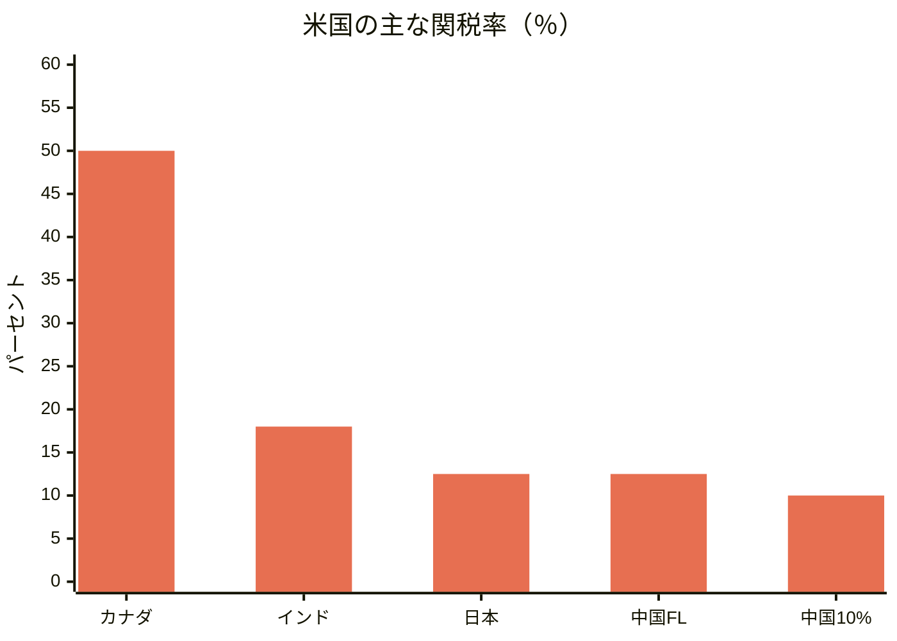
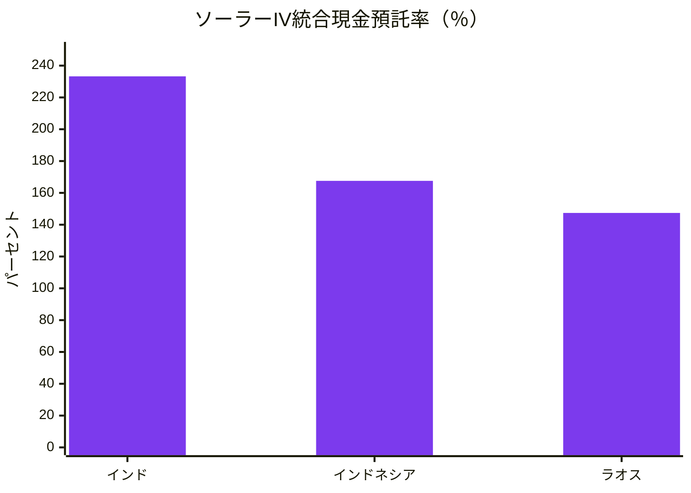
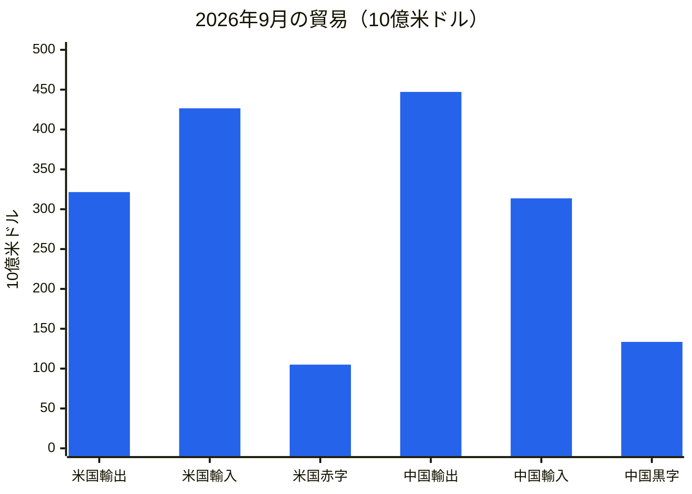
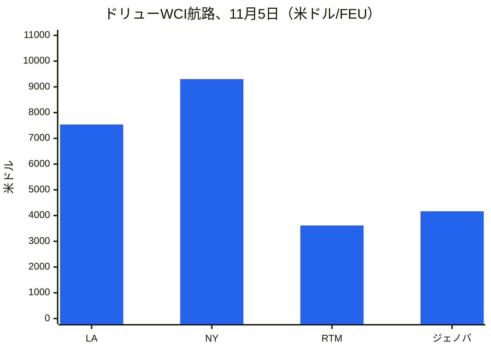
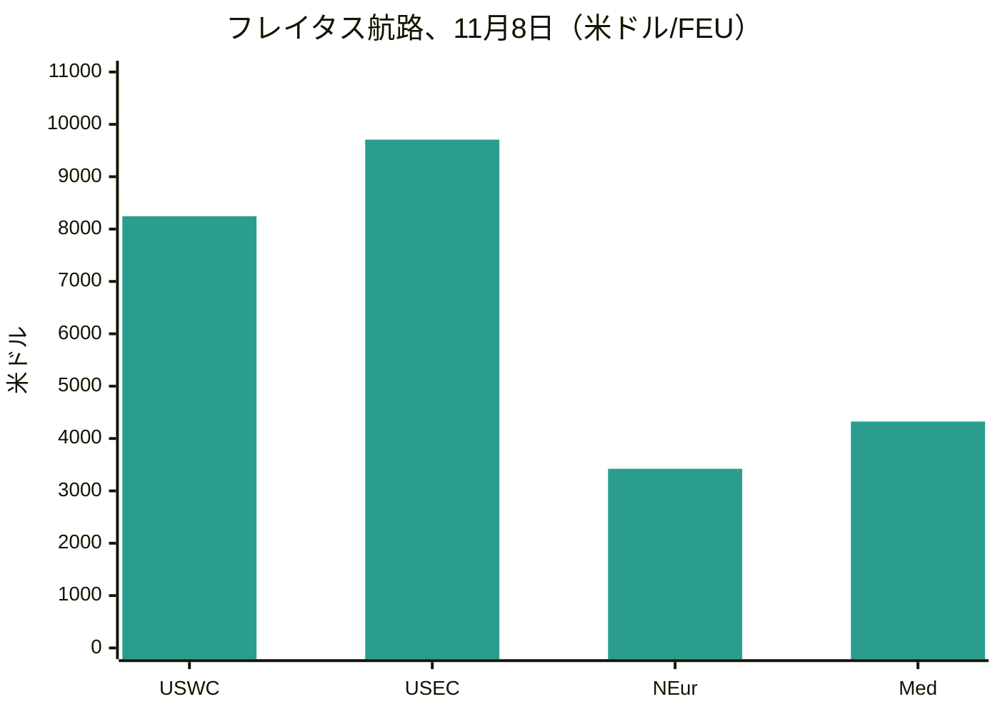
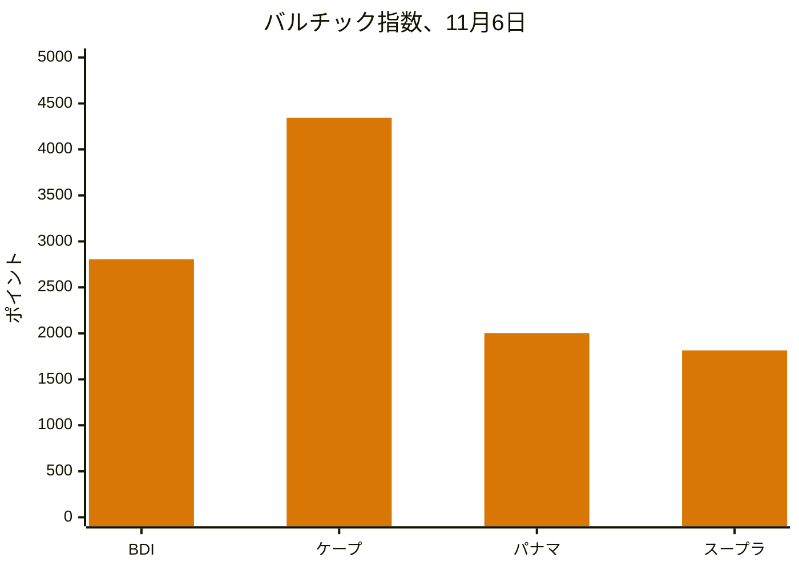
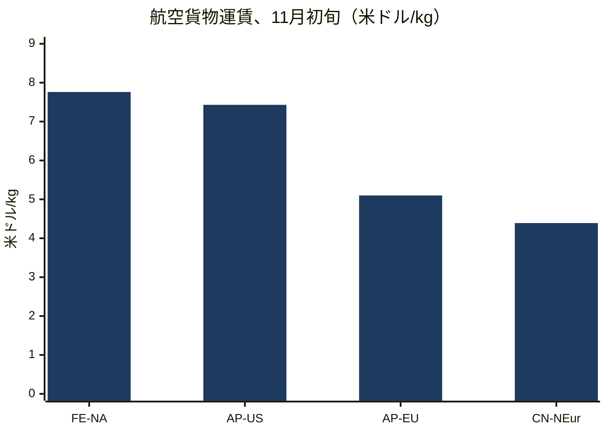
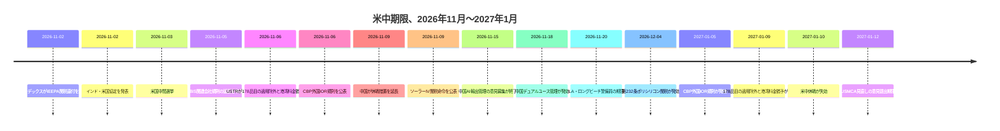
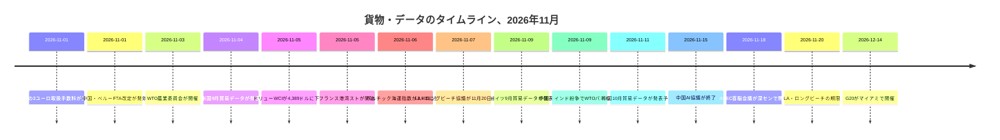

# グローバル貿易インテリジェンス・レポート — 2026年11月2日～9日週

**週次ブリーフィング。** カバレッジ期間：2026年11月2日～9日。世界の貿易ニュース、政策、データ、貨物に関する約45のデータソースから編纂。

---

## 目次

1. [エグゼクティブサマリー](#1-executive-summary)
2. [アラート](#2-alerts)
3. [主要記事 — 詳細分析](#3-top-stories--deep-dives)
4. [関税トラッカー](#4-tariff-tracker)
5. [米国政策の詳細分析](#5-us-policy-deep-dive)
6. [地域別世界政策](#6-world-policy-by-region)
7. [執行措置](#7-enforcement-actions)
8. [データ発表](#8-data-releases)
9. [貨物市場](#9-freight-market)
10. [政策タイムライン](#10-policy-timelines)
11. [今後の期限・イベント（今後90日間）](#11-upcoming-deadlines--events-next-90-days)
12. [データソースと調査方法](#12-sources--methodology)

---

## 1. エグゼクティブサマリー

11月9日の期限が土壇場で2度にわたり回避され、1月へ先送りされた週であった。11月6日、米国通商代表部（USTR）は、中国に対する第301条製品適用除外178品目すべてと、中国関連船舶に対する第301条港湾料金の徴収停止を2027年1月9日まで延長する通知を公表した。11月9日には、中国も休戦の自国側を延長し、米国製品に対する24％の追加関税の徴収停止、港湾料金の徴収停止、重要鉱物輸出管理の免除を2027年1月10日まで延長した。2カ月の猶予は現実のものだが短い。同じ措置が1月に1日違いで失効し、9月のワシントン首脳会談後に議論されたより広範な関税パッケージは未確定のままである。そのほか、インドと米国はインド製品に対する米国関税を最大50％から18％へ引き下げる貿易協定を発表し、民主党は中間選挙で上下両院の支配権を獲得したものの関税見通しは変わらず、欧州連合（EU）の2ユーロの取扱手数料と製品識別子要件が11月1日に発効し、中国は人工知能、バイオ医薬品、太陽光発電製造技術へ輸出管理の網を広げた。

- **11月9日の期限は延長され、撤廃されたわけではない。** USTRの11月6日の通知は、第301条製品適用除外178品目（一般164品目、太陽光発電製造14品目）と第301条海事措置のさらなる停止を2027年1月9日午後11時59分（米東部時間）まで延長する。2026年11月10日以降の申告は新たな期間内に入る。産業安全保障局（BIS）は、50％関連会社規則の停止延長を2027年1月10日まで申請した。11月9日に発表した中国は、米国製品に対する24％の追加関税の徴収停止を11月10日からさらに2カ月継続し、10％の追加税率を維持するとともに、港湾料金の徴収停止、重要鉱物輸出管理の免除、信頼できないエンティティ・リスト掲載の米国企業11社と輸出管理リスト掲載の16社に対する措置の停止を2027年1月10日まで延長した。非対称性は小さいが現実である。米国の措置は1月9日に失効し、中国の措置は1月10日に失効する。11月9日時点で、休戦延長を正式化する米国の大統領文書は公表されていなかった。
- **インドと米国は11月2日に協定をまとめた。** ワシントンはインド製品に対する関税を最大50％から18％へ引き下げた。これは25％の相互関税にロシア産石油購入に対する25％のペナルティを加えたもので、ロシア産石油課徴金は撤回された。トランプ大統領は、インドがロシア産石油の購入停止と米国からの購入拡大に合意したと述べたが、インド政府は具体的なエネルギー調達の約束を公には確認していない。同協定はより広範な二国間協定の第1弾とされ、2030年までに二国間貿易5,000億ドルを目標とするが、11月3日時点で署名済み文書、関税表、発効日は公表されていない。インドが欧州連合と自由貿易協定を締結した数日後のことである。
- **中間選挙は貿易の政治を変えたが、関税は変えなかった。** AP通信の当確判定によれば、民主党は11月3日に上下両院の支配権を獲得した。アナリストは2027年に監視公聴会と象徴的な関税撤回投票が行われると予想するが、廃止は見込まない。民主党は大統領拒否権を覆すのに必要な3分の2の多数には遠く及ばず、政権は2026年2月に最高裁が国際緊急経済権限法（IEEPA）関税を違憲とした後、第301条と第232条の権限に基づいて関税構造を再構築している。上院は10月29日にすでに51対47で、世界関税の根拠となった国家緊急事態の終了を可決していた。立法なしでは150日を上限とする第122条の追加関税は、新議会が抑制し得る唯一の手段である。
- **欧州の低額Eコマース制度刷新が発効した。** 11月1日から、EU域外からEU消費者へ直接発送される遠隔販売貨物について、品目ラインごとに2ユーロの通関取扱手数料が課される。これは2026年7月1日から施行されている150ユーロ以下の貨物に対する関税ラインごとの一律3ユーロの関税に上乗せされる。企業対消費者（B2C）貨物のすべての製品は、価格にかかわらず、3つの製品識別子を付すことが求められるようになった。関税と手数料を合わせると、付加価値税（VAT）控除前で関税ラインごとに最大5ユーロに達する。EU税関は2025年に約60億個のEコマース小包を処理し、その約90％が中国発であった。
- **中国の輸出管理は技術と産業機器へ広がった。** 商務部（MOFCOM）と科学技術部による共同提案（2026年10月16日付第48号公告）は、人工知能23件、バイオ医薬品5件、太陽光発電12件の計40技術を輸出管理対象技術目録に追加するもので、意見募集は11月15日まで、暫定の輸出前登録はすでに施行されている。別途、ドローン、トンネル掘削機、浚渫船に対するデュアルユース管理が11月18日に発効する。太陽光発電の規制は、中国が太陽光発電生産で優位を占めることから、最も影響が大きいと評価されている。
- **米国は輸入の記録的な月を報告し、中国は1兆ドルの黒字へ向かう。** 国勢調査局と経済分析局（BEA）は11月4日、9月の財・サービス赤字が1,050億ドルとなり、輸入が過去最高の4,266億ドル、財輸入が過去最高の3,469億ドル、資本財輸入が過去最高の1,580億ドルに達したと報告した。中国の9月の黒字は輸出4,471億8,000万ドル（前年同月比36.3％増）に対し1,335億3,000万ドル。ロイターの調査では10月の輸出は33.5％増、黒字は1,258億ドルと予測されており、1～10月の累計黒字は1兆ドルを超える見込みである。中国の公式製造業PMIは10月に49.3へ低下し、新規輸出受注は48.7となった。
- **貨物市場は再び二極化した。海上運賃は軟化し、航空運賃は急騰した。** ドリュー世界コンテナ指数（WCI）は11月5日に1％下落し、40フィートコンテナ当たり4,389ドルとなったが、前年同月比では124％高い水準にある。船社の11月1日の一般運賃引き上げは定着しなかった。バルチック海運指数は週末に2,805で引け、前週比3.4％上昇した。ケープサイズの堅調が背景である。航空貨物は逆の動きとなった。極東～北米は11月3日に1キログラム当たり7.76ドルとなり、1週間で9％上昇し、2026年の最高値を記録、2025年12月初旬のピークである8.00ドルに迫った。アジア～欧州コンテナ輸送能力の約60％が現在スエズ運河を利用しているとドリューは報告する。ロサンゼルス・ロングビーチの警備員紛争は11月20日まで再延期され、フランスの港湾は2日間のストライキに見舞われ、チリのサンアントニオ港でのトラック運転手による封鎖がサクランボ輸出シーズンを脅かした。

**貨物：** コンテナ・スポット運賃は太平洋横断航路とアジア～欧州航路の双方で軟化し、船社の11月の引き上げは値引きされた。ドライバルクはケープサイズの収益を背景に3週連続で上昇した。航空貨物はピークシーズン入りで2026年の最高値を記録した。スエズ運河の通航は回復を続けた。ロサンゼルス・ロングビーチ、フランス、チリでの労働紛争により、ピークシーズンを通じて港湾リスクは継続した。

---

## 2. アラート

| # | アラート | 発効日 | 影響 | 出典 |
|---|---|---|---|---|
| A1 | USTRが中国第301条製品適用除外178品目すべてを2027年1月9日午後11時59分（米東部時間）まで延長。2026年11月10日以降の申告は新たな期間内に入る。11月8日時点で連邦官報への掲載は未確認 | 2026年11月6日（公表） | 2カ月の猶予のみ。2027年1月9日以降の申告は全額のリスト税率を支払う（リスト1～3は25％、リスト4Aは7.5％） | [TechTimes](https://www.techtimes.com/articles/330285/20261109/ustr-extends-section-301-tariff-exclusions-chinese-goods-entries-after-january-9-pay-full-duty.htm) |
| A2 | USTRが第301条海事措置（中国関連船舶への港湾料金、附属書V.A関税）を2027年1月9日午後11時59分（米東部時間）までさらに停止 | 2026年11月9日 | 料金は停止のまま。停止措置と適用除外は1月に同日失効する | [Gateway Lines](https://gatewaylines.com/press-releases/china-ship-fee-delay-jan-9-2027-301-exclusions) |
| A3 | 中国が米国製品に対する24％の追加関税の徴収停止を11月10日から2カ月延長し、10％を維持。港湾料金の徴収停止、重要鉱物輸出管理の免除、エンティティ・リスト措置の停止を2027年1月10日まで延長 | 2026年11月9～10日 | 米国輸出業者は10％の税率を維持。休戦は中国側で2027年1月10日まで継続 | [Reuters via SRN News](https://srnnews.com/china-extends-suspension-of-24-tariff-on-us-imports-for-two-months/) |
| A4 | インド・米国貿易協定を発表。インド製品に対する米国関税を最大50％から18％へ引き下げ、ロシア産石油課徴金を撤回。11月3日時点で署名済み文書は未公表 | 2026年11月2日 | インド原産品の価格再設定。エネルギー調達の約束はニューデリーが未確認 | [Economic Times](https://www.eximguru.com/export-import-news/export-news/india-us-trade-deal-lifts-a-117126.aspx) |
| A5 | CBP暫定最終規則：2027年1月5日から、外国輸入者（IOR）はCTPAT認証を受けているか、CTPAT認証を受けたブローカーを利用しなければならない。外国IORの32％が現時点でいずれの条件も満たしていない | 2027年1月5日 | 米国買主へ直接発送する外国販売者はブローカーを変更するか認証を取得しなければならない。意見募集は2027年1月5日まで | [CBP](https://www.cbp.gov/newsroom/national-media-release/cbp-announces-heightened-requirements-foreign-importers-record) |
| A6 | EUの品目ラインごとの2ユーロの取扱手数料と、すべてのB2C貨物に対する3つの製品識別子が11月1日から義務化。VAT控除前で関税ラインごとに最大5ユーロの関税と手数料 | 2026年11月1日 | 低額・多品目のEコマースの着地コストが上昇。識別子のない貨物は遅延または拒否される恐れ | [Logistik Heute](https://logistik-heute.de/en/news/eu-customs-policy-new-package-fee-increases-costs-cross-border-online-trade-291550.html) |
| A7 | 商務省がインド、インドネシア、ラオス産の結晶シリコン太陽電池に対する最終AD/CVD命令を発出。統合オールイン税率は最大約233％（インド）、168％（インドネシア）、147％（ラオス） | 2026年11月9日 | 現金預託は11月5日から再開。対象セルを用いて第三国で製造されたモジュールも命令の対象 | [MLex](https://www.mlex.com/mlex/articles/2547289/us-commerce-imposes-duties-for-indonesian-laotian-and-indian-solar-cells) |
| A8 | LA・ロングビーチの警備員ストライキの脅威が再び延期。協議は2026年11月20日まで延長。6ターミナルで約250人の労働者。ロングビーチ貨物の約85％とロサンゼルス貨物の約33％がリスクに | 2026年11月20日 | 中間選挙直後のストライキは回避されたが、紛争は鉄道の大幅な滞貨を抱えたままピークシーズン後半へ | [gCaptain](https://maritimenewsbd.com/la-long-beach-port-strike-threat-deferred-november-20/) |
| A9 | 中国のAI・バイオ医薬品・太陽光輸出管理目録案：意見募集は2026年11月15日まで。暫定の輸出前登録はすでに適用。ドローン、トンネル掘削機、浚渫船に対するデュアルユース管理は11月18日発効 | 2026年11月15日／11月18日 | 対象技術40件（禁止14件、制限26件）。太陽光製造ノウハウが最も鋭い | [China Briefing](https://www.china-briefing.com/news/china-technology-export-controls/) |
| A10 | 民主党が11月3日の中間選挙で上下両院を制覇。関税構造は継続する見通し。上院は10月29日に51対47で、世界関税の根拠となった国家緊急事態の終了を可決 | 2026年11月3日 | 2027年に監視と象徴的な関税撤回投票が予想される。第122条は新議会が抑制し得る手段 | [SupplyChainBrain](https://www.supplychainbrain.com/general-scm/regulation-compliance/article/16424361/us-midterm-rout-unlikely-to-change-trumps-trade-policy) |

### A1/A2 — 11月9日の期限、土壇場で延長

前週のブリーフィングを支配した2つの措置は、11月6日にUSTRがウェブサイトに2件の通知を掲載したことで、ともに延長された。1件目は、中国第301条製品適用除外178品目すべて — HTSUS 9903.88.69に基づく一般適用除外164品目と9903.88.70に基づく太陽光発電製造適用除外14品目 — を2027年1月9日午後11時59分（米東部時間）まで延長するもので、2026年11月10日午前0時01分（米東部時間）以降に消費用として申告された、または保税倉庫から消費用に引き出された貨物を対象とする。適用除外の追加・削除はなく、新たな意見募集も行われなかった。USTRは2025年9月16日の通知に対する意見に依拠した。2件目の通知は、中国の海事・物流・造船慣行に対する第301条措置 — 対象船舶料金と附属書V.A関税を含む — の停止をさらに延長し、2026年11月9日から2027年1月9日午後11時59分（米東部時間）までとする。USTRは10月26日に海事措置の延長を提案していた（91 FR 67388）。意見募集期間は10月30日に終了した。11月8日時点で、いずれの通知についても対応する連邦官報への掲載は確認されておらず、適用除外の通知には内部の不整合がある。日付の欄と附属書は2027年1月9日としているが、他の文言では1月10日とされている。実効日は1月9日である。延長がなければ、11月10日以降の申告は全額のリスト税率を支払うことになっていた。適用除外が免除するのはリスト関税のみである。12.5％の第301条強制労働関税、第232条関税、アンチダンピング関税・相殺関税、最恵国税率は引き続き適用される。11月4日、ソフトウェア・情報産業協会（SIIA）と他の23団体はUSTRに対し、少なくとも1年間の延長を求めていた。USTRが認めたのは2カ月であった。

### A3 — 休戦失効の当日に中国が行動

中国は11月9日月曜日、米国製品に対する24％の追加関税の徴収停止を11月10日午後1時01分（北京時間）からさらに2カ月継続し、10％の追加税率を維持すると発表した。国務院関税税則委員会の2026年第6号公告が、9月のワシントン首脳会談でトランプ大統領と習近平国家主席の間で達した合意を実施する。並行して、中国商務部は特定の重要鉱物と関連技術に対する輸出管理免除を2027年1月10日まで延長し、信頼できないエンティティ・リスト掲載の米国企業11社と輸出管理リスト掲載の16社に対する措置は2027年1月10日まで停止されたままとなり、米国関連船舶に対する特別港湾料金の徴収停止も同日まで延長された。ハンファ・オーシャンの米国子会社5社に対する制裁もさらに2カ月停止された。計画上、非対称性が重要である。北京は正式な発表によって行動したが、11月9日時点で休戦延長を正式化する米国の大統領文書は公表されておらず、米国の措置は1月9日に失効する一方、中国の措置は1月10日まで続く。9月の首脳会談後に議論された、2024年に中国が輸入した170億ドルの米国農産物を含む600億ドルの相互関税引き下げパッケージ案は未確定のままである。

### A4 — インド・米国協定：18％とロシア産石油問題

インドと米国は、数カ月にわたる緊迫した交渉の末、11月2日月曜日の夜に行われたナレンドラ・モディ首相とドナルド・トランプ大統領の電話会談を経て、貿易協定をまとめた。ワシントンはインド製品に対する関税を最大50％から18％へ引き下げると発表し、ロシア産石油購入に対する追加のペナルティ課徴金を撤回した。これは25％の相互関税に25％のペナルティを加えたものである。トランプ大統領は、インドがロシア産石油の購入停止と、米国および場合によってはベネズエラからの購入拡大、米国製品の「はるかに高い水準」での購入に合意したと述べたが、インド政府は具体的なエネルギー調達の約束について公にコメントしていない。ロイターは、インドが米国産石油、防衛製品、電子機器、医薬品、通信機器、航空機の購入拡大に合意したと報じた。同協定はより広範な二国間協定の第1弾とされ、交渉は継続中で、2030年までに二国間貿易5,000億ドルを目標とする。現在の約1,910億ドルからの拡大である。11月3日時点の報道では、署名済み文書、関税表、発効日は公表されておらず、2026年2月の枠組みによる18％の税率はこれまで適用されたことがない。インド製品のほとんどは2026年7月24日以降、10％の第301条関税に直面してきた。

### A5 — CBP外国輸入者規則

CBPは2026年11月6日、大統領令14411「税関執行の強化」（2026年6月3日署名）の第2条を実施する暫定最終規則「外国輸入者に対する要件の強化」（CBP Dec. 26-19、91 FR 69977）を公表した。2027年1月5日から、外国輸入者は、自らがCTPAT認証を受けているか、CTPAT認証を受けた認可通関ブローカーを通じて申告する場合にのみ、消費用として商品を申告できる。CBP自身の分析によれば、外国輸入者のうちCTPAT認証を受けているのは0.4％、認証を受けたブローカーをすでに利用しているのは68％。残る32％は、ブローカーを変更するか自らCTPAT認証を取得しない限り、米国への輸入を継続できない。税関規則の新たな第110部は「米国IOR」を定義する（米国市民または合法的永住者、あるいは米国法に基づいて設立され米国内に所在する法人で、追加の所有権または不動産条件を満たすもの。例えば、米国市民または合法的永住者による51％以上の実質的所有と支配、または重要な無担保米国不動産の直接所有）。輸入者ステータスは申告時と申告概要で申告しなければならない（新19 CFR 141.21～141.22）。ブローカーは顧客のステータスを検証し、検証記録を5年間保存しなければならない。意見募集は2027年1月5日までである。同規則は、大統領令が指示した外国輸入者に対する非公式申告の包括的禁止を課してはいないが、代替案として全面的禁止について意見を募っている。推定される貨幣換算コストは年間約1,233,253ドルである。

### A6 — EUの2ユーロ手数料と製品識別子

2026年11月1日から、委任規則（EU）2026/2152に基づき、EU域外からEU消費者へ直接発送される遠隔販売貨物について、価格にかかわらず、品目ラインごとに2ユーロの通関取扱手数料が課される。これは、規則（EU）2026/382に基づき2026年7月1日から施行されている150ユーロ以下の貨物に対する関税ラインごとの一律3ユーロの関税に上乗せされる。同規則は150ユーロのデミニミス関税免除を廃止した。同日から、EU向けB2C貨物のすべての製品は、価格にかかわらず、3つの製品識別子を付すことが義務付けられた。したがって、関税と手数料を合わせると、VATを除き関税ラインごとに最大5ユーロに達する。暫定制度は2028年7月1日まで続き、その後は中央集権型のEU税関データシステムが一律課徴金を標準関税に置き換える予定である。同手数料は、商品が返品されても返金されない。

### A7 — ソーラーIV命令：統合税率は最大約233％

商務省は2026年11月9日、米国国際貿易委員会（USITC）の肯定的最終損害認定（11月5日公表、91 FR 69865）を受け、インド、インドネシア、ラオス産の結晶シリコン太陽電池（モジュールに組み立てられているか否かを問わない）に対するアンチダンピング関税・相殺関税命令を発出した。インド：アンチダンピング税率123.04％（補助金相殺後の現金預託107.17％）と相殺関税126.09％で、統合現金預託率233.26％。インドネシア：アンチダンピング94.36％と相殺関税73.20％（その他すべての統合税率167.56％）。ラオス：アンチダンピング65.43％と相殺関税82.03％（統合147.39％）。清算停止と現金預託の徴収は2026年11月5日から再開される。対象セルを用いて第三国で製造されたモジュール、ラミネート、パネルは命令の対象となる。第三国産セルを用いてインドで組み立てられたモジュールは対象外である。USITCの完全な公開報告書（USITC Publication 5804）は2026年11月23日までに公表される予定である。

### A8 — LA・ロングビーチ：11月20日まで延期

ロサンゼルスとロングビーチのコンテナターミナルで働く警備員（ウォッチマン）によるストライキの脅威は再び先送りされ、ブルームバーグがgCaptain経由で11月7日に報じたところによれば、協議は11月20日まで延長された。ILWU第26支部は6つのコンテナターミナルで約250人の警備員を代表する。前回の契約は2025年7月に失効し、組合員はストライキを承認済みで、双方は連邦調停和解局（FMCS）の支援を受けて交渉中である。太平洋海事協会によれば、他の港湾労働者が第26支部のピケットラインを越えないと見込まれるため、ロングビーチ港を通過する貨物の約85％とロサンゼルス港の貨物の3分の1に混乱が及ぶ恐れがある。両港はすでに逼迫していた。鉄道輸送を待つ輸入コンテナは約35,688個、そのうち10,562個は9日以上待機しており、鉄道向け輸入貨物の平均滞留日数は9月に7.19日となり、8月の6.75日から増加した。ロサンゼルス港は1カ月で100万箱を扱い、新記録を達成したが、同港のトップは関税による計画リスクを警告している。

### A9 — 中国の輸出管理：意見募集は11月15日まで、デュアルユース規則は11月18日発効

MOFCOMと科学技術部は、輸出禁止・制限技術目録に40技術を追加することを提案している。人工知能23件、バイオ医薬品5件、太陽光発電12件である。14件が輸出禁止、26件が制限（許可が必要）となる。2026年10月16日以降、対象技術の暫定の輸出前登録 — すでに進行中の輸出や、対象技術を保有する国内企業の所有権または支配権の海外事業体への移転を含む — がMOFCOMの技術貿易管理情報アプリケーションを通じて適用されている。意見募集は11月15日に終了する。別途、3件の公告が無人航空機、トンネル掘削機、浚渫船に関するデュアルユース品目輸出管理リストを改定し、すべて2026年11月18日に発効する。MOFCOMと税関総署はまた、許可なく輸出提示された、規制対象となり得る貨物を税関が留置し、許可を求める手続きを改定する第52号通知を発出した。MOFCOMは同パッケージを「精緻かつ限定的」と説明している。

### A10 — 中間選挙：民主党が議会を制覇、関税は継続の見通し

11月3日の中間選挙は、下院、上院、その他の公職で民主党への歴史的に大きな振れをもたらし、11月4日の報道は民主党による上下両院の制覇を伝えた。下院435議席すべてと上院100議席中35議席が改選対象であった。貿易専門家と議会補佐官はロイターに対し、民主党議会は2027年に監視公聴会と象徴的な関税撤回投票をもたらすが、廃止には至らないと述べた。民主党は大統領拒否権を覆すのに必要な3分の2の多数には遠く及ばず、ホワイトハウスはトランプ大統領が米国第一の貿易アジェンダから揺らがないとしている。上院は2026年10月29日にすでに51対47で、世界関税の根拠となった国家緊急事態の終了を可決していたが、共和党員4人が民主党に加わったものの、この投票は関税構造を解体しなかった。アナリストは、政権が2026年2月20日に最高裁がIEEPA関税を違憲とした後、第301条と第232条の権限に基づいて関税を再構築しており、これまでのところ維持されていると指摘する。25州が第301条関税の差し止めを求めて提訴しており、係属中である。C.H.ロビンソンの11月5日の税関アップデートは、荷主に対し、2026年後半から2027年にかけて特定国に対する追加の第301条関税の可能性に備えるよう警告した。

---

## 3. 主要記事 — 詳細分析

### 3.1 休戦、2カ月延長 — そしてそれが生み出す1月の期限

今週の中心的な話題は、米中貿易休戦を1月まで維持する一方で、次の決定を2カ月の期間に圧縮する一対の延長措置である。順序が重要である。11月6日、USTRは2件の通知を掲載した。1件目は中国第301条製品適用除外178品目すべてを2027年1月9日午後11時59分（米東部時間）まで延長し、もう1件は第301条海事措置 — 中国関連船舶への港湾料金と附属書V.A関税 — の停止をさらに同日まで延長するものである。11月5日、BISは50％関連会社規則の輸出管理措置の停止延長を2027年1月10日まで申請した。11月9日、中国は自国側を延長した。米国製品に対する24％の追加関税は11月10日からさらに2カ月停止され、10％の追加税率が維持され、米国関連船舶に対する特別港湾料金の徴収停止、重要鉱物輸出管理の免除、信頼できないエンティティ・リスト掲載の米国企業11社と輸出管理リスト掲載の16社に対する措置の停止はすべて2027年1月10日まで続く。

注目すべき点は3つある。第1に、延長は短い。9月の取り決めは1年間続くと理解されていたが、2カ月であり、業界が少なくとも1年を求めた後に認められたものである。ソフトウェア・情報産業協会と他の23団体は11月4日にUSTRに対し、適用除外の少なくとも1年間の延長を求めた。USTRが認めたのは2カ月であった。第2に、日付が正確に一致しない。米国の措置は1月9日に失効し、中国の措置は1月10日に失効する。米国の休戦自体は、9月にスコット・ベッセント財務長官が1月10日まで続くと説明していた。第3に、休戦の背後にある実質は未完である。11月6日、USTRのジェイミソン・グリア代表とベッセント長官は中国の何立峰副首相とビデオ会談を行った。グリア代表は、農産物購入、レアアース、その他の重要鉱物について、中国が過去の約束を完全に履行するための具体的行動を取ることの「極めて重要な意義」を強調し、中国は米国の貿易制限について「深刻な懸念」を表明した。いずれの発表も期限には言及しなかった。9月の首脳会談後に議論された600億ドルの相互関税引き下げパッケージ案は未確定のままである。

**主要数値：** 延長された適用除外178品目（一般164品目、太陽光発電製造14品目）。延長がなければ、11月10日以降の申告は25％（リスト1～3）または7.5％（リスト4A）を支払うことになっていた。中国の24％の追加関税は停止のまま、10％を維持。休戦は2027年1月9日～10日まで継続。

**なぜ重要か：** 輸入業者は今週の期限ではなく2カ月の確実性を得たが、期限は消えたのではなく移動した。次の決定点は、11月18～19日に深センで開催されるAPEC首脳会議で、トランプ大統領と習近平国家主席が今年3回目の会談を行う。その後、12月14～15日にマイアミでG20が開催される。申告、航海、輸出スクリーニングは、文書上の立場に基づいて計画しなければならない。適用除外は出荷日ではなく申告日に付随するため、11月に発送されたものの1月9日以降に申告される貨物は延長の対象外となる。

**出典：** [TechTimes](https://www.techtimes.com/articles/330285/20261109/ustr-extends-section-301-tariff-exclusions-chinese-goods-entries-after-january-9-pay-full-duty.htm); [Gateway Lines](https://gatewaylines.com/press-releases/china-ship-fee-delay-jan-9-2027-301-exclusions); [Reuters via SRN News](https://srnnews.com/china-extends-suspension-of-24-tariff-on-us-imports-for-two-months/); [BusinessWorld](https://bworldonline.com/world/2026/11/09/792445/china-extends-suspensions-of-24-tariff-on-us-goods-port-fees-on-us-ships-for-two-months/)

### 3.2 インド・米国協定：インド輸出経済を覆う最大の不確実性が解消

11月2日の発表は、インドの輸出経済を覆う最大の不確実性を取り除き、史上最安値を記録していたルピーとインド株式への圧力を和らげ、ロシア産石油の購入停止が実現すれば、世界最大級の買い手の原油フローを再編する。米国はインドの最大の輸出先であり、商品輸出の約20％を占める。同協定はインド製品に対する米国関税を最大50％から18％へ引き下げ、ロシア産石油購入に対する追加のペナルティ課徴金を撤回する。両国は2030年までに二国間貿易5,000億ドルを目標とする。現在の約1,910億ドルからの拡大である（インド当局はより狭い指標で1,318億4,000万ドルを挙げている）。

不確実性は重大である。11月3日時点で、署名済み文書、関税表、発効日は公表されておらず、2026年2月の枠組みによる18％の税率はこれまで適用されたことがない。インド製品のほとんどは2026年7月24日以降、10％の第301条関税に直面してきた。トランプ大統領の、インドがロシア産石油の購入停止と米国および場合によってはベネズエラからの購入拡大に合意したとの声明は、ニューデリーが具体的に公に確認していない。ロイターは、インドが米国産石油、防衛製品、電子機器、医薬品、通信機器、航空機の購入拡大に合意したと報じた。同協定は、インドが欧州連合と自由貿易協定を締結した数日後に成立し、1週間でインドにとって2つの主要協定となった。そして今週の別のインド関連の話題として、ピユシュ・ゴヤル商工相は11月3日、インドはこれまでいかなる自由貿易協定においても乳製品部門を開放したことはなく、遺伝子組み換え製品の輸入も認めないと述べた。これはすべての実施中のFTA交渉に関連するレッドラインである。

**主要数値：** 関税を最大50％から18％へ引き下げ（25％の相互関税＋25％のロシア産石油ペナルティ）。二国間貿易約1,910億ドル。2030年までに5,000億ドルを目標。2026年4～9月のインドの輸出は約4,800億ドル、前年同月比約14％増。インドは2026～27年に財・サービス輸出1兆ドルを目指す。

**なぜ重要か：** インドの輸出業者にとって、同協定は50％の最悪ケースを18％に置き換える。文書が確認すればの話である。エネルギー市場にとって、ロシア産石油問題が変数として残る。インドは世界最大級の原油買い手であり、購入停止となれば相当量が振り向けられる。貿易政策の面では、同協定は、政権が主要な二国間案件を文書に先立って発表によってまとめる姿勢を示しており、輸入業者は計画に織り込むべきである。

**出典：** [Economic Times](https://www.eximguru.com/export-import-news/export-news/india-us-trade-deal-lifts-a-117126.aspx); [Reuters via Reporter World News](https://www.reporterworldnews.com/news/business/2026/11/03/piyush-goyal-commerce-dairy-products)

### 3.3 中間選挙と関税見通し：新しい政治、同じ関税

11月3日の選挙で民主党は上下両院の支配権を得たが、関税構造は議会の交代では解体されない行政権限に基づいている。政権の関税は現在、主として第301条と第232条に依拠している。最高裁は2026年2月20日、*Learning Resources, Inc. v. Trump*事件でIEEPA関税を違憲とした。これらの権限は選挙サイクルに依存せず、民主党は大統領拒否権を覆すのに必要な3分の2の多数には遠く及ばない。変わるのは監視である。2027年には監視公聴会、象徴的な関税撤回投票、カナダを中心とした対象を絞った救済への圧力が予想される。新議会が抑制し得る唯一の手段は第122条である。その追加関税は立法なしでは150日を上限とする。その枠組みの延長には次期議会が必要となる。新議会は2027年1月に召集される。それまで関税法は現行のままである。

訴訟の焦点は現在、権限ではなく資金である。11月2日、フェデックスは米国国際貿易裁判所（CIT）に米国、CBP、CBP長官ロドニー・スコットを相手取り、最高裁が違憲としたIEEPA関税命令に基づき輸入者として支払ったすべての関税の全額返還を求めて提訴した。徴収されたIEEPA関税の推定1,750億ドルについて、その一部を求めて提訴した初の主要企業と報じられている。最高裁は返還について判断しなかったため、その問題は下級審に委ねられた。また11月2日、リバティ・ジャスティス・センターは「オペレーション・リファンド・レスキュー」を開始し、IEEPA申告が最終清算に達し、裁判所命令なしではCBPのCAPE返還システムを通じて回収できない適格中小企業を対象に、対象を絞ったCIT訴訟への資金提供を申し出た。当初の受付枠は100件の申告である。CBPのCAPE返還システムは2026年4月20日にACEで開始され、CBPによれば、有効な返還は受理から通常60～90日以内に届く。10月8日、CITは*Freestyle World, Inc. v. U.S. Customs and Border Protection*事件で、争われたIEEPA関税を支払った輸入者を対象とする集団訴訟を認定した。別途、第301条強制労働関税（12.5％、2026年7月24日発効）はCITで争われており、口頭弁論は2026年9月30日に行われたが、10月初旬時点で判決は報告されていない。25州が第301条関税の差し止めを求めて提訴しており、係属中である。

**主要数値：** 10月29日の上院投票は51対47で、世界関税の根拠となった国家緊急事態の終了を可決。徴収されたIEEPA関税の推定額1,750億ドル。CAPE返還は通常60～90日以内。「オペレーション・リファンド・レスキュー」による当初の100件の申告。

**なぜ重要か：** 荷主は、現行の関税スタックが大統領の任期最後の2年間を通じて継続すると見込み、USMCA見直しと新たな第301条措置を今後の焦点とすべきである。返還訴訟は、輸入者にとって別個の重要なキャッシュフローの問題である。請求できるのは輸入者（またはそのブローカー）のみであり、返還は消費者ではなく輸入者に支払われる。

**出典：** [SupplyChainBrain](https://www.supplychainbrain.com/general-scm/regulation-compliance/article/16424361/us-midterm-rout-unlikely-to-change-trumps-trade-policy); [Liberty Justice Center](https://libertyjusticecenter.org/pressrelease/liberty-justice-center-launches-operation-refund-rescue-to-help-small-businesses-recover-unlawful-ieepa-tariff-payments/); [JD Supra](https://www.jdsupra.com/legalnews/old-tariffs-new-tariffs-future-tariffs-5121636/)

### 3.4 欧州：低額Eコマース制度の刷新が発効し、メルコスールは初の成果を示す

今週の欧州の2つの動きは逆方向に作用する。1つは低額輸入に対する障壁を引き上げ、もう1つは新たな自由貿易地域がすでに物品を動かしていることを示す。11月1日に発効した2ユーロの取扱手数料と製品識別子要件は、理事会が2026年9月3日に承認した税関改革枠組みの最初の実務層である。同枠組みは税関手続きを近代化し、データ活用を拡大し、非EUのEコマース・プラットフォームを関税・税金の輸入者として責任を負わせる。規則（EU）2026/2108はEU関税法典を改革し、2028年から現行法典を段階的に置き換える。欧州委員会は（2026年10月1日から）毎月、低額制度の下で貿易フロー転換が生じているかどうかを評価しなければならない。販売者にとって、この変更はコストであると同時にデータ上の義務でもある。3つの製品識別子のない貨物は遅延または拒否される恐れがあり、手数料は商品が返品されても返金されない。

2026年1月17日にアスンシオンで署名されたEU・メルコスール暫定貿易協定は、11月1日に暫定適用開始から6カ月を迎え、初の確かなデータが急速な活用を示している。ブラジルのEU向け農産物輸出は2026年5～9月に前年同期比14.8％増の122億1,000万ドルとなり、1,774万トン（前年同月比8.1％増）であった。ブラジルのEU向け輸出全体は5～9月に31％増と報告された。アルゼンチンの農産加工品輸出は最初の4カ月で21％増となり、関税引き下げ対象製品は44％増であった。法的基盤は暫定的なままである。欧州議会は最終同意をまだ与えておらず、同協定をEU司法裁判所に付託している。暫定適用は理事会の2026年1月の決定に基づく。別途、EUは2026年9月3日、抗菌剤使用のコンプライアンスを理由にブラジル産牛肉、鶏肉、蜂蜜の輸入を停止した。監査の結果、鶏肉と蜂蜜の再登録が可能と報告されたが、確認された日付はない。

**主要数値：** 品目ラインごとに2ユーロ（取扱手数料）。関税ラインごとに3ユーロ（2026年7月1日からの一律関税）。EU税関が2025年に処理したEコマース小包は約60億個、その約90％が中国発。ブラジルのEU向け農産物輸出122億1,000万ドル（2026年5～9月、14.8％増）。牛肉割当9万9,000トン（7.5％）。EUはメルコスール輸出の92％の関税を撤廃。

**なぜ重要か：** 11月1日の手数料と識別子規則は、ピークシーズンの数週間前にEU向けのすべての低額小包の経済性を変え、中国発プラットフォーム（Shein、Temu）やEU消費者へ直接発送するすべての販売者に影響する。メルコスールのデータは、人口7億人超の世界最大の自由貿易地域がすでに大規模に物品を動かしていることを示す。ただし、ブラジルの停止措置が示すように、市場アクセスは依然として条件付きである。

**出典：** [Logistik Heute](https://logistik-heute.de/en/news/eu-customs-policy-new-package-fee-increases-costs-cross-border-online-trade-291550.html); [European Commission, Access2Markets](https://trade.ec.europa.eu/access-to-markets/en/news/application-eu-mercosur-interim-trade-agreement-1-may-2026); [EUR-Lex, Regulation (EU) 2026/382](https://eur-lex.europa.eu/legal-content/EN/TXT/?uri=OJ:L_202600382)

### 3.5 中国が輸出管理の網を広げる：AIモデル、バイオ医薬品プラットフォーム、太陽光ノウハウ

中国の輸出管理プログラムは今週3つの方面で前進し、最も影響が大きいのは完成品ではなく製造ノウハウを対象とするものである。MOFCOMと科学技術部による共同提案（2026年10月16日付第48号公告）は、輸出禁止・制限技術目録に40技術を追加する。人工知能23件、バイオ医薬品5件、太陽光発電12件である。14件が輸出禁止、26件が制限（許可が必要）となる。10月16日以降、対象技術の暫定の輸出前登録 — すでに進行中の輸出や、対象技術を保有する国内企業の所有権または支配権の海外事業体への移転を含む — がMOFCOMの技術貿易管理情報アプリケーションを通じて適用されている。人工知能では、制限対象の大規模モデルへのAPI、アプリ、ウェブ、ソフトウェア・アズ・ア・サービス（SaaS）による展開や軽量なオンデバイス展開は規制対象外である。海外でのローカル展開や対象モデルの重みを国外へ移転する場合は許可が必要となる。バイオ医薬品では、対象の細胞・遺伝子治療およびsiRNAプラットフォームの所有権移転は禁止されるが、ライセンス、受託研究・製造サービス、対外事業開発取引における製品の研究開発または製造に必要な技術は対象外となる。太陽光発電では、禁止対象に特定のポリシリコン製造技術、70マイクロメートル以下のシリコンウェーハ製造、ペロブスカイトおよびタンデム太陽電池の製造と関連機器製造技術が含まれ、限定的な免除がある。したがって、中国が太陽光発電生産と最先端太陽光技術で優位を占めることから、太陽光発電の規制は外国メーカーにとって最も影響が大きいと評価されている。MOFCOMは同改定を日常的なものであり、特定の国を対象としたものではないと説明している。意見募集は11月15日に終了する。

デュアルユース・パッケージは並行して進んでいる。3件の公告が無人航空機（第49号公告）、トンネル掘削機、浚渫船に関するデュアルユース品目輸出管理リストを改定し、すべて2026年11月18日に発効する。MOFCOMと税関総署はまた、許可なく輸出提示された、規制対象となり得る貨物を税関が留置し、許可を求める手続きを改定する第52号通知（10月19日）を発出した。別途、10月13日、MOFCOMは民間航空における特定のデュアルユース品目について、個別許可を「輸出証明書」制度に置き換える草案を公表した。MOFCOMは同パッケージを「精緻かつ限定的」と説明し、詳細がすべて公表されていない円滑化措置と組み合わせている。同時に、中国は特定の重要鉱物と関連技術に対する輸出管理免除を2027年1月10日まで延長した。これは3.1で述べた休戦関連の救済措置であり、今週の規制と今週の免除は異なる製品群に対して逆方向に動いている。

**主要数値：** 40技術（AI 23件／バイオ医薬品5件／太陽光発電12件）。禁止14件、制限26件。意見募集は2026年11月15日まで。デュアルユース管理は2026年11月18日発効。

**なぜ重要か：** 同目録案は、中国の「中核データ」で訓練された最先端AIモデル、細胞・遺伝子治療プラットフォーム、次世代太陽光の背後にある中核的製造ノウハウに及ぶ。外国メーカーにとって、太陽光発電の規定が最も鋭い。ペロブスカイトおよびタンデムセルの背後にある機器とプロセスに及び、完成モジュールだけではない。11月15日の意見募集期限と11月18日の発効日は、直近のコンプライアンス上のポイントである。

**出典：** [China Briefing](https://www.china-briefing.com/news/china-technology-export-controls/); [Mondaq](https://alpha.mondaq.com/unitedstates/export-controls-trade-investment-sanctions/1865934/chinas-proposed-biopharma-and-ai-technology-export-controls-pre-export-registration-already-applies); [Akin Gump](https://www.akingump.com/print/v2/content/1138573/new-chinese-export-control-measures-tighten-restrictions-on-the-export-of-advanced-technologies-and-dual-use-goods-strengthen-enforcement.pdf)

### 3.6 貨物：軟化する海上運賃、急騰する航空運賃、スエズ回帰

コンテナ市場は今週、落ち着いていたが軟化し、太平洋横断航路とアジア～欧州航路の双方で小幅な下落となった。輸送能力の制約が緩和し、需要が季節的に低調なためである。ドリュー世界コンテナ指数は11月5日の評価で1％下落し、40フィートコンテナ当たり4,389ドルとなったが、前年同月比では124％高い水準にある。上海～ロサンゼルスは7,539ドルで横ばい、上海～ニューヨークは3％下落し9,303ドル、上海～ロッテルダムは2％下落し3,615ドル、上海～ジェノバは4,166ドルで横ばいであった。船社の11月1日の全種運賃（FAK）引き上げ — 北欧向け40フィート当たり約4,500ドル、地中海向け5,000ドルを目指すもの — は定着せず、11月15日には同水準でのさらなる試みが予定されているが、欧州のフォワーダーはThe Loadstarに対し、控えめな需要と十分な輸送能力が重しとなると見ていると語った。ライナーリティカは、船社がアジア～北欧で40フィート当たり2,700～3,400ドルの値引き運賃を提示していると報じ、スポット運賃は2027年を通じて約30％下落すると予想した。ドリューは来週の欠航を3便と数え、今週の5便から減少し、太平洋横断運賃のさらなる下落を来週も予測している。46～50週の717便中46便が欠航（6％）で、1週間前の715便中56便から減少した。コンテナ貿易統計（CTS）の11月6日に報告されたデータによれば、世界のコンテナ取扱量は9月に1,735万TEUとなり、前年同月比8％増、CTSグローバル価格指数は123であった。

航空貨物は逆の動きとなった。フレイタスの11月3日のアップデートによれば、極東～北米は1キログラム当たり7.76ドルとなり、1週間で9％上昇し、2026年の最高水準、前年同期比で約40％高く、2025年12月初旬に記録した1キログラム当たり8.00ドルのピークの3％以内に迫った。フレイタスは上昇をピークシーズンの需要増に起因するとした。北欧～北米の航空運賃は週内に12％上昇し、中国～北欧は1％上昇し1キログラム当たり4.39ドルとなった。エア・カーゴ・ニュースが11月2日に報じたTAC指数によれば、10月初旬の1キログラム当たり7.16ドルから月末には8.17ドルへと、香港発の平均運賃が上昇した。ワールドACDの第43週データによれば、アジア太平洋～米国のスポット運賃は7％上昇し1キログラム当たり7.43ドル、アジア太平洋～欧州のスポット運賃は5％上昇し1キログラム当たり5.10ドルとなり、アジア太平洋の輸送能力は1％減少した。理由の1つは、台風が台湾のフライトを混乱させたことである。海上運賃との対比は鮮明である。コンテナ・スポット運賃が下落する一方、航空運賃はクリスマス前のピークに向けて急騰しており、デミニミス撤廃によりすべての貨物が関税を負担するようになった。

スエズ回帰は続いた。ドリューによれば、アジア～欧州輸送能力の約60％が現在運河を利用しており、移行が急速に進めば船舶の集中と欧州港湾の混雑を警告している。マースクのME1インド～欧州サービスが紅海経由で復帰している（11月2日報告）。エバーグリーンと陽明海運の船舶が11月7～16日にスエズ通航を予定していた。フレイトウェーブズは、フーシ派によるサウジ・インフラへの攻撃を、2027年の契約交渉を控えた軟化するコンテナ運賃に対する新たな地政学的リスクとして指摘した。企業面では、マースクが収益急増を受けて利益見通しを引き上げたが、株価は期待外れで下落した。ONEは収益急増を受けて利益見通しを20億ドルへ引き上げた。

**主要数値：** ドリューWCIは40フィート当たり4,389ドル（前週比1％下落、前年同月比124％上昇）。上海～ロサンゼルス7,539ドル。上海～ニューヨーク9,303ドル。上海～ロッテルダム3,615ドル。上海～ジェノバ4,166ドル。極東～北米の航空運賃は1キログラム当たり7.76ドル（前週比9％上昇、2026年の最高値）。香港発8.17ドル（10月末）。世界のコンテナ取扱量は9月に1,735万TEU（前年同月比8％増）。

**なぜ重要か：** 運賃は軟化しつつも前年を大きく上回る水準にあり、船社は弱い需要に対して値上げを押し通すのに苦労している。これは2027年の契約交渉が荷主に有利になる兆候である。中東リスクがワイルドカードである。紅海の混乱が再燃すれば、緩和は急速に反転する。海上ピークシーズンの窓を逃した荷主にとって、ほぼ記録的な航空運賃が代替手段のコストとなる。

**出典：** [Drewry](https://www.drewry.co.uk/maritime-research-opinion-browser/world-container-index-assessed-by-drewry); [The Loadstar](https://theloadstar.com/calmer-waters-for-container-spot-rates-but-fragile-middle-east-a-threat/); [Freightos](https://www.freightos.com/freight-resources/asia-us-air-rates-already-nearing-last-years-high-on-peak-season-volumes-november-3-2026-update/); [Forwarder News](https://www.forwardernews.com/news/2026-11-07-september-box-trade-up-8)

### 3.7 二つの赤字、二つの方向：米国は記録的な輸入、中国は1兆ドル超へ

米国は11月4日（国勢調査局CB 26–178、BEA 26–47）、9月の財・サービス赤字が1,050億ドルとなり、修正後の8月の1,057億ドルから7億ドル減少したと報告した。財赤字は1,359億ドル（7億ドル減）、サービス黒字は309億ドルであった。輸出は3,215億ドル（8月から58億ドル増）、輸入は4,266億ドル（52億ドル増）で過去最高となった。財輸出は2,110億ドル（51億ドル増）、財輸入は3,469億ドルで過去最高である。資本財輸入は過去最高の1,580億ドルとなった（コンピューターが76億ドル増、コンピューター付属品が57億ドル増、半導体が12億ドル減）。3カ月平均赤字は1,012億ドルとなり、前の3カ月から113億ドル増加した。年初来（2026年1～9月）の財・サービス赤字は、2025年同期比で924億ドル（12.2％）減少した。実質（インフレ調整後）の国勢調査ベースの財赤字は35億ドル増加し1,195億ドルとなった。BEAは、名目と実質の乖離を非貨幣用金の国際収支調整に起因するとしている。台湾との国勢調査ベースの財赤字は36億ドル拡大し219億ドルとなった。

中国の9月の数値（10月14日公表）は、輸出4,471億8,000万ドル（前年同月比36.3％増、2月以来の速さ。8月は25.0％増）、輸入3,136億5,000万ドル（前年同月比31.0％増）、月次黒字1,335億3,000万ドル（8月は1,191億ドル）であった。1～9月の累計黒字は9,381億1,000万ドルで、2025年通年の1兆1,890億ドルに対する水準である。半導体輸出額は1～9月に前年同月比108.1％増、自動データ処理機器・部品の輸出は54.6％増となった。EUとの二国間黒字は9月に348億ドルで過去最高となった。ロイターのエコノミスト調査（11月9日）では、10月の輸出は前年同月比33.5％増、輸入は32％増、黒字は1,258億ドルと予測されており、1～10月の累計黒字は1兆ドルを超える見込みである。10月の実績は11月11日に公表される予定で、本カバレッジ期間の後である。ドイツの9月貿易データ（連邦統計局、11月9日）によれば、輸出は1,411億ユーロ（前月比2.0％増、前年同月比7.7％増）、輸入は1,255億ユーロ、黒字は156億ユーロであった。

**主要数値：** 米国9月の赤字1,050億ドル。財赤字1,359億ドル。サービス黒字309億ドル。輸入4,266億ドル（過去最高）。中国9月の黒字1,335億3,000万ドル。1～9月の累計黒字9,381億1,000万ドル。10月の予測黒字1,258億ドル。ドイツ9月の黒字156億ユーロ。

**なぜ重要か：** 人工知能インフラの輸入急増は、輸出も増加する中で現在米国の赤字の主因となっており、一方、中国の黒字は今年最初の10カ月で1兆ドルを超える見通しである。これは10カ月連続の非常に強い輸出成長であり、EUなどからの貿易摩擦圧力を強めることになる。中国の10月データが11月11日に公表される際に注目すべき緊張は、PMIにおける輸出受注の縮小（48.7）と33.5％の輸出成長予測との対比である。

**出典：** [BEA](https://bea.gov/sites/default/files/2026-11/trad0926.pdf); [Reuters](https://www.reuters.com/world/asia-pacific/chinas-export-growth-expected-have-remained-strong-october-2026-11-09/); [Destatis](https://www.destatis.de/EN/Press/2026/11/PE26_390_51.html)

---

## 4. 関税トラッカー

| 国／原産地 | 措置 | 税率 | 発効日 | ステータス | 出典 |
|---|---|---|---|---|---|
| 中国 | 第301条製品適用除外（178品目、HTSUS 9903.88.69／9903.88.70）— 延長 | リスト関税からの除外（失効時はリスト1～3が25％、リスト4Aが7.5％） | 2026年11月10日～2027年1月9日（午後11時59分、米東部時間） | 11月6日にUSTR通知で延長。11月8日時点で連邦官報への掲載は未確認 | [TechTimes](https://www.techtimes.com/articles/330285/20261109/ustr-extends-section-301-tariff-exclusions-chinese-goods-entries-after-january-9-pay-full-duty.htm) |
| 中国 | 第301条海事措置の停止（中国建造・運航船舶への港湾料金、附属書V.A関税） | 料金は停止中 | 2026年11月9日～2027年1月9日 | 11月6日にUSTRがさらなる停止を決定。10月26日に提案（91 FR 67388）、意見募集は10月30日に終了 | [Gateway Lines](https://gatewaylines.com/press-releases/china-ship-fee-delay-jan-9-2027-301-exclusions) |
| 米国（中国側） | 米国製品に対する24％の追加関税の徴収停止。10％の税率を維持。港湾料金、重要鉱物輸出管理の免除、エンティティ・リスト措置を停止 | 24％は停止中、10％は施行中 | 2026年11月10日～2027年1月10日 | 11月9日に中国国務院／MOFCOM／交通運輸部が発表 | [Reuters via SRN News](https://srnnews.com/china-extends-suspension-of-24-tariff-on-us-imports-for-two-months/) |
| インド | インド製品に対する米国関税の引き下げ。ロシア産石油ペナルティ課徴金を撤回 | 18％（最大50％から） | 2026年11月2日に発表 | 発表済み。11月3日時点で署名済み文書、関税表、発効日は未公表 | [Economic Times](https://www.eximguru.com/export-import-news/export-news/india-us-trade-deal-lifts-a-117126.aspx) |
| カナダ | 第338条関税、対象製品リストの拡大（100分類を追加、22分類を削除。医療技術、診断・検査用試薬、電気外科器具を含む） | 50％ | 2026年10月30日 | 施行中。第232条関税に上乗せ。USMCA免除なし | [Hashtag Investing](https://www.hashtaginvesting.com/blog/trumps-50-tariffs-now-cover-canadian-medical-technologies-as-industry-warns-of-hospital-supply-risks) |
| 中国（中国を含む60経済圏） | 第301条強制労働関税（IEEPAに代わる基礎層） | 10％または12.5％ | 2026年7月24日以降 | 施行中。米国国際貿易裁判所で係争中（口頭弁論は2026年9月30日） | [Traddal](https://traddal.com/resources/us-tariff-changes) |
| 日本 | 日本に対する第301条関税 | 12.5％ | 2026年7月23日に発表 | 施行中。2,000品目超が免除。日本の5,500億ドルの米国投資誓約は中間選挙後に疑義が生じていると報じられる | [Nomura Research Institute](https://www.nri.com:443/en/media/journal/kiuchi/20260814.html) |
| インド／インドネシア／ラオス | AD/CVD命令 — 結晶シリコン太陽電池（ソーラーIV） | 統合現金預託率約233％／168％／147％ | 2026年11月9日に命令を公表。現金預託は11月5日から再開 | 命令を発出。USITCの肯定的損害認定は11月5日に公表（91 FR 69865） | [MLex](https://www.mlex.com/mlex/articles/2547289/us-commerce-imposes-duties-for-indonesian-laotian-and-indian-solar-cells) |
| 全原産地 | 第232条 — ポリシリコン | 15％（英国は10％） | 2026年12月4日 | 発表済み。未発効 | [Traddal](https://traddal.com/resources/us-tariff-changes) |
| 全原産地 | 第232条 — ロボット工学、産業機械および部品（布告11077） | 関税は課されず | n/a（交渉中。進捗報告は180日以内、2027年4月26日頃まで） | 2026年11月2日に連邦官報に掲載（91 FR 69199～69202）。10月28日に署名 | [White House](https://www.whitehouse.gov/fact-sheets/2026/10/fact-sheet-president-donald-j-trump-adjusts-imports-of-robotics-industrial-machinery-and-their-parts-and-components-into-the-united-states/) |
| 全原産地 | IEEPA関税 | n/a | 2026年2月に終了 | 最高裁により違法と判断、*Learning Resources v. Trump*、2026年2月20日。返還はCBPのCAPE手続きと訴訟による | [JD Supra](https://www.jdsupra.com/legalnews/old-tariffs-new-tariffs-future-tariffs-5121636/) |
| 非EU原産地 | EUの遠隔販売貨物に対する品目ラインごとの2ユーロの通関取扱手数料に加え、関税ラインごとの一律3ユーロの関税（150ユーロ以下の貨物） | ラインごとに手数料2ユーロ＋関税3ユーロ | 2026年11月1日（手数料）、2026年7月1日（関税） | 施行中。暫定制度は2028年7月1日まで | [Logistik Heute](https://logistik-heute.de/en/news/eu-customs-policy-new-package-fee-increases-costs-cross-border-online-trade-291550.html) |
| 英国 | 輸入関税停止の延長（250品目超） | 停止を延長 | 2028年12月（2026年12月失効分）、2027年12月（2027年6月失効分） | 2026年10月23日に発表。意見募集期間は2026年11月11日に開始、2027年2月3日に終了 | [Hallys & Co](https://hallysandco.co.uk/2026/11/05/import-tariff-relief-extended-for-businesses/) |
| メキシコ | メキシコと貿易協定のない国からの商品に対する1,463関税ラインの輸入関税 | 5％～50％ | 2026年1月1日以降 | 施行中（恒久的規則。期間内に新たな措置なし） | [Latam Thread](https://latamthread.com/country/mexico/guide/taxes/customs-duties/) |
| インド | インド・英国CETAに基づくバルク・スコッチウイスキー関税 | 75％（150％から） | 2026年7月15日から施行中。11月2日に保証 | 商務省が業界に対し、引き下げがバルク出荷に適用されると保証。行政ガイドラインは2026年11月30日までに公表予定 | [The Drinks Business](https://www.thedrinksbusiness.com/2026/11/india-agrees-to-cut-tariffs-on-bulk-scotch-whisky/) |

*注：カナダ＝第338条税率（50％）。インド＝11月2日の協定による発表税率（18％）。日本＝第301条税率（12.5％）。中国FL＝第301条強制労働関税（12.5％）。中国10％＝中国が米国製品に維持する追加関税。出典：USTR、ホワイトハウス、エコノミック・タイムズ、ロイター。*

*注：アンチダンピング現金預託率と相殺関税の合計、その他すべての税率。インド：AD 107.17％＋CVD 126.09％。インドネシア：AD 94.36％＋CVD 73.20％。ラオス：AD 65.43％＋CVD 82.03％。出典：商務省AD/CVD命令、2026年11月9日。*

---

## 5. 米国政策の詳細分析

### 第301条 — 11月6日の通知

USTRは2026年11月6日、中国第301条（技術移転および知的財産）関税からの現行の適用除外すべてを延長する製品適用除外延長通知を掲載した。適用除外 — HTSUS 9903.88.69に基づく一般適用除外164品目と9903.88.70に基づく太陽光発電製造適用除外14品目 — は、2026年11月9日午後11時59分（米東部時間）に失効する予定であった。新たな期間は、2026年11月10日午前0時01分（米東部時間）以降、2027年1月9日午後11時59分（米東部時間）以前に消費用として申告された、または保税倉庫から消費用に引き出された貨物を対象とする。同通知の日付の欄と附属書は2027年1月9日としており、他の文言では1月10日とされている。実効日は1月9日である。同通知はUSTRの適用除外ページに掲載された。11月8日時点で、対応する連邦官報への掲載は確認されていない（公開閲覧サービスに利用可能性の警告が表示された）。USTRは11月6日に別の通知も掲載し、中国の海事・物流・造船慣行に対する第301条措置 — 対象船舶料金（附属書I～III）と附属書V.A関税を含む — の停止をさらに延長し、2026年11月9日から2027年1月9日午後11時59分（米東部時間）までとした。附属書V.Bは採用されていない。USTRは、延長は「中国とのさらなる交渉を可能にするため」であると述べた。港湾料金は2025年10月14日に初めて徴収され、米中取り決めに基づき2025年11月10日に停止された。250を超える団体が10月30日にUSTRに対し、停止を恒久化するよう求めた。

### 第232条 — ロボット工学は風力タービンの型を踏襲

布告11077は2026年10月28日に署名され、2026年11月2日に連邦官報に掲載された（91 FR 69199～69202、FR Doc. 2026-22385）。同布告は、ロボット工学、産業機械およびその部品・コンポーネントの輸入が、1962年貿易拡大法第232条に基づき米国の国家安全保障を損なう恐れがあると認定する。認定は、過去90日以内に提出された商務省報告書（調査は2025年9月2日に開始）に基づく。同布告は関税、割当、手数料を課さない。商務長官とUSTRに対し、貿易相手国との協定交渉を共同で行い、180日以内（2027年4月26日頃まで）に進捗を報告するよう指示する。関税、割当、手数料、国内投資奨励プログラムは、「交渉の状況または結果に応じて」可能な救済措置として残されている。対象範囲：CNCマシニングセンター、溶接、プレス、レーザー切断機器、オートクレーブ、工業用オーブンおよびコンポーネント。ドローンは除外されている（8月の別の第232条命令：9月3日から25％～100％の関税）。同布告は、同部門が2024年に約7兆1,000億ドルの製造品出荷と約860億ドルの機器生産を支え、米国がほとんどの種類のロボット工学・産業機械を外国からの輸入に依存していると指摘する。ホワイトハウスのファクトシートは、同措置を鉄鋼、アルミニウム、銅、自動車、トラック、木材・製材、半導体、医薬品、ポリシリコン、ドローンに対する先行する第232条措置と並べている。関連する風力タービン第232条布告（布告11074、10月22日）も同様に交渉を指示し、関税はまだ課していない。

### CBP — 外国輸入者規則、ACASを延長

CBPは大統領令14411の第2条を実施する暫定最終規則「外国輸入者に対する要件の強化」（CBP Dec. 26-19、91 FR 69977、FR Doc. 2026-22735）を2026年11月6日に公表した。2027年1月5日から、外国輸入者は、自らがCTPAT認証を受けているか、CTPAT認証を受けた認可通関ブローカーを通じて申告する場合にのみ、消費用として商品を申告できる。税関規則の新たな第110部は「米国IOR」を定義する（米国市民または合法的永住者、あるいは米国法に基づいて設立され米国内に所在する法人で、追加の所有権または不動産条件を満たすもの。例えば、米国市民または合法的永住者による51％以上の実質的所有と支配、または重要な無担保米国不動産の直接所有）。米国または外国の輸入者ステータスは申告時と申告概要で申告しなければならない（新19 CFR 141.21～141.22）。ブローカーは記録を精査して顧客の米国輸入者ステータスを検証し、検証記録を5年間保存しなければならない。CBP様式3461および7501（および電子同等物）に3つの新しいデータ項目がCSMSメッセージを通じて追加された。ブローカーは2027年1月5日までにコンプライアンスの遅延を申請できる。すべてのブローカーは2027年5月6日までに完全なコンプライアンスが求められる。同規則はまた、ブローカーが19 U.S.C. 1592に基づく罰則を受ける場合を拡大する。意見募集は2027年1月5日までである（ドケットUSCBP-2026-1387）。別途、CBPは航空貨物事前スクリーニング強化（ACAS）暫定最終規則の段階的執行期間を延長した。完全な執行は当初2026年11月21日に予定されていたが、現在は2027年5月1日まで延期された。

### BIS輸出管理 — 関連会社規則は1月10日まで停止、サプレッサーは商務省の管理へ移行

BISは2026年11月5日、関連会社規則の停止を2027年1月10日まで延長する延長申請を提出した（FR Doc. 2026-22793、ジェフリー・ケスラー次官が署名）。連邦官報への掲載は11月9日に予定されている。同規則は2026年11月10日に復活する予定であった。関連会社規則（2025年9月29日付暫定最終規則）は、エンティティ・リストおよび軍事エンドユーザー・リストの制限を、リスト掲載当事者または特定の制裁対象当事者によって直接・間接に、個別または合計で50％以上所有される外国企業に拡大する。同規則は、米中釜山取り決めの一環として2025年11月10日に1年間停止された（90 FR 50857）。停止は自己終了型であり、さらなる措置がなければ2026年11月10日に同規則が再課される仕組みであった。新たな日付は米中貿易休戦（2027年1月10日まで）と一致する。同通知は理由を示しておらず、中国や休戦には言及していない。同規則は「引き続き有効」であり、BISはさらなる規則制定を通じて停止を短縮または終了する能力を保持する。BISはまた、2026年11月20日から、特定のサイレンサー、マフラー、音響抑制装置の輸出が国務省の米国軍需品リストからBIS輸出管理規則の管理へ移行すると発表した。サプレッサーは商務省管理リストに追加され、BISは特定の輸出、再輸出、国内移転について許可を要求する。

### USTR — USMCA見直し協議、Madoboxでの迅速対応

米国通商代表部は、米国・メキシコ・カナダ協定（USMCA）の2027年共同見直しに先立つ公開協議プロセスを正式に開始した。2026年7月の見直しで米国が同協定のさらに16年間の延長に同意しなかったことを受け、USMCAは3カ国すべてが延長に同意するか、同協定が2036年に失効するまで年次見直しへ移行した。書面による意見と公開公聴会への参加要請（ドケットUSTR-2026-0595およびUSTR-2026-0596、連邦官報91 FR 63379）は2027年1月12日が期限である。原産地規則、税関手続き、コンプライアンス、北米の投資環境、地域競争力について意見が求められている。別途、USTRは11月2日、ミチョアカン州ウルアパンのMadoboxにおいて迅速対応労働メカニズムを発動し、同施設で生産された商品の未清算申告の清算停止を指示した。メキシコのエブラルド経済相は11月4日、第4回二国間見直し協議は米国選挙を待っていたこと、条約は引き続き有効であると述べた。11月8日時点で、第4回協議の日程は発表されていない。シェインバウム大統領は11月8日、メキシコが2026年上半期に1,026億ドルに達した二国間貿易黒字を縮小するため、米国製品の購入拡大と他国からの購入縮小を検討していると述べた。

### 連邦官報 — 期間内のその他のAD/CVD動向

11月2日（公開閲覧）：商務省による、11月に記念日を迎えるAD/CVD命令に対する行政見直し請求の年次機会 — 請求は2026年11月の最終日までに提出すること（FR Doc. 2026-22345）。対象手続きには、とりわけ、油井管（アルゼンチン）、アルミニウム箔（アルメニア、ブラジル）、クロム酸ストロンチウム（オーストリア、フランス）、感熱紙（ドイツ）、紙製ファイルフォルダー（インド）が含まれる。11月4日：商務省は特定の油井管に関するAD調査の最終決定を延期し（FR Doc. 2026-22532、11月3日提出）、中国産特定の金属ロッカーおよび部品に対するAD命令の第1回サンセット見直しの最終結果を公表した。11月5日：商務省は、9月に記念日を迎える命令に対するAD/CVD行政見直しの開始を公表した（例えば、韓国産特定の冷間圧延鋼板および厚肉矩形溶接炭素鋼管。見直し期間は2025年9月1日～2026年8月31日）。また、中国産木製モールディングおよびミルワーク製品に対するCVD行政見直しの最終結果を公表した（C-570-118、2026年11月5日から適用）。EAR第766.24条に基づくBIS命令（輸出特権の否認、ロシア関連）も11月5日に公表され、1年間即時発効した。

### 恒常項目

- **UFLPA／エンティティ・リスト：** 2026年11月2日～9日の期間に発出された新たなUFLPAエンティティ・リスト追加または新たな保留解除命令（WRO）は確認されなかった。直近のエンティティ・リスト追加（43社）は2026年7月31日に発表された。CBPの現行の輸入者向け強制労働運用ガイダンスは2026年6月のものである。
- **ホワイトハウス：** 期間内に新たな関税布告またはファクトシートは発出されなかった。期間内に公表された唯一の第232条布告（11077、ロボット工学）は10月28日に署名された。
- **USITC／HTS：** ソーラーIV命令を除き、期間内に新たなHTS税率変更は確認されなかった。ソーラーIVに関するUSITCの完全な公開報告書（USITC Publication 5804）は2026年11月23日までにUSITCのウェブサイトに公表される予定である。
- **trade.gov／市場情報：** 米国関税政策に特化した新たな市場情報発表は期間内に確認されなかった。
- **internationaltradetoday.com：** 有料記事。見出しにより、CBP外国輸入者規則の記事（11月5日）が確認された。

---

## 6. 地域別世界政策

### 欧州

2ユーロの取扱手数料と製品識別子要件は11月1日に発効した（3.4およびA6を参照）。EU・メルコスール暫定貿易協定は11月1日に暫定適用開始から6カ月を迎え、ブラジルのEU向け農産物輸出は2026年5～9月に14.8％増の122億1,000万ドルとなった（3.4を参照）。制裁については、欧州委員会が11月5日、ブリュッセルでEU加盟国と国際パートナーの高官を招集し、暗号資産取引、外国決済ネットワーク、軍事調達、ロシア産石油輸出を支える海上インフラを含む、対ロシア制裁執行の弱点を検討した。これは欧州委員会のEU制限措置ハイレベル・グループの第10回会合であり、マリア・ルイス・アルブケルケ金融サービス担当委員が議長を務めた。2026年7月23日に採択された第21次制裁パッケージは、さらに33のロシア金融機関と第三国の4銀行への取引禁止を拡大し、41隻の船舶をEU制限対象に追加し、合計は670隻を超えた。10月12日、EUは侵攻以来最大の制裁リストの単独拡大を採択し、1,569の個人・団体を追加した。ウィンドワードは、制裁対象のロシアタンカー7隻がノヴォロシースクからの航海を隠すため90日間にわたりAIS信号を偽装したと報告した。シャドータンカーは2026年5月にロシアの海上原油輸出の70％を運んだと、KSEインスティテュートは述べている。米国では、リンゼー・O・グラハム対ロシア・イラン制裁法が2026年9月18日に署名されたが、10月16日にトランプ大統領は大統領令14436に署名し、国益免除を発動して新法の即時の適用範囲を大幅に制限した。10月9日、OFACは一般許可135号を発出し、ロシア産ディーゼルに関連する特定の取引（米国への輸入を含む）を2027年4月7日まで承認した。これは、トランプ大統領がロシアが米国および世界市場に30万トンを超えるディーゼルを供給すると発表した後のことである。トランプ・プーチン間のディーゼル取り決めを受け、ロシアのディーゼルタンカーが米国へ向かっていると報じられた（フレイトウェーブズ、11月9日）。

### 英国

欧州委員会は2026年11月3日、約200ページの衛生植物検疫（SPS）協定草案をEU加盟国に回付した。同草案は、英国の関連規則をEU法に整合させることにより、乳製品、魚類、卵、肉、植物、植物製品に関する多くの輸出衛生証明書、日常的なSPS国境検査、手数料を撤廃する。同文書は検討中の草案であり、最終的な拘束力のある協定ではない。11月20日にブリュッセルで開催される首脳会議に先立ち、EU大使が検討する。実施時期は未定である。英国のガイダンスは2027年半ばを示しているが、最近の報道は2028年初頭への遅延の可能性を示している。10月28日、閣僚は議会答弁で、正式な実施日は発表されていないことを確認した。ビジネス・貿易省（Department for Business and Trade）は、より広範な協定により英国経済に年間最大51億ポンドが加わると試算している（実施次第）。別途、250品目超に対する既存の輸入関税停止が延長された（10月23日に発表、期間内の11月5日に報道）。2026年12月31日に失効予定の停止は概ね2028年12月まで延長される。2027年6月に失効予定の別のグループは、長期延長の検討中に6カ月延長され2027年12月までとなる。推定節約額は、化学、プラスチック、自動車製造、水素、食品・飲料で年間最大1億5,500万ポンドである。企業が既存の停止について意見を述べ、追加製品を提案するためのさらなる期間が2026年11月11日に開かれ、2027年2月3日に締め切られる。組織再編の注記：ビジネス・貿易省のGOV.UK組織ページは現在、同省は「閉鎖された」としており、「ビジネス・イノベーション・科学・貿易省（BIST）に置き換えられた」と記載している。変更の正確な発効日は同ページに記載されていなかった。

### カナダ

カナダ財務省は2026年10月22日、ガイダンス・ページ「米国から商品を輸入するカナダ輸入者のための関税救済」を更新した（11月2日に報道）。同ページは、カナダの米国に対する報復関税に対する既存の救済経路を統合するもので、新たな関税を設けたり製品を追加したりするものではない。基礎となる米国の報復関税は2026年9月8日から引き続き有効である（指定された米国原産品に対する追加関税15％、25％、50％、追加関税コード26186A/B/C）。水平的免除は2027年6月30日まで遡及的かつ将来的に利用可能である。CBSA税関通知26-23（10月23日改訂）は、第98/99章の商品は、原則として追加関税の対象外であることを明確化している。ただし、第98/99章の品目が別表4に掲載され、別表1～3に分類される場合は例外である。別途、11月2日、CBSAは税関通知26-07を更新し、鉄鋼派生品の定期商品免除を別表1～3に拡大し、別表2および3の特別承認コードを導入し、適格性を明確化し、付録A（風力タワー免除ガイダンス）を削除した。CBSAは2026年10月に貿易コンプライアンス検証の優先事項を更新し、関税分類の見直し、米国および中国からの輸入に対する追加関税、エネルギー商品および電力輸入のコンプライアンス・チェックを対象とし、鉄鋼、アルミニウム、電気自動車、冷凍デザートを含むカテゴリーで誤りを示す検証結果を公表した。関連する運用項目：2026年10月1日から、一般輸入許可第83号に基づき輸入されるアルミニウム製品は、最大の製錬国、2番目に大きい製錬国、直近の鋳造国を報告しなければならない。2026年9月1日から、英国のCPTPP加盟に伴い、英国原産品がCPTPP待遇の対象となった。税関通知26-24は、承認された宅配便低額貨物（CLVS）参加者に対する航空モードの例外を導入した。10月30日、CBSAはACI/eManifestに基づく貨物コンテナ報告を明確化した。背景：カナダ国際貿易審判所は2026年9月17日、中国産結晶シリコン太陽電池モジュールおよびラミネートに対する関税の失効見直しを終了し、9.3％～154.4％（ほとんどの輸出者は154.4％）のアンチダンピング関税と1ワット当たり0.340中国元の相殺関税を撤廃した。徴収は9月18日に停止された。同審判所は、ダンピングと補助金の継続が実質的損害の脅威に相当しないと判断した。最恵国税率ゼロが現在適用される。

### 中国

中国の輸出管理提案と休戦延長については、3.1、3.5、A3/A9を参照。そのほか、ペルーは2026年10月27日、中国・ペルー自由貿易協定の改定議定書が2026年11月1日に発効すると発表する政令を発出した。MOFCOMは10月29日の定例記者会見で発効について言及した。中国の10月貿易データは11月11日に公表される予定である（8を参照）。ロイターの調査（11月9日）では、輸出は前年同月比33.5％増、黒字は1,258億ドルと予測されている。中国の公式製造業PMIは10月に49.3へ低下した（9月は50.1）。新規輸出受注は48.7（9月は50.0）、生産は49.8（9月は51.7）。中小企業はそれぞれ48.4と47.5を記録した一方、ハイテク製造業（51.3）と機器製造業（50.6）は拡大圏を維持した。MOFCOMの英語ポータルは2026年11月9日にアクセス可能で、正常に表示されていた。

### インドとニュージーランド

インド・米国協定については、3.2およびA4を参照。インドでは、商工省当局者が11月2日、酒類業界幹部に対し、2026年7月15日から発効しているインド・英国包括的経済貿易協定（CETA）に基づき、バルク・スコッチウイスキーの輸入が引き下げ後の75％の関税の対象となることを保証し、譲歩を維持するための行政手続きが進行中であると述べた。同保証は、150％から75％への引き下げが原産地で瓶詰めされたウイスキーにのみ適用されると税務当局が主張し、歳入情報局（DRI）が企業に対し、バルク・スコッチは150％の税率を引き寄せる形で分類されるべきだと伝え、10月に複数拠点で捜索を行った紛争を政治レベルで解決するものである。実施の詳細は未定である。公表された実施時期はなく、引き下げが7月15日に遡及されるかどうかについての声明もない。ある報道によれば、商務省は2026年11月30日までに行政ガイドラインを最終化する。バルク出荷はインド向けスコッチの約80％を占める。インド向けスコッチウイスキー輸出は2024年に3億3,500万ドル（ロイター）、2025年に2億8,600万ポンド（3億8,610万ドル）であった。スコッチウイスキー協会は、同協定により5年間でさらに13億4,000万ドルが追加されると予測した。中央間接税・関税委員会は2026年10月27日、通知第34/2026-Customs（11月1日発効）を発出し、防衛・海洋製品に対する関税免除を改正した。2026年11月2日～9日の期間に日付のある新たなオーストラリアまたはニュージーランドの貿易政策発表は見つからなかった。直近の実質的な項目は、2026年9月4日にオークランドで開催された豪州・ニュージーランド緊密経済関係閣僚会議である。

### メキシコ

シェインバウム大統領は、ワシントンでのUSMCA共同見直しの第4回協議に先立ち、メキシコが2026年上半期に1,026億ドルに達した二国間貿易黒字を縮小するため、米国製品の購入拡大と他国からの購入縮小を検討していると述べた。鉄鋼、アルミニウム、その派生品、自動車に対する関税と条約見直しについてトランプ大統領と電話で話したと述べた。正式な協議は9月末に始まった。同見直しは、協定を10年延長するか16年延長するかを決定する。恒常的な背景：2025年12月29日に公表された政令は、メキシコと貿易協定のない国からの商品に対する1,463関税ラインの輸入関税（5％～50％）を引き上げ、2026年1月1日から発効した。例えば、乗用車は50％、自動車部品は25％～50％、鉄鋼、ガラス、管、ベッドリネンは最大35％、化粧品は10％から25％へ。中国が最も影響を受ける国であるが、同措置は国別ではなく貿易協定の有無によって定められている。宅配便のしきい値：USMCA加盟国からは50ドルまで — 輸入税および付加価値税なし（2026年の固定通関手数料462メキシコ・ペソは引き続き発生）。50～117ドル — 17％の包括税率。117ドル超 — 19％の包括税率。非USMCA宅配便は33.5％の包括税率を支払う（2025年8月15日に19％から引き上げ）。

### 日本とオーストラリア

2026年11月2日～9日の期間に日付のある、日本発の新たな貿易政策の動きは見つからなかった。米国側の背景：2026年7月23日に発表された日本に対する新たな米国第301条関税12.5％があり、2,000品目超が免除されている。日本と韓国の5,500億ドルおよび3,500億ドルの米国投資誓約は、2026年11月4日に、米国中間選挙を受けて現在疑義が生じていると報じられた。両国は新たな12.5％の税率に直面している。野村総合研究所は、日本へのGDP影響を年間0.06％（約4,020億円）と試算した。期間内に新たなオーストラリアまたはニュージーランドの動きは見つからなかった（上記参照）。

### 多国間

WTOは11月9日、選択された情報技術製品に対するインドの輸入関税と国内太陽光発電製造に対する奨励制度に関する中国の訴えを審査する紛争解決パネルを設置することに合意した。中国は、同措置がインドのWTO義務と整合しないと主張している。インドは2026年5月に中国のパネル設置の第1回要請を阻止した。紛争解決了解の規則に基づき、第2回の要請は自動的に受け入れられなければならない。二国間協議では解決に至らなかった。同パネルは、GATT、補助金・相殺措置協定、貿易関連投資措置協定の遵守を審査する。（中国の当初の協議要請は2025年12月のものである。）上級委員会が依然として機能していないため、パネル裁定は虚空への上訴が可能となり、執行可能性は制限されるが、政治的シグナルは制限されない。11月3日の特別会合で、WTO農業委員会はウルグアイ・ラウンド以降の農業交渉の展開について事務局のブリーフィングを受けた。輸出競争と、開発途上国政府による管理価格での公共食糧備蓄が対象であった。2026年11月23日の次回会合では輸出制限と特別セーフガード・メカニズムが取り上げられ、2027年初頭に綿花のプレゼンテーションが予定されている。WTO反ダンピング慣行委員会は10月27日に開催された（11月3日に報道）。45加盟国が2026年1月1日～6月30日に取られた反ダンピング措置を通知し、11カ国は新たな措置がないと報告し、48加盟国は、管轄調査当局がなく、反ダンピング措置を取っていない旨の一回限りの通知を提出した。メキシコは中国による反ダンピング措置について懸念を提起した。統合貿易情報ポータル（I-TIP）は公開されており、アクセス可能である。期間内に日付のある新たなI-TIPデータ発表は確認されなかった。

UNCTADは11月2日、2026年2月23日から8月31日の間に、調査対象25経済圏のうち18経済圏でディーゼル価格が50％超上昇したとする分析を公表した。ナイジェリアは82.7％上昇、レバノンは73.6％上昇、ペルーは66.7％上昇、アイルランドは約9％上昇。ガソリンはミャンマーで50.7％上昇し、スウェーデンで3％上昇した。ブレント原油は、ホルムズ海峡の供給混乱（同海峡は通常、世界の石油の約5分の1を運ぶ）を受け、1月の1バレル当たり約70ドルから3月には120ドル超へ上昇した。UNCTADは、精製石油製品価格の50％の持続的上昇により、調査対象の後発開発途上国と小島嶼開発途上国の年間純輸入額が合計200億ドル超増加すると試算する。調査対象75のLDC・SIDSのうち65カ国が石油・石油製品の純輸入国である。11月5日、UNCTADは、非プラスチック代替品の世界輸出が2024年に4,840億ドルに達し、2022年のピークを14％下回ったと報告した。開発途上国は同輸出におけるシェアを2005年の約25％から2024年には42％へ引き上げ、付加価値製品が1,700億ドルを占めた。UNCTADの『貿易開発報告2026』（「開発の地政経済学」）が公表された。貿易開発理事会は2026年11月23～24日に第79回執行セッションを開催する。

国際貿易センター（ITC）とアフリエクシム銀行は11月3日、アンティグア・バーブーダのセントジョンズで報告書「アフリカ・カリブ海貿易の再構築：経済変革の機会」を発表した。報告書は、鉱物燃料を除き、アフリカとカリブ海の間の財・サービス貿易が2030年までに年間最大16億5,000万ドルに達し得るとしている。アフリカのカリブ海向け年間財輸出潜在力の約80％が未開拓のままである。カリブ海の輸出潜在力は主にサービスにあり、4億8,100万ドルに達する。調査結果は、貿易・輸出潜在力分析、セクター評価、1,175の企業および企業支援機関への調査に基づく。アフリエクシム銀行は50億ドルの地域融資コミットメントを発表した（承認済み取引は約10億ドル）。2025年7月のITC／アフリエクシム銀行による2030年までに21億ドルとする予測はより高かったが、新しい数値は鉱物燃料を除外しているため、両者は直接比較できない。

世界税関機構（WCO）のスマート税関プロジェクト・グローバルイベント（10月29～30日、ブリュッセル）は、税関における人工知能・機械学習、ブロックチェーン、クラウドコンピューティング、ドローン、モノのインターネットの採用を扱う、改訂版WCO破壊的技術調査報告書を正式に発表した。ナイジェリア税関は、B'Odogwu統合税関管理システム、AI主導の運用、データ主導の意思決定、地理空間技術を含むデジタル変革を紹介した。リベリアは11月2～6日、WCO地域情報連絡事務所（RILO）西・中央アフリカの国家連絡窓口の第17回年次合同会議を主催し、24の税関当局から代表が参加した。同地域の24税関当局のうち17当局が最近のCRIFAX 11作戦に参加した。第4回WCOシンポジウム「Eコマースからの模倣品排除」は2026年11月11日に開催予定である（ハイブリッド、WCO本部ブリュッセルおよびオンライン）。

---

## 7. 執行措置

### アンチダンピング関税・相殺関税

商務省は2026年11月9日、インド、インドネシア、ラオス産の結晶シリコン太陽電池（モジュールに組み立てられているか否かを問わない）に対する最終アンチダンピング関税・相殺関税命令を発出した（ソーラーIV調査。請願は2025年7月に米国太陽光製造貿易同盟 — ハンファQセルズUSA、ファースト・ソーラー、ミッション・ソーラー・エナジー — が提出）。USITCの肯定的最終損害認定は2026年11月5日に公表された（91 FR 69865）。商務省の命令通知（FR Doc. 2026-22824および2026-22825）は11月9日に公表された。税率：インド — アンチダンピング加重平均税率123.04％（補助金相殺後の現金預託107.17％）。相殺関税126.09％（ムンドラ・ソーラー・エナジーおよびムンドラ・ソーラーPV、他のすべてのインドの生産者・輸出者に適用）。インドネシア — アンチダンピング94.36％。相殺関税73.20％（PT RECソーラー・エナジー・インドネシア）から173.70％（PTブルー・スカイ・ソーラー・インドネシア）。ラオス — アンチダンピング65.43％。相殺関税82.03％（ソーラースペース・テクノロジー）から153.67％（ベトナム・サナジー）。統合オールイン税率は、現金預託ベースでインドが約233％、インドネシアが168％、ラオスが147％に達する。清算停止と現金預託の徴収は2026年11月5日から再開される（ITC認定の公表）。暫定ギャップ期間中の申告は関税の対象外である（相殺関税は6月26日から、アンチダンピングは10月25日から、いずれも11月4日まで）。相殺関税はインドネシアについて2025年11月28日まで遡及する。インドとラオスは当該前期について返還を受ける。対象セルを用いて第三国で製造されたモジュール、ラミネート、パネルは命令の対象となる。第三国産セルを用いてインドで組み立てられたモジュールは対象外である。

期間内のその他の連邦官報項目：商務省は特定の油井管に関するアンチダンピング調査の最終決定を延期した（連邦官報第91巻第212号、2026年11月4日、FR Doc. 2026-22532、2026年10月29日付）。予備決定は2026年9月8日に公表され、最終決定は第735条(a)(2)に基づき予備決定から最大135日まで延期できる。商務省は2026年11月3日、カナダ産特定の針葉樹製材製品に関する通知（Doc. 2026-22431）を公表した。2026年10月19日のNAFTA二国間パネル最終措置は商務省の相殺関税最終決定と整合しておらず、商務省はキャンフォー、J.D.アーヴィング、レゾリュートFPカナダ、トルコ、ウェスト・フレーザーおよび他のすべての企業に対する最終決定と相殺関税命令を修正している。商務省は特定の金属ロッカーおよび部品に対するアンチダンピング関税命令の第1回サンセット見直しの最終結果（2026年11月4日）と、スペイン産完熟オリーブに対する相殺関税命令のサンセット見直しの最終結果（アグロ・セビリアが選定）を公表した。中国産トリス（ヒドロキシメチル）アミノメタンに対する予備の公正価格未満（LTFV）決定は延期され、2026年11月17日までに公表される予定である（2026年9月4日に発表。請願者はアドバンシオン・コーポレーション）。

### CBPの押収と強制労働

2026年11月2日～9日の期間に発出された新たな保留解除命令または認定は確認されなかった。背景：CBPの直近の保留解除命令は、19 U.S.C. § 1307に基づき受刑者労働を示す合理的な情報を根拠として、上海セレクト・セーフティ・プロダクツ社とその子会社2社製の作業用手袋を対象とした。同発出時点で、CBPは52件の保留解除命令と8件の認定を監督していた。CBPは2026年6月12日、輸入者向けの統合強制労働執行運用ガイダンスを公表した（Publication 5359-0126）。2026年11月の貿易報道は、強制労働当局に基づくセルビアの銅生産者に対するCBPの措置を報じた。詳細（日付、手段）は確認した資料に記載されていなかった。

### 制裁

OFACは2026年11月6日、イラン・イスラム革命防衛隊、制裁対象のイランの取引所、麻薬密売ネットワークのためにイラン・リアルをデジタル資産に転換したとして、大統領令13902に基づきカナダのマネーサービス事業者8社を指定した（「オペレーション・エコノミック・アウトキャスト」のカナダ側）。ミリオン・エクスチェンジ（ダイバース・トレード社）、1380079 BC社（アミン・エクスチェンジ）、トップPCテクニシャン社（アミン・エクスチェンジ）、NIAネーションズ・カレンシー社、ファラー・エクスチェンジ（2397639オンタリオ社）、CCC社、Bギャラクシー社（クリプトヤル）、ダルヴィッシュ・エクスチェンジである。6社はオンタリオ州、2社はブリティッシュコロンビア州にある。同日、FinCENは、イラン、北朝鮮、ロシアの制裁回避とサイバー犯罪に関連する少なくとも160億ドルの不正取引を理由に、MEXCグローバルを米ドル決済から遮断する命令を発出した。2026年11月5日（発効日）、国務省とOFACは、キューバのエリート、原油輸送ネットワーク、国有輸入・技術支援団体、体制の軍隊への中国系供給業者を含むキューバ関連の対象10件を指定した。関連する船舶5隻が凍結資産として特定された。財務省の決定により、キューバ経済の電子機器、製造、海運、技術部門で活動する外国人に対する制裁が承認される。OFAC一般許可135号（2026年10月9日）は、2027年4月7日午前0時01分（米東部夏時間）まで、ロシア産ディーゼル燃料の販売、引き渡し、荷揚げ、輸入に関連する取引を一時的に承認する。国際刑事裁判所も同日、4件の新たな一般許可とともにSDNリストに指定された。2026年10月16日、大統領はリンゼー・グラハム法に基づくロシアに対する強制制裁・関税を免除する大統領令に署名した。

---

## 8. データ発表

### 米国 — 2026年9月の国際貿易

2026年11月4日に公表（国勢調査局CB 26–178、BEA 26–47）。9月の財・サービス赤字は1,050億ドルとなり、修正後の8月の1,057億ドルから7億ドル減少した。財赤字は1,359億ドル（7億ドル減）、サービス黒字は309億ドル（0.1億ドル未満の減少）。輸出は3,215億ドル（8月から58億ドル増）、輸入は4,266億ドル（52億ドル増）で過去最高となった。財輸出は2,110億ドル（51億ドル増）、財輸入は3,469億ドルで過去最高である。3カ月平均赤字は1,012億ドルとなり、前の3カ月から113億ドル増加した。年初来（2026年1～9月）の財・サービス赤字は、2025年同期比で924億ドル（12.2％）減少した。資本財輸入は過去最高の1,580億ドルとなった（コンピューターが76億ドル増、コンピューター付属品が57億ドル増、半導体が12億ドル減）。国勢調査ベースの実質財赤字は35億ドル増加し1,195億ドルとなった。台湾との国勢調査ベースの財赤字は36億ドル拡大し219億ドルとなった。次回発表：2026年12月8日（2026年10月データ）。[BEA](https://bea.gov/sites/default/files/2026-11/trad0926.pdf)

### 中国 — 2026年9月の貿易と10月の見通し

2026年9月の実績（税関総署、2026年10月14日公表）：輸出4,471億8,000万ドル（前年同月比36.3％増）、輸入3,136億5,000万ドル（前年同月比31.0％増）、月次黒字1,335億3,000万ドル（8月は1,191億ドル）。1～9月の累計黒字は9,381億1,000万ドルで、2025年通年の1兆1,890億ドルに対する水準である。人民元建てでは、輸出3兆343億9,000万元（前年同月比29.6％増）、輸入1兆9,181億1,000万元（同24.6％増）、黒字9,059億7,000万元。半導体輸出額は1～9月に前年同月比108.1％増、自動データ処理機器・部品の輸出は54.6％増。EUとの二国間黒字は9月に348億ドルで過去最高となった。2026年10月（未公表、11月10～11日に公表予定）：ロイターのエコノミスト調査（2026年11月9日）— 中央値予測：輸出は前年同月比33.5％増、輸入は32％増、月次黒字は1,258億ドルで、1～10月の累計黒字は1兆ドルを超える見込み。[Reuters](https://www.reuters.com/world/asia-pacific/chinas-export-growth-expected-have-remained-strong-october-2026-11-09/)

*注：米国＝米国2026年9月（BEA／国勢調査局、11月4日公表）。中国＝中国2026年9月（税関総署）。「赤字」＝財・サービス赤字。「黒字」＝財黒字。出典：BEA、ロイター。*

### ユーロ圏とドイツ

ユーロ圏の財の国際貿易、2026年8月（2026年10月16日公表）：赤字161億ユーロ。2026年9月のユーロ圏発表は11月9日までに確認した資料には現れておらず、次回のユーロスタット発表は保留中であった。ドイツ、2026年9月（連邦統計局、プレスリリース第390号、2026年11月9日）：輸出1,411億ユーロ（前月比2.0％増、前年同月比7.7％増、カレンダー・季節調整済み）、輸入1,255億ユーロ（前月比4.2％増、前年同月比8.7％増）、対外貿易黒字156億ユーロ。EU向け輸出808億ユーロ。第三国向け603億ユーロ。第三国からの輸入627億ユーロ。ハンガリー、2026年9月（KSH、2026年10月30日）：財黒字9億700万ユーロ。輸出162億ユーロ（前年同月比21％増、金額ベース）、輸入153億ユーロ（同20％増）。1～9月の黒字62億ユーロ。[Destatis](https://www.destatis.de/EN/Press/2026/11/PE26_390_51.html)

### 予測

期間内にWTOまたはIMFの予測改定は公表されなかった。現行の数値は、WTOの10月8日のアップデート（2026年の世界商品貿易量の伸び3.9％、3月の1.9％から上方修正。2027年は4.1％。2026年の商業サービス貿易の伸び3.3％、4.8％から下方修正。2027年は6.4％。2026年上半期の商品貿易は3.5％増。WTOの世界GDP予測は2026年2.6％、2027年2.9％）と、IMFの10月13日の世界経済見通し（世界成長率は2026年3.1％、2027年3.4％。米国成長率は両年とも2.3％。世界の総合インフレ率は2026年4.7％。世界貿易量は2026年に4.6％、2027年に4.7％の伸びを予測。原油価格の前提は2026年平均1バレル当たり95.74ドル、2025年の67.74ドルから41.3％上昇、2027年は87.39ドル。AI関連財の貿易は2023～2025年に累計29％増。AIがなければ、全体の貿易成長は累計8.3％に対し4.6％にとどまったはずである）のままである。UNCTADの『貿易開発報告2026』（10月9日、解説は10月28日）は、世界成長率を2026年2.6％（2025年の2.9％から低下）、財・サービス貿易は恒常価格で約4％増、世界貿易は2025年に過去最高の35兆ドル、米中貿易は2024年以降20％超減少、アジアが2026年の世界成長の59％を寄与、インド7.3％、中国4.5％、インドネシア5.2％とした。UNCTADstatによれば、世界の商品輸出量は2026年第2四半期に前期比0.3％増（第1四半期は1.2％増）となり、開発途上国は第2四半期に0.5％減（第1四半期は1.0％増の後）、先進国は1.1％増（第1四半期は1.2％増）であった。英国国家統計局は10月30日にピンクブック年次推計を公表した（11月2日に報道）。2025年の経常収支赤字は916億ポンド、GDP比3.0％で、修正後の2024年の843億ポンドから増加した。貿易収支赤字は2025年にGDP比1.3％となり、修正後の2024年の0.7％から拡大した。純国際投資負債は2025年末に607億ポンド、GDP比2.0％であった。[IMF](https://www.imf.org/-/media/files/publications/weo/2026/october/english/execsum.pdf)

### シンクタンク

タックス・ファウンデーションのトランプ関税トラッカー（現行法ベースの推計）：新たな関税は2026年の米国財輸入の54％に適用される。米国の関税政策は2025年1月以降50回超変更されている。適用関税率は11.8％（2022年の1.5％から上昇）。実効関税率（徴収された歳入）は暦年2026年で7.2％。関税は2026年に米国の1世帯当たり平均820ドルの増税となる（最新のトラッカー推計。以前の推計は、仮定とIEEPA関税を含むかどうかにより700～1,300ドルの範囲であった）。2026年2月20日の最高裁によるIEEPA関税違憲判決の後、残る第232条関税は1世帯当たり約400～700ドルと推計される。第301条強制労働関税は2026～2035年に6,117億ドルをもたらすと予測される（慣例ベース、相殺後。相殺前は7,970億ドル）。イェール予算研究所の最新の全面アップデートは2026年4月8日である（2026年11月2日～9日の期間に新たな予算研究所の関税アップデートは公表されず、2026年8月24日のアップデートが期間内に引用された最新版である）。2026年8月24日時点の平均法定関税率は11.0％で、予定されている引き上げにより2026年末までに11.8％に達すると予測される。最終的な物価水準への影響は約0.7％で、平均世帯で年間約1,100ドルに相当する。現行法の関税は10年間で約1兆9,000億ドルをもたらすと予測される。長期的に米国経済は恒久的に0.1％縮小する。製造業生産は長期的に1.1％増加し、建設業は2.5％減少し、鉱業は1.0％減少する。所得下位10分位への負担は、税引き後・移転後の所得に占める割合で上位10分位の約3倍である（最下位10分位は年間約517ドル）。平均実効関税率は2025年10月に18.0％でピークに達し（イェールによれば1934年以来の最高）、2026年は6.6％と推計される（1969年以来の最高）。連邦準備制度の研究論文（フェラーおよびハジオグル・ホーク、2026年8月改訂、期間内の11月2日に引用）によれば、平均的な関税曝露において、対象財への支出は約4％減少した一方、価格はわずか1～2％しか上昇しなかった。消費者は価格上昇だけでは説明できないほど支出を削減した。これは126,448世帯の取引と21,000人の回答者による関税意識調査に基づく。9月のCPIは前年同月比3.7％上昇した（労働統計局）。玩具価格は9月に季節調整済みで前月比4.2％上昇した。期間内にtradeintelligence.euの新たな刊行物は確認されなかった。[Tax Foundation](https://taxfoundation.org/research/all/federal/trump-tariffs-trade-war/); [Yale Budget Lab](https://budgetlab.yale.edu/sites/default/files/page_to_pdf/1466/publication_1466.pdf)

### データポータル

USITC DataWeb、USA Trade Online、UN Comtrade、世界銀行WITS、世界銀行データ、IMFデータポータルについて、上記のWTO、IMF、UNCTADの数値を超える期間内の新たな発表は検索では見つからず、期間内の国際貿易センター・トレードマップまたはWTO統合貿易情報ポータルの発表も見つからなかった。これらのポータルについて今週の新たなデータセット発表があったと主張すべきではない。コンテナ貿易統計、2026年9月（フレイトウェーブズが11月6日に報道）：世界のコンテナ取扱量は9月に1,735万TEUとなり、前年同月比8％増。CTSグローバル価格指数は9月に123へ上昇した。

---

## 9. 貨物市場

### コンテナ・スポット運賃 — ドリュー世界コンテナ指数

WCIは11月5日に1％下落し、40フィートコンテナ当たり4,389ドルとなり、前週のパターンを反転した。上海～ロサンゼルスは7,539ドルで横ばい、上海～ニューヨークは3％下落し9,303ドル、上海～ロッテルダムは2％下落し3,615ドル、上海～ジェノバは4,166ドルで横ばいであった。ドリューは、太平洋横断運賃が来週も下落し、アジア～欧州運賃は安定すると予想している。The Loadstarはドリューのデータに基づき、前週の太平洋横断の下落を2025年6月以来の最も急激な1週間の下落と表現した。[Drewry](https://www.drewry.co.uk/maritime-research-opinion-browser/world-container-index-assessed-by-drewry)

*注：ドリューWCI、2026年11月5日。LA＝上海～ロサンゼルス。NY＝上海～ニューヨーク。RTM＝上海～ロッテルダム。ジェノバ＝上海～ジェノバ。*

### フレイタス・バルチック指数

フレイタスの11月3日のアップデートによれば、アジア～米国西海岸は1FEU当たり約8,368ドル、アジア～米国東海岸は6％下落し約9,900ドル、アジア～北欧は1％上昇し3,595ドル、アジア～地中海は3％上昇し4,375ドルであった。北欧向け運賃は過去1カ月で10％上昇し、地中海向けは23％上昇した。後の読み値（フレイタス・データのIndexBoxによる再掲、11月8日頃）によれば、世界のフレイタス・バルチック指数は3,452（3.0％下落）で、アジア～米国西海岸8,245ドル、アジア～米国東海岸9,708ドル、アジア～北欧3,422ドル、アジア～地中海4,324ドルであった。上海コンテナ運賃指数の総合は11月6日に3,633.45（前週比1.46％下落）であった。米国西海岸は1FEU当たり7,381ドル（98ドル下落）、米国東海岸は1FEU当たり9,857ドル（342ドル下落）、欧州は1TEU当たり2,325ドル（45ドル下落）、地中海は1TEU当たり3,393ドル（43ドル上昇）。中国コンテナ運賃指数は11月6日に1,924.69（前週比2.28％上昇）であった。

*注：IndexBox経由のフレイタス・バルチック指数、2026年11月8日頃。USWC＝アジア～米国西海岸。USEC＝アジア～米国東海岸。NEur＝アジア～北欧。Med＝アジア～地中海。*

### 11月の運賃引き上げ — 発表済み、すでに値引き

船社の11月1日の太平洋横断一般運賃引き上げ（船社により40フィート当たり2,000～3,000ドル）と11月1日のアジア～欧州FAK水準は、すでに値引きによって下回られていた。発表された11月1日のアジア～欧州FAK目標には、MSCのアジア～北欧40フィート当たり4,500ドル、アジア～西地中海5,000ドル、アジア～東地中海5,100ドル、CMA CGMのアジア～西地中海4,900ドル、アジア～東地中海5,200ドルが含まれた。ライナーリティカが引用した11月初旬のスポット提示はより低かった。ハパックロイドは3,000～3,200ドル、マースクは3,200～3,400ドル、MSC、オーシャン・アライアンス、プレミア・アライアンスは約3,400～3,500ドル（40フィート当たり）であった。11月15日のさらなるFAK発表には、MSCの北欧4,600ドルと西地中海5,300ドル、CMA CGMのアジア～西地中海5,500ドルが含まれた。公表された11月の引き上げは、年次契約入札に向けた交渉シグナルであり、実現したスポット市場の水準ではない。

### 欠航と輸送能力

ドリューの11月5日の解説によれば、来週の太平洋横断の欠航は3便で、今週の5便から減少し、46～50週の717便中46便が欠航（6％）で、1週間前の715便中56便から減少した。ドリューの欠航トラッカーによれば、第45週（11月2～8日）から第49週（12月1～7日）にかけて、715便の計画便中56便が欠航し、欠航率は8％で、定期サービスの92％が運航する見込みである。アジア～北欧と地中海が欠航の46％を占め、太平洋横断東航が36％、大西洋横断が18％で、ジェミニ・コーポレーションが最も低い予測欠航率1％を記録した。

### 受注残

クラークソンズの10月データ（11月2日に報道）によれば、世界の造船受注残は2億2,610万補正総トンとなり、2008年9月の記録である2億2,550万トンをわずかに上回り、約7,000億ドル相当、前年比24％増、2020年の水準の3倍となった。クラークソンズは2027年の引き渡しを6,400万補正総トン（2026年比24％増、2010年の記録である5,500万トンを18％上回る）、2028年を7,200万トンと予測している。コンテナ船は受注残の31％を占める（2008年のシェアのほぼ2倍）。中国の造船所は受注残の68％と2026年の生産量の60％を占める。別途、アルファライナーの10月28日の分析によれば、コンテナ新造船受注残は1,500万TEUを超え、年末までに1,600万TEUに近づく可能性がある。2026年だけで490万TEUが発注され、受注残はドリューの数値による現在の3,400万TEU船隊の45％である。船社が欠航で2026年の運賃を維持する一方で、2027～2030年の引き渡しの波が将来の運賃を構造的に圧迫する。これは、スエズの輸送能力解放と並び、2027年の契約交渉における中心的な緊張である。

### ドライバルク — バルチック海運取引所

バルチック海運指数は11月2日に2.43％下落し2,648（10月27日以来の最低）となり、11月3日には2.19％下落し2,590（10月19日以来の最低。パナマックスの連敗は15セッションに達した）となり、11月4日には4.02％反発し2,694、11月5日には1.71％上昇し2,740となり、11月6日に2,805で週を終えた（当日比2.37％上昇、前週比3.4％上昇、10月12日以来の最高）。3週連続の週間上昇である。11月6日のセグメント：ケープサイズ指数4,344（当日比3.65％上昇、前週比5.3％上昇）、1日当たり平均収益35,892ドル（1,382ドル増）。パナマックス2,003（2.40％上昇、前週比6％上昇）、収益18,030ドル（427ドル増）。スープラマックス1,815（0.49％下落、前週比2.7％下落、10月9日以来の最低）。

*注：バルチック海運取引所、2026年11月6日。*

### スエズと定時運航率

ドリューによれば、アジア～欧州コンテナ輸送能力の約60％が現在スエズ運河を利用しており、移行が急速に進めば船舶の集中と欧州港湾の混雑を警告している。マースクのME1インド～欧州サービスが紅海経由で復帰している（11月2日報告）。エバーグリーンと陽明海運の船舶が11月7～16日にスエズ通航を予定していた。マースクの運河通航は2026年1～9月に146隻から276隻へ増加し、純トン数は700万トンから2,330万トンへ増加した（スエズ運河庁、フレイタス経由）。マースクは2027年3月までにスエズ経由の完全なネットワークを目指している。世界の定時運航率は9月にわずか50.6％であった（シーインテリジェンス、10月28～31日に報道）。8月の49.9％からわずかに改善したが、5月の64.5％を大きく下回る。アジアの港湾混雑が主因であり、地域の定時運航率は8月に32.3％、中国は23.9％であった。C.H.ロビンソンの10月1日のアップデートによれば、世界の港湾混雑は船舶輸送能力の約12％を吸収しており、4年ぶりの高水準である。中国の港湾における混雑は緩和した。上海での平均待機時間は35時間まで短縮された（ドリュー、11月5日）。台風チャンピー後の上海・寧波における緊急対応は10月26日に終了した。ロッテルダム港の取扱量は2026年最初の9カ月で0.9％増加した。ロサンゼルス港のヴィンセント・トーマス橋は、11月7日午前0時01分（太平洋時間）から全面通行止めとなり、約16カ月にわたる橋床交換工事が予定されている。

### 航空貨物

IATAの10月29日の発表によれば、9月の世界の航空貨物需要（貨物トンキロ）は前年同月比7.7％増（国際線は8.6％増）、輸送能力は2.7％増（国際線は3.3％増）、貨物積載率は47.9％（2.2ポイント上昇）となり、すべての地域で成長した。北米の航空会社は11.8％増、アジア太平洋は国際線で10％増であった。ジェット燃料は9月に1バレル当たり184.50ドルとなり、前月比17.5％上昇、前年同月比103.4％上昇し、追加料金を含む貨物イールドは前月比2％上昇、前年同月比25.9％上昇した。フレイタスの11月3日のアップデートによれば、極東～北米は1キログラム当たり7.76ドル（前週比9％上昇、2026年の最高値）、中国～北欧は1キログラム当たり4.39ドル（1％上昇、前年同月比11％上昇）、北欧～北米は前週比7％上昇した。10月26日までの週のTAC指数によれば、グローバル・バルチック航空貨物指数は前週比3.9％上昇、前年同月比27.1％上昇、香港発は前週比4.2％上昇、前年同月比28.0％上昇、上海発は前週比2.9％上昇、前年同月比19.2％上昇した。ワールドACDの第43週データによれば、アジア太平洋～米国のスポット運賃は7％上昇し1キログラム当たり7.43ドル、アジア太平洋～欧州のスポット運賃は5％上昇し1キログラム当たり5.10ドルとなった。ピークシーズン入りで需要が輸送能力を上回ったが、燃料が前年同月比で2倍以上となったため、取扱量の増加が航空会社の収益性に比例して反映されていない。これは航空運賃の下支えとなるコストフロアである。

*注：FE-NA＝極東～北米、フレイタス2026年11月3日。AP-USおよびAP-EU＝アジア太平洋～米国およびアジア太平洋～欧州のスポット運賃、ワールドACD第43週。CN-NEur＝中国～北欧、フレイタス2026年11月3日。*

### 港湾・物流の混乱

フランスの主要海港は2026年11月5～6日、全国的なCGT港湾労働者のストライキに続き、港湾タグボート乗組員と海事職員による別のストライキが重なり、相次ぐ操業停止に見舞われた。ル・アーブルの港長は、木曜日午前6時から金曜日午前6時までコンテナターミナル、閘門、可動港湾インフラに混乱が生じ、金曜日午前8時から土曜日午前8時まで海上運用に制限がかかると確認した。カレーは木曜日午前11時から午後3時まで大幅な混乱を警告し、ドーバー～カレー間の貨物・旅客サービスに影響する可能性がある。ストライキの呼びかけはマルセイユ・フォス、ダンケルク、ルーアン、ボルドーにも広がり、実際の貨物への影響はターミナルと労働者の参加状況により異なった。別途チリでは、10月28日から続くサンアントニオ港での独立系トラック運転手によるストライキにより、200台を超えるトラックが稼働停止となり、コンテナターミナルと港外デポが封鎖された。2026～27年シーズンの最初のチェリー・エクスプレス便は、チリ産サクランボを中国へ運び、11月7～8日の週末に積み込み、11月9日月曜日に出航する予定であった。業界団体フルータス・デ・チレは11月5日に予定されていたシーズン開始式典を中止した。チリが輸出する果物の約半分がサンアントニオ経由で出荷される。トラック運転手は、燃料価格の上昇、滞留する運賃、サンティアゴへの主要高速道路である78号線の新たな料金に抗議している。米国では、ロサンゼルス・ロングビーチの警備員紛争が11月20日まで延期され（A8参照）、ロサンゼルス港は1カ月で100万箱を扱い、新記録を達成した。企業面では、スペインのボルーダ・グループが10月29日、オランダのマルチモーダル事業者サムスキップの買収に合意し、28カ国、32隻、18航路に及ぶ近海ネットワークを形成した。一方、デンマークのフォワーダー、スキャン・グローバル・ロジスティクスは10月29日、米国フォワーダーのOIAグローバルを買収する過去最大の買収に合意した（条件は確認した要約では開示されていない）。

### ベンダー情報

2026年11月2日～9日の期間に、対象となるベンダーニュースは記録されなかった。デカルトのパブリック・ニュースページは、期間内に本セクションが除外する項目のみを掲載していた（11月2日の製品統合発表、11月2日の決算発表日の通知、11月6日の業界賞リスト、11月4日の船社のクリスマス出荷期限を伝えるブログ記事）。期間内に日付のあるトレードイントの週次インサイト記事は見つからなかった。tradeint.comへの直接取得は11月9日にHTTP 403を返し、ブログの検索インデックスは古い。デカルト・グローバル・シッピング・レポート11月号（2026年10月の輸入データ）は11月9日午前時点で未発表であり、来週注目すべき項目である。

---

## 10. 政策タイムライン

---

## 11. 今後の期限・イベント（今後90日間）

| 日付 | イベント／期限 | なぜ重要か |
|---|---|---|
| 2026年11月10日 | USTRの延長された第301条適用除外の期間が開始（午前0時01分、米東部時間以降の申告）。中国の24％関税徴収停止の延長が発効（午後1時01分、北京時間）。BIS関連会社規則の停止延長が発効 | 価格再設定とブローカーへの確認が必要。適用除外は出荷日ではなく申告日に付随する |
| 2026年11月11日 | 中国10月貿易データが発表予定。WCO第4回シンポジウム「Eコマースからの模倣品排除」（ブリュッセル、ハイブリッド）。英国関税停止協議の期間が開始 | 中国の年初来黒字が1兆ドルを超えたかどうかが示される |
| 2026年11月12日 | 英国国家統計局（ONS）貿易：2026年9月分が発表予定 | ピンクブック改定後の初の月次英国貿易データ |
| 2026年11月13日（概算） | ITCによる中国産アミン化合物の予備損害判定が予想される | 新たな請願の最初の試金石 |
| 2026年11月15日 | 中国AI技術輸出管理協議が終了（MOFCOM／科学技術部草案、第48号公告） | モデル重みとチップ設計移転の曝露 |
| 2026年11月16日 | G7重要鉱物作業部会がワシントンで開催 | 米中休戦失効が迫る中、イットリウムとレアアースのレバレッジが議題に |
| 2026年11月17日 | 商務省による中国産ショッピングカートの開始決定が期限（延長されれば12月7日） | 高利益率の新たな請願が正式手続きに入る |
| 2026年11月17日 | 商務省による中国産トリス（ヒドロキシメチル）アミノメタンの予備LTFV決定が期限 | 当該化学品の関税曝露 |
| 2026年11月18日 | 中国デュアルユース輸出管理（ドローン、トンネル掘削機、浚渫船）が発効。APEC首脳会議が深センで開幕（11月18～19日） | 直近のコンプライアンス期限。米中休戦の次の決定点 |
| 2026年11月20日 | LA・ロングビーチILWU第26支部の契約延長が失効。BISサプレッサー輸出管理移行が発効 | ストライキが発生すれば、ロングビーチ貨物の約85％とロサンゼルス貨物の約33％を扱うターミナルで船舶、ヤード、ゲート作業が停止する恐れ |
| 2026年11月23日 | ソーラーIVに関するUSITC完全公開報告書が期限（Publication 5804）。WTO農業委員会が開催（輸出制限、特別セーフガード・メカニズム） | 太陽光命令の完全な損害分析。農業摩擦案件が前進 |
| 2026年11月24日 | 中国営業秘密制裁草案（MOFCOM）の意見募集が終了 | 新たな報復的法的手段が形作られる |
| 2026年11月29日 | 中国デュアルユース輸出管理執行草案（MOFCOM）の意見募集が終了 | 執行が国境から企業へ移行する |
| 2026年11月30日 | 11月記念日命令に対するAD/CVD行政見直し請求の期限。インドのスコッチウイスキー行政ガイドラインが予想される | 請願のタイムラインが継続。FTA譲歩の管理が明確化 |
| 2026年12月4日 | 第232条ポリシリコン関税が発効（15％、英国は10％） | ポリシリコン輸入の関税曝露 |
| 2026年12月8日 | 米国10月貿易データが発表予定 | 9月の記録後初の完全月次データ |
| 2026年12月14日 | ITCによる中国産ショッピングカートの予備損害判定が期限 | 請願のタイムラインが継続 |
| 2026年12月14～15日 | G20首脳会議、マイアミ | 首脳のアジェンダに貿易と関税政治 |
| 2026年12月17～18日 | EU首脳会議。EU・インドFTA署名が12月に予想される（日付はインドが未確認） | 署名により約20億人の市場が形成される。日付は未定 |
| 2026年12月24日（概算） | 商務省による中国産アミン化合物の予備CVD決定が予想される | 当該案件における最初の関税シグナル |
| 2027年1月5日 | CBP外国IOR暫定最終規則が発効。意見募集も同日が期限 | 外国輸入者はCTPAT認証を受けるか、認証を受けたブローカーを利用しなければならない |
| 2027年1月9日 | 中国第301条適用除外178品目が失効（午後11時59分、米東部時間）。第301条海事措置の停止が失効 | 2カ月の延長が終了。この日以降の申告は全額のリスト税率を支払う |
| 2027年1月10日 | 米中休戦が失効。BIS関連会社規則の停止が失効（規則が再課される） | 政治カレンダーと規制カレンダーの乖離 |
| 2027年1月12日 | USMCA見直しの意見提出期限（午後11時59分、米東部標準時間） | 2027年の見直しに先立ち、企業がUSMCAの問題を記録する正式なチャネル |
| 2027年1月20日 | FDA規制製品に対するCBP郵便申告移行が終了 | この日から詳細な税関申告が必要 |
| 2027年2月3日 | 英国関税停止協議の期間が終了 | 企業が既存の停止について意見を述べ、製品を提案する最後の機会 |
| 2027年3月9日（概算） | 商務省による中国産アミン化合物の予備AD決定が予想される | 案件のタイムラインが継続 |
| 2027年4月26日頃 | 商務省／USTRによる第232条ロボット工学交渉の進捗報告が期限（2026年10月28日から180日） | 関税決定は春まで延期 |
| 2027年5月1日 | CBPのACAS完全執行が開始 | 航空貨物事前スクリーニングが義務化 |
| 2027年5月6日 | CBP外国IOR規則に基づく完全なブローカー・コンプライアンスが求められる | ブローカーは新たな検証制度に完全に準拠しなければならない |

---

## 12. データソースと調査方法

カバレッジ期間：2026年11月2日～9日。検討された情報は、フレイトウェーブズ、ザ・ロードスター、スプラッシュ247、gキャプテン、ヘレニック・シッピング・ニュース、コンテナ・ニュース、サプライチェーン・ダイブ、ロジスティクス・マネジメント、エア・カーゴ・ニュース、ポート・テクノロジーを含む、世界の貿易ニュース、政策、データ、貨物に関する約45のデータソースから得られた。ホワイトハウス、CBP、USTR、連邦官報、国際貿易局、USITC、産業安全保障局、JDスープラ。欧州委員会、英国ビジネス・貿易省、カナダ国境サービス庁、MOFCOM。WTO、UNCTAD、国際貿易センター、世界税関機構。USITC DataWeb、USA Trade Online、国連コムトレード、世界銀行WITS、ユーロスタット、世界銀行データ、IMF。タックス・ファウンデーション、イェール予算研究所、インターナショナル・トレード・インテリジェンス。ドリュー、バルチック海運取引所、フレイタス。デカルトとトレードイント。数値はこれらのデータソースが公表したものとして報告されている。
