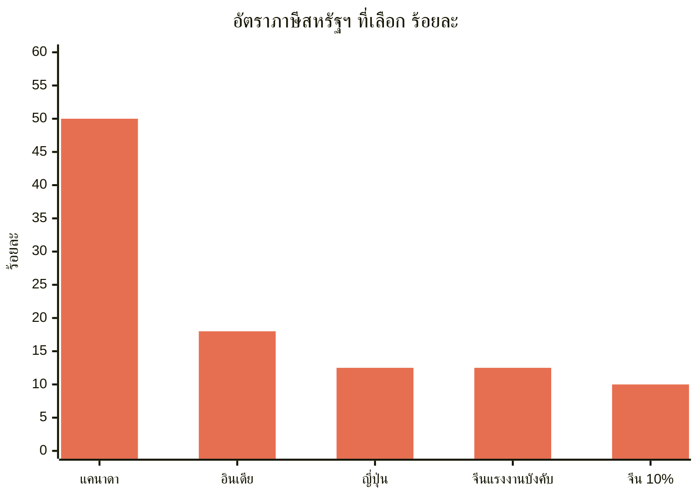
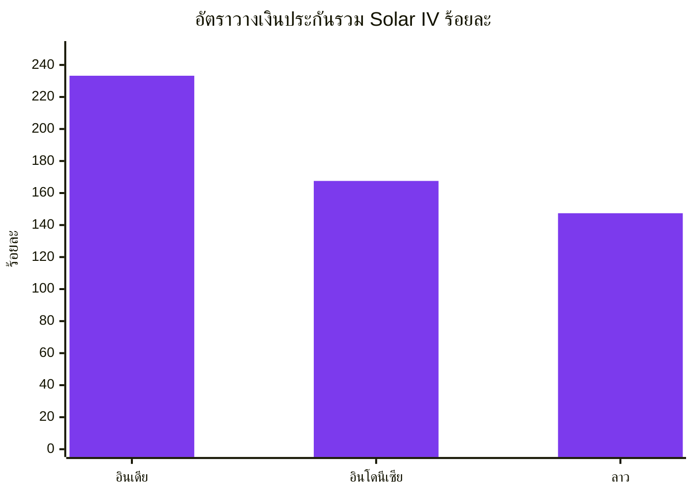
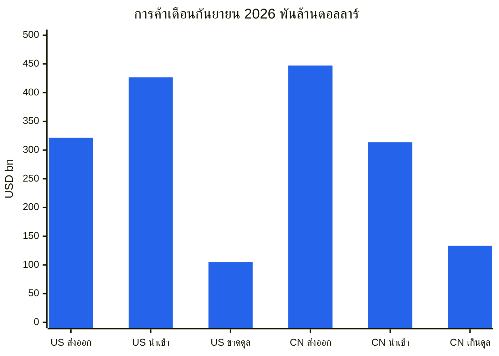
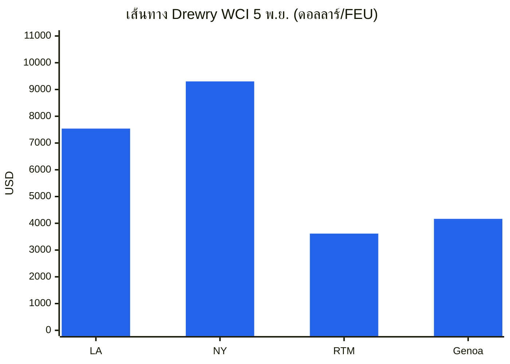
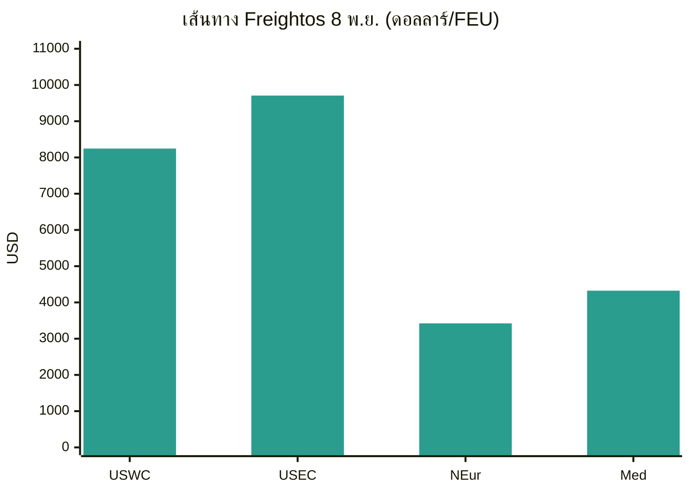
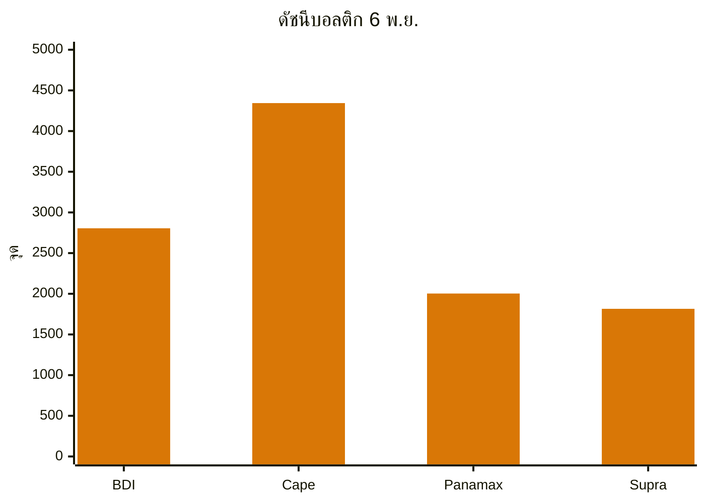
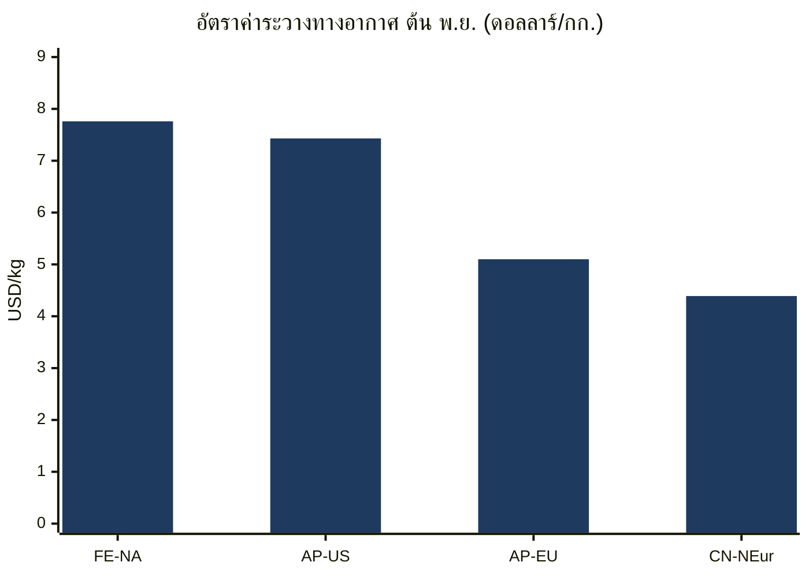
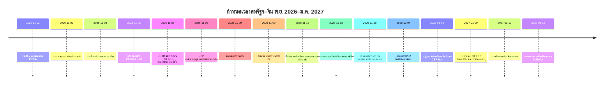
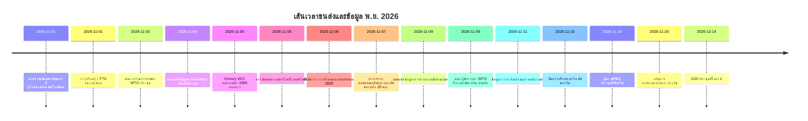

# รายงานข่าวกรองการค้าโลก — สัปดาห์ที่ 2–9 พฤศจิกายน 2026

**สรุปรายสัปดาห์** ช่วงเวลาที่ครอบคลุม: 2–9 พฤศจิกายน 2026 รวบรวมจากแหล่งข่าวการค้า นโยบาย ข้อมูล และขนส่งสินค้าประมาณ 45 แหล่งทั่วโลก

---

## สารบัญ

1. [บทสรุปผู้บริหาร](#1-executive-summary)
2. [การแจ้งเตือน](#2-alerts)
3. [ข่าวเด่น — เจาะลึก](#3-top-stories--deep-dives)
4. [ตารางติดตามภาษีศุลกากร](#4-tariff-tracker)
5. [เจาะลึกนโยบายสหรัฐอเมริกา](#5-us-policy-deep-dive)
6. [นโยบายโลกตามภูมิภาค](#6-world-policy-by-region)
7. [มาตรการบังคับใช้](#7-enforcement-actions)
8. [การเปิดเผยข้อมูล](#8-data-releases)
9. [ตลาดขนส่งสินค้า](#9-freight-market)
10. [เส้นเวลานโยบาย](#10-policy-timelines)
11. [กำหนดเวลาและเหตุการณ์ที่จะมาถึง (90 วันข้างหน้า)](#11-upcoming-deadlines--events-next-90-days)
12. [แหล่งข้อมูลและระเบียบวิธี](#12-sources--methodology)

---

## 1. บทสรุปผู้บริหาร

สัปดาห์ที่เส้นตายวันที่ 9 พฤศจิกายนถูกเลื่อนออกไปในนาทีสุดท้ายถึงสองครั้ง แล้วขยับไปเป็นเดือนมกราคม เมื่อวันที่ 6 พฤศจิกายน สำนักงานผู้แทนการค้าสหรัฐฯ (Office of the United States Trade Representative) ประกาศขยายการยกเว้นภาษีมาตรา 301 สำหรับสินค้าจีนทั้ง 178 รายการ และการระงับค่าธรรมเนียมท่าเรือมาตรา 301 สำหรับเรือที่เชื่อมโยงกับจีนออกไปจนถึงวันที่ 9 มกราคม 2027 และเมื่อวันที่ 9 พฤศจิกายน จีนขยายมาตรการในฝั่งของตน — การระงับภาษีเพิ่มเติม 24% สำหรับสินค้าสหรัฐฯ การระงับค่าธรรมเนียมท่าเรือ และการยกเว้นมาตรการควบคุมการส่งออกแร่ธาตุสำคัญ — ออกไปจนถึงวันที่ 10 มกราคม 2027 การผ่อนผันสองเดือนนี้มีอยู่จริง แต่มีระยะเวลาสั้น: เครื่องมือชุดเดียวกันนี้จะหมดอายุภายในหนึ่งวันของกันและกันในเดือนมกราคม และชุดมาตรการภาษีโดยรวมที่หารือกันหลังการประชุมสุดยอดที่วอชิงตันในเดือนกันยายนยังคงไม่แล้วเสร็จ ในด้านอื่น อินเดียและสหรัฐฯ ประกาศข้อตกลงการค้าที่ลดภาษีสหรัฐฯ สำหรับสินค้าอินเดียเหลือ 18% จากเดิมที่สูงถึง 50% พรรคเดโมแครตชนะการควบคุมสภาคองเกรสทั้งสองสภาในการเลือกตั้งกลางเทอมโดยไม่เปลี่ยนแนวโน้มภาษี ค่าธรรมเนียมดำเนินการ 2 ยูโรของสหภาพยุโรปและข้อกำหนดรหัสประจำตัวสินค้ามีผลบังคับใช้ตั้งแต่วันที่ 1 พฤศจิกายน และจีนขยายขอบเขตการควบคุมการส่งออกไปยังปัญญาประดิษฐ์ ชีวเภสัชภัณฑ์ และเทคโนโลยีการผลิตพลังงานแสงอาทิตย์

- **เส้นตายวันที่ 9 พฤศจิกายนถูกเลื่อนออกไป ไม่ใช่ถูกยกเลิก** ประกาศของ USTR เมื่อวันที่ 6 พฤศจิกายนขยายการยกเว้นภาษีมาตรา 301 สำหรับสินค้าจีนทั้ง 178 รายการ (164 รายการทั่วไป 14 รายการสำหรับการผลิตพลังงานแสงอาทิตย์) และการระงับมาตรการทางทะเลมาตรา 301 ต่อไปจนถึงเวลา 23:59 น. ตามเวลาตะวันออกของวันที่ 9 มกราคม 2027 โดยสินค้าที่นำเข้าตั้งแต่วันที่ 10 พฤศจิกายน 2026 อยู่ในช่วงเวลาใหม่ สำนักอุตสาหกรรมและความมั่นคง (Bureau of Industry and Security) ยื่นขยายการระงับกฎ Affiliates Rule 50% ออกไปจนถึงวันที่ 10 มกราคม 2027 จีนซึ่งประกาศเมื่อวันที่ 9 พฤศจิกายน คงการระงับภาษีเพิ่มเติม 24% สำหรับสินค้าสหรัฐฯ ไว้อีกสองเดือนนับจากวันที่ 10 พฤศจิกายน คงอัตราภาษีเพิ่มเติม 10% ไว้ และขยายการระงับค่าธรรมเนียมท่าเรือ การยกเว้นมาตรการควบคุมการส่งออกแร่ธาตุสำคัญ และการระงับมาตรการต่อบริษัทสหรัฐฯ 11 แห่งในรายชื่อหน่วยงานที่ไม่น่าเชื่อถือ และ 16 แห่งในรายชื่อควบคุมการส่งออก ออกไปจนถึงวันที่ 10 มกราคม 2027 ความไม่สมมาตรมีอยู่จริงแต่ไม่มากนัก: เครื่องมือของสหรัฐฯ หมดอายุวันที่ 9 มกราคม ส่วนของจีนวันที่ 10 มกราคม และจนถึงวันที่ 9 พฤศจิกายนยังไม่มีเอกสารประธานาธิบดีสหรัฐฯ ที่รับรองการขยายเวลาพักรบอย่างเป็นทางการ
- **อินเดียและสหรัฐฯ บรรลุข้อตกลงเมื่อวันที่ 2 พฤศจิกายน** วอชิงตันลดภาษีสินค้าอินเดียเหลือ 18% จากเดิมที่สูงถึง 50% — อัตราตอบโต้ 25% บวกค่าปรับ 25% สำหรับการซื้อน้ำมันรัสเซีย — และยกเลิกภาษีปรับสำหรับการซื้อน้ำมันรัสเซีย ประธานาธิบดีทรัมป์กล่าวว่าอินเดียตกลงจะหยุดซื้อน้ำมันรัสเซียและเพิ่มการซื้อจากสหรัฐฯ ส่วนรัฐบาลอินเดียยังไม่ได้ยืนยันต่อสาธารณะเกี่ยวกับข้อผูกพันด้านแหล่งพลังงานที่เฉพาะเจาะจง ข้อตกลงนี้ได้รับการอธิบายว่าเป็นส่วนแรกของข้อตกลงทวิภาคีที่กว้างขึ้น โดยมีเป้าหมายการค้าทวิภาคี 500,000 ล้านดอลลาร์ภายในปี 2030 แต่จนถึงวันที่ 3 พฤศจิกายนยังไม่มีการเผยแพร่ข้อความที่ลงนาม ตารางภาษี หรือวันที่เริ่มมีผลบังคับใช้ ข้อตกลงนี้มีขึ้นไม่กี่วันหลังจากอินเดียสรุปข้อตกลงการค้าเสรีกับสหภาพยุโรป
- **การเลือกตั้งกลางเทอมเปลี่ยนการเมืองของการค้า ไม่ใช่ภาษี** พรรคเดโมแครตชนะการควบคุมทั้งสภาผู้แทนราษฎรและวุฒิสภาจากการเลือกตั้งวันที่ 3 พฤศจิกายน ตามการประกาศของสำนักข่าวเอพี นักวิเคราะห์คาดว่าจะมีการไต่สวนเพื่อกำกับดูแลและการลงมติยกเลิกเชิงสัญลักษณ์ในปี 2027 แต่ไม่คาดว่าจะมีการยกเลิก: พรรคเดโมแครตยังขาดเสียงข้างมากสองในสามที่จำเป็นต่อการล้มล้างการยับยั้งของประธานาธิบดีอยู่มาก และรัฐบาลได้สร้างโครงสร้างภาษีขึ้นใหม่บนพื้นฐานอำนาจมาตรา 301 และมาตรา 232 หลังจากศาลฎีกายกเลิกภาษี IEEPA ในเดือนกุมภาพันธ์ 2026 วุฒิสภาได้ลงมติ 51–47 เมื่อวันที่ 29 ตุลาคมให้ยุติภาวะฉุกเฉินแห่งชาติที่เป็นฐานของภาษีทั่วโลก ค่าธรรมเนียมเพิ่มเติมตามมาตรา 122 ซึ่งจำกัดไว้ที่ 150 วันหากไม่มีกฎหมาย เป็นเครื่องมือเดียวที่สภาคองเกรสชุดใหม่สามารถจำกัดได้
- **การปรับระบบอีคอมเมิร์ซมูลค่าต่ำของยุโรปมีผลบังคับใช้** ตั้งแต่วันที่ 1 พฤศจิกายน ค่าธรรมเนียมดำเนินการศุลกากร 2 ยูโรต่อรายการสินค้าใช้กับพัสดุขายทางไกลที่ส่งตรงจากนอกสหภาพยุโรปถึงผู้บริโภคในสหภาพยุโรป นอกเหนือจากอากรแบบเหมาจ่าย 3 ยูโรต่อรายการภาษีที่มีผลบังคับใช้ตั้งแต่วันที่ 1 กรกฎาคม 2026 สำหรับพัสดุมูลค่า 150 ยูโรหรือน้อยกว่า สินค้าทุกชิ้นในการจัดส่งแบบธุรกิจถึงผู้บริโภคต้องมีรหัสประจำตัวสินค้าสามรหัสด้วย ไม่ว่ามูลค่าเท่าใด อากรและค่าธรรมเนียมรวมกันอาจสูงถึง 5 ยูโรต่อรายการภาษีก่อนภาษีมูลค่าเพิ่ม ศุลกากรสหภาพยุโรปประมวลผลพัสดุอีคอมเมิร์ซประมาณ 6,000 ล้านชิ้นในปี 2025 โดยประมาณ 90% มาจากจีน
- **การควบคุมการส่งออกของจีนขยายไปยังเทคโนโลยีและอุปกรณ์อุตสาหกรรม** ข้อเสนอร่วมของกระทรวงพาณิชย์จีน (MOFCOM) และกระทรวงวิทยาศาสตร์และเทคโนโลยี (ประกาศฉบับที่ 48 วันที่ 16 ตุลาคม) จะเพิ่มเทคโนโลยี 40 รายการ — ปัญญาประดิษฐ์ 23 รายการ ชีวเภสัชภัณฑ์ 5 รายการ โฟโตโวลตาอิก 12 รายการ — ลงในบัญชีควบคุมการส่งออก โดยเปิดรับความคิดเห็นจนถึงวันที่ 15 พฤศจิกายน และการลงทะเบียนก่อนส่งออกชั่วคราวมีผลบังคับใช้แล้ว นอกจากนี้ มาตรการควบคุมสินค้าใช้สองทางสำหรับโดรน เครื่องเจาะอุโมงค์ และเรือขุดจะมีผลบังคับใช้วันที่ 18 พฤศจิกายน มาตรการจำกัดด้านพลังงานแสงอาทิตย์ได้รับการประเมินว่ามีผลกระทบมากที่สุด เนื่องจากจีนครองตลาดการผลิตโฟโตโวลตาอิก
- **สหรัฐฯ รายงานเดือนที่มีการนำเข้าสูงสุดเป็นประวัติการณ์ จีนมุ่งสู่การเกินดุล 1 ล้านล้านดอลลาร์** สำนักสำมะโนประชากรและสำนักวิเคราะห์เศรษฐกิจรายงานเมื่อวันที่ 4 พฤศจิกายนว่า ยอดขาดดุลสินค้าและบริการเดือนกันยายนอยู่ที่ 105,000 ล้านดอลลาร์ จากการนำเข้าสูงสุดเป็นประวัติการณ์ 426,600 ล้านดอลลาร์ และการนำเข้าสินค้าสูงสุดเป็นประวัติการณ์ 346,900 ล้านดอลลาร์ โดยการนำเข้าสินค้าทุนสูงสุดเป็นประวัติการณ์ 158,000 ล้านดอลลาร์ การเกินดุลของจีนในเดือนกันยายนอยู่ที่ 133,530 ล้านดอลลาร์ จากการส่งออก 447,180 ล้านดอลลาร์ เพิ่มขึ้น 36.3% เมื่อเทียบกับปีก่อน ผลสำรวจของรอยเตอร์คาดการณ์ว่าการส่งออกเดือนตุลาคมจะเพิ่มขึ้น 33.5% และการเกินดุล 125,800 ล้านดอลลาร์ ซึ่งจะทำให้การเกินดุลสะสมเดือนมกราคม–ตุลาคมสูงกว่า 1 ล้านล้านดอลลาร์ ดัชนี PMI ภาคการผลิตอย่างเป็นทางการของจีนลดลงเหลือ 49.3 ในเดือนตุลาคม โดยคำสั่งซื้อส่งออกใหม่อยู่ที่ 48.7
- **ขนส่งสินค้าแยกทิศทางอีกครั้ง: ทางทะเลอ่อนตัว ทางอากาศพุ่งขึ้น** ดัชนีคอนเทนเนอร์โลกของ Drewry ลดลง 1% เหลือ 4,389 ดอลลาร์ต่อตู้ 40 ฟุต เมื่อวันที่ 5 พฤศจิกายน แต่ยังสูงกว่าปีก่อน 124% เนื่องจากการขึ้นอัตราทั่วไปของผู้ขนส่งเมื่อวันที่ 1 พฤศจิกายนไม่เป็นผล ดัชนีค่าระวางเรือเทกองบอลติกปิดสัปดาห์ที่ 2,805 เพิ่มขึ้น 3.4% เมื่อเทียบกับสัปดาห์ก่อน จากความแข็งแกร่งของเรือ Capesize ค่าระวางทางอากาศเคลื่อนไหวในทิศทางตรงกันข้าม: เส้นทางตะวันออกไกล–อเมริกาเหนือแตะ 7.76 ดอลลาร์ต่อกิโลกรัม เมื่อวันที่ 3 พฤศจิกายน เพิ่มขึ้น 9% ในหนึ่งสัปดาห์ และสูงสุดในปี 2026 ใกล้ระดับสูงสุด 8.00 ดอลลาร์ในช่วงต้นเดือนธันวาคม 2025 ประมาณ 60% ของความจุคอนเทนเนอร์เอเชีย–ยุโรปใช้คลองสุเอซในขณะนี้ ตามข้อมูลของ Drewry ข้อพิพาทแรงงานยามรักษาการณ์ที่ลอสแอนเจลิส–ลองบีชถูกเลื่อนออกไปอีกครั้งเป็นวันที่ 20 พฤศจิกายน ขณะที่ท่าเรือฝรั่งเศสเผชิญการนัดหยุดงานสองวัน และการปิดกั้นของคนขับรถบรรทุกที่ท่าเรือซานอันโตนิโอของชิลีคุกคามฤดูกาลส่งออกเชอร์รี

**ขนส่งสินค้า:** อัตราค่าระวางคอนเทนเนอร์แบบสปอตลดลงทั้งในเส้นทางข้ามแปซิฟิกและเอเชีย–ยุโรป ขณะที่การขึ้นราคาของผู้ขนส่งในเดือนพฤศจิกายนถูกหักส่วนลด เรือเทกองเพิ่มขึ้นเป็นสัปดาห์ที่สามติดต่อกันจากรายได้ของเรือ Capesize ค่าระวางทางอากาศแตะระดับสูงสุดในปี 2026 ในช่วงฤดูกาลสูงสุด การขนส่งผ่านคลองสุเอซฟื้นตัวอย่างต่อเนื่อง และข้อพิพาทแรงงานที่ลอสแอนเจลิส–ลองบีช ในฝรั่งเศส และในชิลี ทำให้ความเสี่ยงด้านท่าเรือยังคงอยู่ในช่วงฤดูกาลสูงสุด

---

## 2. การแจ้งเตือน

| # | การแจ้งเตือน | มีผล | ผลกระทบ | แหล่งข้อมูล |
|---|-------|-----------|--------|--------|
| A1 | USTR ขยายการยกเว้นภาษีมาตรา 301 สำหรับสินค้าจีนทั้ง 178 รายการจนถึงเวลา 23:59 น. ตามเวลาตะวันออก วันที่ 9 ม.ค. 2027 สินค้าที่นำเข้าตั้งแต่วันที่ 10 พ.ย. 2026 อยู่ในช่วงเวลาใหม่ ยังไม่ยืนยันการตีพิมพ์ใน Federal Register ณ วันที่ 8 พ.ย. | 6 พ.ย. 2026 (ประกาศ) | ผ่อนผันเพียงสองเดือน สินค้าที่นำเข้าหลังวันที่ 9 ม.ค. 2027 เสียอัตราตามรายการเต็ม (25% รายการที่ 1–3, 7.5% รายการ 4A) | [TechTimes](https://www.techtimes.com/articles/330285/20261109/ustr-extends-section-301-tariff-exclusions-chinese-goods-entries-after-january-9-pay-full-duty.htm) |
| A2 | USTR ระงับมาตรการทางทะเลมาตรา 301 ต่อไป (ค่าธรรมเนียมท่าเรือสำหรับเรือที่เชื่อมโยงกับจีน อากรตามภาคผนวก V.A) จนถึงเวลา 23:59 น. ตามเวลาตะวันออก วันที่ 9 ม.ค. 2027 | 9 พ.ย. 2026 | ค่าธรรมเนียมยังคงถูกระงับ การระงับและการยกเว้นหมดอายุวันเดียวกันในเดือนมกราคม | [Gateway Lines](https://gatewaylines.com/press-releases/china-ship-fee-delay-jan-9-2027-301-exclusions) |
| A3 | จีนขยายการระงับภาษีเพิ่มเติม 24% สำหรับสินค้าสหรัฐฯ อีกสองเดือนนับจากวันที่ 10 พ.ย. คงอัตรา 10% ไว้ ขยายการระงับค่าธรรมเนียมท่าเรือ การยกเว้นมาตรการควบคุมการส่งออกแร่ธาตุสำคัญ และการระงับมาตรการต่อรายชื่อหน่วยงานออกไปจนถึงวันที่ 10 ม.ค. 2027 | 9–10 พ.ย. 2026 | ผู้ส่งออกสหรัฐฯ ยังคงเสียอัตรา 10% การพักรบดำเนินต่อไปจนถึงวันที่ 10 ม.ค. 2027 ในฝั่งจีน | [Reuters via SRN News](https://srnnews.com/china-extends-suspension-of-24-tariff-on-us-imports-for-two-months/) |
| A4 | ประกาศข้อตกลงการค้าอินเดีย–สหรัฐฯ: ลดภาษีสหรัฐฯ สำหรับสินค้าอินเดียเหลือ 18% จากเดิมสูงสุด 50% ยกเลิกภาษีปรับสำหรับการซื้อน้ำมันรัสเซีย ยังไม่มีการเผยแพร่ข้อความที่ลงนาม ณ วันที่ 3 พ.ย. | 2 พ.ย. 2026 | ต้องกำหนดราคาใหม่สำหรับสินค้าที่มีถิ่นกำเนิดอินเดีย ข้อผูกพันด้านแหล่งพลังงานยังไม่ได้รับการยืนยันจากนิวเดลี | [Economic Times](https://www.eximguru.com/export-import-news/export-news/india-us-trade-deal-lifts-a-117126.aspx) |
| A5 | กฎชั่วคราวของ CBP: ผู้นำเข้าต่างชาติที่เป็นผู้นำเข้าตามบันทึกต้องได้รับการรับรอง CTPAT หรือใช้ตัวแทนศุลกากรที่ได้รับการรับรอง CTPAT ตั้งแต่วันที่ 5 ม.ค. 2027 ผู้นำเข้าต่างชาติ 32% ในปัจจุบันไม่เป็นไปตามเงื่อนไขทั้งสองข้อ | 5 ม.ค. 2027 | ผู้ขายต่างชาติที่ส่งตรงถึงผู้ซื้อในสหรัฐฯ ต้องเปลี่ยนตัวแทนหรือขอรับการรับรอง เปิดรับความคิดเห็นจนถึงวันที่ 5 ม.ค. 2027 | [CBP](https://www.cbp.gov/newsroom/national-media-release/cbp-announces-heightened-requirements-foreign-importers-record) |
| A6 | ค่าธรรมเนียมดำเนินการ 2 ยูโรต่อรายการสินค้าของสหภาพยุโรป และข้อกำหนดรหัสประจำตัวสินค้าสามรหัสสำหรับพัสดุ B2C ทุกรายการที่เข้าสู่สหภาพยุโรปตั้งแต่วันที่ 1 พ.ย. อากรและค่าธรรมเนียมรวมกันสูงสุด 5 ยูโรต่อรายการภาษีก่อนภาษีมูลค่าเพิ่ม | 1 พ.ย. 2026 | ต้นทุนถึงปลายทางของอีคอมเมิร์ซมูลค่าต่ำที่มีหลายรายการเพิ่มขึ้น พัสดุที่ไม่มีรหัสประจำตัวเสี่ยงต่อความล่าช้าหรือถูกปฏิเสธ | [Logistik Heute](https://logistik-heute.de/en/news/eu-customs-policy-new-package-fee-increases-costs-cross-border-online-trade-291550.html) |
| A7 | กระทรวงพาณิชย์ออกคำสั่ง AD/CVD ขั้นสุดท้ายสำหรับเซลล์แสงอาทิตย์ชนิดผลึกซิลิคอนจากอินเดีย อินโดนีเซีย และลาว อัตรารวมสูงสุดประมาณ 233% (อินเดีย) 168% (อินโดนีเซีย) 147% (ลาว) | 9 พ.ย. 2026 | เริ่มเก็บเงินประกันอีกครั้งตั้งแต่วันที่ 5 พ.ย. โมดูลที่ผลิตในประเทศที่สามโดยใช้เซลล์ที่ครอบคลุมอยู่ในขอบเขตคำสั่ง | [MLex](https://www.mlex.com/mlex/articles/2547289/us-commerce-imposes-duties-for-indonesian-laotian-and-indian-solar-cells) |
| A8 | ภัยคุกคามการนัดหยุดงานของยามรักษาการณ์ที่ LA/Long Beach ถูกเลื่อนออกไปอีกครั้ง การเจรจาขยายถึงวันที่ 20 พ.ย. 2026 คนงานประมาณ 250 คนที่ท่าเทียบเรือหกแห่ง สินค้าประมาณ 85% ของลองบีช และประมาณ 33% ของลอสแอนเจลิสตกอยู่ในความเสี่ยง | 20 พ.ย. 2026 | หลีกเลี่ยงการหยุดงานในวันหลังการเลือกตั้งกลางเทอมได้ แต่ข้อพิพาทยืดเยื้อเข้าสู่ช่วงปลายฤดูกาลสูงสุด ขณะที่มีสินค้าค้างรอรถไฟจำนวนมากอยู่แล้ว | [gCaptain](https://maritimenewsbd.com/la-long-beach-port-strike-threat-deferred-november-20/) |
| A9 | ข้อเสนอรายการควบคุมการส่งออกเทคโนโลยี AI/ชีวเภสัชภัณฑ์/พลังงานแสงอาทิตย์ของจีน: ปิดรับความคิดเห็นวันที่ 15 พ.ย. 2026 การลงทะเบียนก่อนส่งออกชั่วคราวมีผลแล้ว มาตรการควบคุมสินค้าใช้สองทางสำหรับโดรน เครื่องเจาะอุโมงค์ และเรือขุดมีผลวันที่ 18 พ.ย. | 15 พ.ย. / 18 พ.ย. 2026 | เทคโนโลยีที่ได้รับผลกระทบ 40 รายการ (ห้าม 14 รายการ จำกัด 26 รายการ) ความรู้ด้านการผลิตพลังงานแสงอาทิตย์เป็นประเด็นที่เฉียบคมที่สุด | [China Briefing](https://www.china-briefing.com/news/china-technology-export-controls/) |
| A10 | พรรคเดโมแครตชนะทั้งสองสภาในการเลือกตั้งกลางเทอมวันที่ 3 พ.ย. คาดว่าโครงสร้างภาษีจะคงอยู่ วุฒิสภาเคยลงมติ 51–47 เมื่อวันที่ 29 ต.ค. ให้ยุติภาวะฉุกเฉินแห่งชาติที่เป็นฐานของภาษีทั่วโลก | 3 พ.ย. 2026 | คาดว่าจะมีการกำกับดูแลและการลงมติยกเลิกเชิงสัญลักษณ์ในปี 2027 มาตรา 122 เป็นเครื่องมือที่สภาคองเกรสชุดใหม่สามารถจำกัดได้ | [SupplyChainBrain](https://www.supplychainbrain.com/general-scm/regulation-compliance/article/16424361/us-midterm-rout-unlikely-to-change-trumps-trade-policy) |

### A1/A2 — เส้นตายวันที่ 9 พฤศจิกายน ถูกเลื่อนออกไปในนาทีสุดท้าย

เครื่องมือทั้งสองที่เป็นประเด็นหลักของรายงานสัปดาห์ที่แล้วได้รับการขยายเวลาทั้งคู่เมื่อวันที่ 6 พฤศจิกายน เมื่อ USTR ประกาศสองฉบับบนเว็บไซต์ ฉบับแรกขยายการยกเว้นภาษีมาตรา 301 สำหรับสินค้าจีนทั้ง 178 รายการ — การยกเว้นทั่วไป 164 รายการภายใต้ HTSUS 9903.88.69 และการยกเว้นสำหรับการผลิตพลังงานแสงอาทิตย์ 14 รายการภายใต้ 9903.88.70 — จนถึงเวลา 23:59 น. ตามเวลาตะวันออกของวันที่ 9 มกราคม 2027 ครอบคลุมสินค้าที่นำเข้าเพื่อการบริโภค หรือถอนจากคลังสินค้าเพื่อการบริโภค ตั้งแต่เวลา 00:01 น. ตามเวลาตะวันออกของวันที่ 10 พฤศจิกายน 2026 ไม่มีการเพิ่มหรือลบการยกเว้น และไม่มีการขอความคิดเห็นใหม่ USTR อาศัยความคิดเห็นที่ได้รับตามประกาศวันที่ 16 กันยายน 2025 ประกาศฉบับที่สองระงับมาตรการมาตรา 301 ต่อแนวปฏิบัติทางทะเล โลจิสติกส์ และการต่อเรือของจีนต่อไป รวมถึงค่าธรรมเนียมเรือที่ครอบคลุมและอากรตามภาคผนวก V.A มีผลตั้งแต่วันที่ 9 พฤศจิกายน 2026 จนถึงเวลา 23:59 น. ตามเวลาตะวันออกของวันที่ 9 มกราคม 2027 USTR เคยเสนอการขยายเวลาทางทะเลเมื่อวันที่ 26 ตุลาคม (91 FR 67388) ระยะเวลารับความคิดเห็นปิดเมื่อวันที่ 30 ตุลาคม ณ วันที่ 8 พฤศจิกายน ยังไม่พบการตีพิมพ์ใน Federal Register ที่สอดคล้องกันสำหรับประกาศทั้งสองฉบับ และประกาศเรื่องการยกเว้นมีความไม่สอดคล้องกันภายใน — ส่วนวันที่และภาคผนวกระบุวันที่ 9 มกราคม 2027 ขณะที่ข้อความอื่นอ้างถึงวันที่ 10 มกราคม วันที่ที่มีผลบังคับใช้คือวันที่ 9 มกราคม หากไม่มีการขยายเวลา สินค้าที่นำเข้าตั้งแต่วันที่ 10 พฤศจิกายนจะต้องเสียอัตราตามรายการเต็ม การยกเว้นยกเว้นเฉพาะอากรตามรายการเท่านั้น: ภาษีมาตรา 301 สำหรับแรงงานบังคับ 12.5% อากรมาตรา 232 อากรตอบโต้การทุ่มตลาดและอากรตอบโต้การอุดหนุน และอัตราประเทศที่ได้รับการอนุเคราะห์ยิ่งยังคงใช้บังคับ เมื่อวันที่ 4 พฤศจิกายน สมาคมอุตสาหกรรมซอฟต์แวร์และข้อมูล (Software & Information Industry Association) และองค์กรอื่นอีก 23 แห่งขอให้ USTR ขยายเวลาอย่างน้อยหนึ่งปี USTR ให้สองเดือน

### A3 — จีนดำเนินการในวันเดียวกันกับวันที่การพักรบจะหมดอายุ

จีนประกาศเมื่อวันจันทร์ที่ 9 พฤศจิกายนว่า จะระงับภาษีเพิ่มเติม 24% สำหรับสินค้าสหรัฐฯ ต่อไปอีกสองเดือน นับจากเวลา 13:01 น. ตามเวลาปักกิ่งของวันที่ 10 พฤศจิกายน โดยคงอัตราภาษีเพิ่มเติม 10% ไว้ ประกาศฉบับที่ 6 ปี 2026 ของคณะกรรมการภาษีศุลกากรดำเนินการตามฉันทามติที่บรรลุในการประชุมสุดยอดที่วอชิงตันในเดือนกันยายนระหว่างประธานาธิบดีทรัมป์และสี จิ้นผิง ในขณะเดียวกัน กระทรวงพาณิชย์ของจีนขยายการยกเว้นมาตรการควบคุมการส่งออกสำหรับแร่ธาตุสำคัญบางรายการและเทคโนโลยีที่เกี่ยวข้องจนถึงวันที่ 10 มกราคม 2027 มาตรการต่อบริษัทสหรัฐฯ 11 แห่งในรายชื่อหน่วยงานที่ไม่น่าเชื่อถือ และ 16 แห่งในรายชื่อควบคุมการส่งออกยังคงถูกระงับจนถึงวันที่ 10 มกราคม 2027 และการระงับค่าธรรมเนียมท่าเรือพิเศษสำหรับเรือที่เชื่อมโยงกับสหรัฐฯ ถูกขยายออกไปถึงวันเดียวกัน การคว่ำบาตรบริษัทลูกในสหรัฐฯ ห้าแห่งของ Hanwha Ocean ถูกระงับเพิ่มอีกสองเดือนด้วย ความไม่สมมาตรมีความสำคัญต่อการวางแผน: ปักกิ่งดำเนินการโดยประกาศอย่างเป็นทางการ ขณะที่จนถึงวันที่ 9 พฤศจิกายนยังไม่มีเอกสารประธานาธิบดีสหรัฐฯ ที่รับรองการขยายเวลาพักรบอย่างเป็นทางการ และเครื่องมือของสหรัฐฯ หมดอายุวันที่ 9 มกราคม ขณะที่ของจีนดำเนินไปจนถึงวันที่ 10 มกราคม ชุดมาตรการลดภาษีตอบโต้มูลค่า 60,000 ล้านดอลลาร์ที่หารือกันหลังการประชุมสุดยอดเดือนกันยายน รวมถึงสินค้าเกษตรสหรัฐฯ มูลค่า 17,000 ล้านดอลลาร์ที่จีนนำเข้าในปี 2024 ยังคงไม่แล้วเสร็จ

### A4 — ข้อตกลงอินเดีย–สหรัฐฯ: 18% และคำถามเรื่องน้ำมันรัสเซีย

อินเดียและสหรัฐฯ บรรลุข้อตกลงการค้าหลังการเจรจาที่ตึงเครียดมาหลายเดือน ปิดท้ายด้วยการโทรศัพท์ระหว่างนายกรัฐมนตรีนเรนทรา โมดี และประธานาธิบดีโดนัลด์ ทรัมป์ ในช่วงดึกของวันจันทร์ที่ 2 พฤศจิกายน วอชิงตันประกาศลดภาษีสินค้าอินเดียเหลือ 18% จากเดิมที่สูงถึง 50% — อัตราตอบโต้ 25% บวกค่าปรับ 25% สำหรับการซื้อน้ำมันรัสเซีย — และยกเลิกภาษีปรับ ประธานาธิบดีทรัมป์กล่าวว่าอินเดียตกลงจะหยุดซื้อน้ำมันรัสเซียและเพิ่มการซื้อจากสหรัฐฯ และอาจรวมถึงเวเนซุเอลา และซื้อสินค้าอเมริกัน "ในระดับที่สูงขึ้นมาก" ส่วนรัฐบาลอินเดียยังไม่ได้แสดงความคิดเห็นต่อสาธารณะเกี่ยวกับข้อผูกพันด้านแหล่งพลังงานที่เฉพาะเจาะจง รอยเตอร์รายงานว่าอินเดียตกลงจะเพิ่มการซื้อปิโตรเลียม สินค้าป้องกันประเทศ อิเล็กทรอนิกส์ เภสัชภัณฑ์ อุปกรณ์โทรคมนาคม และเครื่องบินจากสหรัฐฯ ข้อตกลงนี้ได้รับการอธิบายว่าเป็นส่วนแรกของข้อตกลงทวิภาคีที่กว้างขึ้น โดยการเจรจายังดำเนินต่อไปและมีเป้าหมายการค้าทวิภาคี 500,000 ล้านดอลลาร์ภายในปี 2030 เพิ่มขึ้นจากประมาณ 191,000 ล้านดอลลาร์ในปัจจุบัน จากรายงาน ณ วันที่ 3 พฤศจิกายน ยังไม่มีการเผยแพร่ข้อความที่ลงนาม ตารางภาษี หรือวันที่เริ่มมีผลบังคับใช้ และอัตรา 18% จากกรอบเดือนกุมภาพันธ์ 2026 ไม่เคยถูกใช้มาก่อน — สินค้าอินเดียส่วนใหญ่เสียภาษีมาตรา 301 ที่ 10% ตั้งแต่วันที่ 24 กรกฎาคม 2026

### A5 — กฎผู้นำเข้าตามบันทึกต่างชาติของ CBP

CBP เผยแพร่กฎชั่วคราว "ข้อกำหนดที่เข้มงวดขึ้นสำหรับผู้นำเข้าต่างชาติตามบันทึก" (CBP Dec. 26-19, 91 FR 69977) เมื่อวันที่ 6 พฤศจิกายน 2026 เพื่อดำเนินการตามมาตรา 2 ของคำสั่งฝ่ายบริหาร 14411 ("การเสริมสร้างการบังคับใช้ศุลกากร" ลงนามวันที่ 3 มิถุนายน 2026) ตั้งแต่วันที่ 5 มกราคม 2027 ผู้นำเข้าต่างชาติตามบันทึกจะนำเข้าสินค้าเพื่อการบริโภคได้เฉพาะเมื่อตนได้รับการรับรอง CTPAT หรือยื่นผ่านตัวแทนศุลกากรที่ได้รับอนุญาตและได้รับการรับรอง CTPAT การวิเคราะห์ของ CBP เองระบุว่า ผู้นำเข้าต่างชาติตามบันทึกเพียง 0.4% ได้รับการรับรอง CTPAT และ 68% ใช้ตัวแทนที่ได้รับการรับรองอยู่แล้ว ส่วนที่เหลืออีก 32% จะไม่สามารถนำเข้าสู่สหรัฐฯ ต่อไปได้ เว้นแต่จะเปลี่ยนตัวแทนหรือขอรับการรับรอง CTPAT ด้วยตนเอง ส่วนที่ 110 ใหม่ของระเบียบศุลกากรกำหนดนิยาม "ผู้นำเข้าในสหรัฐฯ" (U.S. IOR) สถานะผู้นำเข้าต้องประกาศ ณ ตอนนำเข้าและตอนสรุปการนำเข้า ตัวแทนต้องตรวจสอบสถานะของลูกค้าและเก็บรักษาบันทึกการตรวจสอบไว้ห้าปี เปิดรับความคิดเห็นจนถึงวันที่ 5 มกราคม 2027 กฎนี้ไม่ได้กำหนดห้ามการนำเข้าแบบไม่เป็นทางการสำหรับผู้นำเข้าต่างชาติตามบันทึกตามที่คำสั่งฝ่ายบริหารสั่งการ แต่เชิญชวนให้แสดงความคิดเห็นเกี่ยวกับการห้ามโดยสมบูรณ์ในฐานะทางเลือก ต้นทุนที่ประเมินเป็นตัวเงินอยู่ที่ประมาณ 1,233,253 ดอลลาร์ต่อปี

### A6 — ค่าธรรมเนียม 2 ยูโรและรหัสประจำตัวสินค้าของสหภาพยุโรป

ตั้งแต่วันที่ 1 พฤศจิกายน 2026 ค่าธรรมเนียมดำเนินการศุลกากร 2 ยูโรต่อรายการสินค้าใช้กับพัสดุขายทางไกลที่ส่งตรงจากนอกสหภาพยุโรปถึงผู้บริโภคในสหภาพยุโรป ไม่ว่ามูลค่าเท่าใด ภายใต้ระเบียบที่ได้รับมอบอำนาจ (EU) 2026/2152 ค่าธรรมเนียมนี้อยู่เหนืออากรแบบเหมาจ่าย 3 ยูโรต่อรายการภาษีที่มีผลบังคับใช้ตั้งแต่วันที่ 1 กรกฎาคม 2026 สำหรับพัสดุมูลค่า 150 ยูโรหรือน้อยกว่า ภายใต้ระเบียบ (EU) 2026/382 ซึ่งยกเลิกการยกเว้นอากร de minimis ที่ 150 ยูโร ตั้งแต่วันเดียวกัน สินค้าทุกชิ้นในการจัดส่งแบบธุรกิจถึงผู้บริโภคไปยังสหภาพยุโรป — ไม่ว่ามูลค่าเท่าใด — ต้องมีรหัสประจำตัวสินค้าสามรหัส อากรและค่าธรรมเนียมรวมกันจึงอาจสูงถึง 5 ยูโรต่อรายการภาษี ไม่รวมภาษีมูลค่าเพิ่ม ระบบชั่วคราวนี้ดำเนินไปจนถึงวันที่ 1 กรกฎาคม 2028 เมื่อระบบข้อมูลศุลกากรกลางของสหภาพยุโรปมีกำหนดจะเข้ามาแทนที่อากรแบบเหมาจ่ายด้วยอากรมาตรฐาน ค่าธรรมเนียมนี้ไม่คืนเงินแม้สินค้าถูกส่งคืน

### A7 — คำสั่ง Solar IV: อัตรารวมสูงสุดประมาณ 233%

กระทรวงพาณิชย์ออกคำสั่งอากรตอบโต้การทุ่มตลาดและอากรตอบโต้การอุดหนุนสำหรับเซลล์โฟโตโวลตาอิกชนิดผลึกซิลิคอน ไม่ว่าจะประกอบเป็นโมดูลหรือไม่ก็ตาม จากอินเดีย อินโดนีเซีย และลาว เมื่อวันที่ 9 พฤศจิกายน 2026 ตามคำวินิจฉัยขั้นสุดท้ายของ USITC ที่ยืนยันความเสียหายซึ่งตีพิมพ์เมื่อวันที่ 5 พฤศจิกายน (91 FR 69865) อินเดีย: ส่วนเหลื่อมการทุ่มตลาด 123.04% (เงินประกัน 107.17% หลังหักชดเชยเงินอุดหนุน) และอากรตอบโต้การอุดหนุน 126.09% อัตราวางเงินประกันรวม 233.26% อินโดนีเซีย: การทุ่มตลาด 94.36% และอากรตอบโต้การอุดหนุน 73.20% (อัตรารวมสำหรับผู้อื่นทั้งหมด 167.56%) ลาว: การทุ่มตลาด 65.43% และอากรตอบโต้การอุดหนุน 82.03% (อัตรารวม 147.39%) การระงับการชำระบัญชีและการเก็บเงินประกันเริ่มอีกครั้งตั้งแต่วันที่ 5 พฤศจิกายน 2026 โมดูล ลามิเนต และแผงที่ผลิตในประเทศที่สามโดยใช้เซลล์ที่ครอบคลุมอยู่ในขอบเขตคำสั่ง โมดูลที่ประกอบในอินเดียโดยใช้เซลล์จากประเทศที่สามไม่อยู่ในขอบเขต รายงานสาธารณะฉบับเต็มของ USITC (USITC Publication 5804) มีกำหนดภายในวันที่ 23 พฤศจิกายน 2026

### A8 — ลอสแอนเจลิส/ลองบีช: เลื่อนไปเป็นวันที่ 20 พฤศจิกายน

ภัยคุกคามการนัดหยุดงานของพนักงานรักษาความปลอดภัย (ยามรักษาการณ์) ที่ท่าเทียบเรือคอนเทนเนอร์ในลอสแอนเจลิสและลองบีชถูกเลื่อนออกไปอีกครั้ง โดยการเจรจาขยายไปจนถึงวันที่ 20 พฤศจิกายน ตามรายงานของ Bloomberg ผ่าน gCaptain เมื่อวันที่ 7 พฤศจิกายน สหภาพ ILWU Local 26 เป็นตัวแทนพนักงานรักษาความปลอดภัยประมาณ 250 คนที่ท่าเทียบเรือคอนเทนเนอร์หกแห่ง สัญญาฉบับก่อนหมดอายุในเดือนกรกฎาคม 2025 สมาชิกได้อนุมัติการนัดหยุดงานแล้ว และทั้งสองฝ่ายกำลังเจรจาด้วยความช่วยเหลือของสำนักงานไกล่เกลี่ยและประนอมข้อพิพาทแรงงานกลาง (Federal Mediation and Conciliation Service) สมาคมการเดินเรือแปซิฟิก (Pacific Maritime Association) ระบุว่า ความหยุดชะงักอาจกระทบสินค้าประมาณ 85% ที่เคลื่อนผ่านท่าเรือลองบีช และหนึ่งในสามของสินค้าที่ท่าเรือลอสแอนเจลิส เนื่องจากคาดว่าคนงานท่าเรือกลุ่มอื่นจะไม่ข้ามแนวรั้วนัดหยุดงานของ Local 26 พื้นที่ท่าเรือตึงตัวอยู่แล้ว: ตู้คอนเทนเนอร์นำเข้าประมาณ 35,688 ตู้กำลังรอใช้บริการรถไฟที่ท่าเรือทั้งสองแห่ง โดย 10,562 ตู้รอมาเก้าวันหรือมากกว่า และสินค้านำเข้าที่ต้องขนส่งทางรถไฟใช้เวลาเฉลี่ย 7.19 วันในเดือนกันยายน เพิ่มขึ้นจาก 6.75 วันในเดือนสิงหาคม ท่าเรือลอสแอนเจลิสจัดการตู้คอนเทนเนอร์ได้ 1 ล้านตู้ในหนึ่งเดือน สร้างสถิติใหม่ แม้หัวหน้าท่าเรือจะเตือนถึงความเสี่ยงด้านการวางแผนจากภาษี

### A9 — การควบคุมการส่งออกของจีน: ปิดรับความคิดเห็นวันที่ 15 พฤศจิกายน กฎสินค้าใช้สองทางมีผลวันที่ 18 พฤศจิกายน

MOFCOM และกระทรวงวิทยาศาสตร์และเทคโนโลยีเสนอให้เพิ่มเทคโนโลยี 40 รายการลงในบัญชีเทคโนโลยีที่ห้ามและจำกัดการส่งออก: ปัญญาประดิษฐ์ 23 รายการ ชีวเภสัชภัณฑ์ 5 รายการ โฟโตโวลตาอิก 12 รายการ สิบสี่รายการจะถูกห้ามส่งออก 26 รายการถูกจำกัด (ต้องมีใบอนุญาต) ตั้งแต่วันที่ 16 ตุลาคม 2026 การลงทะเบียนก่อนส่งออกชั่วคราวสำหรับเทคโนโลยีที่ระบุไว้ — รวมถึงการส่งออกที่อยู่ระหว่างดำเนินการและการโอนกรรมสิทธิ์หรือการควบคุมกิจการในประเทศที่ถือครองเทคโนโลยีดังกล่าวไปยังหน่วยงานต่างประเทศ — มีผลบังคับใช้ผ่านแอปพลิเคชัน Technology Trade Management Information ของ MOFCOM เปิดรับความคิดเห็นจากสาธารณะจนถึงวันที่ 15 พฤศจิกายน นอกจากนี้ ประกาศสามฉบับปรับปรุงรายการควบคุมการส่งออกสินค้าใช้สองทางสำหรับอากาศยานไร้คนขับ เครื่องเจาะอุโมงค์ และเรือขุด ซึ่งทั้งหมดมีผลวันที่ 18 พฤศจิกายน 2026 และ MOFCOM กับสำนักงานศุลกากรทั่วไปออกประกาศฉบับที่ 52 ปรับปรุงขั้นตอนที่ศุลกากรอาจกักสินค้าที่นำเสนอเพื่อส่งออกโดยไม่มีใบอนุญาต MOFCOM อธิบายชุดมาตรการนี้ว่า "แม่นยำและจำกัด"

### A10 — การเลือกตั้งกลางเทอม: พรรคเดโมแครตครองสภาคองเกรส คาดว่าภาษีจะคงอยู่

การเลือกตั้งกลางเทอมวันที่ 3 พฤศจิกายนทำให้พรรคเดโมแครตพลิกกลับครั้งใหญ่เป็นประวัติการณ์ในสภาผู้แทนราษฎร วุฒิสภา และตำแหน่งอื่น ๆ รายงานเมื่อวันที่ 4 พฤศจิกายนอธิบายว่าเป็นการกวาดชัยชนะของพรรคเดโมแครตในทั้งสองสภา ที่นั่งสภาผู้แทนราษฎรทั้ง 435 ที่นั่งและวุฒิสภา 35 จาก 100 ที่นั่งอยู่ในการเลือกตั้ง ผู้เชี่ยวชาญด้านการค้าและเจ้าหน้าที่สภาคองเกรสบอกกับรอยเตอร์ว่า สภาคองเกรสที่พรรคเดโมแครตครองจะนำมาซึ่งการไต่สวนเพื่อกำกับดูแลและการลงมติยกเลิกภาษีเชิงสัญลักษณ์ในปี 2027 แต่ไม่ใช่การยกเลิก: พรรคเดโมแครตยังขาดเสียงข้างมากสองในสามที่จำเป็นต่อการล้มล้างการยับยั้งของประธานาธิบดีอยู่มาก และทำเนียบขาวระบุว่าประธานาธิบดีทรัมป์จะไม่เปลี่ยนจากวาระการค้าอเมริกาต้องมาก่อน วุฒิสภาเคยลงมติ 51–47 เมื่อวันที่ 29 ตุลาคม 2026 ให้ยุติภาวะฉุกเฉินแห่งชาติที่เป็นฐานของภาษีทั่วโลก โดยมีสมาชิกพรรครีพับลิกันสี่คนร่วมกับพรรคเดโมแครต แต่การลงมตินั้นไม่ได้รื้อโครงสร้างภาษี นักวิเคราะห์ระบุว่า รัฐบาลได้สร้างภาษีขึ้นใหม่บนพื้นฐานอำนาจมาตรา 301 และมาตรา 232 หลังจากศาลฎีกายกเลิกภาษี IEEPA เมื่อวันที่ 20 กุมภาพันธ์ 2026 และมาตรการเหล่านั้นยังคงใช้ได้จนถึงขณะนี้ รัฐ 25 รัฐฟ้องร้องเพื่อสกัดกั้นอากรมาตรา 301 และคดีอยู่ระหว่างการพิจารณา การอัปเดตด้านศุลกากรของ C.H. Robinson เมื่อวันที่ 5 พฤศจิกายนเตือนผู้ส่งสินค้าให้เตรียมพร้อมสำหรับความเป็นไปได้ที่จะมีภาษีมาตรา 301 เพิ่มเติมสำหรับบางประเทศในช่วงปลายปี 2026 และเข้าสู่ปี 2027

---

## 3. ข่าวเด่น — เจาะลึก

### 3.1 การพักรบ ขยายออกไปสองเดือน — และเส้นตายเดือนมกราคมที่มันสร้างขึ้น

เรื่องหลักของสัปดาห์นี้คือการขยายเวลาสองครั้งที่รวมกันทำให้การพักรบทางการค้าสหรัฐฯ–จีนคงอยู่ต่อไปจนถึงเดือนมกราคม ขณะเดียวกันก็บีบการตัดสินใจครั้งต่อไปให้อยู่ในกรอบเวลาสองเดือน ลำดับเหตุการณ์มีความสำคัญ เมื่อวันที่ 6 พฤศจิกายน USTR ประกาศสองฉบับ: ฉบับหนึ่งขยายการยกเว้นภาษีมาตรา 301 สำหรับสินค้าจีนทั้ง 178 รายการจนถึงเวลา 23:59 น. ตามเวลาตะวันออกของวันที่ 9 มกราคม 2027 อีกฉบับระงับมาตรการทางทะเลมาตรา 301 ต่อไป — ค่าธรรมเนียมท่าเรือสำหรับเรือที่เชื่อมโยงกับจีนและอากรตามภาคผนวก V.A — จนถึงวันเดียวกัน เมื่อวันที่ 5 พฤศจิกายน BIS ยื่นขยายการระงับมาตรการควบคุมการส่งออก Affiliates Rule 50% ออกไปจนถึงวันที่ 10 มกราคม 2027 เมื่อวันที่ 9 พฤศจิกายน จีนขยายมาตรการในฝั่งของตน: ภาษีเพิ่มเติม 24% สำหรับสินค้าสหรัฐฯ ยังคงถูกระงับต่อไปอีกสองเดือนนับจากวันที่ 10 พฤศจิกายน อัตราภาษีเพิ่มเติม 10% ยังคงมีผล และการระงับค่าธรรมเนียมท่าเรือพิเศษสำหรับเรือที่เชื่อมโยงกับสหรัฐฯ การยกเว้นมาตรการควบคุมการส่งออกแร่ธาตุสำคัญ และมาตรการต่อบริษัทสหรัฐฯ 11 แห่งในรายชื่อหน่วยงานที่ไม่น่าเชื่อถือ และ 16 แห่งในรายชื่อควบคุมการส่งออก ล้วนดำเนินไปจนถึงวันที่ 10 มกราคม 2027

มีสามประเด็นที่ควรให้ความสนใจ ประการแรก การขยายเวลามีระยะเวลาสั้น — สองเดือน ในขณะที่ข้อตกลงเดือนกันยายนเป็นที่เข้าใจกันว่าจะดำเนินไปหนึ่งปี — และได้รับอนุมัติหลังจากภาคอุตสาหกรรมขออย่างน้อยหนึ่งปี สมาคมอุตสาหกรรมซอฟต์แวร์และข้อมูลและองค์กรอื่นอีก 23 แห่งขอให้ USTR เมื่อวันที่ 4 พฤศจิกายนขยายการยกเว้นอย่างน้อยหนึ่งปี USTR ให้สองเดือน ประการที่สอง วันที่ไม่ตรงกันเป๊ะ: เครื่องมือของสหรัฐฯ หมดอายุวันที่ 9 มกราคม ของจีนวันที่ 10 มกราคม และการพักรบของสหรัฐฯ เองได้รับการอธิบายโดยรัฐมนตรีว่าการกระทรวงการคลัง Scott Bessent ในเดือนกันยายนว่าดำเนินไปจนถึงวันที่ 10 มกราคม ประการที่สาม เนื้อหาสาระเบื้องหลังการพักรบยังคงไม่แล้วเสร็จ เมื่อวันที่ 6 พฤศจิกายน ผู้แทนการค้า Jamieson Greer และรัฐมนตรี Bessent หารือทางวิดีโอกับรองนายกรัฐมนตรีเหอ ลี่เฟิง Greer เน้นย้ำ "ความสำคัญอย่างยิ่งที่จีนต้องดำเนินการอย่างเป็นรูปธรรมเพื่อปฏิบัติตามข้อผูกพันในอดีตอย่างครบถ้วน" โดยเฉพาะการซื้อสินค้าเกษตร แร่หายาก และแร่ธาตุสำคัญอื่น ๆ ขณะที่จีนแสดง "ความกังวลอย่างจริงจัง" เกี่ยวกับข้อจำกัดทางการค้าของสหรัฐฯ ไม่มีฝ่ายใดกล่าวถึงเส้นตายในบันทึกการหารือ ชุดมาตรการลดภาษีตอบโต้มูลค่า 60,000 ล้านดอลลาร์ที่หารือกันหลังการประชุมสุดยอดเดือนกันยายนยังคงไม่แล้วเสร็จ

**ตัวเลขสำคัญ:** การยกเว้น 178 รายการได้รับการขยายเวลา (ทั่วไป 164 รายการ การผลิตพลังงานแสงอาทิตย์ 14 รายการ) หากไม่มีการขยายเวลา สินค้าที่นำเข้าตั้งแต่วันที่ 10 พฤศจิกายนจะต้องเสีย 25% (รายการที่ 1–3) หรือ 7.5% (รายการ 4A) ภาษีเพิ่มเติม 24% ของจีนยังคงถูกระงับ คงไว้ 10% การพักรบดำเนินไปจนถึงวันที่ 9–10 มกราคม 2027

**เหตุใดจึงสำคัญ:** ผู้นำเข้ามีความแน่นอนสองเดือนแทนที่จะเผชิญเส้นตายในสัปดาห์นี้ แต่เส้นตายได้ขยับไป ไม่ได้หายไป จุดตัดสินใจครั้งต่อไปคือการประชุมผู้นำ APEC ที่เซินเจิ้นในวันที่ 18–19 พฤศจิกายน ที่ประธานาธิบดีทรัมป์และสีพบกันเป็นครั้งที่สามในปีนี้ ตามด้วยการประชุม G20 ที่ไมอามีในวันที่ 14–15 ธันวาคม การนำเข้า การเดินเรือ และการคัดกรองการส่งออกต้องวางแผนตามตำแหน่งที่เขียนไว้: การยกเว้นผูกกับวันที่นำเข้า ไม่ใช่วันที่จัดส่ง ดังนั้นสินค้าที่จัดส่งในเดือนพฤศจิกายนแต่นำเข้าหลังวันที่ 9 มกราคมจะอยู่นอกช่วงการขยายเวลา

**แหล่งข้อมูล:** [TechTimes](https://www.techtimes.com/articles/330285/20261109/ustr-extends-section-301-tariff-exclusions-chinese-goods-entries-after-january-9-pay-full-duty.htm); [Gateway Lines](https://gatewaylines.com/press-releases/china-ship-fee-delay-jan-9-2027-301-exclusions); [Reuters via SRN News](https://srnnews.com/china-extends-suspension-of-24-tariff-on-us-imports-for-two-months/); [BusinessWorld](https://bworldonline.com/world/2026/11/09/792445/china-extends-suspensions-of-24-tariff-on-us-goods-port-fees-on-us-ships-for-two-months/)

### 3.2 ข้อตกลงอินเดีย–สหรัฐฯ: ความไม่แน่นอนใหญ่ที่สุดเหนือเศรษฐกิจส่งออกของอินเดียคลี่คลาย

การประกาศเมื่อวันที่ 2 พฤศจิกายนขจัดแหล่งความไม่แน่นอนใหญ่ที่สุดที่ปกคลุมเศรษฐกิจส่งออกของอินเดีย ลดแรงกดดันต่อเงินรูปี — ซึ่งแตะระดับต่ำสุดเป็นประวัติการณ์ — และตลาดหุ้นอินเดีย และหากการหยุดซื้อน้ำมันรัสเซียเป็นจริง จะปรับเปลี่ยนกระแสน้ำมันดิบสำหรับหนึ่งในผู้ซื้อรายใหญ่ที่สุดของโลก สหรัฐฯ เป็นจุดหมายปลายทางการส่งออกอันดับหนึ่งของอินเดีย รับสินค้าส่งออกประมาณ 20% ข้อตกลงลดภาษีสหรัฐฯ สำหรับสินค้าอินเดียเหลือ 18% จากเดิมที่สูงถึง 50% และยกเลิกภาษีปรับเพิ่มเติมที่กำหนดสำหรับการซื้อน้ำมันรัสเซีย ทั้งสองฝ่ายตั้งเป้าการค้าทวิภาคี 500,000 ล้านดอลลาร์ภายในปี 2030 เพิ่มขึ้นจากประมาณ 191,000 ล้านดอลลาร์ในปัจจุบัน (เจ้าหน้าที่อินเดียอ้างตัวเลข 131,840 ล้านดอลลาร์ตามเกณฑ์ที่แคบกว่า)

ความไม่แน่นอนมีนัยสำคัญ ยังไม่มีการเผยแพร่ข้อความที่ลงนาม ตารางภาษี หรือวันที่เริ่มมีผลบังคับใช้ ณ วันที่ 3 พฤศจิกายน และอัตรา 18% จากกรอบเดือนกุมภาพันธ์ 2026 ไม่เคยถูกใช้มาก่อน — สินค้าอินเดียส่วนใหญ่เสียภาษีมาตรา 301 ที่ 10% ตั้งแต่วันที่ 24 กรกฎาคม 2026 คำกล่าวของประธานาธิบดีทรัมป์ที่ว่าอินเดียตกลงจะหยุดซื้อน้ำมันรัสเซียและเพิ่มการซื้อจากสหรัฐฯ และอาจรวมถึงเวเนซุเอลา ยังไม่ได้รับการยืนยันต่อสาธารณะจากนิวเดลีในเงื่อนไขที่เฉพาะเจาะจง รอยเตอร์รายงานว่าอินเดียตกลงจะเพิ่มการซื้อปิโตรเลียม สินค้าป้องกันประเทศ อิเล็กทรอนิกส์ เภสัชภัณฑ์ อุปกรณ์โทรคมนาคม และเครื่องบินจากสหรัฐฯ ข้อตกลงนี้มีขึ้นไม่กี่วันหลังจากอินเดียสรุปข้อตกลงการค้าเสรีกับสหภาพยุโรป ทำให้อินเดียมีข้อตกลงสำคัญสองฉบับในหนึ่งสัปดาห์ — และมาพร้อมกับเรื่องอินเดียอีกเรื่องในสัปดาห์นี้: รัฐมนตรีว่าการกระทรวงพาณิชย์ Piyush Goyal กล่าวเมื่อวันที่ 3 พฤศจิกายนว่า อินเดียไม่เคยเปิดภาคผลิตภัณฑ์นมในข้อตกลงการค้าเสรีใด ๆ และจะไม่ยอมให้นำเข้าผลิตภัณฑ์ดัดแปลงพันธุกรรม ซึ่งเป็นเส้นแดงที่เกี่ยวข้องกับทุกเส้นทางการเจรจา FTA ที่กำลังดำเนินอยู่

**ตัวเลขสำคัญ:** ลดภาษีเหลือ 18% จากเดิมสูงสุด 50% (อัตราตอบโต้ 25% + ค่าปรับน้ำมันรัสเซีย 25%) การค้าทวิภาคีประมาณ 191,000 ล้านดอลลาร์ เป้าหมาย 500,000 ล้านดอลลาร์ภายในปี 2030 การส่งออกของอินเดียเดือนเมษายน–กันยายน 2026 ประมาณ 480,000 ล้านดอลลาร์ เพิ่มขึ้นประมาณ 14% เมื่อเทียบกับปีก่อน อินเดียตั้งเป้าการส่งออกสินค้าและบริการ 1 ล้านล้านดอลลาร์ในปี 2026–27

**เหตุใดจึงสำคัญ:** สำหรับผู้ส่งออกอินเดีย ข้อตกลงนี้แทนที่กรณีเลวร้ายที่สุดที่ 50% ด้วยอัตรา 18% — หากข้อความยืนยันตามนั้น สำหรับตลาดพลังงาน คำถามเรื่องน้ำมันรัสเซียคือตัวแปรที่มีชีวิต: อินเดียเป็นหนึ่งในผู้ซื้อน้ำมันดิบรายใหญ่ที่สุดของโลก และการหยุดซื้อจะเปลี่ยนทิศทางปริมาณมาก สำหรับนโยบายการค้า ข้อตกลงนี้แสดงให้เห็นว่ารัฐบาลสรุปแฟ้มทวิภาคีสำคัญด้วยการประกาศก่อนข้อความ ซึ่งเป็นรูปแบบที่ผู้นำเข้าควรนำมาประกอบการวางแผน

**แหล่งข้อมูล:** [Economic Times](https://www.eximguru.com/export-import-news/export-news/india-us-trade-deal-lifts-a-117126.aspx); [Reuters via Reporter World News](https://www.reporterworldnews.com/news/business/2026/11/03/piyush-goyal-commerce-dairy-products)

### 3.3 การเลือกตั้งกลางเทอมและแนวโน้มภาษี: การเมืองใหม่ อากรเดิม

การเลือกตั้งวันที่ 3 พฤศจิกายนทำให้พรรคเดโมแครตควบคุมทั้งสองสภา แต่สถาปัตยกรรมภาษีสร้างขึ้นบนอำนาจฝ่ายบริหารที่การเปลี่ยนสภาคองเกรสไม่ได้ยกเลิก ภาษีของรัฐบาลในปัจจุบันอาศัยมาตรา 301 และมาตรา 232 เป็นหลัก หลังจากศาลฎีกายกเลิกภาษี IEEPA เมื่อวันที่ 20 กุมภาพันธ์ 2026 ในคดี *Learning Resources, Inc. v. Trump* อำนาจเหล่านั้นไม่ได้ขึ้นอยู่กับวงจรการเลือกตั้ง และพรรคเดโมแครตยังขาดเสียงข้างมากสองในสามที่จำเป็นต่อการล้มล้างการยับยั้งของประธานาธิบดีอยู่มาก สิ่งที่เปลี่ยนไปคือการตรวจสอบ: การไต่สวนเพื่อกำกับดูแล การลงมติยกเลิกเชิงสัญลักษณ์ และแรงกดดันให้บรรเทาเฉพาะเป้าหมาย — โดยเฉพาะต่อแคนาดา — คาดว่าจะเกิดขึ้นในปี 2027 เครื่องมือเดียวที่สภาคองเกรสชุดใหม่สามารถจำกัดได้คือมาตรา 122 ซึ่งค่าธรรมเนียมเพิ่มเติมจำกัดไว้ที่ 150 วันหากไม่มีกฎหมาย การขยายกรอบดังกล่าวจะต้องใช้สภาคองเกรสชุดใหม่ สภาคองเกรสชุดใหม่จะประชุมในเดือนมกราคม 2027 จนถึงตอนนั้นกฎหมายภาษียังคงเป็นไปตามที่เขียนไว้

แนวรบด้านการฟ้องร้องในขณะนี้เกี่ยวกับเงิน ไม่ใช่อำนาจ เมื่อวันที่ 2 พฤศจิกายน FedEx ยื่นฟ้องต่อศาลการค้าระหว่างประเทศของสหรัฐฯ ต่อสหรัฐฯ CBP และผู้บัญชาการ CBP Rodney Scott เพื่อขอคืนภาษีทั้งหมดที่ตนจ่ายในฐานะผู้นำเข้าตามบันทึกภายใต้คำสั่งภาษี IEEPA ที่ศาลฎีกาตัดสินว่าผิดกฎหมาย — มีรายงานว่าเป็นบริษัทใหญ่รายแรกที่ฟ้องเพื่อขอคืนส่วนแบ่งของตนจากอากร IEEPA ที่เก็บได้ประมาณ 175,000 ล้านดอลลาร์ ศาลฎีกาไม่ได้วินิจฉัยเรื่องการคืนเงิน ทิ้งคำถามนั้นไว้ให้ศาลชั้นต้น นอกจากนี้ เมื่อวันที่ 2 พฤศจิกายน ศูนย์ยุติธรรมเสรีภาพ (Liberty Justice Center) เปิดตัว "Operation Refund Rescue" เสนอให้ทุนสำหรับการฟ้องร้องต่อศาลการค้าระหว่างประเทศแบบเจาะจงสำหรับธุรกิจขนาดเล็กที่มีคุณสมบัติ ซึ่งรายการ IEEPA ของตนถึงการชำระบัญชีขั้นสุดท้ายแล้วและจึงไม่สามารถขอคืนผ่านระบบคืนเงิน CAPE ของ CBP ได้หากไม่มีคำสั่งศาล ความจุเริ่มต้นคือ 100 คดี ระบบคืนเงิน CAPE ของ CBP เปิดตัวใน ACE เมื่อวันที่ 20 เมษายน 2026 และ CBP ระบุว่าการคืนเงินที่ถูกต้องโดยทั่วไปจะมาถึงภายใน 60–90 วันหลังได้รับการยอมรับ เมื่อวันที่ 8 ตุลาคม ศาลการค้าระหว่างประเทศรับรองคดีกลุ่มในคดี *Freestyle World, Inc. v. U.S. Customs and Border Protection* สำหรับผู้นำเข้าตามบันทึกที่จ่ายอากร IEEPA ที่ถูกท้าทาย นอกจากนี้ ภาษีแรงงานบังคับมาตรา 301 (12.5% มีผลวันที่ 24 กรกฎาคม 2026) กำลังถูกท้าทายที่ศาลการค้าระหว่างประเทศ มีการไต่สวนด้วยวาจาเมื่อวันที่ 30 กันยายน 2026 และยังไม่มีรายงานคำวินิจฉัย ณ ต้นเดือนตุลาคม รัฐ 25 รัฐฟ้องร้องเพื่อสกัดกั้นอากรมาตรา 301 และคดีอยู่ระหว่างการพิจารณา

**ตัวเลขสำคัญ:** วุฒิสภาลงมติ 51–47 เมื่อวันที่ 29 ตุลาคมให้ยุติภาวะฉุกเฉินแห่งชาติที่เป็นฐานของภาษีทั่วโลก อากร IEEPA ที่เก็บได้ประมาณ 175,000 ล้านดอลลาร์ การคืนเงิน CAPE โดยทั่วไปภายใน 60–90 วัน 100 คดีแรกภายใต้ Operation Refund Rescue

**เหตุใดจึงสำคัญ:** ผู้ส่งสินค้าควรวางแผนว่ากองภาษีปัจจุบันจะคงอยู่ตลอดสองปีสุดท้ายของประธานาธิบดี โดยมีการทบทวน USMCA และการดำเนินการมาตรา 301 ใหม่เป็นแนวรบที่มีชีวิต การฟ้องร้องเรื่องการคืนเงินเป็นคำถามกระแสเงินสดที่สำคัญแยกต่างหากสำหรับผู้นำเข้าตามบันทึก: เฉพาะผู้นำเข้าตามบันทึก (หรือตัวแทนของตน) เท่านั้นที่เรียกร้องได้ และการคืนเงินจะไปยังผู้นำเข้า ไม่ใช่ผู้บริโภค

**แหล่งข้อมูล:** [SupplyChainBrain](https://www.supplychainbrain.com/general-scm/regulation-compliance/article/16424361/us-midterm-rout-unlikely-to-change-trumps-trade-policy); [Liberty Justice Center](https://libertyjusticecenter.org/pressrelease/liberty-justice-center-launches-operation-refund-rescue-to-help-small-businesses-recover-unlawful-ieepa-tariff-payments/); [JD Supra](https://www.jdsupra.com/legalnews/old-tariffs-new-tariffs-future-tariffs-5121636/)

### 3.4 ยุโรป: การปรับระบบอีคอมเมิร์ซมูลค่าต่ำมีผลบังคับใช้ และ Mercosur แสดงผลลัพธ์แรก

พัฒนาการสองเรื่องในยุโรปสัปดาห์นี้ดึงไปในทิศทางตรงกันข้าม: เรื่องหนึ่งเพิ่มอุปสรรคสำหรับการนำเข้ามูลค่าต่ำ อีกเรื่องแสดงให้เห็นเขตการค้าเสรีใหม่ที่เริ่มเคลื่อนย้ายสินค้าแล้ว ค่าธรรมเนียมดำเนินการ 2 ยูโรและข้อกำหนดรหัสประจำตัวสินค้าที่มีผลบังคับใช้วันที่ 1 พฤศจิกายนเป็นชั้นปฏิบัติการแรกของกรอบปฏิรูปศุลกากรที่คณะมนตรีอนุมัติเมื่อวันที่ 3 กันยายน 2026 ซึ่งปรับปรุงขั้นตอนศุลกากรให้ทันสมัย ขยายการใช้ข้อมูล และทำให้แพลตฟอร์มอีคอมเมิร์ซนอกสหภาพยุโรปต้องรับผิดในฐานะผู้นำเข้าสำหรับอากรและภาษี ระเบียบ (EU) 2026/2108 ปฏิรูปประมวลศุลกากรของสหภาพ โดยจะค่อย ๆ แทนที่ประมวลปัจจุบันตั้งแต่ปี 2028 คณะกรรมาธิการต้องประเมินรายเดือน (ตั้งแต่วันที่ 1 ตุลาคม 2026) ว่ามีการเบี่ยงเบนกระแสการค้าภายใต้ระบบมูลค่าต่ำหรือไม่ สำหรับผู้ขาย การเปลี่ยนแปลงนี้เป็นทั้งต้นทุนและภาระด้านข้อมูล: พัสดุที่ไม่มีรหัสประจำตัวสินค้าสามรหัสเสี่ยงต่อความล่าช้าหรือถูกปฏิเสธ และค่าธรรมเนียมไม่คืนเงินแม้สินค้าถูกส่งคืน

ข้อตกลงการค้าชั่วคราวสหภาพยุโรป–Mercosur ซึ่งลงนามเมื่อวันที่ 17 มกราคม 2026 ที่อาซุนซิออน ครบหกเดือนของการบังคับใช้ชั่วคราวเมื่อวันที่ 1 พฤศจิกายน และข้อมูลชุดแรกแสดงให้เห็นการนำไปใช้อย่างรวดเร็ว การส่งออกสินค้าเกษตรของบราซิลไปยังสหภาพยุโรปเพิ่มขึ้น 14.8% ในมูลค่าในเดือนพฤษภาคม–กันยายน 2026 เป็น 12,210 ล้านดอลลาร์ จากปริมาณ 17.74 ล้านตัน (เพิ่มขึ้น 8.1% เมื่อเทียบกับปีก่อน) การส่งออกของบราซิลไปยังสหภาพยุโรปโดยรวมเพิ่มขึ้น 31% ในเดือนพฤษภาคม–กันยายน การส่งออกสินค้าเกษตรอุตสาหกรรมของอาร์เจนตินาเพิ่มขึ้น 21% ในสี่เดือนแรก โดยสินค้าที่ได้ลดภาษีเพิ่มขึ้น 44% ฐานทางกฎหมายยังคงเป็นชั่วคราว: รัฐสภายุโรปยังไม่ได้ให้ความยินยอมขั้นสุดท้ายและได้ส่งข้อตกลงไปยังศาลยุติธรรมแห่งสหภาพยุโรป การบังคับใช้ชั่วคราวอาศัยมติของคณะมนตรีเมื่อเดือนมกราคม 2026 นอกจากนี้ สหภาพยุโรประงับการนำเข้าเนื้อวัว สัตว์ปีก และน้ำผึ้งจากบราซิลเมื่อวันที่ 3 กันยายน 2026 เนื่องจากการปฏิบัติตามข้อกำหนดเรื่องการใช้ยาต้านจุลชีพ มีรายงานว่าการขึ้นทะเบียนใหม่สำหรับสัตว์ปีกและน้ำผึ้งอาจเป็นไปได้หลังการตรวจสอบ โดยยังไม่มีวันที่ยืนยัน

**ตัวเลขสำคัญ:** 2 ยูโรต่อรายการสินค้า (ค่าธรรมเนียมดำเนินการ) 3 ยูโรต่อรายการภาษี (อากรแบบเหมาจ่ายตั้งแต่วันที่ 1 กรกฎาคม 2026) พัสดุอีคอมเมิร์ซประมาณ 6,000 ล้านชิ้นที่ศุลกากรสหภาพยุโรปประมวลผลในปี 2025 โดยประมาณ 90% มาจากจีน การส่งออกสินค้าเกษตรของบราซิลไปยังสหภาพยุโรป 12,210 ล้านดอลลาร์ (พฤษภาคม–กันยายน 2026 เพิ่มขึ้น 14.8%) โควตาเนื้อวัว 99,000 ตันที่ 7.5% สหภาพยุโรปยกเลิกอากรสำหรับสินค้าส่งออกของ Mercosur 92%

**เหตุใดจึงสำคัญ:** กฎค่าธรรมเนียมและรหัสประจำตัววันที่ 1 พฤศจิกายนเปลี่ยนเศรษฐศาสตร์ของพัสดุมูลค่าต่ำทุกชิ้นที่เข้าสู่สหภาพยุโรปไม่กี่สัปดาห์ก่อนฤดูกาลสูงสุด กระทบแพลตฟอร์มที่มีต้นกำเนิดจากจีน (Shein, Temu) และผู้ขายทุกรายที่ส่งตรงถึงผู้บริโภคในสหภาพยุโรป ข้อมูล Mercosur แสดงให้เห็นเขตการค้าเสรีที่ใหญ่ที่สุดในโลกตามจำนวนประชากร (มากกว่า 700 ล้านคน) เริ่มเคลื่อนย้ายสินค้าในวงกว้างแล้ว — แต่การเข้าถึงตลาดยังคงมีเงื่อนไข ดังที่การระงับของบราซิลแสดงให้เห็น

**แหล่งข้อมูล:** [Logistik Heute](https://logistik-heute.de/en/news/eu-customs-policy-new-package-fee-increases-costs-cross-border-online-trade-291550.html); [European Commission, Access2Markets](https://trade.ec.europa.eu/access-to-markets/en/news/application-eu-mercosur-interim-trade-agreement-1-may-2026); [EUR-Lex, Regulation (EU) 2026/382](https://eur-lex.europa.eu/legal-content/EN/TXT/?uri=OJ:L_202600382)

### 3.5 จีนขยายขอบเขตการควบคุมการส่งออก: โมเดล AI แพลตฟอร์มชีวเภสัชภัณฑ์ ความรู้ด้านพลังงานแสงอาทิตย์

โครงการควบคุมการส่งออกของจีนก้าวหน้าในสามด้านในสัปดาห์นี้ และด้านที่มีผลกระทบมากที่สุดคือด้านที่มุ่งเป้าไปที่ความรู้ด้านการผลิตมากกว่าสินค้าสำเร็จรูป ข้อเสนอร่วมของ MOFCOM และกระทรวงวิทยาศาสตร์และเทคโนโลยี (ประกาศฉบับที่ 48 วันที่ 16 ตุลาคม) จะเพิ่มเทคโนโลยี 40 รายการลงในบัญชีเทคโนโลยีที่ห้ามและจำกัดการส่งออก: ปัญญาประดิษฐ์ 23 รายการ ชีวเภสัชภัณฑ์ 5 รายการ โฟโตโวลตาอิก 12 รายการ สิบสี่รายการจะถูกห้ามส่งออก 26 รายการถูกจำกัด (ต้องมีใบอนุญาต) ตั้งแต่วันที่ 16 ตุลาคม การลงทะเบียนก่อนส่งออกชั่วคราวสำหรับเทคโนโลยีที่ระบุไว้ — รวมถึงการส่งออกที่อยู่ระหว่างดำเนินการและการโอนกรรมสิทธิ์หรือการควบคุมกิจการในประเทศที่ถือครองเทคโนโลยีดังกล่าวไปยังหน่วยงานต่างประเทศ — มีผลบังคับใช้ผ่านแอปพลิเคชัน Technology Trade Management Information ของ MOFCOM ในด้านปัญญาประดิษฐ์ การใช้งานผ่าน API แอป เว็บ และซอฟต์แวร์ในรูปแบบบริการ และการใช้งานบนอุปกรณ์แบบเบาไปยังโมเดลขนาดใหญ่ที่ถูกจำกัดอยู่นอกขอบเขตการควบคุม การใช้งานในพื้นที่ต่างประเทศและการย้ายน้ำหนักโมเดลที่ครอบคลุมออกนอกประเทศจะต้องมีใบอนุญาต ในด้านชีวเภสัชภัณฑ์ การโอนกรรมสิทธิ์แพลตฟอร์มบำบัดด้วยเซลล์และยีนและ siRNA ที่ครอบคลุมจะถูกห้าม แต่การอนุญาต การวิจัยและบริการผลิตตามสัญญา และเทคโนโลยีที่จำเป็นสำหรับการวิจัยและพัฒนาผลิตภัณฑ์หรือการผลิตในธุรกรรมพัฒนาธุรกิจขาออกจะไม่ถูกห้าม ในด้านพลังงานแสงอาทิตย์ ข้อห้ามรวมถึงเทคโนโลยีการผลิตโพลีซิลิคอนบางรายการ การเตรียมแผ่นซิลิคอนเวเฟอร์ที่หนา 70 ไมโครเมตรหรือบางกว่า และเทคโนโลยีการผลิตเซลล์แสงอาทิตย์เพอรอฟสไกต์และแบบเรียงซ้อน และเทคโนโลยีการผลิตอุปกรณ์ที่เกี่ยวข้อง — โดยมีการยกเว้นอย่างจำกัด ดังนั้นมาตรการจำกัดด้านพลังงานแสงอาทิตย์จึงได้รับการประเมินว่ามีผลกระทบมากที่สุดสำหรับผู้ผลิตต่างชาติ เนื่องจากจีนครองตลาดการผลิตโฟโตโวลตาอิกและเทคโนโลยีพลังงานแสงอาทิตย์แนวหน้า MOFCOM อธิบายการปรับปรุงนี้ว่าเป็นเรื่องปกติและไม่ได้มุ่งเป้าไปที่ประเทศใดโดยเฉพาะ เปิดรับความคิดเห็นจนถึงวันที่ 15 พฤศจิกายน

ชุดมาตรการสินค้าใช้สองทางดำเนินไปในเส้นทางคู่ขนาน ประกาศสามฉบับปรับปรุงรายการควบคุมการส่งออกสินค้าใช้สองทางสำหรับอากาศยานไร้คนขับ (ประกาศฉบับที่ 49) เครื่องเจาะอุโมงค์ และเรือขุด ซึ่งทั้งหมดมีผลวันที่ 18 พฤศจิกายน 2026 MOFCOM และสำนักงานศุลกากรทั่วไปออกประกาศฉบับที่ 52 (19 ตุลาคม) ปรับปรุงขั้นตอนที่ศุลกากรอาจกักสินค้าที่นำเสนอเพื่อส่งออกโดยไม่มีใบอนุญาตที่อาจอยู่ภายใต้การควบคุมและกำหนดให้ต้องมีใบอนุญาต นอกจากนี้ เมื่อวันที่ 13 ตุลาคม MOFCOM เผยแพร่ร่างมาตรการแทนที่การอนุญาตรายกรณีด้วยระบบ "ใบรับรองการส่งออก" สำหรับสินค้าใช้สองทางบางรายการในอุตสาหกรรมการบินพลเรือน MOFCOM อธิบายชุดมาตรการนี้ว่า "แม่นยำและจำกัด" พร้อมกับมาตรการอำนวยความสะดวกที่รายละเอียดยังไม่ได้รับการเผยแพร่ทั้งหมด ในขณะเดียวกัน จีนขยายการยกเว้นมาตรการควบคุมการส่งออกสำหรับแร่ธาตุสำคัญบางรายการและเทคโนโลยีที่เกี่ยวข้องจนถึงวันที่ 10 มกราคม 2027 — การบรรเทาที่เกี่ยวข้องกับการพักรบตามที่ระบุในหัวข้อ 3.1 — ดังนั้นมาตรการควบคุมในสัปดาห์นี้และการยกเว้นในสัปดาห์นี้จึงเคลื่อนไหวในทิศทางตรงกันข้ามสำหรับสินค้าคนละชุด

**ตัวเลขสำคัญ:** เทคโนโลยี 40 รายการ (AI 23 รายการ / ชีวเภสัชภัณฑ์ 5 รายการ / PV 12 รายการ) ห้าม 14 รายการ จำกัด 26 รายการ ปิดรับความคิดเห็นวันที่ 15 พฤศจิกายน 2026 มาตรการควบคุมสินค้าใช้สองทางมีผลวันที่ 18 พฤศจิกายน 2026

**เหตุใดจึงสำคัญ:** ข้อเสนอรายการนี้เข้าถึงโมเดล AI แนวหน้าที่ฝึกด้วย "ข้อมูลหลัก" ของจีน แพลตฟอร์มบำบัดด้วยเซลล์และยีน และความรู้ด้านการผลิตหลักเบื้องหลังพลังงานแสงอาทิตย์รุ่นต่อไป สำหรับผู้ผลิตต่างชาติ ข้อกำหนดด้านพลังงานแสงอาทิตย์เป็นประเด็นที่เฉียบคมที่สุด: ข้อกำหนดเหล่านี้เข้าถึงอุปกรณ์และกระบวนการเบื้องหลังเซลล์เพอรอฟสไกต์และแบบเรียงซ้อน ไม่ใช่แค่โมดูลสำเร็จรูป เส้นตายการแสดงความคิดเห็นวันที่ 15 พฤศจิกายนและวันที่มีผลบังคับใช้ 18 พฤศจิกายนเป็นจุดปฏิบัติตามที่ต้องดำเนินการทันที

**แหล่งข้อมูล:** [China Briefing](https://www.china-briefing.com/news/china-technology-export-controls/); [Mondaq](https://alpha.mondaq.com/unitedstates/export-controls-trade-investment-sanctions/1865934/chinas-proposed-biopharma-and-ai-technology-export-controls-pre-export-registration-already-applies); [Akin Gump](https://www.akingump.com/print/v2/content/1138573/new-chinese-export-control-measures-tighten-restrictions-on-the-export-of-advanced-technologies-and-dual-use-goods-strengthen-enforcement.pdf)

### 3.6 ขนส่งสินค้า: ทางทะเลอ่อนตัว ทางอากาศพุ่งขึ้น และการกลับมาของคลองสุเอซ

ตลาดคอนเทนเนอร์สงบแต่อ่อนตัวลงในสัปดาห์นี้ โดยลดลงเล็กน้อยทั้งในเส้นทางข้ามแปซิฟิกและเอเชีย–ยุโรป เนื่องจากข้อจำกัดด้านความจุผ่อนคลายลงและความต้องการยังคงต่ำตามฤดูกาล ดัชนีคอนเทนเนอร์โลกของ Drewry ลดลง 1% เหลือ 4,389 ดอลลาร์ต่อตู้ 40 ฟุตในการประเมินวันที่ 5 พฤศจิกายน แต่ยังสูงกว่าปีก่อน 124% เซี่ยงไฮ้–ลอสแอนเจลิสไม่เปลี่ยนแปลงที่ 7,539 ดอลลาร์ต่อตู้ 40 ฟุต เซี่ยงไฮ้–นิวยอร์กลดลง 3% เหลือ 9,303 ดอลลาร์ เซี่ยงไฮ้–รอตเทอร์ดามลดลง 2% เหลือ 3,615 ดอลลาร์ และเซี่ยงไฮ้–เจนัวทรงตัวที่ 4,166 ดอลลาร์ การขึ้นอัตราค่าขนส่งทุกประเภทของผู้ขนส่งเมื่อวันที่ 1 พฤศจิกายน — ตั้งเป้าประมาณ 4,500 ดอลลาร์ต่อตู้ 40 ฟุตไปยังยุโรปเหนือ และ 5,000 ดอลลาร์ไปยังเมดิเตอร์เรเนียน — ไม่เป็นผล และมีความพยายามอีกครั้งในระดับใกล้เคียงกันกำหนดไว้วันที่ 15 พฤศจิกายน แม้ผู้ส่งสินค้าในยุโรปบอกกับ The Loadstar ว่าความต้องการที่พอประมาณและความจุที่เพียงพอน่าจะถ่วงไว้ Linerlytica รายงานว่าผู้ขนส่งเสนออัตราที่ลดราคา 2,700–3,400 ดอลลาร์ต่อตู้ 40 ฟุตในเส้นทางเอเชีย–ยุโรปเหนือ และคาดว่าอัตราสปอตจะลดลงประมาณ 30% ตลอดปี 2027 Drewry นับการยกเลิกเที่ยวเรือที่ประกาศสำหรับสัปดาห์หน้าสามเที่ยว ลดลงจากห้าเที่ยวในสัปดาห์นี้ และคาดการณ์ว่าอัตราข้ามแปซิฟิกจะลดลงอีกในสัปดาห์หน้า เที่ยวเรือ 46 จาก 717 เที่ยวถูกยกเลิกสำหรับสัปดาห์ที่ 46–50 (6%) เทียบกับ 56 จาก 715 เที่ยวในสัปดาห์ก่อนหน้า ข้อมูล Container Trade Statistics ที่รายงานเมื่อวันที่ 6 พฤศจิกายนระบุปริมาณคอนเทนเนอร์ทั่วโลกที่ 17.35 ล้าน TEU ในเดือนกันยายน เพิ่มขึ้น 8% เมื่อเทียบกับปีก่อน โดยดัชนีราคาทั่วโลกของ CTS อยู่ที่ 123

ค่าระวางทางอากาศเคลื่อนไหวในทิศทางตรงกันข้าม การอัปเดตของ Freightos เมื่อวันที่ 3 พฤศจิกายนระบุเส้นทางตะวันออกไกล–อเมริกาเหนือที่ 7.76 ดอลลาร์ต่อกิโลกรัม — เพิ่มขึ้น 9% ในหนึ่งสัปดาห์ ระดับสูงสุดของปี 2026 สูงกว่าสัปดาห์เดียวกันของปีที่แล้วประมาณ 40% และอยู่ในระยะ 3% ของระดับสูงสุด 8.00 ดอลลาร์ต่อกิโลกรัมที่แตะในช่วงต้นเดือนธันวาคม 2025 Freightos ระบุว่าการเพิ่มขึ้นมาจากความต้องการที่เพิ่มขึ้นในช่วงฤดูกาลสูงสุด อัตราทางอากาศยุโรปเหนือ–อเมริกาเหนือเพิ่มขึ้น 12% ในสัปดาห์ ขณะที่จีน–ยุโรปเหนือเพิ่มขึ้น 1% เป็น 4.39 ดอลลาร์ต่อกิโลกรัม ตัวเลข TAC Index ที่ Air Cargo News รายงานเมื่อวันที่ 2 พฤศจิกายนแสดงอัตราขาออกเฉลี่ยของฮ่องกงเพิ่มขึ้นจาก 7.16 ดอลลาร์ต่อกิโลกรัมในช่วงต้นเดือนตุลาคมเป็น 8.17 ดอลลาร์ต่อกิโลกรัมในช่วงสิ้นเดือน ข้อมูล WorldACD สัปดาห์ที่ 43 แสดงอัตราสปอตเอเชียแปซิฟิก–สหรัฐฯ เพิ่มขึ้น 7% เป็น 7.43 ดอลลาร์ต่อกิโลกรัม และอัตราสปอตเอเชียแปซิฟิก–ยุโรปเพิ่มขึ้น 5% เป็น 5.10 ดอลลาร์ต่อกิโลกรัม โดยความจุในเอเชียแปซิฟิกลดลง 1% ส่วนหนึ่งเพราะไต้ฝุ่นรบกวนการบินในไต้หวัน ความแตกต่างกับค่าระวางทางทะเลชัดเจน: อัตราสปอตคอนเทนเนอร์ลดลงขณะที่อัตราทางอากาศพุ่งขึ้นในช่วงสูงสุดก่อนคริสต์มาส และการยกเลิก de minimis หมายความว่าทุกการจัดส่งต้องเสียอากรด้วยในขณะนี้

การกลับมาของคลองสุเอซดำเนินต่อไป Drewry รายงานว่าประมาณ 60% ของความจุเอเชีย–ยุโรปใช้คลองในขณะนี้ และเตือนถึงการกระจุกตัวของเรือและความแออัดของท่าเรือยุโรปหากการเปลี่ยนเส้นทางเกิดขึ้นอย่างรวดเร็ว บริการ ME1 อินเดีย–ยุโรปของ Maersk กำลังกลับมาผ่านทะเลแดง (รายงานวันที่ 2 พฤศจิกายน) เรือของ Evergreen และ Yang Ming มีกำหนดขนส่งผ่านคลองสุเอซวันที่ 7–16 พฤศจิกายน FreightWaves ชี้ว่าการโจมตีของกลุ่มฮูตีต่อโครงสร้างพื้นฐานของซาอุดีอาระเบียเป็นความเสี่ยงทางภูมิรัฐศาสตร์ใหม่ต่ออัตราคอนเทนเนอร์ที่อ่อนตัวลงก่อนการเจรจาสัญญาปี 2027 ในด้านบริษัท Maersk ปรับเพิ่มแนวโน้มกำไรเนื่องจากกำไรพุ่งขึ้น แต่หุ้นร่วงลงเพราะไม่ถึงความคาดหวัง ONE ปรับเพิ่มคาดการณ์กำไรเป็น 2,000 ล้านดอลลาร์เนื่องจากกำไรพุ่งขึ้น

**ตัวเลขสำคัญ:** Drewry WCI 4,389 ดอลลาร์ต่อตู้ 40 ฟุต (ลดลง 1% เมื่อเทียบกับสัปดาห์ก่อน เพิ่มขึ้น 124% เมื่อเทียบกับปีก่อน) เซี่ยงไฮ้–ลอสแอนเจลิส 7,539 ดอลลาร์ เซี่ยงไฮ้–นิวยอร์ก 9,303 ดอลลาร์ เซี่ยงไฮ้–รอตเทอร์ดาม 3,615 ดอลลาร์ เซี่ยงไฮ้–เจนัว 4,166 ดอลลาร์ ค่าระวางทางอากาศตะวันออกไกล–อเมริกาเหนือ 7.76 ดอลลาร์ต่อกิโลกรัม (เพิ่มขึ้น 9% เมื่อเทียบกับสัปดาห์ก่อน สูงสุดในปี 2026) ขาออกฮ่องกง 8.17 ดอลลาร์ต่อกิโลกรัมในช่วงสิ้นเดือนตุลาคม ปริมาณคอนเทนเนอร์ทั่วโลก 17.35 ล้าน TEU ในเดือนกันยายน (เพิ่มขึ้น 8% เมื่อเทียบกับปีก่อน)

**เหตุใดจึงสำคัญ:** อัตรายังคงสูงกว่าระดับปีก่อนมากแม้จะอ่อนตัวลง และผู้ขนส่งกำลังดิ้นรนที่จะผลักดันการขึ้นราคาเข้าสู่ความต้องการที่อ่อนแอ — สัญญาณว่าการเจรจาสัญญาปี 2027 จะเอื้อต่อผู้ส่งสินค้า ความเสี่ยงในตะวันออกกลางคือตัวแปรที่ไม่แน่นอน: การหยุดชะงักในทะเลแดงครั้งใหม่จะกลับทิศทางการผ่อนคลายอย่างรวดเร็ว สำหรับผู้ส่งสินค้าที่พลาดช่วงสูงสุดทางทะเล อัตราทางอากาศที่ใกล้ระดับสูงสุดเป็นประวัติการณ์คือต้นทุนของทางเลือกอื่น

**แหล่งข้อมูล:** [Drewry](https://www.drewry.co.uk/maritime-research-opinion-browser/world-container-index-assessed-by-drewry); [The Loadstar](https://theloadstar.com/calmer-waters-for-container-spot-rates-but-fragile-middle-east-a-threat/); [Freightos](https://www.freightos.com/freight-resources/asia-us-air-rates-already-nearing-last-years-high-on-peak-season-volumes-november-3-2026-update/); [Forwarder News](https://www.forwardernews.com/news/2026-11-07-september-box-trade-up-8)

### 3.7 การขาดดุลสองรายการ สองทิศทาง: สหรัฐฯ นำเข้าสูงสุดเป็นประวัติการณ์ จีนมุ่งผ่าน 1 ล้านล้านดอลลาร์

สหรัฐฯ รายงานเมื่อวันที่ 4 พฤศจิกายน (สำนักสำมะโนประชากร CB 26–178, BEA 26–47) ว่ายอดขาดดุลสินค้าและบริการเดือนกันยายนอยู่ที่ 105,000 ล้านดอลลาร์ ลดลง 700 ล้านดอลลาร์จาก 105,700 ล้านดอลลาร์ที่ปรับปรุงใหม่ในเดือนสิงหาคม ยอดขาดดุลสินค้าอยู่ที่ 135,900 ล้านดอลลาร์ (ลดลง 700 ล้านดอลลาร์) ยอดเกินดุลบริการอยู่ที่ 30,900 ล้านดอลลาร์ การส่งออกอยู่ที่ 321,500 ล้านดอลลาร์ (เพิ่มขึ้น 5,800 ล้านดอลลาร์จากเดือนสิงหาคม) การนำเข้าอยู่ที่ 426,600 ล้านดอลลาร์ (เพิ่มขึ้น 5,200 ล้านดอลลาร์) — สูงสุดเป็นประวัติการณ์ การส่งออกสินค้าอยู่ที่ 211,000 ล้านดอลลาร์ (เพิ่มขึ้น 5,100 ล้านดอลลาร์) การนำเข้าสินค้า 346,900 ล้านดอลลาร์ สูงสุดเป็นประวัติการณ์เช่นกัน การนำเข้าสินค้าทุนแตะระดับสูงสุดเป็นประวัติการณ์ 158,000 ล้านดอลลาร์ (คอมพิวเตอร์เพิ่มขึ้น 7,600 ล้านดอลลาร์ อุปกรณ์เสริมคอมพิวเตอร์เพิ่มขึ้น 5,700 ล้านดอลลาร์ เซมิคอนดักเตอร์ลดลง 1,200 ล้านดอลลาร์) ยอดขาดดุลเฉลี่ยสามเดือนอยู่ที่ 101,200 ล้านดอลลาร์ เพิ่มขึ้น 11,300 ล้านดอลลาร์จากช่วงสามเดือนก่อนหน้า ตั้งแต่ต้นปี (มกราคม–กันยายน 2026) ยอดขาดดุลสินค้าและบริการลดลง 92,400 ล้านดอลลาร์ (12.2%) เมื่อเทียบกับช่วงเดียวกันในปี 2025 ยอดขาดดุลสินค้าที่แท้จริง (ปรับอัตราเงินเฟ้อแล้ว) ตามเกณฑ์สำมะโนเพิ่มขึ้น 3,500 ล้านดอลลาร์เป็น 119,500 ล้านดอลลาร์ BEA ระบุว่าความแตกต่างระหว่างมาตรการตามราคาปัจจุบันและมาตรการที่แท้จริงมาจากการปรับดุลการชำระเงินสำหรับทองคำที่ไม่ใช่ตัวเงิน ยอดขาดดุลสินค้าตามเกณฑ์สำมะโนกับไต้หวันกว้างขึ้น 3,600 ล้านดอลลาร์เป็น 21,900 ล้านดอลลาร์

ตัวเลขเดือนกันยายนของจีนซึ่งเผยแพร่เมื่อวันที่ 14 ตุลาคม ระบุการส่งออกที่ 447,180 ล้านดอลลาร์ เพิ่มขึ้น 36.3% เมื่อเทียบกับปีก่อน (เร็วที่สุดนับตั้งแต่เดือนกุมภาพันธ์ เดือนสิงหาคมเพิ่มขึ้น 25.0%) การนำเข้าที่ 313,650 ล้านดอลลาร์ เพิ่มขึ้น 31.0% เมื่อเทียบกับปีก่อน และการเกินดุลรายเดือนที่ 133,530 ล้านดอลลาร์ (เดือนสิงหาคม 119,100 ล้านดอลลาร์) การเกินดุลสะสมเดือนมกราคม–กันยายนอยู่ที่ 938,110 ล้านดอลลาร์ เทียบกับ 1.189 ล้านล้านดอลลาร์สำหรับทั้งปี 2025 มูลค่าการส่งออกเซมิคอนดักเตอร์เพิ่มขึ้น 108.1% เมื่อเทียบกับปีก่อนในเดือนมกราคม–กันยายน การส่งออกอุปกรณ์ประมวลผลข้อมูลอัตโนมัติและชิ้นส่วนเพิ่มขึ้น 54.6% การเกินดุลทวิภาคีกับสหภาพยุโรปสูงสุดเป็นประวัติการณ์ที่ 34,800 ล้านดอลลาร์ในเดือนกันยายน ผลสำรวจนักเศรษฐศาสตร์ของรอยเตอร์ (9 พฤศจิกายน) คาดการณ์ว่าการส่งออกเดือนตุลาคมจะเพิ่มขึ้น 33.5% เมื่อเทียบกับปีก่อน การนำเข้าเพิ่มขึ้น 32% และการเกินดุล 125,800 ล้านดอลลาร์ — เพียงพอที่จะทำให้การเกินดุลสะสมเดือนมกราคม–ตุลาคมสูงกว่า 1 ล้านล้านดอลลาร์ ตัวเลขจริงเดือนตุลาคมมีกำหนดวันที่ 11 พฤศจิกายน หลังช่วงเวลาที่ครอบคลุมนี้ ข้อมูลการค้าเดือนกันยายนของเยอรมนี (Destatis, 9 พฤศจิกายน) ระบุการส่งออกที่ 141,100 ล้านยูโร (เพิ่มขึ้น 2.0% เมื่อเทียบกับเดือนก่อน 7.7% เมื่อเทียบกับปีก่อน) การนำเข้าที่ 125,500 ล้านยูโร และการเกินดุลที่ 15,600 ล้านยูโร

**ตัวเลขสำคัญ:** ยอดขาดดุลเดือนกันยายนของสหรัฐฯ 105,000 ล้านดอลลาร์ ยอดขาดดุลสินค้า 135,900 ล้านดอลลาร์ ยอดเกินดุลบริการ 30,900 ล้านดอลลาร์ การนำเข้า 426,600 ล้านดอลลาร์ (สูงสุดเป็นประวัติการณ์) การเกินดุลเดือนกันยายนของจีน 133,530 ล้านดอลลาร์ การเกินดุลสะสมเดือนมกราคม–กันยายน 938,110 ล้านดอลลาร์ คาดการณ์การเกินดุลเดือนตุลาคม 125,800 ล้านดอลลาร์ การเกินดุลเดือนกันยายนของเยอรมนี 15,600 ล้านยูโร

**เหตุใดจึงสำคัญ:** การนำเข้าที่พุ่งขึ้นเพื่อโครงสร้างพื้นฐานด้านปัญญาประดิษฐ์เป็นตัวขับเคลื่อนหลักของยอดขาดดุลสหรัฐฯ ในขณะนี้ แม้การส่งออกจะเพิ่มขึ้นด้วย ขณะที่การเกินดุลของจีนกำลังจะผ่าน 1 ล้านล้านดอลลาร์ในสิบเดือนแรกของปี — การเติบโตของการส่งออกที่แข็งแกร่งมากเป็นเดือนที่สิบติดต่อกัน ซึ่งจะเพิ่มแรงกดดันด้านความขัดแย้งทางการค้าจากสหภาพยุโรปและฝ่ายอื่น ๆ ความตึงเครียดที่ต้องจับตาเมื่อข้อมูลเดือนตุลาคมของจีนออกมาในวันที่ 11 พฤศจิกายนคือความแตกต่างระหว่างการหดตัวของคำสั่งซื้อส่งออกใน PMI (48.7) กับการคาดการณ์การเติบโตของการส่งออกที่ 33.5%

**แหล่งข้อมูล:** [BEA](https://bea.gov/sites/default/files/2026-11/trad0926.pdf); [Reuters](https://www.reuters.com/world/asia-pacific/chinas-export-growth-expected-have-remained-strong-october-2026-11-09/); [Destatis](https://www.destatis.de/EN/Press/2026/11/PE26_390_51.html)

---

## 4. ตารางติดตามภาษีศุลกากร

| ประเทศ / ต้นทาง | มาตรการ | อัตรา | วันที่มีผล | สถานะ | แหล่งข้อมูล |
|---|---|---|---|---|---|
| จีน | การยกเว้นภาษีมาตรา 301 สำหรับสินค้า (178 รายการ; HTSUS 9903.88.69 / 9903.88.70) — การขยายเวลา | ยกเว้นอากรตามรายการ (25% รายการที่ 1–3; 7.5% รายการ 4A หากหมดอายุ) | 10 พ.ย. 2026 – 9 ม.ค. 2027 (23:59 น. ตามเวลาตะวันออก) | ขยายเวลาเมื่อวันที่ 6 พ.ย. โดยประกาศของ USTR ยังไม่ยืนยันการตีพิมพ์ใน Federal Register ณ วันที่ 8 พ.ย. | [TechTimes](https://www.techtimes.com/articles/330285/20261109/ustr-extends-section-301-tariff-exclusions-chinese-goods-entries-after-january-9-pay-full-duty.htm) |
| จีน | การระงับมาตรการทางทะเลมาตรา 301 (ค่าธรรมเนียมท่าเรือสำหรับเรือที่สร้าง/ดำเนินการโดยจีน อากรตามภาคผนวก V.A) | ระงับค่าธรรมเนียม | 9 พ.ย. 2026 – 9 ม.ค. 2027 | กำหนดระงับต่อไปเมื่อวันที่ 6 พ.ย. โดย USTR เสนอเมื่อวันที่ 26 ต.ค. (91 FR 67388) ปิดรับความคิดเห็นวันที่ 30 ต.ค. | [Gateway Lines](https://gatewaylines.com/press-releases/china-ship-fee-delay-jan-9-2027-301-exclusions) |
| สหรัฐฯ (ฝั่งจีน) | การระงับภาษีเพิ่มเติม 24% สำหรับสินค้าสหรัฐฯ คงอัตรา 10% ไว้ ระงับค่าธรรมเนียมท่าเรือ การยกเว้นมาตรการควบคุมการส่งออกแร่ธาตุสำคัญ และมาตรการต่อรายชื่อหน่วยงาน | ระงับ 24% คง 10% ไว้ | 10 พ.ย. 2026 – 10 ม.ค. 2027 | ประกาศเมื่อวันที่ 9 พ.ย. โดยคณะมนตรีแห่งรัฐ / MOFCOM / กระทรวงคมนาคมของจีน | [Reuters via SRN News](https://srnnews.com/china-extends-suspension-of-24-tariff-on-us-imports-for-two-months/) |
| อินเดีย | ลดภาษีสหรัฐฯ สำหรับสินค้าอินเดีย ยกเลิกภาษีปรับสำหรับการซื้อน้ำมันรัสเซีย | 18% (จากเดิมสูงสุด 50%) | ประกาศเมื่อวันที่ 2 พ.ย. 2026 | ประกาศแล้ว ยังไม่มีการเผยแพร่ข้อความที่ลงนาม ตารางภาษี หรือวันที่เริ่มมีผลบังคับใช้ ณ วันที่ 3 พ.ย. | [Economic Times](https://www.eximguru.com/export-import-news/export-news/india-us-trade-deal-lifts-a-117126.aspx) |
| แคนาดา | อากรมาตรา 338 รายการสินค้าที่ขยาย (เพิ่มการจำแนก 100 รายการ ลบ 22 รายการ รวมเทคโนโลยีทางการแพทย์ สารวินิจฉัย/ห้องปฏิบัติการ เครื่องมือผ่าตัดด้วยไฟฟ้า) | 50% | 30 ต.ค. 2026 | มีผลบังคับใช้ ซ้อนทับอากรมาตรา 232 ไม่มีการยกเว้น USMCA | [Hashtag Investing](https://www.hashtaginvesting.com/blog/trumps-50-tariffs-now-cover-canadian-medical-technologies-as-industry-warns-of-hospital-supply-risks) |
| จีน (60 ประเทศรวมจีน) | อากรแรงงานบังคับมาตรา 301 (ชั้นฐานแทน IEEPA) | 10% หรือ 12.5% | ตั้งแต่วันที่ 24 ก.ค. 2026 | มีผลบังคับใช้ ถูกท้าทายที่ศาลการค้าระหว่างประเทศ (ไต่สวนด้วยวาจา 30 ก.ย. 2026) | [Traddal](https://traddal.com/resources/us-tariff-changes) |
| ญี่ปุ่น | ภาษีมาตรา 301 สำหรับญี่ปุ่น | 12.5% | ประกาศเมื่อวันที่ 23 ก.ค. 2026 | มีผลบังคับใช้ ยกเว้นสินค้ากว่า 2,000 รายการ คำมั่นลงทุนในสหรัฐฯ 550,000 ล้านดอลลาร์ของญี่ปุ่นมีรายงานว่าอยู่ในความไม่แน่นอนหลังการเลือกตั้งกลางเทอม | [Nomura Research Institute](https://www.nri.com:443/en/media/journal/kiuchi/20260814.html) |
| อินเดีย / อินโดนีเซีย / ลาว | คำสั่ง AD/CVD — เซลล์โฟโตโวลตาอิกชนิดผลึกซิลิคอน (Solar IV) | อัตราวางเงินประกันรวมประมาณ 233% / 168% / 147% | คำสั่งตีพิมพ์วันที่ 9 พ.ย. 2026 เริ่มเก็บเงินประกันอีกครั้งตั้งแต่วันที่ 5 พ.ย. | ออกคำสั่งแล้ว คำวินิจฉัยยืนยันความเสียหายของ USITC ตีพิมพ์วันที่ 5 พ.ย. (91 FR 69865) | [MLex](https://www.mlex.com/mlex/articles/2547289/us-commerce-imposes-duties-for-indonesian-laotian-and-indian-solar-cells) |
| ทุกต้นทาง | มาตรา 232 — โพลีซิลิคอน | 15% (10% สำหรับสหราชอาณาจักร) | 4 ธ.ค. 2026 | ประกาศแล้ว ยังไม่มีผลบังคับใช้ | [Traddal](https://traddal.com/resources/us-tariff-changes) |
| ทุกต้นทาง | มาตรา 232 — หุ่นยนต์ เครื่องจักรอุตสาหกรรม และชิ้นส่วน (ประกาศ 11077) | ไม่กำหนดภาษี | ไม่ระบุ (การเจรจา รายงานความคืบหน้าภายใน 180 วัน ประมาณวันที่ 26 เม.ย. 2027) | ตีพิมพ์ใน Federal Register วันที่ 2 พ.ย. 2026 (91 FR 69199–69202) ลงนามวันที่ 28 ต.ค. | [White House](https://www.whitehouse.gov/fact-sheets/2026/10/fact-sheet-president-donald-j-trump-adjusts-imports-of-robotics-industrial-machinery-and-their-parts-and-components-into-the-united-states/) |
| ทุกต้นทาง | ภาษี IEEPA | ไม่มี | สิ้นสุดเดือนก.พ. 2026 | ผิดกฎหมายตามศาลฎีกา คดี *Learning Resources v. Trump* วันที่ 20 ก.พ. 2026 ขอคืนเงินผ่านกระบวนการ CAPE ของ CBP และการฟ้องร้อง | [JD Supra](https://www.jdsupra.com/legalnews/old-tariffs-new-tariffs-future-tariffs-5121636/) |
| ต้นทางนอกสหภาพยุโรป | ค่าธรรมเนียมดำเนินการศุลกากร 2 ยูโรต่อรายการสินค้าของสหภาพยุโรปสำหรับพัสดุขายทางไกล บวกอากรแบบเหมาจ่าย 3 ยูโรต่อรายการภาษี (พัสดุ ≤150 ยูโร) | ค่าธรรมเนียม 2 ยูโร + อากร 3 ยูโรต่อรายการ | 1 พ.ย. 2026 (ค่าธรรมเนียม); 1 ก.ค. 2026 (อากร) | มีผลบังคับใช้ ระบบชั่วคราวดำเนินไปจนถึงวันที่ 1 ก.ค. 2028 | [Logistik Heute](https://logistik-heute.de/en/news/eu-customs-policy-new-package-fee-increases-costs-cross-border-online-trade-291550.html) |
| สหราชอาณาจักร | ขยายการระงับภาษีนำเข้า (สินค้ากว่า 250 รายการ) | ขยายการระงับ | ธ.ค. 2028 (รายการที่หมดอายุ ธ.ค. 2026); ธ.ค. 2027 (กลุ่ม มิ.ย. 2027) | ประกาศเมื่อวันที่ 23 ต.ค. 2026 ช่วงรับความคิดเห็นเปิดวันที่ 11 พ.ย. 2026 ปิดวันที่ 3 ก.พ. 2027 | [Hallys & Co](https://hallysandco.co.uk/2026/11/05/import-tariff-relief-extended-for-businesses/) |
| เม็กซิโก | อากรนำเข้าสำหรับรายการภาษี 1,463 รายการสำหรับสินค้าจากประเทศที่ไม่มีข้อตกลงการค้ากับเม็กซิโก | 5%–50% | ตั้งแต่วันที่ 1 ม.ค. 2026 | มีผลบังคับใช้ (กฎถาวร ไม่มีมาตรการใหม่ในช่วงที่ครอบคลุม) | [Latam Thread](https://latamthread.com/country/mexico/guide/taxes/customs-duties/) |
| อินเดีย | อากรวิสกี้สกอตช์ที่ยังไม่บรรจุขวด ภายใต้ CETA อินเดีย–สหราชอาณาจักร | 75% (จาก 150%) | มีผลตั้งแต่วันที่ 15 ก.ค. 2026 ได้รับการยืนยันเมื่อวันที่ 2 พ.ย. | กระทรวงพาณิชย์ยืนยันต่ออุตสาหกรรมว่าการลดอัตรามีผลกับวิสกี้ที่ยังไม่บรรจุขวด แนวทางปฏิบัติทางปกครองมีกำหนดภายในวันที่ 30 พ.ย. 2026 | [The Drinks Business](https://www.thedrinksbusiness.com/2026/11/india-agrees-to-cut-tariffs-on-bulk-scotch-whisky/) |

*หมายเหตุ: แคนาดา = อัตรามาตรา 338 (50%) อินเดีย = อัตราที่ประกาศภายใต้ข้อตกลงวันที่ 2 พฤศจิกายน (18%) ญี่ปุ่น = อัตรามาตรา 301 (12.5%) จีนแรงงานบังคับ = อากรแรงงานบังคับมาตรา 301 (12.5%) จีน 10% = ภาษีเพิ่มเติมที่จีนคงไว้สำหรับสินค้าสหรัฐฯ แหล่งข้อมูล: USTR, White House, Economic Times, Reuters*

*หมายเหตุ: อัตราวางเงินประกันตอบโต้การทุ่มตลาดรวมบวกอากรตอบโต้การอุดหนุน อัตราสำหรับผู้อื่นทั้งหมด อินเดีย: AD 107.17% + CVD 126.09% อินโดนีเซีย: AD 94.36% + CVD 73.20% ลาว: AD 65.43% + CVD 82.03% แหล่งข้อมูล: คำสั่ง AD/CVD ของกระทรวงพาณิชย์ วันที่ 9 พฤศจิกายน 2026*

---

## 5. เจาะลึกนโยบายสหรัฐอเมริกา

### มาตรา 301 — ประกาศของ USTR วันที่ 6 พฤศจิกายน

USTR ประกาศแจ้งการขยายเวลาการยกเว้นสินค้าเมื่อวันที่ 6 พฤศจิกายน 2026 โดยขยายการยกเว้นปัจจุบันทั้ง 178 รายการจากภาษีมาตรา 301 ของจีน (การถ่ายโอนเทคโนโลยีและทรัพย์สินทางปัญญา) การยกเว้น — การยกเว้นทั่วไป 164 รายการภายใต้ HTSUS 9903.88.69 และการยกเว้นสำหรับการผลิตพลังงานแสงอาทิตย์ 14 รายการภายใต้ 9903.88.70 — มีกำหนดหมดอายุเวลา 23:59 น. ตามเวลาตะวันออกของวันที่ 9 พฤศจิกายน 2026 ช่วงเวลาใหม่ครอบคลุมสินค้าที่นำเข้าเพื่อการบริโภค หรือถอนจากคลังสินค้าเพื่อการบริโภค ตั้งแต่เวลา 00:01 น. ตามเวลาตะวันออกของวันที่ 10 พฤศจิกายน 2026 และก่อนเวลา 23:59 น. ตามเวลาตะวันออกของวันที่ 9 มกราคม 2027 ส่วนวันที่และภาคผนวกของประกาศระบุวันที่ 9 มกราคม 2027 ขณะที่ข้อความอื่นอ้างถึงวันที่ 10 มกราคม วันที่ที่มีผลบังคับใช้คือวันที่ 9 มกราคม ประกาศนี้โพสต์บนหน้าการยกเว้นของ USTR ณ วันที่ 8 พฤศจิกายน ยังไม่พบการตีพิมพ์ใน Federal Register ที่สอดคล้องกัน (บริการตรวจสอบสาธารณะแสดงคำเตือนเรื่องความพร้อม) USTR ประกาศแยกต่างหากเมื่อวันที่ 6 พฤศจิกายนว่าจะระงับมาตรการมาตรา 301 ต่อแนวปฏิบัติทางทะเล โลจิสติกส์ และการต่อเรือของจีนต่อไป — รวมถึงค่าธรรมเนียมเรือที่ครอบคลุม (ภาคผนวก I–III) และอากรตามภาคผนวก V.A — มีผลตั้งแต่วันที่ 9 พฤศจิกายน 2026 จนถึงเวลา 23:59 น. ตามเวลาตะวันออกของวันที่ 9 มกราคม 2027 ประกาศนี้ไม่รับภาคผนวก V.B USTR ระบุว่าการขยายเวลาเป็นไปเพื่อ "เปิดโอกาสให้เจรจากับจีนต่อไป" ค่าธรรมเนียมท่าเรือเริ่มเก็บครั้งแรกเมื่อวันที่ 14 ตุลาคม 2025 และถูกระงับเมื่อวันที่ 10 พฤศจิกายน 2025 ภายใต้ข้อตกลงสหรัฐฯ–จีน กลุ่มต่าง ๆ กว่า 250 กลุ่มขอให้ USTR เมื่อวันที่ 30 ตุลาคมให้การระงับเป็นถาวร

### มาตรา 232 — หุ่นยนต์ตามแบบกังหันลม

ประกาศ 11077 ซึ่งลงนามเมื่อวันที่ 28 ตุลาคม 2026 ตีพิมพ์ใน Federal Register เมื่อวันที่ 2 พฤศจิกายน 2026 (91 FR 69199–69202; FR Doc. 2026-22385) ประกาศนี้พบว่าการนำเข้าหุ่นยนต์ เครื่องจักรอุตสาหกรรม และชิ้นส่วนและส่วนประกอบของสิ่งเหล่านั้นคุกคามต่อความมั่นคงแห่งชาติของสหรัฐฯ ภายใต้มาตรา 232 ของพระราชบัญญัติขยายการค้า ค.ศ. 1962 โดยอาศัยรายงานของกระทรวงพาณิชย์ที่ส่งมาภายใน 90 วันที่ผ่านมา (การสอบสวนเปิดเมื่อวันที่ 2 กันยายน 2025) ประกาศนี้ไม่กำหนดภาษี โควตา หรือค่าธรรมเนียม แต่สั่งให้รัฐมนตรีว่าการกระทรวงพาณิชย์และ USTR ร่วมกันเจรจาข้อตกลงกับคู่ค้าและรายงานความคืบหน้าภายใน 180 วัน (ประมาณวันที่ 26 เมษายน 2027) ภาษี โควตา ค่าธรรมเนียม และโครงการส่งเสริมการลงทุนภายในประเทศยังคงเป็นมาตรการเยียวยาที่เป็นไปได้ "ขึ้นอยู่กับสถานะหรือผลลัพธ์ของการเจรจาดังกล่าว" ขอบเขต: ศูนย์เครื่องจักรกล CNC อุปกรณ์เชื่อม ปั๊ม และตัดด้วยเลเซอร์ หม้อนึ่งความดัน เตาอบอุตสาหกรรม และชิ้นส่วน โดรนถูกยกเว้น (คำสั่งมาตรา 232 แยกต่างหากในเดือนสิงหาคม: อากร 25%–100% ตั้งแต่วันที่ 3 กันยายน) ประกาศนี้ระบุว่าภาคส่วนนี้สนับสนุนการขนส่งสินค้าผลิตภัณฑ์มูลค่าประมาณ 7.1 ล้านล้านดอลลาร์ และการผลิตอุปกรณ์ประมาณ 86,000 ล้านดอลลาร์ในปี 2024 และสหรัฐฯ พึ่งพาการนำเข้าจากต่างประเทศสำหรับหุ่นยนต์และเครื่องจักรอุตสาหกรรมส่วนใหญ่ เอกสารข้อเท็จจริงของทำเนียบขาวจัดมาตรการนี้ไว้เคียงข้างมาตรการมาตรา 232 ก่อนหน้านี้สำหรับเหล็ก อะลูมิเนียม ทองแดง รถยนต์ รถบรรทุก ไม้และไม้แปรรูป เซมิคอนดักเตอร์ เภสัชภัณฑ์ โพลีซิลิคอน และโดรน ประกาศมาตรา 232 ที่เกี่ยวข้องสำหรับกังหันลม (ประกาศ 11074 วันที่ 22 ตุลาคม) สั่งให้เจรจาเช่นกันและยังไม่กำหนดภาษี

### CBP — ผู้นำเข้าต่างชาติตามบันทึก; ขยายเวลา ACAS

CBP เผยแพร่กฎชั่วคราว "ข้อกำหนดที่เข้มงวดขึ้นสำหรับผู้นำเข้าต่างชาติตามบันทึก" (CBP Dec. 26-19, 91 FR 69977; FR Doc. 2026-22735) เมื่อวันที่ 6 พฤศจิกายน 2026 เพื่อดำเนินการตามมาตรา 2 ของคำสั่งฝ่ายบริหาร 14411 ตั้งแต่วันที่ 5 มกราคม 2027 ผู้นำเข้าต่างชาติตามบันทึกจะนำเข้าสินค้าเพื่อการบริโภคได้เฉพาะเมื่อตนได้รับการรับรอง CTPAT หรือยื่นผ่านตัวแทนศุลกากรที่ได้รับอนุญาตและได้รับการรับรอง CTPAT ส่วนที่ 110 ใหม่ของระเบียบศุลกากรกำหนดนิยาม "ผู้นำเข้าในสหรัฐฯ" (U.S. IOR) (พลเมืองสหรัฐฯ หรือผู้มีถิ่นพำนักถาวรโดยชอบด้วยกฎหมาย หรือนิติบุคคลที่จัดตั้งขึ้นตามกฎหมายสหรัฐฯ และตั้งอยู่ในสหรัฐฯ โดยมีเงื่อนไขเพิ่มเติมเกี่ยวกับกรรมสิทธิ์หรืออสังหาริมทรัพย์ — ตัวอย่างเช่น กรรมสิทธิ์ที่เป็นประโยชน์อย่างน้อย 51% โดยพลเมืองสหรัฐฯ หรือผู้มีถิ่นพำนักถาวรโดยชอบด้วยกฎหมายที่มีอำนาจควบคุม หรือเป็นเจ้าของอสังหาริมทรัพย์ในสหรัฐฯ ที่สำคัญโดยตรงโดยไม่มีภาระผูกพัน) สถานะผู้นำเข้าในสหรัฐฯ หรือต่างชาติต้องประกาศ ณ ตอนนำเข้าและตอนสรุปการนำเข้า (19 CFR 141.21–141.22 ใหม่) ตัวแทนต้องตรวจสอบสถานะผู้นำเข้าในสหรัฐฯ ของลูกค้าโดยทบทวนบันทึกและเก็บรักษาบันทึกการตรวจสอบไว้ห้าปี มีการเพิ่มช่องข้อมูลใหม่สามช่องลงในแบบฟอร์ม CBP 3461 และ 7501 (และเอกสารอิเล็กทรอนิกส์ที่เทียบเท่า) ผ่านข้อความ CSMS ตัวแทนอาจขอเลื่อนการปฏิบัติตามภายในวันที่ 5 มกราคม 2027 ตัวแทนทุกรายคาดว่าจะปฏิบัติตามอย่างครบถ้วนภายในวันที่ 6 พฤษภาคม 2027 กฎนี้ยังขยายสถานการณ์ที่ตัวแทนอาจเผชิญบทลงโทษภายใต้ 19 U.S.C. 1592 เปิดรับความคิดเห็นจนถึงวันที่ 5 มกราคม 2027 (เอกสาร USCBP-2026-1387) นอกจากนี้ CBP ขยายระยะเวลาการบังคับใช้แบบเป็นขั้นตอนสำหรับกฎชั่วคราวการคัดกรองสินค้าทางอากาศล่วงหน้าที่ปรับปรุง (ACAS): การบังคับใช้อย่างเต็มรูปแบบซึ่งเดิมกำหนดไว้วันที่ 21 พฤศจิกายน 2026 ถูกเลื่อนออกไปเป็นวันที่ 1 พฤษภาคม 2027

### การควบคุมการส่งออกของ BIS — ระงับ Affiliates Rule จนถึงวันที่ 10 มกราคม; อุปกรณ์ลดเสียงย้ายไปอยู่ภายใต้การควบคุมของกระทรวงพาณิชย์

BIS ยื่นขยายเวลา (FR Doc. 2026-22793 ลงนามโดยปลัดกระทรวง Jeffrey Kessler) เมื่อวันที่ 5 พฤศจิกายน 2026 มีกำหนดตีพิมพ์ใน Federal Register วันที่ 9 พฤศจิกายน โดยขยายการระงับ Affiliates Rule ออกไปจนถึงวันที่ 10 มกราคม 2027 กฎนี้มีกำหนดจะกลับมามีผลในวันที่ 10 พฤศจิกายน 2026 Affiliates Rule (กฎชั่วคราว วันที่ 29 กันยายน 2025) ขยายข้อจำกัดของรายชื่อหน่วยงาน (Entity List) และรายชื่อผู้ใช้ปลายทางทางทหารไปยังบริษัทต่างชาติใด ๆ ที่เป็นเจ้าของ 50% หรือมากกว่า ไม่ว่าโดยตรงหรือโดยอ้อม เป็นรายบุคคลหรือรวมกัน โดยฝ่ายที่อยู่ในรายชื่อหรือฝ่ายที่ถูกคว่ำบาตรบางราย กฎนี้ถูกระงับเป็นเวลาหนึ่งปีเมื่อวันที่ 10 พฤศจิกายน 2025 (90 FR 50857) ซึ่งเป็นส่วนหนึ่งของข้อตกลงปูซานระหว่างสหรัฐฯ–จีน การระงับนี้เขียนให้ยุติลงเอง โดยจะนำกฎกลับมาใช้ในวันที่ 10 พฤศจิกายน 2026 หากไม่มีการดำเนินการเพิ่มเติม วันที่ใหม่ตรงกับการพักรบทางการค้าสหรัฐฯ–จีน (จนถึงวันที่ 10 มกราคม 2027) ประกาศนี้ไม่ได้ให้เหตุผลและไม่ได้กล่าวถึงจีนหรือการพักรบ กฎนี้ "ยังคงมีผลบังคับใช้" และ BIS ยังคงสามารถย่นหรือยุติการระงับผ่านการออกกฎเพิ่มเติม BIS ยังประกาศว่า ตั้งแต่วันที่ 20 พฤศจิกายน 2026 การส่งออกตัวเก็บเสียง ท่อไอเสีย และอุปกรณ์ลดเสียงบางรายการจะย้ายจากรายชื่อยุทโธปกรณ์ของกระทรวงการต่างประเทศสหรัฐฯ (United States Munitions List) ไปอยู่ภายใต้การควบคุมของระเบียบการบริหารการส่งออกของ BIS อุปกรณ์ลดเสียงจะถูกเพิ่มลงในรายการควบคุมการค้าของกระทรวงพาณิชย์ และ BIS จะกำหนดให้ต้องมีใบอนุญาตสำหรับการส่งออก การส่งออกซ้ำ หรือการโอนภายในประเทศบางรายการ

### USTR — การปรึกษาหารือทบทวน USMCA; กลไกตอบสนองอย่างรวดเร็วที่ Madobox

สำนักงานผู้แทนการค้าสหรัฐฯ ได้เปิดกระบวนการปรึกษาหารือสาธารณะอย่างเป็นทางการก่อนการทบทวนร่วมปี 2027 ของความตกลงสหรัฐฯ–เม็กซิโก–แคนาดา หลังจากการทบทวนในเดือนกรกฎาคม 2026 ที่สหรัฐฯ ไม่ตกลงขยายข้อตกลงออกไปอีก 16 ปี USMCA จึงเข้าสู่การทบทวนรายปีจนกว่าทั้งสามประเทศจะตกลงขยายเวลาหรือข้อตกลงหมดอายุในปี 2036 ความคิดเห็นเป็นลายลักษณ์อักษรและคำขอเข้าร่วมการรับฟังความคิดเห็นสาธารณะ (เอกสาร USTR-2026-0595 และ USTR-2026-0596; Federal Register 91 FR 63379) มีกำหนดภายในวันที่ 12 มกราคม 2027 ขอรับข้อมูลเกี่ยวกับกฎว่าด้วยถิ่นกำเนิดสินค้า ขั้นตอนศุลกากร การปฏิบัติตาม สภาพแวดล้อมการลงทุนในอเมริกาเหนือ และความสามารถในการแข่งขันระดับภูมิภาค นอกจากนี้ USTR ใช้กลไกแรงงานตอบสนองอย่างรวดเร็วที่ Madobox ในเมืองอูรูอาปัน รัฐมิโชอากัน เมื่อวันที่ 2 พฤศจิกายน โดยสั่งให้ระงับการชำระบัญชีรายการสินค้าที่ยังไม่ชำระบัญชีที่ผลิตที่โรงงานดังกล่าว รัฐมนตรีว่าการกระทรวงเศรษฐกิจของเม็กซิโกกล่าวเมื่อวันที่ 4 พฤศจิกายนว่า การทบทวนทวิภาคีรอบที่สี่รอการเลือกตั้งของสหรัฐฯ และสนธิสัญญายังคงมีผลบังคับใช้ ณ วันที่ 8 พฤศจิกายน ยังไม่มีการประกาศวันสำหรับการทบทวนรอบที่สี่ ประธานาธิบดี Sheinbaum กล่าวเมื่อวันที่ 8 พฤศจิกายนว่า เม็กซิโกกำลังประเมินการเพิ่มการซื้อสินค้าสหรัฐฯ — และลดการซื้อจากประเทศอื่น — เพื่อลดยอดเกินดุลการค้าทวิภาคีที่แตะ 102,600 ล้านดอลลาร์ในช่วงครึ่งแรกของปี 2026

### Federal Register — กิจกรรม AD/CVD อื่น ๆ ในช่วงที่ครอบคลุม

วันที่ 2 พฤศจิกายน (การตรวจสอบสาธารณะ): โอกาสประจำปีของกระทรวงพาณิชย์ในการขอทบทวนการบริหารคำสั่ง AD/CVD ที่มีวันครบรอบในเดือนพฤศจิกายน — คำขอมีกำหนดภายในวันสุดท้ายของเดือนพฤศจิกายน 2026 (FR Doc. 2026-22345) กระบวนการที่ครอบคลุมรวมถึง ท่อเหล็กกล้าสำหรับบ่อน้ำมัน (อาร์เจนตินา) อะลูมิเนียมฟอยล์ (อาร์เมเนีย บราซิล) สตรอนเทียมโครเมต (ออสเตรีย ฝรั่งเศส) กระดาษความร้อน (เยอรมนี) แฟ้มกระดาษ (อินเดีย) วันที่ 4 พฤศจิกายน: กระทรวงพาณิชย์เลื่อนการวินิจฉัยขั้นสุดท้ายในการสอบสวน AD สำหรับท่อเหล็กกล้าสำหรับบ่อน้ำมันบางรายการ (FR Doc. 2026-22532 ยื่นวันที่ 3 พฤศจิกายน) และตีพิมพ์ผลขั้นสุดท้ายของการทบทวนเมื่อครบกำหนดครั้งแรกของคำสั่ง AD สำหรับตู้ล็อกเกอร์โลหะและชิ้นส่วนบางรายการจากจีน วันที่ 5 พฤศจิกายน: กระทรวงพาณิชย์ตีพิมพ์การเริ่มทบทวนการบริหาร AD/CVD สำหรับคำสั่งที่มีวันครบรอบในเดือนกันยายน (ตัวอย่างเช่น ผลิตภัณฑ์เหล็กแผ่นรีดเย็นบางรายการและท่อเหล็กคาร์บอนเชื่อมผนังหนารูปสี่เหลี่ยมผืนผ้าจากเกาหลี ระยะเวลาทบทวน 1 กันยายน 2025–31 สิงหาคม 2026) และผลขั้นสุดท้ายของการทบทวนการบริหาร CVD สำหรับผลิตภัณฑ์ไม้ขึ้นรูปและงานไม้จากจีน (C-570-118 มีผลวันที่ 5 พฤศจิกายน 2026) คำสั่งของ BIS ภายใต้ EAR มาตรา 766.24 (การปฏิเสธสิทธิพิเศษในการส่งออก ที่เกี่ยวข้องกับ Rossiya) ได้รับการตีพิมพ์เมื่อวันที่ 5 พฤศจิกายนเช่นกัน มีผลทันทีเป็นเวลาหนึ่งปี

### รายการคงค้าง

- **UFLPA / รายชื่อหน่วยงาน:** ไม่พบการเพิ่มรายชื่อหน่วยงาน UFLPA ใหม่หรือคำสั่งระงับการปล่อยสินค้า (withhold release order) ใหม่ที่ออกในช่วงวันที่ 2–9 พฤศจิกายน การเพิ่มรายชื่อหน่วยงานล่าสุด (43 บริษัท) ประกาศเมื่อวันที่ 31 กรกฎาคม 2026 แนวทางปฏิบัติการบังคับใช้แรงงานบังคับปัจจุบันของ CBP สำหรับผู้นำเข้ามาจากเดือนมิถุนายน 2026
- **ทำเนียบขาว:** ไม่มีการออกประกาศภาษีหรือเอกสารข้อเท็จจริงใหม่ในช่วงที่ครอบคลุม ประกาศมาตรา 232 ฉบับเดียวที่ตีพิมพ์ในช่วงที่ครอบคลุม (11077 หุ่นยนต์) ลงนามเมื่อวันที่ 28 ตุลาคม
- **USITC / HTS:** ไม่พบการเปลี่ยนแปลงอัตรา HTS ใหม่ในช่วงที่ครอบคลุมนอกเหนือจากคำสั่ง Solar IV รายงานสาธารณะฉบับเต็มของ USITC เกี่ยวกับ Solar IV (USITC Publication 5804) มีกำหนดบนเว็บไซต์ USITC ภายในวันที่ 23 พฤศจิกายน 2026
- **trade.gov / ข่าวกรองตลาด:** ไม่พบการเผยแพร่ข่าวกรองตลาดใหม่ที่เฉพาะเจาะจงต่อนโยบายภาษีสหรัฐฯ ในช่วงที่ครอบคลุม
- **internationaltradetoday.com:** มีเพย์วอลล์ พาดหัวข่าวยืนยันเรื่องกฎผู้นำเข้าต่างชาติตามบันทึกของ CBP (5 พฤศจิกายน)

---

## 6. นโยบายโลกตามภูมิภาค

### ยุโรป

ค่าธรรมเนียมดำเนินการ 2 ยูโรและข้อกำหนดรหัสประจำตัวสินค้ามีผลบังคับใช้วันที่ 1 พฤศจิกายน (ดูหัวข้อ 3.4 และ A6) ข้อตกลงการค้าชั่วคราวสหภาพยุโรป–Mercosur ครบหกเดือนของการบังคับใช้ชั่วคราวเมื่อวันที่ 1 พฤศจิกายน โดยการส่งออกสินค้าเกษตรของบราซิลไปยังสหภาพยุโรปเพิ่มขึ้น 14.8% ในเดือนพฤษภาคม–กันยายน 2026 เป็น 12,210 ล้านดอลลาร์ (ดูหัวข้อ 3.4) ในด้านการคว่ำบาตร คณะกรรมาธิการยุโรปเรียกประชุมเจ้าหน้าที่ระดับสูงจากรัฐสมาชิกสหภาพยุโรปและคู่ค้าระหว่างประเทศที่กรุงบรัสเซลส์เมื่อวันที่ 5 พฤศจิกายน เพื่อตรวจสอบจุดอ่อนในการบังคับใช้มาตรการคว่ำบาตรต่อรัสเซีย ครอบคลุมธุรกรรมสกุลเงินดิจิทัล เครือข่ายการชำระเงินต่างประเทศ การจัดซื้อทางทหาร และโครงสร้างพื้นฐานทางทะเลที่สนับสนุนการส่งออกน้ำมันของรัสเซีย เป็นการประชุมกลุ่มระดับสูงว่าด้วยมาตรการจำกัดของสหภาพครั้งที่สิบของคณะกรรมาธิการ โดยมีกรรมาธิการด้านบริการการเงิน Maria Luís Albuquerque เป็นประธาน ชุดมาตรการคว่ำบาตรที่ 21 ซึ่งรับรองเมื่อวันที่ 23 กรกฎาคม 2026 ขยายข้อห้ามการทำธุรกรรมไปยังสถาบันการเงินรัสเซียอีก 33 แห่งและธนาคารในประเทศที่สามสี่แห่ง และเพิ่มเรือ 41 ลำในข้อจำกัดของสหภาพยุโรป ทำให้ยอดรวมมากกว่า 670 ลำ เมื่อวันที่ 12 ตุลาคม สหภาพยุโรปรับรองการขยายรายชื่อการคว่ำบาตรครั้งใหญ่ที่สุดนับตั้งแต่การรุกราน โดยเพิ่มบุคคลและหน่วยงาน 1,569 ราย Windward รายงานเรือบรรทุกน้ำมันรัสเซียที่ถูกคว่ำบาตรเจ็ดลำปลอมสัญญาณ AIS เป็นเวลา 90 วันเพื่อปกปิดการเดินทางจาก Novorossiysk เรือเงาขนส่งน้ำมันดิบทางทะเลของรัสเซีย 70% ในเดือนพฤษภาคม 2026 ตามข้อมูลของ KSE Institute ในสหรัฐฯ พระราชบัญญัติคว่ำบาตรรัสเซียและอิหร่านของ Lindsey O. Graham ลงนามเมื่อวันที่ 18 กันยายน 2026 แต่เมื่อวันที่ 16 ตุลาคม ประธานาธิบดีทรัมป์ลงนามคำสั่งฝ่ายบริหาร 14436 โดยอ้างการยกเว้นเพื่อผลประโยชน์แห่งชาติซึ่งจำกัดขอบเขตทันทีของกฎหมายใหม่อย่างมาก เมื่อวันที่ 9 ตุลาคม OFAC ออกใบอนุญาตทั่วไป 135 อนุญาตธุรกรรมบางรายการที่เกี่ยวข้องกับน้ำมันดีเซลที่มีต้นกำเนิดจากรัสเซีย รวมถึงการนำเข้าสู่สหรัฐฯ จนถึงวันที่ 7 เมษายน 2027 หลังจากทรัมป์ประกาศว่ารัสเซียจะจัดหาน้ำมันดีเซลมากกว่า 300,000 ตันให้แก่ตลาดสหรัฐฯ และตลาดโลก มีรายงานเรือบรรทุกน้ำมันดีเซลของรัสเซียมุ่งหน้าสู่สหรัฐฯ ตามข้อตกลงน้ำมันดีเซลทรัมป์–ปูติน (FreightWaves, 9 พฤศจิกายน)

### สหราชอาณาจักร

คณะกรรมาธิการยุโรปเผยแพร่ร่างข้อตกลงสุขอนามัยและสุขอนามัยพืช (SPS) ความยาวประมาณ 200 หน้าแก่รัฐสมาชิกสหภาพยุโรปเมื่อวันที่ 3 พฤศจิกายน 2026 ร่างนี้จะยกเลิกใบรับรองสุขภาพการส่งออกจำนวนมาก การตรวจสอบชายแดน SPS ตามปกติ และค่าธรรมเนียมสำหรับผลิตภัณฑ์นม ปลา ไข่ เนื้อสัตว์ พืช และผลิตภัณฑ์จากพืช โดยปรับกฎที่เกี่ยวข้องของสหราชอาณาจักรให้สอดคล้องกับกฎหมายของสหภาพยุโรป ข้อความนี้เป็นร่างที่อยู่ระหว่างการพิจารณา ไม่ใช่ข้อตกลงที่มีผลผูกพันขั้นสุดท้าย โดยจะได้รับการตรวจสอบโดยเอกอัครราชทูตสหภาพยุโรปก่อนการประชุมสุดยอดวันที่ 20 พฤศจิกายนที่กรุงบรัสเซลส์ กำหนดเวลาการดำเนินการยังไม่แน่นอน: แนวทางของสหราชอาณาจักรชี้ไปที่กลางปี 2027 แต่รายงานล่าสุดบ่งชี้ว่าอาจล่าช้าไปถึงต้นปี 2028 เมื่อวันที่ 28 ตุลาคม รัฐมนตรียืนยันในคำตอบต่อรัฐสภาว่ายังไม่มีการประกาศวันดำเนินการอย่างเป็นทางการ กรมธุรกิจและการค้า (Department for Business and Trade) ประเมินว่ามูลค่าสูงสุด 5,100 ล้านปอนด์ต่อปีจะเพิ่มให้กับเศรษฐกิจสหราชอาณาจักรจากข้อตกลงที่กว้างขึ้น (ขึ้นอยู่กับการดำเนินการ) นอกจากนี้ การระงับภาษีนำเข้าที่มีอยู่สำหรับสินค้ากว่า 250 รายการได้รับการขยายเวลา (ประกาศเมื่อวันที่ 23 ตุลาคม รายงานในช่วงที่ครอบคลุมเมื่อวันที่ 5 พฤศจิกายน): การระงับที่จะหมดอายุวันที่ 31 ธันวาคม 2026 โดยทั่วไปจะดำเนินไปจนถึงเดือนธันวาคม 2028 ส่วนกลุ่มแยกต่างหากที่จะหมดอายุเดือนมิถุนายน 2027 ได้รับการขยายเวลาหกเดือนจนถึงเดือนธันวาคม 2027 ขณะที่กำลังพิจารณาการขยายเวลาที่ยาวกว่า ประเมินการประหยัดสูงสุด 155 ล้านปอนด์ต่อปี ครอบคลุมเคมีภัณฑ์ พลาสติก การผลิตรถยนต์ ไฮโดรเจน อาหารและเครื่องดื่ม ช่วงเวลาเพิ่มเติมสำหรับธุรกิจในการแสดงความคิดเห็นเกี่ยวกับการระงับที่มีอยู่และเสนอสินค้าเพิ่มเติมเปิดวันที่ 11 พฤศจิกายน 2026 และปิดวันที่ 3 กุมภาพันธ์ 2027 หมายเหตุด้านโครงสร้างหน่วยงาน: หน้าองค์กร GOV.UK ของกรมธุรกิจและการค้าระบุในขณะนี้ว่ากรม "ได้ปิดตัวลง" และ "ถูกแทนที่โดยกรมธุรกิจ นวัตกรรม วิทยาศาสตร์ และการค้า (BIST)" โดยไม่ได้ระบุวันที่มีผลบังคับใช้ที่แน่ชัดของความเปลี่ยนแปลงบนหน้าเว็บ

### แคนาดา

กระทรวงการคลังแคนาดาปรับปรุงหน้าคำแนะนำ "การบรรเทาภาษีสำหรับผู้นำเข้าแคนาดาที่นำเข้าสินค้าจากสหรัฐฯ" เมื่อวันที่ 22 ตุลาคม 2026 (รายงานเมื่อวันที่ 2 พฤศจิกายน) หน้ารวบรวมเส้นทางการบรรเทาที่มีอยู่เพื่อรับมือกับภาษีตอบโต้ของแคนาดาต่อสหรัฐฯ โดยไม่ได้สร้างภาษีใหม่และไม่ได้เพิ่มสินค้า ภาษีตอบโต้ของสหรัฐฯ ที่เป็นฐานยังคงมีผลตั้งแต่วันที่ 8 กันยายน 2026 (ภาษีเพิ่มเติม 15%, 25% หรือ 50% สำหรับสินค้าที่มีต้นกำเนิดจากสหรัฐฯ ที่ระบุ รหัสภาษีเพิ่มเติม 26186A/B/C) การยกเว้นแบบแนวนอนมีให้ย้อนหลังและล่วงหน้าจนถึงวันที่ 30 มิถุนายน 2027 ประกาศศุลกากร CBSA 26-23 (ปรับปรุงวันที่ 23 ตุลาคม) ชี้แจงว่าสินค้าภายใต้บทที่ 98/99 โดยทั่วไปได้รับการยกเว้นจากภาษีเพิ่มเติม เว้นแต่รายการในบทที่ 98/99 นั้นจะอยู่ในตารางที่ 4 และสามารถจำแนกได้ภายใต้ตารางที่ 1–3 นอกจากนี้ เมื่อวันที่ 2 พฤศจิกายน CBSA ปรับปรุงประกาศศุลกากร 26-07 เพื่อขยายการยกเว้นสินค้าที่กำหนดไว้สำหรับผลิตภัณฑ์เหล็กกล้าต่อเนื่องไปยังตารางที่ 1–3 นำรหัสอนุญาตพิเศษสำหรับตารางที่ 2 และ 3 ชี้แจงคุณสมบัติ และลบภาคผนวก A (แนวทางการยกเว้นสำหรับหอคอยกังหันลม) CBSA ปรับปรุงลำดับความสำคัญในการตรวจสอบการปฏิบัติตามกฎระเบียบทางการค้าในเดือนตุลาคม 2026 ครอบคลุมการทบทวนการจำแนกภาษี ภาษีเพิ่มเติมสำหรับการนำเข้าจากสหรัฐฯ และจีน และการตรวจสอบการปฏิบัติตามสำหรับสินค้าพลังงานและไฟฟ้านำเข้า และเผยแพร่ผลการตรวจสอบที่แสดงข้อผิดพลาดในหมวดหมู่ต่าง ๆ รวมถึงเหล็ก อะลูมิเนียม ยานยนต์ไฟฟ้า และของหวานแช่แข็ง รายการปฏิบัติการที่เกี่ยวข้อง: ตั้งแต่วันที่ 1 ตุลาคม 2026 ผลิตภัณฑ์อะลูมิเนียมที่นำเข้าภายใต้ใบอนุญาตนำเข้าทั่วไปฉบับที่ 83 ต้องรายงานประเทศที่หลอมมากที่สุด ประเทศที่หลอมมากเป็นอันดับสอง และประเทศที่หล่อล่าสุด ตั้งแต่วันที่ 1 กันยายน 2026 สินค้าที่มีต้นกำเนิดจากสหราชอาณาจักรมีสิทธิ์ได้รับการปฏิบัติตาม CPTPP หลังสหราชอาณาจักรเข้าร่วม CPTPP ประกาศศุลกากร 26-24 นำข้อยกเว้นโหมดทางอากาศสำหรับผู้เข้าร่วมโครงการ Courier Low Value Shipment ที่ได้รับอนุญาต เมื่อวันที่ 30 ตุลาคม CBSA ชี้แจงการรายงานตู้คอนเทนเนอร์สินค้าภายใต้ ACI/eManifest บริบท: ศาลการค้าระหว่างประเทศของแคนาดายุติการทบทวนเมื่อครบกำหนดของอากรสำหรับโมดูลและลามิเนตโฟโตโวลตาอิกชนิดผลึกซิลิคอนจากจีนเมื่อวันที่ 17 กันยายน 2026 โดยยกเลิกอากรตอบโต้การทุ่มตลาด 9.3%–154.4% (ผู้ส่งออกส่วนใหญ่ที่ 154.4%) และอากรตอบโต้การอุดหนุน CNY 0.340/W การเก็บอากรยุติลงเมื่อวันที่ 18 กันยายน ศาลเห็นว่าการทุ่มตลาดและการอุดหนุนที่ดำเนินต่อไปจะไม่ถือเป็นภัยคุกคามต่อความเสียหายที่เป็นสาระสำคัญ อัตราประเทศที่ได้รับการอนุเคราะห์ยิ่งที่ศูนย์ใช้บังคับในขณะนี้

### จีน

ข้อเสนอการควบคุมการส่งออกของจีนและการขยายเวลาพักรบครอบคลุมอยู่ในหัวข้อ 3.1, 3.5 และ A3/A9 นอกจากนี้ เปรูออกกฤษฎีกาเมื่อวันที่ 27 ตุลาคม 2026 ประกาศว่าพิธีสารปรับปรุงข้อตกลงการค้าเสรีจีน–เปรูจะมีผลบังคับใช้ในวันที่ 1 พฤศจิกายน 2026 MOFCOM กล่าวถึงการมีผลบังคับใช้ในการแถลงข่าวประจำเมื่อวันที่ 29 ตุลาคม ข้อมูลการค้าของจีนเดือนตุลาคมมีกำหนดวันที่ 11 พฤศจิกายน (ดูหัวข้อ 8) ผลสำรวจของรอยเตอร์ (9 พฤศจิกายน) คาดการณ์การส่งออกเพิ่มขึ้น 33.5% เมื่อเทียบกับปีก่อน และการเกินดุล 125,800 ล้านดอลลาร์ ดัชนี PMI ภาคการผลิตอย่างเป็นทางการของจีนลดลงเหลือ 49.3 ในเดือนตุลาคม (จาก 50.1 ในเดือนกันยายน) โดยคำสั่งซื้อส่งออกใหม่อยู่ที่ 48.7 (จาก 50.0) และการผลิตอยู่ที่ 49.8 (จาก 51.7) วิสาหกิจขนาดกลางและขนาดย่อมบันทึก 48.4 และ 47.5 ตามลำดับ ขณะที่การผลิตเทคโนโลยีขั้นสูง (51.3) และการผลิตอุปกรณ์ (50.6) ยังคงอยู่ในภาวะขยายตัว พอร์ทัลภาษาอังกฤษของ MOFCOM สามารถเข้าถึงได้และแสดงผลตามปกติเมื่อวันที่ 9 พฤศจิกายน 2026

### อินเดียและนิวซีแลนด์

ข้อตกลงอินเดีย–สหรัฐฯ ครอบคลุมอยู่ในหัวข้อ 3.2 และ A4 ในอินเดีย เจ้าหน้าที่กระทรวงพาณิชย์ยืนยันต่อผู้บริหารอุตสาหกรรมสุราเมื่อวันที่ 2 พฤศจิกายนว่า การนำเข้าวิสกี้สกอตช์ที่ยังไม่บรรจุขวดมีสิทธิ์ได้รับภาษีที่ลดลง 75% ภายใต้ความตกลงเศรษฐกิจและการค้าที่ครอบคลุมอินเดีย–สหราชอาณาจักร ซึ่งมีผลบังคับใช้ตั้งแต่วันที่ 15 กรกฎาคม 2026 และกำลังดำเนินการขั้นตอนทางปกครองเพื่อรักษาสิทธิประโยชน์นี้ การยืนยันนี้แก้ไข — ในระดับการเมือง — ข้อพิพาทที่หน่วยงานภาษีโต้แย้งว่าการลดจาก 150% เหลือ 75% ใช้เฉพาะกับวิสกี้ที่บรรจุขวดที่ต้นทาง และกรมข่าวกรองสรรพากรแจ้งบริษัทต่าง ๆ ว่าวิสกี้สกอตช์ที่ยังไม่บรรจุขวดควรจำแนกในลักษณะที่ดึงอัตราภาษี 150% โดยมีการตรวจค้นหลายแห่งในเดือนตุลาคม รายละเอียดการดำเนินการยังคงเปิดอยู่: ไม่มีกำหนดการสาธารณะ และไม่มีคำแถลงว่าการลดอัตราจะมีผลย้อนหลังไปถึงวันที่ 15 กรกฎาคมหรือไม่ รายงานฉบับหนึ่งระบุว่ากระทรวงพาณิชย์จะจัดทำแนวทางปฏิบัติทางปกครองให้แล้วเสร็จภายในวันที่ 30 พฤศจิกายน 2026 การส่งแบบเทกองคิดเป็นประมาณ 80% ของวิสกี้สกอตช์ที่ส่งไปยังอินเดีย การส่งออกวิสกี้สกอตช์ไปยังอินเดียมีมูลค่า 335 ล้านดอลลาร์ในปี 2024 (รอยเตอร์) และ 286 ล้านปอนด์ (386.1 ล้านดอลลาร์) ในปี 2025 สมาคมวิสกี้สกอตช์คาดการณ์มูลค่าเพิ่ม 1,340 ล้านดอลลาร์ในห้าปีจากข้อตกลง คณะกรรมการกลางด้านภาษีทางอ้อมและศุลกากรออกประกาศฉบับที่ 34/2026-Customs เมื่อวันที่ 27 ตุลาคม 2026 (มีผลวันที่ 1 พฤศจิกายน) แก้ไขการยกเว้นอากรศุลกากรสำหรับสินค้าป้องกันประเทศและสินค้าทางทะเล ไม่พบประกาศนโยบายการค้าใหม่ของออสเตรเลียหรือนิวซีแลนด์ที่มีวันที่ 2–9 พฤศจิกายน 2026 รายการสำคัญล่าสุดคือการประชุมรัฐมนตรีความสัมพันธ์ทางเศรษฐกิจที่ใกล้ชิดยิ่งขึ้นระหว่างออสเตรเลีย–นิวซีแลนด์ที่โอ๊กแลนด์เมื่อวันที่ 4 กันยายน 2026

### เม็กซิโก

ประธานาธิบดี Sheinbaum กล่าวว่า เม็กซิโกกำลังประเมินการเพิ่มการซื้อสินค้าสหรัฐฯ — และลดการซื้อจากประเทศอื่น — เพื่อลดยอดเกินดุลการค้าทวิภาคีที่แตะ 102,600 ล้านดอลลาร์ในช่วงครึ่งแรกของปี 2026 ก่อนการทบทวนร่วม USMCA รอบที่สี่ที่วอชิงตัน เธอกล่าวว่าได้พูดคุยทางโทรศัพท์กับประธานาธิบดีทรัมป์เกี่ยวกับภาษีเหล็ก อะลูมิเนียม ผลิตภัณฑ์ต่อเนื่อง และยานยนต์ และเกี่ยวกับการทบทวนสนธิสัญญา การหารืออย่างเป็นทางการเริ่มขึ้นในปลายเดือนกันยายน การทบทวนจะตัดสินว่าข้อตกลงจะขยายออกไปสิบหรือสิบหกปี บริบทคงค้าง: กฤษฎีกาที่ตีพิมพ์เมื่อวันที่ 29 ธันวาคม 2025 เพิ่มอากรนำเข้าสำหรับรายการภาษี 1,463 รายการ (5%–50%) สำหรับสินค้าจากประเทศที่ไม่มีข้อตกลงการค้ากับเม็กซิโก มีผลวันที่ 1 มกราคม 2026 — ตัวอย่างเช่น รถยนต์นั่งส่วนบุคคลเป็น 50% ชิ้นส่วนรถยนต์ 25%–50% เหล็ก แก้ว ท่อ และผ้าปูเตียงสูงสุด 35% เครื่องสำอางจาก 10% เป็น 25% จีนเป็นประเทศที่ได้รับผลกระทบมากที่สุด แต่มาตรการนี้เขียนตามสถานะข้อตกลงการค้า ไม่ใช่ตามประเทศ เกณฑ์การจัดส่งด่วน: สูงสุด 50 ดอลลาร์จากประเทศ USMCA — ไม่มีภาษีนำเข้าและไม่มีภาษีมูลค่าเพิ่ม (ค่าธรรมเนียมดำเนินการศุลกากรคงที่ 462 เปโซเม็กซิโกสำหรับปี 2026 ยังคงต้องชำระ) 50–117 ดอลลาร์ — อัตรารวม 17% มากกว่า 117 ดอลลาร์ — อัตรารวม 19% การจัดส่งด่วนที่ไม่ใช่ USMCA เสียอัตรารวม 33.5% (เพิ่มจาก 19% เมื่อวันที่ 15 สิงหาคม 2025)

### ญี่ปุ่นและออสเตรเลีย

ไม่พบพัฒนาการนโยบายการค้าใหม่ที่มีต้นกำเนิดจากญี่ปุ่นที่มีวันที่ 2–9 พฤศจิกายน 2026 บริบทฝั่งสหรัฐฯ: ภาษีมาตรา 301 ใหม่ของสหรัฐฯ สำหรับญี่ปุ่นที่ 12.5% ประกาศเมื่อวันที่ 23 กรกฎาคม 2026 โดยยกเว้นสินค้ากว่า 2,000 รายการ คำมั่นลงทุนในสหรัฐฯ ของญี่ปุ่นและเกาหลีใต้ที่ 550,000 ล้านดอลลาร์และ 350,000 ล้านดอลลาร์มีรายงานเมื่อวันที่ 4 พฤศจิกายน 2026 ว่าอยู่ในความไม่แน่นอนหลังการเลือกตั้งกลางเทอมของสหรัฐฯ โดยทั้งสองประเทศเผชิญอัตราภาษีใหม่ 12.5% สถาบันวิจัยโนมูระ (Nomura Research Institute) ประเมินผลกระทบต่อ GDP ของญี่ปุ่นที่ 0.06% ต่อปี (ประมาณ 402,000 ล้านเยน) ไม่พบพัฒนาการใหม่ของออสเตรเลียหรือนิวซีแลนด์ในช่วงที่ครอบคลุม (ดูข้างต้น)

### พหุภาคี

WTO ตกลงเมื่อวันที่ 9 พฤศจิกายนให้จัดตั้งคณะผู้พิจารณาข้อพิพาทเพื่อตรวจสอบข้อร้องเรียนของจีนต่ออากรนำเข้าของอินเดียสำหรับผลิตภัณฑ์เทคโนโลยีสารสนเทศบางรายการและโครงการส่งเสริมการผลิตพลังงานแสงอาทิตย์ในประเทศ จีนโต้แย้งว่ามาตรการดังกล่าวไม่สอดคล้องกับพันธกรณีของอินเดียภายใต้ WTO อินเดียขัดขวางคำขอจัดตั้งคณะผู้พิจารณาครั้งแรกของจีนในเดือนพฤษภาคม 2026 ภายใต้กฎของความเข้าใจว่าด้วยการระงับข้อพิพาท คำขอครั้งที่สองต้องได้รับการยอมรับโดยอัตโนมัติ การปรึกษาหารือทวิภาคีไม่สามารถบรรลุข้อยุติได้ คณะผู้พิจารณาจะตรวจสอบการปฏิบัติตาม GATT ความตกลงว่าด้วยเงินอุดหนุนและมาตรการตอบโต้ และความตกลงว่าด้วยมาตรการการลงทุนที่เกี่ยวข้องกับการค้า (คำขอปรึกษาหารือเดิมของจีนมีมาตั้งแต่เดือนธันวาคม 2025) เนื่องจากองค์กรอุทธรณ์ยังคงไม่สามารถทำงานได้ คำวินิจฉัยของคณะผู้พิจารณาจะสามารถอุทธรณ์เข้าสู่สุญญากาศได้ ซึ่งจำกัดการบังคับใช้แต่ไม่จำกัดสัญญาณทางการเมือง ในการประชุมพิเศษเมื่อวันที่ 3 พฤศจิกายน คณะกรรมการเกษตรของ WTO ได้รับฟังการบรรยายสรุปของสำนักเลขาธิการเกี่ยวกับวิวัฒนาการของการเจรจาเกษตรกรรมนับตั้งแต่รอบอุรุกวัย ครอบคลุมการแข่งขันด้านการส่งออกและการกักตุนอาหารสาธารณะโดยรัฐบาลประเทศกำลังพัฒนาที่ราคาที่กำหนดโดยรัฐ การประชุมครั้งต่อไปในวันที่ 23 พฤศจิกายน 2026 จะครอบคลุมข้อจำกัดการส่งออกและกลไกป้องกันพิเศษ โดยมีการนำเสนอเรื่องฝ้ายตามแผนในต้นปี 2027 คณะกรรมการว่าด้วยแนวปฏิบัติต่อต้านการทุ่มตลาดของ WTO ประชุมเมื่อวันที่ 27 ตุลาคม (รายงานวันที่ 3 พฤศจิกายน): สมาชิก 45 รายแจ้งมาตรการต่อต้านการทุ่มตลาดที่ดำเนินการระหว่างวันที่ 1 มกราคม–30 มิถุนายน 2026 สมาชิก 11 รายรายงานว่าไม่มีมาตรการใหม่ สมาชิก 48 รายยื่นการแจ้งครั้งเดียวว่าตนไม่มีหน่วยงานสอบสวนที่มีอำนาจและไม่ได้ดำเนินการต่อต้านการทุ่มตลาด เม็กซิโกยกข้อกังวลเกี่ยวกับมาตรการต่อต้านการทุ่มตลาดของจีน พอร์ทัลข่าวกรองการค้าแบบบูรณาการ (Integrated Trade Intelligence Portal) เปิดใช้งานและเข้าถึงได้ ไม่พบการเผยแพร่ข้อมูล I-TIP ใหม่ที่มีวันที่ในช่วงที่ครอบคลุม

UNCTAD เผยแพร่การวิเคราะห์เมื่อวันที่ 2 พฤศจิกายนเกี่ยวกับราคาปั๊มน้ำมัน โดยพบว่าน้ำมันดีเซลเพิ่มขึ้นมากกว่า 50% ใน 18 จาก 25 ประเทศที่ตรวจสอบระหว่างวันที่ 23 กุมภาพันธ์ถึง 31 สิงหาคม 2026: ไนจีเรียเพิ่มขึ้น 82.7% เลบานอนเพิ่มขึ้น 73.6% เปรูเพิ่มขึ้น 66.7% ไอร์แลนด์ประมาณ 9% น้ำมันเบนซินเพิ่มขึ้น 50.7% ในเมียนมา และ 3% ในสวีเดน น้ำมันดิบเบรนท์เพิ่มขึ้นจากประมาณ 70 ดอลลาร์ต่อบาร์เรลในเดือนมกราคมเป็นมากกว่า 120 ดอลลาร์ในเดือนมีนาคม หลังจากการหยุดชะงักของอุปทานผ่านช่องแคบฮอร์มุซ (ช่องแคบนี้ปกติขนส่งน้ำมันโลกประมาณหนึ่งในห้า) UNCTAD ประเมินว่าการเพิ่มขึ้นอย่างยั่งยืน 50% ของราคาผลิตภัณฑ์ปิโตรเลียมกลั่นจะเพิ่มยอดนำเข้าสุทธิรวมประจำปีของประเทศพัฒนาน้อยที่สุดและรัฐเกาะเล็กกำลังพัฒนาที่ตรวจสอบมากกว่า 20,000 ล้านดอลลาร์ โดย 65 จาก 75 ประเทศ LDC และ SIDS ที่ตรวจสอบเป็นผู้นำเข้าน้ำมันและผลิตภัณฑ์ปิโตรเลียมสุทธิ เมื่อวันที่ 5 พฤศจิกายน UNCTAD รายงานว่าการส่งออกทั่วโลกของผลิตภัณฑ์ทดแทนพลาสติกแตะ 484,000 ล้านดอลลาร์ในปี 2024 ต่ำกว่าจุดสูงสุดในปี 2022 อยู่ 14% ประเทศกำลังพัฒนาเพิ่มส่วนแบ่งการส่งออกเหล่านั้นจากประมาณ 25% ในปี 2005 เป็น 42% ในปี 2024 โดยผลิตภัณฑ์มูลค่าเพิ่มคิดเป็น 170,000 ล้านดอลลาร์ รายงานการค้าและการพัฒนา 2026 ของ UNCTAD ("ภูมิเศรษฐศาสตร์ของการพัฒนา") ได้รับการตีพิมพ์แล้ว คณะกรรมการการค้าและการพัฒนาจัดประชุมผู้บริหารครั้งที่ 79 ในวันที่ 23–24 พฤศจิกายน 2026

ศูนย์การค้าระหว่างประเทศ (International Trade Centre) และ Afreximbank เปิดตัวรายงานเมื่อวันที่ 3 พฤศจิกายนที่เมืองเซนต์จอห์นส์ แอนติกาและบาร์บูดา "การปรับโฉมการค้าแอฟริกา–แคริบเบียน: โอกาสสำหรับการเปลี่ยนแปลงทางเศรษฐกิจ" โดยพบว่าการค้าสินค้าและบริการประจำปีระหว่างแอฟริกาและแคริบเบียนอาจแตะสูงสุด 1,650 ล้านดอลลาร์ภายในปี 2030 ไม่รวมเชื้อเพลิงแร่ ประมาณ 80% ของศักยภาพการส่งออกสินค้าประจำปีของแอฟริกาไปยังแคริบเบียนยังคงไม่ได้ใช้ ศักยภาพการส่งออกของแคริบเบียนส่วนใหญ่อยู่ในบริการ แตะ 481 ล้านดอลลาร์ ข้อค้นพบอาศัยการวิเคราะห์การค้าและศักยภาพการส่งออก การประเมินภาคส่วน และการสำรวจธุรกิจและองค์กรสนับสนุนธุรกิจ 1,175 แห่ง Afreximbank ประกาศคำมั่นทางการเงินระดับภูมิภาค 5,000 ล้านดอลลาร์ (เทียบกับธุรกรรมที่อนุมัติประมาณ 1,000 ล้านดอลลาร์) การคาดการณ์เดือนกรกฎาคม 2025 ของ ITC/Afreximbank ที่ 2,100 ล้านดอลลาร์ภายในปี 2030 สูงกว่า ตัวเลขใหม่ไม่รวมเชื้อเพลิงแร่ ดังนั้นทั้งสองจึงเปรียบเทียบกันโดยตรงไม่ได้

งานระดับโลกโครงการ Smart Customs ขององค์การศุลกากรโลก (29–30 ตุลาคม บรัสเซลส์) เปิดตัวรายงานการศึกษาที่ปรับปรุงแล้วของ WCO ว่าด้วยเทคโนโลยีที่ก่อให้เกิดการเปลี่ยนแปลงอย่างเป็นทางการ ครอบคลุมการนำปัญญาประดิษฐ์และการเรียนรู้ของเครื่อง บล็อกเชน การประมวลผลแบบคลาวด์ โดรน และอินเทอร์เน็ตของสรรพสิ่งมาใช้ในศุลกากร กรมศุลกากรไนจีเรียจัดแสดงการเปลี่ยนแปลงทางดิจิทัลของตน รวมถึงระบบการจัดการศุลกากรแบบบูรณาการ B'Odogwu การดำเนินงานที่ขับเคลื่อนด้วย AI การตัดสินใจที่ขับเคลื่อนด้วยข้อมูล และเทคโนโลยีภูมิสารสนเทศ ไลบีเรียเป็นเจ้าภาพการประชุมประจำปีร่วมครั้งที่ 17 ของจุดประสานงานระดับชาติสำหรับสำนักงานประสานงานข่าวกรองระดับภูมิภาคของ WCO สำหรับแอฟริกาตะวันตกและแอฟริกากลางเมื่อวันที่ 2–6 พฤศจิกายน โดยมีผู้แทนจากหน่วยงานศุลกากร 24 แห่งเข้าร่วม โดย 17 จาก 24 หน่วยงานศุลกากรของภูมิภาคเข้าร่วมปฏิบัติการ CRIFAX 11 ล่าสุด การประชุมสัมมนาครั้งที่ 4 ของ WCO เรื่อง "การขจัดสินค้าปลอมจากอีคอมเมิร์ซ" มีกำหนดวันที่ 11 พฤศจิกายน 2026 (แบบผสม สำนักงานใหญ่ WCO บรัสเซลส์และออนไลน์)

---

## 7. มาตรการบังคับใช้

### อากรตอบโต้การทุ่มตลาดและอากรตอบโต้การอุดหนุน

กระทรวงพาณิชย์ออกคำสั่งอากรตอบโต้การทุ่มตลาดและอากรตอบโต้การอุดหนุนขั้นสุดท้ายสำหรับเซลล์โฟโตโวลตาอิกชนิดผลึกซิลิคอน ไม่ว่าจะประกอบเป็นโมดูลหรือไม่ก็ตาม จากอินเดีย อินโดนีเซีย และลาว เมื่อวันที่ 9 พฤศจิกายน 2026 (การสอบสวน Solar IV คำร้องยื่นเดือนกรกฎาคม 2025 โดย Alliance for American Solar Manufacturing and Trade — Hanwha Qcells USA, First Solar, Mission Solar Energy) คำวินิจฉัยขั้นสุดท้ายของ USITC ที่ยืนยันความเสียหายตีพิมพ์เมื่อวันที่ 5 พฤศจิกายน 2026 (91 FR 69865) ประกาศคำสั่งของกระทรวงพาณิชย์ (FR Docs. 2026-22824 และ 2026-22825) ตีพิมพ์เมื่อวันที่ 9 พฤศจิกายน อัตรา: อินเดีย — ส่วนเหลื่อมการทุ่มตลาดถัวเฉลี่ยถ่วงน้ำหนัก 123.04% (เงินประกัน 107.17% หลังหักชดเชยเงินอุดหนุน) อากรตอบโต้การอุดหนุน 126.09% (Mundra Solar Energy และ Mundra Solar PV ใช้กับผู้ผลิตและผู้ส่งออกอินเดียรายอื่นทั้งหมด) อินโดนีเซีย — การทุ่มตลาด 94.36% อากรตอบโต้การอุดหนุน 73.20% (PT REC Solar Energy Indonesia) ถึง 173.70% (PT Blue Sky Solar Indonesia) ลาว — การทุ่มตลาด 65.43% อากรตอบโต้การอุดหนุน 82.03% (Solarspace Technology) ถึง 153.67% (Vietnam Sunergy) อัตรารวมทั้งหมดแตะประมาณ 233% (อินเดีย) 168% (อินโดนีเซีย) และ 147% (ลาว) บนฐานเงินประกัน การระงับการชำระบัญชีและการเก็บเงินประกันเริ่มอีกครั้งตั้งแต่วันที่ 5 พฤศจิกายน 2026 (วันตีพิมพ์คำวินิจฉัยของ ITC) รายการในช่วงช่องว่างชั่วคราวอยู่นอกขอบเขตอากร (อากรตอบโต้การอุดหนุนตั้งแต่วันที่ 26 มิถุนายน การทุ่มตลาดตั้งแต่วันที่ 25 ตุลาคม ทั้งสองถึงวันที่ 4 พฤศจิกายน) อากรตอบโต้การอุดหนุนย้อนหลังไปถึงวันที่ 28 พฤศจิกายน 2025 สำหรับอินโดนีเซีย อินเดียและลาวได้รับการคืนเงินสำหรับช่วงก่อนหน้านั้น โมดูล ลามิเนต และแผงที่ผลิตในประเทศที่สามโดยใช้เซลล์ที่ครอบคลุมอยู่ในขอบเขตคำสั่ง โมดูลที่ประกอบในอินเดียโดยใช้เซลล์จากประเทศที่สามไม่อยู่ในขอบเขต

รายการอื่น ๆ ใน Federal Register ในช่วงที่ครอบคลุม: กระทรวงพาณิชย์เลื่อนการวินิจฉัยขั้นสุดท้ายในการสอบสวนการทุ่มตลาดสำหรับท่อเหล็กกล้าสำหรับบ่อน้ำมันบางรายการ (Federal Register ฉบับที่ 91 ฉบับที่ 212 วันที่ 4 พฤศจิกายน 2026; FR Doc. 2026-22532 ลงวันที่ 29 ตุลาคม 2026) คำวินิจฉัยเบื้องต้นตีพิมพ์เมื่อวันที่ 8 กันยายน 2026 และการวินิจฉัยขั้นสุดท้ายอาจเลื่อนได้สูงสุด 135 วันหลังคำวินิจฉัยเบื้องต้นภายใต้มาตรา 735(a)(2) กระทรวงพาณิชย์ตีพิมพ์ประกาศเมื่อวันที่ 3 พฤศจิกายน 2026 (Doc. 2026-22431) เกี่ยวกับผลิตภัณฑ์ไม้เนื้ออ่อนจากแคนาดา: การดำเนินการขั้นสุดท้ายของคณะผู้พิจารณาทวิภาคี NAFTA เมื่อวันที่ 19 ตุลาคม 2026 ไม่สอดคล้องกับคำวินิจฉัยขั้นสุดท้ายด้านอากรตอบโต้การอุดหนุนของกระทรวงพาณิชย์ และกระทรวงพาณิชย์กำลังแก้ไขคำวินิจฉัยขั้นสุดท้ายและคำสั่งอากรตอบโต้การอุดหนุนสำหรับ Canfor, J.D. Irving, Resolute FP Canada, Tolko, West Fraser และบริษัทอื่นทั้งหมด กระทรวงพาณิชย์ตีพิมพ์ผลขั้นสุดท้ายของการทบทวนเมื่อครบกำหนดครั้งแรกของคำสั่งอากรตอบโต้การทุ่มตลาดสำหรับตู้ล็อกเกอร์โลหะและชิ้นส่วนบางรายการ (4 พฤศจิกายน 2026) และผลขั้นสุดท้ายของการทบทวนเมื่อครบกำหนดของคำสั่งอากรตอบโต้การอุดหนุนสำหรับมะกอกสุกจากสเปน (คัดเลือก Agro Sevilla) คำวินิจฉัยเบื้องต้นว่ามีมูลค่าต่ำกว่ามูลค่าที่เป็นธรรมสำหรับ tris(hydroxymethyl)aminomethane จากจีนถูกเลื่อนออกไป มีกำหนดไม่เกินวันที่ 17 พฤศจิกายน 2026 (ประกาศเมื่อวันที่ 4 กันยายน 2026 ผู้ร้อง Advancion Corporation)

### การยึดของ CBP และแรงงานบังคับ

ไม่พบคำสั่งระงับการปล่อยสินค้าหรือคำวินิจฉัยใหม่ที่ออกในช่วงวันที่ 2–9 พฤศจิกายน เพื่อเป็นบริบท: คำสั่งระงับการปล่อยสินค้าล่าสุดของ CBP ครอบคลุมถุงมือทำงานจาก Shanghai Select Safety Products Co. Ltd และบริษัทลูกสองแห่ง โดยอาศัยข้อมูลที่บ่งชี้อย่างสมเหตุสมผลว่ามีการใช้แรงงานนักโทษภายใต้ 19 U.S.C. § 1307 ณ ตอนที่ออกคำสั่ง CBP ดูแลคำสั่งระงับการปล่อยสินค้า 52 ฉบับและคำวินิจฉัย 8 ฉบับ CBP เผยแพร่แนวทางปฏิบัติการบังคับใช้แรงงานบังคับแบบรวมสำหรับผู้นำเข้าเมื่อวันที่ 12 มิถุนายน 2026 (Publication 5359-0126) รายการข่าวการค้าฉบับหนึ่งเมื่อเดือนพฤศจิกายน 2026 รายงานการดำเนินการของ CBP ต่อผู้ผลิตทองแดงของเซอร์เบียภายใต้กฎหมายแรงงานบังคับ รายละเอียด (วันที่ เครื่องมือ) ไม่ปรากฏในแหล่งข้อมูลที่ตรวจสอบ

### การคว่ำบาตร

OFAC กำหนดธุรกิจบริการเงินของแคนาดาแปดแห่งเมื่อวันที่ 6 พฤศจิกายน 2026 ภายใต้คำสั่งฝ่ายบริหาร 13902 ฐานแปลงเงินเรียลอิหร่านเป็นสินทรัพย์ดิจิทัลให้แก่กองกำลังพิทักษ์การปฏิวัติอิสลาม ตลาดแลกเปลี่ยนอิหร่านที่ถูกคว่ำบาตร และเครือข่ายค้ายาเสพติด (ส่วนของแคนาดาใน "Operation Economic Outcast"): Million Exchange (Diverse Trade Inc), 1380079 BC Ltd (Amin Exchange), Top PC Technician Inc (Amin Exchange), NIA Nations Currency Ltd, Farah Exchange (2397639 Ontario Ltd), CCC Inc, B Galaxy Inc (Cryptoyal) และ Darvish Exchange หกแห่งอยู่ในออนแทรีโอ สองแห่งอยู่ในบริติชโคลัมเบีย วันเดียวกัน FinCEN ออกคำสั่งตัด MEXC Global ออกจากการหักบัญชีดอลลาร์สหรัฐ โดยอ้างธุรกรรมผิดกฎหมายอย่างน้อย 16,000 ล้านดอลลาร์ที่เชื่อมโยงกับการหลบเลี่ยงการคว่ำบาตรของอิหร่าน เกาหลีเหนือ และรัสเซีย และอาชญากรรมไซเบอร์ เมื่อวันที่ 5 พฤศจิกายน 2026 (วันที่มีผล) กระทรวงการต่างประเทศและ OFAC กำหนดเป้าหมายคิวบาสิบราย รวมถึงชนชั้นนำของคิวบา เครือข่ายขนส่งน้ำมันดิบ หน่วยงานนำเข้าและสนับสนุนทางเทคนิคของรัฐ และผู้จัดหาจากจีนให้แก่กองกำลังทหารของระบอบการปกครอง เรือห้าลำที่เกี่ยวข้องถูกระบุว่าเป็นทรัพย์สินที่ถูกอายัด คำวินิจฉัยของกระทรวงการคลังอนุญาตให้คว่ำบาตรบุคคลต่างชาติใด ๆ ที่ดำเนินงานในภาคอิเล็กทรอนิกส์ การผลิต ทางทะเล และเทคโนโลยีของเศรษฐกิจคิวบา ใบอนุญาตทั่วไป 135 ของ OFAC (9 ตุลาคม 2026) อนุญาตชั่วคราวให้ทำธุรกรรมที่เกี่ยวข้องกับการขาย การส่งมอบ การขนถ่าย และการนำเข้าน้ำมันดีเซลที่มีต้นกำเนิดจากรัสเซีย จนถึงเวลา 00:01 น. ตามเวลาตะวันออกของวันที่ 7 เมษายน 2027 ศาลอาญาระหว่างประเทศถูกกำหนดให้อยู่ในรายชื่อ SDN ในวันเดียวกันพร้อมใบอนุญาตทั่วไปใหม่สี่ฉบับ เมื่อวันที่ 16 ตุลาคม 2026 ประธานาธิบดีลงนามคำสั่งฝ่ายบริหารยกเว้นการคว่ำบาตรและภาษีบังคับสำหรับรัสเซียภายใต้พระราชบัญญัติ Lindsey Graham

---

## 8. การเปิดเผยข้อมูล

### สหรัฐฯ — การค้าระหว่างประเทศเดือนกันยายน 2026

เผยแพร่เมื่อวันที่ 4 พฤศจิกายน 2026 (สำนักสำมะโนประชากร CB 26–178, BEA 26–47) ยอดขาดดุลสินค้าและบริการ 105,000 ล้านดอลลาร์ในเดือนกันยายน ลดลง 700 ล้านดอลลาร์จาก 105,700 ล้านดอลลาร์ที่ปรับปรุงใหม่ในเดือนสิงหาคม ยอดขาดดุลสินค้า 135,900 ล้านดอลลาร์ (ลดลง 700 ล้านดอลลาร์) ยอดเกินดุลบริการ 30,900 ล้านดอลลาร์ (ลดลงน้อยกว่า 100 ล้านดอลลาร์) การส่งออก 321,500 ล้านดอลลาร์ (เพิ่มขึ้น 5,800 ล้านดอลลาร์จากเดือนสิงหาคม) การนำเข้า 426,600 ล้านดอลลาร์ (เพิ่มขึ้น 5,200 ล้านดอลลาร์) — สูงสุดเป็นประวัติการณ์ การส่งออกสินค้า 211,000 ล้านดอลลาร์ (เพิ่มขึ้น 5,100 ล้านดอลลาร์) การนำเข้าสินค้า 346,900 ล้านดอลลาร์ (สูงสุดเป็นประวัติการณ์) ยอดขาดดุลเฉลี่ยสามเดือน 101,200 ล้านดอลลาร์ เพิ่มขึ้น 11,300 ล้านดอลลาร์จากช่วงสามเดือนก่อนหน้า ตั้งแต่ต้นปี (มกราคม–กันยายน 2026) ยอดขาดดุลสินค้าและบริการลดลง 92,400 ล้านดอลลาร์ (12.2%) เมื่อเทียบกับช่วงเดียวกันในปี 2025 การนำเข้าสินค้าทุนแตะระดับสูงสุดเป็นประวัติการณ์ 158,000 ล้านดอลลาร์ (คอมพิวเตอร์เพิ่มขึ้น 7,600 ล้านดอลลาร์ อุปกรณ์เสริมคอมพิวเตอร์เพิ่มขึ้น 5,700 ล้านดอลลาร์ เซมิคอนดักเตอร์ลดลง 1,200 ล้านดอลลาร์) ยอดขาดดุลสินค้าที่แท้จริงตามเกณฑ์สำมะโนเพิ่มขึ้น 3,500 ล้านดอลลาร์เป็น 119,500 ล้านดอลลาร์ ยอดขาดดุลสินค้าตามเกณฑ์สำมะโนกับไต้หวันกว้างขึ้น 3,600 ล้านดอลลาร์เป็น 21,900 ล้านดอลลาร์ การเผยแพร่ครั้งต่อไป: 8 ธันวาคม 2026 (ข้อมูลเดือนตุลาคม 2026) [BEA](https://bea.gov/sites/default/files/2026-11/trad0926.pdf)

### จีน — การค้าเดือนกันยายน 2026 และความคาดหวังเดือนตุลาคม

ตัวเลขจริงเดือนกันยายน 2026 (สำนักงานศุลกากรทั่วไป เผยแพร่เมื่อวันที่ 14 ตุลาคม 2026): การส่งออก 447,180 ล้านดอลลาร์ เพิ่มขึ้น 36.3% เมื่อเทียบกับปีก่อน การนำเข้า 313,650 ล้านดอลลาร์ เพิ่มขึ้น 31.0% เมื่อเทียบกับปีก่อน การเกินดุลรายเดือน 133,530 ล้านดอลลาร์ (เดือนสิงหาคม 119,100 ล้านดอลลาร์) การเกินดุลสะสมเดือนมกราคม–กันยายน 938,110 ล้านดอลลาร์ เทียบกับ 1.189 ล้านล้านดอลลาร์สำหรับทั้งปี 2025 ในรูปเงินหยวน: การส่งออก 3,034,390 ล้านหยวน (เพิ่มขึ้น 29.6% เมื่อเทียบกับปีก่อน) การนำเข้า 1,918,110 ล้านหยวน (เพิ่มขึ้น 24.6%) การเกินดุล 905,970 ล้านหยวน มูลค่าการส่งออกเซมิคอนดักเตอร์เพิ่มขึ้น 108.1% เมื่อเทียบกับปีก่อนในเดือนมกราคม–กันยายน การส่งออกอุปกรณ์ประมวลผลข้อมูลอัตโนมัติและชิ้นส่วนเพิ่มขึ้น 54.6% การเกินดุลทวิภาคีกับสหภาพยุโรปสูงสุดเป็นประวัติการณ์ที่ 34,800 ล้านดอลลาร์ในเดือนกันยายน เดือนตุลาคม 2026 (ยังไม่เผยแพร่ มีกำหนดวันที่ 10–11 พฤศจิกายน): ผลสำรวจนักเศรษฐศาสตร์ของรอยเตอร์ (9 พฤศจิกายน 2026) — ค่ามัธยฐานคาดการณ์: การส่งออกเพิ่มขึ้น 33.5% เมื่อเทียบกับปีก่อน การนำเข้าเพิ่มขึ้น 32% การเกินดุลรายเดือน 125,800 ล้านดอลลาร์ ซึ่งจะทำให้การเกินดุลสะสมเดือนมกราคม–ตุลาคมสูงกว่า 1 ล้านล้านดอลลาร์ [Reuters](https://www.reuters.com/world/asia-pacific/chinas-export-growth-expected-have-remained-strong-october-2026-11-09/)

*หมายเหตุ: US = สหรัฐฯ เดือนกันยายน 2026 (BEA/สำนักสำมะโนประชากร เผยแพร่เมื่อวันที่ 4 พฤศจิกายน) CN = จีน เดือนกันยายน 2026 (สำนักงานศุลกากรทั่วไป) "ขาดดุล" = ยอดขาดดุลสินค้าและบริการ; "เกินดุล" = ยอดเกินดุลสินค้า แหล่งข้อมูล: BEA, Reuters*

### เขตยูโรและเยอรมนี

การค้าสินค้าระหว่างประเทศของเขตยูโร เดือนสิงหาคม 2026 (เผยแพร่เมื่อวันที่ 16 ตุลาคม 2026): ขาดดุล 16,100 ล้านยูโร การเผยแพร่เดือนกันยายน 2026 ของเขตยูโรยังไม่ปรากฏในแหล่งข้อมูลที่ตรวจสอบภายในวันที่ 9 พฤศจิกายน การเผยแพร่ครั้งต่อไปของ Eurostat อยู่ระหว่างดำเนินการ เยอรมนี เดือนกันยายน 2026 (Destatis ข่าวประชาสัมพันธ์ฉบับที่ 390 วันที่ 9 พฤศจิกายน 2026): การส่งออก 141,100 ล้านยูโร (เพิ่มขึ้น 2.0% เมื่อเทียบกับเดือนก่อน 7.7% เมื่อเทียบกับปีก่อน ปรับตามปฏิทินและฤดูกาลแล้ว) การนำเข้า 125,500 ล้านยูโร (เพิ่มขึ้น 4.2% เมื่อเทียบกับเดือนก่อน 8.7% เมื่อเทียบกับปีก่อน) การเกินดุลการค้าต่างประเทศ 15,600 ล้านยูโร การส่งออกไปยังสหภาพยุโรป 80,800 ล้านยูโร ไปยังประเทศที่สาม 60,300 ล้านยูโร การนำเข้าจากประเทศที่สาม 62,700 ล้านยูโร ฮังการี เดือนกันยายน 2026 (KSH, 30 ตุลาคม 2026): การเกินดุลสินค้า 907 ล้านยูโร การส่งออก 16,200 ล้านยูโร (เพิ่มขึ้น 21% เมื่อเทียบกับปีก่อนในมูลค่า) การนำเข้า 15,300 ล้านยูโร (เพิ่มขึ้น 20%) การเกินดุลเดือนมกราคม–กันยายน 6,200 ล้านยูโร [Destatis](https://www.destatis.de/EN/Press/2026/11/PE26_390_51.html)

### การคาดการณ์

ไม่มีการปรับปรุงการคาดการณ์ของ WTO หรือ IMF ที่ตีพิมพ์ในช่วงที่ครอบคลุม ตัวเลขที่ใช้อยู่ยังคงเป็นการอัปเดตของ WTO เมื่อวันที่ 8 ตุลาคม (การเติบโตของปริมาณการค้าสินค้าโลกปี 2026 ที่ 3.9% ปรับขึ้นจาก 1.9% ในเดือนมีนาคม ปี 2027 ที่ 4.1% การเติบโตของการค้าบริการเชิงพาณิชย์ปี 2026 ที่ 3.3% ปรับลงจาก 4.8% ปี 2027 ที่ 6.4% การค้าสินค้าครึ่งแรกของปี 2026 เพิ่มขึ้น 3.5% การคาดการณ์ GDP โลกของ WTO ที่ 2.6% ในปี 2026 และ 2.9% ในปี 2027) และรายงานแนวโน้มเศรษฐกิจโลกของ IMF เมื่อวันที่ 13 ตุลาคม (การเติบโตทั่วโลก 3.1% ในปี 2026 และ 3.4% ในปี 2027 การเติบโตของสหรัฐฯ 2.3% ทั้งสองปี อัตราเงินเฟ้อทั่วไปทั่วโลก 4.7% ในปี 2026 ปริมาณการค้าโลกคาดว่าจะเติบโต 4.6% ในปี 2026 และ 4.7% ในปี 2027 สมมติฐานราคาน้ำมันเฉลี่ย 95.74 ดอลลาร์ต่อบาร์เรลในปี 2026 เพิ่มขึ้น 41.3% จาก 67.74 ดอลลาร์ในปี 2025 และ 87.39 ดอลลาร์ในปี 2027 การค้าในสินค้าที่เกี่ยวข้องกับ AI เพิ่มขึ้น 29% สะสมในช่วงปี 2023–2025 หากไม่มี AI การเติบโตของการค้าโดยรวมจะอยู่ที่ 4.6% เทียบกับ 8.3% สะสม) รายงานการค้าและการพัฒนา 2026 ของ UNCTAD (9 ตุลาคม ความเห็นวันที่ 28 ตุลาคม) ระบุการเติบโตทั่วโลกที่ 2.6% ในปี 2026 ลดลงจาก 2.9% ในปี 2025 การค้าสินค้าและบริการเพิ่มขึ้นประมาณ 4% ในราคาคงที่ การค้าโลกแตะระดับสูงสุดเป็นประวัติการณ์ 35 ล้านล้านดอลลาร์ในปี 2025 การค้าจีน–สหรัฐฯ ลดลงมากกว่า 20% นับตั้งแต่ปี 2024 เอเชียมีส่วนร่วม 59% ของการเติบโตทั่วโลกในปี 2026 และอินเดียที่ 7.3% จีนที่ 4.5% และอินโดนีเซียที่ 5.2% UNCTADstat ระบุปริมาณการส่งออกสินค้าโลกเพิ่มขึ้น 0.3% เมื่อเทียบกับไตรมาสก่อนในไตรมาสที่สองของปี 2026 (เทียบกับ 1.2% ในไตรมาสแรก) ประเทศกำลังพัฒนาลดลง 0.5% ในไตรมาสที่สองหลังจากเพิ่มขึ้น 1.0% ในไตรมาสแรก และประเทศพัฒนาแล้วเพิ่มขึ้น 1.1% (เทียบกับ 1.2%) สำนักงานสถิติแห่งชาติของสหราชอาณาจักรเผยแพร่ประมาณการประจำปี Pink Book เมื่อวันที่ 30 ตุลาคม (รายงานเมื่อวันที่ 2 พฤศจิกายน): ยอดขาดดุลบัญชีเดินสะพัดปี 2025 อยู่ที่ 91,600 ล้านปอนด์ 3.0% ของ GDP เพิ่มขึ้นจาก 84,300 ล้านปอนด์ที่ปรับปรุงใหม่ในปี 2024 ยอดขาดดุลการค้า 1.3% ของ GDP ในปี 2025 เทียบกับ 0.7% ที่ปรับปรุงใหม่ในปี 2024 หนี้สินการลงทุนระหว่างประเทศสุทธิ 60,700 ล้านปอนด์ 2.0% ของ GDP ณ สิ้นปี 2025 [IMF](https://www.imf.org/-/media/files/publications/weo/2026/october/english/execsum.pdf)

### สถาบันวิจัย

ตัวติดตามภาษีทรัมป์ของ Tax Foundation (ประมาณการตามกฎหมายปัจจุบัน): ภาษีใหม่ใช้กับสินค้านำเข้าของสหรัฐฯ 54% ในปี 2026 นโยบายภาษีของสหรัฐฯ เปลี่ยนแปลงมากกว่า 50 ครั้งนับตั้งแต่เดือนมกราคม 2025 อัตราภาษีที่บังคับใช้ 11.8% (เพิ่มขึ้นจาก 1.5% ในปี 2022) อัตราภาษีที่มีผล (รายได้ที่เก็บได้) 7.2% สำหรับปีปฏิทิน 2026 ภาษีเพิ่มภาษีเฉลี่ย 820 ดอลลาร์ต่อครัวเรือนสหรัฐฯ ในปี 2026 (ประมาณการล่าสุดของตัวติดตาม ประมาณการก่อนหน้านี้อยู่ในช่วง 700–1,300 ดอลลาร์ ขึ้นอยู่กับสมมติฐานและว่ารวมภาษี IEEPA หรือไม่) หลังจากคำวินิจฉัยของศาลฎีกาเมื่อวันที่ 20 กุมภาพันธ์ 2026 ที่ยกเลิกภาษี IEEPA ภาษีมาตรา 232 ที่เหลืออยู่ประเมินไว้ที่ประมาณ 400–700 ดอลลาร์ต่อครัวเรือน ภาษีแรงงานบังคับมาตรา 301 คาดว่าจะระดมทุน 611,700 ล้านดอลลาร์ในช่วงปี 2026–2035 (แบบปกติ สุทธิหลังหักชดเชย 797,000 ล้านดอลลาร์ก่อนหักชดเชย) การอัปเดตเต็มรูปแบบล่าสุดของ Yale Budget Lab คือวันที่ 8 เมษายน 2026 (ไม่มีการอัปเดตภาษีของ Budget Lab ใหม่ที่ตีพิมพ์ในช่วงวันที่ 2–9 พฤศจิกายน การอัปเดตวันที่ 24 สิงหาคม 2026 ยังคงเป็นรายการล่าสุดที่อ้างถึงในช่วงที่ครอบคลุม): อัตราภาษีตามกฎหมายเฉลี่ย 11.0% ณ วันที่ 24 สิงหาคม 2026 คาดว่าจะแตะ 11.8% ภายในสิ้นปี 2026 ภายใต้การเพิ่มขึ้นตามกำหนด ผลกระทบต่อระดับราคาในที่สุดประมาณ 0.7% แปลเป็นประมาณ 1,100 ดอลลาร์ต่อปีสำหรับครัวเรือนเฉลี่ย ภาษีตามกฎหมายปัจจุบันคาดว่าจะระดมทุนประมาณ 1.9 ล้านล้านดอลลาร์ในสิบปี เศรษฐกิจสหรัฐฯ ในระยะยาวเล็กลงอย่างต่อเนื่อง 0.1% ผลผลิตภาคการผลิตสูงขึ้น 1.1% ในระยะยาว การก่อสร้างลดลง 2.5% เหมืองแร่ลดลง 1.0% ภาระของกลุ่มรายได้ต่ำสุดประมาณสามเท่าของกลุ่มรายได้สูงสุดเมื่อคิดเป็นส่วนแบ่งของรายได้หลังภาษีและเงินโอน (กลุ่มต่ำสุดประมาณ 517 ดอลลาร์ต่อปี) อัตราภาษีที่มีผลเฉลี่ยสูงสุดที่ 18.0% ในเดือนตุลาคม 2025 (สูงสุดนับตั้งแต่ปี 1934 ตามข้อมูลของ Yale) และประเมินไว้ที่ 6.6% สำหรับปี 2026 — สูงสุดนับตั้งแต่ปี 1969 งานวิจัยของธนาคารกลางสหรัฐฯ (Feler และ Hacioglu Hoke ปรับปรุงเดือนสิงหาคม 2026 อ้างถึงในช่วงที่ครอบคลุมเมื่อวันที่ 2 พฤศจิกายน) พบว่า ที่ระดับการได้รับผลกระทบจากภาษีเฉลี่ย การใช้จ่ายสำหรับสินค้าที่ได้รับผลกระทบลดลงประมาณ 4% ขณะที่ราคาเพิ่มขึ้นเพียง 1–2% — ผู้บริโภคลดการใช้จ่ายมากกว่าที่การเพิ่มขึ้นของราคาเพียงอย่างเดียวอธิบายได้ — โดยอาศัยธุรกรรมของครัวเรือน 126,448 ครัวเรือนและการสำรวจความรู้สึกต่อภาษีจากผู้ตอบ 21,000 คน CPI เดือนกันยายนเพิ่มขึ้น 3.7% เมื่อเทียบกับปีก่อน (BLS) ราคาของเล่นเพิ่มขึ้น 4.2% เมื่อเทียบกับเดือนก่อน ปรับตามฤดูกาลแล้ว ในเดือนกันยายน ไม่พบสิ่งตีพิมพ์ใหม่ของ tradeintelligence.eu ในช่วงที่ครอบคลุม [Tax Foundation](https://taxfoundation.org/research/all/federal/trump-tariffs-trade-war/); [Yale Budget Lab](https://budgetlab.yale.edu/sites/default/files/page_to_pdf/1466/publication_1466.pdf)

### พอร์ทัลข้อมูล

ไม่พบการเผยแพร่ใหม่ในช่วงที่ครอบคลุมผ่านการค้นหาสำหรับ USITC DataWeb, USA Trade Online, UN Comtrade, World Bank WITS, ข้อมูลธนาคารโลก หรือพอร์ทัลข้อมูล IMF นอกเหนือจากตัวเลขของ WTO, IMF และ UNCTAD ข้างต้น และไม่พบการเผยแพร่ของ International Trade Centre Trade Map หรือพอร์ทัลข่าวกรองการค้าแบบบูรณาการของ WTO ในช่วงที่ครอบคลุม ไม่ควรอ้างว่ามีการเผยแพร่ชุดข้อมูลใหม่สำหรับพอร์ทัลเหล่านั้นในสัปดาห์นี้ ข้อมูล Container Trade Statistics เดือนกันยายน 2026 (รายงานโดย FreightWaves วันที่ 6 พฤศจิกายน): ปริมาณคอนเทนเนอร์ทั่วโลก 17.35 ล้าน TEU ในเดือนกันยายน เพิ่มขึ้น 8% เมื่อเทียบกับปีก่อน ดัชนีราคาทั่วโลกของ CTS เพิ่มขึ้นเป็น 123 ในเดือนกันยายน

---

## 9. ตลาดขนส่งสินค้า

### อัตราคอนเทนเนอร์สปอต — ดัชนีคอนเทนเนอร์โลกของ Drewry

WCI ลดลง 1% เหลือ 4,389 ดอลลาร์ต่อตู้ 40 ฟุตเมื่อวันที่ 5 พฤศจิกายน กลับทิศทางจากรูปแบบของสัปดาห์ก่อน เซี่ยงไฮ้–ลอสแอนเจลิสไม่เปลี่ยนแปลงที่ 7,539 ดอลลาร์ เซี่ยงไฮ้–นิวยอร์กลดลง 3% เหลือ 9,303 ดอลลาร์ เซี่ยงไฮ้–รอตเทอร์ดามลดลง 2% เหลือ 3,615 ดอลลาร์ และเซี่ยงไฮ้–เจนัวทรงตัวที่ 4,166 ดอลลาร์ Drewry คาดว่าอัตราข้ามแปซิฟิกจะลดลงอีกในสัปดาห์หน้า และอัตราอเอเชีย–ยุโรปจะทรงตัว The Loadstar โดยอาศัยข้อมูลของ Drewry อธิบายว่าการลดลงของเส้นทางข้ามแปซิฟิกในสัปดาห์ก่อนว่าเป็นการลดลงในหนึ่งสัปดาห์ที่ชันที่สุดนับตั้งแต่เดือนมิถุนายน 2025 [Drewry](https://www.drewry.co.uk/maritime-research-opinion-browser/world-container-index-assessed-by-drewry)

*หมายเหตุ: Drewry WCI วันที่ 5 พฤศจิกายน 2026 LA = เซี่ยงไฮ้–ลอสแอนเจลิส NY = เซี่ยงไฮ้–นิวยอร์ก RTM = เซี่ยงไฮ้–รอตเทอร์ดาม Genoa = เซี่ยงไฮ้–เจนัว*

### ดัชนี Freightos Baltic

การอัปเดตของ Freightos เมื่อวันที่ 3 พฤศจิกายนระบุเส้นทางเอเชีย–ชายฝั่งตะวันตกของสหรัฐฯ ที่ประมาณ 8,368 ดอลลาร์ต่อ FEU เอเชีย–ชายฝั่งตะวันออกของสหรัฐฯ ลดลง 6% เหลือประมาณ 9,900 ดอลลาร์ต่อ FEU เอเชีย–ยุโรปเหนือเพิ่มขึ้น 1% เป็น 3,595 ดอลลาร์ต่อ FEU และเอเชีย–เมดิเตอร์เรเนียนเพิ่มขึ้น 3% เป็น 4,375 ดอลลาร์ต่อ FEU อัตราไปยังยุโรปเหนือเพิ่มขึ้น 10% และไปยังเมดิเตอร์เรเนียนเพิ่มขึ้น 23% ในเดือนที่ผ่านมา การอ่านค่าภายหลัง (การตีพิมพ์ซ้ำข้อมูล Freightos โดย IndexBox ประมาณวันที่ 8 พฤศจิกายน) ระบุดัชนี Freightos Baltic ทั่วโลกที่ 3,452 (ลดลง 3.0%) โดยเอเชีย–ชายฝั่งตะวันตกของสหรัฐฯ 8,245 ดอลลาร์ เอเชีย–ชายฝั่งตะวันออกของสหรัฐฯ 9,708 ดอลลาร์ เอเชีย–ยุโรปเหนือ 3,422 ดอลลาร์ และเอเชีย–เมดิเตอร์เรเนียน 4,324 ดอลลาร์ ดัชนีค่าระวางคอนเทนเนอร์เซี่ยงไฮ้ (Shanghai Containerized Freight Index) แบบรวมอยู่ที่ 3,633.45 เมื่อวันที่ 6 พฤศจิกายน (ลดลง 1.46% เมื่อเทียบกับสัปดาห์ก่อน): ชายฝั่งตะวันตกของสหรัฐฯ 7,381 ดอลลาร์ต่อ FEU (ลดลง 98 ดอลลาร์) ชายฝั่งตะวันออกของสหรัฐฯ 9,857 ดอลลาร์ต่อ FEU (ลดลง 342 ดอลลาร์) ยุโรป 2,325 ดอลลาร์ต่อ TEU (ลดลง 45 ดอลลาร์) เมดิเตอร์เรเนียน 3,393 ดอลลาร์ต่อ TEU (เพิ่มขึ้น 43 ดอลลาร์) ดัชนีค่าระวางคอนเทนเนอร์จีน (China Containerized Freight Index) อยู่ที่ 1,924.69 เมื่อวันที่ 6 พฤศจิกายน (เพิ่มขึ้น 2.28% เมื่อเทียบกับสัปดาห์ก่อน)

*หมายเหตุ: ดัชนี Freightos Baltic ผ่าน IndexBox ประมาณวันที่ 8 พฤศจิกายน 2026 USWC = เอเชีย–ชายฝั่งตะวันตกของสหรัฐฯ USEC = เอเชีย–ชายฝั่งตะวันออกของสหรัฐฯ NEur = เอเชีย–ยุโรปเหนือ Med = เอเชีย–เมดิเตอร์เรเนียน*

### การขึ้นราคาเดือนพฤศจิกายน — ประกาศแล้ว ถูกหักส่วนลดแล้ว

การขึ้นอัตราทั่วไปของผู้ขนส่งเมื่อวันที่ 1 พฤศจิกายนสำหรับเส้นทางข้ามแปซิฟิก (2,000–3,000 ดอลลาร์ต่อตู้ 40 ฟุต ขึ้นอยู่กับผู้ขนส่ง) และระดับค่าขนส่งทุกประเภทของเอเชีย–ยุโรปเมื่อวันที่ 1 พฤศจิกายนถูกหักส่วนลดแล้ว เป้าหมายค่าขนส่งทุกประเภทของเอเชีย–ยุโรปที่ประกาศเมื่อวันที่ 1 พฤศจิกายนรวมถึง MSC ที่ 4,500 ดอลลาร์ต่อตู้ 40 ฟุตสำหรับเอเชีย–ยุโรปเหนือ 5,000 ดอลลาร์สำหรับเอเชีย–เมดิเตอร์เรเนียนตะวันตก และ 5,100 ดอลลาร์สำหรับเอเชีย–เมดิเตอร์เรเนียนตะวันออก และ CMA CGM ที่ 4,900 ดอลลาร์สำหรับเอเชีย–เมดิเตอร์เรเนียนตะวันตก และ 5,200 ดอลลาร์สำหรับเอเชีย–เมดิเตอร์เรเนียนตะวันออก ข้อเสนอสปอตต้นเดือนพฤศจิกายนที่ Linerlytica อ้างถึงต่ำกว่า: Hapag-Lloyd 3,000–3,200 ดอลลาร์ Maersk 3,200–3,400 ดอลลาร์ และ MSC, Ocean Alliance และ Premier Alliance ที่ประมาณ 3,400–3,500 ดอลลาร์ต่อตู้ 40 ฟุต การประกาศค่าขนส่งทุกประเภทเพิ่มเติมในวันที่ 15 พฤศจิกายนรวมถึง MSC ที่ 4,600 ดอลลาร์สำหรับยุโรปเหนือ และ 5,300 ดอลลาร์สำหรับเมดิเตอร์เรเนียนตะวันตก และ CMA CGM ที่ 5,500 ดอลลาร์สำหรับเอเชีย–เมดิเตอร์เรเนียนตะวันตก การขึ้นราคาที่ตีพิมพ์ในเดือนพฤศจิกายนเป็นสัญญาณการเจรจาสำหรับการประกวดราคาสัญญาประจำปี ไม่ใช่ระดับตลาดสปอตที่เกิดขึ้นจริง

### การยกเลิกเที่ยวเรือและความจุ

ความเห็นของ Drewry เมื่อวันที่ 5 พฤศจิกายนระบุการยกเลิกเที่ยวเรือในสัปดาห์หน้าที่ 3 เที่ยวสำหรับเส้นทางข้ามแปซิฟิก (ลดลงจาก 5 เที่ยวในสัปดาห์นี้) และเที่ยวเรือ 46 จาก 717 เที่ยวถูกยกเลิกสำหรับสัปดาห์ที่ 46–50 (6%) เทียบกับ 56 จาก 715 เที่ยวในสัปดาห์ก่อนหน้า ตัวติดตามการยกเลิกเที่ยวเรือของ Drewry สำหรับสัปดาห์ที่ 45 (2–8 พฤศจิกายน) ถึง 49 (1–7 ธันวาคม) นับการยกเลิกเที่ยวเรือ 56 เที่ยวจากเที่ยวเรือที่วางแผนไว้ 715 เที่ยว อัตราการยกเลิก 8% โดยคาดว่าบริการที่กำหนดไว้ 92% จะดำเนินการ เอเชีย–ยุโรปเหนือและเมดิเตอร์เรเนียนคิดเป็น 46% ของการยกเลิก เส้นทางข้ามแปซิฟิกขาไปตะวันออก 36% และข้ามแอตแลนติก 18% และ Gemini Cooperation บันทึกอัตราการยกเลิกที่คาดการณ์ไว้ต่ำสุดที่ 1%

### สมุดคำสั่งซื้อ

ข้อมูล Clarksons สำหรับเดือนตุลาคม ซึ่งรายงานเมื่อวันที่ 2 พฤศจิกายน ระบุสมุดคำสั่งซื้อการต่อเรือทั่วโลกที่ 226.1 ล้านตันกรอสชดเชย แซงหน้าสถิติเดือนกันยายน 2008 ที่ 225.5 ล้านตันเล็กน้อย มูลค่าประมาณ 700,000 ล้านดอลลาร์ เพิ่มขึ้น 24% ในหนึ่งปี และเพิ่มขึ้นสามเท่าจากระดับปี 2020 Clarksons คาดการณ์การส่งมอบ 64 ล้านตันกรอสชดเชยในปี 2027 (เพิ่มขึ้น 24% จากปี 2026 สูงกว่าสถิติปี 2010 ที่ 55 ล้านตันอยู่ 18%) และ 72 ล้านตันในปี 2028 เรือคอนเทนเนอร์คิดเป็น 31% ของสมุดคำสั่งซื้อ (เกือบสองเท่าของส่วนแบ่งในปี 2008) อู่ต่อเรือของจีนควบคุมสมุดคำสั่งซื้อ 68% และผลผลิตปี 2026 60% นอกจากนี้ การวิเคราะห์ของ Alphaliner เมื่อวันที่ 28 ตุลาคมระบุสมุดคำสั่งซื้อเรือคอนเทนเนอร์ใหม่ผ่าน 15 ล้าน TEU อาจใกล้ 16 ล้าน TEU ภายในสิ้นปี มีการสั่งซื้อ 4.9 ล้าน TEU ในปี 2026 เพียงปีเดียว และสมุดคำสั่งซื้อคิดเป็น 45% ของกองเรือปัจจุบัน 34 ล้าน TEU ตามตัวเลขของ Drewry แม้ผู้ขนส่งจะปกป้องอัตราปี 2026 ด้วยการยกเลิกเที่ยวเรือ คลื่นการส่งมอบในช่วงปี 2027–2030 กดดันอัตรในอนาคตในเชิงโครงสร้าง — ความตึงเครียดหลักสำหรับการเจรจาสัญญาปี 2027 ควบคู่กับการปล่อยความจุของคลองสุเอซ

### เรือเทกอง — ตลาดบอลติก

ดัชนีค่าระวางเรือเทกองบอลติกลดลง 2.43% เหลือ 2,648 เมื่อวันที่ 2 พฤศจิกายน (ต่ำสุดนับตั้งแต่วันที่ 27 ตุลาคม) จากนั้นลดลง 2.19% เหลือ 2,590 เมื่อวันที่ 3 พฤศจิกายน (ต่ำสุดนับตั้งแต่วันที่ 19 ตุลาคม แนวโน้มขาลงของเรือ Panamax ยาวนานถึง 15 ช่วงการซื้อขาย) ดีดตัวขึ้น 4.02% เป็น 2,694 เมื่อวันที่ 4 พฤศจิกายน เพิ่มขึ้น 1.71% เป็น 2,740 เมื่อวันที่ 5 พฤศจิกายน และปิดสัปดาห์ที่ 2,805 เมื่อวันที่ 6 พฤศจิกายน (เพิ่มขึ้น 2.37% ในวันนั้น เพิ่มขึ้น 3.4% เมื่อเทียบกับสัปดาห์ก่อน สูงสุดนับตั้งแต่วันที่ 12 ตุลาคม) — เพิ่มขึ้นเป็นสัปดาห์ที่สามติดต่อกัน กลุ่มต่าง ๆ เมื่อวันที่ 6 พฤศจิกายน: ดัชนี Capesize 4,344 (เพิ่มขึ้น 3.65% ในวันนั้น เพิ่มขึ้น 5.3% เมื่อเทียบกับสัปดาห์ก่อน) รายได้เฉลี่ยต่อวัน 35,892 ดอลลาร์ (เพิ่มขึ้น 1,382 ดอลลาร์) Panamax 2,003 (เพิ่มขึ้น 2.40% เพิ่มขึ้น 6% เมื่อเทียบกับสัปดาห์ก่อน) รายได้ 18,030 ดอลลาร์ (เพิ่มขึ้น 427 ดอลลาร์) Supramax 1,815 (ลดลง 0.49% ลดลง 2.7% เมื่อเทียบกับสัปดาห์ก่อน ต่ำสุดนับตั้งแต่วันที่ 9 ตุลาคม)

*หมายเหตุ: ตลาดบอลติก วันที่ 6 พฤศจิกายน 2026*

### คลองสุเอซและความน่าเชื่อถือของตารางเดินเรือ

ประมาณ 60% ของความจุคอนเทนเนอร์เอเชีย–ยุโรปใช้คลองสุเอซในขณะนี้ ตามข้อมูลของ Drewry ซึ่งเตือนถึงการกระจุกตัวของเรือและความแออัดของท่าเรือยุโรปหากการเปลี่ยนเส้นทางเกิดขึ้นอย่างรวดเร็ว บริการ ME1 อินเดีย–ยุโรปของ Maersk กำลังกลับมาผ่านทะเลแดง (รายงานวันที่ 2 พฤศจิกายน) เรือของ Evergreen และ Yang Ming มีกำหนดขนส่งผ่านคลองสุเอซวันที่ 7–16 พฤศจิกายน การขนส่งผ่านคลองของ Maersk เพิ่มขึ้นจาก 146 ลำเป็น 276 ลำในเดือนมกราคม–กันยายน 2026 โดยน้ำหนักสุทธิจาก 7 ล้านตันเป็น 23.3 ล้านตัน (หน่วยงานคลองสุเอซผ่าน Freightos) และ Maersk ตั้งเป้าเครือข่ายคลองสุเอซเต็มรูปแบบภายในเดือนมีนาคม 2027 ความน่าเชื่อถือของตารางเดินเรือทั่วโลกอยู่ที่เพียง 50.6% ในเดือนกันยายน (Sea-Intelligence รายงานวันที่ 28–31 ตุลาคม) เพิ่มขึ้นเล็กน้อยจาก 49.9% ในเดือนสิงหาคม ต่ำกว่า 64.5% ในเดือนพฤษภาคมมาก ความแออัดของท่าเรือในเอเชียเป็นสาเหตุหลัก โดยความน่าเชื่อถือในภูมิภาคอยู่ที่ 32.3% ในเดือนสิงหาคม และของจีนที่ 23.9% การอัปเดตของ C.H. Robinson เมื่อวันที่ 1 ตุลาคมระบุความแออัดของท่าเรือทั่วโลกดูดซับความจุเรือประมาณ 12% ซึ่งเป็นระดับสูงสุดในรอบสี่ปี ความแออัดที่ท่าเรือจีนผ่อนคลายลง — เวลารอเฉลี่ยที่เซี่ยงไฮ้ลดลงเหลือ 35 ชั่วโมง (Drewry, 5 พฤศจิกายน) การตอบสนองฉุกเฉินที่เซี่ยงไฮ้และหนิงโปหลังไต้ฝุ่น Champi สิ้นสุดเมื่อวันที่ 26 ตุลาคม ปริมาณสินค้าผ่านท่าเรือรอตเทอร์ดามเพิ่มขึ้น 0.9% ในเก้าเดือนแรกของปี 2026 สะพาน Vincent Thomas ที่ท่าเรือลอสแอนเจลิสปิดการจราจรทั้งหมดตั้งแต่เวลา 00:01 น. ตามเวลาแปซิฟิกของวันที่ 7 พฤศจิกายน เพื่อเปลี่ยนพื้นสะพานซึ่งคาดว่าจะใช้เวลาประมาณ 16 เดือน

### ค่าระวางทางอากาศ

การเผยแพร่ของ IATA เมื่อวันที่ 29 ตุลาคมระบุความต้องการค่าระวางทางอากาศทั่วโลกในเดือนกันยายน (ตัน-กิโลเมตร) เพิ่มขึ้น 7.7% เมื่อเทียบกับปีก่อน (ระหว่างประเทศเพิ่มขึ้น 8.6%) ความจุเพิ่มขึ้น 2.7% (ระหว่างประเทศเพิ่มขึ้น 3.3%) และอัตราการบรรทุกสินค้าอยู่ที่ 47.9% (เพิ่มขึ้น 2.2 จุดร้อยละ) โดยเติบโตในทุกภูมิภาค สายการบินอเมริกาเหนือเพิ่มขึ้น 11.8% และเอเชียแปซิฟิกเพิ่มขึ้น 10% ในระดับระหว่างประเทศ น้ำมันเครื่องบินอยู่ที่ 184.50 ดอลลาร์ต่อบาร์เรลในเดือนกันยายน เพิ่มขึ้น 17.5% เมื่อเทียบกับเดือนก่อน และ 103.4% เมื่อเทียบกับปีก่อน และผลตอบแทนค่าระวางสินค้ารวมค่าธรรมเนียมเพิ่มเติมเพิ่มขึ้น 2% เมื่อเทียบกับเดือนก่อน และ 25.9% เมื่อเทียบกับปีก่อน การอัปเดตของ Freightos เมื่อวันที่ 3 พฤศจิกายนระบุเส้นทางตะวันออกไกล–อเมริกาเหนือที่ 7.76 ดอลลาร์ต่อกิโลกรัม (เพิ่มขึ้น 9% เมื่อเทียบกับสัปดาห์ก่อน สูงสุดในปี 2026) จีน–ยุโรปเหนือที่ 4.39 ดอลลาร์ต่อกิโลกรัม (เพิ่มขึ้น 1% เพิ่มขึ้น 11% เมื่อเทียบกับปีก่อน) และยุโรปเหนือ–อเมริกาเหนือเพิ่มขึ้น 7% เมื่อเทียบกับสัปดาห์ก่อน ดัชนี TAC สำหรับสัปดาห์ถึงวันที่ 26 ตุลาคมระบุว่าดัชนีค่าระวางทางอากาศบอลติกทั่วโลกเพิ่มขึ้น 3.9% เมื่อเทียบกับสัปดาห์ก่อน และ 27.1% เมื่อเทียบกับปีก่อน ฮ่องกงขาออกเพิ่มขึ้น 4.2% เมื่อเทียบกับสัปดาห์ก่อน และ 28.0% เมื่อเทียบกับปีก่อน และเซี่ยงไฮ้ขาออกเพิ่มขึ้น 2.9% เมื่อเทียบกับสัปดาห์ก่อน และ 19.2% เมื่อเทียบกับปีก่อน ข้อมูล WorldACD สัปดาห์ที่ 43 แสดงอัตราสปอตเอเชียแปซิฟิก–สหรัฐฯ เพิ่มขึ้น 7% เป็น 7.43 ดอลลาร์ต่อกิโลกรัม และอัตราสปอตเอเชียแปซิฟิก–ยุโรปเพิ่มขึ้น 5% เป็น 5.10 ดอลลาร์ต่อกิโลกรัม ความต้องการแซงหน้าความจุในช่วงฤดูกาลสูงสุด แต่เชื้อเพลิงที่เพิ่มขึ้นมากกว่าสองเท่าเมื่อเทียบกับปีก่อนหมายความว่าการเติบโตของปริมาณไม่ได้แปลงเป็นกำไรของสายการบินตามสัดส่วน — เป็นต้นทุนขั้นต่ำภายใต้ค่าระวางทางอากาศ

*หมายเหตุ: FE-NA = ตะวันออกไกล–อเมริกาเหนือ Freightos วันที่ 3 พฤศจิกายน 2026 AP-US และ AP-EU = อัตราสปอตเอเชียแปซิฟิก–สหรัฐฯ และเอเชียแปซิฟิก–ยุโรป WorldACD สัปดาห์ที่ 43 CN-NEur = จีน–ยุโรปเหนือ Freightos วันที่ 3 พฤศจิกายน 2026*

### การหยุดชะงักของท่าเรือและโลจิสติกส์

ท่าเรือหลักของฝรั่งเศสเผชิญการหยุดงานต่อเนื่องเมื่อวันที่ 5–6 พฤศจิกายน 2026 เนื่องจากการนัดหยุดงานทั่วประเทศของคนงานท่าเรือ CGT ตามด้วยการหยุดงานแยกต่างหากของลูกเรือเรือลากจูงและเจ้าหน้าที่ทางทะเลของท่าเรือ เจ้าท่าเรือของ Le Havre ยืนยันการหยุดชะงักของท่าเทียบเรือคอนเทนเนอร์ ประตูน้ำ และโครงสร้างพื้นฐานท่าเรือที่เคลื่อนย้ายได้ตั้งแต่เวลา 06:00 น. วันพฤหัสบดีถึง 06:00 น. วันศุกร์ ตามด้วยข้อจำกัดการดำเนินงานทางทะเลตั้งแต่เวลา 08:00 น. วันศุกร์ถึง 08:00 น. วันเสาร์ กาเลส์เตือนถึงการหยุดชะงักอย่างมีนัยสำคัญระหว่างเวลา 11:00–15:00 น. วันพฤหัสบดี ซึ่งอาจกระทบการขนส่งสินค้าและผู้โดยสารโดเวอร์–กาเลส์ การเรียกร้องให้นัดหยุดงานขยายไปยัง Marseille-Fos, Dunkirk, Rouen และ Bordeaux โดยผลกระทบต่อสินค้าจริงแตกต่างกันไปตามท่าเทียบเรือและการเข้าร่วมของแรงงาน นอกจากนี้ในชิลี การนัดหยุดงานของคนขับรถบรรทุกอิสระที่ท่าเรือซานอันโตนิโอ — ดำเนินมาตั้งแต่วันที่ 28 ตุลาคม — ทำให้รถบรรทุกมากกว่า 200 คันหยุดดำเนินการ และปิดกั้นท่าเทียบเรือคอนเทนเนอร์และคลังสินค้านอกท่าเรือ การเดินเรือ Cherry Express เที่ยวแรกของฤดูกาล 2026–27 ซึ่งขนส่งเชอร์รีชิลีไปยังจีน มีกำหนดบรรทุกในช่วงสุดสัปดาห์วันที่ 7–8 พฤศจิกายน และออกเดินทางวันจันทร์ที่ 9 พฤศจิกายน องค์กรอุตสาหกรรม Frutas de Chile ยกเลิกพิธีเปิดฤดูกาลที่กำหนดไว้วันที่ 5 พฤศจิกายน ผลไม้ประมาณครึ่งหนึ่งที่ชิลีส่งออกออกผ่านซานอันโตนิโอ คนขับรถบรรทุกกำลังประท้วงราคาน้ำมันที่สูงขึ้น ค่าขนส่งที่ค้างอยู่ และค่าธรรมเนียมใหม่บนเส้นทาง 78 ซึ่งเป็นทางหลวงสายหลักสู่ซันติอาโก ในสหรัฐฯ ข้อพิพาทยามรักษาการณ์ที่ลอสแอนเจลิส–ลองบีชถูกเลื่อนไปเป็นวันที่ 20 พฤศจิกายน (ดู A8) และท่าเรือลอสแอนเจลิสจัดการตู้คอนเทนเนอร์ได้ 1 ล้านตู้ในหนึ่งเดือน สร้างสถิติใหม่ ในด้านบริษัท กลุ่ม Boluda ของสเปนตกลงเมื่อวันที่ 29 ตุลาคมที่จะเข้าซื้อกิจการ Samskip ผู้ดำเนินการขนส่งหลายรูปแบบของเนเธอร์แลนด์ สร้างเครือข่ายขนส่งระยะสั้นครอบคลุม 28 ประเทศ เรือ 32 ลำ และเส้นทาง 18 เส้นทาง ขณะที่บริษัทตัวแทนขนส่งสินค้าของเดนมาร์ก Scan Global Logistics ตกลงเมื่อวันที่ 29 ตุลาคมในการเข้าซื้อกิจการครั้งใหญ่ที่สุด โดยเข้าซื้อ OIA Global บริษัทตัวแทนขนส่งสินค้าของสหรัฐฯ (ไม่ได้เปิดเผยเงื่อนไขในบทสรุปที่ทบทวน)

### ข่าวสารผู้จำหน่าย

ไม่มีข่าวผู้จำหน่ายที่มีคุณสมบัติบันทึกไว้สำหรับวันที่ 2–9 พฤศจิกายน 2026 หน้าข่าวสาธารณะของ Descartes ในช่วงที่ครอบคลุมมีเพียงรายการที่หัวข้อนี้ไม่รวม (ประกาศการบูรณาการผลิตภัณฑ์เมื่อวันที่ 2 พฤศจิกายน ประกาศวันรายงานผลประกอบการเมื่อวันที่ 2 พฤศจิกายน รายชื่อรางวัลอุตสาหกรรมเมื่อวันที่ 6 พฤศจิกายน และโพสต์บล็อกที่ถ่ายทอดวันจัดส่งก่อนคริสต์มาสของผู้ขนส่งเมื่อวันที่ 4 พฤศจิกายน) และไม่สามารถยืนยันโพสต์ข้อมูลเชิงลึกรายสัปดาห์ของ TradeInt ที่มีวันที่ในช่วงที่ครอบคลุมได้ — การดึงข้อมูลโดยตรงจาก tradeint.com ส่งคืน HTTP 403 เมื่อวันที่ 9 พฤศจิกายน และดัชนีการค้นหาสำหรับบล็อกล้าสมัย รายงานการขนส่งทั่วโลกของ Descartes ฉบับเดือนพฤศจิกายน (ข้อมูลการนำเข้าเดือนตุลาคม 2026) ยังไม่ได้รับการเผยแพร่ ณ เช้าวันที่ 9 พฤศจิกายน และเป็นรายการที่ต้องติดตามในสัปดาห์หน้า

---

## 10. เส้นเวลานโยบาย

---

## 11. กำหนดเวลาและเหตุการณ์ที่จะมาถึง (90 วันข้างหน้า)

| วันที่ | เหตุการณ์ / กำหนดเวลา | เหตุใดจึงสำคัญ |
|---|---|---|
| 10 พ.ย. 2026 | ช่วงการยกเว้นมาตรา 301 ที่ขยายเวลาของ USTR เปิด (รายการตั้งแต่วันที่ 12:01 น. ตามเวลาตะวันออก) การขยายเวลาการระงับภาษี 24% ของจีนมีผล (13:01 น. ตามเวลาปักกิ่ง) การขยายเวลาการระงับ Affiliates Rule ของ BIS มีผล | ต้องกำหนดราคาใหม่และยืนยันกับตัวแทน การยกเว้นผูกกับวันที่นำเข้า ไม่ใช่วันที่จัดส่ง |
| 11 พ.ย. 2026 | ข้อมูลการค้าจีนเดือนตุลาคมมีกำหนด การประชุมสัมมนาครั้งที่ 4 ของ WCO เรื่อง "การขจัดสินค้าปลอมจากอีคอมเมิร์ซ" (บรัสเซลส์ แบบผสม) ช่วงรับความคิดเห็นการระงับภาษีของสหราชอาณาจักรเปิด | แสดงว่าการเกินดุลสะสมตั้งแต่ต้นปีของจีนผ่าน 1 ล้านล้านดอลลาร์แล้วหรือไม่ |
| 12 พ.ย. 2026 | ONS UK Trade: เดือนกันยายน 2026 มีกำหนด | การอ่านค่าการค้ารายเดือนครั้งแรกของสหราชอาณาจักรหลังการปรับปรุง Pink Book |
| 13 พ.ย. 2026 (ประมาณ) | คาดว่าคำวินิจฉัยความเสียหายเบื้องต้นของ ITC สำหรับสารประกอบเอมีนจากจีน | การทดสอบครั้งแรกของคำร้องใหม่ |
| 15 พ.ย. 2026 | ปิดการปรึกษาหารือการควบคุมการส่งออกเทคโนโลยี AI ของจีน (ร่างของ MOFCOM/MOST ประกาศฉบับที่ 48) | ความเสี่ยงด้านการโอนน้ำหนักโมเดลและการออกแบบชิป |
| 16 พ.ย. 2026 | กลุ่มงานแร่ธาตุสำคัญของ G7 ประชุมที่วอชิงตัน | อิทธิพลของอิตเทรียมและแร่หายากอยู่ในวาระขณะที่การพักรบสหรัฐฯ–จีนใกล้หมดอายุ |
| 17 พ.ย. 2026 | กำหนดวินิจฉัยการเริ่มสอบสวนของกระทรวงพาณิชย์สำหรับรถเข็นช็อปปิ้งจากจีน (7 ธ.ค. หากขยายเวลา) | คำร้องที่มีอัตรากำไรสูงเข้าสู่กระบวนการอย่างเป็นทางการ |
| 17 พ.ย. 2026 | กำหนดคำวินิจฉัย LTFV เบื้องต้นของกระทรวงพาณิชย์สำหรับ tris(hydroxymethyl)aminomethane จากจีน | ความเสี่ยงด้านอากรสำหรับสารเคมีดังกล่าว |
| 18 พ.ย. 2026 | มาตรการควบคุมการส่งออกสินค้าใช้สองทางของจีน (โดรน เครื่องเจาะอุโมงค์ เรือขุด) มีผล การประชุมผู้นำ APEC เปิดที่เซินเจิ้น (18–19 พ.ย.) | เส้นตายการปฏิบัติตามในระยะใกล้ จุดตัดสินใจครั้งต่อไปสำหรับการพักรบสหรัฐฯ–จีน |
| 20 พ.ย. 2026 | การขยายสัญญา ILWU Local 26 ที่ LA/Long Beach หมดอายุ การโอนการควบคุมการส่งออกอุปกรณ์ลดเสียงของ BIS มีผล | การหยุดงานอาจหยุดงานเรือ ลาน และประตูที่ท่าเทียบเรือที่จัดการสินค้าประมาณ 85% ของลองบีชและประมาณ 33% ของลอสแอนเจลิส |
| 23 พ.ย. 2026 | รายงานสาธารณะฉบับเต็มของ USITC เกี่ยวกับ Solar IV มีกำหนด (Publication 5804) คณะกรรมการเกษตร WTO ประชุม (ข้อจำกัดการส่งออก กลไกป้องกันพิเศษ) | การวิเคราะห์ความเสียหายฉบับเต็มสำหรับคำสั่งพลังงานแสงอาทิตย์ แฟ้มความขัดแย้งด้านเกษตรกรรมคืบหน้า |
| 24 พ.ย. 2026 | ปิดรับความคิดเห็นร่างมาตรการคว่ำบาตรความลับทางการค้าของจีน (MOFCOM) | เครื่องมือทางกฎหมายตอบโต้ใหม่เริ่มเป็นรูปเป็นร่าง |
| 29 พ.ย. 2026 | ปิดรับความคิดเห็นร่างการบังคับใช้การควบคุมการส่งออกสินค้าใช้สองทางของจีน (MOFCOM) | การบังคับใช้ย้ายจากชายแดนไปยังบริษัท |
| 30 พ.ย. 2026 | เส้นตายขอทบทวนการบริหาร AD/CVD สำหรับคำสั่งที่มีวันครบรอบในเดือนพฤศจิกายน แนวทางปฏิบัติทางปกครองวิสกี้สกอตช์ของอินเดียคาดว่าจะออก | เส้นเวลาคำร้องดำเนินต่อไป การบริหารสิทธิประโยชน์ FTA ชัดเจนขึ้น |
| 4 ธ.ค. 2026 | ภาษีมาตรา 232 โพลีซิลิคอนมีผล (15% 10% สำหรับสหราชอาณาจักร) | ความเสี่ยงด้านอากรสำหรับการนำเข้าโพลีซิลิคอน |
| 8 ธ.ค. 2026 | ข้อมูลการค้าสหรัฐฯ เดือนตุลาคมมีกำหนด | การอ่านค่าเดือนเต็มครั้งแรกหลังสถิติเดือนกันยายน |
| 14 ธ.ค. 2026 | กำหนดคำวินิจฉัยความเสียหายเบื้องต้นของ ITC สำหรับรถเข็นช็อปปิ้งจากจีน | เส้นเวลาคำร้องดำเนินต่อไป |
| 14–15 ธ.ค. 2026 | การประชุมผู้นำ G20 ที่ไมอามี | การค้าและการเมืองเรื่องภาษีอยู่ในวาระของผู้นำ |
| 17–18 ธ.ค. 2026 | การประชุมผู้นำสหภาพยุโรป คาดว่าจะลงนาม FTA สหภาพยุโรป–อินเดียในเดือนธันวาคม (วันยังไม่ได้รับการยืนยันจากอินเดีย) | การลงนามจะสร้างตลาดที่มีประชากรประมาณ 2,000 ล้านคน วันยังไม่กำหนด |
| 24 ธ.ค. 2026 (ประมาณ) | คาดว่าคำวินิจฉัย CVD เบื้องต้นของกระทรวงพาณิชย์สำหรับสารประกอบเอมีนจากจีน | สัญญาณอากรครั้งแรกในคดีดังกล่าว |
| 5 ม.ค. 2027 | กฎชั่วคราวผู้นำเข้าต่างชาติตามบันทึกของ CBP มีผล ปิดรับความคิดเห็นวันเดียวกัน | ผู้นำเข้าต่างชาติตามบันทึกต้องได้รับการรับรอง CTPAT หรือใช้ตัวแทนที่ได้รับการรับรอง |
| 9 ม.ค. 2027 | การยกเว้นมาตรา 301 สำหรับจีน 178 รายการหมดอายุ (23:59 น. ตามเวลาตะวันออก) การระงับมาตรการทางทะเลมาตรา 301 หมดอายุ | การขยายเวลาสองเดือนสิ้นสุด รายการหลังวันที่นี้เสียอัตราตามรายการเต็ม |
| 10 ม.ค. 2027 | การพักรบสหรัฐฯ–จีนหมดอายุ การระงับ Affiliates Rule ของ BIS หมดอายุ (กฎกลับมาใช้) | ช่องว่างระหว่างปฏิทินการเมืองกับปฏิทินกฎระเบียบ |
| 12 ม.ค. 2027 | กำหนดส่งความคิดเห็นทบทวน USMCA (23:59 น. ตามเวลาตะวันออก) | ช่องทางอย่างเป็นทางการสำหรับบริษัทในการบันทึกปัญหา USMCA ก่อนการทบทวนปี 2027 |
| 20 ม.ค. 2027 | การเปลี่ยนผ่านรายการจดหมายของ CBP สำหรับผลิตภัณฑ์ที่ FDA กำกับดูแลสิ้นสุด | ต้องยื่นเอกสารศุลกากรโดยละเอียดตั้งแต่วันนี้ |
| 3 ก.พ. 2027 | ช่วงรับความคิดเห็นการระงับภาษีของสหราชอาณาจักรปิด | โอกาสสุดท้ายสำหรับธุรกิจในการแสดงความคิดเห็นเกี่ยวกับการระงับที่มีอยู่และเสนอสินค้า |
| 9 มี.ค. 2027 (ประมาณ) | คาดว่าคำวินิจฉัย AD เบื้องต้นของกระทรวงพาณิชย์สำหรับสารประกอบเอมีนจากจีน | เส้นเวลาคดีดำเนินต่อไป |
| ~26 เม.ย. 2027 | กำหนดรายงานความคืบหน้าของกระทรวงพาณิชย์/USTR เกี่ยวกับการเจรจาหุ่นยนต์มาตรา 232 (180 วันนับจากวันที่ 28 ต.ค. 2026) | การตัดสินใจเรื่องภาษีเลื่อนไปถึงฤดูใบไม้ผลิ |
| 1 พ.ค. 2027 | การบังคับใช้ ACAS อย่างเต็มรูปแบบของ CBP เริ่มขึ้น | การคัดกรองสินค้าทางอากาศล่วงหน้ากลายเป็นข้อบังคับ |
| 6 พ.ค. 2027 | คาดว่าตัวแทนจะปฏิบัติตามอย่างครบถ้วนภายใต้กฎผู้นำเข้าต่างชาติตามบันทึกของ CBP | ตัวแทนต้องปฏิบัติตามระบบตรวจสอบใหม่โดยสมบูรณ์ |

---

## 12. แหล่งข้อมูลและระเบียบวิธี

ช่วงเวลาที่ครอบคลุม: 2–9 พฤศจิกายน 2026 ข้อมูลที่ทบทวนมาจากแหล่งข่าวการค้า นโยบาย ข้อมูล และขนส่งสินค้าประมาณ 45 แหล่งทั่วโลก รวมถึง FreightWaves, The Loadstar, Splash247, gCaptain, Hellenic Shipping News, Container News, Supply Chain Dive, Logistics Management, Air Cargo News และ Port Technology; ทำเนียบขาว, CBP, USTR, Federal Register, International Trade Administration, USITC, Bureau of Industry and Security และ JD Supra; คณะกรรมาธิการยุโรป, Department for Business and Trade ของสหราชอาณาจักร, Canada Border Services Agency และ MOFCOM; WTO, UNCTAD, International Trade Centre และ World Customs Organization; USITC DataWeb, USA Trade Online, UN Comtrade, World Bank WITS, Eurostat, ข้อมูลธนาคารโลก และ IMF; Tax Foundation, Yale Budget Lab และ International Trade Intelligence; Drewry, Baltic Exchange และ Freightos; และ Descartes และ TradeInt ตัวเลขรายงานตามที่แหล่งข้อมูลเหล่านั้นตีพิมพ์
