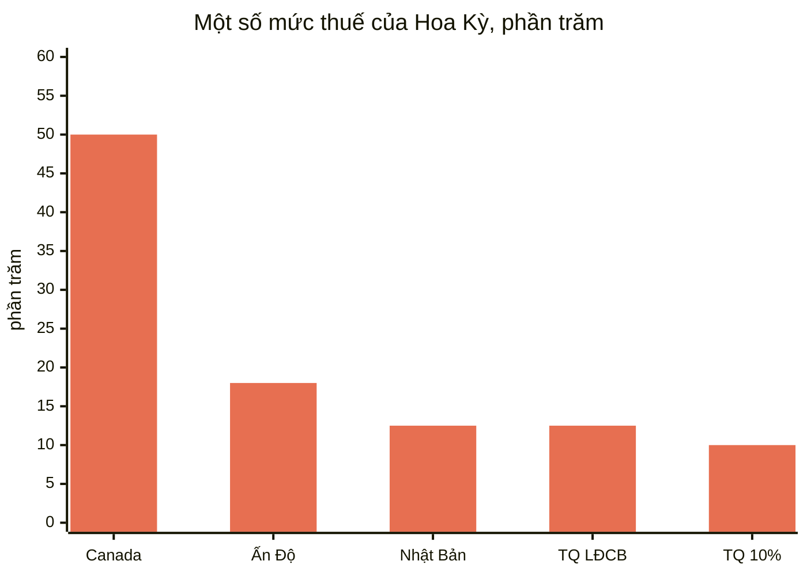
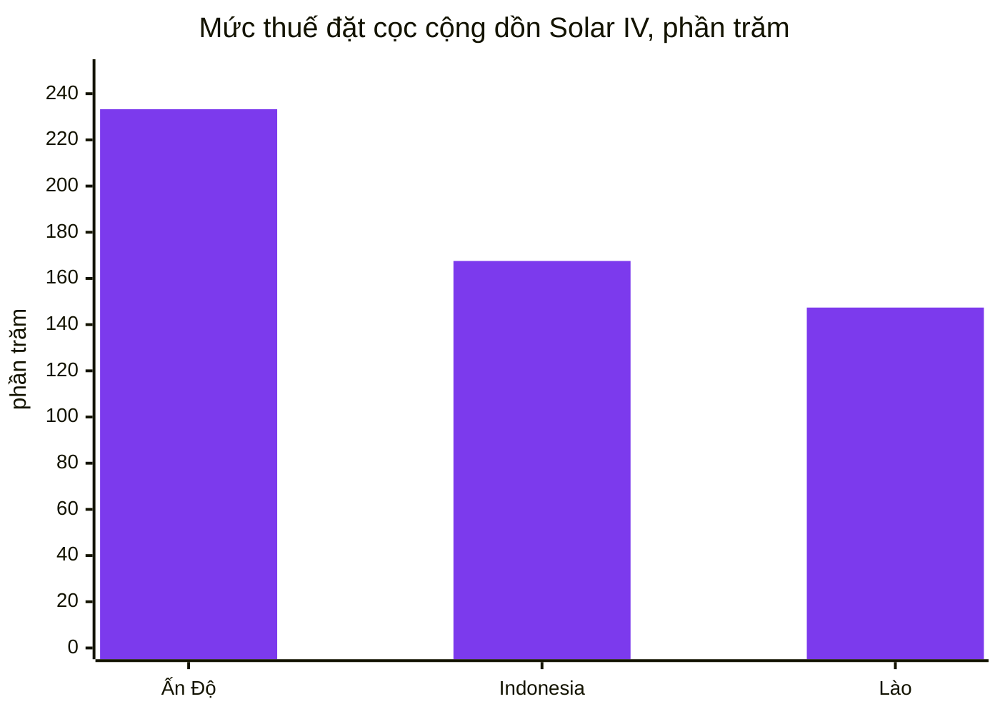
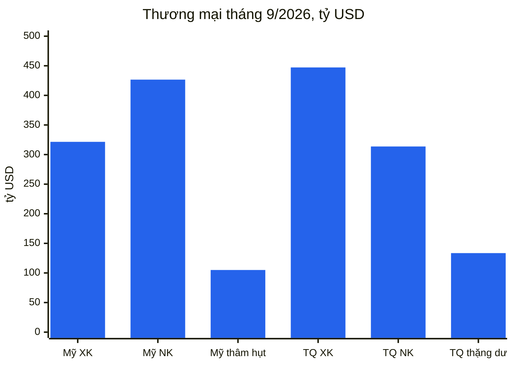
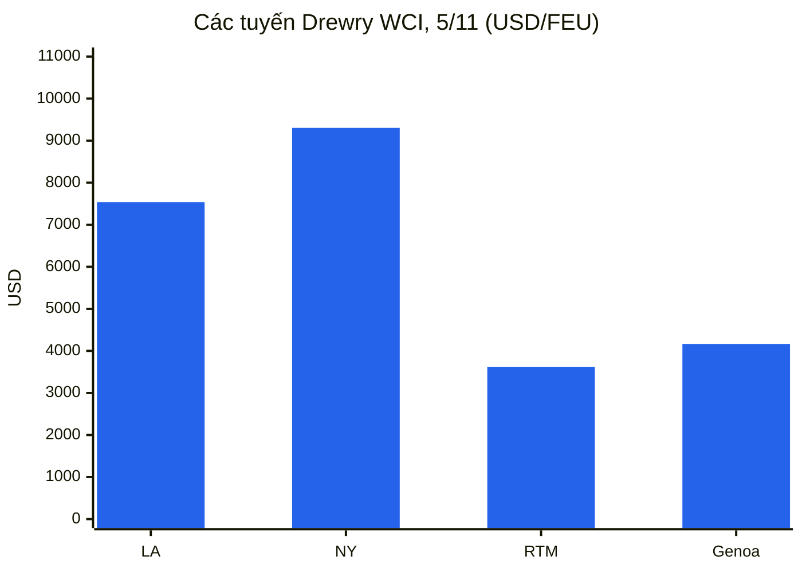
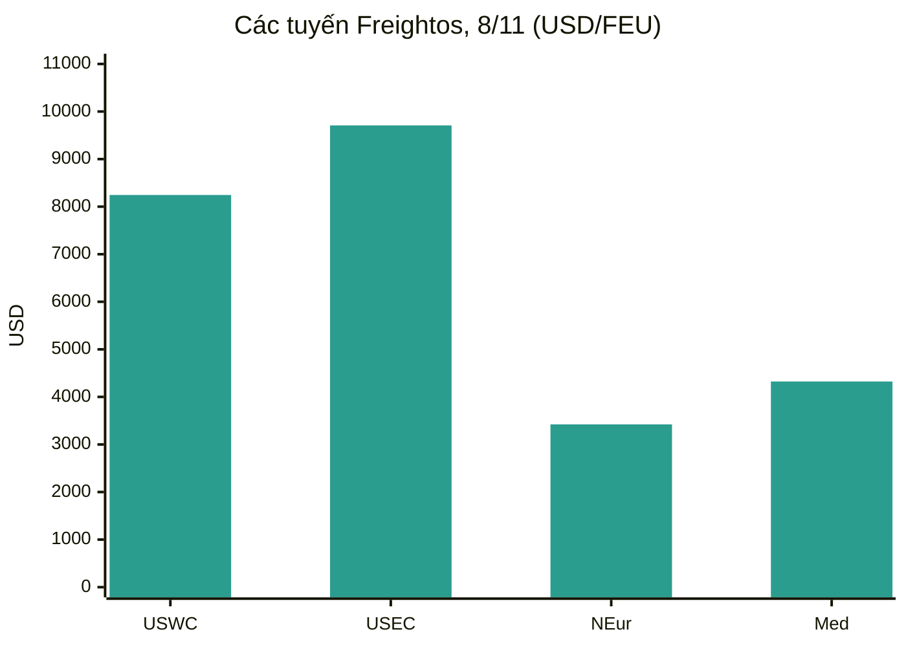
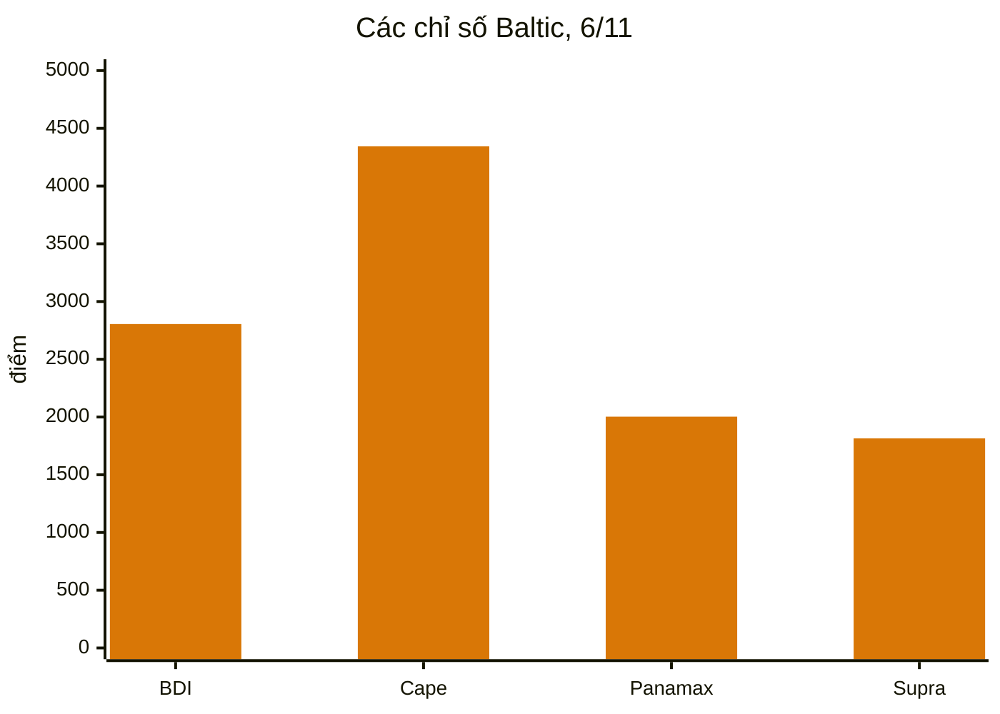
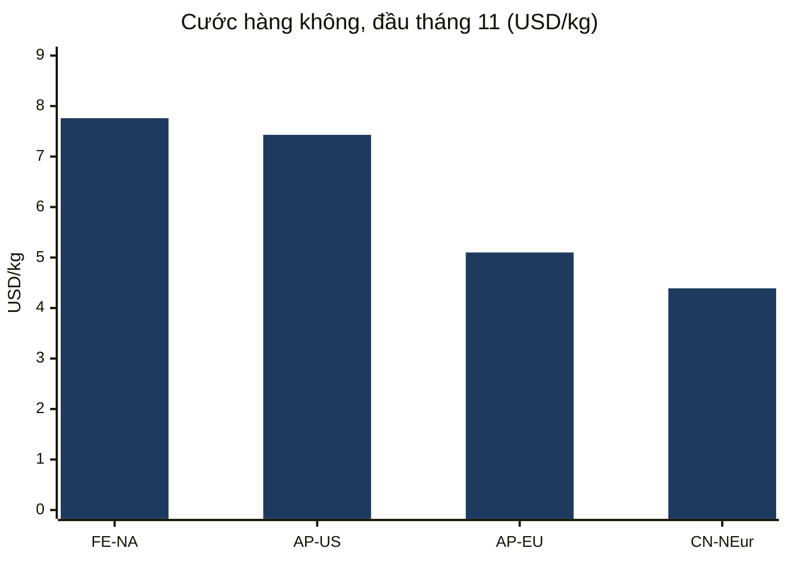
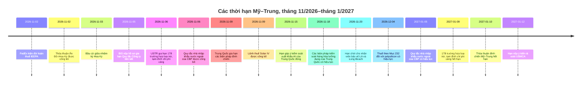
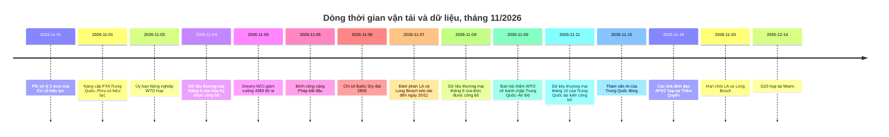

# Báo cáo Tình báo Thương mại Toàn cầu — Tuần 2–9 tháng 11 năm 2026

**Bản tin hàng tuần.** Phạm vi bao quát: ngày 2–9 tháng 11 năm 2026. Được tổng hợp từ khoảng 45 nguồn tin tức, chính sách, dữ liệu và vận tải thương mại trên toàn thế giới.

---

## Mục lục

1. [Tóm tắt điều hành](#1-executive-summary)
2. [Cảnh báo](#2-alerts)
3. [Các tin chính — phân tích chuyên sâu](#3-top-stories--deep-dives)
4. [Bảng theo dõi thuế quan](#4-tariff-tracker)
5. [Phân tích chuyên sâu chính sách Hoa Kỳ](#5-us-policy-deep-dive)
6. [Chính sách thế giới theo khu vực](#6-world-policy-by-region)
7. [Các biện pháp thực thi](#7-enforcement-actions)
8. [Các dữ liệu công bố](#8-data-releases)
9. [Thị trường vận tải](#9-freight-market)
10. [Dòng thời gian chính sách](#10-policy-timelines)
11. [Các thời hạn và sự kiện sắp tới (90 ngày tới)](#11-upcoming-deadlines--events-next-90-days)
12. [Nguồn và phương pháp](#12-sources--methodology)

---

## 1. Tóm tắt điều hành

Một tuần mà nguy cơ chạm hạn ngày 9 tháng 11 đã được tháo gỡ vào phút chót, hai lần, rồi lại được dời sang tháng 1. Ngày 6 tháng 11, Văn phòng Đại diện Thương mại Hoa Kỳ đăng thông báo gia hạn toàn bộ 178 trường hợp loại trừ sản phẩm theo Mục 301 đối với Trung Quốc và việc tạm đình chỉ phí cảng theo Mục 301 đối với tàu liên quan đến Trung Quốc đến ngày 9 tháng 1 năm 2027; ngày 9 tháng 11, Trung Quốc gia hạn phía của mình trong thỏa thuận đình chiến — việc tạm đình chỉ mức thuế bổ sung 24% đối với hàng hóa Hoa Kỳ, việc tạm đình chỉ phí cảng và các trường hợp miễn trừ kiểm soát xuất khẩu khoáng sản quan trọng — đến ngày 10 tháng 1 năm 2027. Thời gian gia hạn hai tháng là có thật, nhưng ngắn: các công cụ này giờ đây hết hạn chỉ cách nhau một ngày vào tháng 1, và gói thuế quan rộng hơn được thảo luận sau hội nghị thượng đỉnh Washington tháng 9 vẫn chưa được hoàn tất. Ở những nơi khác, Ấn Độ và Hoa Kỳ công bố thỏa thuận thương mại cắt giảm thuế quan của Hoa Kỳ đối với hàng hóa Ấn Độ xuống 18% từ mức cao nhất 50%, đảng Dân chủ giành quyền kiểm soát cả hai viện Quốc hội trong cuộc bầu cử giữa nhiệm kỳ mà không làm thay đổi triển vọng thuế quan, phí xử lý 2 euro và yêu cầu định danh sản phẩm của Liên minh châu Âu có hiệu lực từ ngày 1 tháng 11, và Trung Quốc mở rộng lưới kiểm soát xuất khẩu sang các công nghệ trí tuệ nhân tạo, dược phẩm sinh học và sản xuất năng lượng mặt trời.

- **Các thời hạn ngày 9 tháng 11 đã được gia hạn, không phải bãi bỏ.** Các thông báo ngày 6 tháng 11 của USTR gia hạn 178 trường hợp loại trừ sản phẩm theo Mục 301 (164 trường hợp loại trừ chung, 14 trường hợp sản xuất năng lượng mặt trời) và việc tạm đình chỉ thêm biện pháp hàng hải theo Mục 301 đến 23:59 giờ miền Đông ngày 9 tháng 1 năm 2027; các tờ khai nhập khẩu từ ngày 10 tháng 11 năm 2026 nằm trong cửa sổ mới. Cục Công nghiệp và An ninh đã nộp hồ sơ gia hạn việc tạm đình chỉ Quy tắc Công ty liên kết 50% đến ngày 10 tháng 1 năm 2027. Trung Quốc, trong thông báo ngày 9 tháng 11, giữ việc tạm đình chỉ mức thuế bổ sung 24% đối với hàng hóa Hoa Kỳ thêm hai tháng kể từ ngày 10 tháng 11, duy trì mức thuế bổ sung 10%, và gia hạn việc tạm đình chỉ phí cảng, các trường hợp miễn trừ kiểm soát xuất khẩu khoáng sản quan trọng cùng việc tạm đình chỉ các biện pháp đối với 11 công ty Hoa Kỳ trong danh sách thực thể không đáng tin cậy và 16 công ty trong danh sách kiểm soát xuất khẩu đến ngày 10 tháng 1 năm 2027. Sự chênh lệch tuy nhỏ nhưng có thật: các công cụ của Hoa Kỳ hết hạn ngày 9 tháng 1, của Trung Quốc ngày 10 tháng 1, và tính đến ngày 9 tháng 11 chưa có văn bản nào của tổng thống Hoa Kỳ chính thức hóa việc gia hạn thỏa thuận đình chiến được công bố.
- **Ấn Độ và Hoa Kỳ đã đạt được thỏa thuận vào ngày 2 tháng 11.** Washington cắt giảm thuế quan đối với hàng hóa Ấn Độ xuống 18% từ mức cao nhất 50% — mức thuế đối ứng 25% cộng với mức phạt 25% vì mua dầu của Nga — và rút lại khoản thu phạt vì dầu Nga. Tổng thống Trump cho biết Ấn Độ đã đồng ý ngừng mua dầu của Nga và tăng mua hàng từ Hoa Kỳ; chính phủ Ấn Độ chưa công khai xác nhận các cam kết cụ thể về nguồn cung năng lượng. Thỏa thuận được mô tả là đợt đầu tiên của một thỏa thuận song phương rộng hơn, với mục tiêu thương mại song phương 500 tỷ đô la vào năm 2030, nhưng tính đến ngày 3 tháng 11 chưa có văn bản đã ký, biểu thuế hay ngày có hiệu lực nào được công bố. Thỏa thuận này được đưa ra chỉ vài ngày sau khi Ấn Độ ký kết hiệp định thương mại tự do với Liên minh châu Âu.
- **Cuộc bầu cử giữa nhiệm kỳ đã thay đổi chính trị thương mại, không thay đổi thuế quan.** Đảng Dân chủ giành quyền kiểm soát cả Hạ viện và Thượng viện vào ngày 3 tháng 11, theo công bố của hãng thông tấn Associated Press. Các nhà phân tích dự đoán sẽ có các phiên điều trần giám sát và các cuộc bỏ phiếu mang tính biểu tượng nhằm đảo ngược thuế quan trong năm 2027, nhưng không có việc bãi bỏ: đảng Dân chủ vẫn còn xa mới đạt được đa số hai phần ba cần thiết để vượt qua quyền phủ quyết của tổng thống, và chính quyền đã xây dựng lại cơ cấu thuế quan dựa trên thẩm quyền theo Mục 301 và Mục 232 sau khi Tòa án Tối cao bác bỏ các mức thuế theo IEEPA vào tháng 2 năm 2026. Thượng viện đã bỏ phiếu 51–47 vào ngày 29 tháng 10 để chấm dứt tình trạng khẩn cấp quốc gia làm cơ sở cho các mức thuế toàn cầu. Các khoản phụ thu theo Mục 122, giới hạn ở 150 ngày nếu không có luật, là công cụ duy nhất mà Quốc hội mới có thể hạn chế.
- **Việc thiết lập lại quy định thương mại điện tử giá trị thấp của châu Âu đã có hiệu lực.** Từ ngày 1 tháng 11, phí xử lý hải quan 2 euro được áp dụng cho mỗi dòng mặt hàng đối với các lô hàng bán từ xa được vận chuyển trực tiếp từ ngoài Liên minh châu Âu đến người tiêu dùng EU, cộng thêm mức thuế cố định 3 euro cho mỗi dòng thuế quan đã có hiệu lực từ ngày 1 tháng 7 năm 2026 đối với các lô hàng trị giá 150 euro trở xuống. Mỗi sản phẩm trong một lô hàng doanh nghiệp–người tiêu dùng giờ đây cũng phải mang ba Mã định danh Sản phẩm, bất kể giá trị. Mức thuế và phí cộng lại có thể lên tới 5 euro cho mỗi dòng thuế quan trước thuế giá trị gia tăng. Hải quan EU đã xử lý khoảng 6 tỷ bưu kiện thương mại điện tử trong năm 2025, khoảng 90% từ Trung Quốc.
- **Kiểm soát xuất khẩu của Trung Quốc mở rộng sang công nghệ và thiết bị công nghiệp.** Đề xuất chung của MOFCOM và Bộ Khoa học và Công nghệ (Thông báo số 48, ngày 16 tháng 10) sẽ bổ sung 40 công nghệ — 23 trong trí tuệ nhân tạo, 5 trong dược phẩm sinh học, 12 trong quang điện — vào danh mục kiểm soát xuất khẩu, với hạn góp ý ngày 15 tháng 11 và việc đăng ký tạm thời trước xuất khẩu đã có hiệu lực. Riêng rẽ, các biện pháp kiểm soát hàng hóa lưỡng dụng đối với máy bay không người lái, máy đào hầm và tàu nạo vét có hiệu lực từ ngày 18 tháng 11. Các biện pháp hạn chế về năng lượng mặt trời được đánh giá là có tác động lớn nhất, do Trung Quốc chiếm ưu thế trong sản xuất quang điện.
- **Hoa Kỳ ghi nhận tháng nhập khẩu kỷ lục; Trung Quốc hướng tới thặng dư 1 nghìn tỷ đô la.** Cục Điều tra Dân số và Cục Phân tích Kinh tế báo cáo ngày 4 tháng 11 rằng thâm hụt hàng hóa và dịch vụ tháng 9 là 105,0 tỷ đô la, với nhập khẩu kỷ lục 426,6 tỷ đô la và nhập khẩu hàng hóa kỷ lục 346,9 tỷ đô la, trong đó nhập khẩu hàng hóa vốn đạt kỷ lục 158,0 tỷ đô la. Thặng dư tháng 9 của Trung Quốc là 133,53 tỷ đô la với xuất khẩu 447,18 tỷ đô la, tăng 36,3% so với cùng kỳ năm trước; một cuộc thăm dò của Reuters dự báo xuất khẩu tháng 10 tăng 33,5% và thặng dư 125,8 tỷ đô la, mức này sẽ đưa thặng dư lũy kế tháng 1–tháng 10 vượt 1 nghìn tỷ đô la. Chỉ số PMI sản xuất chính thức của Trung Quốc giảm xuống 49,3 trong tháng 10, với đơn hàng xuất khẩu mới ở mức 48,7.
- **Vận tải lại phân hóa: đường biển dịu lại, đường hàng không tăng mạnh.** Chỉ số Container Thế giới Drewry giảm 1% xuống 4.389 đô la mỗi container 40ft vào ngày 5 tháng 11, vẫn cao hơn 124% so với cùng kỳ năm trước, khi các đợt tăng giá chung ngày 1 tháng 11 của các hãng tàu không giữ được. Chỉ số Baltic Dry đóng cửa tuần ở mức 2.805, tăng 3,4% so với tuần trước, nhờ sức mạnh của tàu Capesize. Vận tải hàng không đi theo hướng ngược lại: tuyến Viễn Đông–Bắc Mỹ đạt 7,76 đô la mỗi kg vào ngày 3 tháng 11, tăng 9% trong một tuần và là mức cao nhất năm 2026, gần mức đỉnh 8,00 đô la đầu tháng 12 năm 2025. Khoảng 60% công suất container châu Á–châu Âu hiện đi qua kênh đào Suez, theo Drewry. Tranh chấp về nhân viên bảo vệ tại Los Angeles–Long Beach lại được hoãn, đến ngày 20 tháng 11, trong khi các cảng của Pháp bị ảnh hưởng bởi hai ngày đình công và một cuộc phong tỏa của tài xế xe tải tại cảng San Antonio của Chile đe dọa mùa xuất khẩu anh đào.

**Vận tải:** cước container giao ngay giảm trên cả tuyến xuyên Thái Bình Dương và tuyến châu Á–châu Âu trong khi các đợt tăng giá tháng 11 của các hãng tàu bị chiết khấu; hàng rời khô tăng tuần thứ ba liên tiếp nhờ thu nhập của tàu Capesize; hàng không đạt mức cao nhất năm 2026 trước mùa cao điểm; các chuyến qua Suez tiếp tục phục hồi; và các tranh chấp lao động tại Los Angeles–Long Beach, Pháp và Chile khiến rủi ro cảng vẫn hiện hữu trong suốt mùa cao điểm.

---

## 2. Cảnh báo

| # | Cảnh báo | Hiệu lực | Tác động | Nguồn |
|---|-------|-----------|--------|--------|
| A1 | USTR gia hạn toàn bộ 178 trường hợp loại trừ sản phẩm theo Mục 301 đối với Trung Quốc đến 23:59 giờ miền Đông ngày 9 tháng 1 năm 2027; các tờ khai từ ngày 10 tháng 11 năm 2026 nằm trong cửa sổ mới; việc công bố trên Công báo Liên bang chưa được xác nhận tính đến ngày 8 tháng 11 | Ngày 6 tháng 11 năm 2026 (đã đăng) | Chỉ là thời gian gia hạn hai tháng; các tờ khai sau ngày 9 tháng 1 năm 2027 phải chịu toàn bộ mức thuế theo danh sách (25% đối với Danh sách 1–3, 7,5% đối với Danh sách 4A) | [TechTimes](https://www.techtimes.com/articles/330285/20261109/ustr-extends-section-301-tariff-exclusions-chinese-goods-entries-after-january-9-pay-full-duty.htm) |
| A2 | USTR tiếp tục tạm đình chỉ biện pháp hàng hải theo Mục 301 (phí cảng đối với tàu liên quan đến Trung Quốc, thuế theo Phụ lục V.A) đến 23:59 giờ miền Đông ngày 9 tháng 1 năm 2027 | Ngày 9 tháng 11 năm 2026 | Các khoản phí vẫn được tạm đình chỉ; việc tạm đình chỉ và các trường hợp loại trừ hết hạn cùng ngày trong tháng 1 | [Gateway Lines](https://gatewaylines.com/press-releases/china-ship-fee-delay-jan-9-2027-301-exclusions) |
| A3 | Trung Quốc gia hạn việc tạm đình chỉ mức thuế bổ sung 24% đối với hàng hóa Hoa Kỳ thêm hai tháng kể từ ngày 10 tháng 11, giữ mức 10% có hiệu lực; gia hạn việc tạm đình chỉ phí cảng, các trường hợp miễn trừ kiểm soát xuất khẩu khoáng sản quan trọng và việc tạm đình chỉ các biện pháp đối với thực thể đến ngày 10 tháng 1 năm 2027 | Ngày 9–10 tháng 11 năm 2026 | Các nhà xuất khẩu Hoa Kỳ giữ mức thuế 10%; thỏa thuận đình chiến giờ đây kéo dài đến ngày 10 tháng 1 năm 2027 phía Trung Quốc | [Reuters via SRN News](https://srnnews.com/china-extends-suspension-of-24-tariff-on-us-imports-for-two-months/) |
| A4 | Thỏa thuận thương mại Ấn Độ–Hoa Kỳ được công bố: thuế quan của Hoa Kỳ đối với hàng hóa Ấn Độ giảm xuống 18% từ mức tối đa 50%; khoản thu phạt vì dầu Nga được rút lại; chưa có văn bản đã ký nào được công bố tính đến ngày 3 tháng 11 | Ngày 2 tháng 11 năm 2026 | Định giá lại đối với hàng hóa có xuất xứ Ấn Độ; các cam kết về nguồn cung năng lượng chưa được New Delhi xác nhận | [Economic Times](https://www.eximguru.com/export-import-news/export-news/india-us-trade-deal-lifts-a-117126.aspx) |
| A5 | Quy tắc cuối cùng tạm thời của CBP: nhà nhập khẩu nước ngoài phải được CTPAT xác thực hoặc sử dụng môi giới đã được CTPAT xác thực kể từ ngày 5 tháng 1 năm 2027; 32% nhà nhập khẩu nước ngoài hiện không đáp ứng điều kiện nào | Ngày 5 tháng 1 năm 2027 | Các nhà bán nước ngoài giao hàng trực tiếp cho người mua Hoa Kỳ phải đổi môi giới hoặc được xác thực; hạn góp ý ngày 5 tháng 1 năm 2027 | [CBP](https://www.cbp.gov/newsroom/national-media-release/cbp-announces-heightened-requirements-foreign-importers-record) |
| A6 | Phí xử lý 2 euro của EU cho mỗi dòng mặt hàng và ba Mã định danh Sản phẩm bắt buộc đối với mọi lô hàng B2C vào EU kể từ ngày 1 tháng 11; thuế và phí cộng lại tối đa 5 euro cho mỗi dòng thuế quan trước thuế VAT | Ngày 1 tháng 11 năm 2026 | Chi phí giao hàng của thương mại điện tử giá trị thấp, nhiều mặt hàng tăng; các lô hàng không có mã định danh có nguy cơ bị chậm trễ hoặc từ chối | [Logistik Heute](https://logistik-heute.de/en/news/eu-customs-policy-new-package-fee-increases-costs-cross-border-online-trade-291550.html) |
| A7 | Bộ Thương mại ban hành lệnh AD/CVD cuối cùng đối với pin mặt trời silicon tinh thể từ Ấn Độ, Indonesia và Lào; mức thuế cộng dồn tối đa khoảng 233% (Ấn Độ), 168% (Indonesia), 147% (Lào) | Ngày 9 tháng 11 năm 2026 | Việc thu tiền đặt cọc trở lại từ ngày 5 tháng 11; các mô-đun sản xuất tại nước thứ ba sử dụng pin thuộc diện điều chỉnh nằm trong phạm vi các lệnh | [MLex](https://www.mlex.com/mlex/articles/2547289/us-commerce-imposes-duties-for-indonesian-laotian-and-indian-solar-cells) |
| A8 | Nguy cơ đình công của nhân viên bảo vệ tại LA/Long Beach lại được hoãn; đàm phán kéo dài đến ngày 20 tháng 11 năm 2026; khoảng 250 công nhân tại sáu bến cảng; ~85% hàng hóa của Long Beach và ~33% hàng hóa của Los Angeles gặp rủi ro | Ngày 20 tháng 11 năm 2026 | Một cuộc đình công ngay sau cuộc bầu cử giữa nhiệm kỳ đã được tránh, nhưng tranh chấp giờ đây kéo dài đến cuối mùa cao điểm trong khi đã tồn tại lượng hàng tồn đọng lớn trên đường sắt | [gCaptain](https://maritimenewsbd.com/la-long-beach-port-strike-threat-deferred-november-20/) |
| A9 | Đề xuất danh mục kiểm soát xuất khẩu AI/dược phẩm sinh học/năng lượng mặt trời của Trung Quốc: hạn góp ý ngày 15 tháng 11 năm 2026; việc đăng ký tạm thời trước xuất khẩu đã được áp dụng; các biện pháp kiểm soát hàng hóa lưỡng dụng đối với máy bay không người lái, máy đào hầm và tàu nạo vét có hiệu lực ngày 18 tháng 11 | Ngày 15 tháng 11 / ngày 18 tháng 11 năm 2026 | 40 công nghệ bị ảnh hưởng (14 bị cấm, 26 bị hạn chế); bí quyết sản xuất năng lượng mặt trời là điểm sắc bén nhất | [China Briefing](https://www.china-briefing.com/news/china-technology-export-controls/) |
| A10 | Đảng Dân chủ thắng cả hai viện trong cuộc bầu cử giữa nhiệm kỳ ngày 3 tháng 11; cơ cấu thuế quan dự kiến vẫn duy trì; Thượng viện đã bỏ phiếu 51–47 vào ngày 29 tháng 10 để chấm dứt tình trạng khẩn cấp quốc gia làm cơ sở cho các mức thuế toàn cầu | Ngày 3 tháng 11 năm 2026 | Các phiên điều trần giám sát và bỏ phiếu mang tính biểu tượng nhằm đảo ngược thuế quan dự kiến diễn ra trong năm 2027; Mục 122 là công cụ mà Quốc hội mới có thể hạn chế | [SupplyChainBrain](https://www.supplychainbrain.com/general-scm/regulation-compliance/article/16424361/us-midterm-rout-unlikely-to-change-trumps-trade-policy) |

### A1/A2 — Các thời hạn ngày 9 tháng 11, được gia hạn vào phút chót

Hai công cụ chi phối bản tin tuần trước đều được gia hạn vào ngày 6 tháng 11, khi USTR đăng hai thông báo trên trang web của mình. Thông báo đầu tiên gia hạn toàn bộ 178 trường hợp loại trừ sản phẩm theo Mục 301 đối với Trung Quốc — 164 trường hợp loại trừ chung theo HTSUS 9903.88.69 và 14 trường hợp loại trừ sản xuất năng lượng mặt trời theo 9903.88.70 — đến 23:59 giờ miền Đông ngày 9 tháng 1 năm 2027, bao quát hàng hóa nhập khẩu để tiêu dùng, hoặc rút khỏi kho để tiêu dùng, từ 00:01 giờ miền Đông ngày 10 tháng 11 năm 2026 trở đi. Không có trường hợp loại trừ nào được thêm hay loại bỏ, và không có ý kiến mới nào được yêu cầu; USTR dựa vào các ý kiến gửi theo thông báo ngày 16 tháng 9 năm 2025 của mình. Thông báo thứ hai tiếp tục tạm đình chỉ biện pháp theo Mục 301 đối với các hoạt động hàng hải, hậu cần và đóng tàu của Trung Quốc, bao gồm phí tàu thuộc diện điều chỉnh và thuế theo Phụ lục V.A, có hiệu lực từ ngày 9 tháng 11 năm 2026 đến 23:59 giờ miền Đông ngày 9 tháng 1 năm 2027. USTR đã đề xuất việc gia hạn hàng hải vào ngày 26 tháng 10 (91 FR 67388); thời hạn góp ý đóng vào ngày 30 tháng 10. Tính đến ngày 8 tháng 11, chưa có ấn phẩm tương ứng nào trên Công báo Liên bang được xác định cho cả hai thông báo, và thông báo về các trường hợp loại trừ có một điểm không nhất quán nội bộ — phần Ngày tháng và các phụ lục ghi ngày 9 tháng 1 năm 2027, trong khi nội dung khác nhắc đến ngày 10 tháng 1; ngày có hiệu lực áp dụng là ngày 9 tháng 1. Nếu không có việc gia hạn, các tờ khai từ ngày 10 tháng 11 sẽ phải chịu toàn bộ mức thuế theo danh sách. Một trường hợp loại trừ chỉ miễn thuế theo danh sách: mức thuế 12,5% theo Mục 301 về lao động cưỡng bức, thuế theo Mục 232, thuế chống bán phá giá và thuế chống trợ cấp cùng mức thuế tối huệ quốc vẫn áp dụng. Ngày 4 tháng 11, Hiệp hội Công nghiệp Phần mềm & Thông tin cùng 23 tổ chức khác đã yêu cầu USTR gia hạn ít nhất một năm; USTR chỉ cho hai tháng.

### A3 — Trung Quốc hành động đúng ngày thỏa thuận đình chiến sắp hết hạn

Trung Quốc thông báo vào thứ Hai, ngày 9 tháng 11 rằng nước này sẽ tiếp tục tạm đình chỉ mức thuế bổ sung 24% đối với hàng hóa Hoa Kỳ thêm hai tháng nữa, kể từ 13:01 giờ Bắc Kinh ngày 10 tháng 11, giữ mức thuế bổ sung 10% có hiệu lực. Thông báo số 6 năm 2026 của Ủy ban Thuế quan Hải quan thực thi đồng thuận đạt được tại hội nghị thượng đỉnh Washington tháng 9 giữa Tổng thống Trump và Chủ tịch Tập. Song song, Bộ Thương mại Trung Quốc gia hạn các trường hợp miễn trừ kiểm soát xuất khẩu đối với một số khoáng sản quan trọng và công nghệ liên quan đến ngày 10 tháng 1 năm 2027, các biện pháp ảnh hưởng đến 11 công ty Hoa Kỳ trong danh sách thực thể không đáng tin cậy của Trung Quốc và 16 công ty trong danh sách kiểm soát xuất khẩu của nước này vẫn được tạm đình chỉ đến ngày 10 tháng 1 năm 2027, và việc tạm đình chỉ phí cảng đặc biệt đối với tàu liên quan đến Hoa Kỳ được gia hạn đến cùng ngày. Các lệnh trừng phạt đối với năm công ty con tại Hoa Kỳ của Hanwha Ocean cũng được tạm đình chỉ thêm hai tháng. Sự không đối xứng này quan trọng đối với việc lập kế hoạch: Bắc Kinh đã hành động bằng thông báo chính thức, trong khi tính đến ngày 9 tháng 11 chưa có văn bản nào của tổng thống Hoa Kỳ chính thức hóa việc gia hạn thỏa thuận đình chiến được công bố, và các công cụ của Hoa Kỳ hết hạn ngày 9 tháng 1 trong khi của Trung Quốc kéo dài đến ngày 10 tháng 1. Gói cắt giảm thuế quan đối ứng trị giá 60 tỷ đô la được thảo luận sau hội nghị thượng đỉnh tháng 9, bao gồm 17 tỷ đô la hàng nông sản Hoa Kỳ mà Trung Quốc nhập khẩu trong năm 2024, vẫn chưa được hoàn tất.

### A4 — Thỏa thuận Ấn Độ–Hoa Kỳ: 18% và câu hỏi về dầu Nga

Ấn Độ và Hoa Kỳ đã đạt được thỏa thuận thương mại sau nhiều tháng đàm phán căng thẳng, đỉnh điểm là cuộc điện đàm giữa Thủ tướng Narendra Modi và Tổng thống Donald Trump vào cuối ngày thứ Hai, 2 tháng 11. Washington công bố cắt giảm thuế quan đối với hàng hóa Ấn Độ xuống 18% từ mức cao nhất 50% — mức thuế đối ứng 25% cộng với mức phạt 25% áp dụng vì mua dầu của Nga — và rút lại khoản thu phạt. Tổng thống Trump cho biết Ấn Độ đã đồng ý ngừng mua dầu của Nga và tăng mua hàng từ Hoa Kỳ và có thể cả Venezuela, đồng thời mua hàng hóa Mỹ "ở mức cao hơn nhiều"; chính phủ Ấn Độ chưa công khai bình luận về các cam kết cụ thể về nguồn cung năng lượng. Reuters đưa tin Ấn Độ đồng ý tăng mua dầu mỏ, hàng quốc phòng, điện tử, dược phẩm, thiết bị viễn thông và máy bay của Hoa Kỳ. Thỏa thuận được mô tả là đợt đầu tiên của một thỏa thuận song phương rộng hơn, với đàm phán tiếp tục và mục tiêu thương mại song phương 500 tỷ đô la vào năm 2030, tăng từ khoảng 191 tỷ đô la hiện nay. Tính đến báo cáo ngày 3 tháng 11, chưa có văn bản đã ký, biểu thuế hay ngày có hiệu lực nào được công bố, và mức thuế 18% trong khuôn khổ tháng 2 năm 2026 trước đây chưa từng được áp dụng — hầu hết hàng hóa Ấn Độ phải chịu mức thuế 10% theo Mục 301 kể từ ngày 24 tháng 7 năm 2026.

### A5 — Quy tắc về nhà nhập khẩu nước ngoài của CBP

CBP đã công bố quy tắc cuối cùng tạm thời, "Các yêu cầu tăng cường đối với Nhà nhập khẩu nước ngoài" (CBP Dec. 26-19, 91 FR 69977), vào ngày 6 tháng 11 năm 2026, thực thi Mục 2 của Sắc lệnh Hành pháp 14411 ("Tăng cường thực thi hải quan", ký ngày 3 tháng 6 năm 2026). Từ ngày 5 tháng 1 năm 2027, nhà nhập khẩu nước ngoài chỉ được nhập khẩu hàng hóa để tiêu dùng nếu chính họ được CTPAT xác thực hoặc khai báo thông qua môi giới hải quan được cấp phép đã được CTPAT xác thực. Phân tích của chính CBP: 0,4% nhà nhập khẩu nước ngoài được CTPAT xác thực và 68% đã sử dụng môi giới được xác thực; 32% còn lại sẽ không thể tiếp tục nhập khẩu vào Hoa Kỳ trừ khi đổi môi giới hoặc tự mình được CTPAT xác thực. Phần 110 mới của quy định hải quan định nghĩa "IOR Hoa Kỳ"; tình trạng nhà nhập khẩu phải được khai báo tại tờ khai nhập khẩu và tờ khai tổng hợp; các môi giới phải xác minh tình trạng của khách hàng và lưu giữ hồ sơ xác minh trong năm năm; hạn góp ý là ngày 5 tháng 1 năm 2027. Quy tắc không áp đặt lệnh cấm toàn diện đối với các tờ khai không chính thức của nhà nhập khẩu nước ngoài như sắc lệnh hành pháp đã chỉ đạo, nhưng mời góp ý về việc cấm hoàn toàn như một phương án thay thế. Chi phí tiền tệ ước tính khoảng 1.233.253 đô la mỗi năm.

### A6 — Phí 2 euro và Mã định danh Sản phẩm của EU

Từ ngày 1 tháng 11 năm 2026, phí xử lý hải quan 2 euro được áp dụng cho mỗi dòng mặt hàng đối với các lô hàng bán từ xa được vận chuyển trực tiếp từ ngoài Liên minh châu Âu đến người tiêu dùng EU, bất kể giá trị, theo Quy định Ủy quyền (EU) 2026/2152. Phí này cộng thêm vào mức thuế cố định 3 euro cho mỗi dòng thuế quan đã có hiệu lực từ ngày 1 tháng 7 năm 2026 đối với các lô hàng trị giá 150 euro trở xuống theo Quy định (EU) 2026/382, quy định đã bãi bỏ việc miễn thuế de minimis 150 euro. Từ cùng ngày, mọi sản phẩm trong một lô hàng doanh nghiệp–người tiêu dùng đến EU — bất kể giá trị — phải mang ba Mã định danh Sản phẩm. Mức thuế và phí cộng lại do đó có thể lên tới 5 euro cho mỗi dòng thuế quan, chưa tính thuế VAT. Chế độ tạm thời kéo dài đến ngày 1 tháng 7 năm 2028, khi hệ thống dữ liệu hải quan tập trung của EU dự kiến thay thế khoản thu cố định bằng thuế tiêu chuẩn. Phí này không được hoàn lại ngay cả khi hàng hóa được trả lại.

### A7 — Lệnh Solar IV: mức thuế cộng dồn tối đa khoảng 233%

Bộ Thương mại đã ban hành lệnh chống bán phá giá và chống trợ cấp đối với pin quang điện silicon tinh thể, dù đã lắp ráp thành mô-đun hay chưa, từ Ấn Độ, Indonesia và Lào vào ngày 9 tháng 11 năm 2026, sau các quyết định cuối cùng khẳng định về thiệt hại của USITC được công bố ngày 5 tháng 11 (91 FR 69865). Ấn Độ: biên độ chống bán phá giá 123,04% (tiền đặt cọc 107,17% sau khi bù trừ trợ cấp) và thuế chống trợ cấp 126,09%, mức thuế đặt cọc cộng dồn 233,26%. Indonesia: chống bán phá giá 94,36% và chống trợ cấp 73,20% (mức cộng dồn cho tất cả các bên khác 167,56%). Lào: chống bán phá giá 65,43% và chống trợ cấp 82,03% (cộng dồn 147,39%). Việc tạm đình chỉ thanh lý và thu tiền đặt cọc trở lại từ ngày 5 tháng 11 năm 2026. Các mô-đun, tấm nhiều lớp và tấm pin được sản xuất tại nước thứ ba sử dụng pin thuộc diện điều chỉnh nằm trong phạm vi các lệnh; các mô-đun lắp ráp tại Ấn Độ sử dụng pin của nước thứ ba thì không. Báo cáo công khai đầy đủ của USITC (USITC Publication 5804) phải được công bố trước ngày 23 tháng 11 năm 2026.

### A8 — LA/Long Beach: hoãn đến ngày 20 tháng 11

Nguy cơ đình công của nhân viên an ninh (người gác) tại các bến container ở Los Angeles và Long Beach lại được hoãn, với đàm phán giờ đây kéo dài đến ngày 20 tháng 11, theo Bloomberg đưa tin qua gCaptain ngày 7 tháng 11. ILWU Local 26 đại diện khoảng 250 nhân viên an ninh tại sáu bến container; hợp đồng trước đây của họ hết hạn vào tháng 7 năm 2025, các thành viên đã cho phép đình công, và hai bên đang đàm phán với sự hỗ trợ của Cơ quan Hòa giải và Điều đình Liên bang. Hiệp hội Hàng hải Thái Bình Dương cho biết sự gián đoạn có thể ảnh hưởng đến khoảng 85% hàng hóa qua cảng Long Beach và một phần ba hàng hóa tại cảng Los Angeles, vì các công nhân bến tàu khác dự kiến sẽ không vượt qua hàng rào đình công của Local 26. Khu cảng đã căng thẳng: khoảng 35.688 container nhập khẩu đang chờ dịch vụ đường sắt tại hai cảng, trong đó 10.562 container chờ từ chín ngày trở lên, và hàng nhập khẩu bằng đường sắt nằm trung bình 7,19 ngày trong tháng 9, tăng từ 6,75 ngày trong tháng 8. Cảng Los Angeles đã xử lý 1 triệu container trong một tháng, một kỷ lục mới, ngay cả khi lãnh đạo cảng cảnh báo về rủi ro lập kế hoạch do thuế quan.

### A9 — Kiểm soát xuất khẩu của Trung Quốc: góp ý đóng ngày 15 tháng 11, quy tắc lưỡng dụng có hiệu lực ngày 18 tháng 11

MOFCOM và Bộ Khoa học và Công nghệ đề xuất bổ sung 40 công nghệ vào Danh mục Công nghệ Cấm và Hạn chế Xuất khẩu: 23 trong trí tuệ nhân tạo, 5 trong dược phẩm sinh học, 12 trong quang điện. Mười bốn công nghệ sẽ bị cấm xuất khẩu; 26 công nghệ bị hạn chế (cần giấy phép). Kể từ ngày 16 tháng 10 năm 2026, việc đăng ký tạm thời trước xuất khẩu đối với các công nghệ được liệt kê — bao gồm cả hàng xuất khẩu đang thực hiện và việc chuyển giao quyền sở hữu hoặc quyền kiểm soát của một doanh nghiệp trong nước nắm giữ các công nghệ đó cho một thực thể ở nước ngoài — được áp dụng thông qua ứng dụng Thông tin Quản lý Thương mại Công nghệ của MOFCOM. Hạn góp ý công khai là ngày 15 tháng 11. Riêng rẽ, ba thông báo sửa đổi Danh sách Kiểm soát Xuất khẩu Hàng hóa Lưỡng dụng đối với máy bay không người lái, máy đào hầm và tàu nạo vét, tất cả có hiệu lực từ ngày 18 tháng 11 năm 2026, và MOFCOM cùng Tổng cục Hải quan đã ban hành Thông báo 52 sửa đổi thủ tục theo đó hải quan có thể giữ hàng hóa xuất trình để xuất khẩu mà không có giấy phép. MOFCOM mô tả gói này là "chính xác và có giới hạn".

### A10 — Bầu cử giữa nhiệm kỳ: đảng Dân chủ nắm Quốc hội; thuế quan dự kiến vẫn duy trì

Cuộc bầu cử giữa nhiệm kỳ ngày 3 tháng 11 mang lại sự chuyển dịch lớn chưa từng có về phía đảng Dân chủ tại Hạ viện, Thượng viện và các cơ quan khác; báo cáo ngày 4 tháng 11 mô tả đảng Dân chủ thắng cả hai viện. Tất cả 435 ghế Hạ viện và 35 trong số 100 ghế Thượng viện được bầu. Các chuyên gia thương mại và trợ lý quốc hội nói với Reuters rằng Quốc hội do đảng Dân chủ kiểm soát sẽ tổ chức các phiên điều trần giám sát và các cuộc bỏ phiếu mang tính biểu tượng nhằm đảo ngược thuế quan trong năm 2027 nhưng không bãi bỏ chúng: đảng Dân chủ vẫn còn xa mới đạt được đa số hai phần ba cần thiết để vượt qua quyền phủ quyết của tổng thống, và Nhà Trắng cho biết Tổng thống Trump sẽ không dao động khỏi chương trình nghị sự thương mại Nước Mỹ trên hết của mình. Thượng viện đã bỏ phiếu 51–47 vào ngày 29 tháng 10 năm 2026 để chấm dứt tình trạng khẩn cấp quốc gia làm cơ sở cho các mức thuế toàn cầu, với bốn nghị sĩ Cộng hòa cùng đảng Dân chủ, nhưng cuộc bỏ phiếu đó không phá vỡ cơ cấu thuế quan. Các nhà phân tích lưu ý chính quyền đã xây dựng lại thuế quan dựa trên thẩm quyền theo Mục 301 và Mục 232 sau khi Tòa án Tối cao bác bỏ các mức thuế theo IEEPA vào ngày 20 tháng 2 năm 2026, và các mức thuế đó cho đến nay vẫn đứng vững; 25 bang đã kiện để chặn các mức thuế theo Mục 301 và vụ kiện đang chờ xử lý. Bản cập nhật hải quan ngày 5 tháng 11 của C.H. Robinson cảnh báo các chủ hàng chuẩn bị cho khả năng có thêm thuế quan theo Mục 301 đối với một số quốc gia cụ thể vào cuối năm 2026 và sang năm 2027.

---

## 3. Các tin chính — phân tích chuyên sâu

### 3.1 Thỏa thuận đình chiến, được gia hạn hai tháng — và nguy cơ chạm hạn tháng 1 mà nó tạo ra

Tin chính trong tuần là hai lần gia hạn cùng nhau giữ cho thỏa thuận đình chiến thương mại Hoa Kỳ–Trung Quốc còn hiệu lực đến tháng 1, đồng thời dồn quyết định tiếp theo vào một cửa sổ hai tháng. Trình tự các sự kiện rất quan trọng. Ngày 6 tháng 11, USTR đăng hai thông báo: một gia hạn toàn bộ 178 trường hợp loại trừ sản phẩm theo Mục 301 đối với Trung Quốc đến 23:59 giờ miền Đông ngày 9 tháng 1 năm 2027, thông báo còn lại tiếp tục tạm đình chỉ biện pháp hàng hải theo Mục 301 — phí cảng đối với tàu liên quan đến Trung Quốc và thuế theo Phụ lục V.A — đến cùng ngày. Ngày 5 tháng 11, BIS đã nộp hồ sơ gia hạn việc tạm đình chỉ biện pháp kiểm soát xuất khẩu theo Quy tắc Công ty liên kết 50% đến ngày 10 tháng 1 năm 2027. Ngày 9 tháng 11, Trung Quốc gia hạn phía của mình: mức thuế bổ sung 24% đối với hàng hóa Hoa Kỳ vẫn được tạm đình chỉ thêm hai tháng kể từ ngày 10 tháng 11, mức thuế bổ sung 10% vẫn có hiệu lực, và việc tạm đình chỉ phí cảng đặc biệt đối với tàu liên quan đến Hoa Kỳ, các trường hợp miễn trừ kiểm soát xuất khẩu khoáng sản quan trọng, cùng các biện pháp đối với 11 công ty Hoa Kỳ trong danh sách thực thể không đáng tin cậy và 16 công ty trong danh sách kiểm soát xuất khẩu đều kéo dài đến ngày 10 tháng 1 năm 2027.

Ba đặc điểm đáng được chú ý. Thứ nhất, các lần gia hạn đều ngắn — hai tháng, trong khi thỏa thuận tháng 9 được hiểu là kéo dài một năm — và chúng được cấp sau khi giới doanh nghiệp yêu cầu ít nhất một năm. Hiệp hội Công nghiệp Phần mềm & Thông tin cùng 23 tổ chức khác đã yêu cầu USTR ngày 4 tháng 11 gia hạn các trường hợp loại trừ ít nhất một năm; USTR chỉ cho hai tháng. Thứ hai, các ngày không hoàn toàn trùng khớp: các công cụ của Hoa Kỳ hết hạn ngày 9 tháng 1, của Trung Quốc ngày 10 tháng 1, và chính thỏa thuận đình chiến của Hoa Kỳ được Bộ trưởng Tài chính Scott Bessent mô tả vào tháng 9 là kéo dài đến ngày 10 tháng 1. Thứ ba, nội dung đằng sau thỏa thuận đình chiến vẫn chưa hoàn tất. Ngày 6 tháng 11, Đại diện Thương mại Hoa Kỳ Jamieson Greer và Bộ trưởng Bessent đã có cuộc gọi video với Phó Thủ tướng Hà Lập Phong; Greer nhấn mạnh "tầm quan trọng then chốt của việc Trung Quốc thực hiện các hành động cụ thể để thực hiện đầy đủ các cam kết trước đây của mình", đặc biệt là mua nông sản, đất hiếm và các khoáng sản quan trọng khác, trong khi Trung Quốc bày tỏ "quan ngại nghiêm trọng" về các hạn chế thương mại của Hoa Kỳ. Không bên nào nhắc đến các thời hạn trong bản tóm tắt của mình. Gói cắt giảm thuế quan đối ứng trị giá 60 tỷ đô la được thảo luận sau hội nghị thượng đỉnh tháng 9 vẫn chưa được hoàn tất.

**Các số liệu chính:** 178 trường hợp loại trừ được gia hạn (164 chung, 14 sản xuất năng lượng mặt trời); nếu không có gia hạn, các tờ khai từ ngày 10 tháng 11 sẽ phải chịu 25% (Danh sách 1–3) hoặc 7,5% (Danh sách 4A); mức thuế bổ sung 24% của Trung Quốc vẫn được tạm đình chỉ, mức 10% được giữ lại; thỏa thuận đình chiến giờ đây kéo dài đến ngày 9–10 tháng 1 năm 2027.

**Vì sao quan trọng:** các nhà nhập khẩu có hai tháng chắc chắn thay vì nguy cơ chạm hạn trong tuần này, nhưng nguy cơ đó chỉ được dời đi, không biến mất. Điểm quyết định tiếp theo là hội nghị các nhà lãnh đạo APEC tại Thâm Quyến ngày 18–19 tháng 11, nơi Tổng thống Trump và Chủ tịch Tập gặp nhau lần thứ ba trong năm, tiếp theo là G20 tại Miami ngày 14–15 tháng 12. Các tờ khai, chuyến tàu và việc sàng lọc xuất khẩu phải được lập kế hoạch theo văn bản chính thức: các trường hợp loại trừ gắn với ngày nhập khẩu, không phải ngày vận chuyển, vì vậy hàng hóa vận chuyển trong tháng 11 nhưng nhập khẩu sau ngày 9 tháng 1 sẽ nằm ngoài phạm vi gia hạn.

**Nguồn:** [TechTimes](https://www.techtimes.com/articles/330285/20261109/ustr-extends-section-301-tariff-exclusions-chinese-goods-entries-after-january-9-pay-full-duty.htm); [Gateway Lines](https://gatewaylines.com/press-releases/china-ship-fee-delay-jan-9-2027-301-exclusions); [Reuters via SRN News](https://srnnews.com/china-extends-suspension-of-24-tariff-on-us-imports-for-two-months/); [BusinessWorld](https://bworldonline.com/world/2026/11/09/792445/china-extends-suspensions-of-24-tariff-on-us-goods-port-fees-on-us-ships-for-two-months/)

### 3.2 Thỏa thuận Ấn Độ–Hoa Kỳ: nguồn bất định lớn nhất đối với kinh tế xuất khẩu của Ấn Độ được gỡ bỏ

Thông báo ngày 2 tháng 11 loại bỏ nguồn bất định lớn nhất đang bao trùm kinh tế xuất khẩu của Ấn Độ, giảm áp lực lên đồng rupee — vốn đang ở mức thấp kỷ lục — và thị trường chứng khoán Ấn Độ, và, nếu việc ngừng mua dầu Nga được giữ, sẽ định hình lại dòng chảy dầu thô đối với một trong những nước mua lớn nhất thế giới. Hoa Kỳ là điểm đến xuất khẩu hàng đầu của Ấn Độ, chiếm khoảng 20% xuất khẩu hàng hóa. Thỏa thuận cắt giảm thuế quan của Hoa Kỳ đối với hàng hóa Ấn Độ xuống 18% từ mức cao nhất 50% và rút lại khoản thu phạt bổ sung áp dụng vì mua dầu của Nga. Hai bên đặt mục tiêu thương mại song phương 500 tỷ đô la vào năm 2030, tăng từ khoảng 191 tỷ đô la hiện nay (các quan chức Ấn Độ trích dẫn 131,84 tỷ đô la theo cách tính hẹp hơn).

Các điểm chưa chắc chắn là đáng kể. Tính đến ngày 3 tháng 11 chưa có văn bản đã ký, biểu thuế hay ngày có hiệu lực nào được công bố, và mức thuế 18% trong khuôn khổ tháng 2 năm 2026 trước đây chưa từng được áp dụng — hầu hết hàng hóa Ấn Độ phải chịu mức thuế 10% theo Mục 301 kể từ ngày 24 tháng 7 năm 2026. Tuyên bố của Tổng thống Trump rằng Ấn Độ đồng ý ngừng mua dầu của Nga và tăng mua hàng từ Hoa Kỳ và có thể cả Venezuela chưa được New Delhi công khai xác nhận bằng các điều khoản cụ thể. Reuters đưa tin Ấn Độ đồng ý tăng mua dầu mỏ, hàng quốc phòng, điện tử, dược phẩm, thiết bị viễn thông và máy bay của Hoa Kỳ. Thỏa thuận được đưa ra chỉ vài ngày sau khi Ấn Độ ký kết hiệp định thương mại tự do với Liên minh châu Âu, mang lại cho Ấn Độ hai thỏa thuận lớn trong một tuần — và nó đến cùng với một câu chuyện riêng về Ấn Độ trong tuần này: Bộ trưởng Thương mại Piyush Goyal cho biết ngày 3 tháng 11 rằng Ấn Độ chưa bao giờ mở cửa ngành sữa trong bất kỳ hiệp định thương mại tự do nào và sẽ không cho phép nhập khẩu các sản phẩm biến đổi gen, một giới hạn đỏ liên quan đến mọi lộ trình FTA đang diễn ra.

**Các số liệu chính:** thuế quan giảm xuống 18% từ mức tối đa 50% (25% đối ứng + 25% phạt vì dầu Nga); thương mại song phương khoảng 191 tỷ đô la; mục tiêu 500 tỷ đô la vào năm 2030; xuất khẩu của Ấn Độ tháng 4–tháng 9 năm 2026 khoảng 480 tỷ đô la, tăng khoảng 14% so với cùng kỳ năm trước; Ấn Độ đặt mục tiêu xuất khẩu hàng hóa và dịch vụ 1 nghìn tỷ đô la trong năm 2026–27.

**Vì sao quan trọng:** đối với các nhà xuất khẩu Ấn Độ, thỏa thuận thay thế kịch bản xấu nhất 50% bằng mức thuế 18% — nếu văn bản xác nhận điều đó. Đối với thị trường năng lượng, câu hỏi về dầu Nga là biến số đang diễn ra: Ấn Độ là một trong những nước mua dầu thô lớn nhất thế giới, và việc ngừng mua sẽ chuyển hướng khối lượng đáng kể. Đối với chính sách thương mại, thỏa thuận cho thấy chính quyền giải quyết các hồ sơ song phương lớn bằng thông báo trước khi có văn bản, một khuôn mẫu mà các nhà nhập khẩu nên tính đến trong kế hoạch.

**Nguồn:** [Economic Times](https://www.eximguru.com/export-import-news/export-news/india-us-trade-deal-lifts-a-117126.aspx); [Reuters via Reporter World News](https://www.reporterworldnews.com/news/business/2026/11/03/piyush-goyal-commerce-dairy-products)

### 3.3 Bầu cử giữa nhiệm kỳ và triển vọng thuế quan: chính trị mới, thuế quan như cũ

Cuộc bầu cử ngày 3 tháng 11 mang lại cho đảng Dân chủ quyền kiểm soát cả hai viện, nhưng kiến trúc thuế quan được xây dựng trên thẩm quyền hành pháp mà sự thay đổi của Quốc hội không thể gỡ bỏ. Thuế quan của chính quyền hiện dựa chủ yếu vào Mục 301 và Mục 232, sau khi Tòa án Tối cao bác bỏ các mức thuế theo IEEPA vào ngày 20 tháng 2 năm 2026 trong vụ *Learning Resources, Inc. kiện Trump*. Các thẩm quyền đó không phụ thuộc vào chu kỳ bầu cử, và đảng Dân chủ vẫn còn xa mới đạt được đa số hai phần ba cần thiết để vượt qua quyền phủ quyết của tổng thống. Điều thay đổi là sự giám sát: các phiên điều trần giám sát, các cuộc bỏ phiếu mang tính biểu tượng nhằm đảo ngược thuế quan, và áp lực giảm thuế có mục tiêu — đáng chú ý là đối với Canada — được dự đoán trong năm 2027. Công cụ duy nhất mà Quốc hội mới có thể hạn chế là Mục 122, với các khoản phụ thu giới hạn ở 150 ngày nếu không có luật; bất kỳ việc gia hạn nào của khuôn khổ đó cũng cần Quốc hội sắp tới. Quốc hội mới họp vào tháng 1 năm 2027; cho đến lúc đó các đạo luật thuế quan vẫn giữ nguyên như đã viết.

Mặt trận kiện tụng giờ đây xoay quanh tiền bạc, không phải thẩm quyền. Ngày 2 tháng 11, FedEx đã kiện Hoa Kỳ, CBP và Ủy viên CBP Rodney Scott tại Tòa án Thương mại Quốc tế Hoa Kỳ, yêu cầu hoàn trả toàn bộ các khoản thuế mà hãng đã nộp với tư cách nhà nhập khẩu trong vai trò theo các lệnh thuế IEEPA đã bị Tòa án Tối cao tuyên vô hiệu — được báo cáo là tập đoàn lớn đầu tiên kiện để đòi phần của mình trong tổng số ước tính 175 tỷ đô la thuế IEEPA đã thu. Tòa án Tối cao không phán quyết về việc hoàn trả, để câu hỏi đó cho các tòa cấp dưới. Cũng vào ngày 2 tháng 11, Trung tâm Tư pháp Tự do (Liberty Justice Center) khởi động "Chiến dịch Giải cứu Hoàn thuế" (Operation Refund Rescue), đề nghị tài trợ các vụ kiện có mục tiêu hẹp tại Tòa án Thương mại Quốc tế cho các doanh nghiệp nhỏ đủ điều kiện mà các tờ khai IEEPA của họ đã được thanh lý cuối cùng và do đó không thể thu hồi qua hệ thống hoàn thuế CAPE của CBP nếu không có lệnh của tòa; năng lực ban đầu là 100 hồ sơ. Hệ thống hoàn thuế CAPE của CBP ra mắt trong ACE ngày 20 tháng 4 năm 2026, và CBP cho biết các khoản hoàn trả hợp lệ thường đến trong vòng 60–90 ngày kể từ khi được chấp nhận. Ngày 8 tháng 10, Tòa án Thương mại Quốc tế đã chứng nhận một vụ kiện tập thể trong vụ *Freestyle World, Inc. kiện Cơ quan Hải quan và Bảo vệ Biên giới Hoa Kỳ* cho các nhà nhập khẩu đã nộp các khoản thuế IEEPA bị khiếu nại. Riêng rẽ, mức thuế lao động cưỡng bức theo Mục 301 (12,5%, có hiệu lực từ ngày 24 tháng 7 năm 2026) đang bị khiếu nại tại Tòa án Thương mại Quốc tế; phiên tranh tụng bằng miệng đã diễn ra ngày 30 tháng 9 năm 2026, chưa có phán quyết nào được báo cáo tính đến đầu tháng 10. Hai mươi lăm bang đã kiện để chặn các mức thuế theo Mục 301 và vụ kiện đang chờ xử lý.

**Các số liệu chính:** Thượng viện bỏ phiếu 51–47 vào ngày 29 tháng 10 để chấm dứt tình trạng khẩn cấp quốc gia làm cơ sở cho các mức thuế toàn cầu; ước tính 175 tỷ đô la thuế IEEPA đã thu; hoàn thuế CAPE thường trong vòng 60–90 ngày; 100 hồ sơ ban đầu theo Chiến dịch Giải cứu Hoàn thuế.

**Vì sao quan trọng:** các chủ hàng nên lập kế hoạch với giả định cơ cấu thuế quan hiện tại sẽ duy trì trong hai năm cuối nhiệm kỳ của tổng thống, với việc rà soát USMCA và các biện pháp mới theo Mục 301 là các mặt trận đang diễn ra. Vụ kiện hoàn thuế là một câu hỏi dòng tiền riêng biệt và đáng kể đối với các nhà nhập khẩu: chỉ nhà nhập khẩu (hoặc môi giới của họ) mới có thể yêu cầu, và khoản hoàn trả thuộc về nhà nhập khẩu, không phải người tiêu dùng.

**Nguồn:** [SupplyChainBrain](https://www.supplychainbrain.com/general-scm/regulation-compliance/article/16424361/us-midterm-rout-unlikely-to-change-trumps-trade-policy); [Liberty Justice Center](https://libertyjusticecenter.org/pressrelease/liberty-justice-center-launches-operation-refund-rescue-to-help-small-businesses-recover-unlawful-ieepa-tariff-payments/); [JD Supra](https://www.jdsupra.com/legalnews/old-tariffs-new-tariffs-future-tariffs-5121636/)

### 3.4 Châu Âu: việc thiết lập lại quy định thương mại điện tử giá trị thấp có hiệu lực, và Mercosur cho thấy những kết quả đầu tiên

Hai diễn biến ở châu Âu trong tuần này đi theo hai hướng ngược nhau: một diễn biến nâng rào cản đối với hàng nhập khẩu giá trị thấp, diễn biến còn lại cho thấy một khu vực thương mại tự do mới đã bắt đầu vận chuyển hàng hóa. Phí xử lý 2 euro và yêu cầu Mã định danh Sản phẩm có hiệu lực từ ngày 1 tháng 11 là lớp vận hành đầu tiên của khuôn khổ cải cách hải quan mà Hội đồng phê duyệt ngày 3 tháng 9 năm 2026, khuôn khổ này hiện đại hóa thủ tục hải quan, mở rộng việc sử dụng dữ liệu, và khiến các nền tảng thương mại điện tử ngoài EU phải chịu trách nhiệm với tư cách nhà nhập khẩu về thuế và phí. Quy định (EU) 2026/2108 cải cách Bộ luật Hải quan Liên minh, sẽ dần thay thế bộ luật hiện hành từ năm 2028. Ủy ban phải đánh giá hàng tháng (từ ngày 1 tháng 10 năm 2026) xem có xảy ra chuyển hướng dòng chảy thương mại theo chế độ giá trị thấp hay không. Đối với người bán, thay đổi này vừa là chi phí vừa là nghĩa vụ dữ liệu: các lô hàng không có ba Mã định danh Sản phẩm có nguy cơ bị chậm trễ hoặc từ chối, và phí này không được hoàn lại ngay cả khi hàng hóa được trả lại.

Hiệp định Thương mại Tạm thời EU–Mercosur, ký ngày 17 tháng 1 năm 2026 tại Asunción, đã đạt sáu tháng áp dụng tạm thời vào ngày 1 tháng 11, và dữ liệu thực tế đầu tiên cho thấy mức độ tiếp nhận nhanh chóng. Xuất khẩu nông nghiệp của Brazil sang EU tăng 14,8% về giá trị trong tháng 5–tháng 9 năm 2026 lên 12,21 tỷ đô la, với 17,74 triệu tấn (tăng 8,1% so với cùng kỳ năm trước). Xuất khẩu tổng thể của Brazil sang EU được báo cáo tăng 31% trong tháng 5–tháng 9; xuất khẩu nông-công nghiệp của Argentina tăng 21% trong bốn tháng đầu, với các sản phẩm được giảm thuế tăng 44%. Cơ sở pháp lý vẫn mang tính tạm thời: Nghị viện châu Âu vẫn chưa đồng ý cuối cùng và đã chuyển hiệp định lên Tòa án Công lý EU; việc áp dụng tạm thời dựa trên quyết định tháng 1 năm 2026 của Hội đồng. Riêng rẽ, EU đã đình chỉ nhập khẩu thịt bò, thịt gia cầm và mật ong của Brazil vào ngày 3 tháng 9 năm 2026 vì vấn đề tuân thủ sử dụng kháng sinh; việc đưa thịt gia cầm và mật ong trở lại danh sách được báo cáo là có thể sau một cuộc kiểm toán, chưa có ngày xác nhận.

**Các số liệu chính:** 2 euro cho mỗi dòng mặt hàng (phí xử lý); 3 euro cho mỗi dòng thuế quan (thuế cố định kể từ ngày 1 tháng 7 năm 2026); khoảng 6 tỷ bưu kiện thương mại điện tử được hải quan EU xử lý trong năm 2025, khoảng 90% từ Trung Quốc; xuất khẩu nông nghiệp của Brazil sang EU 12,21 tỷ đô la (tháng 5–tháng 9 năm 2026, tăng 14,8%); hạn ngạch thịt bò 99.000 tấn ở mức 7,5%; EU loại bỏ thuế đối với 92% hàng xuất khẩu của Mercosur.

**Vì sao quan trọng:** quy định về phí và mã định danh ngày 1 tháng 11 thay đổi tính kinh tế của mọi bưu kiện giá trị thấp vào EU chỉ vài tuần trước mùa cao điểm, tác động đến các nền tảng có xuất xứ Trung Quốc (Shein, Temu) và bất kỳ người bán nào giao hàng trực tiếp cho người tiêu dùng EU. Dữ liệu Mercosur cho thấy khu vực thương mại tự do lớn nhất thế giới theo dân số (hơn 700 triệu người) đã vận chuyển hàng hóa ở quy mô lớn — nhưng khả năng tiếp cận thị trường vẫn có điều kiện, như việc đình chỉ đối với Brazil cho thấy.

**Nguồn:** [Logistik Heute](https://logistik-heute.de/en/news/eu-customs-policy-new-package-fee-increases-costs-cross-border-online-trade-291550.html); [European Commission, Access2Markets](https://trade.ec.europa.eu/access-to-markets/en/news/application-eu-mercosur-interim-trade-agreement-1-may-2026); [EUR-Lex, Regulation (EU) 2026/382](https://eur-lex.europa.eu/legal-content/EN/TXT/?uri=OJ:L_202600382)

### 3.5 Trung Quốc mở rộng lưới kiểm soát xuất khẩu: mô hình AI, nền tảng dược phẩm sinh học, bí quyết năng lượng mặt trời

Chương trình kiểm soát xuất khẩu của Trung Quốc đã tiến triển trên ba mặt trận trong tuần này, và mặt trận có tác động lớn nhất là mặt trận nhắm vào bí quyết sản xuất thay vì hàng hóa thành phẩm. Đề xuất chung của MOFCOM và Bộ Khoa học và Công nghệ (Thông báo số 48, ngày 16 tháng 10) sẽ bổ sung 40 công nghệ vào Danh mục Công nghệ Cấm và Hạn chế Xuất khẩu: 23 trong trí tuệ nhân tạo, 5 trong dược phẩm sinh học, 12 trong quang điện. Mười bốn công nghệ sẽ bị cấm xuất khẩu; 26 công nghệ bị hạn chế (cần giấy phép). Kể từ ngày 16 tháng 10, việc đăng ký tạm thời trước xuất khẩu đối với các công nghệ được liệt kê — bao gồm cả hàng xuất khẩu đang thực hiện và việc chuyển giao quyền sở hữu hoặc quyền kiểm soát của một doanh nghiệp trong nước nắm giữ các công nghệ đó cho một thực thể ở nước ngoài — được áp dụng thông qua ứng dụng Thông tin Quản lý Thương mại Công nghệ của MOFCOM. Trong trí tuệ nhân tạo, việc triển khai qua API, ứng dụng, web và phần mềm dưới dạng dịch vụ và triển khai nhẹ trên thiết bị đối với một mô hình lớn bị hạn chế nằm ngoài phạm vi kiểm soát; việc triển khai cục bộ ở nước ngoài và di chuyển các trọng số thuộc diện điều chỉnh ra nước ngoài sẽ cần giấy phép. Trong dược phẩm sinh học, việc chuyển giao quyền sở hữu các nền tảng liệu pháp tế bào và gen cùng siRNA thuộc diện điều chỉnh sẽ bị cấm, nhưng việc cấp phép, nghiên cứu theo hợp đồng và dịch vụ sản xuất cùng công nghệ cần thiết cho nghiên cứu và phát triển sản phẩm hoặc sản xuất trong một giao dịch phát triển kinh doanh ra nước ngoài thì không bị cấm. Trong năng lượng mặt trời, các lệnh cấm bao gồm một số công nghệ sản xuất polysilicon, việc chuẩn bị tấm wafer silicon ở độ dày 70 micromet trở xuống, và công nghệ chế tạo pin mặt trời perovskite và pin mặt trời song song cùng công nghệ sản xuất thiết bị liên quan — với các trường hợp miễn trừ hạn chế, vì vậy các biện pháp hạn chế về năng lượng mặt trời được đánh giá là có tác động lớn nhất đối với các nhà sản xuất nước ngoài, do Trung Quốc chiếm ưu thế trong sản xuất quang điện và công nghệ năng lượng mặt trời tiên phong. MOFCOM mô tả việc sửa đổi này là thường lệ và không nhắm vào bất kỳ quốc gia cụ thể nào. Hạn góp ý là ngày 15 tháng 11.

Gói hàng hóa lưỡng dụng vận hành trên một lộ trình song song. Ba thông báo sửa đổi Danh sách Kiểm soát Xuất khẩu Hàng hóa Lưỡng dụng đối với máy bay không người lái (Thông báo số 49), máy đào hầm và tàu nạo vét, tất cả có hiệu lực từ ngày 18 tháng 11 năm 2026. MOFCOM và Tổng cục Hải quan cũng ban hành Thông báo 52 (ngày 19 tháng 10) sửa đổi thủ tục theo đó hải quan có thể giữ hàng hóa xuất trình để xuất khẩu mà không có giấy phép mà có thể thuộc diện kiểm soát và yêu cầu giấy phép. Riêng rẽ, ngày 13 tháng 10 MOFCOM đã công bố dự thảo biện pháp thay thế việc cấp phép riêng lẻ bằng hệ thống "chứng chỉ xuất khẩu" đối với một số mặt hàng lưỡng dụng trong hàng không dân dụng. MOFCOM mô tả gói này là "chính xác và có giới hạn", đi kèm với các biện pháp tạo thuận lợi mà không phải mọi chi tiết đều được công bố. Đồng thời, Trung Quốc gia hạn các trường hợp miễn trừ kiểm soát xuất khẩu đối với một số khoáng sản quan trọng và công nghệ liên quan đến ngày 10 tháng 1 năm 2027 — biện pháp giảm nhẹ liên quan đến thỏa thuận đình chiến được ghi trong mục 3.1 — vì vậy các biện pháp kiểm soát trong tuần và các trường hợp miễn trừ trong tuần đi theo hai hướng ngược nhau trên các nhóm sản phẩm khác nhau.

**Các số liệu chính:** 40 công nghệ (23 AI / 5 dược phẩm sinh học / 12 quang điện); 14 bị cấm, 26 bị hạn chế; hạn góp ý ngày 15 tháng 11 năm 2026; các biện pháp kiểm soát hàng hóa lưỡng dụng có hiệu lực ngày 18 tháng 11 năm 2026.

**Vì sao quan trọng:** đề xuất danh mục này chạm đến các mô hình AI tiên phong được đào tạo trên "dữ liệu cốt lõi" của Trung Quốc, các nền tảng liệu pháp tế bào và gen, và bí quyết sản xuất cốt lõi đằng sau năng lượng mặt trời thế hệ tiếp theo. Đối với các nhà sản xuất nước ngoài, các quy định về năng lượng mặt trời là điểm sắc bén nhất: chúng chạm đến thiết bị và quy trình đằng sau pin perovskite và pin song song, không chỉ các mô-đun thành phẩm. Hạn góp ý ngày 15 tháng 11 và ngày có hiệu lực 18 tháng 11 là các điểm tuân thủ trước mắt.

**Nguồn:** [China Briefing](https://www.china-briefing.com/news/china-technology-export-controls/); [Mondaq](https://alpha.mondaq.com/unitedstates/export-controls-trade-investment-sanctions/1865934/chinas-proposed-biopharma-and-ai-technology-export-controls-pre-export-registration-already-applies); [Akin Gump](https://www.akingump.com/print/v2/content/1138573/new-chinese-export-control-measures-tighten-restrictions-on-the-export-of-advanced-technologies-and-dual-use-goods-strengthen-enforcement.pdf)

### 3.6 Vận tải: đường biển dịu lại, đường hàng không tăng mạnh, và sự trở lại của Suez

Thị trường container trong tuần này bình lặng nhưng dịu lại, với mức giảm nhẹ trên cả tuyến xuyên Thái Bình Dương và tuyến châu Á–châu Âu khi các hạn chế về công suất giảm bớt và nhu cầu vẫn trầm lắng theo mùa. Chỉ số Container Thế giới của Drewry giảm 1% xuống 4.389 đô la mỗi container 40ft trong đợt đánh giá ngày 5 tháng 11, nhưng vẫn cao hơn 124% so với cùng kỳ năm trước. Tuyến Thượng Hải–Los Angeles không đổi ở mức 7.539 đô la mỗi 40ft, Thượng Hải–New York giảm 3% xuống 9.303 đô la, Thượng Hải–Rotterdam giảm 2% xuống 3.615 đô la và Thượng Hải–Genoa không đổi ở mức 4.166 đô la. Các đợt tăng giá cước chung ngày 1 tháng 11 của các hãng tàu — nhắm tới khoảng 4.500 đô la mỗi 40ft đến Bắc Âu và 5.000 đô la đến Địa Trung Hải — không giữ được, và một đợt tăng nữa ở mức tương tự được lên lịch vào ngày 15 tháng 11, mặc dù các công ty giao nhận châu Âu nói với The Loadstar rằng nhu cầu khiêm tốn và công suất dồi dào có khả năng sẽ kìm hãm chúng. Linerlytica báo cáo các hãng tàu đưa ra cước chiết khấu 2.700–3.400 đô la mỗi 40ft trên tuyến châu Á–Bắc Âu và dự kiến cước giao ngay sẽ giảm khoảng 30% trong năm 2027. Drewry ghi nhận ba chuyến tàu bị hủy được công bố cho tuần tới, giảm từ năm chuyến trong tuần này, và dự báo cước xuyên Thái Bình Dương sẽ giảm thêm trong tuần tới; 46 trong số 717 chuyến tàu bị hủy trong các tuần 46–50 (6%), so với 56 trong số 715 chuyến một tuần trước đó. Dữ liệu Container Trade Statistics được báo cáo ngày 6 tháng 11 cho thấy khối lượng container toàn cầu đạt 17,35 triệu TEU trong tháng 9, tăng 8% so với cùng kỳ năm trước, với Chỉ số Giá toàn cầu CTS ở mức 123.

Vận tải hàng không đi theo hướng ngược lại. Bản cập nhật ngày 3 tháng 11 của Freightos cho thấy tuyến Viễn Đông–Bắc Mỹ ở mức 7,76 đô la mỗi kg — tăng 9% chỉ trong một tuần, mức cao nhất năm 2026, cao hơn khoảng 40% so với cùng tuần năm ngoái, và chỉ thấp hơn 3% so với mức đỉnh 8,00 đô la mỗi kg đạt được đầu tháng 12 năm 2025. Freightos cho rằng mức tăng này là do nhu cầu mùa cao điểm tăng đột biến; cước hàng không tuyến Bắc Âu–Bắc Mỹ tăng 12% trong tuần, trong khi tuyến Trung Quốc–Bắc Âu tăng 1% lên 4,39 đô la mỗi kg. Số liệu của TAC Index được Air Cargo News đưa tin ngày 2 tháng 11 cho thấy cước trung bình xuất phát từ Hồng Kông tăng từ 7,16 đô la mỗi kg đầu tháng 10 lên 8,17 đô la mỗi kg cuối tháng. Dữ liệu tuần 43 của WorldACD cho thấy cước giao ngay tuyến châu Á–Thái Bình Dương–Hoa Kỳ tăng 7% lên 7,43 đô la mỗi kg và cước giao ngay tuyến châu Á–Thái Bình Dương–châu Âu tăng 5% lên 5,10 đô la mỗi kg, với công suất châu Á–Thái Bình Dương giảm 1%, một phần vì bão làm gián đoạn các chuyến bay tại Đài Loan. Sự tương phản với vận tải đường biển rất rõ rệt: cước container giao ngay đang giảm trong khi cước hàng không tăng mạnh trước mùa cao điểm Giáng sinh, và việc loại bỏ de minimis đồng nghĩa mọi lô hàng giờ đây cũng phải chịu thuế.

Sự trở lại của Suez tiếp tục. Drewry báo cáo khoảng 60% công suất châu Á–châu Âu hiện đi qua kênh đào, và cảnh báo về tình trạng tàu dồn ứ và tắc nghẽn cảng châu Âu nếu sự chuyển dịch diễn ra nhanh chóng. Dịch vụ ME1 Ấn Độ–châu Âu của Maersk đang trở lại qua Biển Đỏ (được báo cáo ngày 2 tháng 11); các tàu của Evergreen và Yang Ming được lên lịch quá cảnh Suez ngày 7–16 tháng 11. FreightWaves cảnh báo các cuộc tấn công của Houthi vào cơ sở hạ tầng của Ả Rập Xê Út là một rủi ro địa chính trị mới đối với cước container đang dịu lại trước các cuộc đàm phán hợp đồng năm 2027. Về phía doanh nghiệp, Maersk nâng triển vọng lợi nhuận khi thu nhập tăng mạnh, nhưng cổ phiếu giảm vì không đạt kỳ vọng; ONE nâng dự báo lợi nhuận lên 2 tỷ đô la khi thu nhập tăng mạnh.

**Các số liệu chính:** Drewry WCI 4.389 đô la mỗi 40ft (giảm 1% so với tuần trước, tăng 124% so với cùng kỳ năm trước); Thượng Hải–Los Angeles 7.539 đô la; Thượng Hải–New York 9.303 đô la; Thượng Hải–Rotterdam 3.615 đô la; Thượng Hải–Genoa 4.166 đô la; hàng không tuyến Viễn Đông–Bắc Mỹ 7,76 đô la mỗi kg (tăng 9% so với tuần trước, cao nhất năm 2026); hàng xuất phát từ Hồng Kông 8,17 đô la mỗi kg cuối tháng 10; khối lượng container toàn cầu 17,35 triệu TEU trong tháng 9 (tăng 8% so với cùng kỳ năm trước).

**Vì sao quan trọng:** cước vẫn cao hơn nhiều so với mức một năm trước ngay cả khi đang dịu lại, và các hãng tàu đang gặp khó khăn trong việc thúc đẩy tăng giá khi nhu cầu yếu — một tín hiệu cho thấy các cuộc đàm phán hợp đồng năm 2027 sẽ có lợi cho chủ hàng. Rủi ro Trung Đông là yếu tố khó lường: bất kỳ sự gián đoạn nào mới tại Biển Đỏ cũng sẽ nhanh chóng đảo ngược xu hướng giảm. Đối với các chủ hàng đã bỏ lỡ cửa sổ mùa cao điểm đường biển, cước hàng không gần kỷ lục là chi phí của phương án thay thế.

**Nguồn:** [Drewry](https://www.drewry.co.uk/maritime-research-opinion-browser/world-container-index-assessed-by-drewry); [The Loadstar](https://theloadstar.com/calmer-waters-for-container-spot-rates-but-fragile-middle-east-a-threat/); [Freightos](https://www.freightos.com/freight-resources/asia-us-air-rates-already-nearing-last-years-high-on-peak-season-volumes-november-3-2026-update/); [Forwarder News](https://www.forwardernews.com/news/2026-11-07-september-box-trade-up-8)

### 3.7 Hai thâm hụt, hai hướng: Hoa Kỳ nhập khẩu kỷ lục, Trung Quốc tiến gần 1 nghìn tỷ đô la

Hoa Kỳ báo cáo ngày 4 tháng 11 (Cục Điều tra Dân số CB 26–178, BEA 26–47) rằng thâm hụt hàng hóa và dịch vụ tháng 9 là 105,0 tỷ đô la, giảm 0,7 tỷ đô la so với mức 105,7 tỷ đô la đã điều chỉnh của tháng 8. Thâm hụt hàng hóa là 135,9 tỷ đô la (giảm 0,7 tỷ đô la); thặng dư dịch vụ là 30,9 tỷ đô la. Xuất khẩu là 321,5 tỷ đô la (tăng 5,8 tỷ đô la so với tháng 8); nhập khẩu là 426,6 tỷ đô la (tăng 5,2 tỷ đô la) — mức cao kỷ lục. Xuất khẩu hàng hóa là 211,0 tỷ đô la (tăng 5,1 tỷ đô la); nhập khẩu hàng hóa 346,9 tỷ đô la, cũng là kỷ lục. Nhập khẩu hàng hóa vốn đạt kỷ lục 158,0 tỷ đô la (máy tính tăng 7,6 tỷ đô la, phụ kiện máy tính tăng 5,7 tỷ đô la; chất bán dẫn giảm 1,2 tỷ đô la). Thâm hụt trung bình ba tháng là 101,2 tỷ đô la, tăng 11,3 tỷ đô la so với kỳ ba tháng trước. Tính từ đầu năm (tháng 1–tháng 9 năm 2026), thâm hụt hàng hóa và dịch vụ giảm 92,4 tỷ đô la (12,2%) so với cùng kỳ năm 2025. Thâm hụt hàng hóa thực (đã điều chỉnh theo lạm phát) trên cơ sở của Cục Điều tra Dân số tăng 3,5 tỷ đô la lên 119,5 tỷ đô la; BEA cho rằng sự khác biệt giữa các chỉ số danh nghĩa và thực tế là do điều chỉnh cán cân thanh toán đối với vàng phi tiền tệ. Thâm hụt hàng hóa trên cơ sở của Cục Điều tra Dân số với Đài Loan tăng 3,6 tỷ đô la lên 21,9 tỷ đô la.

Số liệu tháng 9 của Trung Quốc, công bố ngày 14 tháng 10, cho thấy xuất khẩu 447,18 tỷ đô la, tăng 36,3% so với cùng kỳ năm trước (nhanh nhất kể từ tháng 2; tháng 8 tăng 25,0%), nhập khẩu 313,65 tỷ đô la, tăng 31,0% so với cùng kỳ năm trước, và thặng dư hàng tháng 133,53 tỷ đô la (tháng 8 là 119,1 tỷ đô la). Thặng dư lũy kế tháng 1–tháng 9 là 938,11 tỷ đô la, so với 1,189 nghìn tỷ đô la cho cả năm 2025. Giá trị xuất khẩu chất bán dẫn tăng 108,1% so với cùng kỳ năm trước trong tháng 1–tháng 9; xuất khẩu thiết bị xử lý dữ liệu tự động và linh kiện tăng 54,6%. Thặng dư song phương kỷ lục với EU là 34,8 tỷ đô la trong tháng 9. Một cuộc thăm dò của Reuters với các nhà kinh tế (ngày 9 tháng 11) dự báo xuất khẩu tháng 10 tăng 33,5% so với cùng kỳ năm trước, nhập khẩu tăng 32%, và thặng dư 125,8 tỷ đô la — đủ để đưa thặng dư lũy kế tháng 1–tháng 10 vượt 1 nghìn tỷ đô la. Số liệu thực tế tháng 10 sẽ được công bố ngày 11 tháng 11, sau cửa sổ bao quát này. Dữ liệu thương mại tháng 9 của Đức (Destatis, ngày 9 tháng 11) cho thấy xuất khẩu 141,1 tỷ euro (tăng 2,0% so với tháng trước, 7,7% so với cùng kỳ năm trước), nhập khẩu 125,5 tỷ euro, và thặng dư 15,6 tỷ euro.

**Các số liệu chính:** thâm hụt tháng 9 của Hoa Kỳ 105,0 tỷ đô la; thâm hụt hàng hóa 135,9 tỷ đô la; thặng dư dịch vụ 30,9 tỷ đô la; nhập khẩu 426,6 tỷ đô la (kỷ lục); thặng dư tháng 9 của Trung Quốc 133,53 tỷ đô la; thặng dư lũy kế tháng 1–tháng 9 938,11 tỷ đô la; thặng dư dự báo tháng 10 125,8 tỷ đô la; thặng dư tháng 9 của Đức 15,6 tỷ euro.

**Vì sao quan trọng:** làn sóng nhập khẩu hạ tầng trí tuệ nhân tạo giờ đây là động lực chủ đạo của thâm hụt Hoa Kỳ ngay cả khi xuất khẩu cũng tăng, trong khi thặng dư của Trung Quốc đang trên đà vượt 1 nghìn tỷ đô la trong mười tháng đầu năm — tháng thứ mười liên tiếp tăng trưởng xuất khẩu rất mạnh, điều này sẽ làm gia tăng áp lực ma sát thương mại từ EU và các bên khác. Điểm căng thẳng cần theo dõi khi dữ liệu tháng 10 của Trung Quốc được công bố ngày 11 tháng 11 là sự tương phản giữa việc đơn hàng xuất khẩu thu hẹp trong PMI (48,7) và dự báo tăng trưởng xuất khẩu 33,5%.

**Nguồn:** [BEA](https://bea.gov/sites/default/files/2026-11/trad0926.pdf); [Reuters](https://www.reuters.com/world/asia-pacific/chinas-export-growth-expected-have-remained-strong-october-2026-11-09/); [Destatis](https://www.destatis.de/EN/Press/2026/11/PE26_390_51.html)

---

## 4. Bảng theo dõi thuế quan

| Quốc gia / xuất xứ | Biện pháp | Mức thuế | Ngày có hiệu lực | Trạng thái | Nguồn |
|---|---|---|---|---|---|
| Trung Quốc | Các trường hợp loại trừ sản phẩm theo Mục 301 (178 sản phẩm; HTSUS 9903.88.69 / 9903.88.70) — gia hạn | Miễn thuế theo danh sách (25% đối với Danh sách 1–3; 7,5% đối với Danh sách 4A nếu hết hạn) | Ngày 10 tháng 11 năm 2026 – ngày 9 tháng 1 năm 2027 (23:59 giờ miền Đông) | Được gia hạn ngày 6 tháng 11 theo thông báo của USTR; việc công bố trên Công báo Liên bang chưa được xác nhận tính đến ngày 8 tháng 11 | [TechTimes](https://www.techtimes.com/articles/330285/20261109/ustr-extends-section-301-tariff-exclusions-chinese-goods-entries-after-january-9-pay-full-duty.htm) |
| Trung Quốc | Tạm đình chỉ biện pháp hàng hải theo Mục 301 (phí cảng đối với tàu do Trung Quốc đóng/vận hành; thuế theo Phụ lục V.A) | Phí được tạm đình chỉ | Ngày 9 tháng 11 năm 2026 – ngày 9 tháng 1 năm 2027 | Việc tạm đình chỉ thêm được USTR quyết định ngày 6 tháng 11; đề xuất ngày 26 tháng 10 (91 FR 67388), góp ý đóng ngày 30 tháng 10 | [Gateway Lines](https://gatewaylines.com/press-releases/china-ship-fee-delay-jan-9-2027-301-exclusions) |
| Hoa Kỳ (phía Trung Quốc) | Tạm đình chỉ mức thuế bổ sung 24% đối với hàng hóa Hoa Kỳ; giữ mức 10%; phí cảng, các trường hợp miễn trừ kiểm soát xuất khẩu khoáng sản quan trọng và các biện pháp đối với thực thể được tạm đình chỉ | 24% được tạm đình chỉ; 10% có hiệu lực | Ngày 10 tháng 11 năm 2026 – ngày 10 tháng 1 năm 2027 | Được công bố ngày 9 tháng 11 bởi Quốc vụ viện / MOFCOM / Bộ Giao thông Trung Quốc | [Reuters via SRN News](https://srnnews.com/china-extends-suspension-of-24-tariff-on-us-imports-for-two-months/) |
| Ấn Độ | Thuế quan của Hoa Kỳ đối với hàng hóa Ấn Độ được cắt giảm; khoản thu phạt vì dầu Nga được rút lại | 18% (từ mức tối đa 50%) | Được công bố ngày 2 tháng 11 năm 2026 | Đã công bố; chưa có văn bản đã ký, biểu thuế hay ngày có hiệu lực nào được công bố tính đến ngày 3 tháng 11 | [Economic Times](https://www.eximguru.com/export-import-news/export-news/india-us-trade-deal-lifts-a-117126.aspx) |
| Canada | Thuế theo Mục 338, danh sách sản phẩm mở rộng (thêm 100 mã phân loại, loại bỏ 22 mã; bao gồm công nghệ y tế, thuốc thử chẩn đoán/phòng thí nghiệm, dụng cụ phẫu thuật điện) | 50% | Ngày 30 tháng 10 năm 2026 | Đang có hiệu lực; cộng dồn với thuế theo Mục 232; không được miễn trừ theo USMCA | [Hashtag Investing](https://www.hashtaginvesting.com/blog/trumps-50-tariffs-now-cover-canadian-medical-technologies-as-industry-warns-of-hospital-supply-risks) |
| Trung Quốc (60 nền kinh tế bao gồm Trung Quốc) | Thuế lao động cưỡng bức theo Mục 301 (lớp cơ sở thay thế IEEPA) | 10% hoặc 12,5% | Kể từ ngày 24 tháng 7 năm 2026 | Đang có hiệu lực; đang bị khiếu nại tại Tòa án Thương mại Quốc tế (tranh tụng bằng miệng ngày 30 tháng 9 năm 2026) | [Traddal](https://traddal.com/resources/us-tariff-changes) |
| Nhật Bản | Thuế theo Mục 301 đối với Nhật Bản | 12,5% | Được công bố ngày 23 tháng 7 năm 2026 | Đang có hiệu lực; hơn 2.000 mặt hàng được miễn trừ; cam kết đầu tư 550 tỷ đô la của Nhật Bản vào Hoa Kỳ được báo cáo là đang bị nghi ngờ sau cuộc bầu cử giữa nhiệm kỳ | [Nomura Research Institute](https://www.nri.com:443/en/media/journal/kiuchi/20260814.html) |
| Ấn Độ / Indonesia / Lào | Lệnh AD/CVD — pin quang điện silicon tinh thể (Solar IV) | Mức thuế đặt cọc cộng dồn khoảng 233% / 168% / 147% | Lệnh được công bố ngày 9 tháng 11 năm 2026; việc thu tiền đặt cọc trở lại từ ngày 5 tháng 11 | Lệnh đã ban hành; quyết định khẳng định về thiệt hại của USITC được công bố ngày 5 tháng 11 (91 FR 69865) | [MLex](https://www.mlex.com/mlex/articles/2547289/us-commerce-imposes-duties-for-indonesian-laotian-and-indian-solar-cells) |
| Mọi xuất xứ | Mục 232 — polysilicon | 15% (10% đối với Vương quốc Anh) | Ngày 4 tháng 12 năm 2026 | Đã công bố; chưa có hiệu lực | [Traddal](https://traddal.com/resources/us-tariff-changes) |
| Mọi xuất xứ | Mục 232 — robot, máy móc công nghiệp và linh kiện (Tuyên cáo 11077) | Không áp thuế | không áp dụng (đàm phán; báo cáo tiến độ phải nộp trong vòng 180 ngày, ~ngày 26 tháng 4 năm 2027) | Được công bố trên Công báo Liên bang ngày 2 tháng 11 năm 2026 (91 FR 69199–69202); ký ngày 28 tháng 10 | [White House](https://www.whitehouse.gov/fact-sheets/2026/10/fact-sheet-president-donald-j-trump-adjusts-imports-of-robotics-industrial-machinery-and-their-parts-and-components-into-the-united-states/) |
| Mọi xuất xứ | Thuế theo IEEPA | không áp dụng | Kết thúc tháng 2 năm 2026 | Bất hợp pháp theo Tòa án Tối cao, *Learning Resources kiện Trump*, ngày 20 tháng 2 năm 2026; hoàn thuế qua quy trình CAPE của CBP và kiện tụng | [JD Supra](https://www.jdsupra.com/legalnews/old-tariffs-new-tariffs-future-tariffs-5121636/) |
| Các xuất xứ ngoài EU | Phí xử lý hải quan 2 euro của EU cho mỗi dòng mặt hàng đối với lô hàng bán từ xa, cộng thuế cố định 3 euro cho mỗi dòng thuế quan (lô hàng ≤150 euro) | Phí 2 euro + thuế 3 euro cho mỗi dòng | Ngày 1 tháng 11 năm 2026 (phí); ngày 1 tháng 7 năm 2026 (thuế) | Đang có hiệu lực; chế độ tạm thời kéo dài đến ngày 1 tháng 7 năm 2028 | [Logistik Heute](https://logistik-heute.de/en/news/eu-customs-policy-new-package-fee-increases-costs-cross-border-online-trade-291550.html) |
| Vương quốc Anh | Việc tạm đình chỉ thuế nhập khẩu được gia hạn (hơn 250 sản phẩm) | Các trường hợp tạm đình chỉ được gia hạn | Tháng 12 năm 2028 (các trường hợp hết hạn tháng 12 năm 2026); tháng 12 năm 2027 (nhóm tháng 6 năm 2027) | Được công bố ngày 23 tháng 10 năm 2026; cửa sổ tham vấn mở ngày 11 tháng 11 năm 2026, đóng ngày 3 tháng 2 năm 2027 | [Hallys & Co](https://hallysandco.co.uk/2026/11/05/import-tariff-relief-extended-for-businesses/) |
| Mexico | Thuế nhập khẩu đối với 1.463 dòng thuế quan đối với hàng hóa từ các quốc gia không có hiệp định thương mại với Mexico | 5%–50% | Kể từ ngày 1 tháng 1 năm 2026 | Đang có hiệu lực (quy tắc hiện hành; không có biện pháp mới trong cửa sổ) | [Latam Thread](https://latamthread.com/country/mexico/guide/taxes/customs-duties/) |
| Ấn Độ | Thuế đối với rượu whisky Scotch dạng rời theo CETA Ấn Độ–Vương quốc Anh | 75% (từ 150%) | Có hiệu lực kể từ ngày 15 tháng 7 năm 2026; cam kết được đưa ra ngày 2 tháng 11 | Bộ Thương mại cam kết với ngành rằng mức cắt giảm áp dụng cho các lô hàng rời; hướng dẫn hành chính phải ban hành trước ngày 30 tháng 11 năm 2026 | [The Drinks Business](https://www.thedrinksbusiness.com/2026/11/india-agrees-to-cut-tariffs-on-bulk-scotch-whisky/) |

*Ghi chú: Canada = mức thuế theo Mục 338 (50%); Ấn Độ = mức thuế được công bố theo thỏa thuận ngày 2 tháng 11 (18%); Nhật Bản = mức thuế theo Mục 301 (12,5%); TQ LĐCB = thuế lao động cưỡng bức theo Mục 301 đối với Trung Quốc (12,5%); TQ 10% = mức thuế bổ sung mà Trung Quốc giữ đối với hàng hóa Hoa Kỳ. Nguồn: USTR, Nhà Trắng, Economic Times, Reuters.*

*Ghi chú: mức thuế đặt cọc chống bán phá giá cộng dồn cộng với thuế chống trợ cấp, mức áp dụng cho tất cả các bên khác. Ấn Độ: AD 107,17% + CVD 126,09%; Indonesia: AD 94,36% + CVD 73,20%; Lào: AD 65,43% + CVD 82,03%. Nguồn: Lệnh AD/CVD của Bộ Thương mại, ngày 9 tháng 11 năm 2026.*

---

## 5. Phân tích chuyên sâu chính sách Hoa Kỳ

### Mục 301 — các thông báo ngày 6 tháng 11

USTR đã đăng Thông báo về việc Gia hạn Loại trừ Sản phẩm vào ngày 6 tháng 11 năm 2026, gia hạn toàn bộ 178 trường hợp loại trừ hiện tại khỏi thuế quan theo Mục 301 đối với Trung Quốc (chuyển giao công nghệ và sở hữu trí tuệ). Các trường hợp loại trừ — 164 trường hợp loại trừ chung theo HTSUS 9903.88.69 và 14 trường hợp loại trừ sản xuất năng lượng mặt trời theo 9903.88.70 — đã được lên lịch hết hạn lúc 23:59 giờ miền Đông ngày 9 tháng 11 năm 2026. Cửa sổ mới bao quát hàng hóa nhập khẩu để tiêu dùng, hoặc rút khỏi kho để tiêu dùng, từ 00:01 giờ miền Đông ngày 10 tháng 11 năm 2026 trở đi, và trước 23:59 giờ miền Đông ngày 9 tháng 1 năm 2027. Phần Ngày tháng và các phụ lục của thông báo ghi ngày 9 tháng 1 năm 2027, trong khi nội dung khác nhắc đến ngày 10 tháng 1; ngày có hiệu lực áp dụng là ngày 9 tháng 1. Thông báo được đăng trên trang loại trừ của USTR; tính đến ngày 8 tháng 11, chưa có ấn phẩm tương ứng nào trên Công báo Liên bang được xác định (dịch vụ kiểm tra công khai hiển thị cảnh báo về tính khả dụng). USTR đã đăng một thông báo riêng ngày 6 tháng 11 quyết định tiếp tục tạm đình chỉ biện pháp theo Mục 301 đối với các hoạt động hàng hải, hậu cần và đóng tàu của Trung Quốc — bao gồm phí tàu thuộc diện điều chỉnh (Phụ lục I–III) và thuế theo Phụ lục V.A — có hiệu lực từ ngày 9 tháng 11 năm 2026 đến 23:59 giờ miền Đông ngày 9 tháng 1 năm 2027. Thông báo không áp dụng Phụ lục V.B. USTR cho biết việc gia hạn là "để có thêm thời gian đàm phán với Trung Quốc". Phí cảng được thu lần đầu ngày 14 tháng 10 năm 2025 và được tạm đình chỉ ngày 10 tháng 11 năm 2025 theo thỏa thuận Hoa Kỳ–Trung Quốc. Hơn 250 nhóm đã yêu cầu USTR ngày 30 tháng 10 biến việc tạm đình chỉ thành vĩnh viễn.

### Mục 232 — robot đi theo khuôn mẫu tua-bin gió

Tuyên cáo 11077, ký ngày 28 tháng 10 năm 2026, được công bố trên Công báo Liên bang ngày 2 tháng 11 năm 2026 (91 FR 69199–69202; FR Doc. 2026-22385). Tuyên cáo kết luận rằng nhập khẩu robot, máy móc công nghiệp cùng linh kiện và bộ phận của chúng đe dọa làm suy yếu an ninh quốc gia Hoa Kỳ theo Mục 232 của Đạo luật Mở rộng Thương mại năm 1962, dựa trên báo cáo của Bộ Thương mại được chuyển trong 90 ngày trước đó (cuộc điều tra mở ngày 2 tháng 9 năm 2025). Tuyên cáo không áp đặt thuế, hạn ngạch hay phí. Tuyên cáo chỉ đạo Bộ trưởng Thương mại và USTR cùng đàm phán các thỏa thuận với các đối tác thương mại và báo cáo tiến độ trong vòng 180 ngày (đến khoảng ngày 26 tháng 4 năm 2027). Thuế quan, hạn ngạch, phí và chương trình khuyến khích đầu tư trong nước vẫn là các biện pháp khắc phục có thể áp dụng "tùy thuộc vào tình trạng hoặc kết quả của các cuộc đàm phán như vậy". Phạm vi: trung tâm gia công CNC, thiết bị hàn, dập và cắt laser, nồi hấp, lò công nghiệp và linh kiện. Máy bay không người lái bị loại trừ (lệnh riêng theo Mục 232 tháng 8: thuế 25%–100% kể từ ngày 3 tháng 9). Tuyên cáo lưu ý lĩnh vực này hỗ trợ khoảng 7,1 nghìn tỷ đô la hàng hóa sản xuất được vận chuyển và khoảng 86 tỷ đô la sản lượng thiết bị trong năm 2024, và Hoa Kỳ phụ thuộc vào nhập khẩu nước ngoài đối với hầu hết các loại robot và máy móc công nghiệp. Bảng thông tin của Nhà Trắng đặt biện pháp này bên cạnh các biện pháp trước đây theo Mục 232 đối với thép, nhôm, đồng, ô tô, xe tải, gỗ và gỗ xẻ, chất bán dẫn, dược phẩm, polysilicon và máy bay không người lái. Một tuyên cáo liên quan về tua-bin gió theo Mục 232 (Tuyên cáo 11074, ngày 22 tháng 10) cũng chỉ đạo đàm phán và chưa áp thuế.

### CBP — nhà nhập khẩu nước ngoài; ACAS được gia hạn

CBP đã công bố quy tắc cuối cùng tạm thời "Các yêu cầu tăng cường đối với Nhà nhập khẩu nước ngoài" (CBP Dec. 26-19, 91 FR 69977; FR Doc. 2026-22735) vào ngày 6 tháng 11 năm 2026, thực thi Mục 2 của Sắc lệnh Hành pháp 14411. Từ ngày 5 tháng 1 năm 2027, nhà nhập khẩu nước ngoài chỉ được nhập khẩu hàng hóa để tiêu dùng nếu chính họ được CTPAT xác thực hoặc khai báo thông qua môi giới hải quan được cấp phép đã được CTPAT xác thực. Phần 110 mới của quy định hải quan định nghĩa "IOR Hoa Kỳ" (công dân Hoa Kỳ hoặc thường trú nhân hợp pháp, hoặc thực thể được thành lập theo luật Hoa Kỳ và có trụ sở tại Hoa Kỳ, với các điều kiện bổ sung về quyền sở hữu hoặc bất động sản — ví dụ, ít nhất 51% quyền sở hữu hưởng lợi thuộc về công dân Hoa Kỳ hoặc thường trú nhân hợp pháp có quyền kiểm soát, hoặc sở hữu trực tiếp bất động sản đáng kể không bị thế chấp tại Hoa Kỳ). Tình trạng nhà nhập khẩu Hoa Kỳ hay nước ngoài phải được khai báo tại tờ khai nhập khẩu và tờ khai tổng hợp (19 CFR 141.21–141.22 mới); các môi giới phải xác minh tình trạng nhà nhập khẩu Hoa Kỳ của khách hàng bằng cách rà soát hồ sơ và lưu giữ hồ sơ xác minh trong năm năm; ba trường dữ liệu mới đã được thêm vào Mẫu 3461 và 7501 của CBP (và các mẫu điện tử tương đương) qua thông báo CSMS. Các môi giới có thể yêu cầu hoãn tuân thủ đến ngày 5 tháng 1 năm 2027; mọi môi giới dự kiến sẽ tuân thủ đầy đủ trước ngày 6 tháng 5 năm 2027. Quy tắc cũng mở rộng các trường hợp mà môi giới có thể bị phạt theo 19 U.S.C. 1592. Hạn góp ý là ngày 5 tháng 1 năm 2027 (hồ sơ USCBP-2026-1387). Riêng rẽ, CBP đã gia hạn thời gian thực thi theo giai đoạn đối với Quy tắc cuối cùng tạm thời về Sàng lọc trước Hàng hóa Hàng không Tăng cường (ACAS): việc thực thi đầy đủ, ban đầu ấn định ngày 21 tháng 11 năm 2026, giờ đây được lùi đến ngày 1 tháng 5 năm 2027.

### Kiểm soát xuất khẩu của BIS — Quy tắc Công ty liên kết được tạm đình chỉ đến ngày 10 tháng 1; thiết bị giảm thanh chuyển sang kiểm soát của Bộ Thương mại

BIS đã nộp hồ sơ gia hạn (FR Doc. 2026-22793, ký bởi Thứ trưởng Jeffrey Kessler) ngày 5 tháng 11 năm 2026, dự kiến công bố trên Công báo Liên bang ngày 9 tháng 11, gia hạn việc tạm đình chỉ Quy tắc Công ty liên kết đến ngày 10 tháng 1 năm 2027. Quy tắc này đã dự kiến trở lại vào ngày 10 tháng 11 năm 2026. Quy tắc Công ty liên kết (quy tắc cuối cùng tạm thời, ngày 29 tháng 9 năm 2025) mở rộng các hạn chế trong Danh sách Thực thể và Danh sách Người dùng cuối Quân sự sang bất kỳ công ty nước ngoài nào do các bên bị liệt kê hoặc một số bên bị trừng phạt sở hữu từ 50% trở lên, trực tiếp hoặc gián tiếp, riêng lẻ hoặc cộng dồn. Quy tắc đã bị tạm đình chỉ một năm vào ngày 10 tháng 11 năm 2025 (90 FR 50857) như một phần của thỏa thuận Busan Hoa Kỳ–Trung Quốc; việc tạm đình chỉ được viết để tự chấm dứt, áp dụng lại quy tắc vào ngày 10 tháng 11 năm 2026 nếu không có hành động tiếp theo. Ngày mới trùng với thỏa thuận đình chiến thương mại Hoa Kỳ–Trung Quốc (đến ngày 10 tháng 1 năm 2027). Thông báo không nêu lý do và không nhắc đến Trung Quốc hay thỏa thuận đình chiến; quy tắc "vẫn còn hiệu lực" và BIS giữ khả năng rút ngắn hoặc chấm dứt việc tạm đình chỉ thông qua quy định tiếp theo. BIS cũng thông báo rằng, kể từ ngày 20 tháng 11 năm 2026, xuất khẩu một số bộ giảm thanh, ống giảm thanh và thiết bị giảm âm sẽ chuyển từ Danh sách Đạn dược Hoa Kỳ của Bộ Ngoại giao sang kiểm soát theo Quy định Quản lý Xuất khẩu của BIS; các thiết bị giảm thanh sẽ được bổ sung vào Danh sách Kiểm soát Thương mại và BIS sẽ yêu cầu giấy phép đối với một số hoạt động xuất khẩu, tái xuất khẩu hoặc chuyển giao trong nước.

### USTR — tham vấn rà soát USMCA; Cơ chế Phản ứng Nhanh tại Madobox

Văn phòng Đại diện Thương mại Hoa Kỳ đã chính thức mở quy trình tham vấn công khai trước đợt rà soát chung năm 2027 đối với Hiệp định Hoa Kỳ–Mexico–Canada. Sau đợt rà soát tháng 7 năm 2026, khi Hoa Kỳ không đồng ý gia hạn thỏa thuận thêm 16 năm, USMCA chuyển sang rà soát hàng năm cho đến khi cả ba nước đồng ý gia hạn hoặc thỏa thuận hết hạn vào năm 2036. Các ý kiến bằng văn bản và yêu cầu tham gia phiên điều trần công khai (hồ sơ USTR-2026-0595 và USTR-2026-0596; Công báo Liên bang 91 FR 63379) phải nộp trước ngày 12 tháng 1 năm 2027. Các ý kiến được yêu cầu về quy tắc xuất xứ, thủ tục hải quan, tuân thủ, môi trường đầu tư Bắc Mỹ và khả năng cạnh tranh khu vực. Riêng rẽ, USTR đã viện dẫn cơ chế lao động Phản ứng Nhanh tại Madobox ở Uruapan, Michoacán, ngày 2 tháng 11, chỉ đạo tạm đình chỉ thanh lý các tờ khai chưa thanh lý của hàng hóa sản xuất tại cơ sở này. Bộ trưởng Kinh tế Mexico cho biết ngày 4 tháng 11 rằng vòng rà soát song phương thứ tư đã chờ cuộc bầu cử Hoa Kỳ và hiệp ước vẫn còn hiệu lực; tính đến ngày 8 tháng 11 chưa có ngày nào cho vòng thứ tư được công bố. Tổng thống Sheinbaum cho biết ngày 8 tháng 11 rằng Mexico đang đánh giá việc tăng mua hàng hóa Hoa Kỳ — và giảm mua từ các nước khác — để thu hẹp thặng dư thương mại song phương đã đạt 102,6 tỷ đô la trong nửa đầu năm 2026.

### Công báo Liên bang — các hoạt động AD/CVD khác trong cửa sổ

Ngày 2 tháng 11 (kiểm tra công khai): cơ hội hàng năm của Bộ Thương mại để yêu cầu rà soát hành chính các lệnh AD/CVD có ngày kỷ niệm vào tháng 11 — các yêu cầu phải nộp trước ngày cuối cùng của tháng 11 năm 2026 (FR Doc. 2026-22345). Các vụ việc thuộc diện bao gồm, trong số các vụ khác, ống thép dùng trong ngành dầu khí (Argentina), lá nhôm (Armenia, Brazil), strontium chromate (Áo, Pháp), giấy nhiệt (Đức), bìa hồ sơ giấy (Ấn Độ). Ngày 4 tháng 11: Bộ Thương mại hoãn quyết định cuối cùng trong cuộc điều tra AD đối với một số ống thép dùng trong ngành dầu khí (FR Doc. 2026-22532, nộp ngày 3 tháng 11), và công bố kết quả cuối cùng của đợt rà soát hoàng hôn đầu tiên đối với lệnh AD về một số tủ khóa kim loại và linh kiện từ Trung Quốc. Ngày 5 tháng 11: Bộ Thương mại công bố việc khởi xướng rà soát hành chính AD/CVD đối với các lệnh có ngày kỷ niệm tháng 9 (ví dụ, một số sản phẩm thép cán nguội và ống thép cacbon hàn hình chữ nhật thành dày từ Hàn Quốc; kỳ rà soát từ ngày 1 tháng 9 năm 2025 đến ngày 31 tháng 8 năm 2026), và kết quả cuối cùng của đợt rà soát hành chính CVD đối với sản phẩm đúc gỗ và đồ gỗ từ Trung Quốc (C-570-118; áp dụng ngày 5 tháng 11 năm 2026). Một lệnh của BIS theo Mục 766.24 của EAR (từ chối đặc quyền xuất khẩu, liên quan đến Rossiya) cũng được công bố ngày 5 tháng 11, có hiệu lực ngay lập tức trong một năm.

### Các mục thường xuyên

- **UFLPA / Danh sách Thực thể:** không có bổ sung mới nào vào Danh sách Thực thể UFLPA hay lệnh tạm giữ mới nào được xác định là ban hành trong cửa sổ ngày 2–9 tháng 11. Các bổ sung gần nhất vào Danh sách Thực thể (43 công ty) được công bố ngày 31 tháng 7 năm 2026; hướng dẫn vận hành về lao động cưỡng bức hiện tại của CBP dành cho nhà nhập khẩu có từ tháng 6 năm 2026.
- **Nhà Trắng:** không có tuyên cáo hay bảng thông tin mới nào về thuế quan được ban hành trong cửa sổ; tuyên cáo duy nhất theo Mục 232 được công bố trong cửa sổ (11077, về robot) được ký ngày 28 tháng 10.
- **USITC / HTS:** không có thay đổi mới nào về mức thuế HTS được xác định trong cửa sổ ngoài các lệnh Solar IV. Báo cáo công khai đầy đủ của USITC về Solar IV (USITC Publication 5804) phải được công bố trên trang web của USITC trước ngày 23 tháng 11 năm 2026.
- **trade.gov / thông tin thị trường:** không có bản phát hành thông tin thị trường mới nào cụ thể về chính sách thuế quan của Hoa Kỳ được xác định trong cửa sổ.
- **internationaltradetoday.com:** có tường phí; các tiêu đề xác nhận tin về quy tắc nhà nhập khẩu nước ngoài của CBP (ngày 5 tháng 11).

---

## 6. Chính sách thế giới theo khu vực

### Châu Âu

Phí xử lý 2 euro và yêu cầu Mã định danh Sản phẩm có hiệu lực từ ngày 1 tháng 11 (xem mục 3.4 và A6). Hiệp định Thương mại Tạm thời EU–Mercosur đạt sáu tháng áp dụng tạm thời vào ngày 1 tháng 11, với xuất khẩu nông nghiệp của Brazil sang EU tăng 14,8% trong tháng 5–tháng 9 năm 2026 lên 12,21 tỷ đô la (xem mục 3.4). Về trừng phạt, Ủy ban châu Âu đã triệu tập các quan chức cấp cao từ các nước thành viên EU và các đối tác quốc tế tại Brussels ngày 5 tháng 11 để xem xét các điểm yếu trong việc thực thi trừng phạt đối với Nga, bao gồm giao dịch tiền mã hóa, mạng lưới thanh toán nước ngoài, mua sắm quân sự và cơ sở hạ tầng hàng hải hỗ trợ xuất khẩu dầu của Nga. Đây là Nhóm Cấp cao lần thứ mười của Ủy ban về Các Biện pháp Hạn chế của Liên minh, do Ủy viên Dịch vụ Tài chính Maria Luís Albuquerque chủ trì. Gói trừng phạt thứ 21, được thông qua ngày 23 tháng 7 năm 2026, mở rộng lệnh cấm giao dịch sang 33 tổ chức tài chính khác của Nga và bốn ngân hàng tại nước thứ ba, đồng thời bổ sung 41 tàu vào các hạn chế của EU, nâng tổng số lên hơn 670 tàu. Ngày 12 tháng 10, EU đã thông qua đợt mở rộng lớn nhất của danh sách trừng phạt kể từ khi xung đột bắt đầu, bổ sung 1.569 cá nhân và thực thể. Windward báo cáo bảy tàu chở dầu bị trừng phạt của Nga làm giả tín hiệu AIS trong 90 ngày để che giấu các chuyến đi từ Novorossiysk. Các tàu chở dầu "bóng tối" đã vận chuyển 70% lượng dầu thô xuất khẩu bằng đường biển của Nga trong tháng 5 năm 2026, theo Viện KSE. Tại Hoa Kỳ, Đạo luật Trừng phạt Nga và Iran của Lindsey O. Graham được ký ngày 18 tháng 9 năm 2026, nhưng ngày 16 tháng 10 Tổng thống Trump ký Sắc lệnh Hành pháp 14436 viện dẫn quyền miễn trừ vì lợi ích quốc gia, hạn chế đáng kể phạm vi áp dụng ngay lập tức của luật mới; ngày 9 tháng 10 OFAC ban hành Giấy phép Chung 135 cho phép một số giao dịch liên quan đến dầu diesel có xuất xứ Nga, bao gồm nhập khẩu vào Hoa Kỳ, đến ngày 7 tháng 4 năm 2027, sau khi Trump thông báo Nga sẽ cung cấp hơn 300.000 tấn dầu diesel cho Hoa Kỳ và thị trường toàn cầu. Một tàu chở dầu diesel của Nga được báo cáo đang hướng đến Hoa Kỳ sau thỏa thuận dầu diesel Trump–Putin (FreightWaves, ngày 9 tháng 11).

### Vương quốc Anh

Ủy ban châu Âu đã chuyển một dự thảo thỏa thuận vệ sinh và kiểm dịch động thực vật (SPS) dài khoảng 200 trang cho các nước thành viên EU vào ngày 3 tháng 11 năm 2026. Dự thảo sẽ loại bỏ nhiều giấy chứng nhận sức khỏe xuất khẩu, các đợt kiểm tra biên giới SPS thường lệ và phí đối với sữa, cá, trứng, thịt, thực vật và sản phẩm thực vật, bằng cách điều chỉnh các quy tắc liên quan của Vương quốc Anh theo pháp luật EU. Văn bản là dự thảo đang được xem xét, không phải thỏa thuận ràng buộc cuối cùng; văn bản sẽ được các đại sứ EU xem xét trước hội nghị thượng đỉnh ngày 20 tháng 11 tại Brussels. Thời gian thực thi chưa được giải quyết: hướng dẫn của Vương quốc Anh chỉ ra giữa năm 2027, nhưng báo cáo gần đây cho thấy có thể trì hoãn đến đầu năm 2028; ngày 28 tháng 10 các bộ trưởng xác nhận trong một câu trả lời tại quốc hội rằng chưa có ngày thực thi chính thức nào được công bố. Bộ Kinh doanh và Thương mại ước tính thỏa thuận rộng hơn sẽ bổ sung tới 5,1 tỷ bảng mỗi năm cho nền kinh tế Vương quốc Anh (tùy thuộc vào việc thực thi). Riêng rẽ, việc tạm đình chỉ thuế nhập khẩu hiện có đối với hơn 250 sản phẩm đã được gia hạn (công bố ngày 23 tháng 10; được báo cáo trong cửa sổ ngày 5 tháng 11): các trường hợp tạm đình chỉ dự kiến hết hạn ngày 31 tháng 12 năm 2026 nhìn chung sẽ kéo dài đến tháng 12 năm 2028; một nhóm riêng dự kiến hết hạn tháng 6 năm 2027 được gia hạn sáu tháng đến tháng 12 năm 2027 trong khi một đợt gia hạn dài hơn đang được xem xét. Tiết kiệm ước tính lên tới 155 triệu bảng mỗi năm trong các lĩnh vực hóa chất, nhựa, sản xuất ô tô, hydro, thực phẩm và đồ uống. Một cửa sổ nữa để doanh nghiệp góp ý về các trường hợp tạm đình chỉ hiện có và đề xuất thêm sản phẩm mở ngày 11 tháng 11 năm 2026 và đóng ngày 3 tháng 2 năm 2027. Ghi chú về bộ máy chính phủ: trang tổ chức của GOV.UK dành cho Bộ Kinh doanh và Thương mại hiện nêu rằng bộ này "đã đóng cửa" và "đã được thay thế bởi Bộ Kinh doanh, Đổi mới, Khoa học và Thương mại (BIST)"; ngày chính xác có hiệu lực của thay đổi này không được nêu trên trang.

### Canada

Bộ Tài chính Canada đã cập nhật trang hướng dẫn "Miễn thuế cho các nhà nhập khẩu Canada nhập khẩu hàng hóa từ Hoa Kỳ" vào ngày 22 tháng 10 năm 2026 (được báo cáo ngày 2 tháng 11). Trang này hợp nhất các tuyến miễn thuế hiện có đối với thuế đối ứng của Canada áp dụng với Hoa Kỳ; trang không tạo ra thuế mới và không bổ sung sản phẩm. Thuế đối ứng cơ bản của Hoa Kỳ vẫn có hiệu lực từ ngày 8 tháng 9 năm 2026 (thuế phụ 15%, 25% hoặc 50% đối với hàng hóa có xuất xứ Hoa Kỳ được chỉ định, mã thuế phụ 26186A/B/C). Việc miễn trừ theo chiều ngang có hiệu lực hồi tố và trong tương lai đến ngày 30 tháng 6 năm 2027. Thông báo Hải quan CBSA 26-23 (sửa đổi ngày 23 tháng 10) làm rõ rằng hàng hóa thuộc Chương 98/99 nhìn chung được miễn thuế phụ trừ khi mặt hàng thuộc Chương 98/99 được liệt kê trong Phụ lục 4 và có thể phân loại theo Phụ lục 1–3. Riêng rẽ, ngày 2 tháng 11 CBSA đã cập nhật Thông báo Hải quan 26-07 để gia hạn việc miễn trừ hàng hóa theo lịch trình đối với các sản phẩm phái sinh từ thép sang Phụ lục 1–3, giới thiệu mã ủy quyền đặc biệt cho Phụ lục 2 và 3, làm rõ điều kiện đủ, và loại bỏ Phụ lục A (hướng dẫn miễn trừ tháp gió). CBSA đã cập nhật các ưu tiên xác minh tuân thủ thương mại trong tháng 10 năm 2026, bao gồm rà soát phân loại thuế quan, thuế phụ đối với hàng nhập khẩu từ Hoa Kỳ và Trung Quốc, và kiểm tra tuân thủ đối với hàng năng lượng và nhập khẩu điện, đồng thời công bố kết quả xác minh cho thấy sai sót trong các danh mục bao gồm thép, nhôm, xe điện và món tráng miệng đông lạnh. Các mục vận hành liên quan: từ ngày 1 tháng 10 năm 2026, các sản phẩm nhôm nhập khẩu theo Giấy phép Nhập khẩu Chung số 83 phải báo cáo nước luyện kim lớn nhất, nước luyện kim lớn thứ hai và nước đúc gần nhất; từ ngày 1 tháng 9 năm 2026, hàng hóa có xuất xứ Vương quốc Anh đủ điều kiện hưởng đối xử theo CPTPP sau khi Vương quốc Anh gia nhập CPTPP; Thông báo Hải quan 26-24 đưa ra ngoại lệ theo phương thức hàng không cho các bên tham gia Chương trình Lô hàng Giá trị Thấp bằng Chuyển phát nhanh được ủy quyền; ngày 30 tháng 10 CBSA làm rõ việc báo cáo container hàng hóa theo ACI/eManifest. Bối cảnh: Tòa án Thương mại Quốc tế Canada đã chấm dứt đợt rà soát hết hạn đối với thuế đối với mô-đun và tấm quang điện silicon tinh thể của Trung Quốc ngày 17 tháng 9 năm 2026, bãi bỏ thuế chống bán phá giá 9,3%–154,4% (hầu hết các nhà xuất khẩu ở mức 154,4%) và thuế chống trợ cấp 0,340 CNY/W; việc thu thuế chấm dứt ngày 18 tháng 9. Tòa án cho rằng việc tiếp tục bán phá giá và trợ cấp sẽ không cấu thành mối đe dọa gây thiệt hại vật chất. Mức thuế tối huệ quốc bằng không giờ đây được áp dụng.

### Trung Quốc

Các đề xuất kiểm soát xuất khẩu và việc gia hạn thỏa thuận đình chiến của Trung Quốc được đề cập trong mục 3.1, 3.5 và A3/A9. Ngoài ra, Peru đã ban hành sắc lệnh ngày 27 tháng 10 năm 2026 thông báo rằng Nghị định thư Nâng cấp Hiệp định Thương mại Tự do Trung Quốc–Peru sẽ có hiệu lực từ ngày 1 tháng 11 năm 2026; MOFCOM đã đề cập đến việc có hiệu lực này tại buổi họp báo thường kỳ ngày 29 tháng 10. Dữ liệu thương mại tháng 10 của Trung Quốc sẽ được công bố ngày 11 tháng 11 (xem mục 8); một cuộc thăm dò của Reuters (ngày 9 tháng 11) dự báo xuất khẩu tăng 33,5% so với cùng kỳ năm trước và thặng dư 125,8 tỷ đô la. Chỉ số PMI sản xuất chính thức của Trung Quốc giảm xuống 49,3 trong tháng 10 (từ 50,1 trong tháng 9), với đơn hàng xuất khẩu mới ở mức 48,7 (từ 50,0) và sản xuất ở mức 49,8 (từ 51,7); các doanh nghiệp vừa và nhỏ ghi nhận 48,4 và 47,5 tương ứng, trong khi sản xuất công nghệ cao (51,3) và sản xuất thiết bị (50,6) vẫn trong trạng thái mở rộng. Cổng thông tin tiếng Anh của MOFCOM có thể truy cập và hiển thị bình thường vào ngày 9 tháng 11 năm 2026.

### Ấn Độ và New Zealand

Thỏa thuận Ấn Độ–Hoa Kỳ được đề cập trong mục 3.2 và A4. Tại Ấn Độ, các quan chức Bộ Thương mại đã cam đoan với các lãnh đạo ngành rượu ngày 2 tháng 11 rằng nhập khẩu rượu whisky Scotch dạng rời đủ điều kiện hưởng mức thuế giảm 75% theo Hiệp định Thương mại và Kinh tế Toàn diện Ấn Độ–Vương quốc Anh, có hiệu lực từ ngày 15 tháng 7 năm 2026, và các bước hành chính đang được tiến hành để duy trì ưu đãi này. Cam kết này giải quyết — ở cấp chính trị — một tranh chấp trong đó cơ quan thuế cho rằng mức cắt giảm từ 150% xuống 75% chỉ áp dụng cho rượu whisky đóng chai tại nơi xuất xứ, và Tổng cục Tình báo Doanh thu đã thông báo với các công ty rằng rượu Scotch dạng rời nên được phân loại theo cách chịu mức thuế 150%, với các cuộc khám xét tại nhiều địa điểm trong tháng 10. Các chi tiết thực thi vẫn còn bỏ ngỏ: không có thời gian biểu công khai, và không có tuyên bố nào về việc mức cắt giảm có được áp dụng hồi tố từ ngày 15 tháng 7 hay không. Một báo cáo cho biết Bộ Thương mại sẽ hoàn tất hướng dẫn hành chính trước ngày 30 tháng 11 năm 2026. Các lô hàng rời chiếm khoảng 80% lượng rượu Scotch gửi đến Ấn Độ. Xuất khẩu rượu whisky Scotch sang Ấn Độ trị giá 335 triệu đô la trong năm 2024 (Reuters) và 286 triệu bảng (386,1 triệu đô la) trong năm 2025; Hiệp hội Rượu Whisky Scotch dự báo thêm 1,34 tỷ đô la trong năm năm nhờ thỏa thuận. Hội đồng Trung ương về Thuế gián tiếp và Hải quan đã ban hành Thông báo số 34/2026-Hải quan ngày 27 tháng 10 năm 2026 (có hiệu lực ngày 1 tháng 11), sửa đổi các trường hợp miễn thuế hải quan đối với hàng quốc phòng và hàng hải. Không có thông báo chính sách thương mại mới nào của Úc hay New Zealand có ngày trong khoảng 2–9 tháng 11 năm 2026 được tìm thấy; mục quan trọng gần nhất là Cuộc họp Bộ trưởng về Quan hệ Kinh tế Gần gũi hơn Úc–New Zealand tại Auckland ngày 4 tháng 9 năm 2026.

### Mexico

Tổng thống Sheinbaum cho biết Mexico đang đánh giá việc tăng mua hàng hóa Hoa Kỳ — và giảm mua từ các nước khác — để thu hẹp thặng dư thương mại song phương đã đạt 102,6 tỷ đô la trong nửa đầu năm 2026, trước vòng thứ tư của đợt rà soát chung USMCA tại Washington. Bà cho biết đã điện đàm với Tổng thống Trump về thuế đối với thép, nhôm, các sản phẩm phái sinh của chúng và xe cộ, cũng như về việc rà soát hiệp ước; các cuộc trao đổi chính thức bắt đầu cuối tháng 9. Đợt rà soát quyết định liệu thỏa thuận có được gia hạn thêm mười hay mười sáu năm hay không. Bối cảnh thường xuyên: một sắc lệnh công bố ngày 29 tháng 12 năm 2025 nâng thuế nhập khẩu đối với 1.463 dòng thuế quan (5%–50%) đối với hàng hóa từ các quốc gia không có hiệp định thương mại với Mexico, có hiệu lực từ ngày 1 tháng 1 năm 2026 — ví dụ, xe du lịch lên 50%, linh kiện ô tô 25%–50%, thép, thủy tinh, ống và khăn trải giường lên tới 35%, mỹ phẩm từ 10% lên 25%. Trung Quốc là nước bị ảnh hưởng lớn nhất, nhưng biện pháp được viết theo tình trạng hiệp định thương mại, không theo quốc gia. Ngưỡng chuyển phát nhanh: tối đa 50 đô la từ một nước USMCA — không thuế nhập khẩu và không thuế giá trị gia tăng (phí xử lý hải quan cố định 462 peso Mexico cho năm 2026 vẫn phải nộp); 50–117 đô la — mức thuế toàn cầu 17%; trên 117 đô la — mức thuế toàn cầu 19%; các lô hàng chuyển phát nhanh không thuộc USMCA chịu mức thuế toàn cầu 33,5% (tăng từ 19% ngày 15 tháng 8 năm 2025).

### Nhật Bản và Úc

Không có diễn biến chính sách thương mại mới nào có nguồn gốc từ Nhật Bản trong khoảng ngày 2–9 tháng 11 năm 2026 được tìm thấy. Bối cảnh phía Hoa Kỳ: mức thuế mới theo Mục 301 của Hoa Kỳ là 12,5% đối với Nhật Bản được công bố ngày 23 tháng 7 năm 2026, với hơn 2.000 mặt hàng được miễn trừ; các cam kết đầu tư vào Hoa Kỳ trị giá 550 tỷ đô la của Nhật Bản và 350 tỷ đô la của Hàn Quốc được báo cáo ngày 4 tháng 11 năm 2026 là đang bị nghi ngờ sau cuộc bầu cử giữa nhiệm kỳ của Hoa Kỳ, khi cả hai nước đối mặt với mức thuế mới 12,5%. Viện Nghiên cứu Nomura ước tính tác động GDP đối với Nhật Bản là 0,06% mỗi năm (khoảng 402 tỷ yên). Không có diễn biến mới nào của Úc hay New Zealand được tìm thấy trong cửa sổ (xem ở trên).

### Đa phương

WTO đã đồng ý ngày 9 tháng 11 thành lập một ban hội thẩm giải quyết tranh chấp để xem xét khiếu nại của Trung Quốc đối với thuế nhập khẩu của Ấn Độ đối với một số sản phẩm công nghệ thông tin và các chương trình khuyến khích sản xuất năng lượng mặt trời trong nước. Trung Quốc cho rằng các biện pháp này không phù hợp với các nghĩa vụ WTO của Ấn Độ. Ấn Độ đã chặn yêu cầu thành lập ban hội thẩm lần đầu của Trung Quốc vào tháng 5 năm 2026; theo quy tắc của Thỏa thuận Giải quyết Tranh chấp, yêu cầu lần thứ hai phải được chấp nhận tự động. Các cuộc tham vấn song phương không đạt được thỏa thuận. Ban hội thẩm sẽ xem xét việc tuân thủ GATT, Hiệp định về Trợ cấp và Biện pháp Đối kháng cùng Hiệp định về các Biện pháp Đầu tư liên quan đến Thương mại. (Yêu cầu tham vấn ban đầu của Trung Quốc có từ tháng 12 năm 2025.) Với việc Cơ quan Phúc thẩm vẫn chưa hoạt động, phán quyết của ban hội thẩm có thể bị kháng cáo vào khoảng trống, hạn chế khả năng thực thi nhưng không hạn chế tín hiệu chính trị. Trong phiên họp đặc biệt ngày 3 tháng 11, Ủy ban Nông nghiệp của WTO đã nhận được các buổi thuyết trình của Ban Thư ký về sự phát triển của các cuộc đàm phán nông nghiệp kể từ Vòng Uruguay, bao gồm cạnh tranh xuất khẩu và dự trữ lương thực công của các chính phủ nước đang phát triển theo giá quản lý. Cuộc họp tiếp theo ngày 23 tháng 11 năm 2026 sẽ đề cập đến các hạn chế xuất khẩu và cơ chế tự vệ đặc biệt, với một bài thuyết trình về bông dự kiến đầu năm 2027. Ủy ban về Thực tiễn Chống bán phá giá của WTO họp ngày 27 tháng 10 (được báo cáo ngày 3 tháng 11): 45 thành viên đã thông báo các biện pháp chống bán phá giá được thực hiện từ ngày 1 tháng 1 đến ngày 30 tháng 6 năm 2026; 11 thành viên báo cáo không có biện pháp mới; 48 thành viên đã gửi thông báo một lần rằng họ không có cơ quan điều tra có thẩm quyền và không thực hiện biện pháp chống bán phá giá nào. Mexico nêu quan ngại về các biện pháp chống bán phá giá của Trung Quốc. Cổng Thông tin Thương mại Tích hợp đang hoạt động và có thể truy cập; không có bản phát hành dữ liệu I-TIP mới nào có ngày trong cửa sổ được xác định.

UNCTAD đã công bố phân tích ngày 2 tháng 11 về giá xăng dầu cho thấy dầu diesel tăng hơn 50% tại 18 trong số 25 nền kinh tế được khảo sát trong giai đoạn từ ngày 23 tháng 2 đến ngày 31 tháng 8 năm 2026: Nigeria tăng 82,7%, Lebanon tăng 73,6%, Peru tăng 66,7%, Ireland khoảng 9%. Giá xăng tăng 50,7% tại Myanmar và 3% tại Thụy Điển. Dầu thô Brent tăng từ khoảng 70 đô la mỗi thùng trong tháng 1 lên trên 120 đô la trong tháng 3 sau khi nguồn cung qua eo biển Hormuz bị gián đoạn (eo biển này thường vận chuyển khoảng một phần năm lượng dầu thế giới). UNCTAD ước tính việc giá các sản phẩm dầu mỏ tinh chế tăng bền vững 50% sẽ làm tăng tổng hóa đơn nhập khẩu ròng hàng năm của các nước kém phát triển nhất và các quốc đảo nhỏ đang phát triển được khảo sát thêm hơn 20 tỷ đô la; 65 trong số 75 nước LDC và SIDS được khảo sát là nước nhập khẩu ròng dầu và sản phẩm dầu mỏ. Ngày 5 tháng 11, UNCTAD báo cáo xuất khẩu toàn cầu các sản phẩm thay thế không phải nhựa đạt 484 tỷ đô la trong năm 2024, thấp hơn 14% so với mức đỉnh năm 2022; các nền kinh tế đang phát triển đã nâng tỷ trọng xuất khẩu các sản phẩm này từ khoảng 25% năm 2005 lên 42% năm 2024, với các sản phẩm giá trị gia tăng chiếm 170 tỷ đô la. Báo cáo Thương mại và Phát triển 2026 của UNCTAD ("Địa kinh tế của phát triển") đã được công bố; Hội đồng Thương mại và Phát triển tổ chức phiên họp điều hành lần thứ 79 vào ngày 23–24 tháng 11 năm 2026.

Trung tâm Thương mại Quốc tế và Afreximbank đã ra mắt báo cáo ngày 3 tháng 11 tại St John's, Antigua và Barbuda, "Định hình lại Thương mại châu Phi–Caribe: Cơ hội cho Chuyển đổi Kinh tế", kết luận thương mại hàng hóa và dịch vụ hàng năm giữa châu Phi và Caribe có thể đạt tới 1,65 tỷ đô la vào năm 2030, không tính nhiên liệu khoáng. Khoảng 80% tiềm năng xuất khẩu hàng hóa hàng năm của châu Phi sang Caribe vẫn chưa được khai thác; tiềm năng xuất khẩu của Caribe chủ yếu nằm ở dịch vụ, đạt 481 triệu đô la. Các kết luận dựa trên phân tích thương mại và tiềm năng xuất khẩu, đánh giá ngành và khảo sát 1.175 doanh nghiệp và tổ chức hỗ trợ doanh nghiệp. Afreximbank công bố cam kết tài trợ khu vực trị giá 5 tỷ đô la (so với khoảng 1 tỷ đô la giao dịch đã được phê duyệt). Dự báo tháng 7 năm 2025 của ITC/Afreximbank là 2,1 tỷ đô la vào năm 2030 cao hơn; con số mới không tính nhiên liệu khoáng, vì vậy hai con số không thể so sánh trực tiếp.

Sự kiện Toàn cầu về Dự án Hải quan Thông minh của Tổ chức Hải quan Thế giới (ngày 29–30 tháng 10, Brussels) đã chính thức ra mắt Báo cáo Nghiên cứu cập nhật của WCO về Công nghệ Đột phá, bao gồm việc áp dụng trí tuệ nhân tạo và học máy, blockchain, điện toán đám mây, máy bay không người lái và Internet vạn vật trong hải quan. Cơ quan Hải quan Nigeria đã giới thiệu quá trình chuyển đổi số của mình, bao gồm Hệ thống Quản lý Hải quan Thống nhất B'Odogwu, hoạt động dựa trên AI, ra quyết định dựa trên dữ liệu và công nghệ không gian địa lý. Liberia đã tổ chức Cuộc họp Thường niên Chung lần thứ 17 của các Điểm liên hệ Quốc gia thuộc Văn phòng Liên lạc Tình báo Khu vực của WCO cho Tây và Trung Phi vào ngày 2–6 tháng 11, quy tụ đại biểu từ 24 cơ quan hải quan; 17 trong số 24 cơ quan hải quan của khu vực đã tham gia Chiến dịch CRIFAX 11 gần đây. Hội thảo lần thứ 4 của WCO về "Loại bỏ Hàng giả khỏi Thương mại Điện tử" dự kiến diễn ra ngày 11 tháng 11 năm 2026 (kết hợp trực tiếp và trực tuyến, trụ sở WCO Brussels).

---

## 7. Các biện pháp thực thi

### Thuế chống bán phá giá và chống trợ cấp

Bộ Thương mại đã ban hành lệnh chống bán phá giá và chống trợ cấp cuối cùng đối với pin quang điện silicon tinh thể, dù đã lắp ráp thành mô-đun hay chưa, từ Ấn Độ, Indonesia và Lào vào ngày 9 tháng 11 năm 2026 (cuộc điều tra Solar IV; đơn kiện nộp tháng 7 năm 2025 bởi Liên minh Sản xuất Năng lượng Mặt trời Hoa Kỳ — Hanwha Qcells USA, First Solar, Mission Solar Energy). Các quyết định cuối cùng khẳng định về thiệt hại của USITC được công bố ngày 5 tháng 11 năm 2026 (91 FR 69865); các thông báo lệnh của Bộ Thương mại (FR Docs. 2026-22824 và 2026-22825) được công bố ngày 9 tháng 11. Mức thuế: Ấn Độ — biên độ chống bán phá giá bình quân gia quyền 123,04% (tiền đặt cọc 107,17% sau khi bù trừ trợ cấp); thuế chống trợ cấp 126,09% (Mundra Solar Energy và Mundra Solar PV, áp dụng cho tất cả các nhà sản xuất và xuất khẩu khác của Ấn Độ). Indonesia — chống bán phá giá 94,36%; chống trợ cấp 73,20% (PT REC Solar Energy Indonesia) đến 173,70% (PT Blue Sky Solar Indonesia). Lào — chống bán phá giá 65,43%; chống trợ cấp 82,03% (Solarspace Technology) đến 153,67% (Vietnam Sunergy). Mức thuế cộng dồn tối đa đạt khoảng 233% (Ấn Độ), 168% (Indonesia) và 147% (Lào) trên cơ sở tiền đặt cọc. Việc tạm đình chỉ thanh lý và thu tiền đặt cọc trở lại từ ngày 5 tháng 11 năm 2026 (ngày công bố quyết định của ITC). Các tờ khai trong khoảng trống tạm thời nằm ngoài phạm vi thuế (thuế chống trợ cấp từ ngày 26 tháng 6; chống bán phá giá từ ngày 25 tháng 10, cả hai đến ngày 4 tháng 11). Thuế chống trợ cấp áp dụng hồi tố đến ngày 28 tháng 11 năm 2025 đối với Indonesia; Ấn Độ và Lào được hoàn thuế cho giai đoạn trước đó. Các mô-đun, tấm nhiều lớp và tấm pin được sản xuất tại nước thứ ba sử dụng pin thuộc diện điều chỉnh nằm trong phạm vi các lệnh; các mô-đun lắp ráp tại Ấn Độ sử dụng pin của nước thứ ba thì không.

Các mục khác trên Công báo Liên bang trong cửa sổ: Bộ Thương mại hoãn quyết định cuối cùng trong cuộc điều tra chống bán phá giá đối với một số ống thép dùng trong ngành dầu khí (Công báo Liên bang Tập 91, Số 212, ngày 4 tháng 11 năm 2026; FR Doc. 2026-22532, ngày 29 tháng 10 năm 2026); quyết định sơ bộ được công bố ngày 8 tháng 9 năm 2026, và quyết định cuối cùng có thể được hoãn tối đa 135 ngày sau quyết định sơ bộ theo Mục 735(a)(2). Bộ Thương mại đã công bố thông báo ngày 3 tháng 11 năm 2026 (Doc. 2026-22431) về một số sản phẩm gỗ xẻ mềm từ Canada: hành động cuối cùng của Ban Hội thẩm Song phương NAFTA ngày 19 tháng 10 năm 2026 không phù hợp với quyết định cuối cùng về thuế chống trợ cấp của Bộ Thương mại, và Bộ Thương mại đang sửa đổi quyết định cuối cùng và lệnh thuế chống trợ cấp đối với Canfor, J.D. Irving, Resolute FP Canada, Tolko, West Fraser và tất cả các công ty khác. Bộ Thương mại công bố kết quả cuối cùng của đợt rà soát hoàng hôn đầu tiên đối với lệnh chống bán phá giá về một số tủ khóa kim loại và linh kiện (ngày 4 tháng 11 năm 2026), và kết quả cuối cùng của đợt rà soát hoàng hôn đối với lệnh thuế chống trợ cấp về ô liu chín từ Tây Ban Nha (Agro Sevilla được chọn). Quyết định sơ bộ về giá trị thấp hơn giá trị hợp lý đối với tris(hydroxymethyl)aminomethane từ Trung Quốc đã được hoãn, phải công bố không muộn hơn ngày 17 tháng 11 năm 2026 (công bố ngày 4 tháng 9 năm 2026; đơn kiện bởi Advancion Corporation).

### Thu giữ của CBP và lao động cưỡng bức

Không có lệnh tạm giữ mới hay kết luận mới nào được xác định là ban hành trong cửa sổ ngày 2–9 tháng 11. Để tham khảo: lệnh tạm giữ gần nhất của CBP bao quát găng tay lao động từ Shanghai Select Safety Products Co. Ltd và hai công ty con, dựa trên thông tin cho thấy hợp lý có lao động tù nhân theo 19 U.S.C. § 1307; tại thời điểm ban hành đó, CBP giám sát 52 lệnh tạm giữ và 8 kết luận. CBP đã công bố hướng dẫn vận hành hợp nhất về thực thi lao động cưỡng bức dành cho nhà nhập khẩu ngày 12 tháng 6 năm 2026 (Ấn phẩm 5359-0126). Một bài báo thương mại tháng 11 năm 2026 đưa tin về hành động của CBP đối với một nhà sản xuất đồng của Serbia theo thẩm quyền lao động cưỡng bức; các chi tiết (ngày, công cụ) không có trong các nguồn đã kiểm tra.

### Trừng phạt

OFAC đã chỉ định tám doanh nghiệp dịch vụ tiền tệ của Canada ngày 6 tháng 11 năm 2026 theo Sắc lệnh Hành pháp 13902 vì chuyển đổi rial Iran thành tài sản số cho Quân đoàn Vệ binh Cách mạng Hồi giáo, các sàn giao dịch Iran bị trừng phạt và mạng lưới buôn bán ma túy (phần Canada của "Chiến dịch Economic Outcast"): Million Exchange (Diverse Trade Inc), 1380079 BC Ltd (Amin Exchange), Top PC Technician Inc (Amin Exchange), NIA Nations Currency Ltd, Farah Exchange (2397639 Ontario Ltd), CCC Inc, B Galaxy Inc (Cryptoyal) và Darvish Exchange. Sáu doanh nghiệp ở Ontario, hai ở British Columbia. Cùng ngày, FinCEN ban hành lệnh cắt MEXC Global khỏi hệ thống thanh toán bằng đô la Hoa Kỳ, viện dẫn ít nhất 16 tỷ đô la giao dịch bất hợp pháp liên quan đến việc trốn tránh trừng phạt của Iran, Triều Tiên và Nga cùng tội phạm mạng. Ngày 5 tháng 11 năm 2026 (ngày có hiệu lực), Bộ Ngoại giao và OFAC đã chỉ định mười mục tiêu Cuba, bao gồm các nhân vật tinh hoa Cuba, một mạng lưới vận chuyển dầu thô, các thực thể nhập khẩu và hỗ trợ kỹ thuật thuộc sở hữu nhà nước cùng các nhà cung cấp tại Trung Quốc cho lực lượng quân sự của chế độ; năm tàu liên quan được xác định là tài sản bị phong tỏa. Một quyết định của Bộ Tài chính cho phép trừng phạt bất kỳ người nước ngoài nào hoạt động trong các lĩnh vực điện tử, sản xuất, hàng hải và công nghệ của nền kinh tế Cuba. Giấy phép Chung 135 của OFAC (ngày 9 tháng 10 năm 2026) tạm thời cho phép các giao dịch liên quan đến việc bán, giao hàng, dỡ hàng và nhập khẩu nhiên liệu diesel có xuất xứ Nga, đến 00:01 giờ miền Đông ngày 7 tháng 4 năm 2027; Tòa án Hình sự Quốc tế được đưa vào Danh sách SDN cùng ngày với bốn giấy phép chung mới. Ngày 16 tháng 10 năm 2026, Tổng thống ký sắc lệnh hành pháp miễn trừ các biện pháp trừng phạt và thuế quan bắt buộc đối với Nga theo Đạo luật Lindsey Graham.

---

## 8. Các dữ liệu công bố

### Hoa Kỳ — thương mại quốc tế tháng 9 năm 2026

Công bố ngày 4 tháng 11 năm 2026 (Cục Điều tra Dân số CB 26–178, BEA 26–47). Thâm hụt hàng hóa và dịch vụ 105,0 tỷ đô la trong tháng 9, giảm 0,7 tỷ đô la so với mức 105,7 tỷ đô la đã điều chỉnh của tháng 8. Thâm hụt hàng hóa 135,9 tỷ đô la (giảm 0,7 tỷ đô la); thặng dư dịch vụ 30,9 tỷ đô la (giảm dưới 0,1 tỷ đô la). Xuất khẩu 321,5 tỷ đô la (tăng 5,8 tỷ đô la so với tháng 8); nhập khẩu 426,6 tỷ đô la (tăng 5,2 tỷ đô la) — mức cao kỷ lục. Xuất khẩu hàng hóa 211,0 tỷ đô la (tăng 5,1 tỷ đô la); nhập khẩu hàng hóa 346,9 tỷ đô la (kỷ lục). Thâm hụt trung bình ba tháng 101,2 tỷ đô la, tăng 11,3 tỷ đô la so với kỳ ba tháng trước. Tính từ đầu năm (tháng 1–tháng 9 năm 2026), thâm hụt hàng hóa và dịch vụ giảm 92,4 tỷ đô la (12,2%) so với cùng kỳ năm 2025. Nhập khẩu hàng hóa vốn đạt kỷ lục 158,0 tỷ đô la (máy tính tăng 7,6 tỷ đô la, phụ kiện máy tính tăng 5,7 tỷ đô la; chất bán dẫn giảm 1,2 tỷ đô la). Thâm hụt hàng hóa thực trên cơ sở của Cục Điều tra Dân số tăng 3,5 tỷ đô la lên 119,5 tỷ đô la. Thâm hụt hàng hóa trên cơ sở của Cục Điều tra Dân số với Đài Loan tăng 3,6 tỷ đô la lên 21,9 tỷ đô la. Bản công bố tiếp theo: ngày 8 tháng 12 năm 2026 (dữ liệu tháng 10 năm 2026). [BEA](https://bea.gov/sites/default/files/2026-11/trad0926.pdf)

### Trung Quốc — thương mại tháng 9 năm 2026 và kỳ vọng tháng 10

Số liệu thực tế tháng 9 năm 2026 (Tổng cục Hải quan, công bố ngày 14 tháng 10 năm 2026): xuất khẩu 447,18 tỷ đô la, tăng 36,3% so với cùng kỳ năm trước; nhập khẩu 313,65 tỷ đô la, tăng 31,0% so với cùng kỳ năm trước; thặng dư hàng tháng 133,53 tỷ đô la (tháng 8 là 119,1 tỷ đô la); thặng dư lũy kế tháng 1–tháng 9 938,11 tỷ đô la, so với 1,189 nghìn tỷ đô la cho cả năm 2025. Theo nhân dân tệ: xuất khẩu 3.034,39 tỷ CNY (tăng 29,6% so với cùng kỳ năm trước), nhập khẩu 1.918,11 tỷ CNY (tăng 24,6%), thặng dư 905,97 tỷ CNY. Giá trị xuất khẩu chất bán dẫn tăng 108,1% so với cùng kỳ năm trước trong tháng 1–tháng 9; xuất khẩu thiết bị xử lý dữ liệu tự động và linh kiện tăng 54,6%. Thặng dư song phương kỷ lục với EU là 34,8 tỷ đô la trong tháng 9. Tháng 10 năm 2026 (chưa công bố; dự kiến ngày 10–11 tháng 11): cuộc thăm dò của Reuters với các nhà kinh tế (ngày 9 tháng 11 năm 2026) — dự báo trung vị: xuất khẩu tăng 33,5% so với cùng kỳ năm trước, nhập khẩu tăng 32%, thặng dư hàng tháng 125,8 tỷ đô la, mức này sẽ đưa thặng dư lũy kế tháng 1–tháng 10 vượt 1 nghìn tỷ đô la. [Reuters](https://www.reuters.com/world/asia-pacific/chinas-export-growth-expected-have-remained-strong-october-2026-11-09/)

*Ghi chú: Mỹ = Hoa Kỳ tháng 9 năm 2026 (BEA/Cục Điều tra Dân số, công bố ngày 4 tháng 11); TQ = Trung Quốc tháng 9 năm 2026 (Tổng cục Hải quan). "thâm hụt" = thâm hụt hàng hóa và dịch vụ; "thặng dư" = thặng dư hàng hóa. Nguồn: BEA, Reuters.*

### Khu vực đồng euro và Đức

Thương mại quốc tế hàng hóa của khu vực đồng euro, tháng 8 năm 2026 (công bố ngày 16 tháng 10 năm 2026): thâm hụt 16,1 tỷ euro. Bản công bố tháng 9 năm 2026 của khu vực đồng euro chưa xuất hiện trong các nguồn đã kiểm tra tính đến ngày 9 tháng 11; bản công bố tiếp theo của Eurostat đang chờ. Đức, tháng 9 năm 2026 (Destatis, thông cáo báo chí số 390, ngày 9 tháng 11 năm 2026): xuất khẩu 141,1 tỷ euro (tăng 2,0% so với tháng trước, 7,7% so với cùng kỳ năm trước, đã điều chỉnh theo lịch và theo mùa); nhập khẩu 125,5 tỷ euro (tăng 4,2% so với tháng trước, 8,7% so với cùng kỳ năm trước); thặng dư thương mại đối ngoại 15,6 tỷ euro. Xuất khẩu sang EU 80,8 tỷ euro; sang các nước thứ ba 60,3 tỷ euro; nhập khẩu từ các nước thứ ba 62,7 tỷ euro. Hungary, tháng 9 năm 2026 (KSH, ngày 30 tháng 10 năm 2026): thặng dư hàng hóa 907 triệu euro; xuất khẩu 16,2 tỷ euro (tăng 21% so với cùng kỳ năm trước theo giá trị), nhập khẩu 15,3 tỷ euro (tăng 20%); thặng dư tháng 1–tháng 9 là 6,2 tỷ euro. [Destatis](https://www.destatis.de/EN/Press/2026/11/PE26_390_51.html)

### Dự báo

Không có bản sửa đổi dự báo nào của WTO hay IMF được công bố trong cửa sổ; các con số hiện hành vẫn là bản cập nhật ngày 8 tháng 10 của WTO (tăng trưởng khối lượng thương mại hàng hóa thế giới năm 2026 là 3,9%, điều chỉnh tăng từ 1,9% trong tháng 3; năm 2027 là 4,1%; tăng trưởng thương mại dịch vụ thương mại năm 2026 là 3,3%, điều chỉnh giảm từ 4,8%; năm 2027 là 6,4%; thương mại hàng hóa nửa đầu năm 2026 tăng 3,5%; dự báo GDP toàn cầu của WTO là 2,6% năm 2026, 2,9% năm 2027) và Triển vọng Kinh tế Thế giới ngày 13 tháng 10 của IMF (tăng trưởng toàn cầu 3,1% năm 2026 và 3,4% năm 2027; tăng trưởng Hoa Kỳ 2,3% trong cả hai năm; lạm phát toàn phần toàn cầu 4,7% năm 2026; khối lượng thương mại thế giới dự kiến tăng 4,6% năm 2026 và 4,7% năm 2027; giả định giá dầu trung bình 95,74 đô la mỗi thùng năm 2026, tăng 41,3% so với 67,74 đô la năm 2025, 87,39 đô la năm 2027; thương mại hàng hóa liên quan đến AI tăng 29% lũy kế trong giai đoạn 2023–2025; nếu không có AI, tăng trưởng thương mại tổng thể sẽ là 4,6% so với 8,3% lũy kế). Báo cáo Thương mại và Phát triển 2026 của UNCTAD (ngày 9 tháng 10; bình luận ngày 28 tháng 10) cho thấy tăng trưởng toàn cầu 2,6% năm 2026, giảm từ 2,9% năm 2025, thương mại hàng hóa và dịch vụ tăng khoảng 4% theo giá cố định, thương mại thế giới đạt kỷ lục 35 nghìn tỷ đô la năm 2025, thương mại Trung Quốc–Hoa Kỳ giảm hơn 20% kể từ năm 2024, châu Á đóng góp 59% tăng trưởng toàn cầu năm 2026, và Ấn Độ ở mức 7,3%, Trung Quốc ở mức 4,5% và Indonesia ở mức 5,2%. UNCTADstat cho thấy khối lượng xuất khẩu hàng hóa thế giới tăng 0,3% theo quý trong quý hai năm 2026 (so với 1,2% trong quý một), các nền kinh tế đang phát triển giảm 0,5% trong quý hai sau khi tăng 1,0% trong quý một, và các nền kinh tế phát triển tăng 1,1% (so với 1,2%). Văn phòng Thống kê Quốc gia của Vương quốc Anh đã công bố ước tính thường niên Pink Book ngày 30 tháng 10 (được báo cáo ngày 2 tháng 11): thâm hụt tài khoản vãng lai năm 2025 là 91,6 tỷ bảng, 3,0% GDP, tăng từ mức 84,3 tỷ bảng đã điều chỉnh năm 2024; thâm hụt cán cân thương mại là 1,3% GDP năm 2025 so với mức 0,7% đã điều chỉnh năm 2024; nợ đầu tư quốc tế ròng là 60,7 tỷ bảng, 2,0% GDP, cuối năm 2025. [IMF](https://www.imf.org/-/media/files/publications/weo/2026/october/english/execsum.pdf)

### Các viện nghiên cứu

Công cụ Theo dõi Thuế quan Trump của Tax Foundation (ước tính theo luật hiện hành): các mức thuế mới áp dụng cho 54% hàng nhập khẩu của Hoa Kỳ trong năm 2026; chính sách thuế quan của Hoa Kỳ đã thay đổi hơn 50 lần kể từ tháng 1 năm 2025. Mức thuế áp dụng 11,8% (tăng từ 1,5% năm 2022); mức thuế hiệu dụng (doanh thu thu được) 7,2% cho năm dương lịch 2026. Thuế quan làm tăng thuế trung bình 820 đô la cho mỗi hộ gia đình Hoa Kỳ trong năm 2026 (ước tính mới nhất của công cụ theo dõi; các ước tính trước đây dao động 700–1.300 đô la tùy theo giả định và việc thuế IEEPA có được tính hay không). Sau phán quyết ngày 20 tháng 2 năm 2026 của Tòa án Tối cao bác bỏ các mức thuế theo IEEPA, các mức thuế còn lại theo Mục 232 được ước tính khoảng 400–700 đô la cho mỗi hộ gia đình. Thuế lao động cưỡng bức theo Mục 301 được dự báo thu 611,7 tỷ đô la trong giai đoạn 2026–2035 (theo thông lệ, đã trừ các khoản bù; 797 tỷ đô la trước khi bù). Bản cập nhật đầy đủ mới nhất của Yale Budget Lab là ngày 8 tháng 4 năm 2026 (không có bản cập nhật thuế quan mới nào của Budget Lab được công bố trong cửa sổ ngày 2–9 tháng 11; bản cập nhật ngày 24 tháng 8 năm 2026 vẫn là bản mới nhất được trích dẫn trong cửa sổ): mức thuế theo luật định trung bình 11,0% tính đến ngày 24 tháng 8 năm 2026, dự kiến đạt 11,8% vào cuối năm 2026 theo các đợt tăng đã lên lịch; tác động cuối cùng lên mức giá khoảng 0,7%, tương đương khoảng 1.100 đô la mỗi năm cho hộ gia đình trung bình; thuế quan theo luật hiện hành dự kiến thu khoảng 1,9 nghìn tỷ đô la trong mười năm; nền kinh tế Hoa Kỳ về dài hạn nhỏ hơn 0,1% một cách dai dẳng; sản lượng sản xuất cao hơn 1,1% về dài hạn, xây dựng thấp hơn 2,5%, khai khoáng thấp hơn 1,0%; gánh nặng đối với nhóm thu nhập thấp nhất gấp khoảng ba lần nhóm thu nhập cao nhất tính theo tỷ trọng thu nhập sau thuế và chuyển giao (nhóm thấp nhất khoảng 517 đô la mỗi năm); mức thuế hiệu dụng trung bình đạt đỉnh 18,0% trong tháng 10 năm 2025 (cao nhất kể từ năm 1934, theo Yale) và được ước tính 6,6% cho năm 2026 — cao nhất kể từ năm 1969. Một bài nghiên cứu của Cục Dự trữ Liên bang (Feler và Hacioglu Hoke, sửa đổi tháng 8 năm 2026, được trích dẫn trong cửa sổ ngày 2 tháng 11) phát hiện rằng ở mức độ chịu thuế trung bình, chi tiêu cho hàng hóa bị ảnh hưởng giảm khoảng 4% trong khi giá chỉ tăng 1–2% — người tiêu dùng cắt giảm chi tiêu nhiều hơn mức mà chỉ riêng việc tăng giá có thể giải thích — dựa trên giao dịch của 126.448 hộ gia đình và một cuộc khảo sát quan điểm về thuế quan với 21.000 người trả lời. CPI tháng 9 tăng 3,7% so với cùng kỳ năm trước (BLS); giá đồ chơi tăng 4,2% theo tháng, đã điều chỉnh theo mùa, trong tháng 9. Không có ấn phẩm mới nào của tradeintelligence.eu được xác định trong cửa sổ. [Tax Foundation](https://taxfoundation.org/research/all/federal/trump-tariffs-trade-war/); [Yale Budget Lab](https://budgetlab.yale.edu/sites/default/files/page_to_pdf/1466/publication_1466.pdf)

### Các cổng dữ liệu

Không có bản phát hành mới nào trong cửa sổ được tìm thấy qua tìm kiếm đối với USITC DataWeb, USA Trade Online, UN Comtrade, World Bank WITS, dữ liệu Ngân hàng Thế giới hay các cổng dữ liệu IMF ngoài các con số của WTO, IMF và UNCTAD ở trên, và không có bản phát hành nào trong cửa sổ của Trade Map thuộc Trung tâm Thương mại Quốc tế hay Cổng Thông tin Thương mại Tích hợp của WTO được tìm thấy. Không nên khẳng định có bản phát hành bộ dữ liệu mới nào trong tuần này cho các cổng đó. Container Trade Statistics, tháng 9 năm 2026 (được FreightWaves đưa tin, ngày 6 tháng 11): khối lượng container toàn cầu 17,35 triệu TEU trong tháng 9, tăng 8% so với cùng kỳ năm trước; Chỉ số Giá toàn cầu CTS tăng lên 123 trong tháng 9.

---

## 9. Thị trường vận tải

### Cước container giao ngay — Chỉ số Container Thế giới Drewry

WCI giảm 1% xuống 4.389 đô la mỗi container 40ft vào ngày 5 tháng 11, đảo ngược xu hướng của tuần trước. Tuyến Thượng Hải–Los Angeles không đổi ở mức 7.539 đô la, Thượng Hải–New York giảm 3% xuống 9.303 đô la, Thượng Hải–Rotterdam giảm 2% xuống 3.615 đô la và Thượng Hải–Genoa không đổi ở mức 4.166 đô la. Drewry dự kiến cước xuyên Thái Bình Dương sẽ giảm thêm trong tuần tới và cước châu Á–châu Âu sẽ ổn định. The Loadstar, dựa trên dữ liệu của Drewry, mô tả mức giảm xuyên Thái Bình Dương của tuần trước là mức giảm trong một tuần mạnh nhất kể từ tháng 6 năm 2025. [Drewry](https://www.drewry.co.uk/maritime-research-opinion-browser/world-container-index-assessed-by-drewry)

*Ghi chú: Drewry WCI, ngày 5 tháng 11 năm 2026. LA = Thượng Hải–Los Angeles; NY = Thượng Hải–New York; RTM = Thượng Hải–Rotterdam; Genoa = Thượng Hải–Genoa.*

### Chỉ số Baltic Freightos

Bản cập nhật ngày 3 tháng 11 của Freightos cho thấy tuyến châu Á–Bờ Tây Hoa Kỳ ở mức khoảng 8.368 đô la mỗi FEU, châu Á–Bờ Đông Hoa Kỳ giảm 6% xuống khoảng 9.900 đô la mỗi FEU, châu Á–Bắc Âu tăng 1% lên 3.595 đô la mỗi FEU và châu Á–Địa Trung Hải tăng 3% lên 4.375 đô la mỗi FEU; cước đến Bắc Âu tăng 10% và đến Địa Trung Hải tăng 23% trong tháng qua. Một số liệu sau đó (IndexBox đăng lại dữ liệu Freightos, khoảng ngày 8 tháng 11) cho thấy Chỉ số Baltic Freightos toàn cầu ở mức 3.452 (giảm 3,0%), với châu Á–Bờ Tây Hoa Kỳ 8.245 đô la, châu Á–Bờ Đông Hoa Kỳ 9.708 đô la, châu Á–Bắc Âu 3.422 đô la và châu Á–Địa Trung Hải 4.324 đô la. Chỉ số tổng hợp của Chỉ số Cước Container Thượng Hải là 3.633,45 vào ngày 6 tháng 11 (giảm 1,46% so với tuần trước): Bờ Tây Hoa Kỳ 7.381 đô la mỗi FEU (giảm 98 đô la), Bờ Đông Hoa Kỳ 9.857 đô la mỗi FEU (giảm 342 đô la), châu Âu 2.325 đô la mỗi TEU (giảm 45 đô la), Địa Trung Hải 3.393 đô la mỗi TEU (tăng 43 đô la). Chỉ số Cước Container Trung Quốc là 1.924,69 vào ngày 6 tháng 11 (tăng 2,28% so với tuần trước).

*Ghi chú: Chỉ số Baltic Freightos qua IndexBox, khoảng ngày 8 tháng 11 năm 2026. USWC = châu Á–Bờ Tây Hoa Kỳ; USEC = châu Á–Bờ Đông Hoa Kỳ; NEur = châu Á–Bắc Âu; Med = châu Á–Địa Trung Hải.*

### Các đợt tăng giá tháng 11 — đã công bố, đã bị chiết khấu

Các đợt tăng giá chung ngày 1 tháng 11 của các hãng tàu trên tuyến xuyên Thái Bình Dương (2.000–3.000 đô la mỗi 40ft tùy hãng) và các mức cước chung ngày 1 tháng 11 trên tuyến châu Á–châu Âu đã bị chiết khấu làm giảm. Các mục tiêu cước chung ngày 1 tháng 11 trên tuyến châu Á–châu Âu được công bố bao gồm MSC ở mức 4.500 đô la mỗi 40ft châu Á–Bắc Âu, 5.000 đô la châu Á–Tây Địa Trung Hải và 5.100 đô la châu Á–Đông Địa Trung Hải, và CMA CGM ở mức 4.900 đô la châu Á–Tây Địa Trung Hải và 5.200 đô la châu Á–Đông Địa Trung Hải. Các chào giá giao ngay đầu tháng 11 được Linerlytica trích dẫn thấp hơn: Hapag-Lloyd 3.000–3.200 đô la, Maersk 3.200–3.400 đô la và MSC, Ocean Alliance và Premier Alliance ở mức khoảng 3.400–3.500 đô la mỗi 40ft. Các thông báo cước chung ngày 15 tháng 11 tiếp theo bao gồm MSC ở mức 4.600 đô la Bắc Âu và 5.300 đô la Tây Địa Trung Hải, và CMA CGM ở mức 5.500 đô la châu Á–Tây Địa Trung Hải. Các đợt tăng giá tháng 11 được công bố là tín hiệu đàm phán cho các gói thầu hợp đồng hàng năm, chưa phải mức giá giao ngay đã thực hiện.

### Chuyến tàu bị hủy và công suất

Bình luận ngày 5 tháng 11 của Drewry cho thấy số chuyến tàu bị hủy trong tuần tới là 3 chuyến trên tuyến xuyên Thái Bình Dương (giảm từ 5 chuyến trong tuần này) và 46 trong số 717 chuyến tàu bị hủy trong các tuần 46–50 (6%), so với 56 trong số 715 chuyến một tuần trước đó. Công cụ Theo dõi Chuyến tàu bị Hủy của Drewry, cho các tuần 45 (ngày 2–8 tháng 11) đến 49 (ngày 1–7 tháng 12), đếm 56 chuyến tàu bị hủy trong số 715 chuyến tàu theo kế hoạch, tỷ lệ hủy 8%, với 92% dịch vụ theo lịch dự kiến vẫn hoạt động; châu Á–Bắc Âu và Địa Trung Hải chiếm 46% số chuyến bị hủy, tuyến xuyên Thái Bình Dương hướng đông 36% và xuyên Đại Tây Dương 18%, và Gemini Cooperation ghi nhận tỷ lệ hủy dự kiến thấp nhất ở mức 1%.

### Sổ đặt hàng đóng tàu

Dữ liệu Clarksons cho tháng 10, được báo cáo ngày 2 tháng 11, cho thấy sổ đặt hàng đóng tàu toàn cầu ở mức 226,1 triệu tấn tổng bù, vượt nhẹ kỷ lục tháng 9 năm 2008 là 225,5 triệu tấn, trị giá khoảng 700 tỷ đô la, tăng 24% trong một năm và gấp ba lần mức năm 2020. Clarksons dự báo 64 triệu tấn tổng bù được bàn giao trong năm 2027 (tăng 24% so với năm 2026, cao hơn 18% so với kỷ lục năm 2010 là 55 triệu tấn) và 72 triệu tấn trong năm 2028. Tàu container chiếm 31% sổ đặt hàng (gần gấp đôi tỷ trọng năm 2008); các xưởng đóng tàu của Trung Quốc kiểm soát 68% sổ đặt hàng và 60% sản lượng năm 2026. Riêng rẽ, phân tích của Alphaliner ngày 28 tháng 10 cho thấy sổ đặt hàng đóng mới tàu container đã vượt 15 triệu TEU, có thể gần 16 triệu TEU vào cuối năm; 4,9 triệu TEU đã được đặt hàng chỉ trong năm 2026, và sổ đặt hàng bằng 45% đội tàu hiện tại 34 triệu TEU theo số liệu của Drewry. Ngay cả khi các hãng tàu bảo vệ cước năm 2026 bằng các chuyến tàu bị hủy, làn sóng bàn giao trong giai đoạn 2027–2030 vẫn gây áp lực cấu trúc lên cước trong tương lai — điểm căng thẳng trung tâm cho các cuộc đàm phán hợp đồng năm 2027 bên cạnh việc giải phóng công suất qua Suez.

### Hàng rời khô — Sàn giao dịch Baltic

Chỉ số Baltic Dry giảm 2,43% xuống 2.648 vào ngày 2 tháng 11 (thấp nhất kể từ ngày 27 tháng 10), rồi giảm 2,19% xuống 2.590 vào ngày 3 tháng 11 (thấp nhất kể từ ngày 19 tháng 10; chuỗi giảm của tàu Panamax kéo dài 15 phiên), phục hồi 4,02% lên 2.694 vào ngày 4 tháng 11, tăng 1,71% lên 2.740 vào ngày 5 tháng 11, và đóng cửa tuần ở mức 2.805 vào ngày 6 tháng 11 (tăng 2,37% trong ngày, tăng 3,4% so với tuần trước, cao nhất kể từ ngày 12 tháng 10) — tuần tăng thứ ba liên tiếp. Các phân khúc ngày 6 tháng 11: chỉ số Capesize 4.344 (tăng 3,65% trong ngày, tăng 5,3% so với tuần trước), thu nhập trung bình hàng ngày 35.892 đô la (tăng 1.382 đô la); Panamax 2.003 (tăng 2,40%, tăng 6% so với tuần trước), thu nhập 18.030 đô la (tăng 427 đô la); Supramax 1.815 (giảm 0,49%, giảm 2,7% so với tuần trước, thấp nhất kể từ ngày 9 tháng 10).

*Ghi chú: Sàn giao dịch Baltic, ngày 6 tháng 11 năm 2026.*

### Suez và độ tin cậy lịch trình

Khoảng 60% công suất container châu Á–châu Âu hiện đi qua kênh đào Suez, theo Drewry, cơ quan này cảnh báo về tình trạng tàu dồn ứ và tắc nghẽn cảng châu Âu nếu sự chuyển dịch diễn ra nhanh chóng. Dịch vụ ME1 Ấn Độ–châu Âu của Maersk đang trở lại qua Biển Đỏ (được báo cáo ngày 2 tháng 11); các tàu của Evergreen và Yang Ming được lên lịch quá cảnh Suez ngày 7–16 tháng 11. Số chuyến qua kênh của Maersk tăng từ 146 lên 276 tàu trong tháng 1–tháng 9 năm 2026, với tổng trọng tải ròng từ 7 triệu lên 23,3 triệu tấn (Cơ quan Quản lý Kênh đào Suez qua Freightos), và Maersk đặt mục tiêu có mạng lưới Suez đầy đủ vào tháng 3 năm 2027. Độ tin cậy lịch trình toàn cầu chỉ đạt 50,6% trong tháng 9 (Sea-Intelligence, được báo cáo ngày 28–31 tháng 10), tăng nhẹ từ 49,9% trong tháng 8, thấp hơn nhiều so với mức 64,5% của tháng 5; tắc nghẽn cảng châu Á là nguyên nhân chính, với độ tin cậy khu vực ở mức 32,3% trong tháng 8 và của Trung Quốc ở mức 23,9%. Bản cập nhật ngày 1 tháng 10 của C.H. Robinson cho thấy tắc nghẽn cảng toàn cầu hấp thụ khoảng 12% công suất tàu, mức cao nhất trong bốn năm. Tắc nghẽn tại các cảng Trung Quốc đã giảm — thời gian chờ trung bình tại Thượng Hải giảm xuống 35 giờ (Drewry, ngày 5 tháng 11); biện pháp ứng phó khẩn cấp tại Thượng Hải và Ninh Ba sau bão Champi kết thúc ngày 26 tháng 10. Thông lượng của cảng Rotterdam tăng 0,9% trong chín tháng đầu năm 2026. Cầu Vincent Thomas tại cảng Los Angeles đóng cửa đối với mọi phương tiện từ 00:01 giờ Thái Bình Dương ngày 7 tháng 11 để thay mặt cầu, dự kiến kéo dài khoảng 16 tháng.

### Hàng không

Bản phát hành ngày 29 tháng 10 của IATA cho thấy nhu cầu hàng không toàn cầu tháng 9 (tấn-km hàng hóa) tăng 7,7% so với cùng kỳ năm trước (quốc tế tăng 8,6%), công suất tăng 2,7% (quốc tế tăng 3,3%) và hệ số tải hàng hóa ở mức 47,9% (tăng 2,2 điểm phần trăm), với tăng trưởng ở mọi khu vực; các hãng hàng không Bắc Mỹ tăng 11,8% và châu Á–Thái Bình Dương tăng 10% trên tuyến quốc tế. Nhiên liệu máy bay là 184,50 đô la mỗi thùng trong tháng 9, tăng 17,5% so với tháng trước và 103,4% so với cùng kỳ năm trước, và lợi suất hàng hóa bao gồm phụ phí tăng 2% so với tháng trước và 25,9% so với cùng kỳ năm trước. Bản cập nhật ngày 3 tháng 11 của Freightos cho thấy tuyến Viễn Đông–Bắc Mỹ ở mức 7,76 đô la mỗi kg (tăng 9% so với tuần trước, cao nhất năm 2026), tuyến Trung Quốc–Bắc Âu ở mức 4,39 đô la mỗi kg (tăng 1%, tăng 11% so với cùng kỳ năm trước) và tuyến Bắc Âu–Bắc Mỹ tăng 7% so với tuần trước. Chỉ số TAC cho tuần đến ngày 26 tháng 10 cho thấy Chỉ số Hàng không Baltic Toàn cầu tăng 3,9% so với tuần trước và 27,1% so với cùng kỳ năm trước, hàng xuất phát từ Hồng Kông tăng 4,2% so với tuần trước và 28,0% so với cùng kỳ năm trước, và hàng xuất phát từ Thượng Hải tăng 2,9% so với tuần trước và 19,2% so với cùng kỳ năm trước. Dữ liệu tuần 43 của WorldACD cho thấy cước giao ngay tuyến châu Á–Thái Bình Dương–Hoa Kỳ tăng 7% lên 7,43 đô la mỗi kg và cước giao ngay tuyến châu Á–Thái Bình Dương–châu Âu tăng 5% lên 5,10 đô la mỗi kg. Nhu cầu vượt công suất trong mùa cao điểm, nhưng nhiên liệu tăng hơn gấp đôi so với cùng kỳ năm trước đồng nghĩa tăng trưởng khối lượng không chuyển thành lợi nhuận của hãng hàng không theo tỷ lệ tương ứng — một mức sàn chi phí dưới cước hàng không.

*Ghi chú: FE-NA = Viễn Đông–Bắc Mỹ, Freightos ngày 3 tháng 11 năm 2026; AP-US và AP-EU = cước giao ngay châu Á–Thái Bình Dương–Hoa Kỳ và châu Á–Thái Bình Dương–châu Âu, WorldACD tuần 43; CN-NEur = Trung Quốc–Bắc Âu, Freightos ngày 3 tháng 11 năm 2026.*

### Gián đoạn cảng và hậu cần

Các cảng biển lớn của Pháp đối mặt với các đợt đình công liên tiếp vào ngày 5–6 tháng 11 năm 2026 khi cuộc đình công toàn quốc của công nhân bến tàu CGT được tiếp nối bằng một cuộc đình công riêng của thủy thủ tàu kéo cảng và sĩ quan hàng hải. Cảng trưởng Le Havre xác nhận sự gián đoạn đối với các bến container, âu tàu và cơ sở hạ tầng cảng di động từ 06:00 thứ Năm đến 06:00 thứ Sáu, tiếp theo là các hạn chế đối với hoạt động hàng hải từ 08:00 thứ Sáu đến 08:00 thứ Bảy; Calais cảnh báo gián đoạn đáng kể từ 11:00–15:00 thứ Năm, có thể ảnh hưởng đến dịch vụ vận tải và hành khách Dover–Calais. Các lời kêu gọi đình công mở rộng đến Marseille-Fos, Dunkirk, Rouen và Bordeaux, với tác động thực tế đến hàng hóa khác nhau tùy theo bến và mức độ tham gia của lực lượng lao động. Riêng rẽ tại Chile, cuộc đình công của các tài xế xe tải độc lập tại cảng San Antonio — diễn ra từ ngày 28 tháng 10 — đã khiến hơn 200 xe tải ngừng hoạt động và phong tỏa các bến container cùng các kho ngoài cảng. Chuyến tàu Cherry Express đầu tiên của mùa 2026–27, chở anh đào Chile sang Trung Quốc, dự kiến bốc hàng vào cuối tuần ngày 7–8 tháng 11 và khởi hành thứ Hai, ngày 9 tháng 11; tổ chức ngành Frutas de Chile đã hủy lễ ra mắt mùa vụ dự kiến ngày 5 tháng 11. Khoảng một nửa lượng trái cây Chile xuất khẩu đi qua San Antonio. Các tài xế xe tải đang phản đối giá nhiên liệu tăng, phí vận tải bị đình trệ và các khoản phí mới trên Quốc lộ 78, tuyến đường chính đến Santiago. Tại Hoa Kỳ, tranh chấp về nhân viên bảo vệ tại Los Angeles–Long Beach được hoãn đến ngày 20 tháng 11 (xem A8), và cảng Los Angeles đã xử lý 1 triệu container trong một tháng, một kỷ lục mới. Về phía doanh nghiệp, tập đoàn Tây Ban Nha Boluda đã đồng ý ngày 29 tháng 10 mua lại nhà vận hành đa phương thức Hà Lan Samskip, tạo ra mạng lưới vận tải biển ngắn trải rộng 28 quốc gia, 32 tàu và 18 tuyến, trong khi công ty giao nhận Đan Mạch Scan Global Logistics đã đồng ý ngày 29 tháng 10 về thương vụ thâu tóm lớn nhất của mình, mua lại công ty giao nhận Hoa Kỳ OIA Global (các điều khoản không được tiết lộ trong bản tóm tắt đã xem xét).

### Thông tin về nhà cung cấp

Không có tin tức nào của nhà cung cấp đủ điều kiện được ghi nhận cho ngày 2–9 tháng 11 năm 2026. Trang tin tức công khai của Descartes trong cửa sổ chỉ đăng các mục mà mục này loại trừ (thông báo tích hợp sản phẩm ngày 2 tháng 11, thông báo ngày công bố kết quả tài chính ngày 2 tháng 11, danh sách giải thưởng ngành ngày 6 tháng 11 và bài đăng trên blog chuyển tiếp ngày giao hàng Giáng sinh của hãng tàu ngày 4 tháng 11), và không có bài đăng thông tin hàng tuần nào của TradeInt có ngày trong cửa sổ được xác minh — các lần truy cập trực tiếp vào tradeint.com trả về HTTP 403 ngày 9 tháng 11 và chỉ mục tìm kiếm của blog đã cũ. Ấn bản tháng 11 của Báo cáo Vận chuyển Toàn cầu Descartes (dữ liệu nhập khẩu tháng 10 năm 2026) chưa được phát hành tính đến sáng ngày 9 tháng 11 và là mục cần theo dõi trong tuần tới.

---

## 10. Dòng thời gian chính sách

---

## 11. Các thời hạn và sự kiện sắp tới (90 ngày tới)

| Ngày | Sự kiện / thời hạn | Vì sao quan trọng |
|---|---|---|
| Ngày 10 tháng 11 năm 2026 | Cửa sổ gia hạn các trường hợp loại trừ theo Mục 301 của USTR mở (các tờ khai từ 00:01 giờ miền Đông); việc gia hạn tạm đình chỉ thuế 24% của Trung Quốc có hiệu lực (13:01 giờ Bắc Kinh); việc gia hạn tạm đình chỉ Quy tắc Công ty liên kết của BIS có hiệu lực | Cần định giá lại và xác nhận với môi giới; trường hợp loại trừ gắn với ngày nhập khẩu, không phải ngày vận chuyển |
| Ngày 11 tháng 11 năm 2026 | Dữ liệu thương mại tháng 10 của Trung Quốc dự kiến công bố; Hội thảo lần thứ 4 của WCO về "Loại bỏ Hàng giả khỏi Thương mại Điện tử" (Brussels, kết hợp trực tiếp và trực tuyến); cửa sổ tham vấn tạm đình chỉ thuế quan của Vương quốc Anh mở | Cho thấy thặng dư tính từ đầu năm của Trung Quốc có vượt 1 nghìn tỷ đô la hay không |
| Ngày 12 tháng 11 năm 2026 | ONS công bố Thương mại Vương quốc Anh: tháng 9 năm 2026 | Bản đọc thương mại hàng tháng đầu tiên của Vương quốc Anh sau bản sửa đổi Pink Book |
| Ngày 13 tháng 11 năm 2026 (dự kiến) | Dự kiến phán quyết sơ bộ về thiệt hại của ITC, hợp chất amin từ Trung Quốc | Phép thử đầu tiên đối với các đơn kiện mới |
| Ngày 15 tháng 11 năm 2026 | Tham vấn kiểm soát xuất khẩu công nghệ AI của Trung Quốc đóng (dự thảo MOFCOM/MOST, Thông báo số 48) | Mức độ chịu ảnh hưởng về chuyển giao trọng số mô hình và thiết kế chip |
| Ngày 16 tháng 11 năm 2026 | Nhóm công tác khoáng sản quan trọng G7 họp tại Washington | Yttrium và đòn bẩy đất hiếm nằm trong chương trình nghị sự khi thời hạn thỏa thuận đình chiến Mỹ–Trung đến gần |
| Ngày 17 tháng 11 năm 2026 | Quyết định khởi xướng của Bộ Thương mại phải nộp, xe đẩy hàng từ Trung Quốc (ngày 7 tháng 12 nếu được gia hạn) | Đơn kiện mới có biên lợi nhuận cao bước vào quy trình chính thức |
| Ngày 17 tháng 11 năm 2026 | Quyết định sơ bộ LTFV của Bộ Thương mại phải nộp, tris(hydroxymethyl)aminomethane từ Trung Quốc | Mức độ chịu thuế đối với hóa chất đó |
| Ngày 18 tháng 11 năm 2026 | Các biện pháp kiểm soát xuất khẩu hàng hóa lưỡng dụng của Trung Quốc (máy bay không người lái, máy đào hầm, tàu nạo vét) có hiệu lực; hội nghị các nhà lãnh đạo APEC khai mạc tại Thâm Quyến (ngày 18–19 tháng 11) | Thời hạn tuân thủ trước mắt; điểm quyết định tiếp theo cho thỏa thuận đình chiến Mỹ–Trung |
| Ngày 20 tháng 11 năm 2026 | Gia hạn hợp đồng của ILWU Local 26 tại LA/Long Beach hết hạn; việc chuyển giao kiểm soát xuất khẩu thiết bị giảm thanh của BIS có hiệu lực | Một cuộc đình công có thể làm đình trệ công việc tàu, bãi và cổng tại các bến xử lý ~85% hàng hóa của Long Beach và ~33% hàng hóa của Los Angeles |
| Ngày 23 tháng 11 năm 2026 | Báo cáo công khai đầy đủ của USITC về Solar IV phải nộp (Ấn phẩm 5804); Ủy ban Nông nghiệp WTO họp (hạn chế xuất khẩu, cơ chế tự vệ đặc biệt) | Phân tích thiệt hại đầy đủ cho các lệnh về năng lượng mặt trời; các hồ sơ ma sát nông nghiệp được thúc đẩy |
| Ngày 24 tháng 11 năm 2026 | Góp ý đóng, dự thảo trừng phạt bí mật thương mại của Trung Quốc (MOFCOM) | Công cụ pháp lý trả đũa mới đang hình thành |
| Ngày 29 tháng 11 năm 2026 | Góp ý đóng, dự thảo thực thi kiểm soát xuất khẩu hàng hóa lưỡng dụng của Trung Quốc (MOFCOM) | Việc thực thi chuyển từ biên giới sang doanh nghiệp |
| Ngày 30 tháng 11 năm 2026 | Hạn nộp yêu cầu rà soát hành chính AD/CVD đối với các lệnh có ngày kỷ niệm tháng 11; dự kiến hướng dẫn hành chính về rượu whisky Scotch của Ấn Độ | Thời gian biểu đơn kiện tiếp tục; việc quản lý ưu đãi FTA được làm rõ |
| Ngày 4 tháng 12 năm 2026 | Thuế theo Mục 232 đối với polysilicon có hiệu lực (15%; 10% đối với Vương quốc Anh) | Mức độ chịu thuế đối với nhập khẩu polysilicon |
| Ngày 8 tháng 12 năm 2026 | Dữ liệu thương mại tháng 10 của Hoa Kỳ dự kiến công bố | Bản đọc đầy đủ tháng đầu tiên sau kỷ lục tháng 9 |
| Ngày 14 tháng 12 năm 2026 | Quyết định sơ bộ về thiệt hại của ITC phải nộp, xe đẩy hàng từ Trung Quốc | Thời gian biểu vụ kiện tiếp tục |
| Ngày 14–15 tháng 12 năm 2026 | Hội nghị các nhà lãnh đạo G20, Miami | Thương mại và chính trị thuế quan nằm trong chương trình nghị sự của các nhà lãnh đạo |
| Ngày 17–18 tháng 12 năm 2026 | Hội nghị các nhà lãnh đạo EU; dự kiến ký kết FTA EU–Ấn Độ trong tháng 12 (ngày chưa được Ấn Độ xác nhận) | Việc ký kết sẽ tạo ra thị trường khoảng 2 tỷ người; ngày vẫn chưa được ấn định |
| Ngày 24 tháng 12 năm 2026 (dự kiến) | Dự kiến quyết định sơ bộ CVD của Bộ Thương mại, hợp chất amin từ Trung Quốc | Tín hiệu thuế đầu tiên trong vụ kiện đó |
| Ngày 5 tháng 1 năm 2027 | Quy tắc cuối cùng tạm thời về nhà nhập khẩu nước ngoài của CBP có hiệu lực; góp ý phải nộp cùng ngày | Nhà nhập khẩu nước ngoài phải được CTPAT xác thực hoặc sử dụng môi giới đã được xác thực |
| Ngày 9 tháng 1 năm 2027 | 178 trường hợp loại trừ theo Mục 301 đối với Trung Quốc hết hạn (23:59 giờ miền Đông); việc tạm đình chỉ hàng hải theo Mục 301 hết hạn | Thời gian gia hạn hai tháng kết thúc; các tờ khai sau ngày này phải chịu toàn bộ mức thuế theo danh sách |
| Ngày 10 tháng 1 năm 2027 | Thỏa thuận đình chiến Mỹ–Trung hết hạn; việc tạm đình chỉ Quy tắc Công ty liên kết của BIS hết hạn (quy tắc được áp dụng lại) | Khoảng cách giữa lịch chính trị và lịch quy định |
| Ngày 12 tháng 1 năm 2027 | Hạn nộp ý kiến rà soát USMCA (23:59 giờ miền Đông) | Kênh chính thức để doanh nghiệp ghi lại các vấn đề USMCA trước đợt rà soát năm 2027 |
| Ngày 20 tháng 1 năm 2027 | Quá trình chuyển đổi tờ khai qua thư của CBP đối với sản phẩm do FDA quản lý kết thúc | Các tờ khai hải quan chi tiết được yêu cầu kể từ ngày này |
| Ngày 3 tháng 2 năm 2027 | Cửa sổ tham vấn tạm đình chỉ thuế quan của Vương quốc Anh đóng | Cơ hội cuối cùng để doanh nghiệp góp ý về các trường hợp tạm đình chỉ hiện có và đề xuất sản phẩm |
| Ngày 9 tháng 3 năm 2027 (dự kiến) | Dự kiến quyết định sơ bộ AD của Bộ Thương mại, hợp chất amin từ Trung Quốc | Thời gian biểu vụ kiện tiếp tục |
| ~Ngày 26 tháng 4 năm 2027 | Báo cáo tiến độ của Bộ Thương mại/USTR về đàm phán theo Mục 232 về robot phải nộp (180 ngày kể từ ngày 28 tháng 10 năm 2026) | Các quyết định thuế quan được hoãn đến mùa xuân |
| Ngày 1 tháng 5 năm 2027 | Việc thực thi đầy đủ ACAS của CBP bắt đầu | Sàng lọc trước hàng hóa hàng không trở thành bắt buộc |
| Ngày 6 tháng 5 năm 2027 | Dự kiến các môi giới tuân thủ đầy đủ theo quy tắc nhà nhập khẩu nước ngoài của CBP | Các môi giới phải tuân thủ đầy đủ chế độ xác minh mới |

---

## 12. Nguồn và phương pháp

Phạm vi bao quát: ngày 2–9 tháng 11 năm 2026. Báo cáo này được biên soạn từ thông tin được xem xét từ khoảng 45 nguồn tin tức, chính sách, dữ liệu và vận tải thương mại trên toàn thế giới, bao gồm FreightWaves, The Loadstar, Splash247, gCaptain, Hellenic Shipping News, Container News, Supply Chain Dive, Logistics Management, Air Cargo News và Port Technology; Nhà Trắng, CBP, USTR, Công báo Liên bang, Cơ quan Thương mại Quốc tế, USITC, Cục Công nghiệp và An ninh và JD Supra; Ủy ban châu Âu, Bộ Kinh doanh và Thương mại của Vương quốc Anh, Cơ quan Dịch vụ Biên giới Canada và MOFCOM; WTO, UNCTAD, Trung tâm Thương mại Quốc tế và Tổ chức Hải quan Thế giới; USITC DataWeb, USA Trade Online, UN Comtrade, World Bank WITS, Eurostat, dữ liệu Ngân hàng Thế giới và IMF; Tax Foundation, Yale Budget Lab và International Trade Intelligence; Drewry, Sàn giao dịch Baltic và Freightos; cùng Descartes và TradeInt. Các số liệu được báo cáo như được các nguồn đó công bố.
