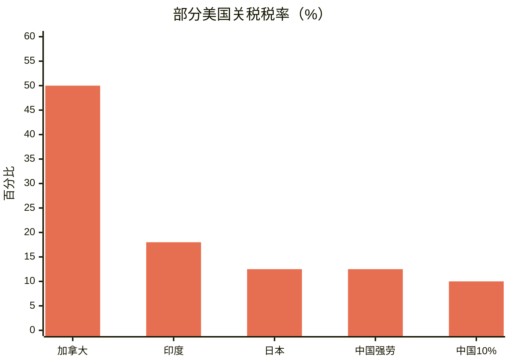
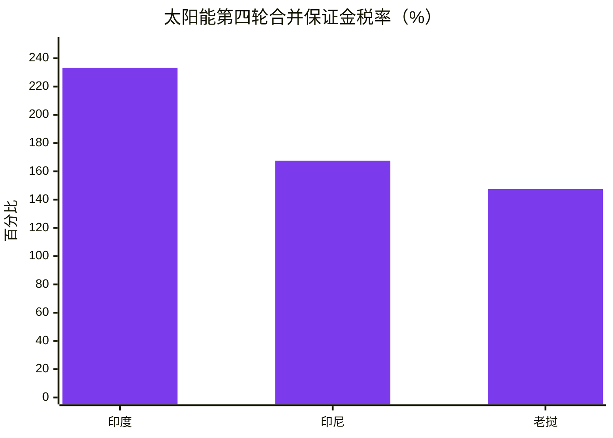
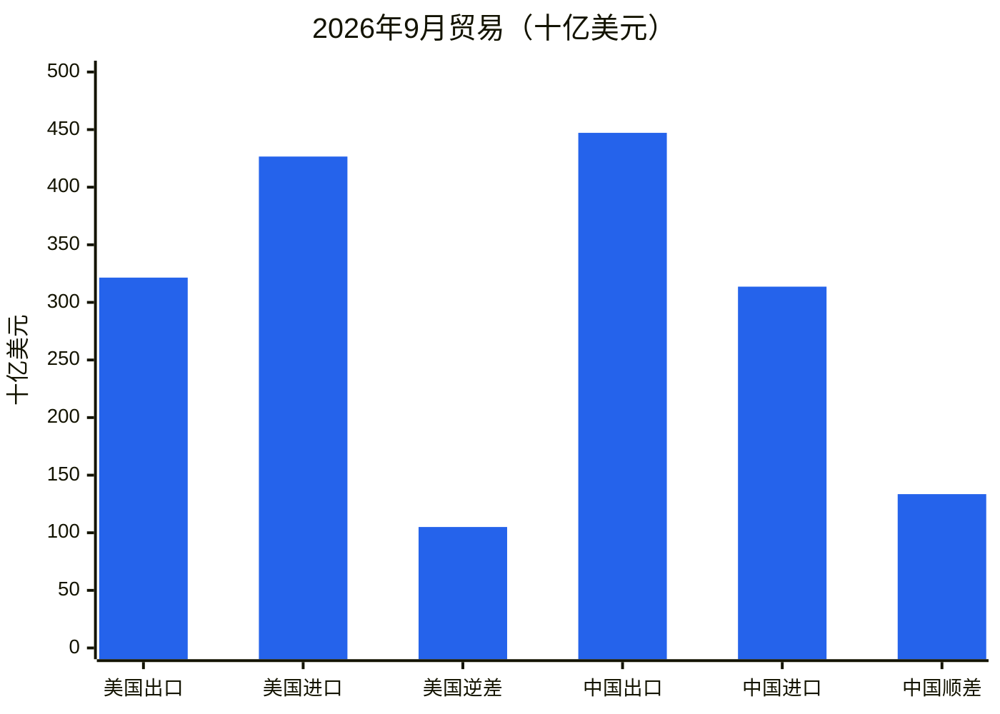
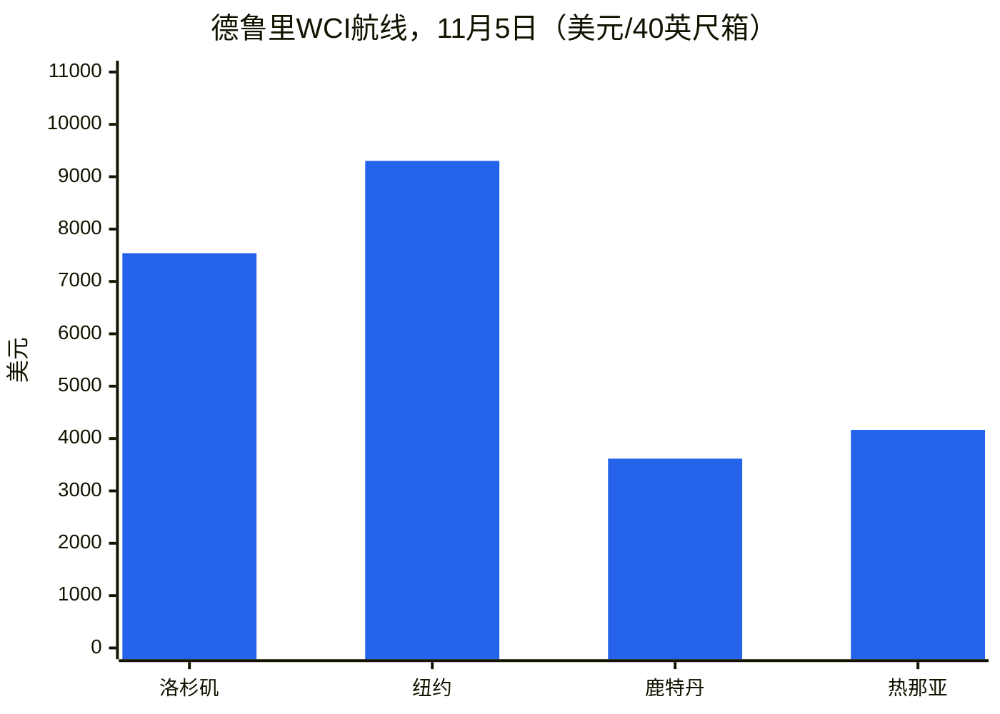
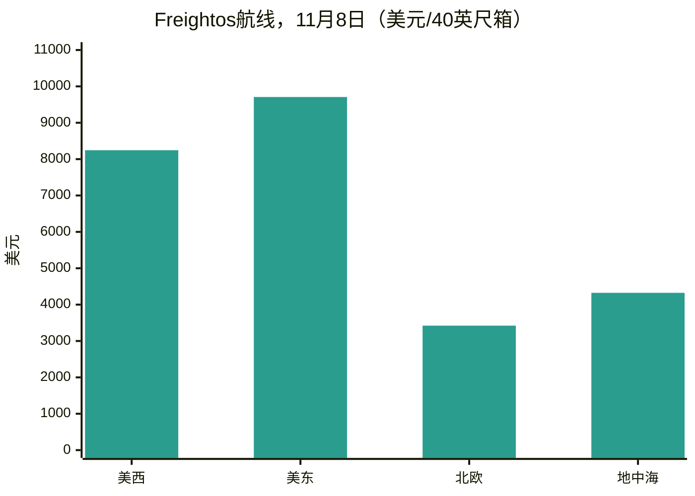
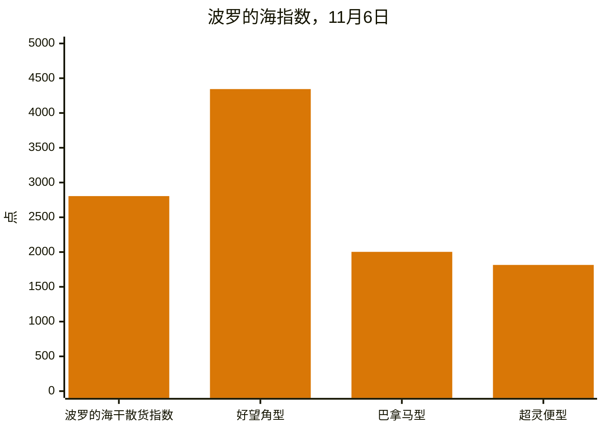
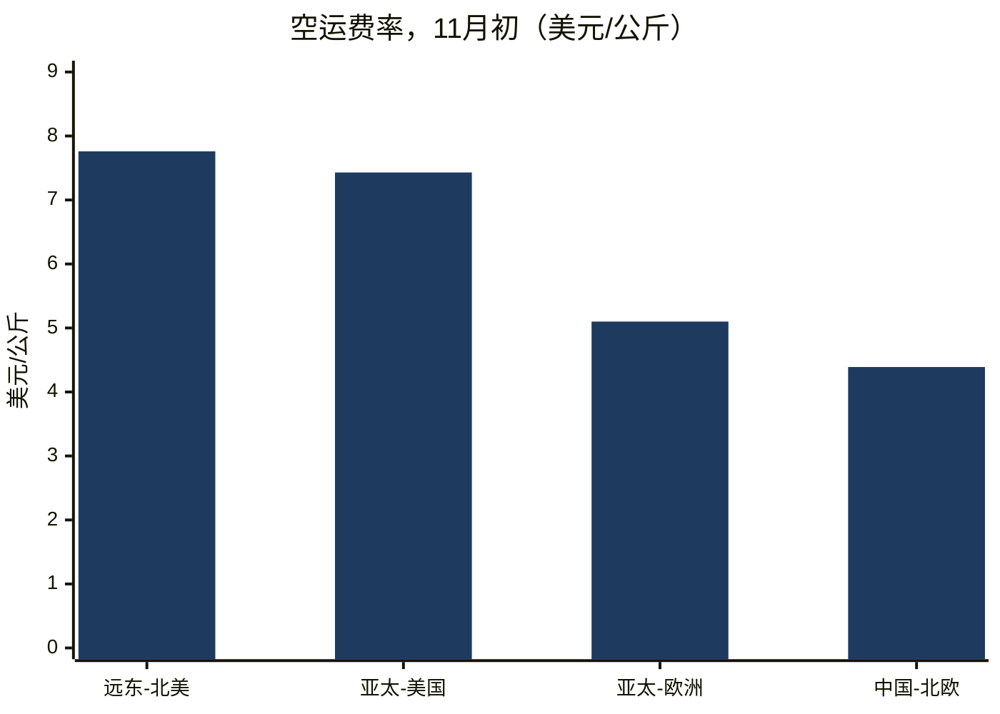
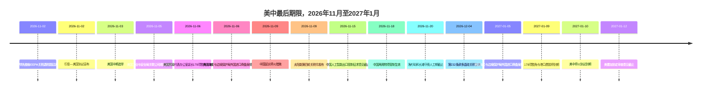
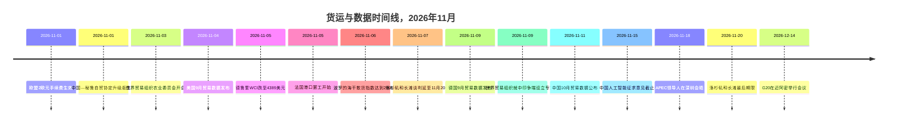

# 全球贸易情报报告——2026年11月2日至9日一周

**每周简报。** 覆盖窗口：2026年11月2日至9日。根据全球约45家贸易新闻、政策、数据与货运来源汇编而成。

---

## 目录

1. [执行摘要](#1-executive-summary)
2. [警报](#2-alerts)
3. [头条新闻——深度解析](#3-top-stories--deep-dives)
4. [关税追踪](#4-tariff-tracker)
5. [美国政策深度解析](#5-us-policy-deep-dive)
6. [按地区划分的世界政策](#6-world-policy-by-region)
7. [执法行动](#7-enforcement-actions)
8. [数据发布](#8-data-releases)
9. [货运市场](#9-freight-market)
10. [政策时间线](#10-policy-timelines)
11. [即将到来的截止日期与活动（未来90天）](#11-upcoming-deadlines--events-next-90-days)
12. [来源与方法](#12-sources--methodology)

---

## 1. 执行摘要

这是11月9日最后期限在最后一刻被两次化解、随后又被推迟至1月的一周。11月6日，美国贸易代表办公室发布通知，将全部178项中国第301条款产品排除措施以及对中国关联船舶征收第301条款港口费的暂停措施延长至2027年1月9日；11月9日，中国延长了停火协议中属于己方的内容——暂停对美国商品加征24%额外关税、暂停征收港口费以及关键矿产出口管制豁免——至2027年1月10日。这两个月的宽限期是真实的，但也很短：同样的措施如今将在1月相隔一天内相继到期，而9月华盛顿峰会后讨论的更广泛关税方案仍未最终确定。在其他方面，印度与美国宣布达成贸易协议，将美国对印度商品的关税从最高50%降至18%；民主党在中期选举中赢得了国会两院的控制权，但并未改变关税前景；欧盟每件2欧元的手续费和产品标识符要求于11月1日生效；中国将其出口管制范围扩大至人工智能、生物制药和太阳能制造技术。

- **11月9日的时钟被延长了，而非取消。** 美国贸易代表办公室 11月6日的通知将178项第301条款产品排除措施（164项一般排除措施、14项太阳能制造排除措施）以及对第301条款海事行动的进一步暂停延长至2027年1月9日美国东部时间晚上11:59；2026年11月10日起的进口申报均在新的窗口期内。美国工业与安全局提交了将其50%关联企业规则暂停措施延长至2027年1月10日的申请。中国在11月9日宣布，将对美国商品加征24%额外关税的暂停措施从11月10日起再延长两个月，保留10%的额外税率，并将港口费暂停、关键矿产出口管制豁免以及对列入不可靠实体清单的11家美国企业和出口管制清单的16家美国企业的措施暂停延长至2027年1月10日。这种不对称很小但真实：美国的措施于1月9日到期，中国的措施于1月10日到期，而且截至11月9日，尚未公布任何正式确认停火延期的美国总统文件。
- **印度与美国于11月2日达成协议。** 华盛顿将对印度商品的关税从最高50%降至18%——即25%的对等税率加上因购买俄罗斯石油而征收的25%惩罚性关税——并取消了俄罗斯石油附加费。特朗普总统表示，印度已同意停止购买俄罗斯石油并增加从美国的采购；印度政府尚未公开确认具体的能源采购承诺。该协议被描述为更广泛双边协议的第一阶段，目标是到2030年实现5,000亿美元的双边贸易额，但截至11月3日，尚未公布任何签署文本、关税表或生效日期。此前几天，印度刚刚与欧盟缔结了自由贸易协定。
- **中期选举改变了贸易的政治格局，而非关税。** 根据美联社的宣布，民主党于11月3日赢得了众议院和参议院的控制权。分析人士预计，2027年将出现监督听证会和象征性的撤销投票，但不会废除关税：民主党仍远未达到推翻总统否决所需的三分之二多数，而且在最高法院于2026年2月推翻《国际紧急经济权力法》关税后，本届政府已在第301条款和第232条款授权的基础上重建了关税结构。参议院已于10月29日以51票对47票投票决定终止全球关税背后的国家紧急状态。第122条款附加费在没有立法的情况下最长为150天，是新一届国会能够加以约束的唯一工具。
- **欧洲低价值电商规则重置生效。** 自11月1日起，对从欧盟以外直接向欧盟消费者寄送的远程销售包裹，按每件商品征收2欧元的海关手续费，此外还需缴纳自2026年7月1日起对价值150欧元及以下的包裹按每税则号征收3欧元固定关税的规定。企业对消费者（B2C）货件中的每件产品现在还必须带有三个产品标识符，无论价值多少。关税与手续费合计在增值税之前可达每税则号5欧元。2025年，欧盟海关处理了约60亿件电商包裹，其中约90%来自中国。
- **中国的出口管制扩大至技术和工业设备。** 中国商务部与科学技术部联合提案（第48号公告，10月16日）拟将40项技术——人工智能23项、生物制药5项、光伏12项——纳入出口管制目录，征求意见截止11月15日，出口前临时登记已生效。另外，针对无人机、盾构机和挖泥船的两用物项管制将于11月18日生效。鉴于中国在光伏生产领域的主导地位，太阳能管制被评估为最具影响力的措施。
- **美国报告了创纪录的进口月份；中国正迈向1万亿美元顺差。** 美国人口普查局和经济分析局于11月4日报告，9月商品与服务贸易逆差为1,050亿美元，进口额创纪录地达到4,266亿美元，商品进口额创纪录地达到3,469亿美元，其中资本货物进口额创纪录地达到1,580亿美元。中国9月顺差为1,335.3亿美元，出口额为4,471.8亿美元，同比增长36.3%；路透社的一项调查预测，10月出口将增长33.5%，顺差为1,258亿美元，这将使1月至10月的累计顺差超过1万亿美元。中国10月官方制造业采购经理人指数降至49.3，新出口订单为48.7。
- **货运再次分化：海运走软，空运飙升。** Drewry世界集装箱指数于11月5日下跌1%，至每40英尺集装箱4,389美元，但同比仍高出124%，原因是承运人11月1日的综合费率上调未能维持。波罗的海干散货指数本周收于2,805点，周环比上涨3.4%，受好望角型船运力走强推动。空运则走势相反：远东至北美航线于11月3日达到每公斤7.76美元，一周内上涨9%，创2026年新高，接近2025年12月初每公斤8.00美元的峰值。据Drewry称，约60%的亚欧集装箱运力现在经由苏伊士运河。洛杉矶—长滩守夜人工会纠纷再次推迟至11月20日，而法国港口遭遇了两天的罢工，智利圣安东尼奥港的卡车司机封锁威胁到了樱桃出口季。

**货运：** 跨太平洋和亚欧航线的集装箱现货运价均有所回落，承运人11月的涨价被打折；干散货运价连续第三周上涨，受好望角型船收益推动；空运货运在进入旺季之际创下2026年新高；苏伊士运河通行量持续恢复；洛杉矶—长滩、法国和智利的劳工纠纷使港口风险在整个旺季持续存在。

---

## 2. 警报

| # | 警报 | 生效时间 | 影响 | 来源 |
|---|-------|-----------|--------|--------|
| A1 | 美国贸易代表办公室将全部178项中国第301条款产品排除措施延长至2027年1月9日美国东部时间晚上11:59；2026年11月10日起的进口申报均在新的窗口期内；截至11月8日，《联邦公报》的发布尚未确认 | 2026年11月6日（发布） | 仅为两个月的宽限期；2027年1月9日之后的进口申报需按全部清单税率缴税（清单1–3为25%，清单4A为7.5%） | [TechTimes](https://www.techtimes.com/articles/330285/20261109/ustr-extends-section-301-tariff-exclusions-chinese-goods-entries-after-january-9-pay-full-duty.htm) |
| A2 | 美国贸易代表办公室进一步暂停第301条款海事行动（对中国关联船舶征收的港口费、附件V.A关税）至2027年1月9日美国东部时间晚上11:59 | 2026年11月9日 | 费用继续暂停；暂停措施与排除措施将于1月同日到期 | [Gateway Lines](https://gatewaylines.com/press-releases/china-ship-fee-delay-jan-9-2027-301-exclusions) |
| A3 | 中国将对美国商品加征24%额外关税的暂停措施从11月10日起延长两个月，保留10%的税率；将港口费暂停、关键矿产出口管制豁免和实体清单暂停延长至2027年1月10日 | 2026年11月9–10日 | 美国出口商继续适用10%的税率；中国方面的停火协议现延长至2027年1月10日 | [Reuters via SRN News](https://srnnews.com/china-extends-suspension-of-24-tariff-on-us-imports-for-two-months/) |
| A4 | 印度—美国贸易协议宣布：美国对印度商品的关税从最高50%降至18%；取消俄罗斯石油附加费；截至11月3日尚未公布签署文本 | 2026年11月2日 | 印度原产商品重新定价；新德里的能源采购承诺尚未确认 | [Economic Times](https://www.eximguru.com/export-import-news/export-news/india-us-trade-deal-lifts-a-117126.aspx) |
| A5 | 美国海关与边境保护局临时最终规则：自2027年1月5日起，外国进口商备案人必须获得CTPAT验证或使用获得CTPAT验证的报关行；目前32%的外国进口商备案人两种条件均不满足 | 2027年1月5日 | 直接向美国买家发货的外国卖家必须更换报关行或获得验证；征求意见截止2027年1月5日 | [CBP](https://www.cbp.gov/newsroom/national-media-release/cbp-announces-heightened-requirements-foreign-importers-record) |
| A6 | 自11月1日起，欧盟对进入欧盟的所有B2C货件征收每件商品2欧元的手续费，并要求提供三个产品标识符；增值税之前关税与手续费合计最高可达每税则号5欧元 | 2026年11月1日 | 低价值、多件商品电商的到岸成本上升；缺少标识符的货件面临延误或拒收风险 | [Logistik Heute](https://logistik-heute.de/en/news/eu-customs-policy-new-package-fee-increases-costs-cross-border-online-trade-291550.html) |
| A7 | 美国商务部对来自印度、印度尼西亚和老挝的结晶硅太阳能电池发布最终反倾销/反补贴税令；综合全包税率最高约为233%（印度）、168%（印度尼西亚）、147%（老挝） | 2026年11月9日 | 现金保证金自11月5日起恢复征收；使用受管制电池在第三国制造的组件属于税令范围 | [MLex](https://www.mlex.com/mlex/articles/2547289/us-commerce-imposes-duties-for-indonesian-laotian-and-indian-solar-cells) |
| A8 | 洛杉矶/长滩守夜人罢工威胁再次推迟；谈判延长至2026年11月20日；六个码头约250名工人；长滩约85%的货物和洛杉矶约33%的货物面临风险 | 2026年11月20日 | 中期选举次日的停工得以避免，但纠纷现已延续至旺季后期，且已有大量铁路积压 | [gCaptain](https://maritimenewsbd.com/la-long-beach-port-strike-threat-deferred-november-20/) |
| A9 | 中国人工智能/生物制药/太阳能出口管制目录提案：征求意见截止2026年11月15日；出口前临时登记已适用；针对无人机、盾构机和挖泥船的两用物项管制于11月18日生效 | 2026年11月15日 / 11月18日 | 涉及40项技术（14项禁止出口，26项限制出口）；太阳能制造技术知识是最尖锐的方面 | [China Briefing](https://www.china-briefing.com/news/china-technology-export-controls/) |
| A10 | 民主党赢得11月3日中期选举的两院控制权；关税结构预计将持续；参议院已于10月29日以51票对47票投票决定终止全球关税背后的国家紧急状态 | 2026年11月3日 | 预计2027年将出现监督和象征性撤销投票；第122条款是新一届国会能够加以约束的工具 | [SupplyChainBrain](https://www.supplychainbrain.com/general-scm/regulation-compliance/article/16424361/us-midterm-rout-unlikely-to-change-trumps-trade-policy) |

### A1/A2——11月9日的时钟，在最后一刻延长

上周简报中占主导地位的两项措施均于11月6日延长，当时美国贸易代表办公室在其网站上发布了两份通知。第一份通知将全部178项中国第301条款产品排除措施——根据美国协调关税表9903.88.69的164项一般排除措施和根据9903.88.70的14项太阳能制造排除措施——延长至2027年1月9日美国东部时间晚上11:59，涵盖2026年11月10日美国东部时间凌晨12:01或之后进入消费领域或从仓库提取进入消费领域的货物。没有增加或取消任何排除措施，也没有要求新的评论；美国贸易代表办公室依据的是对其2025年9月16日通知的评论。第二份通知进一步暂停了针对中国海事、物流和造船做法的第301条款行动，包括所涵盖的船舶费用和附件V.A关税，自2026年11月9日起生效，至2027年1月9日美国东部时间晚上11:59。美国贸易代表办公室曾于10月26日提议延长海事措施（91 FR 67388）；评论期于10月30日结束。截至11月8日，尚未确认两份通知中有任何一份已在《联邦公报》上发布，而且排除措施通知存在内部不一致——其日期部分和附件称2027年1月9日，而其他文本则提及1月10日；有效日期为1月9日。如果没有延期，11月10日起的进口申报将按全部清单税率缴税。一项排除措施仅免除清单关税：12.5%的第301条款强迫劳动关税、第232条款关税、反倾销和反补贴税以及最惠国税率仍然适用。11月4日，软件与信息产业协会和其他23个组织曾要求美国贸易代表办公室至少延长一年；美国贸易代表办公室批准了两个月。

### A3——中国在停火协议到期当日采取行动

中国于11月9日星期一宣布，将继续暂停对美国商品加征24%的额外关税两个月，自11月10日北京时间13:01起，保留10%的额外税率。海关总署关税税则委员会2026年第6号公告执行了特朗普总统与习近平主席在9月华盛顿峰会上达成的共识。与此同时，中国商务部将某些关键矿产及相关技术的出口管制豁免延长至2027年1月10日，针对列入中国不可靠实体清单的11家美国企业和出口管制清单的16家美国企业的措施继续暂停至2027年1月10日，对美国关联船舶征收特别港口费的暂停也延长至同一日期。对韩华海洋五家美国子公司的制裁也暂停了另外两个月。这种不对称对规划具有重要意义：北京已通过正式公告采取行动，而截至11月9日，尚未公布任何正式确认停火延期的美国总统文件，而且美国的措施于1月9日到期，中国的措施则持续至1月10日。9月峰会后讨论的拟议600亿美元对等关税削减方案，包括中国2024年进口的170亿美元美国农产品，仍未最终确定。

### A4——印度—美国协议：18%与俄罗斯石油问题

印度与美国在经过数月紧张谈判后达成了一项贸易协议，谈判以11月2日星期一晚间印度总理纳伦德拉·莫迪与美国总统唐纳德·特朗普之间的一次电话通话告终。华盛顿宣布，将对印度商品的关税从最高50%降至18%——即25%的对等税率加上因购买俄罗斯石油而征收的25%惩罚性关税——并取消了惩罚性附加费。特朗普总统表示，印度已同意停止购买俄罗斯石油，增加从美国乃至可能从委内瑞拉的采购，并“以高得多的水平”购买美国商品；印度政府尚未就具体的能源采购承诺公开表态。路透社报道，印度同意增加购买美国石油、国防产品、电子产品、药品、电信设备和飞机。该协议被描述为更广泛双边协议的第一阶段，谈判仍在继续，目标是到2030年实现5,000亿美元的双边贸易额，高于目前约1,910亿美元。截至11月3日的报道，尚未公布任何签署文本、关税表或生效日期，而且2026年2月框架中的18%税率此前从未适用过——自2026年7月24日以来，大多数印度商品一直面临10%的第301条款关税。

### A5——美国海关与边境保护局——外国进口商备案人规则

美国海关与边境保护局于2026年11月6日发布了临时最终规则《对外国进口商备案人的更高要求》（CBP Dec. 26-19，91 FR 69977），执行第14411号行政命令（《加强海关执法》，2026年6月3日签署）第2条。自2027年1月5日起，外国进口商备案人只有在其本身获得CTPAT验证或通过获得CTPAT验证的持证报关行申报的情况下，方可将商品报关进入消费领域。美国海关与边境保护局自身的分析显示：0.4%的外国进口商备案人已获得CTPAT验证，68%已使用获得验证的报关行；其余32%除非更换报关行或自行获得CTPAT验证，否则将无法继续向美国进口。海关法规新增的第110部分定义了“美国进口商备案人”；进口商身份必须在报关和报关单摘要时申报；报关行必须核实客户身份并将核实记录保存五年；征求意见截止2027年1月5日。该规则并未实施行政命令所指示的对外国进口商备案人非正式报关的全面禁令，但邀请就全面禁令作为替代方案征求意见。估计的货币化成本约为每年1,233,253美元。

### A6——欧盟2欧元费用与产品标识符

自2026年11月1日起，根据授权条例（EU）2026/2152，对从欧盟以外直接向欧盟消费者寄送的远程销售包裹，按每件商品征收2欧元的海关手续费，无论价值多少。该费用是在根据条例（EU）2026/382自2026年7月1日起对价值150欧元及以下的包裹按每税则号征收3欧元固定关税的基础上加收的，该条例取消了150欧元的关税起征点豁免。自同一日起，运往欧盟的企业对消费者货件中的每件产品——无论价值多少——都必须带有三个产品标识符。因此，关税与手续费合计在增值税之外可达每税则号5欧元。该临时制度将持续至2028年7月1日，届时一个集中的欧盟海关数据系统计划以标准关税取代固定征税。即使货物退回，该费用也不予退还。

### A7——太阳能第四轮税令：综合税率最高约为233%

美国商务部于2026年11月9日对来自印度、印度尼西亚和老挝的结晶硅光伏电池（无论是否组装成组件）发布了反倾销和反补贴税令，此前美国国际贸易委员会于11月5日公布了肯定的最终损害认定（91 FR 69865）。印度：反倾销税率123.04%（抵消补贴后的现金保证金为107.17%），反补贴税126.09%，综合现金保证金率为233.26%。印度尼西亚：反倾销税94.36%，反补贴税73.20%（其他企业综合税率为167.56%）。老挝：反倾销税65.43%，反补贴税82.03%（综合税率为147.39%）。暂停清算和现金保证金征收自2026年11月5日起恢复。在第三国使用受管制电池制造的组件、层压板和面板属于税令范围；使用第三国电池在印度组装的组件则不属于税令范围。美国国际贸易委员会的完整公开报告（USITC Publication 5804）将于2026年11月23日前发布。

### A8——洛杉矶/长滩：推迟至11月20日

洛杉矶和长滩集装箱码头安保人员（守夜人）威胁罢工一事再次被推迟，谈判现已延长至11月20日，据gCaptain转引彭博社11月7日的报道。国际码头和仓库工会第26分会代表约250名安保人员，分布在六个集装箱码头；他们此前的合同于2025年7月到期，成员已授权罢工，双方正在联邦调解与和解局的协助下进行谈判。太平洋海事协会表示，由于其他码头工人预计不会穿越第26分会的纠察线，罢工可能影响长滩港约85%的货物和洛杉矶港三分之一的货物。该综合港区已经承压：两个港口约有35,688个进口集装箱在等待铁路服务，其中10,562个已等待九天或更久，9月铁路运输进口货物平均滞留7.19天，高于8月的6.75天。洛杉矶港一个月处理了100万个集装箱，创下新纪录，尽管其负责人警告称存在关税驱动的规划风险。

### A9——中国出口管制：征求意见于11月15日截止，两用物项规则于11月18日生效

中国商务部与科学技术部提议将40项技术纳入《禁止出口限制出口技术目录》：人工智能23项、生物制药5项、光伏12项。其中14项将被禁止出口；26项受到限制（需要许可证）。自2026年10月16日起，对所列技术的出口前临时登记——包括已在进行的出口，以及向境外实体转让持有这些技术的境内企业的所有权或控制权——通过中国商务部的技术贸易管理信息应用实施。公开征求意见于11月15日截止。另外，三项公告修订了针对无人驾驶航空器、盾构机和挖泥船的两用物项出口管制清单，均于2026年11月18日生效，中国商务部与海关总署发布了第52号公告，修订了海关扣留无许可证出口货物的程序。中国商务部将这一揽子措施描述为“精准且有限”。

### A10——中期选举：民主党赢得国会；关税预计将持续

11月3日的中期选举使民主党在众议院、参议院和其他职位上取得了历史性的大幅增长；11月4日的报道称民主党横扫两院。全部435个众议院席位和100个参议院席位中的35个参加了选举。贸易专家和国会助理告诉路透社，民主党控制的国会将在2027年带来监督听证会和象征性的关税撤销投票，但不会废除关税：民主党仍远未达到推翻总统否决所需的三分之二多数，而且白宫表示，特朗普总统不会动摇其“美国优先”贸易议程。参议院已于2026年10月29日以51票对47票投票决定终止全球关税背后的国家紧急状态，四名共和党人加入民主党，但该投票并未瓦解关税结构。分析人士指出，在最高法院于2026年2月20日推翻《国际紧急经济权力法》关税后，本届政府已在第301条款和第232条款授权的基础上重建了关税，而且这些关税迄今仍然有效；25个州已起诉要求阻止第301条款关税，案件正在审理中。C.H. Robinson 11月5日的海关更新警告托运人，为2026年晚些时候及2027年可能对特定国家加征更多第301条款关税做好准备。

---

## 3. 头条新闻——深度解析

### 3.1 停火协议延长两个月——以及随之产生的一月悬崖

本周的核心新闻是一对延期决定，二者合力使美中贸易停火得以延续至明年一月，同时把下一次决策压缩进两个月的时间窗口。顺序很重要。11月6日，美国贸易代表办公室发布了两份通知：一份将全部178项中国第301条款产品豁免延长至2027年1月9日美国东部时间晚上11:59，另一份进一步暂停第301条款海事行动——对中国关联船舶征收的港口费和附件V.A关税——至同一日期。11月5日，美国工业与安全局提交了将其50%关联企业规则出口管制措施的暂停期延长至2027年1月10日的申请。11月9日，中国延长了己方措施：对美国商品加征的24%关税继续暂停两个月，自11月10日起算，10%的附加税率继续执行，对美国关联船舶征收特别港口费的暂停、对关键矿产出口管制的豁免，以及针对列入不可靠实体清单的11家美国企业和出口管制清单的16家美国企业的措施，均延至2027年1月10日。

有三个特点值得注意。第一，延期很短——只有两个月，而9月的安排据理解为期一年——而且是在业界要求至少延长一年之后作出的。软件与信息产业协会及其他23个组织于11月4日要求美国贸易代表办公室将豁免至少延长一年；美国贸易代表办公室只给了两个月。第二，各方日期并不完全一致：美国的措施于1月9日到期，中国的于1月10日到期，而美国停火本身在9月被财政部长斯科特·贝森特描述为持续至1月10日。第三，停火背后的实质问题仍未解决。11月6日，美国贸易代表贾米森·格里尔与贝森特部长同中国副总理何立峰举行视频通话；格里尔强调“中国采取具体行动全面履行既往承诺至关重要”，特别是农产品采购、稀土和其他关键矿产，而中国则对美国的贸易限制表示“严重关切”。双方的会谈纪要均未提及最后期限。9月峰会后讨论的600亿美元对等关税削减方案仍未敲定。

**关键数据：** 178项豁免获延长（164项一般豁免，14项太阳能制造豁免）；若无延期，自11月10日起的报关将缴纳25%（清单1至3）或7.5%（清单4A）的关税；中国加征的24%关税继续暂停，10%保留；停火现延至2027年1月9日至10日。

**为何重要：** 进口商获得了两个月的确定性，而不是本周就面临悬崖，但悬崖只是推迟了，并未消失。下一个决策点是11月18日至19日在深圳举行的亚太经合组织领导人会议，特朗普总统与习近平主席将在今年第三次会晤，随后是12月14日至15日在迈阿密举行的二十国集团峰会。报关、航次和出口筛查必须依据书面立场来规划：豁免按报关日期而非装运日期适用，因此11月装运但1月9日之后报关的货物不在延期范围内。

**来源：** [TechTimes](https://www.techtimes.com/articles/330285/20261109/ustr-extends-section-301-tariff-exclusions-chinese-goods-entries-after-january-9-pay-full-duty.htm); [Gateway Lines](https://gatewaylines.com/press-releases/china-ship-fee-delay-jan-9-2027-301-exclusions); [Reuters via SRN News](https://srnnews.com/china-extends-suspension-of-24-tariff-on-us-imports-for-two-months/); [BusinessWorld](https://bworldonline.com/world/2026/11/09/792445/china-extends-suspensions-of-24-tariff-on-us-goods-port-fees-on-us-ships-for-two-months/)

### 3.2 印度—美国协议：笼罩印度出口经济的最大单一不确定性消除

11月2日的宣布消除了笼罩印度出口经济的最大单一不确定性，缓解了卢比——此前屡创历史新低——和印度股市的压力，而且如果停止购买俄罗斯石油的承诺得以落实，将重塑全球最大原油买家之一的原油流向。美国是印度最大的出口目的地，约占其商品出口的20%。该协议将美国对印度商品的关税从最高50%降至18%，并取消了因购买俄罗斯石油而加征的额外惩罚性征税。双方的目标是到2030年实现双边贸易5000亿美元，高于目前约1910亿美元（印度官员按较窄口径引用为1318.4亿美元）。

不确定性依然重大。截至11月3日，尚未公布签署文本、关税表或生效日期，而且2026年2月框架中的18%税率此前从未适用——自2026年7月24日以来，大多数印度商品一直面临10%的第301条款关税。特朗普总统关于印度同意停止购买俄罗斯石油并增加从美国以及可能从委内瑞拉采购的表态，尚未得到新德里的公开具体确认。Reuters报道称，印度同意增加购买美国石油、国防产品、电子产品、药品、电信设备和飞机。该协议达成几天前，印度刚与欧盟缔结自由贸易协定，使印度在一周内达成两项重大协议——与此同时，本周还有另一则印度新闻：商务部长皮尤什·戈亚尔于11月3日表示，印度在任何自由贸易协定中从未开放乳制品行业，也不会允许进口转基因产品，这条红线与每一项正在进行的自贸协定谈判都相关。

**关键数据：** 关税从最高50%（25%对等关税+25%俄罗斯石油惩罚性征税）降至18%；双边贸易约1910亿美元；到2030年达到5000亿美元的目标；2026年4月至9月印度出口约4800亿美元，同比增长约14%；印度力争2026—27财年货物和服务出口达到1万亿美元。

**为何重要：** 对印度出口商而言，该协议以18%的税率取代了50%的最坏情况——如果文本确认这一点。对能源市场而言，俄罗斯石油问题是现实变量：印度是全球最大的原油买家之一，停止购买将转移大量原油。对贸易政策而言，该协议表明本届政府通过先宣布、后出文本的方式敲定重大双边文件，进口商在规划时应将这一模式考虑在内。

**来源：** [Economic Times](https://www.eximguru.com/export-import-news/export-news/india-us-trade-deal-lifts-a-117126.aspx); [Reuters via Reporter World News](https://www.reporterworldnews.com/news/business/2026/11/03/piyush-goyal-commerce-dairy-products)

### 3.3 中期选举与关税前景：政治变了，关税未变

11月3日的选举使民主党掌控了两院，但关税架构建立在行政权力之上，国会易主并不会将其撤销。本届政府的关税目前主要依据第301条款和第232条款，此前最高法院于2026年2月20日在*Learning Resources, Inc. v. Trump*一案中推翻了《国际紧急经济权力法》关税。这些权力不依赖选举周期，而且民主党距离推翻总统否决所需的三分之二多数还差得很远。变化的是监督力度：预计2027年将出现监督听证会、象征性的撤销表决，以及要求有针对性救济的压力——尤其是在加拿大问题上。新一届国会能够约束的唯一工具是第122条款，其附加费在没有立法的情况下上限为150天；延长该框架需要新一届国会批准。新一届国会将于2027年1月就职；在此之前，关税法规维持原状。

诉讼前线现在关乎资金，而非权力。11月2日，FedEx在国际贸易法院起诉美国、美国海关与边境保护局及其局长罗德尼·斯科特，要求全额退还其作为登记进口商根据被最高法院宣告无效的《国际紧急经济权力法》关税令所缴纳的全部关税——据报道，这是首家就其在估计1750亿美元已征《国际紧急经济权力法》关税中所占份额提起诉讼的大型企业。最高法院未就退税问题作出裁决，将该问题留给下级法院。同样在11月2日，自由正义中心启动了“退税救援行动”，表示将为符合条件的、其《国际紧急经济权力法》报关已完成最终清算、因而无法通过美国海关与边境保护局的CAPE退税系统在没有法院命令的情况下获得退税的小企业，资助有针对性的国际贸易法院诉讼；初期受理能力为100件诉讼。美国海关与边境保护局的CAPE退税系统于2026年4月20日在ACE系统中上线，美国海关与边境保护局表示，有效退税一般在受理后60至90天内到账。10月8日，国际贸易法院在*Freestyle World, Inc. v. U.S. Customs and Border Protection*一案中认证了一个集体诉讼，原告为缴纳了有争议的《国际紧急经济权力法》关税的登记进口商。另有一案，第301条款强迫劳动关税（12.5%，自2026年7月24日起生效）正在国际贸易法院受到挑战；口头辩论于2026年9月30日举行，截至10月初尚未有裁决报道。25个州已起诉要求阻止第301条款关税，案件正在审理中。

**关键数据：** 参议院10月29日以51比47票通过终止全球关税背后的国家紧急状态；估计已征《国际紧急经济权力法》关税1750亿美元；CAPE退税一般在60至90天内到账；“退税救援行动”初期为100件诉讼。

**为何重要：** 托运人应预计，在总统最后两年任期内，现有征收的关税将继续存在，美墨加协定审议和新的第301条款行动是现实前线。退税诉讼是登记进口商一个单独的、重大的现金流问题：只有登记进口商（或其报关行）才能提出索赔，退税归进口商，而非消费者。

**来源：** [SupplyChainBrain](https://www.supplychainbrain.com/general-scm/regulation-compliance/article/16424361/us-midterm-rout-unlikely-to-change-trumps-trade-policy); [Liberty Justice Center](https://libertyjusticecenter.org/pressrelease/liberty-justice-center-launches-operation-refund-rescue-to-help-small-businesses-recover-unlawful-ieepa-tariff-payments/); [JD Supra](https://www.jdsupra.com/legalnews/old-tariffs-new-tariffs-future-tariffs-5121636/)

### 3.4 欧洲：低价值电商重置生效，南方共同市场初见成效

本周欧洲的两项发展方向相反：一项提高了低价值进口的壁垒，另一项显示新的自由贸易区已开始推动货物流动。11月1日起生效的每件2欧元手续费和产品标识符要求，是理事会于2026年9月3日批准的海关改革框架的首个操作层面，该框架使海关程序现代化、扩大数据使用，并使非欧盟电商平台作为进口商承担关税和税款责任。法规（欧盟）2026/2108改革了《欧盟海关法典》，将从2028年起逐步取代现行法典。欧盟委员会必须每月（自2026年10月1日起）评估低价值制度下是否出现贸易流转移。对卖家而言，这一变化既是成本，也是数据义务：缺少三项产品标识符的货件可能延误或被拒，而且即使货物退回，费用也不予退还。

欧盟—南方共同市场临时贸易协定于2026年1月17日在亚松森签署，11月1日达到临时适用六个月，首批硬数据表明采用速度很快。2026年5月至9月，巴西对欧盟的农业综合企业出口额增长14.8%，至122.1亿美元，出口量1774万吨（同比增长8.1%）。据报道，5月至9月巴西对欧盟的整体出口增长31%；阿根廷农工出口在头四个月增长21%，其中享受关税减免的产品增长44%。法律基础仍是临时的：欧洲议会尚未给予最终同意，并已将该协定提交欧盟法院；临时适用依据的是理事会2026年1月的决定。另有一事，欧盟于2026年9月3日因抗菌药物使用合规问题暂停进口巴西牛肉、家禽和蜂蜜；据报道，在审计之后，家禽和蜂蜜有可能重新列入清单，但没有确认日期。

**关键数据：** 每件商品2欧元（手续费）；每条税则号3欧元（自2026年7月1日起的统一关税）；2025年欧盟海关处理约60亿件电商包裹，其中约90%来自中国；巴西对欧盟的农业综合企业出口122.1亿美元（2026年5月至9月，增长14.8%）；9.9万吨牛肉配额，税率为7.5%；欧盟取消对92%的南方共同市场出口商品的关税。

**为何重要：** 11月1日的费用和标识符规则在旺季前几周改变了每一件进入欧盟的低价值包裹的经济性，冲击源自中国的平台（Shein、Temu）以及任何直接向欧盟消费者发货的卖家。南方共同市场的数据表明，全球按人口计算最大的自由贸易区（7亿多人）已开始大规模推动货物流动——但市场准入仍是有条件的，正如巴西暂停进口一事所示。

**来源：** [Logistik Heute](https://logistik-heute.de/en/news/eu-customs-policy-new-package-fee-increases-costs-cross-border-online-trade-291550.html); [European Commission, Access2Markets](https://trade.ec.europa.eu/access-to-markets/en/news/application-eu-mercosur-interim-trade-agreement-1-may-2026); [EUR-Lex, Regulation (EU) 2026/382](https://eur-lex.europa.eu/legal-content/EN/TXT/?uri=OJ:L_202600382)

### 3.5 中国扩大出口管制网：人工智能模型、生物制药平台、太阳能技术

中国出口管制计划本周在三个方面取得进展，其中最具影响的是针对制造技术而非制成品的措施。中国商务部与科学技术部联合提案（第48号公告，10月16日）拟将40项技术列入《中国禁止出口限制出口技术目录》：人工智能23项、生物制药5项、光伏12项。其中14项将被禁止出口；26项受限（需要许可证）。自10月16日起，清单技术的出口前临时登记——包括已在进行中的出口，以及将持有相关技术的国内企业的所有权或控制权转让给境外实体的行为——通过中国商务部的技术贸易管理信息应用实施。在人工智能方面，向受限大型模型进行API、应用、网络和软件即服务部署以及轻量级端侧部署，不在管制范围内；境外部署本地化以及将受管制权重转移至境外则需要许可证。在生物制药方面，转让受管制的细胞和基因治疗及siRNA平台的所有权将被禁止，但许可、合同研究和生产服务，以及对外业务发展交易中产品研发或生产所需的技术则不在此列。在太阳能方面，禁令包括某些多晶硅生产技术、70微米或更薄的硅片制备，以及钙钛矿和叠层太阳能电池制造及相关设备制造技术——豁免有限，因此鉴于中国在光伏生产和前沿太阳能技术领域的主导地位，太阳能管制被评估为对外国制造商影响最大。中国商务部称此次修订为例行调整，不针对任何特定国家。意见征集截止于11月15日。

两用物项一揽子措施在平行轨道上推进。三项公告修订了无人机（第49号公告）、隧道掘进机和挖泥船的两用物项出口管制清单，均自2026年11月18日起生效。中国商务部与海关总署还发布了第52号通知（10月19日），修订了海关扣留无证出口、可能受管制的货物并要求办理许可证的程序。另有一事，10月13日，中国商务部发布了措施草案，以“出口证明”制度取代某些民用航空两用物项的逐项许可。中国商务部称该一揽子措施“精准且有限”，并配有便利化措施，但并非所有细节都已公布。与此同时，中国将某些关键矿产及相关技术的出口管制豁免延长至2027年1月10日——即第3.1节提到的与停火相关的救济——因此本周的管制措施与本周的豁免在不同产品类别上朝着相反方向发展。

**关键数据：** 40项技术（人工智能23项/生物制药5项/光伏12项）；14项禁止，26项受限；意见征集截止2026年11月15日；两用管制自2026年11月18日起生效。

**为何重要：** 该目录提案涉及以中国“核心数据”训练的前沿人工智能模型、细胞和基因治疗平台，以及下一代太阳能背后的核心制造技术。对外国制造商而言，太阳能条款的冲击最为直接：其范围涵盖钙钛矿和叠层电池背后的设备和工艺，而不仅是成品组件。11月15日的意见征集截止日期和11月18日的生效日期是眼前的合规节点。

**来源：** [China Briefing](https://www.china-briefing.com/news/china-technology-export-controls/); [Mondaq](https://alpha.mondaq.com/unitedstates/export-controls-trade-investment-sanctions/1865934/chinas-proposed-biopharma-and-ai-technology-export-controls-pre-export-registration-already-applies); [Akin Gump](https://www.akingump.com/print/v2/content/1138573/new-chinese-export-control-measures-tighten-restrictions-on-the-export-of-advanced-technologies-and-dual-use-goods-strengthen-enforcement.pdf)

### 3.6 货运：海运走软、空运飙升、苏伊士运河回归

本周集装箱市场平静但走软，随着运力限制缓解、需求保持季节性低迷，跨太平洋和亚欧航线均略有下降。德鲁里世界集装箱指数在11月5日的评估中下跌1%，至每40英尺集装箱4389美元，但仍同比高出124%。上海—洛杉矶航线持平于每40英尺集装箱7539美元，上海—纽约下跌3%，至9303美元，上海—鹿特丹下跌2%，至3615美元，上海—热那亚持平于4166美元。承运商11月1日的综合费率上调——目标约为北欧每40英尺集装箱4500美元、地中海5000美元——未能站稳脚跟，11月15日计划再次尝试类似水平，尽管欧洲货代告诉The Loadstar，需求温和、运力充足可能对其不利。Linerlytica报道称，承运商在亚欧北线提供每40英尺集装箱2700至3400美元的折扣运价，并预计现货运价将在2027年全年下降约30%。德鲁里统计下周宣布的空白航次为3个，低于本周的5个，并预计跨太平洋运价下周将进一步下降；第46至50周717个航次中有46个被取消（6%），而一周前为715个航次中的56个。集装箱贸易统计公司11月6日公布的数据显示，9月全球集装箱量为1735万标准箱，同比增长8%，集装箱贸易统计全球价格指数为123。

空运则走势相反。Freightos 11月3日的更新显示，远东—北美航线为每公斤7.76美元——单周上涨9%，为2026年最高水平，较去年同期高出约40%，且与2025年12月初达到的每公斤8.00美元峰值相差3%以内。Freightos将上涨归因于旺季需求增加；北欧—北美空运运价当周上涨12%，而中国—北欧上涨1%，至每公斤4.39美元。Air Cargo News 11月2日报道的TAC指数数据显示，香港出境平均运价从10月初的每公斤7.16美元攀升至月底的每公斤8.17美元。WorldACD第43周数据显示，亚太—美国现货运价上涨7%，至每公斤7.43美元，亚太—欧洲现货运价上涨5%，至每公斤5.10美元，亚太运力下降1%，部分原因是台风扰乱了台湾的航班。与海运的对比十分鲜明：集装箱现货运价下跌，而空运运价在圣诞节前旺季飙升，而且最低免税额取消意味着每一批货件现在都要缴纳关税。

苏伊士运河的回归仍在继续。德鲁里报道称，约60%的亚欧运力现经由该运河，并警告如果转移迅速，可能出现船舶扎堆和欧洲港口拥堵。Maersk的ME1印度—欧洲航线正经由红海回归（11月2日报道）；Evergreen和Yang Ming的船舶计划于11月7日至16日通过苏伊士运河。FreightWaves指出，胡塞武装对沙特基础设施的袭击是2027年合同谈判前集装箱运价走软面临的新的地缘政治风险。在企业方面，Maersk上调了利润预期，因盈利大幅增长，但股价因未达预期而下跌；ONE将利润预期上调至20亿美元，因盈利大幅增长。

**关键数据：** 德鲁里世界集装箱指数每40英尺集装箱4389美元（环比下跌1%，同比上涨124%）；上海—洛杉矶7539美元；上海—纽约9303美元；上海—鹿特丹3615美元；上海—热那亚4166美元；远东—北美空运每公斤7.76美元（环比上涨9%，为2026年最高）；香港出境10月底每公斤8.17美元；9月全球集装箱量1735万标准箱（同比增长8%）。

**为何重要：** 即使运价走软，仍远高于一年前水平，承运商在需求疲软的情况下难以推动涨价——这表明2027年合同谈判将有利于托运人。中东风险是变数：任何红海中断重现都会迅速逆转运价回落的局面。对错过海运旺季窗口的托运人而言，接近历史高位的空运运价就是替代方案的代价。

**来源：** [Drewry](https://www.drewry.co.uk/maritime-research-opinion-browser/world-container-index-assessed-by-drewry); [The Loadstar](https://theloadstar.com/calmer-waters-for-container-spot-rates-but-fragile-middle-east-a-threat/); [Freightos](https://www.freightos.com/freight-resources/asia-us-air-rates-already-nearing-last-years-high-on-peak-season-volumes-november-3-2026-update/); [Forwarder News](https://www.forwardernews.com/news/2026-11-07-september-box-trade-up-8)

### 3.7 两项赤字，两个方向：美国进口创纪录，中国向1万亿美元迈进

美国于11月4日报告（人口普查局CB 26–178，经济分析局26–47），9月货物和服务贸易逆差为1050亿美元，较8月修正后的1057亿美元减少7亿美元。货物逆差为1359亿美元（减少7亿美元）；服务顺差为309亿美元。出口为3215亿美元（较8月增加58亿美元）；进口为4266亿美元（增加52亿美元）——创历史新高。货物出口为2110亿美元（增加51亿美元）；货物进口为3469亿美元，同样创纪录。资本货物进口创纪录，达1580亿美元（计算机增加76亿美元，计算机配件增加57亿美元；半导体减少12亿美元）。三个月平均逆差为1012亿美元，较上一三个月期间增加113亿美元。今年以来（2026年1月至9月），货物和服务逆差较2025年同期减少924亿美元（12.2%）。按人口普查口径，实际（经通胀调整）货物逆差增加35亿美元，至1195亿美元；经济分析局将名义与实际衡量之间的差异归因于非货币黄金国际收支调整。按人口普查口径，与台湾的货物逆差扩大36亿美元，至219亿美元。

中国9月数据于10月14日发布，出口为4471.8亿美元，同比增长36.3%（为2月以来最快；8月增长25.0%），进口为3136.5亿美元，同比增长31.0%，月度顺差为1335.3亿美元（8月为1191亿美元）。1月至9月累计顺差为9381.1亿美元，而2025年全年为1.189万亿美元。1月至9月半导体出口额同比增长108.1%；自动数据处理设备及零部件出口增长54.6%。9月与欧盟的双边顺差创纪录，达348亿美元。Reuters于11月9日对经济学家的调查预测，10月出口同比增长33.5%，进口增长32%，顺差为1258亿美元——足以使1月至10月累计顺差超过1万亿美元。10月实际数据将于11月11日发布，在本次报道窗口之后。德国9月贸易数据（联邦统计局，11月9日）显示，出口为1411亿欧元（环比增长2.0%，同比增长7.7%），进口为1255亿欧元，顺差为156亿欧元。

**关键数据：** 美国9月逆差1050亿美元；货物逆差1359亿美元；服务顺差309亿美元；进口4266亿美元（创纪录）；中国9月顺差1335.3亿美元；1月至9月累计顺差9381.1亿美元；10月预测顺差1258亿美元；德国9月顺差156亿欧元。

**为何重要：** 人工智能基础设施进口激增如今是美国逆差的主要驱动因素，即使出口也在上升，而中国的顺差有望在今年头十个月突破1万亿美元——连续第十个月出口强劲增长，这将加剧来自欧盟和其他方面的贸易摩擦压力。11月11日中国10月数据出炉时值得关注的是，采购经理人指数中出口订单收缩（48.7）与预测出口增长33.5%之间的反差。

**来源：** [BEA](https://bea.gov/sites/default/files/2026-11/trad0926.pdf); [Reuters](https://www.reuters.com/world/asia-pacific/chinas-export-growth-expected-have-remained-strong-october-2026-11-09/); [Destatis](https://www.destatis.de/EN/Press/2026/11/PE26_390_51.html)

---

## 4. 关税追踪

| 国家 / 原产地 | 措施 | 税率 | 生效日期 | 状态 | 来源 |
|---|---|---|---|---|---|
| 中国 | 第301条款产品排除（178项产品；HTSUS 9903.88.69 / 9903.88.70）——延期 | 免于清单关税（清单1–3为25%；如失效，清单4A为7.5%） | 2026年11月10日–2027年1月9日（美国东部时间晚上11:59） | 美国贸易代表办公室于2026年11月6日通过通知延长；截至2026年11月8日，《联邦公报》刊登情况尚未确认 | [TechTimes](https://www.techtimes.com/articles/330285/20261109/ustr-extends-section-301-tariff-exclusions-chinese-goods-entries-after-january-9-pay-full-duty.htm) |
| 中国 | 第301条款海事行动暂停（对中国建造/运营船舶征收的港口费；附件五.A关税） | 费用暂停 | 2026年11月9日–2027年1月9日 | 美国贸易代表办公室于2026年11月6日决定进一步暂停；2026年10月26日提出（91 FR 67388），意见征集于10月30日截止 | [Gateway Lines](https://gatewaylines.com/press-releases/china-ship-fee-delay-jan-9-2027-301-exclusions) |
| 美国（中方） | 暂停对美国商品加征24%的额外关税；保留10%的税率；港口费、关键矿产出口管制豁免和实体清单措施暂停 | 24%暂停；10%继续执行 | 2026年11月10日–2027年1月10日 | 中国国务院/商务部/交通运输部于2026年11月9日宣布 | [Reuters via SRN News](https://srnnews.com/china-extends-suspension-of-24-tariff-on-us-imports-for-two-months/) |
| 印度 | 美国对印度商品的关税下调；俄罗斯石油惩罚性征税取消 | 18%（最高曾为50%） | 2026年11月2日宣布 | 已宣布；截至2026年11月3日，尚未公布签署文本、关税表或生效日期 | [Economic Times](https://www.eximguru.com/export-import-news/export-news/india-us-trade-deal-lifts-a-117126.aspx) |
| 加拿大 | 第338条款关税，扩大产品清单（新增100个分类，删除22个；包括医疗技术、诊断/实验室试剂、电外科器械） | 50% | 2026年10月30日 | 已生效；与第232条款关税叠加；无美墨加协定豁免 | [Hashtag Investing](https://www.hashtaginvesting.com/blog/trumps-50-tariffs-now-cover-canadian-medical-technologies-as-industry-warns-of-hospital-supply-risks) |
| 中国（60个经济体，包括中国） | 第301条款强制劳动关税（取代《国际紧急经济权力法》的基准层） | 10%或12.5% | 自2026年7月24日起 | 已生效；正在美国国际贸易法院受到挑战（口头辩论于2026年9月30日举行） | [Traddal](https://traddal.com/resources/us-tariff-changes) |
| 日本 | 针对日本的第301条款关税 | 12.5% | 2026年7月23日宣布 | 已生效；2,000多项产品获得豁免；据报道，日本5,500亿美元对美投资承诺在中期选举后受到质疑 | [Nomura Research Institute](https://www.nri.com:443/en/media/journal/kiuchi/20260814.html) |
| 印度 / 印度尼西亚 / 老挝 | 反倾销/反补贴税令——晶硅光伏电池（太阳能第四轮） | 合并保证金税率约为233% / 168% / 147% | 命令于2026年11月9日公布；保证金自11月5日起恢复征收 | 命令已发布；美国国际贸易委员会的肯定性损害裁定于2026年11月5日公布（91 FR 69865） | [MLex](https://www.mlex.com/mlex/articles/2547289/us-commerce-imposes-duties-for-indonesian-laotian-and-indian-solar-cells) |
| 所有原产地 | 第232条款——多晶硅 | 15%（英国为10%） | 2026年12月4日 | 已宣布；尚未生效 | [Traddal](https://traddal.com/resources/us-tariff-changes) |
| 所有原产地 | 第232条款——机器人、工业机械及零部件（第11077号公告） | 未征收关税 | 不适用（谈判中；进展报告须在180天内提交，约为2027年4月26日） | 于2026年11月2日在《联邦公报》公布（91 FR 69199–69202）；于10月28日签署 | [White House](https://www.whitehouse.gov/fact-sheets/2026/10/fact-sheet-president-donald-j-trump-adjusts-imports-of-robotics-industrial-machinery-and-their-parts-and-components-into-the-united-states/) |
| 所有原产地 | 《国际紧急经济权力法》关税 | 不适用 | 于2026年2月结束 | 据最高法院在*Learning Resources v. Trump*案（2026年2月20日）中的裁定，该关税违法；通过美国海关与边境保护局CAPE程序和诉讼办理退税 | [JD Supra](https://www.jdsupra.com/legalnews/old-tariffs-new-tariffs-future-tariffs-5121636/) |
| 非欧盟原产地 | 欧盟对远程销售托运货物按每项商品行收取2欧元海关手续费，另按每个税号收取3欧元统一关税（托运货物≤150欧元） | 每行2欧元手续费 + 3欧元关税 | 2026年11月1日（手续费）；2026年7月1日（关税） | 已生效；过渡制度持续至2028年7月1日 | [Logistik Heute](https://logistik-heute.de/en/news/eu-customs-policy-new-package-fee-increases-costs-cross-border-online-trade-291550.html) |
| 英国 | 进口关税暂停延长（250多种产品） | 暂停延长 | 2028年12月（2026年12月到期组）；2027年12月（2027年6月组） | 于2026年10月23日宣布；磋商窗口于2026年11月11日开启，2027年2月3日关闭 | [Hallys & Co](https://hallysandco.co.uk/2026/11/05/import-tariff-relief-extended-for-businesses/) |
| 墨西哥 | 对来自与墨西哥无贸易协定国家的商品征收的进口关税，涉及1,463个税号 | 5%–50% | 自2026年1月1日起 | 已生效（常设规则；窗口期内无新措施） | [Latam Thread](https://latamthread.com/country/mexico/guide/taxes/customs-duties/) |
| 印度 | 印度—英国全面经济贸易协定（CETA）下的散装苏格兰威士忌关税 | 75%（原为150%） | 自2026年7月15日起生效；2026年11月2日作出保证 | 商务部向业界保证，下调适用于散装货物；行政指南须于2026年11月30日前出台 | [The Drinks Business](https://www.thedrinksbusiness.com/2026/11/india-agrees-to-cut-tariffs-on-bulk-scotch-whisky/) |

*注：加拿大 = 第338条款税率（50%）；印度 = 11月2日协议下宣布的税率（18%）；日本 = 第301条款税率（12.5%）；中国强劳 = 第301条款强制劳动关税（12.5%）；中国10% = 中国保留对美国商品加征的额外关税。来源：美国贸易代表办公室、白宫、《经济时报》、路透社。*

*注：反倾销保证金税率与反补贴税合并后的税率，均为其他企业税率。印度：反倾销107.17% + 反补贴税126.09%；印度尼西亚：反倾销94.36% + 反补贴税73.20%；老挝：反倾销65.43% + 反补贴税82.03%。来源：商务部反倾销/反补贴税令，2026年11月9日。*

---

## 5. 美国政策深度解析

### 第301条款——11月6日通知

美国贸易代表办公室于2026年11月6日发布了产品排除延期通知，将针对中国第301条款（技术转让和知识产权）关税的所有178项现行排除延长。这些排除——164项一般排除（HTSUS 9903.88.69）和14项太阳能制造排除（HTSUS 9903.88.70）——原定于2026年11月9日美国东部时间晚上11:59到期。新的窗口涵盖于2026年11月10日美国东部时间凌晨12:01或之后进入消费、或从仓库提取进入消费的货物，直至2027年1月9日美国东部时间晚上11:59之前。该通知的日期部分和附件写明为2027年1月9日，而其他文本提及1月10日；起决定作用的日期为1月9日。该通知发布在美国贸易代表办公室的排除页面上；截至2026年11月8日，尚未发现相应的《联邦公报》刊登（公开查阅服务显示了可获取性警告）。美国贸易代表办公室于2026年11月6日发布了另一份通知，决定进一步暂停针对中国海事、物流和造船业做法的第301条款行动——包括所涉船舶费用（附件一至三）和附件五.A关税——自2026年11月9日起生效，至2027年1月9日美国东部时间晚上11:59。该通知未采纳附件五.B。美国贸易代表办公室表示，延长是为了“为与中国进一步谈判留出时间”。港口费最初于2025年10月14日开始征收，并根据美中安排于2025年11月10日暂停。超过250个团体于10月30日要求美国贸易代表办公室使暂停永久化。

### 第232条款——机器人遵循风力涡轮机模式

第11077号公告于2026年10月28日签署，于2026年11月2日在《联邦公报》公布（91 FR 69199–69202；FR Doc. 2026-22385）。该公告认定，机器人、工业机械及其零部件的进口威胁损害美国国家安全，依据为1962年《贸易扩展法》第232条款，基于商务部在之前90天内提交的报告（调查于2025年9月2日启动）。该公告未征收关税、配额或费用。它指示商务部长和美国贸易代表办公室共同与贸易伙伴谈判协议，并在180天内（约在2027年4月26日前）报告进展。关税、配额、费用和国内投资激励计划仍是可能的补救措施，“取决于此类谈判的状态或结果”。范围包括：数控加工中心、焊接、冲压和激光切割设备、高压釜、工业烤箱及零部件。无人机被排除在外（单独的8月第232条款命令：自9月3日起征收25%–100%的关税）。该公告指出，该行业在2024年支撑了约7.1万亿美元的制成品出货量和约860亿美元的设备产量，美国在大多数类型的机器人和工业机械方面依赖外国进口。白宫情况说明书将该行动与此前针对钢铁、铝、铜、汽车、卡车、木材和木料、半导体、药品、多晶硅和无人机的第232条款措施并列。相关的一项风力涡轮机第232条款公告（第11074号公告，10月22日）同样指示进行谈判，尚未征收关税。

### 美国海关与边境保护局——外国进口商备案；ACAS延期

美国海关与边境保护局于2026年11月6日公布了临时最终规则《外国进口商备案的强化要求》（CBP Dec. 26-19，91 FR 69977；FR Doc. 2026-22735），实施第14411号行政命令第2条。自2027年1月5日起，外国进口商备案人只有在自身通过海关贸易反恐伙伴计划验证，或通过经海关贸易反恐伙伴计划验证的持证报关行申报时，方可将商品报关进入消费。海关法规新增的第110部分对“美国进口商备案人”（U.S. IOR）作出定义（美国公民或合法永久居民，或根据美国法律组建并位于美国的实体，并附加所有权或不动产条件——例如，至少51%的实益所有权由拥有控制权的美国公民或合法永久居民持有，或直接拥有美国境内重要的无负担不动产）。美国或外国进口商身份须在报关和报关单摘要时申报（新增19 CFR 141.21–141.22）；报关行须通过审查记录核实客户的美国进口商身份，并将核实记录保存五年；通过CSMS信息向美国海关与边境保护局3461表和7501表（及电子等效表格）新增了三个数据字段。报关行可于2027年1月5日前申请延期合规；所有报关行预计于2027年5月6日前全面合规。该规则还扩大了报关行可能根据19 U.S.C. 1592受到处罚的情形。意见征集截止日期为2027年1月5日（案卷号USCBP-2026-1387）。另外，美国海关与边境保护局延长了强化航空货物预先筛查（ACAS）临时最终规则的分阶段执行期：全面执行原定于2026年11月21日，现推迟至2027年5月1日。

### 美国工业与安全局出口管制——关联公司规则暂停至1月10日；消音器转由商务部管辖

美国工业与安全局于2026年11月5日提交了一份延期文件（FR Doc. 2026-22793，由副部长杰弗里·凯斯勒签署），定于11月9日在《联邦公报》公布，将关联公司规则的暂停延长至2027年1月10日。该规则原定于2026年11月10日恢复执行。关联公司规则（临时最终规则，2025年9月29日）将实体清单和军事最终用户清单的限制扩大至任何由清单方或某些受制裁方直接或间接、单独或合计持有50%或以上所有权的外国公司。该规则于2025年11月10日暂停一年（90 FR 50857），作为美中釜山安排的一部分；暂停规定为自动终止，如无进一步行动，规则将于2026年11月10日重新实施。新的日期与美中贸易休战（至2027年1月10日）一致。该通知未说明理由，也未提及中国或休战；该规则“仍在法典中”，美国工业与安全局保留通过进一步制定规则缩短或结束暂停的权力。美国工业与安全局还宣布，自2026年11月20日起，某些消音器、消声器和声音抑制器的出口将从国务院的美国军品清单转由美国工业与安全局《出口管理条例》管辖；消音器将被列入商务管制清单，美国工业与安全局将要求对某些出口、再出口或境内转让申领许可证。

### 美国贸易代表办公室——美墨加协定审查磋商；马多博克斯快速反应机制

美国贸易代表办公室已正式启动公众磋商程序，为2027年美墨加协定的联合审查做准备。在2026年7月的审查之后，由于美国未同意将该协定再延长16年，美墨加协定进入年度审查，直至三国均同意延期或协定于2036年到期。书面意见和参加公开听证会的请求（案卷号USTR-2026-0595和USTR-2026-0596；《联邦公报》91 FR 63379）须于2027年1月12日前提交。征求的意见涉及原产地规则、海关程序、合规、北美投资环境和区域竞争力。另外，美国贸易代表办公室于11月2日针对位于米却肯州乌鲁阿潘的马多博克斯启动了快速反应劳工机制，指示暂停清算在该设施生产的商品的未清算报关单。墨西哥经济部长于11月4日表示，第四轮双边审查一直在等待美国大选，条约仍然有效；截至11月8日，第四轮审查尚未宣布日期。辛鲍姆总统于11月8日表示，墨西哥正在评估增加购买美国商品——并减少从其他国家的购买——以缩小双边贸易顺差，该顺差在2026年上半年达到1,026亿美元。

### 《联邦公报》——窗口期内其他反倾销/反补贴活动

11月2日（公开查阅）：商务部关于请求对具有11月周年日期的反倾销/反补贴税令进行行政复审的年度机会——请求须于2026年11月最后一个工作日之前提交（FR Doc. 2026-22345）。所涉程序包括但不限于：石油管材（阿根廷）、铝箔（亚美尼亚、巴西）、铬酸锶（奥地利、法国）、热敏纸（德国）、纸质文件夹（印度）。11月4日：商务部推迟了对某些石油管材反倾销调查的最终裁定（FR Doc. 2026-22532，于11月3日提交），并公布了对中国某些金属储物柜及零部件反倾销税令首次日落复审的最终结果。11月5日：商务部公布了对具有9月周年日期的税令启动反倾销/反补贴行政复审（例如，韩国的某些冷轧钢平板产品和重壁矩形焊接碳钢管；复审期为2025年9月1日–2026年8月31日），以及对中国木线条和木制品反补贴行政复审的最终结果（C-570-118；自2026年11月5日起适用）。美国工业与安全局根据《出口管理条例》第766.24条发布的一项命令（拒绝出口特权，与Rossiya有关）也于11月5日公布，立即生效，为期一年。

### 常设事项

- **《维吾尔强迫劳动预防法》/实体清单：** 在2026年11月2日至9日的窗口期内，未发现新增的《维吾尔强迫劳动预防法》实体清单条目或新的暂扣放行令。最近一次实体清单新增（43家公司）于2026年7月31日宣布；美国海关与边境保护局现行的面向进口商的强制劳动操作指南发布于2026年6月。
- **白宫：** 窗口期内未发布新的关税公告或情况说明书；窗口期内公布的唯一第232条款公告（第11077号，机器人）于10月28日签署。
- **美国国际贸易委员会/美国协调关税表：** 窗口期内，除太阳能第四轮税令外，未发现新的美国协调关税表税率变化。美国国际贸易委员会关于太阳能第四轮的完整公开报告（美国国际贸易委员会第5804号出版物）须于2026年11月23日前在美国国际贸易委员会网站上发布。
- **trade.gov/市场情报：** 窗口期内，未发现针对美国关税政策的新的市场情报发布。
- **internationaltradetoday.com：** 付费墙；标题证实了美国海关与边境保护局外国进口商备案规则的报道（11月5日）。

---

## 6. 按地区划分的世界政策

### 欧洲

每件2欧元的手续费和产品标识符要求已于11月1日生效（见第3.4节和A6节）。欧盟—南方共同市场临时贸易协定于11月1日达到临时适用六个月，2026年5月至9月巴西农产品对欧盟出口增长14.8%，达到122.1亿美元（见第3.4节）。在制裁方面，欧盟委员会于11月5日在布鲁塞尔召集欧盟成员国高级官员和国际伙伴，审查对俄罗斯制裁执行中的薄弱环节，涵盖加密货币交易、外国支付网络、军事采购以及支持俄罗斯石油出口的海上基础设施。这是欧盟委员会第十次欧盟限制性措施高级别小组会议，由金融服务委员Maria Luís Albuquerque主持。7月23日通过的第21轮制裁方案将交易禁令扩大至另外33家俄罗斯金融机构和第三国的四家银行，并将41艘船只列入欧盟限制名单，使总数超过670艘。10月12日，欧盟通过了自入侵以来最大规模的一次制裁名单扩大，新增1,569名个人和实体。Windward报告称，七艘受制裁的俄罗斯油轮伪造自动识别系统信号长达90天，以掩盖从新罗西斯克出发的航程。据KSE Institute称，2026年5月，影子油轮运载了俄罗斯海运原油出口的70%。在美国，《林赛·格雷厄姆制裁俄罗斯和伊朗法案》于2026年9月18日签署，但10月16日，特朗普总统签署第14436号行政命令，援引国家利益豁免，大幅限制了这项新法律的即时效力；10月9日，美国财政部外国资产控制办公室发布了第135号通用许可证，授权涉及俄罗斯原产柴油的某些交易，包括进口到美国的交易，有效期至2027年4月7日，此前特朗普宣布俄罗斯将向美国和全球市场供应超过300,000吨柴油。据报道，在特朗普与普京达成柴油安排后，一艘俄罗斯柴油油轮正驶往美国（FreightWaves，11月9日）。

### 英国

欧盟委员会于2026年11月3日向欧盟成员国分发了一份约200页的卫生与植物检疫（SPS）协定草案。该协定将通过使英国相关规则与欧盟立法保持一致，取消乳制品、鱼类、蛋类、肉类、植物和植物产品的大量出口健康证书、常规卫生与植物检疫边境检查和费用。该文本是正在审查的草案，并非最终具有约束力的协定；它将在11月20日布鲁塞尔峰会之前由欧盟大使审议。实施时间尚未确定：英国政府的指导意见指向2027年年中，但近期报道显示可能推迟至2028年初；10月28日，大臣们在议会答复中确认，尚未宣布正式实施日期。英国商业贸易部估计，更广泛的协定每年可为英国经济增加高达51亿英镑（取决于实施情况）。另外，针对250多种产品的现有进口关税暂停措施已延长（10月23日宣布；11月5日在本窗口内报道）：原定于2026年12月31日到期的暂停措施一般将延至2028年12月；另一组原定于2027年6月到期的暂停措施延长六个月至2027年12月，同时考虑更长的延期。据估计，化学品、塑料、汽车制造、氢能、食品和饮料等行业每年可节省高达1.55亿英镑。企业就现有暂停措施发表意见并建议增加产品的又一窗口将于2026年11月11日开启，2027年2月3日关闭。政府机构调整说明：GOV.UK网站上商业贸易部的机构页面现称，该部门“已关闭”，并“已被商业、创新、科学与贸易部（BIST）取代”；页面未说明这一变化的确切生效日期。

### 加拿大

加拿大财政部于2026年10月22日更新了其指导页面“为从美国进口货物的加拿大进口商提供关税减免”（11月2日报道）。该页面整合了针对加拿大对美国反制关税的现有减免途径；它没有设立新的关税，也没有增加产品。针对美国的反制关税仍然有效，自2026年9月8日起实施（对指定美国原产货物征收15%、25%或50%的附加税，附加税代码26186A/B/C）。横向减免可追溯和前瞻性适用，直至2027年6月30日。加拿大边境服务局第26-23号海关通知（10月23日修订）澄清，第98/99章项下的货物一般免征附加税，除非该第98/99章项目列于附表4且在其他方面可归入附表1至3。另外，11月2日，加拿大边境服务局更新了第26-07号海关通知，将钢铁衍生品的计划货物减免扩大至附表1至3，为附表2和附表3引入特别授权代码，澄清资格，并删除附录A（风塔减免指导）。加拿大边境服务局于2026年10月更新了贸易合规核查重点，涵盖关税分类审查、对美国和中国进口商品征收的附加税，以及对能源商品和电力进口的合规检查，并公布了核查结果，显示钢铁、铝、电动汽车和冷冻甜点等类别存在错误。相关操作事项：自2026年10月1日起，根据第83号一般进口许可证进口的铝产品必须报告最大冶炼国、第二大冶炼国和最近铸造国；自2026年9月1日起，英国原产货物在英国加入《全面与进步跨太平洋伙伴关系协定》后有资格享受该协定待遇；第26-24号海关通知为经授权的快递低值货物参与者引入了空运模式例外；10月30日，加拿大边境服务局澄清了ACI/eManifest下的货运集装箱报告要求。背景：加拿大国际贸易法庭于2026年9月17日终止了对中国晶体硅光伏组件和层压件关税的日落复审，撤销了9.3%至154.4%的反倾销税（大多数出口商为154.4%）和每瓦0.340元人民币的反补贴税；征收于9月18日停止。法庭认为，持续倾销和补贴不会构成实质损害威胁。最惠国税率零现已适用。

### 中国

中国的出口管制提案和休战延期见第3.1、3.5节和A3/A9节。此外，秘鲁于2026年10月27日发布法令，宣布升级《中国—秘鲁自由贸易协定》的议定书将于2026年11月1日生效；中国商务部在其10月29日的例行新闻发布会上谈及该议定书生效。中国10月贸易数据将于11月11日公布（见第8节）；路透社的一项调查（11月9日）预测出口同比增长33.5%，顺差为1258亿美元。中国官方制造业采购经理指数10月降至49.3（9月为50.1），新出口订单为48.7（9月为50.0），生产为49.8（9月为51.7）；中小企业分别为48.4和47.5，而高技术制造业（51.3）和装备制造业（50.6）仍处于扩张区间。中国商务部英文门户网站于2026年11月9日可以访问，显示正常。

### 印度和新西兰

印度—美国协议见第3.2节和A4节。在印度，商务部官员于11月2日向酒类行业高管保证，根据自2026年7月15日起生效的印度—英国全面经济贸易协定，散装苏格兰威士忌进口有资格享受降至75%的关税，行政步骤正在进行中，以保留这一优惠。这一保证在政治层面解决了一项争议：税务机关曾主张从150%降至75%仅适用于在原产地装瓶的威士忌，而税务情报局曾告知企业，散装苏格兰威士忌应归入适用150%税率的类别，并于10月在多个地点进行了搜查。实施细节仍未确定：没有公开的时间表，也没有关于是否将降税追溯至7月15日的声明。一份报道称，商务部将于2026年11月30日前完成行政指导方针。散装货物约占运往印度苏格兰威士忌的80%。苏格兰威士忌对印度的出口额2024年为3.35亿美元（路透社），2025年为2.86亿英镑（3.861亿美元）；苏格兰威士忌协会预测，该协议将在五年内带来额外13.4亿美元。中央间接税和海关委员会于2026年10月27日发布第34/2026-Customs号通知（11月1日生效），修订国防和海事货物的关税豁免。未发现2026年11月2日至9日期间的澳大利亚或新西兰新的贸易政策公告；最近的实质性事项是2026年9月4日在奥克兰举行的澳大利亚—新西兰更紧密经济关系部长级会议。

### 墨西哥

辛鲍姆总统表示，墨西哥正在评估增加购买美国商品——并减少从其他国家购买——以缩小双边贸易顺差，该顺差在2026年上半年达到1026亿美元，此前美墨加协定联合审查第四轮会议即将在华盛顿举行。她表示，她已就钢铁、铝及其衍生品和车辆关税以及条约审查事宜与特朗普总统通过电话交谈；正式对话于9月底开始。审查将决定该协定延长十年还是十六年。长期背景：一项于2025年12月29日公布的法令将1,463个税号的进口关税提高至5%至50%，适用于来自与墨西哥没有贸易协定的国家的货物，自2026年1月1日起生效——例如，乘用车提高至50%，汽车零部件为25%至50%，钢铁、玻璃、管材和床单最高达35%，化妆品从10%提高至25%。中国是受影响最大的国家，但该措施是按贸易协定状态而非按国家制定的。快递门槛：来自美墨加协定国家、价值不超过50美元的货物——免进口税和增值税（2026年仍需缴纳462墨西哥比索的固定海关处理费）；50至117美元——按17%的全球税率征税；超过117美元——按19%的全球税率征税；非美墨加协定国家的快递货物按33.5%的全球税率征税（2025年8月15日从19%上调）。

### 日本和澳大利亚

未发现2026年11月2日至9日期间源自日本的新的贸易政策发展。美国方面背景：一项针对日本的新美国第301条款关税于2026年7月23日宣布，税率为12.5%，豁免2,000多项商品；据2026年11月4日报道，在美国中期选举后，日本和韩国对美国5500亿美元和3500亿美元的投资承诺现已存疑，两国都面临新的12.5%税率。野村综合研究所估计，对日本国内生产总值的影响为每年0.06%（约4020亿日元）。本窗口内未发现澳大利亚或新西兰新的发展（见上文）。

### 多边

世界贸易组织于11月9日同意设立争端解决专家组，审查中国就印度对部分信息技术产品征收进口关税和对国内太阳能制造的激励计划提出的申诉。中国认为，这些措施与印度在世界贸易组织下的义务不一致。印度于2026年5月阻止了中国首次提出设立专家组的请求；根据《关于争端解决规则与程序的谅解》的规定，第二次请求必须自动获得接受。双边磋商未能达成和解。专家组将审查其是否符合《关税与贸易总协定》、《补贴与反补贴措施协定》和《与贸易有关的投资措施协定》。（中国最初的磋商请求可追溯至2025年12月。）由于上诉机构仍无法运作，专家组裁决将可被上诉至无人受理的状态，这限制了可执行性，但不影响其政治信号。在11月3日的一次特别会议上，世界贸易组织农业委员会听取了秘书处关于自乌拉圭回合以来农业谈判演变的简报，涵盖出口竞争以及发展中国家政府以管理价格进行的公共粮食储备。下一次会议将于2026年11月23日举行，将讨论出口限制和特殊保障机制，并计划于2027年初就棉花作专题介绍。世界贸易组织反倾销措施委员会于10月27日举行会议（11月3日报道）：45个成员通报了2026年1月1日至6月30日采取的反倾销行动；11个成员报告没有采取新的行动；48个成员提交了一次性通知，说明它们没有主管调查机构且未采取反倾销行动。墨西哥对中国采取的反倾销行动表示关切。综合贸易情报门户网站已上线并可访问；未发现本窗口内注明日期的新的I-TIP数据发布。

联合国贸易和发展会议于11月2日公布了对燃油价格的分析，显示2026年2月23日至8月31日期间，在所研究的25个经济体中，有18个经济体的柴油价格上涨超过50%：尼日利亚上涨82.7%，黎巴嫩上涨73.6%，秘鲁上涨66.7%，爱尔兰上涨约9%。缅甸汽油价格上涨50.7%，瑞典上涨3%。在霍尔木兹海峡供应中断后，布伦特原油价格从1月的每桶约70美元上涨至3月的每桶120美元以上（该海峡通常承载世界石油约五分之一的运输量）。联合国贸易和发展会议估计，精炼石油产品价格持续上涨50%，将使所研究的最不发达国家和小岛屿发展中国家的年度净进口账单合计增加超过200亿美元；所研究的75个最不发达国家和小岛屿发展中国家中，有65个是石油和石油产品的净进口国。11月5日，联合国贸易和发展会议报告称，2024年全球非塑料替代品出口达到4840亿美元，比2022年的峰值低14%；发展中经济体在这些出口中的份额从2005年的约25%提高至2024年的42%，其中附加值产品占1700亿美元。联合国贸易和发展会议《2026年贸易和发展报告》（《发展的地缘经济学》）已经发布；贸易和发展理事会将于2026年11月23日至24日举行第79届执行会议。

国际贸易中心和非洲进出口银行于11月3日在安提瓜和巴布达圣约翰发布了一份报告《重塑非洲—加勒比贸易：经济转型的机遇》，发现到2030年，非洲与加勒比地区之间的年度货物和服务贸易可达高达16.5亿美元（不包括矿物燃料）。非洲对加勒比地区年度货物出口潜力中约80%仍未开发；加勒比地区的出口潜力主要在服务业，达到4.81亿美元。研究结果基于贸易和出口潜力分析、部门评估以及对1,175家企业和企业支持组织的调查。非洲进出口银行宣布了一项50亿美元的区域融资承诺（已批准交易约10亿美元）。2025年7月国际贸易中心/非洲进出口银行预测到2030年为21亿美元，高于新数字；新数字不包括矿物燃料，因此两者不能直接比较。

世界海关组织智能海关项目全球活动（10月29日至30日，布鲁塞尔）正式发布了更新版的世界海关组织颠覆性技术研究报告，涵盖人工智能和机器学习、区块链、云计算、无人机和物联网在海关中的应用。尼日利亚海关展示了其数字化转型，包括B'Odogwu统一海关管理系统、人工智能驱动的运营、数据驱动的决策和地理空间技术。利比里亚于11月2日至6日主办了世界海关组织西非和中非地区情报联络处国家联络点第17届年度联席会议，来自24个海关管理部门的代表与会；该地区24个海关管理部门中有17个参加了最近的CRIFAX 11行动。第四届世界海关组织“将假冒商品清除出电子商务”研讨会定于2026年11月11日举行（混合形式，世界海关组织总部布鲁塞尔和线上）。

---

## 7. 执法行动

### 反倾销和反补贴税

商务部于2026年11月9日发布了针对来自印度、印度尼西亚和老挝的晶体硅光伏电池（无论是否组装成组件）的最终反倾销和反补贴税令（太阳能第四轮调查；请愿书由美国太阳能制造与贸易联盟——Hanwha Qcells USA、First Solar、Mission Solar Energy——于2025年7月提交）。美国国际贸易委员会肯定的最终损害认定于2026年11月5日公布（91 FR 69865）；商务部的命令通知（《联邦公报》文件2026-22824和2026-22825）于11月9日公布。税率：印度——反倾销加权平均保证金123.04%（补贴抵消后现金保证金107.17%）；反补贴税126.09%（Mundra Solar Energy和Mundra Solar PV，适用于所有其他印度生产商和出口商）。印度尼西亚——反倾销94.36%；反补贴税73.20%（PT REC Solar Energy Indonesia）至173.70%（PT Blue Sky Solar Indonesia）。老挝——反倾销65.43%；反补贴税82.03%（Solarspace Technology）至153.67%（Vietnam Sunergy）。按现金保证金计算，综合全包税率达到约233%（印度）、168%（印度尼西亚）和147%（老挝）。自2026年11月5日（国际贸易委员会认定公布之日）起，恢复暂停清算和现金保证金征收。临时缺口期间的进口不在征税范围内（反补贴税自6月26日起；反倾销税自10月25日起，均至11月4日）。反补贴税追溯至2025年11月28日，适用于印度尼西亚；印度和老挝可获得该较早期间的退款。在第三国使用受涵盖电池制造的组件、层压件和面板属于命令范围；使用第三国电池在印度组装的组件不属于命令范围。

本窗口内的其他《联邦公报》事项：商务部推迟了对某些石油管材反倾销调查的最终认定（《联邦公报》第91卷第212期，2026年11月4日；《联邦公报》文件2026-22532，日期为2026年10月29日）；初步认定于2026年9月8日公布，根据第735(a)(2)条，最终认定可推迟至初步认定后最多135天。商务部于2026年11月3日发布通知（文件2026-22431），涉及来自加拿大的某些软木木材产品：2026年10月19日北美自由贸易协定双边专家组的最终行动与商务部的反补贴税最终认定不一致，商务部正在修订针对Canfor、J.D. Irving、Resolute FP Canada、Tolko、West Fraser和所有其他公司的最终认定和反补贴税令。商务部公布了对某些金属储物柜及其零部件反倾销税令第一次日落复审的最终结果（2026年11月4日），以及对来自西班牙的成熟橄榄反补贴税令的日落复审的最终结果（Agro Sevilla被选中）。对来自中国的三（羟甲基）氨基甲烷的低于公平价值初步认定被推迟，最迟不晚于2026年11月17日（2026年9月4日宣布；请愿人为Advancion Corporation）。

### 美国海关与边境保护局查获与强迫劳动

在2026年11月2日至9日的窗口内，未发现新发布的暂扣放行令或认定。背景：美国海关与边境保护局最近的暂扣放行令涉及上海Select Safety Products Co. Ltd及其两家子公司的工作手套，依据是合理表明存在根据19 U.S.C. § 1307使用罪犯劳动的信息；在发布该命令时，美国海关与边境保护局监管着52项暂扣放行令和8项认定。美国海关与边境保护局于2026年6月12日发布了针对进口商的综合强迫劳动执法操作指南（出版物5359-0126）。2026年11月的一篇贸易媒体报道称，美国海关与边境保护局根据强迫劳动当局对一家塞尔维亚铜生产商采取了行动；其细节（日期、文书）未见于所核查的来源。

### 制裁

美国财政部外国资产控制办公室于2026年11月6日根据第13902号行政命令，指定了八家加拿大货币服务企业，原因是它们为伊斯兰革命卫队、受制裁的伊朗交易所和贩毒网络将伊朗里亚尔兑换为数字资产（“经济弃儿行动”的加拿大环节）：Million Exchange（Diverse Trade Inc）、1380079 BC Ltd（Amin Exchange）、Top PC Technician Inc（Amin Exchange）、NIA Nations Currency Ltd、Farah Exchange（2397639 Ontario Ltd）、CCC Inc、B Galaxy Inc（Cryptoyal）和Darvish Exchange。其中六家位于安大略省，两家位于不列颠哥伦比亚省。同日，金融犯罪执法网络发布命令，切断MEXC Global与美元清算的联系，理由是至少160亿美元的非法交易与伊朗、朝鲜和俄罗斯的制裁规避及网络犯罪有关。2026年11月5日（生效日期），国务院和美国财政部外国资产控制办公室指定了十个古巴目标，包括古巴精英、一个原油运输网络、国有进口和技术支持实体以及该政权军事力量的中国供应商；五艘相关船只被认定为被冻结财产。一项财政部决定授权对在古巴经济的电子、制造、海运和技术部门运营的任何外国人实施制裁。美国财政部外国资产控制办公室第135号通用许可证（2026年10月9日）暂时授权与俄罗斯原产柴油的销售、交付、卸载和进口有关的交易，有效期至2027年4月7日美国东部夏令时间凌晨12:01；国际刑事法院于同日被列入特别指定国民名单，并发布了四项新的通用许可证。2026年10月16日，总统签署了一项行政命令，豁免根据《林赛·格雷厄姆法案》对俄罗斯实施的强制性制裁和关税。

---

## 8. 数据发布

### 美国——2026年9月国际贸易

2026年11月4日发布（美国人口普查局CB 26–178，美国经济分析局26–47）。9月货物和服务逆差为1050亿美元，比8月经修正的1057亿美元减少7亿美元。货物逆差为1359亿美元（减少7亿美元）；服务顺差为309亿美元（减少不到1亿美元）。出口为3215亿美元（比8月增加58亿美元）；进口为4266亿美元（增加52亿美元）——创历史新高。货物出口为2110亿美元（增加51亿美元）；货物进口为3469亿美元（创历史新高）。三个月平均逆差为1012亿美元，比前三个月增加113亿美元。年初至今（2026年1月至9月），货物和服务逆差比2025年同期减少924亿美元（12.2%）。资本货物进口创历史新高，达到1580亿美元（计算机增加76亿美元，计算机配件增加57亿美元；半导体减少12亿美元）。按人口普查局口径，实际货物逆差增加35亿美元，达到1195亿美元。按人口普查局口径，与台湾的货物逆差扩大36亿美元，达到219亿美元。下一次发布：2026年12月8日（2026年10月数据）。[BEA](https://bea.gov/sites/default/files/2026-11/trad0926.pdf)

### 中国——2026年9月贸易与10月预期

2026年9月实际数据（海关总署，2026年10月14日发布）：出口4471.8亿美元，同比增长36.3%；进口3136.5亿美元，同比增长31.0%；月度顺差1335.3亿美元（8月为1191亿美元）；1月至9月累计顺差9381.1亿美元，而2025年全年为1.189万亿美元。以人民币计：出口30343.9亿人民币（同比增长29.6%），进口19181.1亿人民币（同比增长24.6%），顺差9059.7亿人民币。1月至9月半导体出口额同比增长108.1%；自动数据处理设备及零部件出口增长54.6%。与欧盟的双边顺差创历史新高，9月为348亿美元。2026年10月（尚未发布；将于11月10日至11日发布）：路透社经济学家调查（2026年11月9日）——预测中值：出口同比增长33.5%，进口增长32%，月度顺差1258亿美元，这将使1月至10月累计顺差超过1万亿美元。[Reuters](https://www.reuters.com/world/asia-pacific/chinas-export-growth-expected-have-remained-strong-october-2026-11-09/)

*注：美国 = 美国2026年9月（美国经济分析局/美国人口普查局，11月4日发布）；中国 = 中国2026年9月（海关总署）。美国逆差 = 货物和服务逆差；中国顺差 = 货物顺差。来源：美国经济分析局、路透社。*

### 欧元区和德国

欧元区2026年8月货物国际贸易（2026年10月16日发布）：逆差161亿欧元。截至11月9日，在所核查的来源中尚未出现2026年9月欧元区数据；下一次欧洲统计局发布尚待公布。德国，2026年9月（德国联邦统计局，第390号新闻稿，2026年11月9日）：出口1411亿欧元（环比增长2.0%，同比增长7.7%，经日历和季节调整）；进口1255亿欧元（环比增长4.2%，同比增长8.7%）；对外贸易顺差156亿欧元。对欧盟出口808亿欧元；对第三国出口603亿欧元；自第三国进口627亿欧元。匈牙利，2026年9月（匈牙利中央统计局，2026年10月30日）：货物顺差9.07亿欧元；出口162亿欧元（按价值同比增长21%），进口153亿欧元（增长20%）；1月至9月顺差62亿欧元。[Destatis](https://www.destatis.de/EN/Press/2026/11/PE26_390_51.html)

### 预测

本窗口内未发布世界贸易组织或国际货币基金组织的预测修订；现行数据仍为世界贸易组织10月8日的更新（2026年世界商品贸易量增长3.9%，高于3月预测的1.9%；2027年为4.1%；2026年商业服务贸易增长3.3%，低于4.8%；2027年为6.4%；2026年上半年商品贸易增长3.5%；世界贸易组织全球国内生产总值预测2026年为2.6%，2027年为2.9%）以及国际货币基金组织10月13日的《世界经济展望》（2026年和2027年全球增长分别为3.1%和3.4%；美国两年增长均为2.3%；2026年全球总体通胀率为4.7%；世界贸易量预计2026年增长4.6%，2027年增长4.7%；油价假设2026年平均每桶95.74美元，比2025年的67.74美元上涨41.3%，2027年为87.39美元；与人工智能相关的货物贸易在2023年至2025年累计增长29%；若没有人工智能，总体贸易增长累计将为4.6%，而实际为8.3%）。联合国贸易和发展会议《2026年贸易和发展报告》（10月9日；10月28日评论）预计2026年全球增长为2.6%，低于2025年的2.9%，货物和服务贸易按不变价格计算增长约4%，2025年世界贸易达到创纪录的35万亿美元，中国—美国贸易自2024年以来下降超过20%，亚洲对2026年全球增长的贡献为59%，印度为7.3%，中国为4.5%，印度尼西亚为5.2%。UNCTADstat数据显示，2026年第二季度世界商品出口量环比增长0.3%（第一季度为1.2%），发展中经济体第二季度下降0.5%（第一季度增长1.0%），发达经济体增长1.1%（第一季度为1.2%）。英国国家统计局于10月30日发布了《粉红书》年度估计（11月2日报道）：2025年经常账户逆差为916亿英镑，占国内生产总值的3.0%，高于2024年经修正的843亿英镑；2025年贸易收支逆差占国内生产总值的1.3%，而2024年经修正为0.7%；2025年末净国际投资负债为607亿英镑，占国内生产总值的2.0%。[IMF](https://www.imf.org/-/media/files/publications/weo/2026/october/english/execsum.pdf)

### 智库

税收基金会特朗普关税追踪器（现行法律估计）：新关税适用于2026年美国54%的货物进口；自2025年1月以来，美国关税政策已变更50多次。适用关税税率为11.8%（高于2022年的1.5%）；有效关税税率（已征收收入）2026日历年为7.2%。关税使2026年每个美国家庭平均多缴税820美元（追踪器的最新估计；早期估计为700至1,300美元，取决于假设以及是否包括《国际紧急经济权力法》关税）。在最高法院2026年2月20日裁定推翻《国际紧急经济权力法》关税后，剩余的第232条款关税估计约为每个家庭400至700美元。第301条款强迫劳动关税预计在2026年至2035年间增加6117亿美元（常规估计，扣除抵消后；抵消前为7970亿美元）。耶鲁预算实验室的最新完整更新为2026年4月8日（2026年11月2日至9日窗口内未发布新的预算实验室关税更新；2026年8月24日的更新仍为本窗口内引用的最新更新）：截至2026年8月24日，平均法定关税税率为11.0%，预计在计划增加的情况下到2026年底达到11.8%；最终价格水平影响约为0.7%，相当于平均每个家庭每年约1,100美元；现行法律关税预计在十年内增加约1.9万亿美元；长期来看，美国经济持续缩小0.1%；制造业产出长期提高1.1%，建筑业降低2.5%，采矿业降低1.0%；按税后转移收入占比计算，最低收入十分位群体的负担约为最高十分位群体的三倍（最低十分位群体每年约517美元）；平均有效关税税率于2025年10月达到18.0%的峰值（据耶鲁称，为1934年以来最高），2026年估计为6.6%——为1969年以来最高。一篇美联储研究论文（Feler和Hacioglu Hoke，2026年8月修订，本窗口内于11月2日引用）发现，在平均关税敞口下，受影响商品的支出下降约4%，而价格仅上涨1%至2%——消费者削减支出的幅度超过仅由价格上涨所能解释的幅度——该研究基于126,448户家庭的交易数据和一项21,000名受访者的关税情绪调查。9月消费者价格指数同比上涨3.7%（美国劳工统计局）；9月玩具价格环比上涨4.2%，经季节调整。本窗口内未发现tradeintelligence.eu的新出版物。[Tax Foundation](https://taxfoundation.org/research/all/federal/trump-tariffs-trade-war/); [Yale Budget Lab](https://budgetlab.yale.edu/sites/default/files/page_to_pdf/1466/publication_1466.pdf)

### 数据门户

通过搜索未发现本窗口内美国国际贸易委员会DataWeb、USA Trade Online、联合国商品贸易统计数据库、世界银行WITS、世界银行数据或国际货币基金组织数据门户的新发布，超出上述世界贸易组织、国际货币基金组织和联合国贸易和发展会议的数据，也未发现本窗口内国际贸易中心Trade Map或世界贸易组织综合贸易情报门户网站的新发布。不应声称这些门户本周有新的数据集发布。集装箱贸易统计，2026年9月（FreightWaves于11月6日报道）：9月全球集装箱量为1735万标准箱，同比增长8%；集装箱贸易统计全球价格指数9月升至123。

---

## 9. 货运市场

### 集装箱现货运价——德鲁里世界集装箱指数

德鲁里世界集装箱指数（WCI）11月5日下跌1%，至每40英尺箱4,389美元，扭转了前一周的走势。上海—洛杉矶航线持平于7,539美元，上海—纽约航线下跌3%，至9,303美元，上海—鹿特丹航线下跌2%，至3,615美元，上海—热那亚航线持平于4,166美元。德鲁里预计跨太平洋航线运价下周将再次下跌，亚欧航线运价将保持稳定。《劳氏日报》（The Loadstar）援引德鲁里数据称，前一周跨太平洋航线的跌幅为2025年6月以来最大单周跌幅。[Drewry](https://www.drewry.co.uk/maritime-research-opinion-browser/world-container-index-assessed-by-drewry)

*注：德鲁里世界集装箱指数，2026年11月5日。洛杉矶 = 上海—洛杉矶；纽约 = 上海—纽约；鹿特丹 = 上海—鹿特丹；热那亚 = 上海—热那亚。*

### Freightos波罗的海指数

Freightos 11月3日的更新显示，亚洲—美国西海岸航线约为每40英尺箱8,368美元，亚洲—美国东海岸航线下跌6%，至每40英尺箱约9,900美元，亚洲—北欧航线上涨1%，至每40英尺箱3,595美元，亚洲—地中海航线上涨3%，至每40英尺箱4,375美元；过去一个月，北欧航线运价上涨10%，地中海航线上涨23%。稍后的读数（IndexBox转载的Freightos数据，约11月8日）显示，全球Freightos波罗的海指数为3,452点（下跌3.0%），其中亚洲—美国西海岸8,245美元，亚洲—美国东海岸9,708美元，亚洲—北欧3,422美元，亚洲—地中海4,324美元。上海出口集装箱运价指数综合指数11月6日为3,633.45点（环比下跌1.46%）：美国西海岸每40英尺箱7,381美元（下跌98美元），美国东海岸每40英尺箱9,857美元（下跌342美元），欧洲每标准箱2,325美元（下跌45美元），地中海每标准箱3,393美元（上涨43美元）。中国出口集装箱运价指数11月6日为1,924.69点（环比上涨2.28%）。

*注：Freightos波罗的海指数，经IndexBox转载，约2026年11月8日。美西 = 亚洲—美国西海岸；美东 = 亚洲—美国东海岸；北欧 = 亚洲—北欧；地中海 = 亚洲—地中海。*

### 11月涨价——已宣布，但已被折扣抵消

承运商11月1日在跨太平洋航线实施的普遍运价上调（每40英尺箱2,000—3,000美元，视承运商而定）以及11月1日亚欧航线全品类运价水平，已被折扣所侵蚀。11月1日公布的亚欧航线全品类运价目标包括：MSC亚洲—北欧每40英尺箱4,500美元，亚洲—西地中海5,000美元，亚洲—东地中海5,100美元；CMA CGM亚洲—西地中海每40英尺箱4,900美元，亚洲—东地中海5,200美元。Linerlytica引用的11月初现货报价更低：Hapag-Lloyd每40英尺箱3,000—3,200美元，Maersk 3,200—3,400美元，MSC、Ocean Alliance与Premier Alliance约为每40英尺箱3,400—3,500美元。11月15日进一步公布的全品类运价包括：MSC北欧4,600美元、西地中海5,300美元，CMA CGM亚洲—西地中海5,500美元。已公布的11月涨价是年度合同招标的谈判信号，尚未成为现货市场的实际水平。

### 空班停航与运力

Drewry 11月5日的评论称，下周跨太平洋航线空班停航为3班（低于本周的5班），第46—50周717个航次中有46个空班（6%），而一周前为715个航次中的56个。Drewry的取消航次追踪器显示，第45周（11月2—8日）至第49周（12月1—7日），715个计划航次中有56个空班，取消率为8%，预计92%的计划服务将正常运营；亚洲—北欧和地中海航线占取消航次的46%，跨太平洋东向航线占36%，跨大西洋航线占18%，Gemini Cooperation的预计空班率最低，为1%。

### 订单簿

Clarksons 10月数据（11月2日报告）显示，全球造船订单簿为2.261亿修正总吨，略高于2008年9月2.255亿修正总吨的历史纪录，价值约7,000亿美元，同比增长24%，为2020年水平的三倍。Clarksons预计2027年交付6,400万修正总吨（比2026年增长24%，比2010年5,500万修正总吨的纪录高18%），2028年交付7,200万修正总吨。集装箱船占订单簿的31%（接近2008年占比的两倍）；中国船厂控制着订单簿的68%和2026年产量的60%。另据Alphaliner 10月28日的分析，集装箱新船订单簿已超过1,500万标准箱，到年底可能接近1,600万标准箱；仅2026年就订造490万标准箱，订单簿相当于当前3,400万标准箱船队的45%（按德鲁里数据）。即便承运商以空班停航捍卫2026年运价，2027—2030年的交付潮仍将从结构上压低未来运价——这是2027年合同谈判的核心矛盾，也与苏伊士运河运力的释放相关。

### 干散货——波罗的海交易所

波罗的海干散货指数11月2日下跌2.43%，至2,648点（为10月27日以来最低），11月3日再跌2.19%，至2,590点（为10月19日以来最低；巴拿马型船连跌达到15个交易日），11月4日反弹4.02%，至2,694点，11月5日上涨1.71%，至2,740点，11月6日收于2,805点（当日上涨2.37%，周环比上涨3.4%，为10月12日以来最高）——连续第三周上涨。11月6日各船型指数：好望角型4,344点（当日上涨3.65%，周环比上涨5.3%），日均收益35,892美元（上涨1,382美元）；巴拿马型2,003点（上涨2.40%，周环比上涨6%），收益18,030美元（上涨427美元）；超灵便型1,815点（下跌0.49%，周环比下跌2.7%，为10月9日以来最低）。

*注：波罗的海交易所，2026年11月6日。*

### 苏伊士运河与准班率

据德鲁里称，目前约60%的亚欧集装箱运力经由苏伊士运河，该机构警告称，若转移迅速，可能出现船舶扎堆和欧洲港口拥堵。Maersk的ME1印度—欧洲航线正经由红海恢复运营（11月2日报道）；Evergreen与Yang Ming的船舶定于11月7—16日通过苏伊士运河。Maersk的运河通行量从2026年1—9月的146艘增至276艘，净吨位从700万吨增至2,330万吨（苏伊士运河管理局数据，经Freightos），Maersk的目标是在2027年3月前全面恢复苏伊士运河航线网络。全球准班率9月仅为50.6%（Sea-Intelligence，10月28—31日报告），较8月的49.9%略有上升，远低于5月的64.5%；亚洲港口拥堵是主要原因，8月区域准班率为32.3%，中国为23.9%。C.H. Robinson 10月1日的更新称，全球港口拥堵约占用12%的船舶运力，为四年来最高。中国港口拥堵有所缓解——上海平均等待时间降至35小时（德鲁里，11月5日）；台风Champi过后上海和宁波的应急响应已于10月26日结束。鹿特丹港2026年前九个月吞吐量增长0.9%。洛杉矶港文森特·托马斯大桥自11月7日太平洋时间00:01起对所有交通关闭，进行桥面更换，预计工期约16个月。

### 空运

IATA 10月29日发布的数据显示，9月全球航空货运需求（货运吨公里）同比增长7.7%（国际增长8.6%），运力增长2.7%（国际增长3.3%），货运载运率47.9%（上升2.2个百分点），所有地区均实现增长；北美航空公司增长11.8%，亚太地区国际增长10%。9月航空燃油价格为每桶184.50美元，环比上涨17.5%，同比上涨103.4%；含附加费的货运收益率环比上涨2%，同比上涨25.9%。Freightos 11月3日的更新显示，远东—北美航线为每公斤7.76美元（环比上涨9%，为2026年最高），中国—北欧航线为每公斤4.39美元（上涨1%，同比上涨11%），北欧—北美航线环比上涨7%。TAC Index截至10月26日当周的数据显示，全球波罗的海航空货运指数环比上涨3.9%，同比上涨27.1%；香港出境环比上涨4.2%，同比上涨28.0%；上海出境环比上涨2.9%，同比上涨19.2%。WorldACD第43周数据显示，亚太—美国现货运价上涨7%，至每公斤7.43美元，亚太—欧洲现货运价上涨5%，至每公斤5.10美元。进入旺季，需求增速超过运力，但燃油价格同比翻倍有余，意味着货量增长并未按比例转化为航空公司的盈利能力——这成为空运费率的成本底线。

*注：远东-北美 = 远东—北美，Freightos，2026年11月3日；亚太-美国与亚太-欧洲 = 亚太—美国与亚太—欧洲现货运价，WorldACD第43周；中国-北欧 = 中国—北欧，Freightos，2026年11月3日。*

### 港口与物流中断

2026年11月5—6日，法国主要海港接连出现工业停工，全国CGT码头工人的罢工之后，港口拖船船员和海事官员又单独举行了罢工。勒阿弗尔港务长确认，从周四06:00至周五06:00，集装箱码头、船闸和可移动港口基础设施受到影响；随后从周五08:00至周六08:00，海上作业受到限制；加莱港警告周四11:00—15:00将出现严重中断，可能影响多佛—加莱货运与客运服务。罢工号召还涉及马赛—福斯、敦刻尔克、鲁昂和波尔多，实际货运影响因码头和参与人数而异。智利方面，自10月28日以来，独立卡车司机在圣安东尼奥港的罢工已导致200多辆卡车停运，并堵塞了集装箱码头和港外堆场。2026—27产季首班“樱桃快线”（Cherry Express）原定于11月7—8日周末装载智利樱桃运往中国，并于11月9日周一启航；行业组织Frutas de Chile取消了原定11月5日举行的产季启动仪式。智利出口水果约有一半经圣安东尼奥港出运。卡车司机抗议燃油价格上涨、运费停滞以及通往圣地亚哥的主要公路78号公路新增收费。在美国，洛杉矶—长滩守夜人争议已推迟至11月20日（见A8），洛杉矶港单月处理100万箱，创下新纪录。企业方面，西班牙Boluda集团于10月29日同意收购荷兰多式联运运营商Samskip，组建覆盖28个国家、32艘船舶和18条航线的短途海运网络；丹麦货运代理Scan Global Logistics于10月29日同意其最大规模收购，收购美国货运代理OIA Global（所查摘要未披露条款）。

### 供应商情报

2026年11月2—9日未记录到符合条件的供应商新闻。Descartes公开新闻页面在该时间段内仅刊载本栏目排除的条目（11月2日的一则产品集成公告、11月2日的一则财报日期通知、11月6日的一则行业奖项名单，以及11月4日的一篇转载承运商圣诞节发货截止日期的博客文章），且TradeInt在该时间段内发布的每周洞察文章未见于核查——11月9日直接访问tradeint.com返回HTTP 403，该博客的搜索索引已过时。Descartes《全球航运报告》11月刊（2026年10月进口数据）截至11月9日上午尚未发布，是下周值得关注的项目。

---

## 10. 政策时间线

---

## 11. 即将到来的截止日期与活动（未来90天）

| 日期 | 活动/截止日期 | 为何重要 |
|---|---|---|
| 2026年11月10日 | 美国贸易代表办公室延长后的第301条款豁免窗口开启（自美国东部时间凌晨12:01起的报关）；中国24%关税暂停延期生效（北京时间13:01）；美国工业与安全局关联公司规则暂停延期生效 | 需要重新定价并经报关行确认；豁免以报关日期而非装运日期为准 |
| 2026年11月11日 | 中国10月贸易数据公布；世界海关组织第四届“清除电子商务假冒商品”研讨会（布鲁塞尔，线上线下结合）；英国关税暂停征求意见窗口开启 | 将显示中国今年以来顺差是否已突破1万亿美元 |
| 2026年11月12日 | 英国国家统计局《英国贸易：2026年9月》公布 | 《粉红书》修订后的首份英国月度贸易数据 |
| 2026年11月13日（约） | 预计美国国际贸易委员会就中国胺类化合物作出初步损害裁定 | 新申诉的首个考验 |
| 2026年11月15日 | 中国人工智能技术出口管制征求意见截止（中国商务部/科技部草案，第48号公告） | 涉及模型权重与芯片设计转让风险 |
| 2026年11月16日 | 七国集团关键矿产工作组在华盛顿举行会议 | 随着美中休战到期临近，钇与稀土议价能力列入议程 |
| 2026年11月17日 | 商务部就中国购物车作出立案决定（若延期则为12月7日） | 新的高利润申诉进入正式程序 |
| 2026年11月17日 | 商务部就中国三（羟甲基）氨基甲烷作出初步低于公平价值倾销裁定 | 该化学品面临关税风险 |
| 2026年11月18日 | 中国两用物项出口管制（无人机、盾构机、挖泥船）生效；亚太经合组织领导人会议在深圳开幕（11月18日至19日） | 近期合规截止日期；美中休战的下一个决策点 |
| 2026年11月20日 | 洛杉矶/长滩国际码头与仓库工会第26分会合同延期到期；美国工业与安全局抑制器出口管制转让生效 | 一旦罢工，可能导致处理长滩约85%和洛杉矶约33%货物的码头的船舶、堆场与闸口作业停摆 |
| 2026年11月23日 | 美国国际贸易委员会关于第四轮太阳能案的完整公开报告到期（第5804号出版物）；世界贸易组织农业委员会举行会议（出口限制、特别保障机制） | 太阳能案的完整损害分析；农业摩擦议题推进 |
| 2026年11月24日 | 中国商业秘密制裁草案征求意见截止（中国商务部） | 新的反制法律工具成形 |
| 2026年11月29日 | 中国两用物项出口管制执法草案征求意见截止（中国商务部） | 执法从边境延伸至企业 |
| 2026年11月30日 | 申请对11月周年令进行反倾销/反补贴行政复审的截止日期；印度苏格兰威士忌行政指南预计出台 | 申诉时间表继续推进；自贸协定优惠管理得以明确 |
| 2026年12月4日 | 第232条款多晶硅关税生效（15%；英国为10%） | 多晶硅进口面临关税风险 |
| 2026年12月8日 | 美国10月贸易数据公布 | 9月创纪录后的首份完整月度数据 |
| 2026年12月14日 | 美国国际贸易委员会就中国购物车作出初步损害裁定 | 申诉时间表继续推进 |
| 2026年12月14日至15日 | 二十国集团领导人会议，迈阿密 | 贸易与关税政治列入领导人议程 |
| 2026年12月17日至18日 | 欧盟领导人会议；欧盟—印度自贸协定预计12月签署（具体日期尚未经印度确认） | 签署后将形成一个约20亿人口的市场；日期仍待确定 |
| 2026年12月24日（约） | 预计商务部就中国胺类化合物作出初步反补贴裁定 | 该案的首个关税信号 |
| 2027年1月5日 | 美国海关与边境保护局外国进口商备案临时最终规则生效；意见于同日截止 | 外国备案进口商须通过海关贸易反恐伙伴计划验证或使用经验证的报关行 |
| 2027年1月9日 | 178项中国第301条款豁免到期（美国东部时间晚上11:59）；第301条款海事暂停到期 | 两个月延期结束；此日期之后的报关按全部清单税率缴税 |
| 2027年1月10日 | 美中休战到期；美国工业与安全局关联公司规则暂停到期（规则重新实施） | 政治日程与监管日程之间的落差 |
| 2027年1月12日 | 美墨加协定审查意见截止（美国东部标准时间晚上11:59） | 企业在2027年审查前通过正式渠道记录美墨加协定问题的机会 |
| 2027年1月20日 | 美国海关与边境保护局针对美国食品药品监督管理局监管产品的邮件报关过渡期结束 | 自该日起须提交详细的海关申报 |
| 2027年2月3日 | 英国关税暂停征求意见窗口关闭 | 企业就现有暂停发表意见并建议产品的最后机会 |
| 2027年3月9日（约） | 预计商务部就中国胺类化合物作出初步反倾销裁定 | 案件时间表继续推进 |
| 约2027年4月26日 | 商务部/美国贸易代表办公室关于第232条款机器人谈判的进展报告到期（自2026年10月28日起180天） | 关税决定推迟至春季 |
| 2027年5月1日 | 美国海关与边境保护局空运货物预先筛查全面执法开始 | 空运货物预先筛查成为强制要求 |
| 2027年5月6日 | 根据美国海关与边境保护局外国进口商备案规则，报关行须实现全面合规 | 报关行须全面遵守新的核查制度 |

---

## 12. 来源与方法

覆盖窗口：2026年11月2日至9日。审查信息来自全球约45家贸易新闻、政策、数据与货运来源，包括FreightWaves、The Loadstar、Splash247、gCaptain、Hellenic Shipping News、Container News、Supply Chain Dive、Logistics Management、Air Cargo News和Port Technology；白宫、美国海关与边境保护局、美国贸易代表办公室、《联邦公报》、国际贸易管理局、美国国际贸易委员会、美国工业与安全局和JD Supra；欧盟委员会、英国商业贸易部、加拿大边境服务局和中国商务部；世界贸易组织、联合国贸易和发展会议、国际贸易中心和世界海关组织；USITC DataWeb、USA Trade Online、UN Comtrade、World Bank WITS、Eurostat、世界银行数据和国际货币基金组织；税收基金会、耶鲁预算实验室和International Trade Intelligence；Drewry、Baltic Exchange和Freightos；以及Descartes和TradeInt。数据按各来源公布的情况报告。
