# Global Trade Intelligence Report — Week of November 9–16, 2026

**Weekly briefing.** Coverage window: November 9–16, 2026. Compiled from approximately 45 trade news, policy, data, and freight sources worldwide.

---

## Table of contents

1. [Executive summary](#1-executive-summary)
2. [Alerts](#2-alerts)
3. [Top stories — deep dives](#3-top-stories--deep-dives)
4. [Tariff tracker](#4-tariff-tracker)
5. [US policy deep dive](#5-us-policy-deep-dive)
6. [World policy by region](#6-world-policy-by-region)
7. [Enforcement actions](#7-enforcement-actions)
8. [Data releases](#8-data-releases)
9. [Freight market](#9-freight-market)
10. [Policy timelines](#10-policy-timelines)
11. [Upcoming deadlines & events (next 90 days)](#11-upcoming-deadlines--events-next-90-days)
12. [Sources & methodology](#12-sources--methodology)

---

## 1. Executive summary

A week in which the trade truce was formalised rather than settled, and the world's two largest trading economies both posted record-scale trade figures. On November 10, USTR published Federal Register notices extending all 178 China Section 301 product exclusions and the suspension of Section 301 maritime port fees through January 9, 2027, and the Bureau of Industry and Security extended the suspension of its 50% Affiliates Rule through January 10; China reciprocated by keeping its 24% additional tariff on United States goods suspended for two more months while retaining a 10% rate, and by extending its rare-earth export-control waivers to the same date. The next decision point is now the APEC leaders' meeting in Shenzhen on November 18–19, where Presidents Trump and Xi meet for the third time this year and a first-ever trilateral with President Putin is planned. Elsewhere, Commerce published final antidumping and countervailing duty orders on solar cells from India, Indonesia and Laos with combined cash-deposit rates up to 233%, the India–United States deal remained unsigned as Washington's excess-capacity investigation stayed unfinished, Canada extended its tariff remission to June 2028, and the European Union's €2 handling fee and product-identifier regime entered its second week with the Council agreeing to remove the €150 VAT ceiling from 2028.

- **The truce was extended on paper, to January 9–10, 2027.** USTR's November 10 Federal Register notices (91 FR 72610 and 91 FR 72608) extend the 178 Section 301 exclusions (164 general, 14 solar-manufacturing) and the maritime-fee suspension through 11:59 p.m. ET on January 9, 2027; BIS extended the Affiliates Rule suspension through January 10. China kept its 24% additional tariff suspended for two months from November 10, retained a 10% rate, extended its port-fee suspension and rare-earth export-control waivers to January 10, and kept measures against 16 United States entities suspended. The gallium, germanium and antimony suspension lapses separately on November 27. The January deadlines fall just before Lunar New Year on February 6, 2027.
- **APEC is the next venue for the truce.** The 33rd APEC Economic Leaders' Meeting takes place in Shenzhen on November 18–19, with a Shenzhen Declaration sought on trade, connectivity, the digital economy and artificial intelligence. A first US–China trade council video meeting on November 13 discussed a $30 billion-for-$30 billion tariff-cut arrangement with no agreement. The White House confirmed a Trump–Xi–Putin trilateral on November 19; Beijing had not confirmed it at the time of reporting, and no agreement is expected.
- **Solar IV orders closed a China work-around route.** Commerce's final antidumping and countervailing duty orders on crystalline silicon photovoltaic cells from India, Indonesia and Laos, published November 9, set combined all-others cash-deposit rates of 233.26% (India), 167.56% (Indonesia) and 147.39% (Laos). Modules assembled in a third country using covered cells fall within the orders. Preliminary tin mill dumping rates were set for Taiwan (18.07%) and Türkiye (3.89% to 42.06%), with China's final findings due November 30.
- **The India–United States deal is still unsigned.** Indian officials said on November 13 that signing awaits Washington finalising its tariff framework; the Section 301 excess-capacity investigation, the gating item, has not reported. The United States has assured India of a comparative tariff advantage over Asian rivals; India currently pays a 10% Section 301 rate against 12.5% for Vietnam and China. The 18% rate in the February framework was never applied.
- **The midterms changed the politics, not the duties.** Democrats won both chambers on November 3; CBS exit polls showed 66% of voters said tariffs hurt the economy. Legislation to repeal tariffs would need a veto-proof majority, and the administration said it would continue with tariffs. Gross tariff and excise revenue reached $264 billion in calendar 2026 as of November 9, against $227 billion a year earlier and $82 billion in 2024; Yale's Budget Lab put the average tariff rate at 11.2% in November 2026, against about 2.5% in January 2025.
- **China's surplus passed $1 trillion in ten months; India set an export record.** China's October exports rose 35.2% year on year to $412.3 billion and the January–October cumulative surplus reached $1,042.6 billion, driven by integrated-circuit exports of $341.1 billion, up 111.1%. India's October merchandise exports hit a record $49.47 billion, up 45.06%, but record imports of $89.35 billion widened the merchandise deficit to $39.88 billion. The euro area swung to a €10.3 billion September deficit, and its January–September balance moved to –€36.5 billion from +€102.2 billion a year earlier.
- **Freight split again: ocean softened, air and dry bulk rose.** The Drewry World Container Index fell 2% to $4,305 per 40ft container on November 12, the Freightos Baltic Index fell 2% to $3,452, and the Shanghai Containerized Freight Index fell 1.68% to 3,572.33, as November rate increases failed to hold. The Baltic Dry Index rose 6.2% to 2,980, its fourth consecutive weekly gain. Air cargo moved the other way: the Baltic Air Freight Index rose 6.6% in the week to November 9 and 28.2% year on year, with China–North America rates above $8.00 per kilogram. United States container imports hit an all-time monthly high of 2,674,808 TEU in October, according to Descartes.

**Freight:** container spot rates eased for a second consecutive week on both the transpacific and Asia–Europe trades while carriers leaned on blank sailings; dry bulk rose for a fourth week on Capesize strength; air cargo reached its 2026 high into peak season; the Suez return neared completion as Evergreen transited for the first time in almost three years, while Flexport warned of European port congestion from bunched arrivals; and the Los Angeles–Long Beach rail backlog and Durban's 15-day queue kept port risk live.

---

## 2. Alerts

| # | Alert | Effective | Impact | Source |
|---|-------|-----------|--------|--------|
| A1 | USTR publishes Federal Register notices extending all 178 China Section 301 product exclusions through 11:59 p.m. ET Jan 9, 2027 and suspending Section 301 maritime fees and crane duties to the same date | Nov 10, 2026 (published) | Two-month reprieve only; entries from Jan 10, 2027 pay full list rates (25% Lists 1–3, 7.5% List 4A) | [YCL CPA](https://yclcpa.com/en/insights/us-china-tariff-truce-section-301-exclusions-january-2027) |
| A2 | China keeps its 24% additional tariff on US goods suspended for two months from Nov 10, retains 10%; extends rare-earth export-control waivers, port-fee suspension and entity-list suspensions to Jan 10, 2027 | Nov 9–10, 2026 | US exporters keep the 10% rate; truce runs to Jan 10, 2027 on China's side; gallium-related suspension lapses Nov 27 | [Medium](https://medium.com/@frank.matisse/weekly-digest-15-november-2026-wd-25-the-truce-is-not-access-3f6d8ac577b6) |
| A3 | BIS extends suspension of the 50% Affiliates Rule export-control measure through Jan 10, 2027 | Nov 9, 2026 | Ownership-based screening stays paused; absent further action the expanded controls take effect Jan 10, 2027 | [Sanctions.com](https://www.sanctions.com/articles/us-extends-suspension-of-bis-50-rule-until-january-2027) |
| A4 | APEC leaders meet in Shenzhen Nov 18–19; Trump–Xi–Putin trilateral confirmed by the White House for Nov 19; US–China trade council video meeting Nov 13 discussed a $30bn-for-$30bn tariff-cut package with no agreement | Nov 18–19, 2026 | First chance to extend the truce beyond Jan 10, 2027; Shenzhen Declaration sought on trade, digital economy and AI | [Asia Daily](https://asiadaily.org/news/18743/) |
| A5 | CBP warns CTPAT importers their importer-of-record numbers may be voided from 12:01 a.m. ET Nov 18 over Form 5106 accuracy | Nov 18, 2026 | An unresolved letter blocks entries under that importer number; physical address must be the importer's own business location | [Concord Solutions](https://www.concordsolutionsgroup.com/post/ctpat-importers-cbp-warns-ior-numbers-may-be-voided-november-18-over-form-5106-accuracy) |
| A6 | China's revised dual-use export controls on drones, tunnel-boring machines and dredgers take effect Nov 18; MOFCOM tech-catalogue comments closed Nov 15 with no outcome published | Nov 18, 2026 | Licence requirements for specified drones (300 km range, 80-litre aerosol dispersal), tunnel-boring machines and dredgers | [JD Supra](https://www.jdsupra.com/legalnews/china-proposes-expanded-technology-8379336/) |
| A7 | Commerce publishes final AD/CVD orders on solar cells from India, Indonesia and Laos; combined all-others rates 233.26% / 167.56% / 147.39% | Nov 9, 2026 | Cash deposits resume from Nov 5; modules made in a third country using covered cells fall within the orders | [Solar Stock USA](https://www.solarstockusa.com/research/market-notes/adcvd-orders-india-indonesia-laos) |
| A8 | LA/Long Beach watchmen talks extended to Nov 20 — fourth extension; ~250 watchmen at six terminals; Vincent Thomas Bridge closed Nov 7 for 16 months; 35,688 import containers awaiting on-dock rail | Nov 20, 2026 | A stoppage would halt vessel, yard and gate operations if other unions honour picket lines; rail dwell already 5.6 days | [Navilink Global](https://www.navilinkglobal.com/news/la-long-beach-port-strike-averted-again-ilwu-talks-extended-to-november-20-as-record-cargo-volumes-continue) |
| A9 | Section 338 tariffs on Canada challenged at the Court of International Trade; amicus briefs filed Nov 11 and 13 in *Gellert v. Trump*; 50% duty covers about $20bn of Canadian imports | Nov 11–13, 2026 | A ruling against the administration would remove a major tariff layer and prompt refund claims; tariffs remain in force | [Reason](https://reason.com/volokh/2026/11/14/our-amicus-brief-in-case-challenging-trumps-section-338-tariffs-against-canada/) |
| A10 | India–US deal still unsigned as of Nov 13; signing awaits Washington's tariff framework; Section 301 excess-capacity investigation has not reported | Nov 13, 2026 | Indian exporters have no certainty on the promised 18% rate; India pays 10% Section 301 duty, Vietnam and China 12.5% | [Industrial Front](https://industrialfront.com/india-us-trade-deal-tariff-advantage-november-2026/) |

### A1/A2/A3 — The truce, extended on paper to January

The two-month extension of the United States–China trade truce was formalised in the coverage window. On November 10, USTR published two Federal Register notices: one extending all 178 remaining Section 301 product exclusions — 164 general exclusions under HTSUS 9903.88.69 and 14 solar-manufacturing exclusions under 9903.88.70 — through 11:59 p.m. ET on January 9, 2027 (91 FR 72610; FR Doc. 2026-22925), covering goods entered for consumption, or withdrawn from warehouse for consumption, on or after 12:01 a.m. ET on November 10, 2026; the other further suspending the Section 301 maritime action, including service fees on vessel operators and owners and duties on ship-to-shore cranes and other cargo-handling equipment, through the same date (91 FR 72608; FR Doc. 2026-22867). No exclusions were added or removed, no new comments were requested, and USTR relied on the record from its September 2025 notice; a coalition of 24 industry associations had asked on November 4 for at least a one-year extension. Some reporting notes an internal inconsistency in the notices, with portions referring to January 10 rather than January 9; the operative date in the exclusions notice is January 9. On November 9, BIS published a final rule extending the suspension of its 50% Affiliates Rule — the measure that would extend export controls to foreign entities owned 50% or more by listed parties — through January 10, 2027, with no gap from the previous suspension.

China acted on November 9. Its State Council Tariff Commission said it would continue to suspend the 24% additional tariff on United States goods for two months from November 10, keeping a 10% additional rate in force. MOFCOM and the General Administration of Customs issued Announcement No. 58 of 2026, continuing the suspension of six October 2025 export-control announcements — covering rare-earth processing technology and equipment, five further medium and heavy rare earths, lithium batteries and graphite anode materials, superhard materials, and the extraterritorial rule on foreign-made products containing Chinese-origin rare earths — from November 11, 2026 to January 10, 2027. MOFCOM also continued the suspension of its Announcement No. 21 of 2025 measures against 16 United States entities, and China's Ministry of Transport extended the suspension of special port fees on United States-linked vessels to January 10, 2027. Two limits matter. The April 2025 licensing requirement for seven medium and heavy rare earths (samarium, gadolinium, terbium, dysprosium, lutetium, scandium and yttrium) was never suspended and remains in force. And Announcement No. 72 of 2025, which suspends China's presumption of refusal for United States-bound gallium, germanium, antimony and superhard materials, runs only until November 27, 2026 and was not mentioned in Announcement No. 58; as of November 13 no amending notice had been found.

### A4 — APEC Shenzhen: the next decision point

The 33rd APEC Economic Leaders' Meeting takes place in Shenzhen on November 18–19, 2026, China's third time hosting after Shanghai in 2001 and Beijing in 2014. Leaders' Week began November 14, with the APEC Business Advisory Council meeting November 14–16 and the CEO Summit on November 17–18, where President Xi Jinping gives the keynote. The host theme is "Building an Asia-Pacific Community to Prosper Together", with three priorities — openness, innovation and cooperation — and a Shenzhen Declaration is sought covering trade, connectivity, the digital economy and artificial intelligence. On November 16, China confirmed that Xi will host Presidents Trump and Putin for a trilateral meeting on November 19 on the sidelines, with nuclear weapons reduction, artificial intelligence and global conflicts expected to be discussed; the White House spokeswoman confirmed the meeting, while a senior United States official said no agreement is expected and Beijing had not confirmed it at the time of reporting. A first meeting of a new United States–China trade council, held by video link on November 13, discussed a $30 billion-for-$30 billion tariff-cut arrangement and farm trade but announced no agreement. The proposed $60 billion reciprocal tariff-cut package discussed after the September summit remains unfinalised. Shenzhen's trade with other APEC economies grew 40% year on year in the first nine months of 2026, accounting for nearly 70% of the city's total trade.

### A5 — CBP importer-number voiding from November 18

CBP sent letters to numerous CTPAT-certified importers stating that their importer-of-record numbers may be voided for entries filed from 12:01 a.m. ET on November 18, 2026 unless CBP's concerns about the accuracy of the importer's CBP Form 5106 information are resolved first. The National Customs Brokers and Forwarders Association of America reported the letters to members on November 4 and asked brokers to alert importer clients. Each affected importer was directed to review its Form 5106 record in the ACE Secure Data Portal, correct inaccurate information, and confirm that the importer number in the CTPAT Portal is active and matches the ACE record. A voided importer number cannot be used to file entries, so an unresolved letter would stop cargo release and entry summary filings under that number from November 18. The letters follow CBP's Federal Register notice on the accuracy of importer-of-record data (91 FR 53627, August 19, 2026), under which CBP has voided importer numbers with inaccurate or incomplete Form 5106 data since September 18, 2026. The physical address on Form 5106 must be the importer's own business location, not a registered agent, broker, forwarder, post-office box or business service centre.

### A6 — China dual-use controls take effect November 18

Three announcements revising China's Dual-Use Items Export Control List take effect on November 18, 2026: Announcement No. 49 (drones and related items), Announcement No. 50 (tunnel-boring machines and other items — the first time tunnel-boring machines have been included in export controls) and Announcement No. 51 (dredgers and other items). Licences are required for, among other items, drone autopilots; drones capable of beyond-line-of-sight flight with endurance of at least three hours; engines specially designed for drones or unmanned airships; and drones with a range of 300 km or more or equipped for aerosol dispersal above 80 litres. Announcement No. 50 introduces controls on tunnel-boring machines, specified walking excavators and high-altitude shotcrete machines; exports to sensitive countries and regions having disputes with China require licences, while exports to other destinations may use registration-based certificates, subject to restrictions on onward transfers. Announcement No. 51 adds licensing requirements for specified dredge pumps and key components, dragheads and cutterheads. Separately, MOFCOM and the Ministry of Science and Technology proposed on October 16 adding 40 technologies to the Catalogue of Technologies Prohibited or Restricted from Export — 23 in artificial intelligence, 5 in biopharmaceuticals, 12 in photovoltaics; 14 would be prohibited, 26 restricted — with comments due November 15. Interim pre-export registration has applied since October 16. No outcome or final catalogue had been published as of November 16.

### A7 — Solar IV orders: combined rates up to 233%

Commerce issued antidumping and countervailing duty orders on crystalline silicon photovoltaic cells, whether or not assembled into modules, from India, Indonesia and Laos on November 9, 2026, following the USITC's affirmative final injury determinations published November 5 (91 FR 69865). India: antidumping margin 123.04% (cash deposit 107.17% after subsidy offsets) and countervailing duty 126.09%, a combined cash-deposit rate of 233.26%. Indonesia: antidumping 94.36% and countervailing duty 73.20% (all-others combined 167.56%). Laos: antidumping margin 65.76% (cash deposit 65.36%) and countervailing duty 82.03% (combined cash-deposit rate 147.39%), after Commerce corrected a ministerial error raising the Laos margin from 65.43% and the cash deposit from 65.03%. Suspension of liquidation and cash-deposit collection resume from November 5, 2026. Modules, laminates and panels made in a third country using covered cells fall within the orders; modules assembled in India using third-country cells do not. Entries in the provisional gaps are outside the duties: from June 26, 2026 for countervailing duty and from October 25, 2026 for antidumping, both through November 4, 2026. For India and Laos, where the USITC's critical-circumstances finding was negative, Commerce intends to refund countervailing duty cash deposits on entries made from November 28, 2025 through February 25, 2026. The USITC's full public report (USITC Publication 5804) is due by November 23, 2026.

### A8 — LA/Long Beach: fourth extension, to November 20

A threatened strike by security workers (watchmen) at container terminals in Los Angeles and Long Beach has been put off again, with talks now extended to November 20, 2026 — the fourth deadline extension in the dispute. The original strike authorisation date was November 1, then extended to November 4, then to midnight on November 6. ILWU Local 26 represents about 250 security workers at six container terminals; their previous contract expired in July 2025, members have authorised a strike, and the two sides are negotiating with help from the Federal Mediation and Conciliation Service. The Pacific Maritime Association says disruption could hit about 85% of cargo moving through the Port of Long Beach and a third of cargo at the Port of Los Angeles, because other dockworkers are not expected to cross Local 26 picket lines. The November 7 deadline coincided with the closure of the Vincent Thomas Bridge, a key highway connector to the port complex, which shut at 12:01 a.m. on November 7 for a repair project expected to last 16 months. The complex was already strained: about 35,688 import containers were waiting for rail service at the two ports as of November 2, 10,562 of them for nine days or more, and rail-bound imports sat an average of 7.19 days in September. The Port of Los Angeles handled 1,026,872 TEU in October, a record for the month.

### A9 — Section 338 on Canada: first court challenge

Two amicus briefs were filed at the United States Court of International Trade in *Gellert Global Group Corp. v. Trump* (Court No. 26-04636), filed October 20, 2026, the first court challenge to the Section 338 tariffs. The brief of former senior trade officials (Carla Hills, USTR 1989–1993; Alan Wolff, former deputy USTR; Warren Maruyama, USTR general counsel 2007–2009) was filed November 11. The Cato Institute brief, with Professor Ilya Somin and Professor Michael McConnell, was filed November 13. The briefs argue that Section 338 of the Tariff Act of 1930 cannot support the tariffs, that Section 301 of the Trade Act of 1974 covers the same subject matter with procedural protections and supersedes Section 338, and that the tariffs violate the major-questions and nondelegation doctrines. The plaintiff, New Jersey-based food importer Gellert Global Group, represented by the Liberty Justice Center, says it imported about $71 million of Canadian cheese in 2025, historically duty-free under the United States-Mexico-Canada Agreement, and alleges it will pay roughly $40 million a year in Section 338 duties. The complaint seeks removal of the tariffs, a bar on collection and refunds for duties paid since August 22, 2026. The tariffs remain in force; the court has not ruled. The 50% duties cover about $20 billion of Canadian imports, per the amicus brief and Congressional Research Service analysis using 2025 trade figures. USTR Jamieson Greer says talks with Ottawa continue with no deadline. The next date cited in reporting is January 1, 2027, when the President has threatened to raise tariffs on Canadian vehicles, auto parts and steel to 50%.

### A10 — India–United States deal: still unsigned

Indian government sources said on November 13 that the United States has assured India that its exporters will get a "comparative tariff advantage" over competing countries under the planned trade deal, once Washington finalises its tariff structure. The assurance is conditional: the final United States tariff structure depends on the outcome of USTR's Section 301 investigation into structural excess capacity in manufacturing, opened in March 2026, which has not yet reported. Commerce Secretary Rajesh Agrawal said the negotiations were "on the right track". A two-member United States team visited India in early November and made substantial progress on the text, including the customs and trade facilitation chapter; no further in-person rounds are planned for now. The first tranche covers goods only; services would come later. The two governments agreed a framework in a February 7, 2026 joint statement, but no signed text, tariff schedule or entry-into-force date has been published. The February framework had set an 18% United States rate, which was never applied. India now pays a 10% Section 301 forced-labour tariff, the same as Indonesia, Cambodia and Bangladesh, while Vietnam and China pay 12.5%. Indian merchandise exports to the United States rose to $59.52 billion in April–October 2026, from $51.99 billion a year earlier. Both sides are working to complete the deal by the end of the current financial year, according to Indian reporting. A White House document published November 3 listed India among countries with which the president had "secured new and improved trade agreements", although the interim agreement has not been formally signed.

---
## 3. Top stories — deep dives

### 3.1 The truce, extended two months — and the January cliff it creates

The week's central story is a pair of extensions that together keep the United States–China trade truce alive into January, while compressing the next decision into a two-month window. The sequence matters. On November 6, USTR posted two notices; on November 10 they were published in the Federal Register. The first extends all 178 China Section 301 product exclusions through 11:59 p.m. ET on January 9, 2027, covering goods entered for consumption, or withdrawn from warehouse for consumption, on or after 12:01 a.m. ET on November 10, 2026. The second further suspends the Section 301 action on China's maritime, logistics and shipbuilding practices, including the covered vessel fees and Annex V.A duties, through the same date. On November 9, BIS extended the suspension of its 50% Affiliates Rule export-control measure through January 10, 2027. On November 9, China extended its side: the 24% additional tariff on United States goods stays suspended for two more months from November 10, a 10% additional rate stays in force, and the suspensions of special port fees on United States-linked vessels, critical-mineral export-control waivers, and measures against 11 United States firms on the unreliable-entities list and 16 on the export-control list all run to January 10, 2027.

Three features deserve attention. First, the extensions are short — two months, where the September arrangement had been understood to run a year — and they were granted after industry asked for at least a year. The Software & Information Industry Association and 23 other organisations asked USTR on November 4 for at least a one-year extension of the exclusions; USTR granted two months. Second, the dates do not align exactly: the United States instruments expire January 9, China's January 10, and the United States truce itself was described by Treasury Secretary Scott Bessent in September as running to January 10. Third, the substance behind the truce remains unfinished. On November 6, USTR Jamieson Greer and Secretary Bessent held a video call with Vice Premier He Lifeng; Greer stressed "the critical importance of China taking concrete actions to fully implement its past commitments," particularly agricultural purchases, rare earths and other critical minerals, while China expressed "serious concern" about United States trade restrictions. Neither side's readout mentioned the deadlines. The proposed $60 billion reciprocal tariff-cut package discussed after the September summit remains unfinalised, and a November 13 video meeting of the new United States–China trade council discussed a $30 billion-for-$30 billion arrangement with no agreement.

**Key figures:** 178 exclusions extended (164 general, 14 solar-manufacturing); without the extension, entries from November 10 would have paid 25% (Lists 1–3) or 7.5% (List 4A); China's 24% additional tariff stays suspended, 10% retained; the truce now runs to January 9–10, 2027.

**Why it matters:** importers have two months of certainty instead of a cliff this week, but the cliff has moved, not disappeared. The next decision point is the APEC leaders' meeting in Shenzhen on November 18–19, where Presidents Trump and Xi meet for the third time this year, followed by the G20 in Miami on December 14–15. Entries, voyages and export screening must be planned against the written position: the exclusions attach on entry date, not shipment date, so goods shipped in November but entered after January 9 fall outside the extension. The gallium-related suspension lapsing on November 27 is a separate, earlier deadline.

**Sources:** [YCL CPA](https://yclcpa.com/en/insights/us-china-tariff-truce-section-301-exclusions-january-2027); [Shipping and Freight Resource](https://www.shippingandfreightresource.com/trade-moves-16-nov-2026/); [Medium](https://medium.com/@frank.matisse/weekly-digest-15-november-2026-wd-25-the-truce-is-not-access-3f6d8ac577b6)

### 3.2 Midterms and the tariff outlook: new politics, same duties

The November 3 midterm elections gave Democrats control of both chambers, but the tariff architecture is built on executive authority that a change of Congress does not unwind. The administration's tariffs now rest principally on Section 301 and Section 232, after the Supreme Court struck down the IEEPA tariffs on February 20, 2026 in *Learning Resources, Inc. v. Trump*. Those authorities do not depend on the election cycle, and Democrats remain far short of the two-thirds majorities needed to override a presidential veto. What changes is scrutiny: oversight hearings, symbolic rollback votes, and pressure for targeted relief — notably on Canada — are expected in 2027. The one instrument the new Congress could constrain is Section 122, whose surcharges are capped at 150 days without legislation; any extension of that framework would require the incoming Congress. The new Congress convenes in January 2027; until then tariff statutes remain as written.

The numbers now frame the debate. According to data tracked by the Bipartisan Policy Center, derived from daily United States Treasury statements, gross tariff and excise revenue collected as of November 9, 2026 totalled $264 billion in calendar year 2026, up from $227 billion at the same point in 2025 and more than triple the $82 billion collected as of November 9, 2024. Yale University's Budget Lab estimated that the average United States tariff rate increased from approximately 2.5% when President Trump returned to the White House in January 2025 to 11.2% in November 2026, and that the measures cost the average American household around $900 annually. The Budget Lab's count of November 2 put the average statutory rate at 11.8%, rising to 11.9% by the end of the year under current law. The Tax Foundation estimates tariffs will raise taxes by an average of $820 per household in 2026, while the Budget Lab put the burden at about $1,100 per household in a report dated August 24, 2026; the two figures use different methods. The Cato Institute estimated tariffs cover about 54% of goods imported into the United States. An Associated Press voter poll of more than 100,000 midterm voters found approximately two-thirds believed the tariffs had harmed the national economy or their local economy; CBS News exit polls showed 66% of voters said tariffs "hurt the economy". Net customs duties totalled $173.2 billion in fiscal 2026, according to the Treasury Department.

The litigation front is now about money, not authority. On February 20, 2026, the Supreme Court held in *Learning Resources, Inc. v. Trump* (607 U.S. 229 (2026)) that the International Emergency Economic Powers Act "does not authorize the President to impose tariffs". On October 8, 2026, the Court of International Trade certified a class in *Freestyle World, Inc. v. U.S. Customs and Border Protection* (Slip Op. 26-123, Court No. 26-01088), defined as importers of record who paid duties imposed by the challenged IEEPA orders between February 1, 2025 and February 19, 2026, excluding entities that sued separately. The scale recorded in that opinion was $136.6 billion in potential and certified refunds accepted for processing. Senate Democratic Leader Chuck Schumer introduced the End Trump's Tariff Tax Act (S.5390) on September 14; the bill would terminate and refund duties imposed by the president, covering the Section 301 tariffs on 60 countries, the Section 122 global tariffs and the 50% tariffs on Canadian goods, according to its sponsors. The Committee for a Responsible Federal Budget estimates repealing the remaining tariffs would cost about $85.5 billion a year. Peter Navarro, a senior White House trade adviser, said on a broadcast reported November 7 that the administration is "quadrupling down" on tariffs after the Republican midterm losses. Bloomberg reported November 6 that curbing presidential tariff powers will be slow and difficult, and that the President could announce new duties on more than a dozen economies before Democrats take control in January.

**Key figures:** gross tariff and excise revenue $264 billion (calendar 2026 to November 9) vs $227 billion (2025) vs $82 billion (2024); average tariff rate 11.2% (November 2026) vs about 2.5% (January 2025); about $900 a year per household; $136.6 billion in potential and certified IEEPA refunds; 66% of voters said tariffs hurt the economy.

**Why it matters:** shippers should plan on the current tariff stack persisting through the president's final two years, with the USMCA review and new Section 301 actions as the live fronts. The refund litigation is a separate, material cash-flow question for importers of record: only the importer of record (or its broker) can claim, and refunds go to the importer, not consumers. The risk in the remainder of 2026 is of further tariff announcements before the new Congress sits.

**Sources:** [Global Trade Review](https://www.gtreview.com/news/americas/us-midterm-elections-what-do-the-results-mean-for-trade-policy-and-finance/); [Intelligence Report](https://intelligencereport.org/2026/11/07/trump-tariffs-after-midterms-congress/); [The Motley Fool](https://www.fool.com/investing/2026/11/15/donald-trump-claims-tariffs-dont-cause-inflation-they-cause-wealth-economic-data-says-otherwise/); [Geopolitiqs](https://www.geopolitiqs.com/tn/2026-11-09/tariffs-average-rate)

### 3.3 Europe: the €2 fee beds in, and the EU–India signing date firms up

Two European developments this week pull in opposite directions: one raises the cost and data burden of every low-value import, the other moves a major free-trade agreement toward signature. From November 1, 2026, a €2 Union handling fee applies per item line on distance-sale consignments shipped directly from outside the European Union to EU consumers, regardless of value, under Delegated Regulation (EU) 2026/2152. It sits on top of the flat €3-per-tariff-line duty in force since July 1, 2026 for consignments of €150 or less under Regulation (EU) 2026/382, which abolished the €150 de minimis duty exemption. From the same date, every product in a business-to-consumer shipment to the EU — regardless of value — must carry three Product Identifiers. The European Commission's Directorate-General for Taxation and Customs Union confirmed on November 3 that the PID requirement is now mandatory and enforced, after a voluntary period running from July 1. The combined duty and fee can therefore reach €5 per tariff line, excluding VAT. The interim regime runs to July 1, 2028, when a centralised EU customs data system is scheduled to replace the flat levy with standard duties. The fee is non-refundable even if goods are returned. No official early-impact figures — parcel volumes, revenue collected, clearance delays — were published in the coverage window.

On November 9, the Council of the European Union reached a general approach on a draft directive removing the €150 threshold from the VAT Import One-Stop Shop (IOSS) and from the marketplace deemed-supplier regime. Once adopted, sellers and platforms will be able to declare and pay import VAT on distance sales of imported goods of any value through a single registration; excise goods remain excluded. The European Parliament must be consulted before formal adoption by the Council. The rules would apply from July 1, 2028, when the EU Customs Data Hub is due to become operational, and the Commission is to review the scheme by December 1, 2030.

Meanwhile, the EU–India free trade agreement moved toward signature. Commerce Secretary Rajesh Agrawal met senior European Commission officials in Brussels in early November, including the Directors-General for Trade and Economic Security, Taxation and Customs Union, and International Partnerships, to finalise customs-cooperation and implementation details ahead of signing. The agreement, whose negotiations were concluded on January 27, 2026, is reported to be signed in Brussels in mid-December 2026, with Prime Minister Narendra Modi expected to attend on December 16. On November 11, Commerce and Industry Minister Piyush Goyal said European carmakers were likely to use the agreement to test Indian demand by importing roughly 5,000 units each of several models before deciding on local production. India's basic customs duty on cars would fall from as high as 110% to as low as 10%, within an annual quota of 250,000 vehicles; the Commission states tariffs on 96.6% of EU goods trade with India will be eliminated or reduced; wheat, maize and barley duties fall to 0%, while rice stays excluded at an unchanged 12.4% duty. Bilateral trade is valued at €180 billion a year. Full ratification, including European Parliament consent and Indian ratification, is expected to extend into 2027; entry into force is reported for March or April 2027. A separate investment protection agreement and an agreement on geographical indications remain under negotiation. The EU–Mexico modernised trade agreement was formally signed on May 22, 2026 and awaits ratification by the European Parliament; the EU agreements with Indonesia and Australia are each expected to be signed before the end of 2026; the EU–Mercosur interim agreement has been provisionally in force since May 1, 2026.

**Key figures:** €2 per item line (handling fee); €3 per tariff line (flat duty since July 1, 2026); combined up to €5 per line before VAT; EU–India car duty 110% to 10% within a 250,000-vehicle quota; 96.6% of EU goods trade with India to be liberalised; bilateral trade €180 billion a year.

**Why it matters:** the November 1 fee and identifier rules change the economics of every low-value parcel into the EU weeks before peak season, hitting China-origin platforms and any seller shipping direct to EU consumers. The EU–India signing would move the agreement from concluded text to formal commitment, but no duty changes at the border until entry into force. The car quota and the exclusion of rice show the agreement's limits for sensitive agricultural and automotive trade.

**Sources:** [European Commission, DG TAXUD](https://taxation-customs.ec.europa.eu/news/product-identifiers-e-commerce-imports-mandatory-1-november-2026-2026-11-03_en); [Council of the EU](https://www.consilium.europa.eu/en/press/press-releases/2026/11/09/taxation-council-approves-further-vat-simplification-rules-for-online-sales/); [IBEF](https://www.ibef.org/news/india-and-eu-discuss-fta-implementation-customs-cooperation-and-market-access-in-brussels)

### 3.4 China widens its export-control net — and the comment clock runs out

China's export-control programme advanced on three fronts this week, and the most consequential is the one aimed at manufacturing know-how rather than finished goods. The joint MOFCOM and Ministry of Science and Technology proposal (Announcement No. 48, October 16) would add 40 technologies to the Catalogue of Technologies Prohibited and Restricted from Export: 23 in artificial intelligence, 5 in biopharmaceuticals, 12 in photovoltaics. Fourteen would be prohibited from export; 26 restricted (licence required). Since October 16, interim pre-export registration of the listed technologies — including exports already under way and transfers of ownership or control of a domestic enterprise holding the technologies to an overseas entity — applies through MOFCOM's Technology Trade Management Information application. Public comments closed November 15. No outcome or final catalogue had been published as of November 16. In solar, prohibitions include certain polysilicon production technologies, silicon-wafer preparation at 70 micrometres or thinner, and perovskite and tandem solar-cell fabrication and associated equipment manufacturing technologies — with limited exemptions, so the solar curbs are assessed as the most consequential for foreign manufacturers, given China's dominance in photovoltaic production and frontier solar technology. MOFCOM describes the revision as routine and not directed at any particular country.

The dual-use package runs on a parallel track. Three announcements revise the Dual-Use Items Export Control List for unmanned aerial vehicles (Announcement No. 49), tunnel boring machines and dredgers, all effective November 18, 2026. MOFCOM and the General Administration of Customs also issued Notice 52 (October 19) revising procedures under which customs may hold goods presented for export without a licence that may be subject to controls and require a licence. At the same time, China extended its export-control waivers for certain critical minerals and related technologies until January 10, 2027 — the truce-related relief noted in section 3.1 — so the week's controls and the week's waivers move in opposite directions on different product sets.

A separate enforcement question remained unresolved. Megaspeed, a Singapore-based Nvidia customer reported to have bought more than $4.8 billion of advanced Nvidia AI chips over the past two years, was at the centre of the events that led Jensen Huang to resign as Nvidia's chief executive on November 12. On November 13, Treasury Secretary Scott Bessent told CNBC that the Treasury, Defense, and State departments and the Office of the United States Trade Representative had all been in favour of putting Megaspeed on the Entity List for months, and that the Commerce Department is in charge of that list. Bessent said he had pressed Commerce Secretary Howard Lutnick at a White House Situation Room meeting the previous week on why Megaspeed had not been added. Megaspeed said on November 12 that it would cooperate with United States investigators. No Entity List addition for Megaspeed had been published as of November 13.

**Key figures:** 40 technologies (23 AI / 5 biopharma / 12 PV); 14 prohibited, 26 restricted; comments due November 15, 2026; dual-use controls effective November 18, 2026; Megaspeed chip purchases reported above $4.8 billion over two years.

**Why it matters:** the catalogue proposal reaches frontier AI models trained on Chinese core data, cell and gene therapy platforms, and the core manufacturing know-how behind next-generation solar. For foreign manufacturers, the solar provisions are the sharpest edge: they reach the equipment and processes behind perovskite and tandem cells, not just finished modules. The November 15 comment deadline and November 18 effective date are immediate compliance points, and the public cabinet-level disagreement over Megaspeed shows the Entity List decision process itself is now a live question for exporters of advanced computing hardware.

**Sources:** [China Briefing](https://www.china-briefing.com/news/china-technology-export-controls/); [JD Supra](https://www.jdsupra.com/legalnews/china-proposes-expanded-technology-8379336/); [Akin Gump](https://www.akingump.com/print/v2/content/1138573/new-chinese-export-control-measures-tighten-restrictions-on-the-export-of-advanced-technologies-and-dual-use-goods-strengthen-enforcement.pdf); [AI Stock Wire](https://aistockwire.com/blog/bessent-megaspeed-entity-list-lutnick-commerce-nvidia-nvda-november-2026)

### 3.5 Freight: softening ocean, surging air, and the Suez return

The container market softened for a second consecutive week, with slight declines on both the transpacific and Asia–Europe trades as November general rate increases failed to hold. Drewry's World Container Index fell 2% to $4,305 per 40ft container in the November 12 assessment, after a 1% fall to $4,389 on November 5. Shanghai–New York fell 3% to $9,020 per 40ft, the lowest since August 2026; Shanghai–Los Angeles fell 2% to $7,416, the lowest since September 2026; Shanghai–Rotterdam fell 3% to $3,504, while Shanghai–Genoa was unchanged at $4,168. Freightos reported Asia–US West Coast at about $8,200 per FEU and Asia–US East Coast at about $9,700 per FEU, still around peak-season levels, and Asia–North Europe at $3,400 per FEU, down 5% in the week. Carriers had sought increases of $2,000–$3,000 per FEU for November, and filed further increases for November 15–16, but forwarders cited improving space availability and more consistent vessel schedules. The Shanghai Containerized Freight Index fell 1.68% to 3,572.33 on November 13, its second consecutive weekly decline, with Shanghai–US East Coast down $470 to $9,387 per FEU and Shanghai–US West Coast down $270 to $7,111, while Shanghai–Mediterranean rose $380 to $4,746. Drewry expects transpacific rates to fall further next week and Asia–Europe/Mediterranean rates to increase slightly. Carriers announced eight blank sailings for the following week on the transpacific, compared with four this week, and eight on Asia–Europe/Mediterranean against five; Drewry's cancelled-sailings tracker projected 52 blank sailings out of 716 scheduled services on major East–West trades between November 16 and December 21, about 7% of planned departures.

Air freight moved the other way. Global air cargo spot rates rose for a third straight week, gaining 4% in week 44 to about $3.93 per kilogram, roughly 40% above the same week last year, according to the TAC index. The Baltic Air Freight Index rose 6.6% over the seven days to November 9 and 28.2% year on year, its highest levels of 2026. Freightos reported China–North America air rates up 9% week on week to $7.76 per kg in early November, up 40% year on year and close to the December 2025 peak of $8.00 per kg; its November 10 update put China–North America above $8.00 per kg, China–North Europe up 11% to $4.87 per kg, and North Europe–North America up 9%. Xeneta's October global spot average was $3.11 per kg, up 29% year on year. IATA reported September cargo demand up 7.7% year on year, with Asia–North America traffic up 17%, while jet fuel prices were 103.4% higher than a year earlier. The contrast with ocean freight is stark: container spot rates are falling while air rates surge into the pre-Christmas peak, and the de minimis removal means every shipment also now carries duty.

The Suez return neared completion. The 16,556 TEU Ever Eon transited the Suez Canal on November 8, the first Evergreen transit in almost three years since the Red Sea crisis began; Ever Edit was scheduled to follow on November 11 and the 20,124 TEU Ever Gifted on November 16–17. Evergreen was the last Ocean Alliance member to resume Suez transits; CMA CGM, COSCO and OOCL had already restored services through the waterway. Drewry counted 53 containerships through the canal in the week to November 1, up 130% year on year, and estimates about 60% of Asia–Europe capacity is back on the Suez route; Alphaliner put 63% of Far East–Europe capacity back on the Red Sea by October 21. As carriers restore Suez services, Asia–Europe transit times are falling by seven to ten days, but arrivals are bunching. Flexport forecast arriving vessel capacity at Northern European ports at 131% of normal in the week of November 16–22, with 31 containerships routing through Suez alongside 61 still sailing around the Cape of Good Hope. Flexport treats arrivals above 120% of normal capacity as a congestion risk, and at least three weeks between mid-November and January are forecast to exceed that threshold. Average container dwell time reached 3.37 days in week 42, with yard utilisation reported at 80%–90%.

On the corporate side, Hapag-Lloyd reported third-quarter 2026 group profit of $999 million, against $172 million a year earlier. EBITDA nearly doubled to $1.73 billion from $866 million, EBIT rose to $1.09 billion from $228 million, and revenue increased to $6.88 billion from $5.46 billion. On November 11 its executive board raised the 2026 outlook: EBITDA is now expected at $4.6 billion to $5.0 billion (previously $3.9 billion to $4.4 billion) and EBIT at $2.0 billion to $2.4 billion (previously $1.25 billion to $1.75 billion). The carrier said it expects regulatory approvals for its purchase of ZIM in the first quarter of 2027. The improvement came from rates, not volumes: average freight rate $1,808 per TEU (Q3 2025: $1,413 per TEU) on transport volume of 3.38 million TEU, broadly unchanged from 3.40 million TEU a year earlier.

**Key figures:** Drewry WCI $4,305 per 40ft (down 2% week on week); Shanghai–Los Angeles $7,416; Shanghai–New York $9,020; Shanghai–Rotterdam $3,504; Shanghai–Genoa $4,168; global air spot about $3.93 per kilogram (up 4% week on week, about 40% year on year); China–North America air $7.76 per kg; Baltic Air Freight Index up 6.6% week on week, 28.2% year on year; 53 containership Suez transits in the week to November 1 (up 130% year on year); Hapag-Lloyd Q3 profit $999 million.

**Why it matters:** rates remain far above year-ago levels even as they soften, and carriers are struggling to push through increases into weak demand — a signal that 2027 contract negotiations will favour shippers. The Suez return frees up vessel capacity, which is expected to pressure freight rates in 2027, while ZIM remains the most prominent major carrier still routing Asia–Europe services around the Cape. For shippers who missed the ocean peak-season window, near-record air rates are the cost of the alternative, and the congestion risk is shifting from sea routes into Northern European ports.

**Sources:** [Drewry](https://www.drewry.co.uk/supply-chain-advisors/supply-chain-expertise/world-container-index-assessed-by-drewry); [Freightos](https://www.freightos.com/freight-resources/la-lb-strike-deadline-extended-dem-win-increasing-trade-uncertainty-november-10-2026-update/); [Splash247](https://splash247.com/evergreens-suez-return-leaves-zim-increasingly-isolated/); [FreightWaves](https://www.freightwaves.com/news/hapag-lloyd-profit-jumps-as-stronger-freight-rates-drive-guidance-upgrade); [Loog](https://blog.loog.ai/en/posts/suez-comeback-risks-new-wave-european-port-congestion)

### 3.6 Three deficits, three directions: China past $1 trillion, India at a record, Europe in deficit

China's October trade figures, released November 10 by the General Administration of Customs, put exports at $412.3 billion, up 35.2% year on year, imports at $307.1 billion, up 41.6%, and the monthly surplus at $105.3 billion, down from $133.5 billion in September. The January–October cumulative surplus reached $1,042.6 billion — past $1 trillion a month earlier than in 2025. January–October exports of $3,782.8 billion already exceed full-year 2025 exports of $3,771.9 billion, as reported. The composition is the story: integrated-circuit exports more than doubled in January–October to $341.1 billion, up 111.1% year on year, and computers and parts rose 60.6%. Mechanical and electrical products accounted for 16.81 trillion yuan of exports, up 25.2%, or 64.7% of the total. Trade with ASEAN grew 24.2%, with the EU 8.5% and with the United States 6.3% over January–October on a yuan basis, as reported. The figures are preliminary; the monthly bulletin is more accurate.

India's October figures, released November 13, show merchandise exports at a record $49.47 billion, up 45.06% year on year, but merchandise imports at a record $89.35 billion, leaving a merchandise deficit of $39.88 billion — wider than September's $30.21 billion but narrower than October 2025's $42.58 billion. Including services, overall exports reached $89.99 billion and the overall deficit narrowed to $20.09 billion. Petroleum imports rose 54.31% year on year to $22.82 billion, and gold imports rose to $5.51 billion from $1.8 billion in September, ahead of Diwali. The ministry identified petroleum products, electronic goods, gems and jewellery, organic and inorganic chemicals, and engineering goods as drivers of export growth. April–October 2026–27 merchandise exports were $309.06 billion, against $253.40 billion a year earlier.

The euro area moved the other way. Eurostat's first estimates of September 2026 goods trade, published November 13, put the euro area at a €10.3 billion deficit with the rest of the world, compared with a surplus of €13.5 billion in September 2025 and a deficit of €16.6 billion in August 2026. The EU recorded a €16.8 billion deficit, against a surplus of €11.4 billion a year earlier. Eurostat attributed much of the deterioration to energy, where the euro area deficit widened to €33.0 billion from €20.7 billion, and to a narrowing machinery-and-vehicles surplus, to €3.0 billion from €10.0 billion. The January–September 2026 euro area balance was –€36.5 billion, against +€102.2 billion in the same period of 2025. Germany's September figures (Destatis, November 9) put exports at €141.1 billion (up 2.0% month on month, 7.7% year on year), imports at €125.5 billion (up 4.2% month on month, 8.7% year on year), and the surplus at €15.6 billion, down from €17.9 billion in August. Japan Customs published provisional figures for the first 20 days of October: exports up 23.5% year on year, imports up 32.4%, widening the deficit to ¥810.4 billion from ¥216.6 billion a year earlier.

**Key figures:** China October exports $412.3 billion (+35.2%); January–October surplus $1,042.6 billion; integrated-circuit exports $341.1 billion (+111.1%); India October exports $49.47 billion (+45.06%, record); merchandise deficit $39.88 billion; euro area September deficit €10.3 billion vs +€13.5 billion a year earlier; January–September euro area balance –€36.5 billion vs +€102.2 billion in 2025; Germany September surplus €15.6 billion; Japan first-20-days October deficit ¥810.4 billion.

**Why it matters:** the scale and composition of China's surplus — past $1 trillion with ten months elapsed, driven by integrated circuits and computing hardware — is central to trade-balance debates with China's partners, while the faster growth of imports than exports in October narrowed the monthly surplus even as both sides of the ledger expanded. India's record export month was outweighed on the goods side by energy and festive-season gold demand. The euro area's nine-month swing of nearly €139 billion from surplus to deficit is a material shift in the bloc's trade position, driven in large part by energy costs.

**Sources:** [NGlobe News](https://www.nglobenews.com/en/article/china-october-trade-surplus-1-trillion-2026-11-10/); [GuruTrade](https://www.gurutrade.com/news/india-oct-trade-deficit-hits-1-yr-high-of-39-88b-on-gold-1794605244.html); [Eurostat](https://ec.europa.eu/eurostat/en/web/products-euro-indicators/w/6-13112026-bp); [Destatis](https://www.destatis.de/EN/Press/2026/11/PE26_390_51.html)

### 3.7 Canada retargets its relief, and the Pax Silica declaration takes shape

Canada reshaped its tariff relief for businesses hit by United States tariffs. Finance Minister François-Philippe Champagne announced on November 9 that the government extended the horizontal remission for United States tariffs by one year, to June 30, 2028. Relief will now also include non-steel goods used in mining, quarrying or the extraction of oil and gas, and all goods used by public education entities, including those mandated by Indigenous organisations. To encourage the use of domestic inputs, horizontal relief will be removed for certain goods identified as having domestic production: from December 1, 2026 for certain trailers, and from February 1, 2027 for certain aluminium wire and extrusions and paperboard products. Detailed product schedules will be published on the Department of Finance website and incorporated by reference into the orders. The changes sit on top of counter-tariffs of 15% to 50% on a range of United States imports imposed on September 8, 2026, applying to about 700 United States products. Separately, the Canada Border Services Agency updated Customs Notice 26-07 on November 2, extending scheduled goods remission to Schedules 1 to 3, introducing special authorisation codes for Schedules 2 and 3, and clarifying eligibility conditions; it also removed Appendix A, which had provided additional guidance on wind tower remission.

On November 15, the United States and nine Pax Silica participants signed the San Francisco Declaration on the Secure Foundations of Enduring Prosperity at the Pax Silica Founders Retreat in San Francisco, convened by Under Secretary of State for Economic Affairs Jacob Helberg. The signatories are the United States, Australia, India, Israel, Japan, South Korea, Qatar, Singapore, the United Arab Emirates and the United Kingdom. The declaration affirms that economic security is fundamental to national security, sets out a common understanding of the sensitive technologies and critical infrastructure underpinning advanced artificial intelligence supply chains — including semiconductors, critical minerals, energy, transport and logistics networks, ports, communications and digital platforms — and declares safeguarding them a shared endeavour. It resolves to establish five working groups covering pro-innovation policy frameworks, AI adoption in key sectors, supply-chain cooperation across the AI stack, safe harbours and supply-chain security hubs, and AI security and resilience. Germany, Sweden, the Netherlands and the European Commission are expected to sign in the following week, according to reports citing a United States official; that participation is not yet confirmed. Pax Silica, the wider United States-led initiative launched in December 2025, is reported to include 24 to 26 participants.

**Key figures:** Canadian horizontal remission extended to June 30, 2028; relief removed for trailers from December 1, 2026 and for aluminium wire, extrusions and paperboard from February 1, 2027; counter-tariffs of 15–50% on about 700 United States products; San Francisco Declaration: 10 signatories, 5 working groups.

**Why it matters:** the Canadian extension gives importers of United States goods more than eighteen further months of relief, while the phased removal for trailers, aluminium products and paperboard steers buyers toward domestic supply. The San Francisco Declaration gives the AI supply-chain coalition a common political definition of what it is protecting and a working structure, two days before APEC leaders meet. It is a coordination framework rather than a trade agreement, and its practical effect will depend on what the working groups produce.

**Sources:** [Department of Finance Canada](https://www.canada.ca/en/department-finance/news/2026/11/canada-modifies-tariff-relief-measures-to-better-support-workers-and-businesses.html); [US Embassy Singapore](https://sg.usembassy.gov/the-san-francisco-declaration-on-the-secure-foundations-of-enduring-prosperity/)

---
## 4. Tariff tracker

| Country / origin | Measure | Rate | Effective date | Status | Source |
|---|---|---|---|---|---|
| China | Section 301 product exclusions (178 products; HTSUS 9903.88.69 / 9903.88.70) — extension | Exclusion from list duties (25% Lists 1–3; 7.5% List 4A if lapsed) | Nov 10, 2026 – Jan 9, 2027 (11:59 p.m. ET) | Extended Nov 10 by USTR (91 FR 72610) | [YCL CPA](https://yclcpa.com/en/insights/us-china-tariff-truce-section-301-exclusions-january-2027) |
| China | Section 301 maritime action suspension (port fees on Chinese-built/operated vessels; Annex V.A duties) | Fees suspended | Nov 10, 2026 – Jan 9, 2027 | Suspension extended Nov 10 by USTR (91 FR 72608) | [YCL CPA](https://yclcpa.com/en/insights/us-china-tariff-truce-section-301-exclusions-january-2027) |
| United States (China-side) | Suspension of 24% additional tariff on US goods; 10% rate retained; port fees, critical-mineral export-control waivers and entity-list measures suspended | 24% suspended; 10% in force | Nov 10, 2026 – Jan 10, 2027 | Announced Nov 9 by China's State Council / MOFCOM / transport ministry | [Medium](https://medium.com/@frank.matisse/weekly-digest-15-november-2026-wd-25-the-truce-is-not-access-3f6d8ac577b6) |
| India | US tariffs on Indian goods cut; Russian-oil penalty levy withdrawn | 18% (from up to 50%) | Announced Nov 2, 2026 | Announced; no signed text, tariff schedule or entry-into-force date published as of Nov 13 | [Economic Times](https://www.eximguru.com/export-import-news/export-news/india-us-trade-deal-lifts-a-117126.aspx) |
| India | Section 301 forced-labour duty (rate in force) | 10% | Since Jul 24, 2026 | In force; interim deal unsigned as of Nov 13 | [Industrial Front](https://industrialfront.com/india-us-trade-deal-tariff-advantage-november-2026/) |
| Vietnam | Section 301 forced-labour duty; IP investigation extended | 12.5% | Since Jul 24, 2026 | In force; IP investigation determination due Feb 28, 2027 | [BDO](https://www.bdo.com/insights/tax/ustr-extends-china-section-301-product-exclusions-and-vietnam-ip-investigation-timeline) |
| Canada | Section 338 duties, expanded product list (100 classifications added, 22 removed Oct 30) | 50% | Aug 22, 2026; scope revised Oct 30, 2026 | In force; challenged in *Gellert v. Trump* | [Troutman](https://www.troutman.com/insights/canada-tariff-reshuffle-22-products-out-100-in-under-the-50-section-338-duty/) |
| China (60 economies incl. China) | Section 301 forced-labour duty (base layer replacing IEEPA) | 10% or 12.5% | Since Jul 24, 2026 | In force | [Platton](https://www.platton.ai/insights/import/us-tariffs-by-country/) |
| India / Indonesia / Laos | AD/CVD orders — crystalline silicon photovoltaic cells (Solar IV) | Combined cash-deposit rates about 233% / 168% / 147% | Orders published Nov 9, 2026; cash deposits resume from Nov 5 | Final orders in force | [Solar Stock USA](https://www.solarstockusa.com/research/market-notes/adcvd-orders-india-indonesia-laos) |
| Taiwan / Türkiye | AD (preliminary) — tin mill products | 18.07% / 3.89%–42.06% | Nov 10, 2026 (FR publication) | Preliminary; cash deposits due; China final findings due Nov 30 | [Shark Metals](https://www.sharkmetals.com/2026/11/11/tin-mill-taiwan-turkiye-dumping-margins/) |
| China | AD review — wooden cabinets; CVD review — wood mouldings and millwork | 7.48% reviewed (251.64% China-wide); CVD 147.88% / 21.39% | Nov 12, 2026 | Final review results | [US Egreco](https://www.usegreco.com/daily-duty/issues/2026-11-12) |
| All origins | Section 232 — steel, aluminium, copper | 50% (derivatives 25%; some equipment 15% in total) | Apr 6, 2026 (Proclamation 11021) | In force | [Platton](https://www.platton.ai/insights/import/us-tariffs-by-country/) |
| All origins | Section 232 — semiconductors | 25% (listed exemptions) | Jan 15, 2026 | In force | [Platton](https://www.platton.ai/insights/import/us-tariffs-by-country/) |
| All origins | Section 232 — patented pharmaceuticals | 100% (generics not covered) | Sep 29, 2026 | In force | [ICPA](https://www.icpainc.org/section-232-tracker/) |
| All origins | Section 232 — polysilicon | 15% | Dec 4, 2026 | Announced; not yet in force | [ICPA](https://www.icpainc.org/section-232-tracker/) |
| All origins | Section 232 — furniture and cabinets (rate rises) | 30% upholstered furniture; 50% kitchen cabinets and vanities | Jan 1, 2027 | Announced; not yet in force | [ICPA](https://www.icpainc.org/section-232-tracker/) |
| All origins | IEEPA tariffs | n/a | Ended Feb 2026 | Unlawful per Supreme Court, *Learning Resources v. Trump*, Feb 20, 2026; refunds via CBP CAPE process and litigation; $136.6bn potential and certified refunds | [LinkedIn](https://www.linkedin.com/pulse/trade-after-vote-what-changed-did-buyers-should-watch-minesh-pore-kkbyc) |
| Non-EU origins | EU €2 customs handling fee per item line on distance-sale consignments, plus €3 flat duty per tariff line (consignments ≤€150) | €2 fee + €3 duty per line | Nov 1, 2026 (fee); Jul 1, 2026 (duty) | In force; interim regime runs to Jul 1, 2028 | [Logistik Heute](https://logistik-heute.de/en/news/eu-customs-policy-new-package-fee-increases-costs-cross-border-online-trade-291550.html) |
| Canada | Horizontal remission for US tariffs extended; relief removed for trailers (Dec 1, 2026) and aluminium wire/extrusions and paperboard (Feb 1, 2027) | Remission extended | To Jun 30, 2028 | Announced Nov 9, 2026 | [Department of Finance Canada](https://www.canada.ca/en/department-finance/news/2026/11/canada-modifies-tariff-relief-measures-to-better-support-workers-and-businesses.html) |
| United Kingdom | Countervailing duty on Turkish rainbow trout extended | 1.5%–9.5% by exporter | To Jan 30, 2031 | Extended Nov 6, 2026 (notice 2026/31) | [Global Customs Compliance](https://www.globalcustomscompliance.com/trade-and-customs-watch-2026-11-13/?utm_source=rss&utm_medium=rss&utm_campaign=trade-and-customs-watch-2026-11-13) |

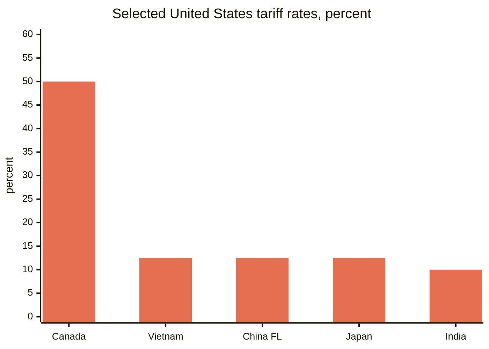

*Note: Canada = Section 338 rate (50%); Vietnam, China FL and Japan = Section 301 forced-labour rates (12.5%); India = Section 301 forced-labour rate in force (10%; the announced 18% deal rate was never applied). Sources: USTR, Troutman, BDO, Industrial Front.*

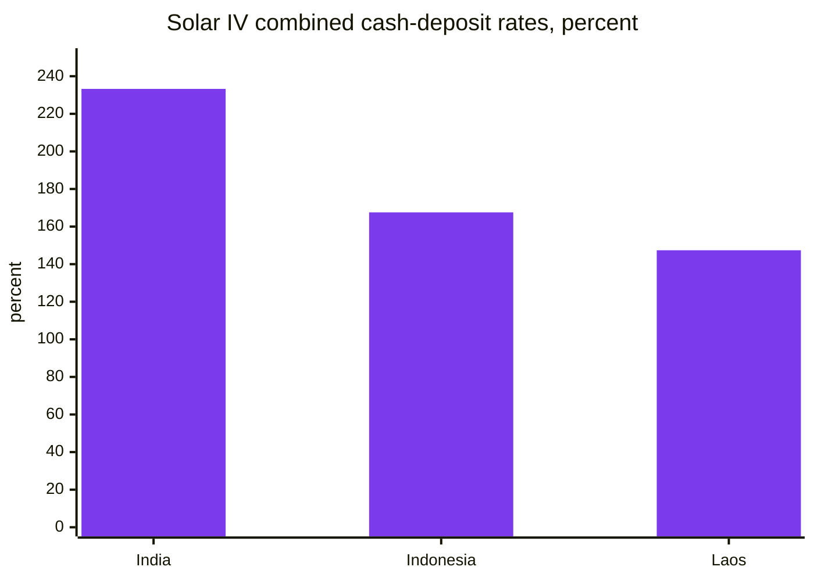

*Note: combined antidumping cash-deposit rate plus countervailing duty, all-others rates. India: AD 107.17% + CVD 126.09%; Indonesia: AD 94.36% + CVD 73.20%; Laos: AD 65.36% + CVD 82.03%. Source: Commerce AD/CVD orders, November 9, 2026.*

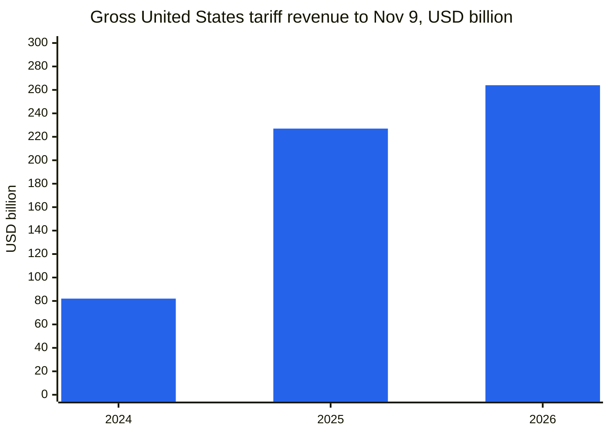

*Note: gross tariff and excise revenue collected in the calendar year to November 9, from daily United States Treasury statements as tracked by the Bipartisan Policy Center. Source: Bipartisan Policy Center via The Motley Fool, November 15, 2026.*

---

## 5. US policy deep dive

### Section 301 — the November 10 notices

USTR published a Notice of Product Exclusion Extensions on November 10, 2026 (91 FR 72610; FR Doc. 2026-22925), extending all 178 current exclusions from the China Section 301 (technology-transfer and intellectual-property) tariffs. The exclusions — 164 general exclusions under HTSUS 9903.88.69 and 14 solar-manufacturing exclusions under 9903.88.70 — had been scheduled to expire at 11:59 p.m. ET on November 9, 2026. The new window covers goods entered for consumption, or withdrawn from warehouse for consumption, on or after 12:01 a.m. ET on November 10, 2026, and before 11:59 p.m. ET on January 9, 2027. The scope of each exclusion is unchanged; each applies only to products matching the 10-digit HTSUS number and product description in the HTSUS notes. USTR did not solicit new comments, relying on the record from its September 2025 notice. A coalition of 24 industry associations had requested at least a one-year extension on November 4. Some reporting notes a discrepancy in the notice, with portions referring to January 10 rather than January 9; the operative date is January 9. USTR published a separate November 10 notice (91 FR 72608; FR Doc. 2026-22867) further suspending the Section 301 action on China's maritime, logistics and shipbuilding practices — including the covered vessel fees (Annexes I–III) and Annex V.A duties — effective November 10, 2026 through 11:59 p.m. ET on January 9, 2027. No party accrues liability for the fees during the suspension. USTR received about 60 unique comments on the proposal. The action had previously been suspended from November 10, 2025 through November 9, 2026.

USTR also determined to extend for three months its ongoing Section 301 investigation of certain acts, policies and practices of the Government of Vietnam related to intellectual-property protection and enforcement (docket USTR-2026-0364; FR Doc. 2026-22868; effective November 3, 2026). The investigation was initiated on May 29, 2026, after Vietnam was named a priority foreign country in USTR's 2026 Special 301 Report. Determinations on actionability and what action, if any, to take will now be made by no later than February 28, 2027, rather than the original November 29, 2026 deadline. USTR cited "complex or complicated issues that require additional time". Vietnam is also the subject of two other pending Section 301 investigations, concerning forced-labour import bans and structural excess capacity in manufacturing. Vietnam already faces a 12.5% Section 301 forced-labour tariff under HTSUS item 9903.05.04, effective July 24, 2026.

No final measures from USTR's Section 301 investigation of structural excess capacity in manufacturing had been released as of November 10, 2026. South Korean Industry Minister Kim Jung-kwan told a National Assembly committee on November 10 that Seoul was closely monitoring developments; the findings were reported to be more than two months behind the timetable South Korean officials expected. The investigation covers 16 economies including South Korea. South Korea is seeking to hold United States tariffs near 15%. Trade lawyers and analysts told Global Trade Review that the main near-term risk identified was this investigation, launched in March, covering China, Singapore, Switzerland, Norway, Indonesia, Malaysia, Cambodia, Thailand, South Korea, Vietnam, Taiwan, Bangladesh, Mexico, Japan and India, as well as the EU, with a decision due by March 2027.

### Section 232 — no new action; polysilicon due December 4

No new Section 232 proclamation or rate change was identified in the window. The Section 232 regime in force as of November 9, 2026, as summarised from the Harmonized Tariff Schedule and CBP guidance, is: steel, aluminium and copper at 50%, including many derivatives (other listed derivatives 25%; fixed industrial machinery, power and farm equipment and home heating, ventilation and air-conditioning equipment at 15% in total); semiconductors at 25% with listed exemptions; patented pharmaceuticals at 100% (generics not covered), with lower rates for some origins and companies; automobiles and parts at 15% to 25%; copper derivatives, trucks and truck parts, timber and lumber, polysilicon and drones each carrying their own rates and conditions. Polysilicon duties attach on December 4, 2026, and until then a BIS rule lets Commerce bar an importer bringing in substantially more than its historic volumes from further entries before December 4, unless Commerce grants a waiver. Robotics and industrial machinery have a threat finding under Proclamation 11077 of October 28, 2026, which directs negotiations and imposes no new tariff. The January 2027 calendar includes Section 232 rate rises on furniture and cabinets: upholstered furniture to 30% and kitchen cabinets and vanities to 50% from January 1, 2027.

### CBP — foreign importer of record; Form 5106 voiding

CBP published the interim final rule "Heightened Requirements for Foreign Importers of Record" (CBP Dec. 26-19, 91 FR 69977; FR Doc. 2026-22735) on November 6, 2026, implementing Section 2 of Executive Order 14411. From January 5, 2027, a foreign importer of record may enter merchandise for consumption only if it is itself CTPAT-validated or files through a CTPAT-validated licensed customs broker. A new Part 110 of the customs regulations defines a "U.S. IOR" (United States citizen or lawful permanent resident, or entity organised under United States law and located in the United States, with additional ownership or real-property conditions — for example, at least 51% beneficial ownership by United States citizens or lawful permanent residents with control, or direct ownership of significant unencumbered United States real property). United States or foreign importer status must be declared at entry and entry summary (new 19 CFR 141.21–141.22); brokers must verify clients' United States-importer status by reviewing records and retain verification records for five years; three new data fields were added to CBP Forms 3461 and 7501 (and electronic equivalents) via CSMS message. Brokers may request delayed compliance by January 5, 2027; all brokers are expected in full compliance by May 6, 2027. The rule also broadens circumstances under which brokers may face penalties under 19 U.S.C. 1592. Comments are due January 5, 2027 (docket USCBP-2026-1387). CBP's own analysis: 0.4% of foreign importers of record are CTPAT-validated and 68% already use a validated broker; the remaining 32% will not be able to continue importing into the United States unless they switch brokers or become CTPAT-validated themselves.

Separately, CBP sent letters to numerous CTPAT-certified importers stating that their importer-of-record numbers may be voided for entries filed from 12:01 a.m. ET on November 18, 2026 unless CBP's concerns about the accuracy of the importer's CBP Form 5106 information are resolved first (see A5). CBP's low-value shipments notice of proposed rulemaking of October 8, 2026 (91 FR 64532; docket USCBP-2026-0298) remains open, with comments due December 7, 2026. The proposal would require informal entries for goods up to $2,500 to be filed electronically on or before the date of importation, require a bond on every informal entry, and make the broker the importer of record when it files for a consignee that is not the owner or purchaser. The $800 de minimis exemption remains suspended indefinitely — for non-postal shipments from June 24, 2026 and for postal shipments from July 24, 2026. Separately, CBP moved the date from which a formal entry becomes mandatory for mail subject to Section 201, 232 or 301 duties or partner-government-agency requirements from October 22, 2026 to January 20, 2027.

### BIS export controls — Affiliates Rule suspended to January 10; suppressors move to Commerce control

BIS published a final rule (FR Doc. 2026-22793) extending the suspension of its interim final rule, "Expansion of End-User Controls to Cover Affiliates of Certain Listed Entities" (the Affiliates Rule), through January 10, 2027. The one-year suspension imposed in November 2025 (90 FR 50857) was set to end on November 9, 2026; the new rule took effect on November 9, 2026, so there was no gap. The Affiliates Rule, published September 30, 2025 (90 FR 47201), would expand export controls under the Export Administration Regulations to foreign entities owned 50% or more, directly or indirectly, individually or in aggregate, by one or more parties on the Entity List, the Military End-User List, or certain OFAC-designated parties. It also introduced a new red flag imposing a duty on exporters to resolve ownership questions where a foreign party is known to be partially owned by a listed entity. The extension does not withdraw or modify the rule. Absent further BIS action, the expanded controls take effect on January 10, 2027. The Federal Register notice gives no policy rationale beyond the date change; administration officials have indicated the extension is tied to the United States–China trade truce, also extended to January 10, 2027. BIS also announced that, as of November 20, 2026, exports of certain silencers, mufflers and sound suppressors move from the State Department's United States Munitions List to BIS Export Administration Regulations control; suppressors will be added to the Commerce Control List and BIS will require a licence for certain exports, reexports or in-country transfers, including releases of related software and technology to foreign persons. Licence exceptions currently available for firearms will also be available for suppressors.

### Federal Register — AD/CVD activity in the window

November 9: Commerce published final antidumping and countervailing duty orders on crystalline silicon photovoltaic cells and modules from India, Indonesia and Laos (see A7). November 10: Commerce preliminarily found that tin mill products from Taiwan and Türkiye are sold in the United States at less than fair value. Commerce set an antidumping rate of 18.07% for Taiwan's Ton Yi Industrial Corporation and for all other Taiwanese exporters. For Türkiye it set 3.89% for Tosyali and for all other exporters, and 42.06% for Tatrix International. Importers now owe cash deposits at these rates. The rates join preliminary rates Commerce set in September for China, of 136.52% for dumping and 66.61% for subsidies. The final dumping finding for Türkiye is due 75 days after the November 5 signature (January 19, 2027); for Taiwan, 135 days after the November 10 publication (March 25, 2027); China final findings are due by November 30, 2026 unless postponed. November 12: Commerce published final results in the antidumping administrative review of wooden cabinets, vanities and components from China (2024–2025 period), setting a 7.48% antidumping rate for the reviewed companies — Yixing Pengjia Technology, Jiangsu Xiangsheng Bedtime Furniture, Xiamen Golden Huanan and Zhongshan NU Furniture — applying to covered shipments entered or withdrawn for consumption on or after November 12, 2026. The China-wide cash deposit rate remains 251.64%. In the countervailing duty administrative review of wood mouldings and millwork products from China, Commerce set final CVD rates of 147.88% for Nanping Huatai Wood and Bamboo Co., Fujian Yinfeng Imp & Exp Trading Co. and Fujian Hongjia Craft Products Co., and 21.39% for non-selected companies under review, applying to covered shipments entered or withdrawn for consumption on or after November 12, 2026. Commerce intends to issue assessment instructions no earlier than 35 days after publication (December 17, 2026) in each case.

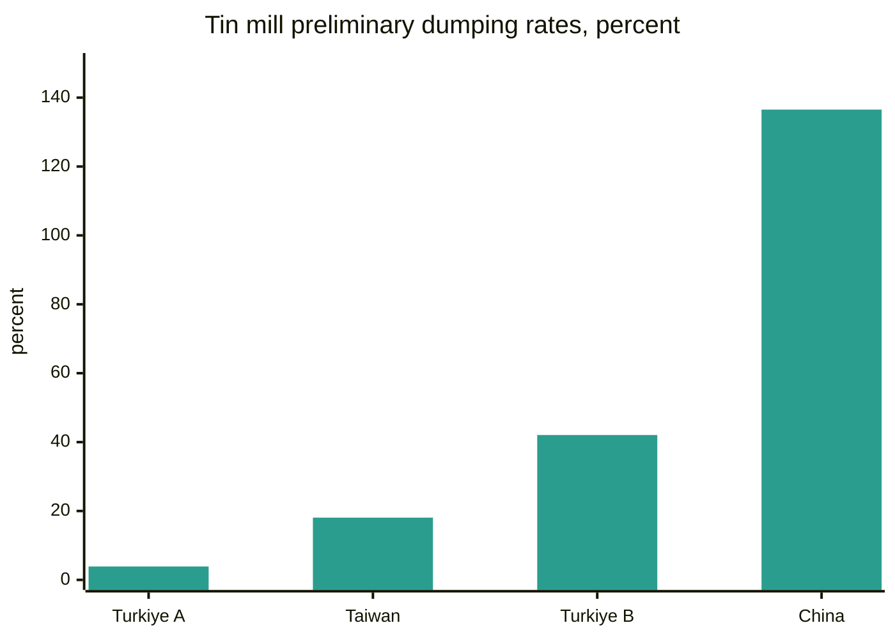

*Note: Turkiye A = Tosyali and all other exporters (3.89%); Turkiye B = Tatrix International (42.06%); China = September preliminary rate (136.52%). Source: Commerce preliminary determinations, November 10, 2026.*

### Standing items

- **UFLPA / Entity List:** no new UFLPA Entity List additions or new withhold release orders were identified in the November 9–16 window. The most recent Entity List additions (43 companies) were announced July 31, 2026; CBP's current forced-labour operational guidance for importers dates from June 2026. CBP's most recent stated enforcement totals, from the Serbia Zijin release, were 56 WROs and eight Findings under 19 U.S.C. § 1307; later reporting put the total at 60 WROs and eight Findings after two further orders on September 29, 2026.
- **White House:** no new tariff proclamation or fact sheet was issued in the window.
- **USITC / HTS:** no new HTS rate changes were identified in the window beyond the Solar IV orders. The USITC's full public report on Solar IV (USITC Publication 5804) is due on the USITC website by November 23, 2026.
- **trade.gov / market intelligence:** no new market-intelligence release specific to United States tariff policy was identified in the window.
- **internationaltradetoday.com:** paywalled; headlines confirmed the CBP foreign importer-of-record rule story (November 5).

---
## 6. World policy by region

### Europe

The EU's low-value e-commerce reset is now in force (see 3.3): a €2 handling fee per item line and mandatory Product Identifiers from November 1, on top of the €3 flat duty per tariff line in force since July 1, 2026. On November 9 the Council agreed to remove the €150 ceiling from the VAT Import One-Stop Shop, applicable from July 1, 2028. EU customs tariff (TARIC) activity in the week of November 1–7 was dominated by forward staging rather than new protective duties: 15,055 change records were processed, of which more than 13,600 were future-dated measures pre-positioning preferential access and autonomous quotas extending into 2027. On November 6, over 2,500 future-dated records established autonomous tariff quotas scheduled to enter into force on January 1, 2027, including large-scale quotas for the seafood processing sector. Immediate turnover was concentrated on November 1, when 5,405 of the 6,238 measures taking effect during the week entered into force. Technical trade-defence realignments, concentrated on November 3, recalibrated measure boundaries for bulk PVC, suspension PVC, aspirin and other polymers and specialty chemicals. The pattern indicates an administrative posture focused on staging 2027 access rather than imposing new duties, but the trade-defence scope changes alter the coverage of existing measures on polymers and chemicals and require declaration accuracy from importers.

The EU–India free trade agreement is reported to be signed in Brussels in mid-December 2026 (see 3.3). The EU–Mexico modernised trade agreement was formally signed on May 22, 2026 and awaits ratification by the European Parliament before entry into force. The EU agreements with Indonesia and Australia are each expected to be signed before the end of 2026. The EU–Mercosur interim agreement has been provisionally in force since May 1, 2026.

**Sources:** [RegFollower](https://regfollower.com/eu-forward-staging-and-trade-defence-realignment-mark-the-november-tariff-turn/); [Flex Logistics](https://flexlogistics.eu/eu-trade-deals-online-sellers/)

### United Kingdom

Trade remedies notice 2026/31 gives effect to the Secretary of State's acceptance of the Trade Remedies Authority's recommendation in expiry review ER0080, initiated on January 22, 2026. The countervailing duty on rainbow trout originating in Türkiye, covering live, fresh, chilled, frozen and smoked fish within size limits set out in the notice and classified under headings 0301, 0302, 0303, 0304 and 0305, is extended for five years to January 30, 2031 at the existing rates, with no recalculation. The notice took effect on November 6, 2026, with the variation applying from January 30, 2026, and supersedes taxation notice 2021/12. Exporter-specific rates range from 1.5% to 8%; two groups of listed exporters pay 6.9% and 7.6%; all other exporters pay 9.5%.

HM Revenue and Customs updated its policy summary for the UK Carbon Border Adjustment Mechanism on November 2, adding information on calculating Carbon Price Relief. This was the third update this autumn, following updates on September 9 and October 16, 2026 that reflected the laying of the Carbon Border Adjustment Mechanism (Emissions and Verification) Regulations 2026. The summary confirms the UK CBAM will commence on January 1, 2027 and will apply to specified aluminium, cement, fertiliser, hydrogen, and iron and steel goods identified by commodity code. With under two months to commencement, importers of the covered goods need to confirm their commodity codes, emissions data and Carbon Price Relief calculations before the mechanism starts charging.

The Department for Business and Trade released its regular bilateral trade and investment factsheets on November 6, including for Qatar. Total trade in goods and services between the UK and Qatar was £5.4 billion in the four quarters to the end of Q2 2026, a decrease of 7.2% or £416 million from the four quarters to the end of Q2 2025. UK exports to Qatar were £3.9 billion (down 10.3%, or £447 million) and imports from Qatar were £1.5 billion (up 2.1%, or £31 million). Qatar was the UK's 47th largest trading partner, accounting for 0.3% of total UK trade.

**Source:** [Global Customs Compliance](https://www.globalcustomscompliance.com/trade-and-customs-watch-2026-11-13/?utm_source=rss&utm_medium=rss&utm_campaign=trade-and-customs-watch-2026-11-13)

### Canada

Finance Minister François-Philippe Champagne announced changes to Canada's tariff relief measures on November 9 (see 3.7): the horizontal remission for United States tariffs extended by one year to June 30, 2028, with relief now also including non-steel goods used in mining, quarrying or the extraction of oil and gas, and all goods used by public education entities, including those mandated by Indigenous organisations; relief removed for certain trailers from December 1, 2026 and for certain aluminium wire and extrusions and paperboard products from February 1, 2027. The changes sit on top of counter-tariffs of 15% to 50% on a range of United States imports imposed on September 8, 2026. The Canada Border Services Agency updated Customs Notice 26-07 on November 2, extending scheduled goods remission to Schedules 1 to 3, introducing special authorisation codes for Schedules 2 and 3, and clarifying eligibility conditions; it also removed Appendix A, which had provided additional guidance on wind tower remission. Minister of Commerce Wang Wentao and Canada's Minister of International Trade Maninder Sidhu co-chaired the 29th meeting of the China–Canada Joint Economic and Trade Commission in Beijing on November 3; the substance of any outcomes was not verifiable from the material reviewed.

**Sources:** [Department of Finance Canada](https://www.canada.ca/en/department-finance/news/2026/11/canada-modifies-tariff-relief-measures-to-better-support-workers-and-businesses.html); [GHY](https://www.ghy.com/trade-compliance/category/canada-imports/)

### China

China's side of the truce extension is covered in sections 2 and 3.1. MOFCOM's English-language site (english.mofcom.gov.cn) was reachable on November 16; only front-page headlines were visible, including a spokesperson's remarks on adjustment measures concerning the Unreliable Entity List and the listing of the 29th China–Canada Joint Economic and Trade Commission meeting. The substance of MOFCOM's response to the EU €2 fee at a press briefing in the same period was not verifiable from the material reviewed.

### India and New Zealand

The India–United States interim deal remains unsigned (see A10 and 3.2). The EU–India agreement is reported to be signed in mid-December (see 3.3). India and the EU also continued implementation talks in Brussels in early November. Commerce Minister Piyush Goyal said on November 3 that India has never opened its dairy sector in any free-trade agreement and will not allow imports of genetically modified products, a red line relevant to every live FTA track.

### Asia-Pacific — Korea and Brazil

President Lee Jae-myung urged his government at a cabinet meeting on November 3 to move quickly on talks with Brazil over the 25% tariff Brazil imposes on Korean cosmetics, saying the levy was a barrier to a sector with strong local demand for Korean-made products. He said shifting production to Brazil would not solve the problem, citing strong local consumer preference for cosmetics made in Korea, and asked Foreign Minister Cho Hyun about the status of the talks. Cho indicated the talks could now advance following President Lula's re-election in the October 25 runoff. The intervention turns a sectoral tariff into a presidential-level bilateral issue ahead of Brazil's new term.

Korean consumer-goods companies signed $18 million in export contracts and memoranda of understanding at the Korean Wave Expo and Australia K-Food Fair held in Melbourne on November 5–7, co-hosted by the Ministry of Trade, Industry and Energy and the Ministry of Agriculture, Food and Rural Affairs and organised by KOTRA and the Korea Agro-Fisheries & Food Trade Corporation. The export consultation event involved 101 Korean companies and 144 buyers from Oceania and Southeast Asia, conducting 1,235 consultations and resulting in 32 contracts and MOUs. Korean cosmetics exports to Australia rose from $73 million in 2023 to $112 million in 2024 and $166 million in 2025, supported by tariff reductions under the Korea–Australia Free Trade Agreement in force since December 12, 2014.

**Sources:** [SE Daily](https://en.sedaily.com/politics/2026/11/03/lee-presses-brazil-to-cut-25-percent-tariff-on-korean); [Aju Press](https://www.ajupress.com/view/20261108110470271)

### Multilateral

**World Trade Organization.** At its November 4–6 meeting, the WTO Committee on Sanitary and Phytosanitary Measures reviewed specific trade concerns, transparency, mentoring and capacity-building. The Secretariat reported that 55 specific trade concerns were resolved and 19 partially resolved following its 2026 monitoring exercise, which involved contacting 39 members about concerns not raised since November 2024, with responses from 25 members. The November meeting considered 78 specific trade concerns, including five raised for the first time, covering pesticide residue limits and other regulatory measures in the European Union, import restrictions affecting meat products in Colombia, delays in approving Paraguayan beef exports to Japan, and restrictions on Chilean poultry products linked to avian influenza. 63% of the 640 specific trade concerns discussed since 1995 have been resolved (326) or partially resolved (75). The Committee on Agriculture, in special session, held two presentations on November 3 reviewing the evolution of agricultural trade negotiations since the Uruguay Round, covering export competition and public food stockholding by developing-country governments at administered prices. The next meeting, scheduled for November 23, 2026, will cover export restrictions and the special safeguard mechanism. On November 16, the WTO agreed to establish a dispute settlement panel to review China's complaint against India's tariffs on certain technology products and incentive schemes for the domestic solar manufacturing sector, following China's second request for a panel. Bilateral consultations failed to produce a settlement; India had blocked China's initial request in May 2026. The panel will examine compliance with the General Agreement on Tariffs and Trade, the Agreement on Subsidies and Countervailing Measures and the Agreement on Trade-Related Investment Measures. On October 30, WTO members adopted a declaration repositioning the Aid for Trade Initiative as "Aid for Trade: partnerships for trade and development" at a meeting of the Committee on Trade and Development, concluding the two-day 10th Global Review of Aid for Trade in Geneva — the first multilateral outcome on the topic in 20 years. Director-General Ngozi Okonjo-Iweala gave the keynote at an event on trade, biodiversity and the ocean economy on November 5, putting the ocean economy at US$2.6 trillion, supporting around 133 million jobs, and noting that more than 80% of globally traded goods travel by sea and that 72% of world goods trade still takes place on most-favoured-nation terms. She pointed to the Agreement on Fisheries Subsidies, in force since September 2025, and urged members to complete the remaining negotiations.

**UN Trade and Development (UNCTAD).** UNCTAD released its Global Trade Update (November 2026) on November 9, timed to COP31 in Antalya, Türkiye (November 9–20), examining how trade can support climate action. The report finds climate-related provisions are becoming more common in trade agreements, appearing in more than half of agreements signed between 2016 and 2021, but implementation remains limited: only 7% of climate-related provisions identified in recent trade agreements address reducing tariff and non-tariff barriers. Of 174 countries surveyed in 2025, only seven reported fully implementing trade facilitation measures for green and climate-relevant goods. Global exports of goods linked to solar and wind energy value chains exceeded $1.8 trillion in 2025, growing faster than exports of other manufactured goods; battery trade rose 29% and electric vehicle trade 11% in the first half of 2026; developing economies exported $1.3 trillion in biodiversity-based goods in 2024, $1.2 trillion in ocean goods and services in 2025, and an estimated $204 billion in non-plastic substitutes in 2024. The report identifies affordable access to climate technologies as essential for adaptation and emissions reduction. A report on developing the capacity to export to the Chinese market, written by the Institute of World Economics and Politics of the Chinese Academy of Social Sciences (CASS) and UNCTAD, was presented in Shanghai on November 5 at the 9th Hongqiao International Economic Forum, held alongside the China International Import Expo. The report analyses 10 trade partners, including Colombia, Kenya, Spain, Thailand and the United Kingdom; China's share of world exports rose from 3.2% in 2000 to 9.2% in 2025, according to the institute's director general.

**International Trade Centre (ITC).** The International Trade Centre and the African Export-Import Bank launched the report "Reshaping Africa-Caribbean Trade: Opportunities for Economic Transformation" in St John's, Antigua and Barbuda, on November 3, on the sidelines of the Commonwealth Heads of Government Meeting. The report finds annual trade in goods and services between Africa and the Caribbean could reach up to $1.65 billion by 2030, excluding mineral fuels. Around 80% of Africa's annual goods export potential to the Caribbean remains untapped, while Caribbean export potential lies mainly in services, reaching $481 million. Priority sectors include processed food and animal feed, chemicals, minerals and metals, apparel and textiles, leather and footwear, tourism, transport services and creative industries. The findings rest on trade and export-potential analysis, sector assessments and a survey of 1,175 businesses and business support organisations across both regions.

**World Customs Organization (WCO).** On November 3 the WCO held a hybrid symposium at its Brussels headquarters on the role of customs in disaster relief, with more than 190 participants from customs administrations, international organisations and humanitarian and logistics practitioners; Secretary General Ian Saunders linked the discussion to the WCO's 2026 theme, "Customs protecting society through vigilance and commitment". On November 5 the WCO published its 2025–2026 Annual Report. On November 9 the WCO held a Smart Customs Project global event on disruptive technologies, and on November 11 a symposium on removing counterfeits from e-commerce, with customs administrations, the Universal Postal Union and eBay among the participants. On November 12 the WCO reported support for East African Community countries in revising rules of origin and developing autonomous training capacities, and on November 13 the Secretary General met the Director General of the World Organisation for Animal Health on the sidelines of the WCO Counterfeiting and Piracy Group meeting to reaffirm cooperation against illicit trade.

**Sources:** [Logistics News PH](https://logisticsnews.ph/2026/11/12/wto-sps-committee-reports-progress-in-resolving-trade-concerns/); [India ReNews](https://indiarenews.in/blog/read/wto-sets-up-dispute-panel-to-examine-china-s-challenge-against-india-s-solar-incentives-and-technology-tariffs); [UNCTAD](https://unctad.org/publication/global-trade-update-november-2026); [WCO](https://www.wcoomd.org/en/media/newsroom/2026/november.aspx)

---

## 7. Enforcement actions

### Antidumping and countervailing duties

Commerce's final AD/CVD orders on solar cells from India, Indonesia and Laos (see A7) and the preliminary tin mill rates for Taiwan and Türkiye and the wooden-cabinet and millwork review results (see section 5) were the week's trade-remedy actions. The solar orders are the largest AD/CVD action in the window by rate, with combined cash-deposit rates above 100% of entered value in each case. The tin mill preliminary rates set cash-deposit costs for Taiwanese and Turkish suppliers while the China case, with far higher rates (136.52% dumping, 66.61% subsidies in September), approaches its final determination on November 30. The wooden-cabinet and millwork reviews reset cash-deposit rates for the named Chinese furniture and millwork exporters while leaving the very high China-wide rate (251.64%) in place, preserving a large duty gap between reviewed and non-reviewed suppliers.

### CBP seizures and forced labour

CBP officers at the DeConcini Crossing, Port of Nogales, referred a 36-year-old male United States citizen driving a 2006 Nissan Titan returning from Mexico for secondary inspection on November 3. A physical inspection of plastic folding chairs in the bed of the truck found more than 300 packages containing fentanyl concealed inside the chairs. The vehicle and the narcotics were seized; Homeland Security Investigations special agents responded to the port of entry, and the case is pending further investigation. More than 112 pounds of fentanyl were seized. No new Withhold Release Order was identified in the coverage window. The most recent WROs in CBP's releases before the window were the Indonesian palm-oil orders and the Serbia Zijin Copper order of June 16, 2026. The absence of a new WRO in the window, after a series of orders in the summer and autumn, is itself a data point for forced-labour enforcement cadence; importers should not read it as a change in policy.

A Hawaii man was sentenced on November 12 to 24 months in prison and fined $15,000 for transferring funds to Iran without an OFAC licence. Arash Einolghozati, 38, of Waialua, Oahu, was sentenced by Senior United States District Judge Helen Gillmor to 24 months in prison, followed by three years of supervised release. According to court records, beginning as early as March 2026 and continuing until at least April 2022 (as stated in the Justice Department release), Einolghozati made multiple transfers of government-issued currency and cryptocurrency from within the United States to recipients he knew were in Iran or who would further transfer the funds to individuals in Iran, knowing it was unlawful to do so without a licence from the Treasury Department's Office of Foreign Assets Control. The total transferred was more than $226,000. The FBI investigated the case. The case shows criminal enforcement of Iran sanctions reaching individual remitters using both cash and cryptocurrency, and it follows Treasury's Operation Economic Outcast campaign against Iran-related financial channels.

**Sources:** [CBP](https://www.cbp.gov/newsroom/local-media-release/cbp-officers-seize-112-pounds-fentanyl-nogales-port-entry); [US Department of Justice](https://www.justice.gov/usao-hi/pr/north-shore-man-sentenced-two-years-prison-sending-money-iran-violation-us-sanctions)

### Sanctions

OFAC designated an alleged network of fraudulent maritime flagging and registration companies that facilitated Iranian oil exports, under Executive Order 13902, in an action announced November 4. The network was led by Indian nationals Suniel Kumar Sharma and Jaspreet Preeti Shahid, based in Chandigarh, India, who operated companies posing as flag registries and maritime service providers for countries and jurisdictions including Guyana, Eswatini, Laos, Aruba, Mali, Mozambique, Malawi, Sint Maarten and Timor-Leste. The companies sold fraudulent registrations and certificates to vessels carrying Iranian petroleum, including vessels operating on behalf of Iran's military and its proxies. OFAC designated four individuals and nine entities in the network, and also sanctioned Türkiye-based Fugo Ground Services Inc. for activity in Iran's aviation sector. OFAC issued an alert alongside the designations, "Iranian Shadow Fleet Reliance on False Flags for Sanctions Evasion", warning commercial actors to avoid ships using suspicious flag registries. The same action added the notation "Secondary sanctions risk: See Section 2 of E.O. 13902" to more than 1,000 existing entries on the Specially Designated Nationals and Blocked Persons List.

The Department of State designated eight entities and two individuals, and identified five vessels as blocked property, under Executive Order 14404 (May 1, 2026), in an action announced November 5. The targets include Guillermo Faustino Rodriguez Lopez Calleja, part of a network of maritime shipping companies moving petroleum products to and from Cuba; Any Rodriguez Lastres, daughter of GAESA President Ania Guillermina Lastres Morera; Cyprus-based Caroil Transport Marine Ltd; and China-based China National Electronic Import and Export Company (CEIEC) and Beijing H&C Technologies Co. Ltd, described as suppliers of the regime's military forces. The five vessels identified as blocked property are ESPERANZA, GLORIA C, MARIA CRISTINA, EMILIA and LOURDES. On the same day, OFAC Director Bradley T. Smith issued a determination that the sector-based sanctions authority in Section 2(a)(i)(A) of E.O. 14404 applies to the electronics, manufacturing, marine and technology sectors of the Cuban economy. Those four sectors join the five named in the Executive Order itself: energy, defence and related materiel, metals and mining, financial services, and security. Any foreign person determined to operate or have operated in the four new Cuban sectors is now exposed to blocking sanctions.

The Department of State designated three persons under Executive Order 13949 on November 4 for Iran's pursuit of man-portable air-defence systems (MANPADS): Mohammed Ali Tolibov, who runs Armory Alliance, a Belarus-based middleman linking China-based firms with Iran; Vanguard Tactical Supply Limited, a Nigerian company alleged to have used false end-users to steer Chinese-origin MANPADS towards Iran; and Alisher Domullodzhanov, based in Russia, accused of assisting Iran's search for the launchers. Assets of the three in the United States, or held by United States persons, are frozen and must be reported to OFAC.

The Financial Crimes Enforcement Network (FinCEN) issued an order on November 6 prohibiting United States financial institutions from engaging in any transmittal of funds from or to MEXC Global, a Seychelles-based cryptocurrency exchange, having determined it is a financial institution of primary money-laundering concern in connection with Russian illicit finance. FinCEN said MEXC Global facilitated at least $16.7 billion in transactions linked to sanctions evasion, cybercrime and other illicit activity between May 2021 and May 2026, processed transactions involving sanctioned Russian entities including the exchange Garantex and its successor Grinex, processed more than $1 billion in direct transactions with Iranian cryptocurrency exchanges including sanctioned exchanges, and facilitated approximately $22 million in transactions linked to the Central Bank of Iran, the Islamic Revolutionary Guard Corps and its Qods Force. The order cuts a crypto exchange used for Russian and Iranian sanctions evasion out of the United States financial system, and is relevant to trade-finance and payments compliance for counterparties using crypto rails.

**Sources:** [Steptoe](https://www.steptoe.com/en/news-publications/stepwise-risk-outlook/sanctions-update-november-9-2026.html); [US Department of State](https://www.state.gov/releases/office-of-the-spokesman/2026/11/further-sanctions-on-the-cuban-regimes-foreign-military-support-and-illicit-revenue-networks-fact-sheet/)

---
## 8. Data releases

### China — October 2026 foreign trade

China's General Administration of Customs released preliminary October 2026 trade figures on November 10. In United States dollar terms, October exports rose 35.2% year on year to $412.3 billion and imports rose 41.6% to $307.1 billion. In yuan terms, October exports rose 28.7% to 2.79 trillion yuan and imports rose 34.7% to 2.08 trillion yuan. Total goods trade in January–October reached 44.81 trillion yuan, up 20% year on year. The October goods surplus was $105.3 billion, down from $133.5 billion in September 2026; the January–October cumulative surplus reached $1,042.6 billion. January–October exports of $3,782.8 billion already exceed full-year 2025 exports of $3,771.9 billion, as reported. Integrated-circuit exports more than doubled in January–October to $341.1 billion, up 111.1% year on year (from $161.6 billion); integrated-circuit imports were $566.5 billion, up 65.1%. January–October exports in yuan terms were 25.99 trillion yuan, up 17.6%; imports were 18.82 trillion yuan, up 23.6%; mechanical and electrical products accounted for 16.81 trillion yuan of exports, up 25.2%, or 64.7% of the total. Trade with ASEAN grew 24.2%, with the EU 8.5% and with the United States 6.3% over January–October (yuan basis, as reported). GACC noted the figures are preliminary and that its monthly bulletin is more accurate.

**Source:** [NGlobe News](https://www.nglobenews.com/en/article/china-october-trade-surplus-1-trillion-2026-11-10/)

### India — October 2026 foreign trade

India's Commerce Ministry released quick estimates for October 2026 on November 13. Merchandise exports rose 45.06% year on year to a record $49.47 billion, while merchandise imports reached a record $89.35 billion, leaving a merchandise deficit of $39.88 billion — wider than September's $30.21 billion but narrower than October 2025's $42.58 billion. Including services, overall exports reached $89.99 billion and the overall deficit narrowed to $20.09 billion. Petroleum imports rose 54.31% year on year to $22.82 billion, and gold imports rose to $5.51 billion from $1.8 billion in September, ahead of Diwali. The ministry identified petroleum products, electronic goods, gems and jewellery, organic and inorganic chemicals, and engineering goods as drivers of export growth. Services exports were $40.51 billion; services imports $20.72 billion (estimates). April–October 2026–27 merchandise exports were $309.06 billion (from $253.40 billion a year earlier); overall exports $568.84 billion, up 16.66%; overall imports $662.19 billion, up 16%.

**Source:** [GuruTrade](https://www.gurutrade.com/news/india-oct-trade-deficit-hits-1-yr-high-of-39-88b-on-gold-1794605244.html)

### Euro area and Germany

Eurostat published first estimates of September 2026 goods trade on November 13. The euro area recorded a €10.3 billion deficit with the rest of the world, compared with a surplus of €13.5 billion in September 2025 and a deficit of €16.6 billion in August 2026. The EU recorded a €16.8 billion deficit, compared with a surplus of €11.4 billion a year earlier. Eurostat attributed much of the deterioration to energy, where the euro area deficit widened to €33.0 billion from €20.7 billion, and to a narrowing machinery-and-vehicles surplus, to €3.0 billion from €10.0 billion. Euro area exports were €272.7 billion, up 6.0% year on year; imports €283.0 billion, up 16.1%. The January–September 2026 euro area balance was –€36.5 billion, against +€102.2 billion in the same period of 2025; exports €2,263.4 billion (up 2.4%); imports €2,299.9 billion. The EU January–September deficit was €83.2 billion, against a surplus of €85.5 billion in the same period of 2025. Figures are provisional, based on information transmitted by member states before November 10, 2026.

Germany's Federal Statistical Office (Destatis) published provisional September 2026 foreign trade figures on November 9 (press release No. 390). On a calendar- and seasonally-adjusted basis, exports rose 2.0% from August and imports rose 4.2%. Exports to EU countries rose 3.5% on the month, while exports to non-EU countries rose 0.1%. Exports were €141.1 billion (up 2.0% month on month; up 7.7% year on year); imports €125.5 billion (up 4.2% month on month; up 8.7% year on year); the foreign trade balance was a surplus of €15.6 billion, down from €17.9 billion in August 2026 and broadly unchanged from €15.5 billion in September 2025. Unadjusted exports were €148.5 billion; unadjusted imports €131.1 billion; unadjusted surplus €17.4 billion. Destatis said detailed results would follow on November 20, 2026 and that, at this stage, it could not provide information on the reasons for changes in trade with individual countries or groups of countries.

**Sources:** [Eurostat](https://ec.europa.eu/eurostat/en/web/products-euro-indicators/w/6-13112026-bp); [Destatis](https://www.destatis.de/EN/Press/2026/11/PE26_390_51.html)

### Japan — October 2026 trade, first 20 days

Japan Customs published provisional figures for the first 20 days of October 2026 on November 10. Exports rose 23.5% year on year to ¥7,314.7 billion, but imports rose 32.4% to ¥8,125.1 billion, widening the deficit to ¥810.4 billion, compared with ¥216.6 billion a year earlier. The release publishes totals only, with no breakdown by partner or commodity. The provisional partial-month figures point to a wider full-month October deficit, driven by import growth outpacing export growth; the full-month release, due the following week, will show whether the pattern held for the whole month.

**Source:** [Kilambi](https://news.kilambi.com/stories/2026-11-09-japan-trade-deficit-widens-october-first-20-days/)

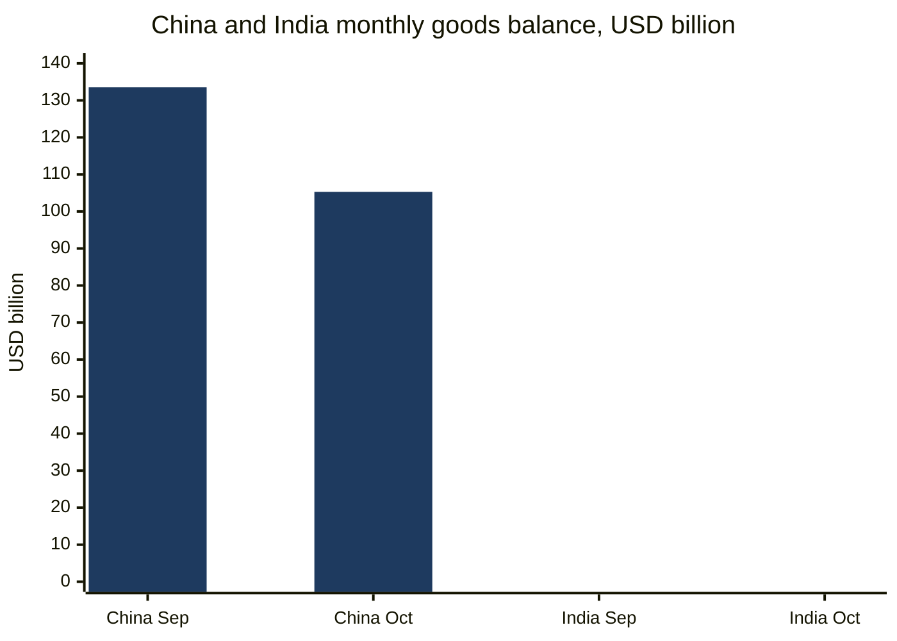

*Note: China monthly goods surplus: September $133.53 billion, October $105.3 billion. India monthly merchandise deficit: September $30.21 billion, October $39.88 billion. Sources: GACC, India Commerce Ministry.*

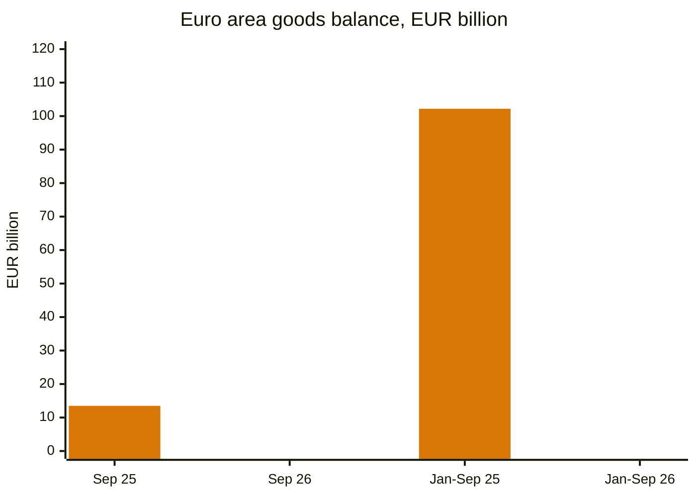

*Note: euro area goods balance: September 2025 +€13.5 billion, September 2026 –€10.3 billion; January–September 2025 +€102.2 billion, January–September 2026 –€36.5 billion. Source: Eurostat, November 13, 2026.*

### Think tanks

Following the midterm elections, reporting on November 5–10 drew on the Yale Budget Lab and the Tax Foundation to quantify the cost of United States tariffs (see 3.2). The Budget Lab's count of November 2 put the average United States statutory tariff rate at 11.8%, rising to 11.9% by the end of the year under current law, with a cost of about 0.7% on United States consumer prices, or about $900 per household a year. The Tax Foundation estimates tariffs will raise taxes by an average of $820 per household in 2026 (model dated August 2026), while the Budget Lab put the burden at about $1,100 per household in a report dated August 24, 2026. The two figures use different methods: the Tax Foundation's $820 reflects 2026 based on what is actually imported, while Yale's $1,100 assumes current tariffs stay in place at fixed import weights. Tax Foundation senior economist Erica York wrote on October 7 that repealing all tariffs imposed since 2017 would cost nearly $1.8 trillion over a decade, and that a broad-based value-added tax of 1% would raise enough to replace it. The Budget Lab's executive director, Martha Gimbel, told Marketplace on November 5 that tariffs bring in almost $2 trillion over ten years. Net customs duties totalled $173.2 billion in fiscal 2026, according to the Treasury Department. No new trade-policy item from tradeintelligence.eu was identified in the coverage window through web search.

**Sources:** [Geopolitiqs](https://www.geopolitiqs.com/tn/2026-11-09/tariffs-average-rate); [Dave Manuel](https://www.davemanuel.com/2026/11/06/what-happens-to-tariffs-now-that-democrats-control-congress/)

### Data portals

No major new in-window releases were identified from USITC DataWeb, UN Comtrade, WITS, World Bank or IMF portals.

---

## 9. Freight market

### Container spot rates — Drewry World Container Index

Drewry's assessment for Thursday, November 12, 2026, recorded a 2% weekly decline in the composite index to $4,305 per 40ft container, its second consecutive weekly decline, on weak demand across the transpacific and Asia–Europe/Mediterranean routes. On the transpacific, Shanghai–New York fell 3% to $9,020 per 40ft, the lowest since August 2026, and Shanghai–Los Angeles fell 2% to $7,416, the lowest since September 2026. On Asia–Europe/Mediterranean, Shanghai–Rotterdam fell 3% to $3,504, while Shanghai–Genoa was unchanged at $4,168. Carriers announced eight blank sailings for the following week on the transpacific, compared with four this week (eight versus five on Asia–Europe/Mediterranean), and announced higher Freight All Kinds rates and Peak Season Surcharges on Asia–Europe/Mediterranean effective in the second half of November. Drewry expects transpacific rates to fall further next week and Asia–Europe/Mediterranean rates to increase slightly. Congestion at Shanghai port rose to 49 hours last week, from 36 hours the previous week. Fifty-three vessels transited the Suez Canal last week, while one vessel transited the Strait of Hormuz.

**Source:** [Drewry](https://www.drewry.co.uk/supply-chain-advisors/supply-chain-expertise/world-container-index-assessed-by-drewry)

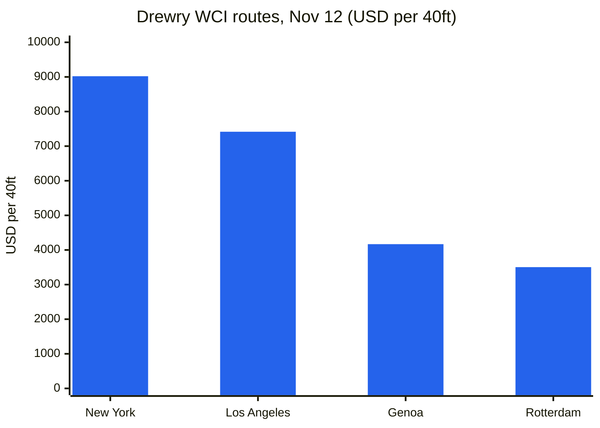

*Note: all routes from Shanghai. Shanghai–New York $9,020; Shanghai–Los Angeles $7,416; Shanghai–Genoa $4,168; Shanghai–Rotterdam $3,504. Composite index $4,305 per 40ft, down 2% week on week. Source: Drewry, November 12, 2026.*

### Freightos Baltic Index

Freightos reported in its November 10 weekly update that the global index fell 2% to $3,452 (prior reading $3,513), with Asia–North Europe down 5% and the transpacific lanes lower after November general rate increases failed to hold. Asia–US West Coast prices (FBX01 Weekly) decreased 1% to about $8,200 per FEU; Asia–US East Coast (FBX03 Weekly) decreased 2% to about $9,700 per FEU; Asia–North Europe (FBX11 Weekly) decreased 5% to $3,400 per FEU, up 50% year on year; Asia–Mediterranean (FBX13 Weekly) decreased 1% to $4,300 per FEU, up 88% year on year. The second consecutive weekly decline in the global index, alongside Drewry's, confirms that the November rate increases did not hold, while rates remain well above year-earlier levels on Asia–Europe lanes. The ILWU Local 26 watchmen union extended its strike deadline at the ports of Los Angeles and Long Beach to November 20 to allow more time for negotiations. The National Retail Federation reported United States ocean import volumes peaking at just below record levels in September at 2.37 million TEU, easing an estimated 5% in October, with November projected down 14% from the September high.

**Source:** [Freightos](https://www.freightos.com/freight-resources/la-lb-strike-deadline-extended-dem-win-increasing-trade-uncertainty-november-10-2026-update/)

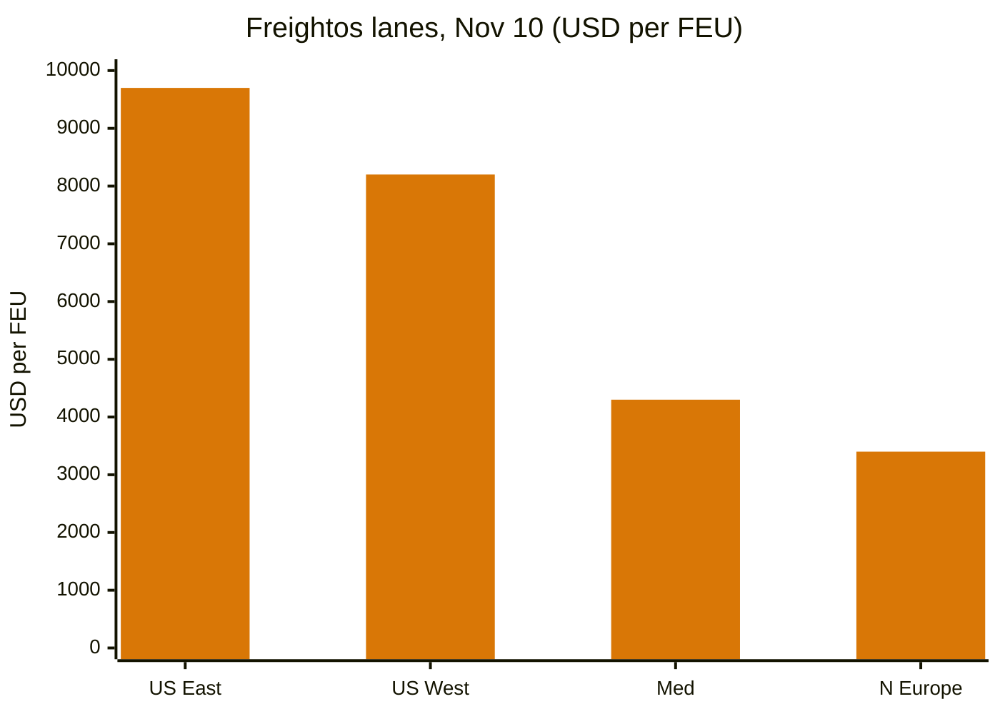

*Note: Asia–US East Coast about $9,700 per FEU; Asia–US West Coast about $8,200; Asia–Mediterranean $4,300; Asia–North Europe $3,400. Global index $3,452, down 2% week on week. Source: Freightos, November 10, 2026.*

### November rate increases — announced, already discounted

Transpacific ocean rates fell slightly in the week to November 12 as carriers' planned general rate increases failed to take hold, but remained around peak-season levels. Carriers had sought increases of $2,000–$3,000 per FEU for November, and filed further increases for November 15–16, but forwarders cited improving space availability and more consistent vessel schedules. Asia–Europe rates also eased: North Europe prices fell 5% in the week to $3,400 per FEU, while Mediterranean rates declined 1% to $4,300 per FEU. The Shanghai Containerized Freight Index fell 61.12 points to 3,572.33 on November 13, its second consecutive weekly decline, as United States-bound rates fell and Mediterranean rates rose. Shanghai–US East Coast rates fell $470 to $9,387 per 40ft container, Shanghai–US West Coast fell $270 to $7,111, and Shanghai–Europe fell $77 to $3,402 per 40ft, while Shanghai–Mediterranean rose $380 to $4,746 per 40ft.

**Sources:** [FreightWaves](https://www.freightwaves.com/news/us-midterm-shift-adds-trade-uncertainty-as-trans-pacific-ocean-freight-rates-stay-elevated); [ShipUniverse](https://www.shipuniverse.com/news/container-freight-rates-split-as-u-s-east-coast-drops-470-as-mediterranean-surges-6-7/)

### Blank sailings and capacity

Drewry's cancelled-sailings tracker projected 52 blank sailings out of 716 scheduled services on major East–West trades between November 16 and December 21, about 7% of planned departures. Carriers announced eight blank sailings for the following week on the transpacific, compared with four this week, and eight on Asia–Europe/Mediterranean against five. The scale of planned blank sailings shows carriers acting to limit capacity into December as November rate increases failed to hold.

### Dry bulk — Baltic Exchange

The Baltic Dry Index rose 6.2% over the week to 2,980 points on November 13, its fourth consecutive weekly gain, even as it fell on Friday to end a seven-session winning streak. The index rose through the week — 2,854 on November 9, 2,862 on November 10, 2,959 on November 11 and 3,020 on November 12 — before falling 40 points, or 1.3%, on Friday November 13 to 2,980. Capesize rates drove the weekly gain: the BCI 182 5TC reached a high of $43,860 before closing the week at $42,798. Panamax and Supramax rates also rose over the week. The prior weekly gain (week to November 6) was 3.4%, to 2,805 from 2,714 on October 30. Dry bulk rates moved in the opposite direction to container rates, with four consecutive weekly gains taking the index to its highest since early October, indicating firmer demand for Capesize and Panamax tonnage carrying iron ore, coal and grain even as container demand softened. The Baltic Exchange's container summary for week 46 described a relatively subdued week: container rates on the four main east–west trades fell an average of 0.52%, with China/US West Coast falling 0.77% while the East Coast remained unchanged, and Asia–Europe rates weakening slightly, with North Europe down 0.53% and the Mediterranean down 0.79%.

**Source:** [The DCN](https://www.thedcn.com.au/news/baltic-exchange-weekly-report-13-november-2026)

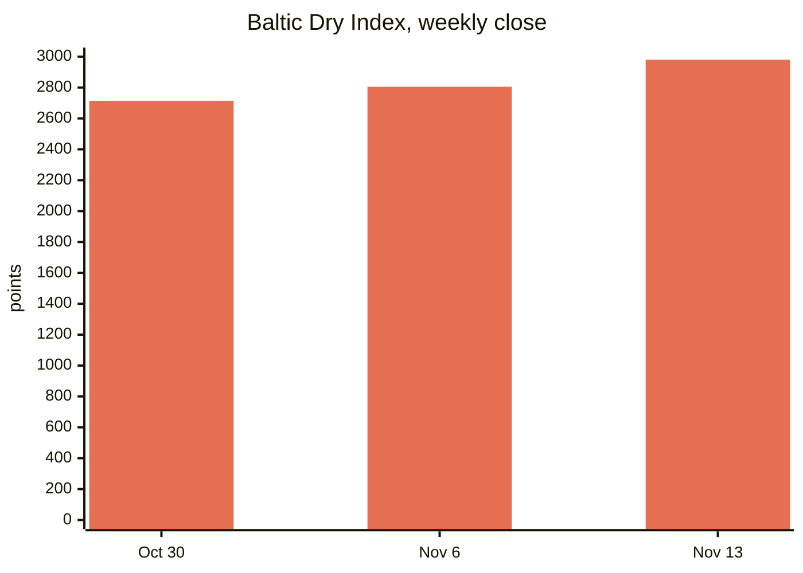

*Note: weekly closes: 2,714 (October 30), 2,805 (November 6), 2,980 (November 13). Fourth consecutive weekly gain. Source: Baltic Exchange weekly report, November 13, 2026.*

### Suez and schedule reliability

The Suez return continued (see 3.5). Drewry counted 53 containerships through the canal in the week to November 1, up 130% year on year, and estimates about 60% of Asia–Europe capacity is back on the Suez route. Evergreen's Ever Eon transited on November 8, the first Evergreen transit in almost three years. As carriers restore Suez services, Asia–Europe transit times are falling by seven to ten days, but arrivals are bunching: Flexport forecast arriving vessel capacity at Northern European ports at 131% of normal in the week of November 16–22, with 31 containerships routing through Suez alongside 61 still sailing around the Cape of Good Hope. Flexport treats arrivals above 120% of normal capacity as a congestion risk, and at least three weeks between mid-November and January are forecast to exceed that threshold. Average container dwell time reached 3.37 days in week 42, with yard utilisation reported at 80%–90%.

### Air cargo

Global air cargo spot rates rose for a third straight week, gaining 4% in week 44 to about $3.93 per kilogram, roughly 40% above the same week last year, according to the TAC index. The Baltic Air Freight Index rose 6.6% over the seven days to November 9 and 28.2% year on year. Freightos' November 10 update recorded China–North America up 3% to more than $8.00 per kg, China–North Europe up 11% to $4.87 per kg, and North Europe–North America up 9%; transatlantic air cargo rose 33% over the last month to $2.90 per kg. Xeneta's October global spot average was $3.11 per kg, up 29% year on year. IATA reported September cargo demand up 7.7% year on year, with Asia–North America traffic up 17%, while jet fuel prices were 103.4% higher than a year earlier. Air freight is absorbing late holiday orders and AI-hardware shipments into capacity tightened by winter passenger schedules, pushing rates towards last December's peak. Forwarders report China–US West Coast rates around $8.50–$9.00 per kg where space is available at all.

**Sources:** [Daily8 News](https://www.daily8news.com/article/air-cargo-rates-2026-high-peak-season-20261113/); [IATA](https://www.iata.org/en/pressroom/2026-releases/10-29-air-cargo-demand-accelerates-september/); [TAC Index via LinkedIn](https://www.linkedin.com/pulse/air-freight-market-update-november-10-2026-tacindex-pkmfc)

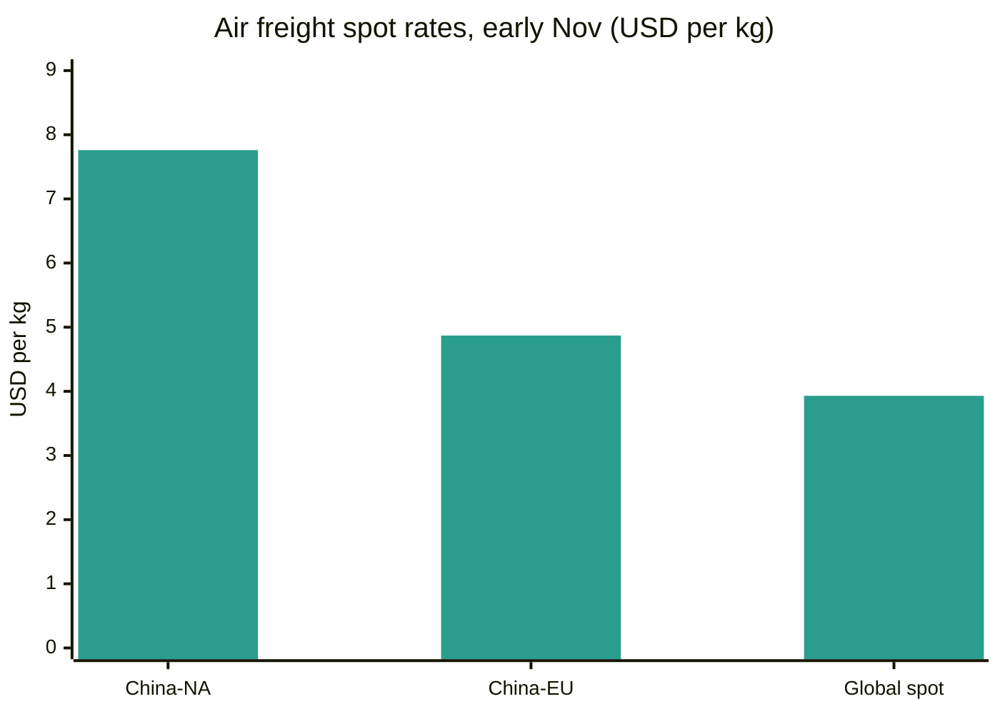

*Note: China–North America $7.76 per kg (Freightos, early November; above $8.00 per kg in the November 10 update); China–North Europe $4.87 per kg; global spot about $3.93 per kg (TAC Index, week 44). Sources: Freightos, TAC Index.*

### Port and logistics disruptions

**Los Angeles and Long Beach.** The watchmen talks were extended to November 20 (see A8). C.H. Robinson reported that retail freight from Asia was still working through disruptions in early November after an exceptionally strong September and a series of typhoons that backed up containers at some of China's largest ports, interrupted ocean schedules and led carriers to omit port calls and roll cargo. At Los Angeles and Long Beach, congestion remained severe, mainly because of insufficient railcars for moving cargo inland; some shippers were turning to transloading and trucks. As of November 2, 35,688 import containers were waiting on terminals for an on-dock train, 10,562 of them for nine days or longer. The Port of Los Angeles reported local cargo dwelling 3.7 days on terminal and on-dock rail cargo dwelling 5.6 days on October 30. Recovery was expected to be gradual over two to three weeks, assuming no additional disruptions. The Port of Los Angeles handled 1,026,872 TEU in October 2026, a record for the month and the second-highest monthly total in the port's history, following September's all-time record of 1,042,652 TEU. It was the first time the port has surpassed 1 million TEU in consecutive months, and the third time in 2026 it has reached the mark. Loaded imports were approximately 538,620 TEU, up 25% year on year and 30% above the port's five-year October average; loaded exports 114,981 TEU, down 7% year on year; empty TEU 373,271, a second consecutive monthly record. January–October total was approximately 9,108,497 TEU, 5% ahead of last year and 9% above the five-year average.

**United States import outlook.** The National Retail Federation's Global Port Tracker reported that ports it tracks handled 2.37 million TEU of loaded imports in September, the busiest month of 2026 and the third-busiest month since tracking began. October was projected at 2.26 million TEU, up 9.1% year on year; November at 2.05 million TEU, up 1.2%; and December at 2.03 million TEU, up 1.3%. The full-year forecast is approximately 26 million TEU, up 2% from 2025. The outlook turns softer in early 2027: January forecast at 2.04 million TEU, down 3% year on year; February at 1.89 million, down 0.5%; March at 1.92 million, down 11.2%.

**Durban.** Durban has not recovered from the August switch of Durban Gateway Terminal to ICTSI operation and the Navis N4 terminal system; volumes at the terminal fell roughly 30% between August 14 and September 10 against the previous four-month average. The port-wide planning indicator stood at 15 days in the cargo movement update of November 3, up a day on the previous week. Seventeen container vessels were waiting for Durban on November 2 — six inside the designated anchorages and eleven further offshore — representing roughly 85,000 TEU afloat. Container vessels averaged 7.46 days at anchorage in the seven days to early November. Maersk raised its dry-container peak season surcharge from Far East Asia to South Africa and Mauritius to $1,000 per 20ft and $2,000 per 40ft from November 9, four times the $250/$500 level set on October 15, and its Durban congestion fee to $400 per 20ft and $800 per 40ft for China-origin cargo from November 1. Transport Minister Barbara Creecy said Durban Gateway Terminal may return to its former performance only between December 2026 and February 2027, and Kuehne+Nagel expects no meaningful improvement before the end of Q1 2027.

**Sources:** [C.H. Robinson](https://www.chrobinson.com/en-us/resources/insights-and-advisories/north-america-freight-insights/nov-2026-freight-market-update/industry-insights/retail/); [AJOT](https://www.ajot.com/news/port-of-los-angeles-tops-1-million-container-units-for-second-consecutive-month); [FreightWaves](https://www.freightwaves.com/news/retailers-forecast-u-s-imports-to-stay-elevated-through-2026-after-breakout-peak-season); [DTFU Logistics](https://www.dtfulogistics.com/news/durban-port-congestion-2026-china-south-africa/)

### Vendor intelligence

Descartes Systems Group released its November Global Shipping Report on November 11, based on Descartes Datamyne trade data. United States container imports in October 2026 reached an all-time monthly high of 2,674,808 TEU — 2.0% (52,343 TEU) above the previous record of 2,622,465 TEU set in May 2022; up 5.0% from September 2026, up 16.0% from October 2025, and up 29.2% from October 2019. Imports from China rose for a fourth consecutive month to 987,805 TEU, the highest monthly volume since January 2025; up 6.9% (63,351 TEU) month over month and up 22.9% year over year; China's share of total United States container imports rose to 36.9%, from 36.3% in September. Leading China-origin commodity categories: plastics, 144,530 TEU; furniture and bedding, 137,551 TEU; toys, games and sporting goods, 102,672 TEU. Imports from the top 10 countries of origin were up 5.8% month over month. United States container imports in January–October 2026 were up 2.3% compared with the same period in 2025, the second consecutive month in which cumulative volumes were ahead of the prior year after eight months below last year's pace. East and Gulf Coast ports gained share over West Coast gateways: Gulf Coast imports were 266,905 TEU, up 24.0% month over month and 16.2% above the 12-month average, the highest level since Descartes began tracking the regional figure in August 2023. Houston recorded the largest monthly port increase, up 42,665 TEU (26.7%). Los Angeles imports fell 1.4%, Long Beach fell 2.0%, and Oakland fell 10.9%. The combined market share of the five leading East and Gulf Coast gateways was 39.9%, up from 36.7% in September; the five leading West Coast gateways fell to 44.9%, from 47.0%. The top 10 United States ports handled 84.8% of imports. Average port transit delay across the 10 tracked gateways was 6.3 days in October, compared with 6.0 days in September and 4.2 days in June; delays rose at seven of the 10 ports. Longest delays: New York/New Jersey, 8.1 days; Seattle, 7.6 days; Savannah, 6.9 days. Imports have exceeded 2.5 million TEU in every month since July 2026. The record October volume, driven in large part by a fourth consecutive monthly rise in China-origin cargo, indicates that United States maritime import demand remained strong despite continued tariff and trade-policy uncertainty. The shift in share toward East and Gulf Coast ports and the steady rise in transit delays — up about 50% since June — point to growing pressure on inland logistics networks even without broad-based port congestion.

No qualifying vendor item was found from TradeInt in the November 9–16, 2026 window. The TradeInt blog page lists its most recent post as dated December 31, 2025; no blog post dated November 9–16, 2026 was found on the site or in search of tradeint.com/insights/.

**Sources:** [Descartes](https://www.descartes.com/resources/global-logistics-shipping-report-resource-center?language=en); [All About Shipping](https://allaboutshipping.co.uk/2026/11/11/descartes-releases-november-global-shipping-report-u-s-container-imports-hit-record-volume-in-october/); [TradeInt blog](https://tradeint.com/insights/blogs/)

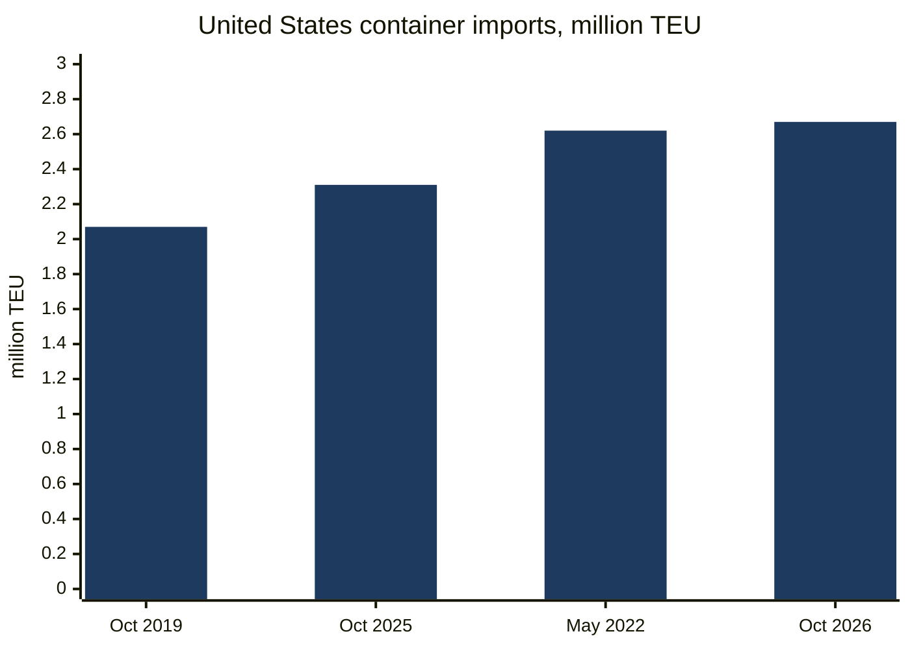

*Note: October 2026: 2,674,808 TEU, an all-time monthly high; previous record May 2022: 2,622,465 TEU; October 2025: about 2.31 million TEU (up 16.0% year on year); October 2019: about 2.07 million TEU (up 29.2%). Source: Descartes November Global Shipping Report, November 11, 2026.*

---
## 10. Policy timelines

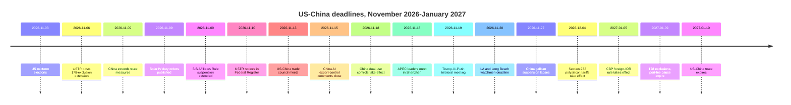

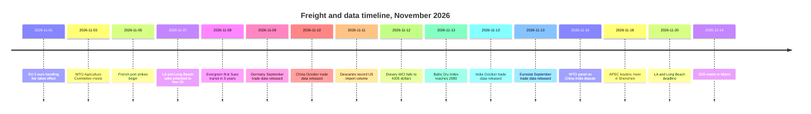

---

## 11. Upcoming deadlines & events (next 90 days)

| Date | Item |
|---|---|
| 18 November 2026 | CBP may void importer-of-record numbers for CTPAT importers that have not resolved Form 5106 accuracy concerns (letters sent 4 November). |
| 18 November 2026 | China's revised dual-use export controls on drones, tunnel-boring machines and dredgers take effect (Announcements Nos. 49–51). |
| 18–19 November 2026 | APEC Economic Leaders' Meeting in Shenzhen; Trump–Xi–Putin trilateral meeting on November 19. |
| 20 November 2026 | LA/Long Beach watchmen talks deadline (fourth extension). |
| 20 November 2026 | BIS transfer of certain sound suppressors from the US Munitions List to the Commerce Control List takes effect. |
| 20 November 2026 | COP31 in Antalya, Türkiye, closes (November 9–20). |
| 23 November 2026 | WTO Committee on Agriculture meets on export restrictions and the special safeguard mechanism; USITC Solar IV full report (Publication 5804) due. |
| 27 November 2026 | China's Announcement No. 72 of 2025 suspension of the presumption of refusal for US-bound gallium, germanium, antimony and superhard materials is scheduled to lapse, absent a further suspension or amendment. |
| 30 November 2026 | Commerce final dumping and subsidy findings for China tin mill products due, unless postponed. |
| 4 December 2026 | Section 232 polysilicon duties attach. |
| 7 December 2026 | Comments due on CBP's low-value shipments proposed rule (91 FR 64532; docket USCBP-2026-0298). |
| 14–15 December 2026 | G20 leaders meet in Miami. |
| 16 December 2026 | EU–India free trade agreement reported to be signed in Brussels, with Prime Minister Modi expected to attend. |
| 17 December 2026 | Earliest date Commerce intends to issue assessment instructions in the wooden-cabinet and millwork reviews (35 days after 12 November publication). |
| 1 January 2027 | Section 232 rates rise to 30% on upholstered furniture and 50% on kitchen cabinets and vanities; threatened 50% on Canadian vehicles, auto parts and steel also aimed at this date; UK CBAM commences. |
| 3 January 2027 | New United States Congress seated. |
| 5 January 2027 | CBP foreign importer-of-record interim final rule takes effect; comments due the same day (docket USCBP-2026-1387). |
| 9–10 January 2027 | US–China truce deadlines converge: 178 Section 301 exclusions and the maritime-fee suspension expire 9 January; BIS Affiliates Rule suspension and China's reciprocal suspensions expire 10 January. |
| 12 January 2027 | Written comments and hearing participation requests due for the USMCA joint review consultation (dockets USTR-2026-0595 and USTR-2026-0596). |
| 19 January 2027 | Commerce final dumping finding for Türkiye tin mill products due. |
| 20 January 2027 | Formal entry becomes mandatory for mail subject to Section 201, 232 or 301 duties or partner-government-agency requirements. |
| 30 January 2027 | UK countervailing duty variation on Turkish rainbow trout applies from this date (notice 2026/31). |
| 1 February 2027 | Canada removes horizontal tariff relief for certain aluminium wire and extrusions and paperboard products. |
| 6 February 2027 | Lunar New Year. |
| 28 February 2027 | USTR determination deadline in the Vietnam intellectual-property Section 301 investigation. |
| March 2027 | USTR Section 301 structural excess-capacity investigation decision expected (due by March 2027). |
| 25 March 2027 | Commerce final dumping finding for Taiwan tin mill products due. |
| 6 May 2027 | Full broker compliance expected with the foreign importer-of-record rule. |
| 30 June 2028 | Canadian horizontal tariff remission extended to this date. |

---

## 12. Sources & methodology

Coverage window: November 9–16, 2026. Compiled from approximately 45 trade news, policy, data, and freight sources worldwide.

Sources consulted include: FreightWaves, The Loadstar, Splash247, gCaptain, Hellenic Shipping News, Container News, Supply Chain Dive, Logistics Management, Air Cargo News, Port Technology, TradeInt insights blog; whitehouse.gov, cbp.gov, ustr.gov, federalregister.gov, trade.gov, usitc.gov, bis.doc.gov, JD Supra; ec.europa.eu, gov.uk, cbsa-asfc.gc.ca, canada.ca/en/department-finance, english.mofcom.gov.cn; wto.org, unctad.org, intracen.org, wcoomd.org; dataweb.usitc.gov, ustradecensus.gov, comtradeplus.un.org, wits.worldbank.org, eurostat, data.worldbank.org, imf.org; taxfoundation.org, budgetlab.yale.edu, tradeintelligence.eu; drewry.co.uk, balticexchange.com, freightos.com; descartes.com, tradeint.com.

Items dated before November 9 appear only as follow-ups, Federal Register publications falling in the window, or context for a deadline in the window. MOFCOM's English site was reachable only for front-page headlines; the substance of its EU-fee response and Unreliable Entity List remarks was not verifiable from the information reviewed. The WTO news index returned no readable text via fetch, so WTO items use WTO releases as republished. TradeInt had no qualifying vendor item in the window: its most recent blog post is dated December 31, 2025. No major new in-window releases were identified from USITC DataWeb, UN Comtrade, WITS, World Bank or IMF portals. No new Withhold Release Order was identified in the window.
