# Informe de Inteligencia Comercial Global — Semana del 9 al 16 de noviembre de 2026

**Boletín semanal.** Periodo de cobertura: 9 al 16 de noviembre de 2026. Recopilado a partir de aproximadamente 45 fuentes mundiales de noticias comerciales, políticas, datos y fletes.

---

## Índice

1. [Resumen ejecutivo](#1-executive-summary)
2. [Alertas](#2-alerts)
3. [Principales noticias — análisis en profundidad](#3-top-stories--deep-dives)
4. [Seguimiento arancelario](#4-tariff-tracker)
5. [Análisis en profundidad de la política de Estados Unidos](#5-us-policy-deep-dive)
6. [Política mundial por región](#6-world-policy-by-region)
7. [Medidas de cumplimiento](#7-enforcement-actions)
8. [Publicación de datos](#8-data-releases)
9. [Mercado de fletes](#9-freight-market)
10. [Cronologías de políticas](#10-policy-timelines)
11. [Próximos plazos y eventos (próximos 90 días)](#11-upcoming-deadlines--events-next-90-days)
12. [Fuentes y metodología](#12-sources--methodology)

---

## 1. Resumen ejecutivo

Una semana en la que la tregua comercial se formalizó en lugar de resolverse, y en la que las dos economías comerciales más grandes del mundo registraron cifras comerciales de escala récord. El 10 de noviembre, la USTR publicó avisos en el Registro Federal que prorrogaban las 178 exclusiones de productos de la Sección 301 para China y la suspensión de las tasas portuarias marítimas de la Sección 301 hasta el 9 de enero de 2027, y la Oficina de Industria y Seguridad prorrogó la suspensión de su Regla de Afiliados del 50 % hasta el 10 de enero; China respondió manteniendo suspendido su arancel adicional del 24 % sobre los productos estadounidenses durante dos meses más, conservando un tipo del 10 %, y prorrogando sus exenciones de control de las exportaciones de tierras raras hasta la misma fecha. El próximo punto de decisión es ahora la reunión de líderes de la APEC en Shenzhen, el 18 y 19 de noviembre, donde los presidentes Trump y Xi se reunirán por tercera vez este año y está prevista una primera trilateral con el presidente Putin. En otros frentes, el Departamento de Comercio publicó órdenes definitivas de derechos antidumping y compensatorios sobre células solares procedentes de India, Indonesia y Laos, con tipos combinados de depósito en efectivo de hasta el 233 %, el acuerdo entre India y Estados Unidos siguió sin firmarse mientras la investigación sobre exceso de capacidad de Washington continuaba sin concluir, Canadá prorrogó su remisión arancelaria hasta junio de 2028, y la tasa de tramitación de 2 € de la Unión Europea y su régimen de identificadores de producto entraron en su segunda semana, con el Consejo acordando eliminar el techo de 150 € del IVA a partir de 2028.

- **La tregua se prorrogó sobre el papel, hasta el 9 y 10 de enero de 2027.** Los avisos de la USTR en el Registro Federal del 10 de noviembre (91 FR 72610 y 91 FR 72608) prorrogan las 178 exclusiones de la Sección 301 (164 generales y 14 de fabricación solar) y la suspensión de las tasas marítimas hasta las 11:59 p. m., hora del este, del 9 de enero de 2027; la BIS prorrogó la suspensión de la Regla de Afiliados hasta el 10 de enero. China mantuvo suspendido su arancel adicional del 24 % durante dos meses a partir del 10 de noviembre, conservó un tipo del 10 %, prorrogó su suspensión de tasas portuarias y las exenciones de control de las exportaciones de tierras raras hasta el 10 de enero, y mantuvo suspendidas las medidas contra 16 entidades estadounidenses. La suspensión relativa al galio, el germanio y el antimonio vence por separado el 27 de noviembre. Los plazos de enero caen justo antes del Año Nuevo Lunar, el 6 de febrero de 2027.
- **La APEC es el próximo escenario de la tregua.** La 33.ª Reunión de Líderes Económicos de la APEC se celebra en Shenzhen el 18 y 19 de noviembre, y se busca una Declaración de Shenzhen sobre comercio, conectividad, economía digital e inteligencia artificial. Una primera reunión por videoconferencia del consejo comercial entre Estados Unidos y China, celebrada el 13 de noviembre, debatió un acuerdo de recorte arancelario de 30.000 millones de dólares por 30.000 millones de dólares, sin llegar a un acuerdo. La Casa Blanca confirmó una trilateral Trump–Xi–Putin el 19 de noviembre; Pekín no la había confirmado en el momento de redactar este informe, y no se espera ningún acuerdo.
- **Las órdenes de Solar IV cerraron una vía de elusión a través de China.** Las órdenes definitivas de derechos antidumping y compensatorios del Departamento de Comercio sobre células fotovoltaicas de silicio cristalino procedentes de India, Indonesia y Laos, publicadas el 9 de noviembre, fijaron tipos combinados de depósito en efectivo para todos los demás de 233,26 % (India), 167,56 % (Indonesia) y 147,39 % (Laos). Los módulos ensamblados en un tercer país con células cubiertas quedan dentro del ámbito de las órdenes. Se fijaron tipos preliminares de dumping para la hojalata de Taiwán (18,07 %) y Türkiye (3,89 % a 42,06 %), y las conclusiones definitivas sobre China se esperan para el 30 de noviembre.
- **El acuerdo entre India y Estados Unidos sigue sin firmarse.** Funcionarios indios declararon el 13 de noviembre que la firma está a la espera de que Washington finalice su marco arancelario; la investigación de la Sección 301 sobre exceso de capacidad, el elemento condicionante, aún no ha informado. Estados Unidos ha asegurado a India una ventaja arancelaria comparativa frente a sus rivales asiáticos; India paga actualmente un tipo del 10 % de la Sección 301, frente al 12,5 % de Vietnam y China. El tipo del 18 % del marco de febrero nunca se aplicó.
- **Las elecciones de mitad de mandato cambiaron la política, no los aranceles.** Los demócratas ganaron ambas cámaras el 3 de noviembre; las encuestas a pie de urna de CBS mostraron que el 66 % de los votantes consideraba que los aranceles perjudicaban a la economía. Una legislación para derogar los aranceles necesitaría una mayoría a prueba de veto, y la administración afirmó que continuaría con los aranceles. Los ingresos brutos por aranceles e impuestos especiales alcanzaron los 264.000 millones de dólares en el año natural 2026 hasta el 9 de noviembre, frente a 227.000 millones un año antes y 82.000 millones en 2024; el Budget Lab de Yale situó el tipo arancelario medio en el 11,2 % en noviembre de 2026, frente a aproximadamente el 2,5 % en enero de 2025.
- **El superávit de China superó el billón de dólares en diez meses; India marcó un récord de exportaciones.** Las exportaciones de China en octubre subieron un 35,2 % interanual, hasta 412.300 millones de dólares, y el superávit acumulado de enero a octubre alcanzó 1.042.600 millones de dólares, impulsado por las exportaciones de circuitos integrados, de 341.100 millones de dólares, un 111,1 % más. Las exportaciones de mercancías de India en octubre alcanzaron un récord de 49.470 millones de dólares, un 45,06 % más, pero las importaciones récord de 89.350 millones de dólares ampliaron el déficit de mercancías a 39.880 millones de dólares. La zona del euro pasó a un déficit de 10.300 millones de euros en septiembre, y su saldo de enero a septiembre pasó a –36.500 millones de euros, desde +102.200 millones un año antes.
- **Los fletes volvieron a dividirse: el transporte marítimo se debilitó, mientras que el aéreo y el granel seco subieron.** El Índice Mundial de Contenedores de Drewry cayó un 2 %, hasta 4.305 dólares por contenedor de 40 pies, el 12 de noviembre; el Índice Báltico de Freightos cayó un 2 %, hasta 3.452 dólares, y el Índice de Fletes Contenerizados de Shanghái cayó un 1,68 %, hasta 3.572,33, ya que los aumentos de tarifas de noviembre no se sostuvieron. El Índice Báltico de Carga Seca subió un 6,2 %, hasta 2.980, su cuarta ganancia semanal consecutiva. La carga aérea se movió en sentido contrario: el Índice Báltico de Carga Aérea subió un 6,6 % en la semana hasta el 9 de noviembre y un 28,2 % interanual, con tarifas China–Norteamérica por encima de 8,00 dólares por kilogramo. Las importaciones de contenedores de Estados Unidos alcanzaron un máximo mensual histórico de 2.674.808 TEU en octubre, según Descartes.

**Fletes:** las tarifas al contado de contenedores bajaron por segunda semana consecutiva tanto en el transpacífico como en el comercio Asia–Europa, mientras los transportistas recurrían a salidas en blanco; el granel seco subió por cuarta semana gracias a la fortaleza de los Capesize; la carga aérea alcanzó su máximo de 2026 de cara a la temporada alta; el regreso a Suez estuvo a punto de completarse cuando Evergreen transitó por primera vez en casi tres años, mientras Flexport advertía de congestión en los puertos europeos por llegadas concentradas; y el atasco ferroviario de Los Ángeles–Long Beach y la cola de 15 días de Durban mantuvieron vivo el riesgo portuario.

---

## 2. Alertas

| # | Alerta | Vigencia | Impacto | Fuente |
|---|-------|-----------|--------|--------|
| A1 | La USTR publica avisos en el Registro Federal que prorrogan las 178 exclusiones de productos de la Sección 301 para China hasta las 11:59 p. m., hora del este, del 9 de enero de 2027, y suspenden las tasas marítimas de la Sección 301 y los derechos sobre grúas hasta la misma fecha | 10 nov 2026 (publicado) | Solo una prórroga de dos meses; las entradas a partir del 10 de enero de 2027 pagan los tipos íntegros de lista (25 % en las Listas 1–3, 7,5 % en la Lista 4A) | [YCL CPA](https://yclcpa.com/en/insights/us-china-tariff-truce-section-301-exclusions-january-2027) |
| A2 | China mantiene suspendido su arancel adicional del 24 % sobre los productos estadounidenses durante dos meses a partir del 10 de noviembre, conserva el 10 %; prorroga las exenciones de control de las exportaciones de tierras raras, la suspensión de tasas portuarias y las suspensiones de listas de entidades hasta el 10 de enero de 2027 | 9–10 nov 2026 | Los exportadores estadounidenses mantienen el tipo del 10 %; la tregua se extiende hasta el 10 de enero de 2027 en el lado chino; la suspensión relativa al galio vence el 27 de noviembre | [Medium](https://medium.com/@frank.matisse/weekly-digest-15-november-2026-wd-25-the-truce-is-not-access-3f6d8ac577b6) |
| A3 | La BIS prorroga la suspensión de la medida de control de las exportaciones de la Regla de Afiliados del 50 % hasta el 10 de enero de 2027 | 9 nov 2026 | La selección basada en la propiedad sigue en pausa; sin más medidas, los controles ampliados entrarán en vigor el 10 de enero de 2027 | [Sanctions.com](https://www.sanctions.com/articles/us-extends-suspension-of-bis-50-rule-until-january-2027) |
| A4 | Los líderes de la APEC se reúnen en Shenzhen el 18 y 19 de noviembre; trilateral Trump–Xi–Putin confirmada por la Casa Blanca para el 19 de noviembre; la reunión por videoconferencia del consejo comercial entre Estados Unidos y China del 13 de noviembre debatió un paquete de recorte arancelario de 30.000 millones de dólares por 30.000 millones de dólares, sin acuerdo | 18–19 nov 2026 | Primera oportunidad de prorrogar la tregua más allá del 10 de enero de 2027; se busca una Declaración de Shenzhen sobre comercio, economía digital e IA | [Asia Daily](https://asiadaily.org/news/18743/) |
| A5 | La CBP advierte a los importadores CTPAT de que sus números de importador registrado podrían quedar anulados a partir de las 12:01 a. m., hora del este, del 18 de noviembre por la exactitud del Formulario 5106 | 18 nov 2026 | Una carta sin resolver bloquea las entradas con ese número de importador; la dirección física debe ser la ubicación comercial propia del importador | [Concord Solutions](https://www.concordsolutionsgroup.com/post/ctpat-importers-cbp-warns-ior-numbers-may-be-voided-november-18-over-form-5106-accuracy) |
| A6 | Los controles revisados de China sobre exportaciones de doble uso para drones, tuneladoras y dragas entran en vigor el 18 de noviembre; los comentarios al catálogo tecnológico del MOFCOM cerraron el 15 de noviembre sin resultado publicado | 18 nov 2026 | Requisitos de licencia para determinados drones (alcance de 300 km, dispersión de aerosoles de 80 litros), tuneladoras y dragas | [JD Supra](https://www.jdsupra.com/legalnews/china-proposes-expanded-technology-8379336/) |
| A7 | El Departamento de Comercio publica órdenes definitivas de derechos antidumping y compensatorios sobre células solares de India, Indonesia y Laos; tipos combinados para todos los demás de 233,26 % / 167,56 % / 147,39 % | 9 nov 2026 | Los depósitos en efectivo se reanudan a partir del 5 de noviembre; los módulos fabricados en un tercer país con células cubiertas quedan dentro de las órdenes | [Solar Stock USA](https://www.solarstockusa.com/research/market-notes/adcvd-orders-india-indonesia-laos) |
| A8 | Las conversaciones sobre los vigilantes de LA/Long Beach se prorrogaron hasta el 20 de noviembre — cuarta prórroga; unos 250 vigilantes en seis terminales; el puente Vincent Thomas cerró el 7 de noviembre durante 16 meses; 35.688 contenedores de importación a la espera de ferrocarril en muelle | 20 nov 2026 | Una paralización detendría las operaciones de buques, patios y puertas si otros sindicatos respetan los piquetes; la permanencia ferroviaria ya es de 5,6 días | [Navilink Global](https://www.navilinkglobal.com/news/la-long-beach-port-strike-averted-again-ilwu-talks-extended-to-november-20-as-record-cargo-volumes-continue) |
| A9 | Los aranceles de la Sección 338 sobre Canadá, impugnados ante el Tribunal de Comercio Internacional; escritos de amicus curiae presentados el 11 y 13 de noviembre en *Gellert v. Trump*; el derecho del 50 % cubre unos 20.000 millones de dólares de importaciones canadienses | 11–13 nov 2026 | Un fallo contra la administración eliminaría una importante capa arancelaria y daría lugar a reclamaciones de reembolso; los aranceles siguen en vigor | [Reason](https://reason.com/volokh/2026/11/14/our-amicus-brief-in-case-challenging-trumps-section-338-tariffs-against-canada/) |
| A10 | El acuerdo entre India y Estados Unidos sigue sin firmarse a 13 de noviembre; la firma está a la espera del marco arancelario de Washington; la investigación de la Sección 301 sobre exceso de capacidad no ha informado | 13 nov 2026 | Los exportadores indios no tienen certeza sobre el tipo prometido del 18 %; India paga un derecho del 10 % de la Sección 301, Vietnam y China el 12,5 % | [Industrial Front](https://industrialfront.com/india-us-trade-deal-tariff-advantage-november-2026/) |

### A1/A2/A3 — La tregua, prorrogada sobre el papel hasta enero

La prórroga de dos meses de la tregua comercial entre Estados Unidos y China se formalizó en el periodo de cobertura. El 10 de noviembre, la USTR publicó dos avisos en el Registro Federal: uno que prorroga las 178 exclusiones restantes de productos de la Sección 301 — 164 exclusiones generales con arreglo al HTSUS 9903.88.69 y 14 exclusiones de fabricación solar con arreglo al 9903.88.70 — hasta las 11:59 p. m., hora del este, del 9 de enero de 2027 (91 FR 72610; FR Doc. 2026-22925), que cubre las mercancías introducidas para el consumo, o retiradas de depósito para el consumo, a partir de las 12:01 a. m., hora del este, del 10 de noviembre de 2026; el otro suspende además la acción marítima de la Sección 301, incluidas las tasas de servicio a operadores y propietarios de buques y los derechos sobre grúas de buque a tierra y otros equipos de manipulación de carga, hasta la misma fecha (91 FR 72608; FR Doc. 2026-22867). No se añadieron ni se eliminaron exclusiones, no se solicitaron nuevos comentarios, y la USTR se basó en el expediente de su aviso de septiembre de 2025; una coalición de 24 asociaciones sectoriales había pedido el 4 de noviembre una prórroga de al menos un año. Algunas informaciones señalan una incoherencia interna en los avisos, con partes que se refieren al 10 de enero en lugar del 9 de enero; la fecha operativa en el aviso de exclusiones es el 9 de enero. El 9 de noviembre, la BIS publicó una norma definitiva que prorroga la suspensión de su Regla de Afiliados del 50 % — la medida que extendería los controles de exportación a entidades extranjeras participadas en un 50 % o más por partes incluidas en listas — hasta el 10 de enero de 2027, sin interrupción respecto de la suspensión anterior.

China actuó el 9 de noviembre. Su Comisión de Aranceles del Consejo de Estado dijo que seguiría suspendiendo el arancel adicional del 24 % sobre los productos estadounidenses durante dos meses a partir del 10 de noviembre, manteniendo en vigor un tipo adicional del 10 %. El MOFCOM y la Administración General de Aduanas publicaron el Anuncio n.º 58 de 2026, que continúa la suspensión de seis anuncios de control de las exportaciones de octubre de 2025 — que abarcan la tecnología y los equipos de procesamiento de tierras raras, cinco tierras raras medias y pesadas adicionales, baterías de litio y materiales de ánodos de grafito, materiales superduros, y la norma extraterritorial sobre productos fabricados en el extranjero que contienen tierras raras de origen chino — desde el 11 de noviembre de 2026 hasta el 10 de enero de 2027. El MOFCOM también continuó la suspensión de sus medidas del Anuncio n.º 21 de 2025 contra 16 entidades estadounidenses, y el Ministerio de Transporte de China prorrogó la suspensión de las tasas portuarias especiales sobre buques vinculados a Estados Unidos hasta el 10 de enero de 2027. Dos límites son importantes. El requisito de licencia de abril de 2025 para siete tierras raras medias y pesadas (samario, gadolinio, terbio, disprosio, lutecio, escandio e itrio) nunca se suspendió y sigue en vigor. Y el Anuncio n.º 72 de 2025, que suspende la presunción de denegación de China para el galio, el germanio, el antimonio y los materiales superduros con destino a Estados Unidos, rige solo hasta el 27 de noviembre de 2026 y no se mencionó en el Anuncio n.º 58; a 13 de noviembre no se había encontrado ningún aviso modificatorio.

### A4 — APEC Shenzhen: el próximo punto de decisión

La 33.ª Reunión de Líderes Económicos de la APEC se celebra en Shenzhen el 18 y 19 de noviembre de 2026, la tercera vez que China acoge la reunión, tras Shanghái en 2001 y Pekín en 2014. La Semana de los Líderes comenzó el 14 de noviembre, con la reunión del Consejo Asesor Empresarial de la APEC del 14 al 16 de noviembre y la Cumbre de Directores Ejecutivos el 17 y 18 de noviembre, donde el presidente Xi Jinping pronunciará el discurso inaugural. El tema del anfitrión es «Construir una comunidad de Asia-Pacífico para prosperar juntos», con tres prioridades — apertura, innovación y cooperación — y se busca una Declaración de Shenzhen que abarque el comercio, la conectividad, la economía digital y la inteligencia artificial. El 16 de noviembre, China confirmó que Xi acogerá a los presidentes Trump y Putin en una reunión trilateral el 19 de noviembre al margen de la cumbre, en la que se espera debatir la reducción de armas nucleares, la inteligencia artificial y los conflictos mundiales; la portavoz de la Casa Blanca confirmó la reunión, mientras que un alto funcionario estadounidense dijo que no se espera ningún acuerdo y que Pekín no la había confirmado en el momento de redactar este informe. Una primera reunión de un nuevo consejo comercial entre Estados Unidos y China, celebrada por videoconferencia el 13 de noviembre, debatió un acuerdo de recorte arancelario de 30.000 millones de dólares por 30.000 millones de dólares y el comercio agrícola, pero no anunció ningún acuerdo. El paquete propuesto de recorte arancelario recíproco de 60.000 millones de dólares debatido tras la cumbre de septiembre sigue sin finalizarse. El comercio de Shenzhen con otras economías de la APEC creció un 40 % interanual en los primeros nueve meses de 2026, lo que representa casi el 70 % del comercio total de la ciudad.

### A5 — Anulación del número de importador de la CBP a partir del 18 de noviembre

La CBP envió cartas a numerosos importadores certificados CTPAT en las que indicaba que sus números de importador registrado podrían quedar anulados para las entradas presentadas a partir de las 12:01 a. m., hora del este, del 18 de noviembre de 2026, a menos que se resuelvan antes las preocupaciones de la CBP sobre la exactitud de la información del Formulario 5106 de la CBP del importador. La Asociación Nacional de Agentes de Aduanas y Transitarios de Estados Unidos comunicó las cartas a sus miembros el 4 de noviembre y pidió a los agentes que alertaran a sus clientes importadores. Se indicó a cada importador afectado que revisara su registro del Formulario 5106 en el Portal de Datos Seguros ACE, corrigiera la información inexacta y confirmara que el número de importador en el Portal CTPAT está activo y coincide con el registro ACE. Un número de importador anulado no puede utilizarse para presentar entradas, por lo que una carta sin resolver impediría la liberación de la carga y la presentación de resúmenes de entrada con ese número a partir del 18 de noviembre. Las cartas siguen al aviso de la CBP en el Registro Federal sobre la exactitud de los datos del importador registrado (91 FR 53627, 19 de agosto de 2026), en virtud del cual la CBP ha anulado números de importador con datos del Formulario 5106 inexactos o incompletos desde el 18 de septiembre de 2026. La dirección física del Formulario 5106 debe ser la ubicación comercial propia del importador, no un agente registrado, un agente de aduanas, un transitario, un apartado de correos ni un centro de servicios empresariales.

### A6 — Los controles de doble uso de China entran en vigor el 18 de noviembre

Tres anuncios que revisan la Lista de Control de Exportaciones de Artículos de Doble Uso de China entran en vigor el 18 de noviembre de 2026: el Anuncio n.º 49 (drones y artículos conexos), el Anuncio n.º 50 (tuneladoras y otros artículos — la primera vez que las tuneladoras se incluyen en los controles de exportación) y el Anuncio n.º 51 (dragas y otros artículos). Se requieren licencias, entre otros artículos, para pilotos automáticos de drones; drones capaces de volar más allá de la línea de visión con una autonomía de al menos tres horas; motores diseñados especialmente para drones o dirigibles no tripulados; y drones con un alcance de 300 km o más o equipados para la dispersión de aerosoles por encima de 80 litros. El Anuncio n.º 50 introduce controles sobre tuneladoras, determinadas excavadoras de orugas y máquinas de hormigón proyectado para grandes alturas; las exportaciones a países y regiones sensibles con disputas con China requieren licencias, mientras que las exportaciones a otros destinos pueden utilizar certificados basados en el registro, sujetos a restricciones sobre las transferencias posteriores. El Anuncio n.º 51 añade requisitos de licencia para determinadas bombas de dragado y componentes clave, cabezales de succión y cabezales de corte. Por separado, el MOFCOM y el Ministerio de Ciencia y Tecnología propusieron el 16 de octubre añadir 40 tecnologías al Catálogo de Tecnologías Prohibidas o Restringidas para la Exportación — 23 en inteligencia artificial, 5 en biofármacos, 12 en energía fotovoltaica; 14 estarían prohibidas y 26 restringidas — con comentarios hasta el 15 de noviembre. Desde el 16 de octubre se aplica un registro provisional previo a la exportación. A 16 de noviembre no se había publicado ningún resultado ni catálogo definitivo.

### A7 — Órdenes de Solar IV: tipos combinados de hasta el 233 %

El Departamento de Comercio dictó órdenes de derechos antidumping y compensatorios sobre células fotovoltaicas de silicio cristalino, estén o no ensambladas en módulos, procedentes de India, Indonesia y Laos el 9 de noviembre de 2026, tras las determinaciones definitivas afirmativas de daño de la USITC publicadas el 5 de noviembre (91 FR 69865). India: margen antidumping del 123,04 % (depósito en efectivo del 107,17 % tras las compensaciones por subvenciones) y derecho compensatorio del 126,09 %, un tipo combinado de depósito en efectivo del 233,26 %. Indonesia: antidumping del 94,36 % y derecho compensatorio del 73,20 % (combinado para todos los demás del 167,56 %). Laos: margen antidumping del 65,76 % (depósito en efectivo del 65,36 %) y derecho compensatorio del 82,03 % (tipo combinado de depósito en efectivo del 147,39 %), después de que el Departamento de Comercio corrigiera un error material que elevaba el margen de Laos del 65,43 % y el depósito en efectivo del 65,03 %. La suspensión de la liquidación y la recaudación de depósitos en efectivo se reanudan a partir del 5 de noviembre de 2026. Los módulos, laminados y paneles fabricados en un tercer país con células cubiertas quedan dentro de las órdenes; los módulos ensamblados en India con células de terceros países no. Las entradas en los intervalos provisionales quedan fuera de los derechos: desde el 26 de junio de 2026 para los derechos compensatorios y desde el 25 de octubre de 2026 para el antidumping, ambos hasta el 4 de noviembre de 2026. En el caso de India y Laos, donde la conclusión de circunstancias críticas de la USITC fue negativa, el Departamento de Comercio tiene previsto reembolsar los depósitos en efectivo de derechos compensatorios sobre las entradas realizadas entre el 28 de noviembre de 2025 y el 25 de febrero de 2026. El informe público completo de la USITC (Publicación 5804 de la USITC) debe publicarse antes del 23 de noviembre de 2026.

### A8 — LA/Long Beach: cuarta prórroga, hasta el 20 de noviembre

Una huelga amenazada por los trabajadores de seguridad (vigilantes) en las terminales de contenedores de Los Ángeles y Long Beach se ha aplazado de nuevo, y las conversaciones se han prorrogado ahora hasta el 20 de noviembre de 2026 — la cuarta prórroga del plazo en la disputa. La fecha original de autorización de huelga era el 1 de noviembre, luego se prorrogó hasta el 4 de noviembre y después hasta la medianoche del 6 de noviembre. El Local 26 del ILWU representa a unos 250 trabajadores de seguridad en seis terminales de contenedores; su anterior contrato venció en julio de 2025, los miembros han autorizado una huelga, y ambas partes negocian con ayuda del Servicio Federal de Mediación y Conciliación. La Asociación Marítima del Pacífico afirma que la interrupción podría afectar a alrededor del 85 % de la carga que pasa por el puerto de Long Beach y a un tercio de la carga del puerto de Los Ángeles, porque no se espera que otros estibadores crucen los piquetes del Local 26. El plazo del 7 de noviembre coincidió con el cierre del puente Vincent Thomas, un conector vial clave del complejo portuario, que cerró a las 12:01 a. m. del 7 de noviembre para un proyecto de reparación cuya duración prevista es de 16 meses. El complejo ya estaba sometido a tensión: unos 35.688 contenedores de importación esperaban el servicio ferroviario en los dos puertos a 2 de noviembre, 10.562 de ellos durante nueve días o más, y las importaciones con destino ferroviario permanecieron una media de 7,19 días en septiembre. El puerto de Los Ángeles movió 1.026.872 TEU en octubre, un récord para ese mes.

### A9 — Sección 338 sobre Canadá: primera impugnación judicial

Se presentaron dos escritos de amicus curiae ante el Tribunal de Comercio Internacional de Estados Unidos en *Gellert Global Group Corp. v. Trump* (caso n.º 26-04636), presentado el 20 de octubre de 2026, la primera impugnación judicial de los aranceles de la Sección 338. El escrito de antiguos altos funcionarios de comercio (Carla Hills, USTR 1989–1993; Alan Wolff, antiguo USTR adjunto; Warren Maruyama, asesor jurídico general de la USTR 2007–2009) se presentó el 11 de noviembre. El escrito del Instituto Cato, con el profesor Ilya Somin y el profesor Michael McConnell, se presentó el 13 de noviembre. Los escritos sostienen que la Sección 338 de la Ley Arancelaria de 1930 no puede sustentar los aranceles, que la Sección 301 de la Ley de Comercio de 1974 abarca la misma materia con protecciones procesales y sustituye a la Sección 338, y que los aranceles violan las doctrinas de las cuestiones importantes y de no delegación. La demandante, la importadora de alimentos Gellert Global Group, con sede en Nueva Jersey, representada por el Liberty Justice Center, afirma que importó unos 71 millones de dólares de queso canadiense en 2025, históricamente libre de derechos en virtud del Tratado entre México, Estados Unidos y Canadá, y alega que pagará aproximadamente 40 millones de dólares al año en derechos de la Sección 338. La demanda solicita la eliminación de los aranceles, la prohibición de su recaudación y reembolsos por los derechos pagados desde el 22 de agosto de 2026. Los aranceles siguen en vigor; el tribunal no se ha pronunciado. Los derechos del 50 % cubren unos 20.000 millones de dólares de importaciones canadienses, según el escrito de amicus curiae y el análisis del Servicio de Investigación del Congreso basado en las cifras comerciales de 2025. El USTR Jamieson Greer afirma que las conversaciones con Ottawa continúan sin plazo. La próxima fecha citada en las informaciones es el 1 de enero de 2027, cuando el presidente ha amenazado con elevar los aranceles sobre vehículos, autopartes y acero canadienses al 50 %.

### A10 — Acuerdo entre India y Estados Unidos: aún sin firmar

Fuentes del gobierno indio declararon el 13 de noviembre que Estados Unidos ha asegurado a India que sus exportadores obtendrán una «ventaja arancelaria comparativa» frente a los países competidores en el marco del acuerdo comercial previsto, una vez que Washington finalice su estructura arancelaria. La garantía es condicional: la estructura arancelaria definitiva de Estados Unidos depende del resultado de la investigación de la Sección 301 de la USTR sobre el exceso de capacidad estructural en la manufactura, abierta en marzo de 2026, que aún no ha informado. El secretario de Comercio, Rajesh Agrawal, dijo que las negociaciones iban «por buen camino». Un equipo estadounidense de dos miembros visitó India a principios de noviembre y logró avances sustanciales en el texto, incluido el capítulo de aduanas y facilitación del comercio; por ahora no están previstas más rondas presenciales. El primer tramo abarca solo mercancías; los servicios vendrían después. Ambos gobiernos acordaron un marco en una declaración conjunta del 7 de febrero de 2026, pero no se ha publicado ningún texto firmado, programa arancelario ni fecha de entrada en vigor. El marco de febrero había fijado un tipo estadounidense del 18 %, que nunca se aplicó. India paga ahora un arancel del 10 % de la Sección 301 por trabajo forzoso, igual que Indonesia, Camboya y Bangladés, mientras que Vietnam y China pagan el 12,5 %. Las exportaciones indias de mercancías a Estados Unidos ascendieron a 59.520 millones de dólares entre abril y octubre de 2026, frente a 51.990 millones un año antes. Ambas partes trabajan para completar el acuerdo antes de que finalice el actual ejercicio financiero, según informaciones indias. Un documento de la Casa Blanca publicado el 3 de noviembre incluía a India entre los países con los que el presidente había «asegurado acuerdos comerciales nuevos y mejorados», aunque el acuerdo provisional no se ha firmado formalmente.

---

## 3. Principales noticias — análisis en profundidad

### 3.1 La tregua, prorrogada dos meses — y el precipicio de enero que crea

La noticia central de la semana es un par de prórrogas que, juntas, mantienen viva la tregua comercial entre Estados Unidos y China hasta enero, al tiempo que comprimen la próxima decisión en un plazo de dos meses. La secuencia es importante. El 6 de noviembre, la USTR publicó dos avisos; el 10 de noviembre se publicaron en el Registro Federal. El primero prorroga las 178 exclusiones de productos de la Sección 301 para China hasta las 11:59 p. m., hora del este, del 9 de enero de 2027, y cubre las mercancías introducidas para el consumo, o retiradas de depósito para el consumo, a partir de las 12:01 a. m., hora del este, del 10 de noviembre de 2026. El segundo suspende además la acción de la Sección 301 sobre las prácticas marítimas, logísticas y de construcción naval de China, incluidas las tasas sobre buques cubiertos y los derechos del Anexo V.A, hasta la misma fecha. El 9 de noviembre, la BIS prorrogó la suspensión de su medida de control de las exportaciones de la Regla de Afiliados del 50 % hasta el 10 de enero de 2027. El 9 de noviembre, China prorrogó su parte: el arancel adicional del 24 % sobre los productos estadounidenses sigue suspendido durante dos meses más a partir del 10 de noviembre, se mantiene en vigor un tipo adicional del 10 %, y las suspensiones de las tasas portuarias especiales sobre buques vinculados a Estados Unidos, las exenciones de control de las exportaciones de minerales críticos y las medidas contra 11 empresas estadounidenses de la lista de entidades no fiables y 16 de la lista de control de las exportaciones se extienden todas hasta el 10 de enero de 2027.

Tres rasgos merecen atención. En primer lugar, las prórrogas son cortas — dos meses, cuando se entendía que el acuerdo de septiembre duraría un año — y se concedieron después de que el sector pidiera al menos un año. La Asociación de la Industria del Software y la Información y otras 23 organizaciones pidieron a la USTR el 4 de noviembre una prórroga de al menos un año de las exclusiones; la USTR concedió dos meses. En segundo lugar, las fechas no coinciden exactamente: los instrumentos estadounidenses vencen el 9 de enero, los de China el 10 de enero, y el secretario del Tesoro, Scott Bessent, describió en septiembre la tregua estadounidense como vigente hasta el 10 de enero. En tercer lugar, el fondo de la tregua sigue sin resolverse. El 6 de noviembre, el USTR Jamieson Greer y el secretario Bessent mantuvieron una videollamada con el viceprimer ministro He Lifeng; Greer subrayó «la importancia crítica de que China adopte medidas concretas para aplicar plenamente sus compromisos anteriores», en particular las compras agrícolas, las tierras raras y otros minerales críticos, mientras que China expresó su «seria preocupación» por las restricciones comerciales estadounidenses. Ninguna de las dos lecturas mencionó los plazos. El paquete propuesto de recorte arancelario recíproco de 60.000 millones de dólares debatido tras la cumbre de septiembre sigue sin finalizarse, y una reunión por videoconferencia del 13 de noviembre del nuevo consejo comercial entre Estados Unidos y China debatió un acuerdo de 30.000 millones de dólares por 30.000 millones de dólares, sin acuerdo.

**Cifras clave:** 178 exclusiones prorrogadas (164 generales, 14 de fabricación solar); sin la prórroga, las entradas a partir del 10 de noviembre habrían pagado el 25 % (Listas 1–3) o el 7,5 % (Lista 4A); el arancel adicional del 24 % de China sigue suspendido, se conserva el 10 %; la tregua se extiende ahora hasta el 9 y 10 de enero de 2027.

**Por qué es importante:** los importadores tienen dos meses de certidumbre en lugar de un precipicio esta semana, pero el precipicio se ha desplazado, no ha desaparecido. El próximo punto de decisión es la reunión de líderes de la APEC en Shenzhen el 18 y 19 de noviembre, donde los presidentes Trump y Xi se reunirán por tercera vez este año, seguida por el G20 en Miami el 14 y 15 de diciembre. Las entradas, los viajes y la selección de exportaciones deben planificarse conforme a la posición escrita: las exclusiones se aplican según la fecha de entrada, no la fecha de envío, por lo que las mercancías enviadas en noviembre pero introducidas después del 9 de enero quedan fuera de la prórroga. La suspensión relativa al galio, que vence el 27 de noviembre, es un plazo aparte y anterior.

**Fuentes:** [YCL CPA](https://yclcpa.com/en/insights/us-china-tariff-truce-section-301-exclusions-january-2027); [Shipping and Freight Resource](https://www.shippingandfreightresource.com/trade-moves-16-nov-2026/); [Medium](https://medium.com/@frank.matisse/weekly-digest-15-november-2026-wd-25-the-truce-is-not-access-3f6d8ac577b6)

### 3.2 Las elecciones de mitad de mandato y las perspectivas arancelarias: nueva política, mismos aranceles

Las elecciones de mitad de mandato del 3 de noviembre dieron a los demócratas el control de ambas cámaras, pero la arquitectura arancelaria se basa en la autoridad ejecutiva, que un cambio en el Congreso no deshace. Los aranceles de la administración se apoyan ahora principalmente en la Sección 301 y la Sección 232, después de que el Tribunal Supremo anulara los aranceles de la IEEPA el 20 de febrero de 2026 en *Learning Resources, Inc. v. Trump*. Esas competencias no dependen del ciclo electoral, y los demócratas están muy lejos de las mayorías de dos tercios necesarias para anular un veto presidencial. Lo que cambia es el escrutinio: se esperan audiencias de supervisión, votaciones simbólicas de revocación y presión para obtener alivios específicos — en particular sobre Canadá — en 2027. El único instrumento que el nuevo Congreso podría limitar es la Sección 122, cuyos recargos están limitados a 150 días sin legislación; cualquier prórroga de ese marco requeriría al Congreso entrante. El nuevo Congreso se constituye en enero de 2027; hasta entonces, los estatutos arancelarios se mantienen tal como están redactados.

Las cifras enmarcan ahora el debate. Según datos seguidos por el Bipartisan Policy Center, derivados de los estados diarios del Tesoro de Estados Unidos, los ingresos brutos por aranceles e impuestos especiales recaudados hasta el 9 de noviembre de 2026 ascendieron a 264.000 millones de dólares en el año natural 2026, frente a 227.000 millones en el mismo punto de 2025 y más del triple de los 82.000 millones recaudados hasta el 9 de noviembre de 2024. El Budget Lab de la Universidad de Yale estimó que el tipo arancelario medio de Estados Unidos aumentó de aproximadamente el 2,5 % cuando el presidente Trump regresó a la Casa Blanca en enero de 2025 al 11,2 % en noviembre de 2026, y que las medidas cuestan al hogar estadounidense medio unos 900 dólares anuales. El recuento del Budget Lab del 2 de noviembre situó el tipo arancelario estatutario medio en el 11,8 %, que subiría al 11,9 % a finales de año con arreglo a la legislación vigente. La Tax Foundation estima que los aranceles elevarán los impuestos en una media de 820 dólares por hogar en 2026, mientras que el Budget Lab situó la carga en unos 1.100 dólares por hogar en un informe de fecha 24 de agosto de 2026; ambas cifras utilizan métodos distintos. El Instituto Cato estimó que los aranceles cubren alrededor del 54 % de los bienes importados a Estados Unidos. Una encuesta de votantes de Associated Press a más de 100.000 votantes de mitad de mandato constató que aproximadamente dos tercios creían que los aranceles habían perjudicado a la economía nacional o a su economía local; las encuestas a pie de urna de CBS News mostraron que el 66 % de los votantes afirmó que los aranceles «perjudicaron la economía». Los derechos de aduana netos ascendieron a 173.200 millones de dólares en el ejercicio fiscal 2026, según el Departamento del Tesoro.

El frente judicial versa ahora sobre el dinero, no sobre la competencia. El 20 de febrero de 2026, el Tribunal Supremo sostuvo en *Learning Resources, Inc. v. Trump* (607 U.S. 229 (2026)) que la Ley de Poderes Económicos de Emergencia Internacional «no autoriza al presidente a imponer aranceles». El 8 de octubre de 2026, el Tribunal de Comercio Internacional certificó una acción colectiva en *Freestyle World, Inc. v. U.S. Customs and Border Protection* (Slip Op. 26-123, caso n.º 26-01088), definida como los importadores registrados que pagaron derechos impuestos por las órdenes IEEPA impugnadas entre el 1 de febrero de 2025 y el 19 de febrero de 2026, excluidas las entidades que demandaron por separado. La escala registrada en esa opinión fue de 136.600 millones de dólares en reembolsos potenciales y certificados aceptados para su tramitación. El líder demócrata del Senado, Chuck Schumer, presentó la Ley para Poner Fin al Impuesto Arancelario de Trump (S.5390) el 14 de septiembre; el proyecto de ley pondría fin a los derechos impuestos por el presidente y los reembolsaría, abarcando los aranceles de la Sección 301 sobre 60 países, los aranceles globales de la Sección 122 y los aranceles del 50 % sobre los productos canadienses, según sus promotores. El Comité para un Presupuesto Federal Responsable estima que derogar los aranceles restantes costaría unos 85.500 millones de dólares al año. Peter Navarro, alto asesor comercial de la Casa Blanca, dijo en una emisión informada el 7 de noviembre que la administración está «cuadruplicando su apuesta» por los aranceles tras las derrotas republicanas en las elecciones de mitad de mandato. Bloomberg informó el 6 de noviembre de que limitar las competencias arancelarias presidenciales será lento y difícil, y que el presidente podría anunciar nuevos derechos sobre más de una docena de economías antes de que los demócratas tomen el control en enero.

**Cifras clave:** ingresos brutos por aranceles e impuestos especiales de 264.000 millones de dólares (año natural 2026 hasta el 9 de noviembre) frente a 227.000 millones (2025) y 82.000 millones (2024); tipo arancelario medio del 11,2 % (noviembre de 2026) frente a aproximadamente el 2,5 % (enero de 2025); unos 900 dólares al año por hogar; 136.600 millones de dólares en reembolsos potenciales y certificados de la IEEPA; el 66 % de los votantes afirmó que los aranceles perjudicaron a la economía.

**Por qué es importante:** los transportistas deben planificar que la actual estructura arancelaria persistirá durante los dos últimos años del presidente, con la revisión del T-MEC y las nuevas acciones de la Sección 301 como frentes activos. El litigio sobre reembolsos es una cuestión material aparte de flujo de caja para los importadores registrados: solo el importador registrado (o su agente) puede reclamar, y los reembolsos van al importador, no a los consumidores. El riesgo en lo que queda de 2026 es que se anuncien nuevos aranceles antes de que se constituya el nuevo Congreso.

**Fuentes:** [Global Trade Review](https://www.gtreview.com/news/americas/us-midterm-elections-what-do-the-results-mean-for-trade-policy-and-finance/); [Intelligence Report](https://intelligencereport.org/2026/11/07/trump-tariffs-after-midterms-congress/); [The Motley Fool](https://www.fool.com/investing/2026/11/15/donald-trump-claims-tariffs-dont-cause-inflation-they-cause-wealth-economic-data-says-otherwise/); [Geopolitiqs](https://www.geopolitiqs.com/tn/2026-11-09/tariffs-average-rate)

### 3.3 Europa: la tasa de 2 € se consolida y se concreta la fecha de firma entre la UE e India

Dos acontecimientos europeos de esta semana tiran en direcciones opuestas: uno eleva el coste y la carga de datos de cada importación de bajo valor, y el otro acerca un importante acuerdo de libre comercio a su firma. Desde el 1 de noviembre de 2026, se aplica una tasa de tramitación de la Unión de 2 € por línea de artículo en los envíos de venta a distancia enviados directamente desde fuera de la Unión Europea a consumidores de la UE, con independencia del valor, en virtud del Reglamento Delegado (UE) 2026/2152. Se suma al derecho fijo de 3 € por línea arancelaria en vigor desde el 1 de julio de 2026 para envíos de 150 € o menos en virtud del Reglamento (UE) 2026/382, que abolió la exención de derechos de minimis de 150 €. Desde la misma fecha, cada producto de un envío entre empresas y consumidores a la UE — con independencia del valor — debe llevar tres identificadores de producto. La Dirección General de Fiscalidad y Unión Aduanera de la Comisión Europea confirmó el 3 de noviembre que el requisito de los identificadores de producto es ahora obligatorio y se aplica, tras un periodo voluntario desde el 1 de julio. El derecho y la tasa combinados pueden, por tanto, alcanzar 5 € por línea arancelaria, sin incluir el IVA. El régimen provisional se extiende hasta el 1 de julio de 2028, cuando está previsto que un sistema centralizado de datos aduaneros de la UE sustituya el gravamen fijo por derechos estándar. La tasa no es reembolsable aunque se devuelvan las mercancías. En el periodo de cobertura no se publicaron cifras oficiales sobre el impacto inicial — volúmenes de paquetes, ingresos recaudados, retrasos en el despacho —.

El 9 de noviembre, el Consejo de la Unión Europea alcanzó un enfoque general sobre un proyecto de directiva que elimina el umbral de 150 € del régimen de ventanilla única de importación del IVA (IOSS) y del régimen de proveedor reputado de los mercados. Una vez adoptadas, los vendedores y las plataformas podrán declarar y pagar el IVA de importación sobre las ventas a distancia de mercancías importadas de cualquier valor mediante un único registro; los productos sujetos a impuestos especiales siguen excluidos. El Parlamento Europeo debe ser consultado antes de la adopción formal por parte del Consejo. Las normas se aplicarían a partir del 1 de julio de 2028, cuando debe entrar en funcionamiento el Centro de Datos Aduaneros de la UE, y la Comisión debe revisar el régimen antes del 1 de diciembre de 2030.

Mientras tanto, el acuerdo de libre comercio entre la UE e India avanzó hacia su firma. El secretario de Comercio, Rajesh Agrawal, se reunió a principios de noviembre en Bruselas con altos funcionarios de la Comisión Europea, entre ellos los directores generales de Comercio y Seguridad Económica, Fiscalidad y Unión Aduanera, y Asociaciones Internacionales, para ultimar los detalles de cooperación aduanera y aplicación antes de la firma. Se informa de que el acuerdo, cuyas negociaciones concluyeron el 27 de enero de 2026, se firmará en Bruselas a mediados de diciembre de 2026, y se espera que el primer ministro Narendra Modi asista el 16 de diciembre. El 11 de noviembre, el ministro de Comercio e Industria, Piyush Goyal, dijo que era probable que los fabricantes europeos de automóviles utilizaran el acuerdo para tantear la demanda india importando aproximadamente 5.000 unidades de cada uno de varios modelos antes de decidir sobre la producción local. El derecho de aduana básico de India sobre los automóviles bajaría de hasta el 110 % a tan solo el 10 %, dentro de una cuota anual de 250.000 vehículos; la Comisión afirma que los aranceles sobre el 96,6 % del comercio de mercancías de la UE con India se eliminarán o reducirán; los derechos sobre el trigo, el maíz y la cebada bajarían al 0 %, mientras que el arroz seguirá excluido, con un derecho sin cambios del 12,4 %. El comercio bilateral está valorado en 180.000 millones de euros al año. Se espera que la ratificación completa, incluidos el consentimiento del Parlamento Europeo y la ratificación india, se extienda hasta 2027; se informa de que la entrada en vigor será en marzo o abril de 2027. Un acuerdo aparte de protección de las inversiones y un acuerdo sobre indicaciones geográficas siguen en negociación. El acuerdo comercial modernizado entre la UE y México se firmó formalmente el 22 de mayo de 2026 y está pendiente de ratificación por el Parlamento Europeo; se espera que los acuerdos de la UE con Indonesia y Australia se firmen antes de finales de 2026; el acuerdo provisional entre la UE y Mercosur está en vigor provisionalmente desde el 1 de mayo de 2026.

**Cifras clave:** 2 € por línea de artículo (tasa de tramitación); 3 € por línea arancelaria (derecho fijo desde el 1 de julio de 2026); hasta 5 € combinados por línea antes del IVA; derecho de la UE–India sobre automóviles del 110 % al 10 % dentro de una cuota de 250.000 vehículos; el 96,6 % del comercio de mercancías de la UE con India se liberalizará; comercio bilateral de 180.000 millones de euros al año.

**Por qué es importante:** la tasa y las normas sobre identificadores del 1 de noviembre modifican la economía de cada paquete de bajo valor que entra en la UE semanas antes de la temporada alta, y afectan a las plataformas de origen chino y a cualquier vendedor que envíe directamente a los consumidores de la UE. La firma entre la UE e India convertiría el acuerdo de texto concluido en compromiso formal, pero no habrá cambios de derechos en la frontera hasta la entrada en vigor. La cuota de automóviles y la exclusión del arroz muestran los límites del acuerdo para el comercio sensible agrícola y automovilístico.

**Fuentes:** [Comisión Europea, DG TAXUD](https://taxation-customs.ec.europa.eu/news/product-identifiers-e-commerce-imports-mandatory-1-november-2026-2026-11-03_en); [Consejo de la UE](https://www.consilium.europa.eu/en/press/press-releases/2026/11/09/taxation-council-approves-further-vat-simplification-rules-for-online-sales/); [IBEF](https://www.ibef.org/news/india-and-eu-discuss-fta-implementation-customs-cooperation-and-market-access-in-brussels)

### 3.4 China amplía su red de control de las exportaciones — y se agota el plazo de comentarios

El programa de control de las exportaciones de China avanzó en tres frentes esta semana, y el más importante es el dirigido a los conocimientos técnicos de fabricación más que a los productos acabados. La propuesta conjunta del MOFCOM y el Ministerio de Ciencia y Tecnología (Anuncio n.º 48, 16 de octubre) añadiría 40 tecnologías al Catálogo de Tecnologías Prohibidas y Restringidas para la Exportación: 23 en inteligencia artificial, 5 en biofármacos, 12 en energía fotovoltaica. Catorce estarían prohibidas para la exportación; 26 restringidas (se requiere licencia). Desde el 16 de octubre, se aplica el registro provisional previo a la exportación de las tecnologías enumeradas — incluidas las exportaciones ya en curso y las transferencias de propiedad o control de una empresa nacional titular de las tecnologías a una entidad extranjera — a través de la aplicación de Gestión de la Información sobre el Comercio de Tecnología del MOFCOM. Los comentarios públicos cerraron el 15 de noviembre. A 16 de noviembre no se había publicado ningún resultado ni catálogo definitivo. En el sector solar, las prohibiciones incluyen determinadas tecnologías de producción de polisilicio, la preparación de obleas de silicio de 70 micrómetros o menos, y la fabricación de células solares de perovskita y en tándem y las tecnologías de fabricación de equipos conexos — con exenciones limitadas —, por lo que las restricciones solares se consideran las más importantes para los fabricantes extranjeros, dada la dominación de China en la producción fotovoltaica y la tecnología solar de vanguardia. El MOFCOM describe la revisión como rutinaria y no dirigida a ningún país en particular.

El paquete de doble uso sigue una vía paralela. Tres anuncios revisan la Lista de Control de Exportaciones de Artículos de Doble Uso para vehículos aéreos no tripulados (Anuncio n.º 49), tuneladoras y dragas, todos con efecto a partir del 18 de noviembre de 2026. El MOFCOM y la Administración General de Aduanas también publicaron el Aviso 52 (19 de octubre), que revisa los procedimientos por los que las aduanas pueden retener mercancías presentadas para la exportación sin licencia que puedan estar sujetas a controles y exigir una licencia. Al mismo tiempo, China prorrogó sus exenciones de control de las exportaciones para determinados minerales críticos y tecnologías conexas hasta el 10 de enero de 2027 — el alivio relacionado con la tregua señalado en la sección 3.1 —, de modo que los controles de la semana y las exenciones de la semana se mueven en direcciones opuestas en conjuntos de productos distintos.

Una cuestión aparte de cumplimiento quedó sin resolver. Megaspeed, un cliente de Nvidia con sede en Singapur del que se informa que compró más de 4.800 millones de dólares en chips avanzados de IA de Nvidia en los últimos dos años, estuvo en el centro de los acontecimientos que llevaron a Jensen Huang a dimitir como director ejecutivo de Nvidia el 12 de noviembre. El 13 de noviembre, el secretario del Tesoro, Scott Bessent, dijo a CNBC que los departamentos del Tesoro, Defensa y Estado y la Oficina del Representante Comercial de Estados Unidos habían estado a favor de incluir a Megaspeed en la Lista de Entidades durante meses, y que el Departamento de Comercio es el responsable de esa lista. Bessent dijo que había presionado al secretario de Comercio, Howard Lutnick, en una reunión en la Sala de Situación de la Casa Blanca la semana anterior sobre por qué Megaspeed no había sido añadida. Megaspeed dijo el 12 de noviembre que cooperaría con los investigadores estadounidenses. A 13 de noviembre no se había publicado ninguna adición de Megaspeed a la Lista de Entidades.

**Cifras clave:** 40 tecnologías (23 de IA / 5 de biofármacos / 12 de energía fotovoltaica); 14 prohibidas, 26 restringidas; comentarios hasta el 15 de noviembre de 2026; controles de doble uso en vigor el 18 de noviembre de 2026; compras de chips de Megaspeed por encima de 4.800 millones de dólares en dos años, según las informaciones.

**Por qué es importante:** la propuesta del catálogo alcanza a los modelos de IA de vanguardia entrenados con datos básicos chinos, las plataformas de terapia celular y génica y los conocimientos técnicos básicos de fabricación de la energía solar de nueva generación. Para los fabricantes extranjeros, las disposiciones solares son el aspecto más incisivo: alcanzan a los equipos y procesos detrás de las células de perovskita y en tándem, no solo a los módulos acabados. El plazo de comentarios del 15 de noviembre y la fecha de entrada en vigor del 18 de noviembre son puntos inmediatos de cumplimiento, y el desacuerdo público a nivel de gabinete sobre Megaspeed muestra que el propio proceso de decisión de la Lista de Entidades es ahora una cuestión viva para los exportadores de hardware informático avanzado.

**Fuentes:** [China Briefing](https://www.china-briefing.com/news/china-technology-export-controls/); [JD Supra](https://www.jdsupra.com/legalnews/china-proposes-expanded-technology-8379336/); [Akin Gump](https://www.akingump.com/print/v2/content/1138573/new-chinese-export-control-measures-tighten-restrictions-on-the-export-of-advanced-technologies-and-dual-use-goods-strengthen-enforcement.pdf); [AI Stock Wire](https://aistockwire.com/blog/bessent-megaspeed-entity-list-lutnick-commerce-nvidia-nvda-november-2026)

### 3.5 Fletes: el transporte marítimo se debilita, el aéreo se dispara y el regreso a Suez

El mercado de contenedores se debilitó por segunda semana consecutiva, con ligeros descensos tanto en el transpacífico como en el comercio Asia–Europa, ya que los aumentos generales de tarifas de noviembre no se sostuvieron. El Índice Mundial de Contenedores de Drewry cayó un 2 %, hasta 4.305 dólares por contenedor de 40 pies, en la evaluación del 12 de noviembre, tras una caída del 1 %, hasta 4.389 dólares, el 5 de noviembre. Shanghái–Nueva York cayó un 3 %, hasta 9.020 dólares por 40 pies, el nivel más bajo desde agosto de 2026; Shanghái–Los Ángeles cayó un 2 %, hasta 7.416 dólares, el nivel más bajo desde septiembre de 2026; Shanghái–Róterdam cayó un 3 %, hasta 3.504 dólares, mientras que Shanghái–Génova se mantuvo sin cambios en 4.168 dólares. Freightos informó de Asia–costa oeste de Estados Unidos en torno a 8.200 dólares por FEU y Asia–costa este de Estados Unidos en torno a 9.700 dólares por FEU, todavía en torno a los niveles de temporada alta, y Asia–norte de Europa en 3.400 dólares por FEU, un 5 % menos en la semana. Los transportistas habían buscado aumentos de 2.000 a 3.000 dólares por FEU para noviembre, y presentaron nuevos aumentos para el 15 y 16 de noviembre, pero los transitarios citaron una mayor disponibilidad de espacio y horarios de buques más regulares. El Índice de Fletes Contenerizados de Shanghái cayó un 1,68 %, hasta 3.572,33, el 13 de noviembre, su segundo descenso semanal consecutivo, con Shanghái–costa este de Estados Unidos con una bajada de 470 dólares, hasta 9.387 dólares por FEU, y Shanghái–costa oeste de Estados Unidos con una bajada de 270 dólares, hasta 7.111 dólares, mientras que Shanghái–Mediterráneo subió 380 dólares, hasta 4.746 dólares. Drewry espera que las tarifas del transpacífico sigan bajando la próxima semana y que las tarifas de Asia–Europa/Mediterráneo suban ligeramente. Los transportistas anunciaron ocho salidas en blanco para la semana siguiente en el transpacífico, frente a cuatro esta semana, y ocho en Asia–Europa/Mediterráneo frente a cinco; el rastreador de salidas canceladas de Drewry proyectó 52 salidas en blanco de 716 servicios programados en los principales comercios Este–Oeste entre el 16 de noviembre y el 21 de diciembre, alrededor del 7 % de las salidas previstas.

La carga aérea se movió en sentido contrario. Las tarifas al contado mundiales de carga aérea subieron por tercera semana consecutiva, ganando un 4 % en la semana 44, hasta unos 3,93 dólares por kilogramo, aproximadamente un 40 % por encima de la misma semana del año pasado, según el índice TAC. El Índice Báltico de Carga Aérea subió un 6,6 % en los siete días hasta el 9 de noviembre y un 28,2 % interanual, sus niveles más altos de 2026. Freightos informó de tarifas aéreas China–Norteamérica con un aumento del 9 % semanal, hasta 7,76 dólares por kg a principios de noviembre, un 40 % más interanual y cerca del máximo de diciembre de 2025, de 8,00 dólares por kg; su actualización del 10 de noviembre situó China–Norteamérica por encima de 8,00 dólares por kg, China–norte de Europa con un aumento del 11 %, hasta 4,87 dólares por kg, y norte de Europa–Norteamérica con un aumento del 9 %. La media mundial al contado de Xeneta en octubre fue de 3,11 dólares por kg, un 29 % más interanual. La IATA informó de que la demanda de carga en septiembre subió un 7,7 % interanual, con un tráfico Asia–Norteamérica un 17 % más, mientras que los precios del combustible para aviones eran un 103,4 % más altos que un año antes. El contraste con el flete marítimo es marcado: las tarifas al contado de contenedores están bajando mientras las tarifas aéreas se disparan hacia el pico previo a Navidad, y la eliminación de minimis significa que cada envío también soporta ahora derechos.

El regreso a Suez estuvo a punto de completarse. El Ever Eon, de 16.556 TEU, transitó por el Canal de Suez el 8 de noviembre, el primer tránsito de Evergreen en casi tres años desde que comenzó la crisis del mar Rojo; el Ever Edit debía seguirlo el 11 de noviembre y el Ever Gifted, de 20.124 TEU, el 16 y 17 de noviembre. Evergreen era el último miembro de la Ocean Alliance en reanudar los tránsitos por Suez; CMA CGM, COSCO y OOCL ya habían restablecido los servicios a través de la vía navegable. Drewry contó 53 portacontenedores a través del canal en la semana hasta el 1 de noviembre, un 130 % más interanual, y estima que alrededor del 60 % de la capacidad Asia–Europa ha vuelto a la ruta de Suez; Alphaliner situó el 63 % de la capacidad Extremo Oriente–Europa de vuelta en el mar Rojo al 21 de octubre. A medida que los transportistas restablecen los servicios de Suez, los tiempos de tránsito Asia–Europa están cayendo de siete a diez días, pero las llegadas se están concentrando. Flexport previó que la capacidad de buques que llegaría a los puertos del norte de Europa sería del 131 % de lo normal en la semana del 16 al 22 de noviembre, con 31 portacontenedores en ruta por Suez junto a 61 que aún navegan alrededor del Cabo de Buena Esperanza. Flexport considera que las llegadas por encima del 120 % de la capacidad normal constituyen un riesgo de congestión, y se prevé que al menos tres semanas entre mediados de noviembre y enero superen ese umbral. El tiempo medio de permanencia de los contenedores alcanzó 3,37 días en la semana 42, con una utilización de los patios del 80 %–90 %.

En el plano empresarial, Hapag-Lloyd informó de un beneficio del grupo en el tercer trimestre de 2026 de 999 millones de dólares, frente a 172 millones un año antes. El EBITDA casi se duplicó, hasta 1.730 millones de dólares desde 866 millones, el EBIT subió a 1.090 millones de dólares desde 228 millones, y los ingresos aumentaron a 6.880 millones de dólares desde 5.460 millones. El 11 de noviembre, su junta ejecutiva elevó las previsiones para 2026: ahora se espera un EBITDA de 4.600 a 5.000 millones de dólares (antes 3.900 a 4.400 millones) y un EBIT de 2.000 a 2.400 millones de dólares (antes 1.250 a 1.750 millones). El transportista dijo que espera las aprobaciones regulatorias para su compra de ZIM en el primer trimestre de 2027. La mejora provino de las tarifas, no de los volúmenes: tarifa media de flete de 1.808 dólares por TEU (tercer trimestre de 2025: 1.413 dólares por TEU) con un volumen de transporte de 3,38 millones de TEU, prácticamente sin cambios respecto a los 3,40 millones de TEU de un año antes.

**Cifras clave:** WCI de Drewry, 4.305 dólares por 40 pies (un 2 % menos semanal); Shanghái–Los Ángeles, 7.416 dólares; Shanghái–Nueva York, 9.020 dólares; Shanghái–Róterdam, 3.504 dólares; Shanghái–Génova, 4.168 dólares; flete aéreo mundial al contado de unos 3,93 dólares por kilogramo (un 4 % más semanal, alrededor de un 40 % interanual); flete aéreo China–Norteamérica, 7,76 dólares por kg; Índice Báltico de Carga Aérea con un aumento del 6,6 % semanal y del 28,2 % interanual; 53 tránsitos de portacontenedores por Suez en la semana hasta el 1 de noviembre (un 130 % más interanual); beneficio del tercer trimestre de Hapag-Lloyd, 999 millones de dólares.

**Por qué es importante:** las tarifas siguen muy por encima de los niveles de hace un año, aunque se debiliten, y los transportistas tienen dificultades para imponer aumentos en una demanda débil — una señal de que las negociaciones de contratos de 2027 favorecerán a los cargadores. El regreso a Suez libera capacidad de buques, lo que se espera que presione las tarifas de flete en 2027, mientras que ZIM sigue siendo el transportista importante más destacado que aún desvía los servicios Asia–Europa por el Cabo. Para los cargadores que perdieron la ventana de temporada alta del transporte marítimo, las tarifas aéreas casi récord son el coste de la alternativa, y el riesgo de congestión se está desplazando de las rutas marítimas a los puertos del norte de Europa.

**Fuentes:** [Drewry](https://www.drewry.co.uk/supply-chain-advisors/supply-chain-expertise/world-container-index-assessed-by-drewry); [Freightos](https://www.freightos.com/freight-resources/la-lb-strike-deadline-extended-dem-win-increasing-trade-uncertainty-november-10-2026-update/); [Splash247](https://splash247.com/evergreens-suez-return-leaves-zim-increasingly-isolated/); [FreightWaves](https://www.freightwaves.com/news/hapag-lloyd-profit-jumps-as-stronger-freight-rates-drive-guidance-upgrade); [Loog](https://blog.loog.ai/en/posts/suez-comeback-risks-new-wave-european-port-congestion)

### 3.6 Tres déficits, tres direcciones: China supera el billón de dólares, India marca un récord, Europa en déficit

Las cifras comerciales de octubre de China, publicadas el 10 de noviembre por la Administración General de Aduanas, situaron las exportaciones en 412.300 millones de dólares, un 35,2 % más interanual, las importaciones en 307.100 millones de dólares, un 41,6 % más, y el superávit mensual en 105.300 millones de dólares, por debajo de los 133.500 millones de septiembre. El superávit acumulado de enero a octubre alcanzó 1.042.600 millones de dólares — más de un billón de dólares un mes antes que en 2025. Las exportaciones de enero a octubre, de 3.782.800 millones de dólares, ya superan las exportaciones de todo el año 2025, de 3.771.900 millones de dólares, según lo informado. La composición es la noticia: las exportaciones de circuitos integrados se duplicaron con creces entre enero y octubre, hasta 341.100 millones de dólares, un 111,1 % más interanual, y las de ordenadores y componentes subieron un 60,6 %. Los productos mecánicos y eléctricos representaron 16,81 billones de yuanes de exportaciones, un 25,2 % más, o el 64,7 % del total. El comercio con la ASEAN creció un 24,2 %, con la UE un 8,5 % y con Estados Unidos un 6,3 % entre enero y octubre en yuanes, según lo informado. Las cifras son preliminares; el boletín mensual es más preciso.

Las cifras de octubre de India, publicadas el 13 de noviembre, muestran exportaciones de mercancías en un récord de 49.470 millones de dólares, un 45,06 % más interanual, pero importaciones de mercancías en un récord de 89.350 millones de dólares, lo que deja un déficit de mercancías de 39.880 millones de dólares — mayor que los 30.210 millones de septiembre, pero menor que los 42.580 millones de octubre de 2025. Incluidos los servicios, las exportaciones totales alcanzaron 89.990 millones de dólares y el déficit total se redujo a 20.090 millones de dólares. Las importaciones de petróleo subieron un 54,31 % interanual, hasta 22.820 millones de dólares, y las importaciones de oro subieron a 5.510 millones de dólares desde 1.800 millones en septiembre, antes de Diwali. El ministerio señaló los productos petrolíferos, los bienes electrónicos, las gemas y la joyería, los productos químicos orgánicos e inorgánicos y los bienes de ingeniería como motores del crecimiento de las exportaciones. Las exportaciones de mercancías de abril a octubre de 2026–27 fueron de 309.060 millones de dólares, frente a 253.400 millones un año antes.

La zona del euro se movió en sentido contrario. Las primeras estimaciones de Eurostat sobre el comercio de bienes de septiembre de 2026, publicadas el 13 de noviembre, situaron a la zona del euro en un déficit de 10.300 millones de euros con el resto del mundo, frente a un superávit de 13.500 millones de euros en septiembre de 2025 y un déficit de 16.600 millones de euros en agosto de 2026. La UE registró un déficit de 16.800 millones de euros, frente a un superávit de 11.400 millones un año antes. Eurostat atribuyó gran parte del deterioro a la energía, donde el déficit de la zona del euro se amplió a 33.000 millones de euros desde 20.700 millones, y a la reducción del superávit de maquinaria y vehículos, a 3.000 millones de euros desde 10.000 millones. El saldo de la zona del euro de enero a septiembre de 2026 fue de –36.500 millones de euros, frente a +102.200 millones en el mismo periodo de 2025. Las cifras de septiembre de Alemania (Destatis, 9 de noviembre) situaron las exportaciones en 141.100 millones de euros (un 2,0 % más mensual y un 7,7 % interanual), las importaciones en 125.500 millones de euros (un 4,2 % más mensual y un 8,7 % interanual), y el superávit en 15.600 millones de euros, por debajo de los 17.900 millones de agosto. La Aduana de Japón publicó cifras provisionales para los primeros 20 días de octubre: exportaciones con un aumento del 23,5 % interanual, importaciones con un aumento del 32,4 %, lo que amplió el déficit a 810.400 millones de yenes, desde 216.600 millones un año antes.

**Cifras clave:** exportaciones de China en octubre, 412.300 millones de dólares (+35,2 %); superávit de enero a octubre, 1.042.600 millones de dólares; exportaciones de circuitos integrados, 341.100 millones de dólares (+111,1 %); exportaciones de India en octubre, 49.470 millones de dólares (+45,06 %, récord); déficit de mercancías, 39.880 millones de dólares; déficit de la zona del euro en septiembre, 10.300 millones de euros, frente a +13.500 millones un año antes; saldo de la zona del euro de enero a septiembre, –36.500 millones de euros, frente a +102.200 millones en 2025; superávit de Alemania en septiembre, 15.600 millones de euros; déficit de Japón en los primeros 20 días de octubre, 810.400 millones de yenes.

**Por qué es importante:** la escala y la composición del superávit de China — más de un billón de dólares con diez meses transcurridos, impulsado por los circuitos integrados y el hardware informático — son fundamentales en los debates sobre la balanza comercial con los socios de China, mientras que el crecimiento más rápido de las importaciones que de las exportaciones en octubre redujo el superávit mensual, aunque ambos lados del balance se expandieron. El mes récord de exportaciones de India quedó superado en el lado de los bienes por la demanda de energía y de oro de la temporada festiva. El giro de casi 139.000 millones de euros de la zona del euro en nueve meses, de superávit a déficit, es un cambio material en la posición comercial del bloque, impulsado en gran parte por los costes de la energía.

**Fuentes:** [NGlobe News](https://www.nglobenews.com/en/article/china-october-trade-surplus-1-trillion-2026-11-10/); [GuruTrade](https://www.gurutrade.com/news/india-oct-trade-deficit-hits-1-yr-high-of-39-88b-on-gold-1794605244.html); [Eurostat](https://ec.europa.eu/eurostat/en/web/products-euro-indicators/w/6-13112026-bp); [Destatis](https://www.destatis.de/EN/Press/2026/11/PE26_390_51.html)

### 3.7 Canadá reorienta su alivio, y la declaración de Pax Silica toma forma

Canadá remodeló su alivio arancelario para las empresas afectadas por los aranceles estadounidenses. El ministro de Finanzas, François-Philippe Champagne, anunció el 9 de noviembre que el gobierno prorrogó la remisión horizontal de los aranceles estadounidenses por un año, hasta el 30 de junio de 2028. El alivio incluirá ahora también los bienes no siderúrgicos utilizados en la minería, la explotación de canteras o la extracción de petróleo y gas, y todos los bienes utilizados por entidades públicas de educación, incluidas las ordenadas por organizaciones indígenas. Para fomentar el uso de insumos nacionales, se eliminará el alivio horizontal para determinados bienes identificados como de producción nacional: a partir del 1 de diciembre de 2026 para determinados remolques, y a partir del 1 de febrero de 2027 para determinados alambres y extrusiones de aluminio y productos de cartón. Los programas detallados de productos se publicarán en el sitio web del Departamento de Finanzas y se incorporarán por referencia en las órdenes. Los cambios se suman a los contraaranceles del 15 % al 50 % sobre una serie de importaciones estadounidenses impuestas el 8 de septiembre de 2026, que se aplican a unos 700 productos estadounidenses. Por separado, la Agencia de Servicios Fronterizos de Canadá actualizó el Aviso de Aduanas 26-07 el 2 de noviembre, prorrogando la remisión de mercancías programada a los Anexos 1 a 3, introduciendo códigos especiales de autorización para los Anexos 2 y 3, y aclarando las condiciones de elegibilidad; también eliminó el Apéndice A, que ofrecía orientación adicional sobre la remisión de torres eólicas.

El 15 de noviembre, Estados Unidos y nueve participantes de Pax Silica firmaron la Declaración de San Francisco sobre los Fundamentos Seguros de una Prosperidad Duradera en el Retiro de Fundadores de Pax Silica en San Francisco, convocado por el subsecretario de Estado para Asuntos Económicos, Jacob Helberg. Los signatarios son Estados Unidos, Australia, India, Israel, Japón, Corea del Sur, Catar, Singapur, los Emiratos Árabes Unidos y el Reino Unido. La declaración afirma que la seguridad económica es fundamental para la seguridad nacional, expone un entendimiento común de las tecnologías sensibles y la infraestructura crítica que sustentan las cadenas de suministro avanzadas de inteligencia artificial — incluidos los semiconductores, los minerales críticos, la energía, las redes de transporte y logística, los puertos, las comunicaciones y las plataformas digitales — y declara que protegerlas es un empeño compartido. Resuelve establecer cinco grupos de trabajo que abarcan marcos de políticas favorables a la innovación, la adopción de la IA en sectores clave, la cooperación en la cadena de suministro en toda la pila de IA, los puertos seguros y los centros de seguridad de la cadena de suministro, y la seguridad y resiliencia de la IA. Se espera que Alemania, Suecia, los Países Bajos y la Comisión Europea firmen en la semana siguiente, según informaciones que citan a un funcionario estadounidense; esa participación aún no está confirmada. Se informa de que Pax Silica, la iniciativa más amplia liderada por Estados Unidos lanzada en diciembre de 2025, incluye de 24 a 26 participantes.

**Cifras clave:** remisión horizontal canadiense prorrogada hasta el 30 de junio de 2028; alivio eliminado para los remolques a partir del 1 de diciembre de 2026 y para el alambre de aluminio, las extrusiones y el cartón a partir del 1 de febrero de 2027; contraaranceles del 15–50 % sobre unos 700 productos estadounidenses; Declaración de San Francisco: 10 signatarios, 5 grupos de trabajo.

**Por qué es importante:** la prórroga canadiense da a los importadores de productos estadounidenses más de dieciocho meses adicionales de alivio, mientras que la eliminación gradual para remolques, productos de aluminio y cartón orienta a los compradores hacia la oferta nacional. La Declaración de San Francisco da a la coalición de la cadena de suministro de IA una definición política común de lo que protege y una estructura de trabajo, dos días antes de que se reúnan los líderes de la APEC. Es un marco de coordinación más que un acuerdo comercial, y su efecto práctico dependerá de lo que produzcan los grupos de trabajo.

**Fuentes:** [Departamento de Finanzas de Canadá](https://www.canada.ca/en/department-finance/news/2026/11/canada-modifies-tariff-relief-measures-to-better-support-workers-and-businesses.html); [Embajada de Estados Unidos en Singapur](https://sg.usembassy.gov/the-san-francisco-declaration-on-the-secure-foundations-of-enduring-prosperity/)

---

## 4. Seguimiento arancelario

| País / origen | Medida | Tipo | Fecha de vigencia | Estado | Fuente |
|---|---|---|---|---|---|
| China | Exclusiones de productos de la Sección 301 (178 productos; HTSUS 9903.88.69 / 9903.88.70) — prórroga | Exclusión de los derechos de lista (25 % en las Listas 1–3; 7,5 % en la Lista 4A si vencen) | 10 nov 2026 – 9 ene 2027 (11:59 p. m., hora del este) | Prorrogada el 10 de noviembre por la USTR (91 FR 72610) | [YCL CPA](https://yclcpa.com/en/insights/us-china-tariff-truce-section-301-exclusions-january-2027) |
| China | Suspensión de la acción marítima de la Sección 301 (tasas portuarias sobre buques construidos u operados por China; derechos del Anexo V.A) | Tasas suspendidas | 10 nov 2026 – 9 ene 2027 | Suspensión prorrogada el 10 de noviembre por la USTR (91 FR 72608) | [YCL CPA](https://yclcpa.com/en/insights/us-china-tariff-truce-section-301-exclusions-january-2027) |
| Estados Unidos (lado chino) | Suspensión del arancel adicional del 24 % sobre los productos estadounidenses; se conserva el tipo del 10 %; se suspenden las tasas portuarias, las exenciones de control de las exportaciones de minerales críticos y las medidas de listas de entidades | 24 % suspendido; 10 % en vigor | 10 nov 2026 – 10 ene 2027 | Anunciado el 9 de noviembre por el Consejo de Estado / MOFCOM / Ministerio de Transporte de China | [Medium](https://medium.com/@frank.matisse/weekly-digest-15-november-2026-wd-25-the-truce-is-not-access-3f6d8ac577b6) |
| India | Aranceles estadounidenses sobre los productos indios reducidos; se retira el gravamen de penalización por el petróleo ruso | 18 % (desde hasta el 50 %) | Anunciado el 2 nov 2026 | Anunciado; no se ha publicado ningún texto firmado, programa arancelario ni fecha de entrada en vigor a 13 de noviembre | [Economic Times](https://www.eximguru.com/export-import-news/export-news/india-us-trade-deal-lifts-a-117126.aspx) |
| India | Derecho de la Sección 301 por trabajo forzoso (tipo en vigor) | 10 % | Desde el 24 jul 2026 | En vigor; acuerdo provisional sin firmar a 13 de noviembre | [Industrial Front](https://industrialfront.com/india-us-trade-deal-tariff-advantage-november-2026/) |
| Vietnam | Derecho de la Sección 301 por trabajo forzoso; investigación sobre PI prorrogada | 12,5 % | Desde el 24 jul 2026 | En vigor; determinación de la investigación sobre PI prevista para el 28 feb 2027 | [BDO](https://www.bdo.com/insights/tax/ustr-extends-china-section-301-product-exclusions-and-vietnam-ip-investigation-timeline) |
| Canadá | Derechos de la Sección 338, lista de productos ampliada (100 clasificaciones añadidas, 22 eliminadas el 30 de octubre) | 50 % | 22 ago 2026; ámbito revisado el 30 oct 2026 | En vigor; impugnado en *Gellert v. Trump* | [Troutman](https://www.troutman.com/insights/canada-tariff-reshuffle-22-products-out-100-in-under-the-50-section-338-duty/) |
| China (60 economías, incl. China) | Derecho de la Sección 301 por trabajo forzoso (capa base que sustituye a la IEEPA) | 10 % o 12,5 % | Desde el 24 jul 2026 | En vigor | [Platton](https://www.platton.ai/insights/import/us-tariffs-by-country/) |
| India / Indonesia / Laos | Órdenes de derechos antidumping y compensatorios — células fotovoltaicas de silicio cristalino (Solar IV) | Tipos combinados de depósito en efectivo de alrededor del 233 % / 168 % / 147 % | Órdenes publicadas el 9 nov 2026; los depósitos en efectivo se reanudan a partir del 5 de noviembre | Órdenes definitivas en vigor | [Solar Stock USA](https://www.solarstockusa.com/research/market-notes/adcvd-orders-india-indonesia-laos) |
| Taiwán / Türkiye | Derechos antidumping (preliminares) — productos de hojalata | 18,07 % / 3,89 %–42,06 % | 10 nov 2026 (publicación en el FR) | Preliminar; se adeudan depósitos en efectivo; conclusiones definitivas sobre China previstas para el 30 de noviembre | [Shark Metals](https://www.sharkmetals.com/2026/11/11/tin-mill-taiwan-turkiye-dumping-margins/) |
| China | Revisión de derechos antidumping — armarios de madera; revisión de derechos compensatorios — molduras y carpintería de madera | 7,48 % revisado (251,64 % para toda China); derechos compensatorios del 147,88 % / 21,39 % | 12 nov 2026 | Resultados definitivos de la revisión | [US Egreco](https://www.usegreco.com/daily-duty/issues/2026-11-12) |
| Todos los orígenes | Sección 232 — acero, aluminio, cobre | 50 % (derivados 25 %; algunos equipos 15 % en total) | 6 abr 2026 (Proclamación 11021) | En vigor | [Platton](https://www.platton.ai/insights/import/us-tariffs-by-country/) |
| Todos los orígenes | Sección 232 — semiconductores | 25 % (exenciones enumeradas) | 15 ene 2026 | En vigor | [Platton](https://www.platton.ai/insights/import/us-tariffs-by-country/) |
| Todos los orígenes | Sección 232 — productos farmacéuticos patentados | 100 % (genéricos no cubiertos) | 29 sep 2026 | En vigor | [ICPA](https://www.icpainc.org/section-232-tracker/) |
| Todos los orígenes | Sección 232 — polisilicio | 15 % | 4 dic 2026 | Anunciado; aún no en vigor | [ICPA](https://www.icpainc.org/section-232-tracker/) |
| Todos los orígenes | Sección 232 — muebles y armarios (aumento de tipos) | 30 % muebles tapizados; 50 % armarios de cocina y tocadores | 1 ene 2027 | Anunciado; aún no en vigor | [ICPA](https://www.icpainc.org/section-232-tracker/) |
| Todos los orígenes | Aranceles de la IEEPA | n/a | Terminados en feb 2026 | Ilegales según el Tribunal Supremo, *Learning Resources v. Trump*, 20 feb 2026; reembolsos mediante el proceso CAPE de la CBP y litigios; 136.600 millones de dólares en reembolsos potenciales y certificados | [LinkedIn](https://www.linkedin.com/pulse/trade-after-vote-what-changed-did-buyers-should-watch-minesh-pore-kkbyc) |
| Orígenes no pertenecientes a la UE | Tasa de tramitación aduanera de la UE de 2 € por línea de artículo en envíos de venta a distancia, más derecho fijo de 3 € por línea arancelaria (envíos ≤150 €) | Tasa de 2 € + derecho de 3 € por línea | 1 nov 2026 (tasa); 1 jul 2026 (derecho) | En vigor; el régimen provisional se extiende hasta el 1 jul 2028 | [Logistik Heute](https://logistik-heute.de/en/news/eu-customs-policy-new-package-fee-increases-costs-cross-border-online-trade-291550.html) |
| Canadá | Remisión horizontal de los aranceles estadounidenses prorrogada; alivio eliminado para remolques (1 dic 2026) y alambre de aluminio/extrusiones y cartón (1 feb 2027) | Remisión prorrogada | Hasta el 30 jun 2028 | Anunciado el 9 nov 2026 | [Departamento de Finanzas de Canadá](https://www.canada.ca/en/department-finance/news/2026/11/canada-modifies-tariff-relief-measures-to-better-support-workers-and-businesses.html) |
| Reino Unido | Derecho compensatorio sobre la trucha arcoíris turca prorrogado | 1,5 %–9,5 % por exportador | Hasta el 30 ene 2031 | Prorrogado el 6 nov 2026 (aviso 2026/31) | [Global Customs Compliance](https://www.globalcustomscompliance.com/trade-and-customs-watch-2026-11-13/?utm_source=rss&utm_medium=rss&utm_campaign=trade-and-customs-watch-2026-11-13) |

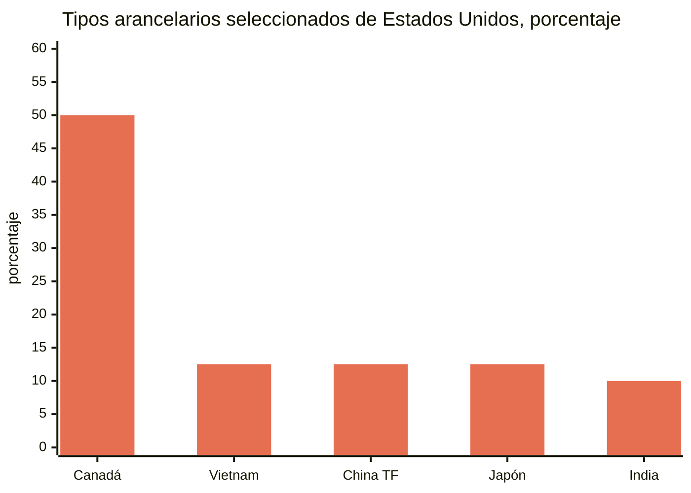

*Nota: Canadá = tipo de la Sección 338 (50 %); Vietnam, China TF y Japón = tipos de la Sección 301 por trabajo forzoso (12,5 %); India = tipo de la Sección 301 por trabajo forzoso en vigor (10 %; el tipo del 18 % anunciado en el acuerdo nunca se aplicó). Fuentes: USTR, Troutman, BDO, Industrial Front.*

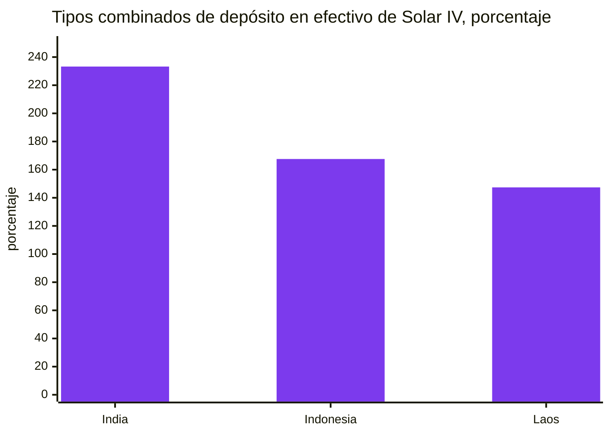

*Nota: tipo combinado de depósito en efectivo antidumping más derecho compensatorio, tipos para todos los demás. India: AD 107,17 % + CVD 126,09 %; Indonesia: AD 94,36 % + CVD 73,20 %; Laos: AD 65,36 % + CVD 82,03 %. Fuente: órdenes de derechos antidumping y compensatorios del Departamento de Comercio, 9 de noviembre de 2026.*

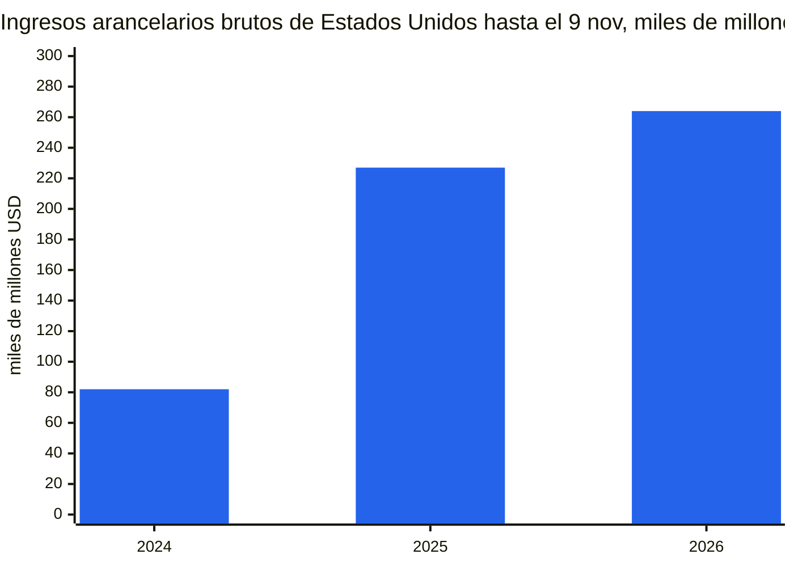

*Nota: ingresos brutos por aranceles e impuestos especiales recaudados en el año natural hasta el 9 de noviembre, a partir de los estados diarios del Tesoro de Estados Unidos seguidos por el Bipartisan Policy Center. Fuente: Bipartisan Policy Center vía The Motley Fool, 15 de noviembre de 2026.*

---

## 5. Análisis en profundidad de la política de Estados Unidos

### Sección 301 — los avisos del 10 de noviembre

La USTR publicó un Aviso de Prórroga de Exclusiones de Productos el 10 de noviembre de 2026 (91 FR 72610; FR Doc. 2026-22925), que prorroga las 178 exclusiones vigentes de los aranceles de la Sección 301 para China (transferencia de tecnología y propiedad intelectual). Las exclusiones — 164 exclusiones generales con arreglo al HTSUS 9903.88.69 y 14 exclusiones de fabricación solar con arreglo al 9903.88.70 — debían vencer a las 11:59 p. m., hora del este, del 9 de noviembre de 2026. El nuevo periodo cubre las mercancías introducidas para el consumo, o retiradas de depósito para el consumo, a partir de las 12:01 a. m., hora del este, del 10 de noviembre de 2026, y antes de las 11:59 p. m., hora del este, del 9 de enero de 2027. El alcance de cada exclusión no cambia; cada una se aplica solo a los productos que coinciden con el número HTSUS de 10 dígitos y la descripción del producto en las notas del HTSUS. La USTR no solicitó nuevos comentarios, basándose en el expediente de su aviso de septiembre de 2025. Una coalición de 24 asociaciones sectoriales había solicitado una prórroga de al menos un año el 4 de noviembre. Algunas informaciones señalan una discrepancia en el aviso, con partes que se refieren al 10 de enero en lugar del 9 de enero; la fecha operativa es el 9 de enero. La USTR publicó otro aviso el 10 de noviembre (91 FR 72608; FR Doc. 2026-22867) que suspende además la acción de la Sección 301 sobre las prácticas marítimas, logísticas y de construcción naval de China — incluidas las tasas sobre buques cubiertos (Anexos I–III) y los derechos del Anexo V.A — con efecto desde el 10 de noviembre de 2026 hasta las 11:59 p. m., hora del este, del 9 de enero de 2027. Ninguna parte devenga responsabilidad por las tasas durante la suspensión. La USTR recibió unos 60 comentarios únicos sobre la propuesta. La acción había estado suspendida anteriormente desde el 10 de noviembre de 2025 hasta el 9 de noviembre de 2026.

La USTR también determinó prorrogar tres meses su investigación en curso de la Sección 301 sobre determinados actos, políticas y prácticas del Gobierno de Vietnam relacionados con la protección y el cumplimiento de la propiedad intelectual (expediente USTR-2026-0364; FR Doc. 2026-22868; con efecto desde el 3 de noviembre de 2026). La investigación se inició el 29 de mayo de 2026, después de que Vietnam fuera designado país extranjero prioritario en el Informe Especial 301 de 2026 de la USTR. Las determinaciones sobre la procedencia de medidas y sobre qué medidas adoptar, en su caso, se tomarán ahora a más tardar el 28 de febrero de 2027, en lugar del plazo original del 29 de noviembre de 2026. La USTR citó «cuestiones complejas o complicadas que requieren más tiempo». Vietnam también es objeto de otras dos investigaciones pendientes de la Sección 301, relativas a las prohibiciones de importación por trabajo forzoso y al exceso de capacidad estructural en la manufactura. Vietnam ya está sujeto a un arancel del 12,5 % de la Sección 301 por trabajo forzoso con arreglo al artículo HTSUS 9903.05.04, en vigor desde el 24 de julio de 2026.

A 10 de noviembre de 2026 no se habían publicado medidas definitivas de la investigación de la Sección 301 de la USTR sobre el exceso de capacidad estructural en la manufactura. El ministro de Industria de Corea del Sur, Kim Jung-kwan, dijo a una comisión de la Asamblea Nacional el 10 de noviembre que Seúl seguía de cerca la evolución; se informó de que las conclusiones llevaban más de dos meses de retraso respecto del calendario que esperaban los funcionarios surcoreanos. La investigación abarca 16 economías, incluida Corea del Sur. Corea del Sur trata de mantener los aranceles estadounidenses cerca del 15 %. Abogados y analistas de comercio dijeron a Global Trade Review que el principal riesgo a corto plazo identificado era esta investigación, iniciada en marzo, que abarca a China, Singapur, Suiza, Noruega, Indonesia, Malasia, Camboya, Tailandia, Corea del Sur, Vietnam, Taiwán, Bangladés, México, Japón e India, así como a la UE, con una decisión prevista para marzo de 2027.

### Sección 232 — sin nuevas medidas; el polisilicio vence el 4 de diciembre

En el periodo no se identificó ninguna nueva proclamación ni cambio de tipos de la Sección 232. El régimen de la Sección 232 en vigor a 9 de noviembre de 2026, resumido a partir del Arancel Armonizado y las orientaciones de la CBP, es: acero, aluminio y cobre al 50 %, incluidos muchos derivados (otros derivados enumerados, 25 %; maquinaria industrial fija, equipos de energía y agrícolas, y equipos de calefacción, ventilación y aire acondicionado para el hogar, 15 % en total); semiconductores al 25 % con exenciones enumeradas; productos farmacéuticos patentados al 100 % (genéricos no cubiertos), con tipos más bajos para algunos orígenes y empresas; automóviles y autopartes del 15 % al 25 %; derivados del cobre, camiones y autopartes de camiones, madera y tablones, polisilicio y drones, cada uno con sus propios tipos y condiciones. Los derechos sobre el polisilicio se aplican el 4 de diciembre de 2026, y hasta entonces una norma de la BIS permite al Departamento de Comercio impedir que un importador que introduzca cantidades sustancialmente superiores a sus volúmenes históricos realice nuevas entradas antes del 4 de diciembre, salvo que el Departamento de Comercio conceda una exención. La robótica y la maquinaria industrial tienen una conclusión de amenaza en virtud de la Proclamación 11077, de 28 de octubre de 2026, que ordena negociaciones y no impone ningún nuevo arancel. El calendario de enero de 2027 incluye aumentos de tipos de la Sección 232 sobre muebles y armarios: los muebles tapizados al 30 % y los armarios de cocina y tocadores al 50 % a partir del 1 de enero de 2027.

### CBP — importador extranjero registrado; anulación del Formulario 5106

La CBP publicó la norma provisional definitiva «Requisitos Reforzados para los Importadores Extranjeros Registrados» (CBP Dec. 26-19, 91 FR 69977; FR Doc. 2026-22735) el 6 de noviembre de 2026, que aplica la Sección 2 de la Orden Ejecutiva 14411. A partir del 5 de enero de 2027, un importador extranjero registrado solo podrá introducir mercancías para el consumo si está validado por CTPAT o presenta sus entradas a través de un agente de aduanas autorizado validado por CTPAT. Una nueva Parte 110 del reglamento aduanero define un «importador registrado de Estados Unidos» (ciudadano estadounidense o residente permanente legal, o entidad constituida con arreglo a la legislación estadounidense y ubicada en Estados Unidos, con condiciones adicionales de propiedad o de bienes inmuebles — por ejemplo, al menos el 51 % de la propiedad efectiva en manos de ciudadanos estadounidenses o residentes permanentes legales con control, o la propiedad directa de bienes inmuebles estadounidenses significativos sin cargas). La condición de importador estadounidense o extranjero debe declararse en la entrada y en el resumen de entrada (nuevos 19 CFR 141.21–141.22); los agentes deben verificar la condición de importador estadounidense de sus clientes revisando los registros y conservar los registros de verificación durante cinco años; se añadieron tres nuevos campos de datos a los Formularios 3461 y 7501 de la CBP (y equivalentes electrónicos) mediante un mensaje CSMS. Los agentes pueden solicitar un cumplimiento diferido hasta el 5 de enero de 2027; se espera que todos los agentes cumplan plenamente antes del 6 de mayo de 2027. La norma también amplía las circunstancias en las que los agentes pueden enfrentarse a sanciones en virtud de 19 U.S.C. 1592. Los comentarios vencen el 5 de enero de 2027 (expediente USCBP-2026-1387). Según el propio análisis de la CBP: el 0,4 % de los importadores extranjeros registrados están validados por CTPAT y el 68 % ya utiliza un agente validado; el 32 % restante no podrá seguir importando a Estados Unidos a menos que cambie de agente o se valide por CTPAT.

Por separado, la CBP envió cartas a numerosos importadores certificados CTPAT en las que indicaba que sus números de importador registrado podrían quedar anulados para las entradas presentadas a partir de las 12:01 a. m., hora del este, del 18 de noviembre de 2026, a menos que se resuelvan antes las preocupaciones de la CBP sobre la exactitud de la información del Formulario 5106 de la CBP del importador (véase A5). El aviso de propuesta de reglamentación de la CBP sobre envíos de bajo valor, de 8 de octubre de 2026 (91 FR 64532; expediente USCBP-2026-0298), sigue abierto, con comentarios hasta el 7 de diciembre de 2026. La propuesta exigiría que las entradas informales de mercancías de hasta 2.500 dólares se presentaran electrónicamente en la fecha de importación o antes, exigiría una fianza en cada entrada informal, y convertiría al agente en el importador registrado cuando presente la entrada por un consignatario que no sea el propietario o el comprador. La exención de minimis de 800 dólares sigue suspendida indefinidamente — para los envíos no postales desde el 24 de junio de 2026 y para los envíos postales desde el 24 de julio de 2026. Por separado, la CBP trasladó la fecha a partir de la cual una entrada formal pasa a ser obligatoria para el correo sujeto a derechos de las Secciones 201, 232 o 301 o a requisitos de organismos gubernamentales asociados, del 22 de octubre de 2026 al 20 de enero de 2027.

### Controles de exportación de la BIS — Regla de Afiliados suspendida hasta el 10 de enero; los supresores pasan al control del Departamento de Comercio

La BIS publicó una norma definitiva (FR Doc. 2026-22793) que prorroga la suspensión de su norma provisional definitiva, «Ampliación de los Controles de Usuario Final para Abarcar a las Filiales de Determinadas Entidades Enumeradas» (la Regla de Afiliados), hasta el 10 de enero de 2027. La suspensión de un año impuesta en noviembre de 2025 (90 FR 50857) debía terminar el 9 de noviembre de 2026; la nueva norma entró en vigor el 9 de noviembre de 2026, por lo que no hubo interrupción. La Regla de Afiliados, publicada el 30 de septiembre de 2025 (90 FR 47201), ampliaría los controles de exportación en virtud del Reglamento de Administración de Exportaciones a entidades extranjeras participadas en un 50 % o más, directa o indirectamente, individualmente o en conjunto, por una o más partes de la Lista de Entidades, la Lista de Usuarios Finales Militares o determinadas partes designadas por la OFAC. También introdujo una nueva señal de alerta que impone a los exportadores el deber de resolver las cuestiones de propiedad cuando se sabe que una parte extranjera es parcialmente propiedad de una entidad incluida en una lista. La prórroga no retira ni modifica la norma. Sin más medidas de la BIS, los controles ampliados entrarán en vigor el 10 de enero de 2027. El aviso del Registro Federal no ofrece ninguna justificación política más allá del cambio de fecha; funcionarios de la administración han indicado que la prórroga está vinculada a la tregua comercial entre Estados Unidos y China, también prorrogada hasta el 10 de enero de 2027. La BIS también anunció que, a partir del 20 de noviembre de 2026, las exportaciones de determinados silenciadores, amortiguadores y supresores de sonido pasan de la Lista de Municiones de Estados Unidos del Departamento de Estado al control del Reglamento de Administración de Exportaciones de la BIS; los supresores se añadirán a la Lista de Control de Comercio y la BIS exigirá una licencia para determinadas exportaciones, reexportaciones o transferencias dentro del país, incluidas las cesiones de software y tecnología conexos a personas extranjeras. Las excepciones de licencia actualmente disponibles para las armas de fuego también estarán disponibles para los supresores.

### Registro Federal — actividad de derechos antidumping y compensatorios en el periodo

9 de noviembre: el Departamento de Comercio publicó órdenes definitivas de derechos antidumping y compensatorios sobre células y módulos fotovoltaicos de silicio cristalino procedentes de India, Indonesia y Laos (véase A7). 10 de noviembre: el Departamento de Comercio concluyó preliminarmente que los productos de hojalata de Taiwán y Türkiye se venden en Estados Unidos a un precio inferior al valor razonable. El Departamento de Comercio fijó un tipo antidumping del 18,07 % para Ton Yi Industrial Corporation de Taiwán y para todos los demás exportadores taiwaneses. Para Türkiye fijó el 3,89 % para Tosyali y para todos los demás exportadores, y el 42,06 % para Tatrix International. Los importadores adeudan ahora depósitos en efectivo a estos tipos. Los tipos se suman a los tipos preliminares que el Departamento de Comercio fijó en septiembre para China, del 136,52 % por dumping y del 66,61 % por subvenciones. La conclusión definitiva de dumping para Türkiye debe publicarse 75 días después de la firma del 5 de noviembre (19 de enero de 2027); para Taiwán, 135 días después de la publicación del 10 de noviembre (25 de marzo de 2027); las conclusiones definitivas sobre China deben publicarse antes del 30 de noviembre de 2026, salvo aplazamiento. 12 de noviembre: el Departamento de Comercio publicó los resultados definitivos de la revisión administrativa antidumping de armarios, tocadores y componentes de madera procedentes de China (periodo 2024–2025), fijando un tipo antidumping del 7,48 % para las empresas revisadas — Yixing Pengjia Technology, Jiangsu Xiangsheng Bedtime Furniture, Xiamen Golden Huanan y Zhongshan NU Furniture — aplicable a los envíos cubiertos introducidos o retirados para el consumo a partir del 12 de noviembre de 2026. El tipo de depósito en efectivo para toda China se mantiene en el 251,64 %. En la revisión administrativa de derechos compensatorios de molduras y carpintería de madera procedentes de China, el Departamento de Comercio fijó tipos definitivos de derechos compensatorios del 147,88 % para Nanping Huatai Wood and Bamboo Co., Fujian Yinfeng Imp & Exp Trading Co. y Fujian Hongjia Craft Products Co., y del 21,39 % para las empresas no seleccionadas objeto de revisión, aplicables a los envíos cubiertos introducidos o retirados para el consumo a partir del 12 de noviembre de 2026. El Departamento de Comercio tiene previsto dictar instrucciones de liquidación no antes de 35 días después de la publicación (17 de diciembre de 2026) en cada caso.

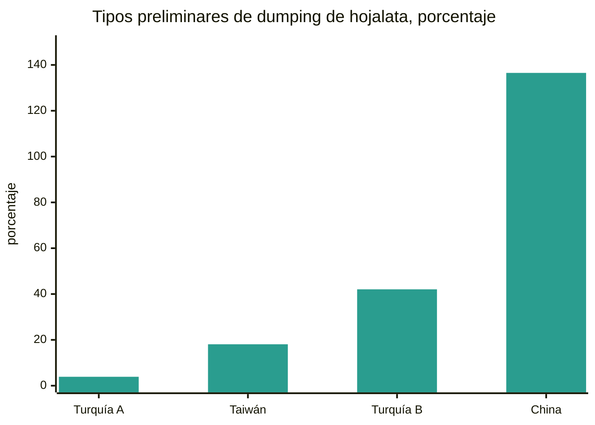

*Nota: Turquía A = Tosyali y todos los demás exportadores (3,89 %); Turquía B = Tatrix International (42,06 %); China = tipo preliminar de septiembre (136,52 %). Fuente: determinaciones preliminares del Departamento de Comercio, 10 de noviembre de 2026.*

### Temas permanentes

- **UFLPA / Lista de Entidades:** en el periodo del 9 al 16 de noviembre no se identificaron nuevas adiciones a la Lista de Entidades de la UFLPA ni nuevas órdenes de retención de liberación. Las adiciones más recientes a la Lista de Entidades (43 empresas) se anunciaron el 31 de julio de 2026; la orientación operativa vigente de la CBP sobre trabajo forzoso para los importadores data de junio de 2026. Los totales de cumplimiento declarados más recientes de la CBP, a partir de la publicación sobre Serbia Zijin, fueron 56 órdenes de retención de liberación y ocho conclusiones en virtud de 19 U.S.C. § 1307; informaciones posteriores situaron el total en 60 órdenes de retención de liberación y ocho conclusiones tras otras dos órdenes del 29 de septiembre de 2026.
- **Casa Blanca:** en el periodo no se dictó ninguna nueva proclamación arancelaria ni hoja informativa.
- **USITC / HTS:** en el periodo no se identificaron nuevos cambios de tipos del HTS más allá de las órdenes de Solar IV. El informe público completo de la USITC sobre Solar IV (Publicación 5804 de la USITC) debe publicarse en el sitio web de la USITC antes del 23 de noviembre de 2026.
- **trade.gov / inteligencia de mercado:** en el periodo no se identificó ninguna nueva publicación de inteligencia de mercado específica sobre la política arancelaria de Estados Unidos.
- **internationaltradetoday.com:** de pago; los titulares confirmaron la noticia sobre la norma de importador extranjero registrado de la CBP (5 de noviembre).

---

## 6. Política mundial por región

### Europa

El reajuste del comercio electrónico de bajo valor de la UE ya está en vigor (véase 3.3): una tasa de tramitación de 2 € por línea de artículo e identificadores de producto obligatorios a partir del 1 de noviembre, además del derecho fijo de 3 € por línea arancelaria en vigor desde el 1 de julio de 2026. El 9 de noviembre, el Consejo acordó eliminar el techo de 150 € de la ventanilla única de importación del IVA, aplicable a partir del 1 de julio de 2028. La actividad arancelaria aduanera de la UE (TARIC) en la semana del 1 al 7 de noviembre estuvo dominada por la preparación anticipada más que por nuevos derechos de protección: se tramitaron 15.055 registros de cambios, de los cuales más de 13.600 eran medidas con fecha futura que preposicionaban el acceso preferencial y los contingentes autónomos que se extienden hasta 2027. El 6 de noviembre, más de 2.500 registros con fecha futura establecieron contingentes arancelarios autónomos cuya entrada en vigor está prevista para el 1 de enero de 2027, incluidos contingentes a gran escala para el sector de transformación de productos del mar. La rotación inmediata se concentró el 1 de noviembre, cuando entraron en vigor 5.405 de las 6.238 medidas que surtían efecto durante la semana. Los reajustes técnicos de defensa comercial, concentrados el 3 de noviembre, recalibraron los límites de las medidas para el PVC a granel, el PVC en suspensión, la aspirina y otros polímeros y productos químicos especializados. El patrón indica una postura administrativa centrada en preparar el acceso de 2027 más que en imponer nuevos derechos, pero los cambios de alcance de la defensa comercial alteran la cobertura de las medidas vigentes sobre polímeros y productos químicos y exigen exactitud en las declaraciones de los importadores.

Se informa de que el acuerdo de libre comercio entre la UE e India se firmará en Bruselas a mediados de diciembre de 2026 (véase 3.3). El acuerdo comercial modernizado entre la UE y México se firmó formalmente el 22 de mayo de 2026 y está pendiente de ratificación por el Parlamento Europeo antes de su entrada en vigor. Se espera que los acuerdos de la UE con Indonesia y Australia se firmen antes de finales de 2026. El acuerdo provisional entre la UE y Mercosur está en vigor provisionalmente desde el 1 de mayo de 2026.

**Fuentes:** [RegFollower](https://regfollower.com/eu-forward-staging-and-trade-defence-realignment-mark-the-november-tariff-turn/); [Flex Logistics](https://flexlogistics.eu/eu-trade-deals-online-sellers/)

### Reino Unido

El aviso sobre medidas comerciales 2026/31 da efecto a la aceptación por parte del secretario de Estado de la recomendación de la Autoridad de Medidas Comerciales en la revisión de expiración ER0080, iniciada el 22 de enero de 2026. El derecho compensatorio sobre la trucha arcoíris originaria de Türkiye, que abarca peces vivos, frescos, refrigerados, congelados y ahumados dentro de los límites de tamaño establecidos en el aviso y clasificados en las partidas 0301, 0302, 0303, 0304 y 0305, se prorroga cinco años, hasta el 30 de enero de 2031, a los tipos vigentes, sin recalcular. El aviso surtió efecto el 6 de noviembre de 2026, con la variación aplicable a partir del 30 de enero de 2026, y sustituye al aviso fiscal 2021/12. Los tipos específicos por exportador oscilan entre el 1,5 % y el 8 %; dos grupos de exportadores enumerados pagan el 6,9 % y el 7,6 %; todos los demás exportadores pagan el 9,5 %.

La Administración de Ingresos y Aduanas de Su Majestad actualizó su resumen de políticas sobre el Mecanismo de Ajuste en Frontera por Carbono del Reino Unido el 2 de noviembre, añadiendo información sobre el cálculo del Alivio del Precio del Carbono. Fue la tercera actualización de este otoño, tras las actualizaciones del 9 de septiembre y el 16 de octubre de 2026, que reflejaron la presentación del Reglamento de 2026 sobre el Mecanismo de Ajuste en Frontera por Carbono (Emisiones y Verificación). El resumen confirma que el CBAM del Reino Unido comenzará el 1 de enero de 2027 y se aplicará a determinados productos de aluminio, cemento, fertilizantes, hidrógeno y hierro y acero identificados por código de mercancía. A menos de dos meses del comienzo, los importadores de los productos cubiertos deben confirmar sus códigos de mercancía, sus datos de emisiones y sus cálculos del Alivio del Precio del Carbono antes de que el mecanismo empiece a cobrar.

El Departamento de Negocios y Comercio publicó sus fichas periódicas sobre comercio e inversión bilaterales el 6 de noviembre, incluida la de Catar. El comercio total de bienes y servicios entre el Reino Unido y Catar fue de 5.400 millones de libras en los cuatro trimestres hasta finales del segundo trimestre de 2026, una disminución del 7,2 %, o 416 millones de libras, respecto a los cuatro trimestres hasta finales del segundo trimestre de 2025. Las exportaciones del Reino Unido a Catar fueron de 3.900 millones de libras (un 10,3 % menos, o 447 millones de libras) y las importaciones de Catar fueron de 1.500 millones de libras (un 2,1 % más, o 31 millones de libras). Catar fue el 47.º socio comercial del Reino Unido, con el 0,3 % del comercio total del Reino Unido.

**Fuente:** [Global Customs Compliance](https://www.globalcustomscompliance.com/trade-and-customs-watch-2026-11-13/?utm_source=rss&utm_medium=rss&utm_campaign=trade-and-customs-watch-2026-11-13)

### Canadá

El ministro de Finanzas, François-Philippe Champagne, anunció cambios en las medidas de alivio arancelario de Canadá el 9 de noviembre (véase 3.7): la remisión horizontal de los aranceles estadounidenses se prorrogó un año, hasta el 30 de junio de 2028, y el alivio incluirá ahora también los bienes no siderúrgicos utilizados en la minería, la explotación de canteras o la extracción de petróleo y gas, y todos los bienes utilizados por entidades públicas de educación, incluidas las ordenadas por organizaciones indígenas; se elimina el alivio para determinados remolques a partir del 1 de diciembre de 2026 y para determinados alambres y extrusiones de aluminio y productos de cartón a partir del 1 de febrero de 2027. Los cambios se suman a los contraaranceles del 15 % al 50 % sobre una serie de importaciones estadounidenses impuestas el 8 de septiembre de 2026. La Agencia de Servicios Fronterizos de Canadá actualizó el Aviso de Aduanas 26-07 el 2 de noviembre, prorrogando la remisión de mercancías programada a los Anexos 1 a 3, introduciendo códigos especiales de autorización para los Anexos 2 y 3, y aclarando las condiciones de elegibilidad; también eliminó el Apéndice A, que ofrecía orientación adicional sobre la remisión de torres eólicas. El ministro de Comercio, Wang Wentao, y el ministro de Comercio Internacional de Canadá, Maninder Sidhu, copresidieron la 29.ª reunión de la Comisión Económica y Comercial Conjunta China–Canadá en Pekín el 3 de noviembre; el fondo de los resultados no pudo verificarse a partir del material revisado.

**Fuentes:** [Departamento de Finanzas de Canadá](https://www.canada.ca/en/department-finance/news/2026/11/canada-modifies-tariff-relief-measures-to-better-support-workers-and-businesses.html); [GHY](https://www.ghy.com/trade-compliance/category/canada-imports/)

### China

La parte china de la prórroga de la tregua se trata en las secciones 2 y 3.1. El sitio en inglés del MOFCOM (english.mofcom.gov.cn) era accesible el 16 de noviembre; solo eran visibles los titulares de la portada, incluidas las declaraciones de un portavoz sobre las medidas de ajuste relativas a la Lista de Entidades No Fiables y la inclusión de la 29.ª reunión de la Comisión Económica y Comercial Conjunta China–Canadá. El fondo de la respuesta del MOFCOM a la tasa de 2 € de la UE en una rueda de prensa del mismo periodo no pudo verificarse a partir de la información revisada.

### India y Nueva Zelanda

El acuerdo provisional entre India y Estados Unidos sigue sin firmarse (véanse A10 y 3.2). Se informa de que el acuerdo entre la UE e India se firmará a mediados de diciembre (véase 3.3). India y la UE también continuaron las conversaciones de aplicación en Bruselas a principios de noviembre. El ministro de Comercio, Piyush Goyal, dijo el 3 de noviembre que India nunca ha abierto su sector lácteo en ningún acuerdo de libre comercio y no permitirá las importaciones de productos modificados genéticamente, una línea roja relevante para todas las vías activas de acuerdos de libre comercio.

### Asia-Pacífico — Corea y Brasil

El presidente Lee Jae-myung instó a su gobierno en una reunión de gabinete el 3 de noviembre a avanzar rápidamente en las conversaciones con Brasil sobre el arancel del 25 % que Brasil impone a los cosméticos coreanos, afirmando que el gravamen era una barrera para un sector con una fuerte demanda local de productos fabricados en Corea. Dijo que trasladar la producción a Brasil no resolvería el problema, citando la fuerte preferencia de los consumidores locales por los cosméticos fabricados en Corea, y preguntó al ministro de Asuntos Exteriores, Cho Hyun, por el estado de las conversaciones. Cho indicó que las conversaciones podrían avanzar ahora tras la reelección del presidente Lula en la segunda vuelta del 25 de octubre. La intervención convierte un arancel sectorial en una cuestión bilateral a nivel presidencial antes del nuevo mandato de Brasil.

Las empresas coreanas de bienes de consumo firmaron contratos de exportación y memorandos de entendimiento por 18 millones de dólares en la Exposición de la Ola Coreana y la Feria de Alimentos Coreanos de Australia, celebradas en Melbourne del 5 al 7 de noviembre, copatrocinadas por el Ministerio de Comercio, Industria y Energía y el Ministerio de Agricultura, Alimentación y Asuntos Rurales y organizadas por KOTRA y la Corporación de Comercio Agroalimentario y Pesquero de Corea. El evento de consulta sobre exportaciones contó con 101 empresas coreanas y 144 compradores de Oceanía y el Sudeste Asiático, que celebraron 1.235 consultas y dieron lugar a 32 contratos y memorandos de entendimiento. Las exportaciones coreanas de cosméticos a Australia aumentaron de 73 millones de dólares en 2023 a 112 millones en 2024 y 166 millones en 2025, apoyadas por las reducciones arancelarias en virtud del Acuerdo de Libre Comercio entre Corea y Australia, en vigor desde el 12 de diciembre de 2014.

**Fuentes:** [SE Daily](https://en.sedaily.com/politics/2026/11/03/lee-presses-brazil-to-cut-25-percent-tariff-on-korean); [Aju Press](https://www.ajupress.com/view/20261108110470271)

### Multilateral

**Organización Mundial del Comercio.** En su reunión del 4 al 6 de noviembre, el Comité de Medidas Sanitarias y Fitosanitarias de la OMC examinó preocupaciones comerciales específicas, la transparencia, la tutoría y el desarrollo de capacidades. La Secretaría informó de que 55 preocupaciones comerciales específicas se resolvieron y 19 se resolvieron parcialmente tras su ejercicio de seguimiento de 2026, en el que se contactó con 39 miembros sobre preocupaciones no planteadas desde noviembre de 2024, con respuestas de 25 miembros. La reunión de noviembre examinó 78 preocupaciones comerciales específicas, incluidas cinco planteadas por primera vez, que abarcan los límites de residuos de plaguicidas y otras medidas reglamentarias en la Unión Europea, las restricciones a la importación que afectan a los productos cárnicos en Colombia, los retrasos en la aprobación de las exportaciones de carne de vacuno paraguaya a Japón, y las restricciones a los productos avícolas chilenos vinculadas a la gripe aviar. El 63 % de las 640 preocupaciones comerciales específicas debatidas desde 1995 se han resuelto (326) o resuelto parcialmente (75). El Comité de Agricultura, en sesión especial, celebró dos presentaciones el 3 de noviembre en las que se examinó la evolución de las negociaciones agrícolas desde la Ronda Uruguay, que abarcaron la competencia de las exportaciones y la constitución de existencias públicas de alimentos por parte de los gobiernos de los países en desarrollo a precios administrados. La próxima reunión, prevista para el 23 de noviembre de 2026, abarcará las restricciones a la exportación y el mecanismo especial de salvaguardia. El 16 de noviembre, la OMC acordó establecer un grupo especial de solución de diferencias para examinar la reclamación de China contra los aranceles de India sobre determinados productos tecnológicos y los programas de incentivos para el sector nacional de fabricación solar, tras la segunda solicitud de China de un grupo especial. Las consultas bilaterales no produjeron un acuerdo; India había bloqueado la solicitud inicial de China en mayo de 2026. El grupo especial examinará el cumplimiento del Acuerdo General sobre Aranceles Aduaneros y Comercio, el Acuerdo sobre Subvenciones y Medidas Compensatorias y el Acuerdo sobre las Medidas en materia de Inversiones relacionadas con el Comercio. El 30 de octubre, los miembros de la OMC adoptaron una declaración que reposiciona la Iniciativa de Ayuda para el Comercio como «Ayuda para el comercio: asociaciones para el comercio y el desarrollo» en una reunión del Comité de Comercio y Desarrollo, que concluyó el 10.º Examen Global de la Ayuda para el Comercio, de dos días, en Ginebra — el primer resultado multilateral sobre el tema en 20 años. La directora general, Ngozi Okonjo-Iweala, pronunció el discurso inaugural en un evento sobre comercio, biodiversidad y economía oceánica el 5 de noviembre, situando la economía oceánica en 2,6 billones de dólares estadounidenses, que sustenta unos 133 millones de empleos, y señalando que más del 80 % de los bienes comercializados en el mundo viajan por mar y que el 72 % del comercio mundial de bienes sigue realizándose en condiciones de nación más favorecida. Señaló el Acuerdo sobre Subvenciones a la Pesca, en vigor desde septiembre de 2025, e instó a los miembros a completar las negociaciones restantes.

**Conferencia de las Naciones Unidas sobre Comercio y Desarrollo (UNCTAD).** La UNCTAD publicó su Actualización del Comercio Mundial (noviembre de 2026) el 9 de noviembre, coincidiendo con la COP31 en Antalya, Türkiye (9–20 de noviembre), en la que se examina cómo el comercio puede apoyar la acción climática. El informe constata que las disposiciones relacionadas con el clima son cada vez más comunes en los acuerdos comerciales, y aparecen en más de la mitad de los acuerdos firmados entre 2016 y 2021, pero su aplicación sigue siendo limitada: solo el 7 % de las disposiciones relacionadas con el clima identificadas en los acuerdos comerciales recientes abordan la reducción de las barreras arancelarias y no arancelarias. De 174 países encuestados en 2025, solo siete informaron de que aplicaban plenamente las medidas de facilitación del comercio para los bienes ecológicos y relevantes para el clima. Las exportaciones mundiales de bienes vinculados a las cadenas de valor de la energía solar y eólica superaron 1,8 billones de dólares en 2025, creciendo más rápido que las exportaciones de otros bienes manufacturados; el comercio de baterías subió un 29 % y el de vehículos eléctricos un 11 % en el primer semestre de 2026; las economías en desarrollo exportaron 1,3 billones de dólares en bienes basados en la biodiversidad en 2024, 1,2 billones de dólares en bienes y servicios oceánicos en 2025, y unos 204.000 millones de dólares estimados en sustitutos no plásticos en 2024. El informe señala que el acceso asequible a las tecnologías climáticas es esencial para la adaptación y la reducción de emisiones. Un informe sobre el desarrollo de la capacidad de exportar al mercado chino, redactado por el Instituto de Economía y Política Mundiales de la Academia China de Ciencias Sociales (CASS) y la UNCTAD, se presentó en Shanghái el 5 de noviembre en el 9.º Foro Económico Internacional de Hongqiao, celebrado junto a la Exposición Internacional de Importaciones de China. El informe analiza 10 socios comerciales, entre ellos Colombia, Kenia, España, Tailandia y el Reino Unido; la participación de China en las exportaciones mundiales pasó del 3,2 % en 2000 al 9,2 % en 2025, según el director general del instituto.

**Centro de Comercio Internacional (ITC).** El Centro de Comercio Internacional y el Banco Africano de Exportación e Importación presentaron el informe «Reconfigurar el comercio entre África y el Caribe: oportunidades para la transformación económica» en Saint John's, Antigua y Barbuda, el 3 de noviembre, al margen de la Reunión de Jefes de Gobierno de la Commonwealth. El informe constata que el comercio anual de bienes y servicios entre África y el Caribe podría alcanzar hasta 1.650 millones de dólares en 2030, sin contar los combustibles minerales. Alrededor del 80 % del potencial anual de exportación de bienes de África al Caribe sigue sin aprovecharse, mientras que el potencial de exportación del Caribe reside principalmente en los servicios, que alcanzan 481 millones de dólares. Los sectores prioritarios incluyen los alimentos procesados y los piensos, los productos químicos, los minerales y los metales, la confección y los textiles, el cuero y el calzado, el turismo, los servicios de transporte y las industrias creativas. Las conclusiones se basan en el análisis del comercio y del potencial de exportación, las evaluaciones sectoriales y una encuesta a 1.175 empresas y organizaciones de apoyo a las empresas de ambas regiones.

**Organización Mundial de Aduanas (OMA).** El 3 de noviembre, la OMA celebró un simposio híbrido en su sede de Bruselas sobre el papel de las aduanas en el socorro en casos de desastre, con más de 190 participantes de administraciones aduaneras, organizaciones internacionales y profesionales humanitarios y logísticos; el secretario general, Ian Saunders, vinculó el debate con el tema de la OMA para 2026, «Las aduanas protegen a la sociedad mediante la vigilancia y el compromiso». El 5 de noviembre, la OMA publicó su Informe Anual 2025–2026. El 9 de noviembre, la OMA celebró un evento mundial del Proyecto de Aduanas Inteligentes sobre tecnologías disruptivas, y el 11 de noviembre un simposio sobre la eliminación de las falsificaciones del comercio electrónico, con administraciones aduaneras, la Unión Postal Universal y eBay entre los participantes. El 12 de noviembre, la OMA informó de su apoyo a los países de la Comunidad de África Oriental en la revisión de las normas de origen y el desarrollo de capacidades autónomas de formación, y el 13 de noviembre el secretario general se reunió con el director general de la Organización Mundial de Sanidad Animal al margen de la reunión del Grupo de la OMA sobre Falsificación y Piratería para reafirmar la cooperación contra el comercio ilícito.

**Fuentes:** [Logistics News PH](https://logisticsnews.ph/2026/11/12/wto-sps-committee-reports-progress-in-resolving-trade-concerns/); [India ReNews](https://indiarenews.in/blog/read/wto-sets-up-dispute-panel-to-examine-china-s-challenge-against-india-s-solar-incentives-and-technology-tariffs); [UNCTAD](https://unctad.org/publication/global-trade-update-november-2026); [WCO](https://www.wcoomd.org/en/media/newsroom/2026/november.aspx)

---

## 7. Medidas de cumplimiento

### Derechos antidumping y compensatorios

Las órdenes definitivas de derechos antidumping y compensatorios del Departamento de Comercio sobre células solares de India, Indonesia y Laos (véase A7) y los tipos preliminares de hojalata para Taiwán y Türkiye y los resultados de las revisiones de armarios y carpintería de madera (véase la sección 5) fueron las medidas de defensa comercial de la semana. Las órdenes solares son la mayor medida de derechos antidumping y compensatorios del periodo por tipo, con tipos combinados de depósito en efectivo superiores al 100 % del valor declarado en cada caso. Los tipos preliminares de hojalata fijaron los costes de depósito en efectivo para los proveedores taiwaneses y turcos, mientras que el caso de China, con tipos mucho más altos (136,52 % por dumping y 66,61 % por subvenciones en septiembre), se acerca a su determinación definitiva el 30 de noviembre. Las revisiones de armarios y carpintería de madera restablecieron los tipos de depósito en efectivo para los exportadores chinos de muebles y carpintería nombrados, manteniendo el tipo muy alto para toda China (251,64 %), lo que preserva una gran diferencia de derechos entre los proveedores revisados y los no revisados.

### Incautaciones de la CBP y trabajo forzoso

Agentes de la CBP en el cruce de DeConcini, puerto de Nogales, remitieron a un ciudadano estadounidense de 36 años que conducía un Nissan Titan de 2006 y regresaba de México a una inspección secundaria el 3 de noviembre. Una inspección física de las sillas plegables de plástico en la caja del camión encontró más de 300 paquetes con fentanilo ocultos en las sillas. El vehículo y los narcóticos fueron incautados; agentes especiales de Investigaciones de Seguridad Nacional acudieron al puerto de entrada, y el caso está pendiente de investigación adicional. Se incautaron más de 112 libras de fentanilo. En el periodo de cobertura no se identificó ninguna nueva Orden de Retención de Liberación. Las órdenes de retención de liberación más recientes en las publicaciones de la CBP antes del periodo fueron las órdenes sobre aceite de palma de Indonesia y la orden de Serbia Zijin Copper del 16 de junio de 2026. La ausencia de una nueva orden de retención de liberación en el periodo, tras una serie de órdenes en verano y otoño, es en sí misma un dato sobre la cadencia de cumplimiento en materia de trabajo forzoso; los importadores no deben interpretarla como un cambio de política.

Un hombre de Hawái fue condenado el 12 de noviembre a 24 meses de prisión y multado con 15.000 dólares por transferir fondos a Irán sin licencia de la OFAC. Arash Einolghozati, de 38 años, de Waialua, Oahu, fue condenado por la jueza federal de distrito Helen Gillmor a 24 meses de prisión, seguidos de tres años de libertad supervisada. Según los registros judiciales, desde principios de marzo de 2026 y continuando hasta al menos abril de 2022 (según se indica en el comunicado del Departamento de Justicia), Einolghozati realizó múltiples transferencias de moneda de curso legal y criptomonedas desde dentro de Estados Unidos a destinatarios que sabía que estaban en Irán o que transferirían los fondos a personas en Irán, sabiendo que era ilegal hacerlo sin una licencia de la Oficina de Control de Activos Extranjeros del Departamento del Tesoro. El total transferido fue de más de 226.000 dólares. El FBI investigó el caso. El caso muestra que el cumplimiento penal de las sanciones contra Irán alcanza a los remitentes individuales que utilizan tanto efectivo como criptomonedas, y sigue a la campaña de la Operación Economic Outcast del Tesoro contra los canales financieros relacionados con Irán.

**Fuentes:** [CBP](https://www.cbp.gov/newsroom/local-media-release/cbp-officers-seize-112-pounds-fentanyl-nogales-port-entry); [Departamento de Justicia de Estados Unidos](https://www.justice.gov/usao-hi/pr/north-shore-man-sentenced-two-years-prison-sending-money-iran-violation-us-sanctions)

### Sanciones

La OFAC designó una presunta red de empresas fraudulentas de abanderamiento y registro marítimo que facilitaban las exportaciones de petróleo iraní, en virtud de la Orden Ejecutiva 13902, en una acción anunciada el 4 de noviembre. La red estaba dirigida por los ciudadanos indios Suniel Kumar Sharma y Jaspreet Preeti Shahid, con sede en Chandigarh, India, que operaban empresas que se hacían pasar por registros de pabellón y proveedores de servicios marítimos para países y jurisdicciones como Guyana, Esuatini, Laos, Aruba, Mali, Mozambique, Malaui, Sint Maarten y Timor-Leste. Las empresas vendían registros y certificados fraudulentos a buques que transportaban petróleo iraní, incluidos buques que operaban en nombre del ejército iraní y sus apoderados. La OFAC designó a cuatro personas y nueve entidades de la red, y también sancionó a Fugo Ground Services Inc., con sede en Türkiye, por su actividad en el sector de la aviación de Irán. La OFAC publicó una alerta junto con las designaciones, «La dependencia de la flota fantasma iraní de pabellones falsos para evadir las sanciones», en la que advertía a los actores comerciales de que evitaran los buques que utilizan registros de pabellón sospechosos. La misma acción añadió la anotación «Riesgo de sanciones secundarias: véase la Sección 2 de la O.E. 13902» a más de 1.000 entradas existentes en la Lista de Nacionales Especialmente Designados y Personas Bloqueadas.

El Departamento de Estado designó a ocho entidades y dos personas, e identificó cinco buques como bienes bloqueados, en virtud de la Orden Ejecutiva 14404 (1 de mayo de 2026), en una acción anunciada el 5 de noviembre. Los objetivos incluyen a Guillermo Faustino Rodríguez López Calleja, parte de una red de empresas navieras que transportan productos petrolíferos hacia y desde Cuba; Any Rodríguez Lastres, hija de la presidenta de GAESA, Ania Guillermina Lastres Morera; Caroil Transport Marine Ltd, con sede en Chipre; y la empresa china China National Electronic Import and Export Company (CEIEC) y Beijing H&C Technologies Co. Ltd, descritas como proveedoras de las fuerzas militares del régimen. Los cinco buques identificados como bienes bloqueados son ESPERANZA, GLORIA C, MARIA CRISTINA, EMILIA y LOURDES. El mismo día, el director de la OFAC, Bradley T. Smith, dictó una determinación de que la autoridad sancionadora sectorial de la Sección 2(a)(i)(A) de la O.E. 14404 se aplica a los sectores de la electrónica, la manufactura, la marina y la tecnología de la economía cubana. Esos cuatro sectores se suman a los cinco nombrados en la propia Orden Ejecutiva: energía, defensa y material conexo, metales y minería, servicios financieros y seguridad. Cualquier persona extranjera de la que se determine que opera o ha operado en los cuatro nuevos sectores cubanos queda ahora expuesta a sanciones de bloqueo.

El Departamento de Estado designó a tres personas en virtud de la Orden Ejecutiva 13949 el 4 de noviembre por la búsqueda por parte de Irán de sistemas portátiles de defensa antiaérea (MANPADS): Mohammed Ali Tolibov, que dirige Armory Alliance, un intermediario con sede en Bielorrusia que vincula empresas con sede en China con Irán; Vanguard Tactical Supply Limited, una empresa nigeriana presuntamente utilizada para desviar MANPADS de origen chino hacia Irán mediante usuarios finales falsos; y Alisher Domullodzhanov, con sede en Rusia, acusado de ayudar a Irán en su búsqueda de los lanzadores. Los activos de los tres en Estados Unidos, o en manos de personas estadounidenses, están congelados y deben notificarse a la OFAC.

La Red de Control de Delitos Financieros (FinCEN) dictó una orden el 6 de noviembre por la que se prohíbe a las instituciones financieras estadounidenses participar en cualquier transmisión de fondos desde o hacia MEXC Global, una bolsa de criptomonedas con sede en Seychelles, al haber determinado que es una institución financiera de especial preocupación en materia de blanqueo de capitales en relación con las finanzas ilícitas rusas. La FinCEN dijo que MEXC Global facilitó al menos 16.700 millones de dólares en transacciones vinculadas a la evasión de sanciones, la ciberdelincuencia y otras actividades ilícitas entre mayo de 2021 y mayo de 2026, procesó transacciones con entidades rusas sancionadas, incluidas la bolsa Garantex y su sucesora Grinex, procesó más de 1.000 millones de dólares en transacciones directas con bolsas de criptomonedas iraníes, incluidas bolsas sancionadas, y facilitó aproximadamente 22 millones de dólares en transacciones vinculadas al Banco Central de Irán, el Cuerpo de la Guardia Revolucionaria Islámica y su Fuerza Qods. La orden excluye del sistema financiero estadounidense a una bolsa de criptomonedas utilizada para la evasión de sanciones rusas e iraníes, y es relevante para el cumplimiento en materia de financiación del comercio y pagos para las contrapartes que utilizan vías de criptomonedas.

**Fuentes:** [Steptoe](https://www.steptoe.com/en/news-publications/stepwise-risk-outlook/sanctions-update-november-9-2026.html); [Departamento de Estado de Estados Unidos](https://www.state.gov/releases/office-of-the-spokesman/2026/11/further-sanctions-on-the-cuban-regimes-foreign-military-support-and-illicit-revenue-networks-fact-sheet/)

---

## 8. Publicación de datos

### China — comercio exterior de octubre de 2026

La Administración General de Aduanas de China publicó las cifras preliminares del comercio de octubre de 2026 el 10 de noviembre. En dólares estadounidenses, las exportaciones de octubre subieron un 35,2 % interanual, hasta 412.300 millones de dólares, y las importaciones subieron un 41,6 %, hasta 307.100 millones de dólares. En yuanes, las exportaciones de octubre subieron un 28,7 %, hasta 2,79 billones de yuanes, y las importaciones subieron un 34,7 %, hasta 2,08 billones de yuanes. El comercio total de bienes entre enero y octubre alcanzó 44,81 billones de yuanes, un 20 % más interanual. El superávit de bienes de octubre fue de 105.300 millones de dólares, por debajo de los 133.500 millones de septiembre de 2026; el superávit acumulado de enero a octubre alcanzó 1.042.600 millones de dólares. Las exportaciones de enero a octubre, de 3.782.800 millones de dólares, ya superan las exportaciones de todo el año 2025, de 3.771.900 millones de dólares, según lo informado. Las exportaciones de circuitos integrados se duplicaron con creces entre enero y octubre, hasta 341.100 millones de dólares, un 111,1 % más interanual (desde 161.600 millones de dólares); las importaciones de circuitos integrados fueron de 566.500 millones de dólares, un 65,1 % más. Las exportaciones de enero a octubre en yuanes fueron de 25,99 billones de yuanes, un 17,6 % más; las importaciones fueron de 18,82 billones de yuanes, un 23,6 % más; los productos mecánicos y eléctricos representaron 16,81 billones de yuanes de exportaciones, un 25,2 % más, o el 64,7 % del total. El comercio con la ASEAN creció un 24,2 %, con la UE un 8,5 % y con Estados Unidos un 6,3 % entre enero y octubre (en yuanes, según lo informado). La GACC señaló que las cifras son preliminares y que su boletín mensual es más preciso.

**Fuente:** [NGlobe News](https://www.nglobenews.com/en/article/china-october-trade-surplus-1-trillion-2026-11-10/)

### India — comercio exterior de octubre de 2026

El Ministerio de Comercio de India publicó las estimaciones rápidas de octubre de 2026 el 13 de noviembre. Las exportaciones de mercancías subieron un 45,06 % interanual, hasta un récord de 49.470 millones de dólares, mientras que las importaciones de mercancías alcanzaron un récord de 89.350 millones de dólares, lo que deja un déficit de mercancías de 39.880 millones de dólares — mayor que los 30.210 millones de septiembre, pero menor que los 42.580 millones de octubre de 2025. Incluidos los servicios, las exportaciones totales alcanzaron 89.990 millones de dólares y el déficit total se redujo a 20.090 millones de dólares. Las importaciones de petróleo subieron un 54,31 % interanual, hasta 22.820 millones de dólares, y las importaciones de oro subieron a 5.510 millones de dólares desde 1.800 millones en septiembre, antes de Diwali. El ministerio señaló los productos petrolíferos, los bienes electrónicos, las gemas y la joyería, los productos químicos orgánicos e inorgánicos y los bienes de ingeniería como motores del crecimiento de las exportaciones. Las exportaciones de servicios fueron de 40.510 millones de dólares; las importaciones de servicios, de 20.720 millones de dólares (estimaciones). Las exportaciones de mercancías de abril a octubre de 2026–27 fueron de 309.060 millones de dólares (desde 253.400 millones un año antes); las exportaciones totales, de 568.840 millones de dólares, un 16,66 % más; las importaciones totales, de 662.190 millones de dólares, un 16 % más.

**Fuente:** [GuruTrade](https://www.gurutrade.com/news/india-oct-trade-deficit-hits-1-yr-high-of-39-88b-on-gold-1794605244.html)

### Zona del euro y Alemania

Eurostat publicó las primeras estimaciones del comercio de bienes de septiembre de 2026 el 13 de noviembre. La zona del euro registró un déficit de 10.300 millones de euros con el resto del mundo, frente a un superávit de 13.500 millones de euros en septiembre de 2025 y un déficit de 16.600 millones de euros en agosto de 2026. La UE registró un déficit de 16.800 millones de euros, frente a un superávit de 11.400 millones un año antes. Eurostat atribuyó gran parte del deterioro a la energía, donde el déficit de la zona del euro se amplió a 33.000 millones de euros desde 20.700 millones, y a la reducción del superávit de maquinaria y vehículos, a 3.000 millones de euros desde 10.000 millones. Las exportaciones de la zona del euro fueron de 272.700 millones de euros, un 6,0 % más interanual; las importaciones, de 283.000 millones de euros, un 16,1 % más. El saldo de la zona del euro de enero a septiembre de 2026 fue de –36.500 millones de euros, frente a +102.200 millones en el mismo periodo de 2025; exportaciones de 2.263.400 millones de euros (un 2,4 % más); importaciones de 2.299.900 millones de euros. El déficit de la UE de enero a septiembre fue de 83.200 millones de euros, frente a un superávit de 85.500 millones en el mismo periodo de 2025. Las cifras son provisionales, basadas en la información transmitida por los Estados miembros antes del 10 de noviembre de 2026.

La Oficina Federal de Estadística de Alemania (Destatis) publicó las cifras provisionales del comercio exterior de septiembre de 2026 el 9 de noviembre (comunicado de prensa n.º 390). Sobre una base ajustada por calendario y estacionalmente, las exportaciones subieron un 2,0 % respecto a agosto y las importaciones subieron un 4,2 %. Las exportaciones a países de la UE subieron un 3,5 % en el mes, mientras que las exportaciones a países no pertenecientes a la UE subieron un 0,1 %. Las exportaciones fueron de 141.100 millones de euros (un 2,0 % más mensual; un 7,7 % más interanual); las importaciones, de 125.500 millones de euros (un 4,2 % más mensual; un 8,7 % más interanual); la balanza comercial exterior fue un superávit de 15.600 millones de euros, por debajo de los 17.900 millones de agosto de 2026 y prácticamente sin cambios respecto a los 15.500 millones de septiembre de 2025. Las exportaciones sin ajustar fueron de 148.500 millones de euros; las importaciones sin ajustar, de 131.100 millones de euros; el superávit sin ajustar, de 17.400 millones de euros. Destatis dijo que los resultados detallados se publicarían el 20 de noviembre de 2026 y que, en esta fase, no podía facilitar información sobre las razones de los cambios en el comercio con países o grupos de países concretos.

**Fuentes:** [Eurostat](https://ec.europa.eu/eurostat/en/web/products-euro-indicators/w/6-13112026-bp); [Destatis](https://www.destatis.de/EN/Press/2026/11/PE26_390_51.html)

### Japón — comercio de octubre de 2026, primeros 20 días

La Aduana de Japón publicó cifras provisionales para los primeros 20 días de octubre de 2026 el 10 de noviembre. Las exportaciones subieron un 23,5 % interanual, hasta 7.314.700 millones de yenes, pero las importaciones subieron un 32,4 %, hasta 8.125.100 millones de yenes, lo que amplió el déficit a 810.400 millones de yenes, frente a 216.600 millones un año antes. La publicación solo publica totales, sin desglose por socio o mercancía. Las cifras provisionales parciales del mes apuntan a un déficit más amplio en octubre completo, impulsado por un crecimiento de las importaciones superior al de las exportaciones; la publicación del mes completo, prevista para la semana siguiente, mostrará si el patrón se mantuvo durante todo el mes.

**Fuente:** [Kilambi](https://news.kilambi.com/stories/2026-11-09-japan-trade-deficit-widens-october-first-20-days/)

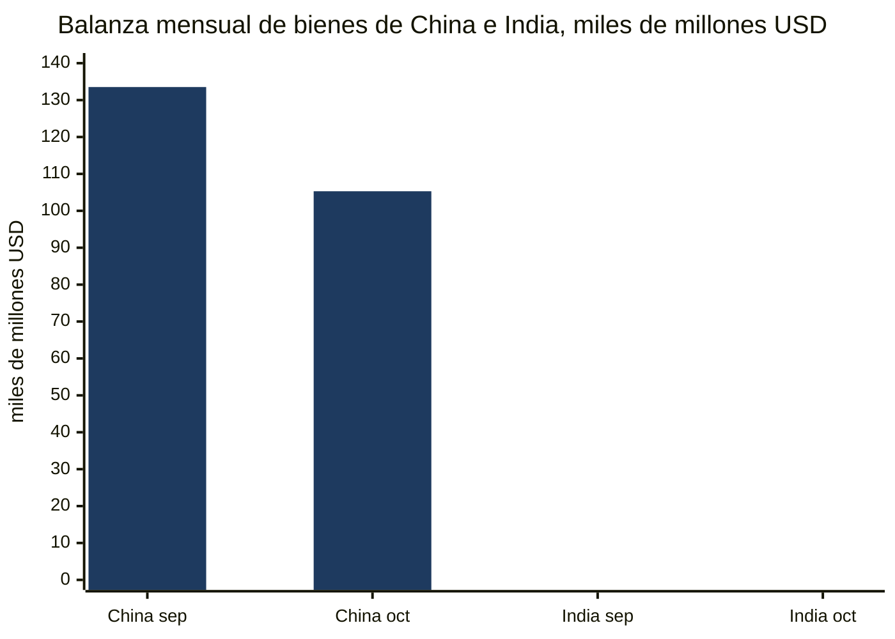

*Nota: superávit mensual de bienes de China: septiembre, 133.530 millones de dólares; octubre, 105.300 millones de dólares. Déficit mensual de mercancías de India: septiembre, 30.210 millones de dólares; octubre, 39.880 millones de dólares. Fuentes: GACC, Ministerio de Comercio de India.*

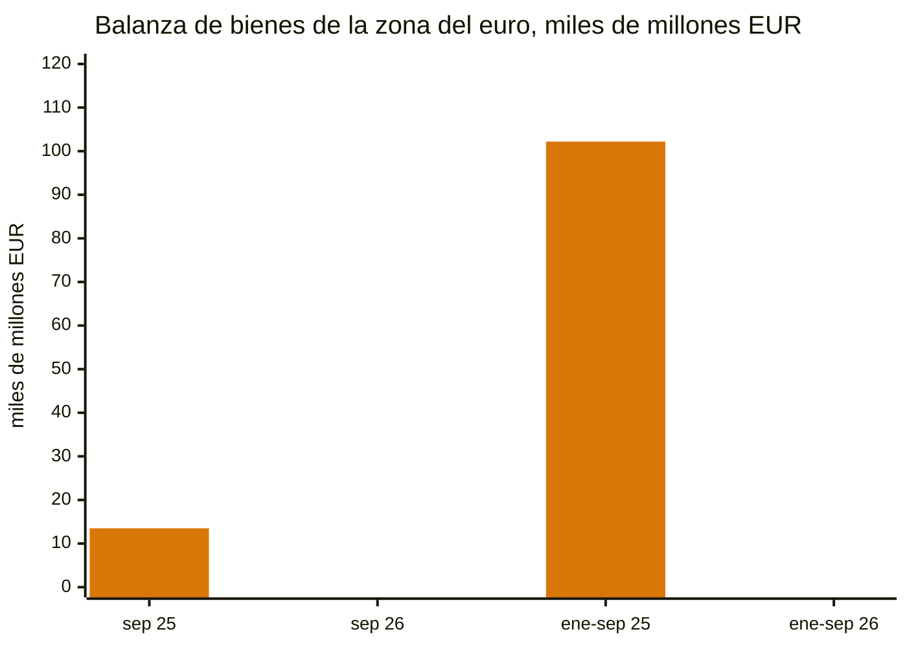

*Nota: balanza de bienes de la zona del euro: septiembre de 2025, +13.500 millones de euros; septiembre de 2026, –10.300 millones de euros; enero–septiembre de 2025, +102.200 millones de euros; enero–septiembre de 2026, –36.500 millones de euros. Fuente: Eurostat, 13 de noviembre de 2026.*

### Grupos de reflexión

Tras las elecciones de mitad de mandato, las informaciones del 5 al 10 de noviembre se basaron en el Budget Lab de Yale y la Tax Foundation para cuantificar el coste de los aranceles estadounidenses (véase 3.2). El recuento del Budget Lab del 2 de noviembre situó el tipo arancelario estatutario medio de Estados Unidos en el 11,8 %, que subiría al 11,9 % a finales de año con arreglo a la legislación vigente, con un coste de alrededor del 0,7 % sobre los precios al consumo estadounidenses, o unos 900 dólares por hogar al año. La Tax Foundation estima que los aranceles elevarán los impuestos en una media de 820 dólares por hogar en 2026 (modelo de agosto de 2026), mientras que el Budget Lab situó la carga en unos 1.100 dólares por hogar en un informe de fecha 24 de agosto de 2026. Ambas cifras utilizan métodos distintos: los 820 dólares de la Tax Foundation reflejan 2026 según lo que realmente se importa, mientras que los 1.100 dólares de Yale suponen que los aranceles vigentes se mantienen con ponderaciones de importación fijas. La economista sénior de la Tax Foundation, Erica York, escribió el 7 de octubre que derogar todos los aranceles impuestos desde 2017 costaría casi 1,8 billones de dólares en una década, y que un impuesto sobre el valor añadido general del 1 % recaudaría lo suficiente para sustituirlo. La directora ejecutiva del Budget Lab, Martha Gimbel, dijo a Marketplace el 5 de noviembre que los aranceles recaudan casi 2 billones de dólares en diez años. Los derechos de aduana netos ascendieron a 173.200 millones de dólares en el ejercicio fiscal 2026, según el Departamento del Tesoro. En el periodo de cobertura no se identificó ningún nuevo elemento de política comercial de tradeintelligence.eu mediante búsqueda web.

**Fuentes:** [Geopolitiqs](https://www.geopolitiqs.com/tn/2026-11-09/tariffs-average-rate); [Dave Manuel](https://www.davemanuel.com/2026/11/06/what-happens-to-tariffs-now-that-democrats-control-congress/)

### Portales de datos

En el periodo no se identificaron nuevas publicaciones importantes de los portales DataWeb de la USITC, UN Comtrade, WITS, Banco Mundial o FMI.

---

## 9. Mercado de fletes

### Tarifas al contado de contenedores — Índice Mundial de Contenedores de Drewry

La evaluación de Drewry para el jueves 12 de noviembre de 2026 registró un descenso semanal del 2 % en el índice compuesto, hasta 4.305 dólares por contenedor de 40 pies, su segundo descenso semanal consecutivo, debido a la débil demanda en las rutas del transpacífico y Asia–Europa/Mediterráneo. En el transpacífico, Shanghái–Nueva York cayó un 3 %, hasta 9.020 dólares por 40 pies, el nivel más bajo desde agosto de 2026, y Shanghái–Los Ángeles cayó un 2 %, hasta 7.416 dólares, el nivel más bajo desde septiembre de 2026. En Asia–Europa/Mediterráneo, Shanghái–Róterdam cayó un 3 %, hasta 3.504 dólares, mientras que Shanghái–Génova se mantuvo sin cambios en 4.168 dólares. Los transportistas anunciaron ocho salidas en blanco para la semana siguiente en el transpacífico, frente a cuatro esta semana (ocho frente a cinco en Asia–Europa/Mediterráneo), y anunciaron tarifas generales por tipo de mercancía (Freight All Kinds) más altas y recargos de temporada alta en Asia–Europa/Mediterráneo con efecto en la segunda mitad de noviembre. Drewry espera que las tarifas del transpacífico sigan bajando la próxima semana y que las tarifas de Asia–Europa/Mediterráneo suban ligeramente. La congestión en el puerto de Shanghái subió a 49 horas la semana pasada, desde 36 horas la semana anterior. Cincuenta y tres buques transitaron por el Canal de Suez la semana pasada, mientras que un buque transitó por el estrecho de Ormuz.

**Fuente:** [Drewry](https://www.drewry.co.uk/supply-chain-advisors/supply-chain-expertise/world-container-index-assessed-by-drewry)

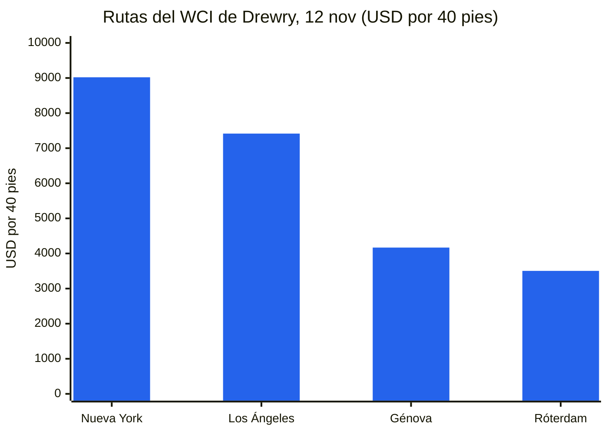

*Nota: todas las rutas parten de Shanghái. Shanghái–Nueva York, 9.020 dólares; Shanghái–Los Ángeles, 7.416 dólares; Shanghái–Génova, 4.168 dólares; Shanghái–Róterdam, 3.504 dólares. Índice compuesto, 4.305 dólares por 40 pies, un 2 % menos semanal. Fuente: Drewry, 12 de noviembre de 2026.*

### Índice Báltico de Freightos

Freightos informó en su actualización semanal del 10 de noviembre de que el índice mundial cayó un 2 %, hasta 3.452 dólares (lectura anterior, 3.513 dólares), con Asia–norte de Europa con una bajada del 5 % y las rutas del transpacífico a la baja después de que los aumentos generales de tarifas de noviembre no se sostuvieran. Los precios de Asia–costa oeste de Estados Unidos (FBX01 semanal) bajaron un 1 %, hasta unos 8.200 dólares por FEU; Asia–costa este de Estados Unidos (FBX03 semanal) bajó un 2 %, hasta unos 9.700 dólares por FEU; Asia–norte de Europa (FBX11 semanal) bajó un 5 %, hasta 3.400 dólares por FEU, un 50 % más interanual; Asia–Mediterráneo (FBX13 semanal) bajó un 1 %, hasta 4.300 dólares por FEU, un 88 % más interanual. El segundo descenso semanal consecutivo del índice mundial, junto con el de Drewry, confirma que los aumentos de tarifas de noviembre no se sostuvieron, mientras que las tarifas siguen muy por encima de los niveles del año anterior en las rutas Asia–Europa. El sindicato de vigilantes ILWU Local 26 prorrogó su plazo de huelga en los puertos de Los Ángeles y Long Beach hasta el 20 de noviembre para disponer de más tiempo para las negociaciones. La Federación Nacional de Minoristas informó de que los volúmenes de importación marítima de Estados Unidos alcanzaron su máximo justo por debajo de niveles récord en septiembre, con 2,37 millones de TEU, con una bajada estimada del 5 % en octubre, y noviembre proyectado con una bajada del 14 % respecto al máximo de septiembre.

**Fuente:** [Freightos](https://www.freightos.com/freight-resources/la-lb-strike-deadline-extended-dem-win-increasing-trade-uncertainty-november-10-2026-update/)

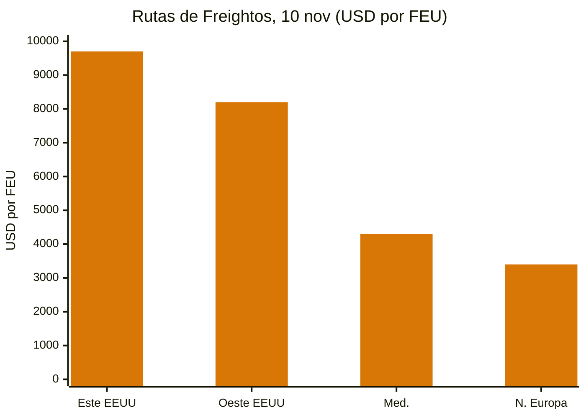

*Nota: Asia–costa este de Estados Unidos, unos 9.700 dólares por FEU; Asia–costa oeste de Estados Unidos, unos 8.200 dólares; Asia–Mediterráneo, 4.300 dólares; Asia–norte de Europa, 3.400 dólares. Índice mundial, 3.452 dólares, un 2 % menos semanal. Fuente: Freightos, 10 de noviembre de 2026.*

### Aumentos de tarifas de noviembre — anunciados, ya descontados

Las tarifas marítimas del transpacífico bajaron ligeramente en la semana hasta el 12 de noviembre, ya que los aumentos generales de tarifas previstos por los transportistas no se consolidaron, pero se mantuvieron en torno a los niveles de temporada alta. Los transportistas habían buscado aumentos de 2.000 a 3.000 dólares por FEU para noviembre, y presentaron nuevos aumentos para el 15 y 16 de noviembre, pero los transitarios citaron una mayor disponibilidad de espacio y horarios de buques más regulares. Las tarifas de Asia–Europa también bajaron: los precios del norte de Europa cayeron un 5 % en la semana, hasta 3.400 dólares por FEU, mientras que las tarifas del Mediterráneo bajaron un 1 %, hasta 4.300 dólares por FEU. El Índice de Fletes Contenerizados de Shanghái cayó 61,12 puntos, hasta 3.572,33, el 13 de noviembre, su segundo descenso semanal consecutivo, ya que las tarifas con destino a Estados Unidos bajaron y las del Mediterráneo subieron. Las tarifas Shanghái–costa este de Estados Unidos cayeron 470 dólares, hasta 9.387 dólares por contenedor de 40 pies; Shanghái–costa oeste de Estados Unidos cayó 270 dólares, hasta 7.111 dólares, y Shanghái–Europa cayó 77 dólares, hasta 3.402 dólares por 40 pies, mientras que Shanghái–Mediterráneo subió 380 dólares, hasta 4.746 dólares por 40 pies.

**Fuentes:** [FreightWaves](https://www.freightwaves.com/news/us-midterm-shift-adds-trade-uncertainty-as-trans-pacific-ocean-freight-rates-stay-elevated); [ShipUniverse](https://www.shipuniverse.com/news/container-freight-rates-split-as-u-s-east-coast-drops-470-as-mediterranean-surges-6-7/)

### Salidas en blanco y capacidad

El rastreador de salidas canceladas de Drewry proyectó 52 salidas en blanco de 716 servicios programados en los principales comercios Este–Oeste entre el 16 de noviembre y el 21 de diciembre, alrededor del 7 % de las salidas previstas. Los transportistas anunciaron ocho salidas en blanco para la semana siguiente en el transpacífico, frente a cuatro esta semana, y ocho en Asia–Europa/Mediterráneo frente a cinco. La magnitud de las salidas en blanco previstas muestra que los transportistas actúan para limitar la capacidad hacia diciembre, ya que los aumentos de tarifas de noviembre no se sostuvieron.

### Granel seco — Baltic Exchange

El Índice Báltico de Carga Seca subió un 6,2 % en la semana, hasta 2.980 puntos el 13 de noviembre, su cuarta ganancia semanal consecutiva, aunque cayó el viernes y puso fin a una racha ganadora de siete sesiones. El índice subió durante la semana — 2.854 el 9 de noviembre, 2.862 el 10 de noviembre, 2.959 el 11 de noviembre y 3.020 el 12 de noviembre — antes de caer 40 puntos, o un 1,3 %, el viernes 13 de noviembre, hasta 2.980. Las tarifas de los Capesize impulsaron la ganancia semanal: el BCI 182 5TC alcanzó un máximo de 43.860 dólares antes de cerrar la semana en 42.798 dólares. Las tarifas de los Panamax y Supramax también subieron durante la semana. La ganancia semanal anterior (semana hasta el 6 de noviembre) fue del 3,4 %, hasta 2.805 desde 2.714 el 30 de octubre. Las tarifas de granel seco se movieron en sentido contrario a las de contenedores, con cuatro ganancias semanales consecutivas que llevaron el índice a su nivel más alto desde principios de octubre, lo que indica una demanda más firme de tonelaje Capesize y Panamax que transporta mineral de hierro, carbón y grano, aunque la demanda de contenedores se debilitó. El resumen de contenedores de la Baltic Exchange para la semana 46 describió una semana relativamente moderada: las tarifas de contenedores en los cuatro principales comercios este–oeste cayeron una media del 0,52 %, con China/costa oeste de Estados Unidos con una caída del 0,77 %, mientras que la costa este se mantuvo sin cambios, y las tarifas de Asia–Europa se debilitaron ligeramente, con el norte de Europa con una bajada del 0,53 % y el Mediterráneo con una bajada del 0,79 %.

**Fuente:** [The DCN](https://www.thedcn.com.au/news/baltic-exchange-weekly-report-13-november-2026)

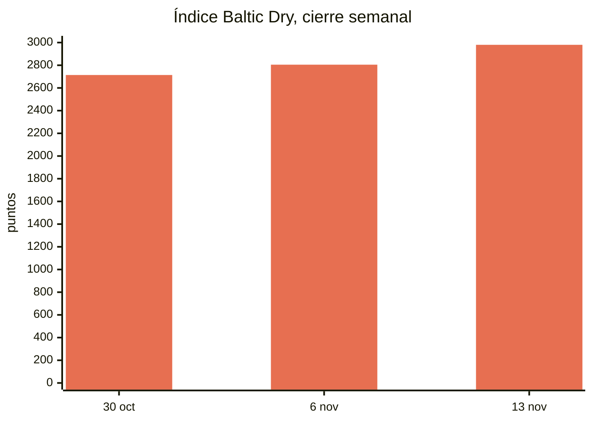

*Nota: cierres semanales: 2.714 (30 de octubre), 2.805 (6 de noviembre), 2.980 (13 de noviembre). Cuarta ganancia semanal consecutiva. Fuente: informe semanal de la Baltic Exchange, 13 de noviembre de 2026.*

### Suez y fiabilidad de los horarios

El regreso a Suez continuó (véase 3.5). Drewry contó 53 portacontenedores a través del canal en la semana hasta el 1 de noviembre, un 130 % más interanual, y estima que alrededor del 60 % de la capacidad Asia–Europa ha vuelto a la ruta de Suez. El Ever Eon de Evergreen transitó el 8 de noviembre, el primer tránsito de Evergreen en casi tres años. A medida que los transportistas restablecen los servicios de Suez, los tiempos de tránsito Asia–Europa están cayendo de siete a diez días, pero las llegadas se están concentrando: Flexport previó que la capacidad de buques que llegaría a los puertos del norte de Europa sería del 131 % de lo normal en la semana del 16 al 22 de noviembre, con 31 portacontenedores en ruta por Suez junto a 61 que aún navegan alrededor del Cabo de Buena Esperanza. Flexport considera que las llegadas por encima del 120 % de la capacidad normal constituyen un riesgo de congestión, y se prevé que al menos tres semanas entre mediados de noviembre y enero superen ese umbral. El tiempo medio de permanencia de los contenedores alcanzó 3,37 días en la semana 42, con una utilización de los patios del 80 %–90 %.

### Carga aérea

Las tarifas al contado mundiales de carga aérea subieron por tercera semana consecutiva, ganando un 4 % en la semana 44, hasta unos 3,93 dólares por kilogramo, aproximadamente un 40 % por encima de la misma semana del año pasado, según el índice TAC. El Índice Báltico de Carga Aérea subió un 6,6 % en los siete días hasta el 9 de noviembre y un 28,2 % interanual. La actualización de Freightos del 10 de noviembre registró China–Norteamérica con un aumento del 3 %, hasta más de 8,00 dólares por kg; China–norte de Europa con un aumento del 11 %, hasta 4,87 dólares por kg, y norte de Europa–Norteamérica con un aumento del 9 %; la carga aérea transatlántica subió un 33 % en el último mes, hasta 2,90 dólares por kg. La media mundial al contado de Xeneta en octubre fue de 3,11 dólares por kg, un 29 % más interanual. La IATA informó de que la demanda de carga en septiembre subió un 7,7 % interanual, con un tráfico Asia–Norteamérica un 17 % más, mientras que los precios del combustible para aviones eran un 103,4 % más altos que un año antes. La carga aérea está absorbiendo los pedidos navideños tardíos y los envíos de hardware de IA hacia una capacidad reducida por los horarios de pasajeros de invierno, lo que empuja las tarifas hacia el máximo de diciembre pasado. Los transitarios informan de tarifas China–costa oeste de Estados Unidos en torno a 8,50–9,00 dólares por kg cuando hay espacio disponible.

**Fuentes:** [Daily8 News](https://www.daily8news.com/article/air-cargo-rates-2026-high-peak-season-20261113/); [IATA](https://www.iata.org/en/pressroom/2026-releases/10-29-air-cargo-demand-accelerates-september/); [TAC Index vía LinkedIn](https://www.linkedin.com/pulse/air-freight-market-update-november-10-2026-tacindex-pkmfc)

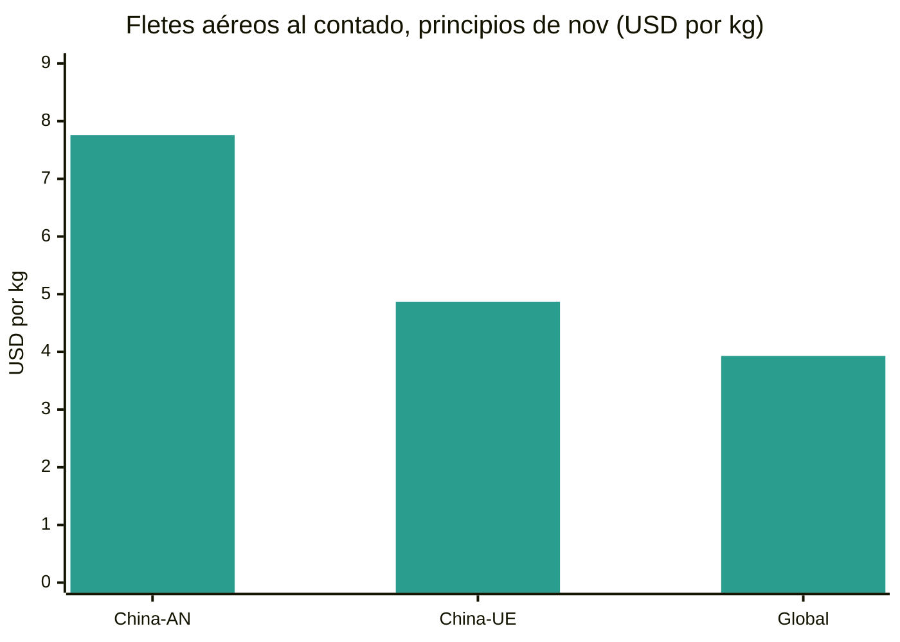

*Nota: China–Norteamérica, 7,76 dólares por kg (Freightos, principios de noviembre; por encima de 8,00 dólares por kg en la actualización del 10 de noviembre); China–norte de Europa, 4,87 dólares por kg; flete mundial al contado, unos 3,93 dólares por kg (índice TAC, semana 44). Fuentes: Freightos, índice TAC.*

### Interrupciones en puertos y logística

**Los Ángeles y Long Beach.** Las conversaciones sobre los vigilantes se prorrogaron hasta el 20 de noviembre (véase A8). C.H. Robinson informó de que el flete minorista procedente de Asia seguía sufriendo interrupciones a principios de noviembre tras un septiembre excepcionalmente fuerte y una serie de tifones que atascaron los contenedores en algunos de los puertos más grandes de China, interrumpieron los horarios marítimos y llevaron a los transportistas a omitir escalas y a rodar la carga. En Los Ángeles y Long Beach, la congestión seguía siendo grave, principalmente por la insuficiencia de vagones para trasladar la carga al interior; algunos cargadores recurrían al transbordo y a los camiones. A 2 de noviembre, 35.688 contenedores de importación esperaban en las terminales un tren en muelle, 10.562 de ellos durante nueve días o más. El puerto de Los Ángeles informó de que la carga local permanecía 3,7 días en la terminal y la carga ferroviaria en muelle 5,6 días el 30 de octubre. Se esperaba una recuperación gradual en dos o tres semanas, suponiendo que no hubiera interrupciones adicionales. El puerto de Los Ángeles movió 1.026.872 TEU en octubre de 2026, un récord para ese mes y el segundo total mensual más alto en la historia del puerto, tras el récord histórico de septiembre, de 1.042.652 TEU. Fue la primera vez que el puerto supera el millón de TEU en meses consecutivos, y la tercera vez en 2026 que alcanza esa marca. Las importaciones cargadas fueron de aproximadamente 538.620 TEU, un 25 % más interanual y un 30 % por encima de la media de octubre de cinco años del puerto; las exportaciones cargadas, de 114.981 TEU, un 7 % menos interanual; los TEU vacíos, de 373.271, un segundo récord mensual consecutivo. El total de enero a octubre fue de aproximadamente 9.108.497 TEU, un 5 % por encima del año pasado y un 9 % por encima de la media de cinco años.

**Perspectivas de importación de Estados Unidos.** El Global Port Tracker de la Federación Nacional de Minoristas informó de que los puertos que sigue movieron 2,37 millones de TEU de importaciones cargadas en septiembre, el mes más activo de 2026 y el tercer mes más activo desde que comenzó el seguimiento. Octubre se proyectó en 2,26 millones de TEU, un 9,1 % más interanual; noviembre, en 2,05 millones de TEU, un 1,2 % más; y diciembre, en 2,03 millones de TEU, un 1,3 % más. La previsión para todo el año es de aproximadamente 26 millones de TEU, un 2 % más que en 2025. Las perspectivas se suavizan a principios de 2027: enero se prevé en 2,04 millones de TEU, un 3 % menos interanual; febrero, en 1,89 millones, un 0,5 % menos; marzo, en 1,92 millones, un 11,2 % menos.

**Durban.** Durban no se ha recuperado del cambio en agosto de la operación de la Terminal Durban Gateway a ICTSI y del sistema de terminales Navis N4; los volúmenes en la terminal cayeron aproximadamente un 30 % entre el 14 de agosto y el 10 de septiembre frente a la media de los cuatro meses anteriores. El indicador de planificación portuaria se situó en 15 días en la actualización de movimientos de carga del 3 de noviembre, un día más que la semana anterior. Diecisiete buques portacontenedores esperaban en Durban el 2 de noviembre — seis dentro de los fondeaderos designados y once más mar adentro — lo que representa aproximadamente 85.000 TEU a flote. Los buques portacontenedores permanecieron una media de 7,46 días fondeados en los siete días hasta principios de noviembre. Maersk elevó su recargo de temporada alta para contenedores secos desde el Extremo Oriente asiático hasta Sudáfrica y Mauricio a 1.000 dólares por 20 pies y 2.000 dólares por 40 pies a partir del 9 de noviembre, cuatro veces el nivel de 250/500 dólares fijado el 15 de octubre, y su tasa de congestión de Durban a 400 dólares por 20 pies y 800 dólares por 40 pies para la carga de origen chino a partir del 1 de noviembre. La ministra de Transporte, Barbara Creecy, dijo que la Terminal Durban Gateway podría volver a su rendimiento anterior solo entre diciembre de 2026 y febrero de 2027, y Kuehne+Nagel no espera ninguna mejora significativa antes de finales del primer trimestre de 2027.

**Fuentes:** [C.H. Robinson](https://www.chrobinson.com/en-us/resources/insights-and-advisories/north-america-freight-insights/nov-2026-freight-market-update/industry-insights/retail/); [AJOT](https://www.ajot.com/news/port-of-los-angeles-tops-1-million-container-units-for-second-consecutive-month); [FreightWaves](https://www.freightwaves.com/news/retailers-forecast-u-s-imports-to-stay-elevated-through-2026-after-breakout-peak-season); [DTFU Logistics](https://www.dtfulogistics.com/news/durban-port-congestion-2026-china-south-africa/)

### Inteligencia de proveedores

Descartes Systems Group publicó su Informe Mundial de Transporte Marítimo de noviembre el 11 de noviembre, basado en los datos comerciales de Descartes Datamyne. Las importaciones de contenedores de Estados Unidos en octubre de 2026 alcanzaron un máximo mensual histórico de 2.674.808 TEU — un 2,0 % (52.343 TEU) por encima del récord anterior de 2.622.465 TEU establecido en mayo de 2022; un 5,0 % más que en septiembre de 2026, un 16,0 % más que en octubre de 2025, y un 29,2 % más que en octubre de 2019. Las importaciones procedentes de China subieron por cuarto mes consecutivo, hasta 987.805 TEU, el mayor volumen mensual desde enero de 2025; un 6,9 % (63.351 TEU) más mensual y un 22,9 % más interanual; la participación de China en el total de las importaciones de contenedores de Estados Unidos subió al 36,9 %, desde el 36,3 % de septiembre. Principales categorías de mercancías de origen chino: plásticos, 144.530 TEU; muebles y ropa de cama, 137.551 TEU; juguetes, juegos y artículos deportivos, 102.672 TEU. Las importaciones de los 10 principales países de origen subieron un 5,8 % mensual. Las importaciones de contenedores de Estados Unidos entre enero y octubre de 2026 subieron un 2,3 % en comparación con el mismo periodo de 2025, el segundo mes consecutivo en que los volúmenes acumulados superaron los del año anterior tras ocho meses por debajo del ritmo del año pasado. Los puertos de la costa este y del Golfo ganaron cuota frente a las puertas de la costa oeste: las importaciones de la costa del Golfo fueron de 266.905 TEU, un 24,0 % más mensual y un 16,2 % por encima de la media de 12 meses, el nivel más alto desde que Descartes comenzó a seguir la cifra regional en agosto de 2023. Houston registró el mayor aumento mensual de un puerto, con 42.665 TEU más (26,7 %). Las importaciones de Los Ángeles cayeron un 1,4 %, las de Long Beach un 2,0 % y las de Oakland un 10,9 %. La cuota de mercado combinada de las cinco principales puertas de la costa este y del Golfo fue del 39,9 %, frente al 36,7 % de septiembre; las cinco principales puertas de la costa oeste cayeron al 44,9 %, desde el 47,0 %. Los 10 principales puertos estadounidenses movieron el 84,8 % de las importaciones. El retraso medio de tránsito portuario en las 10 puertas seguidas fue de 6,3 días en octubre, frente a 6,0 días en septiembre y 4,2 días en junio; los retrasos aumentaron en siete de los 10 puertos. Retrasos más largos: Nueva York/Nueva Jersey, 8,1 días; Seattle, 7,6 días; Savannah, 6,9 días. Las importaciones han superado los 2,5 millones de TEU cada mes desde julio de 2026. El volumen récord de octubre, impulsado en gran parte por un cuarto aumento mensual consecutivo de la carga de origen chino, indica que la demanda de importaciones marítimas de Estados Unidos se mantuvo fuerte pese a la continua incertidumbre arancelaria y de política comercial. El cambio de cuota hacia los puertos de la costa este y del Golfo y el aumento constante de los retrasos de tránsito — alrededor de un 50 % más desde junio — apuntan a una presión creciente sobre las redes logísticas interiores, incluso sin una congestión portuaria generalizada.

No se encontró ningún elemento de proveedor que reuniera los requisitos de TradeInt en el periodo del 9 al 16 de noviembre de 2026. La página del blog de TradeInt enumera su publicación más reciente con fecha 31 de diciembre de 2025; no se encontró ninguna entrada de blog con fecha del 9 al 16 de noviembre de 2026 en el sitio ni en la búsqueda de tradeint.com/insights/.

**Fuentes:** [Descartes](https://www.descartes.com/resources/global-logistics-shipping-report-resource-center?language=en); [All About Shipping](https://allaboutshipping.co.uk/2026/11/11/descartes-releases-november-global-shipping-report-u-s-container-imports-hit-record-volume-in-october/); [Blog de TradeInt](https://tradeint.com/insights/blogs/)

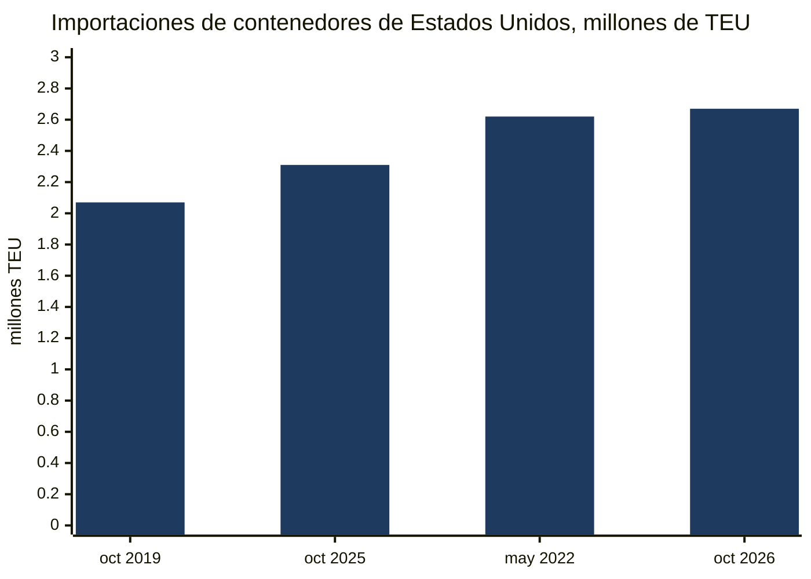

*Nota: octubre de 2026: 2.674.808 TEU, un máximo mensual histórico; récord anterior, mayo de 2022: 2.622.465 TEU; octubre de 2025: unos 2,31 millones de TEU (un 16,0 % más interanual); octubre de 2019: unos 2,07 millones de TEU (un 29,2 % más). Fuente: Informe Mundial de Transporte Marítimo de Descartes de noviembre, 11 de noviembre de 2026.*

---

## 10. Cronologías de políticas

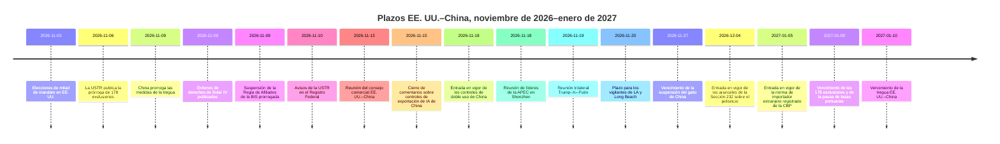

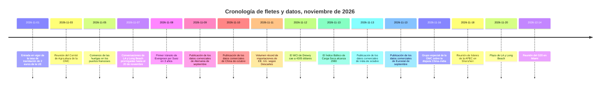

---

## 11. Próximos plazos y eventos (próximos 90 días)

| Fecha | Elemento |
|---|---|
| 18 noviembre 2026 | La CBP podría anular los números de importador registrado de los importadores CTPAT que no hayan resuelto las preocupaciones sobre la exactitud del Formulario 5106 (cartas enviadas el 4 de noviembre). |
| 18 noviembre 2026 | Los controles revisados de China sobre exportaciones de doble uso para drones, tuneladoras y dragas entran en vigor (Anuncios n.º 49–51). |
| 18–19 noviembre 2026 | Reunión de Líderes Económicos de la APEC en Shenzhen; reunión trilateral Trump–Xi–Putin el 19 de noviembre. |
| 20 noviembre 2026 | Plazo de las conversaciones sobre los vigilantes de LA/Long Beach (cuarta prórroga). |
| 20 noviembre 2026 | La transferencia de la BIS de determinados supresores de sonido de la Lista de Municiones de Estados Unidos a la Lista de Control de Comercio entra en vigor. |
| 20 noviembre 2026 | La COP31 en Antalya, Türkiye, se clausura (9–20 de noviembre). |
| 23 noviembre 2026 | El Comité de Agricultura de la OMC se reúne sobre las restricciones a la exportación y el mecanismo especial de salvaguardia; informe completo de la USITC sobre Solar IV (Publicación 5804) previsto. |
| 27 noviembre 2026 | La suspensión del Anuncio n.º 72 de 2025 de China de la presunción de denegación para el galio, el germanio, el antimonio y los materiales superduros con destino a Estados Unidos está previsto que venza, a falta de una nueva suspensión o modificación. |
| 30 noviembre 2026 | Conclusiones definitivas del Departamento de Comercio sobre dumping y subvenciones para los productos de hojalata de China previstas, salvo aplazamiento. |
| 4 diciembre 2026 | Entran en vigor los derechos de la Sección 232 sobre el polisilicio. |
| 7 diciembre 2026 | Vencen los comentarios sobre la propuesta de norma de la CBP sobre envíos de bajo valor (91 FR 64532; expediente USCBP-2026-0298). |
| 14–15 diciembre 2026 | Los líderes del G20 se reúnen en Miami. |
| 16 diciembre 2026 | Se informa de que el acuerdo de libre comercio entre la UE e India se firmará en Bruselas, y se espera que asista el primer ministro Modi. |
| 17 diciembre 2026 | Fecha más temprana en la que el Departamento de Comercio tiene previsto dictar instrucciones de liquidación en las revisiones de armarios y carpintería de madera (35 días después de la publicación del 12 de noviembre). |
| 1 enero 2027 | Los tipos de la Sección 232 suben al 30 % en los muebles tapizados y al 50 % en los armarios de cocina y tocadores; el 50 % amenazado sobre vehículos, autopartes y acero canadienses también apunta a esta fecha; comienza el CBAM del Reino Unido. |
| 3 enero 2027 | Se constituye el nuevo Congreso de Estados Unidos. |
| 5 enero 2027 | La norma provisional definitiva de la CBP sobre el importador extranjero registrado entra en vigor; los comentarios vencen el mismo día (expediente USCBP-2026-1387). |
| 9–10 enero 2027 | Convergen los plazos de la tregua entre Estados Unidos y China: las 178 exclusiones de la Sección 301 y la suspensión de las tasas marítimas vencen el 9 de enero; la suspensión de la Regla de Afiliados de la BIS y las suspensiones recíprocas de China vencen el 10 de enero. |
| 12 enero 2027 | Vencen los comentarios escritos y las solicitudes de participación en la audiencia para la consulta conjunta de revisión del T-MEC (expedientes USTR-2026-0595 y USTR-2026-0596). |
| 19 enero 2027 | Conclusión definitiva del Departamento de Comercio sobre dumping para los productos de hojalata de Türkiye prevista. |
| 20 enero 2027 | La entrada formal pasa a ser obligatoria para el correo sujeto a derechos de las Secciones 201, 232 o 301 o a requisitos de organismos gubernamentales asociados. |
| 30 enero 2027 | La variación del derecho compensatorio del Reino Unido sobre la trucha arcoíris turca se aplica a partir de esta fecha (aviso 2026/31). |
| 1 febrero 2027 | Canadá elimina el alivio arancelario horizontal para determinados alambres y extrusiones de aluminio y productos de cartón. |
| 6 febrero 2027 | Año Nuevo Lunar. |
| 28 febrero 2027 | Plazo de determinación de la USTR en la investigación de la Sección 301 sobre propiedad intelectual de Vietnam. |
| Marzo 2027 | Decisión prevista de la investigación de la Sección 301 de la USTR sobre el exceso de capacidad estructural (prevista para marzo de 2027). |
| 25 marzo 2027 | Conclusión definitiva del Departamento de Comercio sobre dumping para los productos de hojalata de Taiwán prevista. |
| 6 mayo 2027 | Cumplimiento pleno de los agentes previsto con la norma sobre el importador extranjero registrado. |
| 30 junio 2028 | La remisión arancelaria horizontal canadiense se prorroga hasta esta fecha. |

---

## 12. Fuentes y metodología

Periodo de cobertura: 9 al 16 de noviembre de 2026. Recopilado a partir de aproximadamente 45 fuentes mundiales de noticias comerciales, políticas, datos y fletes.

Entre las fuentes consultadas se encuentran: FreightWaves, The Loadstar, Splash247, gCaptain, Hellenic Shipping News, Container News, Supply Chain Dive, Logistics Management, Air Cargo News, Port Technology, TradeInt insights blog; whitehouse.gov, cbp.gov, ustr.gov, federalregister.gov, trade.gov, usitc.gov, bis.doc.gov, JD Supra; ec.europa.eu, gov.uk, cbsa-asfc.gc.ca, canada.ca/en/department-finance, english.mofcom.gov.cn; wto.org, unctad.org, intracen.org, wcoomd.org; dataweb.usitc.gov, ustradecensus.gov, comtradeplus.un.org, wits.worldbank.org, eurostat, data.worldbank.org, imf.org; taxfoundation.org, budgetlab.yale.edu, tradeintelligence.eu; drewry.co.uk, balticexchange.com, freightos.com; descartes.com, tradeint.com.

Los elementos con fecha anterior al 9 de noviembre aparecen solo como seguimientos, publicaciones del Registro Federal que caen en el periodo, o contexto para un plazo del periodo. El sitio en inglés del MOFCOM solo era accesible para los titulares de la portada; el fondo de su respuesta a la tasa de la UE y de sus declaraciones sobre la Lista de Entidades No Fiables no pudo verificarse a partir de la información revisada. El índice de noticias de la OMC no devolvió texto legible mediante la consulta, por lo que los elementos de la OMC utilizan las publicaciones de la OMC tal como se republicaron. TradeInt no tuvo ningún elemento de proveedor que reuniera los requisitos en el periodo: su publicación más reciente en el blog tiene fecha de 31 de diciembre de 2025. No se identificaron nuevas publicaciones importantes en el periodo en los portales DataWeb de la USITC, UN Comtrade, WITS, Banco Mundial o FMI. No se identificó ninguna nueva Orden de Retención de Liberación en el periodo.
