# Laporan Intelijen Perdagangan Global — Pekan 9–16 November 2026

**Briefing mingguan.** Periode liputan: 9–16 November 2026. Disusun dari sekitar 45 sumber berita perdagangan, kebijakan, data, dan angkutan di seluruh dunia.

---

## Daftar isi

1. [Ringkasan eksekutif](#1-executive-summary)
2. [Peringatan](#2-alerts)
3. [Berita utama — analisis mendalam](#3-top-stories--deep-dives)
4. [Pelacak tarif](#4-tariff-tracker)
5. [Analisis mendalam kebijakan AS](#5-us-policy-deep-dive)
6. [Kebijakan dunia menurut kawasan](#6-world-policy-by-region)
7. [Tindakan penegakan](#7-enforcement-actions)
8. [Rilis data](#8-data-releases)
9. [Pasar angkutan](#9-freight-market)
10. [Linimasa kebijakan](#10-policy-timelines)
11. [Tenggat & acara mendatang (90 hari ke depan)](#11-upcoming-deadlines--events-next-90-days)
12. [Sumber & metodologi](#12-sources--methodology)

---

## 1. Ringkasan eksekutif

Pekan ketika gencatan dagang diformalkan alih-alih diselesaikan, dan dua ekonomi perdagangan terbesar dunia sama-sama mencatat angka perdagangan berskala rekor. Pada 10 November, USTR menerbitkan pemberitahuan Federal Register yang memperpanjang seluruh 178 pengecualian produk Section 301 atas Tiongkok dan penangguhan biaya pelabuhan maritim Section 301 hingga 9 Januari 2027, dan Bureau of Industry and Security memperpanjang penangguhan Aturan Afiliasi 50% hingga 10 Januari; Tiongkok membalas dengan tetap menangguhkan tarif tambahan 24% atas barang Amerika Serikat selama dua bulan lagi sembari mempertahankan tarif 10%, dan dengan memperpanjang pengecualian kontrol ekspor tanah jarang hingga tanggal yang sama. Titik keputusan berikutnya kini adalah pertemuan para pemimpin APEC di Shenzhen pada 18–19 November, tempat Presiden Trump dan Xi bertemu untuk ketiga kalinya tahun ini dan sebuah trilateral pertama dengan Presiden Putin direncanakan. Di tempat lain, Departemen Perdagangan (Commerce) menerbitkan perintah akhir bea antidumping dan countervailing duty atas sel surya dari India, Indonesia, dan Laos dengan tarif gabungan setoran tunai hingga 233%, kesepakatan India–Amerika Serikat tetap belum ditandatangani karena penyelidikan kelebihan kapasitas Washington belum selesai, Kanada memperpanjang pengurangan tarifnya hingga Juni 2028, dan biaya penanganan €2 serta rezim pengenal produk Uni Eropa memasuki pekan keduanya dengan Dewan menyetujui penghapusan batas atas PPN €150 mulai 2028.

- **Gencatan diperpanjang di atas kertas, hingga 9–10 Januari 2027.** Pemberitahuan Federal Register USTR pada 10 November (91 FR 72610 dan 91 FR 72608) memperpanjang 178 pengecualian Section 301 (164 pengecualian umum, 14 pengecualian manufaktur surya) dan penangguhan biaya maritim hingga pukul 23.59 ET pada 9 Januari 2027; BIS memperpanjang penangguhan Aturan Afiliasi hingga 10 Januari. Tiongkok tetap menangguhkan tarif tambahan 24% selama dua bulan sejak 10 November, mempertahankan tarif 10%, memperpanjang penangguhan biaya pelabuhan dan pengecualian kontrol ekspor tanah jarang hingga 10 Januari, serta tetap menangguhkan langkah-langkah terhadap 16 entitas Amerika Serikat. Penangguhan galium, germanium, dan antimon berakhir secara terpisah pada 27 November. Tenggat Januari jatuh tepat sebelum Tahun Baru Imlek pada 6 Februari 2027.
- **APEC adalah arena berikutnya bagi gencatan.** Pertemuan Pemimpin Ekonomi APEC ke-33 berlangsung di Shenzhen pada 18–19 November, dengan Deklarasi Shenzhen yang diupayakan mencakup perdagangan, konektivitas, ekonomi digital, dan kecerdasan buatan. Pertemuan video pertama dewan perdagangan AS–Tiongkok pada 13 November membahas pengaturan pemotongan tarif $30 miliar berbanding $30 miliar tanpa kesepakatan. Gedung Putih mengonfirmasi trilateral Trump–Xi–Putin pada 19 November; Beijing belum mengonfirmasinya pada saat pelaporan, dan tidak ada kesepakatan yang diharapkan.
- **Perintah Solar IV menutup rute pengelakan melalui Tiongkok.** Perintah akhir bea antidumping dan countervailing duty Commerce atas sel fotovoltaik silikon kristalin dari India, Indonesia, dan Laos, yang diterbitkan 9 November, menetapkan tarif gabungan setoran tunai untuk semua pihak lain sebesar 233,26% (India), 167,56% (Indonesia), dan 147,39% (Laos). Modul yang dirakit di negara ketiga menggunakan sel yang tercakup masuk dalam perintah tersebut. Tarif dumping awal tin mill ditetapkan untuk Taiwan (18,07%) dan Türkiye (3,89% hingga 42,06%), dengan temuan akhir untuk Tiongkok jatuh tempo 30 November.
- **Kesepakatan India–Amerika Serikat masih belum ditandatangani.** Pejabat India mengatakan pada 13 November bahwa penandatanganan menunggu Washington menyelesaikan kerangka tarifnya; penyelidikan Section 301 atas kelebihan kapasitas, unsur yang menjadi penentu, belum melaporkan hasilnya. Amerika Serikat telah meyakinkan India tentang keunggulan tarif komparatif atas para pesaing Asia; India saat ini membayar tarif Section 301 sebesar 10% berbanding 12,5% untuk Vietnam dan Tiongkok. Tarif 18% dalam kerangka Februari tidak pernah diterapkan.
- **Pemilu paruh waktu mengubah politik, bukan bea masuk.** Demokrat memenangkan kedua kamar pada 3 November; jajak pendapat keluar CBS menunjukkan 66% pemilih mengatakan tarif merugikan ekonomi. Undang-undang untuk mencabut tarif memerlukan mayoritas yang kebal veto, dan pemerintah menyatakan akan melanjutkan tarif. Penerimaan bruto tarif dan cukai mencapai $264 miliar pada kalender 2026 per 9 November, berbanding $227 miliar setahun sebelumnya dan $82 miliar pada 2024; Budget Lab Yale menetapkan tarif rata-rata sebesar 11,2% pada November 2026, berbanding sekitar 2,5% pada Januari 2025.
- **Surplus Tiongkok melampaui $1 triliun dalam sepuluh bulan; India mencetak rekor ekspor.** Ekspor Tiongkok pada Oktober naik 35,2% year on year menjadi $412,3 miliar dan surplus kumulatif Januari–Oktober mencapai $1.042,6 miliar, didorong oleh ekspor sirkuit terpadu sebesar $341,1 miliar, naik 111,1%. Ekspor barang India pada Oktober mencapai rekor $49,47 miliar, naik 45,06%, tetapi impor rekor $89,35 miliar memperlebar defisit barang menjadi $39,88 miliar. Kawasan euro berbalik ke defisit €10,3 miliar pada September, dan neraca Januari–September bergerak menjadi –€36,5 miliar dari +€102,2 miliar setahun sebelumnya.
- **Angkutan kembali terbelah: laut melunak, udara dan curah kering naik.** Drewry World Container Index turun 2% menjadi $4.305 per kontainer 40 kaki pada 12 November, Freightos Baltic Index turun 2% menjadi $3.452, dan Shanghai Containerized Freight Index turun 1,68% menjadi 3.572,33, karena kenaikan tarif November gagal bertahan. Baltic Dry Index naik 6,2% menjadi 2.980, kenaikan mingguan keempat berturut-turut. Angkutan udara bergerak sebaliknya: Baltic Air Freight Index naik 6,6% dalam pekan hingga 9 November dan 28,2% year on year, dengan tarif Tiongkok–Amerika Utara di atas $8,00 per kilogram. Impor kontainer Amerika Serikat mencapai rekor bulanan tertinggi sepanjang masa sebesar 2.674.808 TEU pada Oktober, menurut Descartes.

**Angkutan:** tarif spot kontainer melunak untuk pekan kedua berturut-turut pada perdagangan transpasifik maupun Asia–Eropa sementara perusahaan pelayaran mengandalkan pelayaran kosong; curah kering naik untuk pekan keempat atas kekuatan Capesize; angkutan udara mencapai titik tertinggi 2026 menjelang musim puncak; kembalinya rute Suez mendekati selesai ketika Evergreen melintas untuk pertama kalinya dalam hampir tiga tahun, sementara Flexport memperingatkan kemacetan pelabuhan Eropa akibat kedatangan yang menumpuk; dan tumpukan kereta Los Angeles–Long Beach serta antrean 15 hari di Durban membuat risiko pelabuhan tetap nyata.

---

## 2. Peringatan

| # | Peringatan | Berlaku | Dampak | Sumber |
|---|-------|-----------|--------|--------|
| A1 | USTR menerbitkan pemberitahuan Federal Register yang memperpanjang seluruh 178 pengecualian produk Section 301 atas Tiongkok hingga pukul 23.59 ET 9 Jan 2027 dan menangguhkan biaya maritim Section 301 serta bea derek hingga tanggal yang sama | 10 Nov 2026 (diterbitkan) | Penangguhan dua bulan saja; pemasukan mulai 10 Jan 2027 membayar tarif daftar penuh (25% Daftar 1–3, 7,5% Daftar 4A) | [YCL CPA](https://yclcpa.com/en/insights/us-china-tariff-truce-section-301-exclusions-january-2027) |
| A2 | Tiongkok tetap menangguhkan tarif tambahan 24% atas barang AS selama dua bulan sejak 10 Nov, mempertahankan 10%; memperpanjang pengecualian kontrol ekspor tanah jarang, penangguhan biaya pelabuhan, dan penangguhan daftar entitas hingga 10 Jan 2027 | 9–10 Nov 2026 | Eksportir AS tetap pada tarif 10%; gencatan berjalan hingga 10 Jan 2027 di pihak Tiongkok; penangguhan terkait galium berakhir 27 Nov | [Medium](https://medium.com/@frank.matisse/weekly-digest-15-november-2026-wd-25-the-truce-is-not-access-3f6d8ac577b6) |
| A3 | BIS memperpanjang penangguhan langkah kontrol ekspor Aturan Afiliasi 50% hingga 10 Jan 2027 | 9 Nov 2026 | Penyaringan berbasis kepemilikan tetap ditunda; tanpa tindakan lebih lanjut, kontrol yang diperluas berlaku 10 Jan 2027 | [Sanctions.com](https://www.sanctions.com/articles/us-extends-suspension-of-bis-50-rule-until-january-2027) |
| A4 | Para pemimpin APEC bertemu di Shenzhen 18–19 Nov; trilateral Trump–Xi–Putin dikonfirmasi Gedung Putih untuk 19 Nov; pertemuan video dewan perdagangan AS–Tiongkok 13 Nov membahas paket pemotongan tarif $30 miliar berbanding $30 miliar tanpa kesepakatan | 18–19 Nov 2026 | Kesempatan pertama memperpanjang gencatan melampaui 10 Jan 2027; Deklarasi Shenzhen diupayakan tentang perdagangan, ekonomi digital, dan AI | [Asia Daily](https://asiadaily.org/news/18743/) |
| A5 | CBP memperingatkan importir CTPAT bahwa nomor importer-of-record mereka dapat dibatalkan mulai pukul 00.01 ET 18 Nov karena akurasi Formulir 5106 | 18 Nov 2026 | Surat yang belum diselesaikan memblokir pemasukan di bawah nomor importir tersebut; alamat fisik harus merupakan lokasi usaha importir sendiri | [Concord Solutions](https://www.concordsolutionsgroup.com/post/ctpat-importers-cbp-warns-ior-numbers-may-be-voided-november-18-over-form-5106-accuracy) |
| A6 | Revisi kontrol ekspor dual-use Tiongkok atas drone, mesin bor terowongan, dan kapal keruk berlaku 18 Nov; komentar katalog teknologi MOFCOM ditutup 15 Nov tanpa hasil yang diterbitkan | 18 Nov 2026 | Persyaratan lisensi untuk drone tertentu (jangkauan 300 km, penyebaran aerosol 80 liter), mesin bor terowongan, dan kapal keruk | [JD Supra](https://www.jdsupra.com/legalnews/china-proposes-expanded-technology-8379336/) |
| A7 | Commerce menerbitkan perintah akhir AD/CVD atas sel surya dari India, Indonesia, dan Laos; tarif gabungan untuk semua pihak lain 233,26% / 167,56% / 147,39% | 9 Nov 2026 | Setoran tunai berlanjut mulai 5 Nov; modul yang dibuat di negara ketiga menggunakan sel yang tercakup masuk dalam perintah | [Solar Stock USA](https://www.solarstockusa.com/research/market-notes/adcvd-orders-india-indonesia-laos) |
| A8 | Pembicaraan penjaga LA/Long Beach diperpanjang hingga 20 Nov — perpanjangan keempat; ~250 penjaga di enam terminal; Jembatan Vincent Thomas ditutup 7 Nov selama 16 bulan; 35.688 kontainer impor menunggu kereta di dermaga | 20 Nov 2026 | Penghentian kerja akan menghentikan operasi kapal, lapangan, dan gerbang jika serikat lain menghormati garis piket; waktu tunggu kereta sudah 5,6 hari | [Navilink Global](https://www.navilinkglobal.com/news/la-long-beach-port-strike-averted-again-ilwu-talks-extended-to-november-20-as-record-cargo-volumes-continue) |
| A9 | Tarif Section 338 atas Kanada digugat di Pengadilan Perdagangan Internasional; brief amicus diajukan 11 dan 13 Nov dalam *Gellert v. Trump*; bea 50% mencakup sekitar $20 miliar impor Kanada | 11–13 Nov 2026 | Putusan yang merugikan pemerintah akan menghapus lapisan tarif utama dan memicu klaim pengembalian; tarif tetap berlaku | [Reason](https://reason.com/volokh/2026/11/14/our-amicus-brief-in-case-challenging-trumps-section-338-tariffs-against-canada/) |
| A10 | Kesepakatan India–AS masih belum ditandatangani per 13 Nov; penandatanganan menunggu kerangka tarif Washington; penyelidikan Section 301 atas kelebihan kapasitas belum melaporkan hasil | 13 Nov 2026 | Eksportir India tidak memiliki kepastian atas tarif 18% yang dijanjikan; India membayar bea Section 301 sebesar 10%, Vietnam dan Tiongkok 12,5% | [Industrial Front](https://industrialfront.com/india-us-trade-deal-tariff-advantage-november-2026/) |

### A1/A2/A3 — Gencatan, diperpanjang di atas kertas hingga Januari

Perpanjangan dua bulan gencatan perdagangan Amerika Serikat–Tiongkok diformalkan dalam periode liputan. Pada 10 November, USTR menerbitkan dua pemberitahuan Federal Register: satu memperpanjang seluruh 178 pengecualian produk Section 301 yang tersisa — 164 pengecualian umum di bawah HTSUS 9903.88.69 dan 14 pengecualian manufaktur surya di bawah 9903.88.70 — hingga pukul 23.59 ET pada 9 Januari 2027 (91 FR 72610; FR Doc. 2026-22925), mencakup barang yang dimasukkan untuk konsumsi, atau dikeluarkan dari gudang untuk konsumsi, pada atau setelah pukul 00.01 ET pada 10 November 2026; yang lain menangguhkan lebih lanjut tindakan maritim Section 301, termasuk biaya layanan atas operator dan pemilik kapal serta bea atas derek ship-to-shore dan peralatan penanganan kargo lainnya, hingga tanggal yang sama (91 FR 72608; FR Doc. 2026-22867). Tidak ada pengecualian yang ditambah atau dihapus, tidak ada komentar baru yang diminta, dan USTR bersandar pada catatan dari pemberitahuannya pada September 2025; koalisi 24 asosiasi industri telah meminta pada 4 November perpanjangan setidaknya satu tahun. Sebagian pelaporan mencatat ketidakkonsistenan internal dalam pemberitahuan tersebut, dengan bagian-bagian yang merujuk pada 10 Januari alih-alih 9 Januari; tanggal yang berlaku dalam pemberitahuan pengecualian adalah 9 Januari. Pada 9 November, BIS menerbitkan aturan final yang memperpanjang penangguhan Aturan Afiliasi 50% — langkah yang akan memperluas kontrol ekspor ke entitas asing yang dimiliki 50% atau lebih oleh pihak yang terdaftar — hingga 10 Januari 2027, tanpa jeda dari penangguhan sebelumnya.

Tiongkok bertindak pada 9 November. Komisi Tarif Dewan Negara menyatakan akan terus menangguhkan tarif tambahan 24% atas barang Amerika Serikat selama dua bulan sejak 10 November, dengan tetap memberlakukan tarif tambahan 10%. MOFCOM dan Administrasi Umum Bea Cukai mengeluarkan Pengumuman No. 58 Tahun 2026, yang melanjutkan penangguhan enam pengumuman kontrol ekspor Oktober 2025 — mencakup teknologi dan peralatan pemrosesan tanah jarang, lima tanah jarang sedang dan berat lainnya, baterai litium dan bahan anoda grafit, bahan superkeras, serta aturan ekstrateritorial atas produk buatan luar negeri yang mengandung tanah jarang asal Tiongkok — dari 11 November 2026 hingga 10 Januari 2027. MOFCOM juga melanjutkan penangguhan langkah-langkah Pengumuman No. 21 Tahun 2025 terhadap 16 entitas Amerika Serikat, dan Kementerian Perhubungan Tiongkok memperpanjang penangguhan biaya pelabuhan khusus atas kapal terkait Amerika Serikat hingga 10 Januari 2027. Dua batasan penting. Persyaratan lisensi April 2025 untuk tujuh tanah jarang sedang dan berat (samarium, gadolinium, terbium, disprosium, lutesium, skandium, dan itrium) tidak pernah ditangguhkan dan tetap berlaku. Dan Pengumuman No. 72 Tahun 2025, yang menangguhkan praduga penolakan Tiongkok untuk galium, germanium, antimon, dan bahan superkeras tujuan Amerika Serikat, hanya berlaku hingga 27 November 2026 dan tidak disebut dalam Pengumuman No. 58; per 13 November belum ditemukan pemberitahuan perubahan.

### A4 — APEC Shenzhen: titik keputusan berikutnya

Pertemuan Pemimpin Ekonomi APEC ke-33 berlangsung di Shenzhen pada 18–19 November 2026, ketiga kalinya Tiongkok menjadi tuan rumah setelah Shanghai pada 2001 dan Beijing pada 2014. Pekan Para Pemimpin dimulai 14 November, dengan pertemuan Dewan Penasihat Bisnis APEC pada 14–16 November dan KTT CEO pada 17–18 November, tempat Presiden Xi Jinping menyampaikan pidato utama. Tema tuan rumah adalah "Membangun Komunitas Asia-Pasifik untuk Sejahtera Bersama", dengan tiga prioritas — keterbukaan, inovasi, dan kerja sama — dan Deklarasi Shenzhen diupayakan mencakup perdagangan, konektivitas, ekonomi digital, dan kecerdasan buatan. Pada 16 November, Tiongkok mengonfirmasi bahwa Xi akan menjadi tuan rumah bagi Presiden Trump dan Putin dalam pertemuan trilateral pada 19 November di sela-sela pertemuan, dengan pengurangan senjata nuklir, kecerdasan buatan, dan konflik global diperkirakan akan dibahas; juru bicara Gedung Putih mengonfirmasi pertemuan tersebut, sementara seorang pejabat senior Amerika Serikat mengatakan tidak ada kesepakatan yang diharapkan dan Beijing belum mengonfirmasinya pada saat pelaporan. Pertemuan pertama dewan perdagangan Amerika Serikat–Tiongkok yang baru, yang diadakan melalui tautan video pada 13 November, membahas pengaturan pemotongan tarif $30 miliar berbanding $30 miliar dan perdagangan pertanian tetapi tidak mengumumkan kesepakatan. Paket pemotongan tarif timbal balik $60 miliar yang dibahas setelah KTT September masih belum difinalisasi. Perdagangan Shenzhen dengan ekonomi APEC lainnya tumbuh 40% year on year dalam sembilan bulan pertama 2026, mencakup hampir 70% dari total perdagangan kota tersebut.

### A5 — Pembatalan nomor importir CBP mulai 18 November

CBP mengirim surat kepada sejumlah importir bersertifikat CTPAT yang menyatakan bahwa nomor importer-of-record mereka dapat dibatalkan untuk pemasukan yang diajukan mulai pukul 00.01 ET pada 18 November 2026 kecuali kekhawatiran CBP tentang akurasi informasi Formulir 5106 CBP importir tersebut diselesaikan terlebih dahulu. National Customs Brokers and Forwarders Association of America melaporkan surat-surat itu kepada anggotanya pada 4 November dan meminta broker memperingatkan klien importir. Setiap importir yang terdampak diarahkan untuk meninjau catatan Formulir 5106-nya di ACE Secure Data Portal, memperbaiki informasi yang tidak akurat, dan mengonfirmasi bahwa nomor importir di Portal CTPAT aktif dan sesuai dengan catatan ACE. Nomor importir yang dibatalkan tidak dapat digunakan untuk mengajukan pemasukan, sehingga surat yang belum diselesaikan akan menghentikan pelepasan kargo dan pengajuan ringkasan pemasukan di bawah nomor tersebut mulai 18 November. Surat-surat itu menyusul pemberitahuan Federal Register CBP tentang akurasi data importer-of-record (91 FR 53627, 19 Agustus 2026), yang berdasarkan itu CBP telah membatalkan nomor importir dengan data Formulir 5106 yang tidak akurat atau tidak lengkap sejak 18 September 2026. Alamat fisik pada Formulir 5106 harus merupakan lokasi usaha importir sendiri, bukan agen terdaftar, broker, forwarder, kotak pos, atau pusat layanan bisnis.

### A6 — Kontrol dual-use Tiongkok berlaku 18 November

Tiga pengumuman yang merevisi Daftar Kontrol Ekspor Barang Dual-Use Tiongkok berlaku pada 18 November 2026: Pengumuman No. 49 (drone dan barang terkait), Pengumuman No. 50 (mesin bor terowongan dan barang lainnya — pertama kalinya mesin bor terowongan dimasukkan dalam kontrol ekspor) dan Pengumuman No. 51 (kapal keruk dan barang lainnya). Lisensi diperlukan antara lain untuk autopilot drone; drone yang mampu terbang melampaui garis pandang dengan daya tahan sedikitnya tiga jam; mesin yang dirancang khusus untuk drone atau kapal udara tanpa awak; dan drone dengan jangkauan 300 km atau lebih atau yang dilengkapi untuk penyebaran aerosol di atas 80 liter. Pengumuman No. 50 memperkenalkan kontrol atas mesin bor terowongan, ekskavator berjalan tertentu, dan mesin shotcrete dataran tinggi; ekspor ke negara dan kawasan sensitif yang bersengketa dengan Tiongkok memerlukan lisensi, sementara ekspor ke tujuan lain dapat menggunakan sertifikat berbasis registrasi, dengan pembatasan atas transfer lanjutan. Pengumuman No. 51 menambah persyaratan lisensi untuk pompa keruk tertentu dan komponen utama, draghead, dan cutterhead. Secara terpisah, MOFCOM dan Kementerian Ilmu Pengetahuan dan Teknologi mengusulkan pada 16 Oktober penambahan 40 teknologi ke Katalog Teknologi yang Dilarang atau Dibatasi untuk Diekspor — 23 di kecerdasan buatan, 5 di biofarmasi, 12 di fotovoltaik; 14 akan dilarang, 26 dibatasi — dengan komentar jatuh tempo 15 November. Registrasi pra-ekspor interim telah berlaku sejak 16 Oktober. Belum ada hasil atau katalog final yang diterbitkan per 16 November.

### A7 — Perintah Solar IV: tarif gabungan hingga 233%

Commerce menerbitkan perintah bea antidumping dan countervailing duty atas sel fotovoltaik silikon kristalin, baik yang dirakit menjadi modul maupun tidak, dari India, Indonesia, dan Laos pada 9 November 2026, menyusul penentuan akhir afirmatif atas kerugian dari USITC yang diterbitkan 5 November (91 FR 69865). India: margin antidumping 123,04% (setoran tunai 107,17% setelah offset subsidi) dan countervailing duty 126,09%, tarif gabungan setoran tunai 233,26%. Indonesia: antidumping 94,36% dan countervailing duty 73,20% (gabungan semua pihak lain 167,56%). Laos: margin antidumping 65,76% (setoran tunai 65,36%) dan countervailing duty 82,03%, tarif gabungan setoran tunai 147,39%, setelah Commerce memperbaiki kesalahan ministerial yang menaikkan margin Laos dari 65,43% dan setoran tunai dari 65,03%. Penangguhan likuidasi dan penagihan setoran tunai berlanjut mulai 5 November 2026. Modul, laminasi, dan panel yang dibuat di negara ketiga menggunakan sel yang tercakup masuk dalam perintah; modul yang dirakit di India menggunakan sel negara ketiga tidak masuk. Pemasukan dalam jeda sementara berada di luar bea: mulai 26 Juni 2026 untuk countervailing duty dan mulai 25 Oktober 2026 untuk antidumping, keduanya hingga 4 November 2026. Untuk India dan Laos, yang temuan keadaan kritis USITC-nya negatif, Commerce bermaksud mengembalikan setoran tunai countervailing duty atas pemasukan yang dilakukan dari 28 November 2025 hingga 25 Februari 2026. Laporan publik lengkap USITC (USITC Publication 5804) jatuh tempo 23 November 2026.

### A8 — LA/Long Beach: perpanjangan keempat, hingga 20 November

Ancaman mogok oleh pekerja keamanan (penjaga) di terminal kontainer di Los Angeles dan Long Beach ditunda lagi, dengan pembicaraan kini diperpanjang hingga 20 November 2026 — perpanjangan tenggat keempat dalam sengketa ini. Tanggal awal pemberian wewenang mogok adalah 1 November, lalu diperpanjang hingga 4 November, kemudian hingga tengah malam 6 November. ILWU Local 26 mewakili sekitar 250 pekerja keamanan di enam terminal kontainer; kontrak mereka sebelumnya berakhir pada Juli 2025, anggota telah memberikan wewenang mogok, dan kedua pihak bernegosiasi dengan bantuan Federal Mediation and Conciliation Service. Pacific Maritime Association menyatakan gangguan dapat memengaruhi sekitar 85% kargo yang bergerak melalui Pelabuhan Long Beach dan sepertiga kargo di Pelabuhan Los Angeles, karena pekerja dermaga lain diperkirakan tidak akan melintasi garis piket Local 26. Tenggat 7 November bertepatan dengan penutupan Jembatan Vincent Thomas, penghubung jalan raya utama ke kompleks pelabuhan, yang ditutup pukul 00.01 pada 7 November untuk proyek perbaikan yang diperkirakan berlangsung 16 bulan. Kompleks itu sudah tegang: sekitar 35.688 kontainer impor menunggu layanan kereta di kedua pelabuhan per 2 November, 10.562 di antaranya selama sembilan hari atau lebih, dan impor yang diangkut kereta rata-rata berada 7,19 hari pada September. Pelabuhan Los Angeles menangani 1.026.872 TEU pada Oktober, rekor untuk bulan tersebut.

### A9 — Section 338 atas Kanada: gugatan pengadilan pertama

Dua brief amicus diajukan di Pengadilan Perdagangan Internasional Amerika Serikat dalam *Gellert Global Group Corp. v. Trump* (No. Pengadilan 26-04636), yang diajukan 20 Oktober 2026, gugatan pengadilan pertama terhadap tarif Section 338. Brief mantan pejabat senior perdagangan (Carla Hills, USTR 1989–1993; Alan Wolff, mantan wakil USTR; Warren Maruyama, penasihat umum USTR 2007–2009) diajukan 11 November. Brief Cato Institute, bersama Profesor Ilya Somin dan Profesor Michael McConnell, diajukan 13 November. Brief-brief itu berargumen bahwa Section 338 dari Tariff Act 1930 tidak dapat menopang tarif tersebut, bahwa Section 301 dari Trade Act 1974 mencakup pokok yang sama dengan perlindungan prosedural dan menggantikan Section 338, dan bahwa tarif tersebut melanggar doktrin major-questions dan nondelegation. Penggugat, importir makanan yang berbasis di New Jersey, Gellert Global Group, yang diwakili oleh Liberty Justice Center, menyatakan mengimpor sekitar $71 juta keju Kanada pada 2025, yang secara historis bebas bea di bawah Perjanjian Amerika Serikat-Meksiko-Kanada, dan menuduh akan membayar sekitar $40 juta per tahun dalam bea Section 338. Gugatan itu meminta penghapusan tarif, larangan penagihan, dan pengembalian bea yang dibayar sejak 22 Agustus 2026. Tarif tetap berlaku; pengadilan belum memutus. Bea 50% mencakup sekitar $20 miliar impor Kanada, menurut brief amicus dan analisis Congressional Research Service yang menggunakan angka perdagangan 2025. USTR Jamieson Greer menyatakan pembicaraan dengan Ottawa berlanjut tanpa tenggat. Tanggal berikutnya yang dikutip dalam pelaporan adalah 1 Januari 2027, ketika Presiden mengancam menaikkan tarif atas kendaraan, suku cadang mobil, dan baja Kanada menjadi 50%.

### A10 — Kesepakatan India–Amerika Serikat: masih belum ditandatangani

Sumber pemerintah India mengatakan pada 13 November bahwa Amerika Serikat telah meyakinkan India bahwa para eksportirnya akan memperoleh "keunggulan tarif komparatif" atas negara-negara pesaing berdasarkan kesepakatan perdagangan yang direncanakan, setelah Washington menyelesaikan struktur tarifnya. Jaminan itu bersyarat: struktur tarif akhir Amerika Serikat bergantung pada hasil penyelidikan Section 301 USTR atas kelebihan kapasitas struktural di manufaktur, yang dibuka pada Maret 2026 dan belum melaporkan hasilnya. Menteri Perdagangan Rajesh Agrawal mengatakan negosiasi berada "di jalur yang benar". Tim Amerika Serikat beranggotakan dua orang mengunjungi India pada awal November dan mencapai kemajuan substansial atas teks, termasuk bab fasilitasi kepabeanan dan perdagangan; tidak ada putaran tatap muka lebih lanjut yang direncanakan untuk saat ini. Tranche pertama hanya mencakup barang; jasa akan menyusul kemudian. Kedua pemerintah menyepakati kerangka dalam pernyataan bersama 7 Februari 2026, tetapi belum ada teks yang ditandatangani, jadwal tarif, atau tanggal pemberlakuan yang diterbitkan. Kerangka Februari menetapkan tarif Amerika Serikat sebesar 18%, yang tidak pernah diterapkan. India kini membayar tarif kerja paksa Section 301 sebesar 10%, sama dengan Indonesia, Kamboja, dan Bangladesh, sementara Vietnam dan Tiongkok membayar 12,5%. Ekspor barang India ke Amerika Serikat naik menjadi $59,52 miliar pada April–Oktober 2026, dari $51,99 miliar setahun sebelumnya. Kedua pihak berupaya menyelesaikan kesepakatan pada akhir tahun anggaran berjalan, menurut pelaporan India. Dokumen Gedung Putih yang diterbitkan 3 November mencantumkan India di antara negara-negara yang presidennya telah "mengamankan perjanjian perdagangan baru dan yang ditingkatkan", meskipun perjanjian interim itu belum ditandatangani secara resmi.

---

## 3. Berita utama — analisis mendalam

### 3.1 Gencatan, diperpanjang dua bulan — dan jurang Januari yang diciptakannya

Berita utama pekan ini adalah sepasang perpanjangan yang bersama-sama menjaga gencatan perdagangan Amerika Serikat–Tiongkok tetap hidup hingga Januari, sembari memadatkan keputusan berikutnya ke dalam jendela dua bulan. Urutannya penting. Pada 6 November, USTR mengunggah dua pemberitahuan; pada 10 November keduanya diterbitkan dalam Federal Register. Yang pertama memperpanjang seluruh 178 pengecualian produk Section 301 atas Tiongkok hingga pukul 23.59 ET pada 9 Januari 2027, mencakup barang yang dimasukkan untuk konsumsi, atau dikeluarkan dari gudang untuk konsumsi, pada atau setelah pukul 00.01 ET pada 10 November 2026. Yang kedua menangguhkan lebih lanjut tindakan Section 301 atas praktik maritim, logistik, dan pembangunan kapal Tiongkok, termasuk biaya kapal yang tercakup dan bea Annex V.A, hingga tanggal yang sama. Pada 9 November, BIS memperpanjang penangguhan langkah kontrol ekspor Aturan Afiliasi 50% hingga 10 Januari 2027. Pada 9 November, Tiongkok memperpanjang pihaknya: tarif tambahan 24% atas barang Amerika Serikat tetap ditangguhkan selama dua bulan lagi sejak 10 November, tarif tambahan 10% tetap berlaku, dan penangguhan biaya pelabuhan khusus atas kapal terkait Amerika Serikat, pengecualian kontrol ekspor mineral kritis, serta langkah-langkah terhadap 11 perusahaan Amerika Serikat dalam daftar entitas tidak dapat diandalkan dan 16 dalam daftar kontrol ekspor semuanya berlaku hingga 10 Januari 2027.

Tiga ciri patut diperhatikan. Pertama, perpanjangannya singkat — dua bulan, padahal pengaturan September dipahami berjalan satu tahun — dan diberikan setelah industri meminta setidaknya satu tahun. Software & Information Industry Association dan 23 organisasi lain meminta USTR pada 4 November perpanjangan pengecualian setidaknya satu tahun; USTR memberikan dua bulan. Kedua, tanggal-tanggal itu tidak selaras persis: instrumen Amerika Serikat berakhir 9 Januari, Tiongkok 10 Januari, dan gencatan Amerika Serikat sendiri digambarkan oleh Menteri Keuangan Scott Bessent pada September berjalan hingga 10 Januari. Ketiga, substansi di balik gencatan tetap belum selesai. Pada 6 November, USTR Jamieson Greer dan Menteri Bessent mengadakan panggilan video dengan Wakil Perdana Menteri He Lifeng; Greer menekankan "pentingnya Tiongkok mengambil tindakan konkret untuk sepenuhnya melaksanakan komitmen-komitmen sebelumnya", terutama pembelian pertanian, tanah jarang, dan mineral kritis lainnya, sementara Tiongkok menyatakan "keprihatinan serius" tentang pembatasan perdagangan Amerika Serikat. Tidak satu pun pembacaan dari kedua pihak menyebut tenggat. Paket pemotongan tarif timbal balik $60 miliar yang dibahas setelah KTT September masih belum difinalisasi, dan pertemuan video 13 November dari dewan perdagangan Amerika Serikat–Tiongkok yang baru membahas pengaturan $30 miliar berbanding $30 miliar tanpa kesepakatan.

**Angka kunci:** 178 pengecualian diperpanjang (164 umum, 14 manufaktur surya); tanpa perpanjangan, pemasukan mulai 10 November akan membayar 25% (Daftar 1–3) atau 7,5% (Daftar 4A); tarif tambahan 24% Tiongkok tetap ditangguhkan, 10% dipertahankan; gencatan kini berjalan hingga 9–10 Januari 2027.

**Mengapa penting:** importir memiliki kepastian dua bulan alih-alih jurang pekan ini, tetapi jurang itu telah bergeser, bukan hilang. Titik keputusan berikutnya adalah pertemuan para pemimpin APEC di Shenzhen pada 18–19 November, tempat Presiden Trump dan Xi bertemu untuk ketiga kalinya tahun ini, diikuti oleh G20 di Miami pada 14–15 Desember. Pemasukan, pelayaran, dan penyaringan ekspor harus direncanakan berdasarkan posisi tertulis: pengecualian melekat pada tanggal pemasukan, bukan tanggal pengiriman, sehingga barang yang dikirim pada November tetapi dimasukkan setelah 9 Januari berada di luar perpanjangan. Penangguhan terkait galium yang berakhir pada 27 November adalah tenggat terpisah yang lebih awal.

**Sumber:** [YCL CPA](https://yclcpa.com/en/insights/us-china-tariff-truce-section-301-exclusions-january-2027); [Shipping and Freight Resource](https://www.shippingandfreightresource.com/trade-moves-16-nov-2026/); [Medium](https://medium.com/@frank.matisse/weekly-digest-15-november-2026-wd-25-the-truce-is-not-access-3f6d8ac577b6)

### 3.2 Pemilu paruh waktu dan prospek tarif: politik baru, bea yang sama

Pemilu paruh waktu 3 November memberi Demokrat kendali atas kedua kamar, tetapi arsitektur tarif dibangun di atas kewenangan eksekutif yang tidak dibatalkan oleh pergantian Kongres. Tarif pemerintah kini terutama bersandar pada Section 301 dan Section 232, setelah Mahkamah Agung membatalkan tarif IEEPA pada 20 Februari 2026 dalam *Learning Resources, Inc. v. Trump*. Kewenangan-kewenangan itu tidak bergantung pada siklus pemilu, dan Demokrat masih jauh dari mayoritas dua pertiga yang diperlukan untuk mengesampingkan veto presiden. Yang berubah adalah pengawasan: sidang pengawasan, pemungutan suara simbolis untuk pencabutan, dan tekanan untuk keringanan yang ditargetkan — terutama atas Kanada — diperkirakan terjadi pada 2027. Satu instrumen yang dapat dibatasi Kongres baru adalah Section 122, yang biaya tambahannya dibatasi 150 hari tanpa undang-undang; perpanjangan kerangka itu memerlukan Kongres yang akan datang. Kongres baru bersidang pada Januari 2027; hingga saat itu undang-undang tarif tetap seperti tertulis.

Angka-angka kini membingkai perdebatan. Menurut data yang dilacak oleh Bipartisan Policy Center, yang berasal dari laporan harian Departemen Keuangan Amerika Serikat, penerimaan bruto tarif dan cukai yang dikumpulkan per 9 November 2026 mencapai $264 miliar pada kalender 2026, naik dari $227 miliar pada titik yang sama pada 2025 dan lebih dari tiga kali lipat $82 miliar yang dikumpulkan per 9 November 2024. Budget Lab Universitas Yale memperkirakan tarif rata-rata Amerika Serikat meningkat dari sekitar 2,5% ketika Presiden Trump kembali ke Gedung Putih pada Januari 2025 menjadi 11,2% pada November 2026, dan bahwa langkah-langkah itu membebani rumah tangga Amerika rata-rata sekitar $900 per tahun. Hitungan Budget Lab per 2 November menetapkan tarif rata-rata menurut undang-undang sebesar 11,8%, naik menjadi 11,9% pada akhir tahun berdasarkan hukum yang berlaku. Tax Foundation memperkirakan tarif akan menaikkan pajak rata-rata $820 per rumah tangga pada 2026, sementara Budget Lab menetapkan beban sekitar $1.100 per rumah tangga dalam laporan tertanggal 24 Agustus 2026; kedua angka itu menggunakan metode yang berbeda. Cato Institute memperkirakan tarif mencakup sekitar 54% barang yang diimpor ke Amerika Serikat. Jajak pendapat pemilih Associated Press terhadap lebih dari 100.000 pemilih paruh waktu menemukan sekitar dua pertiga meyakini tarif telah merugikan ekonomi nasional atau ekonomi lokal mereka; jajak pendapat keluar CBS News menunjukkan 66% pemilih mengatakan tarif "merugikan ekonomi". Bea cukai neto mencapai $173,2 miliar pada tahun fiskal 2026, menurut Departemen Keuangan.

Front litigasi kini menyangkut uang, bukan kewenangan. Pada 20 Februari 2026, Mahkamah Agung memutuskan dalam *Learning Resources, Inc. v. Trump* (607 U.S. 229 (2026)) bahwa International Emergency Economic Powers Act "tidak memberi wewenang kepada Presiden untuk mengenakan tarif". Pada 8 Oktober 2026, Pengadilan Perdagangan Internasional mensertifikasi kelas dalam *Freestyle World, Inc. v. U.S. Customs and Border Protection* (Slip Op. 26-123, No. Pengadilan 26-01088), yang didefinisikan sebagai importer of record yang membayar bea yang dikenakan oleh perintah IEEPA yang digugat antara 1 Februari 2025 dan 19 Februari 2026, tidak termasuk entitas yang menggugat secara terpisah. Skala yang dicatat dalam opini itu adalah $136,6 miliar dalam potensi pengembalian dan pengembalian yang disertifikasi dan diterima untuk diproses. Pemimpin Demokrat Senat Chuck Schumer memperkenalkan End Trump's Tariff Tax Act (S.5390) pada 14 September; RUU itu akan mengakhiri dan mengembalikan bea yang dikenakan oleh presiden, mencakup tarif Section 301 atas 60 negara, tarif global Section 122, dan tarif 50% atas barang Kanada, menurut para sponsornya. Committee for a Responsible Federal Budget memperkirakan pencabutan tarif yang tersisa akan menelan biaya sekitar $85,5 miliar per tahun. Peter Navarro, penasihat perdagangan senior Gedung Putih, mengatakan dalam siaran yang dilaporkan 7 November bahwa pemerintah "melipatgandakan" tarif setelah kekalahan Republik pada pemilu paruh waktu. Bloomberg melaporkan 6 November bahwa membatasi kewenangan tarif presiden akan lambat dan sulit, dan bahwa Presiden dapat mengumumkan bea baru atas lebih dari selusin ekonomi sebelum Demokrat mengambil kendali pada Januari.

**Angka kunci:** penerimaan bruto tarif dan cukai $264 miliar (kalender 2026 hingga 9 November) berbanding $227 miliar (2025) berbanding $82 miliar (2024); tarif rata-rata 11,2% (November 2026) berbanding sekitar 2,5% (Januari 2025); sekitar $900 per tahun per rumah tangga; $136,6 miliar dalam potensi pengembalian IEEPA dan pengembalian yang disertifikasi; 66% pemilih mengatakan tarif merugikan ekonomi.

**Mengapa penting:** pengirim barang sebaiknya merencanakan tumpukan tarif saat ini akan bertahan selama dua tahun terakhir masa jabatan presiden, dengan tinjauan USMCA dan tindakan Section 301 baru sebagai front yang aktif. Litigasi pengembalian adalah pertanyaan arus kas yang terpisah dan material bagi importer of record: hanya importer of record (atau brokernya) yang dapat mengklaim, dan pengembalian diberikan kepada importir, bukan konsumen. Risiko pada sisa 2026 adalah pengumuman tarif lebih lanjut sebelum Kongres baru bersidang.

**Sumber:** [Global Trade Review](https://www.gtreview.com/news/americas/us-midterm-elections-what-do-the-results-mean-for-trade-policy-and-finance/); [Intelligence Report](https://intelligencereport.org/2026/11/07/trump-tariffs-after-midterms-congress/); [The Motley Fool](https://www.fool.com/investing/2026/11/15/donald-trump-claims-tariffs-dont-cause-inflation-they-cause-wealth-economic-data-says-otherwise/); [Geopolitiqs](https://www.geopolitiqs.com/tn/2026-11-09/tariffs-average-rate)

### 3.3 Eropa: biaya €2 mulai berlaku, dan tanggal penandatanganan UE–India menguat

Dua perkembangan Eropa pekan ini bergerak ke arah yang berlawanan: satu menaikkan biaya dan beban data setiap impor bernilai rendah, yang lain menggerakkan perjanjian perdagangan bebas besar menuju penandatanganan. Sejak 1 November 2026, biaya penanganan Uni Eropa sebesar €2 berlaku per baris item pada kiriman penjualan jarak jauh yang dikirim langsung dari luar Uni Eropa ke konsumen UE, tanpa memandang nilai, berdasarkan Delegated Regulation (EU) 2026/2152. Biaya itu berada di atas bea datar €3 per baris tarif yang berlaku sejak 1 Juli 2026 untuk kiriman €150 atau kurang berdasarkan Regulation (EU) 2026/382, yang menghapus pembebasan bea de minimis €150. Sejak tanggal yang sama, setiap produk dalam pengiriman business-to-consumer ke UE — tanpa memandang nilai — harus membawa tiga Pengenal Produk (Product Identifier). Direktorat Jenderal Perpajakan dan Bea Cukai Komisi Eropa mengonfirmasi pada 3 November bahwa persyaratan PID kini wajib dan ditegakkan, setelah masa sukarela yang berjalan sejak 1 Juli. Bea dan biaya gabungan karena itu dapat mencapai €5 per baris tarif, belum termasuk PPN. Rezim interim berjalan hingga 1 Juli 2028, ketika sistem data kepabeanan UE terpusat dijadwalkan menggantikan pungutan datar dengan bea standar. Biaya ini tidak dapat dikembalikan meskipun barang dikembalikan. Tidak ada angka dampak awal resmi — volume paket, penerimaan yang dikumpulkan, keterlambatan klirens — yang diterbitkan dalam periode liputan.

Pada 9 November, Dewan Uni Eropa mencapai pendekatan umum atas rancangan arahan yang menghapus ambang €150 dari VAT Import One-Stop Shop (IOSS) dan dari rezim deemed-supplier marketplace. Setelah diadopsi, penjual dan platform dapat menyatakan dan membayar PPN impor atas penjualan jarak jauh barang impor dengan nilai berapa pun melalui satu registrasi; barang kena cukai tetap dikecualikan. Parlemen Eropa harus dikonsultasikan sebelum adopsi formal oleh Dewan. Aturan itu akan berlaku mulai 1 Juli 2028, ketika EU Customs Data Hub dijadwalkan beroperasi, dan Komisi harus meninjau skema itu paling lambat 1 Desember 2030.

Sementara itu, perjanjian perdagangan bebas UE–India bergerak menuju penandatanganan. Menteri Perdagangan Rajesh Agrawal bertemu pejabat senior Komisi Eropa di Brussels pada awal November, termasuk Direktur Jenderal untuk Perdagangan dan Keamanan Ekonomi, Perpajakan dan Bea Cukai, serta Kemitraan Internasional, untuk menyelesaikan detail kerja sama kepabeanan dan implementasi menjelang penandatanganan. Perjanjian itu, yang negosiasinya diselesaikan pada 27 Januari 2026, dilaporkan akan ditandatangani di Brussels pada pertengahan Desember 2026, dengan Perdana Menteri Narendra Modi diperkirakan hadir pada 16 Desember. Pada 11 November, Menteri Perdagangan dan Industri Piyush Goyal mengatakan produsen mobil Eropa kemungkinan akan menggunakan perjanjian itu untuk menguji permintaan India dengan mengimpor masing-masing sekitar 5.000 unit dari beberapa model sebelum memutuskan produksi lokal. Bea masuk dasar India atas mobil akan turun dari setinggi 110% menjadi serendah 10%, dalam kuota tahunan 250.000 kendaraan; Komisi menyatakan tarif atas 96,6% perdagangan barang UE dengan India akan dihapuskan atau dikurangi; bea gandum, jagung, dan jelai turun menjadi 0%, sementara beras tetap dikecualikan dengan bea 12,4% yang tidak berubah. Perdagangan bilateral bernilai €180 miliar per tahun. Ratifikasi penuh, termasuk persetujuan Parlemen Eropa dan ratifikasi India, diperkirakan berlanjut hingga 2027; pemberlakuan dilaporkan pada Maret atau April 2027. Perjanjian perlindungan investasi terpisah dan perjanjian tentang indikasi geografis masih dinegosiasikan. Perjanjian perdagangan UE–Meksiko yang dimodernisasi ditandatangani secara resmi pada 22 Mei 2026 dan menunggu ratifikasi oleh Parlemen Eropa; perjanjian UE dengan Indonesia dan Australia masing-masing diperkirakan ditandatangani sebelum akhir 2026; perjanjian interim UE–Mercosur telah berlaku sementara sejak 1 Mei 2026.

**Angka kunci:** €2 per baris item (biaya penanganan); €3 per baris tarif (bea datar sejak 1 Juli 2026); gabungan hingga €5 per baris sebelum PPN; bea mobil UE–India 110% menjadi 10% dalam kuota 250.000 kendaraan; 96,6% perdagangan barang UE dengan India akan diliberalisasi; perdagangan bilateral €180 miliar per tahun.

**Mengapa penting:** aturan biaya dan pengenal 1 November mengubah ekonomi setiap paket bernilai rendah ke UE beberapa pekan sebelum musim puncak, memukul platform asal Tiongkok dan setiap penjual yang mengirim langsung ke konsumen UE. Penandatanganan UE–India akan menggerakkan perjanjian dari teks yang disepakati ke komitmen formal, tetapi tidak ada perubahan bea di perbatasan hingga pemberlakuan. Kuota mobil dan pengecualian beras menunjukkan batas perjanjian untuk perdagangan pertanian dan otomotif yang sensitif.

**Sumber:** [European Commission, DG TAXUD](https://taxation-customs.ec.europa.eu/news/product-identifiers-e-commerce-imports-mandatory-1-november-2026-2026-11-03_en); [Council of the EU](https://www.consilium.europa.eu/en/press/press-releases/2026/11/09/taxation-council-approves-further-vat-simplification-rules-for-online-sales/); [IBEF](https://www.ibef.org/news/india-and-eu-discuss-fta-implementation-customs-cooperation-and-market-access-in-brussels)

### 3.4 Tiongkok memperluas jaring kontrol ekspornya — dan jam komentar habis

Program kontrol ekspor Tiongkok maju di tiga front pekan ini, dan yang paling berdampak adalah yang menyasar pengetahuan manufaktur alih-alih barang jadi. Usulan bersama MOFCOM dan Kementerian Ilmu Pengetahuan dan Teknologi (Pengumuman No. 48, 16 Oktober) akan menambahkan 40 teknologi ke Katalog Teknologi yang Dilarang dan Dibatasi untuk Diekspor: 23 di kecerdasan buatan, 5 di biofarmasi, 12 di fotovoltaik. Empat belas akan dilarang diekspor; 26 dibatasi (memerlukan lisensi). Sejak 16 Oktober, registrasi pra-ekspor interim atas teknologi yang terdaftar — termasuk ekspor yang sudah berjalan dan pengalihan kepemilikan atau kendali atas perusahaan domestik yang memegang teknologi itu kepada entitas luar negeri — berlaku melalui aplikasi Technology Trade Management Information MOFCOM. Komentar publik ditutup 15 November. Belum ada hasil atau katalog final yang diterbitkan per 16 November. Di bidang surya, larangan mencakup teknologi produksi polisilikon tertentu, persiapan wafer silikon setebal 70 mikrometer atau lebih tipis, serta fabrikasi sel surya perovskit dan tandem dan teknologi pembuatan peralatan terkait — dengan pengecualian terbatas, sehingga pembatasan surya dinilai paling berdampak bagi produsen asing, mengingat dominasi Tiongkok dalam produksi fotovoltaik dan teknologi surya terdepan. MOFCOM menggambarkan revisi itu sebagai rutin dan tidak diarahkan ke negara tertentu.

Paket dual-use berjalan pada jalur paralel. Tiga pengumuman merevisi Daftar Kontrol Ekspor Barang Dual-Use untuk kendaraan udara tanpa awak (Pengumuman No. 49), mesin bor terowongan, dan kapal keruk, semuanya berlaku 18 November 2026. MOFCOM dan Administrasi Umum Bea Cukai juga mengeluarkan Pemberitahuan 52 (19 Oktober) yang merevisi prosedur ketika bea cukai dapat menahan barang yang diajukan untuk ekspor tanpa lisensi yang mungkin tunduk pada kontrol dan mewajibkan lisensi. Pada saat yang sama, Tiongkok memperpanjang pengecualian kontrol ekspornya untuk mineral kritis tertentu dan teknologi terkait hingga 10 Januari 2027 — keringanan terkait gencatan yang dicatat dalam bagian 3.1 — sehingga kontrol pekan ini dan pengecualian pekan ini bergerak ke arah berlawanan pada kelompok produk yang berbeda.

Pertanyaan penegakan terpisah tetap belum terselesaikan. Megaspeed, pelanggan Nvidia yang berbasis di Singapura dan dilaporkan telah membeli chip AI canggih Nvidia senilai lebih dari $4,8 miliar selama dua tahun terakhir, berada di pusat peristiwa yang menyebabkan Jensen Huang mengundurkan diri sebagai chief executive Nvidia pada 12 November. Pada 13 November, Menteri Keuangan Scott Bessent mengatakan kepada CNBC bahwa Departemen Keuangan, Pertahanan, dan Luar Negeri serta Kantor Perwakilan Dagang Amerika Serikat semuanya telah mendukung penempatan Megaspeed dalam Entity List selama berbulan-bulan, dan bahwa Departemen Perdagangan bertanggung jawab atas daftar itu. Bessent mengatakan ia telah mendesak Menteri Perdagangan Howard Lutnick dalam pertemuan Situation Room Gedung Putih pada pekan sebelumnya tentang mengapa Megaspeed belum ditambahkan. Megaspeed mengatakan pada 12 November akan bekerja sama dengan penyelidik Amerika Serikat. Belum ada penambahan Entity List untuk Megaspeed yang diterbitkan per 13 November.

**Angka kunci:** 40 teknologi (23 AI / 5 biofarmasi / 12 PV); 14 dilarang, 26 dibatasi; komentar jatuh tempo 15 November 2026; kontrol dual-use berlaku 18 November 2026; pembelian chip Megaspeed dilaporkan di atas $4,8 miliar selama dua tahun.

**Mengapa penting:** usulan katalog itu menjangkau model AI terdepan yang dilatih dengan data inti Tiongkok, platform terapi sel dan gen, serta pengetahuan manufaktur inti di balik surya generasi berikutnya. Bagi produsen asing, ketentuan surya adalah sisi yang paling tajam: ketentuan itu menjangkau peralatan dan proses di balik sel perovskit dan tandem, bukan hanya modul jadi. Tenggat komentar 15 November dan tanggal berlaku 18 November adalah titik kepatuhan yang segera, dan ketidaksepakatan publik di tingkat kabinet atas Megaspeed menunjukkan proses keputusan Entity List itu sendiri kini menjadi pertanyaan hidup bagi eksportir perangkat keras komputasi canggih.

**Sumber:** [China Briefing](https://www.china-briefing.com/news/china-technology-export-controls/); [JD Supra](https://www.jdsupra.com/legalnews/china-proposes-expanded-technology-8379336/); [Akin Gump](https://www.akingump.com/print/v2/content/1138573/new-chinese-export-control-measures-tighten-restrictions-on-the-export-of-advanced-technologies-and-dual-use-goods-strengthen-enforcement.pdf); [AI Stock Wire](https://aistockwire.com/blog/bessent-megaspeed-entity-list-lutnick-commerce-nvidia-nvda-november-2026)

### 3.5 Angkutan: laut melunak, udara melonjak, dan kembalinya Suez

Pasar kontainer melunak untuk pekan kedua berturut-turut, dengan penurunan tipis pada perdagangan transpasifik maupun Asia–Eropa karena kenaikan tarif umum November gagal bertahan. World Container Index Drewry turun 2% menjadi $4.305 per kontainer 40 kaki dalam penilaian 12 November, setelah turun 1% menjadi $4.389 pada 5 November. Shanghai–New York turun 3% menjadi $9.020 per 40 kaki, terendah sejak Agustus 2026; Shanghai–Los Angeles turun 2% menjadi $7.416, terendah sejak September 2026; Shanghai–Rotterdam turun 3% menjadi $3.504, sementara Shanghai–Genoa tidak berubah pada $4.168. Freightos melaporkan Asia–Pantai Barat AS sekitar $8.200 per FEU dan Asia–Pantai Timur AS sekitar $9.700 per FEU, masih sekitar level musim puncak, dan Asia–Eropa Utara $3.400 per FEU, turun 5% dalam sepekan. Perusahaan pelayaran telah mengupayakan kenaikan $2.000–$3.000 per FEU untuk November, dan mengajukan kenaikan lebih lanjut untuk 15–16 November, tetapi forwarder menyebut ketersediaan ruang yang membaik dan jadwal kapal yang lebih konsisten. Shanghai Containerized Freight Index turun 1,68% menjadi 3.572,33 pada 13 November, penurunan mingguan kedua berturut-turut, dengan Shanghai–Pantai Timur AS turun $470 menjadi $9.387 per FEU dan Shanghai–Pantai Barat AS turun $270 menjadi $7.111, sementara Shanghai–Mediterania naik $380 menjadi $4.746. Drewry memperkirakan tarif transpasifik akan turun lebih lanjut pekan depan dan tarif Asia–Eropa/Mediterania naik sedikit. Perusahaan pelayaran mengumumkan delapan pelayaran kosong untuk pekan berikutnya pada rute transpasifik, berbanding empat pekan ini, dan delapan pada Asia–Eropa/Mediterania berbanding lima; pelacak pelayaran yang dibatalkan Drewry memproyeksikan 52 pelayaran kosong dari 716 layanan terjadwal pada perdagangan Timur–Barat utama antara 16 November dan 21 Desember, sekitar 7% dari keberangkatan yang direncanakan.

Angkutan udara bergerak sebaliknya. Tarif spot kargo udara global naik untuk pekan ketiga berturut-turut, naik 4% pada pekan 44 menjadi sekitar $3,93 per kilogram, kira-kira 40% di atas pekan yang sama tahun lalu, menurut indeks TAC. Baltic Air Freight Index naik 6,6% selama tujuh hari hingga 9 November dan 28,2% year on year, pada level tertinggi 2026. Freightos melaporkan tarif udara Tiongkok–Amerika Utara naik 9% week on week menjadi $7,76 per kg pada awal November, naik 40% year on year dan mendekati puncak Desember 2025 sebesar $8,00 per kg; pembaruannya pada 10 November menempatkan Tiongkok–Amerika Utara di atas $8,00 per kg, Tiongkok–Eropa Utara naik 11% menjadi $4,87 per kg, dan Eropa Utara–Amerika Utara naik 9%. Rata-rata spot global Oktober Xeneta adalah $3,11 per kg, naik 29% year on year. IATA melaporkan permintaan kargo September naik 7,7% year on year, dengan lalu lintas Asia–Amerika Utara naik 17%, sementara harga bahan bakar jet 103,4% lebih tinggi daripada setahun sebelumnya. Kontras dengan angkutan laut sangat tajam: tarif spot kontainer turun sementara tarif udara melonjak menjelang puncak pra-Natal, dan penghapusan de minimis berarti setiap pengiriman kini juga dikenai bea.

Kembalinya Suez mendekati selesai. Kapal Ever Eon berkapasitas 16.556 TEU melintasi Terusan Suez pada 8 November, transit Evergreen pertama dalam hampir tiga tahun sejak krisis Laut Merah dimulai; Ever Edit dijadwalkan menyusul pada 11 November dan Ever Gifted berkapasitas 20.124 TEU pada 16–17 November. Evergreen adalah anggota Ocean Alliance terakhir yang melanjutkan transit Suez; CMA CGM, COSCO, dan OOCL telah memulihkan layanan melalui jalur air itu. Drewry menghitung 53 kapal kontainer melalui kanal dalam pekan hingga 1 November, naik 130% year on year, dan memperkirakan sekitar 60% kapasitas Asia–Eropa kembali ke rute Suez; Alphaliner menempatkan 63% kapasitas Timur Jauh–Eropa kembali ke Laut Merah per 21 Oktober. Ketika perusahaan pelayaran memulihkan layanan Suez, waktu transit Asia–Eropa turun tujuh hingga sepuluh hari, tetapi kedatangan menumpuk. Flexport memperkirakan kapasitas kapal yang tiba di pelabuhan Eropa Utara sebesar 131% dari normal pada pekan 16–22 November, dengan 31 kapal kontainer yang melalui Suez bersama 61 yang masih berlayar mengelilingi Tanjung Harapan. Flexport menganggap kedatangan di atas 120% dari kapasitas normal sebagai risiko kemacetan, dan sedikitnya tiga pekan antara pertengahan November dan Januari diperkirakan melampaui ambang itu. Rata-rata waktu tunggu kontainer mencapai 3,37 hari pada pekan 42, dengan utilisasi lapangan dilaporkan 80%–90%.

Di sisi korporat, Hapag-Lloyd melaporkan laba grup kuartal ketiga 2026 sebesar $999 juta, berbanding $172 juta setahun sebelumnya. EBITDA hampir dua kali lipat menjadi $1,73 miliar dari $866 juta, EBIT naik menjadi $1,09 miliar dari $228 juta, dan pendapatan meningkat menjadi $6,88 miliar dari $5,46 miliar. Pada 11 November dewan eksekutifnya menaikkan prospek 2026: EBITDA kini diperkirakan $4,6 miliar hingga $5,0 miliar (sebelumnya $3,9 miliar hingga $4,4 miliar) dan EBIT $2,0 miliar hingga $2,4 miliar (sebelumnya $1,25 miliar hingga $1,75 miliar). Perusahaan pelayaran itu menyatakan memperkirakan persetujuan regulasi atas pembeliannya atas ZIM pada kuartal pertama 2027. Perbaikan itu berasal dari tarif, bukan volume: tarif angkutan rata-rata $1.808 per TEU (Q3 2025: $1.413 per TEU) atas volume angkutan 3,38 juta TEU, secara umum tidak berubah dari 3,40 juta TEU setahun sebelumnya.

**Angka kunci:** Drewry WCI $4.305 per 40 kaki (turun 2% week on week); Shanghai–Los Angeles $7.416; Shanghai–New York $9.020; Shanghai–Rotterdam $3.504; Shanghai–Genoa $4.168; spot udara global sekitar $3,93 per kilogram (naik 4% week on week, sekitar 40% year on year); udara Tiongkok–Amerika Utara $7,76 per kg; Baltic Air Freight Index naik 6,6% week on week, 28,2% year on year; 53 transit kapal kontainer Suez dalam pekan hingga 1 November (naik 130% year on year); laba Q3 Hapag-Lloyd $999 juta.

**Mengapa penting:** tarif tetap jauh di atas level setahun lalu meskipun melunak, dan perusahaan pelayaran kesulitan mendorong kenaikan ke tengah permintaan yang lemah — sinyal bahwa negosiasi kontrak 2027 akan menguntungkan pengirim. Kembalinya Suez membebaskan kapasitas kapal, yang diperkirakan menekan tarif angkutan pada 2027, sementara ZIM tetap menjadi perusahaan pelayaran besar paling menonjol yang masih mengarahkan layanan Asia–Eropa mengelilingi Tanjung Harapan. Bagi pengirim yang melewatkan jendela musim puncak laut, tarif udara yang mendekati rekor adalah biaya alternatifnya, dan risiko kemacetan bergeser dari rute laut ke pelabuhan Eropa Utara.

**Sumber:** [Drewry](https://www.drewry.co.uk/supply-chain-advisors/supply-chain-expertise/world-container-index-assessed-by-drewry); [Freightos](https://www.freightos.com/freight-resources/la-lb-strike-deadline-extended-dem-win-increasing-trade-uncertainty-november-10-2026-update/); [Splash247](https://splash247.com/evergreens-suez-return-leaves-zim-increasingly-isolated/); [FreightWaves](https://www.freightwaves.com/news/hapag-lloyd-profit-jumps-as-stronger-freight-rates-drive-guidance-upgrade); [Loog](https://blog.loog.ai/en/posts/suez-comeback-risks-new-wave-european-port-congestion)

### 3.6 Tiga defisit, tiga arah: Tiongkok melewati $1 triliun, India mencetak rekor, Eropa defisit

Angka perdagangan Tiongkok pada Oktober, yang dirilis 10 November oleh Administrasi Umum Bea Cukai, menempatkan ekspor sebesar $412,3 miliar, naik 35,2% year on year, impor $307,1 miliar, naik 41,6%, dan surplus bulanan $105,3 miliar, turun dari $133,5 miliar pada September. Surplus kumulatif Januari–Oktober mencapai $1.042,6 miliar — melewati $1 triliun sebulan lebih awal daripada pada 2025. Ekspor Januari–Oktober sebesar $3.782,8 miliar sudah melampaui ekspor setahun penuh 2025 sebesar $3.771,9 miliar, sebagaimana dilaporkan. Komposisinya adalah ceritanya: ekspor sirkuit terpadu lebih dari dua kali lipat pada Januari–Oktober menjadi $341,1 miliar, naik 111,1% year on year, dan komputer beserta bagiannya naik 60,6%. Produk mekanik dan listrik menyumbang 16,81 triliun yuan ekspor, naik 25,2%, atau 64,7% dari total. Perdagangan dengan ASEAN tumbuh 24,2%, dengan UE 8,5%, dan dengan Amerika Serikat 6,3% selama Januari–Oktober atas dasar yuan, sebagaimana dilaporkan. Angka-angka itu bersifat awal; buletin bulanan lebih akurat.

Angka India pada Oktober, yang dirilis 13 November, menunjukkan ekspor barang mencapai rekor $49,47 miliar, naik 45,06% year on year, tetapi impor barang mencapai rekor $89,35 miliar, sehingga defisit barang menjadi $39,88 miliar — lebih lebar daripada $30,21 miliar pada September tetapi lebih sempit daripada $42,58 miliar pada Oktober 2025. Termasuk jasa, ekspor keseluruhan mencapai $89,99 miliar dan defisit keseluruhan menyempit menjadi $20,09 miliar. Impor minyak bumi naik 54,31% year on year menjadi $22,82 miliar, dan impor emas naik menjadi $5,51 miliar dari $1,8 miliar pada September, menjelang Diwali. Kementerian mengidentifikasi produk minyak bumi, barang elektronik, permata dan perhiasan, bahan kimia organik dan anorganik, serta barang rekayasa sebagai pendorong pertumbuhan ekspor. Ekspor barang April–Oktober 2026–27 adalah $309,06 miliar, berbanding $253,40 miliar setahun sebelumnya.

Kawasan euro bergerak sebaliknya. Estimasi pertama Eurostat atas perdagangan barang September 2026, yang diterbitkan 13 November, menempatkan kawasan euro pada defisit €10,3 miliar dengan seluruh dunia, berbanding surplus €13,5 miliar pada September 2025 dan defisit €16,6 miliar pada Agustus 2026. UE mencatat defisit €16,8 miliar, berbanding surplus €11,4 miliar setahun sebelumnya. Eurostat mengaitkan sebagian besar kemerosotan itu dengan energi, yang defisit kawasan euro melebar menjadi €33,0 miliar dari €20,7 miliar, dan dengan menyempitnya surplus mesin dan kendaraan, menjadi €3,0 miliar dari €10,0 miliar. Neraca Januari–September 2026 kawasan euro adalah –€36,5 miliar, berbanding +€102,2 miliar pada periode yang sama 2025. Angka Jerman pada September (Destatis, 9 November) menempatkan ekspor €141,1 miliar (naik 2,0% month on month, 7,7% year on year), impor €125,5 miliar (naik 4,2% month on month, 8,7% year on year), dan surplus €15,6 miliar, turun dari €17,9 miliar pada Agustus. Bea Cukai Jepang menerbitkan angka sementara untuk 20 hari pertama Oktober: ekspor naik 23,5% year on year, impor naik 32,4%, memperlebar defisit menjadi ¥810,4 miliar dari ¥216,6 miliar setahun sebelumnya.

**Angka kunci:** ekspor Tiongkok Oktober $412,3 miliar (+35,2%); surplus Januari–Oktober $1.042,6 miliar; ekspor sirkuit terpadu $341,1 miliar (+111,1%); ekspor India Oktober $49,47 miliar (+45,06%, rekor); defisit barang $39,88 miliar; defisit kawasan euro September €10,3 miliar berbanding +€13,5 miliar setahun sebelumnya; neraca kawasan euro Januari–September –€36,5 miliar berbanding +€102,2 miliar pada 2025; surplus Jerman September €15,6 miliar; defisit Jepang 20 hari pertama Oktober ¥810,4 miliar.

**Mengapa penting:** skala dan komposisi surplus Tiongkok — melewati $1 triliun dengan sepuluh bulan berlalu, didorong oleh sirkuit terpadu dan perangkat keras komputasi — menjadi pusat perdebatan neraca perdagangan dengan mitra-mitra Tiongkok, sementara pertumbuhan impor yang lebih cepat daripada ekspor pada Oktober menyempitkan surplus bulanan meskipun kedua sisi neraca mengembang. Rekor bulan ekspor India tertutupi di sisi barang oleh permintaan energi dan emas musim perayaan. Ayunan sembilan bulan kawasan euro hampir €139 miliar dari surplus ke defisit adalah pergeseran material dalam posisi perdagangan blok itu, yang sebagian besar didorong oleh biaya energi.

**Sumber:** [NGlobe News](https://www.nglobenews.com/en/article/china-october-trade-surplus-1-trillion-2026-11-10/); [GuruTrade](https://www.gurutrade.com/news/india-oct-trade-deficit-hits-1-yr-high-of-39-88b-on-gold-1794605244.html); [Eurostat](https://ec.europa.eu/eurostat/en/web/products-euro-indicators/w/6-13112026-bp); [Destatis](https://www.destatis.de/EN/Press/2026/11/PE26_390_51.html)

### 3.7 Kanada menargetkan ulang keringanannya, dan deklarasi Pax Silica terbentuk

Kanada membentuk ulang keringanan tarifnya bagi bisnis yang terdampak tarif Amerika Serikat. Menteri Keuangan François-Philippe Champagne mengumumkan pada 9 November bahwa pemerintah memperpanjang pengurangan (remission) horizontal atas tarif Amerika Serikat selama satu tahun, hingga 30 Juni 2028. Keringanan kini juga akan mencakup barang non-baja yang digunakan dalam pertambangan, penggalian, atau ekstraksi minyak dan gas, serta semua barang yang digunakan oleh entitas pendidikan publik, termasuk yang diamanatkan oleh organisasi masyarakat adat (Indigenous). Untuk mendorong penggunaan input domestik, keringanan horizontal akan dihapus untuk barang tertentu yang diidentifikasi memiliki produksi domestik: mulai 1 Desember 2026 untuk trailer tertentu, dan mulai 1 Februari 2027 untuk kawat dan ekstrusi aluminium tertentu serta produk papan kertas (paperboard). Jadwal produk terperinci akan diterbitkan di situs web Departemen Keuangan dan dimasukkan melalui rujukan ke dalam perintah-perintah tersebut. Perubahan itu berada di atas tarif balasan 15% hingga 50% atas berbagai impor Amerika Serikat yang diberlakukan pada 8 September 2026, yang berlaku untuk sekitar 700 produk Amerika Serikat. Secara terpisah, Badan Layanan Perbatasan Kanada memperbarui Pemberitahuan Kepabeanan 26-07 pada 2 November, memperpanjang pengurangan barang terjadwal ke Jadwal 1 hingga 3, memperkenalkan kode otorisasi khusus untuk Jadwal 2 dan 3, serta mengklarifikasi syarat kelayakan; pemberitahuan itu juga menghapus Lampiran A, yang memberikan panduan tambahan tentang pengurangan menara angin.

Pada 15 November, Amerika Serikat dan sembilan peserta Pax Silica menandatangani Deklarasi San Francisco tentang Fondasi Aman bagi Kemakmuran yang Bertahan di Pax Silica Founders Retreat di San Francisco, yang diselenggarakan oleh Under Secretary of State for Economic Affairs Jacob Helberg. Para penandatangan adalah Amerika Serikat, Australia, India, Israel, Jepang, Korea Selatan, Qatar, Singapura, Uni Emirat Arab, dan Inggris. Deklarasi itu menegaskan bahwa keamanan ekonomi adalah hal mendasar bagi keamanan nasional, menguraikan pemahaman bersama tentang teknologi sensitif dan infrastruktur kritis yang menopang rantai pasok kecerdasan buatan canggih — termasuk semikonduktor, mineral kritis, energi, jaringan transportasi dan logistik, pelabuhan, komunikasi, dan platform digital — serta menyatakan bahwa melindunginya adalah usaha bersama. Deklarasi itu memutuskan untuk membentuk lima kelompok kerja yang mencakup kerangka kebijakan pro-inovasi, adopsi AI di sektor-sektor kunci, kerja sama rantai pasok di seluruh tumpukan AI, safe harbour dan hub keamanan rantai pasok, serta keamanan dan ketahanan AI. Jerman, Swedia, Belanda, dan Komisi Eropa diperkirakan akan menandatangani pada pekan berikutnya, menurut laporan yang mengutip seorang pejabat Amerika Serikat; partisipasi itu belum dikonfirmasi. Pax Silica, inisiatif yang dipimpin Amerika Serikat yang lebih luas dan diluncurkan pada Desember 2025, dilaporkan mencakup 24 hingga 26 peserta.

**Angka kunci:** pengurangan horizontal Kanada diperpanjang hingga 30 Juni 2028; keringanan dihapus untuk trailer mulai 1 Desember 2026 dan untuk kawat aluminium, ekstrusi, dan papan kertas mulai 1 Februari 2027; tarif balasan 15–50% atas sekitar 700 produk Amerika Serikat; Deklarasi San Francisco: 10 penandatangan, 5 kelompok kerja.

**Mengapa penting:** perpanjangan Kanada memberi importir barang Amerika Serikat lebih dari delapan belas bulan keringanan tambahan, sementara penghapusan bertahap untuk trailer, produk aluminium, dan papan kertas mengarahkan pembeli ke pasokan domestik. Deklarasi San Francisco memberi koalisi rantai pasok AI definisi politik bersama tentang apa yang dilindunginya dan struktur kerja, dua hari sebelum para pemimpin APEC bertemu. Deklarasi itu adalah kerangka koordinasi alih-alih perjanjian perdagangan, dan dampak praktisnya akan bergantung pada apa yang dihasilkan kelompok-kelompok kerja itu.

**Sumber:** [Department of Finance Canada](https://www.canada.ca/en/department-finance/news/2026/11/canada-modifies-tariff-relief-measures-to-better-support-workers-and-businesses.html); [US Embassy Singapore](https://sg.usembassy.gov/the-san-francisco-declaration-on-the-secure-foundations-of-enduring-prosperity/)

---

## 4. Pelacak tarif

| Negara / asal | Langkah | Tarif | Tanggal berlaku | Status | Sumber |
|---|---|---|---|---|---|
| Tiongkok | Pengecualian produk Section 301 (178 produk; HTSUS 9903.88.69 / 9903.88.70) — perpanjangan | Pengecualian dari bea daftar (25% Daftar 1–3; 7,5% Daftar 4A jika berakhir) | 10 Nov 2026 – 9 Jan 2027 (23.59 ET) | Diperpanjang 10 Nov oleh USTR (91 FR 72610) | [YCL CPA](https://yclcpa.com/en/insights/us-china-tariff-truce-section-301-exclusions-january-2027) |
| Tiongkok | Penangguhan tindakan maritim Section 301 (biaya pelabuhan atas kapal buatan/dioperasikan Tiongkok; bea Annex V.A) | Biaya ditangguhkan | 10 Nov 2026 – 9 Jan 2027 | Penangguhan diperpanjang 10 Nov oleh USTR (91 FR 72608) | [YCL CPA](https://yclcpa.com/en/insights/us-china-tariff-truce-section-301-exclusions-january-2027) |
| Amerika Serikat (pihak Tiongkok) | Penangguhan tarif tambahan 24% atas barang AS; tarif 10% dipertahankan; biaya pelabuhan, pengecualian kontrol ekspor mineral kritis, dan langkah daftar entitas ditangguhkan | 24% ditangguhkan; 10% berlaku | 10 Nov 2026 – 10 Jan 2027 | Diumumkan 9 Nov oleh Dewan Negara Tiongkok / MOFCOM / kementerian perhubungan | [Medium](https://medium.com/@frank.matisse/weekly-digest-15-november-2026-wd-25-the-truce-is-not-access-3f6d8ac577b6) |
| India | Tarif AS atas barang India dipangkas; pungutan penalti minyak Rusia ditarik | 18% (dari hingga 50%) | Diumumkan 2 Nov 2026 | Diumumkan; belum ada teks yang ditandatangani, jadwal tarif, atau tanggal pemberlakuan yang diterbitkan per 13 Nov | [Economic Times](https://www.eximguru.com/export-import-news/export-news/india-us-trade-deal-lifts-a-117126.aspx) |
| India | Bea kerja paksa Section 301 (tarif yang berlaku) | 10% | Sejak 24 Jul 2026 | Berlaku; kesepakatan interim belum ditandatangani per 13 Nov | [Industrial Front](https://industrialfront.com/india-us-trade-deal-tariff-advantage-november-2026/) |
| Vietnam | Bea kerja paksa Section 301; penyelidikan KI diperpanjang | 12,5% | Sejak 24 Jul 2026 | Berlaku; penentuan penyelidikan KI jatuh tempo 28 Feb 2027 | [BDO](https://www.bdo.com/insights/tax/ustr-extends-china-section-301-product-exclusions-and-vietnam-ip-investigation-timeline) |
| Kanada | Bea Section 338, daftar produk diperluas (100 klasifikasi ditambah, 22 dihapus 30 Okt) | 50% | 22 Agu 2026; cakupan direvisi 30 Okt 2026 | Berlaku; digugat dalam *Gellert v. Trump* | [Troutman](https://www.troutman.com/insights/canada-tariff-reshuffle-22-products-out-100-in-under-the-50-section-338-duty/) |
| Tiongkok (60 ekonomi termasuk Tiongkok) | Bea kerja paksa Section 301 (lapisan dasar menggantikan IEEPA) | 10% atau 12,5% | Sejak 24 Jul 2026 | Berlaku | [Platton](https://www.platton.ai/insights/import/us-tariffs-by-country/) |
| India / Indonesia / Laos | Perintah AD/CVD — sel fotovoltaik silikon kristalin (Solar IV) | Tarif gabungan setoran tunai sekitar 233% / 168% / 147% | Perintah diterbitkan 9 Nov 2026; setoran tunai berlanjut mulai 5 Nov | Perintah akhir berlaku | [Solar Stock USA](https://www.solarstockusa.com/research/market-notes/adcvd-orders-india-indonesia-laos) |
| Taiwan / Türkiye | AD (awal) — produk tin mill | 18,07% / 3,89%–42,06% | 10 Nov 2026 (publikasi FR) | Awal; setoran tunai jatuh tempo; temuan akhir Tiongkok jatuh tempo 30 Nov | [Shark Metals](https://www.sharkmetals.com/2026/11/11/tin-mill-taiwan-turkiye-dumping-margins/) |
| Tiongkok | Tinjauan AD — lemari kayu; tinjauan CVD — cetakan kayu dan millwork | 7,48% ditinjau (251,64% seluruh Tiongkok); CVD 147,88% / 21,39% | 12 Nov 2026 | Hasil tinjauan akhir | [US Egreco](https://www.usegreco.com/daily-duty/issues/2026-11-12) |
| Semua asal | Section 232 — baja, aluminium, tembaga | 50% (turunan 25%; sebagian peralatan 15% secara total) | 6 Apr 2026 (Proclamation 11021) | Berlaku | [Platton](https://www.platton.ai/insights/import/us-tariffs-by-country/) |
| Semua asal | Section 232 — semikonduktor | 25% (pengecualian terdaftar) | 15 Jan 2026 | Berlaku | [Platton](https://www.platton.ai/insights/import/us-tariffs-by-country/) |
| Semua asal | Section 232 — farmasi berpaten | 100% (generik tidak tercakup) | 29 Sep 2026 | Berlaku | [ICPA](https://www.icpainc.org/section-232-tracker/) |
| Semua asal | Section 232 — polisilikon | 15% | 4 Des 2026 | Diumumkan; belum berlaku | [ICPA](https://www.icpainc.org/section-232-tracker/) |
| Semua asal | Section 232 — furnitur dan lemari (kenaikan tarif) | 30% furnitur berlapis kain; 50% lemari dapur dan meja rias | 1 Jan 2027 | Diumumkan; belum berlaku | [ICPA](https://www.icpainc.org/section-232-tracker/) |
| Semua asal | Tarif IEEPA | n/a | Berakhir Feb 2026 | Melanggar hukum menurut Mahkamah Agung, *Learning Resources v. Trump*, 20 Feb 2026; pengembalian melalui proses CBP CAPE dan litigasi; potensi pengembalian $136,6 miliar dan pengembalian yang disertifikasi | [LinkedIn](https://www.linkedin.com/pulse/trade-after-vote-what-changed-did-buyers-should-watch-minesh-pore-kkbyc) |
| Asal non-UE | Biaya penanganan kepabeanan UE €2 per baris item atas kiriman penjualan jarak jauh, ditambah bea datar €3 per baris tarif (kiriman ≤€150) | Biaya €2 + bea €3 per baris | 1 Nov 2026 (biaya); 1 Jul 2026 (bea) | Berlaku; rezim interim berjalan hingga 1 Jul 2028 | [Logistik Heute](https://logistik-heute.de/en/news/eu-customs-policy-new-package-fee-increases-costs-cross-border-online-trade-291550.html) |
| Kanada | Pengurangan horizontal atas tarif AS diperpanjang; keringanan dihapus untuk trailer (1 Des 2026) dan kawat aluminium/ekstrusi serta papan kertas (1 Feb 2027) | Pengurangan diperpanjang | Hingga 30 Jun 2028 | Diumumkan 9 Nov 2026 | [Department of Finance Canada](https://www.canada.ca/en/department-finance/news/2026/11/canada-modifies-tariff-relief-measures-to-better-support-workers-and-businesses.html) |
| Inggris | Countervailing duty atas ikan trout pelangi Turki diperpanjang | 1,5%–9,5% menurut eksportir | Hingga 30 Jan 2031 | Diperpanjang 6 Nov 2026 (pemberitahuan 2026/31) | [Global Customs Compliance](https://www.globalcustomscompliance.com/trade-and-customs-watch-2026-11-13/?utm_source=rss&utm_medium=rss&utm_campaign=trade-and-customs-watch-2026-11-13) |

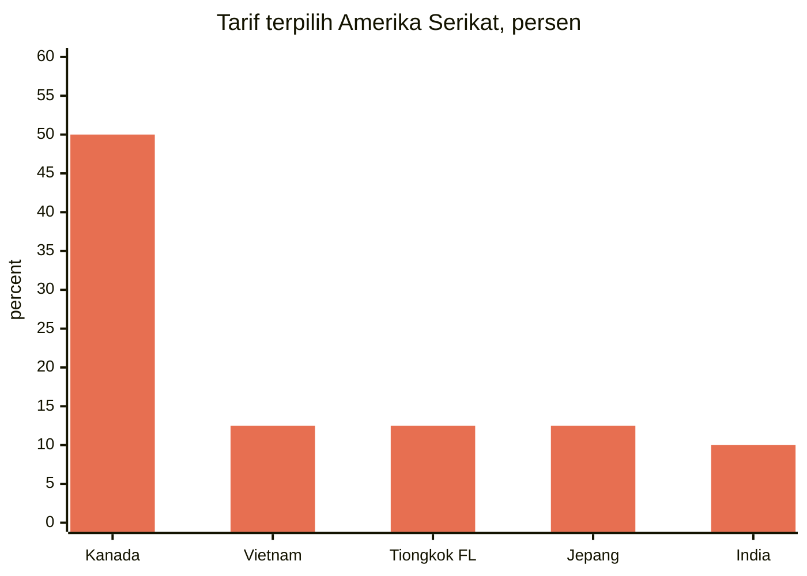

*Catatan: Kanada = tarif Section 338 (50%); Vietnam, Tiongkok FL, dan Jepang = tarif kerja paksa Section 301 (12,5%); India = tarif kerja paksa Section 301 yang berlaku (10%; tarif kesepakatan 18% yang diumumkan tidak pernah diterapkan). Sumber: USTR, Troutman, BDO, Industrial Front.*

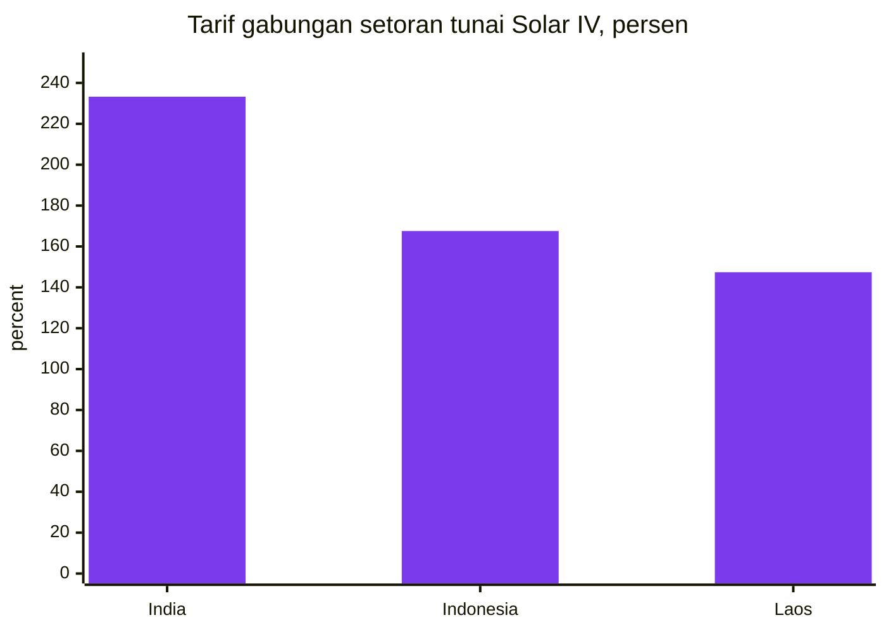

*Catatan: tarif gabungan setoran tunai antidumping ditambah countervailing duty, tarif untuk semua pihak lain. India: AD 107,17% + CVD 126,09%; Indonesia: AD 94,36% + CVD 73,20%; Laos: AD 65,36% + CVD 82,03%. Sumber: Perintah AD/CVD Commerce, 9 November 2026.*

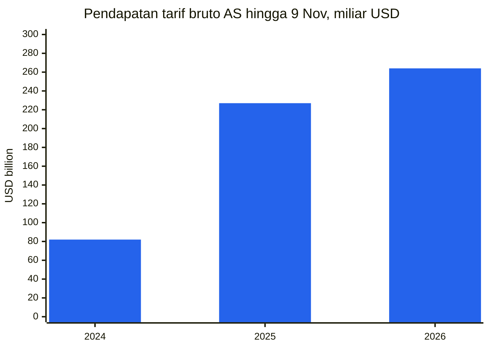

*Catatan: penerimaan bruto tarif dan cukai yang dikumpulkan pada tahun kalender hingga 9 November, dari laporan harian Departemen Keuangan Amerika Serikat sebagaimana dilacak oleh Bipartisan Policy Center. Sumber: Bipartisan Policy Center via The Motley Fool, 15 November 2026.*

---

## 5. Analisis mendalam kebijakan AS

### Section 301 — pemberitahuan 10 November

USTR menerbitkan Pemberitahuan Perpanjangan Pengecualian Produk pada 10 November 2026 (91 FR 72610; FR Doc. 2026-22925), yang memperpanjang seluruh 178 pengecualian saat ini dari tarif Section 301 atas Tiongkok (transfer teknologi dan kekayaan intelektual). Pengecualian — 164 pengecualian umum di bawah HTSUS 9903.88.69 dan 14 pengecualian manufaktur surya di bawah 9903.88.70 — dijadwalkan berakhir pukul 23.59 ET pada 9 November 2026. Jendela baru mencakup barang yang dimasukkan untuk konsumsi, atau dikeluarkan dari gudang untuk konsumsi, pada atau setelah pukul 00.01 ET pada 10 November 2026, dan sebelum pukul 23.59 ET pada 9 Januari 2027. Cakupan setiap pengecualian tidak berubah; masing-masing hanya berlaku untuk produk yang sesuai dengan nomor HTSUS 10 digit dan deskripsi produk dalam catatan HTSUS. USTR tidak meminta komentar baru, bersandar pada catatan dari pemberitahuannya pada September 2025. Koalisi 24 asosiasi industri telah meminta perpanjangan setidaknya satu tahun pada 4 November. Sebagian pelaporan mencatat ketidaksesuaian dalam pemberitahuan itu, dengan bagian-bagian yang merujuk pada 10 Januari alih-alih 9 Januari; tanggal yang berlaku adalah 9 Januari. USTR menerbitkan pemberitahuan terpisah pada 10 November (91 FR 72608; FR Doc. 2026-22867) yang menangguhkan lebih lanjut tindakan Section 301 atas praktik maritim, logistik, dan pembangunan kapal Tiongkok — termasuk biaya kapal yang tercakup (Lampiran I–III) dan bea Annex V.A — berlaku 10 November 2026 hingga pukul 23.59 ET pada 9 Januari 2027. Tidak ada pihak yang menanggung kewajiban atas biaya itu selama penangguhan. USTR menerima sekitar 60 komentar unik atas usulan tersebut. Tindakan itu sebelumnya ditangguhkan dari 10 November 2025 hingga 9 November 2026.

USTR juga memutuskan untuk memperpanjang selama tiga bulan penyelidikan Section 301 yang sedang berlangsung atas tindakan, kebijakan, dan praktik tertentu Pemerintah Vietnam terkait perlindungan dan penegakan kekayaan intelektual (docket USTR-2026-0364; FR Doc. 2026-22868; berlaku 3 November 2026). Penyelidikan itu dimulai pada 29 Mei 2026, setelah Vietnam disebut sebagai negara asing prioritas dalam Laporan Special 301 USTR 2026. Penentuan atas dapat ditindaklanjuti dan tindakan apa, jika ada, yang akan diambil kini akan dibuat paling lambat 28 Februari 2027, alih-alih tenggat awal 29 November 2026. USTR mengutip "isu-isu kompleks atau rumit yang memerlukan waktu tambahan". Vietnam juga menjadi subjek dua penyelidikan Section 301 lain yang tertunda, mengenai larangan impor kerja paksa dan kelebihan kapasitas struktural di manufaktur. Vietnam sudah menghadapi tarif kerja paksa Section 301 sebesar 12,5% berdasarkan item HTSUS 9903.05.04, berlaku 24 Juli 2026.

Belum ada langkah final dari penyelidikan Section 301 USTR atas kelebihan kapasitas struktural di manufaktur yang dirilis per 10 November 2026. Menteri Industri Korea Selatan Kim Jung-kwan mengatakan kepada komite Majelis Nasional pada 10 November bahwa Seoul memantau perkembangan dengan cermat; temuan itu dilaporkan tertinggal lebih dari dua bulan dari jadwal yang diharapkan pejabat Korea Selatan. Penyelidikan itu mencakup 16 ekonomi termasuk Korea Selatan. Korea Selatan berupaya mempertahankan tarif Amerika Serikat di kisaran 15%. Pengacara perdagangan dan analis mengatakan kepada Global Trade Review bahwa risiko jangka pendek utama yang teridentifikasi adalah penyelidikan ini, yang diluncurkan pada Maret, mencakup Tiongkok, Singapura, Swiss, Norwegia, Indonesia, Malaysia, Kamboja, Thailand, Korea Selatan, Vietnam, Taiwan, Bangladesh, Meksiko, Jepang, dan India, serta UE, dengan keputusan jatuh tempo pada Maret 2027.

### Section 232 — tidak ada tindakan baru; polisilikon jatuh tempo 4 Desember

Tidak ada proklamasi atau perubahan tarif Section 232 baru yang teridentifikasi dalam periode ini. Rezim Section 232 yang berlaku per 9 November 2026, sebagaimana diringkas dari Harmonized Tariff Schedule dan panduan CBP, adalah: baja, aluminium, dan tembaga sebesar 50%, termasuk banyak turunan (turunan lain yang terdaftar 25%; mesin industri tetap, peralatan listrik dan pertanian, serta peralatan pemanas, ventilasi, dan pendingin udara rumah tangga 15% secara total); semikonduktor sebesar 25% dengan pengecualian terdaftar; farmasi berpaten sebesar 100% (generik tidak tercakup), dengan tarif lebih rendah untuk sebagian asal dan perusahaan; mobil dan suku cadang sebesar 15% hingga 25%; turunan tembaga, truk dan suku cadang truk, kayu dan papan, polisilikon, dan drone masing-masing membawa tarif dan ketentuan sendiri. Bea polisilikon melekat pada 4 Desember 2026, dan hingga saat itu aturan BIS memungkinkan Commerce melarang importir yang membawa masuk jauh lebih banyak daripada volume historisnya dari pemasukan lebih lanjut sebelum 4 Desember, kecuali Commerce memberikan pengecualian (waiver). Robotika dan mesin industri memiliki temuan ancaman berdasarkan Proclamation 11077 tertanggal 28 Oktober 2026, yang mengarahkan negosiasi dan tidak mengenakan tarif baru. Kalender Januari 2027 mencakup kenaikan tarif Section 232 atas furnitur dan lemari: furnitur berlapis kain menjadi 30% dan lemari dapur serta meja rias menjadi 50% mulai 1 Januari 2027.

### CBP — importer of record asing; pembatalan Formulir 5106

CBP menerbitkan aturan final interim "Persyaratan yang Diperketat bagi Importer of Record Asing" (CBP Dec. 26-19, 91 FR 69977; FR Doc. 2026-22735) pada 6 November 2026, yang melaksanakan Bagian 2 dari Executive Order 14411. Mulai 5 Januari 2027, importer of record asing hanya dapat memasukkan barang untuk konsumsi jika ia sendiri tervalidasi CTPAT atau mengajukan melalui broker pabean berlisensi yang tervalidasi CTPAT. Bagian 110 baru dari peraturan kepabeanan mendefinisikan "U.S. IOR" (warga negara Amerika Serikat atau penduduk tetap yang sah, atau entitas yang didirikan berdasarkan hukum Amerika Serikat dan berlokasi di Amerika Serikat, dengan ketentuan kepemilikan atau properti tambahan — misalnya, sedikitnya 51% kepemilikan manfaat oleh warga negara Amerika Serikat atau penduduk tetap yang sah dengan kendali, atau kepemilikan langsung atas properti riil Amerika Serikat yang signifikan dan tidak terbebani). Status importir Amerika Serikat atau asing harus dinyatakan pada saat pemasukan dan ringkasan pemasukan (19 CFR 141.21–141.22 yang baru); broker harus memverifikasi status importir Amerika Serikat klien dengan meninjau catatan dan menyimpan catatan verifikasi selama lima tahun; tiga bidang data baru ditambahkan ke Formulir CBP 3461 dan 7501 (dan padanan elektroniknya) melalui pesan CSMS. Broker dapat meminta kepatuhan yang ditunda paling lambat 5 Januari 2027; semua broker diharapkan patuh penuh paling lambat 6 Mei 2027. Aturan itu juga memperluas keadaan ketika broker dapat menghadapi penalti berdasarkan 19 U.S.C. 1592. Komentar jatuh tempo 5 Januari 2027 (docket USCBP-2026-1387). Analisis CBP sendiri: 0,4% importer of record asing tervalidasi CTPAT dan 68% sudah menggunakan broker yang tervalidasi; 32% sisanya tidak akan dapat terus mengimpor ke Amerika Serikat kecuali beralih broker atau menjadi tervalidasi CTPAT sendiri.

Secara terpisah, CBP mengirim surat kepada sejumlah importir bersertifikat CTPAT yang menyatakan bahwa nomor importer-of-record mereka dapat dibatalkan untuk pemasukan yang diajukan mulai pukul 00.01 ET pada 18 November 2026 kecuali kekhawatiran CBP tentang akurasi informasi Formulir 5106 CBP importir itu diselesaikan terlebih dahulu (lihat A5). Pemberitahuan CBP tentang aturan yang diusulkan atas kiriman bernilai rendah tertanggal 8 Oktober 2026 (91 FR 64532; docket USCBP-2026-0298) masih terbuka, dengan komentar jatuh tempo 7 Desember 2026. Usulan itu akan mewajibkan pemasukan informal untuk barang hingga $2.500 diajukan secara elektronik pada atau sebelum tanggal impor, mewajibkan jaminan (bond) atas setiap pemasukan informal, dan menjadikan broker sebagai importer of record ketika mengajukan untuk penerima yang bukan pemilik atau pembeli. Pembebasan de minimis $800 tetap ditangguhkan tanpa batas waktu — untuk kiriman non-pos mulai 24 Juni 2026 dan untuk kiriman pos mulai 24 Juli 2026. Secara terpisah, CBP memindahkan tanggal ketika pemasukan formal menjadi wajib untuk surat yang tunduk pada bea Section 201, 232, atau 301 atau persyaratan instansi pemerintah mitra dari 22 Oktober 2026 menjadi 20 Januari 2027.

### Kontrol ekspor BIS — Aturan Afiliasi ditangguhkan hingga 10 Januari; peredam beralih ke kendali Commerce

BIS menerbitkan aturan final (FR Doc. 2026-22793) yang memperpanjang penangguhan aturan final interimnya, "Perluasan Kontrol Pengguna Akhir untuk Mencakup Afiliasi Entitas Tertentu yang Terdaftar" (Aturan Afiliasi), hingga 10 Januari 2027. Penangguhan satu tahun yang diberlakukan pada November 2025 (90 FR 50857) dijadwalkan berakhir pada 9 November 2026; aturan baru itu berlaku pada 9 November 2026, sehingga tidak ada jeda. Aturan Afiliasi, yang diterbitkan 30 September 2025 (90 FR 47201), akan memperluas kontrol ekspor berdasarkan Export Administration Regulations ke entitas asing yang dimiliki 50% atau lebih, secara langsung atau tidak langsung, secara individual atau agregat, oleh satu atau lebih pihak dalam Entity List, Military End-User List, atau pihak tertentu yang ditetapkan OFAC. Aturan itu juga memperkenalkan red flag baru yang membebankan kewajiban kepada eksportir untuk menyelesaikan pertanyaan kepemilikan ketika suatu pihak asing diketahui dimiliki sebagian oleh entitas yang terdaftar. Perpanjangan itu tidak menarik atau mengubah aturan tersebut. Tanpa tindakan BIS lebih lanjut, kontrol yang diperluas berlaku pada 10 Januari 2027. Pemberitahuan Federal Register itu tidak memberikan alasan kebijakan selain perubahan tanggal; pejabat pemerintah telah mengindikasikan perpanjangan itu terkait dengan gencatan perdagangan Amerika Serikat–Tiongkok, yang juga diperpanjang hingga 10 Januari 2027. BIS juga mengumumkan bahwa, mulai 20 November 2026, ekspor peredam, muffler, dan penekan suara tertentu beralih dari United States Munitions List Departemen Luar Negeri ke kendali Export Administration Regulations BIS; peredam akan ditambahkan ke Commerce Control List dan BIS akan mewajibkan lisensi untuk ekspor, re-ekspor, atau transfer dalam negeri tertentu, termasuk pelepasan perangkat lunak dan teknologi terkait kepada orang asing. Pengecualian lisensi yang saat ini tersedia untuk senjata api juga akan tersedia untuk peredam.

### Federal Register — aktivitas AD/CVD dalam periode ini

9 November: Commerce menerbitkan perintah akhir bea antidumping dan countervailing duty atas sel dan modul fotovoltaik silikon kristalin dari India, Indonesia, dan Laos (lihat A7). 10 November: Commerce menemukan secara awal bahwa produk tin mill dari Taiwan dan Türkiye dijual di Amerika Serikat di bawah nilai wajar. Commerce menetapkan tarif antidumping sebesar 18,07% untuk Ton Yi Industrial Corporation Taiwan dan untuk semua eksportir Taiwan lainnya. Untuk Türkiye ditetapkan 3,89% untuk Tosyali dan untuk semua eksportir lain, dan 42,06% untuk Tatrix International. Importir kini berutang setoran tunai pada tarif tersebut. Tarif itu bergabung dengan tarif awal yang ditetapkan Commerce pada September untuk Tiongkok, sebesar 136,52% untuk dumping dan 66,61% untuk subsidi. Temuan dumping akhir untuk Türkiye jatuh tempo 75 hari setelah penandatanganan 5 November (19 Januari 2027); untuk Taiwan, 135 hari setelah publikasi 10 November (25 Maret 2027); temuan akhir Tiongkok jatuh tempo 30 November 2026 kecuali ditunda. 12 November: Commerce menerbitkan hasil akhir dalam tinjauan administratif antidumping atas lemari kayu, meja rias, dan komponen dari Tiongkok (periode 2024–2025), menetapkan tarif antidumping 7,48% untuk perusahaan yang ditinjau — Yixing Pengjia Technology, Jiangsu Xiangsheng Bedtime Furniture, Xiamen Golden Huanan, dan Zhongshan NU Furniture — yang berlaku untuk kiriman yang tercakup yang dimasukkan atau dikeluarkan untuk konsumsi pada atau setelah 12 November 2026. Tarif setoran tunai seluruh Tiongkok tetap 251,64%. Dalam tinjauan administratif countervailing duty atas produk cetakan kayu dan millwork dari Tiongkok, Commerce menetapkan tarif CVD akhir sebesar 147,88% untuk Nanping Huatai Wood and Bamboo Co., Fujian Yinfeng Imp & Exp Trading Co., dan Fujian Hongjia Craft Products Co., serta 21,39% untuk perusahaan non-terpilih yang ditinjau, yang berlaku untuk kiriman yang tercakup yang dimasukkan atau dikeluarkan untuk konsumsi pada atau setelah 12 November 2026. Commerce bermaksud mengeluarkan instruksi penilaian paling cepat 35 hari setelah publikasi (17 Desember 2026) dalam setiap kasus.

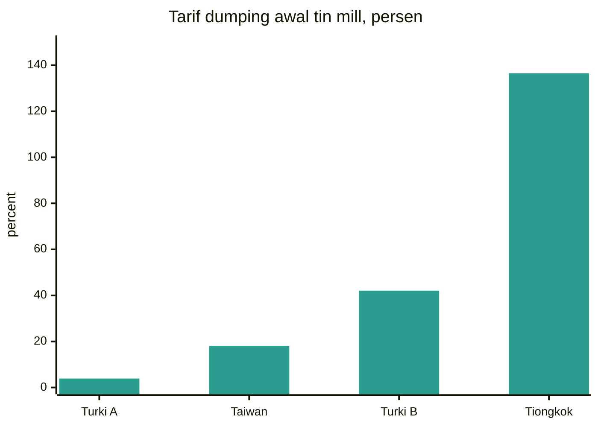

*Catatan: Turki A = Tosyali dan semua eksportir lain (3,89%); Turki B = Tatrix International (42,06%); Tiongkok = tarif awal September (136,52%). Sumber: Penentuan awal Commerce, 10 November 2026.*

### Butir yang masih berlaku

- **UFLPA / Entity List:** tidak ada penambahan Entity List UFLPA baru atau perintah penahanan pelepasan (withhold release order) baru yang teridentifikasi dalam periode 9–16 November. Penambahan Entity List terbaru (43 perusahaan) diumumkan 31 Juli 2026; panduan operasional kerja paksa CBP saat ini bagi importir berasal dari Juni 2026. Total penegakan terakhir yang dinyatakan CBP, dari rilis Serbia Zijin, adalah 56 WRO dan delapan Temuan berdasarkan 19 U.S.C. § 1307; pelaporan kemudian menempatkan totalnya pada 60 WRO dan delapan Temuan setelah dua perintah lebih lanjut pada 29 September 2026.
- **Gedung Putih:** tidak ada proklamasi tarif atau lembar fakta baru yang diterbitkan dalam periode ini.
- **USITC / HTS:** tidak ada perubahan tarif HTS baru yang teridentifikasi dalam periode ini di luar perintah Solar IV. Laporan publik lengkap USITC tentang Solar IV (USITC Publication 5804) jatuh tempo di situs web USITC paling lambat 23 November 2026.
- **trade.gov / intelijen pasar:** tidak ada rilis intelijen pasar baru yang spesifik untuk kebijakan tarif Amerika Serikat yang teridentifikasi dalam periode ini.
- **internationaltradetoday.com:** berbayar; judul utama mengonfirmasi berita aturan importer-of-record asing CBP (5 November).

---

## 6. Kebijakan dunia menurut kawasan

### Eropa

Reset e-commerce bernilai rendah UE kini berlaku (lihat 3.3): biaya penanganan €2 per baris item dan Pengenal Produk wajib mulai 1 November, di atas bea datar €3 per baris tarif yang berlaku sejak 1 Juli 2026. Pada 9 November Dewan menyetujui penghapusan batas atas €150 dari VAT Import One-Stop Shop, berlaku mulai 1 Juli 2028. Aktivitas tarif kepabeanan UE (TARIC) pada pekan 1–7 November didominasi oleh persiapan ke depan alih-alih bea protektif baru: 15.055 catatan perubahan diproses, yang lebih dari 13.600 di antaranya adalah langkah bertanggal mendatang yang memposisikan akses preferensial dan kuota otonom yang berlanjut hingga 2027. Pada 6 November, lebih dari 2.500 catatan bertanggal mendatang menetapkan kuota tarif otonom yang dijadwalkan berlaku pada 1 Januari 2027, termasuk kuota berskala besar untuk sektor pengolahan makanan laut. Perputaran segera terkonsentrasi pada 1 November, ketika 5.405 dari 6.238 langkah yang berlaku selama pekan itu mulai berlaku. Penyesuaian ulang pertahanan perdagangan teknis, yang terkonsentrasi pada 3 November, mengkalibrasi ulang batas langkah untuk PVC curah, PVC suspensi, aspirin, dan polimer serta bahan kimia khusus lainnya. Pola itu menunjukkan sikap administratif yang berfokus pada persiapan akses 2027 alih-alih mengenakan bea baru, tetapi perubahan cakupan pertahanan perdagangan mengubah cakupan langkah yang ada atas polimer dan bahan kimia dan menuntut akurasi deklarasi dari importir.

Perjanjian perdagangan bebas UE–India dilaporkan akan ditandatangani di Brussels pada pertengahan Desember 2026 (lihat 3.3). Perjanjian perdagangan UE–Meksiko yang dimodernisasi ditandatangani secara resmi pada 22 Mei 2026 dan menunggu ratifikasi oleh Parlemen Eropa sebelum berlaku. Perjanjian UE dengan Indonesia dan Australia masing-masing diperkirakan ditandatangani sebelum akhir 2026. Perjanjian interim UE–Mercosur telah berlaku sementara sejak 1 Mei 2026.

**Sumber:** [RegFollower](https://regfollower.com/eu-forward-staging-and-trade-defence-realignment-mark-the-november-tariff-turn/); [Flex Logistics](https://flexlogistics.eu/eu-trade-deals-online-sellers/)

### Inggris

Pemberitahuan remedi perdagangan 2026/31 memberlakukan penerimaan Menteri Negara atas rekomendasi Trade Remedies Authority dalam tinjauan kedaluwarsa ER0080, yang dimulai pada 22 Januari 2026. Countervailing duty atas ikan trout pelangi yang berasal dari Türkiye, mencakup ikan hidup, segar, dingin, beku, dan asap dalam batas ukuran yang ditetapkan dalam pemberitahuan dan diklasifikasikan di bawah pos 0301, 0302, 0303, 0304, dan 0305, diperpanjang selama lima tahun hingga 30 Januari 2031 pada tarif yang ada, tanpa penghitungan ulang. Pemberitahuan itu berlaku pada 6 November 2026, dengan variasi yang berlaku mulai 30 Januari 2026, dan menggantikan pemberitahuan perpajakan 2021/12. Tarif menurut eksportir berkisar 1,5% hingga 8%; dua kelompok eksportir terdaftar membayar 6,9% dan 7,6%; semua eksportir lain membayar 9,5%.

HM Revenue and Customs memperbarui ringkasan kebijakannya untuk Mekanisme Penyesuaian Perbatasan Karbon Inggris (UK Carbon Border Adjustment Mechanism) pada 2 November, menambahkan informasi tentang penghitungan Carbon Price Relief. Ini adalah pembaruan ketiga pada musim gugur ini, menyusul pembaruan pada 9 September dan 16 Oktober 2026 yang mencerminkan penetapan Carbon Border Adjustment Mechanism (Emissions and Verification) Regulations 2026. Ringkasan itu mengonfirmasi UK CBAM akan dimulai pada 1 Januari 2027 dan akan berlaku untuk barang aluminium, semen, pupuk, hidrogen, serta besi dan baja tertentu yang diidentifikasi berdasarkan kode komoditas. Dengan kurang dari dua bulan hingga dimulainya, importir barang yang tercakup perlu mengonfirmasi kode komoditas, data emisi, dan penghitungan Carbon Price Relief mereka sebelum mekanisme itu mulai menagih.

Department for Business and Trade merilis lembar fakta perdagangan dan investasi bilateral regulernya pada 6 November, termasuk untuk Qatar. Total perdagangan barang dan jasa antara Inggris dan Qatar adalah £5,4 miliar dalam empat kuartal hingga akhir Q2 2026, turun 7,2% atau £416 juta dari empat kuartal hingga akhir Q2 2025. Ekspor Inggris ke Qatar adalah £3,9 miliar (turun 10,3%, atau £447 juta) dan impor dari Qatar £1,5 miliar (naik 2,1%, atau £31 juta). Qatar adalah mitra dagang terbesar ke-47 Inggris, mencakup 0,3% dari total perdagangan Inggris.

**Sumber:** [Global Customs Compliance](https://www.globalcustomscompliance.com/trade-and-customs-watch-2026-11-13/?utm_source=rss&utm_medium=rss&utm_campaign=trade-and-customs-watch-2026-11-13)

### Kanada

Menteri Keuangan François-Philippe Champagne mengumumkan perubahan atas langkah keringanan tarif Kanada pada 9 November (lihat 3.7): pengurangan horizontal atas tarif Amerika Serikat diperpanjang satu tahun hingga 30 Juni 2028, dengan keringanan kini juga mencakup barang non-baja yang digunakan dalam pertambangan, penggalian, atau ekstraksi minyak dan gas, serta semua barang yang digunakan oleh entitas pendidikan publik, termasuk yang diamanatkan oleh organisasi masyarakat adat; keringanan dihapus untuk trailer tertentu mulai 1 Desember 2026 dan untuk kawat dan ekstrusi aluminium tertentu serta produk papan kertas mulai 1 Februari 2027. Perubahan itu berada di atas tarif balasan 15% hingga 50% atas berbagai impor Amerika Serikat yang diberlakukan pada 8 September 2026. Badan Layanan Perbatasan Kanada memperbarui Pemberitahuan Kepabeanan 26-07 pada 2 November, memperpanjang pengurangan barang terjadwal ke Jadwal 1 hingga 3, memperkenalkan kode otorisasi khusus untuk Jadwal 2 dan 3, serta mengklarifikasi syarat kelayakan; pemberitahuan itu juga menghapus Lampiran A, yang memberikan panduan tambahan tentang pengurangan menara angin. Menteri Perdagangan Wang Wentao dan Menteri Perdagangan Internasional Kanada Maninder Sidhu bersama-sama memimpin pertemuan ke-29 Komisi Ekonomi dan Perdagangan Bersama Tiongkok–Kanada di Beijing pada 3 November; substansi hasil apa pun tidak dapat dipastikan dari materi yang ditinjau.

**Sumber:** [Department of Finance Canada](https://www.canada.ca/en/department-finance/news/2026/11/canada-modifies-tariff-relief-measures-to-better-support-workers-and-businesses.html); [GHY](https://www.ghy.com/trade-compliance/category/canada-imports/)

### Tiongkok

Pihak Tiongkok dalam perpanjangan gencatan dibahas dalam bagian 2 dan 3.1. Situs berbahasa Inggris MOFCOM (english.mofcom.gov.cn) dapat dijangkau pada 16 November; hanya judul utama yang terlihat, termasuk pernyataan juru bicara tentang langkah penyesuaian terkait Unreliable Entity List dan pencantuman pertemuan ke-29 Komisi Ekonomi dan Perdagangan Bersama Tiongkok–Kanada. Substansi tanggapan MOFCOM terhadap biaya €2 UE dalam jumpa pers pada periode yang sama tidak dapat dipastikan dari materi yang ditinjau.

### India dan Selandia Baru

Kesepakatan interim India–Amerika Serikat tetap belum ditandatangani (lihat A10 dan 3.2). Perjanjian UE–India dilaporkan akan ditandatangani pada pertengahan Desember (lihat 3.3). India dan UE juga melanjutkan pembicaraan implementasi di Brussels pada awal November. Menteri Perdagangan Piyush Goyal mengatakan pada 3 November bahwa India tidak pernah membuka sektor susunya dalam perjanjian perdagangan bebas mana pun dan tidak akan mengizinkan impor produk hasil rekayasa genetika, garis merah yang relevan bagi setiap jalur FTA yang aktif.

### Asia-Pasifik — Korea dan Brasil

Presiden Lee Jae-myung mendesak pemerintahnya dalam rapat kabinet pada 3 November untuk bergerak cepat dalam pembicaraan dengan Brasil atas tarif 25% yang dikenakan Brasil atas kosmetik Korea, dengan mengatakan pungutan itu merupakan penghalang bagi sektor dengan permintaan lokal yang kuat atas produk buatan Korea. Ia mengatakan pemindahan produksi ke Brasil tidak akan menyelesaikan masalah, dengan alasan preferensi konsumen lokal yang kuat terhadap kosmetik buatan Korea, dan menanyakan kepada Menteri Luar Negeri Cho Hyun tentang status pembicaraan itu. Cho mengindikasikan pembicaraan kini dapat maju menyusul terpilihnya kembali Presiden Lula dalam putaran kedua 25 Oktober. Intervensi itu mengubah tarif sektoral menjadi isu bilateral tingkat presiden menjelang masa jabatan baru Brasil.

Perusahaan barang konsumsi Korea menandatangani kontrak ekspor dan nota kesepahaman senilai $18 juta pada Korean Wave Expo dan Australia K-Food Fair yang diadakan di Melbourne pada 5–7 November, yang diselenggarakan bersama oleh Kementerian Perdagangan, Industri, dan Energi serta Kementerian Pertanian, Pangan, dan Urusan Pedesaan dan diorganisasi oleh KOTRA dan Korea Agro-Fisheries & Food Trade Corporation. Acara konsultasi ekspor itu melibatkan 101 perusahaan Korea dan 144 pembeli dari Oseania dan Asia Tenggara, yang melakukan 1.235 konsultasi dan menghasilkan 32 kontrak dan MOU. Ekspor kosmetik Korea ke Australia naik dari $73 juta pada 2023 menjadi $112 juta pada 2024 dan $166 juta pada 2025, didukung oleh pengurangan tarif berdasarkan Perjanjian Perdagangan Bebas Korea–Australia yang berlaku sejak 12 Desember 2014.

**Sumber:** [SE Daily](https://en.sedaily.com/politics/2026/11/03/lee-presses-brazil-to-cut-25-percent-tariff-on-korean); [Aju Press](https://www.ajupress.com/view/20261108110470271)

### Multilateral

**Organisasi Perdagangan Dunia (WTO).** Pada pertemuannya 4–6 November, Komite WTO tentang Tindakan Sanitasi dan Fitosanitari meninjau kekhawatiran perdagangan tertentu, transparansi, pendampingan, dan pembangunan kapasitas. Sekretariat melaporkan bahwa 55 kekhawatiran perdagangan tertentu telah diselesaikan dan 19 diselesaikan sebagian menyusul latihan pemantauan 2026, yang melibatkan penghubungan dengan 39 anggota tentang kekhawatiran yang tidak diangkat sejak November 2024, dengan tanggapan dari 25 anggota. Pertemuan November mempertimbangkan 78 kekhawatiran perdagangan tertentu, termasuk lima yang diangkat untuk pertama kalinya, mencakup batas residu pestisida dan langkah regulasi lain di Uni Eropa, pembatasan impor yang memengaruhi produk daging di Kolombia, keterlambatan persetujuan ekspor daging sapi Paraguay ke Jepang, dan pembatasan atas produk unggas Chili yang terkait dengan flu burung. 63% dari 640 kekhawatiran perdagangan tertentu yang dibahas sejak 1995 telah diselesaikan (326) atau diselesaikan sebagian (75). Komite Pertanian, dalam sesi khusus, mengadakan dua presentasi pada 3 November yang meninjau evolusi negosiasi perdagangan pertanian sejak Putaran Uruguay, mencakup persaingan ekspor dan penimbunan pangan publik oleh pemerintah negara berkembang pada harga yang ditetapkan. Pertemuan berikutnya, yang dijadwalkan 23 November 2026, akan membahas pembatasan ekspor dan mekanisme pengaman khusus. Pada 16 November, WTO menyetujui pembentukan panel penyelesaian sengketa untuk meninjau keluhan Tiongkok terhadap tarif India atas produk teknologi tertentu dan skema insentif bagi sektor manufaktur surya domestik, menyusul permintaan kedua Tiongkok untuk panel. Konsultasi bilateral gagal menghasilkan penyelesaian; India telah memblokir permintaan awal Tiongkok pada Mei 2026. Panel itu akan memeriksa kepatuhan terhadap Perjanjian Umum tentang Tarif dan Perdagangan, Perjanjian tentang Subsidi dan Tindakan Imbalan, serta Perjanjian tentang Tindakan Investasi Terkait Perdagangan. Pada 30 Oktober, anggota WTO mengadopsi deklarasi yang memposisikan ulang Inisiatif Aid for Trade sebagai "Aid for Trade: kemitraan untuk perdagangan dan pembangunan" dalam pertemuan Komite Perdagangan dan Pembangunan, yang menutup Tinjauan Global Aid for Trade ke-10 selama dua hari di Jenewa — hasil multilateral pertama tentang topik itu dalam 20 tahun. Direktur Jenderal Ngozi Okonjo-Iweala menyampaikan pidato utama dalam acara tentang perdagangan, keanekaragaman hayati, dan ekonomi kelautan pada 5 November, yang menempatkan ekonomi kelautan sebesar US$2,6 triliun, mendukung sekitar 133 juta pekerjaan, dan mencatat bahwa lebih dari 80% barang yang diperdagangkan secara global diangkut melalui laut dan 72% perdagangan barang dunia masih berlangsung berdasarkan ketentuan most-favoured-nation. Ia menunjuk Perjanjian tentang Subsidi Perikanan, yang berlaku sejak September 2025, dan mendesak anggota menyelesaikan negosiasi yang tersisa.

**Konferensi PBB tentang Perdagangan dan Pembangunan (UNCTAD).** UNCTAD merilis Global Trade Update (November 2026) pada 9 November, yang waktunya bertepatan dengan COP31 di Antalya, Türkiye (9–20 November), yang mengkaji bagaimana perdagangan dapat mendukung aksi iklim. Laporan itu menemukan ketentuan terkait iklim menjadi lebih umum dalam perjanjian perdagangan, muncul dalam lebih dari separuh perjanjian yang ditandatangani antara 2016 dan 2021, tetapi implementasi tetap terbatas: hanya 7% ketentuan terkait iklim yang teridentifikasi dalam perjanjian perdagangan terbaru membahas pengurangan hambatan tarif dan non-tarif. Dari 174 negara yang disurvei pada 2025, hanya tujuh yang melaporkan sepenuhnya menerapkan langkah fasilitasi perdagangan untuk barang hijau dan relevan iklim. Ekspor global barang yang terkait dengan rantai nilai energi surya dan angin melampaui $1,8 triliun pada 2025, tumbuh lebih cepat daripada ekspor barang manufaktur lainnya; perdagangan baterai naik 29% dan perdagangan kendaraan listrik 11% pada paruh pertama 2026; ekonomi berkembang mengekspor $1,3 triliun barang berbasis keanekaragaman hayati pada 2024, $1,2 triliun barang dan jasa kelautan pada 2025, dan perkiraan $204 miliar pengganti non-plastik pada 2024. Laporan itu mengidentifikasi akses terjangkau ke teknologi iklim sebagai hal esensial untuk adaptasi dan pengurangan emisi. Laporan tentang pengembangan kapasitas untuk mengekspor ke pasar Tiongkok, yang ditulis oleh Institute of World Economics and Politics dari Chinese Academy of Social Sciences (CASS) dan UNCTAD, dipresentasikan di Shanghai pada 5 November pada Forum Ekonomi Internasional Hongqiao ke-9, yang diadakan bersamaan dengan China International Import Expo. Laporan itu menganalisis 10 mitra dagang, termasuk Kolombia, Kenya, Spanyol, Thailand, dan Inggris; pangsa Tiongkok atas ekspor dunia naik dari 3,2% pada 2000 menjadi 9,2% pada 2025, menurut direktur jenderal lembaga itu.

**Pusat Perdagangan Internasional (ITC).** Pusat Perdagangan Internasional dan African Export-Import Bank meluncurkan laporan "Reshaping Africa-Caribbean Trade: Opportunities for Economic Transformation" di St John's, Antigua dan Barbuda, pada 3 November, di sela-sela Pertemuan Kepala Pemerintahan Persemakmuran. Laporan itu menemukan perdagangan tahunan barang dan jasa antara Afrika dan Karibia dapat mencapai hingga $1,65 miliar pada 2030, tidak termasuk bahan bakar mineral. Sekitar 80% potensi ekspor barang tahunan Afrika ke Karibia masih belum dimanfaatkan, sementara potensi ekspor Karibia terutama terletak pada jasa, mencapai $481 juta. Sektor prioritas mencakup makanan olahan dan pakan ternak, bahan kimia, mineral dan logam, pakaian dan tekstil, kulit dan alas kaki, pariwisata, layanan transportasi, dan industri kreatif. Temuan itu bersandar pada analisis perdagangan dan potensi ekspor, penilaian sektor, dan survei terhadap 1.175 bisnis dan organisasi pendukung bisnis di kedua kawasan.

**Organisasi Bea Cukai Dunia (WCO).** Pada 3 November WCO mengadakan simposium hibrida di kantor pusatnya di Brussels tentang peran bea cukai dalam bantuan bencana, dengan lebih dari 190 peserta dari administrasi kepabeanan, organisasi internasional, serta praktisi kemanusiaan dan logistik; Sekretaris Jenderal Ian Saunders mengaitkan diskusi itu dengan tema WCO 2026, "Customs protecting society through vigilance and commitment". Pada 5 November WCO menerbitkan Laporan Tahunan 2025–2026. Pada 9 November WCO mengadakan acara global Smart Customs Project tentang teknologi disruptif, dan pada 11 November simposium tentang penghapusan barang palsu dari e-commerce, dengan administrasi kepabeanan, Serikat Pos Universal, dan eBay di antara para pesertanya. Pada 12 November WCO melaporkan dukungan bagi negara-negara Komunitas Afrika Timur dalam merevisi aturan asal dan mengembangkan kapasitas pelatihan otonom, dan pada 13 November Sekretaris Jenderal bertemu Direktur Jenderal Organisasi Kesehatan Hewan Dunia di sela-sela pertemuan Kelompok Penanggulangan Pemalsuan dan Pembajakan WCO untuk menegaskan kembali kerja sama melawan perdagangan gelap.

**Sumber:** [Logistics News PH](https://logisticsnews.ph/2026/11/12/wto-sps-committee-reports-progress-in-resolving-trade-concerns/); [India ReNews](https://indiarenews.in/blog/read/wto-sets-up-dispute-panel-to-examine-china-s-challenge-against-india-s-solar-incentives-and-technology-tariffs); [UNCTAD](https://unctad.org/publication/global-trade-update-november-2026); [WCO](https://www.wcoomd.org/en/media/newsroom/2026/november.aspx)

---

## 7. Tindakan penegakan

### Bea antidumping dan countervailing duty

Perintah akhir AD/CVD Commerce atas sel surya dari India, Indonesia, dan Laos (lihat A7) serta tarif awal tin mill untuk Taiwan dan Türkiye dan hasil tinjauan lemari kayu dan millwork (lihat bagian 5) adalah tindakan remedi perdagangan pekan ini. Perintah surya adalah tindakan AD/CVD terbesar dalam periode ini berdasarkan tarif, dengan tarif gabungan setoran tunai di atas 100% dari nilai yang dimasukkan dalam setiap kasus. Tarif awal tin mill menetapkan biaya setoran tunai bagi pemasok Taiwan dan Turki sementara kasus Tiongkok, dengan tarif yang jauh lebih tinggi (136,52% dumping, 66,61% subsidi pada September), mendekati penentuan akhirnya pada 30 November. Tinjauan lemari kayu dan millwork mengatur ulang tarif setoran tunai bagi eksportir furnitur dan millwork Tiongkok yang disebutkan sembari mempertahankan tarif seluruh Tiongkok yang sangat tinggi (251,64%), sehingga mempertahankan kesenjangan bea yang besar antara pemasok yang ditinjau dan yang tidak ditinjau.

### Penyitaan CBP dan kerja paksa

Petugas CBP di DeConcini Crossing, Pelabuhan Nogales, merujuk seorang pria warga negara Amerika Serikat berusia 36 tahun yang mengemudikan Nissan Titan 2006 yang kembali dari Meksiko untuk pemeriksaan sekunder pada 3 November. Pemeriksaan fisik atas kursi lipat plastik di bak truk menemukan lebih dari 300 paket berisi fentanil yang disembunyikan di dalam kursi-kursi itu. Kendaraan dan narkotika disita; agen khusus Homeland Security Investigations merespons ke pelabuhan masuk, dan kasus itu menunggu penyelidikan lebih lanjut. Lebih dari 112 pon fentanil disita. Tidak ada Withhold Release Order baru yang teridentifikasi dalam periode liputan. WRO terbaru dalam rilis CBP sebelum periode ini adalah perintah minyak sawit Indonesia dan perintah Serbia Zijin Copper tertanggal 16 Juni 2026. Tidak adanya WRO baru dalam periode ini, setelah serangkaian perintah pada musim panas dan musim gugur, itu sendiri merupakan poin data bagi irama penegakan kerja paksa; importir tidak boleh membacanya sebagai perubahan kebijakan.

Seorang pria Hawaii dijatuhi hukuman pada 12 November berupa 24 bulan penjara dan denda $15.000 karena mentransfer dana ke Iran tanpa lisensi OFAC. Arash Einolghozati, 38, dari Waialua, Oahu, dijatuhi hukuman oleh Hakim Distrik Amerika Serikat Senior Helen Gillmor berupa 24 bulan penjara, diikuti tiga tahun pembebasan yang diawasi. Menurut catatan pengadilan, mulai paling awal Maret 2026 dan berlanjut hingga setidaknya April 2022 (sebagaimana dinyatakan dalam rilis Departemen Kehakiman), Einolghozati melakukan beberapa transfer mata uang yang diterbitkan pemerintah dan mata uang kripto dari dalam Amerika Serikat kepada penerima yang diketahuinya berada di Iran atau yang akan meneruskan dana itu kepada individu di Iran, dengan mengetahui bahwa hal itu melanggar hukum tanpa lisensi dari Office of Foreign Assets Control Departemen Keuangan. Total yang ditransfer lebih dari $226.000. FBI menyelidiki kasus itu. Kasus itu menunjukkan penegakan pidana atas sanksi Iran yang menjangkau pengirim individu yang menggunakan uang tunai maupun mata uang kripto, dan mengikuti kampanye Operation Economic Outcast Departemen Keuangan terhadap kanal keuangan terkait Iran.

**Sumber:** [CBP](https://www.cbp.gov/newsroom/local-media-release/cbp-officers-seize-112-pounds-fentanyl-nogales-port-entry); [US Department of Justice](https://www.justice.gov/usao-hi/pr/north-shore-man-sentenced-two-years-prison-sending-money-iran-violation-us-sanctions)

### Sanksi

OFAC menetapkan jaringan perusahaan pendaftaran dan penandaan (flagging) maritim yang diduga curang yang memfasilitasi ekspor minyak Iran, berdasarkan Executive Order 13902, dalam tindakan yang diumumkan 4 November. Jaringan itu dipimpin oleh warga negara India Suniel Kumar Sharma dan Jaspreet Preeti Shahid, yang berbasis di Chandigarh, India, yang mengoperasikan perusahaan yang menyamar sebagai registri bendera dan penyedia layanan maritim untuk negara dan yurisdiksi termasuk Guyana, Eswatini, Laos, Aruba, Mali, Mozambik, Malawi, Sint Maarten, dan Timor-Leste. Perusahaan-perusahaan itu menjual registrasi dan sertifikat palsu kepada kapal yang mengangkut minyak bumi Iran, termasuk kapal yang beroperasi atas nama militer Iran dan proksinya. OFAC menetapkan empat individu dan sembilan entitas dalam jaringan itu, dan juga memberikan sanksi kepada Fugo Ground Services Inc. yang berbasis di Türkiye atas aktivitas di sektor penerbangan Iran. OFAC mengeluarkan peringatan bersamaan dengan penetapan itu, "Iranian Shadow Fleet Reliance on False Flags for Sanctions Evasion", yang memperingatkan pelaku komersial untuk menghindari kapal yang menggunakan registri bendera yang mencurigakan. Tindakan yang sama menambahkan notasi "Secondary sanctions risk: See Section 2 of E.O. 13902" ke lebih dari 1.000 entri yang ada dalam Daftar Specially Designated Nationals and Blocked Persons.

Departemen Luar Negeri menetapkan delapan entitas dan dua individu, serta mengidentifikasi lima kapal sebagai properti yang diblokir, berdasarkan Executive Order 14404 (1 Mei 2026), dalam tindakan yang diumumkan 5 November. Target-target itu mencakup Guillermo Faustino Rodriguez Lopez Calleja, bagian dari jaringan perusahaan pelayaran maritim yang memindahkan produk minyak bumi ke dan dari Kuba; Any Rodriguez Lastres, putri Presiden GAESA Ania Guillermina Lastres Morera; Caroil Transport Marine Ltd yang berbasis di Siprus; dan China National Electronic Import and Export Company (CEIEC) yang berbasis di Tiongkok serta Beijing H&C Technologies Co. Ltd, yang digambarkan sebagai pemasok pasukan militer rezim itu. Lima kapal yang diidentifikasi sebagai properti yang diblokir adalah ESPERANZA, GLORIA C, MARIA CRISTINA, EMILIA, dan LOURDES. Pada hari yang sama, Direktur OFAC Bradley T. Smith mengeluarkan penentuan bahwa kewenangan sanksi berbasis sektor dalam Bagian 2(a)(i)(A) dari E.O. 14404 berlaku untuk sektor elektronik, manufaktur, kelautan, dan teknologi dalam ekonomi Kuba. Keempat sektor itu bergabung dengan lima sektor yang disebutkan dalam Executive Order itu sendiri: energi, pertahanan dan materiil terkait, logam dan pertambangan, layanan keuangan, serta keamanan. Setiap orang asing yang ditentukan beroperasi atau telah beroperasi di empat sektor baru Kuba kini terpapar sanksi pemblokiran.

Departemen Luar Negeri menetapkan tiga orang berdasarkan Executive Order 13949 pada 4 November atas pengejaran Iran terhadap sistem pertahanan udara portabel (MANPADS): Mohammed Ali Tolibov, yang menjalankan Armory Alliance, perantara yang berbasis di Belarus yang menghubungkan perusahaan-perusahaan yang berbasis di Tiongkok dengan Iran; Vanguard Tactical Supply Limited, perusahaan Nigeria yang diduga menggunakan pengguna akhir palsu untuk mengarahkan MANPADS asal Tiongkok ke Iran; dan Alisher Domullodzhanov, yang berbasis di Rusia, yang dituduh membantu pencarian Iran atas peluncur-peluncur itu. Aset ketiganya di Amerika Serikat, atau yang dipegang oleh orang Amerika Serikat, dibekukan dan harus dilaporkan ke OFAC.

Financial Crimes Enforcement Network (FinCEN) mengeluarkan perintah pada 6 November yang melarang lembaga keuangan Amerika Serikat melakukan transmisi dana apa pun dari atau ke MEXC Global, bursa mata uang kripto yang berbasis di Seychelles, setelah menentukan bursa itu sebagai lembaga keuangan yang menjadi perhatian utama pencucian uang sehubungan dengan keuangan gelap Rusia. FinCEN menyatakan MEXC Global memfasilitasi sedikitnya $16,7 miliar transaksi yang terkait dengan penghindaran sanksi, kejahatan siber, dan aktivitas gelap lainnya antara Mei 2021 dan Mei 2026, memproses transaksi yang melibatkan entitas Rusia yang terkena sanksi termasuk bursa Garantex dan penerusnya Grinex, memproses lebih dari $1 miliar transaksi langsung dengan bursa mata uang kripto Iran termasuk bursa yang terkena sanksi, dan memfasilitasi sekitar $22 juta transaksi yang terkait dengan Bank Sentral Iran, Korps Garda Revolusi Islam, dan Pasukan Qods-nya. Perintah itu memutus bursa kripto yang digunakan untuk penghindaran sanksi Rusia dan Iran dari sistem keuangan Amerika Serikat, dan relevan bagi kepatuhan pembiayaan perdagangan dan pembayaran bagi rekanan yang menggunakan jalur kripto.

**Sumber:** [Steptoe](https://www.steptoe.com/en/news-publications/stepwise-risk-outlook/sanctions-update-november-9-2026.html); [US Department of State](https://www.state.gov/releases/office-of-the-spokesman/2026/11/further-sanctions-on-the-cuban-regimes-foreign-military-support-and-illicit-revenue-networks-fact-sheet/)

---

## 8. Rilis data

### Tiongkok — perdagangan luar negeri Oktober 2026

Administrasi Umum Bea Cukai Tiongkok merilis angka perdagangan awal Oktober 2026 pada 10 November. Dalam dolar Amerika Serikat, ekspor Oktober naik 35,2% year on year menjadi $412,3 miliar dan impor naik 41,6% menjadi $307,1 miliar. Dalam yuan, ekspor Oktober naik 28,7% menjadi 2,79 triliun yuan dan impor naik 34,7% menjadi 2,08 triliun yuan. Total perdagangan barang pada Januari–Oktober mencapai 44,81 triliun yuan, naik 20% year on year. Surplus barang Oktober adalah $105,3 miliar, turun dari $133,5 miliar pada September 2026; surplus kumulatif Januari–Oktober mencapai $1.042,6 miliar. Ekspor Januari–Oktober sebesar $3.782,8 miliar sudah melampaui ekspor setahun penuh 2025 sebesar $3.771,9 miliar, sebagaimana dilaporkan. Ekspor sirkuit terpadu lebih dari dua kali lipat pada Januari–Oktober menjadi $341,1 miliar, naik 111,1% year on year (dari $161,6 miliar); impor sirkuit terpadu adalah $566,5 miliar, naik 65,1%. Ekspor Januari–Oktober dalam yuan adalah 25,99 triliun yuan, naik 17,6%; impor 18,82 triliun yuan, naik 23,6%; produk mekanik dan listrik menyumbang 16,81 triliun yuan ekspor, naik 25,2%, atau 64,7% dari total. Perdagangan dengan ASEAN tumbuh 24,2%, dengan UE 8,5%, dan dengan Amerika Serikat 6,3% selama Januari–Oktober (atas dasar yuan, sebagaimana dilaporkan). GACC mencatat angka-angka itu bersifat awal dan buletin bulanannya lebih akurat.

**Sumber:** [NGlobe News](https://www.nglobenews.com/en/article/china-october-trade-surplus-1-trillion-2026-11-10/)

### India — perdagangan luar negeri Oktober 2026

Kementerian Perdagangan India merilis estimasi cepat untuk Oktober 2026 pada 13 November. Ekspor barang naik 45,06% year on year menjadi rekor $49,47 miliar, sementara impor barang mencapai rekor $89,35 miliar, sehingga defisit barang menjadi $39,88 miliar — lebih lebar daripada $30,21 miliar pada September tetapi lebih sempit daripada $42,58 miliar pada Oktober 2025. Termasuk jasa, ekspor keseluruhan mencapai $89,99 miliar dan defisit keseluruhan menyempit menjadi $20,09 miliar. Impor minyak bumi naik 54,31% year on year menjadi $22,82 miliar, dan impor emas naik menjadi $5,51 miliar dari $1,8 miliar pada September, menjelang Diwali. Kementerian mengidentifikasi produk minyak bumi, barang elektronik, permata dan perhiasan, bahan kimia organik dan anorganik, serta barang rekayasa sebagai pendorong pertumbuhan ekspor. Ekspor jasa adalah $40,51 miliar; impor jasa $20,72 miliar (estimasi). Ekspor barang April–Oktober 2026–27 adalah $309,06 miliar (dari $253,40 miliar setahun sebelumnya); ekspor keseluruhan $568,84 miliar, naik 16,66%; impor keseluruhan $662,19 miliar, naik 16%.

**Sumber:** [GuruTrade](https://www.gurutrade.com/news/india-oct-trade-deficit-hits-1-yr-high-of-39-88b-on-gold-1794605244.html)

### Kawasan euro dan Jerman

Eurostat menerbitkan estimasi pertama perdagangan barang September 2026 pada 13 November. Kawasan euro mencatat defisit €10,3 miliar dengan seluruh dunia, berbanding surplus €13,5 miliar pada September 2025 dan defisit €16,6 miliar pada Agustus 2026. UE mencatat defisit €16,8 miliar, berbanding surplus €11,4 miliar setahun sebelumnya. Eurostat mengaitkan sebagian besar kemerosotan itu dengan energi, yang defisit kawasan euro melebar menjadi €33,0 miliar dari €20,7 miliar, dan dengan menyempitnya surplus mesin dan kendaraan, menjadi €3,0 miliar dari €10,0 miliar. Ekspor kawasan euro adalah €272,7 miliar, naik 6,0% year on year; impor €283,0 miliar, naik 16,1%. Neraca Januari–September 2026 kawasan euro adalah –€36,5 miliar, berbanding +€102,2 miliar pada periode yang sama 2025; ekspor €2.263,4 miliar (naik 2,4%); impor €2.299,9 miliar. Defisit Januari–September UE adalah €83,2 miliar, berbanding surplus €85,5 miliar pada periode yang sama 2025. Angka-angka itu bersifat sementara, berdasarkan informasi yang disampaikan oleh negara anggota sebelum 10 November 2026.

Kantor Statistik Federal Jerman (Destatis) menerbitkan angka perdagangan luar negeri sementara September 2026 pada 9 November (siaran pers No. 390). Atas dasar yang disesuaikan kalender dan musiman, ekspor naik 2,0% dari Agustus dan impor naik 4,2%. Ekspor ke negara-negara UE naik 3,5% pada bulan itu, sementara ekspor ke negara non-UE naik 0,1%. Ekspor adalah €141,1 miliar (naik 2,0% month on month; naik 7,7% year on year); impor €125,5 miliar (naik 4,2% month on month; naik 8,7% year on year); neraca perdagangan luar negeri adalah surplus €15,6 miliar, turun dari €17,9 miliar pada Agustus 2026 dan secara umum tidak berubah dari €15,5 miliar pada September 2025. Ekspor yang tidak disesuaikan adalah €148,5 miliar; impor yang tidak disesuaikan €131,1 miliar; surplus yang tidak disesuaikan €17,4 miliar. Destatis menyatakan hasil terperinci akan menyusul pada 20 November 2026 dan, pada tahap ini, tidak dapat memberikan informasi tentang alasan perubahan perdagangan dengan negara atau kelompok negara tertentu.

**Sumber:** [Eurostat](https://ec.europa.eu/eurostat/en/web/products-euro-indicators/w/6-13112026-bp); [Destatis](https://www.destatis.de/EN/Press/2026/11/PE26_390_51.html)

### Jepang — perdagangan Oktober 2026, 20 hari pertama

Bea Cukai Jepang menerbitkan angka sementara untuk 20 hari pertama Oktober 2026 pada 10 November. Ekspor naik 23,5% year on year menjadi ¥7.314,7 miliar, tetapi impor naik 32,4% menjadi ¥8.125,1 miliar, memperlebar defisit menjadi ¥810,4 miliar, berbanding ¥216,6 miliar setahun sebelumnya. Rilis itu hanya menerbitkan total, tanpa rincian menurut mitra atau komoditas. Angka sementara sebagian bulan itu menunjukkan defisit Oktober sebulan penuh yang lebih lebar, didorong oleh pertumbuhan impor yang melampaui pertumbuhan ekspor; rilis sebulan penuh, yang jatuh tempo pada pekan berikutnya, akan menunjukkan apakah pola itu bertahan sepanjang bulan.

**Sumber:** [Kilambi](https://news.kilambi.com/stories/2026-11-09-japan-trade-deficit-widens-october-first-20-days/)

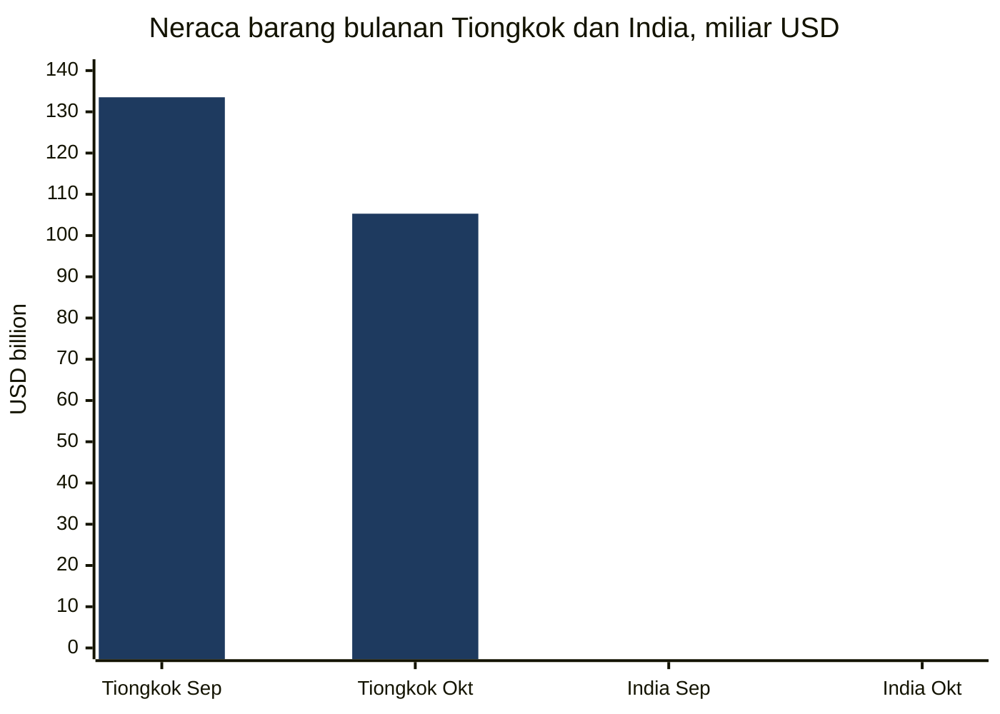

*Catatan: surplus barang bulanan Tiongkok: September $133,53 miliar, Oktober $105,3 miliar. Defisit barang bulanan India: September $30,21 miliar, Oktober $39,88 miliar. Sumber: GACC, Kementerian Perdagangan India.*

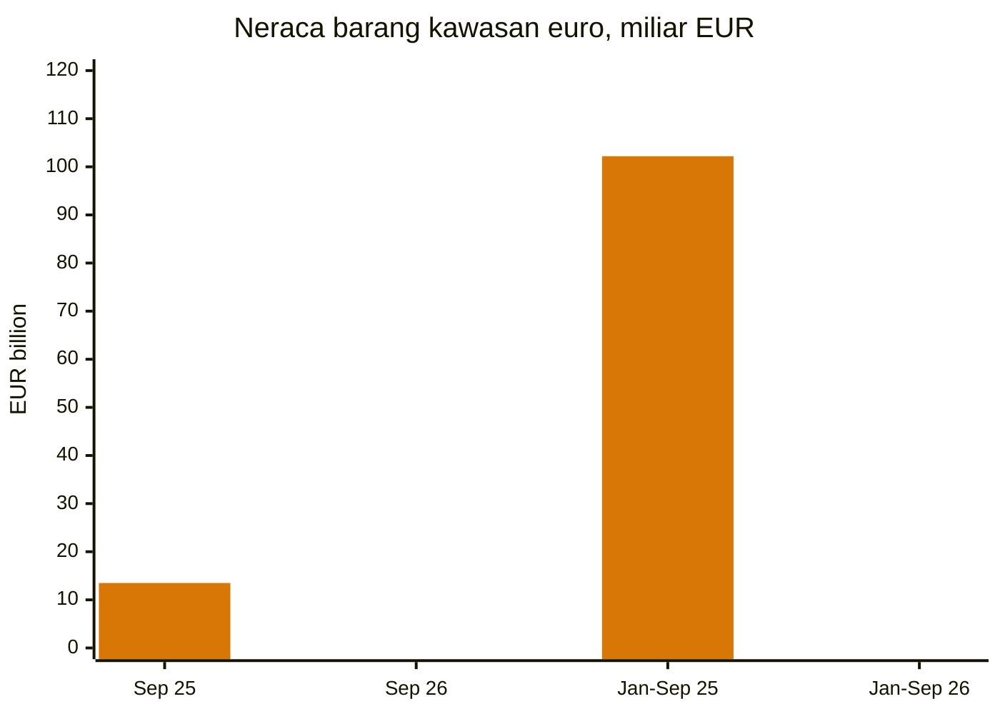

*Catatan: neraca barang kawasan euro: September 2025 +€13,5 miliar, September 2026 –€10,3 miliar; Januari–September 2025 +€102,2 miliar, Januari–September 2026 –€36,5 miliar. Sumber: Eurostat, 13 November 2026.*

### Lembaga pemikir (think tank)

Menyusul pemilu paruh waktu, pelaporan pada 5–10 November mengacu pada Yale Budget Lab dan Tax Foundation untuk mengukur biaya tarif Amerika Serikat (lihat 3.2). Hitungan Budget Lab per 2 November menetapkan tarif rata-rata menurut undang-undang Amerika Serikat sebesar 11,8%, naik menjadi 11,9% pada akhir tahun berdasarkan hukum yang berlaku, dengan biaya sekitar 0,7% atas harga konsumen Amerika Serikat, atau sekitar $900 per rumah tangga per tahun. Tax Foundation memperkirakan tarif akan menaikkan pajak rata-rata $820 per rumah tangga pada 2026 (model tertanggal Agustus 2026), sementara Budget Lab menetapkan beban sekitar $1.100 per rumah tangga dalam laporan tertanggal 24 Agustus 2026. Kedua angka itu menggunakan metode yang berbeda: $820 Tax Foundation mencerminkan 2026 berdasarkan apa yang benar-benar diimpor, sementara $1.100 Yale mengasumsikan tarif saat ini tetap berlaku pada bobot impor yang tetap. Ekonom senior Tax Foundation Erica York menulis pada 7 Oktober bahwa pencabutan semua tarif yang diberlakukan sejak 2017 akan menelan biaya hampir $1,8 triliun selama satu dekade, dan bahwa pajak pertambahan nilai berbasis luas sebesar 1% akan menghasilkan cukup dana untuk menggantikannya. Direktur eksekutif Budget Lab, Martha Gimbel, mengatakan kepada Marketplace pada 5 November bahwa tarif menghasilkan hampir $2 triliun selama sepuluh tahun. Bea cukai neto mencapai $173,2 miliar pada tahun fiskal 2026, menurut Departemen Keuangan. Tidak ada butir kebijakan perdagangan baru dari tradeintelligence.eu yang teridentifikasi dalam periode liputan melalui pencarian web.

**Sumber:** [Geopolitiqs](https://www.geopolitiqs.com/tn/2026-11-09/tariffs-average-rate); [Dave Manuel](https://www.davemanuel.com/2026/11/06/what-happens-to-tariffs-now-that-democrats-control-congress/)

### Portal data

Tidak ada rilis baru utama dalam periode ini yang teridentifikasi dari USITC DataWeb, UN Comtrade, WITS, Bank Dunia, atau portal IMF.

---

## 9. Pasar angkutan

### Tarif spot kontainer — Drewry World Container Index

Penilaian Drewry untuk Kamis, 12 November 2026, mencatat penurunan mingguan 2% pada indeks komposit menjadi $4.305 per kontainer 40 kaki, penurunan mingguan kedua berturut-turut, atas permintaan yang lemah di rute transpasifik dan Asia–Eropa/Mediterania. Pada rute transpasifik, Shanghai–New York turun 3% menjadi $9.020 per 40 kaki, terendah sejak Agustus 2026, dan Shanghai–Los Angeles turun 2% menjadi $7.416, terendah sejak September 2026. Pada Asia–Eropa/Mediterania, Shanghai–Rotterdam turun 3% menjadi $3.504, sementara Shanghai–Genoa tidak berubah pada $4.168. Perusahaan pelayaran mengumumkan delapan pelayaran kosong untuk pekan berikutnya pada rute transpasifik, berbanding empat pekan ini (delapan berbanding lima pada Asia–Eropa/Mediterania), dan mengumumkan tarif Freight All Kinds yang lebih tinggi dan Peak Season Surcharge pada Asia–Eropa/Mediterania yang berlaku pada paruh kedua November. Drewry memperkirakan tarif transpasifik akan turun lebih lanjut pekan depan dan tarif Asia–Eropa/Mediterania naik sedikit. Kemacetan di pelabuhan Shanghai naik menjadi 49 jam pada pekan lalu, dari 36 jam pada pekan sebelumnya. Lima puluh tiga kapal melintasi Terusan Suez pada pekan lalu, sementara satu kapal melintasi Selat Hormuz.

**Sumber:** [Drewry](https://www.drewry.co.uk/supply-chain-advisors/supply-chain-expertise/world-container-index-assessed-by-drewry)

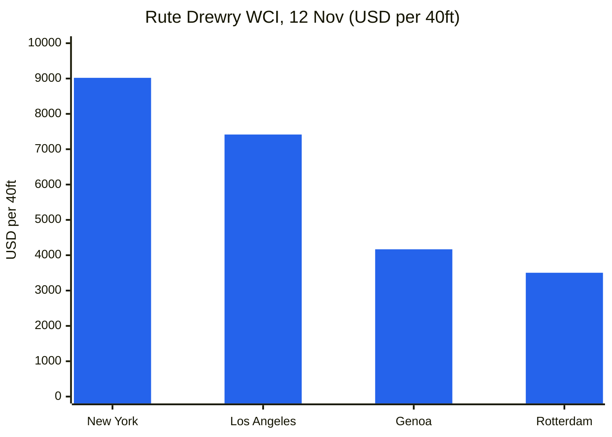

*Catatan: semua rute dari Shanghai. Shanghai–New York $9.020; Shanghai–Los Angeles $7.416; Shanghai–Genoa $4.168; Shanghai–Rotterdam $3.504. Indeks komposit $4.305 per 40 kaki, turun 2% week on week. Sumber: Drewry, 12 November 2026.*

### Freightos Baltic Index

Freightos melaporkan dalam pembaruan mingguannya pada 10 November bahwa indeks global turun 2% menjadi $3.452 (pembacaan sebelumnya $3.513), dengan Asia–Eropa Utara turun 5% dan jalur transpasifik lebih rendah setelah kenaikan tarif umum November gagal bertahan. Harga Asia–Pantai Barat AS (FBX01 Weekly) turun 1% menjadi sekitar $8.200 per FEU; Asia–Pantai Timur AS (FBX03 Weekly) turun 2% menjadi sekitar $9.700 per FEU; Asia–Eropa Utara (FBX11 Weekly) turun 5% menjadi $3.400 per FEU, naik 50% year on year; Asia–Mediterania (FBX13 Weekly) turun 1% menjadi $4.300 per FEU, naik 88% year on year. Penurunan mingguan kedua berturut-turut pada indeks global, bersamaan dengan Drewry, mengonfirmasi bahwa kenaikan tarif November tidak bertahan, sementara tarif tetap jauh di atas level setahun sebelumnya pada jalur Asia–Eropa. Serikat penjaga ILWU Local 26 memperpanjang tenggat mogoknya di pelabuhan Los Angeles dan Long Beach hingga 20 November untuk memberi lebih banyak waktu bagi negosiasi. National Retail Federation melaporkan volume impor laut Amerika Serikat mencapai puncak tepat di bawah level rekor pada September sebesar 2,37 juta TEU, melunak sekitar 5% pada Oktober, dengan November diproyeksikan turun 14% dari puncak September.

**Sumber:** [Freightos](https://www.freightos.com/freight-resources/la-lb-strike-deadline-extended-dem-win-increasing-trade-uncertainty-november-10-2026-update/)

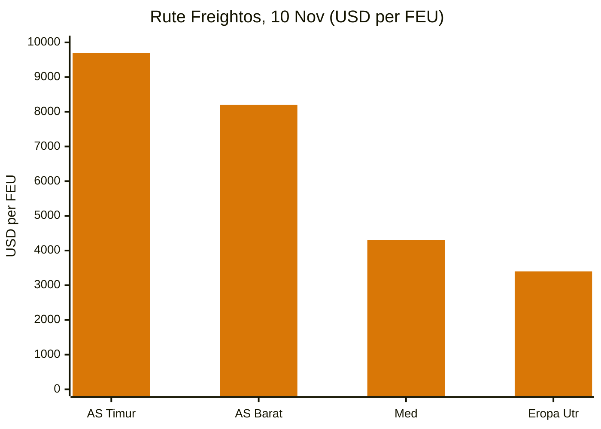

*Catatan: Asia–Pantai Timur AS sekitar $9.700 per FEU; Asia–Pantai Barat AS sekitar $8.200; Asia–Mediterania $4.300; Asia–Eropa Utara $3.400. Indeks global $3.452, turun 2% week on week. Sumber: Freightos, 10 November 2026.*

### Kenaikan tarif November — diumumkan, sudah didiskon

Tarif laut transpasifik turun tipis pada pekan hingga 12 November karena kenaikan tarif umum yang direncanakan perusahaan pelayaran gagal berlaku, tetapi tetap berada di sekitar level musim puncak. Perusahaan pelayaran telah mengupayakan kenaikan $2.000–$3.000 per FEU untuk November, dan mengajukan kenaikan lebih lanjut untuk 15–16 November, tetapi forwarder menyebut ketersediaan ruang yang membaik dan jadwal kapal yang lebih konsisten. Tarif Asia–Eropa juga melunak: harga Eropa Utara turun 5% dalam sepekan menjadi $3.400 per FEU, sementara tarif Mediterania turun 1% menjadi $4.300 per FEU. Shanghai Containerized Freight Index turun 61,12 poin menjadi 3.572,33 pada 13 November, penurunan mingguan kedua berturut-turut, karena tarif tujuan Amerika Serikat turun dan tarif Mediterania naik. Tarif Shanghai–Pantai Timur AS turun $470 menjadi $9.387 per kontainer 40 kaki, Shanghai–Pantai Barat AS turun $270 menjadi $7.111, dan Shanghai–Eropa turun $77 menjadi $3.402 per 40 kaki, sementara Shanghai–Mediterania naik $380 menjadi $4.746 per 40 kaki.

**Sumber:** [FreightWaves](https://www.freightwaves.com/news/us-midterm-shift-adds-trade-uncertainty-as-trans-pacific-ocean-freight-rates-stay-elevated); [ShipUniverse](https://www.shipuniverse.com/news/container-freight-rates-split-as-u-s-east-coast-drops-470-as-mediterranean-surges-6-7/)

### Pelayaran kosong dan kapasitas

Pelacak pelayaran yang dibatalkan Drewry memproyeksikan 52 pelayaran kosong dari 716 layanan terjadwal pada perdagangan Timur–Barat utama antara 16 November dan 21 Desember, sekitar 7% dari keberangkatan yang direncanakan. Perusahaan pelayaran mengumumkan delapan pelayaran kosong untuk pekan berikutnya pada rute transpasifik, berbanding empat pekan ini, dan delapan pada Asia–Eropa/Mediterania berbanding lima. Skala pelayaran kosong yang direncanakan menunjukkan perusahaan pelayaran bertindak untuk membatasi kapasitas hingga Desember karena kenaikan tarif November gagal bertahan.

### Curah kering — Baltic Exchange

Baltic Dry Index naik 6,2% selama sepekan menjadi 2.980 poin pada 13 November, kenaikan mingguan keempat berturut-turut, meskipun turun pada Jumat dan mengakhiri tujuh sesi kemenangan beruntun. Indeks naik sepanjang pekan — 2.854 pada 9 November, 2.862 pada 10 November, 2.959 pada 11 November, dan 3.020 pada 12 November — sebelum turun 40 poin, atau 1,3%, pada Jumat 13 November menjadi 2.980. Tarif Capesize mendorong kenaikan mingguan: BCI 182 5TC mencapai titik tertinggi $43.860 sebelum menutup pekan pada $42.798. Tarif Panamax dan Supramax juga naik selama sepekan. Kenaikan mingguan sebelumnya (pekan hingga 6 November) adalah 3,4%, menjadi 2.805 dari 2.714 pada 30 Oktober. Tarif curah kering bergerak berlawanan arah dengan tarif kontainer, dengan empat kenaikan mingguan berturut-turut yang membawa indeks ke titik tertinggi sejak awal Oktober, yang mengindikasikan permintaan yang lebih kuat untuk tonase Capesize dan Panamax yang mengangkut bijih besi, batu bara, dan biji-bijian meskipun permintaan kontainer melunak. Ringkasan kontainer Baltic Exchange untuk pekan 46 menggambarkan pekan yang relatif tenang: tarif kontainer pada empat perdagangan utama timur–barat turun rata-rata 0,52%, dengan Tiongkok/Pantai Barat AS turun 0,77% sementara Pantai Timur tidak berubah, dan tarif Asia–Eropa melemah tipis, dengan Eropa Utara turun 0,53% dan Mediterania turun 0,79%.

**Sumber:** [The DCN](https://www.thedcn.com.au/news/baltic-exchange-weekly-report-13-november-2026)

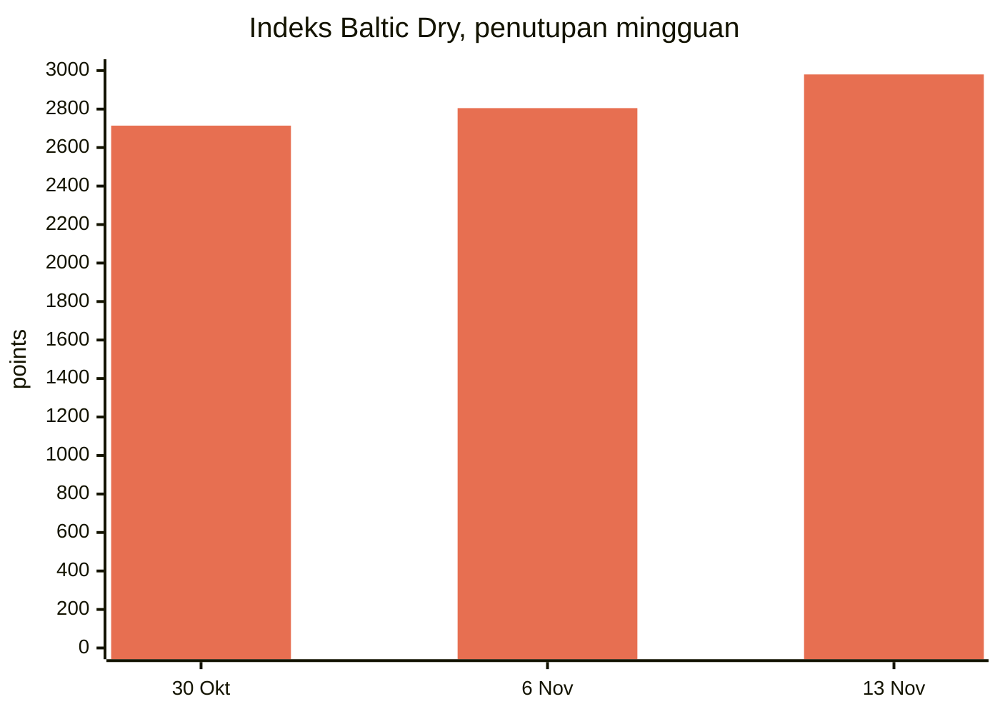

*Catatan: penutupan mingguan: 2.714 (30 Oktober), 2.805 (6 November), 2.980 (13 November). Kenaikan mingguan keempat berturut-turut. Sumber: Laporan mingguan Baltic Exchange, 13 November 2026.*

### Suez dan keandalan jadwal

Kembalinya Suez berlanjut (lihat 3.5). Drewry menghitung 53 kapal kontainer melalui kanal dalam pekan hingga 1 November, naik 130% year on year, dan memperkirakan sekitar 60% kapasitas Asia–Eropa kembali ke rute Suez. Ever Eon milik Evergreen melintas pada 8 November, transit Evergreen pertama dalam hampir tiga tahun. Ketika perusahaan pelayaran memulihkan layanan Suez, waktu transit Asia–Eropa turun tujuh hingga sepuluh hari, tetapi kedatangan menumpuk: Flexport memperkirakan kapasitas kapal yang tiba di pelabuhan Eropa Utara sebesar 131% dari normal pada pekan 16–22 November, dengan 31 kapal kontainer yang melalui Suez bersama 61 yang masih berlayar mengelilingi Tanjung Harapan. Flexport menganggap kedatangan di atas 120% dari kapasitas normal sebagai risiko kemacetan, dan sedikitnya tiga pekan antara pertengahan November dan Januari diperkirakan melampaui ambang itu. Rata-rata waktu tunggu kontainer mencapai 3,37 hari pada pekan 42, dengan utilisasi lapangan dilaporkan 80%–90%.

### Kargo udara

Tarif spot kargo udara global naik untuk pekan ketiga berturut-turut, naik 4% pada pekan 44 menjadi sekitar $3,93 per kilogram, kira-kira 40% di atas pekan yang sama tahun lalu, menurut indeks TAC. Baltic Air Freight Index naik 6,6% selama tujuh hari hingga 9 November dan 28,2% year on year. Pembaruan Freightos pada 10 November mencatat Tiongkok–Amerika Utara naik 3% menjadi lebih dari $8,00 per kg, Tiongkok–Eropa Utara naik 11% menjadi $4,87 per kg, dan Eropa Utara–Amerika Utara naik 9%; kargo udara transatlantik naik 33% selama sebulan terakhir menjadi $2,90 per kg. Rata-rata spot global Oktober Xeneta adalah $3,11 per kg, naik 29% year on year. IATA melaporkan permintaan kargo September naik 7,7% year on year, dengan lalu lintas Asia–Amerika Utara naik 17%, sementara harga bahan bakar jet 103,4% lebih tinggi daripada setahun sebelumnya. Angkutan udara menyerap pesanan liburan yang terlambat dan pengiriman perangkat keras AI ke dalam kapasitas yang diperketat oleh jadwal penumpang musim dingin, sehingga mendorong tarif ke arah puncak Desember lalu. Forwarder melaporkan tarif Tiongkok–Pantai Barat AS sekitar $8,50–$9,00 per kg di mana ruang tersedia sama sekali.

**Sumber:** [Daily8 News](https://www.daily8news.com/article/air-cargo-rates-2026-high-peak-season-20261113/); [IATA](https://www.iata.org/en/pressroom/2026-releases/10-29-air-cargo-demand-accelerates-september/); [TAC Index via LinkedIn](https://www.linkedin.com/pulse/air-freight-market-update-november-10-2026-tacindex-pkmfc)

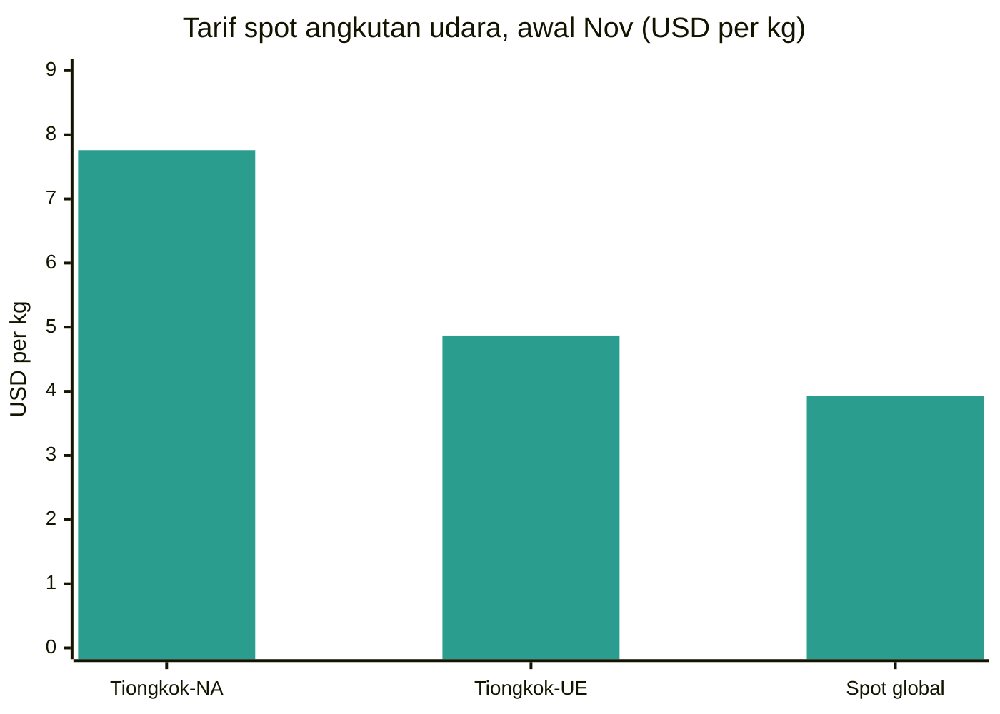

*Catatan: Tiongkok–Amerika Utara $7,76 per kg (Freightos, awal November; di atas $8,00 per kg dalam pembaruan 10 November); Tiongkok–Eropa Utara $4,87 per kg; spot global sekitar $3,93 per kg (Indeks TAC, pekan 44). Sumber: Freightos, Indeks TAC.*

### Gangguan pelabuhan dan logistik

**Los Angeles dan Long Beach.** Pembicaraan penjaga diperpanjang hingga 20 November (lihat A8). C.H. Robinson melaporkan bahwa angkutan ritel dari Asia masih mengatasi gangguan pada awal November setelah September yang luar biasa kuat dan serangkaian topan yang menumpuk kontainer di beberapa pelabuhan terbesar Tiongkok, mengganggu jadwal laut, dan menyebabkan perusahaan pelayaran melewatkan panggilan pelabuhan serta menggulirkan kargo. Di Los Angeles dan Long Beach, kemacetan tetap parah, terutama karena gerbong kereta yang tidak memadai untuk memindahkan kargo ke pedalaman; sebagian pengirim beralih ke transloading dan truk. Per 2 November, 35.688 kontainer impor menunggu di terminal untuk kereta di dermaga, 10.562 di antaranya selama sembilan hari atau lebih. Pelabuhan Los Angeles melaporkan kargo lokal tinggal 3,7 hari di terminal dan kargo kereta di dermaga tinggal 5,6 hari pada 30 Oktober. Pemulihan diperkirakan bertahap selama dua hingga tiga pekan, dengan asumsi tidak ada gangguan tambahan. Pelabuhan Los Angeles menangani 1.026.872 TEU pada Oktober 2026, rekor untuk bulan itu dan total bulanan tertinggi kedua dalam sejarah pelabuhan, menyusul rekor sepanjang masa September sebesar 1.042.652 TEU. Ini pertama kalinya pelabuhan itu melampaui 1 juta TEU dalam bulan-bulan berturut-turut, dan ketiga kalinya pada 2026 mencapai angka itu. Impor bermuatan sekitar 538.620 TEU, naik 25% year on year dan 30% di atas rata-rata Oktober lima tahun pelabuhan; ekspor bermuatan 114.981 TEU, turun 7% year on year; TEU kosong 373.271, rekor bulanan kedua berturut-turut. Total Januari–Oktober sekitar 9.108.497 TEU, 5% lebih tinggi dari tahun lalu dan 9% di atas rata-rata lima tahun.

**Prospek impor Amerika Serikat.** Global Port Tracker National Retail Federation melaporkan bahwa pelabuhan yang dilacaknya menangani 2,37 juta TEU impor bermuatan pada September, bulan tersibuk 2026 dan bulan tersibuk ketiga sejak pelacakan dimulai. Oktober diproyeksikan 2,26 juta TEU, naik 9,1% year on year; November 2,05 juta TEU, naik 1,2%; dan Desember 2,03 juta TEU, naik 1,3%. Prakiraan setahun penuh sekitar 26 juta TEU, naik 2% dari 2025. Prospek melunak pada awal 2027: Januari diprakirakan 2,04 juta TEU, turun 3% year on year; Februari 1,89 juta, turun 0,5%; Maret 1,92 juta, turun 11,2%.

**Durban.** Durban belum pulih dari peralihan Durban Gateway Terminal ke operasi ICTSI pada Agustus dan sistem terminal Navis N4; volume di terminal itu turun kira-kira 30% antara 14 Agustus dan 10 September terhadap rata-rata empat bulan sebelumnya. Indikator perencanaan seluruh pelabuhan berada pada 15 hari dalam pembaruan pergerakan kargo 3 November, naik sehari dari pekan sebelumnya. Tujuh belas kapal kontainer menunggu Durban pada 2 November — enam di dalam jangkar yang ditentukan dan sebelas lebih jauh di lepas pantai — yang mewakili kira-kira 85.000 TEU yang mengapung. Kapal kontainer rata-rata 7,46 hari di jangkar dalam tujuh hari hingga awal November. Maersk menaikkan biaya tambahan musim puncak kontainer keringnya dari Asia Timur Jauh ke Afrika Selatan dan Mauritius menjadi $1.000 per 20 kaki dan $2.000 per 40 kaki mulai 9 November, empat kali level $250/$500 yang ditetapkan pada 15 Oktober, dan biaya kemacetan Durban-nya menjadi $400 per 20 kaki dan $800 per 40 kaki untuk kargo asal Tiongkok mulai 1 November. Menteri Transportasi Barbara Creecy mengatakan Durban Gateway Terminal mungkin kembali ke kinerja sebelumnya hanya antara Desember 2026 dan Februari 2027, dan Kuehne+Nagel memperkirakan tidak ada perbaikan berarti sebelum akhir Q1 2027.

**Sumber:** [C.H. Robinson](https://www.chrobinson.com/en-us/resources/insights-and-advisories/north-america-freight-insights/nov-2026-freight-market-update/industry-insights/retail/); [AJOT](https://www.ajot.com/news/port-of-los-angeles-tops-1-million-container-units-for-second-consecutive-month); [FreightWaves](https://www.freightwaves.com/news/retailers-forecast-u-s-imports-to-stay-elevated-through-2026-after-breakout-peak-season); [DTFU Logistics](https://www.dtfulogistics.com/news/durban-port-congestion-2026-china-south-africa/)

### Intelijen vendor

Descartes Systems Group merilis Laporan Pengiriman Global November pada 11 November, berdasarkan data perdagangan Descartes Datamyne. Impor kontainer Amerika Serikat pada Oktober 2026 mencapai rekor bulanan tertinggi sepanjang masa sebesar 2.674.808 TEU — 2,0% (52.343 TEU) di atas rekor sebelumnya sebesar 2.622.465 TEU yang ditetapkan pada Mei 2022; naik 5,0% dari September 2026, naik 16,0% dari Oktober 2025, dan naik 29,2% dari Oktober 2019. Impor dari Tiongkok naik untuk bulan keempat berturut-turut menjadi 987.805 TEU, volume bulanan tertinggi sejak Januari 2025; naik 6,9% (63.351 TEU) month over month dan naik 22,9% year over year; pangsa Tiongkok atas total impor kontainer Amerika Serikat naik menjadi 36,9%, dari 36,3% pada September. Kategori komoditas utama asal Tiongkok: plastik, 144.530 TEU; furnitur dan perlengkapan tidur, 137.551 TEU; mainan, permainan, dan barang olahraga, 102.672 TEU. Impor dari 10 negara asal teratas naik 5,8% month over month. Impor kontainer Amerika Serikat pada Januari–Oktober 2026 naik 2,3% dibandingkan periode yang sama pada 2025, bulan kedua berturut-turut ketika volume kumulatif melampaui tahun sebelumnya setelah delapan bulan di bawah laju tahun lalu. Pelabuhan Pantai Timur dan Teluk memperoleh pangsa atas gerbang Pantai Barat: impor Pantai Teluk adalah 266.905 TEU, naik 24,0% month over month dan 16,2% di atas rata-rata 12 bulan, level tertinggi sejak Descartes mulai melacak angka regional itu pada Agustus 2023. Houston mencatat peningkatan pelabuhan bulanan terbesar, naik 42.665 TEU (26,7%). Impor Los Angeles turun 1,4%, Long Beach turun 2,0%, dan Oakland turun 10,9%. Pangsa pasar gabungan lima gerbang Pantai Timur dan Teluk terkemuka adalah 39,9%, naik dari 36,7% pada September; lima gerbang Pantai Barat terkemuka turun menjadi 44,9%, dari 47,0%. Sepuluh pelabuhan teratas Amerika Serikat menangani 84,8% impor. Rata-rata keterlambatan transit pelabuhan di 10 gerbang yang dilacak adalah 6,3 hari pada Oktober, berbanding 6,0 hari pada September dan 4,2 hari pada Juni; keterlambatan naik di tujuh dari 10 pelabuhan. Keterlambatan terpanjang: New York/New Jersey, 8,1 hari; Seattle, 7,6 hari; Savannah, 6,9 hari. Impor telah melampaui 2,5 juta TEU setiap bulan sejak Juli 2026. Volume rekor Oktober, yang sebagian besar didorong oleh kenaikan bulanan keempat berturut-turut pada kargo asal Tiongkok, menunjukkan permintaan impor maritim Amerika Serikat tetap kuat meskipun ketidakpastian tarif dan kebijakan perdagangan berlanjut. Pergeseran pangsa ke pelabuhan Pantai Timur dan Teluk serta kenaikan stabil keterlambatan transit — naik sekitar 50% sejak Juni — menunjukkan tekanan yang meningkat pada jaringan logistik pedalaman bahkan tanpa kemacetan pelabuhan yang meluas.

Tidak ada butir vendor yang memenuhi syarat yang ditemukan dari TradeInt dalam periode 9–16 November 2026. Halaman blog TradeInt mencantumkan kiriman terbarunya bertanggal 31 Desember 2025; tidak ada kiriman blog bertanggal 9–16 November 2026 yang ditemukan di situs itu atau dalam pencarian tradeint.com/insights/.

**Sumber:** [Descartes](https://www.descartes.com/resources/global-logistics-shipping-report-resource-center?language=en); [All About Shipping](https://allaboutshipping.co.uk/2026/11/11/descartes-releases-november-global-shipping-report-u-s-container-imports-hit-record-volume-in-october/); [TradeInt blog](https://tradeint.com/insights/blogs/)

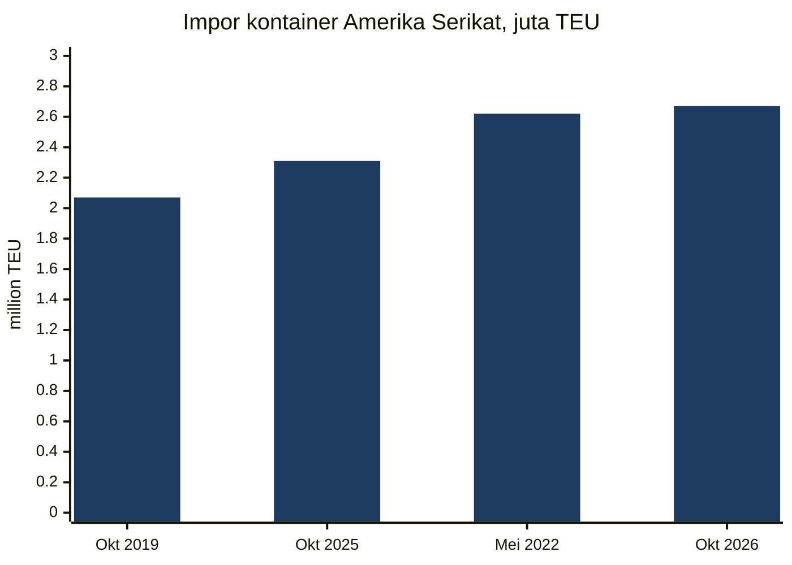

*Catatan: Oktober 2026: 2.674.808 TEU, rekor bulanan tertinggi sepanjang masa; rekor sebelumnya Mei 2022: 2.622.465 TEU; Oktober 2025: sekitar 2,31 juta TEU (naik 16,0% year on year); Oktober 2019: sekitar 2,07 juta TEU (naik 29,2%). Sumber: Laporan Pengiriman Global November Descartes, 11 November 2026.*

---

## 10. Linimasa kebijakan

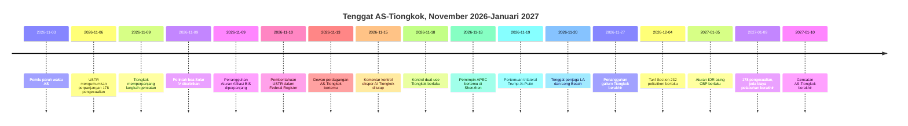

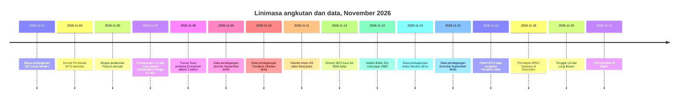

---

## 11. Tenggat & acara mendatang (90 hari ke depan)

| Tanggal | Butir |
|---|---|
| 18 November 2026 | CBP dapat membatalkan nomor importer-of-record bagi importir CTPAT yang belum menyelesaikan kekhawatiran akurasi Formulir 5106 (surat dikirim 4 November). |
| 18 November 2026 | Revisi kontrol ekspor dual-use Tiongkok atas drone, mesin bor terowongan, dan kapal keruk berlaku (Pengumuman No. 49–51). |
| 18–19 November 2026 | Pertemuan Pemimpin Ekonomi APEC di Shenzhen; pertemuan trilateral Trump–Xi–Putin pada 19 November. |
| 20 November 2026 | Tenggat pembicaraan penjaga LA/Long Beach (perpanjangan keempat). |
| 20 November 2026 | Pengalihan BIS atas peredam suara tertentu dari US Munitions List ke Commerce Control List berlaku. |
| 20 November 2026 | COP31 di Antalya, Türkiye, ditutup (9–20 November). |
| 23 November 2026 | Komite Pertanian WTO bertemu tentang pembatasan ekspor dan mekanisme pengaman khusus; laporan lengkap USITC Solar IV (Publication 5804) jatuh tempo. |
| 27 November 2026 | Penangguhan Pengumuman No. 72 Tahun 2025 Tiongkok atas praduga penolakan untuk galium, germanium, antimon, dan bahan superkeras tujuan AS dijadwalkan berakhir, tanpa penangguhan atau perubahan lebih lanjut. |
| 30 November 2026 | Temuan akhir dumping dan subsidi Commerce untuk produk tin mill Tiongkok jatuh tempo, kecuali ditunda. |
| 4 Desember 2026 | Bea Section 232 polisilikon melekat. |
| 7 Desember 2026 | Komentar jatuh tempo atas aturan yang diusulkan CBP tentang kiriman bernilai rendah (91 FR 64532; docket USCBP-2026-0298). |
| 14–15 Desember 2026 | Para pemimpin G20 bertemu di Miami. |
| 16 Desember 2026 | Perjanjian perdagangan bebas UE–India dilaporkan akan ditandatangani di Brussels, dengan Perdana Menteri Modi diperkirakan hadir. |
| 17 Desember 2026 | Tanggal paling awal Commerce bermaksud mengeluarkan instruksi penilaian dalam tinjauan lemari kayu dan millwork (35 hari setelah publikasi 12 November). |
| 1 Januari 2027 | Tarif Section 232 naik menjadi 30% atas furnitur berlapis kain dan 50% atas lemari dapur dan meja rias; ancaman 50% atas kendaraan, suku cadang mobil, dan baja Kanada juga diarahkan ke tanggal ini; UK CBAM dimulai. |
| 3 Januari 2027 | Kongres Amerika Serikat yang baru dilantik. |
| 5 Januari 2027 | Aturan final interim CBP tentang importer-of-record asing berlaku; komentar jatuh tempo pada hari yang sama (docket USCBP-2026-1387). |
| 9–10 Januari 2027 | Tenggat gencatan AS–Tiongkok bertemu: 178 pengecualian Section 301 dan penangguhan biaya maritim berakhir 9 Januari; penangguhan Aturan Afiliasi BIS dan penangguhan timbal balik Tiongkok berakhir 10 Januari. |
| 12 Januari 2027 | Komentar tertulis dan permintaan partisipasi sidang jatuh tempo untuk konsultasi tinjauan bersama USMCA (docket USTR-2026-0595 dan USTR-2026-0596). |
| 19 Januari 2027 | Temuan akhir dumping Commerce untuk produk tin mill Türkiye jatuh tempo. |
| 20 Januari 2027 | Pemasukan formal menjadi wajib untuk surat yang tunduk pada bea Section 201, 232, atau 301 atau persyaratan instansi pemerintah mitra. |
| 30 Januari 2027 | Variasi countervailing duty Inggris atas ikan trout pelangi Turki berlaku mulai tanggal ini (pemberitahuan 2026/31). |
| 1 Februari 2027 | Kanada menghapus keringanan tarif horizontal untuk kawat aluminium dan ekstrusi serta produk papan kertas tertentu. |
| 6 Februari 2027 | Tahun Baru Imlek. |
| 28 Februari 2027 | Tenggat penentuan USTR dalam penyelidikan Section 301 kekayaan intelektual Vietnam. |
| Maret 2027 | Keputusan penyelidikan Section 301 USTR atas kelebihan kapasitas struktural diperkirakan (jatuh tempo Maret 2027). |
| 25 Maret 2027 | Temuan akhir dumping Commerce untuk produk tin mill Taiwan jatuh tempo. |
| 6 Mei 2027 | Kepatuhan penuh broker diharapkan atas aturan importer-of-record asing. |
| 30 Juni 2028 | Pengurangan tarif horizontal Kanada diperpanjang hingga tanggal ini. |

---

## 12. Sumber & metodologi

Periode liputan: 9–16 November 2026. Disusun dari sekitar 45 sumber berita perdagangan, kebijakan, data, dan angkutan di seluruh dunia.

Sumber yang dikonsultasikan meliputi: FreightWaves, The Loadstar, Splash247, gCaptain, Hellenic Shipping News, Container News, Supply Chain Dive, Logistics Management, Air Cargo News, Port Technology, blog TradeInt insights; whitehouse.gov, cbp.gov, ustr.gov, federalregister.gov, trade.gov, usitc.gov, bis.doc.gov, JD Supra; ec.europa.eu, gov.uk, cbsa-asfc.gc.ca, canada.ca/en/department-finance, english.mofcom.gov.cn; wto.org, unctad.org, intracen.org, wcoomd.org; dataweb.usitc.gov, ustradecensus.gov, comtradeplus.un.org, wits.worldbank.org, eurostat, data.worldbank.org, imf.org; taxfoundation.org, budgetlab.yale.edu, tradeintelligence.eu; drewry.co.uk, balticexchange.com, freightos.com; descartes.com, tradeint.com.

Butir yang bertanggal sebelum 9 November hanya muncul sebagai tindak lanjut, publikasi Federal Register yang jatuh dalam periode ini, atau konteks untuk tenggat dalam periode ini. Situs berbahasa Inggris MOFCOM hanya dapat dijangkau untuk judul utama; substansi tanggapan biaya UE-nya dan pernyataan Unreliable Entity List tidak dapat dipastikan dari informasi yang ditinjau. Indeks berita WTO tidak mengembalikan teks yang dapat dibaca melalui fetch, sehingga butir WTO menggunakan rilis WTO sebagaimana diterbitkan ulang. TradeInt tidak memiliki butir vendor yang memenuhi syarat dalam periode ini: kiriman blog terbarunya bertanggal 31 Desember 2025. Tidak ada rilis baru utama dalam periode ini yang teridentifikasi dari portal USITC DataWeb, UN Comtrade, WITS, Bank Dunia, atau IMF. Tidak ada Withhold Release Order baru yang teridentifikasi dalam periode ini.
