# 世界貿易インテリジェンス報告 — 2026年11月9日～16日の週

**週次ブリーフィング。**対象期間：2026年11月9日～16日。世界中の約45の貿易ニュース、政策、データ、貨物のデータソースから編集した。

---

## 目次

1. [概要](#1-executive-summary)
2. [警戒情報](#2-alerts)
3. [主要ニュース — 詳細分析](#3-top-stories--deep-dives)
4. [関税トラッカー](#4-tariff-tracker)
5. [米国政策の詳細分析](#5-us-policy-deep-dive)
6. [地域別世界政策](#6-world-policy-by-region)
7. [執行措置](#7-enforcement-actions)
8. [データ発表](#8-data-releases)
9. [貨物市場](#9-freight-market)
10. [政策タイムライン](#10-policy-timelines)
11. [今後の期限とイベント（今後90日間）](#11-upcoming-deadlines--events-next-90-days)
12. [データソースと調査方法](#12-sources--methodology)

---

## 1. 概要

貿易休戦が決着ではなく形式的に整えられた週であり、世界最大の二つの貿易経済がともに記録的な規模の貿易統計を発表した。11月10日、USTRは連邦官報の通知を公表し、中国に対する301条の製品適用除外178件すべてと、301条に基づく海事港湾料金の停止を2027年1月9日まで延長した。また、産業安全保障局（BIS）は50%関連会社規則の停止を1月10日まで延長した。中国はこれに応じ、米国製品に対する24%の追加関税の停止をさらに2カ月継続し、10%の税率を維持するとともに、レアアース輸出管理の適用除外を同じ日まで延長した。次の決定の場は、11月18日～19日に深圳で開催されるAPEC首脳会議であり、トランプ大統領と習主席が今年3度目の会談を行い、プーチン大統領との初の三者会談も予定されている。その他、商務省はインド、インドネシア、ラオス産の太陽電池に対するアンチダンピング・相殺関税の最終命令を公表し、合算保証金率は最大233%に達した。インド・米国協定は、ワシントンの過剰生産能力調査が未了のため未署名のままとなった。カナダは関税救済を2028年6月まで延長し、欧州連合（EU）の2ユーロの取扱手数料と製品識別子制度は2週目に入り、理事会は2028年から150ユーロのVAT上限を撤廃することに合意した。

- **休戦は書面上で2027年1月9日～10日まで延長された。**USTRの11月10日付連邦官報通知（91 FR 72610および91 FR 72608）は、178件の301条適用除外（一般164件、太陽光製造14件）と海事料金の停止を2027年1月9日午後11時59分（東部時間）まで延長する。BISは関連会社規則の停止を1月10日まで延長した。中国は米国製品に対する24%の追加関税の停止を11月10日から2カ月間継続し、10%の税率を維持するとともに、港湾料金の停止とレアアース輸出管理の適用除外を1月10日まで延長し、米国16団体に対する措置の停止も継続した。ガリウム、ゲルマニウム、アンチモンに関する停止措置は11月27日に別途失効する。1月の期限は、2027年2月6日の旧正月の直前に当たる。
- **APECが休戦の次の舞台となる。**第33回APEC経済首脳会議は11月18日～19日に深圳で開催され、貿易、連結性、デジタル経済、人工知能に関する深圳宣言の採択が目指される。11月13日に開催された初の米中貿易評議会のテレビ会議では、300億ドル対300億ドルの関税引き下げ案が議論されたが、合意には至らなかった。ホワイトハウスは11月19日のトランプ・習・プーチン三者会談を確認した。報道時点では北京は確認しておらず、合意は見込まれていない。
- **ソーラーIV命令により、中国の迂回ルートが閉ざされた。**インド、インドネシア、ラオス産の結晶シリコン太陽電池に対する商務省のアンチダンピング・相殺関税最終命令は11月9日に公表され、合算のその他すべての保証金率は233.26%（インド）、167.56%（インドネシア）、147.39%（ラオス）となった。対象セルを使用して第三国で組み立てられたモジュールも命令の対象となる。台湾（18.07%）とトルコ（3.89%～42.06%）に対するブリキ圧延品の暫定ダンピング率が設定され、中国に対する最終認定は11月30日に予定されている。
- **インド・米国協定は依然未署名である。**インド政府関係者は11月13日、署名はワシントンが関税枠組みを確定するのを待っていると述べた。鍵となる301条の過剰生産能力調査はまだ報告されていない。米国はインドに対し、アジアの競合国に対する比較関税優位を保証した。インドは現在、ベトナムと中国の12.5%に対し、10%の301条税率を支払っている。2月の枠組みで定められた18%の税率は適用されたことがない。
- **中間選挙は政治を変えたが、関税は変わらなかった。**民主党は11月3日に両院を制した。CBSの出口調査では、有権者の66%が関税は経済に悪影響を与えたと答えた。関税を廃止する法案には拒否権を覆す多数が必要であり、政権は関税を継続すると述べた。11月9日時点の2026年暦年の関税・物品税収入総額は2,640億ドルに達し、1年前の2,270億ドル、2024年の820億ドルを上回った。イェール大学のバジェット・ラボは、平均関税率が2025年1月の約2.5%から2026年11月には11.2%になったと推計した。
- **中国の黒字は10カ月で1兆ドルを突破し、インドは輸出記録を更新した。**中国の10月輸出は前年比35.2%増の4,123億ドルとなり、1月～10月の累計黒字は1兆426億ドルに達した。集積回路の輸出は3,411億ドルで111.1%増とけん引した。インドの10月物品輸出は過去最高の494億7,000万ドル（45.06%増）となったが、輸入も過去最高の893億5,000万ドルに達し、物品赤字は398億8,000万ドルに拡大した。ユーロ圏は9月に103億ユーロの赤字に転じ、1月～9月の収支は1年前の1,022億ユーロの黒字から365億ユーロの赤字に転じた。
- **貨物は再び二分化した。海上運賃は軟化し、航空とドライバルクは上昇した。**ドリューリー世界コンテナ指数は11月12日に2%下落し、40フィートコンテナ当たり4,305ドルとなった。フレイトス・バルチック指数は2%下落して3,452ドル、上海コンテナ貨物指数は1.68%下落して3,572.33となり、11月の運賃値上げは維持できなかった。バルチック海運指数は6.2%上昇して2,980となり、4週連続の上昇となった。航空貨物は逆方向に動いた。バルチック航空貨物指数は11月9日までの1週間で6.6%上昇し、前年比28.2%上昇した。中国・北米間の運賃は1キログラム当たり8.00ドルを超えた。デカルトによると、米国の10月コンテナ輸入量は月間過去最高の267万4,808TEUとなった。

**貨物：**コンテナスポット運賃は、太平洋横断航路とアジア・欧州航路の双方で2週連続で軟化し、船社は欠航に頼った。ドライバルクはケープサイズの好調により4週連続で上昇した。航空貨物はピークシーズンに向けて2026年の最高値に達した。エバーグリーンがほぼ3年ぶりにスエズ運河を通航し、スエズ回帰は完了に近づいた。一方、フレイトスは到着の集中による欧州港湾の混雑を警告し、ロサンゼルス・ロングビーチの鉄道滞留とダーバンの15日間の待機列により港湾リスクは依然として続いている。

---

## 2. 警戒情報

| # | 警戒情報 | 発効日 | 影響 | データソース |
|---|-------|-----------|--------|--------|
| A1 | USTRが連邦官報の通知を公表し、中国に対する301条の製品適用除外178件すべてを2027年1月9日午後11時59分（東部時間）まで延長し、301条に基づく海事料金とクレーン関税の停止を同じ日まで継続 | 2026年11月10日（公表） | 2カ月間の猶予のみ。2027年1月10日からの申告は全額のリスト税率を支払う（リスト1～3は25%、リスト4Aは7.5%） | [YCL CPA](https://yclcpa.com/en/insights/us-china-tariff-truce-section-301-exclusions-january-2027) |
| A2 | 中国は米国製品に対する24%の追加関税の停止を11月10日から2カ月間継続し、10%を維持。レアアース輸出管理の適用除外、港湾料金の停止、エンティティ・リスト措置の停止を2027年1月10日まで延長 | 2026年11月9日～10日 | 米国の輸出業者は10%の税率を維持。中国側の休戦は2027年1月10日まで継続。ガリウム関連の停止措置は11月27日に失効 | [Medium](https://medium.com/@frank.matisse/weekly-digest-15-november-2026-wd-25-the-truce-is-not-access-3f6d8ac577b6) |
| A3 | BISが50%関連会社規則の輸出管理措置の停止を2027年1月10日まで延長 | 2026年11月9日 | 所有権に基づく審査は停止されたまま。さらなる措置がなければ、拡大された管理措置は2027年1月10日に発効 | [Sanctions.com](https://www.sanctions.com/articles/us-extends-suspension-of-bis-50-rule-until-january-2027) |
| A4 | APEC首脳会議が11月18日～19日に深圳で開催。トランプ・習・プーチン三者会談をホワイトハウスが11月19日に確認。11月13日の米中貿易評議会のテレビ会議では300億ドル対300億ドルの関税引き下げ案を議論したが合意なし | 2026年11月18日～19日 | 休戦を2027年1月10日以降に延長する最初の機会。貿易、デジタル経済、AIに関する深圳宣言の採択を目指す | [Asia Daily](https://asiadaily.org/news/18743/) |
| A5 | CBPがCTPAT輸入者に対し、様式5106の正確性について輸入者番号が11月18日午前0時01分（東部時間）から無効になる可能性があると警告 | 2026年11月18日 | 未解決の書簡があると、その輸入者番号での申告ができなくなる。住所は輸入者自身の事業所でなければならない | [Concord Solutions](https://www.concordsolutionsgroup.com/post/ctpat-importers-cbp-warns-ior-numbers-may-be-voided-november-18-over-form-5106-accuracy) |
| A6 | 中国の改定デュアルユース輸出管理（ドローン、トンネル掘削機、浚渫船）が11月18日に発効。商務部の技術カタログへの意見募集は11月15日に締め切られたが、結果は未公表 | 2026年11月18日 | 特定のドローン（航続距離300km、エアロゾル散布80リットル）、トンネル掘削機、浚渫船に許可要件 | [JD Supra](https://www.jdsupra.com/legalnews/china-proposes-expanded-technology-8379336/) |
| A7 | 商務省がインド、インドネシア、ラオス産の太陽電池に対するAD/CVD最終命令を公表。合算のその他すべての税率は233.26%／167.56%／147.39% | 2026年11月9日 | 保証金徴収は11月5日から再開。対象セルを使用して第三国で製造されたモジュールも命令の対象 | [Solar Stock USA](https://www.solarstockusa.com/research/market-notes/adcvd-orders-india-indonesia-laos) |
| A8 | LA・ロングビーチの警備員交渉が11月20日まで延長 — 4度目の延長。6ターミナルで約250人の警備員。ヴィンセント・トーマス橋は11月7日から16カ月間閉鎖。35,688個の輸入コンテナが構内鉄道を待機 | 2026年11月20日 | 他の組合がピックラインを尊重すれば、操業停止により船舶、ヤード、ゲートの操業が停止する。鉄道滞留はすでに5.6日 | [Navilink Global](https://www.navilinkglobal.com/news/la-long-beach-port-strike-averted-again-ilwu-talks-extended-to-november-20-as-record-cargo-volumes-continue) |
| A9 | カナダに対する338条関税が国際貿易裁判所で争われている。*Gellert v. Trump*訴訟で11月11日と13日にアミカス・ブリーフを提出。50%関税は約200億ドルのカナダ輸入を対象 | 2026年11月11日～13日 | 政権敗訴の判決が出れば、主要な関税層が撤廃され、還付請求が相次ぐ。関税は依然として有効 | [Reason](https://reason.com/volokh/2026/11/14/our-amicus-brief-in-case-challenging-trumps-section-338-tariffs-against-canada/) |
| A10 | インド・米国協定は11月13日時点で依然未署名。署名はワシントンの関税枠組みを待つ。301条の過剰生産能力調査は未報告 | 2026年11月13日 | インドの輸出業者は約束された18%の税率について確実性がない。インドは10%の301条関税を支払い、ベトナムと中国は12.5% | [Industrial Front](https://industrialfront.com/india-us-trade-deal-tariff-advantage-november-2026/) |

### A1/A2/A3 — 休戦、書面上で1月まで延長

米中貿易休戦の2カ月延長は、対象期間中に正式に整えられた。11月10日、USTRは連邦官報の通知を2件公表した。1件目は、残る178件の301条製品適用除外すべて — HTSUS 9903.88.69に基づく一般適用除外164件と、9903.88.70に基づく太陽光製造適用除外14件 — を2027年1月9日午後11時59分（東部時間）まで延長するものである（91 FR 72610；FR Doc. 2026-22925）。対象は、2026年11月10日午前0時01分（東部時間）以降に消費用として申告された、または保税倉庫から消費用に引き出された貨物である。2件目は、中国の海事、物流、造船慣行に対する301条措置 — 船舶運航者および所有者に対するサービス料金と、陸上クレーンその他の貨物取扱設備に対する関税を含む — の停止を同じ日までさらに延長するものである（91 FR 72608；FR Doc. 2026-22867）。適用除外の追加や削除はなく、新たな意見募集もなく、USTRは2025年9月の通知の記録に依拠した。24の業界団体による連合は11月4日に、少なくとも1年間の延長を求めていた。一部の報道では、通知内に内部の不整合があり、1月9日ではなく1月10日に言及する箇所があると指摘している。適用除外通知における効力のある日付は1月9日である。11月9日、BISは最終規則を公表し、50%関連会社規則 — リスト掲載当事者によって50%以上所有される外国法人に輸出管理を拡大する措置 — の停止を2027年1月10日まで延長した。前回の停止からの空白はなかった。

中国は11月9日に行動した。国務院関税税則委員会は、米国製品に対する24%の追加関税の停止を11月10日から2カ月間継続し、10%の追加税率を維持すると述べた。商務部と税関総署は2026年第58号公告を出し、2025年10月の輸出管理公告6件 — レアアース加工技術・設備、さらに5種類の中重レアアース、リチウム電池と黒鉛負極材料、超硬材料、および中国原産レアアースを含む外国製製品に関する域外適用規則 — の停止を2026年11月11日から2027年1月10日まで継続した。商務部はまた、米国16団体に対する2025年第21号公告の措置の停止を継続し、中国交通運輸部は米国関連船舶に対する特別港湾料金の停止を2027年1月10日まで延長した。2つの制限が重要である。2025年4月の7種類の中重レアアース（サマリウム、ガドリニウム、テルビウム、ジスプロシウム、ルテチウム、スカンジウム、イットリウム）に対する許可要件は停止されたことがなく、依然として有効である。そして、米国向けのガリウム、ゲルマニウム、アンチモン、超硬材料に対する拒否推定の停止を定める2025年第72号公告は、2026年11月27日までのみ有効であり、第58号公告には言及がなかった。11月13日時点で、改正通知は見つかっていない。

### A4 — APEC深圳：次の決定の場

第33回APEC経済首脳会議は2026年11月18日～19日に深圳で開催される。中国のホストは2001年の上海、2014年の北京に続き3回目である。首脳週間は11月14日に始まり、APECビジネス諮問委員会が11月14日～16日に、CEOサミットが11月17日～18日に開催され、習近平主席が基調講演を行う。ホストのテーマは「アジア太平洋共同体を共に繁栄させる」であり、開放性、イノベーション、協力の3つの優先事項を掲げ、貿易、連結性、デジタル経済、人工知能を網羅する深圳宣言の採択が目指される。11月16日、中国は、習主席が11月19日に首脳会議の傍らでトランプ大統領とプーチン大統領を迎えて三者会談を主催することを確認した。ホワイトハウスの報道官は会談を確認したが、米国の高官は合意は見込まれないとし、報道時点では北京は確認していなかった。11月13日にテレビ会議で開催された新たな米中貿易評議会の初会合では、300億ドル対300億ドルの関税引き下げ案と農産物貿易が議論されたが、合意は発表されなかった。9月の首脳会談後に議論された600億ドルの相互関税引き下げ案は依然として未確定である。深圳と他のAPEC経済との貿易は、2026年1月～9月に前年比40%増加し、同市の貿易総額のほぼ70%を占めた。

### A5 — CBPによる輸入者番号の無効化、11月18日から

CBPは多数のCTPAT認定輸入者に書簡を送り、CBP様式5106の情報の正確性に関するCBPの懸念がまず解決されなければ、2026年11月18日午前0時01分（東部時間）から申告される申告について輸入者番号が無効になる可能性があると述べた。全米通関業者・フォワーダー協会は11月4日に会員にこの書簡を報告し、ブローカーに輸入者顧客への注意喚起を求めた。対象となった各輸入者は、ACEセキュア・データ・ポータルで様式5106の記録を確認し、不正確な情報を修正し、CTPATポータルの輸入者番号が有効であり、ACEの記録と一致することを確認するよう指示された。無効になった輸入者番号は申告に使用できないため、未解決の書簡があると、11月18日からその番号での貨物の通関と申告概要の提出が停止する。この書簡は、輸入者記録データの正確性に関するCBPの連邦官報通知（91 FR 53627、2026年8月19日）に続くものであり、CBPは2026年9月18日以降、不正確または不完全な様式5106データを持つ輸入者番号を無効にしてきた。様式5106の住所は、登録代理人、ブローカー、フォワーダー、私書箱、ビジネスサービスセンターではなく、輸入者自身の事業所でなければならない。

### A6 — 中国のデュアルユース規制、11月18日に発効

中国のデュアルユース品目輸出管理リストを改定する3件の公告が2026年11月18日に発効する。第49号公告（ドローンおよび関連品目）、第50号公告（トンネル掘削機その他の品目 — トンネル掘削機が輸出管理に含まれるのは初めて）、第51号公告（浚渫船その他の品目）である。許可が必要となる品目には、とりわけドローンの自動操縦装置、視線外飛行が可能で持続時間が3時間以上のドローン、ドローンまたは無人飛行船専用に設計されたエンジン、航続距離300km以上または80リットルを超えるエアロゾル散布装置を備えたドローンが含まれる。第50号公告は、トンネル掘削機、特定の歩行式掘削機、高所吹付けコンクリート機械に対する管理を導入する。中国と紛争のある敏感な国・地域への輸出には許可が必要であり、その他の目的地への輸出は、再移転の制限を条件として、登録に基づく証明書を使用できる。第51号公告は、特定の浚渫ポンプと主要部品、ドラグヘッド、カッターヘッドに対する許可要件を追加する。別途、商務部と科学技術部は10月16日に、輸出禁止・制限技術カタログに40技術を追加することを提案した — 人工知能23件、バイオ医薬品5件、太陽光12件。14件が禁止、26件が制限（許可が必要）となる — 意見募集は11月15日が締め切りであった。10月16日以降、対象技術については輸出前登録が暫定的に適用されている。11月16日時点で、結果も最終カタログも公表されていなかった。

### A7 — ソーラーIV命令：合算税率最大233%

商務省は2026年11月9日、米国国際貿易委員会（USITC）の肯定的な最終損害認定（11月5日公表、91 FR 69865）を受け、インド、インドネシア、ラオス産の結晶シリコン太陽電池（モジュールに組み立てられているか否かを問わない）に対するアンチダンピング・相殺関税命令を発出した。インド：アンチダンピング率123.04%（補助金相殺後の保証金107.17%）と相殺関税126.09%、合算保証金率233.26%。インドネシア：アンチダンピング94.36%と相殺関税73.20%（その他すべての合算167.56%）。ラオス：アンチダンピング率65.76%（保証金65.36%）と相殺関税82.03%、合算保証金率147.39%。商務省は事務的誤りを訂正し、ラオスのアンチダンピング率を65.43%から、保証金を65.03%から引き上げた。清算停止と保証金徴収は2026年11月5日から再開する。対象セルを使用して第三国で製造されたモジュール、ラミネート、パネルは命令の対象となる。第三国のセルを使用してインドで組み立てられたモジュールは対象外である。暫定期間中の申告は関税の対象外である。相殺関税は2026年6月26日から、ダンピングは2026年10月25日から、いずれも2026年11月4日までである。USITCの重大な事情に関する認定が否定的であったインドとラオスについて、商務省は2025年11月28日から2026年2月25日までの申告に対する相殺関税保証金を還付する意向である。USITCの完全な公開報告書（USITC Publication 5804）は2026年11月23日までに提出される予定である。

### A8 — LA・ロングビーチ：4度目の延長、11月20日まで

ロサンゼルスとロングビーチのコンテナターミナルにおける警備員（ウォッチマン）によるストライキの脅威は再び先送りされ、交渉は2026年11月20日まで延長された — この紛争で4度目の期限延長である。当初のストライキ承認日は11月1日で、その後11月4日、さらに11月6日深夜へと延長された。ILWU第26支部は6つのコンテナターミナルで約250人の警備員を代表している。前回の契約は2025年7月に満了し、組合員はストライキを承認しており、両者は連邦調停和解局の支援を受けて交渉している。太平洋海事協会によると、他の港湾労働者が第26支部のピックラインを越えないと見込まれるため、混乱はロングビーチ港を経由する貨物の約85%と、ロサンゼルス港の貨物の3分の1に及ぶ可能性がある。11月7日の期限は、港湾複合施設への主要な高速道路接続路であるヴィンセント・トーマス橋の閉鎖と重なった。同橋は11月7日午前0時01分に閉鎖され、16カ月続くと見込まれる修繕工事に入った。複合施設はすでに逼迫していた。11月2日時点で約35,688個の輸入コンテナが両港で鉄道輸送を待っており、そのうち10,562個は9日以上待機していた。鉄道向け輸入貨物は9月に平均7.19日滞留した。ロサンゼルス港は10月に1,026,872TEUを処理し、同月の記録となった。

### A9 — カナダへの338条：初の法廷闘争

米国国際貿易裁判所における*Gellert Global Group Corp. v. Trump*（裁判所番号26-04636、2026年10月20日提訴）において、338条関税に対する初の法廷闘争として、アミカス・ブリーフが2件提出された。元高官のブリーフ（カーラ・ヒルズ、1989～1993年のUSTR、アラン・ウルフ、元USTR次席、ウォーレン・マルヤマ、2007～2009年のUSTR法律顧問）は11月11日に提出された。ケイトー研究所のブリーフ（イリヤ・ソミン教授、マイケル・マコンネル教授）は11月13日に提出された。ブリーフは、1930年関税法338条は関税を裏付けられず、手続き上の保護を備えた1974年通商法301条が同じ主題を扱い、338条に優先すること、また関税が主要問題原則と委任禁止原則に違反すると主張している。原告であるニュージャージー州の食品輸入業者Gellert Global Groupは、リバティ・ジャスティス・センターの代理で、2025年に約7,100万ドルのカナダ産チーズを輸入し、米国・メキシコ・カナダ協定（USMCA）に基づき従来は無税であったと述べ、338条関税により年間約4,000万ドルを支払うことになると主張している。訴状は、関税の撤廃、徴収の禁止、2026年8月22日以降に支払った関税の還付を求めている。関税は依然として有効であり、裁判所はまだ判断を下していない。50%関税は、アミカス・ブリーフと議会調査局が2025年の貿易統計を用いて分析したところ、約200億ドルのカナダ輸入を対象としている。ジェイミソン・グリアUSTR代表は、オタワとの協議は期限なしに続いていると述べた。報道で言及された次の日付は2027年1月1日で、大統領はカナダの自動車、自動車部品、鉄鋼に対する関税を50%に引き上げると脅している。

### A10 — インド・米国協定：依然未署名

インド政府関係者は11月13日、ワシントンが関税構造を確定すれば、インドの輸出業者は計画中の貿易協定の下で競合国に対する「比較関税優位」を得ると米国が保証したと述べた。この保証は条件付きである。最終的な米国の関税構造は、2026年3月に開始された製造業における構造的過剰生産能力に関するUSTRの301条調査の結果に依存しており、同調査はまだ報告されていない。ラジェシュ・アグラワル商務長官は、交渉は「正しい軌道にある」と述べた。2名の米国チームが11月初旬にインドを訪れ、税関・貿易円滑化の章を含む協定文について実質的な進展を遂げた。当面、それ以上の対面交渉は予定されていない。第1段階は物品のみを対象とし、サービスは後になる。両政府は2026年2月7日の共同声明で枠組みに合意したが、署名済みの協定文、関税表、発効日は公表されていない。2月の枠組みでは米国の税率を18%と定めていたが、適用されたことはない。インドは現在、インドネシア、カンボジア、バングラデシュと同じ10%の301条強制労働関税を支払っており、ベトナムと中国は12.5%を支払っている。インドの米国向け物品輸出は、2026年4月～10月に595億2,000万ドルとなり、1年前の519億9,000万ドルから増加した。インドの報道によると、両国は現在の会計年度末までの協定完了に取り組んでいる。ホワイトハウスが11月3日に公表した文書は、インドを大統領が「新たな改善された貿易協定を確保した」国の一つに挙げていたが、暫定協定は正式に署名されていない。

---

## 3. 主要ニュース — 詳細分析

### 3.1 休戦、2カ月延長 — そして1月の崖

今週の中心的な話題は、米中貿易休戦を1月まで維持する一方で、次の決定を2カ月の枠に圧縮する一対の延長である。順序が重要である。11月6日、USTRは通知を2件掲示し、11月10日に連邦官報に掲載された。1件目は、中国に対する301条の製品適用除外178件すべてを2027年1月9日午後11時59分（東部時間）まで延長するもので、2026年11月10日午前0時01分（東部時間）以降に消費用として申告された、または保税倉庫から消費用に引き出された貨物を対象とする。2件目は、中国の海事、物流、造船慣行に対する301条措置 — 対象船舶料金と附属書V.A関税を含む — の停止を同じ日までさらに延長するものである。11月9日、BISは50%関連会社規則の輸出管理措置の停止を2027年1月10日まで延長した。11月9日、中国は自国側を延長した。米国製品に対する24%の追加関税は11月10日からさらに2カ月間停止され、10%の追加税率が維持され、米国関連船舶に対する特別港湾料金の停止、重要鉱物輸出管理の適用除外、信頼できないエンティティ・リスト掲載の米国企業11社と輸出管理リスト掲載の16社に対する措置の停止はすべて2027年1月10日まで継続する。

3つの特徴に注目すべきである。第一に、延長は短い — 9月の取り決めは1年間続くと理解されていたのに対し、2カ月である — 業界が少なくとも1年間を求めた後に認められた。ソフトウェア・情報産業協会（SIIA）と他の23団体は11月4日、USTRに適用除外の少なくとも1年間の延長を求めた。USTRは2カ月を認めた。第二に、日付は正確には一致しない。米国の措置は1月9日に失効し、中国は1月10日であり、米国の休戦自体はスコット・ベッセント財務長官が9月に1月10日まで続くと説明していた。第三に、休戦の背後にある実質は未了のままである。11月6日、ジェイミソン・グリアUSTR代表とベッセント長官は、何立峰副首相とテレビ会議を行った。グリア代表は、農産物購入、レアアース、その他の重要鉱物をはじめとする過去の約束を中国が具体的な行動で完全に履行することの「極めて重要な意義」を強調し、中国は米国の貿易制限について「深刻な懸念」を表明した。どちらの発表も期限には言及しなかった。9月の首脳会談後に議論された600億ドルの相互関税引き下げ案は依然として未確定であり、11月13日の新たな米中貿易評議会のテレビ会議では300億ドル対300億ドルの案が議論されたが合意はなかった。

**主要数値：**適用除外178件を延長（一般164件、太陽光製造14件）。延長がなければ、11月10日からの申告は25%（リスト1～3）または7.5%（リスト4A）を支払うことになっていた。中国の24%の追加関税は停止されたままで、10%を維持。休戦は現在2027年1月9日～10日まで継続する。

**なぜ重要か：**輸入業者は今週の崖ではなく、2カ月の確実性を得たが、崖は移動しただけで消えたわけではない。次の決定の場は、11月18日～19日に深圳で開催されるAPEC首脳会議であり、トランプ大統領と習主席が今年3度目に会談し、その後12月14日～15日にマイアミでG20が開催される。申告、航海、輸出審査は、書面上の立場に基づいて計画しなければならない。適用除外は出荷日ではなく申告日に付随するため、11月に発送されたものの1月9日以降に申告された貨物は延長の対象外となる。ガリウム関連の停止措置が11月27日に失効するのは、別途の、より早い期限である。

**データソース：**[YCL CPA](https://yclcpa.com/en/insights/us-china-tariff-truce-section-301-exclusions-january-2027); [Shipping and Freight Resource](https://www.shippingandfreightresource.com/trade-moves-16-nov-2026/); [Medium](https://medium.com/@frank.matisse/weekly-digest-15-november-2026-wd-25-the-truce-is-not-access-3f6d8ac577b6)

### 3.2 中間選挙と関税の見通し：政治は変わっても関税は変わらない

11月3日の中間選挙で民主党は両院を制したが、関税の仕組みは、議会の交代では解消されない大統領権限に基づいて構築されている。政権の関税は現在、主に301条と232条に基づいており、最高裁判所が2026年2月20日に*Learning Resources, Inc. v. Trump*訴訟で国際緊急経済権限法（IEEPA）関税を違憲とした後も残っている。これらの権限は選挙サイクルに依存せず、民主党は大統領の拒否権を覆すのに必要な3分の2の多数には遠く及ばない。変わるのは監視である。2027年には、監視公聴会、象徴的な廃止投票、対象を絞った救済への圧力 — とりわけカナダに関して — が見込まれる。新しい議会が制約できる唯一の手段は122条であり、その追加関税は立法なしでは150日間に制限される。この枠組みの延長には、新議会が必要となる。新議会は2027年1月に召集される。それまでは関税法は現行のままである。

数字が今や議論の枠組みを定めている。超党派政策センターが追跡した米財務省の日次報告書に基づくデータによると、2026年11月9日時点で2026年暦年に徴収された関税・物品税収入総額は2,640億ドルとなり、2025年の同時期の2,270億ドルを上回り、2024年11月9日時点の820億ドルの3倍以上となった。イェール大学のバジェット・ラボは、米国の平均関税率が、トランプ大統領が2025年1月にホワイトハウスに復帰した時点の約2.5%から、2026年11月には11.2%に上昇したと推計し、措置により平均的な米国家庭は年間約900ドルの負担を負うとした。バジェット・ラボの11月2日時点の集計では、平均法定関税率は11.8%であり、現行法の下では年末までに11.9%に上昇する。タックス・ファウンデーションは、関税により2026年の税負担が世帯当たり平均820ドル増加すると推計する一方、バジェット・ラボは2026年8月24日付の報告書で負担を世帯当たり約1,100ドルとした。2つの数値は手法が異なる。ケイトー研究所は、関税が米国に輸入される物品の約54%を対象としていると推計した。10万人以上の中間選挙有権者を対象としたAP通信の有権者調査では、約3分の2が関税が国民経済または地域経済に悪影響を与えたと考えていた。CBSニュースの出口調査では、有権者の66%が関税は「経済に悪影響を与えた」と答えた。財務省によると、2026年度の純関税収入は合計1,732億ドルとなった。

訴訟の焦点は今や権限ではなく金銭である。2026年2月20日、最高裁判所は*Learning Resources, Inc. v. Trump*（607 U.S. 229 (2026)）において、国際緊急経済権限法は「大統領に関税を課す権限を与えていない」と判断した。2026年10月8日、国際貿易裁判所は*Freestyle World, Inc. v. U.S. Customs and Border Protection*（Slip Op. 26-123、裁判所番号26-01088）において、2025年2月1日から2026年2月19日までに異議を申し立てられたIEEPA命令により課された関税を支払った輸入者を、別途提訴した団体を除いて集団として認定した。同意見書に記録された規模は、処理が受理された潜在的および認定済みの還付金1,366億ドルであった。チャック・シューマー上院民主党院内総務は9月14日に「トランプ関税税廃止法案」（S.5390）を提出した。同法案は大統領が課した関税を終了し還付するもので、法案の提案者によると、60カ国に対する301条関税、122条の世界関税、カナダ製品に対する50%関税を対象とする。責任ある連邦予算委員会は、残る関税の廃止により年間約855億ドルの費用がかかると推計している。ホワイトハウスの上級貿易顧問ピーター・ナバロ氏は、11月7日に報じられた放送で、共和党の中間選挙敗北後、政権は関税について「4倍に強化する」と述べた。ブルームバーグは11月6日、大統領の関税権限の抑制は遅く困難であり、大統領は民主党が1月に主導権を握る前に十数カ国以上の経済に対する新たな関税を発表する可能性があると報じた。

**主要数値：**関税・物品税収入総額2,640億ドル（2026年暦年、11月9日まで）対2,270億ドル（2025年）対820億ドル（2024年）。平均関税率11.2%（2026年11月）対約2.5%（2025年1月）。世帯当たり年間約900ドル。潜在的および認定済みのIEEPA還付金1,366億ドル。有権者の66%が関税は経済に悪影響を与えたと回答。

**なぜ重要か：**荷主は、USMCAの見直しと新たな301条措置を当面の焦点として、現行の関税体系が大統領の残り2年間を通じて継続すると想定して計画すべきである。還付訴訟は、輸入者にとって別途の重要なキャッシュフローの問題である。請求できるのは輸入者（またはそのブローカー）のみであり、還付金は消費者ではなく輸入者に支払われる。2026年の残りの期間のリスクは、新議会が着席する前にさらなる関税発表があることである。

**データソース：**[Global Trade Review](https://www.gtreview.com/news/americas/us-midterm-elections-what-do-the-results-mean-for-trade-policy-and-finance/); [Intelligence Report](https://intelligencereport.org/2026/11/07/trump-tariffs-after-midterms-congress/); [The Motley Fool](https://www.fool.com/investing/2026/11/15/donald-trump-claims-tariffs-dont-cause-inflation-they-cause-wealth-economic-data-says-otherwise/); [Geopolitiqs](https://www.geopolitiqs.com/tn/2026-11-09/tariffs-average-rate)

### 3.3 欧州：2ユーロ手数料が定着、EU・インド署名日が固まる

今週の欧州の2つの動きは逆方向に引っ張る。一つはすべての低額輸入のコストとデータ負担を引き上げ、もう一つは主要な自由貿易協定を署名へと進める。2026年11月1日から、委任規則（EU）2026/2152に基づき、EU域外からEUの消費者に直接発送される遠隔販売貨物について、価額にかかわらず品目ライン当たり2ユーロのEU取扱手数料が適用される。これは、2026年7月1日から施行されている規則（EU）2026/382に基づく150ユーロ以下の貨物に対する関税ライン当たり3ユーロの定額関税に上乗せされるものであり、同規則は150ユーロのデミニミス関税免除を廃止した。同日から、EUへの企業対消費者（B2C）貨物に含まれるすべての製品は、価額にかかわらず3つの製品識別子（PID）を付さなければならない。欧州委員会の租税・関税同盟総局は11月3日、7月1日からの任意期間を経て、PID要件が現在義務化され、施行されていることを確認した。したがって、関税と手数料を合わせると、VATを除き関税ライン当たり最大5ユーロに達する可能性がある。暫定制度は2028年7月1日まで続き、その時点で集中型EU税関データシステムが定額課税に代わり標準関税を適用する予定である。手数料は、商品が返品されても返金されない。対象期間中に、荷物量、徴収収入、通関遅延などの公式の早期影響数値は公表されなかった。

11月9日、欧州連合理事会は、VAT輸入ワンストップショップ（IOSS）およびマーケットプレイスのみなし供給者制度から150ユーロの上限を撤廃する指令草案について一般的なアプローチに達した。採択されれば、販売者とプラットフォームは、単一の登録を通じてあらゆる価額の輸入品の遠隔販売に係る輸入VATを申告・納付できるようになる。物品税対象品は引き続き除外される。理事会による正式採択の前に、欧州議会への諮問が必要である。規則は、EU税関データハブが運用開始予定の2028年7月1日から適用され、欧州委員会は2030年12月1日までに制度を見直すことになっている。

一方、EU・インド自由貿易協定は署名に向けて進んだ。ラジェシュ・アグラワル商務長官は11月初旬にブリュッセルで欧州委員会の高官 — 貿易・経済安全保障、租税・関税同盟、国際パートナーシップの各総局長を含む — と会談し、署名に先立ち税関協力と実施の詳細を最終化した。2026年1月27日に交渉が妥結した同協定は、2026年12月中旬にブリュッセルで署名されると報じられており、ナレンドラ・モディ首相が12月16日に出席すると見込まれている。11月11日、ピユシュ・ゴヤル商工大臣は、欧州の自動車メーカーが、現地生産を決定する前に数車種をそれぞれ約5,000台ずつ輸入してインドの需要を試す可能性が高いと述べた。インドの自動車に対する基本関税は、最高110%から最低10%まで引き下げられ、年間25万台の割当枠内となる。欧州委員会によると、インドとのEU物品貿易の96.6%に対する関税が撤廃または引き下げられる。小麦、トウモロコシ、大麦の関税は0%に引き下げられる一方、米は除外され、12.4%の関税は変わらない。二国間貿易額は年間1,800億ユーロである。欧州議会の同意とインドの批准を含む完全な批准は2027年に及ぶと見込まれ、発効は2027年3月または4月と報じられている。投資保護協定と地理的表示に関する協定は別途交渉中である。EU・メキシコの近代化貿易協定は2026年5月22日に正式に署名され、欧州議会による批准を待っている。インドネシアおよびオーストラリアとのEU協定はそれぞれ2026年末までに署名されると見込まれている。EU・メルコスール暫定協定は2026年5月1日から暫定的に発効している。

**主要数値：**品目ライン当たり2ユーロ（取扱手数料）。関税ライン当たり3ユーロ（2026年7月1日からの定額関税）。VATを除きライン当たり最大5ユーロ。EU・インド間の自動車関税は110%から10%へ（25万台の割当枠内）。インドとのEU物品貿易の96.6%が自由化される。二国間貿易額は年間1,800億ユーロ。

**なぜ重要か：**11月1日の手数料と識別子規則は、ピークシーズンの数週間前に、EUへのすべての低額小包の経済性を変え、中国発のプラットフォームやEUの消費者に直接発送する販売者に影響を与える。EU・インドの署名により、協定は妥結した文書から正式な約束へと移行するが、発効まで国境での関税変更はない。自動車割当と米の除外は、敏感な農業・自動車貿易における協定の限界を示している。

**データソース：**[European Commission, DG TAXUD](https://taxation-customs.ec.europa.eu/news/product-identifiers-e-commerce-imports-mandatory-1-november-2026-2026-11-03_en); [Council of the EU](https://www.consilium.europa.eu/en/press/press-releases/2026/11/09/taxation-council-approves-further-vat-simplification-rules-for-online-sales/); [IBEF](https://www.ibef.org/news/india-and-eu-discuss-fta-implementation-customs-cooperation-and-market-access-in-brussels)

### 3.4 中国が輸出管理網を拡大 — 意見募集の期限も到来

中国の輸出管理プログラムは今週、3つの面で前進した。最も重大なのは、完成品ではなく製造ノウハウを対象とするものである。商務部と科学技術部の共同提案（10月16日付第48号公告）は、輸出禁止・制限技術カタログに40技術を追加するものである。人工知能23件、バイオ医薬品5件、太陽光12件である。14件が輸出禁止、26件が制限（許可が必要）となる。10月16日以降、対象技術 — すでに進行中の輸出や、対象技術を保有する国内企業の所有権または支配権の海外法人への移転を含む — について、商務部の技術貿易管理情報アプリケーションを通じた暫定的な輸出前登録が適用されている。意見募集は11月15日に締め切られた。11月16日時点で、結果も最終カタログも公表されていなかった。太陽光分野では、禁止対象に特定の多結晶シリコン製造技術、70マイクロメートル以下の厚さのシリコンウエハー製造、ペロブスカイトおよびタンデム型太陽電池の製造と関連設備製造技術が含まれ — 限定的な免除付きで — 中国が太陽光発電の生産と最先端太陽光技術で優位にあることから、太陽光規制は外国メーカーにとって最も重大であると評価されている。商務部は、この改定は日常的なものであり、特定の国を対象としたものではないと説明している。

デュアルユースの措置は並行して進んでいる。3件の公告は、無人航空機（第49号公告）、トンネル掘削機、浚渫船についてデュアルユース品目輸出管理リストを改定し、すべて2026年11月18日に発効する。商務部と税関総署はまた、10月19日付の通知第52号を出し、管理対象となる可能性のある許可のない輸出品を税関が留置し、許可を要求できる手続きを改定した。同時に、中国は特定の重要鉱物と関連技術に対する輸出管理の適用除外を2027年1月10日まで延長した — 3.1で述べた休戦関連の救済である — したがって、今週の管理措置と今週の適用除外は、異なる製品群に対して逆方向に動いている。

別途の執行問題は未解決のままである。過去2年間に48億ドルを超える先進的なエヌビディア製AIチップを購入したと報じられた、シンガポールに拠点を置くエヌビディアの顧客メガスピードは、11月12日にジェンスン・フアン氏がエヌビディアの最高経営責任者を辞任するに至った出来事の中心にあった。11月13日、スコット・ベッセント財務長官はCNBCに対し、財務省、国防総省、国務省、米国通商代表部はいずれも数カ月前からメガスピードをエンティティ・リストに掲載することに賛成していたと述べ、商務省がそのリストを所管していると語った。ベッセント氏は、前週のホワイトハウス・シチュエーションルームでの会議で、メガスピードが追加されなかった理由についてハワード・ラトニック商務長官に迫ったと述べた。メガスピードは11月12日、米国の調査当局に協力すると述べた。11月13日時点で、メガスピードのエンティティ・リストへの追加は公表されていなかった。

**主要数値：**40技術（AI 23件／バイオ医薬品5件／太陽光12件）。14件が禁止、26件が制限。意見募集の締め切りは2026年11月15日。デュアルユース規制は2026年11月18日に発効。メガスピードのチップ購入額は2年間で48億ドル超と報じられている。

**なぜ重要か：**カタログ案は、中国の中核データを用いて訓練された最先端AIモデル、細胞・遺伝子治療プラットフォーム、次世代太陽光の中核製造ノウハウに及ぶ。外国メーカーにとって、太陽光の規定が最も鋭い。完成したモジュールだけでなく、ペロブスカイトおよびタンデム型セルの背後にある設備とプロセスに及ぶからである。11月15日の意見募集締め切りと11月18日の発効日は直近のコンプライアンス上の節目であり、メガスピードをめぐる閣僚レベルの公の意見の相違は、エンティティ・リストの決定プロセス自体が、先進コンピューティングハードウェアの輸出業者にとって現在、生きた問題であることを示している。

**データソース：**[China Briefing](https://www.china-briefing.com/news/china-technology-export-controls/); [JD Supra](https://www.jdsupra.com/legalnews/china-proposes-expanded-technology-8379336/); [Akin Gump](https://www.akingump.com/print/v2/content/1138573/new-chinese-export-control-measures-tighten-restrictions-on-the-export-of-advanced-technologies-and-dual-use-goods-strengthen-enforcement.pdf); [AI Stock Wire](https://aistockwire.com/blog/bessent-megaspeed-entity-list-lutnick-commerce-nvidia-nvda-november-2026)

### 3.5 貨物：軟化する海上運賃、急騰する航空運賃、スエズ回帰

コンテナ市場は2週連続で軟化し、11月の一般運賃値上げが維持できなかったため、太平洋横断航路とアジア・欧州航路の双方で小幅な下落となった。ドリューリーの世界コンテナ指数は、11月12日の評価で2%下落し、40フィートコンテナ当たり4,305ドルとなった。11月5日の1%下落（4,389ドル）に続くものである。上海・ニューヨーク間は3%下落して40フィート当たり9,020ドルとなり、2026年8月以来の最低水準となった。上海・ロサンゼルス間は2%下落して7,416ドルとなり、2026年9月以来の最低水準となった。上海・ロッテルダム間は3%下落して3,504ドル、上海・ジェノバ間は4,168ドルで変わらなかった。フレイトスは、アジア・米国西海岸間をFEU当たり約8,200ドル、アジア・米国東海岸間をFEU当たり約9,700ドルと報告し、依然としてピークシーズン水準付近であり、アジア・北欧間はFEU当たり3,400ドルで週間5%下落した。船社は11月についてFEU当たり2,000～3,000ドルの値上げを求め、11月15日～16日からのさらなる値上げを申請したが、フォワーダーはスペースの改善と船舶スケジュールの安定を挙げた。上海コンテナ貨物指数は11月13日に1.68%下落して3,572.33となり、2週連続の下落となった。上海・米国東海岸間は470ドル下落してFEU当たり9,387ドル、上海・米国西海岸間は270ドル下落して7,111ドルとなった一方、上海・地中海間は380ドル上昇して4,746ドルとなった。ドリューリーは、来週は太平洋横断運賃がさらに下落し、アジア・欧州／地中海運賃はわずかに上昇すると見込んでいる。船社は、来週の太平洋横断航路で8件の欠航を発表し、今週の4件から増加した。アジア・欧州／地中海航路では5件に対して8件であった。ドリューリーの欠航トラッカーは、11月16日から12月21日までの主要東西航路の予定サービス716便のうち52便の欠航を予測しており、計画された出航の約7%に当たる。

航空貨物は逆方向に動いた。世界の航空貨物スポット運賃は3週連続で上昇し、第44週に4%上昇して1キログラム当たり約3.93ドルとなり、前年同期を約40%上回った（TAC指数）。バルチック航空貨物指数は11月9日までの7日間で6.6%上昇し、前年比28.2%上昇して、2026年の最高水準となった。フレイトスは、11月初旬に中国・北米間の航空運賃が前週比9%上昇して1kg当たり7.76ドルとなり、前年比40%上昇し、2025年12月のピークである1kg当たり8.00ドルに近づいたと報告した。11月10日の更新では、中国・北米間は1kg当たり8.00ドル超、中国・北欧間は11%上昇して1kg当たり4.87ドル、北欧・北米間は9%上昇した。ゼネタの10月の世界スポット平均は1kg当たり3.11ドルで、前年比29%上昇した。IATAは、9月の貨物需要が前年比7.7%増加し、アジア・北米間の輸送量が17%増加したと報告したが、ジェット燃料価格は1年前より103.4%高かった。海上貨物との対比は鮮明である。コンテナスポット運賃は下落する一方、航空運賃はクリスマス前のピークに向けて急騰しており、デミニミス撤廃によりすべての貨物が現在関税を負担している。

スエズ回帰は完了に近づいた。16,556TEUのエバー・エオンは11月8日にスエズ運河を通航し、紅海危機が始まって以来、ほぼ3年ぶりのエバーグリーンの通航となった。エバー・エディットが11月11日に、20,124TEUのエバー・ギフテッドが11月16日～17日に続く予定である。エバーグリーンは、スエズ通航を再開した最後のオーシャン・アライアンスのメンバーであった。CMA CGM、COSCO、OOCLはすでに同水路を通じたサービスを復旧していた。ドリューリーは、11月1日までの1週間に53隻のコンテナ船が同運河を通航し、前年比130%増加したと数え、アジア・欧州輸送能力の約60%がスエズ航路に戻ったと推計している。アルファライナーは、10月21日時点で極東・欧州輸送能力の63%が紅海に戻ったとした。船社がスエズ・サービスを復旧するにつれ、アジア・欧州間の輸送時間は7～10日短縮されているが、到着が集中している。フレイトスは、11月16日～22日の週に北欧港湾に到着する船舶輸送能力が通常の131%になると予測し、31隻のコンテナ船がスエズ経由で、61隻が依然として喜望峰経由で航行するとした。フレイトスは、通常輸送能力の120%を超える到着を混雑リスクとみなしており、11月中旬から1月までの少なくとも3週間がそのしきい値を超えると予測されている。平均コンテナ滞留時間は第42週に3.37日に達し、ヤード利用率は80%～90%と報告された。

企業面では、ハパックロイドが2026年第3四半期のグループ利益を9億9,900万ドルと報告し、1年前の1億7,200万ドルから増加した。EBITDAは8億6,600万ドルから17億3,000万ドルへとほぼ倍増し、EBITは2億2,800万ドルから10億9,000万ドルへ、売上高は54億6,000万ドルから68億8,000万ドルへ増加した。11月11日、同社の取締役会は2026年の見通しを引き上げた。EBITDAは現在46億～50億ドル（従来39億～44億ドル）、EBITは20億～24億ドル（従来12億5,000万～17億5,000万ドル）と見込まれている。同社は、ZIMの買収に対する規制当局の承認を2027年第1四半期に見込んでいると述べた。改善は数量ではなく運賃によるものである。平均運賃はTEU当たり1,808ドル（2025年第3四半期は1,413ドル）で、輸送量は338万TEUと、1年前の340万TEUからほぼ変わらなかった。

**主要数値：**ドリューリーWCIは40フィート当たり4,305ドル（前週比2%下落）。上海・ロサンゼルス間7,416ドル。上海・ニューヨーク間9,020ドル。上海・ロッテルダム間3,504ドル。上海・ジェノバ間4,168ドル。世界の航空スポット運賃は1キログラム当たり約3.93ドル（前週比4%上昇、前年比約40%上昇）。中国・北米間の航空運賃は1kg当たり7.76ドル。バルチック航空貨物指数は前週比6.6%上昇、前年比28.2%上昇。11月1日までの1週間のスエズ運河通航コンテナ船は53隻（前年比130%上昇）。ハパックロイドの第3四半期利益は9億9,900万ドル。

**なぜ重要か：**運賃は軟化しつつも、1年前の水準をはるかに上回っており、船社は弱い需要に対して値上げを押し通すのに苦労している — 2027年の契約交渉が荷主に有利になる兆しである。スエズ回帰により船舶輸送能力が解放され、2027年の運賃を圧迫すると見込まれる一方、ZIMはアジア・欧州サービスを依然として喜望峰経由で運航する最も著名な主要船社であり続ける。海上ピークシーズンの機会を逃した荷主にとって、ほぼ記録的な航空運賃が代替手段のコストであり、混雑リスクは海路から北欧の港湾へと移行している。

**データソース：**[Drewry](https://www.drewry.co.uk/supply-chain-advisors/supply-chain-expertise/world-container-index-assessed-by-drewry); [Freightos](https://www.freightos.com/freight-resources/la-lb-strike-deadline-extended-dem-win-increasing-trade-uncertainty-november-10-2026-update/); [Splash247](https://splash247.com/evergreens-suez-return-leaves-zim-increasingly-isolated/); [FreightWaves](https://www.freightwaves.com/news/hapag-lloyd-profit-jumps-as-stronger-freight-rates-drive-guidance-upgrade); [Loog](https://blog.loog.ai/en/posts/suez-comeback-risks-new-wave-european-port-congestion)

### 3.6 三つの赤字、三つの方向：中国が1兆ドルを突破、インドは記録、欧州は赤字

税関総署が11月10日に発表した中国の10月貿易統計によると、輸出は4,123億ドル（前年比35.2%増）、輸入は3,071億ドル（41.6%増）、月次黒字は1,053億ドルとなり、9月の1,335億ドルから減少した。1月～10月の累計黒字は1兆426億ドルに達し、2025年より1カ月早く1兆ドルを突破した。1月～10月の輸出3兆7,828億ドルは、報告によると2025年通年の輸出3兆7,719億ドルをすでに上回っている。構成が物語である。1月～10月の集積回路輸出は3,411億ドルと2倍以上に増加し、前年比111.1%増となった。コンピューターおよび部品は60.6%増加した。機械・電気製品は輸出の16兆8,100億元を占め、25.2%増、全体の64.7%となった。ASEANとの貿易は24.2%、EUとの貿易は8.5%、米国との貿易は6.3%増加した（1月～10月、人民元ベース、報告による）。数値は速報値であり、月報の方がより正確である。

インドの11月13日に発表された10月統計によると、物品輸出は過去最高の494億7,000万ドル（前年比45.06%増）となったが、物品輸入も過去最高の893億5,000万ドルに達し、物品赤字は398億8,000万ドルとなった — 9月の302億1,000万ドルより広がったが、2025年10月の425億8,000万ドルよりは狭まった。サービスを含めると、全体の輸出は899億9,000万ドルに達し、全体の赤字は200億9,000万ドルに縮小した。石油輸入は前年比54.31%増の228億2,000万ドルとなり、金輸入はディワリを前に、9月の18億ドルから55億1,000万ドルに増加した。商務省は、石油製品、電子製品、宝石・宝飾品、有機・無機化学品、エンジニアリング製品を輸出増加のけん引役と特定した。2026～27年度の4月～10月の物品輸出は3,090億6,000万ドルとなり、1年前の2,534億ドルを上回った。

ユーロ圏は逆方向に動いた。ユーロスタットが11月13日に公表した2026年9月の物品貿易の第一次推計によると、ユーロ圏は域外との貿易で103億ユーロの赤字となり、2025年9月の135億ユーロの黒字、2026年8月の166億ユーロの赤字と比較された。EUは168億ユーロの赤字となり、1年前の114億ユーロの黒字と比較された。ユーロスタットは、悪化の多くをエネルギーに帰し、ユーロ圏のエネルギー赤字は207億ユーロから330億ユーロに拡大し、機械・車両の黒字は100億ユーロから30億ユーロに縮小した。2026年1月～9月のユーロ圏収支はマイナス365億ユーロとなり、2025年同期のプラス1,022億ユーロと比較された。ドイツの9月統計（連邦統計局、11月9日）によると、輸出は1,411億ユーロ（前月比2.0%増、前年比7.7%増）、輸入は1,255億ユーロ（前月比4.2%増、前年比8.7%増）、黒字は156億ユーロとなり、8月の179億ユーロから減少した。日本税関が発表した10月最初の20日間の暫定統計では、輸出は前年比23.5%増、輸入は32.4%増となり、赤字は1年前の2,166億円から8,104億円に拡大した。

**主要数値：**中国10月輸出4,123億ドル（35.2%増）。1月～10月の黒字1兆426億ドル。集積回路輸出3,411億ドル（111.1%増）。インド10月輸出494億7,000万ドル（45.06%増、記録）。物品赤字398億8,000万ドル。ユーロ圏9月赤字103億ユーロ（1年前はプラス135億ユーロ）。1月～9月のユーロ圏収支はマイナス365億ユーロ（2025年はプラス1,022億ユーロ）。ドイツ9月黒字156億ユーロ。日本10月最初の20日間の赤字8,104億円。

**なぜ重要か：**中国の黒字の規模と構成 — 10カ月で1兆ドルを突破し、集積回路とコンピューティングハードウェアがけん引 — は、中国のパートナーとの貿易収支をめぐる議論の中心である。10月は輸入の伸びが輸出を上回ったため、収支の両側が拡大する中で月次黒字は縮小した。インドの記録的な輸出月は、エネルギーと祝祭シーズンの金需要により、物品面では相殺された。ユーロ圏の9カ月間の黒字から赤字への約1,390億ユーロの振れは、同圏の貿易ポジションにおける重大な変化であり、主としてエネルギーコストによるものである。

**データソース：**[NGlobe News](https://www.nglobenews.com/en/article/china-october-trade-surplus-1-trillion-2026-11-10/); [GuruTrade](https://www.gurutrade.com/news/india-oct-trade-deficit-hits-1-yr-high-of-39-88b-on-gold-1794605244.html); [Eurostat](https://ec.europa.eu/eurostat/en/web/products-euro-indicators/w/6-13112026-bp); [Destatis](https://www.destatis.de/EN/Press/2026/11/PE26_390_51.html)

### 3.7 カナダが救済策を再編、パックス・シリカ宣言が形に

カナダは、米国の関税を受けた企業に対する関税救済を再編した。フランソワ＝フィリップ・シャンパーニュ財務大臣は11月9日、政府が米国関税に対する水平救済を1年間延長し、2028年6月30日までとすると発表した。救済は、鉱業、採石業、石油・ガス採掘に使用される非鉄鋼製品と、先住民組織が義務付けるものを含む公教育機関が使用するすべての物品も対象に含むようになる。国内投入財の使用を促すため、国内生産があると特定された特定の物品については水平救済が撤廃される。2026年12月1日から特定のトレーラー、2027年2月1日から特定のアルミニウム線・押出材および板紙製品である。詳細な製品表は財務省のウェブサイトに掲載され、命令に参照により組み込まれる。これらの変更は、2026年9月8日に課された米国輸入品約700品目に対する15%～50%の報復関税に上乗せされるものである。別途、カナダ国境サービス庁は11月2日に税関通知26-07を更新し、予定物品救済を表1～3に拡大し、表2と表3の特別承認コードを導入し、適格条件を明確化した。また、風力タワー救済に関する追加ガイダンスを提供していた付録Aを削除した。

11月15日、米国とパックス・シリカの9参加国は、サンフランシスコで開催されたパックス・シリカ創設者リトリートにおいて、「永続的繁栄の確固たる基盤に関するサンフランシスコ宣言」に署名した。同リトリートは、経済担当国務次官ジェイコブ・ヘルバーグが主催した。署名国は、米国、オーストラリア、インド、イスラエル、日本、韓国、カタール、シンガポール、アラブ首長国連邦、英国である。宣言は、経済安全保障が国家安全保障の基盤であることを確認し、半導体、重要鉱物、エネルギー、輸送・物流ネットワーク、港湾、通信、デジタルプラットフォームを含む先進人工知能サプライチェーンを支える敏感な技術と重要インフラについての共通理解を示し、それらを守ることを共通の取り組みと宣言している。イノベーション推進政策枠組み、主要部門におけるAI導入、AIスタック全体にわたるサプライチェーン協力、セーフハーバーとサプライチェーン安全保障ハブ、AIの安全保障とレジリエンスを扱う5つの作業部会を設立することを決議している。ドイツ、スウェーデン、オランダ、欧州委員会は、米国当局者を引用した報道によると翌週に署名すると見込まれているが、その参加はまだ確認されていない。2025年12月に発足したより広範な米国主導の取り組みであるパックス・シリカは、24～26の参加国を含むと報じられている。

**主要数値：**カナダの水平救済は2028年6月30日まで延長。トレーラーは2026年12月1日から、アルミニウム線・押出材および板紙は2027年2月1日から救済を撤廃。米国製品約700品目に対する15～50%の報復関税。サンフランシスコ宣言：署名国10カ国、作業部会5つ。

**なぜ重要か：**カナダの延長により、米国製品の輸入業者はさらに18カ月以上の救済を得る一方、トレーラー、アルミニウム製品、板紙に対する段階的な撤廃は、買い手を国内供給へと誘導する。サンフランシスコ宣言は、APEC首脳会議の2日前に、AIサプライチェーン連合に対し、保護対象についての共通の政治的定義と作業構造を与える。貿易協定ではなく調整枠組みであり、その実効性は作業部会が何を生み出すかにかかっている。

**データソース：**[Department of Finance Canada](https://www.canada.ca/en/department-finance/news/2026/11/canada-modifies-tariff-relief-measures-to-better-support-workers-and-businesses.html); [US Embassy Singapore](https://sg.usembassy.gov/the-san-francisco-declaration-on-the-secure-foundations-of-enduring-prosperity/)

---

## 4. 関税トラッカー

| 国・地域 | 措置 | 税率 | 発効日 | 状況 | データソース |
|---|---|---|---|---|---|
| 中国 | 301条製品適用除外（178品目。HTSUS 9903.88.69／9903.88.70） — 延長 | リスト関税からの除外（失効時はリスト1～3が25%、リスト4Aが7.5%） | 2026年11月10日～2027年1月9日（午後11時59分、東部時間） | 11月10日にUSTRが延長（91 FR 72610） | [YCL CPA](https://yclcpa.com/en/insights/us-china-tariff-truce-section-301-exclusions-january-2027) |
| 中国 | 301条海事措置の停止（中国建造・運航船舶への港湾料金。附属書V.A関税） | 料金を停止 | 2026年11月10日～2027年1月9日 | 11月10日にUSTRが停止を延長（91 FR 72608） | [YCL CPA](https://yclcpa.com/en/insights/us-china-tariff-truce-section-301-exclusions-january-2027) |
| 米国（中国側） | 米国製品に対する24%の追加関税の停止。10%の税率を維持。港湾料金、重要鉱物輸出管理の適用除外、エンティティ・リスト措置を停止 | 24%を停止。10%は有効 | 2026年11月10日～2027年1月10日 | 11月9日に中国国務院／商務部／交通運輸部が発表 | [Medium](https://medium.com/@frank.matisse/weekly-digest-15-november-2026-wd-25-the-truce-is-not-access-3f6d8ac577b6) |
| インド | インド製品に対する米国関税の引き下げ。ロシア産石油に対するペナルティ課徴金を撤廃 | 18%（最大50%から） | 2026年11月2日に発表 | 発表済み。11月13日時点で署名済みの協定文、関税表、発効日は未公表 | [Economic Times](https://www.eximguru.com/export-import-news/export-news/india-us-trade-deal-lifts-a-117126.aspx) |
| インド | 301条強制労働関税（施行中の税率） | 10% | 2026年7月24日から | 有効。暫定協定は11月13日時点で未署名 | [Industrial Front](https://industrialfront.com/india-us-trade-deal-tariff-advantage-november-2026/) |
| ベトナム | 301条強制労働関税。知的財産調査を延長 | 12.5% | 2026年7月24日から | 有効。知的財産調査の決定は2027年2月28日が期限 | [BDO](https://www.bdo.com/insights/tax/ustr-extends-china-section-301-product-exclusions-and-vietnam-ip-investigation-timeline) |
| カナダ | 338条関税、対象製品リストを拡大（10月30日に100分類を追加、22分類を除外） | 50% | 2026年8月22日。対象範囲は2026年10月30日に改定 | 有効。*Gellert v. Trump*訴訟で争われている | [Troutman](https://www.troutman.com/insights/canada-tariff-reshuffle-22-products-out-100-in-under-the-50-section-338-duty/) |
| 中国（中国を含む60経済） | 301条強制労働関税（IEEPAに代わる基本層） | 10%または12.5% | 2026年7月24日から | 有効 | [Platton](https://www.platton.ai/insights/import/us-tariffs-by-country/) |
| インド／インドネシア／ラオス | AD/CVD命令 — 結晶シリコン太陽電池（ソーラーIV） | 合算保証金率は約233%／168%／147% | 2026年11月9日に命令を公表。保証金は11月5日から再開 | 最終命令が有効 | [Solar Stock USA](https://www.solarstockusa.com/research/market-notes/adcvd-orders-india-indonesia-laos) |
| 台湾／トルコ | AD（暫定） — ブリキ圧延品 | 18.07%／3.89%～42.06% | 2026年11月10日（連邦官報掲載） | 暫定。保証金が必要。中国の最終認定は11月30日が期限 | [Shark Metals](https://www.sharkmetals.com/2026/11/11/tin-mill-taiwan-turkiye-dumping-margins/) |
| 中国 | AD審査 — 木製キャビネット。CVD審査 — 木製成形材・ミルワーク | 審査済み7.48%（中国全体251.64%）。CVD 147.88%／21.39% | 2026年11月12日 | 最終審査結果 | [US Egreco](https://www.usegreco.com/daily-duty/issues/2026-11-12) |
| 全原産地 | 232条 — 鉄鋼、アルミニウム、銅 | 50%（派生品25%。一部設備は合計15%） | 2026年4月6日（布告11021） | 有効 | [Platton](https://www.platton.ai/insights/import/us-tariffs-by-country/) |
| 全原産地 | 232条 — 半導体 | 25%（対象除外あり） | 2026年1月15日 | 有効 | [Platton](https://www.platton.ai/insights/import/us-tariffs-by-country/) |
| 全原産地 | 232条 — 特許医薬品 | 100%（ジェネリックは対象外） | 2026年9月29日 | 有効 | [ICPA](https://www.icpainc.org/section-232-tracker/) |
| 全原産地 | 232条 — ポリシリコン | 15% | 2026年12月4日 | 発表済み。未発効 | [ICPA](https://www.icpainc.org/section-232-tracker/) |
| 全原産地 | 232条 — 家具・キャビネット（税率引き上げ） | 張りぐるみ家具30%。キッチンキャビネット・化粧台50% | 2027年1月1日 | 発表済み。未発効 | [ICPA](https://www.icpainc.org/section-232-tracker/) |
| 全原産地 | IEEPA関税 | n/a | 2026年2月に終了 | 最高裁判所により違法と判断（*Learning Resources v. Trump*、2026年2月20日）。CBPのCAPE手続きと訴訟による還付。潜在的および認定済みの還付金1,366億ドル | [LinkedIn](https://www.linkedin.com/pulse/trade-after-vote-what-changed-did-buyers-should-watch-minesh-pore-kkbyc) |
| 非EU原産地 | EUの遠隔販売貨物に対する品目ライン当たり2ユーロの税関取扱手数料、関税ライン当たり3ユーロの定額関税を追加（150ユーロ以下の貨物） | ライン当たり2ユーロの手数料＋3ユーロの関税 | 2026年11月1日（手数料）。2026年7月1日（関税） | 有効。暫定制度は2028年7月1日まで継続 | [Logistik Heute](https://logistik-heute.de/en/news/eu-customs-policy-new-package-fee-increases-costs-cross-border-online-trade-291550.html) |
| カナダ | 米国関税に対する水平救済を延長。トレーラー（2026年12月1日）とアルミニウム線・押出材および板紙（2027年2月1日）の救済を撤廃 | 救済を延長 | 2028年6月30日まで | 2026年11月9日に発表 | [Department of Finance Canada](https://www.canada.ca/en/department-finance/news/2026/11/canada-modifies-tariff-relief-measures-to-better-support-workers-and-businesses.html) |
| 英国 | トルコ産ニジマスに対する相殺関税を延長 | 輸出業者により1.5%～9.5% | 2031年1月30日まで | 2026年11月6日に延長（通知2026/31） | [Global Customs Compliance](https://www.globalcustomscompliance.com/trade-and-customs-watch-2026-11-13/?utm_source=rss&utm_medium=rss&utm_campaign=trade-and-customs-watch-2026-11-13) |

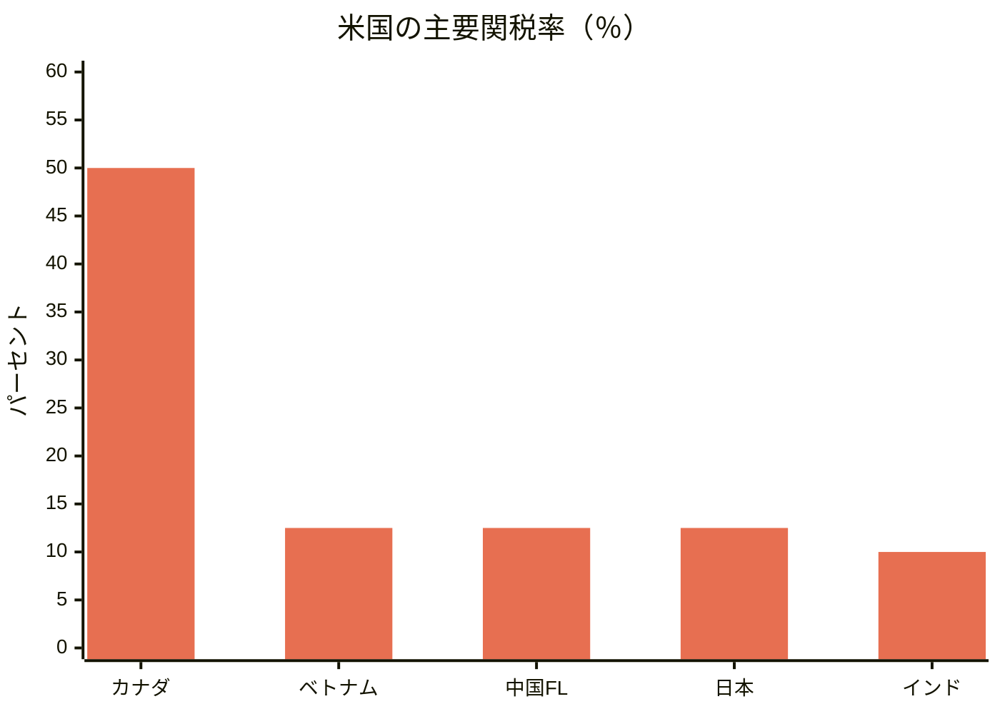

*注：カナダ＝338条税率（50%）。ベトナム、中国FL、日本＝301条強制労働税率（12.5%）。インド＝施行中の301条強制労働税率（10%。発表された18%の協定税率は適用されたことがない）。データソース：USTR、Troutman、BDO、Industrial Front。*

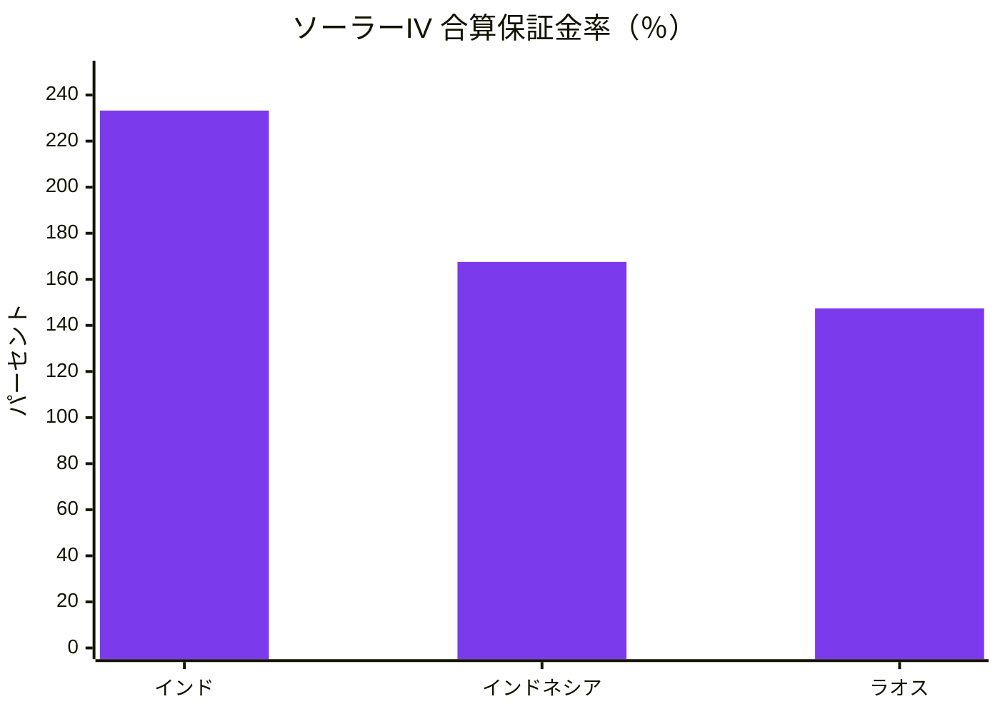

*注：アンチダンピング保証金率と相殺関税の合算、その他すべての税率。インド：AD 107.17%＋CVD 126.09%。インドネシア：AD 94.36%＋CVD 73.20%。ラオス：AD 65.36%＋CVD 82.03%。データソース：商務省AD/CVD命令、2026年11月9日。*

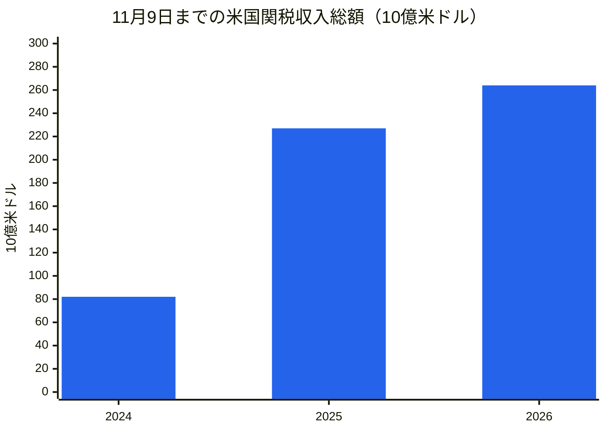

*注：米財務省の日次報告書に基づき超党派政策センターが追跡した、11月9日までの暦年の関税・物品税収入総額。データソース：超党派政策センター（The Motley Fool経由）、2026年11月15日。*

---

## 5. 米国政策の詳細分析

### 301条 — 11月10日の通知

USTRは2026年11月10日、製品適用除外延長通知（91 FR 72610；FR Doc. 2026-22925）を公表し、中国に対する301条（技術移転・知的財産）関税からの現行の適用除外178件すべてを延長した。適用除外 — HTSUS 9903.88.69に基づく一般適用除外164件と、9903.88.70に基づく太陽光製造適用除外14件 — は、2026年11月9日午後11時59分（東部時間）に失効する予定であった。新たな期間は、2026年11月10日午前0時01分（東部時間）以降、2027年1月9日午後11時59分（東部時間）までに、消費用として申告された、または保税倉庫から消費用に引き出された貨物を対象とする。各適用除外の範囲は変わらず、HTSUS注記に記載された10桁のHTSUS番号と製品説明に一致する製品にのみ適用される。USTRは新たな意見募集を行わず、2025年9月の通知の記録に依拠した。24の業界団体による連合は11月4日に、少なくとも1年間の延長を要請していた。一部の報道では、通知に食い違いがあり、1月9日ではなく1月10日に言及する箇所があると指摘している。効力のある日付は1月9日である。USTRは11月10日に別途の通知（91 FR 72608；FR Doc. 2026-22867）を公表し、中国の海事、物流、造船慣行に対する301条措置 — 対象船舶料金（附属書I～III）と附属書V.A関税を含む — の停止をさらに延長し、2026年11月10日から2027年1月9日午後11時59分（東部時間）までとした。停止期間中、いかなる当事者も料金の支払義務を負わない。USTRは提案に対して約60件の独自の意見を受け取った。同措置は、2025年11月10日から2026年11月9日まで既に停止されていた。

USTRはまた、ベトナム政府の知的財産保護・執行に関する特定の行為、政策、慣行についての継続中の301条調査を3カ月延長することを決定した（案件USTR-2026-0364；FR Doc. 2026-22868；2026年11月3日発効）。同調査は、ベトナムがUSTRの2026年スペシャル301報告書で優先外国に指定されたことを受け、2026年5月29日に開始された。措置の是非と、仮に措置を講じるとすればその内容についての決定は、当初の2026年11月29日の期限ではなく、2027年2月28日までに行われることになった。USTRは「追加の時間を要する複雑な問題」を理由に挙げた。ベトナムは、強制労働輸入禁止と製造業における構造的過剰生産能力に関する他の2件の301条調査の対象でもある。ベトナムはすでに、HTSUS品目9903.05.04に基づき、2026年7月24日から12.5%の301条強制労働関税を課されている。

製造業における構造的過剰生産能力に関するUSTRの301条調査から、2026年11月10日時点で最終措置は公表されていなかった。韓国の金正寛（キム・ジョンクァン）産業通商資源部長官は11月10日、国会委員会に対し、ソウルが動向を注視していると述べた。調査結果は、韓国当局が想定していた日程より2カ月以上遅れていると報じられた。調査は韓国を含む16経済を対象としている。韓国は、米国の関税を15%前後に維持することを求めている。貿易弁護士とアナリストはGlobal Trade Reviewに対し、特定された主な短期リスクは3月に開始されたこの調査であり、中国、シンガポール、スイス、ノルウェー、インドネシア、マレーシア、カンボジア、タイ、韓国、ベトナム、台湾、バングラデシュ、メキシコ、日本、インド、およびEUを対象とし、決定は2027年3月までに行われると述べた。

### 232条 — 新たな措置なし、ポリシリコンは12月4日

対象期間中に新たな232条布告や税率変更は確認されなかった。2026年11月9日時点で施行されている232条制度は、統合関税表とCBPのガイダンスから要約すると次のとおりである。鉄鋼、アルミニウム、銅は50%（多くの派生品を含む。その他の対象派生品は25%。固定産業機械、電力・農業設備、家庭用暖房・換気・空調設備は合計15%）。半導体は25%（対象除外あり）。特許医薬品は100%（ジェネリックは対象外）で、一部の原産地と企業についてはより低い税率。自動車・部品は15%～25%。銅派生品、トラック・トラック部品、木材・製材、ポリシリコン、ドローンはそれぞれ独自の税率と条件を有する。ポリシリコン関税は2026年12月4日に課される。それまでは、BISの規則により、商務省は、12月4日までに過去の数量を大幅に上回る輸入を行う輸入者について、商務省が適用除外を認めない限り、さらなる申告を禁じることができる。ロボット工学と産業機械については、2026年10月28日付布告11077に基づく脅威認定があり、交渉を指示するもので、新たな関税は課さない。2027年1月のカレンダーには、家具・キャビネットに対する232条税率の引き上げが含まれる。2027年1月1日から、張りぐるみ家具は30%、キッチンキャビネット・化粧台は50%となる。

### CBP — 外国輸入者、様式5106の無効化

CBPは2026年11月6日、大統領令14411第2条を実施する暫定最終規則「外国輸入者に対する要件の強化」（CBP Dec. 26-19、91 FR 69977；FR Doc. 2026-22735）を公表した。2027年1月5日から、外国輸入者は、自らがCTPAT認証を受けているか、CTPAT認証を受けた通関業者を通じて申告する場合にのみ、消費用の物品を申告できる。税関規則の新たな第110部は、「米国輸入者」を定義している（米国市民または合法永住者、あるいは米国法に基づいて設立され米国に所在する法人で、追加の所有権または不動産条件を満たすもの — 例えば、米国市民または合法永住者による51%以上の実質所有権と支配、または米国内の重要な無担保不動産の直接所有）。米国または外国の輸入者の地位は、申告時および申告概要で申告しなければならない（新19 CFR 141.21～141.22）。ブローカーは、記録を確認して顧客の米国輸入者の地位を検証し、検証記録を5年間保存しなければならない。CBP様式3461と7501（および電子版）には、CSMSメッセージにより3つの新たなデータ項目が追加された。ブローカーは2027年1月5日までに遵守の遅延を要請できる。すべてのブローカーは2027年5月6日までに完全な遵守が求められる。同規則はまた、ブローカーが19 U.S.C. 1592に基づく罰則を受ける場合を拡大する。意見募集の締め切りは2027年1月5日である（案件USCBP-2026-1387）。CBP自身の分析によると、外国輸入者のうちCTPAT認証を受けているのは0.4%であり、68%はすでに認証を受けたブローカーを利用している。残る32%は、ブローカーを変更するか、自らCTPAT認証を受けなければ、米国への輸入を継続できない。

別途、CBPは多数のCTPAT認定輸入者に書簡を送り、CBP様式5106の情報の正確性に関するCBPの懸念がまず解決されなければ、2026年11月18日午前0時01分（東部時間）から申告される申告について輸入者番号が無効になる可能性があると述べた（A5参照）。2026年10月8日付のCBPの低額貨物に関する規則制定案通知（91 FR 64532；案件USCBP-2026-0298）は引き続き開かれており、意見募集の締め切りは2026年12月7日である。同案は、2,500ドルまでの物品の略式申告を輸入日までに電子的に提出することを義務付け、すべての略式申告に保証金を求め、所有者または購入者でない荷受人のためにブローカーが申告する場合にブローカーを輸入者とするものである。800ドルのデミニミス免除は引き続き無期限に停止されている — 非郵便貨物は2026年6月24日から、郵便貨物は2026年7月24日からである。別途、CBPは、201条、232条、301条の関税またはパートナー政府機関の要件の対象となる郵便について正式申告が義務となる日を、2026年10月22日から2027年1月20日に延期した。

### BIS輸出管理 — 関連会社規則は1月10日まで停止、サプレッサーは商務省管理へ

BISは最終規則（FR Doc. 2026-22793）を公表し、暫定最終規則「特定のリスト掲載法人の関連会社へのエンドユーザー管理の拡大」（関連会社規則）の停止を2027年1月10日まで延長した。2025年11月に課された1年間の停止（90 FR 50857）は2026年11月9日に終了する予定であった。新たな規則は2026年11月9日に発効したため、空白はなかった。2025年9月30日に公表された関連会社規則（90 FR 47201）は、エンティティ・リスト、軍事エンドユーザー・リスト、または特定のOFAC指定当事者に掲載された1者以上の当事者によって、直接または間接に、個別または合計で50%以上所有される外国法人に、輸出管理規則（EAR）に基づく輸出管理を拡大するものである。また、外国当事者がリスト掲載法人に部分的に所有されていることが知られている場合に、輸出業者に所有権の問題を解決する義務を課す新たなレッドフラグも導入した。延長は規則を撤回も修正もしない。BISがさらなる措置を講じなければ、拡大された管理措置は2027年1月10日に発効する。連邦官報の通知は、日付の変更を超える政策的根拠を示していない。政権当局者は、延長は2027年1月10日まで延長された米中貿易休戦に関連していると述べている。BISはまた、2026年11月20日付で、特定のサイレンサー、マフラー、消音器の輸出が国務省の米国軍需品リストからBISの輸出管理規則（EAR）の管理に移行すると発表した。サプレッサーは商務管理リストに追加され、BISは、関連ソフトウェアおよび技術の外国人への開示を含む、特定の輸出、再輸出、国内移転について許可を要求する。火器に現在利用可能な許可例外は、サプレッサーにも利用可能となる。

### 連邦官報 — 対象期間中のAD/CVD動向

11月9日：商務省は、インド、インドネシア、ラオス産の結晶シリコン太陽電池およびモジュールに対するアンチダンピング・相殺関税の最終命令を公表した（A7参照）。11月10日：商務省は、台湾とトルコ産のブリキ圧延品が米国で公正価値未満で販売されていると暫定的に認定した。商務省は、台湾のTon Yi Industrial Corporationおよびその他すべての台湾輸出業者に対して18.07%のダンピング率を設定した。トルコについては、Tosyaliおよびその他すべての輸出業者に3.89%、Tatrix Internationalに42.06%を設定した。輸入者は現在、これらの税率で保証金を支払う義務がある。これらの税率は、商務省が9月に中国に対して設定した暫定税率（ダンピング136.52%、補助金66.61%）に加わるものである。トルコに対する最終ダンピング認定は、11月5日の署名から75日後（2027年1月19日）が期限である。台湾については、11月10日の公表から135日後（2027年3月25日）。中国の最終認定は、延期されない限り2026年11月30日が期限である。11月12日：商務省は、中国産の木製キャビネット、化粧台、部品（2024～2025年期）に対するアンチダンピング行政審査の最終結果を公表し、審査対象企業 — Yixing Pengjia Technology、Jiangsu Xiangsheng Bedtime Furniture、Xiamen Golden Huanan、Zhongshan NU Furniture — に対して7.48%のダンピング率を設定した。これは、2026年11月12日以降に消費用として申告された、または引き出された対象貨物に適用される。中国全体の保証金率は251.64%のままである。中国産の木製成形材・ミルワーク製品に対する相殺関税行政審査では、商務省は、Nanping Huatai Wood and Bamboo Co.、Fujian Yinfeng Imp & Exp Trading Co.、Fujian Hongjia Craft Products Co.に対して147.88%、審査対象の非選定企業に対して21.39%の最終CVD率を設定し、2026年11月12日以降に消費用として申告された、または引き出された対象貨物に適用される。商務省は、いずれの場合も公表から35日以上経過した後（2026年12月17日）に査定指示を出す意向である。

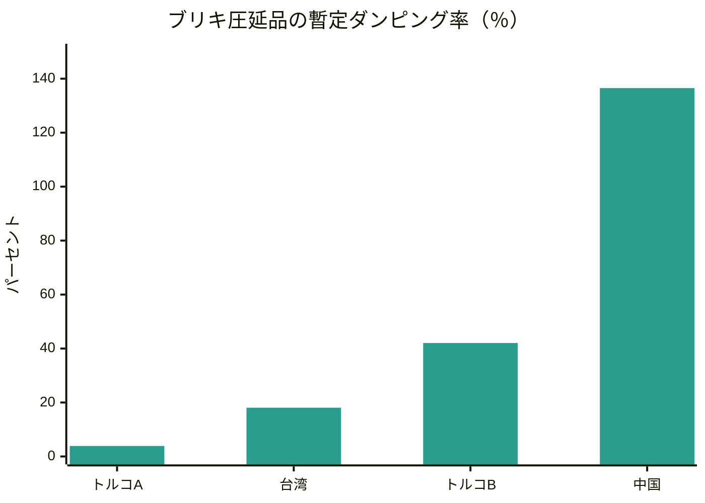

*注：トルコA＝Tosyaliおよびその他すべての輸出業者（3.89%）。トルコB＝Tatrix International（42.06%）。中国＝9月の暫定税率（136.52%）。データソース：商務省暫定認定、2026年11月10日。*

### 継続事項

- **UFLPA／エンティティ・リスト：**2026年11月9日～16日の期間中に、新たなUFLPAエンティティ・リストへの追加や新たな保留命令は確認されなかった。直近のエンティティ・リストへの追加（43社）は2026年7月31日に発表された。CBPの現在の輸入者向け強制労働運用ガイダンスは2026年6月付である。セルビア・ズィジンに関する発表時点のCBPの直近の公表執行総数は、19 U.S.C. § 1307に基づく保留命令（WRO）56件と認定8件であった。その後の報道では、2026年9月29日のさらに2件の命令の後、合計はWRO 60件、認定8件となった。
- **ホワイトハウス：**対象期間中に新たな関税布告やファクトシートは発出されなかった。
- **USITC／HTS：**ソーラーIV命令以外に、対象期間中に新たなHTS税率変更は確認されなかった。ソーラーIVに関するUSITCの完全な公開報告書（USITC Publication 5804）は、2026年11月23日までにUSITCのウェブサイトに掲載される予定である。
- **trade.gov／市場情報：**米国の関税政策に特化した新たな市場情報の発表は、対象期間中に確認されなかった。
- **internationaltradetoday.com：**有料記事。見出しにより、CBPの外国輸入者規則に関する記事（11月5日）を確認した。

---

## 6. 地域別世界政策

### 欧州

EUの低額電子商取引の刷新は現在施行されている（3.3参照）。11月1日から品目ライン当たり2ユーロの取扱手数料と製品識別子の義務化が適用され、2026年7月1日から施行されている関税ライン当たり3ユーロの定額関税に上乗せされる。11月9日、理事会は、VAT輸入ワンストップショップから150ユーロの上限を撤廃することに合意し、2028年7月1日から適用される。11月1日～7日の週のEU関税（TARIC）の動向は、新たな保護関税ではなく、将来の段階的措置が中心であった。15,055件の変更記録が処理され、そのうち13,600件超は、2027年まで延長される特恵アクセスと自律割当を事前に位置付ける将来日付の措置であった。11月6日には、2,500件超の将来日付の記録により、2027年1月1日に発効予定の自律関税割当が設定され、水産加工部門向けの大規模割当が含まれていた。即時の変更は11月1日に集中し、その週に発効した6,238件の措置のうち5,405件が同日に発効した。11月3日に集中した技術的な貿易防衛の再調整により、バルクPVC、懸濁PVC、アスピリン、その他のポリマーおよび特殊化学品について措置の範囲が再較正された。このパターンは、新たな関税を課すのではなく2027年のアクセスを段階的に整える行政的姿勢を示しているが、貿易防衛の範囲変更はポリマーと化学品に対する既存措置の適用範囲を変更し、輸入者に申告の正確性を求めるものである。

EU・インド自由貿易協定は、2026年12月中旬にブリュッセルで署名されると報じられている（3.3参照）。EU・メキシコの近代化貿易協定は2026年5月22日に正式に署名され、発効前に欧州議会による批准を待っている。インドネシアおよびオーストラリアとのEU協定はそれぞれ2026年末までに署名されると見込まれている。EU・メルコスール暫定協定は2026年5月1日から暫定的に発効している。

**データソース：**[RegFollower](https://regfollower.com/eu-forward-staging-and-trade-defence-realignment-mark-the-november-tariff-turn/); [Flex Logistics](https://flexlogistics.eu/eu-trade-deals-online-sellers/)

### 英国

貿易救済通知2026/31は、2026年1月22日に開始された失効審査ER0080における貿易救済庁の勧告に対する国務大臣の受諾を効力化するものである。トルコ原産のニジマスに対する相殺関税は、通知に定められたサイズ制限内の生鮮、冷蔵、冷凍、燻製の魚を対象とし、品目0301、0302、0303、0304、0305に分類され、既存の税率のまま5年間、2031年1月30日まで延長される。再計算はない。通知は2026年11月6日に発効し、変更は2026年1月30日から適用され、課税通知2021/12に取って代わる。輸出業者別の税率は1.5%～8%の範囲であり、リスト掲載輸出業者の2グループは6.9%と7.6%を支払い、その他のすべての輸出業者は9.5%を支払う。

歳入関税庁（HMRC）は11月2日、英国炭素国境調整メカニズム（CBAM）の政策概要を更新し、炭素価格救済の算定に関する情報を追加した。これは今秋3度目の更新であり、2026年9月9日と10月16日の更新は、炭素国境調整メカニズム（排出量・検証）規則2026の制定を反映したものであった。概要は、英国CBAMが2027年1月1日に開始され、商品コードで特定される特定のアルミニウム、セメント、肥料、水素、鉄鋼製品に適用されることを確認している。開始まで2カ月を切っており、対象物品の輸入業者は、制度が課金を開始する前に、商品コード、排出量データ、炭素価格救済の算定を確認する必要がある。

ビジネス・貿易省は11月6日、カタールを含む定期の二国間貿易・投資ファクトシートを発表した。2026年第2四半期末までの4四半期における英国とカタール間の物品・サービス貿易総額は54億ポンドとなり、2025年第2四半期末までの4四半期から7.2%（4億1,600万ポンド）減少した。英国のカタール向け輸出は39億ポンド（10.3%減、4億4,700万ポンド減）、カタールからの輸入は15億ポンド（2.1%増、3,100万ポンド増）であった。カタールは英国の第47位の貿易相手国であり、英国の貿易総額の0.3%を占めた。

**データソース：**[Global Customs Compliance](https://www.globalcustomscompliance.com/trade-and-customs-watch-2026-11-13/?utm_source=rss&utm_medium=rss&utm_campaign=trade-and-customs-watch-2026-11-13)

### カナダ

フランソワ＝フィリップ・シャンパーニュ財務大臣は11月9日、カナダの関税救済措置の変更を発表した（3.7参照）。米国関税に対する水平救済を1年間延長して2028年6月30日までとし、鉱業、採石業、石油・ガス採掘に使用される非鉄鋼製品と、先住民組織が義務付けるものを含む公教育機関が使用するすべての物品も救済に含む。特定のトレーラーは2026年12月1日から、特定のアルミニウム線・押出材および板紙製品は2027年2月1日から救済を撤廃する。これらの変更は、2026年9月8日に課された米国輸入品に対する15%～50%の報復関税に上乗せされるものである。カナダ国境サービス庁は11月2日に税関通知26-07を更新し、予定物品救済を表1～3に拡大し、表2と表3の特別承認コードを導入し、適格条件を明確化した。また、風力タワー救済に関する追加ガイダンスを提供していた付録Aを削除した。商務部長の王文濤氏とカナダの国際貿易大臣マニンダー・シドゥ氏は11月3日、北京で第29回中国・カナダ合同経済貿易委員会を共同議長として開催した。成果の内容は、検討された資料からは確認できなかった。

**データソース：**[Department of Finance Canada](https://www.canada.ca/en/department-finance/news/2026/11/canada-modifies-tariff-relief-measures-to-better-support-workers-and-businesses.html); [GHY](https://www.ghy.com/trade-compliance/category/canada-imports/)

### 中国

中国の休戦延長への対応は、セクション2と3.1で扱っている。商務部の英語サイト（english.mofcom.gov.cn）は11月16日に閲覧可能であったが、トップページの見出しのみが表示され、信頼できないエンティティ・リストに関する調整措置についての報道官発言と、第29回中国・カナダ合同経済貿易委員会の開催に関する掲載が含まれていた。同時期の記者会見における商務部のEUの2ユーロ手数料への対応の内容は、検討された資料からは確認できなかった。

### インドとニュージーランド

インド・米国暫定協定は依然として未署名である（A10および3.2参照）。EU・インド協定は12月中旬に署名されると報じられている（3.3参照）。インドとEUは11月初旬にブリュッセルで実施協議を継続した。ピユシュ・ゴヤル商工大臣は11月3日、インドはいかなる自由貿易協定においても乳製品部門を開放したことはなく、遺伝子組み換え製品の輸入を認めないと述べた。これは、すべての現行FTA交渉に当てはまる譲れない一線である。

### アジア太平洋 — 韓国とブラジル

李在明（イ・ジェミョン）大統領は11月3日の閣議で、韓国製化粧品にブラジルが課す25%の関税について、ブラジルとの協議を速やかに進めるよう政府に促した。同関税は、韓国製品に対する現地の強い需要がある分野への障壁であると述べた。生産をブラジルに移転しても問題は解決しないとし、韓国製化粧品に対する現地消費者の強い選好を挙げ、趙顕（チョ・ヒョン）外交部長官に協議の状況を尋ねた。趙長官は、10月25日の決選投票でのルラ大統領の再選を受け、協議が今や前進する可能性があると述べた。この介入により、分野別の関税がブラジルの新任期を前に大統領レベルの二国間問題となった。

韓国消費財企業は、11月5日～7日にメルボルンで開催された韓流エキスポおよびオーストラリアKフードフェアで、1,800万ドルの輸出契約と覚書に署名した。同イベントは産業通商資源部と農林畜産食品部が共催し、KOTRAと韓国農水産食品流通公社が主催した。輸出相談会には韓国企業101社とオセアニア・東南アジアのバイヤー144社が参加し、1,235件の相談を行い、32件の契約と覚書が成立した。オーストラリア向けの韓国化粧品輸出は、2023年の7,300万ドルから2024年には1億1,200万ドル、2025年には1億6,600万ドルに増加し、2014年12月12日に発効した韓豪自由貿易協定に基づく関税引き下げに支えられた。

**データソース：**[SE Daily](https://en.sedaily.com/politics/2026/11/03/lee-presses-brazil-to-cut-25-percent-tariff-on-korean); [Aju Press](https://www.ajupress.com/view/20261108110470271)

### 多国間

**世界貿易機関（WTO）。**11月4日～6日の会合で、WTO衛生植物検疫措置委員会は、特定の貿易上の懸念、透明性、指導、能力構築を検討した。事務局は、2026年のモニタリング作業の後、55件の特定の貿易上の懸念が解決され、19件が部分的に解決されたと報告した。同作業では、2024年11月以降に提起されていない懸念について39の加盟国に連絡し、25の加盟国から回答を得た。11月の会合では78件の特定の貿易上の懸念が検討され、初めて提起された5件を含み、EUにおける農薬残留基準などの規制措置、コロンビアにおける食肉製品に影響する輸入制限、パラグアイ産牛肉の日本への輸出承認の遅れ、鳥インフルエンザに関連するチリ産家禽製品への制限が含まれていた。1995年以降に議論された640件の特定の貿易上の懸念のうち63%が解決（326件）または部分的に解決（75件）されている。農業委員会は特別会合で、11月3日にウルグアイ・ラウンド以降の農業貿易交渉の推移を検討する2件の発表を行い、輸出競争と、開発途上国政府による管理価格での公的食料備蓄を扱った。次回会合は2026年11月23日に予定され、輸出制限と特別セーフガードメカニズムを扱う。11月16日、WTOは、中国がインドの特定の技術製品に対する関税と国内太陽光製造部門への奨励制度に対して提起した申立てを審査する紛争解決パネルを設置することに合意した。中国の2度目のパネル設置要請を受けてのものである。二国間協議では解決に至らず、インドは2026年5月に中国の当初の要請を阻止していた。パネルは、関税及び貿易に関する一般協定、補助金及び相殺措置に関する協定、貿易関連投資措置に関する協定への適合性を審査する。10月30日、WTO加盟国は、ジュネーブで開催された第10回貿易のための援助グローバル・レビューの2日間を締めくくり、貿易開発委員会の会合において、貿易のための援助イニシアチブを「貿易と開発のためのパートナーシップとしての貿易のための援助」として再位置付ける宣言を採択した — このテーマにおける20年ぶりの多国間成果である。ンゴジ・オコンジョ＝イウェアラ事務局長は11月5日、貿易、生物多様性、海洋経済に関するイベントで基調講演を行い、海洋経済を2兆6,000億米ドル、約1億3,300万人の雇用を支えるものとし、世界で取引される物品の80%以上が海路で輸送され、世界の物品貿易の72%が依然として最恵国待遇の条件で行われていると述べた。同事務局長は、2025年9月から発効している漁業補助金に関する協定に言及し、加盟国に残りの交渉を完了するよう求めた。

**国連貿易開発会議（UNCTAD）。**UNCTADは11月9日、トルコのアンタルヤで開催されるCOP31（11月9日～20日）に合わせて、貿易が気候行動をどのように支援できるかを検討する「グローバル・トレード・アップデート」（2026年11月）を発表した。同報告書は、気候関連規定が貿易協定においてより一般的になりつつあり、2016年から2021年に署名された協定の半数以上に含まれているものの、実施は限定的であるとしている。最近の貿易協定で確認された気候関連規定のうち、関税・非関税障壁の削減に取り組むものはわずか7%である。2025年に調査した174カ国のうち、グリーンおよび気候関連物品に対する貿易円滑化措置を完全に実施していると報告したのは7カ国のみであった。太陽光・風力エネルギーのバリューチェーンに関連する物品の世界輸出は2025年に1兆8,000億ドルを超え、他の製造品の輸出よりも速く成長した。電池貿易は29%増加し、電気自動車貿易は2026年上半期に11%増加した。開発途上国は2024年に生物多様性に基づく物品を1兆3,000億ドル、2025年に海洋物品・サービスを1兆2,000億ドル、2024年に非プラスチック代替品を推定2,040億ドル輸出した。同報告書は、気候技術への手頃なアクセスが、適応と排出削減に不可欠であるとしている。中国市場への輸出能力の開発に関する報告書は、中国社会科学院世界経済政治研究所（CASS）とUNCTADが執筆し、11月5日に上海で開催された第9回虹橋国際経済フォーラム（中国国際輸入博覧会と併催）で発表された。同報告書は、コロンビア、ケニア、スペイン、タイ、英国を含む10の貿易パートナーを分析している。同研究所の所長によると、中国の世界輸出に占める割合は、2000年の3.2%から2025年には9.2%に上昇した。

**国際貿易センター（ITC）。**国際貿易センターとアフリカ輸出入銀行は11月3日、英連邦首脳会議の傍ら、アンティグア・バーブーダのセントジョンズで、報告書「アフリカ・カリブ貿易の再構築：経済変革の機会」を発表した。同報告書は、アフリカとカリブ間の物品・サービス貿易が、鉱物燃料を除き、2030年までに年間最大16億5,000万ドルに達する可能性があるとしている。アフリカのカリブ向け年間物品輸出ポテンシャルの約80%は未開拓のままであり、カリブの輸出ポテンシャルは主にサービスにあり、4億8,100万ドルに達する。優先分野には、加工食品・動物飼料、化学品、鉱物・金属、アパレル・繊維、皮革・履物、観光、運輸サービス、クリエイティブ産業が含まれる。調査結果は、貿易・輸出ポテンシャル分析、分野評価、両地域の1,175の企業と企業支援機関を対象とした調査に基づいている。

**世界税関機構（WCO）。**11月3日、WCOはブリュッセル本部で、災害救援における税関の役割に関するハイブリッド・シンポジウムを開催し、税関当局、国際機関、人道・物流関係者から190名超が参加した。イアン・ソーンダース事務総長は、この議論をWCOの2026年のテーマ「警戒と献身を通じた社会の保護における税関」に結び付けた。11月5日、WCOは2025～2026年年次報告書を発表した。11月9日、WCOは破壊的技術に関するスマート税関プロジェクトの世界イベントを開催し、11月11日には、税関当局、万国郵便連合、eBayなどが参加する電子商取引からの模倣品排除に関するシンポジウムを開催した。11月12日、WCOは、東アフリカ共同体の国々が原産地規則を改定し、自律的な研修能力を開発する支援を報告し、11月13日、事務総長はWCO偽造・海賊版対策グループ会合の傍らで世界動物保健機関の事務局長と会談し、不法貿易に対する協力を再確認した。

**データソース：**[Logistics News PH](https://logisticsnews.ph/2026/11/12/wto-sps-committee-reports-progress-in-resolving-trade-concerns/); [India ReNews](https://indiarenews.in/blog/read/wto-sets-up-dispute-panel-to-examine-china-s-challenge-against-india-s-solar-incentives-and-technology-tariffs); [UNCTAD](https://unctad.org/publication/global-trade-update-november-2026); [WCO](https://www.wcoomd.org/en/media/newsroom/2026/november.aspx)

---

## 7. 執行措置

### アンチダンピング・相殺関税

インド、インドネシア、ラオス産の太陽電池に対する商務省の最終AD/CVD命令（A7参照）と、台湾・トルコに対するブリキ圧延品の暫定税率および木製キャビネット・ミルワーク審査結果（セクション5参照）が、今週の貿易救済措置であった。太陽光命令は、対象期間中の最大のAD/CVD措置であり、いずれの場合も合算保証金率が申告価額の100%を超えた。ブリキ圧延品の暫定税率は、台湾・トルコの供給業者に対する保証金コストを設定し、中国案件は、はるかに高い税率（9月のダンピング136.52%、補助金66.61%）で、11月30日の最終認定に近づいている。木製キャビネット・ミルワーク審査は、指定された中国家具・ミルワーク輸出業者の保証金率をリセットしつつ、非常に高い中国全体の税率（251.64%）を維持し、審査済み供給業者と未審査供給業者の間に大きな関税格差を残した。

### CBPの押収と強制労働

11月3日、ノガレスのデコンシーニ国境通過点において、CBP職員は、メキシコから戻る2006年式日産タイタンを運転する36歳の米国市民男性を二次検査に回した。トラックの荷台にあるプラスチック製折りたたみ椅子の実地検査により、椅子の中に隠されたフェンタニルを含む300個以上の包みが見つかった。車両と麻薬は押収され、国土安全保障捜査局の捜査官が入国地点に出動し、事件はさらなる捜査のため係属中である。112ポンドを超えるフェンタニルが押収された。対象期間中に新たな保留命令は確認されなかった。対象期間前のCBPの発表における直近の保留命令は、インドネシア産パーム油に関する命令と、2026年6月16日のセルビア・ズィジン銅に関する命令であった。夏から秋にかけての一連の命令の後、対象期間中に新たな保留命令がなかったこと自体が、強制労働執行の頻度を示すデータである。輸入者は、これを政策の変更と読むべきではない。

ハワイの男性が11月12日、OFACの許可なくイランに資金を送金したとして、懲役24カ月と罰金15,000ドルの判決を受けた。オアフ島ワイアルア在住の38歳のアラシュ・アイノルゴザティ氏は、ヘレン・ギルモア上級連邦地裁判事により、懲役24カ月と、その後の3年間の保護観察の判決を受けた。司法省の発表によると、裁判記録によれば、アイノルゴザティ氏は2026年3月という早い時期から少なくとも2022年4月まで継続して（司法省発表の記載による）、政府発行の通貨と暗号資産を米国国内から、イランにいることが分かっている受取人、またはイラン国内の個人にさらに送金する者に複数回送金し、財務省外国資産管理局（OFAC）の許可なくそうすることが違法であることを知っていた。送金総額は22万6,000ドルを超えた。FBIが事件を捜査した。この事件は、現金と暗号資産の双方を用いる個人送金者に対するイラン制裁の刑事執行を示すものであり、イラン関連の金融チャネルに対する財務省の「オペレーション・エコノミック・アウトキャスト」キャンペーンに続くものである。

**データソース：**[CBP](https://www.cbp.gov/newsroom/local-media-release/cbp-officers-seize-112-pounds-fentanyl-nogales-port-entry); [US Department of Justice](https://www.justice.gov/usao-hi/pr/north-shore-man-sentenced-two-years-prison-sending-money-iran-violation-us-sanctions)

### 制裁

OFACは11月4日に発表された措置において、大統領令13902に基づき、イラン産石油の輸出を円滑化した不正な海事旗国登録・登録会社とされるネットワークを指定した。同ネットワークは、インドのチャンディーガルを拠点とするインド国民スニエル・クマール・シャルマ氏とジャスプリート・プリーティ・シャヒド氏が主導し、ガイアナ、エスワティニ、ラオス、アルバ、モザンビーク、マラウイ、シント・マールテン、東ティモールを含む国・地域の旗国登録機関および海事サービス提供者を装う会社を運営していた。同社は、イラン軍およびその代理勢力のために運航する船舶を含む、イラン産石油を運ぶ船舶に不正な登録と証明書を販売していた。OFACは同ネットワークの個人4名と団体9件を指定し、さらにトルコを拠点とするFugo Ground Services Inc.をイランの航空部門での活動を理由に制裁した。OFACは指定と併せて、「イランの影の船団による制裁回避のための偽旗への依存」と題する警告を発し、商業関係者に対し、疑わしい旗国登録を使用する船舶を避けるよう警告した。同じ措置により、1,000件を超える既存の特別指定国民・封鎖対象者リスト（SDNリスト）の記載に、「二次制裁リスク：大統領令13902第2条を参照」との注記が追加された。

国務省は11月5日に発表された措置において、大統領令14404（2026年5月1日）に基づき、8団体と2個人を指定し、5隻の船舶を封鎖財産として特定した。対象には、キューバへの石油製品の輸送を行う海事運送会社ネットワークの一員であるギジェルモ・ファウスティーノ・ロドリゲス・ロペス・カジェハ氏、GAESA会長アニア・ギジェルミナ・ラストレス・モレラ氏の娘であるアニ・ロドリゲス・ラストレス氏、キプロスを拠点とするCaroil Transport Marine Ltd、政権の軍事勢力の供給業者とされる中国を拠点とする中国国家電子進出口総公司（CEIEC）と北京H&Cテクノロジーズが含まれる。封鎖財産として特定された5隻は、ESPERANZA、GLORIA C、MARIA CRISTINA、EMILIA、LOURDESである。同日、OFACのブラッドリー・T・スミス長官は、大統領令14404第2条(a)(i)(A)の分野別制裁権限が、キューバ経済の電子、製造、海事、技術分野に適用されるとの決定を発出した。これら4分野は、大統領令自体に記載された5分野 — エネルギー、防衛・関連物資、金属・鉱業、金融サービス、治安 — に加わるものである。新たな4分野で活動している、または活動していたと認定された外国人は、現在、封鎖制裁の対象となる。

国務省は11月4日、イランによる携帯式防空システム（MANPADS）の追求を理由に、大統領令13949に基づき3名を指定した。中国を拠点とする企業とイランを結ぶベラルーシを拠点とする仲介業者Armory Allianceを運営するモハメド・アリ・トリボフ氏、虚偽のエンドユーザーを使って中国原産のMANPADSをイランへ誘導したとされるナイジェリアの企業Vanguard Tactical Supply Limited、イランの発射装置探索を支援したとされるロシアを拠点とするアリシェル・ドムロジャノフ氏である。米国国内にある、または米国人が保有する3名の資産は凍結され、OFACに報告しなければならない。

金融犯罪執行ネットワーク（FinCEN）は11月6日、セーシェルを拠点とする暗号資産取引所MEXC Globalが、ロシアの不正資金に関連する主要な資金洗浄懸念のある金融機関であると認定し、米国の金融機関が同取引所との資金の送金を一切行うことを禁止する命令を発出した。FinCENによると、MEXC Globalは2021年5月から2026年5月の間に、制裁回避、サイバー犯罪、その他の不正活動に関連する少なくとも167億ドルの取引を円滑化し、制裁対象のロシア団体（取引所Garantexとその後継Grinexを含む）との取引を処理し、制裁対象の取引所を含むイランの暗号資産取引所との直接取引で10億ドル超を処理し、イラン中央銀行、イスラム革命防衛隊およびそのクドス部隊に関連する約2,200万ドルの取引を円滑化した。同命令により、ロシアおよびイランの制裁回避に使用された暗号資産取引所は米国の金融システムから切り離され、暗号資産経路を利用する取引先の貿易金融・決済コンプライアンスに関連する。

**データソース：**[Steptoe](https://www.steptoe.com/en/news-publications/stepwise-risk-outlook/sanctions-update-november-9-2026.html); [US Department of State](https://www.state.gov/releases/office-of-the-spokesman/2026/11/further-sanctions-on-the-cuban-regimes-foreign-military-support-and-illicit-revenue-networks-fact-sheet/)

---

## 8. データ発表

### 中国 — 2026年10月の対外貿易

中国税関総署は11月10日、2026年10月の貿易暫定統計を発表した。米ドル建てでは、10月の輸出は前年比35.2%増の4,123億ドル、輸入は41.6%増の3,071億ドルとなった。人民元建てでは、10月の輸出は28.7%増の2兆7,900億元、輸入は34.7%増の2兆800億元となった。1月～10月の物品貿易総額は44兆8,100億元に達し、前年比20%増加した。10月の物品黒字は1,053億ドルとなり、2026年9月の1,335億ドルから減少した。1月～10月の累計黒字は1兆426億ドルに達した。1月～10月の輸出3兆7,828億ドルは、報告によると2025年通年の輸出3兆7,719億ドルをすでに上回っている。1月～10月の集積回路輸出は3,411億ドルと2倍以上に増加し、前年比111.1%増（1,616億ドルから）となった。集積回路輸入は5,665億ドルで65.1%増となった。人民元建ての1月～10月の輸出は25兆9,900億元で17.6%増、輸入は18兆8,200億元で23.6%増であった。機械・電気製品は輸出の16兆8,100億元を占め、25.2%増、全体の64.7%となった。ASEANとの貿易は24.2%、EUとの貿易は8.5%、米国との貿易は6.3%増加した（1月～10月、人民元ベース、報告による）。税関総署は、数値は暫定値であり、月報の方がより正確であると述べた。

**データソース：**[NGlobe News](https://www.nglobenews.com/en/article/china-october-trade-surplus-1-trillion-2026-11-10/)

### インド — 2026年10月の対外貿易

インド商務省は11月13日、2026年10月の速報推計を発表した。物品輸出は前年比45.06%増の過去最高494億7,000万ドルとなり、物品輸入も過去最高の893億5,000万ドルに達し、物品赤字は398億8,000万ドルとなった — 9月の302億1,000万ドルより広がったが、2025年10月の425億8,000万ドルよりは狭まった。サービスを含めると、全体の輸出は899億9,000万ドルに達し、全体の赤字は200億9,000万ドルに縮小した。石油輸入は前年比54.31%増の228億2,000万ドルとなり、金輸入はディワリを前に、9月の18億ドルから55億1,000万ドルに増加した。商務省は、石油製品、電子製品、宝石・宝飾品、有機・無機化学品、エンジニアリング製品を輸出増加のけん引役と特定した。サービス輸出は405億1,000万ドル、サービス輸入は207億2,000万ドル（推計）であった。2026～27年度の4月～10月の物品輸出は3,090億6,000万ドル（1年前は2,534億ドル）であり、全体の輸出は5,688億4,000万ドルで16.66%増、全体の輸入は6,621億9,000万ドルで16%増であった。

**データソース：**[GuruTrade](https://www.gurutrade.com/news/india-oct-trade-deficit-hits-1-yr-high-of-39-88b-on-gold-1794605244.html)

### ユーロ圏とドイツ

ユーロスタットは11月13日、2026年9月の物品貿易の第一次推計を発表した。ユーロ圏は域外との貿易で103億ユーロの赤字となり、2025年9月の135億ユーロの黒字、2026年8月の166億ユーロの赤字と比較された。EUは168億ユーロの赤字となり、1年前の114億ユーロの黒字と比較された。ユーロスタットは、悪化の多くをエネルギーに帰し、ユーロ圏のエネルギー赤字は207億ユーロから330億ユーロに拡大し、機械・車両の黒字は100億ユーロから30億ユーロに縮小した。ユーロ圏の輸出は2,727億ユーロで前年比6.0%増、輸入は2,830億ユーロで16.1%増であった。2026年1月～9月のユーロ圏収支はマイナス365億ユーロとなり、2025年同期のプラス1,022億ユーロと比較された。輸出は2兆2,634億ユーロ（2.4%増）、輸入は2兆2,999億ユーロであった。EUの1月～9月の赤字は832億ユーロとなり、2025年同期の855億ユーロの黒字と比較された。数値は暫定値であり、2026年11月10日までに加盟国から送信された情報に基づいている。

ドイツ連邦統計局（Destatis）は11月9日、2026年9月の対外貿易暫定統計を発表した（プレスリリース第390号）。暦・季節調整済みでは、輸出は8月から2.0%増加し、輸入は4.2%増加した。EU諸国への輸出は前月比3.5%増加し、非EU諸国への輸出は0.1%増加した。輸出は1,411億ユーロ（前月比2.0%増、前年比7.7%増）、輸入は1,255億ユーロ（前月比4.2%増、前年比8.7%増）であり、対外貿易収支は156億ユーロの黒字となり、2026年8月の179億ユーロから減少し、2025年9月の155億ユーロとほぼ変わらなかった。未調整の輸出は1,485億ユーロ、未調整の輸入は1,311億ユーロ、未調整の黒字は174億ユーロであった。連邦統計局は、詳細な結果は2026年11月20日に発表されると述べ、この段階では、個別の国または国グループとの貿易の変化の理由について情報を提供できないと述べた。

**データソース：**[Eurostat](https://ec.europa.eu/eurostat/en/web/products-euro-indicators/w/6-13112026-bp); [Destatis](https://www.destatis.de/EN/Press/2026/11/PE26_390_51.html)

### 日本 — 2026年10月の貿易、最初の20日間

日本税関は11月10日、2026年10月最初の20日間の暫定統計を発表した。輸出は前年比23.5%増の7兆3,147億円となったが、輸入は32.4%増の8兆1,251億円となり、赤字は1年前の2,166億円から8,104億円に拡大した。同発表は合計値のみを公表し、相手国や品目別の内訳はない。暫定の部分月統計は、輸入の伸びが輸出を上回ることにより、10月の月間赤字全体が拡大することを示唆している。翌週発表予定の月間統計により、この傾向が月全体を通じて続いたかどうかが明らかになる。

**データソース：**[Kilambi](https://news.kilambi.com/stories/2026-11-09-japan-trade-deficit-widens-october-first-20-days/)

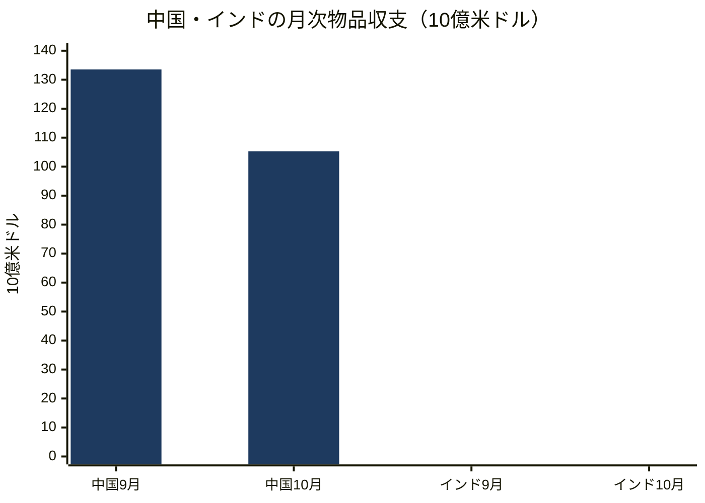

*注：中国の月次物品黒字：9月は1,335億3,000万ドル、10月は1,053億ドル。インドの月次物品赤字：9月は302億1,000万ドル、10月は398億8,000万ドル。データソース：税関総署、インド商務省。*

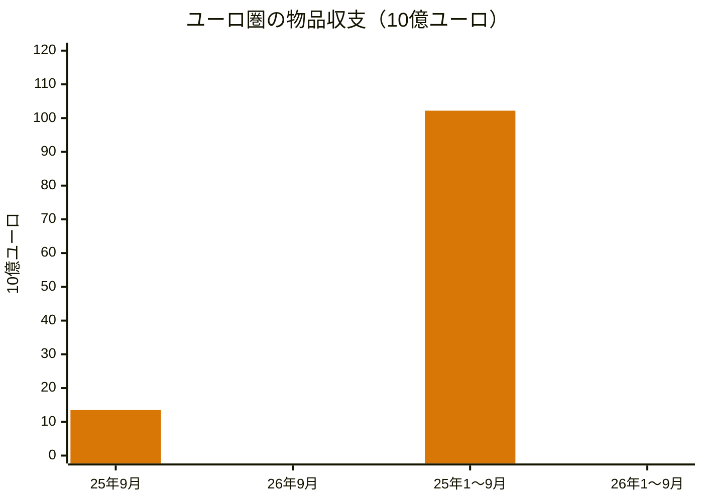

*注：ユーロ圏の物品収支：2025年9月はプラス135億ユーロ、2026年9月はマイナス103億ユーロ。2025年1月～9月はプラス1,022億ユーロ、2026年1月～9月はマイナス365億ユーロ。データソース：ユーロスタット、2026年11月13日。*

### シンクタンク

中間選挙を受けて、11月5日～10日の報道では、イェール大学のバジェット・ラボとタックス・ファウンデーションを引用して、米国関税のコストを定量化した（3.2参照）。バジェット・ラボの11月2日時点の集計では、米国の平均法定関税率は11.8%であり、現行法の下では年末までに11.9%に上昇し、米国の消費者物価に約0.7%のコスト、すなわち世帯当たり年間約900ドルの負担がかかるとした。タックス・ファウンデーションは、関税により2026年の税金が世帯当たり平均820ドル増加すると推計している（2026年8月付モデル）。一方、バジェット・ラボは2026年8月24日付の報告書で負担を世帯当たり約1,100ドルとした。2つの数値は手法が異なる。タックス・ファウンデーションの820ドルは、実際に輸入されるものに基づく2026年の数値を反映し、イェールの1,100ドルは、現行の関税が固定の輸入ウェイトで維持されると仮定している。タックス・ファウンデーションの上級エコノミスト、エリカ・ヨーク氏は10月7日、2017年以降に課されたすべての関税を廃止すると10年間で約1兆8,000億ドルの費用がかかり、1%の広範な付加価値税でそれを置き換えるだけの収入が得られると述べた。バジェット・ラボの事務局長マーサ・ギンベル氏は11月5日、Marketplaceに対し、関税は10年間で約2兆ドルの収入をもたらすと述べた。財務省によると、2026年度の純関税収入は合計1,732億ドルとなった。対象期間中にウェブ検索で確認されたtradeintelligence.euからの新たな貿易政策項目はなかった。

**データソース：**[Geopolitiqs](https://www.geopolitiqs.com/tn/2026-11-09/tariffs-average-rate); [Dave Manuel](https://www.davemanuel.com/2026/11/06/what-happens-to-tariffs-now-that-democrats-control-congress/)

### データポータル

USITC DataWeb、UN Comtrade、WITS、世界銀行、IMFの各ポータルからは、対象期間中の主要な新規発表は確認されなかった。

---

## 9. 貨物市場

### コンテナスポット運賃 — ドリューリー世界コンテナ指数

2026年11月12日木曜日のドリューリーの評価では、太平洋横断航路とアジア・欧州／地中海航路における需要の低迷により、総合指数は週間2%下落し、40フィートコンテナ当たり4,305ドルとなり、2週連続の下落となった。太平洋横断航路では、上海・ニューヨーク間が3%下落して40フィート当たり9,020ドルとなり、2026年8月以来の最低水準となった。上海・ロサンゼルス間は2%下落して7,416ドルとなり、2026年9月以来の最低水準となった。アジア・欧州／地中海航路では、上海・ロッテルダム間が3%下落して3,504ドルとなり、上海・ジェノバ間は4,168ドルで変わらなかった。船社は、来週の太平洋横断航路で8件の欠航を発表し、今週の4件から増加した（アジア・欧州／地中海航路では5件に対して8件）。また、11月後半からアジア・欧州／地中海航路で、すべての貨物種に対する運賃（FAK）とピークシーズン追加料金の引き上げを発表した。ドリューリーは、来週は太平洋横断運賃がさらに下落し、アジア・欧州／地中海運賃はわずかに上昇すると見込んでいる。上海港の混雑は先週、36時間から49時間に増加した。先週、53隻がスエズ運河を通航し、1隻がホルムズ海峡を通航した。

**データソース：**[Drewry](https://www.drewry.co.uk/supply-chain-advisors/supply-chain-expertise/world-container-index-assessed-by-drewry)

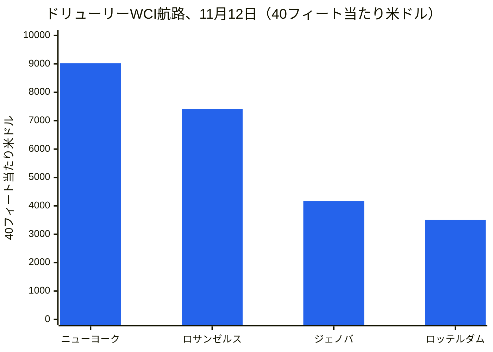

*注：すべての航路は上海発。上海・ニューヨーク間9,020ドル。上海・ロサンゼルス間7,416ドル。上海・ジェノバ間4,168ドル。上海・ロッテルダム間3,504ドル。総合指数は40フィート当たり4,305ドルで、前週比2%下落。データソース：ドリューリー、2026年11月12日。*

### フレイトス・バルチック指数

フレイトスは11月10日の週間更新で、世界指数が2%下落して3,452ドルとなり（前回は3,513ドル）、11月の一般運賃値上げが維持できなかったため、アジア・北欧間が5%下落し、太平洋横断航路も低下したと報告した。アジア・米国西海岸間（FBX01週間）は1%下落してFEU当たり約8,200ドル。アジア・米国東海岸間（FBX03週間）は2%下落してFEU当たり約9,700ドル。アジア・北欧間（FBX11週間）は5%下落してFEU当たり3,400ドルで、前年比50%上昇。アジア・地中海間（FBX13週間）は1%下落してFEU当たり4,300ドルで、前年比88%上昇。ドリューリーと並ぶ世界指数の2週連続の下落により、11月の運賃値上げが維持できなかったことが確認された一方、アジア・欧州航路の運賃は1年前の水準を大きく上回ったままである。ILWU第26支部（警備員組合）は、交渉の時間を確保するため、ロサンゼルス・ロングビーチ港におけるストライキ期限を11月20日まで延長した。全米小売業協会は、米国の海上輸入量が9月に237万TEUでピークを迎え、ほぼ記録的水準となり、10月は推定5%減、11月は9月のピークから14%減と予測されると報告した。

**データソース：**[Freightos](https://www.freightos.com/freight-resources/la-lb-strike-deadline-extended-dem-win-increasing-trade-uncertainty-november-10-2026-update/)

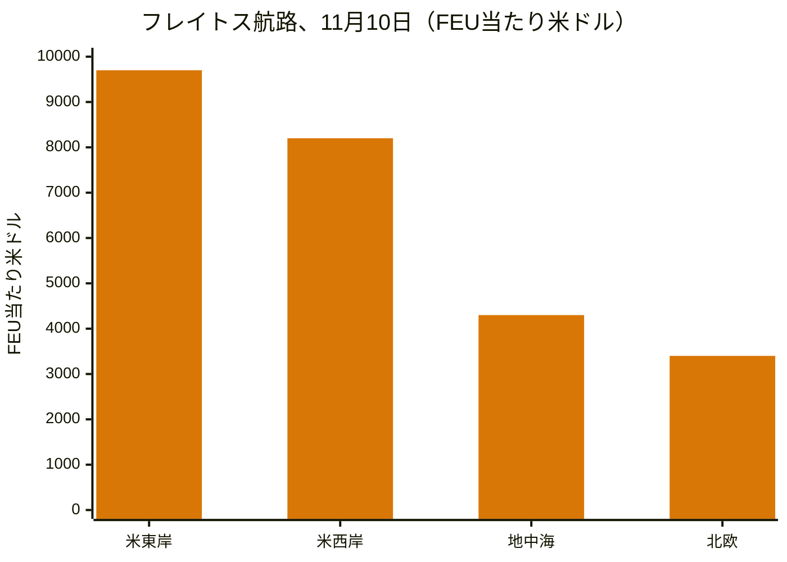

*注：アジア・米国東海岸間はFEU当たり約9,700ドル。アジア・米国西海岸間は約8,200ドル。アジア・地中海間は4,300ドル。アジア・北欧間は3,400ドル。世界指数は3,452ドルで、前週比2%下落。データソース：フレイトス、2026年11月10日。*

### 11月の運賃値上げ — 発表済み、すでに値引き

太平洋横断の海上運賃は、11月12日までの週にわずかに下落した。船社が計画した一般運賃値上げは維持できなかったが、ピークシーズン水準付近にとどまった。船社は11月についてFEU当たり2,000～3,000ドルの値上げを求め、11月15日～16日からのさらなる値上げを申請したが、フォワーダーはスペースの改善と船舶スケジュールの安定を挙げた。アジア・欧州運賃も軟化した。北欧価格は週間5%下落してFEU当たり3,400ドル、地中海運賃は1%下落してFEU当たり4,300ドルとなった。上海コンテナ貨物指数は11月13日に61.12ポイント下落して3,572.33となり、2週連続の下落となった。米国向け運賃が下落し、地中海運賃が上昇した。上海・米国東海岸間運賃は470ドル下落して40フィートコンテナ当たり9,387ドル、上海・米国西海岸間は270ドル下落して7,111ドル、上海・欧州間は77ドル下落して40フィート当たり3,402ドルとなった一方、上海・地中海間は380ドル上昇して40フィート当たり4,746ドルとなった。

**データソース：**[FreightWaves](https://www.freightwaves.com/news/us-midterm-shift-adds-trade-uncertainty-as-trans-pacific-ocean-freight-rates-stay-elevated); [ShipUniverse](https://www.shipuniverse.com/news/container-freight-rates-split-as-u-s-east-coast-drops-470-as-mediterranean-surges-6-7/)

### 欠航と輸送能力

ドリューリーの欠航トラッカーは、11月16日から12月21日までの主要東西航路の予定サービス716便のうち52便の欠航を予測しており、計画された出航の約7%に当たる。船社は、来週の太平洋横断航路で8件の欠航を発表し、今週の4件から増加した。アジア・欧州／地中海航路では5件に対して8件であった。計画された欠航の規模は、11月の運賃値上げが維持できなかったため、船社が12月に向けて輸送能力を制限していることを示している。

### ドライバルク — バルチック海運取引所

バルチック海運指数は、11月13日までの週に6.2%上昇して2,980ポイントとなり、4週連続の上昇となった。金曜日に下落し、7営業日連続の上昇は止まった。同指数は週を通じて上昇した — 11月9日に2,854、11月10日に2,862、11月11日に2,959、11月12日に3,020 — その後、11月13日金曜日に40ポイント（1.3%）下落して2,980となった。週間上昇をけん引したのはケープサイズ運賃である。BCI 182 5TCは4万3,860ドルの高値に達した後、週末には4万2,798ドルで引けた。パナマックスとスープラマックスの運賃も週を通じて上昇した。前週の上昇（11月6日までの週）は3.4%で、10月30日の2,714から2,805となった。ドライバルク運賃はコンテナ運賃とは逆方向に動き、4週連続の上昇により同指数は10月初旬以来の最高水準となった。鉄鉱石、石炭、穀物を運ぶケープサイズとパナマックス船に対する需要が堅調であることを示している。バルチック海運取引所の第46週のコンテナ概要では、比較的落ち着いた週であったと述べられている。4つの主要東西航路のコンテナ運賃は平均0.52%下落し、中国／米国西海岸間は0.77%下落した一方、東海岸間は変わらず、アジア・欧州運賃はわずかに弱まり、北欧は0.53%、地中海は0.79%下落した。

**データソース：**[The DCN](https://www.thedcn.com.au/news/baltic-exchange-weekly-report-13-november-2026)

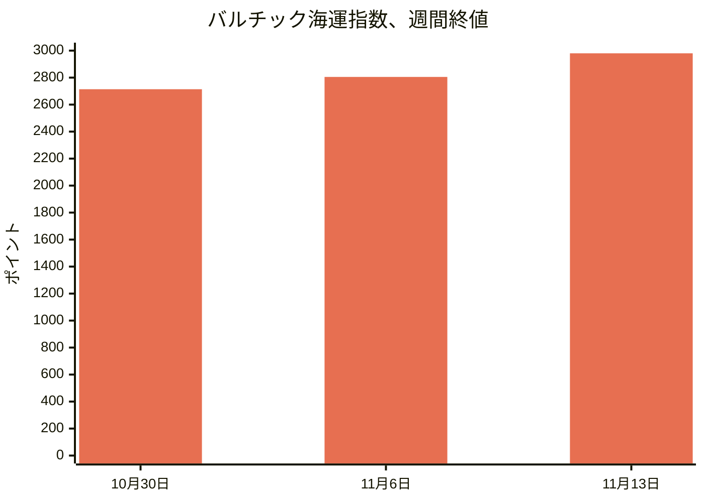

*注：週間終値：2,714（10月30日）、2,805（11月6日）、2,980（11月13日）。4週連続の上昇。データソース：バルチック海運取引所週間報告書、2026年11月13日。*

### スエズと定時性

スエズ回帰は継続した（3.5参照）。ドリューリーは、11月1日までの1週間に53隻のコンテナ船が同運河を通航し、前年比130%増加したと数え、アジア・欧州輸送能力の約60%がスエズ航路に戻ったと推計している。エバーグリーンのエバー・エオンは11月8日に通航し、ほぼ3年ぶりのエバーグリーンの通航となった。船社がスエズ・サービスを復旧するにつれ、アジア・欧州間の輸送時間は7～10日短縮されているが、到着が集中している。フレイトスは、11月16日～22日の週に北欧港湾に到着する船舶輸送能力が通常の131%になると予測し、31隻のコンテナ船がスエズ経由で、61隻が依然として喜望峰経由で航行するとした。フレイトスは、通常輸送能力の120%を超える到着を混雑リスクとみなしており、11月中旬から1月までの少なくとも3週間がそのしきい値を超えると予測されている。平均コンテナ滞留時間は第42週に3.37日に達し、ヤード利用率は80%～90%と報告された。

### 航空貨物

世界の航空貨物スポット運賃は3週連続で上昇し、第44週に4%上昇して1キログラム当たり約3.93ドルとなり、前年同期を約40%上回った（TAC指数）。バルチック航空貨物指数は11月9日までの7日間で6.6%上昇し、前年比28.2%上昇した。フレイトスの11月10日の更新では、中国・北米間が3%上昇して1kg当たり8.00ドル超、中国・北欧間が11%上昇して1kg当たり4.87ドル、北欧・北米間が9%上昇した。大西洋横断の航空貨物は過去1カ月で33%上昇し、1kg当たり2.90ドルとなった。ゼネタの10月の世界スポット平均は1kg当たり3.11ドルで、前年比29%上昇した。IATAは、9月の貨物需要が前年比7.7%増加し、アジア・北米間の輸送量が17%増加したと報告したが、ジェット燃料価格は1年前より103.4%高かった。航空貨物は、冬季の旅客スケジュールで引き締まった輸送能力の中、年末の遅い注文とAIハードウェアの出荷を吸収しており、運賃は昨年12月のピークに向けて上昇している。フォワーダーは、スペースが確保できる場合、中国・米国西海岸間の運賃は1kg当たり8.50～9.00ドル前後と報告している。

**データソース：**[Daily8 News](https://www.daily8news.com/article/air-cargo-rates-2026-high-peak-season-20261113/); [IATA](https://www.iata.org/en/pressroom/2026-releases/10-29-air-cargo-demand-accelerates-september/); [TAC Index via LinkedIn](https://www.linkedin.com/pulse/air-freight-market-update-november-10-2026-tacindex-pkmfc)

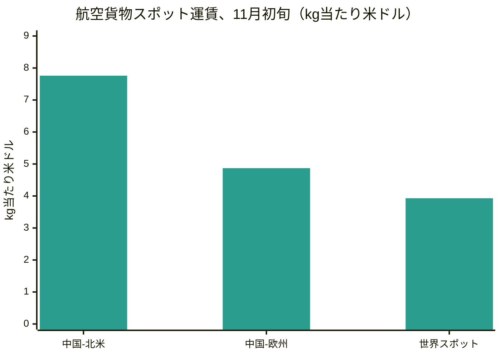

*注：中国・北米間は1kg当たり7.76ドル（フレイトス、11月初旬。11月10日の更新では1kg当たり8.00ドル超）。中国・北欧間は1kg当たり4.87ドル。世界スポットは1kg当たり約3.93ドル（TAC指数、第44週）。データソース：フレイトス、TAC指数。*

### 港湾と物流の混乱

**ロサンゼルスとロングビーチ。**警備員交渉は11月20日まで延長された（A8参照）。C.H.ロビンソンは、アジアからの小売貨物が、9月の異例の好調と、中国の最大級の港湾でコンテナが滞留し、海上スケジュールが中断し、船社が寄港を省略して貨物を積み残した一連の台風の後、11月初旬もなお混乱の影響を受け続けていると報告した。ロサンゼルスとロングビーチでは、貨物を内陸へ輸送するための鉄道車両の不足が主な原因で、混雑は依然として深刻であった。一部の荷主は積み替えとトラック輸送に転じていた。11月2日時点で、35,688個の輸入コンテナがターミナルで構内列車を待っており、そのうち10,562個は9日以上待機していた。ロサンゼルス港は、10月30日時点で、現地貨物のターミナル滞留が3.7日、構内鉄道貨物の滞留が5.6日と報告した。さらなる混乱がなければ、2～3週間かけて徐々に回復すると見込まれていた。ロサンゼルス港は2026年10月に1,026,872TEUを処理し、同月の記録となり、港の歴史上2番目に多い月間総量となった。9月の過去最高1,042,652TEUに続くものである。同港が100万TEUを連続して超えたのは初めてであり、2026年に同水準に達したのは3度目である。積載輸入は約538,620TEUで、前年比25%増、港の5年間10月平均を30%上回った。積載輸出は114,981TEUで、前年比7%減。空コンテナは373,271TEUで、2カ月連続の月間記録となった。1月～10月の合計は約9,108,497TEUで、昨年を5%上回り、5年平均を9%上回った。

**米国の輸入見通し。**全米小売業協会のグローバル・ポート・トラッカーは、同協会が追跡する港湾が9月に237万TEUの積載輸入を処理し、2026年で最も忙しい月となり、追跡開始以来3番目に忙しい月となったと報告した。10月は226万TEU（前年比9.1%増）、11月は205万TEU（1.2%増）、12月は203万TEU（1.3%増）と予測されている。通年の予測は約2,600万TEUで、2025年から2%増である。2027年初頭の見通しは軟化する。1月は204万TEU（前年比3%減）、2月は189万TEU（0.5%減）、3月は192万TEU（11.2%減）と予測されている。

**ダーバン。**ダーバンは、8月にダーバン・ゲートウェイ・ターミナルがICTSIの運営に移行し、Navis N4ターミナルシステムに切り替わったことから回復していない。同ターミナルの取扱量は、8月14日から9月10日の間に、前4カ月平均に対して約30%減少した。11月3日の貨物動向更新における港湾全体の計画指標は15日となり、前週から1日増加した。11月2日時点で17隻のコンテナ船がダーバンを待機しており、6隻が指定停泊地内に、11隻がさらに沖合にあり、約85,000TEUが洋上にあった。コンテナ船は、11月初旬までの7日間で平均7.46日停泊した。マースクは、極東アジアから南アフリカ・モーリシャスへのドライコンテナ・ピークシーズン追加料金を、10月15日に設定された20フィート当たり250ドル／40フィート当たり500ドルから、11月9日より20フィート当たり1,000ドル／40フィート当たり2,000ドルへと4倍に引き上げ、ダーバン混雑料金を11月1日から中国発貨物について20フィート当たり400ドル／40フィート当たり800ドルに引き上げた。バーバラ・クリシー運輸大臣は、ダーバン・ゲートウェイ・ターミナルが以前の実績に戻るのは2026年12月から2027年2月の間になる可能性があると述べた。キューネ・アンド・ナーゲルは、2027年第1四半期末までに有意な改善はないと見込んでいる。

**データソース：**[C.H. Robinson](https://www.chrobinson.com/en-us/resources/insights-and-advisories/north-america-freight-insights/nov-2026-freight-market-update/industry-insights/retail/); [AJOT](https://www.ajot.com/news/port-of-los-angeles-tops-1-million-container-units-for-second-consecutive-month); [FreightWaves](https://www.freightwaves.com/news/retailers-forecast-u-s-imports-to-stay-elevated-through-2026-after-breakout-peak-season); [DTFU Logistics](https://www.dtfulogistics.com/news/durban-port-congestion-2026-china-south-africa/)

### ベンダー情報

デカルト・システムズ・グループは11月11日、デカルト・ダタマインの貿易データに基づく11月のグローバル・シッピング・レポートを発表した。2026年10月の米国のコンテナ輸入量は月間過去最高の267万4,808TEUに達した — 2022年5月に記録されたこれまでの記録262万2,465TEUを2.0%（5万2,343TEU）上回り、2026年9月から5.0%、2025年10月から16.0%、2019年10月から29.2%増加した。中国からの輸入は4カ月連続で増加し、98万7,805TEUとなり、2025年1月以来の最高月間量となった。前月比6.9%（6万3,351TEU）増、前年比22.9%増であり、米国のコンテナ輸入総量に占める中国の割合は、9月の36.3%から36.9%に上昇した。中国原産の主要商品カテゴリーは、プラスチック14万4,530TEU、家具・寝具13万7,551TEU、玩具・ゲーム・スポーツ用品10万2,672TEUであった。原産国上位10カ国からの輸入は前月比5.8%増加した。2026年1月～10月の米国のコンテナ輸入量は、2025年同期比2.3%増加し、8カ月間前年を下回った後、2カ月連続で累計量が前年を上回った。東海岸・メキシコ湾岸の港湾は西海岸のゲートウェイからシェアを奪った。メキシコ湾岸の輸入量は26万6,905TEUで、前月比24.0%増、12カ月平均を16.2%上回り、デカルトが2023年8月に地域別数値の追跡を開始して以来の最高水準となった。ヒューストンは月間港湾増加量が最大で、4万2,665TEU（26.7%）増加した。ロサンゼルスは1.4%減、ロングビーチは2.0%減、オークランドは10.9%減となった。東海岸・メキシコ湾岸の主要5港湾の合計市場シェアは39.9%となり、9月の36.7%から上昇した。西海岸の主要5港湾は47.0%から44.9%に低下した。米国の上位10港湾は輸入量の84.8%を処理した。追跡対象の10港湾における平均港湾通過遅延は、10月に6.3日となり、9月の6.0日、6月の4.2日と比較された。遅延は10港湾のうち7港湾で増加した。最も長い遅延は、ニューヨーク／ニュージャージーで8.1日、シアトルで7.6日、サバンナで6.9日であった。輸入量は2026年7月以降、毎月250万TEUを超えている。記録的な10月の輸入量は、4カ月連続の中国原産貨物の増加に大きくけん引され、関税と貿易政策の不確実性が続く中でも、米国の海上輸入需要が堅調であったことを示している。東海岸・メキシコ湾岸の港湾へのシェアの移行と、通過遅延の着実な増加 — 6月以降約50%増加 — は、広範な港湾混雑がなくても、内陸物流ネットワークへの圧力が高まっていることを示している。

対象期間中にTradeIntから該当するベンダー項目は見つからなかった。TradeIntのブログページには、最新の投稿が2025年12月31日付と掲載されている。2026年11月9日～16日付のブログ投稿は、同サイトにもtradeint.com/insights/の検索にも見つからなかった。

**データソース：**[Descartes](https://www.descartes.com/resources/global-logistics-shipping-report-resource-center?language=en); [All About Shipping](https://allaboutshipping.co.uk/2026/11/11/descartes-releases-november-global-shipping-report-u-s-container-imports-hit-record-volume-in-october/); [TradeInt blog](https://tradeint.com/insights/blogs/)

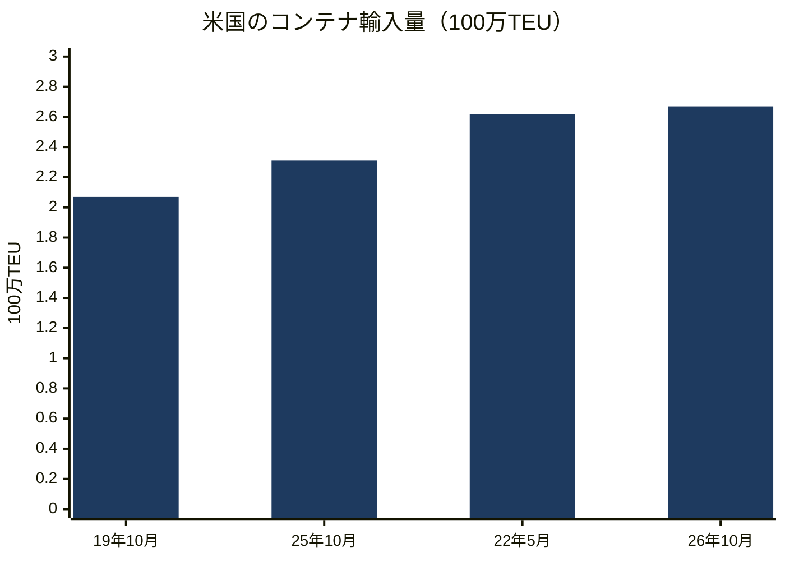

*注：2026年10月は267万4,808TEUで、月間過去最高。従来の記録は2022年5月の262万2,465TEU。2025年10月は約231万TEU（前年比16.0%増）。2019年10月は約207万TEU（29.2%増）。データソース：デカルト11月グローバル・シッピング・レポート、2026年11月11日。*

---

## 10. 政策タイムライン

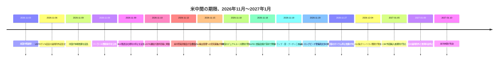

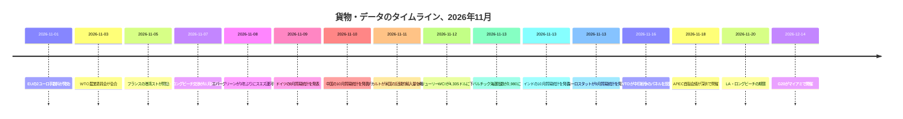

---

## 11. 今後の期限とイベント（今後90日間）

| 日付 | 項目 |
|---|---|
| 2026年11月18日 | CBPが、様式5106の正確性に関する懸念を解決していないCTPAT輸入者の輸入者番号を無効にする可能性がある（書簡は11月4日に送付）。 |
| 2026年11月18日 | 中国の改定デュアルユース輸出管理（ドローン、トンネル掘削機、浚渫船）が発効（第49～51号公告）。 |
| 2026年11月18日～19日 | APEC経済首脳会議が深圳で開催。トランプ・習・プーチン三者会談は11月19日。 |
| 2026年11月20日 | LA・ロングビーチ警備員交渉の期限（4度目の延長）。 |
| 2026年11月20日 | 特定の消音器の米国軍需品リストから商務管理リストへのBISの移管が発効。 |
| 2026年11月20日 | トルコのアンタルヤで開催されるCOP31が閉幕（11月9日～20日）。 |
| 2026年11月23日 | WTO農業委員会が輸出制限と特別セーフガードメカニズムについて会合。USITCソーラーIV完全報告書（Publication 5804）の提出期限。 |
| 2026年11月27日 | 米国向けガリウム、ゲルマニウム、アンチモン、超硬材料に対する拒否推定の停止を定める中国の2025年第72号公告が、さらなる停止または改正がなければ失効する予定。 |
| 2026年11月30日 | 中国産ブリキ圧延品に対する商務省の最終ダンピング・補助金認定の期限（延期されない場合）。 |
| 2026年12月4日 | 232条ポリシリコン関税が課される。 |
| 2026年12月7日 | CBPの低額貨物規則案に対する意見募集の締め切り（91 FR 64532；案件USCBP-2026-0298）。 |
| 2026年12月14日～15日 | G20首脳会議がマイアミで開催。 |
| 2026年12月16日 | EU・インド自由貿易協定がブリュッセルで署名されると報じられており、モディ首相の出席が見込まれる。 |
| 2026年12月17日 | 木製キャビネット・ミルワーク審査において商務省が査定指示を出す予定の最も早い日（11月12日の公表から35日後）。 |
| 2027年1月1日 | 232条税率が張りぐるみ家具30%、キッチンキャビネット・化粧台50%に引き上げ。カナダの自動車、自動車部品、鉄鋼に対する50%への引き上げの脅しも同日を対象としている。英国CBAMが開始。 |
| 2027年1月3日 | 新米国議会が着席。 |
| 2027年1月5日 | CBPの外国輸入者暫定最終規則が発効。同日が意見募集の締め切り（案件USCBP-2026-1387）。 |
| 2027年1月9日～10日 | 米中休戦の期限が集中する。178件の301条適用除外と海事料金の停止は1月9日に失効。BIS関連会社規則の停止と中国の相互停止措置は1月10日に失効。 |
| 2027年1月12日 | USMCA合同見直し協議に対する書面意見と公聴会参加要請の締め切り（案件USTR-2026-0595およびUSTR-2026-0596）。 |
| 2027年1月19日 | トルコ産ブリキ圧延品に対する商務省の最終ダンピング認定の期限。 |
| 2027年1月20日 | 201条、232条、301条の関税またはパートナー政府機関の要件の対象となる郵便について、正式申告が義務となる。 |
| 2027年1月30日 | トルコ産ニジマスに対する英国の相殺関税変更が同日から適用（通知2026/31）。 |
| 2027年2月1日 | カナダが特定のアルミニウム線・押出材および板紙製品に対する水平関税救済を撤廃。 |
| 2027年2月6日 | 旧正月。 |
| 2027年2月28日 | ベトナム知的財産301条調査におけるUSTRの決定期限。 |
| 2027年3月 | USTRの301条構造的過剰生産能力調査の決定が見込まれる（2027年3月までが期限）。 |
| 2027年3月25日 | 台湾産ブリキ圧延品に対する商務省の最終ダンピング認定の期限。 |
| 2027年5月6日 | 外国輸入者規則に対するブローカーの完全な遵守が見込まれる。 |
| 2028年6月30日 | カナダの水平関税救済が同日まで延長。 |

---

## 12. データソースと調査方法

対象期間：2026年11月9日～16日。世界中の約45の貿易ニュース、政策、データ、貨物のデータソースから編集した。

参照したデータソースには以下が含まれる。FreightWaves、The Loadstar、Splash247、gCaptain、Hellenic Shipping News、Container News、Supply Chain Dive、Logistics Management、Air Cargo News、Port Technology、TradeInt insights blog。whitehouse.gov、cbp.gov、ustr.gov、federalregister.gov、trade.gov、usitc.gov、bis.doc.gov、JD Supra。ec.europa.eu、gov.uk、cbsa-asfc.gc.ca、canada.ca/en/department-finance、english.mofcom.gov.cn。wto.org、unctad.org、intracen.org、wcoomd.org。dataweb.usitc.gov、ustradecensus.gov、comtradeplus.un.org、wits.worldbank.org、eurostat、data.worldbank.org、imf.org。taxfoundation.org、budgetlab.yale.edu、tradeintelligence.eu。drewry.co.uk、balticexchange.com、freightos.com。descartes.com、tradeint.com。

11月9日以前の日付の項目は、フォローアップ、対象期間中に掲載された連邦官報の公表、または対象期間中の期限に関する背景としてのみ掲載している。商務部の英語サイトはトップページの見出ししか閲覧できず、EU手数料への対応や信頼できないエンティティ・リストに関する発言の内容は、検討された情報からは確認できなかった。WTOのニュース索引は取得しても読み取れるテキストが得られなかったため、WTO関連の項目は再掲載されたWTOの発表に基づいている。TradeIntには対象期間中に該当するベンダー項目がなかった。同社の最新のブログ投稿は2025年12月31日付である。USITC DataWeb、UN Comtrade、WITS、世界銀行、IMFの各ポータルからは、対象期間中の主要な新規発表は確認されなかった。対象期間中に新たな保留命令は確認されなかった。
