# รายงานข่าวกรองการค้าโลก — สัปดาห์ที่ 9–16 พฤศจิกายน 2026

**สรุปรายสัปดาห์** ช่วงเวลาที่ครอบคลุม: 9–16 พฤศจิกายน 2026 รวบรวมจากแหล่งข่าวการค้า นโยบาย ข้อมูล และค่าระวางประมาณ 45 แหล่งทั่วโลก

---

## สารบัญ

1. [บทสรุปผู้บริหาร](#1-executive-summary)
2. [การแจ้งเตือน](#2-alerts)
3. [เรื่องเด่น — เจาะลึก](#3-top-stories--deep-dives)
4. [ตัวติดตามภาษีศุลกากร](#4-tariff-tracker)
5. [เจาะลึกนโยบายสหรัฐฯ](#5-us-policy-deep-dive)
6. [นโยบายโลกตามภูมิภาค](#6-world-policy-by-region)
7. [มาตรการบังคับใช้](#7-enforcement-actions)
8. [การเผยแพร่ข้อมูล](#8-data-releases)
9. [ตลาดค่าระวาง](#9-freight-market)
10. [ไทม์ไลน์นโยบาย](#10-policy-timelines)
11. [กำหนดเส้นตายและเหตุการณ์ที่จะมาถึง (90 วันข้างหน้า)](#11-upcoming-deadlines--events-next-90-days)
12. [แหล่งข้อมูลและระเบียบวิธี](#12-sources--methodology)

---

## 1. บทสรุปผู้บริหาร

สัปดาห์ที่การพักรบทางการค้าได้รับการยืนยันเป็นลายลักษณ์อักษรแทนที่จะยุติลง และเศรษฐกิจการค้าขนาดใหญ่ที่สุดสองแห่งของโลกต่างรายงานตัวเลขการค้าในระดับสูงสุดเป็นประวัติการณ์ เมื่อวันที่ 10 พฤศจิกายน USTR ได้เผยแพร่ประกาศใน Federal Register ขยายข้อยกเว้นผลิตภัณฑ์ภายใต้มาตรา 301 ต่อจีนทั้ง 178 รายการ และการระงับค่าธรรมเนียมท่าเรือทางทะเลภายใต้มาตรา 301 จนถึงวันที่ 9 มกราคม 2027 และสำนักงานอุตสาหกรรมและความมั่นคง (Bureau of Industry and Security) ได้ขยายการระงับกฎ Affiliates Rule ที่อัตรา 50% จนถึงวันที่ 10 มกราคม ส่วนจีนตอบโต้ด้วยการคงระงับภาษีเพิ่มเติม 24% สำหรับสินค้าจากสหรัฐฯ ไว้อีกสองเดือน ขณะที่ยังคงอัตราภาษี 10% ไว้ และขยายการยกเว้นมาตรการควบคุมการส่งออกแร่หายากจนถึงวันเดียวกัน จุดตัดสินใจครั้งต่อไปคือการประชุมผู้นำเอเปกที่เซินเจิ้นในวันที่ 18–19 พฤศจิกายน ซึ่งประธานาธิบดีทรัมป์และสีจะพบกันเป็นครั้งที่สามในปีนี้ และมีการวางแผนการประชุมไตรภาคีครั้งแรกกับประธานาธิบดีปูติน ในด้านอื่น กระทรวงพาณิชย์ได้ประกาศคำสั่งภาษีตอบโต้การทุ่มตลาดและภาษีตอบโต้การอุดหนุนขั้นสุดท้ายสำหรับเซลล์แสงอาทิตย์จากอินเดีย อินโดนีเซีย และลาว โดยมีอัตราเงินประกันรวมสูงถึง 233% ข้อตกลงอินเดีย–สหรัฐฯ ยังคงไม่ได้ลงนามขณะที่การสอบสวนเรื่องกำลังการผลิตส่วนเกินของวอชิงตันยังไม่เสร็จสิ้น แคนาดาขยายการผ่อนผันภาษีจนถึงเดือนมิถุนายน 2028 และค่าธรรมเนียมจัดการ 2 ยูโรของสหภาพยุโรปพร้อมระบบรหัสประจำตัวผลิตภัณฑ์ได้เข้าสู่สัปดาห์ที่สอง โดยคณะมนตรีเห็นชอบให้ยกเลิกเพดานภาษีมูลค่าเพิ่ม 150 ยูโรตั้งแต่ปี 2028

- **การพักรบได้รับการขยายเป็นลายลักษณ์อักษรถึงวันที่ 9–10 มกราคม 2027** ประกาศใน Federal Register ของ USTR เมื่อวันที่ 10 พฤศจิกายน (91 FR 72610 และ 91 FR 72608) ขยายข้อยกเว้นมาตรา 301 ทั้ง 178 รายการ (ข้อยกเว้นทั่วไป 164 รายการ ข้อยกเว้นการผลิตพลังงานแสงอาทิตย์ 14 รายการ) และการระงับค่าธรรมเนียมทางทะเลจนถึง 23:59 น. ตามเวลาตะวันออกของวันที่ 9 มกราคม 2027 ส่วน BIS ขยายการระงับกฎ Affiliates Rule จนถึงวันที่ 10 มกราคม จีนคงระงับภาษีเพิ่มเติม 24% ไว้อีกสองเดือนนับจากวันที่ 10 พฤศจิกายน คงอัตราภาษี 10% ไว้ ขยายการระงับค่าธรรมเนียมท่าเรือและการยกเว้นมาตรการควบคุมการส่งออกแร่หายากจนถึงวันที่ 10 มกราคม และคงระงับมาตรการต่อหน่วยงานของสหรัฐฯ 16 แห่งไว้ การระงับมาตรการเกี่ยวกับแกลเลียม เจอร์เมเนียม และแอนติโมนีจะสิ้นสุดแยกต่างหากในวันที่ 27 พฤศจิกายน เส้นตายในเดือนมกราคมจะมาถึงก่อนตรุษจีนในวันที่ 6 กุมภาพันธ์ 2027 ไม่นาน
- **เอเปกเป็นเวทีต่อไปของการพักรบ** การประชุมผู้นำเศรษฐกิจเอเปกครั้งที่ 33 จะจัดขึ้นที่เซินเจิ้นในวันที่ 18–19 พฤศจิกายน โดยมีการผลักดันปฏิญญาเซินเจิ้นว่าด้วยการค้า การเชื่อมโยง เศรษฐกิจดิจิทัล และปัญญาประดิษฐ์ การประชุมทางวิดีโอครั้งแรกของสภาการค้าสหรัฐฯ–จีนเมื่อวันที่ 13 พฤศจิกายนได้หารือเกี่ยวกับข้อตกลงลดภาษีแบบ 30,000 ล้านดอลลาร์ต่อ 30,000 ล้านดอลลาร์ แต่ไม่มีข้อตกลง ทำเนียบขาวยืนยันว่าจะมีการประชุมไตรภาคีทรัมป์–สี–ปูตินในวันที่ 19 พฤศจิกายน ส่วนปักกิ่งยังไม่ได้ยืนยันในขณะที่รายงาน และคาดว่าจะไม่มีข้อตกลง
- **คำสั่ง Solar IV ปิดเส้นทางหลบเลี่ยงผ่านจีน** คำสั่งภาษีตอบโต้การทุ่มตลาดและภาษีตอบโต้การอุดหนุนขั้นสุดท้ายของกระทรวงพาณิชย์สำหรับเซลล์แสงอาทิตย์ชนิดผลึกซิลิคอนจากอินเดีย อินโดนีเซีย และลาว ซึ่งเผยแพร่เมื่อวันที่ 9 พฤศจิกายน กำหนดอัตราเงินประกันรวมสำหรับผู้ส่งออกรายอื่นที่ 233.26% (อินเดีย) 167.56% (อินโดนีเซีย) และ 147.39% (ลาว) โมดูลที่ประกอบในประเทศที่สามโดยใช้เซลล์ที่อยู่ในขอบเขตของคำสั่งจะตกอยู่ภายใต้คำสั่งด้วย มีการกำหนดอัตราทุ่มตลาดเบื้องต้นสำหรับผลิตภัณฑ์เหล็กแผ่นเคลือบดีบุกจากไต้หวัน (18.07%) และตุรกี (3.89% ถึง 42.06%) โดยผลการพิจารณาขั้นสุดท้ายสำหรับจีนจะครบกำหนดในวันที่ 30 พฤศจิกายน
- **ข้อตกลงอินเดีย–สหรัฐฯ ยังคงไม่ได้ลงนาม** เจ้าหน้าที่อินเดียกล่าวเมื่อวันที่ 13 พฤศจิกายนว่า การลงนามรอให้วอชิงตันจัดทำกรอบภาษีให้แล้วเสร็จ การสอบสวนภายใต้มาตรา 301 เรื่องกำลังการผลิตส่วนเกินซึ่งเป็นประเด็นค้างคา ยังไม่ได้รายงานผล สหรัฐฯ ได้รับรองกับอินเดียว่าจะได้เปรียบด้านภาษีเชิงเปรียบเทียบเหนือคู่แข่งในเอเชีย อินเดียปัจจุบันเสียภาษีมาตรา 301 ที่อัตรา 10% เทียบกับ 12.5% สำหรับเวียดนามและจีน อัตรา 18% ในกรอบเดือนกุมภาพันธ์ไม่เคยถูกนำมาใช้
- **การเลือกตั้งกลางเทอมเปลี่ยนการเมือง ไม่ใช่ภาษี** พรรคเดโมแครตชนะทั้งสองสภาเมื่อวันที่ 3 พฤศจิกายน ผลสำรวจผู้มีสิทธิเลือกตั้งหลังการลงคะแนนของ CBS แสดงให้เห็นว่า 66% ของผู้มีสิทธิเลือกตั้งกล่าวว่าภาษีศุลกากรส่งผลเสียต่อเศรษฐกิจ กฎหมายยกเลิกภาษีจะต้องใช้เสียงข้างมากที่สามารถล้มล้างการยับยั้งของประธานาธิบดีได้ และฝ่ายบริหารกล่าวว่าจะเดินหน้าจัดเก็บภาษีต่อไป รายได้จากภาษีศุลกากรและภาษีสรรพสามิตรวมแตะ 264,000 ล้านดอลลาร์ในปีปฏิทิน 2026 ณ วันที่ 9 พฤศจิกายน เทียบกับ 227,000 ล้านดอลลาร์ในปีก่อนหน้า และ 82,000 ล้านดอลลาร์ในปี 2024 ส่วน Budget Lab ของมหาวิทยาลัยเยลประเมินอัตราภาษีเฉลี่ยไว้ที่ 11.2% ในเดือนพฤศจิกายน 2026 เทียบกับประมาณ 2.5% ในเดือนมกราคม 2025
- **ดุลการค้าเกินดุลของจีนทะลุ 1 ล้านล้านดอลลาร์ในสิบเดือน อินเดียทำสถิติการส่งออก** การส่งออกของจีนในเดือนตุลาคมเพิ่มขึ้น 35.2% เมื่อเทียบปีต่อปี เป็น 412,300 ล้านดอลลาร์ และดุลการค้าเกินดุลสะสมเดือนมกราคม–ตุลาคมแตะ 1,042,600 ล้านดอลลาร์ โดยได้รับแรงหนุนจากการส่งออกวงจรรวมมูลค่า 341,100 ล้านดอลลาร์ เพิ่มขึ้น 111.1% การส่งออกสินค้าของอินเดียในเดือนตุลาคมทำสถิติสูงสุดที่ 49,470 ล้านดอลลาร์ เพิ่มขึ้น 45.06% แต่การนำเข้าที่ทำสถิติสูงสุดที่ 89,350 ล้านดอลลาร์ทำให้ดุลการค้าขาดดุลกว้างขึ้นเป็น 39,880 ล้านดอลลาร์ ยูโรโซนพลิกกลับไปขาดดุล 10,300 ล้านยูโรในเดือนกันยายน และดุลเดือนมกราคม–กันยายนเปลี่ยนเป็น –36,500 ล้านยูโร จาก +102,200 ล้านยูโรในปีก่อนหน้า
- **ค่าระวางแยกทิศทางอีกครั้ง: ทางทะเลอ่อนตัวลง ส่วนทางอากาศและเรือเทกองปรับขึ้น** ดัชนี Drewry World Container Index ลดลง 2% เหลือ 4,305 ดอลลาร์ต่อตู้ 40 ฟุตเมื่อวันที่ 12 พฤศจิกายน ดัชนี Freightos Baltic Index ลดลง 2% เหลือ 3,452 ดอลลาร์ และดัชนี Shanghai Containerized Freight Index ลดลง 1.68% เหลือ 3,572.33 เนื่องจากการปรับขึ้นอัตราค่าระวางในเดือนพฤศจิกายนไม่สามารถคงอยู่ได้ ดัชนี Baltic Dry Index เพิ่มขึ้น 6.2% เป็น 2,980 จุด เป็นสัปดาห์ที่สี่ติดต่อกันที่ปรับขึ้น ค่าระวางทางอากาศเคลื่อนไหวในทิศทางตรงกันข้าม: ดัชนี Baltic Air Freight Index เพิ่มขึ้น 6.6% ในสัปดาห์ถึงวันที่ 9 พฤศจิกายน และ 28.2% เมื่อเทียบปีต่อปี โดยอัตราค่าระวางจีน–อเมริกาเหนือสูงกว่า 8.00 ดอลลาร์ต่อกิโลกรัม การนำเข้าตู้คอนเทนเนอร์ของสหรัฐฯ แตะระดับสูงสุดเป็นประวัติการณ์รายเดือนที่ 2,674,808 TEU ในเดือนตุลาคม ตามข้อมูลของ Descartes

**ค่าระวาง:** อัตราค่าระวางตู้คอนเทนเนอร์แบบสปอตอ่อนตัวลงเป็นสัปดาห์ที่สองติดต่อกันทั้งในเส้นทางการค้าข้ามมหาสมุทรแปซิฟิกและเอเชีย–ยุโรป ขณะที่ผู้ให้บริการเรือพึ่งพาการยกเลิกเที่ยวเรือ ส่วนเรือเทกองปรับขึ้นเป็นสัปดาห์ที่สี่จากความแข็งแกร่งของเรือ Capesize ค่าระวางทางอากาศแตะระดับสูงสุดของปี 2026 ในช่วงฤดูกาลสูงสุด การกลับมาใช้คลองสุเอซใกล้เสร็จสมบูรณ์เมื่อเอเวอร์กรีนเดินเรือผ่านเป็นครั้งแรกในรอบเกือบสามปี ขณะที่ Flexport เตือนถึงความแออัดของท่าเรือยุโรปจากการมาถึงของเรือที่กระจุกตัวกัน และงานค้างด้านรถไฟที่ลอสแอนเจลิส–ลองบีช รวมถึงคิว 15 วันที่เดอร์บัน ทำให้ความเสี่ยงด้านท่าเรือยังคงอยู่

---

## 2. การแจ้งเตือน

| # | การแจ้งเตือน | มีผล | ผลกระทบ | แหล่งข้อมูล |
|---|-------|-----------|--------|--------|
| A1 | USTR เผยแพร่ประกาศใน Federal Register ขยายข้อยกเว้นผลิตภัณฑ์ภายใต้มาตรา 301 ต่อจีนทั้ง 178 รายการจนถึง 23:59 น. ตามเวลาตะวันออกของวันที่ 9 ม.ค. 2027 และระงับค่าธรรมเนียมทางทะเลและภาษีเครนภายใต้มาตรา 301 จนถึงวันเดียวกัน | 10 พ.ย. 2026 (เผยแพร่) | เป็นการผ่อนผันเพียงสองเดือน สินค้าที่นำเข้าตั้งแต่วันที่ 10 ม.ค. 2027 ต้องเสียภาษีตามอัตราปกติเต็มจำนวน (25% สำหรับรายการที่ 1–3, 7.5% สำหรับรายการ 4A) | [YCL CPA](https://yclcpa.com/en/insights/us-china-tariff-truce-section-301-exclusions-january-2027) |
| A2 | จีนคงระงับภาษีเพิ่มเติม 24% สำหรับสินค้าจากสหรัฐฯ ไว้อีกสองเดือนนับจากวันที่ 10 พ.ย. คงอัตรา 10% ไว้ ขยายการยกเว้นมาตรการควบคุมการส่งออกแร่หายาก การระงับค่าธรรมเนียมท่าเรือ และการระงับมาตรการต่อหน่วยงานในบัญชีรายชื่อจนถึงวันที่ 10 ม.ค. 2027 | 9–10 พ.ย. 2026 | ผู้ส่งออกของสหรัฐฯ ยังคงเสียภาษีในอัตรา 10% การพักรบดำเนินไปจนถึงวันที่ 10 ม.ค. 2027 ในฝั่งจีน การระงับมาตรการเกี่ยวกับแกลเลียมจะสิ้นสุดในวันที่ 27 พ.ย. | [Medium](https://medium.com/@frank.matisse/weekly-digest-15-november-2026-wd-25-the-truce-is-not-access-3f6d8ac577b6) |
| A3 | BIS ขยายการระงับมาตรการควบคุมการส่งออกตามกฎ Affiliates Rule ที่อัตรา 50% จนถึงวันที่ 10 ม.ค. 2027 | 9 พ.ย. 2026 | การคัดกรองตามสัดส่วนความเป็นเจ้าของยังคงถูกระงับไว้ หากไม่มีการดำเนินการเพิ่มเติม มาตรการควบคุมที่ขยายขอบเขตจะมีผลในวันที่ 10 ม.ค. 2027 | [Sanctions.com](https://www.sanctions.com/articles/us-extends-suspension-of-bis-50-rule-until-january-2027) |
| A4 | ผู้นำเอเปกประชุมที่เซินเจิ้นวันที่ 18–19 พ.ย. การประชุมไตรภาคีทรัมป์–สี–ปูตินได้รับการยืนยันจากทำเนียบขาวสำหรับวันที่ 19 พ.ย. การประชุมทางวิดีโอของสภาการค้าสหรัฐฯ–จีนเมื่อวันที่ 13 พ.ย. ได้หารือเกี่ยวกับแพ็กเกจลดภาษีแบบ 30,000 ล้านดอลลาร์ต่อ 30,000 ล้านดอลลาร์ แต่ไม่มีข้อตกลง | 18–19 พ.ย. 2026 | โอกาสแรกที่จะขยายการพักรบให้พ้นวันที่ 10 ม.ค. 2027 มีการผลักดันปฏิญญาเซินเจิ้นว่าด้วยการค้า เศรษฐกิจดิจิทัล และ AI | [Asia Daily](https://asiadaily.org/news/18743/) |
| A5 | CBP เตือนผู้นำเข้าที่ได้รับการรับรอง CTPAT ว่าหมายเลขผู้นำเข้าของตนอาจถูกเพิกถอนตั้งแต่ 00:01 น. ตามเวลาตะวันออกของวันที่ 18 พ.ย. เนื่องจากความถูกต้องของแบบฟอร์ม 5106 | 18 พ.ย. 2026 | จดหมายที่ยังไม่ได้รับการแก้ไขจะขัดขวางการยื่นเอกสารนำเข้าภายใต้หมายเลขผู้นำเข้านั้น ที่อยู่จริงต้องเป็นที่ตั้งธุรกิจของผู้นำเข้าเอง | [Concord Solutions](https://www.concordsolutionsgroup.com/post/ctpat-importers-cbp-warns-ior-numbers-may-be-voided-november-18-over-form-5106-accuracy) |
| A6 | มาตรการควบคุมการส่งออกสินค้าใช้ได้สองทางฉบับปรับปรุงของจีนสำหรับโดรน เครื่องเจาะอุโมงค์ และเรือขุดลอกมีผลในวันที่ 18 พ.ย. การรับฟังความเห็นเกี่ยวกับแค็ตตาล็อกเทคโนโลยีของ MOFCOM ปิดรับเมื่อวันที่ 15 พ.ย. โดยยังไม่มีการเผยแพร่ผล | 18 พ.ย. 2026 | ข้อกำหนดใบอนุญาตสำหรับโดรนที่กำหนด (พิสัย 300 กม. การพ่นละอองเหนือ 80 ลิตร) เครื่องเจาะอุโมงค์ และเรือขุดลอก | [JD Supra](https://www.jdsupra.com/legalnews/china-proposes-expanded-technology-8379336/) |
| A7 | กระทรวงพาณิชย์เผยแพร่คำสั่ง AD/CVD ขั้นสุดท้ายสำหรับเซลล์แสงอาทิตย์จากอินเดีย อินโดนีเซีย และลาว อัตรารวมสำหรับผู้ส่งออกรายอื่นที่ 233.26% / 167.56% / 147.39% | 9 พ.ย. 2026 | การเก็บเงินประกันกลับมาเริ่มตั้งแต่วันที่ 5 พ.ย. โมดูลที่ผลิตในประเทศที่สามโดยใช้เซลล์ที่อยู่ในขอบเขตของคำสั่งจะตกอยู่ภายใต้คำสั่งด้วย | [Solar Stock USA](https://www.solarstockusa.com/research/market-notes/adcvd-orders-india-indonesia-laos) |
| A8 | การเจรจายามเฝ้าระวังที่แอลเอ/ลองบีชขยายถึงวันที่ 20 พ.ย. — การขยายครั้งที่สี่ ยามเฝ้าระวังประมาณ 250 คนที่ท่าเทียบเรือหกแห่ง สะพาน Vincent Thomas ปิดตั้งแต่วันที่ 7 พ.ย. เป็นเวลา 16 เดือน ตู้คอนเทนเนอร์นำเข้า 35,688 ตู้รอการขนส่งทางรถไฟบนท่าเรือ | 20 พ.ย. 2026 | การหยุดงานจะทำให้การดำเนินงานของเรือ ลานตู้ และประตูท่าเรือหยุดชะงักหากสหภาพแรงงานอื่นเคารพแนวรั้วประท้วง ระยะเวลารอรถไฟเฉลี่ยอยู่ที่ 5.6 วันแล้ว | [Navilink Global](https://www.navilinkglobal.com/news/la-long-beach-port-strike-averted-again-ilwu-talks-extended-to-november-20-as-record-cargo-volumes-continue) |
| A9 | ภาษีมาตรา 338 ต่อแคนาดาถูกท้าทายที่ศาลการค้าระหว่างประเทศของสหรัฐฯ มีการยื่นคำแถลงการณ์ amicus เมื่อวันที่ 11 และ 13 พ.ย. ในคดี *Gellert v. Trump* ภาษี 50% ครอบคลุมสินค้านำเข้าจากแคนาดามูลค่าประมาณ 20,000 ล้านดอลลาร์ | 11–13 พ.ย. 2026 | คำตัดสินที่ขัดแย้งกับฝ่ายบริหารจะยกเลิกชั้นภาษีสำคัญชั้นหนึ่งและนำไปสู่การเรียกร้องเงินคืน ภาษียังคงมีผลบังคับใช้ | [Reason](https://reason.com/volokh/2026/11/14/our-amicus-brief-in-case-challenging-trumps-section-338-tariffs-against-canada/) |
| A10 | ข้อตกลงอินเดีย–สหรัฐฯ ยังไม่ได้ลงนาม ณ วันที่ 13 พ.ย. การลงนามรอให้วอชิงตันจัดทำกรอบภาษีให้แล้วเสร็จ การสอบสวนภายใต้มาตรา 301 เรื่องกำลังการผลิตส่วนเกินยังไม่ได้รายงานผล | 13 พ.ย. 2026 | ผู้ส่งออกอินเดียไม่มีความแน่นอนเกี่ยวกับอัตราภาษี 18% ที่สัญญาไว้ อินเดียเสียภาษีมาตรา 301 ที่ 10% ส่วนเวียดนามและจีนเสีย 12.5% | [Industrial Front](https://industrialfront.com/india-us-trade-deal-tariff-advantage-november-2026/) |

### A1/A2/A3 — การพักรบ ที่ขยายเป็นลายลักษณ์อักษรจนถึงเดือนมกราคม

การขยายเวลาสองเดือนของการพักรบทางการค้าสหรัฐฯ–จีนได้รับการยืนยันเป็นทางการในช่วงเวลาที่ครอบคลุม เมื่อวันที่ 10 พฤศจิกายน USTR ได้เผยแพร่ประกาศสองฉบับใน Federal Register ฉบับแรกขยายข้อยกเว้นผลิตภัณฑ์ภายใต้มาตรา 301 ต่อจีนที่เหลืออยู่ทั้งหมด 178 รายการ — ข้อยกเว้นทั่วไป 164 รายการภายใต้ HTSUS 9903.88.69 และข้อยกเว้นการผลิตพลังงานแสงอาทิตย์ 14 รายการภายใต้ 9903.88.70 — จนถึง 23:59 น. ตามเวลาตะวันออกของวันที่ 9 มกราคม 2027 (91 FR 72610; FR Doc. 2026-22925) ครอบคลุมสินค้าที่นำเข้ามาเพื่อการบริโภค หรือถอนออกจากคลังสินค้าเพื่อการบริโภค ตั้งแต่ 00:01 น. ตามเวลาตะวันออกของวันที่ 10 พฤศจิกายน 2026 เป็นต้นไป ฉบับที่สองระงับมาตรการมาตรา 301 ต่อแนวปฏิบัติทางทะเล โลจิสติกส์ และการต่อเรือของจีนต่อไป รวมถึงค่าธรรมเนียมบริการสำหรับผู้ประกอบการและเจ้าของเรือ และภาษีสำหรับเครนขนถ่ายสินค้าจากเรือสู่ฝั่งและอุปกรณ์ขนถ่ายสินค้าอื่น ๆ จนถึงวันเดียวกัน (91 FR 72608; FR Doc. 2026-22867) ไม่มีการเพิ่มหรือลบข้อยกเว้น ไม่มีการขอความเห็นใหม่ และ USTR อาศัยบันทึกจากประกาศเดือนกันยายน 2025 ของตน กลุ่มสมาคมอุตสาหกรรม 24 แห่งได้ขอเมื่อวันที่ 4 พฤศจิกายนให้ขยายเวลาอย่างน้อยหนึ่งปี รายงานบางฉบับระบุถึงความไม่สอดคล้องกันภายในประกาศ โดยบางส่วนอ้างถึงวันที่ 10 มกราคมแทนที่จะเป็นวันที่ 9 มกราคม วันที่ที่มีผลบังคับใช้ในประกาศเรื่องข้อยกเว้นคือวันที่ 9 มกราคม เมื่อวันที่ 9 พฤศจิกายน BIS ได้เผยแพร่กฎขั้นสุดท้ายขยายการระงับกฎ Affiliates Rule ที่อัตรา 50% — มาตรการที่จะขยายมาตรการควบคุมการส่งออกไปยังหน่วยงานต่างประเทศที่อยู่ในความครอบครองตั้งแต่ 50% ขึ้นไปของฝ่ายที่อยู่ในบัญชีรายชื่อ — จนถึงวันที่ 10 มกราคม 2027 โดยไม่มีช่องว่างจากการระงับครั้งก่อน

จีนดำเนินการเมื่อวันที่ 9 พฤศจิกายน คณะกรรมการภาษีของคณะรัฐมนตรีกล่าวว่าจะระงับภาษีเพิ่มเติม 24% สำหรับสินค้าจากสหรัฐฯ ต่อไปอีกสองเดือนนับจากวันที่ 10 พฤศจิกายน โดยคงอัตราภาษีเพิ่มเติม 10% ไว้ MOFCOM และกรมศุลกากรได้ออกประกาศฉบับที่ 58 ของปี 2026 โดยระงับประกาศควบคุมการส่งออกหกฉบับในเดือนตุลาคม 2025 ต่อไป — ครอบคลุมเทคโนโลยีและอุปกรณ์การแปรรูปแร่หายาก แร่หายากชนิดปานกลางและหนักอีกห้าชนิด แบตเตอรี่ลิเธียมและวัสดุขั้วบวกกราไฟต์ วัสดุแข็งยิ่งยวด และกฎนอกอาณาเขตสำหรับผลิตภัณฑ์ที่ผลิตในต่างประเทศที่มีแร่หายากต้นกำเนิดจากจีน — ตั้งแต่วันที่ 11 พฤศจิกายน 2026 ถึงวันที่ 10 มกราคม 2027 MOFCOM ยังคงระงับมาตรการตามประกาศฉบับที่ 21 ของปี 2025 ต่อหน่วยงานของสหรัฐฯ 16 แห่ง และกระทรวงคมนาคมของจีนได้ขยายการระงับค่าธรรมเนียมท่าเรือพิเศษสำหรับเรือที่เชื่อมโยงกับสหรัฐฯ จนถึงวันที่ 10 มกราคม 2027 มีข้อจำกัดสองประการที่สำคัญ ข้อกำหนดการขอใบอนุญาตเดือนเมษายน 2025 สำหรับแร่หายากชนิดปานกลางและหนักเจ็ดชนิด (ซาแมเรียม แกโดลิเนียม เทอร์เบียม ดิสโพรเซียม ลูเทเชียม สแกนเดียม และอิตเทรียม) ไม่เคยถูกระงับและยังคงมีผลบังคับใช้ และประกาศฉบับที่ 72 ของปี 2025 ซึ่งระงับข้อสันนิษฐานการปฏิเสธของจีนสำหรับแกลเลียม เจอร์เมเนียม แอนติโมนี และวัสดุแข็งยิ่งยวดที่มุ่งหน้าไปยังสหรัฐฯ จะมีผลเพียงจนถึงวันที่ 27 พฤศจิกายน 2026 และไม่ได้กล่าวถึงในประกาศฉบับที่ 58 ณ วันที่ 13 พฤศจิกายน ยังไม่พบประกาศแก้ไขเพิ่มเติม

### A4 — เอเปกเซินเจิ้น: จุดตัดสินใจครั้งต่อไป

การประชุมผู้นำเศรษฐกิจเอเปกครั้งที่ 33 จะจัดขึ้นที่เซินเจิ้นในวันที่ 18–19 พฤศจิกายน 2026 เป็นครั้งที่สามที่จีนเป็นเจ้าภาพ ต่อจากเซี่ยงไฮ้ในปี 2001 และปักกิ่งในปี 2014 สัปดาห์ผู้นำเริ่มตั้งแต่วันที่ 14 พฤศจิกายน โดยมีการประชุมสภาที่ปรึกษาธุรกิจเอเปกในวันที่ 14–16 พฤศจิกายน และการประชุมสุดยอด CEO ในวันที่ 17–18 พฤศจิกายน ซึ่งประธานาธิบดีสี จิ้นผิงจะกล่าวปาฐกถาหลัก หัวข้อของเจ้าภาพคือ "Building an Asia-Pacific Community to Prosper Together" โดยมีลำดับความสำคัญสามประการ — ความเปิดกว้าง นวัตกรรม และความร่วมมือ — และมีการผลักดันปฏิญญาเซินเจิ้นที่ครอบคลุมการค้า การเชื่อมโยง เศรษฐกิจดิจิทัล และปัญญาประดิษฐ์ เมื่อวันที่ 16 พฤศจิกายน จีนยืนยันว่าสีจะเป็นเจ้าภาพต้อนรับประธานาธิบดีทรัมป์และปูตินในการประชุมไตรภาคีในวันที่ 19 พฤศจิกายนนอกรอบการประชุม โดยคาดว่าจะหารือเกี่ยวกับการลดอาวุธนิวเคลียร์ ปัญญาประดิษฐ์ และความขัดแย้งทั่วโลก โฆษกทำเนียบขาวยืนยันการประชุมดังกล่าว ขณะที่เจ้าหน้าที่ระดับสูงของสหรัฐฯ กล่าวว่าคาดว่าจะไม่มีข้อตกลง และปักกิ่งยังไม่ได้ยืนยันในขณะที่รายงาน การประชุมครั้งแรกของสภาการค้าสหรัฐฯ–จีนชุดใหม่ ซึ่งจัดขึ้นทางวิดีโอเมื่อวันที่ 13 พฤศจิกายน ได้หารือเกี่ยวกับข้อตกลงลดภาษีแบบ 30,000 ล้านดอลลาร์ต่อ 30,000 ล้านดอลลาร์ และการค้าผลิตผลทางการเกษตร แต่ไม่ได้ประกาศข้อตกลงใด ๆ แพ็กเกจลดภาษีแบบต่างตอบแทนมูลค่า 60,000 ล้านดอลลาร์ที่หารือกันหลังการประชุมสุดยอดเดือนกันยายนยังคงไม่แล้วเสร็จ การค้าของเซินเจิ้นกับเศรษฐกิจเอเปกอื่น ๆ เติบโต 40% เมื่อเทียบปีต่อปีในช่วงเก้าเดือนแรกของปี 2026 คิดเป็นเกือบ 70% ของการค้าทั้งหมดของเมือง

### A5 — CBP เพิกถอนหมายเลขผู้นำเข้าตั้งแต่วันที่ 18 พฤศจิกายน

CBP ได้ส่งจดหมายถึงผู้นำเข้าจำนวนมากที่ได้รับการรับรอง CTPAT โดยระบุว่าหมายเลขผู้นำเข้าของตนอาจถูกเพิกถอนสำหรับการยื่นเอกสารนำเข้าตั้งแต่ 00:01 น. ตามเวลาตะวันออกของวันที่ 18 พฤศจิกายน 2026 เว้นแต่จะแก้ไขข้อกังวลของ CBP เกี่ยวกับความถูกต้องของข้อมูลในแบบฟอร์ม 5106 ของผู้นำเข้าก่อน สมาคมนายหน้าศุลกากรและผู้ขนส่งสินค้าแห่งชาติของสหรัฐฯ ได้รายงานจดหมายดังกล่าวแก่สมาชิกเมื่อวันที่ 4 พฤศจิกายน และขอให้นายหน้าแจ้งเตือนลูกค้าผู้นำเข้า ผู้นำเข้าที่ได้รับผลกระทบแต่ละรายได้รับคำสั่งให้ตรวจสอบบันทึกแบบฟอร์ม 5106 ของตนใน ACE Secure Data Portal แก้ไขข้อมูลที่ไม่ถูกต้อง และยืนยันว่าหมายเลขผู้นำเข้าใน CTPAT Portal ยังมีผลและตรงกับบันทึกใน ACE หมายเลขผู้นำเข้าที่ถูกเพิกถอนจะไม่สามารถใช้ยื่นเอกสารนำเข้าได้ ดังนั้นจดหมายที่ยังไม่ได้รับการแก้ไขจะทำให้การปล่อยสินค้าและการยื่นสรุปการนำเข้าภายใต้หมายเลขดังกล่าวหยุดชะงักตั้งแต่วันที่ 18 พฤศจิกายน จดหมายดังกล่าวมีขึ้นตามประกาศของ CBP ใน Federal Register เกี่ยวกับความถูกต้องของข้อมูลผู้นำเข้า (91 FR 53627 วันที่ 19 สิงหาคม 2026) ซึ่งภายใต้ประกาศดังกล่าว CBP ได้เพิกถอนหมายเลขผู้นำเข้าที่มีข้อมูลแบบฟอร์ม 5106 ไม่ถูกต้องหรือไม่ครบถ้วนมาตั้งแต่วันที่ 18 กันยายน 2026 ที่อยู่จริงในแบบฟอร์ม 5106 ต้องเป็นที่ตั้งธุรกิจของผู้นำเข้าเอง ไม่ใช่ตัวแทนที่จดทะเบียน นายหน้า ผู้ขนส่ง ตู้ไปรษณีย์ หรือศูนย์บริการธุรกิจ

### A6 — มาตรการควบคุมสินค้าใช้ได้สองทางของจีนมีผลวันที่ 18 พฤศจิกายน

ประกาศสามฉบับที่ปรับปรุงบัญชีรายการสินค้าใช้ได้สองทางที่ต้องควบคุมการส่งออกของจีนจะมีผลในวันที่ 18 พฤศจิกายน 2026 ได้แก่ ประกาศฉบับที่ 49 (โดรนและรายการที่เกี่ยวข้อง) ประกาศฉบับที่ 50 (เครื่องเจาะอุโมงค์และรายการอื่น ๆ — เป็นครั้งแรกที่มีการรวมเครื่องเจาะอุโมงค์ไว้ในมาตรการควบคุมการส่งออก) และประกาศฉบับที่ 51 (เรือขุดลอกและรายการอื่น ๆ) ใบอนุญาตจำเป็นสำหรับรายการต่าง ๆ อาทิ ระบบนำร่องอัตโนมัติของโดรน โดรนที่บินได้นอกสายตาด้วยระยะเวลาบินอย่างน้อยสามชั่วโมง เครื่องยนต์ที่ออกแบบมาโดยเฉพาะสำหรับโดรนหรือเรือเหาะไร้คนขับ และโดรนที่มีพิสัย 300 กม. ขึ้นไปหรือติดตั้งอุปกรณ์พ่นละอองเหนือ 80 ลิตร ประกาศฉบับที่ 50 กำหนดมาตรการควบคุมเครื่องเจาะอุโมงค์ รถขุดแบบเดินได้ที่กำหนด และเครื่องพ่นคอนกรีตบนที่สูง การส่งออกไปยังประเทศและภูมิภาคที่มีความอ่อนไหวซึ่งมีข้อพิพาทกับจีนต้องขอใบอนุญาต ขณะที่การส่งออกไปยังจุดหมายอื่นอาจใช้ใบรับรองตามระบบการจดทะเบียน โดยอยู่ภายใต้ข้อจำกัดเรื่องการถ่ายโอนต่อไป ประกาศฉบับที่ 51 เพิ่มข้อกำหนดการขอใบอนุญาตสำหรับปั๊มขุดลอกที่กำหนดและส่วนประกอบสำคัญ หัวขุดลาก และหัวตัด แยกต่างหาก MOFCOM และกระทรวงวิทยาศาสตร์และเทคโนโลยีได้เสนอเมื่อวันที่ 16 ตุลาคมให้เพิ่มเทคโนโลยี 40 รายการในแค็ตตาล็อกเทคโนโลยีที่ห้ามหรือจำกัดการส่งออก — 23 รายการในด้านปัญญาประดิษฐ์ 5 รายการในด้านชีวเภสัชภัณฑ์ 12 รายการในด้านเซลล์แสงอาทิตย์ โดย 14 รายการจะถูกห้าม 26 รายการถูกจำกัด — โดยกำหนดส่งความเห็นภายในวันที่ 15 พฤศจิกายน การจดทะเบียนก่อนการส่งออกชั่วคราวมีผลบังคับใช้ตั้งแต่วันที่ 16 ตุลาคม ณ วันที่ 16 พฤศจิกายน ยังไม่มีการเผยแพร่ผลลัพธ์หรือแค็ตตาล็อกฉบับสุดท้าย

### A7 — คำสั่ง Solar IV: อัตรารวมสูงถึง 233%

กระทรวงพาณิชย์ได้ออกคำสั่งภาษีตอบโต้การทุ่มตลาดและภาษีตอบโต้การอุดหนุนสำหรับเซลล์แสงอาทิตย์ชนิดผลึกซิลิคอน ไม่ว่าจะประกอบเป็นโมดูลแล้วหรือไม่ จากอินเดีย อินโดนีเซีย และลาว เมื่อวันที่ 9 พฤศจิกายน 2026 ตามคำวินิจฉัยขั้นสุดท้ายของ USITC ที่ยืนยันว่ามีความเสียหาย ซึ่งเผยแพร่เมื่อวันที่ 5 พฤศจิกายน (91 FR 69865) อินเดีย: อัตรากำไรจากการทุ่มตลาด 123.04% (เงินประกัน 107.17% หลังหักชดเชยเงินอุดหนุน) และภาษีตอบโต้การอุดหนุน 126.09% อัตราเงินประกันรวม 233.26% อินโดนีเซีย: การทุ่มตลาด 94.36% และภาษีตอบโต้การอุดหนุน 73.20% (อัตรารวมสำหรับผู้ส่งออกรายอื่น 167.56%) ลาว: อัตรากำไรจากการทุ่มตลาด 65.76% (เงินประกัน 65.36%) และภาษีตอบโต้การอุดหนุน 82.03% (อัตราเงินประกันรวม 147.39%) หลังจากกระทรวงพาณิชย์แก้ไขข้อผิดพลาดทางธุรการที่เพิ่มอัตรากำไรของลาวจาก 65.43% และเงินประกันจาก 65.03% การระงับการชำระบัญชีและการเก็บเงินประกันกลับมาเริ่มตั้งแต่วันที่ 5 พฤศจิกายน 2026 โมดูล ลามิเนต และแผงที่ผลิตในประเทศที่สามโดยใช้เซลล์ที่อยู่ในขอบเขตของคำสั่งจะตกอยู่ภายใต้คำสั่ง โมดูลที่ประกอบในอินเดียโดยใช้เซลล์จากประเทศที่สามไม่ตกอยู่ภายใต้คำสั่ง สินค้าที่นำเข้าในช่วงช่องว่างชั่วคราวอยู่นอกขอบเขตภาษี: ตั้งแต่วันที่ 26 มิถุนายน 2026 สำหรับภาษีตอบโต้การอุดหนุน และตั้งแต่วันที่ 25 ตุลาคม 2026 สำหรับภาษีตอบโต้การทุ่มตลาด ทั้งสองช่วงถึงวันที่ 4 พฤศจิกายน 2026 สำหรับอินเดียและลาว ซึ่ง USITC มีคำวินิจฉัยเรื่องสถานการณ์วิกฤตเป็นลบ กระทรวงพาณิชย์ตั้งใจจะคืนเงินประกันภาษีตอบโต้การอุดหนุนสำหรับสินค้าที่นำเข้าตั้งแต่วันที่ 28 พฤศจิกายน 2025 ถึงวันที่ 25 กุมภาพันธ์ 2026 รายงานฉบับสมบูรณ์ของ USITC (USITC Publication 5804) มีกำหนดเผยแพร่ภายในวันที่ 23 พฤศจิกายน 2026

### A8 — แอลเอ/ลองบีช: การขยายครั้งที่สี่ถึงวันที่ 20 พฤศจิกายน

การขู่หยุดงานของพนักงานรักษาความปลอดภัย (ยามเฝ้าระวัง) ที่ท่าเทียบเรือตู้คอนเทนเนอร์ในลอสแอนเจลิสและลองบีชถูกเลื่อนออกไปอีก โดยการเจรจาขยายออกไปจนถึงวันที่ 20 พฤศจิกายน 2026 — เป็นการขยายเส้นตายครั้งที่สี่ในข้อพิพาทนี้ วันที่ได้รับอนุมัติให้หยุดงานเดิมคือวันที่ 1 พฤศจิกายน จากนั้นขยายเป็นวันที่ 4 พฤศจิกายน แล้วขยายเป็นเที่ยงคืนของวันที่ 6 พฤศจิกายน ILWU Local 26 เป็นตัวแทนพนักงานรักษาความปลอดภัยประมาณ 250 คนที่ท่าเทียบเรือตู้คอนเทนเนอร์หกแห่ง สัญญาฉบับก่อนของพวกเขาหมดอายุในเดือนกรกฎาคม 2025 สมาชิกได้อนุมัติการหยุดงานแล้ว และทั้งสองฝ่ายกำลังเจรจากันโดยได้รับความช่วยเหลือจากสำนักงานไกล่เกลี่ยและประนีประนอมของรัฐบาลกลาง สมาคมการเดินเรือแปซิฟิกกล่าวว่า การหยุดชะงักอาจกระทบสินค้าประมาณ 85% ที่เคลื่อนผ่านท่าเรือลองบีช และหนึ่งในสามของสินค้าที่ท่าเรือลอสแอนเจลิส เนื่องจากคาดว่าพนักงานท่าเรืออื่นจะไม่ข้ามแนวรั้วประท้วงของ Local 26 เส้นตายวันที่ 7 พฤศจิกายนตรงกับการปิดสะพาน Vincent Thomas ซึ่งเป็นทางหลวงเชื่อมต่อสำคัญสู่กลุ่มท่าเรือ โดยปิดตั้งแต่ 00:01 น. ของวันที่ 7 พฤศจิกายนเพื่อโครงการซ่อมแซมที่คาดว่าจะใช้เวลา 16 เดือน กลุ่มท่าเรืออยู่ภายใต้ความตึงเครียดอยู่แล้ว: ตู้คอนเทนเนอร์นำเข้าประมาณ 35,688 ตู้กำลังรอการขนส่งทางรถไฟที่ท่าเรือทั้งสองแห่ง ณ วันที่ 2 พฤศจิกายน โดย 10,562 ตู้รอมาเก้าวันขึ้นไป และสินค้านำเข้าทางรถไฟค้างอยู่เฉลี่ย 7.19 วันในเดือนกันยายน ท่าเรือลอสแอนเจลิสจัดการตู้คอนเทนเนอร์ 1,026,872 TEU ในเดือนตุลาคม ซึ่งเป็นสถิติของเดือนดังกล่าว

### A9 — มาตรา 338 ต่อแคนาดา: การท้าทายในศาลครั้งแรก

มีการยื่นคำแถลงการณ์ amicus สองฉบับที่ศาลการค้าระหว่างประเทศของสหรัฐฯ ในคดี *Gellert Global Group Corp. v. Trump* (หมายเลขคดี 26-04636) ซึ่งยื่นเมื่อวันที่ 20 ตุลาคม 2026 เป็นการท้าทายในศาลครั้งแรกต่อภาษีมาตรา 338 คำแถลงการณ์ของอดีตเจ้าหน้าที่การค้าอาวุโส (Carla Hills, USTR ปี 1989–1993; Alan Wolff, อดีตรอง USTR; Warren Maruyama, ที่ปรึกษาทั่วไปของ USTR ปี 2007–2009) ยื่นเมื่อวันที่ 11 พฤศจิกายน คำแถลงการณ์ของสถาบัน Cato ร่วมกับศาสตราจารย์ Ilya Somin และศาสตราจารย์ Michael McConnell ยื่นเมื่อวันที่ 13 พฤศจิกายน คำแถลงการณ์โต้แย้งว่ามาตรา 338 ของพระราชบัญญัติภาษีศุลกากรปี 1930 ไม่สามารถรองรับภาษีดังกล่าวได้ ว่ามาตรา 301 ของพระราชบัญญัติการค้าปี 1974 ครอบคลุมเรื่องเดียวกันโดยมีกระบวนการคุ้มครองและมีผลเหนือกว่ามาตรา 338 และว่าภาษีดังกล่าวละเมิดหลักการคำถามสำคัญและหลักการไม่มอบอำนาจ โจทก์คือ Gellert Global Group ผู้นำเข้าอาหารจากรัฐนิวเจอร์ซีย์ โดยมีศูนย์ Liberty Justice Center เป็นตัวแทน กล่าวว่าบริษัทนำเข้าชีสจากแคนาดามูลค่าประมาณ 71 ล้านดอลลาร์ในปี 2025 ซึ่งเดิมปลอดภาษีภายใต้ความตกลงสหรัฐฯ–เม็กซิโก–แคนาดา และอ้างว่าจะต้องเสียภาษีมาตรา 338 ประมาณ 40 ล้านดอลลาร์ต่อปี คำฟ้องขอให้ยกเลิกภาษี ห้ามการจัดเก็บ และคืนภาษีที่ชำระตั้งแต่วันที่ 22 สิงหาคม 2026 ภาษียังคงมีผลบังคับใช้ ศาลยังไม่ได้ตัดสิน ภาษี 50% ครอบคลุมสินค้านำเข้าจากแคนาดามูลค่าประมาณ 20,000 ล้านดอลลาร์ ตามคำแถลงการณ์ amicus และการวิเคราะห์ของ Congressional Research Service โดยใช้ตัวเลขการค้าปี 2025 USTR Jamieson Greer กล่าวว่าการเจรจากับออตตาวายังคงดำเนินต่อไปโดยไม่มีเส้นตาย วันที่ถัดไปที่ระบุในรายงานคือวันที่ 1 มกราคม 2027 ซึ่งเป็นวันที่ประธานาธิบดีขู่ว่าจะเพิ่มภาษีสำหรับยานยนต์ ชิ้นส่วนรถยนต์ และเหล็กจากแคนาดาเป็น 50%

### A10 — ข้อตกลงอินเดีย–สหรัฐฯ: ยังไม่ได้ลงนาม

แหล่งข่าวจากรัฐบาลอินเดียกล่าวเมื่อวันที่ 13 พฤศจิกายนว่า สหรัฐฯ ได้รับรองกับอินเดียว่าผู้ส่งออกของอินเดียจะได้รับ "ความได้เปรียบด้านภาษีเชิงเปรียบเทียบ" เหนือประเทศคู่แข่งภายใต้ข้อตกลงการค้าที่วางแผนไว้ เมื่อวอชิงตันจัดทำโครงสร้างภาษีให้แล้วเสร็จ การรับรองดังกล่าวมีเงื่อนไข: โครงสร้างภาษีขั้นสุดท้ายของสหรัฐฯ ขึ้นอยู่กับผลการสอบสวนของ USTR ภายใต้มาตรา 301 เรื่องกำลังการผลิตส่วนเกินเชิงโครงสร้างในภาคการผลิต ซึ่งเปิดขึ้นในเดือนมีนาคม 2026 และยังไม่ได้รายงานผล รัฐมนตรีว่าการกระทรวงพาณิชย์ Rajesh Agrawal กล่าวว่าการเจรจา "ดำเนินไปในทิศทางที่ถูกต้อง" ทีมสหรัฐฯ สองคนเยือนอินเดียในช่วงต้นเดือนพฤศจิกายนและมีความคืบหน้าอย่างมากเกี่ยวกับเนื้อความ รวมถึงบทว่าด้วยศุลกากรและการอำนวยความสะดวกทางการค้า โดยไม่มีการวางแผนรอบเจรจาแบบพบหน้ากันเพิ่มเติมในขณะนี้ งวดแรกครอบคลุมเฉพาะสินค้า ส่วนบริการจะตามมาภายหลัง ทั้งสองรัฐบาลได้ตกลงกรอบในแถลงการณ์ร่วมเมื่อวันที่ 7 กุมภาพันธ์ 2026 แต่ยังไม่มีการเผยแพร่เนื้อความที่ลงนาม ตารางภาษี หรือวันที่มีผลบังคับใช้ กรอบเดือนกุมภาพันธ์กำหนดอัตราภาษีของสหรัฐฯ ไว้ที่ 18% ซึ่งไม่เคยถูกนำมาใช้ ปัจจุบันอินเดียเสียภาษีบังคับใช้แรงงานภายใต้มาตรา 301 ที่อัตรา 10% เท่ากับอินโดนีเซีย กัมพูชา และบังกลาเทศ ขณะที่เวียดนามและจีนเสีย 12.5% การส่งออกสินค้าของอินเดียไปยังสหรัฐฯ เพิ่มขึ้นเป็น 59,520 ล้านดอลลาร์ในเดือนเมษายน–ตุลาคม 2026 จาก 51,990 ล้านดอลลาร์ในปีก่อนหน้า ทั้งสองฝ่ายกำลังดำเนินการเพื่อทำข้อตกลงให้เสร็จภายในสิ้นปีงบประมาณปัจจุบัน ตามรายงานของอินเดีย เอกสารของทำเนียบขาวที่เผยแพร่เมื่อวันที่ 3 พฤศจิกายนระบุอินเดียไว้ในกลุ่มประเทศที่ประธานาธิบดี "ได้บรรลุข้อตกลงการค้าใหม่และที่ดีขึ้น" แม้ว่าข้อตกลงชั่วคราวจะยังไม่ได้ลงนามอย่างเป็นทางการก็ตาม

---

## 3. เรื่องเด่น — เจาะลึก

### 3.1 การพักรบ ที่ขยายออกไปสองเดือน — และหน้าผาเดือนมกราคมที่มันสร้างขึ้น

เรื่องหลักของสัปดาห์คือการขยายเวลาสองฉบับที่ร่วมกันทำให้การพักรบทางการค้าสหรัฐฯ–จีนดำเนินต่อไปจนถึงเดือนมกราคม ขณะเดียวกันก็บีบการตัดสินใจครั้งต่อไปให้อยู่ในกรอบเวลาสองเดือน ลำดับเหตุการณ์มีความสำคัญ เมื่อวันที่ 6 พฤศจิกายน USTR ได้ประกาศสองฉบับ เมื่อวันที่ 10 พฤศจิกายน ประกาศดังกล่าวได้รับการเผยแพร่ใน Federal Register ฉบับแรกขยายข้อยกเว้นผลิตภัณฑ์ภายใต้มาตรา 301 ต่อจีนทั้งหมด 178 รายการจนถึง 23:59 น. ตามเวลาตะวันออกของวันที่ 9 มกราคม 2027 ครอบคลุมสินค้าที่นำเข้ามาเพื่อการบริโภค หรือถอนออกจากคลังสินค้าเพื่อการบริโภค ตั้งแต่ 00:01 น. ตามเวลาตะวันออกของวันที่ 10 พฤศจิกายน 2026 เป็นต้นไป ฉบับที่สองระงับมาตรการมาตรา 301 ต่อแนวปฏิบัติทางทะเล โลจิสติกส์ และการต่อเรือของจีนต่อไป รวมถึงค่าธรรมเนียมเรือที่อยู่ในขอบเขตและภาษีตามภาคผนวก V.A จนถึงวันเดียวกัน เมื่อวันที่ 9 พฤศจิกายน BIS ขยายการระงับมาตรการควบคุมการส่งออกตามกฎ Affiliates Rule ที่อัตรา 50% จนถึงวันที่ 10 มกราคม 2027 เมื่อวันที่ 9 พฤศจิกายน จีนขยายฝั่งของตน: ภาษีเพิ่มเติม 24% สำหรับสินค้าจากสหรัฐฯ ยังคงถูกระงับไว้อีกสองเดือนนับจากวันที่ 10 พฤศจิกายน อัตราภาษีเพิ่มเติม 10% ยังคงมีผลบังคับใช้ และการระงับค่าธรรมเนียมท่าเรือพิเศษสำหรับเรือที่เชื่อมโยงกับสหรัฐฯ การยกเว้นมาตรการควบคุมการส่งออกแร่สำคัญ และมาตรการต่อบริษัทสหรัฐฯ 11 แห่งในบัญชีรายชื่อหน่วยงานที่ไม่น่าเชื่อถือ และ 16 แห่งในบัญชีรายชื่อควบคุมการส่งออก ล้วนดำเนินไปจนถึงวันที่ 10 มกราคม 2027

มีสามประเด็นที่ควรให้ความสนใจ ประการแรก การขยายเวลามีระยะสั้น — สองเดือน ขณะที่ข้อตกลงเดือนกันยายนเป็นที่เข้าใจกันว่ามีระยะเวลาหนึ่งปี — และได้รับอนุมัติหลังจากภาคอุตสาหกรรมขออย่างน้อยหนึ่งปี สมาคมอุตสาหกรรมซอฟต์แวร์และข้อมูล (Software & Information Industry Association) และองค์กรอื่นอีก 23 แห่งขอให้ USTR เมื่อวันที่ 4 พฤศจิกายนขยายข้อยกเว้นออกไปอย่างน้อยหนึ่งปี USTR อนุมัติเพียงสองเดือน ประการที่สอง วันที่ไม่ตรงกันพอดี: เอกสารของสหรัฐฯ หมดอายุวันที่ 9 มกราคม ส่วนของจีนวันที่ 10 มกราคม และตัวการพักรบของสหรัฐฯ เองถูกอธิบายโดยรัฐมนตรีว่าการกระทรวงการคลัง Scott Bessent ในเดือนกันยายนว่ามีผลจนถึงวันที่ 10 มกราคม ประการที่สาม สาระสำคัญเบื้องหลังการพักรบยังคงไม่แล้วเสร็จ เมื่อวันที่ 6 พฤศจิกายน USTR Jamieson Greer และรัฐมนตรี Bessent ได้หารือทางวิดีโอกับรองนายกรัฐมนตรีเหอ ลี่เฟิง Greer เน้นย้ำ "ความสำคัญอย่างยิ่งที่จีนต้องดำเนินการอย่างเป็นรูปธรรมเพื่อปฏิบัติตามข้อผูกพันในอดีตอย่างครบถ้วน" โดยเฉพาะการซื้อสินค้าเกษตร แร่หายาก และแร่สำคัญอื่น ๆ ขณะที่จีนแสดง "ความกังวลอย่างจริงจัง" เกี่ยวกับข้อจำกัดทางการค้าของสหรัฐฯ ไม่มีฝ่ายใดกล่าวถึงเส้นตายในบันทึกการหารือ แพ็กเกจลดภาษีแบบต่างตอบแทนมูลค่า 60,000 ล้านดอลลาร์ที่หารือกันหลังการประชุมสุดยอดเดือนกันยายนยังคงไม่แล้วเสร็จ และการประชุมทางวิดีโอของสภาการค้าสหรัฐฯ–จีนชุดใหม่เมื่อวันที่ 13 พฤศจิกายนได้หารือเกี่ยวกับข้อตกลงแบบ 30,000 ล้านดอลลาร์ต่อ 30,000 ล้านดอลลาร์ แต่ไม่มีข้อตกลง

**ตัวเลขสำคัญ:** ข้อยกเว้น 178 รายการได้รับการขยาย (ทั่วไป 164 รายการ การผลิตพลังงานแสงอาทิตย์ 14 รายการ) หากไม่มีการขยาย สินค้าที่นำเข้าตั้งแต่วันที่ 10 พฤศจิกายนจะต้องเสียภาษี 25% (รายการที่ 1–3) หรือ 7.5% (รายการ 4A) ภาษีเพิ่มเติม 24% ของจีนยังคงถูกระงับไว้ คงอัตรา 10% ไว้ การพักรบดำเนินไปจนถึงวันที่ 9–10 มกราคม 2027

**เหตุใดจึงสำคัญ:** ผู้นำเข้ามีความแน่นอนสองเดือนแทนที่จะเผชิญหน้าผาในสัปดาห์นี้ แต่หน้าผาเพียงเลื่อนออกไป ไม่ได้หายไป จุดตัดสินใจครั้งต่อไปคือการประชุมผู้นำเอเปกที่เซินเจิ้นในวันที่ 18–19 พฤศจิกายน ซึ่งประธานาธิบดีทรัมป์และสีพบกันเป็นครั้งที่สามในปีนี้ ตามด้วย G20 ที่ไมอามีในวันที่ 14–15 ธันวาคม การนำเข้า การเดินเรือ และการคัดกรองการส่งออกต้องวางแผนตามสถานะที่เขียนไว้: ข้อยกเว้นผูกกับวันที่นำเข้า ไม่ใช่วันที่ขนส่ง ดังนั้นสินค้าที่ขนส่งในเดือนพฤศจิกายนแต่นำเข้าหลังวันที่ 9 มกราคมจะอยู่นอกขอบเขตการขยาย การระงับมาตรการเกี่ยวกับแกลเลียมที่สิ้นสุดในวันที่ 27 พฤศจิกายนเป็นเส้นตายแยกต่างหากที่มาเร็วกว่า

**แหล่งข้อมูล:** [YCL CPA](https://yclcpa.com/en/insights/us-china-tariff-truce-section-301-exclusions-january-2027); [Shipping and Freight Resource](https://www.shippingandfreightresource.com/trade-moves-16-nov-2026/); [Medium](https://medium.com/@frank.matisse/weekly-digest-15-november-2026-wd-25-the-truce-is-not-access-3f6d8ac577b6)

### 3.2 การเลือกตั้งกลางเทอมและแนวโน้มภาษี: การเมืองใหม่ ภาษีเดิม

การเลือกตั้งกลางเทอมเมื่อวันที่ 3 พฤศจิกายนทำให้พรรคเดโมแครตควบคุมทั้งสองสภา แต่โครงสร้างภาษีสร้างขึ้นบนอำนาจของฝ่ายบริหารที่การเปลี่ยนแปลงของสภาคองเกรสไม่ได้ยกเลิก ภาษีของฝ่ายบริหารในปัจจุบันตั้งอยู่บนมาตรา 301 และมาตรา 232 เป็นหลัก หลังจากศาลฎีกาตัดสินให้ภาษีภายใต้ IEEPA เป็นโมฆะเมื่อวันที่ 20 กุมภาพันธ์ 2026 ในคดี *Learning Resources, Inc. v. Trump* อำนาจเหล่านั้นไม่ได้ขึ้นอยู่กับวงจรการเลือกตั้ง และพรรคเดโมแครตยังห่างไกลจากเสียงข้างมากสองในสามที่จำเป็นต่อการล้มล้างการยับยั้งของประธานาธิบดี สิ่งที่เปลี่ยนแปลงคือการตรวจสอบ: คาดว่าจะมีการไต่สวนเพื่อกำกับดูแล การลงคะแนนยกเลิกเชิงสัญลักษณ์ และแรงกดดันให้ผ่อนผันเฉพาะจุด — โดยเฉพาะต่อแคนาดา — ในปี 2027 เครื่องมือเดียวที่สภาคองเกรสชุดใหม่สามารถจำกัดได้คือมาตรา 122 ซึ่งการเรียกเก็บเพิ่มเติมถูกจำกัดไว้ที่ 150 วันหากไม่มีกฎหมาย การขยายกรอบดังกล่าวจะต้องอาศัยสภาคองเกรสชุดใหม่ สภาคองเกรสชุดใหม่จะประชุมในเดือนมกราคม 2027 จนถึงตอนนั้นกฎหมายภาษียังคงเป็นไปตามที่เขียนไว้

ตัวเลขในปัจจุบันเป็นกรอบของการอภิปราย ตามข้อมูลที่ติดตามโดย Bipartisan Policy Center ซึ่งได้จากงบแสดงรายวันของกระทรวงการคลังสหรัฐฯ รายได้จากภาษีศุลกากรและภาษีสรรพสามิตรวมที่จัดเก็บได้ ณ วันที่ 9 พฤศจิกายน 2026 มีมูลค่ารวม 264,000 ล้านดอลลาร์ในปีปฏิทิน 2026 เพิ่มขึ้นจาก 227,000 ล้านดอลลาร์ ณ จุดเดียวกันในปี 2025 และมากกว่าสามเท่าของ 82,000 ล้านดอลลาร์ที่จัดเก็บได้ ณ วันที่ 9 พฤศจิกายน 2024 Budget Lab ของมหาวิทยาลัยเยลประเมินว่าอัตราภาษีเฉลี่ยของสหรัฐฯ เพิ่มขึ้นจากประมาณ 2.5% เมื่อประธานาธิบดีทรัมป์กลับมาทำเนียบขาวในเดือนมกราคม 2025 เป็น 11.2% ในเดือนพฤศจิกายน 2026 และมาตรการดังกล่าวทำให้ครัวเรือนอเมริกันโดยเฉลี่ยเสียค่าใช้จ่ายประมาณ 900 ดอลลาร์ต่อปี จำนวนนับของ Budget Lab ณ วันที่ 2 พฤศจิกายนกำหนดอัตราภาษีตามกฎหมายเฉลี่ยไว้ที่ 11.8% โดยจะเพิ่มขึ้นเป็น 11.9% ภายในสิ้นปีภายใต้กฎหมายปัจจุบัน มูลนิธิ Tax Foundation ประเมินว่าภาษีจะทำให้ภาษีเพิ่มขึ้นเฉลี่ย 820 ดอลลาร์ต่อครัวเรือนในปี 2026 ขณะที่ Budget Lab ประเมินภาระไว้ที่ประมาณ 1,100 ดอลลาร์ต่อครัวเรือนในรายงานลงวันที่ 24 สิงหาคม 2026 ตัวเลขทั้งสองใช้วิธีการที่แตกต่างกัน สถาบัน Cato ประเมินว่าภาษีครอบคลุมสินค้าที่นำเข้าสู่สหรัฐฯ ประมาณ 54% ผลสำรวจผู้มีสิทธิเลือกตั้งของ Associated Press จากผู้มีสิทธิเลือกตั้งกลางเทอมกว่า 100,000 คนพบว่าประมาณสองในสามเชื่อว่าภาษีส่งผลเสียต่อเศรษฐกิจของประเทศหรือเศรษฐกิจท้องถิ่นของตน ผลสำรวจผู้มีสิทธิเลือกตั้งหลังการลงคะแนนของ CBS News แสดงให้เห็นว่า 66% ของผู้มีสิทธิเลือกตั้งกล่าวว่าภาษี "ส่งผลเสียต่อเศรษฐกิจ" ภาษีศุลกากรสุทธิรวม 173,200 ล้านดอลลาร์ในปีงบประมาณ 2026 ตามข้อมูลของกระทรวงการคลัง

แนวรบด้านการฟ้องร้องในปัจจุบันเป็นเรื่องเงิน ไม่ใช่เรื่องอำนาจ เมื่อวันที่ 20 กุมภาพันธ์ 2026 ศาลฎีกาตัดสินในคดี *Learning Resources, Inc. v. Trump* (607 U.S. 229 (2026)) ว่าพระราชบัญญัติอำนาจเศรษฐกิจฉุกเฉินระหว่างประเทศ "ไม่ได้ให้อำนาจประธานาธิบดีในการเรียกเก็บภาษี" เมื่อวันที่ 8 ตุลาคม 2026 ศาลการค้าระหว่างประเทศได้รับรองกลุ่มผู้ฟ้องในคดี *Freestyle World, Inc. v. U.S. Customs and Border Protection* (Slip Op. 26-123 หมายเลขคดี 26-01088) ซึ่งนิยามว่าเป็นผู้นำเข้าที่ชำระภาษีตามคำสั่ง IEEPA ที่ถูกท้าทายระหว่างวันที่ 1 กุมภาพันธ์ 2025 ถึงวันที่ 19 กุมภาพันธ์ 2026 ไม่รวมหน่วยงานที่ฟ้องแยกต่างหาก ขนาดที่บันทึกไว้ในคำวินิจฉัยดังกล่าวคือ 136,600 ล้านดอลลาร์ในเงินคืนที่อาจเกิดขึ้นและได้รับการรับรองเพื่อดำเนินการ ผู้นำเสียงข้างน้อยในวุฒิสภาของพรรคเดโมแครต Chuck Schumer ได้เสนอร่างกฎหมาย End Trump's Tariff Tax Act (S.5390) เมื่อวันที่ 14 กันยายน ร่างกฎหมายดังกล่าวจะยกเลิกและคืนภาษีที่ประธานาธิบดีเรียกเก็บ ครอบคลุมภาษีมาตรา 301 ต่อ 60 ประเทศ ภาษีมาตรา 122 ทั่วโลก และภาษี 50% สำหรับสินค้าจากแคนาดา ตามที่ผู้เสนอกล่าว คณะกรรมการเพื่องบประมาณของรัฐบาลกลางที่รับผิดชอบประเมินว่าการยกเลิกภาษีที่เหลืออยู่จะมีค่าใช้จ่ายประมาณ 85,500 ล้านดอลลาร์ต่อปี Peter Navarro ที่ปรึกษาการค้าอาวุโสของทำเนียบขาวกล่าวในการออกอากาศที่มีรายงานเมื่อวันที่ 7 พฤศจิกายนว่า ฝ่ายบริหารกำลัง "ทุ่มเทกับภาษีเป็นสี่เท่า" หลังจากพรรครีพับลิกันพ่ายแพ้ในการเลือกตั้งกลางเทอม Bloomberg รายงานเมื่อวันที่ 6 พฤศจิกายนว่า การจำกัดอำนาจภาษีของประธานาธิบดีจะเป็นไปอย่างช้าและยากลำบาก และประธานาธิบดีอาจประกาศภาษีใหม่ต่อเศรษฐกิจกว่าสิบแห่งก่อนที่พรรคเดโมแครตจะเข้าควบคุมในเดือนมกราคม

**ตัวเลขสำคัญ:** รายได้จากภาษีศุลกากรและภาษีสรรพสามิตรวม 264,000 ล้านดอลลาร์ (ปีปฏิทิน 2026 ถึงวันที่ 9 พฤศจิกายน) เทียบกับ 227,000 ล้านดอลลาร์ (2025) และ 82,000 ล้านดอลลาร์ (2024) อัตราภาษีเฉลี่ย 11.2% (พฤศจิกายน 2026) เทียบกับประมาณ 2.5% (มกราคม 2025) ประมาณ 900 ดอลลาร์ต่อปีต่อครัวเรือน 136,600 ล้านดอลลาร์ในเงินคืน IEEPA ที่อาจเกิดขึ้นและได้รับการรับรอง 66% ของผู้มีสิทธิเลือกตั้งกล่าวว่าภาษีส่งผลเสียต่อเศรษฐกิจ

**เหตุใดจึงสำคัญ:** ผู้ขนส่งควรวางแผนว่ากองภาษีปัจจุบันจะคงอยู่ตลอดสองปีสุดท้ายของประธานาธิบดี โดยมีการทบทวน USMCA และการดำเนินการภายใต้มาตรา 301 ใหม่เป็นแนวรบที่ยังดำเนินอยู่ การฟ้องร้องเรื่องเงินคืนเป็นคำถามกระแสเงินสดที่สำคัญแยกต่างหากสำหรับผู้นำเข้า: เฉพาะผู้นำเข้า (หรือนายหน้าของผู้นำเข้า) เท่านั้นที่สามารถเรียกร้องได้ และเงินคืนจะจ่ายให้แก่ผู้นำเข้า ไม่ใช่ผู้บริโภค ความเสี่ยงในช่วงที่เหลือของปี 2026 คือการประกาศภาษีเพิ่มเติมก่อนที่สภาคองเกรสชุดใหม่จะเข้าประชุม

**แหล่งข้อมูล:** [Global Trade Review](https://www.gtreview.com/news/americas/us-midterm-elections-what-do-the-results-mean-for-trade-policy-and-finance/); [Intelligence Report](https://intelligencereport.org/2026/11/07/trump-tariffs-after-midterms-congress/); [The Motley Fool](https://www.fool.com/investing/2026/11/15/donald-trump-claims-tariffs-dont-cause-inflation-they-cause-wealth-economic-data-says-otherwise/); [Geopolitiqs](https://www.geopolitiqs.com/tn/2026-11-09/tariffs-average-rate)

### 3.3 ยุโรป: ค่าธรรมเนียม 2 ยูโรเริ่มมีผล และวันลงนามข้อตกลงสหภาพยุโรป–อินเดียชัดเจนขึ้น

ความคืบหน้าสองประการในยุโรปสัปดาห์นี้ดึงไปในทิศทางตรงกันข้าม: ประการหนึ่งเพิ่มต้นทุนและภาระข้อมูลของการนำเข้ามูลค่าต่ำทุกชิ้น อีกประการหนึ่งทำให้ข้อตกลงการค้าเสรีฉบับสำคัญเข้าใกล้การลงนาม ตั้งแต่วันที่ 1 พฤศจิกายน 2026 ค่าธรรมเนียมจัดการของสหภาพยุโรปที่ 2 ยูโรต่อรายการสินค้าจะใช้กับพัสดุขายทางไกลที่ส่งตรงจากนอกสหภาพยุโรปไปยังผู้บริโภคในสหภาพยุโรป โดยไม่คำนึงถึงมูลค่า ภายใต้กฎระเบียบที่ได้รับมอบอำนาจ (EU) 2026/2152 ค่าธรรมเนียมดังกล่าวอยู่เหนือภาษีแบบเหมาจ่าย 3 ยูโรต่อรายการภาษีที่มีผลบังคับใช้ตั้งแต่วันที่ 1 กรกฎาคม 2026 สำหรับพัสดุมูลค่าไม่เกิน 150 ยูโร ภายใต้กฎระเบียบ (EU) 2026/382 ซึ่งยกเลิกการยกเว้นภาษีสำหรับสินค้ามูลค่าไม่เกิน 150 ยูโร ตั้งแต่วันเดียวกัน ผลิตภัณฑ์ทุกชิ้นในการขนส่งแบบธุรกิจถึงผู้บริโภคไปยังสหภาพยุโรป — โดยไม่คำนึงถึงมูลค่า — ต้องมีรหัสประจำตัวผลิตภัณฑ์สามรายการ กรมสรรพากรและศุลกากรของคณะกรรมาธิการยุโรปยืนยันเมื่อวันที่ 3 พฤศจิกายนว่าข้อกำหนด PID เป็นข้อบังคับและมีการบังคับใช้แล้ว หลังจากช่วงสมัครใจที่ดำเนินมาตั้งแต่วันที่ 1 กรกฎาคม ดังนั้นภาษีและค่าธรรมเนียมรวมกันอาจสูงถึง 5 ยูโรต่อรายการภาษี ไม่รวมภาษีมูลค่าเพิ่ม ระบอบชั่วคราวจะดำเนินไปจนถึงวันที่ 1 กรกฎาคม 2028 ซึ่งระบบข้อมูลศุลกากรกลางของสหภาพยุโรปมีกำหนดจะเข้ามาแทนที่ภาษีแบบเหมาจ่ายด้วยภาษีมาตรฐาน ค่าธรรมเนียมนี้ไม่สามารถขอคืนได้แม้ว่าสินค้าจะถูกส่งคืน ไม่มีการเผยแพร่ตัวเลขผลกระทบเบื้องต้นอย่างเป็นทางการ — ปริมาณพัสดุ รายได้ที่จัดเก็บได้ ความล่าช้าในการผ่านพิธีการ — ในช่วงเวลาที่ครอบคลุม

เมื่อวันที่ 9 พฤศจิกายน คณะมนตรีแห่งสหภาพยุโรปได้บรรลุแนวทางทั่วไปเกี่ยวกับร่างคำสั่งที่ยกเลิกเกณฑ์ 150 ยูโรออกจากระบบ Import One-Stop Shop (IOSS) สำหรับภาษีมูลค่าเพิ่ม และออกจากระบอบผู้ขายที่ถือว่าเป็นผู้จัดจำหน่ายของตลาดออนไลน์ เมื่อรับรองแล้ว ผู้ขายและแพลตฟอร์มจะสามารถสำแดงและชำระภาษีมูลค่าเพิ่มนำเข้าสำหรับการขายทางไกลของสินค้านำเข้าทุกมูลค่าผ่านการจดทะเบียนเพียงครั้งเดียว สินค้าที่ต้องเสียภาษีสรรพสามิตยังคงไม่รวมอยู่ รัฐสภายุโรปต้องได้รับปรึกษาก่อนที่คณะมนตรีจะรับรองอย่างเป็นทางการ กฎดังกล่าวจะมีผลตั้งแต่วันที่ 1 กรกฎาคม 2028 ซึ่งเป็นวันที่ศูนย์ข้อมูลศุลกากรของสหภาพยุโรปมีกำหนดเริ่มดำเนินการ และคณะกรรมาธิการจะต้องทบทวนโครงการภายในวันที่ 1 ธันวาคม 2030

ในขณะเดียวกัน ข้อตกลงการค้าเสรีสหภาพยุโรป–อินเดียได้ก้าวไปสู่การลงนาม รัฐมนตรีว่าการกระทรวงพาณิชย์ Rajesh Agrawal ได้พบกับเจ้าหน้าที่ระดับสูงของคณะกรรมาธิการยุโรปในกรุงบรัสเซลส์ในช่วงต้นเดือนพฤศจิกายน รวมถึงอธิบดีด้านการค้าและความมั่นคงทางเศรษฐกิจ ภาษีและศุลกากร และหุ้นส่วนระหว่างประเทศ เพื่อสรุปรายละเอียดความร่วมมือด้านศุลกากรและการดำเนินการก่อนการลงนาม ข้อตกลงดังกล่าวซึ่งการเจรจาเสร็จสิ้นเมื่อวันที่ 27 มกราคม 2026 มีรายงานว่าจะลงนามที่กรุงบรัสเซลส์ในช่วงกลางเดือนธันวาคม 2026 โดยคาดว่านายกรัฐมนตรี Narendra Modi จะเข้าร่วมในวันที่ 16 ธันวาคม เมื่อวันที่ 11 พฤศจิกายน รัฐมนตรีว่าการกระทรวงพาณิชย์และอุตสาหกรรม Piyush Goyal กล่าวว่าผู้ผลิตรถยนต์ยุโรปมีแนวโน้มจะใช้ข้อตกลงดังกล่าวเพื่อทดสอบความต้องการของอินเดียโดยนำเข้ารถยนต์รุ่นละประมาณ 5,000 คันก่อนตัดสินใจผลิตในท้องถิ่น ภาษีศุลกากรพื้นฐานของอินเดียสำหรับรถยนต์จะลดลงจากสูงสุด 110% เหลือต่ำสุด 10% ภายในโควตารายปี 250,000 คัน คณะกรรมาธิการระบุว่าภาษีสำหรับการค้า สินค้าของสหภาพยุโรปกับอินเดีย 96.6% จะถูกยกเลิกหรือลดลง ภาษีข้าวสาลี ข้าวโพด และข้าวบาร์เลย์จะลดลงเหลือ 0% ขณะที่ข้าวยังคงไม่รวมอยู่โดยคงภาษี 12.4% ไว้ การค้าทวิภาคีมีมูลค่า 180,000 ล้านยูโรต่อปี การให้สัตยาบันอย่างสมบูรณ์ รวมถึงความยินยอมของรัฐสภายุโรปและการให้สัตยาบันของอินเดีย คาดว่าจะยืดเยื้อไปถึงปี 2027 การมีผลบังคับใช้มีรายงานว่าอยู่ในเดือนมีนาคมหรือเมษายน 2027 ข้อตกลงการคุ้มครองการลงทุนแยกต่างหากและข้อตกลงว่าด้วยสิ่งบ่งชี้ทางภูมิศาสตร์ยังคงอยู่ระหว่างการเจรจา ข้อตกลงการค้าฉบับปรับปรุงสหภาพยุโรป–เม็กซิโกได้ลงนามอย่างเป็นทางการเมื่อวันที่ 22 พฤษภาคม 2026 และรอการให้สัตยาบันจากรัฐสภายุโรป ส่วนข้อตกลงของสหภาพยุโรปกับอินโดนีเซียและออสเตรเลียแต่ละฉบับคาดว่าจะลงนามก่อนสิ้นปี 2026 ข้อตกลงชั่วคราวสหภาพยุโรป–เมร์โคซูร์มีผลบังคับใช้ชั่วคราวตั้งแต่วันที่ 1 พฤษภาคม 2026

**ตัวเลขสำคัญ:** 2 ยูโรต่อรายการสินค้า (ค่าธรรมเนียมจัดการ) 3 ยูโรต่อรายการภาษี (ภาษีแบบเหมาจ่ายตั้งแต่วันที่ 1 กรกฎาคม 2026) รวมกันสูงสุด 5 ยูโรต่อรายการก่อนภาษีมูลค่าเพิ่ม ภาษีรถยนต์สหภาพยุโรป–อินเดียจาก 110% เหลือ 10% ภายในโควตา 250,000 คัน การค้าสินค้าของสหภาพยุโรปกับอินเดีย 96.6% จะได้รับการเปิดเสรี การค้าทวิภาคี 180,000 ล้านยูโรต่อปี

**เหตุใดจึงสำคัญ:** ค่าธรรมเนียมและกฎระเบียบว่าด้วยรหัสประจำตัวในวันที่ 1 พฤศจิกายนเปลี่ยนแปลงเศรษฐศาสตร์ของพัสดุมูลค่าต่ำทุกชิ้นที่เข้าสู่สหภาพยุโรปเพียงไม่กี่สัปดาห์ก่อนฤดูกาลสูงสุด ส่งผลกระทบต่อแพลตฟอร์มที่มีต้นกำเนิดจากจีนและผู้ขายทุกรายที่ส่งตรงถึงผู้บริโภคในสหภาพยุโรป การลงนามข้อตกลงสหภาพยุโรป–อินเดียจะทำให้ข้อตกลงเปลี่ยนจากเนื้อความที่ตกลงกันแล้วไปสู่ข้อผูกพันอย่างเป็นทางการ แต่จะไม่มีการเปลี่ยนแปลงภาษีที่ชายแดนจนกว่าจะมีผลบังคับใช้ โควตารถยนต์และการไม่รวมข้าวแสดงให้เห็นข้อจำกัดของข้อตกลงสำหรับการค้าที่อ่อนไหวด้านเกษตรกรรมและยานยนต์

**แหล่งข้อมูล:** [European Commission, DG TAXUD](https://taxation-customs.ec.europa.eu/news/product-identifiers-e-commerce-imports-mandatory-1-november-2026-2026-11-03_en); [Council of the EU](https://www.consilium.europa.eu/en/press/press-releases/2026/11/09/taxation-council-approves-further-vat-simplification-rules-for-online-sales/); [IBEF](https://www.ibef.org/news/india-and-eu-discuss-fta-implementation-customs-cooperation-and-market-access-in-brussels)

### 3.4 จีนขยายตาข่ายควบคุมการส่งออก — และนาฬิกาการรับฟังความเห็นหมดลง

โครงการควบคุมการส่งออกของจีนก้าวหน้าในสามด้านในสัปดาห์นี้ และด้านที่มีนัยสำคัญที่สุดคือด้านที่มุ่งเป้าไปที่ความรู้ความชำนาญด้านการผลิตมากกว่าสินค้าสำเร็จรูป ข้อเสนอร่วมของ MOFCOM และกระทรวงวิทยาศาสตร์และเทคโนโลยี (ประกาศฉบับที่ 48 วันที่ 16 ตุลาคม) จะเพิ่มเทคโนโลยี 40 รายการในแค็ตตาล็อกเทคโนโลยีที่ห้ามและจำกัดการส่งออก: 23 รายการในด้านปัญญาประดิษฐ์ 5 รายการในด้านชีวเภสัชภัณฑ์ 12 รายการในด้านเซลล์แสงอาทิตย์ สิบสี่รายการจะถูกห้ามส่งออก 26 รายการถูกจำกัด (ต้องขอใบอนุญาต) ตั้งแต่วันที่ 16 ตุลาคม การจดทะเบียนก่อนการส่งออกชั่วคราวสำหรับเทคโนโลยีที่ระบุไว้ — รวมถึงการส่งออกที่อยู่ระหว่างดำเนินการแล้ว และการถ่ายโอนความเป็นเจ้าของหรือการควบคุมของวิสาหกิจในประเทศที่ถือครองเทคโนโลยีดังกล่าวให้แก่องค์กรในต่างประเทศ — มีผลบังคับใช้ผ่านแอปพลิเคชัน Technology Trade Management Information ของ MOFCOM การรับฟังความเห็นจากสาธารณะปิดลงเมื่อวันที่ 15 พฤศจิกายน ณ วันที่ 16 พฤศจิกายน ยังไม่มีการเผยแพร่ผลลัพธ์หรือแค็ตตาล็อกฉบับสุดท้าย ในด้านพลังงานแสงอาทิตย์ ข้อห้ามรวมถึงเทคโนโลยีการผลิตโพลีซิลิคอนบางประเภท การเตรียมแผ่นเวเฟอร์ซิลิคอนที่ความหนา 70 ไมโครเมตรหรือบางกว่า และเทคโนโลยีการผลิตเซลล์แสงอาทิตย์แบบเพอรอฟสไกต์และแบบ tandem รวมถึงเทคโนโลยีการผลิตอุปกรณ์ที่เกี่ยวข้อง — โดยมีการยกเว้นอย่างจำกัด ดังนั้นมาตรการควบคุมด้านพลังงานแสงอาทิตย์จึงได้รับการประเมินว่ามีนัยสำคัญที่สุดสำหรับผู้ผลิตต่างประเทศ เนื่องจากจีนครองความเป็นผู้นำด้านการผลิตเซลล์แสงอาทิตย์และเทคโนโลยีพลังงานแสงอาทิตย์แนวหน้า MOFCOM อธิบายว่าการปรับปรุงดังกล่าวเป็นเรื่องปกติและไม่ได้มุ่งเป้าไปที่ประเทศใดโดยเฉพาะ

แพ็กเกจสินค้าใช้ได้สองทางดำเนินไปในแนวทางคู่ขนาน ประกาศสามฉบับปรับปรุงบัญชีรายการสินค้าใช้ได้สองทางที่ต้องควบคุมการส่งออกสำหรับอากาศยานไร้คนขับ (ประกาศฉบับที่ 49) เครื่องเจาะอุโมงค์ และเรือขุดลอก ทั้งหมดมีผลในวันที่ 18 พฤศจิกายน 2026 MOFCOM และกรมศุลกากรยังได้ออกประกาศฉบับที่ 52 (19 ตุลาคม) ปรับปรุงขั้นตอนที่ศุลกากรอาจยึดสินค้าที่นำมาแสดงเพื่อส่งออกโดยไม่มีใบอนุญาตซึ่งอาจอยู่ภายใต้มาตรการควบคุมและกำหนดให้ต้องขอใบอนุญาต ในเวลาเดียวกัน จีนได้ขยายการยกเว้นมาตรการควบคุมการส่งออกสำหรับแร่สำคัญบางชนิดและเทคโนโลยีที่เกี่ยวข้องจนถึงวันที่ 10 มกราคม 2027 — การผ่อนผันที่เกี่ยวข้องกับการพักรบตามที่ระบุในหัวข้อ 3.1 — ดังนั้นมาตรการควบคุมในสัปดาห์นี้และการยกเว้นในสัปดาห์นี้จึงเคลื่อนไหวในทิศทางตรงกันข้ามกันสำหรับสินค้าคนละกลุ่ม

คำถามด้านการบังคับใช้แยกต่างหากยังคงไม่ได้รับการแก้ไข Megaspeed ลูกค้าของ Nvidia ซึ่งมีฐานอยู่ในสิงคโปร์และมีรายงานว่าซื้อชิป AI ขั้นสูงของ Nvidia มูลค่ากว่า 4,800 ล้านดอลลาร์ในช่วงสองปีที่ผ่านมา เป็นศูนย์กลางของเหตุการณ์ที่นำไปสู่การลาออกของ Jensen Huang จากตำแหน่งประธานเจ้าหน้าที่บริหารของ Nvidia เมื่อวันที่ 12 พฤศจิกายน เมื่อวันที่ 13 พฤศจิกายน รัฐมนตรีว่าการกระทรวงการคลัง Scott Bessent บอกกับ CNBC ว่ากระทรวงการคลัง กระทรวงกลาโหม กระทรวงการต่างประเทศ และสำนักงานผู้แทนการค้าสหรัฐฯ ต่างเห็นชอบให้เพิ่ม Megaspeed ไว้ในบัญชีรายชื่อหน่วยงาน (Entity List) มานานหลายเดือนแล้ว และกระทรวงพาณิชย์เป็นผู้รับผิดชอบบัญชีรายชื่อดังกล่าว Bessent กล่าวว่าเขาได้กดดันรัฐมนตรีว่าการกระทรวงพาณิชย์ Howard Lutnick ในการประชุมที่ห้องสถานการณ์ของทำเนียบขาวเมื่อสัปดาห์ก่อนว่าเหตุใด Megaspeed จึงยังไม่ถูกเพิ่มเข้าไป Megaspeed กล่าวเมื่อวันที่ 12 พฤศจิกายนว่าจะให้ความร่วมมือกับผู้สืบสวนของสหรัฐฯ ณ วันที่ 13 พฤศจิกายน ยังไม่มีการเผยแพร่การเพิ่ม Megaspeed ไว้ในบัญชีรายชื่อหน่วยงาน

**ตัวเลขสำคัญ:** เทคโนโลยี 40 รายการ (AI 23 รายการ / ชีวเภสัชภัณฑ์ 5 รายการ / เซลล์แสงอาทิตย์ 12 รายการ) ห้าม 14 รายการ จำกัด 26 รายการ กำหนดส่งความเห็นวันที่ 15 พฤศจิกายน 2026 มาตรการควบคุมสินค้าใช้ได้สองทางมีผลวันที่ 18 พฤศจิกายน 2026 การซื้อชิปของ Megaspeed มีรายงานว่าเกิน 4,800 ล้านดอลลาร์ในสองปี

**เหตุใดจึงสำคัญ:** ข้อเสนอแค็ตตาล็อกเข้าถึงแบบจำลอง AI แนวหน้าที่ฝึกด้วยข้อมูลหลักของจีน แพลตฟอร์มบำบัดด้วยเซลล์และยีน และความรู้ความชำนาญด้านการผลิตหลักเบื้องหลังพลังงานแสงอาทิตย์รุ่นต่อไป สำหรับผู้ผลิตต่างประเทศ บทบัญญัติเกี่ยวกับพลังงานแสงอาทิตย์เป็นด้านที่แหลมคมที่สุด: บทบัญญัติเหล่านี้เข้าถึงอุปกรณ์และกระบวนการเบื้องหลังเซลล์แบบเพอรอฟสไกต์และแบบ tandem ไม่ใช่เพียงโมดูลสำเร็จรูป เส้นตายการรับฟังความเห็นวันที่ 15 พฤศจิกายนและวันที่มีผลบังคับใช้วันที่ 18 พฤศจิกายนเป็นจุดที่ต้องปฏิบัติตามทันที และความไม่เห็นด้วยในระดับคณะรัฐมนตรีที่เปิดเผยเกี่ยวกับ Megaspeed แสดงให้เห็นว่ากระบวนการตัดสินใจเกี่ยวกับบัญชีรายชื่อหน่วยงานเองก็เป็นคำถามที่ยังดำเนินอยู่สำหรับผู้ส่งออกฮาร์ดแวร์คอมพิวเตอร์ขั้นสูง

**แหล่งข้อมูล:** [China Briefing](https://www.china-briefing.com/news/china-technology-export-controls/); [JD Supra](https://www.jdsupra.com/legalnews/china-proposes-expanded-technology-8379336/); [Akin Gump](https://www.akingump.com/print/v2/content/1138573/new-chinese-export-control-measures-tighten-restrictions-on-the-export-of-advanced-technologies-and-dual-use-goods-strengthen-enforcement.pdf); [AI Stock Wire](https://aistockwire.com/blog/bessent-megaspeed-entity-list-lutnick-commerce-nvidia-nvda-november-2026)

### 3.5 ค่าระวาง: ทางทะเลอ่อนตัว ทางอากาศพุ่งสูง และการกลับมาใช้คลองสุเอซ

ตลาดตู้คอนเทนเนอร์อ่อนตัวลงเป็นสัปดาห์ที่สองติดต่อกัน โดยลดลงเล็กน้อยทั้งในเส้นทางการค้าข้ามมหาสมุทรแปซิฟิกและเอเชีย–ยุโรป เนื่องจากการปรับขึ้นอัตราทั่วไปในเดือนพฤศจิกายนไม่สามารถคงอยู่ได้ ดัชนี World Container Index ของ Drewry ลดลง 2% เหลือ 4,305 ดอลลาร์ต่อตู้ 40 ฟุตในการประเมินวันที่ 12 พฤศจิกายน หลังจากลดลง 1% เหลือ 4,389 ดอลลาร์เมื่อวันที่ 5 พฤศจิกายน เส้นทางเซี่ยงไฮ้–นิวยอร์กลดลง 3% เหลือ 9,020 ดอลลาร์ต่อตู้ 40 ฟุต ซึ่งเป็นระดับต่ำสุดตั้งแต่เดือนสิงหาคม 2026 เส้นทางเซี่ยงไฮ้–ลอสแอนเจลิสลดลง 2% เหลือ 7,416 ดอลลาร์ ซึ่งเป็นระดับต่ำสุดตั้งแต่เดือนกันยายน 2026 เส้นทางเซี่ยงไฮ้–รอตเทอร์ดามลดลง 3% เหลือ 3,504 ดอลลาร์ ขณะที่เซี่ยงไฮ้–เจนัวไม่เปลี่ยนแปลงที่ 4,168 ดอลลาร์ Freightos รายงานว่าเอเชีย–ชายฝั่งตะวันตกของสหรัฐฯ อยู่ที่ประมาณ 8,200 ดอลลาร์ต่อ FEU และเอเชีย–ชายฝั่งตะวันออกของสหรัฐฯ อยู่ที่ประมาณ 9,700 ดอลลาร์ต่อ FEU ซึ่งยังคงอยู่ในระดับช่วงฤดูกาลสูงสุด และเอเชีย–ยุโรปเหนือที่ 3,400 ดอลลาร์ต่อ FEU ลดลง 5% ในสัปดาห์ ผู้ให้บริการเรือพยายามปรับขึ้นราคา 2,000–3,000 ดอลลาร์ต่อ FEU สำหรับเดือนพฤศจิกายน และยื่นปรับขึ้นเพิ่มเติมสำหรับวันที่ 15–16 พฤศจิกายน แต่ผู้ขนส่งสินค้าอ้างถึงพื้นที่ว่างที่เพิ่มขึ้นและตารางเดินเรือที่สม่ำเสมอมากขึ้น ดัชนี Shanghai Containerized Freight Index ลดลง 1.68% เหลือ 3,572.33 เมื่อวันที่ 13 พฤศจิกายน เป็นการลดลงรายสัปดาห์ครั้งที่สองติดต่อกัน โดยเซี่ยงไฮ้–ชายฝั่งตะวันออกของสหรัฐฯ ลดลง 470 ดอลลาร์เหลือ 9,387 ดอลลาร์ต่อ FEU และเซี่ยงไฮ้–ชายฝั่งตะวันตกของสหรัฐฯ ลดลง 270 ดอลลาร์เหลือ 7,111 ดอลลาร์ ขณะที่เซี่ยงไฮ้–ทะเลเมดิเตอร์เรเนียนเพิ่มขึ้น 380 ดอลลาร์เป็น 4,746 ดอลลาร์ Drewry คาดว่าอัตราค่าระวางข้ามมหาสมุทรแปซิฟิกจะลดลงอีกในสัปดาห์หน้า และอัตราค่าระวางเอเชีย–ยุโรป/ทะเลเมดิเตอร์เรเนียนจะเพิ่มขึ้นเล็กน้อย ผู้ให้บริการเรือประกาศยกเลิกเที่ยวเรือแปดเที่ยวสำหรับสัปดาห์ถัดไปในเส้นทางข้ามมหาสมุทรแปซิฟิก เทียบกับสี่เที่ยวในสัปดาห์นี้ และแปดเที่ยวในเส้นทางเอเชีย–ยุโรป/ทะเลเมดิเตอร์เรเนียนเทียบกับห้าเที่ยว ตัวติดตามการยกเลิกเที่ยวเรือของ Drewry คาดการณ์ว่าจะมีการยกเลิกเที่ยวเรือ 52 เที่ยวจาก 716 บริการตามกำหนดในเส้นทางการค้าตะวันออก–ตะวันตกที่สำคัญระหว่างวันที่ 16 พฤศจิกายนถึง 21 ธันวาคม หรือประมาณ 7% ของเที่ยวเรือที่วางแผนไว้

ค่าระวางทางอากาศเคลื่อนไหวในทิศทางตรงกันข้าม อัตราค่าระวางทางอากาศแบบสปอตทั่วโลกเพิ่มขึ้นเป็นสัปดาห์ที่สามติดต่อกัน โดยเพิ่มขึ้น 4% ในสัปดาห์ที่ 44 เป็นประมาณ 3.93 ดอลลาร์ต่อกิโลกรัม สูงกว่าสัปดาห์เดียวกันของปีที่แล้วประมาณ 40% ตามดัชนี TAC ดัชนี Baltic Air Freight Index เพิ่มขึ้น 6.6% ในช่วงเจ็ดวันถึงวันที่ 9 พฤศจิกายน และ 28.2% เมื่อเทียบปีต่อปี ซึ่งเป็นระดับสูงสุดของปี 2026 Freightos รายงานว่าอัตราค่าระวางทางอากาศจีน–อเมริกาเหนือเพิ่มขึ้น 9% เมื่อเทียบสัปดาห์ต่อสัปดาห์เป็น 7.76 ดอลลาร์ต่อกิโลกรัมในช่วงต้นเดือนพฤศจิกายน เพิ่มขึ้น 40% เมื่อเทียบปีต่อปี และใกล้เคียงกับระดับสูงสุดในเดือนธันวาคม 2025 ที่ 8.00 ดอลลาร์ต่อกิโลกรัม ข้อมูลปรับปรุงเมื่อวันที่ 10 พฤศจิกายนระบุว่าจีน–อเมริกาเหนือสูงกว่า 8.00 ดอลลาร์ต่อกิโลกรัม จีน–ยุโรปเหนือเพิ่มขึ้น 11% เป็น 4.87 ดอลลาร์ต่อกิโลกรัม และยุโรปเหนือ–อเมริกาเหนือเพิ่มขึ้น 9% อัตราค่าระวางแบบสปอตเฉลี่ยทั่วโลกในเดือนตุลาคมของ Xeneta อยู่ที่ 3.11 ดอลลาร์ต่อกิโลกรัม เพิ่มขึ้น 29% เมื่อเทียบปีต่อปี IATA รายงานว่าความต้องการขนส่งสินค้าทางอากาศในเดือนกันยายนเพิ่มขึ้น 7.7% เมื่อเทียบปีต่อปี โดยการจราจรเอเชีย–อเมริกาเหนือเพิ่มขึ้น 17% ขณะที่ราคาน้ำมันเชื้อเพลิงเครื่องบินสูงกว่าปีก่อน 103.4% ความแตกต่างกับค่าระวางทางทะเลนั้นชัดเจน: อัตราค่าระวางตู้คอนเทนเนอร์แบบสปอตลดลงขณะที่อัตราค่าระวางทางอากาศพุ่งสูงขึ้นในช่วงก่อนคริสต์มาส และการยกเลิกการยกเว้น de minimis หมายความว่าทุกการขนส่งในปัจจุบันต้องเสียภาษีด้วย

การกลับมาใช้คลองสุเอซใกล้เสร็จสมบูรณ์ เรือ Ever Eon ขนาด 16,556 TEU เดินเรือผ่านคลองสุเอซเมื่อวันที่ 8 พฤศจิกายน เป็นการเดินเรือผ่านครั้งแรกของเอเวอร์กรีนในรอบเกือบสามปีนับตั้งแต่เกิดวิกฤตทะเลแดง เรือ Ever Edit มีกำหนดตามมาในวันที่ 11 พฤศจิกายน และเรือ Ever Gifted ขนาด 20,124 TEU ในวันที่ 16–17 พฤศจิกายน เอเวอร์กรีนเป็นสมาชิกรายสุดท้ายของพันธมิตร Ocean Alliance ที่กลับมาเดินเรือผ่านคลองสุเอซ CMA CGM, COSCO และ OOCL ได้ฟื้นฟูบริการผ่านเส้นทางน้ำดังกล่าวแล้ว Drewry นับเรือคอนเทนเนอร์ 53 ลำที่ผ่านคลองในสัปดาห์ถึงวันที่ 1 พฤศจิกายน เพิ่มขึ้น 130% เมื่อเทียบปีต่อปี และประเมินว่ากำลังการขนส่งเอเชีย–ยุโรปประมาณ 60% กลับมาใช้เส้นทางสุเอซแล้ว Alphaliner ประเมินว่ากำลังการขนส่งตะวันออกไกล–ยุโรป 63% กลับมาใช้ทะเลแดงแล้วภายในวันที่ 21 ตุลาคม เมื่อผู้ให้บริการเรือฟื้นฟูบริการผ่านสุเอซ ระยะเวลาขนส่งเอเชีย–ยุโรปลดลงเจ็ดถึงสิบวัน แต่การมาถึงของเรือกระจุกตัวกัน Flexport คาดการณ์ว่ากำลังการขนส่งของเรือที่มาถึงท่าเรือยุโรปเหนือจะอยู่ที่ 131% ของระดับปกติในสัปดาห์วันที่ 16–22 พฤศจิกายน โดยมีเรือคอนเทนเนอร์ 31 ลำเดินเรือผ่านสุเอซควบคู่กับอีก 61 ลำที่ยังคงแล่นอ้อมแหลมกู๊ดโฮป Flexport ถือว่าการมาถึงที่เกิน 120% ของกำลังการขนส่งปกติเป็นความเสี่ยงด้านความแออัด และอย่างน้อยสามสัปดาห์ระหว่างกลางเดือนพฤศจิกายนถึงเดือนมกราคมคาดว่าจะเกินเกณฑ์ดังกล่าว ระยะเวลาค้างเฉลี่ยของตู้คอนเทนเนอร์แตะ 3.37 วันในสัปดาห์ที่ 42 โดยมีการรายงานอัตราการใช้ลานตู้ที่ 80%–90%

ในด้านองค์กร Hapag-Lloyd รายงานกำไรกลุ่มในไตรมาสที่สามของปี 2026 ที่ 999 ล้านดอลลาร์ เทียบกับ 172 ล้านดอลลาร์ในปีก่อนหน้า EBITDA เพิ่มขึ้นเกือบสองเท่าเป็น 1,730 ล้านดอลลาร์จาก 866 ล้านดอลลาร์ EBIT เพิ่มขึ้นเป็น 1,090 ล้านดอลลาร์จาก 228 ล้านดอลลาร์ และรายได้เพิ่มขึ้นเป็น 6,880 ล้านดอลลาร์จาก 5,460 ล้านดอลลาร์ เมื่อวันที่ 11 พฤศจิกายน คณะกรรมการบริหารได้ปรับเพิ่มแนวโน้มปี 2026: ปัจจุบันคาดว่า EBITDA จะอยู่ที่ 4,600 ล้านดอลลาร์ถึง 5,000 ล้านดอลลาร์ (จากเดิม 3,900 ล้านดอลลาร์ถึง 4,400 ล้านดอลลาร์) และ EBIT ที่ 2,000 ล้านดอลลาร์ถึง 2,400 ล้านดอลลาร์ (จากเดิม 1,250 ล้านดอลลาร์ถึง 1,750 ล้านดอลลาร์) ผู้ให้บริการเรือกล่าวว่าคาดว่าจะได้รับการอนุมัติตามกฎระเบียบสำหรับการซื้อ ZIM ในไตรมาสแรกของปี 2027 การปรับปรุงดังกล่าวมาจากอัตรา ไม่ใช่ปริมาณ: อัตราค่าระวางเฉลี่ย 1,808 ดอลลาร์ต่อ TEU (ไตรมาสที่ 3 ปี 2025: 1,413 ดอลลาร์ต่อ TEU) จากปริมาณการขนส่ง 3.38 ล้าน TEU ซึ่งโดยรวมไม่เปลี่ยนแปลงจาก 3.40 ล้าน TEU ในปีก่อนหน้า

**ตัวเลขสำคัญ:** Drewry WCI 4,305 ดอลลาร์ต่อตู้ 40 ฟุต (ลดลง 2% เมื่อเทียบสัปดาห์ต่อสัปดาห์) เซี่ยงไฮ้–ลอสแอนเจลิส 7,416 ดอลลาร์ เซี่ยงไฮ้–นิวยอร์ก 9,020 ดอลลาร์ เซี่ยงไฮ้–รอตเทอร์ดาม 3,504 ดอลลาร์ เซี่ยงไฮ้–เจนัว 4,168 ดอลลาร์ อัตราค่าระวางทางอากาศแบบสปอตทั่วโลกประมาณ 3.93 ดอลลาร์ต่อกิโลกรัม (เพิ่มขึ้น 4% เมื่อเทียบสัปดาห์ต่อสัปดาห์ ประมาณ 40% เมื่อเทียบปีต่อปี) ค่าระวางทางอากาศจีน–อเมริกาเหนือ 7.76 ดอลลาร์ต่อกิโลกรัม ดัชนี Baltic Air Freight Index เพิ่มขึ้น 6.6% เมื่อเทียบสัปดาห์ต่อสัปดาห์ 28.2% เมื่อเทียบปีต่อปี เรือคอนเทนเนอร์ผ่านคลองสุเอซ 53 ลำในสัปดาห์ถึงวันที่ 1 พฤศจิกายน (เพิ่มขึ้น 130% เมื่อเทียบปีต่อปี) กำไรไตรมาสที่ 3 ของ Hapag-Lloyd 999 ล้านดอลลาร์

**เหตุใดจึงสำคัญ:** อัตราค่าระวางยังคงสูงกว่าระดับปีก่อนมากแม้จะอ่อนตัวลง และผู้ให้บริการเรือกำลังดิ้นรนที่จะผลักดันการปรับขึ้นราคาในช่วงที่ความต้องการอ่อนแอ — ซึ่งเป็นสัญญาณว่าการเจรจาสัญญาปี 2027 จะเอื้อต่อผู้ขนส่ง การกลับมาใช้คลองสุเอซทำให้กำลังการขนส่งของเรือว่างขึ้น ซึ่งคาดว่าจะกดดันอัตราค่าระวางในปี 2027 ขณะที่ ZIM ยังคงเป็นผู้ให้บริการรายใหญ่ที่โดดเด่นที่สุดที่ยังคงเดินเรือบริการเอเชีย–ยุโรปอ้อมแหลมกู๊ดโฮป สำหรับผู้ขนส่งที่พลาดช่วงฤดูกาลสูงสุดทางทะเล อัตราค่าระวางทางอากาศที่ใกล้สูงสุดเป็นประวัติการณ์คือต้นทุนของทางเลือกอื่น และความเสี่ยงด้านความแออัดกำลังเปลี่ยนจากเส้นทางทะเลไปสู่ท่าเรือยุโรปเหนือ

**แหล่งข้อมูล:** [Drewry](https://www.drewry.co.uk/supply-chain-advisors/supply-chain-expertise/world-container-index-assessed-by-drewry); [Freightos](https://www.freightos.com/freight-resources/la-lb-strike-deadline-extended-dem-win-increasing-trade-uncertainty-november-10-2026-update/); [Splash247](https://splash247.com/evergreens-suez-return-leaves-zim-increasingly-isolated/); [FreightWaves](https://www.freightwaves.com/news/hapag-lloyd-profit-jumps-as-stronger-freight-rates-drive-guidance-upgrade); [Loog](https://blog.loog.ai/en/posts/suez-comeback-risks-new-wave-european-port-congestion)

### 3.6 สามดุล สามทิศทาง: จีนทะลุ 1 ล้านล้านดอลลาร์ อินเดียทำสถิติ ยุโรปขาดดุล

ตัวเลขการค้าเดือนตุลาคมของจีนซึ่งเผยแพร่เมื่อวันที่ 10 พฤศจิกายนโดยกรมศุลกากร ระบุว่าการส่งออกอยู่ที่ 412,300 ล้านดอลลาร์ เพิ่มขึ้น 35.2% เมื่อเทียบปีต่อปี การนำเข้าอยู่ที่ 307,100 ล้านดอลลาร์ เพิ่มขึ้น 41.6% และดุลการค้าเกินดุลรายเดือนอยู่ที่ 105,300 ล้านดอลลาร์ ลดลงจาก 133,500 ล้านดอลลาร์ในเดือนกันยายน ดุลการค้าเกินดุลสะสมเดือนมกราคม–ตุลาคมแตะ 1,042,600 ล้านดอลลาร์ — ทะลุ 1 ล้านล้านดอลลาร์เร็วกว่าปี 2025 หนึ่งเดือน การส่งออกเดือนมกราคม–ตุลาคมที่ 3,782,800 ล้านดอลลาร์สูงกว่าการส่งออกทั้งปี 2025 ที่ 3,771,900 ล้านดอลลาร์แล้วตามที่รายงาน องค์ประกอบคือประเด็นสำคัญ: การส่งออกวงจรรวมเพิ่มขึ้นกว่าสองเท่าในเดือนมกราคม–ตุลาคมเป็น 341,100 ล้านดอลลาร์ เพิ่มขึ้น 111.1% เมื่อเทียบปีต่อปี และคอมพิวเตอร์และชิ้นส่วนเพิ่มขึ้น 60.6% ผลิตภัณฑ์เครื่องจักรและไฟฟ้า คิดเป็น 16.81 ล้านล้านหยวนของการส่งออก เพิ่มขึ้น 25.2% หรือ 64.7% ของทั้งหมด การค้ากับอาเซียนเติบโต 24.2% กับสหภาพยุโรป 8.5% และกับสหรัฐฯ 6.3% ในช่วงเดือนมกราคม–ตุลาคมตามฐานหยวนตามที่รายงาน ตัวเลขดังกล่าวเป็นตัวเลขเบื้องต้น จดหมายข่าวรายเดือนมีความแม่นยำมากกว่า

ตัวเลขเดือนตุลาคมของอินเดียซึ่งเผยแพร่เมื่อวันที่ 13 พฤศจิกายน แสดงให้เห็นว่าการส่งออกสินค้าอยู่ที่สถิติสูงสุด 49,470 ล้านดอลลาร์ เพิ่มขึ้น 45.06% เมื่อเทียบปีต่อปี แต่การนำเข้าสินค้าอยู่ที่สถิติสูงสุด 89,350 ล้านดอลลาร์ ทำให้ดุลการค้าขาดดุล 39,880 ล้านดอลลาร์ — กว้างกว่า 30,210 ล้านดอลลาร์ในเดือนกันยายน แต่แคบกว่า 42,580 ล้านดอลลาร์ในเดือนตุลาคม 2025 เมื่อรวมบริการ การส่งออกโดยรวมแตะ 89,990 ล้านดอลลาร์ และดุลโดยรวมแคบลงเหลือ 20,090 ล้านดอลลาร์ การนำเข้าปิโตรเลียมเพิ่มขึ้น 54.31% เมื่อเทียบปีต่อปีเป็น 22,820 ล้านดอลลาร์ และการนำเข้าทองคำเพิ่มขึ้นเป็น 5,510 ล้านดอลลาร์จาก 1,800 ล้านดอลลาร์ในเดือนกันยายน ก่อนเทศกาลดิวาลี กระทรวงระบุว่าผลิตภัณฑ์ปิโตรเลียม สินค้าอิเล็กทรอนิกส์ อัญมณีและเครื่องประดับ เคมีภัณฑ์อินทรีย์และอนินทรีย์ และสินค้าวิศวกรรมเป็นตัวขับเคลื่อนการเติบโตของการส่งออก การส่งออกสินค้าเดือนเมษายน–ตุลาคม 2026–27 อยู่ที่ 309,060 ล้านดอลลาร์ เทียบกับ 253,400 ล้านดอลลาร์ในปีก่อนหน้า

ยูโรโซนเคลื่อนไหวในทิศทางตรงกันข้าม การประมาณการครั้งแรกของ Eurostat เกี่ยวกับการค้าสินค้าเดือนกันยายน 2026 ซึ่งเผยแพร่เมื่อวันที่ 13 พฤศจิกายน ระบุว่ายูโรโซนขาดดุล 10,300 ล้านยูโรกับประเทศอื่น ๆ ทั่วโลก เทียบกับเกินดุล 13,500 ล้านยูโรในเดือนกันยายน 2025 และขาดดุล 16,600 ล้านยูโรในเดือนสิงหาคม 2026 สหภาพยุโรปขาดดุล 16,800 ล้านยูโร เทียบกับเกินดุล 11,400 ล้านยูโรในปีก่อนหน้า Eurostat ระบุว่าสาเหตุหลักของการเสื่อมลงคือพลังงาน โดยดุลพลังงานของยูโรโซนขาดดุลกว้างขึ้นเป็น 33,000 ล้านยูโรจาก 20,700 ล้านยูโร และดุลเครื่องจักรและยานพาหนะเกินดุลแคบลงเหลือ 3,000 ล้านยูโรจาก 10,000 ล้านยูโร ดุลยูโรโซนเดือนมกราคม–กันยายน 2026 อยู่ที่ –36,500 ล้านยูโร เทียบกับ +102,200 ล้านยูโรในช่วงเดียวกันของปี 2025 ตัวเลขเดือนกันยายนของเยอรมนี (Destatis วันที่ 9 พฤศจิกายน) ระบุว่าการส่งออกอยู่ที่ 141,100 ล้านยูโร (เพิ่มขึ้น 2.0% เมื่อเทียบเดือนต่อเดือน 7.7% เมื่อเทียบปีต่อปี) การนำเข้าอยู่ที่ 125,500 ล้านยูโร (เพิ่มขึ้น 4.2% เมื่อเทียบเดือนต่อเดือน 8.7% เมื่อเทียบปีต่อปี) และดุลเกินดุลอยู่ที่ 15,600 ล้านยูโร ลดลงจาก 17,900 ล้านยูโรในเดือนสิงหาคม สำนักงานศุลกากรญี่ปุ่นเผยแพร่ตัวเลขเบื้องต้นสำหรับ 20 วันแรกของเดือนตุลาคม: การส่งออกเพิ่มขึ้น 23.5% เมื่อเทียบปีต่อปี การนำเข้าเพิ่มขึ้น 32.4% ทำให้ดุลขาดดุลกว้างขึ้นเป็น 810,400 ล้านเยนจาก 216,600 ล้านเยนในปีก่อนหน้า

**ตัวเลขสำคัญ:** การส่งออกของจีนในเดือนตุลาคม 412,300 ล้านดอลลาร์ (+35.2%) ดุลเกินดุลเดือนมกราคม–ตุลาคม 1,042,600 ล้านดอลลาร์ การส่งออกวงจรรวม 341,100 ล้านดอลลาร์ (+111.1%) การส่งออกของอินเดียในเดือนตุลาคม 49,470 ล้านดอลลาร์ (+45.06% ทำสถิติสูงสุด) ดุลการค้าขาดดุล 39,880 ล้านดอลลาร์ ยูโรโซนขาดดุลในเดือนกันยายน 10,300 ล้านยูโร เทียบกับ +13,500 ล้านยูโรในปีก่อนหน้า ดุลยูโรโซนเดือนมกราคม–กันยายน –36,500 ล้านยูโร เทียบกับ +102,200 ล้านยูโรในปี 2025 ดุลเกินดุลของเยอรมนีในเดือนกันยายน 15,600 ล้านยูโร ญี่ปุ่นขาดดุลใน 20 วันแรกของเดือนตุลาคม 810,400 ล้านเยน

**เหตุใดจึงสำคัญ:** ขนาดและองค์ประกอบของดุลเกินดุลของจีน — ทะลุ 1 ล้านล้านดอลลาร์เมื่อผ่านไปสิบเดือน โดยได้รับแรงหนุนจากวงจรรวมและฮาร์ดแวร์คอมพิวเตอร์ — เป็นประเด็นสำคัญในการอภิปรายเรื่องดุลการค้ากับคู่ค้าของจีน ขณะที่การเติบโตของการนำเข้าที่เร็วกว่าการส่งออกในเดือนตุลาคมทำให้ดุลเกินดุลรายเดือนแคบลงแม้ว่าทั้งสองด้านของบัญชีจะขยายตัว เดือนที่ทำสถิติการส่งออกของอินเดียถูกกลบในด้านสินค้าโดยความต้องการพลังงานและทองคำในช่วงเทศกาล การพลิกกลับของยูโรโซนในช่วงเก้าเดือนเกือบ 139,000 ล้านยูโรจากเกินดุลเป็นขาดดุลเป็นการเปลี่ยนแปลงที่สำคัญในสถานะการค้าของกลุ่ม โดยได้รับแรงหนุนส่วนใหญ่จากต้นทุนพลังงาน

**แหล่งข้อมูล:** [NGlobe News](https://www.nglobenews.com/en/article/china-october-trade-surplus-1-trillion-2026-11-10/); [GuruTrade](https://www.gurutrade.com/news/india-oct-trade-deficit-hits-1-yr-high-of-39-88b-on-gold-1794605244.html); [Eurostat](https://ec.europa.eu/eurostat/en/web/products-euro-indicators/w/6-13112026-bp); [Destatis](https://www.destatis.de/EN/Press/2026/11/PE26_390_51.html)

### 3.7 แคนาดาปรับเป้าหมายการผ่อนผัน และปฏิญญา Pax Silica เริ่มเป็นรูปเป็นร่าง

แคนาดาปรับรูปแบบการผ่อนผันภาษีสำหรับธุรกิจที่ได้รับผลกระทบจากภาษีของสหรัฐฯ รัฐมนตรีว่าการกระทรวงการคลัง François-Philippe Champagne ประกาศเมื่อวันที่ 9 พฤศจิกายนว่า รัฐบาลขยายการผ่อนผันในแนวนอนสำหรับภาษีของสหรัฐฯ ออกไปอีกหนึ่งปีจนถึงวันที่ 30 มิถุนายน 2028 การผ่อนผันจะรวมถึงสินค้าที่ไม่ใช่เหล็กที่ใช้ในการทำเหมือง การทำเหมืองหิน หรือการสกัดน้ำมันและก๊าซ และสินค้าทั้งหมดที่ใช้โดยหน่วยงานการศึกษาของรัฐ รวมถึงสินค้าที่กำหนดโดยองค์กรของชนพื้นเมือง เพื่อส่งเสริมการใช้ปัจจัยการผลิตในประเทศ การผ่อนผันในแนวนอนจะถูกยกเลิกสำหรับสินค้าบางรายการที่ระบุว่ามีการผลิตในประเทศ: ตั้งแต่วันที่ 1 ธันวาคม 2026 สำหรับรถพ่วงบางประเภท และตั้งแต่วันที่ 1 กุมภาพันธ์ 2027 สำหรับลวดอลูมิเนียมและผลิตภัณฑ์อัดขึ้นรูปบางประเภทและผลิตภัณฑ์กระดาษแข็ง ตารางผลิตภัณฑ์โดยละเอียดจะเผยแพร่บนเว็บไซต์ของกระทรวงการคลังและรวมไว้โดยการอ้างอิงในคำสั่ง การเปลี่ยนแปลงดังกล่าวอยู่เหนือภาษีตอบโต้ 15% ถึง 50% สำหรับสินค้านำเข้าจากสหรัฐฯ หลายรายการที่กำหนดเมื่อวันที่ 8 กันยายน 2026 ซึ่งใช้กับสินค้าจากสหรัฐฯ ประมาณ 700 รายการ แยกต่างหาก สำนักงานบริการชายแดนแคนาดาได้ปรับปรุงประกาศศุลกากร 26-07 เมื่อวันที่ 2 พฤศจิกายน โดยขยายการผ่อนผันสินค้าตามกำหนดไปยังตารางที่ 1 ถึง 3 แนะนำรหัสอนุญาตพิเศษสำหรับตารางที่ 2 และ 3 และชี้แจงเงื่อนไขคุณสมบัติ นอกจากนี้ยังลบภาคผนวก A ซึ่งให้คำแนะนำเพิ่มเติมเกี่ยวกับการผ่อนผันหอคอยกังหันลม

เมื่อวันที่ 15 พฤศจิกายน สหรัฐฯ และผู้เข้าร่วม Pax Silica อีกเก้าประเทศได้ลงนามในปฏิญญาซานฟรานซิสโกว่าด้วยรากฐานที่มั่นคงของความเจริญรุ่งเรืองที่ยั่งยืน (San Francisco Declaration on the Secure Foundations of Enduring Prosperity) ในการประชุมผู้ก่อตั้ง Pax Silica ที่ซานฟรานซิสโก ซึ่งจัดโดยรัฐมนตรีช่วยว่าการกระทรวงการต่างประเทศฝ่ายกิจการเศรษฐกิจ Jacob Helberg ผู้ลงนามประกอบด้วยสหรัฐฯ ออสเตรเลีย อินเดีย อิสราเอล ญี่ปุ่น เกาหลีใต้ กาตาร์ สิงคโปร์ สหรัฐอาหรับเอมิเรตส์ และสหราชอาณาจักร ปฏิญญายืนยันว่าความมั่นคงทางเศรษฐกิจเป็นพื้นฐานของความมั่นคงของชาติ กำหนดความเข้าใจร่วมกันเกี่ยวกับเทคโนโลยีที่อ่อนไหวและโครงสร้างพื้นฐานสำคัญที่เป็นรากฐานของห่วงโซ่อุปทานปัญญาประดิษฐ์ขั้นสูง — รวมถึงเซมิคอนดักเตอร์ แร่สำคัญ พลังงาน เครือข่ายการขนส่งและโลจิสติกส์ ท่าเรือ การสื่อสาร และแพลตฟอร์มดิจิทัล — และประกาศว่าการปกป้องสิ่งเหล่านั้นเป็นความพยายามร่วมกัน ปฏิญญามีมติให้จัดตั้งคณะทำงานห้ากลุ่ม ครอบคลุมกรอบนโยบายที่ส่งเสริมนวัตกรรม การนำ AI ไปใช้ในภาคส่วนสำคัญ ความร่วมมือด้านห่วงโซ่อุปทานตลอดห่วงโซ่ AI พื้นที่ปลอดภัยและศูนย์กลางความมั่นคงของห่วงโซ่อุปทาน และความมั่นคงและความยืดหยุ่นของ AI เยอรมนี สวีเดน เนเธอร์แลนด์ และคณะกรรมาธิการยุโรปคาดว่าจะลงนามในสัปดาห์ถัดไป ตามรายงานที่อ้างเจ้าหน้าที่สหรัฐฯ การเข้าร่วมดังกล่าวยังไม่ได้รับการยืนยัน Pax Silica ซึ่งเป็นโครงการริเริ่มที่สหรัฐฯ เป็นผู้นำในวงกว้างที่เปิดตัวในเดือนธันวาคม 2025 มีรายงานว่ามีผู้เข้าร่วม 24 ถึง 26 ประเทศ

**ตัวเลขสำคัญ:** การผ่อนผันในแนวนอนของแคนาดาขยายถึงวันที่ 30 มิถุนายน 2028 การผ่อนผันถูกยกเลิกสำหรับรถพ่วงตั้งแต่วันที่ 1 ธันวาคม 2026 และสำหรับลวดอลูมิเนียม ผลิตภัณฑ์อัดขึ้นรูป และกระดาษแข็งตั้งแต่วันที่ 1 กุมภาพันธ์ 2027 ภาษีตอบโต้ 15–50% สำหรับสินค้าจากสหรัฐฯ ประมาณ 700 รายการ ปฏิญญาซานฟรานซิสโก: ผู้ลงนาม 10 ประเทศ คณะทำงาน 5 กลุ่ม

**เหตุใดจึงสำคัญ:** การขยายเวลาของแคนาดาทำให้ผู้นำเข้าสินค้าจากสหรัฐฯ ได้รับการผ่อนผันอีกกว่าสิบแปดเดือน ขณะที่การยกเลิกแบบเป็นขั้นตอนสำหรับรถพ่วง ผลิตภัณฑ์อลูมิเนียม และกระดาษแข็งจะชี้นำผู้ซื้อไปสู่การจัดหาในประเทศ ปฏิญญาซานฟรานซิสโกทำให้กลุ่มพันธมิตรห่วงโซ่อุปทาน AI มีนิยามทางการเมืองร่วมกันว่ากำลังปกป้องอะไร และมีโครงสร้างการทำงาน สองวันก่อนที่ผู้นำเอเปกจะประชุมกัน ปฏิญญานี้เป็นกรอบการประสานงานมากกว่าข้อตกลงการค้า และผลในทางปฏิบัติจะขึ้นอยู่กับสิ่งที่คณะทำงานผลิตออกมา

**แหล่งข้อมูล:** [Department of Finance Canada](https://www.canada.ca/en/department-finance/news/2026/11/canada-modifies-tariff-relief-measures-to-better-support-workers-and-businesses.html); [US Embassy Singapore](https://sg.usembassy.gov/the-san-francisco-declaration-on-the-secure-foundations-of-enduring-prosperity/)

---

## 4. ตัวติดตามภาษีศุลกากร

| ประเทศ / ต้นทาง | มาตรการ | อัตรา | วันที่เริ่มมีผล | สถานะ | แหล่งข้อมูล |
|---|---|---|---|---|---|
| จีน | ข้อยกเว้นผลิตภัณฑ์ภายใต้มาตรา 301 (178 ผลิตภัณฑ์; HTSUS 9903.88.69 / 9903.88.70) — การขยายเวลา | ยกเว้นจากภาษีตามรายการ (25% รายการที่ 1–3; 7.5% รายการ 4A หากหมดอายุ) | 10 พ.ย. 2026 – 9 ม.ค. 2027 (23:59 น. ตามเวลาตะวันออก) | ขยายเมื่อวันที่ 10 พ.ย. โดย USTR (91 FR 72610) | [YCL CPA](https://yclcpa.com/en/insights/us-china-tariff-truce-section-301-exclusions-january-2027) |
| จีน | การระงับมาตรการทางทะเลภายใต้มาตรา 301 (ค่าธรรมเนียมท่าเรือสำหรับเรือที่สร้างหรือดำเนินการโดยจีน; ภาษีตามภาคผนวก V.A) | ระงับค่าธรรมเนียม | 10 พ.ย. 2026 – 9 ม.ค. 2027 | ขยายการระงับเมื่อวันที่ 10 พ.ย. โดย USTR (91 FR 72608) | [YCL CPA](https://yclcpa.com/en/insights/us-china-tariff-truce-section-301-exclusions-january-2027) |
| สหรัฐฯ (ฝั่งจีน) | การระงับภาษีเพิ่มเติม 24% สำหรับสินค้าจากสหรัฐฯ คงอัตรา 10% ไว้ ระงับค่าธรรมเนียมท่าเรือ การยกเว้นมาตรการควบคุมการส่งออกแร่สำคัญ และมาตรการต่อหน่วยงานในบัญชีรายชื่อ | ระงับ 24% คงอัตรา 10% ไว้ | 10 พ.ย. 2026 – 10 ม.ค. 2027 | ประกาศเมื่อวันที่ 9 พ.ย. โดยคณะรัฐมนตรีของจีน / MOFCOM / กระทรวงคมนาคม | [Medium](https://medium.com/@frank.matisse/weekly-digest-15-november-2026-wd-25-the-truce-is-not-access-3f6d8ac577b6) |
| อินเดีย | ภาษีของสหรัฐฯ สำหรับสินค้าอินเดียลดลง ยกเลิกภาษีลงโทษกรณีน้ำมันรัสเซีย | 18% (จากสูงสุด 50%) | ประกาศเมื่อวันที่ 2 พ.ย. 2026 | ประกาศแล้ว ยังไม่มีการเผยแพร่เนื้อความที่ลงนาม ตารางภาษี หรือวันที่มีผลบังคับใช้ ณ วันที่ 13 พ.ย. | [Economic Times](https://www.eximguru.com/export-import-news/export-news/india-us-trade-deal-lifts-a-117126.aspx) |
| อินเดีย | ภาษีบังคับใช้แรงงานภายใต้มาตรา 301 (อัตราที่มีผลบังคับใช้) | 10% | ตั้งแต่วันที่ 24 ก.ค. 2026 | มีผลบังคับใช้ ข้อตกลงชั่วคราวยังไม่ได้ลงนาม ณ วันที่ 13 พ.ย. | [Industrial Front](https://industrialfront.com/india-us-trade-deal-tariff-advantage-november-2026/) |
| เวียดนาม | ภาษีบังคับใช้แรงงานภายใต้มาตรา 301 การสอบสวนเรื่องทรัพย์สินทางปัญญาขยายเวลา | 12.5% | ตั้งแต่วันที่ 24 ก.ค. 2026 | มีผลบังคับใช้ การวินิจฉัยการสอบสวนเรื่องทรัพย์สินทางปัญญาครบกำหนดวันที่ 28 ก.พ. 2027 | [BDO](https://www.bdo.com/insights/tax/ustr-extends-china-section-301-product-exclusions-and-vietnam-ip-investigation-timeline) |
| แคนาดา | ภาษีมาตรา 338 รายการผลิตภัณฑ์ที่ขยาย (เพิ่มการจำแนกประเภท 100 รายการ ลบ 22 รายการเมื่อวันที่ 30 ต.ค.) | 50% | 22 ส.ค. 2026 ขอบเขตปรับปรุงเมื่อวันที่ 30 ต.ค. 2026 | มีผลบังคับใช้ ถูกท้าทายในคดี *Gellert v. Trump* | [Troutman](https://www.troutman.com/insights/canada-tariff-reshuffle-22-products-out-100-in-under-the-50-section-338-duty/) |
| จีน (60 เศรษฐกิจรวมถึงจีน) | ภาษีบังคับใช้แรงงานภายใต้มาตรา 301 (ชั้นฐานแทน IEEPA) | 10% หรือ 12.5% | ตั้งแต่วันที่ 24 ก.ค. 2026 | มีผลบังคับใช้ | [Platton](https://www.platton.ai/insights/import/us-tariffs-by-country/) |
| อินเดีย / อินโดนีเซีย / ลาว | คำสั่ง AD/CVD — เซลล์แสงอาทิตย์ชนิดผลึกซิลิคอน (Solar IV) | อัตราเงินประกันรวมประมาณ 233% / 168% / 147% | คำสั่งเผยแพร่เมื่อวันที่ 9 พ.ย. 2026 เงินประกันกลับมาเก็บตั้งแต่วันที่ 5 พ.ย. | คำสั่งขั้นสุดท้ายมีผลบังคับใช้ | [Solar Stock USA](https://www.solarstockusa.com/research/market-notes/adcvd-orders-india-indonesia-laos) |
| ไต้หวัน / ตุรกี | AD (เบื้องต้น) — ผลิตภัณฑ์เหล็กแผ่นเคลือบดีบุก | 18.07% / 3.89%–42.06% | 10 พ.ย. 2026 (เผยแพร่ใน FR) | เบื้องต้น ต้องวางเงินประกัน ผลการพิจารณาขั้นสุดท้ายสำหรับจีนครบกำหนดวันที่ 30 พ.ย. | [Shark Metals](https://www.sharkmetals.com/2026/11/11/tin-mill-taiwan-turkiye-dumping-margins/) |
| จีน | การทบทวน AD — ตู้ไม้ การทบทวน CVD — ไม้ขึ้นรูปและงานไม้ | 7.48% ที่ทบทวน (251.64% ทั่วประเทศจีน); CVD 147.88% / 21.39% | 12 พ.ย. 2026 | ผลการทบทวนขั้นสุดท้าย | [US Egreco](https://www.usegreco.com/daily-duty/issues/2026-11-12) |
| ทุกต้นทาง | มาตรา 232 — เหล็ก อลูมิเนียม ทองแดง | 50% (ผลิตภัณฑ์อนุพันธ์ 25%; อุปกรณ์บางประเภท 15% รวม) | 6 เม.ย. 2026 (ประกาศ 11021) | มีผลบังคับใช้ | [Platton](https://www.platton.ai/insights/import/us-tariffs-by-country/) |
| ทุกต้นทาง | มาตรา 232 — เซมิคอนดักเตอร์ | 25% (มีการยกเว้นตามรายการ) | 15 ม.ค. 2026 | มีผลบังคับใช้ | [Platton](https://www.platton.ai/insights/import/us-tariffs-by-country/) |
| ทุกต้นทาง | มาตรา 232 — ยาที่มีสิทธิบัตร | 100% (ยาสามัญไม่รวมอยู่) | 29 ก.ย. 2026 | มีผลบังคับใช้ | [ICPA](https://www.icpainc.org/section-232-tracker/) |
| ทุกต้นทาง | มาตรา 232 — โพลีซิลิคอน | 15% | 4 ธ.ค. 2026 | ประกาศแล้ว ยังไม่มีผลบังคับใช้ | [ICPA](https://www.icpainc.org/section-232-tracker/) |
| ทุกต้นทาง | มาตรา 232 — เฟอร์นิเจอร์และตู้ (อัตราที่เพิ่มขึ้น) | เฟอร์นิเจอร์บุผ้า 30%; ตู้ครัวและตู้อ่างล้างหน้า 50% | 1 ม.ค. 2027 | ประกาศแล้ว ยังไม่มีผลบังคับใช้ | [ICPA](https://www.icpainc.org/section-232-tracker/) |
| ทุกต้นทาง | ภาษี IEEPA | n/a | สิ้นสุดเดือนก.พ. 2026 | ไม่ชอบด้วยกฎหมายตามคำวินิจฉัยของศาลฎีกา คดี *Learning Resources v. Trump* วันที่ 20 ก.พ. 2026 การคืนเงินผ่านกระบวนการ CAPE ของ CBP และการฟ้องร้อง เงินคืนที่อาจเกิดขึ้นและได้รับการรับรอง 136,600 ล้านดอลลาร์ | [LinkedIn](https://www.linkedin.com/pulse/trade-after-vote-what-changed-did-buyers-should-watch-minesh-pore-kkbyc) |
| ต้นทางนอกสหภาพยุโรป | ค่าธรรมเนียมจัดการศุลกากรของสหภาพยุโรป 2 ยูโรต่อรายการสินค้าสำหรับพัสดุขายทางไกล บวกภาษีแบบเหมาจ่าย 3 ยูโรต่อรายการภาษี (พัสดุมูลค่าไม่เกิน 150 ยูโร) | ค่าธรรมเนียม 2 ยูโร + ภาษี 3 ยูโรต่อรายการ | 1 พ.ย. 2026 (ค่าธรรมเนียม); 1 ก.ค. 2026 (ภาษี) | มีผลบังคับใช้ ระบอบชั่วคราวดำเนินไปจนถึงวันที่ 1 ก.ค. 2028 | [Logistik Heute](https://logistik-heute.de/en/news/eu-customs-policy-new-package-fee-increases-costs-cross-border-online-trade-291550.html) |
| แคนาดา | การผ่อนผันในแนวนอนสำหรับภาษีของสหรัฐฯ ขยายเวลา ยกเลิกการผ่อนผันสำหรับรถพ่วง (1 ธ.ค. 2026) และลวดอลูมิเนียม/ผลิตภัณฑ์อัดขึ้นรูปและกระดาษแข็ง (1 ก.พ. 2027) | ขยายการผ่อนผัน | ถึงวันที่ 30 มิ.ย. 2028 | ประกาศเมื่อวันที่ 9 พ.ย. 2026 | [Department of Finance Canada](https://www.canada.ca/en/department-finance/news/2026/11/canada-modifies-tariff-relief-measures-to-better-support-workers-and-businesses.html) |
| สหราชอาณาจักร | ภาษีตอบโต้การอุดหนุนสำหรับปลาเทราต์สายรุ้งจากตุรกีขยายเวลา | 1.5%–9.5% ตามผู้ส่งออก | ถึงวันที่ 30 ม.ค. 2031 | ขยายเมื่อวันที่ 6 พ.ย. 2026 (ประกาศ 2026/31) | [Global Customs Compliance](https://www.globalcustomscompliance.com/trade-and-customs-watch-2026-11-13/?utm_source=rss&utm_medium=rss&utm_campaign=trade-and-customs-watch-2026-11-13) |

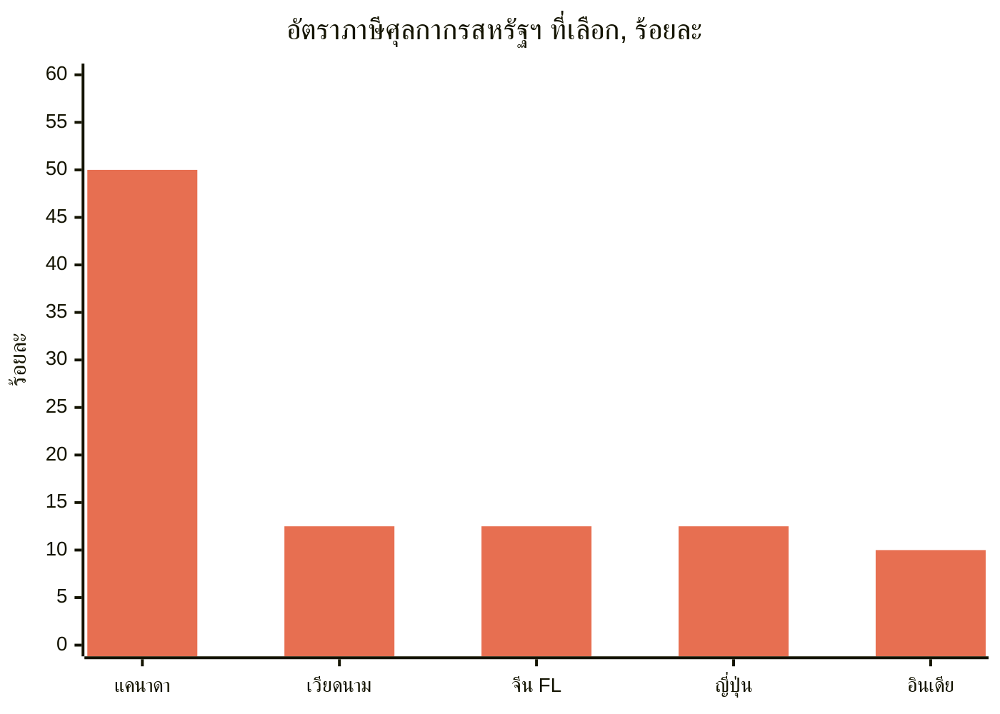

*หมายเหตุ: แคนาดา = อัตราภาษีมาตรา 338 (50%); เวียดนาม จีน FL และญี่ปุ่น = อัตราภาษีบังคับใช้แรงงานภายใต้มาตรา 301 (12.5%); อินเดีย = อัตราภาษีบังคับใช้แรงงานภายใต้มาตรา 301 ที่มีผลบังคับใช้ (10%; อัตรา 18% ที่ประกาศตามข้อตกลงไม่เคยถูกนำมาใช้) แหล่งข้อมูล: USTR, Troutman, BDO, Industrial Front*

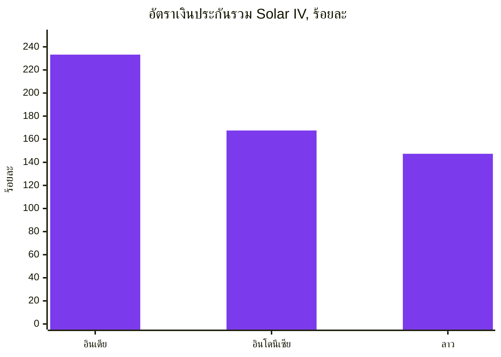

*หมายเหตุ: อัตราเงินประกันภาษีตอบโต้การทุ่มตลาดรวมกับภาษีตอบโต้การอุดหนุน อัตราสำหรับผู้ส่งออกรายอื่น อินเดีย: AD 107.17% + CVD 126.09%; อินโดนีเซีย: AD 94.36% + CVD 73.20%; ลาว: AD 65.36% + CVD 82.03% แหล่งข้อมูล: คำสั่ง AD/CVD ของกระทรวงพาณิชย์ วันที่ 9 พฤศจิกายน 2026*

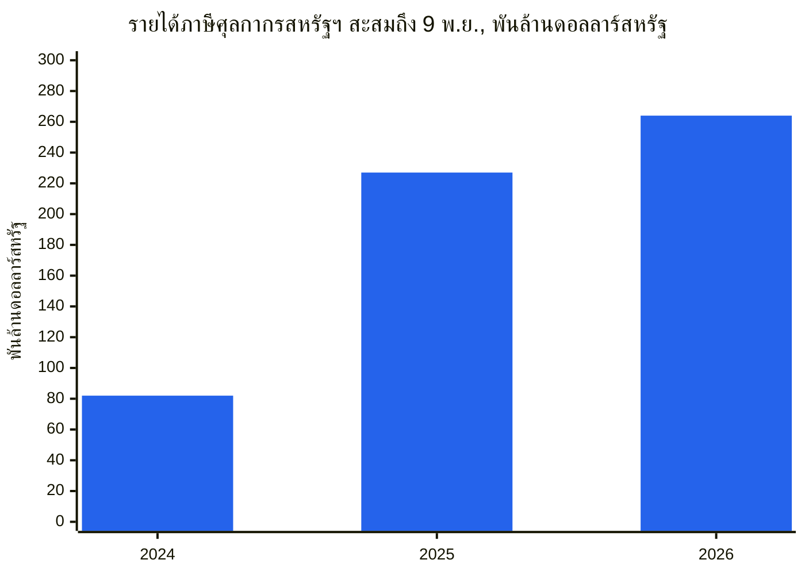

*หมายเหตุ: รายได้จากภาษีศุลกากรและภาษีสรรพสามิตรวมที่จัดเก็บได้ในปีปฏิทินถึงวันที่ 9 พฤศจิกายน จากงบแสดงรายวันของกระทรวงการคลังสหรัฐฯ ตามที่ Bipartisan Policy Center ติดตาม แหล่งข้อมูล: Bipartisan Policy Center ผ่าน The Motley Fool วันที่ 15 พฤศจิกายน 2026*

---

## 5. เจาะลึกนโยบายสหรัฐฯ

### มาตรา 301 — ประกาศวันที่ 10 พฤศจิกายน

USTR ได้เผยแพร่ประกาศเรื่องการขยายข้อยกเว้นผลิตภัณฑ์เมื่อวันที่ 10 พฤศจิกายน 2026 (91 FR 72610; FR Doc. 2026-22925) โดยขยายข้อยกเว้นปัจจุบันทั้งหมด 178 รายการจากภาษีมาตรา 301 ต่อจีน (การถ่ายโอนเทคโนโลยีและทรัพย์สินทางปัญญา) ข้อยกเว้นดังกล่าว — ข้อยกเว้นทั่วไป 164 รายการภายใต้ HTSUS 9903.88.69 และข้อยกเว้นการผลิตพลังงานแสงอาทิตย์ 14 รายการภายใต้ 9903.88.70 — มีกำหนดหมดอายุในเวลา 23:59 น. ตามเวลาตะวันออกของวันที่ 9 พฤศจิกายน 2026 ช่วงเวลาใหม่ครอบคลุมสินค้าที่นำเข้ามาเพื่อการบริโภค หรือถอนออกจากคลังสินค้าเพื่อการบริโภค ตั้งแต่ 00:01 น. ตามเวลาตะวันออกของวันที่ 10 พฤศจิกายน 2026 และก่อน 23:59 น. ตามเวลาตะวันออกของวันที่ 9 มกราคม 2027 ขอบเขตของข้อยกเว้นแต่ละรายการไม่เปลี่ยนแปลง แต่ละรายการใช้กับผลิตภัณฑ์ที่ตรงกับหมายเลข HTSUS 10 หลักและคำอธิบายผลิตภัณฑ์ในหมายเหตุ HTSUS เท่านั้น USTR ไม่ได้ขอความเห็นใหม่ โดยอาศัยบันทึกจากประกาศเดือนกันยายน 2025 ของตน กลุ่มสมาคมอุตสาหกรรม 24 แห่งได้ขอให้ขยายเวลาอย่างน้อยหนึ่งปีเมื่อวันที่ 4 พฤศจิกายน รายงานบางฉบับระบุถึงความคลาดเคลื่อนในประกาศ โดยบางส่วนอ้างถึงวันที่ 10 มกราคมแทนที่จะเป็นวันที่ 9 มกราคม วันที่ที่มีผลบังคับใช้คือวันที่ 9 มกราคม USTR ได้เผยแพร่ประกาศแยกต่างหากเมื่อวันที่ 10 พฤศจิกายน (91 FR 72608; FR Doc. 2026-22867) ระงับมาตรการมาตรา 301 ต่อแนวปฏิบัติทางทะเล โลจิสติกส์ และการต่อเรือของจีนต่อไป — รวมถึงค่าธรรมเนียมเรือที่อยู่ในขอบเขต (ภาคผนวก I–III) และภาษีตามภาคผนวก V.A — มีผลตั้งแต่วันที่ 10 พฤศจิกายน 2026 จนถึง 23:59 น. ตามเวลาตะวันออกของวันที่ 9 มกราคม 2027 จะไม่มีฝ่ายใดเกิดความรับผิดสำหรับค่าธรรมเนียมในช่วงการระงับ USTR ได้รับประมาณ 60 ความเห็นที่ไม่ซ้ำกันเกี่ยวกับข้อเสนอ มาตรการดังกล่าวเคยถูกระงับไว้ก่อนหน้านี้ตั้งแต่วันที่ 10 พฤศจิกายน 2025 ถึงวันที่ 9 พฤศจิกายน 2026

USTR ยังได้วินิจฉัยให้ขยายเวลาสามเดือนสำหรับการสอบสวนภายใต้มาตรา 301 ที่กำลังดำเนินอยู่เกี่ยวกับการกระทำ นโยบาย และแนวปฏิบัติบางประการของรัฐบาลเวียดนามที่เกี่ยวข้องกับการคุ้มครองและการบังคับใช้ทรัพย์สินทางปัญญา (เอกสาร USTR-2026-0364; FR Doc. 2026-22868; มีผลวันที่ 3 พฤศจิกายน 2026) การสอบสวนดังกล่าวเริ่มขึ้นเมื่อวันที่ 29 พฤษภาคม 2026 หลังจากเวียดนามถูกระบุว่าเป็นประเทศต่างชาติที่มีความสำคัญลำดับแรกในรายงาน Special 301 ประจำปี 2026 ของ USTR การวินิจฉัยเกี่ยวกับความสามารถในการดำเนินการและมาตรการใด หากมี ที่จะดำเนินการ จะมีขึ้นภายในวันที่ 28 กุมภาพันธ์ 2027 แทนเส้นตายเดิมวันที่ 29 พฤศจิกายน 2026 USTR อ้างถึง "ประเด็นที่ซับซ้อนหรือยุ่งยากซึ่งต้องใช้เวลาเพิ่มเติม" เวียดนามยังเป็นเรื่องของการสอบสวนภายใต้มาตรา 301 อีกสองเรื่องที่ค้างอยู่ เกี่ยวกับการห้ามนำเข้าที่เกิดจากการบังคับใช้แรงงานและกำลังการผลิตส่วนเกินเชิงโครงสร้างในภาคการผลิต เวียดนามต้องเสียภาษีบังคับใช้แรงงานภายใต้มาตรา 301 ที่อัตรา 12.5% ภายใต้รายการ HTSUS 9903.05.04 แล้ว มีผลตั้งแต่วันที่ 24 กรกฎาคม 2026

ยังไม่มีการเผยแพร่มาตรการขั้นสุดท้ายจากการสอบสวนของ USTR ภายใต้มาตรา 301 เรื่องกำลังการผลิตส่วนเกินเชิงโครงสร้างในภาคการผลิต ณ วันที่ 10 พฤศจิกายน 2026 รัฐมนตรีว่าการกระทรวงอุตสาหกรรมของเกาหลีใต้ Kim Jung-kwan กล่าวต่อคณะกรรมาธิการรัฐสภาเมื่อวันที่ 10 พฤศจิกายนว่า โซลกำลังติดตามความคืบหน้าอย่างใกล้ชิด มีรายงานว่าผลการพิจารณาล่าช้ากว่ากำหนดการที่เจ้าหน้าที่เกาหลีใต้คาดไว้กว่าสองเดือน การสอบสวนครอบคลุม 16 เศรษฐกิจรวมถึงเกาหลีใต้ เกาหลีใต้กำลังพยายามรักษาภาษีของสหรัฐฯ ไว้ที่ประมาณ 15% ทนายความด้านการค้าและนักวิเคราะห์บอกกับ Global Trade Review ว่าความเสี่ยงระยะใกล้ที่ระบุไว้หลักคือการสอบสวนนี้ ซึ่งเปิดขึ้นในเดือนมีนาคม ครอบคลุมจีน สิงคโปร์ สวิตเซอร์แลนด์ นอร์เวย์ อินโดนีเซีย มาเลเซีย กัมพูชา ไทย เกาหลีใต้ เวียดนาม ไต้หวัน บังกลาเทศ เม็กซิโก ญี่ปุ่น และอินเดีย รวมถึงสหภาพยุโรป โดยจะมีการตัดสินใจภายในเดือนมีนาคม 2027

### มาตรา 232 — ไม่มีการดำเนินการใหม่ โพลีซิลิคอนครบกำหนดวันที่ 4 ธันวาคม

ไม่มีการประกาศหรือการเปลี่ยนแปลงอัตราตามมาตรา 232 ใหม่ที่ระบุได้ในช่วงเวลาที่ครอบคลุม ระบอบมาตรา 232 ที่มีผลบังคับใช้ ณ วันที่ 9 พฤศจิกายน 2026 ตามที่สรุปจาก Harmonized Tariff Schedule และคำแนะนำของ CBP คือ: เหล็ก อลูมิเนียม และทองแดงที่ 50% รวมถึงผลิตภัณฑ์อนุพันธ์หลายรายการ (ผลิตภัณฑ์อนุพันธ์อื่นที่ระบุไว้ 25%; เครื่องจักรอุตสาหกรรมแบบติดตั้งถาวร อุปกรณ์ไฟฟ้าและอุปกรณ์การเกษตร และอุปกรณ์ทำความร้อน ระบายอากาศ และปรับอากาศภายในบ้านที่ 15% รวม) เซมิคอนดักเตอร์ที่ 25% โดยมีการยกเว้นตามรายการ ยาที่มีสิทธิบัตรที่ 100% (ยาสามัญไม่รวมอยู่) โดยมีอัตราที่ต่ำกว่าสำหรับบางต้นทางและบางบริษัท รถยนต์และชิ้นส่วนที่ 15% ถึง 25% ผลิตภัณฑ์อนุพันธ์ของทองแดง รถบรรทุกและชิ้นส่วนรถบรรทุก ไม้และไม้แปรรูป โพลีซิลิคอน และโดรนแต่ละรายการมีอัตราและเงื่อนไขของตนเอง ภาษีโพลีซิลิคอนจะมีผลในวันที่ 4 ธันวาคม 2026 และจนถึงตอนนั้น กฎของ BIS อนุญาตให้กระทรวงพาณิชย์ห้ามผู้นำเข้าที่นำเข้ามากกว่าปริมาณในอดีตอย่างมากจากการนำเข้าเพิ่มเติมก่อนวันที่ 4 ธันวาคม เว้นแต่กระทรวงพาณิชย์จะให้การยกเว้น หุ่นยนต์และเครื่องจักรอุตสาหกรรมมีคำวินิจฉัยเรื่องภัยคุกคามภายใต้ประกาศ 11077 ลงวันที่ 28 ตุลาคม 2026 ซึ่งสั่งให้มีการเจรจาและไม่ได้กำหนดภาษีใหม่ ปฏิทินเดือนมกราคม 2027 รวมถึงการปรับขึ้นอัตราตามมาตรา 232 สำหรับเฟอร์นิเจอร์และตู้: เฟอร์นิเจอร์บุผ้าเป็น 30% และตู้ครัวและตู้อ่างล้างหน้าเป็น 50% ตั้งแต่วันที่ 1 มกราคม 2027

### CBP — ผู้นำเข้าต่างชาติที่เป็นผู้นำเข้า การเพิกถอนแบบฟอร์ม 5106

CBP ได้เผยแพร่กฎขั้นสุดท้ายชั่วคราวเรื่อง "ข้อกำหนดที่เข้มงวดขึ้นสำหรับผู้นำเข้าต่างชาติที่เป็นผู้นำเข้า" (CBP Dec. 26-19, 91 FR 69977; FR Doc. 2026-22735) เมื่อวันที่ 6 พฤศจิกายน 2026 เพื่อดำเนินการตามมาตรา 2 ของคำสั่งฝ่ายบริหาร 14411 ตั้งแต่วันที่ 5 มกราคม 2027 ผู้นำเข้าต่างชาติที่เป็นผู้นำเข้าอาจนำเข้าสินค้ามาเพื่อการบริโภคได้ก็ต่อเมื่อตนเองได้รับการรับรอง CTPAT หรือยื่นเอกสารผ่านนายหน้าศุลกากรที่ได้รับใบอนุญาตและได้รับการรับรอง CTPAT ส่วนใหม่ที่ 110 ของระเบียบศุลกากรนิยาม "U.S. IOR" (พลเมืองสหรัฐฯ หรือผู้มีถิ่นที่อยู่ถาวรโดยชอบด้วยกฎหมาย หรือหน่วยงานที่จัดตั้งขึ้นตามกฎหมายสหรัฐฯ และตั้งอยู่ในสหรัฐฯ โดยมีเงื่อนไขเพิ่มเติมเกี่ยวกับความเป็นเจ้าของหรืออสังหาริมทรัพย์ — ตัวอย่างเช่น มีความเป็นเจ้าของผลประโยชน์อย่างน้อย 51% โดยพลเมืองสหรัฐฯ หรือผู้มีถิ่นที่อยู่ถาวรโดยชอบด้วยกฎหมายที่มีอำนาจควบคุม หรือเป็นเจ้าของอสังหาริมทรัพย์ในสหรัฐฯ ที่มีมูลค่าสำคัญและไม่มีภาระผูกพันโดยตรง) สถานะผู้นำเข้าของสหรัฐฯ หรือต่างชาติต้องสำแดงเมื่อนำเข้าและเมื่อสรุปการนำเข้า (19 CFR 141.21–141.22 ฉบับใหม่) นายหน้าต้องตรวจสอบสถานะผู้นำเข้าของสหรัฐฯ ของลูกค้าโดยทบทวนบันทึกและเก็บรักษาบันทึกการตรวจสอบไว้ห้าปี มีการเพิ่มช่องข้อมูลใหม่สามช่องในแบบฟอร์ม 3461 และ 7501 ของ CBP (และเอกสารอิเล็กทรอนิกส์ที่เทียบเท่า) ผ่านข้อความ CSMS นายหน้าอาจขอเลื่อนการปฏิบัติตามภายในวันที่ 5 มกราคม 2027 โดยคาดว่านายหน้าทุกรายจะปฏิบัติตามอย่างครบถ้วนภายในวันที่ 6 พฤษภาคม 2027 กฎดังกล่าวยังขยายสถานการณ์ที่นายหน้าอาจเผชิญบทลงโทษภายใต้ 19 U.S.C. 1592 ความเห็นครบกำหนดวันที่ 5 มกราคม 2027 (เอกสาร USCBP-2026-1387) การวิเคราะห์ของ CBP เอง: ผู้นำเข้าต่างชาติที่เป็นผู้นำเข้า 0.4% ได้รับการรับรอง CTPAT และ 68% ใช้บริการนายหน้าที่ได้รับการรับรองแล้ว ส่วนที่เหลืออีก 32% จะไม่สามารถนำเข้าสู่สหรัฐฯ ต่อไปได้เว้นแต่จะเปลี่ยนนายหน้าหรือได้รับการรับรอง CTPAT ด้วยตนเอง

แยกต่างหาก CBP ได้ส่งจดหมายถึงผู้นำเข้าที่ได้รับการรับรอง CTPAT จำนวนมาก โดยระบุว่าหมายเลขผู้นำเข้าของตนอาจถูกเพิกถอนสำหรับการยื่นเอกสารนำเข้าตั้งแต่ 00:01 น. ตามเวลาตะวันออกของวันที่ 18 พฤศจิกายน 2026 เว้นแต่จะแก้ไขข้อกังวลของ CBP เกี่ยวกับความถูกต้องของข้อมูลในแบบฟอร์ม 5106 ของผู้นำเข้าก่อน (ดู A5) ประกาศเรื่องการจัดทำกฎสำหรับการขนส่งมูลค่าต่ำของ CBP เมื่อวันที่ 8 ตุลาคม 2026 (91 FR 64532; เอกสาร USCBP-2026-0298) ยังคงเปิดอยู่ โดยความเห็นครบกำหนดวันที่ 7 ธันวาคม 2026 ข้อเสนอดังกล่าวจะกำหนดให้การนำเข้าแบบไม่เป็นทางการสำหรับสินค้ามูลค่าสูงสุด 2,500 ดอลลาร์ต้องยื่นทางอิเล็กทรอนิกส์ในหรือก่อนวันที่นำเข้า กำหนดให้ต้องมีพันธบัตรสำหรับการนำเข้าแบบไม่เป็นทางการทุกครั้ง และให้นายหน้าเป็นผู้นำเข้าเมื่อยื่นเอกสารให้แก่ผู้รับตราส่งที่ไม่ใช่เจ้าของหรือผู้ซื้อ การยกเว้น de minimis มูลค่า 800 ดอลลาร์ยังคงถูกระงับอย่างไม่มีกำหนด — สำหรับการขนส่งที่ไม่ใช่ไปรษณีย์ตั้งแต่วันที่ 24 มิถุนายน 2026 และสำหรับการขนส่งทางไปรษณีย์ตั้งแต่วันที่ 24 กรกฎาคม 2026 แยกต่างหาก CBP ได้เลื่อนวันที่การนำเข้าอย่างเป็นทางการจะกลายเป็นข้อบังคับสำหรับไปรษณีย์ที่อยู่ภายใต้ภาษีมาตรา 201, 232 หรือ 301 หรือข้อกำหนดของหน่วยงานรัฐบาลคู่ค้าจากวันที่ 22 ตุลาคม 2026 เป็นวันที่ 20 มกราคม 2027

### มาตรการควบคุมการส่งออกของ BIS — ระงับกฎ Affiliates Rule จนถึงวันที่ 10 มกราคม อุปกรณ์เก็บเสียงย้ายไปอยู่ภายใต้การควบคุมของกระทรวงพาณิชย์

BIS ได้เผยแพร่กฎขั้นสุดท้าย (FR Doc. 2026-22793) ขยายการระงับกฎชั่วคราวขั้นสุดท้ายเรื่อง "การขยายมาตรการควบคุมผู้ใช้ปลายทางให้ครอบคลุมบริษัทในเครือของหน่วยงานที่ระบุไว้บางแห่ง" (กฎ Affiliates Rule) จนถึงวันที่ 10 มกราคม 2027 การระงับหนึ่งปีที่กำหนดในเดือนพฤศจิกายน 2025 (90 FR 50857) มีกำหนดสิ้นสุดในวันที่ 9 พฤศจิกายน 2026 กฎใหม่มีผลในวันที่ 9 พฤศจิกายน 2026 จึงไม่มีช่องว่าง กฎ Affiliates Rule ซึ่งเผยแพร่เมื่อวันที่ 30 กันยายน 2025 (90 FR 47201) จะขยายมาตรการควบคุมการส่งออกภายใต้ระเบียบการบริหารการส่งออกไปยังหน่วยงานต่างประเทศที่อยู่ในความครอบครองตั้งแต่ 50% ขึ้นไป ไม่ว่าโดยตรงหรือโดยอ้อม โดยรายเดียวหรือรวมกัน โดยฝ่ายหนึ่งฝ่ายใดในบัญชีรายชื่อหน่วยงาน บัญชีรายชื่อผู้ใช้ปลายทางทางทหาร หรือฝ่ายที่ OFAC กำหนดบางราย นอกจากนี้ยังกำหนดสัญญาณเตือนใหม่ที่กำหนดให้ผู้ส่งออกต้องแก้ไขคำถามเกี่ยวกับความเป็นเจ้าของเมื่อทราบว่าฝ่ายต่างประเทศอยู่ในความครอบครองบางส่วนของหน่วยงานที่อยู่ในบัญชีรายชื่อ การขยายเวลาไม่ได้ถอนหรือแก้ไขกฎ หากไม่มีการดำเนินการเพิ่มเติมจาก BIS มาตรการควบคุมที่ขยายขอบเขตจะมีผลในวันที่ 10 มกราคม 2027 ประกาศใน Federal Register ไม่ได้ให้เหตุผลเชิงนโยบายใดนอกจากการเปลี่ยนแปลงวันที่ เจ้าหน้าที่ฝ่ายบริหารระบุว่าการขยายเวลามีความเชื่อมโยงกับการพักรบทางการค้าสหรัฐฯ–จีน ซึ่งขยายไปจนถึงวันที่ 10 มกราคม 2027 เช่นกัน BIS ยังประกาศว่าตั้งแต่วันที่ 20 พฤศจิกายน 2026 การส่งออกอุปกรณ์เก็บเสียง ท่อเก็บเสียง และอุปกรณ์ลดเสียงบางประเภทจะย้ายจากบัญชีรายการยุทโธปกรณ์ของสหรัฐฯ ของกระทรวงการต่างประเทศไปอยู่ภายใต้การควบคุมตามระเบียบการบริหารการส่งออกของ BIS อุปกรณ์เก็บเสียงจะถูกเพิ่มเข้าไปในบัญชีรายการควบคุมการค้าของกระทรวงพาณิชย์ และ BIS จะกำหนดให้ต้องมีใบอนุญาตสำหรับการส่งออก การส่งออกซ้ำ หรือการถ่ายโอนภายในประเทศบางประเภท รวมถึงการเปิดเผยซอฟต์แวร์และเทคโนโลยีที่เกี่ยวข้องแก่บุคคลต่างชาติ ข้อยกเว้นใบอนุญาตที่มีอยู่สำหรับอาวุธปืนจะใช้กับอุปกรณ์เก็บเสียงด้วยเช่นกัน

### Federal Register — กิจกรรม AD/CVD ในช่วงเวลาที่ครอบคลุม

วันที่ 9 พฤศจิกายน: กระทรวงพาณิชย์เผยแพร่คำสั่งภาษีตอบโต้การทุ่มตลาดและภาษีตอบโต้การอุดหนุนขั้นสุดท้ายสำหรับเซลล์แสงอาทิตย์ชนิดผลึกซิลิคอนและโมดูลจากอินเดีย อินโดนีเซีย และลาว (ดู A7) วันที่ 10 พฤศจิกายน: กระทรวงพาณิชย์วินิจฉัยเบื้องต้นว่าผลิตภัณฑ์เหล็กแผ่นเคลือบดีบุกจากไต้หวันและตุรกีถูกขายในสหรัฐฯ ในราคาต่ำกว่าราคาที่เป็นธรรม กระทรวงพาณิชย์กำหนดอัตราการทุ่มตลาดที่ 18.07% สำหรับ Ton Yi Industrial Corporation ของไต้หวันและสำหรับผู้ส่งออกไต้หวันรายอื่นทั้งหมด สำหรับตุรกีกำหนดไว้ที่ 3.89% สำหรับ Tosyali และสำหรับผู้ส่งออกรายอื่นทั้งหมด และ 42.06% สำหรับ Tatrix International ขณะนี้ผู้นำเข้าต้องวางเงินประกันตามอัตราเหล่านี้ อัตราดังกล่าวเข้าร่วมกับอัตราเบื้องต้นที่กระทรวงพาณิชย์กำหนดในเดือนกันยายนสำหรับจีนที่ 136.52% สำหรับการทุ่มตลาดและ 66.61% สำหรับเงินอุดหนุน ผลการพิจารณาการทุ่มตลาดขั้นสุดท้ายสำหรับตุรกีครบกำหนด 75 วันหลังจากการลงนามเมื่อวันที่ 5 พฤศจิกายน (19 มกราคม 2027) สำหรับไต้หวัน 135 วันหลังจากการเผยแพร่เมื่อวันที่ 10 พฤศจิกายน (25 มีนาคม 2027) ผลการพิจารณาขั้นสุดท้ายสำหรับจีนครบกำหนดภายในวันที่ 30 พฤศจิกายน 2026 เว้นแต่จะเลื่อนออกไป วันที่ 12 พฤศจิกายน: กระทรวงพาณิชย์เผยแพร่ผลขั้นสุดท้ายในการทบทวนการบริหารด้านการทุ่มตลาดสำหรับตู้ไม้ ตู้อ่างล้างหน้า และส่วนประกอบจากจีน (ช่วงปี 2024–2025) โดยกำหนดอัตราการทุ่มตลาด 7.48% สำหรับบริษัทที่ทบทวน — Yixing Pengjia Technology, Jiangsu Xiangsheng Bedtime Furniture, Xiamen Golden Huanan และ Zhongshan NU Furniture — ใช้กับการขนส่งที่อยู่ในขอบเขตที่นำเข้าหรือถอนเพื่อการบริโภคตั้งแต่หรือหลังวันที่ 12 พฤศจิกายน 2026 อัตราเงินประกันทั่วประเทศจีนยังคงอยู่ที่ 251.64% ในการทบทวนการบริหารด้านภาษีตอบโต้การอุดหนุนสำหรับผลิตภัณฑ์ไม้ขึ้นรูปและงานไม้จากจีน กระทรวงพาณิชย์กำหนดอัตราภาษีตอบโต้การอุดหนุนขั้นสุดท้ายที่ 147.88% สำหรับ Nanping Huatai Wood and Bamboo Co., Fujian Yinfeng Imp & Exp Trading Co. และ Fujian Hongjia Craft Products Co. และ 21.39% สำหรับบริษัทที่ไม่ได้เลือกภายใต้การทบทวน ใช้กับการขนส่งที่อยู่ในขอบเขตที่นำเข้าหรือถอนเพื่อการบริโภคตั้งแต่หรือหลังวันที่ 12 พฤศจิกายน 2026 กระทรวงพาณิชย์ตั้งใจจะออกคำสั่งประเมินไม่เร็วกว่า 35 วันหลังการเผยแพร่ (17 ธันวาคม 2026) ในแต่ละกรณี

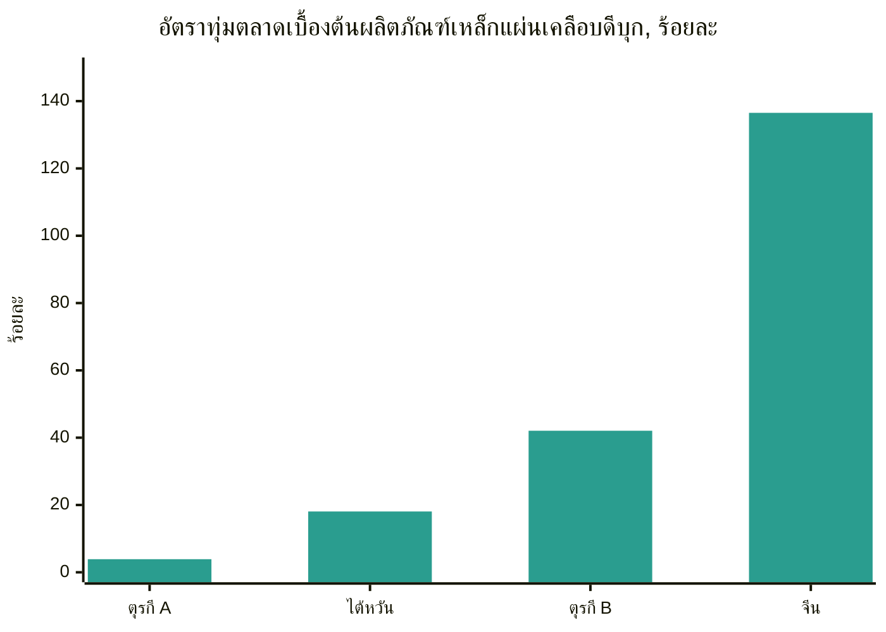

*หมายเหตุ: ตุรกี A = Tosyali และผู้ส่งออกรายอื่นทั้งหมด (3.89%); ตุรกี B = Tatrix International (42.06%); จีน = อัตราเบื้องต้นเดือนกันยายน (136.52%) แหล่งข้อมูล: การวินิจฉัยเบื้องต้นของกระทรวงพาณิชย์ วันที่ 10 พฤศจิกายน 2026*

### รายการที่คงอยู่

- **UFLPA / บัญชีรายชื่อหน่วยงาน:** ไม่มีการเพิ่มรายชื่อหน่วยงาน UFLPA ใหม่หรือคำสั่งระงับการปล่อยสินค้าใหม่ที่ระบุได้ในช่วงวันที่ 9–16 พฤศจิกายน การเพิ่มรายชื่อหน่วยงานล่าสุด (43 บริษัท) ประกาศเมื่อวันที่ 31 กรกฎาคม 2026 คำแนะนำการปฏิบัติงานด้านแรงงานบังคับของ CBP สำหรับผู้นำเข้าฉบับปัจจุบันมีอายุตั้งแต่เดือนมิถุนายน 2026 ยอดรวมการบังคับใช้ที่ CBP ระบุล่าสุด จากการเผยแพร่เรื่อง Serbia Zijin คือ 56 WRO และแปด Findings ภายใต้ 19 U.S.C. § 1307 รายงานในภายหลังระบุยอดรวมที่ 60 WRO และแปด Findings หลังจากมีคำสั่งเพิ่มเติมอีกสองฉบับเมื่อวันที่ 29 กันยายน 2026
- **ทำเนียบขาว:** ไม่มีการออกประกาศหรือเอกสารข้อเท็จจริงเกี่ยวกับภาษีใหม่ในช่วงเวลาที่ครอบคลุม
- **USITC / HTS:** ไม่มีการระบุการเปลี่ยนแปลงอัตรา HTS ใหม่ในช่วงเวลาที่ครอบคลุมนอกเหนือจากคำสั่ง Solar IV รายงานฉบับสมบูรณ์ของ USITC เกี่ยวกับ Solar IV (USITC Publication 5804) ครบกำหนดเผยแพร่บนเว็บไซต์ของ USITC ภายในวันที่ 23 พฤศจิกายน 2026
- **trade.gov / ข่าวกรองตลาด:** ไม่มีการระบุการเผยแพร่ข่าวกรองตลาดใหม่ที่เฉพาะเจาะจงเกี่ยวกับนโยบายภาษีของสหรัฐฯ ในช่วงเวลาที่ครอบคลุม
- **internationaltradetoday.com:** มีเพย์วอลล์ พาดหัวข่าวยืนยันเรื่องกฎผู้นำเข้าต่างชาติที่เป็นผู้นำเข้าของ CBP (5 พฤศจิกายน)

---

## 6. นโยบายโลกตามภูมิภาค

### ยุโรป

การปรับโครงสร้างอีคอมเมิร์ซมูลค่าต่ำของสหภาพยุโรปมีผลบังคับใช้แล้ว (ดู 3.3): ค่าธรรมเนียมจัดการ 2 ยูโรต่อรายการสินค้าและรหัสประจำตัวผลิตภัณฑ์บังคับตั้งแต่วันที่ 1 พฤศจิกายน นอกเหนือจากภาษีแบบเหมาจ่าย 3 ยูโรต่อรายการภาษีที่มีผลบังคับใช้ตั้งแต่วันที่ 1 กรกฎาคม 2026 เมื่อวันที่ 9 พฤศจิกายน คณะมนตรีตกลงที่จะยกเลิกเพดาน 150 ยูโรออกจากระบบ Import One-Stop Shop สำหรับภาษีมูลค่าเพิ่ม ซึ่งจะมีผลตั้งแต่วันที่ 1 กรกฎาคม 2028 กิจกรรมภาษีศุลกากรของสหภาพยุโรป (TARIC) ในสัปดาห์วันที่ 1–7 พฤศจิกายนถูกครอบงำโดยการเตรียมการล่วงหน้ามากกว่าภาษีคุ้มครองใหม่: มีการประมวลผลบันทึกการเปลี่ยนแปลง 15,055 รายการ โดยมากกว่า 13,600 รายการเป็นมาตรการที่มีผลในอนาคตซึ่งเตรียมการเข้าถึงสิทธิพิเศษและโควตาอิสระล่วงหน้าจนถึงปี 2027 เมื่อวันที่ 6 พฤศจิกายน บันทึกที่มีผลในอนาคตกว่า 2,500 รายการได้กำหนดโควตาภาษีอิสระที่มีกำหนดมีผลในวันที่ 1 มกราคม 2027 รวมถึงโควตาขนาดใหญ่สำหรับภาคการแปรรูปอาหารทะเล การหมุนเวียนทันทีกระจุกตัวอยู่ในวันที่ 1 พฤศจิกายน ซึ่งเป็นวันที่มาตรการ 5,405 จาก 6,238 รายการที่มีผลในช่วงสัปดาห์มีผลบังคับใช้ การปรับแนวทางการป้องกันทางการค้าทางเทคนิคซึ่งกระจุกตัวอยู่ในวันที่ 3 พฤศจิกายนได้ปรับขอบเขตมาตรการใหม่สำหรับ PVC แบบ bulk, PVC แบบ suspension, แอสไพริน และพอลิเมอร์และสารเคมีเฉพาะทางอื่น ๆ รูปแบบดังกล่าวบ่งชี้ถึงท่าทีด้านการบริหารที่มุ่งเน้นการเตรียมการเข้าถึงในปี 2027 มากกว่าการกำหนดภาษีใหม่ แต่การเปลี่ยนแปลงขอบเขตการป้องกันทางการค้าจะเปลี่ยนแปลงความครอบคลุมของมาตรการที่มีอยู่สำหรับพอลิเมอร์และสารเคมี และกำหนดให้ผู้นำเข้าต้องสำแดงข้อมูลอย่างถูกต้อง

ข้อตกลงการค้าเสรีสหภาพยุโรป–อินเดียมีรายงานว่าจะลงนามที่กรุงบรัสเซลส์ในช่วงกลางเดือนธันวาคม 2026 (ดู 3.3) ข้อตกลงการค้าฉบับปรับปรุงสหภาพยุโรป–เม็กซิโกได้ลงนามอย่างเป็นทางการเมื่อวันที่ 22 พฤษภาคม 2026 และรอการให้สัตยาบันจากรัฐสภายุโรปก่อนมีผลบังคับใช้ ข้อตกลงของสหภาพยุโรปกับอินโดนีเซียและออสเตรเลียแต่ละฉบับคาดว่าจะลงนามก่อนสิ้นปี 2026 ข้อตกลงชั่วคราวสหภาพยุโรป–เมร์โคซูร์มีผลบังคับใช้ชั่วคราวตั้งแต่วันที่ 1 พฤษภาคม 2026

**แหล่งข้อมูล:** [RegFollower](https://regfollower.com/eu-forward-staging-and-trade-defence-realignment-mark-the-november-tariff-turn/); [Flex Logistics](https://flexlogistics.eu/eu-trade-deals-online-sellers/)

### สหราชอาณาจักร

ประกาศมาตรการเยียวยาทางการค้า 2026/31 มีผลให้รัฐมนตรีว่าการยอมรับคำแนะนำของหน่วยงานมาตรการเยียวยาทางการค้าในการทบทวนการหมดอายุ ER0080 ซึ่งเริ่มขึ้นเมื่อวันที่ 22 มกราคม 2026 ภาษีตอบโต้การอุดหนุนสำหรับปลาเทราต์สายรุ้งที่มีต้นกำเนิดจากตุรกี ซึ่งครอบคลุมปลาที่มีชีวิต สด แช่เย็น แช่แข็ง และรมควันภายในขีดจำกัดขนาดที่กำหนดในประกาศ และจำแนกภายใต้พิกัด 0301, 0302, 0303, 0304 และ 0305 ได้รับการขยายออกไปห้าปีจนถึงวันที่ 30 มกราคม 2031 ในอัตราเดิมโดยไม่มีการคำนวณใหม่ ประกาศดังกล่าวมีผลในวันที่ 6 พฤศจิกายน 2026 โดยการเปลี่ยนแปลงมีผลตั้งแต่วันที่ 30 มกราคม 2026 และแทนที่ประกาศภาษี 2021/12 อัตราเฉพาะผู้ส่งออกอยู่ระหว่าง 1.5% ถึง 8% ผู้ส่งออกสองกลุ่มที่ระบุไว้เสีย 6.9% และ 7.6% ส่วนผู้ส่งออกรายอื่นทั้งหมดเสีย 9.5%

สำนักงานสรรพากรและศุลกากร (HM Revenue and Customs) ได้ปรับปรุงสรุปนโยบายสำหรับกลไกการปรับชายแดนคาร์บอนของสหราชอาณาจักร (UK Carbon Border Adjustment Mechanism) เมื่อวันที่ 2 พฤศจิกายน โดยเพิ่มข้อมูลเกี่ยวกับการคำนวณการบรรเทาราคาคาร์บอน (Carbon Price Relief) นี่เป็นการปรับปรุงครั้งที่สามในฤดูใบไม้ร่วงนี้ ต่อจากการปรับปรุงเมื่อวันที่ 9 กันยายนและ 16 ตุลาคม 2026 ซึ่งสะท้อนถึงการตรากฎระเบียบกลไกการปรับชายแดนคาร์บอน (การปล่อยมลพิษและการตรวจสอบ) ปี 2026 สรุปยืนยันว่ากลไก CBAM ของสหราชอาณาจักรจะเริ่มในวันที่ 1 มกราคม 2027 และจะใช้กับสินค้าอลูมิเนียม ซีเมนต์ ปุ๋ย ไฮโดรเจน และเหล็กและเหล็กกล้าที่ระบุตามรหัสสินค้า เมื่อเหลือเวลาน้อยกว่าสองเดือนก่อนเริ่มใช้ ผู้นำเข้าสินค้าที่อยู่ในขอบเขตจำเป็นต้องยืนยันรหัสสินค้า ข้อมูลการปล่อยมลพิษ และการคำนวณการบรรเทาราคาคาร์บอนก่อนที่กลไกจะเริ่มเรียกเก็บ

กรมธุรกิจและการค้าได้เผยแพร่เอกสารข้อเท็จจริงเกี่ยวกับการค้าและการลงทุนทวิภาคีเป็นประจำเมื่อวันที่ 6 พฤศจิกายน รวมถึงสำหรับกาตาร์ การค้าสินค้าและบริการทั้งหมดระหว่างสหราชอาณาจักรกับกาตาร์มีมูลค่า 5,400 ล้านปอนด์ในช่วงสี่ไตรมาสถึงสิ้นไตรมาสที่ 2 ปี 2026 ลดลง 7.2% หรือ 416 ล้านปอนด์จากสี่ไตรมาสถึงสิ้นไตรมาสที่ 2 ปี 2025 การส่งออกของสหราชอาณาจักรไปยังกาตาร์อยู่ที่ 3,900 ล้านปอนด์ (ลดลง 10.3% หรือ 447 ล้านปอนด์) และการนำเข้าจากกาตาร์อยู่ที่ 1,500 ล้านปอนด์ (เพิ่มขึ้น 2.1% หรือ 31 ล้านปอนด์) กาตาร์เป็นคู่ค้ารายใหญ่อันดับที่ 47 ของสหราชอาณาจักร คิดเป็น 0.3% ของการค้าทั้งหมดของสหราชอาณาจักร

**แหล่งข้อมูล:** [Global Customs Compliance](https://www.globalcustomscompliance.com/trade-and-customs-watch-2026-11-13/?utm_source=rss&utm_medium=rss&utm_campaign=trade-and-customs-watch-2026-11-13)

### แคนาดา

รัฐมนตรีว่าการกระทรวงการคลัง François-Philippe Champagne ประกาศการเปลี่ยนแปลงมาตรการผ่อนผันภาษีของแคนาดาเมื่อวันที่ 9 พฤศจิกายน (ดู 3.7): การผ่อนผันในแนวนอนสำหรับภาษีของสหรัฐฯ ขยายออกไปหนึ่งปีจนถึงวันที่ 30 มิถุนายน 2028 โดยการผ่อนผันในขณะนี้รวมถึงสินค้าที่ไม่ใช่เหล็กที่ใช้ในการทำเหมือง การทำเหมืองหิน หรือการสกัดน้ำมันและก๊าซ และสินค้าทั้งหมดที่ใช้โดยหน่วยงานการศึกษาของรัฐ รวมถึงสินค้าที่กำหนดโดยองค์กรของชนพื้นเมือง การผ่อนผันถูกยกเลิกสำหรับรถพ่วงบางประเภทตั้งแต่วันที่ 1 ธันวาคม 2026 และสำหรับลวดอลูมิเนียมและผลิตภัณฑ์อัดขึ้นรูปบางประเภทและผลิตภัณฑ์กระดาษแข็งตั้งแต่วันที่ 1 กุมภาพันธ์ 2027 การเปลี่ยนแปลงดังกล่าวอยู่เหนือภาษีตอบโต้ 15% ถึง 50% สำหรับสินค้านำเข้าจากสหรัฐฯ หลายรายการที่กำหนดเมื่อวันที่ 8 กันยายน 2026 สำนักงานบริการชายแดนแคนาดาได้ปรับปรุงประกาศศุลกากร 26-07 เมื่อวันที่ 2 พฤศจิกายน โดยขยายการผ่อนผันสินค้าตามกำหนดไปยังตารางที่ 1 ถึง 3 แนะนำรหัสอนุญาตพิเศษสำหรับตารางที่ 2 และ 3 และชี้แจงเงื่อนไขคุณสมบัติ นอกจากนี้ยังลบภาคผนวก A ซึ่งให้คำแนะนำเพิ่มเติมเกี่ยวกับการผ่อนผันหอคอยกังหันลม รัฐมนตรีว่าการกระทรวงพาณิชย์ Wang Wentao และรัฐมนตรีว่าการกระทรวงการค้าระหว่างประเทศของแคนาดา Maninder Sidhu ร่วมเป็นประธานการประชุมครั้งที่ 29 ของคณะกรรมาธิการเศรษฐกิจและการค้าร่วมจีน–แคนาดาที่ปักกิ่งเมื่อวันที่ 3 พฤศจิกายน ไม่สามารถยืนยันสาระสำคัญของผลลัพธ์ใด ๆ ได้จากข้อมูลที่ทบทวน

**แหล่งข้อมูล:** [Department of Finance Canada](https://www.canada.ca/en/department-finance/news/2026/11/canada-modifies-tariff-relief-measures-to-better-support-workers-and-businesses.html); [GHY](https://www.ghy.com/trade-compliance/category/canada-imports/)

### จีน

ฝั่งจีนของการขยายเวลาพักรบครอบคลุมอยู่ในหัวข้อ 2 และ 3.1 เว็บไซต์ภาษาอังกฤษของ MOFCOM (english.mofcom.gov.cn) สามารถเข้าถึงได้เมื่อวันที่ 16 พฤศจิกายน โดยมองเห็นเพียงพาดหัวข่าวหน้าแรก รวมถึงคำแถลงของโฆษกเกี่ยวกับมาตรการปรับเปลี่ยนที่เกี่ยวข้องกับบัญชีรายชื่อหน่วยงานที่ไม่น่าเชื่อถือ และการระบุการประชุมครั้งที่ 29 ของคณะกรรมาธิการเศรษฐกิจและการค้าร่วมจีน–แคนาดา ไม่สามารถยืนยันสาระสำคัญของการตอบโต้ของ MOFCOM ต่อค่าธรรมเนียม 2 ยูโรของสหภาพยุโรปในการแถลงข่าวในช่วงเวลาเดียวกันได้จากข้อมูลที่ทบทวน

### อินเดียและนิวซีแลนด์

ข้อตกลงชั่วคราวอินเดีย–สหรัฐฯ ยังคงไม่ได้ลงนาม (ดู A10 และ 3.2) ข้อตกลงสหภาพยุโรป–อินเดียมีรายงานว่าจะลงนามในช่วงกลางเดือนธันวาคม (ดู 3.3) อินเดียและสหภาพยุโรปยังดำเนินการหารือเรื่องการดำเนินการในกรุงบรัสเซลส์ในช่วงต้นเดือนพฤศจิกายนต่อไป รัฐมนตรีว่าการกระทรวงพาณิชย์ Piyush Goyal กล่าวเมื่อวันที่ 3 พฤศจิกายนว่า อินเดียไม่เคยเปิดภาคผลิตภัณฑ์นมในข้อตกลงการค้าเสรีฉบับใด และจะไม่ยอมให้นำเข้าผลิตภัณฑ์ดัดแปลงพันธุกรรม ซึ่งเป็นเส้นแดงที่เกี่ยวข้องกับทุกเส้นทางการเจรจา FTA ที่กำลังดำเนินอยู่

### เอเชีย-แปซิฟิก — เกาหลีและบราซิล

ประธานาธิบดี Lee Jae-myung กระตุ้นรัฐบาลของตนในการประชุมคณะรัฐมนตรีเมื่อวันที่ 3 พฤศจิกายนให้เร่งดำเนินการเจรจากับบราซิลเกี่ยวกับภาษี 25% ที่บราซิลเรียกเก็บจากเครื่องสำอางเกาหลี โดยกล่าวว่าภาษีดังกล่าวเป็นอุปสรรคต่อภาคส่วนที่มีความต้องการในท้องถิ่นสูงสำหรับผลิตภัณฑ์ที่ผลิตในเกาหลี เขากล่าวว่าการย้ายฐานการผลิตไปยังบราซิลจะไม่แก้ปัญหา โดยอ้างถึงความชื่นชอบของผู้บริโภคท้องถิ่นที่แข็งแกร่งสำหรับเครื่องสำอางที่ผลิตในเกาหลี และถามรัฐมนตรีว่าการกระทรวงการต่างประเทศ Cho Hyun เกี่ยวกับสถานะของการเจรจา Cho ระบุว่าการเจรจาในขณะนี้สามารถก้าวหน้าได้หลังจากประธานาธิบดี Lula ได้รับเลือกตั้งอีกครั้งในการเลือกตั้งรอบสองเมื่อวันที่ 25 ตุลาคม การแทรกแซงดังกล่าวทำให้ภาษีเฉพาะภาคส่วนกลายเป็นประเด็นทวิภาคีระดับประธานาธิบดีก่อนวาระใหม่ของบราซิล

บริษัทสินค้าอุปโภคบริโภคของเกาหลีได้ลงนามในสัญญาส่งออกและบันทึกความเข้าใจมูลค่า 18 ล้านดอลลาร์ในงาน Korean Wave Expo และ Australia K-Food Fair ที่จัดขึ้นที่เมลเบิร์นเมื่อวันที่ 5–7 พฤศจิกายน ซึ่งร่วมเป็นเจ้าภาพโดยกระทรวงการค้า อุตสาหกรรม และพลังงาน และกระทรวงเกษตร อาหาร และกิจการชนบท และจัดโดย KOTRA และ Korea Agro-Fisheries & Food Trade Corporation กิจกรรมให้คำปรึกษาด้านการส่งออกมีบริษัทเกาหลี 101 แห่งและผู้ซื้อ 144 รายจากโอเชียเนียและเอเชียตะวันออกเฉียงใต้เข้าร่วม โดยมีการให้คำปรึกษา 1,235 ครั้งและนำไปสู่สัญญาและบันทึกความเข้าใจ 32 ฉบับ การส่งออกเครื่องสำอางของเกาหลีไปยังออสเตรเลียเพิ่มขึ้นจาก 73 ล้านดอลลาร์ในปี 2023 เป็น 112 ล้านดอลลาร์ในปี 2024 และ 166 ล้านดอลลาร์ในปี 2025 โดยได้รับการสนับสนุนจากการลดภาษีภายใต้ข้อตกลงการค้าเสรีเกาหลี–ออสเตรเลียที่มีผลบังคับใช้ตั้งแต่วันที่ 12 ธันวาคม 2014

**แหล่งข้อมูล:** [SE Daily](https://en.sedaily.com/politics/2026/11/03/lee-presses-brazil-to-cut-25-percent-tariff-on-korean); [Aju Press](https://www.ajupress.com/view/20261108110470271)

### พหุภาคี

**องค์การการค้าโลก** ในการประชุมวันที่ 4–6 พฤศจิกายน คณะกรรมการว่าด้วยมาตรการสุขอนามัยและสุขอนามัยพืชของ WTO ได้ทบทวนข้อกังวลทางการค้าเฉพาะเรื่อง ความโปร่งใส การให้คำปรึกษา และการสร้างขีดความสามารถ สำนักเลขาธิการรายงานว่ามีข้อกังวลทางการค้าเฉพาะเรื่อง 55 เรื่องได้รับการแก้ไข และ 19 เรื่องได้รับการแก้ไขบางส่วนหลังจากการติดตามในปี 2026 ซึ่งเกี่ยวข้องกับการติดต่อสมาชิก 39 ประเทศเกี่ยวกับข้อกังวลที่ไม่ได้หยิบยกขึ้นมาตั้งแต่เดือนพฤศจิกายน 2024 โดยได้รับการตอบกลับจากสมาชิก 25 ประเทศ การประชุมเดือนพฤศจิกายนได้พิจารณาข้อกังวลทางการค้าเฉพาะเรื่อง 78 เรื่อง รวมถึงห้าเรื่องที่หยิบยกขึ้นเป็นครั้งแรก ครอบคลุมขีดจำกัดสารตกค้างของยาฆ่าแมลงและมาตรการกำกับดูแลอื่น ๆ ในสหภาพยุโรป ข้อจำกัดการนำเข้าที่กระทบต่อผลิตภัณฑ์เนื้อสัตว์ในโคลอมเบีย ความล่าช้าในการอนุมัติการส่งออกเนื้อวัวปารากวัยไปยังญี่ปุ่น และข้อจำกัดต่อผลิตภัณฑ์สัตว์ปีกของชิลีที่เชื่อมโยงกับไข้หวัดนก 63% ของข้อกังวลทางการค้าเฉพาะเรื่อง 640 เรื่องที่หารือกันตั้งแต่ปี 1995 ได้รับการแก้ไข (326 เรื่อง) หรือแก้ไขบางส่วน (75 เรื่อง) คณะกรรมการเกษตรในการประชุมพิเศษได้จัดการนำเสนอสองครั้งเมื่อวันที่ 3 พฤศจิกายน โดยทบทวนวิวัฒนาการของการเจรจาการค้าเกษตรนับตั้งแต่รอบอุรุกวัย ครอบคลุมการแข่งขันด้านการส่งออกและการกักตุนอาหารสาธารณะโดยรัฐบาลของประเทศกำลังพัฒนาตามราคาที่กำหนดโดยรัฐ การประชุมครั้งต่อไปซึ่งกำหนดไว้ในวันที่ 23 พฤศจิกายน 2026 จะครอบคลุมข้อจำกัดการส่งออกและกลไกการป้องกันพิเศษ เมื่อวันที่ 16 พฤศจิกายน WTO ตกลงที่จะจัดตั้งคณะผู้พิจารณาข้อพิพาทเพื่อทบทวนข้อร้องเรียนของจีนต่อภาษีของอินเดียสำหรับผลิตภัณฑ์เทคโนโลยีบางประเภทและโครงการจูงใจสำหรับภาคการผลิตพลังงานแสงอาทิตย์ในประเทศ หลังจากจีนร้องขอคณะผู้พิจารณาเป็นครั้งที่สอง การปรึกษาหารือทวิภาคีไม่สามารถบรรลุข้อยุติได้ อินเดียได้ขัดขวางคำขอครั้งแรกของจีนในเดือนพฤษภาคม 2026 คณะผู้พิจารณาจะตรวจสอบการปฏิบัติตามความตกลงทั่วไปว่าด้วยภาษีศุลกากรและการค้า ความตกลงว่าด้วยเงินอุดหนุนและมาตรการตอบโต้ และความตกลงว่าด้วยมาตรการการลงทุนที่เกี่ยวข้องกับการค้า เมื่อวันที่ 30 ตุลาคม สมาชิก WTO ได้รับรองปฏิญญาที่ปรับตำแหน่งโครงการริเริ่ม Aid for Trade ใหม่เป็น "Aid for Trade: partnerships for trade and development" ในการประชุมของคณะกรรมการว่าด้วยการค้าและการพัฒนา ซึ่งสรุปการทบทวนทั่วโลกครั้งที่ 10 ของ Aid for Trade ในเจนีวาซึ่งใช้เวลาสองวัน — เป็นผลลัพธ์พหุภาคีครั้งแรกในหัวข้อนี้ในรอบ 20 ปี อธิบดี Ngozi Okonjo-Iweala กล่าวปาฐกถาหลักในงานว่าด้วยการค้า ความหลากหลายทางชีวภาพ และเศรษฐกิจมหาสมุทรเมื่อวันที่ 5 พฤศจิกายน โดยประเมินเศรษฐกิจมหาสมุทรไว้ที่ 2.6 ล้านล้านดอลลาร์สหรัฐ สนับสนุนงานประมาณ 133 ล้านตำแหน่ง และระบุว่าสินค้าที่ค้าขายทั่วโลกมากกว่า 80% เดินทางโดยทางทะเล และ 72% ของการค้าสินค้าโลกยังคงดำเนินไปตามเงื่อนไขประเทศที่ได้รับความอนุเคราะห์ยิ่ง เธอชี้ไปที่ความตกลงว่าด้วยเงินอุดหนุนการประมงซึ่งมีผลบังคับใช้ตั้งแต่เดือนกันยายน 2025 และเรียกร้องให้สมาชิกดำเนินการเจรจาที่เหลือให้เสร็จสิ้น

**การประชุมสหประชาชาติว่าด้วยการค้าและการพัฒนา (UNCTAD)** UNCTAD ได้เผยแพร่ Global Trade Update (พฤศจิกายน 2026) เมื่อวันที่ 9 พฤศจิกายน ซึ่งตรงกับ COP31 ที่อันตัลยา ตุรกี (9–20 พฤศจิกายน) โดยตรวจสอบว่าการค้าสามารถสนับสนุนการดำเนินการด้านสภาพภูมิอากาศได้อย่างไร รายงานพบว่าบทบัญญัติที่เกี่ยวข้องกับสภาพภูมิอากาศกำลังกลายเป็นเรื่องที่พบได้บ่อยขึ้นในข้อตกลงการค้า โดยปรากฏในข้อตกลงมากกว่าครึ่งหนึ่งที่ลงนามระหว่างปี 2016 ถึง 2021 แต่การดำเนินการยังคงมีจำกัด: บทบัญญัติที่เกี่ยวข้องกับสภาพภูมิอากาศที่ระบุในข้อตกลงการค้าล่าสุดเพียง 7% เท่านั้นที่กล่าวถึงการลดอุปสรรคด้านภาษีและที่ไม่ใช่ภาษี จาก 174 ประเทศที่สำรวจในปี 2025 มีเพียงเจ็ดประเทศที่รายงานว่าได้ดำเนินการมาตรการอำนวยความสะดวกทางการค้าสำหรับสินค้าที่เป็นมิตรต่อสิ่งแวดล้อมและเกี่ยวข้องกับสภาพภูมิอากาศอย่างครบถ้วน การส่งออกสินค้าทั่วโลกที่เชื่อมโยงกับห่วงโซ่คุณค่าพลังงานแสงอาทิตย์และพลังงานลมมีมูลค่าเกิน 1.8 ล้านล้านดอลลาร์ในปี 2025 โดยเติบโตเร็วกว่าการส่งออกสินค้าที่ผลิตอื่น ๆ การค้าแบตเตอรี่เพิ่มขึ้น 29% และการค้ายานยนต์ไฟฟ้าเพิ่มขึ้น 11% ในครึ่งแรกของปี 2026 เศรษฐกิจกำลังพัฒนาส่งออกสินค้าที่อิงความหลากหลายทางชีวภาพมูลค่า 1.3 ล้านล้านดอลลาร์ในปี 2024 สินค้าและบริการทางทะเลมูลค่า 1.2 ล้านล้านดอลลาร์ในปี 2025 และสินค้าทดแทนพลาสติกมูลค่าประมาณ 204,000 ล้านดอลลาร์ในปี 2024 รายงานระบุว่าการเข้าถึงเทคโนโลยีสภาพภูมิอากาศในราคาที่จับต้องได้เป็นสิ่งจำเป็นสำหรับการปรับตัวและการลดการปล่อยมลพิษ รายงานเกี่ยวกับการพัฒนาขีดความสามารถในการส่งออกไปยังตลาดจีน ซึ่งเขียนโดยสถาบันเศรษฐศาสตร์โลกและการเมืองของสถาบันสังคมศาสตร์จีน (CASS) และ UNCTAD ได้นำเสนอที่เซี่ยงไฮ้เมื่อวันที่ 5 พฤศจิกายนในการประชุม Hongqiao International Economic Forum ครั้งที่ 9 ซึ่งจัดควบคู่กับงาน China International Import Expo รายงานวิเคราะห์คู่ค้า 10 ประเทศ รวมถึงโคลอมเบีย เคนยา สเปน ไทย และสหราชอาณาจักร ส่วนแบ่งของจีนในการส่งออกโลกเพิ่มขึ้นจาก 3.2% ในปี 2000 เป็น 9.2% ในปี 2025 ตามที่อธิบดีของสถาบันกล่าว

**ศูนย์การค้าระหว่างประเทศ (ITC)** ศูนย์การค้าระหว่างประเทศและธนาคารส่งออก-นำเข้าแห่งแอฟริกาได้เปิดตัวรายงาน "Reshaping Africa-Caribbean Trade: Opportunities for Economic Transformation" ที่เซนต์จอห์นส์ แอนติกาและบาร์บูดา เมื่อวันที่ 3 พฤศจิกายน นอกรอบการประชุมผู้นำรัฐบาลเครือจักรภพ รายงานพบว่าการค้า สินค้าและบริการรายปีระหว่างแอฟริกากับแคริบเบียนอาจแตะสูงถึง 1,650 ล้านดอลลาร์ภายในปี 2030 ไม่รวมเชื้อเพลิงแร่ ศักยภาพการส่งออกสินค้ารายปีของแอฟริกาไปยังแคริบเบียนประมาณ 80% ยังคงไม่ถูกใช้ประโยชน์ ขณะที่ศักยภาพการส่งออกของแคริบเบียนอยู่ในภาคบริการเป็นหลัก โดยมีมูลค่าถึง 481 ล้านดอลลาร์ ภาคส่วนสำคัญ ได้แก่ อาหารแปรรูปและอาหารสัตว์ สารเคมี แร่และโลหะ เครื่องแต่งกายและสิ่งทอ หนังและรองเท้า การท่องเที่ยว บริการขนส่ง และอุตสาหกรรมสร้างสรรค์ ผลการวิจัยอาศัยการวิเคราะห์การค้าและศักยภาพการส่งออก การประเมินภาคส่วน และการสำรวจธุรกิจและองค์กรสนับสนุนธุรกิจ 1,175 แห่งในทั้งสองภูมิภาค

**องค์การศุลกากรโลก (WCO)** เมื่อวันที่ 3 พฤศจิกายน WCO ได้จัดการประชุมสัมมนาแบบผสมผสานที่สำนักงานใหญ่ในกรุงบรัสเซลส์เกี่ยวกับบทบาทของศุลกากรในการบรรเทาภัยพิบัติ โดยมีผู้เข้าร่วมกว่า 190 คนจากหน่วยงานศุลกากร องค์กรระหว่างประเทศ และผู้ปฏิบัติงานด้านมนุษยธรรมและโลจิสติกส์ เลขาธิการ Ian Saunders ได้เชื่อมโยงการอภิปรายกับหัวข้อปี 2026 ของ WCO เรื่อง "Customs protecting society through vigilance and commitment" เมื่อวันที่ 5 พฤศจิกายน WCO ได้เผยแพร่รายงานประจำปี 2025–2026 เมื่อวันที่ 9 พฤศจิกายน WCO ได้จัดงานระดับโลกของโครงการ Smart Customs เกี่ยวกับเทคโนโลยีที่ก่อให้เกิดการเปลี่ยนแปลง และเมื่อวันที่ 11 พฤศจิกายนได้จัดการประชุมสัมมนาเกี่ยวกับการขจัดสินค้าปลอมออกจากอีคอมเมิร์ซ โดยมีหน่วยงานศุลกากร สหภาพไปรษณีย์สากล และ eBay เข้าร่วม เมื่อวันที่ 12 พฤศจิกายน WCO รายงานการสนับสนุนประเทศในประชาคมแอฟริกาตะวันออกในการปรับปรุงกฎว่าด้วยถิ่นกำเนิดสินค้าและการพัฒนาขีดความสามารถด้านการฝึกอบรมแบบอิสระ และเมื่อวันที่ 13 พฤศจิกายน เลขาธิการได้พบกับอธิบดีขององค์การสุขภาพสัตว์โลกนอกรอบการประชุมกลุ่มต่อต้านการปลอมแปลงและละเมิดลิขสิทธิ์ของ WCO เพื่อยืนยันความร่วมมือในการต่อต้านการค้าผิดกฎหมายอีกครั้ง

**แหล่งข้อมูล:** [Logistics News PH](https://logisticsnews.ph/2026/11/12/wto-sps-committee-reports-progress-in-resolving-trade-concerns/); [India ReNews](https://indiarenews.in/blog/read/wto-sets-up-dispute-panel-to-examine-china-s-challenge-against-india-s-solar-incentives-and-technology-tariffs); [UNCTAD](https://unctad.org/publication/global-trade-update-november-2026); [WCO](https://www.wcoomd.org/en/media/newsroom/2026/november.aspx)

---

## 7. มาตรการบังคับใช้

### ภาษีตอบโต้การทุ่มตลาดและภาษีตอบโต้การอุดหนุน

คำสั่ง AD/CVD ขั้นสุดท้ายของกระทรวงพาณิชย์สำหรับเซลล์แสงอาทิตย์จากอินเดีย อินโดนีเซีย และลาว (ดู A7) และอัตราทุ่มตลาดเบื้องต้นสำหรับเหล็กแผ่นเคลือบดีบุกสำหรับไต้หวันและตุรกี รวมถึงผลการทบทวนตู้ไม้และงานไม้ (ดูหัวข้อ 5) เป็นมาตรการเยียวยาทางการค้าในสัปดาห์นี้ คำสั่งเกี่ยวกับพลังงานแสงอาทิตย์เป็นมาตรการ AD/CVD ที่ใหญ่ที่สุดในช่วงเวลาที่ครอบคลุมเมื่อวัดตามอัตรา โดยมีอัตราเงินประกันรวมสูงกว่า 100% ของมูลค่าที่นำเข้าในแต่ละกรณี อัตราทุ่มตลาดเบื้องต้นสำหรับเหล็กแผ่นเคลือบดีบุกกำหนดต้นทุนเงินประกันสำหรับผู้จัดหาไต้หวันและตุรกี ขณะที่คดีของจีนซึ่งมีอัตราที่สูงกว่ามาก (การทุ่มตลาด 136.52% เงินอุดหนุน 66.61% ในเดือนกันยายน) กำลังเข้าใกล้การวินิจฉัยขั้นสุดท้ายในวันที่ 30 พฤศจิกายน การทบทวนตู้ไม้และงานไม้ได้ปรับอัตราเงินประกันใหม่สำหรับผู้ส่งออกเฟอร์นิเจอร์และงานไม้ของจีนที่มีชื่อ ขณะที่คงอัตราทั่วประเทศจีนที่สูงมาก (251.64%) ไว้ ทำให้ช่องว่างภาษีขนาดใหญ่ระหว่างผู้จัดหาที่ทบทวนแล้วกับผู้จัดหาที่ยังไม่ได้ทบทวนยังคงอยู่

### การยึดของ CBP และแรงงานบังคับ

เจ้าหน้าที่ CBP ที่ด่าน DeConcini ท่าเรือ Nogales ได้ส่งชายชาวสหรัฐฯ อายุ 36 ปีที่ขับรถ Nissan Titan ปี 2006 เดินทางกลับจากเม็กซิโกเข้าตรวจสอบขั้นที่สองเมื่อวันที่ 3 พฤศจิกายน การตรวจค้นเก้าอี้พลาสติกแบบพับได้ในกระบะรถพบห่อบรรจุภัณฑ์กว่า 300 ห่อที่มีเฟนทานิลซ่อนอยู่ภายในเก้าอี้ รถและยาเสพติดถูกยึด เจ้าหน้าที่พิเศษของ Homeland Security Investigations ได้ตอบสนองต่อท่าเรือ และคดีอยู่ระหว่างการสืบสวนเพิ่มเติม มีการยึดเฟนทานิลกว่า 112 ปอนด์ ไม่มีการระบุคำสั่งระงับการปล่อยสินค้า (Withhold Release Order) ใหม่ในช่วงเวลาที่ครอบคลุม คำสั่ง WRO ล่าสุดในการเผยแพร่ของ CBP ก่อนช่วงเวลาที่ครอบคลุมคือคำสั่งน้ำมันปาล์มอินโดนีเซียและคำสั่ง Serbia Zijin Copper ลงวันที่ 16 มิถุนายน 2026 การไม่มีคำสั่ง WRO ใหม่ในช่วงเวลาที่ครอบคลุม หลังจากมีคำสั่งหลายฉบับในช่วงฤดูร้อนและฤดูใบไม้ร่วง ถือเป็นข้อมูลหนึ่งเกี่ยวกับจังหวะการบังคับใช้ด้านแรงงานบังคับ ผู้นำเข้าไม่ควรตีความว่าเป็นการเปลี่ยนแปลงนโยบาย

ชายชาวฮาวายถูกตัดสินเมื่อวันที่ 12 พฤศจิกายนให้จำคุก 24 เดือนและปรับ 15,000 ดอลลาร์ฐานโอนเงินไปยังอิหร่านโดยไม่มีใบอนุญาตจาก OFAC Arash Einolghozati อายุ 38 ปี จากเมือง Waialua เกาะ Oahu ถูกผู้พิพากษาศาลแขวงอาวุโสของสหรัฐฯ Helen Gillmor ตัดสินจำคุก 24 เดือน ตามด้วยการคุมประพฤติสามปี ตามบันทึกของศาล เริ่มตั้งแต่ต้นเดือนมีนาคม 2026 เป็นอย่างเร็วและดำเนินต่อไปจนถึงอย่างน้อยเดือนเมษายน 2022 (ตามที่ระบุในเอกสารเผยแพร่ของกระทรวงยุติธรรม) Einolghozati ได้โอนเงินตราที่รัฐบาลออกและสกุลเงินดิจิทัลหลายครั้งจากภายในสหรัฐฯ ไปยังผู้รับที่เขาทราบว่าอยู่ในอิหร่านหรือผู้ที่จะโอนเงินต่อไปยังบุคคลในอิหร่าน โดยทราบว่าเป็นการกระทำที่ผิดกฎหมายหากไม่มีใบอนุญาตจากสำนักงานควบคุมทรัพย์สินต่างประเทศของกระทรวงการคลัง ยอดรวมที่โอนมีมูลค่ากว่า 226,000 ดอลลาร์ FBI เป็นผู้สืบสวนคดีนี้ คดีดังกล่าวแสดงให้เห็นว่าการบังคับใช้ทางอาญาต่อการคว่ำบาตรอิหร่านเข้าถึงผู้โอนเงินรายบุคคลที่ใช้ทั้งเงินสดและสกุลเงินดิจิทัล และเกิดขึ้นตามหลังแคมเปญ Operation Economic Outcast ของกระทรวงการคลังที่มุ่งเป้าไปที่ช่องทางการเงินที่เกี่ยวข้องกับอิหร่าน

**แหล่งข้อมูล:** [CBP](https://www.cbp.gov/newsroom/local-media-release/cbp-officers-seize-112-pounds-fentanyl-nogales-port-entry); [US Department of Justice](https://www.justice.gov/usao-hi/pr/north-shore-man-sentenced-two-years-prison-sending-money-iran-violation-us-sanctions)

### การคว่ำบาตร

OFAC ได้กำหนดมาตรการคว่ำบาตรต่อเครือข่ายที่ถูกกล่าวหาว่าเป็นบริษัทจดทะเบียนธงเรือและจดทะเบียนทางทะเลที่ฉ้อโกง ซึ่งอำนวยความสะดวกในการส่งออกน้ำมันของอิหร่าน ภายใต้คำสั่งฝ่ายบริหาร 13902 ในการดำเนินการที่ประกาศเมื่อวันที่ 4 พฤศจิกายน เครือข่ายดังกล่าวนำโดยชาวอินเดีย Suniel Kumar Sharma และ Jaspreet Preeti Shahid ซึ่งมีฐานอยู่ในเมือง Chandigarh ประเทศอินเดีย โดยดำเนินบริษัทที่แอบอ้างเป็นทะเบียนธงและผู้ให้บริการทางทะเลสำหรับประเทศและเขตอำนาจศาลต่าง ๆ รวมถึงกายอานา เอสวาตินี ลาว อารูบา มาลี โมซัมบิก มาลาวี ซินต์มาร์เติน และติมอร์-เลสเต บริษัทดังกล่าวขายใบจดทะเบียนและใบรับรองที่ฉ้อโกงให้แก่เรือที่บรรทุกปิโตรเลียมของอิหร่าน รวมถึงเรือที่ดำเนินการในนามของกองทัพอิหร่านและตัวแทนของอิหร่าน OFAC ได้กำหนดมาตรการคว่ำบาตรต่อบุคคลสี่รายและหน่วยงานเก้าแห่งในเครือข่าย และยังคว่ำบาตร Fugo Ground Services Inc. ซึ่งมีฐานอยู่ในตุรกี ฐานดำเนินกิจกรรมในภาคการบินของอิหร่าน OFAC ได้ออกประกาศเตือนควบคู่กับการกำหนดมาตรการดังกล่าวในชื่อ "Iranian Shadow Fleet Reliance on False Flags for Sanctions Evasion" โดยเตือนผู้ประกอบการเชิงพาณิชย์ให้หลีกเลี่ยงเรือที่ใช้ทะเบียนธงที่น่าสงสัย การดำเนินการเดียวกันนี้ได้เพิ่มข้อความ "Secondary sanctions risk: See Section 2 of E.O. 13902" ลงในรายการที่มีอยู่กว่า 1,000 รายการในบัญชีรายชื่อบุคคลที่ถูกกำหนดเป็นพิเศษและบุคคลที่ถูกอายัดทรัพย์สิน (Specially Designated Nationals and Blocked Persons List)

กระทรวงการต่างประเทศได้กำหนดมาตรการคว่ำบาตรต่อหน่วยงานแปดแห่งและบุคคลสองราย และระบุเรือห้าลำเป็นทรัพย์สินที่ถูกอายัด ภายใต้คำสั่งฝ่ายบริหาร 14404 (1 พฤษภาคม 2026) ในการดำเนินการที่ประกาศเมื่อวันที่ 5 พฤศจิกายน เป้าหมายรวมถึง Guillermo Faustino Rodriguez Lopez Calleja ซึ่งเป็นส่วนหนึ่งของเครือข่ายบริษัทขนส่งทางทะเลที่เคลื่อนย้ายผลิตภัณฑ์ปิโตรเลียมเข้าและออกจากคิวบา Any Rodriguez Lastres บุตรสาวของประธาน GAESA Ania Guillermina Lastres Morera Caroil Transport Marine Ltd ซึ่งมีฐานอยู่ในไซปรัส และ China National Electronic Import and Export Company (CEIEC) ซึ่งมีฐานอยู่ในจีน และ Beijing H&C Technologies Co. Ltd ซึ่งถูกอธิบายว่าเป็นผู้จัดหาของกองทัพของระบอบดังกล่าว เรือห้าลำที่ระบุเป็นทรัพย์สินที่ถูกอายัดคือ ESPERANZA, GLORIA C, MARIA CRISTINA, EMILIA และ LOURDES ในวันเดียวกัน ผู้อำนวยการ OFAC Bradley T. Smith ได้ออกคำวินิจฉัยว่าอำนาจการคว่ำบาตรตามภาคส่วนในมาตรา 2(a)(i)(A) ของคำสั่งฝ่ายบริหาร 14404 ใช้กับภาคอิเล็กทรอนิกส์ การผลิต ทางทะเล และเทคโนโลยีของเศรษฐกิจคิวบา ภาคทั้งสี่ดังกล่าวเข้าร่วมกับห้าภาคที่ระบุไว้ในคำสั่งฝ่ายบริหารเอง ได้แก่ พลังงาน การป้องกันประเทศและยุทโธปกรณ์ที่เกี่ยวข้อง โลหะและเหมืองแร่ บริการทางการเงิน และความมั่นคง บุคคลต่างชาติใดที่ถูกวินิจฉัยว่าดำเนินการหรือเคยดำเนินการในภาคใหม่ทั้งสี่ของคิวบาขณะนี้มีความเสี่ยงที่จะถูกคว่ำบาตรโดยการอายัดทรัพย์สิน

กระทรวงการต่างประเทศได้กำหนดมาตรการคว่ำบาตรต่อบุคคลสามรายภายใต้คำสั่งฝ่ายบริหาร 13949 เมื่อวันที่ 4 พฤศจิกายน ฐานที่อิหร่านแสวงหาระบบป้องกันภัยทางอากาศแบบพกพา (MANPADS): Mohammed Ali Tolibov ผู้ดำเนินกิจการ Armory Alliance ซึ่งเป็นคนกลางที่มีฐานอยู่ในเบลารุสที่เชื่อมโยงบริษัทที่มีฐานอยู่ในจีนกับอิหร่าน Vanguard Tactical Supply Limited บริษัทไนจีเรียที่ถูกกล่าวหาว่าใช้ผู้ใช้ปลายทางปลอมเพื่อนำ MANPADS ต้นกำเนิดจากจีนไปยังอิหร่าน และ Alisher Domullodzhanov ซึ่งมีฐานอยู่ในรัสเซีย ถูกกล่าวหาว่าช่วยเหลือการแสวงหาเครื่องยิงของอิหร่าน ทรัพย์สินของทั้งสามรายในสหรัฐฯ หรือที่ถือครองโดยบุคคลสหรัฐฯ ถูกอายัดและต้องรายงานต่อ OFAC

เครือข่ายบังคับใช้กฎหมายอาชญากรรมทางการเงิน (Financial Crimes Enforcement Network: FinCEN) ได้ออกคำสั่งเมื่อวันที่ 6 พฤศจิกายนห้ามสถาบันการเงินของสหรัฐฯ มีส่วนร่วมในการโอนเงินใด ๆ จากหรือไปยัง MEXC Global ซึ่งเป็นตลาดซื้อขายสกุลเงินดิจิทัลที่มีฐานอยู่ในเซเชลส์ หลังจากวินิจฉัยว่าเป็นสถาบันการเงินที่น่ากังวลหลักด้านการฟอกเงินที่เกี่ยวข้องกับการเงินที่ผิดกฎหมายของรัสเซีย FinCEN กล่าวว่า MEXC Global อำนวยความสะดวกในการทำธุรกรรมอย่างน้อย 16,700 ล้านดอลลาร์ที่เชื่อมโยงกับการหลีกเลี่ยงการคว่ำบาตร อาชญากรรมไซเบอร์ และกิจกรรมผิดกฎหมายอื่น ๆ ระหว่างเดือนพฤษภาคม 2021 ถึงเดือนพฤษภาคม 2026 ประมวลผลธุรกรรมที่เกี่ยวข้องกับหน่วยงานรัสเซียที่ถูกคว่ำบาตร รวมถึงตลาดซื้อขาย Garantex และผู้สืบทอด Grinex ประมวลผลธุรกรรมโดยตรงมูลค่ากว่า 1,000 ล้านดอลลาร์กับตลาดซื้อขายสกุลเงินดิจิทัลของอิหร่าน รวมถึงตลาดซื้อขายที่ถูกคว่ำบาตร และอำนวยความสะดวกในการทำธุรกรรมประมาณ 22 ล้านดอลลาร์ที่เชื่อมโยงกับธนาคารกลางอิหร่าน กองกำลังพิทักษ์การปฏิวัติอิสลาม และกองกำลัง Qods คำสั่งดังกล่าวตัดตลาดซื้อขายคริปโตที่ใช้สำหรับการหลีกเลี่ยงการคว่ำบาตรของรัสเซียและอิหร่านออกจากระบบการเงินของสหรัฐฯ และเกี่ยวข้องกับการปฏิบัติตามข้อกำหนดด้านการเงินการค้าและการชำระเงินสำหรับคู่สัญญาที่ใช้ช่องทางคริปโต

**แหล่งข้อมูล:** [Steptoe](https://www.steptoe.com/en/news-publications/stepwise-risk-outlook/sanctions-update-november-9-2026.html); [US Department of State](https://www.state.gov/releases/office-of-the-spokesman/2026/11/further-sanctions-on-the-cuban-regimes-foreign-military-support-and-illicit-revenue-networks-fact-sheet/)

---

## 8. การเผยแพร่ข้อมูล

### จีน — การค้าต่างประเทศเดือนตุลาคม 2026

กรมศุลกากรของจีนได้เผยแพร่ตัวเลขการค้าเบื้องต้นเดือนตุลาคม 2026 เมื่อวันที่ 10 พฤศจิกายน ในสกุลเงินดอลลาร์สหรัฐ การส่งออกเดือนตุลาคมเพิ่มขึ้น 35.2% เมื่อเทียบปีต่อปีเป็น 412,300 ล้านดอลลาร์ และการนำเข้าเพิ่มขึ้น 41.6% เป็น 307,100 ล้านดอลลาร์ ในสกุลเงินหยวน การส่งออกเดือนตุลาคมเพิ่มขึ้น 28.7% เป็น 2.79 ล้านล้านหยวน และการนำเข้าเพิ่มขึ้น 34.7% เป็น 2.08 ล้านล้านหยวน การค้าสินค้าทั้งหมดในเดือนมกราคม–ตุลาคมแตะ 44.81 ล้านล้านหยวน เพิ่มขึ้น 20% เมื่อเทียบปีต่อปี ดุลการค้าสินค้าเดือนตุลาคมอยู่ที่ 105,300 ล้านดอลลาร์ ลดลงจาก 133,500 ล้านดอลลาร์ในเดือนกันยายน 2026 ดุลเกินดุลสะสมเดือนมกราคม–ตุลาคมแตะ 1,042,600 ล้านดอลลาร์ การส่งออกเดือนมกราคม–ตุลาคมที่ 3,782,800 ล้านดอลลาร์สูงกว่าการส่งออกทั้งปี 2025 ที่ 3,771,900 ล้านดอลลาร์แล้วตามที่รายงาน การส่งออกวงจรรวมเพิ่มขึ้นกว่าสองเท่าในเดือนมกราคม–ตุลาคมเป็น 341,100 ล้านดอลลาร์ เพิ่มขึ้น 111.1% เมื่อเทียบปีต่อปี (จาก 161,600 ล้านดอลลาร์) การนำเข้าวงจรรวมอยู่ที่ 566,500 ล้านดอลลาร์ เพิ่มขึ้น 65.1% การส่งออกเดือนมกราคม–ตุลาคมในสกุลเงินหยวนอยู่ที่ 25.99 ล้านล้านหยวน เพิ่มขึ้น 17.6% การนำเข้าอยู่ที่ 18.82 ล้านล้านหยวน เพิ่มขึ้น 23.6% ผลิตภัณฑ์เครื่องจักรและไฟฟ้าคิดเป็น 16.81 ล้านล้านหยวนของการส่งออก เพิ่มขึ้น 25.2% หรือ 64.7% ของทั้งหมด การค้ากับอาเซียนเติบโต 24.2% กับสหภาพยุโรป 8.5% และกับสหรัฐฯ 6.3% ในช่วงเดือนมกราคม–ตุลาคม (ตามฐานหยวนตามที่รายงาน) GACC ระบุว่าตัวเลขดังกล่าวเป็นตัวเลขเบื้องต้นและจดหมายข่าวรายเดือนของตนมีความแม่นยำมากกว่า

**แหล่งข้อมูล:** [NGlobe News](https://www.nglobenews.com/en/article/china-october-trade-surplus-1-trillion-2026-11-10/)

### อินเดีย — การค้าต่างประเทศเดือนตุลาคม 2026

กระทรวงการพาณิชย์ของอินเดียได้เผยแพร่การประมาณการเบื้องต้นสำหรับเดือนตุลาคม 2026 เมื่อวันที่ 13 พฤศจิกายน การส่งออกสินค้าเพิ่มขึ้น 45.06% เมื่อเทียบปีต่อปีเป็นสถิติสูงสุด 49,470 ล้านดอลลาร์ ขณะที่การนำเข้าสินค้าแตะสถิติสูงสุด 89,350 ล้านดอลลาร์ ทำให้ดุลการค้าขาดดุล 39,880 ล้านดอลลาร์ — กว้างกว่า 30,210 ล้านดอลลาร์ในเดือนกันยายน แต่แคบกว่า 42,580 ล้านดอลลาร์ในเดือนตุลาคม 2025 เมื่อรวมบริการ การส่งออกโดยรวมแตะ 89,990 ล้านดอลลาร์ และดุลโดยรวมแคบลงเหลือ 20,090 ล้านดอลลาร์ การนำเข้าปิโตรเลียมเพิ่มขึ้น 54.31% เมื่อเทียบปีต่อปีเป็น 22,820 ล้านดอลลาร์ และการนำเข้าทองคำเพิ่มขึ้นเป็น 5,510 ล้านดอลลาร์จาก 1,800 ล้านดอลลาร์ในเดือนกันยายน ก่อนเทศกาลดิวาลี กระทรวงระบุว่าผลิตภัณฑ์ปิโตรเลียม สินค้าอิเล็กทรอนิกส์ อัญมณีและเครื่องประดับ เคมีภัณฑ์อินทรีย์และอนินทรีย์ และสินค้าวิศวกรรมเป็นตัวขับเคลื่อนการเติบโตของการส่งออก การส่งออกบริการอยู่ที่ 40,510 ล้านดอลลาร์ การนำเข้าบริการ 20,720 ล้านดอลลาร์ (ค่าประมาณ) การส่งออกสินค้าเดือนเมษายน–ตุลาคม 2026–27 อยู่ที่ 309,060 ล้านดอลลาร์ (จาก 253,400 ล้านดอลลาร์ในปีก่อนหน้า) การส่งออกโดยรวม 568,840 ล้านดอลลาร์ เพิ่มขึ้น 16.66% การนำเข้าโดยรวม 662,190 ล้านดอลลาร์ เพิ่มขึ้น 16%

**แหล่งข้อมูล:** [GuruTrade](https://www.gurutrade.com/news/india-oct-trade-deficit-hits-1-yr-high-of-39-88b-on-gold-1794605244.html)

### ยูโรโซนและเยอรมนี

Eurostat ได้เผยแพร่การประมาณการครั้งแรกเกี่ยวกับการค้าสินค้าเดือนกันยายน 2026 เมื่อวันที่ 13 พฤศจิกายน ยูโรโซนขาดดุล 10,300 ล้านยูโรกับประเทศอื่น ๆ ทั่วโลก เทียบกับเกินดุล 13,500 ล้านยูโรในเดือนกันยายน 2025 และขาดดุล 16,600 ล้านยูโรในเดือนสิงหาคม 2026 สหภาพยุโรปขาดดุล 16,800 ล้านยูโร เทียบกับเกินดุล 11,400 ล้านยูโรในปีก่อนหน้า Eurostat ระบุว่าสาเหตุหลักของการเสื่อมลงคือพลังงาน โดยดุลพลังงานของยูโรโซนขาดดุลกว้างขึ้นเป็น 33,000 ล้านยูโรจาก 20,700 ล้านยูโร และดุลเครื่องจักรและยานพาหนะเกินดุลแคบลงเหลือ 3,000 ล้านยูโรจาก 10,000 ล้านยูโร การส่งออกของยูโรโซนอยู่ที่ 272,700 ล้านยูโร เพิ่มขึ้น 6.0% เมื่อเทียบปีต่อปี การนำเข้าอยู่ที่ 283,000 ล้านยูโร เพิ่มขึ้น 16.1% ดุลยูโรโซนเดือนมกราคม–กันยายน 2026 อยู่ที่ –36,500 ล้านยูโร เทียบกับ +102,200 ล้านยูโรในช่วงเดียวกันของปี 2025 การส่งออก 2,263,400 ล้านยูโร (เพิ่มขึ้น 2.4%) การนำเข้า 2,299,900 ล้านยูโร ดุลสหภาพยุโรปเดือนมกราคม–กันยายนขาดดุล 83,200 ล้านยูโร เทียบกับเกินดุล 85,500 ล้านยูโรในช่วงเดียวกันของปี 2025 ตัวเลขดังกล่าวเป็นตัวเลขเบื้องต้น อ้างอิงจากข้อมูลที่รัฐสมาชิกส่งมาก่อนวันที่ 10 พฤศจิกายน 2026

สำนักงานสถิติแห่งชาติเยอรมนี (Destatis) ได้เผยแพร่ตัวเลขการค้าต่างประเทศเบื้องต้นเดือนกันยายน 2026 เมื่อวันที่ 9 พฤศจิกายน (ข่าวประชาสัมพันธ์ฉบับที่ 390) บนพื้นฐานที่ปรับตามปฏิทินและฤดูกาล การส่งออกเพิ่มขึ้น 2.0% จากเดือนสิงหาคม และการนำเข้าเพิ่มขึ้น 4.2% การส่งออกไปยังประเทศในสหภาพยุโรปเพิ่มขึ้น 3.5% ในเดือนดังกล่าว ขณะที่การส่งออกไปยังประเทศนอกสหภาพยุโรปเพิ่มขึ้น 0.1% การส่งออกอยู่ที่ 141,100 ล้านยูโร (เพิ่มขึ้น 2.0% เมื่อเทียบเดือนต่อเดือน เพิ่มขึ้น 7.7% เมื่อเทียบปีต่อปี) การนำเข้าอยู่ที่ 125,500 ล้านยูโร (เพิ่มขึ้น 4.2% เมื่อเทียบเดือนต่อเดือน เพิ่มขึ้น 8.7% เมื่อเทียบปีต่อปี) ดุลการค้าต่างประเทศเกินดุล 15,600 ล้านยูโร ลดลงจาก 17,900 ล้านยูโรในเดือนสิงหาคม 2026 และโดยรวมไม่เปลี่ยนแปลงจาก 15,500 ล้านยูโรในเดือนกันยายน 2025 การส่งออกที่ไม่ได้ปรับอยู่ที่ 148,500 ล้านยูโร การนำเข้าที่ไม่ได้ปรับอยู่ที่ 131,100 ล้านยูโร ดุลเกินดุลที่ไม่ได้ปรับอยู่ที่ 17,400 ล้านยูโร Destatis กล่าวว่าผลลัพธ์โดยละเอียดจะตามมาในวันที่ 20 พฤศจิกายน 2026 และในขั้นตอนนี้ไม่สามารถให้ข้อมูลเกี่ยวกับเหตุผลของการเปลี่ยนแปลงการค้ากับประเทศหรือกลุ่มประเทศแต่ละแห่งได้

**แหล่งข้อมูล:** [Eurostat](https://ec.europa.eu/eurostat/en/web/products-euro-indicators/w/6-13112026-bp); [Destatis](https://www.destatis.de/EN/Press/2026/11/PE26_390_51.html)

### ญี่ปุ่น — การค้าเดือนตุลาคม 2026 ช่วง 20 วันแรก

สำนักงานศุลกากรญี่ปุ่นได้เผยแพร่ตัวเลขเบื้องต้นสำหรับ 20 วันแรกของเดือนตุลาคม 2026 เมื่อวันที่ 10 พฤศจิกายน การส่งออกเพิ่มขึ้น 23.5% เมื่อเทียบปีต่อปีเป็น 7,314,700 ล้านเยน แต่การนำเข้าเพิ่มขึ้น 32.4% เป็น 8,125,100 ล้านเยน ทำให้ดุลขาดดุลกว้างขึ้นเป็น 810,400 ล้านเยน เทียบกับ 216,600 ล้านเยนในปีก่อนหน้า การเผยแพร่ดังกล่าวเผยแพร่เฉพาะยอดรวม โดยไม่มีรายละเอียดแยกตามคู่ค้าหรือสินค้า ตัวเลขเบื้องต้นบางส่วนของเดือนชี้ให้เห็นถึงดุลขาดดุลทั้งเดือนตุลาคมที่กว้างขึ้น โดยได้รับแรงหนุนจากการเติบโตของการนำเข้าที่แซงหน้าการส่งออก การเผยแพร่ทั้งเดือนซึ่งครบกำหนดในสัปดาห์ถัดไปจะแสดงให้เห็นว่ารูปแบบดังกล่าวยังคงอยู่ตลอดทั้งเดือนหรือไม่

**แหล่งข้อมูล:** [Kilambi](https://news.kilambi.com/stories/2026-11-09-japan-trade-deficit-widens-october-first-20-days/)

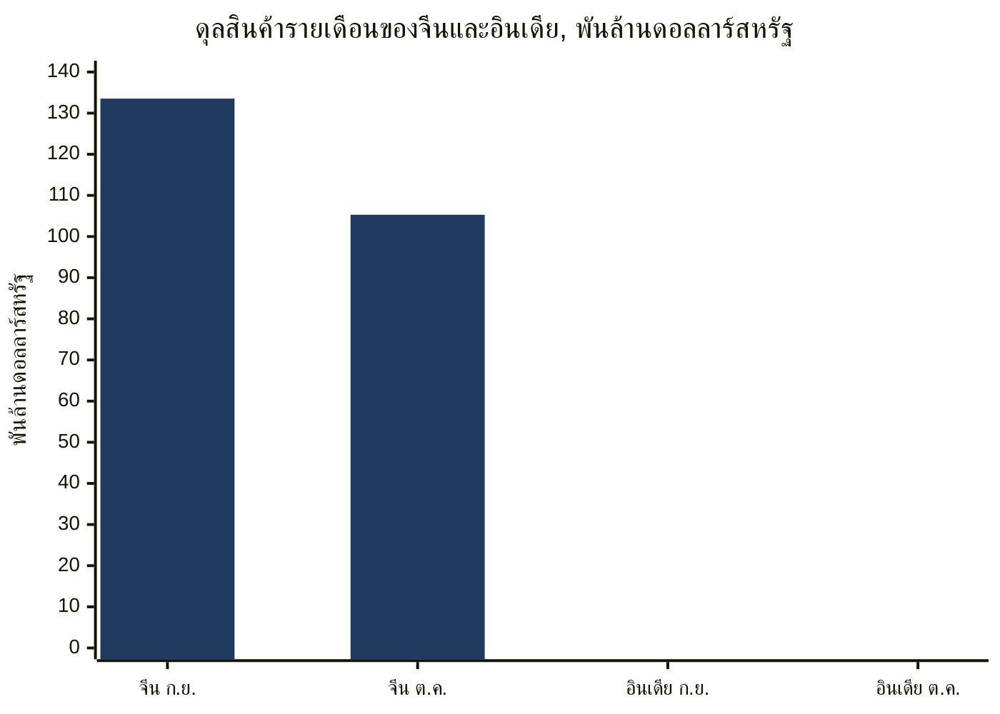

*หมายเหตุ: ดุลการค้าสินค้ารายเดือนของจีน: กันยายน 133,530 ล้านดอลลาร์ ตุลาคม 105,300 ล้านดอลลาร์ ดุลการค้าสินค้ารายเดือนของอินเดีย: กันยายน 30,210 ล้านดอลลาร์ ตุลาคม 39,880 ล้านดอลลาร์ แหล่งข้อมูล: GACC, กระทรวงการพาณิชย์อินเดีย*

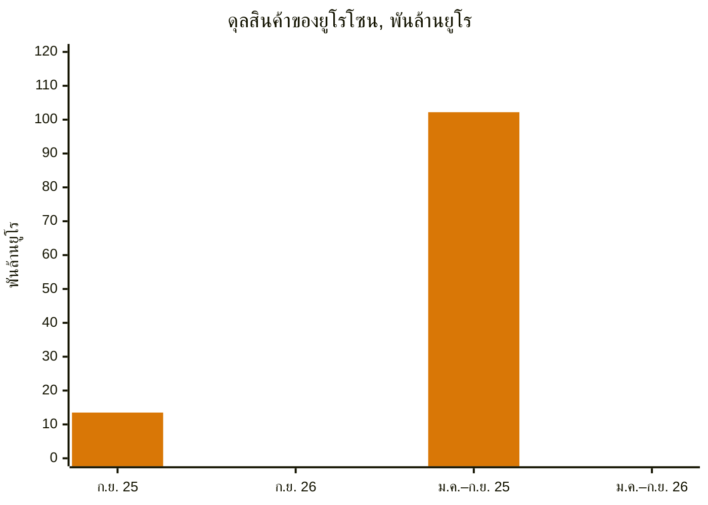

*หมายเหตุ: ดุลสินค้าของยูโรโซน: กันยายน 2025 +13,500 ล้านยูโร กันยายน 2026 –10,300 ล้านยูโร มกราคม–กันยายน 2025 +102,200 ล้านยูโร มกราคม–กันยายน 2026 –36,500 ล้านยูโร แหล่งข้อมูล: Eurostat วันที่ 13 พฤศจิกายน 2026*

### สถาบันคลังสมอง

หลังการเลือกตั้งกลางเทอม รายงานในช่วงวันที่ 5–10 พฤศจิกายนได้อ้างอิง Budget Lab ของมหาวิทยาลัยเยลและมูลนิธิ Tax Foundation เพื่อประเมินต้นทุนของภาษีของสหรัฐฯ (ดู 3.2) จำนวนนับของ Budget Lab ณ วันที่ 2 พฤศจิกายนกำหนดอัตราภาษีตามกฎหมายเฉลี่ยของสหรัฐฯ ไว้ที่ 11.8% โดยจะเพิ่มขึ้นเป็น 11.9% ภายในสิ้นปีภายใต้กฎหมายปัจจุบัน โดยมีต้นทุนประมาณ 0.7% ต่อราคาผู้บริโภคของสหรัฐฯ หรือประมาณ 900 ดอลลาร์ต่อครัวเรือนต่อปี มูลนิธิ Tax Foundation ประเมินว่าภาษีจะทำให้ภาษีเพิ่มขึ้นเฉลี่ย 820 ดอลลาร์ต่อครัวเรือนในปี 2026 (แบบจำลองลงวันที่สิงหาคม 2026) ขณะที่ Budget Lab ประเมินภาระไว้ที่ประมาณ 1,100 ดอลลาร์ต่อครัวเรือนในรายงานลงวันที่ 24 สิงหาคม 2026 ตัวเลขทั้งสองใช้วิธีการที่แตกต่างกัน: ตัวเลข 820 ดอลลาร์ของ Tax Foundation สะท้อนปี 2026 ตามสินค้าที่นำเข้าจริง ขณะที่ตัวเลข 1,100 ดอลลาร์ของเยลสมมติว่าภาษีปัจจุบันยังคงอยู่โดยมีน้ำหนักการนำเข้าคงที่ Erica York นักเศรษฐศาสตร์อาวุโสของ Tax Foundation เขียนเมื่อวันที่ 7 ตุลาคมว่า การยกเลิกภาษีทั้งหมดที่กำหนดตั้งแต่ปี 2017 จะมีค่าใช้จ่ายเกือบ 1.8 ล้านล้านดอลลาร์ในระยะเวลาสิบปี และภาษีมูลค่าเพิ่มแบบฐานกว้างที่อัตรา 1% จะระดมทุนได้เพียงพอที่จะทดแทนได้ Martha Gimbel ผู้อำนวยการบริหารของ Budget Lab กล่าวกับ Marketplace เมื่อวันที่ 5 พฤศจิกายนว่า ภาษีนำรายได้เกือบ 2 ล้านล้านดอลลาร์ในระยะเวลาสิบปี ภาษีศุลกากรสุทธิรวม 173,200 ล้านดอลลาร์ในปีงบประมาณ 2026 ตามข้อมูลของกระทรวงการคลัง ไม่มีการระบุรายการนโยบายการค้าใหม่จาก tradeintelligence.eu ในช่วงเวลาที่ครอบคลุมผ่านการค้นหาเว็บ

**แหล่งข้อมูล:** [Geopolitiqs](https://www.geopolitiqs.com/tn/2026-11-09/tariffs-average-rate); [Dave Manuel](https://www.davemanuel.com/2026/11/06/what-happens-to-tariffs-now-that-democrats-control-congress/)

### พอร์ทัลข้อมูล

ไม่มีการระบุการเผยแพร่ใหม่ที่สำคัญในช่วงเวลาที่ครอบคลุมจาก USITC DataWeb, UN Comtrade, WITS, ธนาคารโลก หรือพอร์ทัล IMF

---

## 9. ตลาดค่าระวาง

### อัตราค่าระวางตู้คอนเทนเนอร์แบบสปอต — ดัชนี Drewry World Container Index

การประเมินของ Drewry สำหรับวันพฤหัสบดีที่ 12 พฤศจิกายน 2026 บันทึกการลดลงรายสัปดาห์ 2% ของดัชนีรวมเหลือ 4,305 ดอลลาร์ต่อตู้ 40 ฟุต เป็นการลดลงรายสัปดาห์ครั้งที่สองติดต่อกัน จากความต้องการที่อ่อนแอในเส้นทางข้ามมหาสมุทรแปซิฟิกและเอเชีย–ยุโรป/ทะเลเมดิเตอร์เรเนียน ในเส้นทางข้ามมหาสมุทรแปซิฟิก เซี่ยงไฮ้–นิวยอร์กลดลง 3% เหลือ 9,020 ดอลลาร์ต่อตู้ 40 ฟุต ซึ่งเป็นระดับต่ำสุดตั้งแต่เดือนสิงหาคม 2026 และเซี่ยงไฮ้–ลอสแอนเจลิสลดลง 2% เหลือ 7,416 ดอลลาร์ ซึ่งเป็นระดับต่ำสุดตั้งแต่เดือนกันยายน 2026 ในเส้นทางเอเชีย–ยุโรป/ทะเลเมดิเตอร์เรเนียน เซี่ยงไฮ้–รอตเทอร์ดามลดลง 3% เหลือ 3,504 ดอลลาร์ ขณะที่เซี่ยงไฮ้–เจนัวไม่เปลี่ยนแปลงที่ 4,168 ดอลลาร์ ผู้ให้บริการเรือประกาศยกเลิกเที่ยวเรือแปดเที่ยวสำหรับสัปดาห์ถัดไปในเส้นทางข้ามมหาสมุทรแปซิฟิก เทียบกับสี่เที่ยวในสัปดาห์นี้ (แปดเที่ยวเทียบกับห้าเที่ยวในเส้นทางเอเชีย–ยุโรป/ทะเลเมดิเตอร์เรเนียน) และประกาศอัตราค่าระวาง Freight All Kinds ที่สูงขึ้นและค่าธรรมเนียมช่วงฤดูกาลสูงสุดในเส้นทางเอเชีย–ยุโรป/ทะเลเมดิเตอร์เรเนียนซึ่งมีผลในช่วงครึ่งหลังของเดือนพฤศจิกายน Drewry คาดว่าอัตราค่าระวางข้ามมหาสมุทรแปซิฟิกจะลดลงอีกในสัปดาห์หน้า และอัตราค่าระวางเอเชีย–ยุโรป/ทะเลเมดิเตอร์เรเนียนจะเพิ่มขึ้นเล็กน้อย ความแออัดที่ท่าเรือเซี่ยงไฮ้เพิ่มขึ้นเป็น 49 ชั่วโมงในสัปดาห์ที่แล้ว จาก 36 ชั่วโมงในสัปดาห์ก่อนหน้า เรือห้าสิบสามลำเดินเรือผ่านคลองสุเอซในสัปดาห์ที่แล้ว ขณะที่เรือหนึ่งลำเดินเรือผ่านช่องแคบฮอร์มุซ

**แหล่งข้อมูล:** [Drewry](https://www.drewry.co.uk/supply-chain-advisors/supply-chain-expertise/world-container-index-assessed-by-drewry)

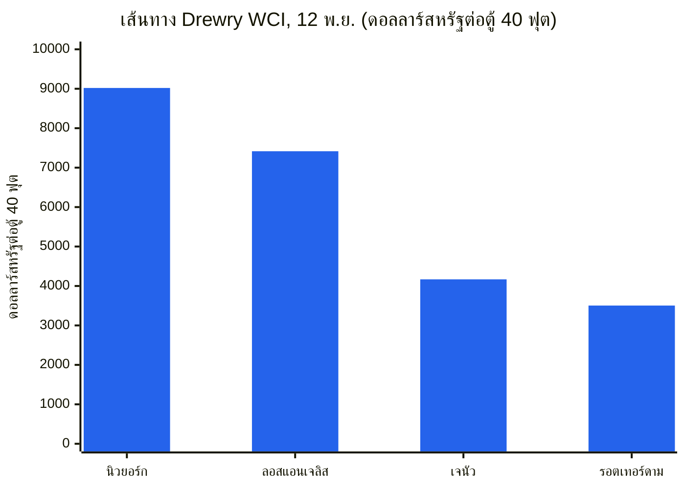

*หมายเหตุ: ทุกเส้นทางจากเซี่ยงไฮ้ เซี่ยงไฮ้–นิวยอร์ก 9,020 ดอลลาร์ เซี่ยงไฮ้–ลอสแอนเจลิส 7,416 ดอลลาร์ เซี่ยงไฮ้–เจนัว 4,168 ดอลลาร์ เซี่ยงไฮ้–รอตเทอร์ดาม 3,504 ดอลลาร์ ดัชนีรวม 4,305 ดอลลาร์ต่อตู้ 40 ฟุต ลดลง 2% เมื่อเทียบสัปดาห์ต่อสัปดาห์ แหล่งข้อมูล: Drewry วันที่ 12 พฤศจิกายน 2026*

### ดัชนี Freightos Baltic Index

Freightos รายงานในข้อมูลปรับปรุงรายสัปดาห์เมื่อวันที่ 10 พฤศจิกายนว่าดัชนีทั่วโลกลดลง 2% เหลือ 3,452 ดอลลาร์ (ค่าก่อนหน้า 3,513 ดอลลาร์) โดยเอเชีย–ยุโรปเหนือลดลง 5% และเส้นทางข้ามมหาสมุทรแปซิฟิกลดลงหลังจากการปรับขึ้นอัตราทั่วไปในเดือนพฤศจิกายนไม่สามารถคงอยู่ได้ ราคาเอเชีย–ชายฝั่งตะวันตกของสหรัฐฯ (FBX01 รายสัปดาห์) ลดลง 1% เหลือประมาณ 8,200 ดอลลาร์ต่อ FEU ราคาเอเชีย–ชายฝั่งตะวันออกของสหรัฐฯ (FBX03 รายสัปดาห์) ลดลง 2% เหลือประมาณ 9,700 ดอลลาร์ต่อ FEU ราคาเอเชีย–ยุโรปเหนือ (FBX11 รายสัปดาห์) ลดลง 5% เหลือ 3,400 ดอลลาร์ต่อ FEU เพิ่มขึ้น 50% เมื่อเทียบปีต่อปี ราคาเอเชีย–ทะเลเมดิเตอร์เรเนียน (FBX13 รายสัปดาห์) ลดลง 1% เหลือ 4,300 ดอลลาร์ต่อ FEU เพิ่มขึ้น 88% เมื่อเทียบปีต่อปี การลดลงรายสัปดาห์ครั้งที่สองติดต่อกันของดัชนีทั่วโลก ควบคู่ไปกับของ Drewry ยืนยันว่าการปรับขึ้นอัตราในเดือนพฤศจิกายนไม่สามารถคงอยู่ได้ ขณะที่อัตราค่าระวางยังคงสูงกว่าระดับปีก่อนมากในเส้นทางเอเชีย–ยุโรป สหภาพแรงงานยามเฝ้าระวัง ILWU Local 26 ได้ขยายเส้นตายการหยุดงานที่ท่าเรือลอสแอนเจลิสและลองบีชถึงวันที่ 20 พฤศจิกายนเพื่อให้มีเวลาเจรจามากขึ้น สหพันธ์ค้าปลีกแห่งชาติรายงานว่าปริมาณการนำเข้าทางทะเลของสหรัฐฯ สูงสุดที่ต่ำกว่าระดับสูงสุดเป็นประวัติการณ์เล็กน้อยในเดือนกันยายนที่ 2.37 ล้าน TEU โดยลดลงประมาณ 5% ในเดือนตุลาคม และคาดการณ์เดือนพฤศจิกายนลดลง 14% จากระดับสูงสุดในเดือนกันยายน

**แหล่งข้อมูล:** [Freightos](https://www.freightos.com/freight-resources/la-lb-strike-deadline-extended-dem-win-increasing-trade-uncertainty-november-10-2026-update/)

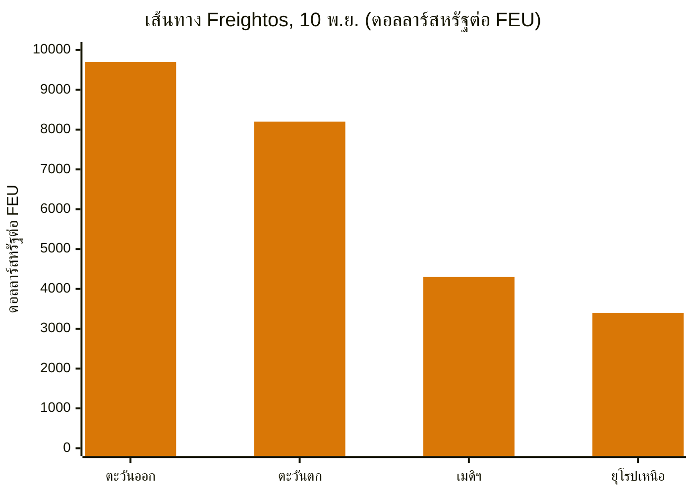

*หมายเหตุ: เอเชีย–ชายฝั่งตะวันออกของสหรัฐฯ ประมาณ 9,700 ดอลลาร์ต่อ FEU เอเชีย–ชายฝั่งตะวันตกของสหรัฐฯ ประมาณ 8,200 ดอลลาร์ เอเชีย–ทะเลเมดิเตอร์เรเนียน 4,300 ดอลลาร์ เอเชีย–ยุโรปเหนือ 3,400 ดอลลาร์ ดัชนีทั่วโลก 3,452 ดอลลาร์ ลดลง 2% เมื่อเทียบสัปดาห์ต่อสัปดาห์ แหล่งข้อมูล: Freightos วันที่ 10 พฤศจิกายน 2026*

### การปรับขึ้นอัตราในเดือนพฤศจิกายน — ประกาศแล้ว แต่ถูกลดราคาทันที

อัตราค่าระวางทางทะเลข้ามมหาสมุทรแปซิฟิกลดลงเล็กน้อยในสัปดาห์ถึงวันที่ 12 พฤศจิกายน เนื่องจากการปรับขึ้นอัตราทั่วไปตามแผนของผู้ให้บริการเรือไม่สามารถคงอยู่ได้ แต่ยังคงอยู่ในระดับช่วงฤดูกาลสูงสุด ผู้ให้บริการเรือพยายามปรับขึ้นราคา 2,000–3,000 ดอลลาร์ต่อ FEU สำหรับเดือนพฤศจิกายน และยื่นปรับขึ้นเพิ่มเติมสำหรับวันที่ 15–16 พฤศจิกายน แต่ผู้ขนส่งสินค้าอ้างถึงพื้นที่ว่างที่เพิ่มขึ้นและตารางเดินเรือที่สม่ำเสมอมากขึ้น อัตราค่าระวางเอเชีย–ยุโรปอ่อนตัวลงเช่นกัน: ราคายุโรปเหนือลดลง 5% ในสัปดาห์เหลือ 3,400 ดอลลาร์ต่อ FEU ขณะที่อัตราค่าระวางทะเลเมดิเตอร์เรเนียนลดลง 1% เหลือ 4,300 ดอลลาร์ต่อ FEU ดัชนี Shanghai Containerized Freight Index ลดลง 61.12 จุดเหลือ 3,572.33 เมื่อวันที่ 13 พฤศจิกายน เป็นการลดลงรายสัปดาห์ครั้งที่สองติดต่อกัน เนื่องจากอัตราค่าระวางที่มุ่งหน้าไปยังสหรัฐฯ ลดลงและอัตราค่าระวางทะเลเมดิเตอร์เรเนียนเพิ่มขึ้น อัตราค่าระวางเซี่ยงไฮ้–ชายฝั่งตะวันออกของสหรัฐฯ ลดลง 470 ดอลลาร์เหลือ 9,387 ดอลลาร์ต่อตู้ 40 ฟุต เซี่ยงไฮ้–ชายฝั่งตะวันตกของสหรัฐฯ ลดลง 270 ดอลลาร์เหลือ 7,111 ดอลลาร์ และเซี่ยงไฮ้–ยุโรปลดลง 77 ดอลลาร์เหลือ 3,402 ดอลลาร์ต่อตู้ 40 ฟุต ขณะที่เซี่ยงไฮ้–ทะเลเมดิเตอร์เรเนียนเพิ่มขึ้น 380 ดอลลาร์เป็น 4,746 ดอลลาร์ต่อตู้ 40 ฟุต

**แหล่งข้อมูล:** [FreightWaves](https://www.freightwaves.com/news/us-midterm-shift-adds-trade-uncertainty-as-trans-pacific-ocean-freight-rates-stay-elevated); [ShipUniverse](https://www.shipuniverse.com/news/container-freight-rates-split-as-u-s-east-coast-drops-470-as-mediterranean-surges-6-7/)

### การยกเลิกเที่ยวเรือและกำลังการขนส่ง

ตัวติดตามการยกเลิกเที่ยวเรือของ Drewry คาดการณ์ว่าจะมีการยกเลิกเที่ยวเรือ 52 เที่ยวจาก 716 บริการตามกำหนดในเส้นทางการค้าตะวันออก–ตะวันตกที่สำคัญระหว่างวันที่ 16 พฤศจิกายนถึง 21 ธันวาคม หรือประมาณ 7% ของเที่ยวเรือที่วางแผนไว้ ผู้ให้บริการเรือประกาศยกเลิกเที่ยวเรือแปดเที่ยวสำหรับสัปดาห์ถัดไปในเส้นทางข้ามมหาสมุทรแปซิฟิก เทียบกับสี่เที่ยวในสัปดาห์นี้ และแปดเที่ยวในเส้นทางเอเชีย–ยุโรป/ทะเลเมดิเตอร์เรเนียนเทียบกับห้าเที่ยว ขนาดของการยกเลิกเที่ยวเรือตามแผนแสดงให้เห็นว่าผู้ให้บริการเรือกำลังดำเนินการเพื่อจำกัดกำลังการขนส่งเข้าสู่เดือนธันวาคม เนื่องจากการปรับขึ้นอัตราในเดือนพฤศจิกายนไม่สามารถคงอยู่ได้

### เรือเทกอง — Baltic Exchange

ดัชนี Baltic Dry Index เพิ่มขึ้น 6.2% ในสัปดาห์ถึง 2,980 จุดเมื่อวันที่ 13 พฤศจิกายน เป็นสัปดาห์ที่สี่ติดต่อกันที่ปรับขึ้น แม้ว่าจะลดลงในวันศุกร์จนสิ้นสุดสถิติชนะเจ็ดวันทำการติดต่อกัน ดัชนีเพิ่มขึ้นตลอดทั้งสัปดาห์ — 2,854 เมื่อวันที่ 9 พฤศจิกายน 2,862 เมื่อวันที่ 10 พฤศจิกายน 2,959 เมื่อวันที่ 11 พฤศจิกายน และ 3,020 เมื่อวันที่ 12 พฤศจิกายน — ก่อนจะลดลง 40 จุด หรือ 1.3% ในวันศุกร์ที่ 13 พฤศจิกายนเหลือ 2,980 อัตราค่าระวาง Capesize เป็นตัวขับเคลื่อนการเพิ่มขึ้นรายสัปดาห์: BCI 182 5TC แตะระดับสูงสุดที่ 43,860 ดอลลาร์ก่อนปิดสัปดาห์ที่ 42,798 ดอลลาร์ อัตราค่าระวาง Panamax และ Supramax ก็เพิ่มขึ้นในสัปดาห์เช่นกัน การเพิ่มขึ้นรายสัปดาห์ก่อนหน้า (สัปดาห์ถึงวันที่ 6 พฤศจิกายน) อยู่ที่ 3.4% เป็น 2,805 จาก 2,714 เมื่อวันที่ 30 ตุลาคม อัตราค่าระวางเรือเทกองเคลื่อนไหวในทิศทางตรงกันข้ามกับอัตราค่าระวางตู้คอนเทนเนอร์ โดยการเพิ่มขึ้นรายสัปดาห์สี่ครั้งติดต่อกันทำให้ดัชนีแตะระดับสูงสุดตั้งแต่ต้นเดือนตุลาคม ซึ่งบ่งชี้ถึงความต้องการเรือ Capesize และ Panamax ที่บรรทุกแร่เหล็ก ถ่านหิน และธัญพืชที่แข็งแกร่งขึ้น แม้ว่าความต้องการตู้คอนเทนเนอร์จะอ่อนตัวลง สรุปตู้คอนเทนเนอร์ของ Baltic Exchange สำหรับสัปดาห์ที่ 46 อธิบายว่าเป็นสัปดาห์ที่ค่อนข้างซบเซา: อัตราค่าระวางตู้คอนเทนเนอร์ในเส้นทางการค้าตะวันออก–ตะวันตกหลักสี่เส้นทางลดลงเฉลี่ย 0.52% โดยจีน/ชายฝั่งตะวันตกของสหรัฐฯ ลดลง 0.77% ขณะที่ชายฝั่งตะวันออกไม่เปลี่ยนแปลง และอัตราค่าระวางเอเชีย–ยุโรปอ่อนตัวลงเล็กน้อย โดยยุโรปเหนือลดลง 0.53% และทะเลเมดิเตอร์เรเนียนลดลง 0.79%

**แหล่งข้อมูล:** [The DCN](https://www.thedcn.com.au/news/baltic-exchange-weekly-report-13-november-2026)

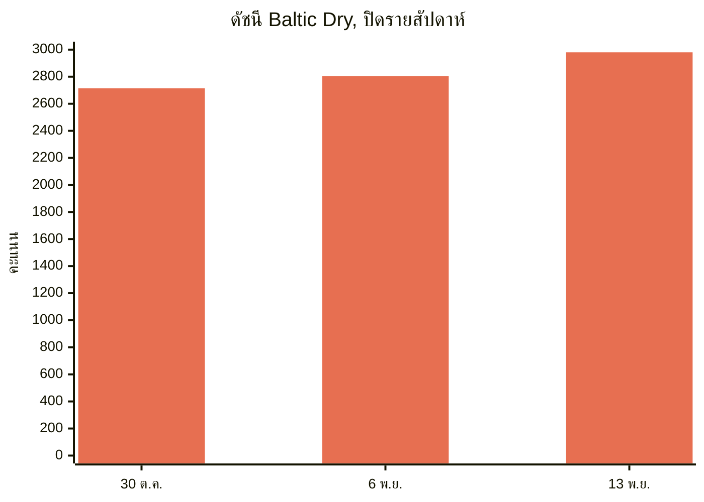

*หมายเหตุ: ราคาปิดรายสัปดาห์: 2,714 (30 ตุลาคม) 2,805 (6 พฤศจิกายน) 2,980 (13 พฤศจิกายน) เป็นการเพิ่มขึ้นรายสัปดาห์ครั้งที่สี่ติดต่อกัน แหล่งข้อมูล: รายงานรายสัปดาห์ของ Baltic Exchange วันที่ 13 พฤศจิกายน 2026*

### สุเอซและความน่าเชื่อถือของตารางเดินเรือ

การกลับมาใช้คลองสุเอซดำเนินต่อไป (ดู 3.5) Drewry นับเรือคอนเทนเนอร์ 53 ลำที่ผ่านคลองในสัปดาห์ถึงวันที่ 1 พฤศจิกายน เพิ่มขึ้น 130% เมื่อเทียบปีต่อปี และประเมินว่ากำลังการขนส่งเอเชีย–ยุโรปประมาณ 60% กลับมาใช้เส้นทางสุเอซแล้ว เรือ Ever Eon ของเอเวอร์กรีนเดินเรือผ่านเมื่อวันที่ 8 พฤศจิกายน เป็นการเดินเรือผ่านครั้งแรกของเอเวอร์กรีนในรอบเกือบสามปี เมื่อผู้ให้บริการเรือฟื้นฟูบริการผ่านสุเอซ ระยะเวลาขนส่งเอเชีย–ยุโรปลดลงเจ็ดถึงสิบวัน แต่การมาถึงของเรือกระจุกตัวกัน: Flexport คาดการณ์ว่ากำลังการขนส่งของเรือที่มาถึงท่าเรือยุโรปเหนือจะอยู่ที่ 131% ของระดับปกติในสัปดาห์วันที่ 16–22 พฤศจิกายน โดยมีเรือคอนเทนเนอร์ 31 ลำเดินเรือผ่านสุเอซควบคู่กับอีก 61 ลำที่ยังคงแล่นอ้อมแหลมกู๊ดโฮป Flexport ถือว่าการมาถึงที่เกิน 120% ของกำลังการขนส่งปกติเป็นความเสี่ยงด้านความแออัด และอย่างน้อยสามสัปดาห์ระหว่างกลางเดือนพฤศจิกายนถึงเดือนมกราคมคาดว่าจะเกินเกณฑ์ดังกล่าว ระยะเวลาค้างเฉลี่ยของตู้คอนเทนเนอร์แตะ 3.37 วันในสัปดาห์ที่ 42 โดยมีการรายงานอัตราการใช้ลานตู้ที่ 80%–90%

### ค่าระวางทางอากาศ

อัตราค่าระวางทางอากาศแบบสปอตทั่วโลกเพิ่มขึ้นเป็นสัปดาห์ที่สามติดต่อกัน โดยเพิ่มขึ้น 4% ในสัปดาห์ที่ 44 เป็นประมาณ 3.93 ดอลลาร์ต่อกิโลกรัม สูงกว่าสัปดาห์เดียวกันของปีที่แล้วประมาณ 40% ตามดัชนี TAC ดัชนี Baltic Air Freight Index เพิ่มขึ้น 6.6% ในช่วงเจ็ดวันถึงวันที่ 9 พฤศจิกายน และ 28.2% เมื่อเทียบปีต่อปี ข้อมูลปรับปรุงของ Freightos เมื่อวันที่ 10 พฤศจิกายนบันทึกว่าจีน–อเมริกาเหนือเพิ่มขึ้น 3% เป็นมากกว่า 8.00 ดอลลาร์ต่อกิโลกรัม จีน–ยุโรปเหนือเพิ่มขึ้น 11% เป็น 4.87 ดอลลาร์ต่อกิโลกรัม และยุโรปเหนือ–อเมริกาเหนือเพิ่มขึ้น 9% ค่าระวางทางอากาศข้ามมหาสมุทรแอตแลนติกเพิ่มขึ้น 33% ในช่วงเดือนที่ผ่านมาเป็น 2.90 ดอลลาร์ต่อกิโลกรัม อัตราค่าระวางแบบสปอตเฉลี่ยทั่วโลกในเดือนตุลาคมของ Xeneta อยู่ที่ 3.11 ดอลลาร์ต่อกิโลกรัม เพิ่มขึ้น 29% เมื่อเทียบปีต่อปี IATA รายงานว่าความต้องการขนส่งสินค้าทางอากาศในเดือนกันยายนเพิ่มขึ้น 7.7% เมื่อเทียบปีต่อปี โดยการจราจรเอเชีย–อเมริกาเหนือเพิ่มขึ้น 17% ขณะที่ราคาน้ำมันเชื้อเพลิงเครื่องบินสูงกว่าปีก่อน 103.4% ค่าระวางทางอากาศกำลังรองรับคำสั่งซื้อช่วงวันหยุดที่มาสายและการขนส่งฮาร์ดแวร์ AI เข้าสู่กำลังการขนส่งที่ตึงตัวจากตารางบินผู้โดยสารฤดูหนาว ผลักดันอัตราค่าระวางให้เข้าใกล้ระดับสูงสุดในเดือนธันวาคมปีที่แล้ว ผู้ขนส่งสินค้ารายงานอัตราค่าระวางจีน–ชายฝั่งตะวันตกของสหรัฐฯ ที่ประมาณ 8.50–9.00 ดอลลาร์ต่อกิโลกรัมในกรณีที่มีพื้นที่ว่างเลย

**แหล่งข้อมูล:** [Daily8 News](https://www.daily8news.com/article/air-cargo-rates-2026-high-peak-season-20261113/); [IATA](https://www.iata.org/en/pressroom/2026-releases/10-29-air-cargo-demand-accelerates-september/); [TAC Index via LinkedIn](https://www.linkedin.com/pulse/air-freight-market-update-november-10-2026-tacindex-pkmfc)

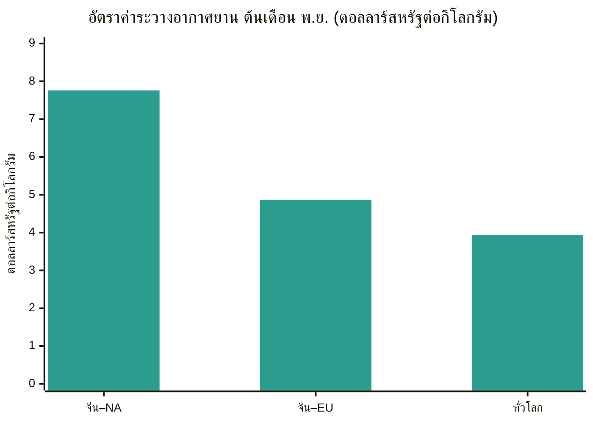

*หมายเหตุ: จีน–อเมริกาเหนือ 7.76 ดอลลาร์ต่อกิโลกรัม (Freightos ต้นเดือนพฤศจิกายน สูงกว่า 8.00 ดอลลาร์ต่อกิโลกรัมในข้อมูลปรับปรุงวันที่ 10 พฤศจิกายน) จีน–ยุโรปเหนือ 4.87 ดอลลาร์ต่อกิโลกรัม อัตราค่าระวางแบบสปอตทั่วโลกประมาณ 3.93 ดอลลาร์ต่อกิโลกรัม (ดัชนี TAC สัปดาห์ที่ 44) แหล่งข้อมูล: Freightos, TAC Index*

### การหยุดชะงักที่ท่าเรือและโลจิสติกส์

**ลอสแอนเจลิสและลองบีช** การเจรจายามเฝ้าระวังขยายออกไปจนถึงวันที่ 20 พฤศจิกายน (ดู A8) C.H. Robinson รายงานว่าสินค้าค้าปลีกจากเอเชียยังคงเผชิญกับการหยุดชะงักในช่วงต้นเดือนพฤศจิกายน หลังจากเดือนกันยายนที่แข็งแกร่งเป็นพิเศษและพายุไต้ฝุ่นหลายลูกที่ทำให้ตู้คอนเทนเนอร์ค้างอยู่ที่ท่าเรือที่ใหญ่ที่สุดบางแห่งของจีน ขัดจังหวะตารางเดินเรือทางทะเล และทำให้ผู้ให้บริการเรือข้ามท่าเรือและเลื่อนสินค้า ที่ลอสแอนเจลิสและลองบีช ความแออัดยังคงรุนแรง โดยหลักเป็นเพราะรถไฟไม่เพียงพอสำหรับการขนส่งสินค้าเข้าประเทศ ผู้ขนส่งบางรายหันไปใช้การถ่ายโอนและรถบรรทุก ณ วันที่ 2 พฤศจิกายน ตู้คอนเทนเนอร์นำเข้า 35,688 ตู้กำลังรออยู่บนท่าเรือเพื่อขึ้นรถไฟบนท่าเรือ โดย 10,562 ตู้รอมาเก้าวันหรือนานกว่านั้น ท่าเรือลอสแอนเจลิสายงานว่าสินค้าท้องถิ่นค้างอยู่บนท่าเรือ 3.7 วัน และสินค้าทางรถไฟบนท่าเรือค้างอยู่ 5.6 วันเมื่อวันที่ 30 ตุลาคม คาดว่าการฟื้นตัวจะเป็นไปอย่างค่อยเป็นค่อยไปในช่วงสองถึงสามสัปดาห์ โดยสมมติว่าไม่มีการหยุดชะงักเพิ่มเติม ท่าเรือลอสแอนเจลิสจัดการตู้คอนเทนเนอร์ 1,026,872 TEU ในเดือนตุลาคม 2026 ซึ่งเป็นสถิติของเดือนดังกล่าวและเป็นยอดรวมรายเดือนสูงสุดเป็นอันดับสองในประวัติศาสตร์ของท่าเรือ รองจากสถิติตลอดกาลในเดือนกันยายนที่ 1,042,652 TEU เป็นครั้งแรกที่ท่าเรือทะลุ 1 ล้าน TEU ในเดือนติดต่อกัน และเป็นครั้งที่สามในปี 2026 ที่ทำได้ถึงตัวเลขดังกล่าว การนำเข้าที่บรรทุกสินค้าอยู่ที่ประมาณ 538,620 TEU เพิ่มขึ้น 25% เมื่อเทียบปีต่อปี และสูงกว่าค่าเฉลี่ยเดือนตุลาคมห้าปีของท่าเรือ 30% การส่งออกที่บรรทุกสินค้า 114,981 TEU ลดลง 7% เมื่อเทียบปีต่อปี ตู้เปล่า 373,271 TEU เป็นสถิติรายเดือนครั้งที่สองติดต่อกัน ยอดรวมเดือนมกราคม–ตุลาคมอยู่ที่ประมาณ 9,108,497 TEU สูงกว่าปีที่แล้ว 5% และสูงกว่าค่าเฉลี่ยห้าปี 9%

**แนวโน้มการนำเข้าของสหรัฐฯ** Global Port Tracker ของสหพันธ์ค้าปลีกแห่งชาติรายงานว่าท่าเรือที่ติดตามจัดการการนำเข้าที่บรรทุกสินค้า 2.37 ล้าน TEU ในเดือนกันยายน ซึ่งเป็นเดือนที่คึกคักที่สุดของปี 2026 และเป็นเดือนที่คึกคักเป็นอันดับสามนับตั้งแต่เริ่มติดตาม เดือนตุลาคมคาดการณ์ไว้ที่ 2.26 ล้าน TEU เพิ่มขึ้น 9.1% เมื่อเทียบปีต่อปี เดือนพฤศจิกายนที่ 2.05 ล้าน TEU เพิ่มขึ้น 1.2% และเดือนธันวาคมที่ 2.03 ล้าน TEU เพิ่มขึ้น 1.3% การคาดการณ์ทั้งปีอยู่ที่ประมาณ 26 ล้าน TEU เพิ่มขึ้น 2% จากปี 2025 แนวโน้มจะอ่อนตัวลงในช่วงต้นปี 2027: เดือนมกราคมคาดการณ์ไว้ที่ 2.04 ล้าน TEU ลดลง 3% เมื่อเทียบปีต่อปี เดือนกุมภาพันธ์ที่ 1.89 ล้าน TEU ลดลง 0.5% เดือนมีนาคมที่ 1.92 ล้าน TEU ลดลง 11.2%

**เดอร์บัน** เดอร์บันยังไม่ฟื้นตัวจากการเปลี่ยนผู้ดำเนินการท่าเรือ Durban Gateway Terminal ไปเป็น ICTSI ในเดือนสิงหาคมและระบบท่าเรือ Navis N4 ปริมาณสินค้าที่ท่าเรือลดลงประมาณ 30% ระหว่างวันที่ 14 สิงหาคมถึง 10 กันยายน เทียบกับค่าเฉลี่ยสี่เดือนก่อนหน้า ตัวบ่งชี้การวางแผนทั่วทั้งท่าเรืออยู่ที่ 15 วันในข้อมูลปรับปรุงการเคลื่อนย้ายสินค้าเมื่อวันที่ 3 พฤศจิกายน เพิ่มขึ้นหนึ่งวันจากสัปดาห์ก่อนหน้า เรือคอนเทนเนอร์สิบเจ็ดลำกำลังรอเดอร์บันเมื่อวันที่ 2 พฤศจิกายน — หกลำอยู่ภายในที่ทอดสมอที่กำหนดและอีกสิบเอ็ดลำอยู่ไกลออกไปนอกชายฝั่ง — คิดเป็นประมาณ 85,000 TEU ที่ลอยลำอยู่ เรือคอนเทนเนอร์ใช้เวลาเฉลี่ย 7.46 วันในการทอดสมอในช่วงเจ็ดวันถึงต้นเดือนพฤศจิกายน Maersk ได้เพิ่มค่าธรรมเนียมช่วงฤดูกาลสูงสุดสำหรับตู้แห้งจากเอเชียตะวันออกไกลไปยังแอฟริกาใต้และมอริเชียสเป็น 1,000 ดอลลาร์ต่อตู้ 20 ฟุตและ 2,000 ดอลลาร์ต่อตู้ 40 ฟุตตั้งแต่วันที่ 9 พฤศจิกายน ซึ่งมากกว่าสี่เท่าของระดับ 250/500 ดอลลาร์ที่กำหนดเมื่อวันที่ 15 ตุลาคม และเพิ่มค่าธรรมเนียมความแออัดของเดอร์บันเป็น 400 ดอลลาร์ต่อตู้ 20 ฟุตและ 800 ดอลลาร์ต่อตู้ 40 ฟุตสำหรับสินค้าต้นกำเนิดจากจีนตั้งแต่วันที่ 1 พฤศจิกายน รัฐมนตรีว่าการกระทรวงคมนาคม Barbara Creecy กล่าวว่าท่าเรือ Durban Gateway Terminal อาจกลับไปสู่ประสิทธิภาพเดิมได้เฉพาะระหว่างเดือนธันวาคม 2026 ถึงเดือนกุมภาพันธ์ 2027 และ Kuehne+Nagel คาดว่าจะไม่มีการปรับปรุงที่มีความหมายก่อนสิ้นไตรมาสที่ 1 ปี 2027

**แหล่งข้อมูล:** [C.H. Robinson](https://www.chrobinson.com/en-us/resources/insights-and-advisories/north-america-freight-insights/nov-2026-freight-market-update/industry-insights/retail/); [AJOT](https://www.ajot.com/news/port-of-los-angeles-tops-1-million-container-units-for-second-consecutive-month); [FreightWaves](https://www.freightwaves.com/news/retailers-forecast-u-s-imports-to-stay-elevated-through-2026-after-breakout-peak-season); [DTFU Logistics](https://www.dtfulogistics.com/news/durban-port-congestion-2026-china-south-africa/)

### ข่าวกรองผู้ขาย

Descartes Systems Group ได้เผยแพร่รายงานการขนส่งทั่วโลกประจำเดือนพฤศจิกายนเมื่อวันที่ 11 พฤศจิกายน โดยอ้างอิงจากข้อมูลการค้า Descartes Datamyne การนำเข้าตู้คอนเทนเนอร์ของสหรัฐฯ ในเดือนตุลาคม 2026 แตะระดับสูงสุดเป็นประวัติการณ์รายเดือนที่ 2,674,808 TEU — สูงกว่าสถิติก่อนหน้าที่ 2,622,465 TEU ซึ่งตั้งไว้ในเดือนพฤษภาคม 2022 อยู่ 2.0% (52,343 TEU) เพิ่มขึ้น 5.0% จากเดือนกันยายน 2026 เพิ่มขึ้น 16.0% จากเดือนตุลาคม 2025 และเพิ่มขึ้น 29.2% จากเดือนตุลาคม 2019 การนำเข้าจากจีนเพิ่มขึ้นเป็นเดือนที่สี่ติดต่อกันเป็น 987,805 TEU ซึ่งเป็นปริมาณรายเดือนสูงสุดนับตั้งแต่เดือนมกราคม 2025 เพิ่มขึ้น 6.9% (63,351 TEU) เมื่อเทียบเดือนต่อเดือน และเพิ่มขึ้น 22.9% เมื่อเทียบปีต่อปี ส่วนแบ่งของจีนในการนำเข้าตู้คอนเทนเนอร์ทั้งหมดของสหรัฐฯ เพิ่มขึ้นเป็น 36.9% จาก 36.3% ในเดือนกันยายน หมวดสินค้าต้นกำเนิดจากจีนที่นำหน้า ได้แก่ พลาสติก 144,530 TEU เฟอร์นิเจอร์และเครื่องนอน 137,551 TEU ของเล่น เกม และสินค้ากีฬา 102,672 TEU การนำเข้าจาก 10 ประเทศต้นทางชั้นนำเพิ่มขึ้น 5.8% เมื่อเทียบเดือนต่อเดือน การนำเข้าตู้คอนเทนเนอร์ของสหรัฐฯ ในเดือนมกราคม–ตุลาคม 2026 เพิ่มขึ้น 2.3% เทียบกับช่วงเดียวกันของปี 2025 เป็นเดือนที่สองติดต่อกันที่ปริมาณสะสมสูงกว่าปีก่อน หลังจากแปดเดือนที่ต่ำกว่าจังหวะของปีที่แล้ว ท่าเรือชายฝั่งตะวันออกและอ่าวเม็กซิโกได้ส่วนแบ่งเพิ่มขึ้นจากท่าเรือชายฝั่งตะวันตก: การนำเข้าชายฝั่งอ่าวเม็กซิโกอยู่ที่ 266,905 TEU เพิ่มขึ้น 24.0% เมื่อเทียบเดือนต่อเดือน และสูงกว่าค่าเฉลี่ย 12 เดือน 16.2% ซึ่งเป็นระดับสูงสุดนับตั้งแต่ Descartes เริ่มติดตามตัวเลขระดับภูมิภาคในเดือนสิงหาคม 2023 ฮิวสตันบันทึกการเพิ่มขึ้นรายเดือนของท่าเรือมากที่สุด เพิ่มขึ้น 42,665 TEU (26.7%) การนำเข้าที่ลอสแอนเจลิสลดลง 1.4% ลองบีชลดลง 2.0% และโอ๊คแลนด์ลดลง 10.9% ส่วนแบ่งตลาดรวมของท่าเรือชั้นนำห้าแห่งบนชายฝั่งตะวันออกและอ่าวเม็กซิโกอยู่ที่ 39.9% เพิ่มขึ้นจาก 36.7% ในเดือนกันยายน ส่วนท่าเรือชั้นนำห้าแห่งบนชายฝั่งตะวันตกลดลงเหลือ 44.9% จาก 47.0% ท่าเรือชั้นนำ 10 แห่งของสหรัฐฯ จัดการการนำเข้า 84.8% ความล่าช้าเฉลี่ยในการขนส่งที่ท่าเรือใน 10 ท่าเรือที่ติดตามอยู่ที่ 6.3 วันในเดือนตุลาคม เทียบกับ 6.0 วันในเดือนกันยายนและ 4.2 วันในเดือนมิถุนายน ความล่าช้าเพิ่มขึ้นที่ท่าเรือเจ็ดแห่งจากสิบแห่ง ความล่าช้าที่ยาวที่สุด: นิวยอร์ก/นิวเจอร์ซีย์ 8.1 วัน ซีแอตเทิล 7.6 วัน ซาวันนาห์ 6.9 วัน การนำเข้ามีปริมาณเกิน 2.5 ล้าน TEU ในทุกเดือนนับตั้งแต่เดือนกรกฎาคม 2026 ปริมาณเดือนตุลาคมที่ทำสถิติสูงสุด ซึ่งได้รับแรงหนุนส่วนใหญ่จากการเพิ่มขึ้นติดต่อกันเป็นเดือนที่สี่ของสินค้าต้นกำเนิดจากจีน บ่งชี้ว่าความต้องการนำเข้าทางทะเลของสหรัฐฯ ยังคงแข็งแกร่งแม้จะมีความไม่แน่นอนด้านภาษีและนโยบายการค้าอย่างต่อเนื่อง การเปลี่ยนส่วนแบ่งไปสู่ท่าเรือชายฝั่งตะวันออกและอ่าวเม็กซิโกและการเพิ่มขึ้นอย่างต่อเนื่องของความล่าช้าในการขนส่ง — เพิ่มขึ้นประมาณ 50% นับตั้งแต่เดือนมิถุนายน — ชี้ให้เห็นถึงแรงกดดันที่เพิ่มขึ้นต่อเครือข่ายโลจิสติกส์ภายในประเทศแม้จะไม่มีความแออัดของท่าเรือในวงกว้าง

ไม่มีรายการผู้ขายที่มีคุณสมบัติจาก TradeInt ในช่วงวันที่ 9–16 พฤศจิกายน 2026 หน้าบล็อกของ TradeInt ระบุโพสต์ล่าสุดไว้ลงวันที่ 31 ธันวาคม 2025 ไม่พบโพสต์บล็อกที่ลงวันที่ 9–16 พฤศจิกายน 2026 บนเว็บไซต์หรือในการค้นหา tradeint.com/insights/

**แหล่งข้อมูล:** [Descartes](https://www.descartes.com/resources/global-logistics-shipping-report-resource-center?language=en); [All About Shipping](https://allaboutshipping.co.uk/2026/11/11/descartes-releases-november-global-shipping-report-u-s-container-imports-hit-record-volume-in-october/); [TradeInt blog](https://tradeint.com/insights/blogs/)

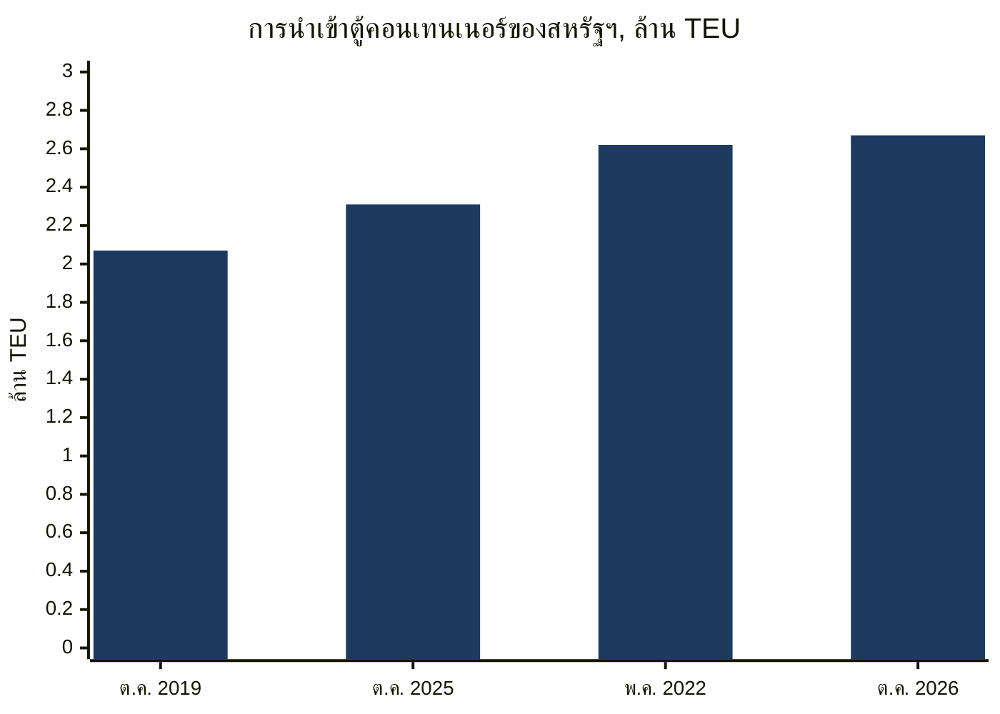

*หมายเหตุ: ตุลาคม 2026: 2,674,808 TEU สูงสุดเป็นประวัติการณ์รายเดือน สถิติก่อนหน้าเดือนพฤษภาคม 2022: 2,622,465 TEU ตุลาคม 2025: ประมาณ 2.31 ล้าน TEU (เพิ่มขึ้น 16.0% เมื่อเทียบปีต่อปี) ตุลาคม 2019: ประมาณ 2.07 ล้าน TEU (เพิ่มขึ้น 29.2%) แหล่งข้อมูล: รายงานการขนส่งทั่วโลกประจำเดือนพฤศจิกายนของ Descartes วันที่ 11 พฤศจิกายน 2026*

---

## 10. ไทม์ไลน์นโยบาย

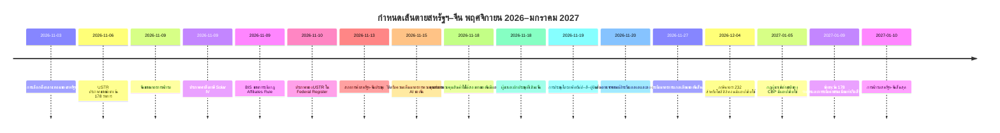

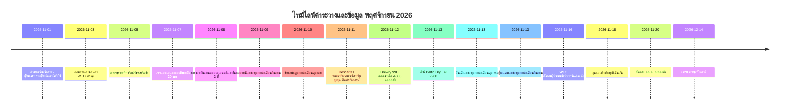

---

## 11. กำหนดเส้นตายและเหตุการณ์ที่จะมาถึง (90 วันข้างหน้า)

| วันที่ | รายการ |
|---|---|
| 18 พฤศจิกายน 2026 | CBP อาจเพิกถอนหมายเลขผู้นำเข้าของผู้นำเข้า CTPAT ที่ยังไม่ได้แก้ไขข้อกังวลเกี่ยวกับความถูกต้องของแบบฟอร์ม 5106 (จดหมายส่งเมื่อวันที่ 4 พฤศจิกายน) |
| 18 พฤศจิกายน 2026 | มาตรการควบคุมการส่งออกสินค้าใช้ได้สองทางฉบับปรับปรุงของจีนสำหรับโดรน เครื่องเจาะอุโมงค์ และเรือขุดลอกมีผลบังคับใช้ (ประกาศฉบับที่ 49–51) |
| 18–19 พฤศจิกายน 2026 | การประชุมผู้นำเศรษฐกิจเอเปกที่เซินเจิ้น การประชุมไตรภาคีทรัมป์–สี–ปูตินในวันที่ 19 พฤศจิกายน |
| 20 พฤศจิกายน 2026 | เส้นตายการเจรจายามเฝ้าระวังที่แอลเอ/ลองบีช (การขยายครั้งที่สี่) |
| 20 พฤศจิกายน 2026 | การย้ายอุปกรณ์เก็บเสียงบางประเภทจากบัญชีรายการยุทโธปกรณ์ของสหรัฐฯ ไปยังบัญชีรายการควบคุมการค้าของ BIS มีผลบังคับใช้ |
| 20 พฤศจิกายน 2026 | COP31 ที่อันตัลยา ตุรกี ปิดการประชุม (9–20 พฤศจิกายน) |
| 23 พฤศจิกายน 2026 | คณะกรรมการเกษตร WTO ประชุมว่าด้วยข้อจำกัดการส่งออกและกลไกการป้องกันพิเศษ รายงานฉบับสมบูรณ์ของ USITC เกี่ยวกับ Solar IV (Publication 5804) ครบกำหนด |
| 27 พฤศจิกายน 2026 | การระงับข้อสันนิษฐานการปฏิเสธของจีนตามประกาศฉบับที่ 72 ของปี 2025 สำหรับแกลเลียม เจอร์เมเนียม แอนติโมนี และวัสดุแข็งยิ่งยวดที่มุ่งหน้าไปยังสหรัฐฯ มีกำหนดสิ้นสุด หากไม่มีการระงับหรือแก้ไขเพิ่มเติม |
| 30 พฤศจิกายน 2026 | ผลการพิจารณาการทุ่มตลาดและเงินอุดหนุนขั้นสุดท้ายของกระทรวงพาณิชย์สำหรับผลิตภัณฑ์เหล็กแผ่นเคลือบดีบุกจากจีนครบกำหนด เว้นแต่จะเลื่อนออกไป |
| 4 ธันวาคม 2026 | ภาษีโพลีซิลิคอนตามมาตรา 232 มีผลบังคับใช้ |
| 7 ธันวาคม 2026 | ความเห็นครบกำหนดสำหรับกฎที่เสนอของ CBP เกี่ยวกับการขนส่งมูลค่าต่ำ (91 FR 64532; เอกสาร USCBP-2026-0298) |
| 14–15 ธันวาคม 2026 | ผู้นำ G20 ประชุมที่ไมอามี |
| 16 ธันวาคม 2026 | ข้อตกลงการค้าเสรีสหภาพยุโรป–อินเดียมีรายงานว่าจะลงนามที่กรุงบรัสเซลส์ โดยคาดว่านายกรัฐมนตรี Modi จะเข้าร่วม |
| 17 ธันวาคม 2026 | วันที่เร็วที่สุดที่กระทรวงพาณิชย์ตั้งใจจะออกคำสั่งประเมินในการทบทวนตู้ไม้และงานไม้ (35 วันหลังการเผยแพร่เมื่อวันที่ 12 พฤศจิกายน) |
| 1 มกราคม 2027 | อัตราตามมาตรา 232 เพิ่มขึ้นเป็น 30% สำหรับเฟอร์นิเจอร์บุผ้าและ 50% สำหรับตู้ครัวและตู้อ่างล้างหน้า ภาษี 50% ที่ขู่ไว้สำหรับยานยนต์ ชิ้นส่วนรถยนต์ และเหล็กจากแคนาดาก็มุ่งเป้าที่วันนี้เช่นกัน กลไก CBAM ของสหราชอาณาจักรเริ่มใช้ |
| 3 มกราคม 2027 | สภาคองเกรสชุดใหม่ของสหรัฐฯ เข้าประชุม |
| 5 มกราคม 2027 | กฎขั้นสุดท้ายชั่วคราวของ CBP ว่าด้วยผู้นำเข้าต่างชาติที่เป็นผู้นำเข้ามีผลบังคับใช้ ความเห็นครบกำหนดในวันเดียวกัน (เอกสาร USCBP-2026-1387) |
| 9–10 มกราคม 2027 | เส้นตายการพักรบสหรัฐฯ–จีนมาบรรจบกัน: ข้อยกเว้นมาตรา 301 จำนวน 178 รายการและการระงับค่าธรรมเนียมทางทะเลสิ้นสุดวันที่ 9 มกราคม การระงับกฎ Affiliates Rule ของ BIS และการระงับมาตรการตอบโต้ของจีนสิ้นสุดวันที่ 10 มกราคม |
| 12 มกราคม 2027 | ความเห็นเป็นลายลักษณ์อักษรและคำขอเข้าร่วมการไต่สวนครบกำหนดสำหรับการปรึกษาหารือเพื่อทบทวนร่วม USMCA (เอกสาร USTR-2026-0595 และ USTR-2026-0596) |
| 19 มกราคม 2027 | ผลการพิจารณาการทุ่มตลาดขั้นสุดท้ายของกระทรวงพาณิชย์สำหรับผลิตภัณฑ์เหล็กแผ่นเคลือบดีบุกจากตุรกีครบกำหนด |
| 20 มกราคม 2027 | การนำเข้าอย่างเป็นทางการกลายเป็นข้อบังคับสำหรับไปรษณีย์ที่อยู่ภายใต้ภาษีมาตรา 201, 232 หรือ 301 หรือข้อกำหนดของหน่วยงานรัฐบาลคู่ค้า |
| 30 มกราคม 2027 | การเปลี่ยนแปลงภาษีตอบโต้การอุดหนุนของสหราชอาณาจักรสำหรับปลาเทราต์สายรุ้งจากตุรกีมีผลตั้งแต่วันนี้ (ประกาศ 2026/31) |
| 1 กุมภาพันธ์ 2027 | แคนาดายกเลิกการผ่อนผันภาษีในแนวนอนสำหรับลวดอลูมิเนียมและผลิตภัณฑ์อัดขึ้นรูปและผลิตภัณฑ์กระดาษแข็งบางประเภท |
| 6 กุมภาพันธ์ 2027 | ตรุษจีน |
| 28 กุมภาพันธ์ 2027 | เส้นตายการวินิจฉัยของ USTR ในการสอบสวนภายใต้มาตรา 301 เรื่องทรัพย์สินทางปัญญาของเวียดนาม |
| มีนาคม 2027 | คาดว่าจะมีการตัดสินใจในการสอบสวนของ USTR ภายใต้มาตรา 301 เรื่องกำลังการผลิตส่วนเกินเชิงโครงสร้าง (ครบกำหนดภายในเดือนมีนาคม 2027) |
| 25 มีนาคม 2027 | ผลการพิจารณาการทุ่มตลาดขั้นสุดท้ายของกระทรวงพาณิชย์สำหรับผลิตภัณฑ์เหล็กแผ่นเคลือบดีบุกจากไต้หวันครบกำหนด |
| 6 พฤษภาคม 2027 | คาดว่านายหน้าจะปฏิบัติตามกฎผู้นำเข้าต่างชาติที่เป็นผู้นำเข้าอย่างครบถ้วน |
| 30 มิถุนายน 2028 | การผ่อนผันภาษีในแนวนอนของแคนาดาขยายถึงวันนี้ |

---

## 12. แหล่งข้อมูลและระเบียบวิธี

ช่วงเวลาที่ครอบคลุม: 9–16 พฤศจิกายน 2026 รวบรวมจากแหล่งข่าวการค้า นโยบาย ข้อมูล และค่าระวางประมาณ 45 แหล่งทั่วโลก

แหล่งข้อมูลที่ปรึกษา ได้แก่: FreightWaves, The Loadstar, Splash247, gCaptain, Hellenic Shipping News, Container News, Supply Chain Dive, Logistics Management, Air Cargo News, Port Technology, TradeInt insights blog; whitehouse.gov, cbp.gov, ustr.gov, federalregister.gov, trade.gov, usitc.gov, bis.doc.gov, JD Supra; ec.europa.eu, gov.uk, cbsa-asfc.gc.ca, canada.ca/en/department-finance, english.mofcom.gov.cn; wto.org, unctad.org, intracen.org, wcoomd.org; dataweb.usitc.gov, ustradecensus.gov, comtradeplus.un.org, wits.worldbank.org, eurostat, data.worldbank.org, imf.org; taxfoundation.org, budgetlab.yale.edu, tradeintelligence.eu; drewry.co.uk, balticexchange.com, freightos.com; descartes.com, tradeint.com

รายการที่มีวันที่ก่อนวันที่ 9 พฤศจิกายนปรากฏเฉพาะในฐานะการติดตามผล การเผยแพร่ใน Federal Register ที่อยู่ในช่วงเวลาที่ครอบคลุม หรือบริบทสำหรับเส้นตายในช่วงเวลาที่ครอบคลุม เว็บไซต์ภาษาอังกฤษของ MOFCOM สามารถเข้าถึงได้เฉพาะพาดหัวข่าวหน้าแรกเท่านั้น ไม่สามารถยืนยันสาระสำคัญของการตอบโต้เรื่องค่าธรรมเนียมของสหภาพยุโรปและคำแถลงเกี่ยวกับบัญชีรายชื่อหน่วยงานที่ไม่น่าเชื่อถือได้จากข้อมูลที่ทบทวน ดัชนีข่าวของ WTO ไม่ส่งคืนข้อความที่อ่านได้ผ่านการดึงข้อมูล ดังนั้นรายการของ WTO จึงใช้เอกสารเผยแพร่ของ WTO ตามที่ตีพิมพ์ซ้ำ TradeInt ไม่มีรายการผู้ขายที่มีคุณสมบัติในช่วงเวลาที่ครอบคลุม: โพสต์บล็อกล่าสุดของ TradeInt ลงวันที่ 31 ธันวาคม 2025 ไม่มีการระบุการเผยแพร่ใหม่ที่สำคัญในช่วงเวลาที่ครอบคลุมจากพอร์ทัล USITC DataWeb, UN Comtrade, WITS, ธนาคารโลก หรือ IMF ไม่มีการระบุคำสั่งระงับการปล่อยสินค้า (Withhold Release Order) ใหม่ในช่วงเวลาที่ครอบคลุม
