# Báo cáo Tình báo Thương mại Toàn cầu — Tuần từ ngày 9–16 tháng 11 năm 2026

**Bản tin hàng tuần.** Phạm vi bao quát: ngày 9–16 tháng 11 năm 2026. Được tổng hợp từ khoảng 45 nguồn tin tức, chính sách, dữ liệu và vận tải thương mại trên toàn thế giới.

---

## Mục lục

1. [Tóm tắt điều hành](#1-executive-summary)
2. [Cảnh báo](#2-alerts)
3. [Các tin chính — phân tích chuyên sâu](#3-top-stories--deep-dives)
4. [Bảng theo dõi thuế quan](#4-tariff-tracker)
5. [Phân tích chuyên sâu về chính sách của Mỹ](#5-us-policy-deep-dive)
6. [Chính sách thế giới theo khu vực](#6-world-policy-by-region)
7. [Các biện pháp thực thi](#7-enforcement-actions)
8. [Các số liệu công bố](#8-data-releases)
9. [Thị trường vận tải](#9-freight-market)
10. [Dòng thời gian chính sách](#10-policy-timelines)
11. [Các hạn chót & sự kiện sắp tới (90 ngày tới)](#11-upcoming-deadlines--events-next-90-days)
12. [Nguồn & phương pháp luận](#12-sources--methodology)

---

## 1. Tóm tắt điều hành

Một tuần mà thỏa thuận đình chiến thương mại được chính thức hóa chứ chưa được giải quyết dứt điểm, và hai nền kinh tế thương mại lớn nhất thế giới đều công bố các số liệu thương mại ở quy mô kỷ lục. Ngày 10 tháng 11, USTR đã công bố các thông báo trên Federal Register gia hạn toàn bộ 178 trường hợp miễn trừ theo Mục 301 đối với Trung Quốc và việc đình chỉ phí cảng biển theo Mục 301 đến ngày 9 tháng 1 năm 2027, và Cục Công nghiệp và An ninh (BIS) đã gia hạn việc đình chỉ Quy tắc Công ty liên kết 50% đến ngày 10 tháng 1; Trung Quốc đáp lại bằng cách tiếp tục đình chỉ mức thuế bổ sung 24% đối với hàng hóa Hoa Kỳ thêm hai tháng trong khi giữ mức 10%, đồng thời gia hạn các miễn trừ kiểm soát xuất khẩu đất hiếm đến cùng ngày. Điểm quyết định tiếp theo là hội nghị các nhà lãnh đạo APEC tại Thâm Quyến ngày 18–19 tháng 11, nơi Tổng thống Trump và Chủ tịch Tập gặp nhau lần thứ ba trong năm nay và một hội nghị ba bên đầu tiên với Tổng thống Putin đã được lên kế hoạch. Ở những nơi khác, Bộ Thương mại đã công bố các lệnh cuối cùng về thuế chống bán phá giá và thuế chống trợ cấp đối với pin mặt trời từ Ấn Độ, Indonesia và Lào với mức đặt cọc tiền mặt kết hợp lên tới 233%, thỏa thuận Ấn Độ–Hoa Kỳ vẫn chưa được ký khi cuộc điều tra về năng lực dư thừa của Washington chưa hoàn tất, Canada đã gia hạn miễn trừ thuế quan đến tháng 6 năm 2028, và phí xử lý 2 euro cùng chế độ định danh sản phẩm của Liên minh châu Âu bước sang tuần thứ hai khi Hội đồng nhất trí xóa bỏ trần VAT 150 euro từ năm 2028.

- **Thỏa thuận đình chiến được gia hạn trên giấy tờ, đến ngày 9–10 tháng 1 năm 2027.** Các thông báo ngày 10 tháng 11 của USTR trên Federal Register (91 FR 72610 và 91 FR 72608) gia hạn 178 trường hợp miễn trừ theo Mục 301 (164 trường hợp chung, 14 trường hợp sản xuất pin mặt trời) và việc đình chỉ phí hàng hải đến 11 giờ 59 phút tối theo giờ miền Đông ngày 9 tháng 1 năm 2027; BIS đã gia hạn việc đình chỉ Quy tắc Công ty liên kết đến ngày 10 tháng 1. Trung Quốc giữ việc đình chỉ mức thuế bổ sung 24% trong hai tháng kể từ ngày 10 tháng 11, giữ mức 10%, gia hạn việc đình chỉ phí cảng và các miễn trừ kiểm soát xuất khẩu đất hiếm đến ngày 10 tháng 1, đồng thời giữ các biện pháp đối với 16 thực thể Hoa Kỳ trong tình trạng đình chỉ. Việc đình chỉ đối với gali, germani và antimon hết hạn riêng vào ngày 27 tháng 11. Các hạn chót tháng 1 rơi vào ngay trước Tết Nguyên đán ngày 6 tháng 2 năm 2027.
- **APEC là diễn đàn tiếp theo cho thỏa thuận đình chiến.** Hội nghị các Nhà lãnh đạo Kinh tế APEC lần thứ 33 diễn ra tại Thâm Quyến ngày 18–19 tháng 11, với Tuyên bố Thâm Quyến được kỳ vọng về thương mại, kết nối, kinh tế số và trí tuệ nhân tạo. Cuộc họp video đầu tiên của hội đồng thương mại Mỹ–Trung ngày 13 tháng 11 đã thảo luận về thỏa thuận cắt giảm thuế quan 30 tỷ USD đổi lấy 30 tỷ USD nhưng không đạt được thỏa thuận. Nhà Trắng đã xác nhận hội nghị ba bên Trump–Xi–Putin ngày 19 tháng 11; Bắc Kinh chưa xác nhận tại thời điểm báo cáo, và không có thỏa thuận nào được kỳ vọng.
- **Các lệnh Solar IV đã khép lại một tuyến đường vòng qua Trung Quốc.** Các lệnh cuối cùng của Bộ Thương mại về thuế chống bán phá giá và thuế chống trợ cấp đối với pin quang điện silic tinh thể từ Ấn Độ, Indonesia và Lào, công bố ngày 9 tháng 11, đặt mức đặt cọc tiền mặt kết hợp cho các nhà xuất khẩu khác là 233,26% (Ấn Độ), 167,56% (Indonesia) và 147,39% (Lào). Các mô-đun được lắp ráp tại một nước thứ ba sử dụng pin thuộc diện áp thuế nằm trong phạm vi các lệnh. Mức thuế chống bán phá giá sơ bộ đối với tôn tráng thiếc được ấn định cho Đài Loan (18,07%) và Thổ Nhĩ Kỳ (3,89% đến 42,06%), với kết luận cuối cùng đối với Trung Quốc đến hạn ngày 30 tháng 11.
- **Thỏa thuận Ấn Độ–Hoa Kỳ vẫn chưa được ký.** Các quan chức Ấn Độ cho biết ngày 13 tháng 11 rằng việc ký kết đang chờ Washington hoàn thiện khung thuế quan của mình; cuộc điều tra theo Mục 301 về năng lực dư thừa, yếu tố mang tính quyết định, vẫn chưa có báo cáo. Hoa Kỳ đã đảm bảo với Ấn Độ về lợi thế thuế quan tương đối so với các đối thủ châu Á; Ấn Độ hiện đang chịu mức thuế Mục 301 là 10% so với 12,5% của Việt Nam và Trung Quốc. Mức 18% trong khung tháng 2 chưa bao giờ được áp dụng.
- **Cuộc bầu cử giữa nhiệm kỳ đã thay đổi chính trị, không thay đổi thuế quan.** Đảng Dân chủ đã giành cả hai viện ngày 3 tháng 11; các cuộc thăm dò sau bầu cử của CBS cho thấy 66% cử tri cho rằng thuế quan gây hại cho nền kinh tế. Việc bãi bỏ thuế quan bằng luật sẽ cần đa số đủ để vượt qua quyền phủ quyết, và chính quyền cho biết sẽ tiếp tục áp thuế quan. Tổng doanh thu từ thuế quan và thuế tiêu thụ đặc biệt đạt 264 tỷ USD trong năm dương lịch 2026 tính đến ngày 9 tháng 11, so với 227 tỷ USD một năm trước đó và 82 tỷ USD năm 2024; Budget Lab của Yale ước tính mức thuế quan trung bình ở mức 11,2% vào tháng 11 năm 2026, so với khoảng 2,5% vào tháng 1 năm 2025.
- **Thặng dư của Trung Quốc vượt 1 nghìn tỷ USD trong mười tháng; Ấn Độ lập kỷ lục xuất khẩu.** Xuất khẩu tháng 10 của Trung Quốc tăng 35,2% so với cùng kỳ năm trước lên 412,3 tỷ USD và thặng dư lũy kế từ tháng 1 đến tháng 10 đạt 1.042,6 tỷ USD, nhờ xuất khẩu mạch tích hợp đạt 341,1 tỷ USD, tăng 111,1%. Xuất khẩu hàng hóa tháng 10 của Ấn Độ đạt kỷ lục 49,47 tỷ USD, tăng 45,06%, nhưng nhập khẩu kỷ lục 89,35 tỷ USD đã nới rộng thâm hụt hàng hóa lên 39,88 tỷ USD. Khu vực đồng euro chuyển sang thâm hụt 10,3 tỷ euro trong tháng 9, và cán cân từ tháng 1 đến tháng 9 chuyển sang –36,5 tỷ euro từ mức +102,2 tỷ euro một năm trước đó.
- **Vận tải lại phân hóa: đường biển hạ nhiệt, hàng không và hàng rời khô tăng.** Chỉ số Drewry World Container Index giảm 2% còn 4.305 USD/container 40ft ngày 12 tháng 11, Chỉ số Freightos Baltic Index giảm 2% còn 3.452 USD, và Chỉ số Shanghai Containerized Freight Index giảm 1,68% còn 3.572,33, khi các đợt tăng giá tháng 11 không giữ được. Chỉ số Baltic Dry Index tăng 6,2% lên 2.980, tuần tăng thứ tư liên tiếp. Hàng không vận chuyển theo chiều ngược lại: Chỉ số Baltic Air Freight Index tăng 6,6% trong tuần đến ngày 9 tháng 11 và 28,2% so với cùng kỳ năm trước, với giá cước Trung Quốc–Bắc Mỹ trên 8,00 USD/kg. Nhập khẩu container của Hoa Kỳ đạt mức cao kỷ lục hằng tháng là 2.674.808 TEU trong tháng 10, theo Descartes.

**Vận tải:** giá cước container giao ngay hạ nhiệt tuần thứ hai liên tiếp trên cả tuyến xuyên Thái Bình Dương và tuyến Á–Âu trong khi các hãng tàu dựa vào việc hủy chuyến; hàng rời khô tăng tuần thứ tư nhờ sức mạnh của tàu Capesize; hàng không đạt mức cao nhất năm 2026 khi bước vào mùa cao điểm; tuyến Suez gần như hoàn tất việc trở lại khi Evergreen quá cảnh lần đầu tiên sau gần ba năm, trong khi Flexport cảnh báo tắc nghẽn tại các cảng châu Âu do các chuyến tàu đến dồn dập; và tình trạng tồn đọng đường sắt tại Los Angeles–Long Beach cùng hàng chờ 15 ngày tại Durban khiến rủi ro cảng vẫn hiện hữu.

---

## 2. Cảnh báo

| # | Cảnh báo | Hiệu lực | Tác động | Nguồn |
|---|-------|-----------|--------|--------|
| A1 | USTR công bố các thông báo trên Federal Register gia hạn toàn bộ 178 trường hợp miễn trừ sản phẩm theo Mục 301 đối với Trung Quốc đến 11 giờ 59 phút tối theo giờ miền Đông ngày 9 tháng 1 năm 2027 và đình chỉ phí hàng hải theo Mục 301 cùng thuế đối với cần cẩu đến cùng ngày | Ngày 10 tháng 11 năm 2026 (công bố) | Chỉ là thời gian gia hạn hai tháng; các lô hàng nhập từ ngày 10 tháng 1 năm 2027 phải chịu toàn bộ mức thuế theo danh sách (25% đối với Danh sách 1–3, 7,5% đối với Danh sách 4A) | [YCL CPA](https://yclcpa.com/en/insights/us-china-tariff-truce-section-301-exclusions-january-2027) |
| A2 | Trung Quốc tiếp tục đình chỉ mức thuế bổ sung 24% đối với hàng hóa Mỹ trong hai tháng kể từ ngày 10 tháng 11, giữ mức 10%; gia hạn các miễn trừ kiểm soát xuất khẩu đất hiếm, việc đình chỉ phí cảng và các biện pháp đình chỉ đối với thực thể trong danh sách đến ngày 10 tháng 1 năm 2027 | Ngày 9–10 tháng 11 năm 2026 | Các nhà xuất khẩu Mỹ giữ mức 10%; thỏa thuận đình chiến kéo dài đến ngày 10 tháng 1 năm 2027 về phía Trung Quốc; việc đình chỉ liên quan đến gali hết hạn ngày 27 tháng 11 | [Medium](https://medium.com/@frank.matisse/weekly-digest-15-november-2026-wd-25-the-truce-is-not-access-3f6d8ac577b6) |
| A3 | BIS gia hạn việc đình chỉ biện pháp kiểm soát xuất khẩu theo Quy tắc Công ty liên kết 50% đến ngày 10 tháng 1 năm 2027 | Ngày 9 tháng 11 năm 2026 | Việc rà soát dựa trên quyền sở hữu vẫn tạm dừng; nếu không có hành động tiếp theo, các biện pháp kiểm soát mở rộng sẽ có hiệu lực ngày 10 tháng 1 năm 2027 | [Sanctions.com](https://www.sanctions.com/articles/us-extends-suspension-of-bis-50-rule-until-january-2027) |
| A4 | Các nhà lãnh đạo APEC họp tại Thâm Quyến ngày 18–19 tháng 11; hội nghị ba bên Trump–Xi–Putin được Nhà Trắng xác nhận vào ngày 19 tháng 11; cuộc họp video của hội đồng thương mại Mỹ–Trung ngày 13 tháng 11 đã thảo luận về gói cắt giảm thuế quan 30 tỷ USD đổi lấy 30 tỷ USD nhưng không đạt thỏa thuận | Ngày 18–19 tháng 11 năm 2026 | Cơ hội đầu tiên để gia hạn thỏa thuận đình chiến vượt quá ngày 10 tháng 1 năm 2027; Tuyên bố Thâm Quyến được kỳ vọng về thương mại, kinh tế số và AI | [Asia Daily](https://asiadaily.org/news/18743/) |
| A5 | CBP cảnh báo các nhà nhập khẩu CTPAT rằng số đăng ký nhà nhập khẩu của họ có thể bị vô hiệu từ 12 giờ 01 phút sáng theo giờ miền Đông ngày 18 tháng 11 do tính chính xác của Mẫu 5106 | Ngày 18 tháng 11 năm 2026 | Một bức thư chưa được giải quyết sẽ chặn các tờ khai theo số nhà nhập khẩu đó; địa chỉ thực tế phải là địa điểm kinh doanh của chính nhà nhập khẩu | [Concord Solutions](https://www.concordsolutionsgroup.com/post/ctpat-importers-cbp-warns-ior-numbers-may-be-voided-november-18-over-form-5106-accuracy) |
| A6 | Các biện pháp kiểm soát xuất khẩu hàng lưỡng dụng sửa đổi của Trung Quốc đối với máy bay không người lái, máy đào hầm và tàu nạo vét có hiệu lực ngày 18 tháng 11; thời gian lấy ý kiến về danh mục công nghệ của MOFCOM kết thúc ngày 15 tháng 11 và chưa công bố kết quả | Ngày 18 tháng 11 năm 2026 | Yêu cầu giấy phép đối với các máy bay không người lái cụ thể (tầm bay 300 km, khả năng phun sương 80 lít), máy đào hầm và tàu nạo vét | [JD Supra](https://www.jdsupra.com/legalnews/china-proposes-expanded-technology-8379336/) |
| A7 | Bộ Thương mại công bố các lệnh AD/CVD cuối cùng đối với pin mặt trời từ Ấn Độ, Indonesia và Lào; mức kết hợp cho các nhà xuất khẩu khác là 233,26% / 167,56% / 147,39% | Ngày 9 tháng 11 năm 2026 | Việc thu tiền đặt cọc tiếp tục từ ngày 5 tháng 11; các mô-đun sản xuất tại nước thứ ba sử dụng pin thuộc diện áp thuế nằm trong phạm vi các lệnh | [Solar Stock USA](https://www.solarstockusa.com/research/market-notes/adcvd-orders-india-indonesia-laos) |
| A8 | Đàm phán về nhân viên bảo vệ tại LA/Long Beach được gia hạn đến ngày 20 tháng 11 — lần gia hạn thứ tư; khoảng 250 nhân viên bảo vệ tại sáu bến cảng; Cầu Vincent Thomas đóng cửa ngày 7 tháng 11 trong 16 tháng; 35.688 container nhập khẩu đang chờ vận tải đường sắt tại cảng | Ngày 20 tháng 11 năm 2026 | Một cuộc đình công sẽ làm ngừng hoạt động tàu, bãi và cổng nếu các công đoàn khác tôn trọng hàng rào đình công; thời gian lưu bãi đường sắt đã là 5,6 ngày | [Navilink Global](https://www.navilinkglobal.com/news/la-long-beach-port-strike-averted-again-ilwu-talks-extended-to-november-20-as-record-cargo-volumes-continue) |
| A9 | Thuế Mục 338 đối với Canada bị khiếu kiện tại Tòa án Thương mại Quốc tế; các bản tóm tắt amicus được nộp ngày 11 và 13 tháng 11 trong vụ *Gellert v. Trump*; mức thuế 50% bao quát khoảng 20 tỷ USD hàng nhập khẩu từ Canada | Ngày 11–13 tháng 11 năm 2026 | Phán quyết chống lại chính quyền sẽ loại bỏ một lớp thuế quan lớn và dẫn đến các yêu cầu hoàn thuế; thuế quan vẫn có hiệu lực | [Reason](https://reason.com/volokh/2026/11/14/our-amicus-brief-in-case-challenging-trumps-section-338-tariffs-against-canada/) |
| A10 | Thỏa thuận Ấn Độ–Mỹ vẫn chưa được ký tính đến ngày 13 tháng 11; việc ký kết đang chờ khung thuế quan của Washington; cuộc điều tra theo Mục 301 về năng lực dư thừa vẫn chưa có báo cáo | Ngày 13 tháng 11 năm 2026 | Các nhà xuất khẩu Ấn Độ không có sự chắc chắn về mức 18% đã hứa; Ấn Độ chịu thuế Mục 301 là 10%, Việt Nam và Trung Quốc là 12,5% | [Industrial Front](https://industrialfront.com/india-us-trade-deal-tariff-advantage-november-2026/) |

### A1/A2/A3 — Thỏa thuận đình chiến, được gia hạn trên giấy tờ đến tháng 1

Việc gia hạn hai tháng thỏa thuận đình chiến thương mại Mỹ–Trung đã được chính thức hóa trong phạm vi bao quát. Ngày 10 tháng 11, USTR đã công bố hai thông báo trên Federal Register: một thông báo gia hạn toàn bộ 178 trường hợp miễn trừ sản phẩm theo Mục 301 còn lại — 164 trường hợp miễn trừ chung theo HTSUS 9903.88.69 và 14 trường hợp miễn trừ sản xuất pin mặt trời theo 9903.88.70 — đến 11 giờ 59 phút tối theo giờ miền Đông ngày 9 tháng 1 năm 2027 (91 FR 72610; FR Doc. 2026-22925), áp dụng đối với hàng hóa nhập để tiêu thụ, hoặc rút khỏi kho để tiêu thụ, vào hoặc sau 12 giờ 01 phút sáng theo giờ miền Đông ngày 10 tháng 11 năm 2026; thông báo còn lại tiếp tục đình chỉ biện pháp theo Mục 301 đối với hoạt động hàng hải, bao gồm phí dịch vụ đối với chủ tàu và chủ sở hữu tàu cùng thuế đối với cần cẩu bốc dỡ tàu và thiết bị xếp dỡ hàng hóa khác, đến cùng ngày (91 FR 72608; FR Doc. 2026-22867). Không có trường hợp miễn trừ nào được thêm hay loại bỏ, không có ý kiến mới nào được yêu cầu, và USTR dựa vào hồ sơ từ thông báo tháng 9 năm 2025 của mình; một liên minh gồm 24 hiệp hội ngành đã yêu cầu ngày 4 tháng 11 gia hạn ít nhất một năm. Một số báo cáo ghi nhận sự không nhất quán nội bộ trong các thông báo, khi một số phần nhắc đến ngày 10 tháng 1 thay vì ngày 9 tháng 1; ngày có hiệu lực trong thông báo về các trường hợp miễn trừ là ngày 9 tháng 1. Ngày 9 tháng 11, BIS đã công bố quy tắc cuối cùng gia hạn việc đình chỉ Quy tắc Công ty liên kết 50% — biện pháp sẽ mở rộng kiểm soát xuất khẩu sang các thực thể nước ngoài do các bên trong danh sách sở hữu từ 50% trở lên — đến ngày 10 tháng 1 năm 2027, không có khoảng trống so với lần đình chỉ trước.

Trung Quốc đã hành động ngày 9 tháng 11. Ủy ban Thuế quan của Quốc vụ viện cho biết sẽ tiếp tục đình chỉ mức thuế bổ sung 24% đối với hàng hóa Hoa Kỳ trong hai tháng kể từ ngày 10 tháng 11, giữ mức thuế bổ sung 10% có hiệu lực. MOFCOM và Tổng cục Hải quan đã ban hành Thông báo số 58 năm 2026, tiếp tục đình chỉ sáu thông báo kiểm soát xuất khẩu tháng 10 năm 2025 — bao quát công nghệ và thiết bị chế biến đất hiếm, năm loại đất hiếm trung bình và nặng khác, pin lithi và vật liệu cực dương graphit, vật liệu siêu cứng, cùng quy tắc có hiệu lực ngoài lãnh thổ đối với các sản phẩm sản xuất ở nước ngoài chứa đất hiếm có nguồn gốc Trung Quốc — từ ngày 11 tháng 11 năm 2026 đến ngày 10 tháng 1 năm 2027. MOFCOM cũng tiếp tục đình chỉ các biện pháp theo Thông báo số 21 năm 2025 đối với 16 thực thể Hoa Kỳ, và Bộ Giao thông Vận tải Trung Quốc đã gia hạn việc đình chỉ phí cảng đặc biệt đối với tàu liên quan đến Hoa Kỳ đến ngày 10 tháng 1 năm 2027. Hai giới hạn cần lưu ý. Yêu cầu cấp phép tháng 4 năm 2025 đối với bảy loại đất hiếm trung bình và nặng (samari, gadolini, terbi, dysprosi, luteti, scandi và ytri) chưa bao giờ bị đình chỉ và vẫn có hiệu lực. Và Thông báo số 72 năm 2025, đình chỉ giả định từ chối của Trung Quốc đối với gali, germani, antimon và vật liệu siêu cứng xuất sang Hoa Kỳ, chỉ kéo dài đến ngày 27 tháng 11 năm 2026 và không được nhắc đến trong Thông báo số 58; tính đến ngày 13 tháng 11 chưa tìm thấy thông báo sửa đổi nào.

### A4 — APEC Thâm Quyến: điểm quyết định tiếp theo

Hội nghị các Nhà lãnh đạo Kinh tế APEC lần thứ 33 diễn ra tại Thâm Quyến ngày 18–19 tháng 11 năm 2026, lần thứ ba Trung Quốc đăng cai sau Thượng Hải năm 2001 và Bắc Kinh năm 2014. Tuần lễ các nhà lãnh đạo bắt đầu ngày 14 tháng 11, với Hội đồng Tư vấn Kinh doanh APEC họp ngày 14–16 tháng 11 và Hội nghị Thượng đỉnh CEO ngày 17–18 tháng 11, nơi Chủ tịch Tập Cận Bình phát biểu khai mạc. Chủ đề của nước chủ nhà là "Xây dựng một Cộng đồng châu Á–Thái Bình Dương để cùng thịnh vượng", với ba ưu tiên — cởi mở, đổi mới và hợp tác — và một Tuyên bố Thâm Quyến được kỳ vọng bao quát thương mại, kết nối, kinh tế số và trí tuệ nhân tạo. Ngày 16 tháng 11, Trung Quốc xác nhận rằng Chủ tịch Tập sẽ tiếp Tổng thống Trump và Tổng thống Putin trong một cuộc họp ba bên ngày 19 tháng 11 bên lề hội nghị, với các vấn đề cắt giảm vũ khí hạt nhân, trí tuệ nhân tạo và các xung đột toàn cầu dự kiến được thảo luận; phát ngôn viên Nhà Trắng đã xác nhận cuộc họp, trong khi một quan chức cấp cao của Hoa Kỳ cho biết không có thỏa thuận nào được kỳ vọng và Bắc Kinh chưa xác nhận tại thời điểm báo cáo. Cuộc họp đầu tiên của hội đồng thương mại Mỹ–Trung mới, tổ chức qua liên kết video ngày 13 tháng 11, đã thảo luận về thỏa thuận cắt giảm thuế quan 30 tỷ USD đổi lấy 30 tỷ USD và thương mại nông sản nhưng không công bố thỏa thuận nào. Gói cắt giảm thuế quan đối ứng trị giá 60 tỷ USD được thảo luận sau hội nghị thượng đỉnh tháng 9 vẫn chưa được hoàn thiện. Thương mại của Thâm Quyến với các nền kinh tế APEC khác tăng 40% so với cùng kỳ năm trước trong chín tháng đầu năm 2026, chiếm gần 70% tổng thương mại của thành phố.

### A5 — CBP vô hiệu số nhà nhập khẩu từ ngày 18 tháng 11

CBP đã gửi thư cho nhiều nhà nhập khẩu được chứng nhận CTPAT nêu rõ rằng số đăng ký nhà nhập khẩu của họ có thể bị vô hiệu đối với các tờ khai nộp từ 12 giờ 01 phút sáng theo giờ miền Đông ngày 18 tháng 11 năm 2026 trừ khi các quan ngại của CBP về tính chính xác của thông tin trên Mẫu 5106 của CBP của nhà nhập khẩu được giải quyết trước. Hiệp hội Quốc gia các Nhà môi giới và Giao nhận Hải quan Hoa Kỳ đã báo cáo các bức thư cho các thành viên ngày 4 tháng 11 và yêu cầu các nhà môi giới cảnh báo khách hàng là nhà nhập khẩu. Mỗi nhà nhập khẩu bị ảnh hưởng được hướng dẫn rà soát hồ sơ Mẫu 5106 của mình trên Cổng Dữ liệu An toàn ACE, sửa thông tin không chính xác, và xác nhận rằng số nhà nhập khẩu trên Cổng CTPAT đang hoạt động và khớp với hồ sơ ACE. Một số nhà nhập khẩu bị vô hiệu không thể dùng để nộp tờ khai, vì vậy một bức thư chưa được giải quyết sẽ làm ngừng việc thông quan hàng hóa và nộp tờ khai tóm tắt theo số đó từ ngày 18 tháng 11. Các bức thư này tiếp nối thông báo của CBP trên Federal Register về tính chính xác của dữ liệu nhà nhập khẩu (91 FR 53627, ngày 19 tháng 8 năm 2026), theo đó CBP đã vô hiệu các số nhà nhập khẩu có dữ liệu Mẫu 5106 không chính xác hoặc không đầy đủ kể từ ngày 18 tháng 9 năm 2026. Địa chỉ thực tế trên Mẫu 5106 phải là địa điểm kinh doanh của chính nhà nhập khẩu, không phải đại lý đăng ký, nhà môi giới, đơn vị giao nhận, hộp thư bưu điện hay trung tâm dịch vụ kinh doanh.

### A6 — Các biện pháp kiểm soát hàng lưỡng dụng của Trung Quốc có hiệu lực ngày 18 tháng 11

Ba thông báo sửa đổi Danh sách Kiểm soát Xuất khẩu Hàng lưỡng dụng của Trung Quốc có hiệu lực ngày 18 tháng 11 năm 2026: Thông báo số 49 (máy bay không người lái và các mặt hàng liên quan), Thông báo số 50 (máy đào hầm và các mặt hàng khác — lần đầu tiên máy đào hầm được đưa vào kiểm soát xuất khẩu) và Thông báo số 51 (tàu nạo vét và các mặt hàng khác). Giấy phép được yêu cầu đối với, trong số các mặt hàng khác, bộ điều khiển tự động của máy bay không người lái; máy bay không người lái có khả năng bay ngoài tầm nhìn với thời gian bay ít nhất ba giờ; động cơ được thiết kế chuyên biệt cho máy bay không người lái hoặc khinh khí cầu không người lái; và máy bay không người lái có tầm bay từ 300 km trở lên hoặc được trang bị để phun sương trên 80 lít. Thông báo số 50 đưa ra các biện pháp kiểm soát đối với máy đào hầm, máy đào bộ hành cụ thể và máy phun bê tông trên cao; xuất khẩu sang các nước và khu vực nhạy cảm có tranh chấp với Trung Quốc cần có giấy phép, trong khi xuất khẩu sang các điểm đến khác có thể sử dụng chứng chỉ dựa trên đăng ký, với các hạn chế về chuyển giao tiếp theo. Thông báo số 51 bổ sung yêu cầu cấp phép đối với các bơm nạo vét cụ thể và các bộ phận chính, đầu hút và đầu cắt. Riêng rẽ, MOFCOM và Bộ Khoa học và Công nghệ đã đề xuất ngày 16 tháng 10 bổ sung 40 công nghệ vào Danh mục Công nghệ Bị cấm hoặc Hạn chế Xuất khẩu — 23 trong trí tuệ nhân tạo, 5 trong dược phẩm sinh học, 12 trong quang điện; 14 công nghệ sẽ bị cấm, 26 bị hạn chế — với thời hạn lấy ý kiến đến ngày 15 tháng 11. Việc đăng ký tạm thời trước khi xuất khẩu đã được áp dụng kể từ ngày 16 tháng 10. Tính đến ngày 16 tháng 11 chưa có kết quả hay danh mục cuối cùng nào được công bố.

### A7 — Lệnh Solar IV: mức kết hợp lên tới 233%

Bộ Thương mại đã ban hành các lệnh thuế chống bán phá giá và thuế chống trợ cấp đối với pin quang điện silic tinh thể, dù đã lắp ráp thành mô-đun hay chưa, từ Ấn Độ, Indonesia và Lào ngày 9 tháng 11 năm 2026, sau các quyết định cuối cùng khẳng định về thiệt hại của USITC công bố ngày 5 tháng 11 (91 FR 69865). Ấn Độ: biên độ chống bán phá giá 123,04% (tiền đặt cọc 107,17% sau khi bù trừ trợ cấp) và thuế chống trợ cấp 126,09%, mức đặt cọc tiền mặt kết hợp là 233,26%. Indonesia: chống bán phá giá 94,36% và thuế chống trợ cấp 73,20% (kết hợp cho các nhà xuất khẩu khác là 167,56%). Lào: biên độ chống bán phá giá 65,76% (tiền đặt cọc 65,36%) và thuế chống trợ cấp 82,03% (mức đặt cọc tiền mặt kết hợp 147,39%), sau khi Bộ Thương mại sửa một lỗi hành chính nâng biên độ của Lào từ 65,43% và tiền đặt cọc từ 65,03%. Việc đình chỉ thanh lý và thu tiền đặt cọc tiếp tục từ ngày 5 tháng 11 năm 2026. Các mô-đun, tấm nhiều lớp và tấm pin được sản xuất tại nước thứ ba sử dụng pin thuộc diện áp thuế nằm trong phạm vi các lệnh; các mô-đun lắp ráp tại Ấn Độ sử dụng pin của nước thứ ba thì không. Các lô hàng nhập trong các khoảng trống tạm thời nằm ngoài phạm vi thuế: từ ngày 26 tháng 6 năm 2026 đối với thuế chống trợ cấp và từ ngày 25 tháng 10 năm 2026 đối với thuế chống bán phá giá, cả hai đến ngày 4 tháng 11 năm 2026. Đối với Ấn Độ và Lào, nơi USITC có kết luận tiêu cực về hoàn cảnh nghiêm trọng, Bộ Thương mại dự định hoàn trả tiền đặt cọc thuế chống trợ cấp đối với các lô hàng nhập từ ngày 28 tháng 11 năm 2025 đến ngày 25 tháng 2 năm 2026. Báo cáo công khai đầy đủ của USITC (Ấn phẩm USITC 5804) đến hạn ngày 23 tháng 11 năm 2026.

### A8 — LA/Long Beach: lần gia hạn thứ tư, đến ngày 20 tháng 11

Một cuộc đình công có nguy cơ xảy ra của nhân viên an ninh (nhân viên bảo vệ) tại các bến container ở Los Angeles và Long Beach đã lại được hoãn, với các cuộc đàm phán nay được gia hạn đến ngày 20 tháng 11 năm 2026 — lần gia hạn hạn chót thứ tư trong tranh chấp này. Ngày được ủy quyền đình công ban đầu là ngày 1 tháng 11, sau đó gia hạn đến ngày 4 tháng 11, rồi đến nửa đêm ngày 6 tháng 11. ILWU Local 26 đại diện cho khoảng 250 nhân viên an ninh tại sáu bến container; hợp đồng trước của họ đã hết hạn tháng 7 năm 2025, các thành viên đã ủy quyền đình công, và hai bên đang đàm phán với sự giúp đỡ của Cơ quan Hòa giải và Hòa giải Liên bang. Hiệp hội Hàng hải Thái Bình Dương cho biết gián đoạn có thể ảnh hưởng đến khoảng 85% hàng hóa qua Cảng Long Beach và một phần ba hàng hóa tại Cảng Los Angeles, vì các công nhân bến tàu khác dự kiến sẽ không vượt qua hàng rào đình công của Local 26. Hạn chót ngày 7 tháng 11 trùng với việc đóng cửa Cầu Vincent Thomas, một tuyến đường cao tốc nối quan trọng đến cụm cảng, đóng lúc 12 giờ 01 phút sáng ngày 7 tháng 11 cho một dự án sửa chữa dự kiến kéo dài 16 tháng. Cụm cảng vốn đã căng thẳng: khoảng 35.688 container nhập khẩu đang chờ dịch vụ đường sắt tại hai cảng tính đến ngày 2 tháng 11, trong đó 10.562 container chờ từ chín ngày trở lên, và hàng nhập khẩu vận chuyển bằng đường sắt nằm trung bình 7,19 ngày trong tháng 9. Cảng Los Angeles đã xử lý 1.026.872 TEU trong tháng 10, kỷ lục của tháng.

### A9 — Mục 338 đối với Canada: vụ kiện đầu tiên tại tòa

Hai bản tóm tắt amicus đã được nộp tại Tòa án Thương mại Quốc tế Hoa Kỳ trong vụ *Gellert Global Group Corp. v. Trump* (Số vụ 26-04636), nộp ngày 20 tháng 10 năm 2026, vụ kiện đầu tiên tại tòa đối với thuế Mục 338. Bản tóm tắt của các cựu quan chức thương mại cấp cao (Carla Hills, USTR 1989–1993; Alan Wolff, cựu phó USTR; Warren Maruyama, cố vấn pháp lý USTR 2007–2009) được nộp ngày 11 tháng 11. Bản tóm tắt của Viện Cato, với Giáo sư Ilya Somin và Giáo sư Michael McConnell, được nộp ngày 13 tháng 11. Các bản tóm tắt cho rằng Mục 338 của Đạo luật Thuế quan năm 1930 không thể làm cơ sở cho các mức thuế, rằng Mục 301 của Đạo luật Thương mại năm 1974 bao quát cùng vấn đề với các biện pháp bảo vệ thủ tục và thay thế Mục 338, và rằng các mức thuế vi phạm học thuyết về các vấn đề lớn và học thuyết không ủy quyền. Nguyên đơn, nhà nhập khẩu thực phẩm Gellert Global Group có trụ sở tại New Jersey, do Trung tâm Tư pháp Tự do đại diện, cho biết đã nhập khẩu khoảng 71 triệu USD phô mai Canada năm 2025, trước đây được miễn thuế theo Hiệp định Hoa Kỳ–Mexico–Canada, và cáo buộc sẽ phải trả khoảng 40 triệu USD mỗi năm tiền thuế Mục 338. Đơn kiện yêu cầu loại bỏ các mức thuế, cấm thu thuế và hoàn trả các khoản thuế đã nộp kể từ ngày 22 tháng 8 năm 2026. Các mức thuế vẫn có hiệu lực; tòa án chưa ra phán quyết. Mức thuế 50% bao quát khoảng 20 tỷ USD hàng nhập khẩu từ Canada, theo bản tóm tắt amicus và phân tích của Cơ quan Nghiên cứu Quốc hội sử dụng số liệu thương mại năm 2025. USTR Jamieson Greer cho biết các cuộc đàm phán với Ottawa vẫn tiếp tục và không có hạn chót. Ngày tiếp theo được nêu trong báo cáo là ngày 1 tháng 1 năm 2027, khi Tổng thống đã đe dọa tăng thuế đối với xe cộ, phụ tùng ô tô và thép của Canada lên 50%.

### A10 — Thỏa thuận Ấn Độ–Hoa Kỳ: vẫn chưa được ký

Các nguồn tin chính phủ Ấn Độ cho biết ngày 13 tháng 11 rằng Hoa Kỳ đã đảm bảo với Ấn Độ rằng các nhà xuất khẩu của nước này sẽ nhận được "lợi thế thuế quan tương đối" so với các nước cạnh tranh theo thỏa thuận thương mại đã lên kế hoạch, một khi Washington hoàn thiện cơ cấu thuế quan của mình. Sự đảm bảo này có điều kiện: cơ cấu thuế quan cuối cùng của Hoa Kỳ phụ thuộc vào kết quả cuộc điều tra theo Mục 301 của USTR về năng lực dư thừa mang tính cấu trúc trong sản xuất, mở từ tháng 3 năm 2026, vẫn chưa có báo cáo. Bộ trưởng Thương mại Rajesh Agrawal cho biết các cuộc đàm phán đang "đi đúng hướng". Một đoàn hai thành viên của Hoa Kỳ đã thăm Ấn Độ đầu tháng 11 và đạt tiến triển đáng kể về văn bản, bao gồm chương về hải quan và tạo thuận lợi thương mại; hiện không có thêm vòng đàm phán trực tiếp nào được lên kế hoạch. Giai đoạn đầu tiên chỉ bao quát hàng hóa; dịch vụ sẽ đến sau. Hai chính phủ đã thống nhất một khung trong tuyên bố chung ngày 7 tháng 2 năm 2026, nhưng chưa có văn bản đã ký, biểu thuế hay ngày có hiệu lực nào được công bố. Khung tháng 2 đã ấn định mức 18% của Hoa Kỳ, mức này chưa bao giờ được áp dụng. Ấn Độ hiện đang chịu mức thuế Mục 301 về lao động cưỡng bức là 10%, tương tự Indonesia, Campuchia và Bangladesh, trong khi Việt Nam và Trung Quốc chịu 12,5%. Xuất khẩu hàng hóa của Ấn Độ sang Hoa Kỳ tăng lên 59,52 tỷ USD trong tháng 4–tháng 10 năm 2026, từ mức 51,99 tỷ USD một năm trước đó. Cả hai bên đang nỗ lực hoàn tất thỏa thuận trước cuối năm tài chính hiện tại, theo báo cáo của Ấn Độ. Một tài liệu của Nhà Trắng công bố ngày 3 tháng 11 liệt kê Ấn Độ trong số các nước mà tổng thống đã "đảm bảo các thỏa thuận thương mại mới và cải thiện", mặc dù thỏa thuận tạm thời chưa được ký chính thức.

---

## 3. Các tin chính — phân tích chuyên sâu

### 3.1 Thỏa thuận đình chiến, được gia hạn hai tháng — và vách đá tháng 1 mà nó tạo ra

Câu chuyện trung tâm của tuần là một cặp gia hạn cùng nhau giữ thỏa thuận đình chiến thương mại Mỹ–Trung tồn tại đến tháng 1, đồng thời nén quyết định tiếp theo vào một khung hai tháng. Trình tự có ý nghĩa. Ngày 6 tháng 11, USTR đã đăng hai thông báo; ngày 10 tháng 11 chúng được công bố trên Federal Register. Thông báo đầu tiên gia hạn toàn bộ 178 trường hợp miễn trừ sản phẩm theo Mục 301 đối với Trung Quốc đến 11 giờ 59 phút tối theo giờ miền Đông ngày 9 tháng 1 năm 2027, áp dụng đối với hàng hóa nhập để tiêu thụ, hoặc rút khỏi kho để tiêu thụ, vào hoặc sau 12 giờ 01 phút sáng theo giờ miền Đông ngày 10 tháng 11 năm 2026. Thông báo thứ hai tiếp tục đình chỉ biện pháp theo Mục 301 đối với các hoạt động hàng hải, logistics và đóng tàu của Trung Quốc, bao gồm phí tàu thuộc diện áp dụng và thuế theo Phụ lục V.A, đến cùng ngày. Ngày 9 tháng 11, BIS đã gia hạn việc đình chỉ biện pháp kiểm soát xuất khẩu theo Quy tắc Công ty liên kết 50% đến ngày 10 tháng 1 năm 2027. Ngày 9 tháng 11, Trung Quốc gia hạn phía của mình: mức thuế bổ sung 24% đối với hàng hóa Hoa Kỳ tiếp tục bị đình chỉ thêm hai tháng kể từ ngày 10 tháng 11, mức thuế bổ sung 10% vẫn có hiệu lực, và việc đình chỉ phí cảng đặc biệt đối với tàu liên quan đến Hoa Kỳ, các miễn trừ kiểm soát xuất khẩu khoáng sản quan trọng, cùng các biện pháp đối với 11 doanh nghiệp Hoa Kỳ trong danh sách thực thể không đáng tin cậy và 16 doanh nghiệp trong danh sách kiểm soát xuất khẩu đều kéo dài đến ngày 10 tháng 1 năm 2027.

Ba đặc điểm đáng chú ý. Thứ nhất, các lần gia hạn ngắn — hai tháng, trong khi thỏa thuận tháng 9 được hiểu là kéo dài một năm — và chúng được cấp sau khi ngành đề nghị ít nhất một năm. Hiệp hội Công nghiệp Phần mềm & Thông tin cùng 23 tổ chức khác đã yêu cầu USTR ngày 4 tháng 11 gia hạn các trường hợp miễn trừ ít nhất một năm; USTR chỉ cấp hai tháng. Thứ hai, các ngày không hoàn toàn khớp nhau: các văn bản của Hoa Kỳ hết hạn ngày 9 tháng 1, của Trung Quốc ngày 10 tháng 1, và chính thỏa thuận đình chiến của Hoa Kỳ được Bộ trưởng Tài chính Scott Bessent mô tả tháng 9 là kéo dài đến ngày 10 tháng 1. Thứ ba, nội dung đằng sau thỏa thuận đình chiến vẫn chưa hoàn tất. Ngày 6 tháng 11, USTR Jamieson Greer và Bộ trưởng Bessent đã có cuộc gọi video với Phó Thủ tướng Hà Lập Phong; Greer nhấn mạnh "tầm quan trọng then chốt của việc Trung Quốc thực hiện các hành động cụ thể để thực thi đầy đủ các cam kết trước đây", đặc biệt là mua nông sản, đất hiếm và các khoáng sản quan trọng khác, trong khi Trung Quốc bày tỏ "quan ngại nghiêm trọng" về các hạn chế thương mại của Hoa Kỳ. Không bên nào nhắc đến các hạn chót trong bản ghi của mình. Gói cắt giảm thuế quan đối ứng trị giá 60 tỷ USD được thảo luận sau hội nghị thượng đỉnh tháng 9 vẫn chưa được hoàn thiện, và cuộc họp video ngày 13 tháng 11 của hội đồng thương mại Mỹ–Trung mới đã thảo luận về thỏa thuận 30 tỷ USD đổi lấy 30 tỷ USD nhưng không đạt được thỏa thuận.

**Các số liệu chính:** 178 trường hợp miễn trừ được gia hạn (164 trường hợp chung, 14 trường hợp sản xuất pin mặt trời); nếu không có gia hạn, các lô hàng nhập từ ngày 10 tháng 11 sẽ phải chịu 25% (Danh sách 1–3) hoặc 7,5% (Danh sách 4A); mức thuế bổ sung 24% của Trung Quốc tiếp tục bị đình chỉ, giữ mức 10%; thỏa thuận đình chiến nay kéo dài đến ngày 9–10 tháng 1 năm 2027.

**Vì sao điều này quan trọng:** các nhà nhập khẩu có hai tháng chắc chắn thay vì một vách đá ngay trong tuần này, nhưng vách đá đã dịch chuyển chứ không biến mất. Điểm quyết định tiếp theo là hội nghị các nhà lãnh đạo APEC tại Thâm Quyến ngày 18–19 tháng 11, nơi Tổng thống Trump và Chủ tịch Tập gặp nhau lần thứ ba trong năm nay, tiếp theo là G20 tại Miami ngày 14–15 tháng 12. Các lô hàng nhập, chuyến tàu và rà soát xuất khẩu phải được lên kế hoạch theo văn bản đã ban hành: các trường hợp miễn trừ gắn với ngày nhập khẩu, không phải ngày vận chuyển, vì vậy hàng vận chuyển trong tháng 11 nhưng nhập sau ngày 9 tháng 1 nằm ngoài phạm vi gia hạn. Việc đình chỉ liên quan đến gali hết hạn ngày 27 tháng 11 là một hạn chót riêng, sớm hơn.

**Nguồn:** [YCL CPA](https://yclcpa.com/en/insights/us-china-tariff-truce-section-301-exclusions-january-2027); [Shipping and Freight Resource](https://www.shippingandfreightresource.com/trade-moves-16-nov-2026/); [Medium](https://medium.com/@frank.matisse/weekly-digest-15-november-2026-wd-25-the-truce-is-not-access-3f6d8ac577b6)

### 3.2 Bầu cử giữa nhiệm kỳ và triển vọng thuế quan: chính trị mới, thuế quan không đổi

Cuộc bầu cử giữa nhiệm kỳ ngày 3 tháng 11 đã trao cho Đảng Dân chủ quyền kiểm soát cả hai viện, nhưng kiến trúc thuế quan được xây dựng trên thẩm quyền hành pháp mà sự thay đổi của Quốc hội không thể gỡ bỏ. Các mức thuế của chính quyền hiện chủ yếu dựa trên Mục 301 và Mục 232, sau khi Tòa án Tối cao bãi bỏ thuế IEEPA ngày 20 tháng 2 năm 2026 trong vụ *Learning Resources, Inc. v. Trump*. Các thẩm quyền đó không phụ thuộc vào chu kỳ bầu cử, và Đảng Dân chủ vẫn còn xa mới đạt đa số hai phần ba cần thiết để vượt qua quyền phủ quyết của tổng thống. Điều thay đổi là sự giám sát: các phiên điều trần giám sát, các cuộc bỏ phiếu bãi bỏ mang tính biểu tượng, và áp lực giảm thuế có mục tiêu — đáng chú ý là đối với Canada — được dự kiến trong năm 2027. Công cụ duy nhất mà Quốc hội mới có thể hạn chế là Mục 122, mà các khoản phụ thu bị giới hạn ở 150 ngày nếu không có luật; bất kỳ việc gia hạn nào đối với khung đó sẽ cần Quốc hội mới. Quốc hội mới họp vào tháng 1 năm 2027; cho đến lúc đó các đạo luật thuế quan vẫn như đã viết.

Các con số hiện định hình cuộc tranh luận. Theo dữ liệu do Trung tâm Chính sách Lưỡng đảng theo dõi, dựa trên các báo cáo hằng ngày của Bộ Tài chính Hoa Kỳ, tổng doanh thu từ thuế quan và thuế tiêu thụ đặc biệt tính đến ngày 9 tháng 11 năm 2026 đạt 264 tỷ USD trong năm dương lịch 2026, tăng từ 227 tỷ USD cùng thời điểm năm 2025 và gấp hơn ba lần mức 82 tỷ USD tính đến ngày 9 tháng 11 năm 2024. Budget Lab của Đại học Yale ước tính mức thuế quan trung bình của Hoa Kỳ tăng từ khoảng 2,5% khi Tổng thống Trump trở lại Nhà Trắng tháng 1 năm 2025 lên 11,2% vào tháng 11 năm 2026, và các biện pháp này khiến mỗi hộ gia đình Mỹ tốn khoảng 900 USD mỗi năm. Số liệu của Budget Lab tính đến ngày 2 tháng 11 đặt mức thuế theo luật định trung bình ở mức 11,8%, tăng lên 11,9% vào cuối năm theo luật hiện hành. Tax Foundation ước tính thuế quan sẽ làm tăng thuế trung bình 820 USD mỗi hộ gia đình năm 2026, trong khi Budget Lab ước tính gánh nặng khoảng 1.100 USD mỗi hộ gia đình trong báo cáo ngày 24 tháng 8 năm 2026; hai con số này sử dụng các phương pháp khác nhau. Viện Cato ước tính thuế quan bao quát khoảng 54% hàng hóa nhập khẩu vào Hoa Kỳ. Một cuộc thăm dò cử tri của Associated Press với hơn 100.000 cử tri giữa nhiệm kỳ cho thấy khoảng hai phần ba tin rằng thuế quan đã gây hại cho nền kinh tế quốc gia hoặc kinh tế địa phương của họ; các cuộc thăm dò sau bầu cử của CBS News cho thấy 66% cử tri nói thuế quan "gây hại cho nền kinh tế". Thuế hải quan ròng đạt tổng cộng 173,2 tỷ USD trong năm tài chính 2026, theo Bộ Tài chính.

Mặt trận kiện tụng hiện nay xoay quanh tiền bạc, không phải thẩm quyền. Ngày 20 tháng 2 năm 2026, Tòa án Tối cao đã phán quyết trong vụ *Learning Resources, Inc. v. Trump* (607 U.S. 229 (2026)) rằng Đạo luật Quyền hạn Kinh tế Khẩn cấp Quốc tế "không cho phép Tổng thống áp đặt thuế quan". Ngày 8 tháng 10 năm 2026, Tòa án Thương mại Quốc tế đã chứng nhận một nhóm nguyên đơn trong vụ *Freestyle World, Inc. v. U.S. Customs and Border Protection* (Slip Op. 26-123, Số vụ 26-01088), được định nghĩa là các nhà nhập khẩu đã nộp thuế theo các lệnh IEEPA bị khiếu kiện từ ngày 1 tháng 2 năm 2025 đến ngày 19 tháng 2 năm 2026, không bao gồm các thực thể đã kiện riêng. Quy mô ghi trong ý kiến đó là 136,6 tỷ USD tiền hoàn thuế tiềm năng và đã được chứng nhận, được chấp nhận xử lý. Lãnh đạo phe Dân chủ tại Thượng viện Chuck Schumer đã giới thiệu Đạo luật Chấm dứt Thuế quan của Trump (S.5390) ngày 14 tháng 9; dự luật sẽ chấm dứt và hoàn trả các khoản thuế do tổng thống áp đặt, bao quát thuế Mục 301 đối với 60 nước, thuế toàn cầu theo Mục 122 và thuế 50% đối với hàng hóa Canada, theo các nhà tài trợ. Ủy ban vì một Ngân sách Liên bang Có trách nhiệm ước tính việc bãi bỏ các mức thuế còn lại sẽ tốn khoảng 85,5 tỷ USD mỗi năm. Peter Navarro, cố vấn thương mại cấp cao của Nhà Trắng, nói trong một chương trình phát sóng được báo cáo ngày 7 tháng 11 rằng chính quyền đang "tăng gấp bốn lần" thuế quan sau thất bại của Đảng Cộng hòa trong bầu cử giữa nhiệm kỳ. Bloomberg đưa tin ngày 6 tháng 11 rằng việc hạn chế quyền áp thuế của tổng thống sẽ diễn ra chậm và khó khăn, và Tổng thống có thể công bố thuế mới đối với hơn một chục nền kinh tế trước khi Đảng Dân chủ nắm quyền kiểm soát vào tháng 1.

**Các số liệu chính:** tổng doanh thu từ thuế quan và thuế tiêu thụ đặc biệt 264 tỷ USD (năm dương lịch 2026 đến ngày 9 tháng 11) so với 227 tỷ USD (năm 2025) so với 82 tỷ USD (năm 2024); mức thuế quan trung bình 11,2% (tháng 11 năm 2026) so với khoảng 2,5% (tháng 1 năm 2025); khoảng 900 USD mỗi năm cho mỗi hộ gia đình; 136,6 tỷ USD tiền hoàn thuế IEEPA tiềm năng và đã được chứng nhận; 66% cử tri cho rằng thuế quan gây hại cho nền kinh tế.

**Vì sao điều này quan trọng:** các chủ hàng nên lên kế hoạch với giả định rằng chồng thuế quan hiện tại sẽ tồn tại trong hai năm cuối nhiệm kỳ của tổng thống, với việc rà soát USMCA và các hành động mới theo Mục 301 là những mặt trận đang diễn ra. Vụ kiện hoàn thuế là một câu hỏi riêng về dòng tiền có ý nghĩa quan trọng đối với các nhà nhập khẩu: chỉ nhà nhập khẩu (hoặc nhà môi giới của họ) mới có thể yêu cầu, và tiền hoàn trả thuộc về nhà nhập khẩu, không phải người tiêu dùng. Rủi ro trong phần còn lại của năm 2026 là có thêm các thông báo thuế quan trước khi Quốc hội mới họp.

**Nguồn:** [Global Trade Review](https://www.gtreview.com/news/americas/us-midterm-elections-what-do-the-results-mean-for-trade-policy-and-finance/); [Intelligence Report](https://intelligencereport.org/2026/11/07/trump-tariffs-after-midterms-congress/); [The Motley Fool](https://www.fool.com/investing/2026/11/15/donald-trump-claims-tariffs-dont-cause-inflation-they-cause-wealth-economic-data-says-otherwise/); [Geopolitiqs](https://www.geopolitiqs.com/tn/2026-11-09/tariffs-average-rate)

### 3.3 Châu Âu: phí 2 euro bắt đầu áp dụng, và ngày ký thỏa thuận EU–Ấn Độ dần rõ

Hai diễn biến châu Âu trong tuần kéo theo hai hướng ngược nhau: một diễn biến làm tăng chi phí và gánh nặng dữ liệu của mỗi lô hàng nhập khẩu giá trị thấp, diễn biến còn lại đưa một hiệp định thương mại tự do lớn tiến tới ký kết. Từ ngày 1 tháng 11 năm 2026, phí xử lý 2 euro của Liên minh áp dụng cho mỗi dòng mặt hàng trên các lô hàng bán từ xa được vận chuyển trực tiếp từ ngoài Liên minh châu Âu đến người tiêu dùng EU, bất kể giá trị, theo Quy định Ủy quyền (EU) 2026/2152. Phí này cộng thêm vào mức thuế cố định 3 euro cho mỗi dòng thuế quan có hiệu lực từ ngày 1 tháng 7 năm 2026 đối với các lô hàng từ 150 euro trở xuống theo Quy định (EU) 2026/382, quy định đã bãi bỏ miễn thuế de minimis 150 euro. Từ cùng ngày, mọi sản phẩm trong một lô hàng doanh nghiệp–người tiêu dùng gửi đến EU — bất kể giá trị — phải mang ba Mã định danh Sản phẩm. Tổng cục Thuế và Liên minh Hải quan của Ủy ban châu Âu đã xác nhận ngày 3 tháng 11 rằng yêu cầu PID hiện là bắt buộc và được thực thi, sau giai đoạn tự nguyện kéo dài từ ngày 1 tháng 7. Do đó, tổng thuế và phí có thể lên tới 5 euro cho mỗi dòng thuế quan, chưa tính VAT. Chế độ tạm thời kéo dài đến ngày 1 tháng 7 năm 2028, khi một hệ thống dữ liệu hải quan tập trung của EU dự kiến sẽ thay thế mức thuế cố định bằng thuế tiêu chuẩn. Phí này không được hoàn lại ngay cả khi hàng hóa bị trả lại. Không có số liệu tác động sớm chính thức nào — khối lượng bưu kiện, doanh thu thu được, chậm trễ thông quan — được công bố trong phạm vi bao quát.

Ngày 9 tháng 11, Hội đồng Liên minh châu Âu đã đạt được cách tiếp cận chung về dự thảo chỉ thị xóa bỏ ngưỡng 150 euro khỏi Cơ chế Một cửa Nhập khẩu VAT (IOSS) và khỏi chế độ nhà cung cấp được coi là của sàn giao dịch. Sau khi được thông qua, người bán và các nền tảng sẽ có thể khai báo và nộp VAT nhập khẩu đối với hàng hóa nhập khẩu bán từ xa ở bất kỳ giá trị nào thông qua một đăng ký duy nhất; hàng chịu thuế tiêu thụ đặc biệt vẫn bị loại trừ. Nghị viện châu Âu phải được tham vấn trước khi Hội đồng chính thức thông qua. Các quy tắc sẽ áp dụng từ ngày 1 tháng 7 năm 2028, khi Trung tâm Dữ liệu Hải quan EU dự kiến đi vào hoạt động, và Ủy ban sẽ rà soát chương trình trước ngày 1 tháng 12 năm 2030.

Trong khi đó, hiệp định thương mại tự do EU–Ấn Độ tiến tới ký kết. Bộ trưởng Thương mại Rajesh Agrawal đã gặp các quan chức cấp cao của Ủy ban châu Âu tại Brussels đầu tháng 11, bao gồm các Tổng cục trưởng về Thương mại và An ninh Kinh tế, Thuế và Liên minh Hải quan, và Đối tác Quốc tế, để hoàn thiện các chi tiết về hợp tác hải quan và triển khai trước khi ký kết. Hiệp định, mà các cuộc đàm phán đã kết thúc ngày 27 tháng 1 năm 2026, được báo cáo sẽ được ký tại Brussels giữa tháng 12 năm 2026, với Thủ tướng Narendra Modi dự kiến tham dự ngày 16 tháng 12. Ngày 11 tháng 11, Bộ trưởng Thương mại và Công nghiệp Piyush Goyal cho biết các nhà sản xuất ô tô châu Âu có thể sẽ sử dụng hiệp định để thăm dò nhu cầu Ấn Độ bằng cách nhập khẩu khoảng 5.000 chiếc mỗi mẫu xe trước khi quyết định sản xuất tại địa phương. Thuế hải quan cơ bản của Ấn Độ đối với ô tô sẽ giảm từ mức cao nhất 110% xuống thấp nhất 10%, trong hạn ngạch hằng năm 250.000 xe; Ủy ban cho biết thuế đối với 96,6% thương mại hàng hóa EU với Ấn Độ sẽ được loại bỏ hoặc giảm; thuế đối với lúa mì, ngô và lúa mạch giảm xuống 0%, trong khi gạo vẫn bị loại trừ với mức thuế không đổi 12,4%. Thương mại song phương được định giá 180 tỷ euro mỗi năm. Việc phê chuẩn đầy đủ, bao gồm sự đồng ý của Nghị viện châu Âu và phê chuẩn của Ấn Độ, dự kiến kéo dài sang năm 2027; ngày có hiệu lực được báo cáo là tháng 3 hoặc tháng 4 năm 2027. Một hiệp định bảo hộ đầu tư riêng và một hiệp định về chỉ dẫn địa lý vẫn đang được đàm phán. Hiệp định thương mại hiện đại hóa EU–Mexico đã được ký chính thức ngày 22 tháng 5 năm 2026 và đang chờ Nghị viện châu Âu phê chuẩn; các hiệp định của EU với Indonesia và Australia dự kiến đều được ký trước cuối năm 2026; hiệp định tạm thời EU–Mercosur đã có hiệu lực tạm thời kể từ ngày 1 tháng 5 năm 2026.

**Các số liệu chính:** 2 euro cho mỗi dòng mặt hàng (phí xử lý); 3 euro cho mỗi dòng thuế quan (thuế cố định kể từ ngày 1 tháng 7 năm 2026); tổng cộng lên tới 5 euro cho mỗi dòng trước VAT; thuế ô tô EU–Ấn Độ từ 110% xuống 10% trong hạn ngạch 250.000 xe; 96,6% thương mại hàng hóa EU với Ấn Độ sẽ được tự do hóa; thương mại song phương 180 tỷ euro mỗi năm.

**Vì sao điều này quan trọng:** các quy tắc về phí và định danh ngày 1 tháng 11 thay đổi kinh tế của mọi bưu kiện giá trị thấp vào EU chỉ vài tuần trước mùa cao điểm, tác động đến các nền tảng có nguồn gốc Trung Quốc và bất kỳ người bán nào vận chuyển trực tiếp đến người tiêu dùng EU. Việc ký kết EU–Ấn Độ sẽ chuyển hiệp định từ văn bản đã kết thúc sang cam kết chính thức, nhưng không có thay đổi thuế nào tại biên giới cho đến khi có hiệu lực. Hạn ngạch ô tô và việc loại trừ gạo cho thấy giới hạn của hiệp định đối với thương mại nông nghiệp và ô tô nhạy cảm.

**Nguồn:** [European Commission, DG TAXUD](https://taxation-customs.ec.europa.eu/news/product-identifiers-e-commerce-imports-mandatory-1-november-2026-2026-11-03_en); [Council of the EU](https://www.consilium.europa.eu/en/press/press-releases/2026/11/09/taxation-council-approves-further-vat-simplification-rules-for-online-sales/); [IBEF](https://www.ibef.org/news/india-and-eu-discuss-fta-implementation-customs-cooperation-and-market-access-in-brussels)

### 3.4 Trung Quốc mở rộng lưới kiểm soát xuất khẩu — và đồng hồ lấy ý kiến hết hạn

Chương trình kiểm soát xuất khẩu của Trung Quốc đã tiến triển trên ba mặt trận trong tuần, và mặt trận quan trọng nhất là mặt trận nhắm vào bí quyết sản xuất chứ không phải hàng hóa thành phẩm. Đề xuất chung của MOFCOM và Bộ Khoa học và Công nghệ (Thông báo số 48, ngày 16 tháng 10) sẽ bổ sung 40 công nghệ vào Danh mục Công nghệ Bị cấm và Hạn chế Xuất khẩu: 23 trong trí tuệ nhân tạo, 5 trong dược phẩm sinh học, 12 trong quang điện. Mười bốn công nghệ sẽ bị cấm xuất khẩu; 26 bị hạn chế (cần giấy phép). Kể từ ngày 16 tháng 10, việc đăng ký tạm thời trước khi xuất khẩu đối với các công nghệ trong danh sách — bao gồm cả xuất khẩu đang diễn ra và việc chuyển quyền sở hữu hoặc quyền kiểm soát của một doanh nghiệp trong nước nắm giữ các công nghệ này sang một thực thể ở nước ngoài — được áp dụng thông qua ứng dụng Quản lý Thông tin Thương mại Công nghệ của MOFCOM. Thời gian lấy ý kiến công chúng kết thúc ngày 15 tháng 11. Tính đến ngày 16 tháng 11 chưa có kết quả hay danh mục cuối cùng nào được công bố. Trong lĩnh vực năng lượng mặt trời, các lệnh cấm bao gồm một số công nghệ sản xuất polysilicon, chế tạo tấm wafer silic mỏng từ 70 micromet trở xuống, và công nghệ chế tạo pin mặt trời perovskite và pin mặt trời song song cùng công nghệ sản xuất thiết bị liên quan — với các miễn trừ hạn chế, vì vậy các biện pháp hạn chế đối với năng lượng mặt trời được đánh giá là có tác động lớn nhất đối với các nhà sản xuất nước ngoài, do Trung Quốc chiếm ưu thế trong sản xuất quang điện và công nghệ mặt trời tiên phong. MOFCOM mô tả việc sửa đổi này là thường lệ và không nhắm vào bất kỳ quốc gia cụ thể nào.

Gói hàng lưỡng dụng chạy trên một lộ trình song song. Ba thông báo sửa đổi Danh sách Kiểm soát Xuất khẩu Hàng lưỡng dụng đối với phương tiện bay không người lái (Thông báo số 49), máy đào hầm và tàu nạo vét, tất cả có hiệu lực ngày 18 tháng 11 năm 2026. MOFCOM và Tổng cục Hải quan cũng đã ban hành Thông báo 52 (ngày 19 tháng 10) sửa đổi các thủ tục theo đó hải quan có thể giữ hàng hóa xuất trình để xuất khẩu mà không có giấy phép và có thể thuộc diện kiểm soát, đồng thời yêu cầu giấy phép. Đồng thời, Trung Quốc đã gia hạn các miễn trừ kiểm soát xuất khẩu đối với một số khoáng sản quan trọng và công nghệ liên quan đến ngày 10 tháng 1 năm 2027 — biện pháp giảm nhẹ liên quan đến thỏa thuận đình chiến được ghi trong mục 3.1 — vì vậy các biện pháp kiểm soát trong tuần và các miễn trừ trong tuần đi theo hai hướng ngược nhau trên các nhóm sản phẩm khác nhau.

Một câu hỏi thực thi riêng vẫn chưa được giải quyết. Megaspeed, một khách hàng của Nvidia có trụ sở tại Singapore được báo cáo đã mua hơn 4,8 tỷ USD chip AI tiên tiến của Nvidia trong hai năm qua, là trung tâm của các sự kiện khiến Jensen Huang từ chức giám đốc điều hành Nvidia ngày 12 tháng 11. Ngày 13 tháng 11, Bộ trưởng Tài chính Scott Bessent nói với CNBC rằng Bộ Tài chính, Bộ Quốc phòng, Bộ Ngoại giao và Văn phòng Đại diện Thương mại Hoa Kỳ đều ủng hộ việc đưa Megaspeed vào Danh sách Thực thể trong nhiều tháng, và Bộ Thương mại là cơ quan phụ trách danh sách đó. Bessent cho biết ông đã thúc giục Bộ trưởng Thương mại Howard Lutnick tại một cuộc họp ở Phòng Tình huống Nhà Trắng tuần trước về lý do Megaspeed chưa được bổ sung. Megaspeed cho biết ngày 12 tháng 11 rằng sẽ hợp tác với các nhà điều tra Hoa Kỳ. Tính đến ngày 13 tháng 11 chưa có bổ sung nào vào Danh sách Thực thể đối với Megaspeed được công bố.

**Các số liệu chính:** 40 công nghệ (23 AI / 5 dược phẩm sinh học / 12 quang điện); 14 bị cấm, 26 bị hạn chế; thời hạn lấy ý kiến ngày 15 tháng 11 năm 2026; các biện pháp kiểm soát hàng lưỡng dụng có hiệu lực ngày 18 tháng 11 năm 2026; Megaspeed mua chip được báo cáo trên 4,8 tỷ USD trong hai năm.

**Vì sao điều này quan trọng:** đề xuất danh mục chạm tới các mô hình AI tiên phong được huấn luyện trên dữ liệu cốt lõi của Trung Quốc, các nền tảng trị liệu tế bào và gen, và bí quyết sản xuất cốt lõi đằng sau năng lượng mặt trời thế hệ tiếp theo. Đối với các nhà sản xuất nước ngoài, các quy định về năng lượng mặt trời là sắc bén nhất: chúng chạm tới thiết bị và quy trình đằng sau pin perovskite và pin song song, không chỉ mô-đun thành phẩm. Hạn chót lấy ý kiến ngày 15 tháng 11 và ngày có hiệu lực 18 tháng 11 là những điểm tuân thủ cấp bách, và sự bất đồng công khai ở cấp nội các về Megaspeed cho thấy chính quy trình quyết định Danh sách Thực thể hiện là một câu hỏi đang diễn ra đối với các nhà xuất khẩu phần cứng máy tính tiên tiến.

**Nguồn:** [China Briefing](https://www.china-briefing.com/news/china-technology-export-controls/); [JD Supra](https://www.jdsupra.com/legalnews/china-proposes-expanded-technology-8379336/); [Akin Gump](https://www.akingump.com/print/v2/content/1138573/new-chinese-export-control-measures-tighten-restrictions-on-the-export-of-advanced-technologies-and-dual-use-goods-strengthen-enforcement.pdf); [AI Stock Wire](https://aistockwire.com/blog/bessent-megaspeed-entity-list-lutnick-commerce-nvidia-nvda-november-2026)

### 3.5 Vận tải: đường biển hạ nhiệt, hàng không tăng vọt, và sự trở lại của Suez

Thị trường container hạ nhiệt tuần thứ hai liên tiếp, với mức giảm nhẹ trên cả tuyến xuyên Thái Bình Dương và tuyến Á–Âu khi các đợt tăng giá chung tháng 11 không giữ được. Chỉ số World Container Index của Drewry giảm 2% còn 4.305 USD/container 40ft trong đợt đánh giá ngày 12 tháng 11, sau mức giảm 1% còn 4.389 USD ngày 5 tháng 11. Tuyến Thượng Hải–New York giảm 3% còn 9.020 USD/container 40ft, mức thấp nhất kể từ tháng 8 năm 2026; Thượng Hải–Los Angeles giảm 2% còn 7.416 USD, mức thấp nhất kể từ tháng 9 năm 2026; Thượng Hải–Rotterdam giảm 3% còn 3.504 USD, trong khi Thượng Hải–Genoa không đổi ở mức 4.168 USD. Freightos báo cáo tuyến Á–Bờ Tây Hoa Kỳ ở mức khoảng 8.200 USD/FEU và Á–Bờ Đông Hoa Kỳ ở mức khoảng 9.700 USD/FEU, vẫn quanh mức mùa cao điểm, và Á–Bắc Âu ở mức 3.400 USD/FEU, giảm 5% trong tuần. Các hãng tàu đã tìm cách tăng 2.000–3.000 USD/FEU cho tháng 11, và nộp thêm các đợt tăng cho ngày 15–16 tháng 11, nhưng các đơn vị giao nhận cho rằng chỗ trống trên tàu đang cải thiện và lịch trình tàu ổn định hơn. Chỉ số Shanghai Containerized Freight Index giảm 1,68% còn 3.572,33 ngày 13 tháng 11, tuần giảm thứ hai liên tiếp, với tuyến Thượng Hải–Bờ Đông Hoa Kỳ giảm 470 USD còn 9.387 USD/FEU và Thượng Hải–Bờ Tây Hoa Kỳ giảm 270 USD còn 7.111 USD, trong khi Thượng Hải–Địa Trung Hải tăng 380 USD lên 4.746 USD. Drewry dự kiến giá cước xuyên Thái Bình Dương sẽ giảm thêm trong tuần tới và giá cước Á–Âu/Địa Trung Hải tăng nhẹ. Các hãng tàu đã công bố tám chuyến tàu bị hủy cho tuần tiếp theo trên tuyến xuyên Thái Bình Dương, so với bốn chuyến trong tuần này, và tám chuyến trên tuyến Á–Âu/Địa Trung Hải so với năm chuyến; công cụ theo dõi hủy chuyến của Drewry dự báo 52 chuyến tàu bị hủy trong tổng số 716 dịch vụ theo lịch trên các tuyến Đông–Tây lớn từ ngày 16 tháng 11 đến ngày 21 tháng 12, khoảng 7% số chuyến khởi hành theo kế hoạch.

Hàng không vận chuyển theo chiều ngược lại. Giá cước giao ngay hàng không toàn cầu tăng tuần thứ ba liên tiếp, tăng 4% trong tuần 44 lên khoảng 3,93 USD/kg, cao hơn khoảng 40% so với cùng tuần năm ngoái, theo chỉ số TAC. Chỉ số Baltic Air Freight Index tăng 6,6% trong bảy ngày đến ngày 9 tháng 11 và 28,2% so với cùng kỳ năm trước, mức cao nhất năm 2026. Freightos báo cáo giá cước hàng không Trung Quốc–Bắc Mỹ tăng 9% theo tuần lên 7,76 USD/kg đầu tháng 11, tăng 40% so với cùng kỳ năm trước và gần mức đỉnh tháng 12 năm 2025 là 8,00 USD/kg; bản cập nhật ngày 10 tháng 11 của hãng đưa tuyến Trung Quốc–Bắc Mỹ lên trên 8,00 USD/kg, Trung Quốc–Bắc Âu tăng 11% lên 4,87 USD/kg, và Bắc Âu–Bắc Mỹ tăng 9%. Giá giao ngay trung bình toàn cầu tháng 10 của Xeneta là 3,11 USD/kg, tăng 29% so với cùng kỳ năm trước. IATA báo cáo nhu cầu hàng hóa tháng 9 tăng 7,7% so với cùng kỳ năm trước, với lưu lượng Á–Bắc Mỹ tăng 17%, trong khi giá nhiên liệu máy bay cao hơn 103,4% so với một năm trước. Sự tương phản với vận tải biển là rõ rệt: giá cước container giao ngay đang giảm trong khi giá cước hàng không tăng vọt khi bước vào mùa cao điểm trước Giáng sinh, và việc xóa bỏ de minimis đồng nghĩa mọi lô hàng giờ đây đều phải chịu thuế.

Sự trở lại của Suez gần hoàn tất. Tàu Ever Eon sức chở 16.556 TEU đã quá cảnh Kênh đào Suez ngày 8 tháng 11, chuyến quá cảnh đầu tiên của Evergreen sau gần ba năm kể từ khi khủng hoảng Biển Đỏ bắt đầu; Ever Edit dự kiến đi sau ngày 11 tháng 11 và tàu Ever Gifted sức chở 20.124 TEU ngày 16–17 tháng 11. Evergreen là thành viên cuối cùng của Liên minh Ocean Alliance khôi phục quá cảnh Suez; CMA CGM, COSCO và OOCL đã khôi phục các dịch vụ qua tuyến đường thủy này. Drewry đếm được 53 tàu container qua kênh trong tuần đến ngày 1 tháng 11, tăng 130% so với cùng kỳ năm trước, và ước tính khoảng 60% công suất Á–Âu đã quay lại tuyến Suez; Alphaliner cho rằng 63% công suất Viễn Đông–châu Âu đã quay lại Biển Đỏ tính đến ngày 21 tháng 10. Khi các hãng tàu khôi phục dịch vụ Suez, thời gian quá cảnh Á–Âu giảm bảy đến mười ngày, nhưng các chuyến tàu đến đang dồn dập. Flexport dự báo công suất tàu đến các cảng Bắc Âu ở mức 131% so với bình thường trong tuần 16–22 tháng 11, với 31 tàu container đi qua Suez cùng với 61 tàu vẫn đi vòng qua Mũi Hảo Vọng. Flexport coi lượng tàu đến trên 120% công suất bình thường là rủi ro tắc nghẽn, và ít nhất ba tuần từ giữa tháng 11 đến tháng 1 được dự báo vượt ngưỡng đó. Thời gian lưu container trung bình đạt 3,37 ngày trong tuần 42, với tỷ lệ sử dụng bãi được báo cáo ở mức 80%–90%.

Về phía doanh nghiệp, Hapag-Lloyd báo cáo lợi nhuận quý 3 năm 2026 của tập đoàn là 999 triệu USD, so với 172 triệu USD một năm trước đó. EBITDA gần như tăng gấp đôi lên 1,73 tỷ USD từ 866 triệu USD, EBIT tăng lên 1,09 tỷ USD từ 228 triệu USD, và doanh thu tăng lên 6,88 tỷ USD từ 5,46 tỷ USD. Ngày 11 tháng 11, ban điều hành của hãng đã nâng triển vọng năm 2026: EBITDA nay dự kiến ở mức 4,6 tỷ đến 5,0 tỷ USD (trước đây là 3,9 tỷ đến 4,4 tỷ USD) và EBIT ở mức 2,0 tỷ đến 2,4 tỷ USD (trước đây là 1,25 tỷ đến 1,75 tỷ USD). Hãng tàu cho biết dự kiến nhận được phê duyệt theo quy định đối với việc mua ZIM trong quý 1 năm 2027. Sự cải thiện đến từ giá cước, không phải khối lượng: giá cước trung bình 1.808 USD/TEU (quý 3 năm 2025: 1.413 USD/TEU) trên khối lượng vận chuyển 3,38 triệu TEU, gần như không đổi so với 3,40 triệu TEU một năm trước đó.

**Các số liệu chính:** Drewry WCI 4.305 USD/container 40ft (giảm 2% theo tuần); Thượng Hải–Los Angeles 7.416 USD; Thượng Hải–New York 9.020 USD; Thượng Hải–Rotterdam 3.504 USD; Thượng Hải–Genoa 4.168 USD; giá giao ngay hàng không toàn cầu khoảng 3,93 USD/kg (tăng 4% theo tuần, khoảng 40% so với cùng kỳ năm trước); hàng không Trung Quốc–Bắc Mỹ 7,76 USD/kg; Chỉ số Baltic Air Freight Index tăng 6,6% theo tuần, 28,2% so với cùng kỳ năm trước; 53 lượt tàu container quá cảnh Suez trong tuần đến ngày 1 tháng 11 (tăng 130% so với cùng kỳ năm trước); lợi nhuận quý 3 của Hapag-Lloyd 999 triệu USD.

**Vì sao điều này quan trọng:** giá cước vẫn cao hơn nhiều so với một năm trước ngay cả khi đang hạ nhiệt, và các hãng tàu đang chật vật để đẩy các đợt tăng giá qua trong bối cảnh nhu cầu yếu — một tín hiệu cho thấy các cuộc đàm phán hợp đồng năm 2027 sẽ có lợi cho chủ hàng. Việc trở lại Suez giải phóng công suất tàu, điều này dự kiến sẽ gây áp lực lên giá cước năm 2027, trong khi ZIM vẫn là hãng tàu lớn nổi bật nhất còn định tuyến các dịch vụ Á–Âu vòng qua Mũi Hảo Vọng. Đối với các chủ hàng đã bỏ lỡ khung mùa cao điểm đường biển, giá cước hàng không gần kỷ lục là cái giá của phương án thay thế, và rủi ro tắc nghẽn đang chuyển từ các tuyến biển sang các cảng Bắc Âu.

**Nguồn:** [Drewry](https://www.drewry.co.uk/supply-chain-advisors/supply-chain-expertise/world-container-index-assessed-by-drewry); [Freightos](https://www.freightos.com/freight-resources/la-lb-strike-deadline-extended-dem-win-increasing-trade-uncertainty-november-10-2026-update/); [Splash247](https://splash247.com/evergreens-suez-return-leaves-zim-increasingly-isolated/); [FreightWaves](https://www.freightwaves.com/news/hapag-lloyd-profit-jumps-as-stronger-freight-rates-drive-guidance-upgrade); [Loog](https://blog.loog.ai/en/posts/suez-comeback-risks-new-wave-european-port-congestion)

### 3.6 Ba thâm hụt, ba hướng đi: Trung Quốc vượt 1 nghìn tỷ USD, Ấn Độ ở mức kỷ lục, châu Âu thâm hụt

Số liệu thương mại tháng 10 của Trung Quốc, công bố ngày 10 tháng 11 bởi Tổng cục Hải quan, cho thấy xuất khẩu đạt 412,3 tỷ USD, tăng 35,2% so với cùng kỳ năm trước, nhập khẩu đạt 307,1 tỷ USD, tăng 41,6%, và thặng dư hằng tháng đạt 105,3 tỷ USD, giảm từ 133,5 tỷ USD trong tháng 9. Thặng dư lũy kế từ tháng 1 đến tháng 10 đạt 1.042,6 tỷ USD — vượt 1 nghìn tỷ USD sớm hơn một tháng so với năm 2025. Xuất khẩu từ tháng 1 đến tháng 10 đạt 3.782,8 tỷ USD đã vượt tổng xuất khẩu cả năm 2025 là 3.771,9 tỷ USD, theo báo cáo. Cơ cấu mới là câu chuyện: xuất khẩu mạch tích hợp tăng hơn gấp đôi trong tháng 1–tháng 10 lên 341,1 tỷ USD, tăng 111,1% so với cùng kỳ năm trước, và máy tính cùng linh kiện tăng 60,6%. Các sản phẩm cơ khí và điện chiếm 16,81 nghìn tỷ nhân dân tệ xuất khẩu, tăng 25,2%, tương đương 64,7% tổng số. Thương mại với ASEAN tăng 24,2%, với EU tăng 8,5% và với Hoa Kỳ tăng 6,3% trong tháng 1–tháng 10 tính theo nhân dân tệ, theo báo cáo. Các số liệu là sơ bộ; bản tin hằng tháng chính xác hơn.

Số liệu tháng 10 của Ấn Độ, công bố ngày 13 tháng 11, cho thấy xuất khẩu hàng hóa đạt kỷ lục 49,47 tỷ USD, tăng 45,06% so với cùng kỳ năm trước, nhưng nhập khẩu hàng hóa đạt kỷ lục 89,35 tỷ USD, khiến thâm hụt hàng hóa lên tới 39,88 tỷ USD — rộng hơn mức 30,21 tỷ USD của tháng 9 nhưng hẹp hơn mức 42,58 tỷ USD của tháng 10 năm 2025. Tính cả dịch vụ, tổng xuất khẩu đạt 89,99 tỷ USD và tổng thâm hụt thu hẹp còn 20,09 tỷ USD. Nhập khẩu dầu mỏ tăng 54,31% so với cùng kỳ năm trước lên 22,82 tỷ USD, và nhập khẩu vàng tăng lên 5,51 tỷ USD từ mức 1,8 tỷ USD trong tháng 9, trước dịp Diwali. Bộ Thương mại xác định các sản phẩm dầu mỏ, hàng điện tử, đá quý và đồ trang sức, hóa chất hữu cơ và vô cơ, cùng hàng kỹ thuật là động lực tăng trưởng xuất khẩu. Xuất khẩu hàng hóa tháng 4–tháng 10 năm 2026–27 là 309,06 tỷ USD, so với 253,40 tỷ USD một năm trước đó.

Khu vực đồng euro chuyển theo hướng ngược lại. Các ước tính đầu tiên của Eurostat về thương mại hàng hóa tháng 9 năm 2026, công bố ngày 13 tháng 11, cho thấy khu vực đồng euro thâm hụt 10,3 tỷ euro với phần còn lại của thế giới, so với thặng dư 13,5 tỷ euro tháng 9 năm 2025 và thâm hụt 16,6 tỷ euro tháng 8 năm 2026. EU ghi nhận thâm hụt 16,8 tỷ euro, so với thặng dư 11,4 tỷ euro một năm trước đó. Eurostat cho rằng phần lớn sự suy giảm là do năng lượng, nơi thâm hụt của khu vực đồng euro nới rộng lên 33,0 tỷ euro từ 20,7 tỷ euro, và do thặng dư máy móc và phương tiện thu hẹp còn 3,0 tỷ euro từ 10,0 tỷ euro. Cán cân khu vực đồng euro từ tháng 1 đến tháng 9 năm 2026 là –36,5 tỷ euro, so với +102,2 tỷ euro cùng kỳ năm 2025. Số liệu tháng 9 của Đức (Destatis, ngày 9 tháng 11) cho thấy xuất khẩu đạt 141,1 tỷ euro (tăng 2,0% theo tháng, 7,7% so với cùng kỳ năm trước), nhập khẩu đạt 125,5 tỷ euro (tăng 4,2% theo tháng, 8,7% so với cùng kỳ năm trước), và thặng dư đạt 15,6 tỷ euro, giảm từ 17,9 tỷ euro trong tháng 8. Hải quan Nhật Bản công bố số liệu tạm thời cho 20 ngày đầu tháng 10: xuất khẩu tăng 23,5% so với cùng kỳ năm trước, nhập khẩu tăng 32,4%, nới rộng thâm hụt lên 810,4 tỷ yên từ 216,6 tỷ yên một năm trước đó.

**Các số liệu chính:** Xuất khẩu tháng 10 của Trung Quốc 412,3 tỷ USD (+35,2%); thặng dư tháng 1–tháng 10 là 1.042,6 tỷ USD; xuất khẩu mạch tích hợp 341,1 tỷ USD (+111,1%); xuất khẩu tháng 10 của Ấn Độ 49,47 tỷ USD (+45,06%, kỷ lục); thâm hụt hàng hóa 39,88 tỷ USD; thâm hụt tháng 9 của khu vực đồng euro 10,3 tỷ euro so với +13,5 tỷ euro một năm trước đó; cán cân khu vực đồng euro tháng 1–tháng 9 là –36,5 tỷ euro so với +102,2 tỷ euro năm 2025; thặng dư tháng 9 của Đức 15,6 tỷ euro; thâm hụt 20 ngày đầu tháng 10 của Nhật Bản 810,4 tỷ yên.

**Vì sao điều này quan trọng:** quy mô và cơ cấu thặng dư của Trung Quốc — vượt 1 nghìn tỷ USD sau mười tháng, nhờ mạch tích hợp và phần cứng máy tính — là trung tâm của các cuộc tranh luận về cán cân thương mại với các đối tác của Trung Quốc, trong khi nhập khẩu tăng nhanh hơn xuất khẩu trong tháng 10 đã thu hẹp thặng dư hằng tháng ngay cả khi cả hai phía của sổ sách đều mở rộng. Tháng xuất khẩu kỷ lục của Ấn Độ đã bị lấn át về phía hàng hóa bởi nhu cầu năng lượng và vàng mùa lễ hội. Sự đảo chiều gần 139 tỷ euro trong chín tháng của khu vực đồng euro từ thặng dư sang thâm hụt là một thay đổi đáng kể trong vị thế thương mại của khối, phần lớn do chi phí năng lượng.

**Nguồn:** [NGlobe News](https://www.nglobenews.com/en/article/china-october-trade-surplus-1-trillion-2026-11-10/); [GuruTrade](https://www.gurutrade.com/news/india-oct-trade-deficit-hits-1-yr-high-of-39-88b-on-gold-1794605244.html); [Eurostat](https://ec.europa.eu/eurostat/en/web/products-euro-indicators/w/6-13112026-bp); [Destatis](https://www.destatis.de/EN/Press/2026/11/PE26_390_51.html)

### 3.7 Canada định hướng lại biện pháp giảm nhẹ, và Tuyên bố Pax Silica dần hình thành

Canada đã định hình lại biện pháp giảm nhẹ thuế quan cho các doanh nghiệp chịu tác động của thuế quan Hoa Kỳ. Bộ trưởng Tài chính François-Philippe Champagne thông báo ngày 9 tháng 11 rằng chính phủ đã gia hạn biện pháp miễn trừ ngang đối với thuế quan Hoa Kỳ thêm một năm, đến ngày 30 tháng 6 năm 2028. Biện pháp giảm nhẹ nay cũng sẽ bao gồm hàng hóa phi thép dùng trong khai thác mỏ, khai thác đá hoặc khai thác dầu khí, và mọi hàng hóa dùng cho các thực thể giáo dục công lập, bao gồm cả những thực thể theo ủy quyền của các tổ chức Bản địa. Để khuyến khích sử dụng đầu vào trong nước, biện pháp giảm nhẹ ngang sẽ bị loại bỏ đối với một số hàng hóa được xác định là có sản xuất trong nước: từ ngày 1 tháng 12 năm 2026 đối với một số loại rơ-moóc, và từ ngày 1 tháng 2 năm 2027 đối với một số dây nhôm, sản phẩm nhôm đùn và sản phẩm bìa cứng. Các biểu sản phẩm chi tiết sẽ được công bố trên trang web của Bộ Tài chính và được đưa vào các lệnh bằng hình thức viện dẫn. Những thay đổi này nằm trên các mức thuế đối ứng từ 15% đến 50% đối với một loạt hàng nhập khẩu từ Hoa Kỳ được áp đặt ngày 8 tháng 9 năm 2026, áp dụng cho khoảng 700 sản phẩm của Hoa Kỳ. Riêng rẽ, Cơ quan Dịch vụ Biên giới Canada đã cập nhật Thông báo Hải quan 26-07 ngày 2 tháng 11, gia hạn biện pháp miễn trừ hàng hóa theo lịch cho các Biểu 1 đến 3, đưa ra các mã ủy quyền đặc biệt cho Biểu 2 và 3, và làm rõ các điều kiện đủ tiêu chuẩn; cơ quan này cũng đã loại bỏ Phụ lục A, vốn cung cấp hướng dẫn bổ sung về biện pháp miễn trừ tháp gió.

Ngày 15 tháng 11, Hoa Kỳ và chín bên tham gia Pax Silica đã ký Tuyên bố San Francisco về Nền tảng An toàn của Thịnh vượng Bền vững tại Hội nghị Sáng lập Pax Silica ở San Francisco, do Thứ trưởng Ngoại giao phụ trách Kinh tế Jacob Helberg triệu tập. Các bên ký kết là Hoa Kỳ, Australia, Ấn Độ, Israel, Nhật Bản, Hàn Quốc, Qatar, Singapore, Các Tiểu vương quốc Ả Rập Thống nhất và Vương quốc Anh. Tuyên bố khẳng định an ninh kinh tế là nền tảng của an ninh quốc gia, nêu ra hiểu biết chung về các công nghệ nhạy cảm và cơ sở hạ tầng quan trọng làm nền tảng cho chuỗi cung ứng trí tuệ nhân tạo tiên tiến — bao gồm chất bán dẫn, khoáng sản quan trọng, năng lượng, mạng lưới vận tải và logistics, cảng, truyền thông và nền tảng số — và tuyên bố việc bảo vệ chúng là một nỗ lực chung. Tuyên bố quyết tâm thành lập năm nhóm công tác bao quát các khung chính sách thúc đẩy đổi mới, áp dụng AI trong các lĩnh vực trọng điểm, hợp tác chuỗi cung ứng trên toàn bộ hệ thống AI, các bến cảng an toàn và trung tâm an ninh chuỗi cung ứng, cùng an ninh và khả năng phục hồi của AI. Đức, Thụy Điển, Hà Lan và Ủy ban châu Âu dự kiến sẽ ký trong tuần tiếp theo, theo các báo cáo trích dẫn một quan chức Hoa Kỳ; sự tham gia đó chưa được xác nhận. Pax Silica, sáng kiến rộng hơn do Hoa Kỳ dẫn đầu và ra mắt tháng 12 năm 2025, được báo cáo bao gồm 24 đến 26 bên tham gia.

**Các số liệu chính:** Biện pháp miễn trừ ngang của Canada được gia hạn đến ngày 30 tháng 6 năm 2028; biện pháp giảm nhẹ bị loại bỏ đối với rơ-moóc từ ngày 1 tháng 12 năm 2026 và đối với dây nhôm, sản phẩm nhôm đùn và bìa cứng từ ngày 1 tháng 2 năm 2027; thuế đối ứng từ 15–50% đối với khoảng 700 sản phẩm của Hoa Kỳ; Tuyên bố San Francisco: 10 bên ký kết, 5 nhóm công tác.

**Vì sao điều này quan trọng:** việc gia hạn của Canada mang lại cho các nhà nhập khẩu hàng hóa Hoa Kỳ thêm hơn mười tám tháng được giảm nhẹ, trong khi việc loại bỏ theo giai đoạn đối với rơ-moóc, sản phẩm nhôm và bìa cứng hướng người mua về phía nguồn cung trong nước. Tuyên bố San Francisco mang lại cho liên minh chuỗi cung ứng AI một định nghĩa chính trị chung về những gì đang được bảo vệ và một cơ cấu làm việc, hai ngày trước khi các nhà lãnh đạo APEC họp. Đây là một khung phối hợp chứ không phải một hiệp định thương mại, và tác động thực tế của nó sẽ phụ thuộc vào những gì các nhóm công tác tạo ra.

**Nguồn:** [Department of Finance Canada](https://www.canada.ca/en/department-finance/news/2026/11/canada-modifies-tariff-relief-measures-to-better-support-workers-and-businesses.html); [US Embassy Singapore](https://sg.usembassy.gov/the-san-francisco-declaration-on-the-secure-foundations-of-enduring-prosperity/)

---

## 4. Bảng theo dõi thuế quan

| Quốc gia / xuất xứ | Biện pháp | Mức thuế | Ngày hiệu lực | Tình trạng | Nguồn |
|---|---|---|---|---|---|
| Trung Quốc | Các trường hợp miễn trừ sản phẩm theo Mục 301 (178 sản phẩm; HTSUS 9903.88.69 / 9903.88.70) — gia hạn | Miễn thuế theo danh sách (25% đối với Danh sách 1–3; 7,5% đối với Danh sách 4A nếu hết hạn) | Ngày 10 tháng 11 năm 2026 – ngày 9 tháng 1 năm 2027 (11 giờ 59 phút tối theo giờ miền Đông) | Được gia hạn ngày 10 tháng 11 bởi USTR (91 FR 72610) | [YCL CPA](https://yclcpa.com/en/insights/us-china-tariff-truce-section-301-exclusions-january-2027) |
| Trung Quốc | Đình chỉ biện pháp hàng hải theo Mục 301 (phí cảng đối với tàu do Trung Quốc đóng/vận hành; thuế theo Phụ lục V.A) | Phí được đình chỉ | Ngày 10 tháng 11 năm 2026 – ngày 9 tháng 1 năm 2027 | Việc đình chỉ được gia hạn ngày 10 tháng 11 bởi USTR (91 FR 72608) | [YCL CPA](https://yclcpa.com/en/insights/us-china-tariff-truce-section-301-exclusions-january-2027) |
| Hoa Kỳ (phía Trung Quốc) | Đình chỉ mức thuế bổ sung 24% đối với hàng hóa Mỹ; giữ mức 10%; đình chỉ phí cảng, miễn trừ kiểm soát xuất khẩu khoáng sản quan trọng và các biện pháp đối với thực thể trong danh sách | 24% được đình chỉ; 10% có hiệu lực | Ngày 10 tháng 11 năm 2026 – ngày 10 tháng 1 năm 2027 | Được công bố ngày 9 tháng 11 bởi Quốc vụ viện / MOFCOM / Bộ Giao thông Vận tải Trung Quốc | [Medium](https://medium.com/@frank.matisse/weekly-digest-15-november-2026-wd-25-the-truce-is-not-access-3f6d8ac577b6) |
| Ấn Độ | Thuế của Mỹ đối với hàng hóa Ấn Độ được cắt giảm; thuế phạt dầu Nga được rút lại | 18% (từ mức tối đa 50%) | Được công bố ngày 2 tháng 11 năm 2026 | Đã công bố; chưa có văn bản đã ký, biểu thuế hay ngày có hiệu lực nào được công bố tính đến ngày 13 tháng 11 | [Economic Times](https://www.eximguru.com/export-import-news/export-news/india-us-trade-deal-lifts-a-117126.aspx) |
| Ấn Độ | Thuế Mục 301 về lao động cưỡng bức (mức đang áp dụng) | 10% | Kể từ ngày 24 tháng 7 năm 2026 | Có hiệu lực; thỏa thuận tạm thời chưa được ký tính đến ngày 13 tháng 11 | [Industrial Front](https://industrialfront.com/india-us-trade-deal-tariff-advantage-november-2026/) |
| Việt Nam | Thuế Mục 301 về lao động cưỡng bức; điều tra về sở hữu trí tuệ được gia hạn | 12,5% | Kể từ ngày 24 tháng 7 năm 2026 | Có hiệu lực; quyết định điều tra về sở hữu trí tuệ đến hạn ngày 28 tháng 2 năm 2027 | [BDO](https://www.bdo.com/insights/tax/ustr-extends-china-section-301-product-exclusions-and-vietnam-ip-investigation-timeline) |
| Canada | Thuế Mục 338, danh sách sản phẩm mở rộng (100 phân loại được thêm, 22 loại bị loại ngày 30 tháng 10) | 50% | Ngày 22 tháng 8 năm 2026; phạm vi được sửa đổi ngày 30 tháng 10 năm 2026 | Có hiệu lực; bị khiếu kiện trong vụ *Gellert v. Trump* | [Troutman](https://www.troutman.com/insights/canada-tariff-reshuffle-22-products-out-100-in-under-the-50-section-338-duty/) |
| Trung Quốc (60 nền kinh tế bao gồm Trung Quốc) | Thuế Mục 301 về lao động cưỡng bức (lớp cơ sở thay thế IEEPA) | 10% hoặc 12,5% | Kể từ ngày 24 tháng 7 năm 2026 | Có hiệu lực | [Platton](https://www.platton.ai/insights/import/us-tariffs-by-country/) |
| Ấn Độ / Indonesia / Lào | Lệnh AD/CVD — pin quang điện silic tinh thể (Solar IV) | Mức đặt cọc tiền mặt kết hợp khoảng 233% / 168% / 147% | Các lệnh được công bố ngày 9 tháng 11 năm 2026; tiền đặt cọc tiếp tục từ ngày 5 tháng 11 | Lệnh cuối cùng có hiệu lực | [Solar Stock USA](https://www.solarstockusa.com/research/market-notes/adcvd-orders-india-indonesia-laos) |
| Đài Loan / Thổ Nhĩ Kỳ | AD (sơ bộ) — sản phẩm tôn tráng thiếc | 18,07% / 3,89%–42,06% | Ngày 10 tháng 11 năm 2026 (công bố trên FR) | Sơ bộ; tiền đặt cọc đến hạn; kết luận cuối cùng đối với Trung Quốc đến hạn ngày 30 tháng 11 | [Shark Metals](https://www.sharkmetals.com/2026/11/11/tin-mill-taiwan-turkiye-dumping-margins/) |
| Trung Quốc | Rà soát AD — tủ gỗ; rà soát CVD — khuôn gỗ và sản phẩm gỗ xẻ | 7,48% được rà soát (251,64% toàn Trung Quốc); CVD 147,88% / 21,39% | Ngày 12 tháng 11 năm 2026 | Kết quả rà soát cuối cùng | [US Egreco](https://www.usegreco.com/daily-duty/issues/2026-11-12) |
| Mọi xuất xứ | Mục 232 — thép, nhôm, đồng | 50% (sản phẩm phái sinh 25%; một số thiết bị 15% tổng cộng) | Ngày 6 tháng 4 năm 2026 (Tuyên bố 11021) | Có hiệu lực | [Platton](https://www.platton.ai/insights/import/us-tariffs-by-country/) |
| Mọi xuất xứ | Mục 232 — chất bán dẫn | 25% (các trường hợp miễn trừ được liệt kê) | Ngày 15 tháng 1 năm 2026 | Có hiệu lực | [Platton](https://www.platton.ai/insights/import/us-tariffs-by-country/) |
| Mọi xuất xứ | Mục 232 — dược phẩm có bằng sáng chế | 100% (thuốc gốc không thuộc diện) | Ngày 29 tháng 9 năm 2026 | Có hiệu lực | [ICPA](https://www.icpainc.org/section-232-tracker/) |
| Mọi xuất xứ | Mục 232 — polysilicon | 15% | Ngày 4 tháng 12 năm 2026 | Đã công bố; chưa có hiệu lực | [ICPA](https://www.icpainc.org/section-232-tracker/) |
| Mọi xuất xứ | Mục 232 — đồ nội thất và tủ (mức tăng) | 30% đồ nội thất bọc nệm; 50% tủ bếp và tủ lavabo | Ngày 1 tháng 1 năm 2027 | Đã công bố; chưa có hiệu lực | [ICPA](https://www.icpainc.org/section-232-tracker/) |
| Mọi xuất xứ | Thuế IEEPA | n/a | Kết thúc tháng 2 năm 2026 | Bất hợp pháp theo Tòa án Tối cao, *Learning Resources v. Trump*, ngày 20 tháng 2 năm 2026; hoàn thuế qua quy trình CAPE của CBP và kiện tụng; 136,6 tỷ USD tiền hoàn thuế tiềm năng và đã được chứng nhận | [LinkedIn](https://www.linkedin.com/pulse/trade-after-vote-what-changed-did-buyers-should-watch-minesh-pore-kkbyc) |
| Các xuất xứ ngoài EU | Phí xử lý hải quan 2 euro của EU cho mỗi dòng mặt hàng trên các lô hàng bán từ xa, cộng thuế cố định 3 euro cho mỗi dòng thuế quan (các lô hàng ≤150 euro) | Phí 2 euro + thuế 3 euro cho mỗi dòng | Ngày 1 tháng 11 năm 2026 (phí); ngày 1 tháng 7 năm 2026 (thuế) | Có hiệu lực; chế độ tạm thời kéo dài đến ngày 1 tháng 7 năm 2028 | [Logistik Heute](https://logistik-heute.de/en/news/eu-customs-policy-new-package-fee-increases-costs-cross-border-online-trade-291550.html) |
| Canada | Biện pháp miễn trừ ngang đối với thuế của Mỹ được gia hạn; biện pháp giảm nhẹ bị loại bỏ đối với rơ-moóc (ngày 1 tháng 12 năm 2026) và dây nhôm/sản phẩm nhôm đùn và bìa cứng (ngày 1 tháng 2 năm 2027) | Biện pháp miễn trừ được gia hạn | Đến ngày 30 tháng 6 năm 2028 | Được công bố ngày 9 tháng 11 năm 2026 | [Department of Finance Canada](https://www.canada.ca/en/department-finance/news/2026/11/canada-modifies-tariff-relief-measures-to-better-support-workers-and-businesses.html) |
| Vương quốc Anh | Thuế chống trợ cấp đối với cá hồi vân Thổ Nhĩ Kỳ được gia hạn | 1,5%–9,5% theo nhà xuất khẩu | Đến ngày 30 tháng 1 năm 2031 | Được gia hạn ngày 6 tháng 11 năm 2026 (thông báo 2026/31) | [Global Customs Compliance](https://www.globalcustomscompliance.com/trade-and-customs-watch-2026-11-13/?utm_source=rss&utm_medium=rss&utm_campaign=trade-and-customs-watch-2026-11-13) |

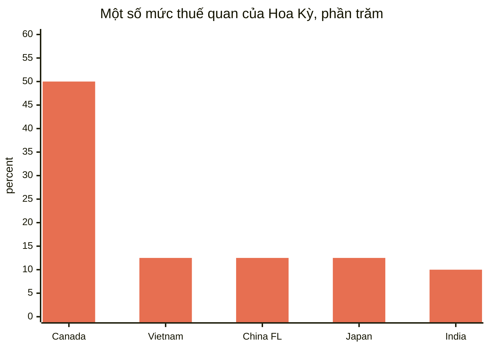

*Lưu ý: Canada = mức thuế Mục 338 (50%); Việt Nam, China FL và Nhật Bản = mức thuế Mục 301 về lao động cưỡng bức (12,5%); Ấn Độ = mức thuế Mục 301 về lao động cưỡng bức đang áp dụng (10%; mức 18% đã công bố trong thỏa thuận chưa bao giờ được áp dụng). Nguồn: USTR, Troutman, BDO, Industrial Front.*

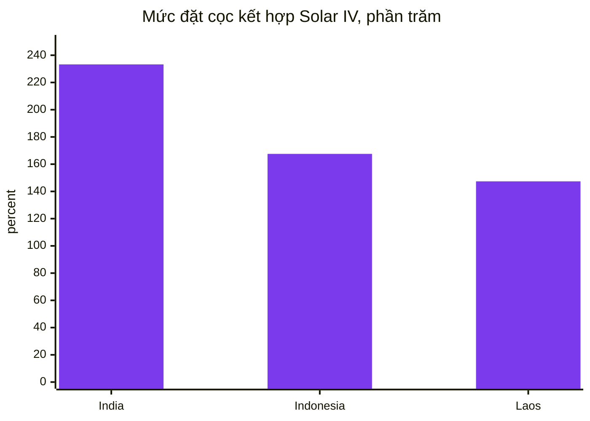

*Lưu ý: mức đặt cọc tiền mặt kết hợp thuế chống bán phá giá cộng thuế chống trợ cấp, mức cho các nhà xuất khẩu khác. Ấn Độ: AD 107,17% + CVD 126,09%; Indonesia: AD 94,36% + CVD 73,20%; Lào: AD 65,36% + CVD 82,03%. Nguồn: Các lệnh AD/CVD của Bộ Thương mại, ngày 9 tháng 11 năm 2026.*

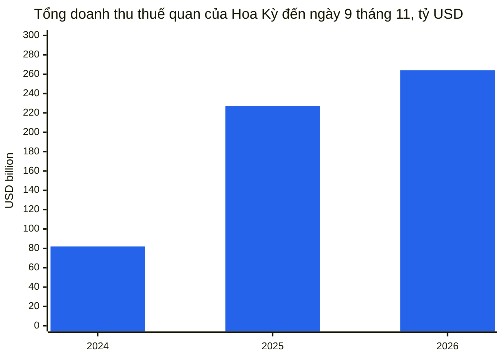

*Lưu ý: tổng doanh thu từ thuế quan và thuế tiêu thụ đặc biệt thu được trong năm dương lịch đến ngày 9 tháng 11, từ các báo cáo hằng ngày của Bộ Tài chính Hoa Kỳ theo dõi bởi Trung tâm Chính sách Lưỡng đảng. Nguồn: Trung tâm Chính sách Lưỡng đảng qua The Motley Fool, ngày 15 tháng 11 năm 2026.*

---

## 5. Phân tích chuyên sâu về chính sách của Mỹ

### Mục 301 — các thông báo ngày 10 tháng 11

USTR đã công bố Thông báo Gia hạn Miễn trừ Sản phẩm ngày 10 tháng 11 năm 2026 (91 FR 72610; FR Doc. 2026-22925), gia hạn toàn bộ 178 trường hợp miễn trừ hiện tại khỏi thuế Mục 301 đối với Trung Quốc (chuyển giao công nghệ và sở hữu trí tuệ). Các trường hợp miễn trừ — 164 trường hợp miễn trừ chung theo HTSUS 9903.88.69 và 14 trường hợp miễn trừ sản xuất pin mặt trời theo 9903.88.70 — đã được lên lịch hết hạn lúc 11 giờ 59 phút tối theo giờ miền Đông ngày 9 tháng 11 năm 2026. Khung mới bao quát hàng hóa nhập để tiêu thụ, hoặc rút khỏi kho để tiêu thụ, vào hoặc sau 12 giờ 01 phút sáng theo giờ miền Đông ngày 10 tháng 11 năm 2026, và trước 11 giờ 59 phút tối theo giờ miền Đông ngày 9 tháng 1 năm 2027. Phạm vi của mỗi trường hợp miễn trừ không thay đổi; mỗi trường hợp chỉ áp dụng đối với sản phẩm khớp với số HTSUS 10 chữ số và mô tả sản phẩm trong các ghi chú của HTSUS. USTR không yêu cầu ý kiến mới, dựa vào hồ sơ từ thông báo tháng 9 năm 2025 của mình. Một liên minh gồm 24 hiệp hội ngành đã yêu cầu gia hạn ít nhất một năm ngày 4 tháng 11. Một số báo cáo ghi nhận sự khác biệt trong thông báo, khi một số phần nhắc đến ngày 10 tháng 1 thay vì ngày 9 tháng 1; ngày có hiệu lực là ngày 9 tháng 1. USTR đã công bố một thông báo riêng ngày 10 tháng 11 (91 FR 72608; FR Doc. 2026-22867) tiếp tục đình chỉ biện pháp theo Mục 301 đối với các hoạt động hàng hải, logistics và đóng tàu của Trung Quốc — bao gồm phí tàu thuộc diện áp dụng (Phụ lục I–III) và thuế theo Phụ lục V.A — có hiệu lực ngày 10 tháng 11 năm 2026 đến 11 giờ 59 phút tối theo giờ miền Đông ngày 9 tháng 1 năm 2027. Không bên nào phải chịu trách nhiệm về phí trong thời gian đình chỉ. USTR đã nhận khoảng 60 ý kiến riêng về đề xuất này. Biện pháp này trước đây đã bị đình chỉ từ ngày 10 tháng 11 năm 2025 đến ngày 9 tháng 11 năm 2026.

USTR cũng quyết định gia hạn ba tháng cuộc điều tra theo Mục 301 đang diễn ra về một số hành vi, chính sách và hoạt động của Chính phủ Việt Nam liên quan đến bảo hộ và thực thi sở hữu trí tuệ (hồ sơ USTR-2026-0364; FR Doc. 2026-22868; có hiệu lực ngày 3 tháng 11 năm 2026). Cuộc điều tra được khởi xướng ngày 29 tháng 5 năm 2026, sau khi Việt Nam được nêu là nước ưu tiên nước ngoài trong Báo cáo Special 301 năm 2026 của USTR. Các quyết định về khả năng áp dụng biện pháp và biện pháp nào, nếu có, sẽ được đưa ra chậm nhất vào ngày 28 tháng 2 năm 2027, thay vì hạn chót ban đầu là ngày 29 tháng 11 năm 2026. USTR viện dẫn "các vấn đề phức tạp cần thêm thời gian". Việt Nam cũng là đối tượng của hai cuộc điều tra khác theo Mục 301, liên quan đến lệnh cấm nhập khẩu do lao động cưỡng bức và năng lực dư thừa mang tính cấu trúc trong sản xuất. Việt Nam đã phải chịu mức thuế Mục 301 về lao động cưỡng bức là 12,5% theo mặt hàng HTSUS 9903.05.04, có hiệu lực ngày 24 tháng 7 năm 2026.

Tính đến ngày 10 tháng 11 năm 2026 chưa có biện pháp cuối cùng nào từ cuộc điều tra của USTR về năng lực dư thừa mang tính cấu trúc trong sản xuất được công bố. Bộ trưởng Công nghiệp Hàn Quốc Kim Jung-kwan nói với một ủy ban của Quốc hội ngày 10 tháng 11 rằng Seoul đang theo dõi sát diễn biến; các kết luận được báo cáo là chậm hơn hai tháng so với thời gian biểu mà các quan chức Hàn Quốc kỳ vọng. Cuộc điều tra bao quát 16 nền kinh tế bao gồm Hàn Quốc. Hàn Quốc đang tìm cách giữ thuế của Hoa Kỳ ở mức gần 15%. Các luật sư và nhà phân tích thương mại nói với Global Trade Review rằng rủi ro chính trong ngắn hạn được xác định là cuộc điều tra này, khởi xướng tháng 3, bao quát Trung Quốc, Singapore, Thụy Sĩ, Na Uy, Indonesia, Malaysia, Campuchia, Thái Lan, Hàn Quốc, Việt Nam, Đài Loan, Bangladesh, Mexico, Nhật Bản và Ấn Độ, cũng như EU, với quyết định đến hạn vào tháng 3 năm 2027.

### Mục 232 — không có hành động mới; polysilicon đến hạn ngày 4 tháng 12

Không có tuyên bố hay thay đổi mức thuế mới nào theo Mục 232 được xác định trong phạm vi bao quát. Chế độ Mục 232 có hiệu lực tính đến ngày 9 tháng 11 năm 2026, như được tóm tắt từ Biểu Thuế quan Hài hòa và hướng dẫn của CBP, là: thép, nhôm và đồng ở mức 50%, bao gồm nhiều sản phẩm phái sinh (các sản phẩm phái sinh khác được liệt kê ở mức 25%; máy móc công nghiệp cố định, thiết bị điện và nông nghiệp cùng thiết bị sưởi, thông gió và điều hòa không khí ở mức 15% tổng cộng); chất bán dẫn ở mức 25% với các trường hợp miễn trừ được liệt kê; dược phẩm có bằng sáng chế ở mức 100% (thuốc gốc không thuộc diện), với mức thấp hơn đối với một số xuất xứ và công ty; ô tô và phụ tùng ở mức 15% đến 25%; các sản phẩm phái sinh từ đồng, xe tải và phụ tùng xe tải, gỗ và gỗ xẻ, polysilicon và máy bay không người lái mỗi loại có mức thuế và điều kiện riêng. Thuế polysilicon áp dụng ngày 4 tháng 12 năm 2026, và cho đến lúc đó một quy tắc của BIS cho phép Bộ Thương mại cấm nhà nhập khẩu đưa vào lượng hàng vượt đáng kể so với khối lượng lịch sử của mình khỏi các lô hàng nhập tiếp theo trước ngày 4 tháng 12, trừ khi Bộ Thương mại cấp miễn trừ. Robot và máy móc công nghiệp có kết luận về mối đe dọa theo Tuyên bố 11077 ngày 28 tháng 10 năm 2026, chỉ đạo đàm phán và không áp đặt thuế mới. Lịch tháng 1 năm 2027 bao gồm việc tăng thuế Mục 232 đối với đồ nội thất và tủ: đồ nội thất bọc nệm lên 30% và tủ bếp cùng tủ lavabo lên 50% từ ngày 1 tháng 1 năm 2027.

### CBP — nhà nhập khẩu nước ngoài; vô hiệu Mẫu 5106

CBP đã công bố quy tắc cuối cùng tạm thời "Yêu cầu Tăng cường đối với Nhà nhập khẩu Nước ngoài" (CBP Dec. 26-19, 91 FR 69977; FR Doc. 2026-22735) ngày 6 tháng 11 năm 2026, thi hành Mục 2 của Sắc lệnh Hành pháp 14411. Từ ngày 5 tháng 1 năm 2027, nhà nhập khẩu nước ngoài chỉ có thể nhập hàng hóa để tiêu thụ nếu chính nhà nhập khẩu đó được xác thực CTPAT hoặc nộp tờ khai qua một nhà môi giới hải quan được cấp phép và được xác thực CTPAT. Phần 110 mới của các quy định hải quan định nghĩa "IOR Hoa Kỳ" (công dân Hoa Kỳ hoặc thường trú nhân hợp pháp, hoặc thực thể được tổ chức theo luật Hoa Kỳ và đặt tại Hoa Kỳ, với các điều kiện bổ sung về quyền sở hữu hoặc bất động sản — ví dụ, ít nhất 51% quyền sở hữu hưởng lợi thuộc về công dân Hoa Kỳ hoặc thường trú nhân hợp pháp có quyền kiểm soát, hoặc sở hữu trực tiếp bất động sản đáng kể không bị thế chấp tại Hoa Kỳ). Tình trạng nhà nhập khẩu Hoa Kỳ hay nước ngoài phải được khai báo khi nhập khẩu và khi nộp tờ khai tóm tắt (19 CFR 141.21–141.22 mới); các nhà môi giới phải xác minh tình trạng nhà nhập khẩu Hoa Kỳ của khách hàng bằng cách rà soát hồ sơ và lưu giữ hồ sơ xác minh trong năm năm; ba trường dữ liệu mới đã được thêm vào Mẫu 3461 và 7501 của CBP (và các mẫu điện tử tương đương) qua thông báo CSMS. Các nhà môi giới có thể yêu cầu tuân thủ chậm trước ngày 5 tháng 1 năm 2027; tất cả các nhà môi giới dự kiến tuân thủ đầy đủ trước ngày 6 tháng 5 năm 2027. Quy tắc cũng mở rộng các trường hợp mà nhà môi giới có thể bị phạt theo 19 U.S.C. 1592. Thời hạn lấy ý kiến là ngày 5 tháng 1 năm 2027 (hồ sơ USCBP-2026-1387). Phân tích của chính CBP: 0,4% nhà nhập khẩu nước ngoài được xác thực CTPAT và 68% đã sử dụng một nhà môi giới được xác thực; 32% còn lại sẽ không thể tiếp tục nhập khẩu vào Hoa Kỳ trừ khi chuyển sang nhà môi giới khác hoặc tự trở thành nhà nhập khẩu được xác thực CTPAT.

Riêng rẽ, CBP đã gửi thư cho nhiều nhà nhập khẩu được chứng nhận CTPAT nêu rõ rằng số đăng ký nhà nhập khẩu của họ có thể bị vô hiệu đối với các tờ khai nộp từ 12 giờ 01 phút sáng theo giờ miền Đông ngày 18 tháng 11 năm 2026 trừ khi các quan ngại của CBP về tính chính xác của thông tin trên Mẫu 5106 của CBP của nhà nhập khẩu được giải quyết trước (xem A5). Thông báo của CBP về quy tắc đề xuất đối với lô hàng giá trị thấp ngày 8 tháng 10 năm 2026 (91 FR 64532; hồ sơ USCBP-2026-0298) vẫn đang mở, với thời hạn lấy ý kiến đến ngày 7 tháng 12 năm 2026. Đề xuất sẽ yêu cầu các tờ khai không chính thức đối với hàng hóa trị giá tới 2.500 USD phải được nộp bằng điện tử vào hoặc trước ngày nhập khẩu, yêu cầu bảo lãnh cho mọi tờ khai không chính thức, và khiến nhà môi giới trở thành nhà nhập khẩu khi nộp tờ khai cho người nhận hàng không phải là chủ sở hữu hay người mua. Miễn thuế de minimis 800 USD vẫn bị đình chỉ vô thời hạn — đối với các lô hàng phi bưu chính từ ngày 24 tháng 6 năm 2026 và đối với các lô hàng bưu chính từ ngày 24 tháng 7 năm 2026. Riêng rẽ, CBP đã dời ngày mà tờ khai chính thức trở thành bắt buộc đối với thư tín chịu thuế Mục 201, 232 hoặc 301 hay yêu cầu của cơ quan chính phủ đối tác từ ngày 22 tháng 10 năm 2026 sang ngày 20 tháng 1 năm 2027.

### Kiểm soát xuất khẩu của BIS — Quy tắc Công ty liên kết được đình chỉ đến ngày 10 tháng 1; thiết bị giảm thanh chuyển sang kiểm soát của Bộ Thương mại

BIS đã công bố quy tắc cuối cùng (FR Doc. 2026-22793) gia hạn việc đình chỉ quy tắc cuối cùng tạm thời của mình, "Mở rộng Kiểm soát Người dùng Cuối để Bao quát các Công ty liên kết của Một số Thực thể trong Danh sách" (Quy tắc Công ty liên kết), đến ngày 10 tháng 1 năm 2027. Việc đình chỉ một năm áp đặt tháng 11 năm 2025 (90 FR 50857) dự kiến kết thúc ngày 9 tháng 11 năm 2026; quy tắc mới có hiệu lực ngày 9 tháng 11 năm 2026, vì vậy không có khoảng trống. Quy tắc Công ty liên kết, công bố ngày 30 tháng 9 năm 2025 (90 FR 47201), sẽ mở rộng kiểm soát xuất khẩu theo Quy định Quản lý Xuất khẩu sang các thực thể nước ngoài do một hoặc nhiều bên trong Danh sách Thực thể, Danh sách Người dùng Cuối Quân sự, hoặc một số bên do OFAC chỉ định sở hữu từ 50% trở lên, trực tiếp hoặc gián tiếp, riêng lẻ hoặc cộng gộp. Quy tắc cũng đưa ra một dấu hiệu cảnh báo mới áp đặt nghĩa vụ cho nhà xuất khẩu phải làm rõ các câu hỏi về quyền sở hữu khi một bên nước ngoài được biết là thuộc sở hữu một phần của một thực thể trong danh sách. Việc gia hạn không rút lại hay sửa đổi quy tắc. Nếu không có thêm hành động nào của BIS, các biện pháp kiểm soát mở rộng sẽ có hiệu lực ngày 10 tháng 1 năm 2027. Thông báo trên Federal Register không đưa ra lý do chính sách nào ngoài việc thay đổi ngày; các quan chức chính quyền đã cho biết việc gia hạn gắn với thỏa thuận đình chiến thương mại Mỹ–Trung, cũng được gia hạn đến ngày 10 tháng 1 năm 2027. BIS cũng thông báo rằng, kể từ ngày 20 tháng 11 năm 2026, xuất khẩu một số thiết bị giảm thanh, ống giảm thanh và thiết bị triệt âm sẽ chuyển từ Danh sách Đạn dược Hoa Kỳ của Bộ Ngoại giao sang kiểm soát theo Quy định Quản lý Xuất khẩu của BIS; các thiết bị giảm thanh sẽ được thêm vào Danh sách Kiểm soát Thương mại và BIS sẽ yêu cầu giấy phép đối với một số hoạt động xuất khẩu, tái xuất khẩu hoặc chuyển giao trong nước, bao gồm việc phát hành phần mềm và công nghệ liên quan cho người nước ngoài. Các trường hợp ngoại lệ giấy phép hiện có đối với súng sẽ cũng áp dụng đối với thiết bị giảm thanh.

### Federal Register — hoạt động AD/CVD trong phạm vi bao quát

Ngày 9 tháng 11: Bộ Thương mại công bố các lệnh cuối cùng về thuế chống bán phá giá và thuế chống trợ cấp đối với pin và mô-đun quang điện silic tinh thể từ Ấn Độ, Indonesia và Lào (xem A7). Ngày 10 tháng 11: Bộ Thương mại sơ bộ kết luận rằng sản phẩm tôn tráng thiếc từ Đài Loan và Thổ Nhĩ Kỳ được bán tại Hoa Kỳ với giá thấp hơn giá trị hợp lý. Bộ Thương mại ấn định mức thuế chống bán phá giá 18,07% cho Ton Yi Industrial Corporation của Đài Loan và cho mọi nhà xuất khẩu Đài Loan khác. Đối với Thổ Nhĩ Kỳ, mức 3,89% được ấn định cho Tosyali và cho mọi nhà xuất khẩu khác, và 42,06% cho Tatrix International. Các nhà nhập khẩu nay phải nộp tiền đặt cọc theo các mức này. Các mức này nối tiếp các mức sơ bộ mà Bộ Thương mại ấn định tháng 9 đối với Trung Quốc, là 136,52% đối với bán phá giá và 66,61% đối với trợ cấp. Kết luận bán phá giá cuối cùng đối với Thổ Nhĩ Kỳ đến hạn 75 ngày sau khi ký ngày 5 tháng 11 (ngày 19 tháng 1 năm 2027); đối với Đài Loan, 135 ngày sau khi công bố ngày 10 tháng 11 (ngày 25 tháng 3 năm 2027); kết luận cuối cùng đối với Trung Quốc đến hạn ngày 30 tháng 11 năm 2026 trừ khi được hoãn. Ngày 12 tháng 11: Bộ Thương mại công bố kết quả cuối cùng trong rà soát hành chính về thuế chống bán phá giá đối với tủ gỗ, tủ lavabo và linh kiện từ Trung Quốc (giai đoạn 2024–2025), ấn định mức thuế chống bán phá giá 7,48% cho các công ty được rà soát — Yixing Pengjia Technology, Jiangsu Xiangsheng Bedtime Furniture, Xiamen Golden Huanan và Zhongshan NU Furniture — áp dụng đối với các lô hàng thuộc diện nhập hoặc rút khỏi kho để tiêu thụ vào hoặc sau ngày 12 tháng 11 năm 2026. Mức đặt cọc tiền mặt toàn Trung Quốc vẫn là 251,64%. Trong rà soát hành chính về thuế chống trợ cấp đối với sản phẩm khuôn gỗ và gỗ xẻ từ Trung Quốc, Bộ Thương mại ấn định mức CVD cuối cùng là 147,88% cho Nanping Huatai Wood and Bamboo Co., Fujian Yinfeng Imp & Exp Trading Co. và Fujian Hongjia Craft Products Co., và 21,39% cho các công ty không được chọn thuộc diện rà soát, áp dụng đối với các lô hàng thuộc diện nhập hoặc rút khỏi kho để tiêu thụ vào hoặc sau ngày 12 tháng 11 năm 2026. Bộ Thương mại dự định ban hành hướng dẫn đánh giá không sớm hơn 35 ngày sau khi công bố (ngày 17 tháng 12 năm 2026) trong mỗi trường hợp.

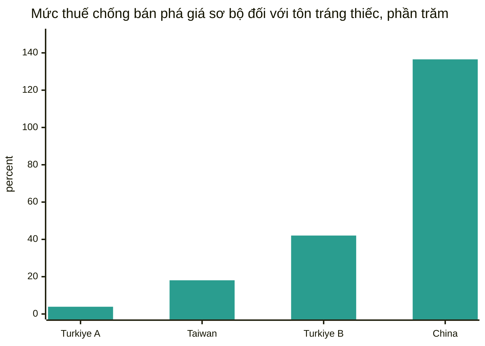

*Lưu ý: Turkiye A = Tosyali và mọi nhà xuất khẩu khác (3,89%); Turkiye B = Tatrix International (42,06%); Trung Quốc = mức sơ bộ tháng 9 (136,52%). Nguồn: Các quyết định sơ bộ của Bộ Thương mại, ngày 10 tháng 11 năm 2026.*

### Các mục thường trực

- **UFLPA / Danh sách Thực thể:** không có bổ sung mới nào vào Danh sách Thực thể UFLPA hay lệnh tạm giữ mới nào được xác định trong phạm vi ngày 9–16 tháng 11. Các bổ sung gần nhất vào Danh sách Thực thể (43 công ty) được công bố ngày 31 tháng 7 năm 2026; hướng dẫn vận hành về lao động cưỡng bức hiện hành của CBP đối với nhà nhập khẩu có từ tháng 6 năm 2026. Tổng số thực thi gần nhất được CBP nêu, từ bản phát hành về Serbia Zijin, là 56 WRO và tám Kết luận theo 19 U.S.C. § 1307; báo cáo sau đó đưa tổng số lên 60 WRO và tám Kết luận sau hai lệnh nữa ngày 29 tháng 9 năm 2026.
- **Nhà Trắng:** không có tuyên bố hay tờ thông tin về thuế quan mới nào được ban hành trong phạm vi bao quát.
- **USITC / HTS:** không có thay đổi mức thuế HTS mới nào được xác định trong phạm vi bao quát ngoài các lệnh Solar IV. Báo cáo công khai đầy đủ của USITC về Solar IV (Ấn phẩm USITC 5804) đến hạn trên trang web của USITC trước ngày 23 tháng 11 năm 2026.
- **trade.gov / tình báo thị trường:** không có bản phát hành tình báo thị trường mới nào cụ thể về chính sách thuế quan của Hoa Kỳ được xác định trong phạm vi bao quát.
- **internationaltradetoday.com:** trang có tường phí; các tiêu đề xác nhận câu chuyện về quy tắc nhà nhập khẩu nước ngoài của CBP (ngày 5 tháng 11).

---

## 6. Chính sách thế giới theo khu vực

### Châu Âu

Việc thiết lập lại thương mại điện tử giá trị thấp của EU nay đã có hiệu lực (xem 3.3): phí xử lý 2 euro cho mỗi dòng mặt hàng và Mã định danh Sản phẩm bắt buộc từ ngày 1 tháng 11, cộng thêm thuế cố định 3 euro cho mỗi dòng thuế quan có hiệu lực từ ngày 1 tháng 7 năm 2026. Ngày 9 tháng 11, Hội đồng đã nhất trí xóa bỏ trần 150 euro khỏi Cơ chế Một cửa Nhập khẩu VAT, áp dụng từ ngày 1 tháng 7 năm 2028. Hoạt động thuế quan hải quan của EU (TARIC) trong tuần 1–7 tháng 11 chủ yếu là chuẩn bị trước chứ không phải thuế bảo hộ mới: 15.055 hồ sơ thay đổi đã được xử lý, trong đó hơn 13.600 là các biện pháp có hiệu lực trong tương lai, chuẩn bị trước quyền tiếp cận ưu đãi và hạn ngạch tự chủ kéo dài sang năm 2027. Ngày 6 tháng 11, hơn 2.500 hồ sơ có hiệu lực trong tương lai đã thiết lập các hạn ngạch thuế quan tự chủ dự kiến có hiệu lực ngày 1 tháng 1 năm 2027, bao gồm các hạn ngạch quy mô lớn cho lĩnh vực chế biến hải sản. Doanh thu tức thời tập trung vào ngày 1 tháng 11, khi 5.405 trong số 6.238 biện pháp có hiệu lực trong tuần bắt đầu áp dụng. Các điều chỉnh kỹ thuật về phòng vệ thương mại, tập trung vào ngày 3 tháng 11, đã hiệu chỉnh lại ranh giới biện pháp đối với PVC dạng khối, PVC huyền phù, aspirin và các polyme cùng hóa chất chuyên dụng khác. Mô hình này cho thấy tư thế hành chính tập trung vào việc chuẩn bị quyền tiếp cận năm 2027 thay vì áp đặt thuế mới, nhưng các thay đổi về phạm vi phòng vệ thương mại làm thay đổi phạm vi bao quát của các biện pháp hiện có đối với polyme và hóa chất và đòi hỏi nhà nhập khẩu phải khai báo chính xác.

Hiệp định thương mại tự do EU–Ấn Độ được báo cáo sẽ được ký tại Brussels giữa tháng 12 năm 2026 (xem 3.3). Hiệp định thương mại hiện đại hóa EU–Mexico đã được ký chính thức ngày 22 tháng 5 năm 2026 và đang chờ Nghị viện châu Âu phê chuẩn trước khi có hiệu lực. Các hiệp định của EU với Indonesia và Australia dự kiến đều được ký trước cuối năm 2026. Hiệp định tạm thời EU–Mercosur đã có hiệu lực tạm thời kể từ ngày 1 tháng 5 năm 2026.

**Nguồn:** [RegFollower](https://regfollower.com/eu-forward-staging-and-trade-defence-realignment-mark-the-november-tariff-turn/); [Flex Logistics](https://flexlogistics.eu/eu-trade-deals-online-sellers/)

### Vương quốc Anh

Thông báo về biện pháp thương mại 2026/31 thi hành việc Bộ trưởng chấp nhận khuyến nghị của Cơ quan Biện pháp Thương mại trong rà soát hết hạn ER0080, khởi xướng ngày 22 tháng 1 năm 2026. Thuế chống trợ cấp đối với cá hồi vân có xuất xứ Thổ Nhĩ Kỳ, bao quát cá sống, tươi, ướp lạnh, đông lạnh và hun khói trong giới hạn kích thước nêu trong thông báo và được phân loại theo các nhóm 0301, 0302, 0303, 0304 và 0305, được gia hạn năm năm đến ngày 30 tháng 1 năm 2031 ở các mức hiện có, không tính toán lại. Thông báo có hiệu lực ngày 6 tháng 11 năm 2026, với điều chỉnh áp dụng từ ngày 30 tháng 1 năm 2026, và thay thế thông báo thuế 2021/12. Mức thuế theo từng nhà xuất khẩu dao động từ 1,5% đến 8%; hai nhóm nhà xuất khẩu được liệt kê chịu 6,9% và 7,6%; mọi nhà xuất khẩu khác chịu 9,5%.

Cơ quan Thuế và Hải quan Hoàng gia (HM Revenue and Customs) đã cập nhật tóm tắt chính sách về Cơ chế Điều chỉnh Biên giới Carbon của Vương quốc Anh ngày 2 tháng 11, bổ sung thông tin về cách tính Giảm giá Carbon. Đây là lần cập nhật thứ ba trong mùa thu này, sau các lần cập nhật ngày 9 tháng 9 và ngày 16 tháng 10 năm 2026 phản ánh việc ban hành Quy định về Cơ chế Điều chỉnh Biên giới Carbon (Phát thải và Xác minh) 2026. Tóm tắt xác nhận CBAM của Vương quốc Anh sẽ bắt đầu ngày 1 tháng 1 năm 2027 và sẽ áp dụng đối với các mặt hàng nhôm, xi măng, phân bón, hydro, và sắt thép cụ thể được xác định theo mã hàng hóa. Với chưa đầy hai tháng trước khi bắt đầu, các nhà nhập khẩu hàng hóa thuộc diện cần xác nhận mã hàng hóa, dữ liệu phát thải và tính toán Giảm giá Carbon trước khi cơ chế bắt đầu thu phí.

Bộ Kinh doanh và Thương mại đã công bố các tờ thông tin thường kỳ về thương mại và đầu tư song phương ngày 6 tháng 11, bao gồm cả tờ về Qatar. Tổng thương mại hàng hóa và dịch vụ giữa Vương quốc Anh và Qatar là 5,4 tỷ bảng trong bốn quý tính đến cuối quý 2 năm 2026, giảm 7,2% hay 416 triệu bảng so với bốn quý tính đến cuối quý 2 năm 2025. Xuất khẩu của Vương quốc Anh sang Qatar là 3,9 tỷ bảng (giảm 10,3%, hay 447 triệu bảng) và nhập khẩu từ Qatar là 1,5 tỷ bảng (tăng 2,1%, hay 31 triệu bảng). Qatar là đối tác thương mại lớn thứ 47 của Vương quốc Anh, chiếm 0,3% tổng thương mại của Vương quốc Anh.

**Nguồn:** [Global Customs Compliance](https://www.globalcustomscompliance.com/trade-and-customs-watch-2026-11-13/?utm_source=rss&utm_medium=rss&utm_campaign=trade-and-customs-watch-2026-11-13)

### Canada

Bộ trưởng Tài chính François-Philippe Champagne đã công bố các thay đổi đối với biện pháp giảm nhẹ thuế quan của Canada ngày 9 tháng 11 (xem 3.7): biện pháp miễn trừ ngang đối với thuế quan Hoa Kỳ được gia hạn thêm một năm đến ngày 30 tháng 6 năm 2028, với biện pháp giảm nhẹ nay cũng bao gồm hàng hóa phi thép dùng trong khai thác mỏ, khai thác đá hoặc khai thác dầu khí, và mọi hàng hóa dùng cho các thực thể giáo dục công lập, bao gồm cả những thực thể theo ủy quyền của các tổ chức Bản địa; biện pháp giảm nhẹ bị loại bỏ đối với một số loại rơ-moóc từ ngày 1 tháng 12 năm 2026 và đối với một số sản phẩm dây nhôm, nhôm đùn và bìa cứng từ ngày 1 tháng 2 năm 2027. Những thay đổi này nằm trên các mức thuế đối ứng từ 15% đến 50% đối với một loạt hàng nhập khẩu từ Hoa Kỳ được áp đặt ngày 8 tháng 9 năm 2026. Cơ quan Dịch vụ Biên giới Canada đã cập nhật Thông báo Hải quan 26-07 ngày 2 tháng 11, gia hạn biện pháp miễn trừ hàng hóa theo lịch cho các Biểu 1 đến 3, đưa ra các mã ủy quyền đặc biệt cho Biểu 2 và 3, và làm rõ các điều kiện đủ tiêu chuẩn; cơ quan này cũng đã loại bỏ Phụ lục A, vốn cung cấp hướng dẫn bổ sung về biện pháp miễn trừ tháp gió. Bộ trưởng Thương mại Vương Văn Đào và Bộ trưởng Thương mại Quốc tế Canada Maninder Sidhu đồng chủ trì cuộc họp lần thứ 29 của Ủy ban Kinh tế và Thương mại chung Trung Quốc–Canada tại Bắc Kinh ngày 3 tháng 11; nội dung của bất kỳ kết quả nào cũng không thể kiểm chứng được từ thông tin được xem xét.

**Nguồn:** [Department of Finance Canada](https://www.canada.ca/en/department-finance/news/2026/11/canada-modifies-tariff-relief-measures-to-better-support-workers-and-businesses.html); [GHY](https://www.ghy.com/trade-compliance/category/canada-imports/)

### Trung Quốc

Phía Trung Quốc trong việc gia hạn thỏa thuận đình chiến được trình bày trong các mục 2 và 3.1. Trang tiếng Anh của MOFCOM (english.mofcom.gov.cn) có thể truy cập ngày 16 tháng 11; chỉ các tiêu đề trang nhất hiển thị, bao gồm phát biểu của người phát ngôn về các biện pháp điều chỉnh liên quan đến Danh sách Thực thể Không đáng tin cậy và việc liệt kê cuộc họp lần thứ 29 của Ủy ban Kinh tế và Thương mại chung Trung Quốc–Canada. Nội dung phản hồi của MOFCOM đối với phí 2 euro của EU tại một cuộc họp báo trong cùng kỳ không thể kiểm chứng được từ thông tin được xem xét.

### Ấn Độ và New Zealand

Thỏa thuận tạm thời Ấn Độ–Hoa Kỳ vẫn chưa được ký (xem A10 và 3.2). Hiệp định EU–Ấn Độ được báo cáo sẽ được ký giữa tháng 12 (xem 3.3). Ấn Độ và EU cũng tiếp tục các cuộc đàm phán triển khai tại Brussels đầu tháng 11. Bộ trưởng Thương mại Piyush Goyal cho biết ngày 3 tháng 11 rằng Ấn Độ chưa bao giờ mở cửa lĩnh vực sữa trong bất kỳ hiệp định thương mại tự do nào và sẽ không cho phép nhập khẩu các sản phẩm biến đổi gen, một giới hạn đỏ liên quan đến mọi lộ trình FTA đang diễn ra.

### Châu Á–Thái Bình Dương — Hàn Quốc và Brazil

Tổng thống Lee Jae-myung đã thúc giục chính phủ của mình tại cuộc họp nội các ngày 3 tháng 11 nhanh chóng tiến hành đàm phán với Brazil về mức thuế 25% mà Brazil áp đặt đối với mỹ phẩm Hàn Quốc, nói rằng mức thuế này là rào cản đối với một lĩnh vực có nhu cầu địa phương mạnh đối với các sản phẩm sản xuất tại Hàn Quốc. Ông cho biết việc chuyển sản xuất sang Brazil sẽ không giải quyết được vấn đề, viện dẫn sở thích mạnh mẽ của người tiêu dùng địa phương đối với mỹ phẩm sản xuất tại Hàn Quốc, và hỏi Ngoại trưởng Cho Hyun về tình trạng các cuộc đàm phán. Ông Cho cho biết các cuộc đàm phán nay có thể tiến triển sau khi Tổng thống Lula tái đắc cử trong vòng bầu cử ngày 25 tháng 10. Sự can thiệp này biến một mức thuế theo ngành thành một vấn đề song phương ở cấp tổng thống trước nhiệm kỳ mới của Brazil.

Các công ty hàng tiêu dùng Hàn Quốc đã ký các hợp đồng xuất khẩu và biên bản ghi nhớ trị giá 18 triệu USD tại Triển lãm Làn sóng Hàn Quốc và Hội chợ Thực phẩm Hàn Quốc Australia tổ chức tại Melbourne ngày 5–7 tháng 11, do Bộ Thương mại, Công nghiệp và Năng lượng cùng Bộ Nông nghiệp, Thực phẩm và Nông thôn đồng tổ chức và do KOTRA cùng Tổng công ty Thương mại Nông–Thủy sản Hàn Quốc tổ chức. Sự kiện tư vấn xuất khẩu có sự tham gia của 101 công ty Hàn Quốc và 144 nhà mua từ châu Đại Dương và Đông Nam Á, thực hiện 1.235 buổi tư vấn và đạt 32 hợp đồng và biên bản ghi nhớ. Xuất khẩu mỹ phẩm Hàn Quốc sang Australia tăng từ 73 triệu USD năm 2023 lên 112 triệu USD năm 2024 và 166 triệu USD năm 2025, nhờ việc cắt giảm thuế quan theo Hiệp định Thương mại Tự do Hàn Quốc–Australia có hiệu lực từ ngày 12 tháng 12 năm 2014.

**Nguồn:** [SE Daily](https://en.sedaily.com/politics/2026/11/03/lee-presses-brazil-to-cut-25-percent-tariff-on-korean); [Aju Press](https://www.ajupress.com/view/20261108110470271)

### Đa phương

**Tổ chức Thương mại Thế giới.** Tại cuộc họp ngày 4–6 tháng 11, Ủy ban về Các biện pháp Vệ sinh và Kiểm dịch Động thực vật của WTO đã rà soát các quan ngại thương mại cụ thể, tính minh bạch, cố vấn và xây dựng năng lực. Ban Thư ký báo cáo rằng 55 quan ngại thương mại cụ thể đã được giải quyết và 19 quan ngại được giải quyết một phần sau đợt giám sát năm 2026, trong đó đã liên hệ với 39 thành viên về các quan ngại chưa được nêu kể từ tháng 11 năm 2024, với phản hồi từ 25 thành viên. Cuộc họp tháng 11 đã xem xét 78 quan ngại thương mại cụ thể, bao gồm năm quan ngại được nêu lần đầu tiên, bao quát giới hạn dư lượng thuốc trừ sâu và các biện pháp quản lý khác tại Liên minh châu Âu, các hạn chế nhập khẩu ảnh hưởng đến sản phẩm thịt tại Colombia, chậm trễ trong việc phê duyệt xuất khẩu thịt bò Paraguay sang Nhật Bản, và các hạn chế đối với sản phẩm gia cầm Chile liên quan đến cúm gia cầm. 63% trong số 640 quan ngại thương mại cụ thể được thảo luận kể từ năm 1995 đã được giải quyết (326) hoặc giải quyết một phần (75). Ủy ban Nông nghiệp, trong phiên họp đặc biệt, đã tổ chức hai bài thuyết trình ngày 3 tháng 11 rà soát sự phát triển của các cuộc đàm phán thương mại nông nghiệp kể từ Vòng đàm phán Uruguay, bao quát cạnh tranh xuất khẩu và dự trữ lương thực công của các chính phủ nước đang phát triển với giá do nhà nước quản lý. Cuộc họp tiếp theo, dự kiến ngày 23 tháng 11 năm 2026, sẽ bao quát các hạn chế xuất khẩu và cơ chế tự vệ đặc biệt. Ngày 16 tháng 11, WTO đã nhất trí thành lập ban hội thẩm giải quyết tranh chấp để xem xét khiếu nại của Trung Quốc đối với thuế của Ấn Độ đối với một số sản phẩm công nghệ và các chương trình khuyến khích cho lĩnh vực sản xuất pin mặt trời trong nước, sau yêu cầu thành lập ban hội thẩm lần thứ hai của Trung Quốc. Các cuộc tham vấn song phương đã không đạt được giải pháp; Ấn Độ đã chặn yêu cầu ban đầu của Trung Quốc tháng 5 năm 2026. Ban hội thẩm sẽ xem xét việc tuân thủ Hiệp định chung về Thuế quan và Thương mại, Hiệp định về Trợ cấp và Các biện pháp Đối kháng và Hiệp định về Các biện pháp Đầu tư Liên quan đến Thương mại. Ngày 30 tháng 10, các thành viên WTO đã thông qua một tuyên bố định vị lại Sáng kiến Viện trợ cho Thương mại thành "Viện trợ cho Thương mại: quan hệ đối tác vì thương mại và phát triển" tại cuộc họp của Ủy ban Thương mại và Phát triển, kết thúc Đánh giá Toàn cầu lần thứ 10 về Viện trợ cho Thương mại kéo dài hai ngày tại Geneva — kết quả đa phương đầu tiên về chủ đề này trong 20 năm. Tổng Giám đốc Ngozi Okonjo-Iweala đã phát biểu khai mạc tại một sự kiện về thương mại, đa dạng sinh học và kinh tế biển ngày 5 tháng 11, đưa kinh tế biển ở mức 2,6 nghìn tỷ USD, hỗ trợ khoảng 133 triệu việc làm, và lưu ý rằng hơn 80% hàng hóa giao dịch toàn cầu di chuyển bằng đường biển và 72% thương mại hàng hóa thế giới vẫn diễn ra theo các điều khoản tối huệ quốc. Bà chỉ ra Hiệp định về Trợ cấp Thủy sản, có hiệu lực từ tháng 9 năm 2025, và thúc giục các thành viên hoàn tất các cuộc đàm phán còn lại.

**Hội nghị Liên hợp quốc về Thương mại và Phát triển (UNCTAD).** UNCTAD đã công bố Bản Cập nhật Thương mại Toàn cầu (tháng 11 năm 2026) ngày 9 tháng 11, đúng dịp COP31 tại Antalya, Thổ Nhĩ Kỳ (ngày 9–20 tháng 11), xem xét cách thương mại có thể hỗ trợ hành động khí hậu. Báo cáo nhận thấy các quy định liên quan đến khí hậu đang trở nên phổ biến hơn trong các hiệp định thương mại, xuất hiện trong hơn một nửa số hiệp định ký kết từ năm 2016 đến năm 2021, nhưng việc thực hiện vẫn còn hạn chế: chỉ 7% các quy định liên quan đến khí hậu được xác định trong các hiệp định thương mại gần đây đề cập đến việc giảm rào cản thuế quan và phi thuế quan. Trong số 174 nước được khảo sát năm 2025, chỉ bảy nước báo cáo đã thực hiện đầy đủ các biện pháp tạo thuận lợi thương mại đối với hàng hóa xanh và hàng hóa liên quan đến khí hậu. Xuất khẩu toàn cầu các mặt hàng liên quan đến chuỗi giá trị năng lượng mặt trời và gió vượt 1,8 nghìn tỷ USD năm 2025, tăng trưởng nhanh hơn xuất khẩu các hàng hóa chế tạo khác; thương mại pin tăng 29% và thương mại xe điện tăng 11% trong nửa đầu năm 2026; các nền kinh tế đang phát triển đã xuất khẩu 1,3 nghìn tỷ USD hàng hóa dựa trên đa dạng sinh học năm 2024, 1,2 nghìn tỷ USD hàng hóa và dịch vụ biển năm 2025, và ước tính 204 tỷ USD sản phẩm thay thế nhựa năm 2024. Báo cáo xác định khả năng tiếp cận giá cả phải chăng đối với các công nghệ khí hậu là điều thiết yếu cho thích ứng và giảm phát thải. Một báo cáo về phát triển năng lực xuất khẩu sang thị trường Trung Quốc, do Viện Kinh tế và Chính trị Thế giới thuộc Viện Hàn lâm Khoa học Xã hội Trung Quốc (CASS) và UNCTAD viết, đã được trình bày tại Thượng Hải ngày 5 tháng 11 tại Diễn đàn Kinh tế Quốc tế Hồng Kiều lần thứ 9, tổ chức cùng Triển lãm Nhập khẩu Quốc tế Trung Quốc. Báo cáo phân tích 10 đối tác thương mại, bao gồm Colombia, Kenya, Tây Ban Nha, Thái Lan và Vương quốc Anh; thị phần của Trung Quốc trong xuất khẩu thế giới tăng từ 3,2% năm 2000 lên 9,2% năm 2025, theo tổng giám đốc của viện.

**Trung tâm Thương mại Quốc tế (ITC).** Trung tâm Thương mại Quốc tế và Ngân hàng Xuất nhập khẩu châu Phi đã ra mắt báo cáo "Định hình lại Thương mại châu Phi–Caribe: Cơ hội Chuyển đổi Kinh tế" tại St John's, Antigua và Barbuda, ngày 3 tháng 11, bên lề Hội nghị các Nguyên thủ Chính phủ Khối Thịnh vượng chung. Báo cáo nhận thấy thương mại hàng hóa và dịch vụ hằng năm giữa châu Phi và Caribe có thể đạt tới 1,65 tỷ USD vào năm 2030, không bao gồm nhiên liệu khoáng. Khoảng 80% tiềm năng xuất khẩu hàng hóa hằng năm của châu Phi sang Caribe vẫn chưa được khai thác, trong khi tiềm năng xuất khẩu của Caribe chủ yếu nằm ở dịch vụ, đạt 481 triệu USD. Các lĩnh vực ưu tiên bao gồm thực phẩm chế biến và thức ăn chăn nuôi, hóa chất, khoáng sản và kim loại, may mặc và dệt may, da và giày dép, du lịch, dịch vụ vận tải và các ngành sáng tạo. Các kết quả dựa trên phân tích thương mại và tiềm năng xuất khẩu, đánh giá ngành và một cuộc khảo sát với 1.175 doanh nghiệp và tổ chức hỗ trợ doanh nghiệp trên cả hai khu vực.

**Tổ chức Hải quan Thế giới (WCO).** Ngày 3 tháng 11, WCO đã tổ chức một hội thảo kết hợp tại trụ sở Brussels về vai trò của hải quan trong cứu trợ thiên tai, với hơn 190 người tham gia từ các cơ quan hải quan, tổ chức quốc tế và các chuyên gia nhân đạo và logistics; Tổng Thư ký Ian Saunders đã liên kết cuộc thảo luận với chủ đề năm 2026 của WCO, "Hải quan bảo vệ xã hội thông qua cảnh giác và cam kết". Ngày 5 tháng 11, WCO đã công bố Báo cáo Thường niên 2025–2026. Ngày 9 tháng 11, WCO đã tổ chức sự kiện toàn cầu của Dự án Hải quan Thông minh về các công nghệ đột phá, và ngày 11 tháng 11 một hội thảo về loại bỏ hàng giả khỏi thương mại điện tử, với các cơ quan hải quan, Liên minh Bưu chính Thế giới và eBay trong số các bên tham gia. Ngày 12 tháng 11, WCO báo cáo hỗ trợ các nước Cộng đồng Đông Phi trong việc sửa đổi các quy tắc xuất xứ và phát triển năng lực đào tạo tự chủ, và ngày 13 tháng 11 Tổng Thư ký đã gặp Tổng Giám đốc Tổ chức Thú y Thế giới bên lề cuộc họp của Nhóm Chống hàng giả và Vi phạm bản quyền của WCO để tái khẳng định hợp tác chống thương mại bất hợp pháp.

**Nguồn:** [Logistics News PH](https://logisticsnews.ph/2026/11/12/wto-sps-committee-reports-progress-in-resolving-trade-concerns/); [India ReNews](https://indiarenews.in/blog/read/wto-sets-up-dispute-panel-to-examine-china-s-challenge-against-india-s-solar-incentives-and-technology-tariffs); [UNCTAD](https://unctad.org/publication/global-trade-update-november-2026); [WCO](https://www.wcoomd.org/en/media/newsroom/2026/november.aspx)

---

## 7. Các biện pháp thực thi

### Thuế chống bán phá giá và thuế chống trợ cấp

Các lệnh AD/CVD cuối cùng của Bộ Thương mại đối với pin mặt trời từ Ấn Độ, Indonesia và Lào (xem A7) cùng các mức sơ bộ đối với tôn tráng thiếc cho Đài Loan và Thổ Nhĩ Kỳ và kết quả rà soát tủ gỗ và sản phẩm gỗ xẻ (xem mục 5) là các hành động về biện pháp thương mại trong tuần. Các lệnh về pin mặt trời là hành động AD/CVD lớn nhất trong phạm vi bao quát tính theo mức thuế, với mức đặt cọc tiền mặt kết hợp vượt 100% giá trị nhập khẩu trong mỗi trường hợp. Các mức sơ bộ đối với tôn tráng thiếc ấn định chi phí đặt cọc tiền mặt cho các nhà cung cấp Đài Loan và Thổ Nhĩ Kỳ trong khi vụ việc đối với Trung Quốc, với mức thuế cao hơn nhiều (136,52% bán phá giá, 66,61% trợ cấp trong tháng 9), tiến tới quyết định cuối cùng ngày 30 tháng 11. Các đợt rà soát tủ gỗ và sản phẩm gỗ xẻ đã đặt lại mức đặt cọc tiền mặt cho các nhà xuất khẩu đồ nội thất và sản phẩm gỗ xẻ Trung Quốc được nêu tên trong khi giữ nguyên mức thuế toàn Trung Quốc rất cao (251,64%), duy trì khoảng cách thuế lớn giữa các nhà cung cấp được rà soát và không được rà soát.

### Thu giữ của CBP và lao động cưỡng bức

Các sĩ quan CBP tại Cửa khẩu DeConcini, Cảng Nogales, đã chuyển một công dân nam Hoa Kỳ 36 tuổi lái xe Nissan Titan đời 2006 trở về từ Mexico sang kiểm tra thứ cấp ngày 3 tháng 11. Việc kiểm tra thực tế các ghế gấp bằng nhựa trên thùng xe phát hiện hơn 300 gói chứa fentanyl giấu bên trong các ghế. Xe và ma túy đã bị thu giữ; các đặc vụ của Cơ quan Điều tra An ninh Nội địa đã đến cửa khẩu, và vụ việc đang chờ điều tra thêm. Hơn 112 pound fentanyl đã bị thu giữ. Không có Lệnh Tạm giữ mới nào được xác định trong phạm vi bao quát. Các WRO gần nhất trong các bản phát hành của CBP trước phạm vi bao quát là các lệnh về dầu cọ Indonesia và lệnh về Serbia Zijin Copper ngày 16 tháng 6 năm 2026. Việc không có WRO mới trong phạm vi bao quát, sau một loạt lệnh trong mùa hè và mùa thu, tự nó là một điểm dữ liệu về nhịp độ thực thi lao động cưỡng bức; các nhà nhập khẩu không nên hiểu đó là thay đổi chính sách.

Một người đàn ông ở Hawaii đã bị kết án ngày 12 tháng 11 với 24 tháng tù và phạt 15.000 USD vì chuyển tiền sang Iran mà không có giấy phép của OFAC. Arash Einolghozati, 38 tuổi, ở Waialua, Oahu, đã bị Thẩm phán Liên bang cấp cao Helen Gillmor kết án 24 tháng tù, tiếp theo là ba năm quản chế. Theo hồ sơ tòa án, bắt đầu sớm nhất từ tháng 3 năm 2026 và tiếp tục cho đến ít nhất tháng 4 năm 2022 (như nêu trong bản phát hành của Bộ Tư pháp), Einolghozati đã thực hiện nhiều lần chuyển tiền tệ do chính phủ phát hành và tiền điện tử từ trong Hoa Kỳ đến những người nhận mà ông ta biết là đang ở Iran hoặc sẽ chuyển tiếp tiền cho các cá nhân ở Iran, biết rằng việc làm đó là bất hợp pháp nếu không có giấy phép của Văn phòng Kiểm soát Tài sản Nước ngoài thuộc Bộ Tài chính. Tổng số tiền chuyển là hơn 226.000 USD. FBI đã điều tra vụ việc. Vụ việc cho thấy việc thực thi hình sự các lệnh trừng phạt Iran chạm tới các cá nhân chuyển tiền sử dụng cả tiền mặt và tiền điện tử, và diễn ra sau chiến dịch Operation Economic Outcast của Bộ Tài chính chống lại các kênh tài chính liên quan đến Iran.

**Nguồn:** [CBP](https://www.cbp.gov/newsroom/local-media-release/cbp-officers-seize-112-pounds-fentanyl-nogales-port-entry); [US Department of Justice](https://www.justice.gov/usao-hi/pr/north-shore-man-sentenced-two-years-prison-sending-money-iran-violation-us-sanctions)

### Các biện pháp trừng phạt

OFAC đã chỉ định một mạng lưới bị cáo buộc gồm các công ty đăng ký và cấp cờ tàu gian lận tạo điều kiện cho xuất khẩu dầu của Iran, theo Sắc lệnh Hành pháp 13902, trong một hành động được công bố ngày 4 tháng 11. Mạng lưới do các công dân Ấn Độ Suniel Kumar Sharma và Jaspreet Preeti Shahid, có trụ sở tại Chandigarh, Ấn Độ, cầm đầu, vận hành các công ty giả mạo cơ quan đăng ký cờ và nhà cung cấp dịch vụ hàng hải cho các nước và vùng lãnh thổ bao gồm Guyana, Eswatini, Lào, Aruba, Mali, Mozambique, Malawi, Sint Maarten và Timor-Leste. Các công ty đã bán các đăng ký và chứng chỉ gian lận cho các tàu chở dầu mỏ Iran, bao gồm các tàu hoạt động thay mặt quân đội Iran và các lực lượng ủy nhiệm của nước này. OFAC đã chỉ định bốn cá nhân và chín thực thể trong mạng lưới, đồng thời trừng phạt Fugo Ground Services Inc. có trụ sở tại Thổ Nhĩ Kỳ vì hoạt động trong lĩnh vực hàng không của Iran. OFAC đã ban hành một cảnh báo cùng với các chỉ định, "Iranian Shadow Fleet Reliance on False Flags for Sanctions Evasion" (Đội tàu bóng tối của Iran dựa vào cờ giả để trốn tránh trừng phạt), cảnh báo các bên thương mại tránh các tàu sử dụng cơ quan đăng ký cờ đáng ngờ. Cùng hành động này đã bổ sung ghi chú "Secondary sanctions risk: See Section 2 of E.O. 13902" (Rủi ro trừng phạt thứ cấp: Xem Mục 2 của Sắc lệnh Hành pháp 13902) vào hơn 1.000 mục hiện có trong Danh sách Công dân được Chỉ định Đặc biệt và Người bị Chặn.

Bộ Ngoại giao đã chỉ định tám thực thể và hai cá nhân, đồng thời xác định năm tàu là tài sản bị chặn, theo Sắc lệnh Hành pháp 14404 (ngày 1 tháng 5 năm 2026), trong một hành động được công bố ngày 5 tháng 11. Các mục tiêu bao gồm Guillermo Faustino Rodriguez Lopez Calleja, thuộc một mạng lưới các công ty vận tải biển vận chuyển sản phẩm dầu mỏ đến và đi từ Cuba; Any Rodriguez Lastres, con gái của Chủ tịch GAESA Ania Guillermina Lastres Morera; Caroil Transport Marine Ltd có trụ sở tại Cyprus; và Công ty Xuất nhập khẩu Điện tử Quốc gia Trung Quốc (CEIEC) có trụ sở tại Trung Quốc cùng Beijing H&C Technologies Co. Ltd, được mô tả là nhà cung cấp cho lực lượng quân sự của chế độ. Năm tàu được xác định là tài sản bị chặn là ESPERANZA, GLORIA C, MARIA CRISTINA, EMILIA và LOURDES. Cùng ngày, Giám đốc OFAC Bradley T. Smith đã ban hành quyết định rằng thẩm quyền trừng phạt theo ngành tại Mục 2(a)(i)(A) của Sắc lệnh Hành pháp 14404 áp dụng đối với các lĩnh vực điện tử, sản xuất, hàng hải và công nghệ của nền kinh tế Cuba. Bốn lĩnh vực đó bổ sung vào năm lĩnh vực được nêu trong chính Sắc lệnh Hành pháp: năng lượng, quốc phòng và vật liệu liên quan, kim loại và khai khoáng, dịch vụ tài chính, và an ninh. Bất kỳ người nước ngoài nào được xác định là đang hoạt động hoặc đã hoạt động trong bốn lĩnh vực mới của Cuba nay phải đối mặt với các biện pháp trừng phạt chặn.

Bộ Ngoại giao đã chỉ định ba người theo Sắc lệnh Hành pháp 13949 ngày 4 tháng 11 vì Iran theo đuổi các hệ thống phòng không vác vai (MANPADS): Mohammed Ali Tolibov, người điều hành Armory Alliance, một trung gian có trụ sở tại Belarus liên kết các công ty có trụ sở tại Trung Quốc với Iran; Vanguard Tactical Supply Limited, một công ty Nigeria bị cáo buộc đã sử dụng người dùng cuối giả để đưa MANPADS có nguồn gốc Trung Quốc tới Iran; và Alisher Domullodzhanov, có trụ sở tại Nga, bị cáo buộc hỗ trợ Iran tìm kiếm các bệ phóng. Tài sản của ba người này tại Hoa Kỳ, hoặc do người Hoa Kỳ nắm giữ, bị đóng băng và phải được báo cáo cho OFAC.

Mạng lưới Thực thi Tội phạm Tài chính (FinCEN) đã ban hành lệnh ngày 6 tháng 11 cấm các tổ chức tài chính Hoa Kỳ tham gia bất kỳ giao dịch chuyển tiền nào từ hoặc đến MEXC Global, một sàn giao dịch tiền điện tử có trụ sở tại Seychelles, sau khi xác định đây là tổ chức tài chính đáng quan ngại hàng đầu về rửa tiền liên quan đến tài chính bất hợp pháp của Nga. FinCEN cho biết MEXC Global đã tạo điều kiện cho ít nhất 16,7 tỷ USD giao dịch liên quan đến trốn tránh trừng phạt, tội phạm mạng và hoạt động bất hợp pháp khác từ tháng 5 năm 2021 đến tháng 5 năm 2026, đã xử lý các giao dịch liên quan đến các thực thể Nga bị trừng phạt bao gồm sàn giao dịch Garantex và sàn kế nhiệm Grinex, đã xử lý hơn 1 tỷ USD giao dịch trực tiếp với các sàn giao dịch tiền điện tử Iran bao gồm các sàn bị trừng phạt, và đã tạo điều kiện cho khoảng 22 triệu USD giao dịch liên quan đến Ngân hàng Trung ương Iran, Quân đoàn Vệ binh Cách mạng Hồi giáo và Lực lượng Qods của tổ chức này. Lệnh này cắt một sàn giao dịch tiền điện tử được dùng để trốn tránh trừng phạt của Nga và Iran khỏi hệ thống tài chính Hoa Kỳ, và có liên quan đến việc tuân thủ tài trợ thương mại và thanh toán đối với các đối tác sử dụng kênh tiền điện tử.

**Nguồn:** [Steptoe](https://www.steptoe.com/en/news-publications/stepwise-risk-outlook/sanctions-update-november-9-2026.html); [US Department of State](https://www.state.gov/releases/office-of-the-spokesman/2026/11/further-sanctions-on-the-cuban-regimes-foreign-military-support-and-illicit-revenue-networks-fact-sheet/)

---

## 8. Các số liệu công bố

### Trung Quốc — ngoại thương tháng 10 năm 2026

Tổng cục Hải quan Trung Quốc đã công bố số liệu thương mại sơ bộ tháng 10 năm 2026 ngày 10 tháng 11. Tính theo đô la Mỹ, xuất khẩu tháng 10 tăng 35,2% so với cùng kỳ năm trước lên 412,3 tỷ USD và nhập khẩu tăng 41,6% lên 307,1 tỷ USD. Tính theo nhân dân tệ, xuất khẩu tháng 10 tăng 28,7% lên 2,79 nghìn tỷ nhân dân tệ và nhập khẩu tăng 34,7% lên 2,08 nghìn tỷ nhân dân tệ. Tổng thương mại hàng hóa từ tháng 1 đến tháng 10 đạt 44,81 nghìn tỷ nhân dân tệ, tăng 20% so với cùng kỳ năm trước. Thặng dư hàng hóa tháng 10 là 105,3 tỷ USD, giảm từ 133,5 tỷ USD trong tháng 9 năm 2026; thặng dư lũy kế từ tháng 1 đến tháng 10 đạt 1.042,6 tỷ USD. Xuất khẩu từ tháng 1 đến tháng 10 đạt 3.782,8 tỷ USD đã vượt tổng xuất khẩu cả năm 2025 là 3.771,9 tỷ USD, theo báo cáo. Xuất khẩu mạch tích hợp tăng hơn gấp đôi trong tháng 1–tháng 10 lên 341,1 tỷ USD, tăng 111,1% so với cùng kỳ năm trước (từ 161,6 tỷ USD); nhập khẩu mạch tích hợp là 566,5 tỷ USD, tăng 65,1%. Xuất khẩu từ tháng 1 đến tháng 10 tính theo nhân dân tệ là 25,99 nghìn tỷ nhân dân tệ, tăng 17,6%; nhập khẩu là 18,82 nghìn tỷ nhân dân tệ, tăng 23,6%; các sản phẩm cơ khí và điện chiếm 16,81 nghìn tỷ nhân dân tệ xuất khẩu, tăng 25,2%, tương đương 64,7% tổng số. Thương mại với ASEAN tăng 24,2%, với EU tăng 8,5% và với Hoa Kỳ tăng 6,3% trong tháng 1–tháng 10 (tính theo nhân dân tệ, theo báo cáo). GACC lưu ý các số liệu là sơ bộ và bản tin hằng tháng của cơ quan này chính xác hơn.

**Nguồn:** [NGlobe News](https://www.nglobenews.com/en/article/china-october-trade-surplus-1-trillion-2026-11-10/)

### Ấn Độ — ngoại thương tháng 10 năm 2026

Bộ Thương mại Ấn Độ đã công bố ước tính nhanh cho tháng 10 năm 2026 ngày 13 tháng 11. Xuất khẩu hàng hóa tăng 45,06% so với cùng kỳ năm trước lên mức kỷ lục 49,47 tỷ USD, trong khi nhập khẩu hàng hóa đạt kỷ lục 89,35 tỷ USD, khiến thâm hụt hàng hóa lên tới 39,88 tỷ USD — rộng hơn mức 30,21 tỷ USD của tháng 9 nhưng hẹp hơn mức 42,58 tỷ USD của tháng 10 năm 2025. Tính cả dịch vụ, tổng xuất khẩu đạt 89,99 tỷ USD và tổng thâm hụt thu hẹp còn 20,09 tỷ USD. Nhập khẩu dầu mỏ tăng 54,31% so với cùng kỳ năm trước lên 22,82 tỷ USD, và nhập khẩu vàng tăng lên 5,51 tỷ USD từ mức 1,8 tỷ USD trong tháng 9, trước dịp Diwali. Bộ Thương mại xác định các sản phẩm dầu mỏ, hàng điện tử, đá quý và đồ trang sức, hóa chất hữu cơ và vô cơ, cùng hàng kỹ thuật là động lực tăng trưởng xuất khẩu. Xuất khẩu dịch vụ là 40,51 tỷ USD; nhập khẩu dịch vụ là 20,72 tỷ USD (ước tính). Xuất khẩu hàng hóa tháng 4–tháng 10 năm 2026–27 là 309,06 tỷ USD (từ 253,40 tỷ USD một năm trước đó); tổng xuất khẩu 568,84 tỷ USD, tăng 16,66%; tổng nhập khẩu 662,19 tỷ USD, tăng 16%.

**Nguồn:** [GuruTrade](https://www.gurutrade.com/news/india-oct-trade-deficit-hits-1-yr-high-of-39-88b-on-gold-1794605244.html)

### Khu vực đồng euro và Đức

Eurostat đã công bố ước tính đầu tiên về thương mại hàng hóa tháng 9 năm 2026 ngày 13 tháng 11. Khu vực đồng euro ghi nhận thâm hụt 10,3 tỷ euro với phần còn lại của thế giới, so với thặng dư 13,5 tỷ euro tháng 9 năm 2025 và thâm hụt 16,6 tỷ euro tháng 8 năm 2026. EU ghi nhận thâm hụt 16,8 tỷ euro, so với thặng dư 11,4 tỷ euro một năm trước đó. Eurostat cho rằng phần lớn sự suy giảm là do năng lượng, nơi thâm hụt của khu vực đồng euro nới rộng lên 33,0 tỷ euro từ 20,7 tỷ euro, và do thặng dư máy móc và phương tiện thu hẹp còn 3,0 tỷ euro từ 10,0 tỷ euro. Xuất khẩu của khu vực đồng euro là 272,7 tỷ euro, tăng 6,0% so với cùng kỳ năm trước; nhập khẩu 283,0 tỷ euro, tăng 16,1%. Cán cân khu vực đồng euro từ tháng 1 đến tháng 9 năm 2026 là –36,5 tỷ euro, so với +102,2 tỷ euro cùng kỳ năm 2025; xuất khẩu 2.263,4 tỷ euro (tăng 2,4%); nhập khẩu 2.299,9 tỷ euro. Thâm hụt của EU từ tháng 1 đến tháng 9 là 83,2 tỷ euro, so với thặng dư 85,5 tỷ euro cùng kỳ năm 2025. Các số liệu là tạm thời, dựa trên thông tin do các nước thành viên truyền trước ngày 10 tháng 11 năm 2026.

Cơ quan Thống kê Liên bang Đức (Destatis) đã công bố số liệu ngoại thương tạm thời tháng 9 năm 2026 ngày 9 tháng 11 (thông cáo báo chí số 390). Trên cơ sở điều chỉnh theo lịch và theo mùa, xuất khẩu tăng 2,0% so với tháng 8 và nhập khẩu tăng 4,2%. Xuất khẩu sang các nước EU tăng 3,5% theo tháng, trong khi xuất khẩu sang các nước ngoài EU tăng 0,1%. Xuất khẩu là 141,1 tỷ euro (tăng 2,0% theo tháng; tăng 7,7% so với cùng kỳ năm trước); nhập khẩu 125,5 tỷ euro (tăng 4,2% theo tháng; tăng 8,7% so với cùng kỳ năm trước); cán cân thương mại đối ngoại là thặng dư 15,6 tỷ euro, giảm từ 17,9 tỷ euro tháng 8 năm 2026 và gần như không đổi so với 15,5 tỷ euro tháng 9 năm 2025. Xuất khẩu chưa điều chỉnh là 148,5 tỷ euro; nhập khẩu chưa điều chỉnh 131,1 tỷ euro; thặng dư chưa điều chỉnh 17,4 tỷ euro. Destatis cho biết kết quả chi tiết sẽ công bố ngày 20 tháng 11 năm 2026 và ở giai đoạn này không thể cung cấp thông tin về lý do thay đổi thương mại với từng nước hay nhóm nước.

**Nguồn:** [Eurostat](https://ec.europa.eu/eurostat/en/web/products-euro-indicators/w/6-13112026-bp); [Destatis](https://www.destatis.de/EN/Press/2026/11/PE26_390_51.html)

### Nhật Bản — thương mại tháng 10 năm 2026, 20 ngày đầu

Hải quan Nhật Bản đã công bố số liệu tạm thời cho 20 ngày đầu tháng 10 năm 2026 ngày 10 tháng 11. Xuất khẩu tăng 23,5% so với cùng kỳ năm trước lên 7.314,7 tỷ yên, nhưng nhập khẩu tăng 32,4% lên 8.125,1 tỷ yên, nới rộng thâm hụt lên 810,4 tỷ yên, so với 216,6 tỷ yên một năm trước đó. Bản phát hành chỉ công bố tổng số, không có phân tích theo đối tác hay mặt hàng. Các số liệu tạm thời một phần tháng cho thấy thâm hụt tháng 10 cả tháng sẽ rộng hơn, do nhập khẩu tăng nhanh hơn xuất khẩu; bản phát hành cả tháng, đến hạn tuần tiếp theo, sẽ cho thấy mô hình có duy trì trong cả tháng hay không.

**Nguồn:** [Kilambi](https://news.kilambi.com/stories/2026-11-09-japan-trade-deficit-widens-october-first-20-days/)

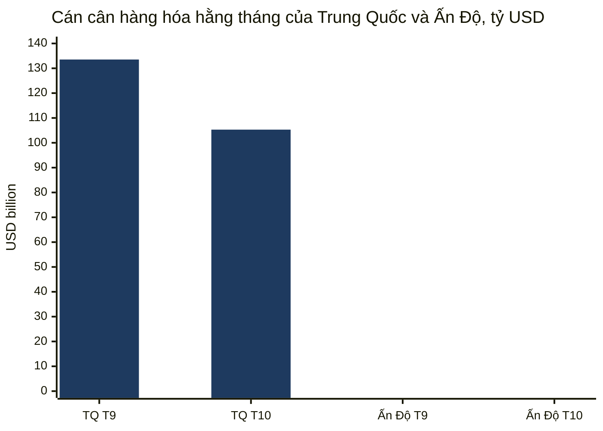

*Lưu ý: Thặng dư hàng hóa hằng tháng của Trung Quốc: tháng 9 là 133,53 tỷ USD, tháng 10 là 105,3 tỷ USD. Thâm hụt hàng hóa hằng tháng của Ấn Độ: tháng 9 là 30,21 tỷ USD, tháng 10 là 39,88 tỷ USD. Nguồn: GACC, Bộ Thương mại Ấn Độ.*

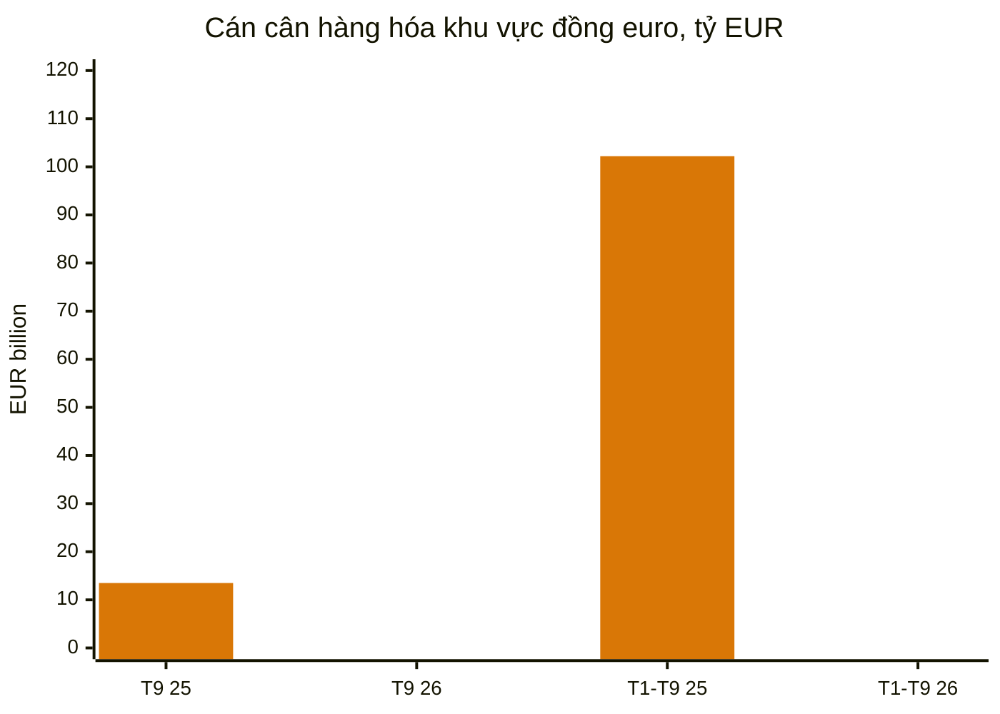

*Lưu ý: cán cân hàng hóa khu vực đồng euro: tháng 9 năm 2025 +13,5 tỷ euro, tháng 9 năm 2026 –10,3 tỷ euro; tháng 1–tháng 9 năm 2025 +102,2 tỷ euro, tháng 1–tháng 9 năm 2026 –36,5 tỷ euro. Nguồn: Eurostat, ngày 13 tháng 11 năm 2026.*

### Các viện nghiên cứu

Sau cuộc bầu cử giữa nhiệm kỳ, báo cáo ngày 5–10 tháng 11 đã dựa vào Budget Lab của Yale và Tax Foundation để lượng hóa chi phí thuế quan của Hoa Kỳ (xem 3.2). Số liệu của Budget Lab tính đến ngày 2 tháng 11 đặt mức thuế theo luật định trung bình của Hoa Kỳ ở mức 11,8%, tăng lên 11,9% vào cuối năm theo luật hiện hành, với chi phí khoảng 0,7% đối với giá tiêu dùng Hoa Kỳ, hay khoảng 900 USD mỗi hộ gia đình mỗi năm. Tax Foundation ước tính thuế quan sẽ làm tăng thuế trung bình 820 USD mỗi hộ gia đình năm 2026 (mô hình tháng 8 năm 2026), trong khi Budget Lab ước tính gánh nặng khoảng 1.100 USD mỗi hộ gia đình trong báo cáo ngày 24 tháng 8 năm 2026. Hai con số này sử dụng các phương pháp khác nhau: con số 820 USD của Tax Foundation phản ánh năm 2026 dựa trên hàng hóa thực tế được nhập khẩu, trong khi con số 1.100 USD của Yale giả định các mức thuế hiện tại vẫn giữ nguyên với trọng số nhập khẩu cố định. Nhà kinh tế cấp cao của Tax Foundation, Erica York, viết ngày 7 tháng 10 rằng việc bãi bỏ mọi thuế quan áp đặt kể từ năm 2017 sẽ tốn gần 1,8 nghìn tỷ USD trong một thập kỷ, và một loại thuế giá trị gia tăng toàn diện ở mức 1% sẽ thu đủ để thay thế. Giám đốc điều hành của Budget Lab, Martha Gimbel, nói với Marketplace ngày 5 tháng 11 rằng thuế quan mang lại gần 2 nghìn tỷ USD trong mười năm. Thuế hải quan ròng đạt tổng cộng 173,2 tỷ USD trong năm tài chính 2026, theo Bộ Tài chính. Không có mục chính sách thương mại mới nào từ tradeintelligence.eu được xác định trong phạm vi bao quát qua tìm kiếm trên web.

**Nguồn:** [Geopolitiqs](https://www.geopolitiqs.com/tn/2026-11-09/tariffs-average-rate); [Dave Manuel](https://www.davemanuel.com/2026/11/06/what-happens-to-tariffs-now-that-democrats-control-congress/)

### Các cổng dữ liệu

Không có bản phát hành mới quan trọng nào trong phạm vi bao quát được xác định từ các cổng USITC DataWeb, UN Comtrade, WITS, Ngân hàng Thế giới hay IMF.

---

## 9. Thị trường vận tải

### Giá cước container giao ngay — Chỉ số World Container Index của Drewry

Đánh giá của Drewry cho thứ Năm, ngày 12 tháng 11 năm 2026, ghi nhận mức giảm 2% theo tuần của chỉ số tổng hợp còn 4.305 USD/container 40ft, tuần giảm thứ hai liên tiếp, do nhu cầu yếu trên các tuyến xuyên Thái Bình Dương và Á–Âu/Địa Trung Hải. Trên tuyến xuyên Thái Bình Dương, Thượng Hải–New York giảm 3% còn 9.020 USD/container 40ft, mức thấp nhất kể từ tháng 8 năm 2026, và Thượng Hải–Los Angeles giảm 2% còn 7.416 USD, mức thấp nhất kể từ tháng 9 năm 2026. Trên tuyến Á–Âu/Địa Trung Hải, Thượng Hải–Rotterdam giảm 3% còn 3.504 USD, trong khi Thượng Hải–Genoa không đổi ở mức 4.168 USD. Các hãng tàu đã công bố tám chuyến tàu bị hủy cho tuần tiếp theo trên tuyến xuyên Thái Bình Dương, so với bốn chuyến trong tuần này (tám so với năm chuyến trên tuyến Á–Âu/Địa Trung Hải), và đã công bố mức Freight All Kinds cao hơn cùng Phụ phí Mùa cao điểm trên tuyến Á–Âu/Địa Trung Hải có hiệu lực trong nửa cuối tháng 11. Drewry dự kiến giá cước xuyên Thái Bình Dương sẽ giảm thêm trong tuần tới và giá cước Á–Âu/Địa Trung Hải tăng nhẹ. Tình trạng tắc nghẽn tại cảng Thượng Hải tăng lên 49 giờ tuần trước, từ 36 giờ tuần trước đó. Năm mươi ba tàu đã quá cảnh Kênh đào Suez tuần trước, trong khi một tàu quá cảnh Eo biển Hormuz.

**Nguồn:** [Drewry](https://www.drewry.co.uk/supply-chain-advisors/supply-chain-expertise/world-container-index-assessed-by-drewry)

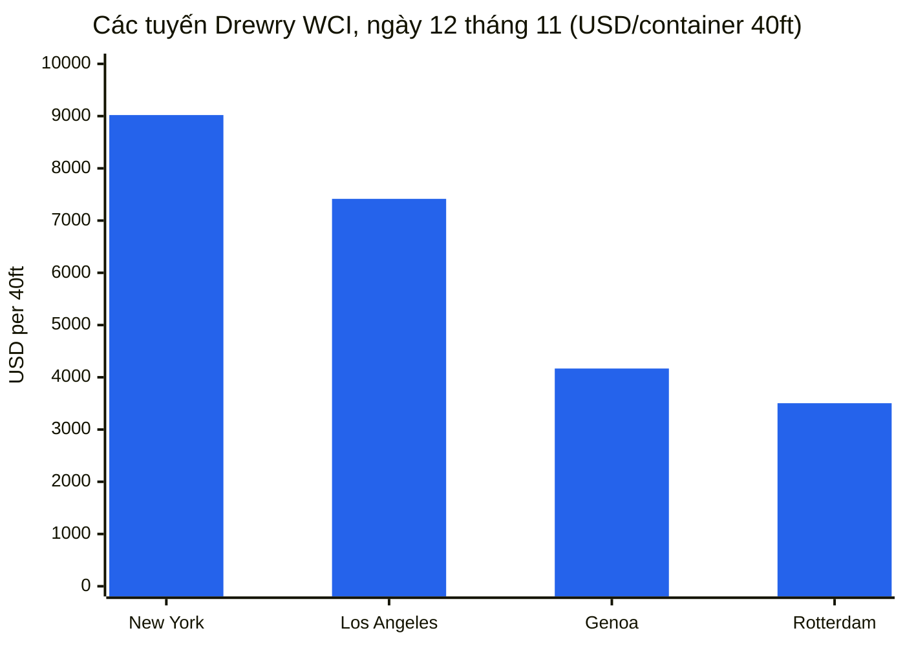

*Lưu ý: mọi tuyến đều từ Thượng Hải. Thượng Hải–New York 9.020 USD; Thượng Hải–Los Angeles 7.416 USD; Thượng Hải–Genoa 4.168 USD; Thượng Hải–Rotterdam 3.504 USD. Chỉ số tổng hợp 4.305 USD/container 40ft, giảm 2% theo tuần. Nguồn: Drewry, ngày 12 tháng 11 năm 2026.*

### Chỉ số Freightos Baltic Index

Freightos báo cáo trong bản cập nhật hằng tuần ngày 10 tháng 11 rằng chỉ số toàn cầu giảm 2% còn 3.452 USD (mức trước đó là 3.513 USD), với tuyến Á–Bắc Âu giảm 5% và các tuyến xuyên Thái Bình Dương thấp hơn sau khi các đợt tăng giá chung tháng 11 không giữ được. Giá tuyến Á–Bờ Tây Hoa Kỳ (FBX01 hằng tuần) giảm 1% còn khoảng 8.200 USD/FEU; Á–Bờ Đông Hoa Kỳ (FBX03 hằng tuần) giảm 2% còn khoảng 9.700 USD/FEU; Á–Bắc Âu (FBX11 hằng tuần) giảm 5% còn 3.400 USD/FEU, tăng 50% so với cùng kỳ năm trước; Á–Địa Trung Hải (FBX13 hằng tuần) giảm 1% còn 4.300 USD/FEU, tăng 88% so với cùng kỳ năm trước. Tuần giảm thứ hai liên tiếp của chỉ số toàn cầu, cùng với Drewry, xác nhận rằng các đợt tăng giá tháng 11 đã không giữ được, trong khi giá cước vẫn cao hơn nhiều so với mức một năm trước trên các tuyến Á–Âu. Công đoàn nhân viên bảo vệ ILWU Local 26 đã gia hạn hạn chót đình công tại các cảng Los Angeles và Long Beach đến ngày 20 tháng 11 để có thêm thời gian đàm phán. Liên đoàn Bán lẻ Quốc gia báo cáo khối lượng nhập khẩu đường biển của Hoa Kỳ đạt đỉnh ngay dưới mức kỷ lục trong tháng 9 ở mức 2,37 triệu TEU, giảm ước tính 5% trong tháng 10, với tháng 11 dự kiến giảm 14% so với mức cao tháng 9.

**Nguồn:** [Freightos](https://www.freightos.com/freight-resources/la-lb-strike-deadline-extended-dem-win-increasing-trade-uncertainty-november-10-2026-update/)

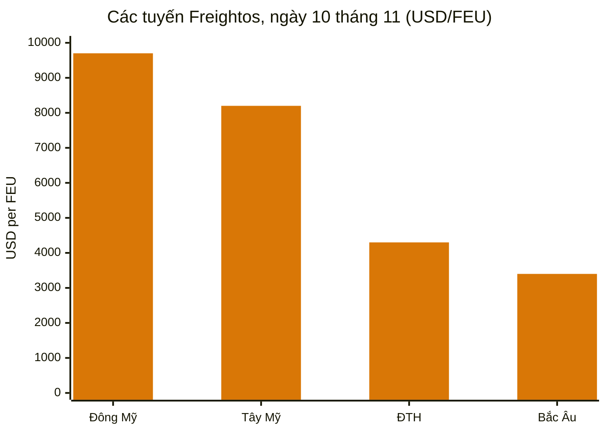

*Lưu ý: Á–Bờ Đông Hoa Kỳ khoảng 9.700 USD/FEU; Á–Bờ Tây Hoa Kỳ khoảng 8.200 USD; Á–Địa Trung Hải 4.300 USD; Á–Bắc Âu 3.400 USD. Chỉ số toàn cầu 3.452 USD, giảm 2% theo tuần. Nguồn: Freightos, ngày 10 tháng 11 năm 2026.*

### Các đợt tăng giá tháng 11 — đã công bố, đã được chiết khấu

Giá cước đường biển xuyên Thái Bình Dương giảm nhẹ trong tuần đến ngày 12 tháng 11 khi các đợt tăng giá chung theo kế hoạch của các hãng tàu không giữ được, nhưng vẫn quanh mức mùa cao điểm. Các hãng tàu đã tìm cách tăng 2.000–3.000 USD/FEU cho tháng 11, và nộp thêm các đợt tăng cho ngày 15–16 tháng 11, nhưng các đơn vị giao nhận viện dẫn chỗ trống trên tàu đang cải thiện và lịch trình tàu ổn định hơn. Giá cước Á–Âu cũng hạ nhiệt: giá Bắc Âu giảm 5% trong tuần còn 3.400 USD/FEU, trong khi giá Địa Trung Hải giảm 1% còn 4.300 USD/FEU. Chỉ số Shanghai Containerized Freight Index giảm 61,12 điểm còn 3.572,33 ngày 13 tháng 11, tuần giảm thứ hai liên tiếp, khi giá cước đi Hoa Kỳ giảm và giá Địa Trung Hải tăng. Giá Thượng Hải–Bờ Đông Hoa Kỳ giảm 470 USD còn 9.387 USD/container 40ft, Thượng Hải–Bờ Tây Hoa Kỳ giảm 270 USD còn 7.111 USD, và Thượng Hải–châu Âu giảm 77 USD còn 3.402 USD/container 40ft, trong khi Thượng Hải–Địa Trung Hải tăng 380 USD lên 4.746 USD/container 40ft.

**Nguồn:** [FreightWaves](https://www.freightwaves.com/news/us-midterm-shift-adds-trade-uncertainty-as-trans-pacific-ocean-freight-rates-stay-elevated); [ShipUniverse](https://www.shipuniverse.com/news/container-freight-rates-split-as-u-s-east-coast-drops-470-as-mediterranean-surges-6-7/)

### Hủy chuyến và công suất

Công cụ theo dõi hủy chuyến của Drewry dự báo 52 chuyến tàu bị hủy trong tổng số 716 dịch vụ theo lịch trên các tuyến Đông–Tây lớn từ ngày 16 tháng 11 đến ngày 21 tháng 12, khoảng 7% số chuyến khởi hành theo kế hoạch. Các hãng tàu đã công bố tám chuyến tàu bị hủy cho tuần tiếp theo trên tuyến xuyên Thái Bình Dương, so với bốn chuyến trong tuần này, và tám chuyến trên tuyến Á–Âu/Địa Trung Hải so với năm chuyến. Quy mô các chuyến tàu bị hủy theo kế hoạch cho thấy các hãng tàu đang hành động để hạn chế công suất sang tháng 12 khi các đợt tăng giá tháng 11 không giữ được.

### Hàng rời khô — Sở Giao dịch Baltic

Chỉ số Baltic Dry Index tăng 6,2% trong tuần lên 2.980 điểm ngày 13 tháng 11, tuần tăng thứ tư liên tiếp, ngay cả khi giảm vào thứ Sáu để chấm dứt chuỗi bảy phiên tăng liên tiếp. Chỉ số tăng trong tuần — 2.854 điểm ngày 9 tháng 11, 2.862 điểm ngày 10 tháng 11, 2.959 điểm ngày 11 tháng 11 và 3.020 điểm ngày 12 tháng 11 — trước khi giảm 40 điểm, hay 1,3%, vào thứ Sáu ngày 13 tháng 11 còn 2.980 điểm. Giá cước Capesize thúc đẩy mức tăng hằng tuần: BCI 182 5TC đạt đỉnh 43.860 USD trước khi đóng cửa tuần ở mức 42.798 USD. Giá cước Panamax và Supramax cũng tăng trong tuần. Mức tăng hằng tuần trước đó (tuần đến ngày 6 tháng 11) là 3,4%, lên 2.805 điểm từ 2.714 điểm ngày 30 tháng 10. Giá cước hàng rời khô đi ngược chiều với giá cước container, với bốn tuần tăng liên tiếp đưa chỉ số lên mức cao nhất kể từ đầu tháng 10, cho thấy nhu cầu vững chắc hơn đối với tàu Capesize và Panamax chở quặng sắt, than và ngũ cốc ngay cả khi nhu cầu container hạ nhiệt. Bản tóm tắt container của Sở Giao dịch Baltic cho tuần 46 mô tả một tuần tương đối trầm lắng: giá cước container trên bốn tuyến Đông–Tây chính giảm trung bình 0,52%, với tuyến Trung Quốc/Bờ Tây Hoa Kỳ giảm 0,77% trong khi Bờ Đông không đổi, và giá cước Á–Âu suy yếu nhẹ, với Bắc Âu giảm 0,53% và Địa Trung Hải giảm 0,79%.

**Nguồn:** [The DCN](https://www.thedcn.com.au/news/baltic-exchange-weekly-report-13-november-2026)

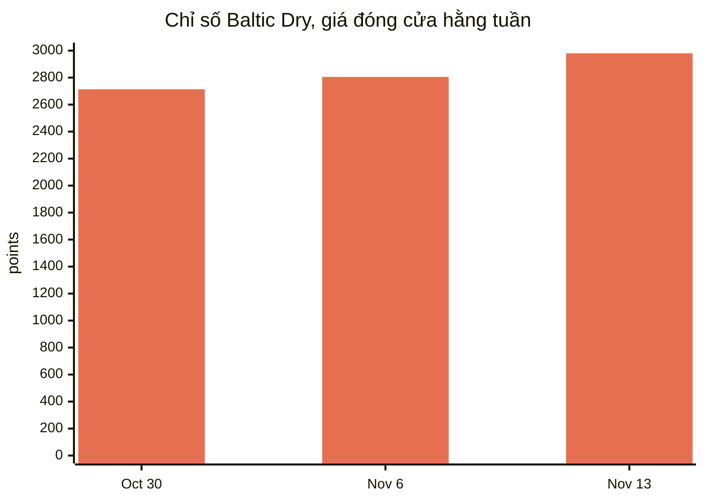

*Lưu ý: giá đóng cửa hằng tuần: 2.714 (ngày 30 tháng 10), 2.805 (ngày 6 tháng 11), 2.980 (ngày 13 tháng 11). Tuần tăng thứ tư liên tiếp. Nguồn: Báo cáo hằng tuần của Sở Giao dịch Baltic, ngày 13 tháng 11 năm 2026.*

### Suez và độ tin cậy lịch trình

Sự trở lại của Suez tiếp tục (xem 3.5). Drewry đếm được 53 tàu container qua kênh trong tuần đến ngày 1 tháng 11, tăng 130% so với cùng kỳ năm trước, và ước tính khoảng 60% công suất Á–Âu đã quay lại tuyến Suez. Tàu Ever Eon của Evergreen quá cảnh ngày 8 tháng 11, chuyến quá cảnh đầu tiên của Evergreen sau gần ba năm. Khi các hãng tàu khôi phục dịch vụ Suez, thời gian quá cảnh Á–Âu giảm bảy đến mười ngày, nhưng các chuyến tàu đến đang dồn dập: Flexport dự báo công suất tàu đến các cảng Bắc Âu ở mức 131% so với bình thường trong tuần 16–22 tháng 11, với 31 tàu container đi qua Suez cùng với 61 tàu vẫn đi vòng qua Mũi Hảo Vọng. Flexport coi lượng tàu đến trên 120% công suất bình thường là rủi ro tắc nghẽn, và ít nhất ba tuần từ giữa tháng 11 đến tháng 1 được dự báo vượt ngưỡng đó. Thời gian lưu container trung bình đạt 3,37 ngày trong tuần 42, với tỷ lệ sử dụng bãi được báo cáo ở mức 80%–90%.

### Hàng không

Giá cước giao ngay hàng không toàn cầu tăng tuần thứ ba liên tiếp, tăng 4% trong tuần 44 lên khoảng 3,93 USD/kg, cao hơn khoảng 40% so với cùng tuần năm ngoái, theo chỉ số TAC. Chỉ số Baltic Air Freight Index tăng 6,6% trong bảy ngày đến ngày 9 tháng 11 và 28,2% so với cùng kỳ năm trước. Bản cập nhật ngày 10 tháng 11 của Freightos ghi nhận tuyến Trung Quốc–Bắc Mỹ tăng 3% lên hơn 8,00 USD/kg, Trung Quốc–Bắc Âu tăng 11% lên 4,87 USD/kg, và Bắc Âu–Bắc Mỹ tăng 9%; hàng không xuyên Đại Tây Dương tăng 33% trong tháng qua lên 2,90 USD/kg. Giá giao ngay trung bình toàn cầu tháng 10 của Xeneta là 3,11 USD/kg, tăng 29% so với cùng kỳ năm trước. IATA báo cáo nhu cầu hàng hóa tháng 9 tăng 7,7% so với cùng kỳ năm trước, với lưu lượng Á–Bắc Mỹ tăng 17%, trong khi giá nhiên liệu máy bay cao hơn 103,4% so với một năm trước. Hàng không đang tiếp nhận các đơn hàng lễ hội muộn và các lô hàng phần cứng AI vào công suất bị thắt chặt bởi lịch trình hành khách mùa đông, đẩy giá cước về phía mức đỉnh tháng 12 năm ngoái. Các đơn vị giao nhận báo cáo giá cước Trung Quốc–Bờ Tây Hoa Kỳ quanh mức 8,50–9,00 USD/kg ở những nơi còn chỗ.

**Nguồn:** [Daily8 News](https://www.daily8news.com/article/air-cargo-rates-2026-high-peak-season-20261113/); [IATA](https://www.iata.org/en/pressroom/2026-releases/10-29-air-cargo-demand-accelerates-september/); [TAC Index via LinkedIn](https://www.linkedin.com/pulse/air-freight-market-update-november-10-2026-tacindex-pkmfc)

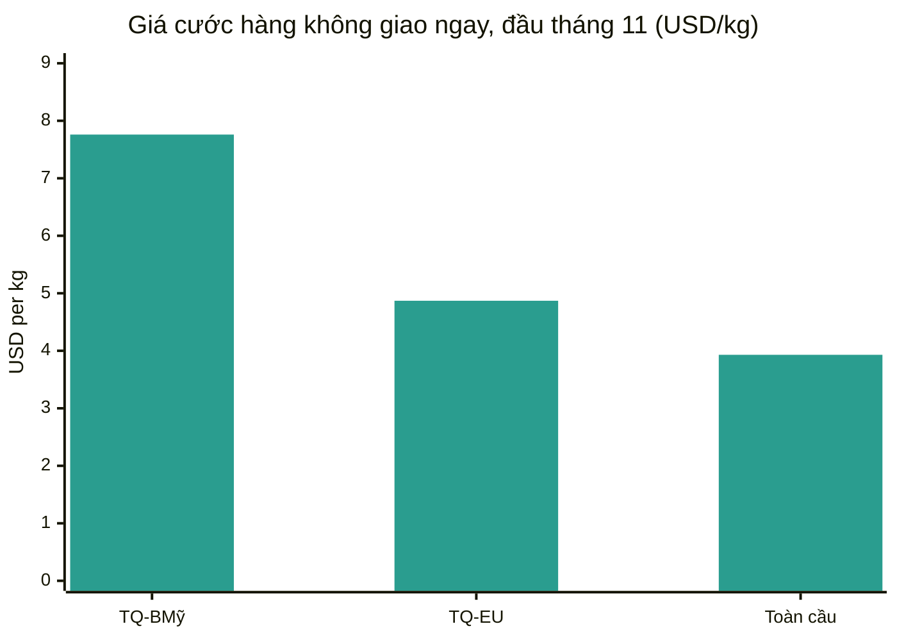

*Lưu ý: Trung Quốc–Bắc Mỹ 7,76 USD/kg (Freightos, đầu tháng 11; trên 8,00 USD/kg trong bản cập nhật ngày 10 tháng 11); Trung Quốc–Bắc Âu 4,87 USD/kg; giá giao ngay toàn cầu khoảng 3,93 USD/kg (Chỉ số TAC, tuần 44). Nguồn: Freightos, Chỉ số TAC.*

### Gián đoạn cảng và logistics

**Los Angeles và Long Beach.** Các cuộc đàm phán về nhân viên bảo vệ đã được gia hạn đến ngày 20 tháng 11 (xem A8). C.H. Robinson báo cáo rằng hàng bán lẻ từ châu Á vẫn đang xử lý các gián đoạn đầu tháng 11 sau một tháng 9 đặc biệt mạnh và một loạt bão đã làm tắc nghẽn container tại một số cảng lớn nhất của Trung Quốc, gián đoạn lịch trình đường biển và khiến các hãng tàu bỏ qua các cảng ghé và dồn hàng. Tại Los Angeles và Long Beach, tắc nghẽn vẫn nghiêm trọng, chủ yếu do không đủ toa xe lửa để vận chuyển hàng vào nội địa; một số chủ hàng đang chuyển sang trung chuyển và xe tải. Tính đến ngày 2 tháng 11, 35.688 container nhập khẩu đang chờ trên bến để lên tàu hỏa tại cảng, trong đó 10.562 container chờ từ chín ngày trở lên. Cảng Los Angeles báo cáo hàng địa phương lưu 3,7 ngày trên bến và hàng đường sắt tại cảng lưu 5,6 ngày ngày 30 tháng 10. Việc phục hồi dự kiến diễn ra dần dần trong hai đến ba tuần, giả định không có thêm gián đoạn. Cảng Los Angeles đã xử lý 1.026.872 TEU trong tháng 10 năm 2026, kỷ lục của tháng và tổng số hằng tháng cao thứ hai trong lịch sử cảng, sau kỷ lục mọi thời đại tháng 9 là 1.042.652 TEU. Đây là lần đầu tiên cảng vượt 1 triệu TEU trong các tháng liên tiếp, và là lần thứ ba trong năm 2026 đạt mốc này. Hàng nhập có tải khoảng 538.620 TEU, tăng 25% so với cùng kỳ năm trước và cao hơn 30% so với mức trung bình tháng 10 trong năm năm của cảng; hàng xuất có tải 114.981 TEU, giảm 7% so với cùng kỳ năm trước; TEU rỗng 373.271, kỷ lục hằng tháng thứ hai liên tiếp. Tổng số từ tháng 1 đến tháng 10 là khoảng 9.108.497 TEU, cao hơn 5% so với năm ngoái và 9% so với mức trung bình năm năm.

**Triển vọng nhập khẩu của Hoa Kỳ.** Global Port Tracker của Liên đoàn Bán lẻ Quốc gia báo cáo rằng các cảng mà tổ chức này theo dõi đã xử lý 2,37 triệu TEU hàng nhập có tải trong tháng 9, tháng bận rộn nhất năm 2026 và tháng bận rộn thứ ba kể từ khi bắt đầu theo dõi. Tháng 10 được dự báo ở mức 2,26 triệu TEU, tăng 9,1% so với cùng kỳ năm trước; tháng 11 ở mức 2,05 triệu TEU, tăng 1,2%; và tháng 12 ở mức 2,03 triệu TEU, tăng 1,3%. Dự báo cả năm là khoảng 26 triệu TEU, tăng 2% so với năm 2025. Triển vọng trở nên yếu hơn đầu năm 2027: tháng 1 được dự báo ở mức 2,04 triệu TEU, giảm 3% so với cùng kỳ năm trước; tháng 2 ở mức 1,89 triệu, giảm 0,5%; tháng 3 ở mức 1,92 triệu, giảm 11,2%.

**Durban.** Durban chưa phục hồi sau việc chuyển đổi Bến Durban Gateway sang vận hành bởi ICTSI tháng 8 và hệ thống bến Navis N4; khối lượng tại bến giảm khoảng 30% từ ngày 14 tháng 8 đến ngày 10 tháng 9 so với mức trung bình bốn tháng trước đó. Chỉ số lập kế hoạch toàn cảng ở mức 15 ngày trong bản cập nhật vận chuyển hàng hóa ngày 3 tháng 11, tăng một ngày so với tuần trước. Mười bảy tàu container đang chờ Durban ngày 2 tháng 11 — sáu tàu trong các khu neo đậu được chỉ định và mười một tàu ở xa hơn ngoài khơi — tương ứng khoảng 85.000 TEU đang nổi. Tàu container neo đậu trung bình 7,46 ngày trong bảy ngày tính đến đầu tháng 11. Maersk đã tăng phụ phí mùa cao điểm đối với container khô từ Viễn Đông Á đến Nam Phi và Mauritius lên 1.000 USD/container 20ft và 2.000 USD/container 40ft từ ngày 9 tháng 11, gấp bốn lần mức 250/500 USD ấn định ngày 15 tháng 10, và phí tắc nghẽn Durban lên 400 USD/container 20ft và 800 USD/container 40ft đối với hàng có xuất xứ Trung Quốc từ ngày 1 tháng 11. Bộ trưởng Giao thông Barbara Creecy cho biết Bến Durban Gateway có thể chỉ trở lại hiệu suất trước đây trong khoảng tháng 12 năm 2026 đến tháng 2 năm 2027, và Kuehne+Nagel dự kiến không có cải thiện đáng kể nào trước cuối quý 1 năm 2027.

**Nguồn:** [C.H. Robinson](https://www.chrobinson.com/en-us/resources/insights-and-advisories/north-america-freight-insights/nov-2026-freight-market-update/industry-insights/retail/); [AJOT](https://www.ajot.com/news/port-of-los-angeles-tops-1-million-container-units-for-second-consecutive-month); [FreightWaves](https://www.freightwaves.com/news/retailers-forecast-u-s-imports-to-stay-elevated-through-2026-after-breakout-peak-season); [DTFU Logistics](https://www.dtfulogistics.com/news/durban-port-congestion-2026-china-south-africa/)

### Thông tin từ nhà cung cấp

Descartes Systems Group đã công bố Báo cáo Vận tải Toàn cầu tháng 11 ngày 11 tháng 11, dựa trên dữ liệu thương mại của Descartes Datamyne. Nhập khẩu container của Hoa Kỳ trong tháng 10 năm 2026 đạt mức cao kỷ lục hằng tháng là 2.674.808 TEU — cao hơn 2,0% (52.343 TEU) so với kỷ lục trước đó là 2.622.465 TEU thiết lập tháng 5 năm 2022; tăng 5,0% so với tháng 9 năm 2026, tăng 16,0% so với tháng 10 năm 2025, và tăng 29,2% so với tháng 10 năm 2019. Nhập khẩu từ Trung Quốc tăng tháng thứ tư liên tiếp lên 987.805 TEU, khối lượng hằng tháng cao nhất kể từ tháng 1 năm 2025; tăng 6,9% (63.351 TEU) theo tháng và tăng 22,9% so với cùng kỳ năm trước; thị phần của Trung Quốc trong tổng nhập khẩu container của Hoa Kỳ tăng lên 36,9%, từ 36,3% trong tháng 9. Các nhóm hàng đầu có xuất xứ Trung Quốc: nhựa, 144.530 TEU; đồ nội thất và giường, 137.551 TEU; đồ chơi, trò chơi và đồ thể thao, 102.672 TEU. Nhập khẩu từ 10 nước xuất xứ hàng đầu tăng 5,8% theo tháng. Nhập khẩu container của Hoa Kỳ từ tháng 1 đến tháng 10 năm 2026 tăng 2,3% so với cùng kỳ năm 2025, tháng thứ hai liên tiếp khối lượng lũy kế vượt mức năm trước sau tám tháng thấp hơn tốc độ năm ngoái. Các cảng Bờ Đông và Bờ Vịnh đã tăng thị phần so với các cửa ngõ Bờ Tây: nhập khẩu qua Bờ Vịnh là 266.905 TEU, tăng 24,0% theo tháng và cao hơn 16,2% so với mức trung bình 12 tháng, mức cao nhất kể từ khi Descartes bắt đầu theo dõi con số khu vực này tháng 8 năm 2023. Houston ghi nhận mức tăng hằng tháng lớn nhất tại cảng, tăng 42.665 TEU (26,7%). Nhập khẩu qua Los Angeles giảm 1,4%, Long Beach giảm 2,0%, và Oakland giảm 10,9%. Thị phần kết hợp của năm cửa ngõ Bờ Đông và Bờ Vịnh hàng đầu là 39,9%, tăng từ 36,7% trong tháng 9; năm cửa ngõ Bờ Tây hàng đầu giảm còn 44,9%, từ 47,0%. 10 cảng hàng đầu của Hoa Kỳ xử lý 84,8% hàng nhập khẩu. Thời gian chậm trễ quá cảnh trung bình tại cảng trên 10 cửa ngõ được theo dõi là 6,3 ngày trong tháng 10, so với 6,0 ngày trong tháng 9 và 4,2 ngày trong tháng 6; chậm trễ tăng tại bảy trong số 10 cảng. Chậm trễ dài nhất: New York/New Jersey, 8,1 ngày; Seattle, 7,6 ngày; Savannah, 6,9 ngày. Nhập khẩu đã vượt 2,5 triệu TEU mỗi tháng kể từ tháng 7 năm 2026. Khối lượng kỷ lục tháng 10, phần lớn nhờ tháng tăng thứ tư liên tiếp của hàng hóa có xuất xứ Trung Quốc, cho thấy nhu cầu nhập khẩu đường biển của Hoa Kỳ vẫn mạnh bất chấp bất ổn về thuế quan và chính sách thương mại kéo dài. Sự chuyển dịch thị phần sang các cảng Bờ Đông và Bờ Vịnh cùng với sự gia tăng ổn định về chậm trễ quá cảnh — tăng khoảng 50% kể từ tháng 6 — cho thấy áp lực ngày càng tăng lên các mạng lưới logistics nội địa ngay cả khi không có tắc nghẽn cảng trên diện rộng.

Không có mục nào đủ tiêu chuẩn của nhà cung cấp được tìm thấy từ TradeInt trong phạm vi ngày 9–16 tháng 11 năm 2026. Trang blog của TradeInt liệt kê bài đăng gần nhất của mình có ngày 31 tháng 12 năm 2025; không có bài đăng blog nào có ngày 9–16 tháng 11 năm 2026 được tìm thấy trên trang web hay trong tìm kiếm tại tradeint.com/insights/.

**Nguồn:** [Descartes](https://www.descartes.com/resources/global-logistics-shipping-report-resource-center?language=en); [All About Shipping](https://allaboutshipping.co.uk/2026/11/11/descartes-releases-november-global-shipping-report-u-s-container-imports-hit-record-volume-in-october/); [TradeInt blog](https://tradeint.com/insights/blogs/)

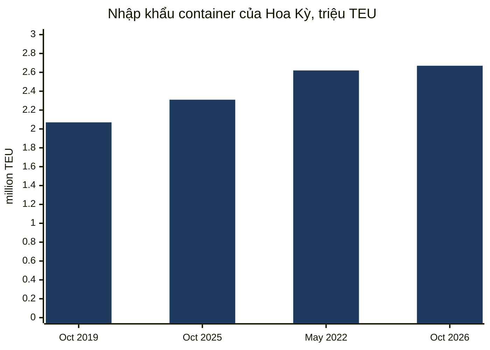

*Lưu ý: Tháng 10 năm 2026: 2.674.808 TEU, mức cao kỷ lục hằng tháng; kỷ lục trước đó tháng 5 năm 2022: 2.622.465 TEU; tháng 10 năm 2025: khoảng 2,31 triệu TEU (tăng 16,0% so với cùng kỳ năm trước); tháng 10 năm 2019: khoảng 2,07 triệu TEU (tăng 29,2%). Nguồn: Báo cáo Vận tải Toàn cầu tháng 11 của Descartes, ngày 11 tháng 11 năm 2026.*

---

## 10. Dòng thời gian chính sách

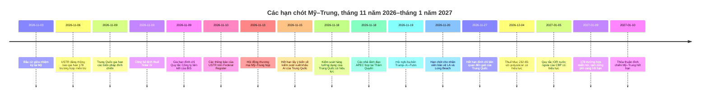

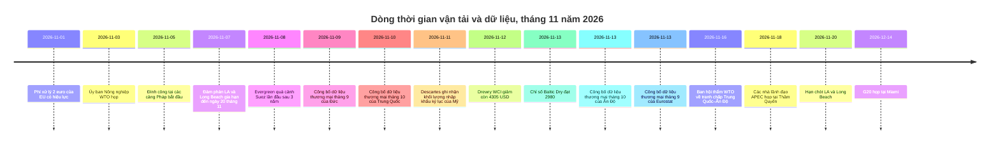

---

## 11. Các hạn chót & sự kiện sắp tới (90 ngày tới)

| Ngày | Nội dung |
|---|---|
| Ngày 18 tháng 11 năm 2026 | CBP có thể vô hiệu số đăng ký nhà nhập khẩu đối với các nhà nhập khẩu CTPAT chưa giải quyết các quan ngại về tính chính xác của Mẫu 5106 (thư gửi ngày 4 tháng 11). |
| Ngày 18 tháng 11 năm 2026 | Các biện pháp kiểm soát xuất khẩu hàng lưỡng dụng sửa đổi của Trung Quốc đối với máy bay không người lái, máy đào hầm và tàu nạo vét có hiệu lực (Thông báo số 49–51). |
| Ngày 18–19 tháng 11 năm 2026 | Hội nghị các Nhà lãnh đạo Kinh tế APEC tại Thâm Quyến; hội nghị ba bên Trump–Xi–Putin ngày 19 tháng 11. |
| Ngày 20 tháng 11 năm 2026 | Hạn chót đàm phán về nhân viên bảo vệ tại LA/Long Beach (lần gia hạn thứ tư). |
| Ngày 20 tháng 11 năm 2026 | Việc chuyển giao một số thiết bị giảm thanh từ Danh sách Đạn dược Hoa Kỳ sang Danh sách Kiểm soát Thương mại của BIS có hiệu lực. |
| Ngày 20 tháng 11 năm 2026 | COP31 tại Antalya, Thổ Nhĩ Kỳ, bế mạc (ngày 9–20 tháng 11). |
| Ngày 23 tháng 11 năm 2026 | Ủy ban Nông nghiệp WTO họp về các hạn chế xuất khẩu và cơ chế tự vệ đặc biệt; báo cáo đầy đủ Solar IV của USITC (Ấn phẩm 5804) đến hạn. |
| Ngày 27 tháng 11 năm 2026 | Thông báo số 72 năm 2025 của Trung Quốc đình chỉ giả định từ chối đối với gali, germani, antimon và vật liệu siêu cứng xuất sang Mỹ dự kiến hết hạn, nếu không có thêm đình chỉ hay sửa đổi. |
| Ngày 30 tháng 11 năm 2026 | Kết luận cuối cùng của Bộ Thương mại về bán phá giá và trợ cấp đối với sản phẩm tôn tráng thiếc của Trung Quốc đến hạn, trừ khi được hoãn. |
| Ngày 4 tháng 12 năm 2026 | Thuế Mục 232 đối với polysilicon bắt đầu áp dụng. |
| Ngày 7 tháng 12 năm 2026 | Thời hạn lấy ý kiến về quy tắc đề xuất của CBP đối với lô hàng giá trị thấp (91 FR 64532; hồ sơ USCBP-2026-0298). |
| Ngày 14–15 tháng 12 năm 2026 | Các nhà lãnh đạo G20 họp tại Miami. |
| Ngày 16 tháng 12 năm 2026 | Hiệp định thương mại tự do EU–Ấn Độ được báo cáo sẽ được ký tại Brussels, với Thủ tướng Modi dự kiến tham dự. |
| Ngày 17 tháng 12 năm 2026 | Ngày sớm nhất Bộ Thương mại dự định ban hành hướng dẫn đánh giá trong các đợt rà soát tủ gỗ và sản phẩm gỗ xẻ (35 ngày sau khi công bố ngày 12 tháng 11). |
| Ngày 1 tháng 1 năm 2027 | Thuế Mục 232 tăng lên 30% đối với đồ nội thất bọc nệm và 50% đối với tủ bếp và tủ lavabo; mức 50% bị đe dọa đối với xe cộ, phụ tùng ô tô và thép của Canada cũng nhắm vào ngày này; CBAM của Vương quốc Anh bắt đầu. |
| Ngày 3 tháng 1 năm 2027 | Quốc hội mới của Hoa Kỳ họp. |
| Ngày 5 tháng 1 năm 2027 | Quy tắc cuối cùng tạm thời của CBP về nhà nhập khẩu nước ngoài có hiệu lực; thời hạn lấy ý kiến cùng ngày (hồ sơ USCBP-2026-1387). |
| Ngày 9–10 tháng 1 năm 2027 | Các hạn chót của thỏa thuận đình chiến Mỹ–Trung hội tụ: 178 trường hợp miễn trừ theo Mục 301 và việc đình chỉ phí hàng hải hết hạn ngày 9 tháng 1; việc đình chỉ Quy tắc Công ty liên kết của BIS và các biện pháp đình chỉ đối ứng của Trung Quốc hết hạn ngày 10 tháng 1. |
| Ngày 12 tháng 1 năm 2027 | Thời hạn nộp ý kiến bằng văn bản và yêu cầu tham gia phiên điều trần cho cuộc tham vấn rà soát chung USMCA (hồ sơ USTR-2026-0595 và USTR-2026-0596). |
| Ngày 19 tháng 1 năm 2027 | Kết luận cuối cùng của Bộ Thương mại về bán phá giá đối với sản phẩm tôn tráng thiếc của Thổ Nhĩ Kỳ đến hạn. |
| Ngày 20 tháng 1 năm 2027 | Tờ khai chính thức trở thành bắt buộc đối với thư tín chịu thuế Mục 201, 232 hoặc 301 hay yêu cầu của cơ quan chính phủ đối tác. |
| Ngày 30 tháng 1 năm 2027 | Điều chỉnh thuế chống trợ cấp của Vương quốc Anh đối với cá hồi vân Thổ Nhĩ Kỳ áp dụng từ ngày này (thông báo 2026/31). |
| Ngày 1 tháng 2 năm 2027 | Canada loại bỏ biện pháp giảm nhẹ thuế quan ngang đối với một số sản phẩm dây nhôm, nhôm đùn và bìa cứng. |
| Ngày 6 tháng 2 năm 2027 | Tết Nguyên đán. |
| Ngày 28 tháng 2 năm 2027 | Hạn chót quyết định của USTR trong cuộc điều tra theo Mục 301 về sở hữu trí tuệ của Việt Nam. |
| Tháng 3 năm 2027 | Quyết định điều tra theo Mục 301 của USTR về năng lực dư thừa mang tính cấu trúc dự kiến (đến hạn vào tháng 3 năm 2027). |
| Ngày 25 tháng 3 năm 2027 | Kết luận cuối cùng của Bộ Thương mại về bán phá giá đối với sản phẩm tôn tráng thiếc của Đài Loan đến hạn. |
| Ngày 6 tháng 5 năm 2027 | Các nhà môi giới dự kiến tuân thủ đầy đủ quy tắc về nhà nhập khẩu nước ngoài. |
| Ngày 30 tháng 6 năm 2028 | Biện pháp miễn trừ ngang về thuế quan của Canada được gia hạn đến ngày này. |

---

## 12. Nguồn & phương pháp luận

Phạm vi bao quát: ngày 9–16 tháng 11 năm 2026. Được tổng hợp từ khoảng 45 nguồn tin tức, chính sách, dữ liệu và vận tải thương mại trên toàn thế giới.

Các nguồn đã tham khảo bao gồm: FreightWaves, The Loadstar, Splash247, gCaptain, Hellenic Shipping News, Container News, Supply Chain Dive, Logistics Management, Air Cargo News, Port Technology, TradeInt insights blog; whitehouse.gov, cbp.gov, ustr.gov, federalregister.gov, trade.gov, usitc.gov, bis.doc.gov, JD Supra; ec.europa.eu, gov.uk, cbsa-asfc.gc.ca, canada.ca/en/department-finance, english.mofcom.gov.cn; wto.org, unctad.org, intracen.org, wcoomd.org; dataweb.usitc.gov, ustradecensus.gov, comtradeplus.un.org, wits.worldbank.org, eurostat, data.worldbank.org, imf.org; taxfoundation.org, budgetlab.yale.edu, tradeintelligence.eu; drewry.co.uk, balticexchange.com, freightos.com; descartes.com, tradeint.com.

Các mục có ngày trước ngày 9 tháng 11 chỉ xuất hiện dưới dạng theo dõi, các công bố trên Federal Register rơi vào phạm vi bao quát, hoặc bối cảnh cho một hạn chót trong phạm vi bao quát. Trang tiếng Anh của MOFCOM chỉ có thể truy cập đối với các tiêu đề trang nhất; nội dung phản hồi của cơ quan này về phí của EU và các phát biểu về Danh sách Thực thể Không đáng tin cậy không thể kiểm chứng được từ thông tin được xem xét. Chỉ mục tin tức của WTO không trả về văn bản đọc được qua phương thức fetch, vì vậy các mục về WTO sử dụng các bản phát hành của WTO như được đăng lại. TradeInt không có mục nào đủ tiêu chuẩn của nhà cung cấp trong phạm vi bao quát: bài đăng blog gần nhất của trang này có ngày 31 tháng 12 năm 2025. Không có bản phát hành mới quan trọng nào trong phạm vi bao quát được xác định từ các cổng USITC DataWeb, UN Comtrade, WITS, Ngân hàng Thế giới hay IMF. Không có Lệnh Tạm giữ mới nào được xác định trong phạm vi bao quát.
