# 全球贸易情报报告——2026年11月9日至16日当周

**每周简报。**报道窗口：2026年11月9日至16日。汇编自全球约45家贸易新闻、政策、数据与货运来源。

---

## 目录

1. [执行摘要](#1-executive-summary)
2. [警报](#2-alerts)
3. [重点报道——深度分析](#3-top-stories--deep-dives)
4. [关税追踪](#4-tariff-tracker)
5. [美国政策深度分析](#5-us-policy-deep-dive)
6. [分地区世界政策](#6-world-policy-by-region)
7. [执法行动](#7-enforcement-actions)
8. [数据发布](#8-data-releases)
9. [货运市场](#9-freight-market)
10. [政策时间线](#10-policy-timelines)
11. [未来90天即将到来的截止日期与事件](#11-upcoming-deadlines--events-next-90-days)
12. [来源与方法](#12-sources--methodology)

---

## 1. 执行摘要

这是贸易停战协议以正式文件确认而非真正达成和解的一周，也是全球两大贸易经济体双双公布创纪录规模贸易数据的一周。11月10日，USTR在《联邦公报》上发布通知，将全部178项中国第301条产品排除以及第301条海事港口收费的暂停措施延长至2027年1月9日，美国商务部工业与安全局（BIS）将50%关联企业规则的暂停措施延长至1月10日；中国则作为回应，将对美国商品加征24%关税的暂停措施再延长两个月，同时保留10%的税率，并将其稀土出口管制豁免延长至同一日期。下一次决策节点是11月18日至19日在深圳举行的亚太经合组织（APEC）领导人会议，特朗普总统与习近平主席将在今年第三次会晤，计划中的首次三方会晤还将包括普京总统。其他方面，商务部发布了针对印度、印度尼西亚和老挝太阳能电池的反倾销与反补贴税终裁，合并保证金税率最高达233%；印度—美国协议仍未签署，华盛顿的过剩产能调查尚未完成；加拿大将其关税减免延长至2028年6月；欧盟的2欧元手续费与产品标识符制度进入第二周，理事会已同意自2028年起取消150欧元增值税上限。

- **停战协议以书面形式延长至2027年1月9日至10日。**USTR于11月10日发布的《联邦公报》通知（91 FR 72610和91 FR 72608）将178项第301条排除（164项一般排除、14项太阳能制造排除）以及海事收费暂停措施延长至2027年1月9日美国东部时间晚上11:59；BIS将关联企业规则的暂停措施延长至1月10日。中国将对美国商品加征24%关税的暂停措施自11月10日起再延长两个月，保留10%的税率，将港口收费暂停与稀土出口管制豁免延长至1月10日，并继续暂停针对16家美国实体的措施。镓、锗和锑的暂停措施将于11月27日单独到期。1月的截止日期恰逢2027年2月6日农历新年前夕。
- **APEC是停战协议的下一个场合。**第33届APEC经济领导人会议将于11月18日至19日在深圳举行，会议寻求就贸易、互联互通、数字经济和人工智能达成《深圳宣言》。11月13日举行的首次美中贸易理事会视频会议讨论了一项300亿美元对300亿美元的关税削减安排，但未达成协议。白宫已确认特朗普、习近平与普京将于11月19日举行三方会晤；截至报道时，北京尚未确认，预计不会达成任何协议。
- **太阳能第四轮税令堵住了中国的一条迂回路线。**商务部针对印度、印度尼西亚和老挝太阳能电池的反倾销与反补贴税终裁于11月9日发布，合并“其他企业”保证金税率分别为233.26%（印度）、167.56%（印度尼西亚）和147.39%（老挝）。在第三国使用涉案电池组装的组件属于税令范围。针对台湾（18.07%）和土耳其（3.89%至42.06%）的镀锡板初裁倾销税率已经确定，中国的终裁结果将于11月30日公布。
- **印度—美国协议仍未签署。**印度官员于11月13日表示，签署仍在等待华盛顿最终确定其关税框架；作为关键前提的第301条过剩产能调查尚未报告。美国已向印度保证，相对于亚洲竞争对手，印度将享有比较关税优势；印度目前缴纳10%的第301条税率，越南和中国为12.5%。2月框架中的18%税率从未实施。
- **中期选举改变了政治格局，而非关税。**民主党在11月3日赢得两院；CBS出口民调显示，66%的选民认为关税损害了经济。废除关税的立法需要获得足以推翻否决的多数票，而政府表示将继续征收关税。截至11月9日，2026年日历年的关税与消费税总收入达到2640亿美元，高于一年前的2270亿美元和2024年的820亿美元；耶鲁大学预算实验室（Budget Lab）估计，2026年11月平均关税税率为11.2%，而2025年1月约为2.5%。
- **中国顺差十个月突破1万亿美元；印度创下出口纪录。**中国10月出口同比增长35.2%，达到4123亿美元，1月至10月累计顺差达到10426亿美元，其中集成电路出口为3411亿美元，增长111.1%。印度10月商品出口创下494.7亿美元的纪录，增长45.06%，但893.5亿美元的创纪录进口使商品逆差扩大至398.8亿美元。欧元区9月转为103亿欧元逆差，1月至9月差额由一年前的顺差1022亿欧元转为逆差365亿欧元。
- **货运再次分化：海运走软，空运与干散货上涨。**德鲁里世界集装箱指数（Drewry World Container Index）11月12日下跌2%，至每40英尺集装箱4305美元；波罗的海货运指数（Freightos Baltic Index）下跌2%，至3452美元；上海出口集装箱运价指数下跌1.68%，至3572.33点，11月的涨价未能维持。波罗的海干散货指数上涨6.2%，至2980点，连续第四周上涨。空运走势相反：波罗的海空运指数在截至11月9日的一周内上涨6.6%，同比上涨28.2%，中国—北美航线运价超过每公斤8.00美元。笛卡尔（Descartes）的数据显示，10月美国集装箱进口量创下月度历史新高，达到2674808标准箱。

**货运：**跨太平洋与亚欧航线的集装箱现货运价连续第二周回落，承运人依靠停航来支撑运价；干散货在好望角型船运价走强的带动下连续第四周上涨；空运运价在进入旺季之际达到2026年高点；苏伊士运河回归接近完成，长荣（Evergreen）近三年来首次通过运河，而Flexport警告称，到港集中将导致欧洲港口拥堵；洛杉矶—长滩铁路积压与德班15天的排队使港口风险依然存在。

---

## 2. 警报

| # | 警报 | 生效日期 | 影响 | 来源 |
|---|-------|-----------|--------|--------|
| A1 | USTR发布《联邦公报》通知，将全部178项中国第301条产品排除延长至2027年1月9日美国东部时间晚上11:59，并将第301条海事收费与起重机关税暂停至同一日期 | 2026年11月10日（发布） | 仅为两个月的宽限；自2027年1月10日起入境的货物按全部清单税率缴纳（清单1—3为25%，清单4A为7.5%） | [YCL CPA](https://yclcpa.com/en/insights/us-china-tariff-truce-section-301-exclusions-january-2027) |
| A2 | 中国将对美国商品加征24%关税的暂停措施自11月10日起再延长两个月，保留10%的税率；将稀土出口管制豁免、港口收费暂停和实体清单暂停措施延长至2027年1月10日 | 2026年11月9—10日 | 美国出口商继续适用10%的税率；中国方面的停战协议延至2027年1月10日；与镓有关的暂停措施于11月27日到期 | [Medium](https://medium.com/@frank.matisse/weekly-digest-15-november-2026-wd-25-the-truce-is-not-access-3f6d8ac577b6) |
| A3 | BIS将50%关联企业规则出口管制措施的暂停延长至2027年1月10日 | 2026年11月9日 | 以所有权为基础的筛查继续暂停；如无进一步行动，扩大的管制措施将于2027年1月10日生效 | [Sanctions.com](https://www.sanctions.com/articles/us-extends-suspension-of-bis-50-rule-until-january-2027) |
| A4 | APEC领导人于11月18—19日在深圳会晤；白宫确认特朗普—习近平—普京三方会晤定于11月19日举行；11月13日美中贸易理事会视频会议讨论了300亿美元对300亿美元的关税削减方案，未达成协议 | 2026年11月18—19日 | 首次有机会将停战协议延长至2027年1月10日之后；会议寻求就贸易、数字经济和人工智能达成《深圳宣言》 | [Asia Daily](https://asiadaily.org/news/18743/) |
| A5 | CBP警告CTPAT进口商，其进口商登记号可能自11月18日美国东部时间凌晨12:01起因5106表格信息不准确而被作废 | 2026年11月18日 | 未解决的函件将导致以该进口商号申报的货物无法入境；实际地址必须是进口商自身的营业地点 | [Concord Solutions](https://www.concordsolutionsgroup.com/post/ctpat-importers-cbp-warns-ior-numbers-may-be-voided-november-18-over-form-5106-accuracy) |
| A6 | 中国修订后的无人机、隧道掘进机和挖泥船两用物项出口管制于11月18日生效；商务部技术目录征求意见于11月15日截止，尚未公布结果 | 2026年11月18日 | 对特定无人机（300公里航程、80升气溶胶播撒能力）、隧道掘进机和挖泥船实行许可要求 | [JD Supra](https://www.jdsupra.com/legalnews/china-proposes-expanded-technology-8379336/) |
| A7 | 商务部发布针对印度、印度尼西亚和老挝太阳能电池的反倾销反补贴税终裁；合并“其他企业”税率分别为233.26% / 167.56% / 147.39% | 2026年11月9日 | 保证金自11月5日起恢复征收；在第三国使用涉案电池制造的组件属于税令范围 | [Solar Stock USA](https://www.solarstockusa.com/research/market-notes/adcvd-orders-india-indonesia-laos) |
| A8 | 洛杉矶/长滩守夜人谈判延长至11月20日——第四次延期；六个码头约有250名守夜人；文森特·托马斯大桥自11月7日起关闭16个月；35688个进口集装箱等待码头铁路装运 | 2026年11月20日 | 一旦罢工，其他工会如遵守纠察线，船舶、堆场和闸口作业将停摆；铁路滞留时间已达5.6天 | [Navilink Global](https://www.navilinkglobal.com/news/la-long-beach-port-strike-averted-again-ilwu-talks-extended-to-november-20-as-record-cargo-volumes-continue) |
| A9 | 针对加拿大的第338条关税在国际贸易法院受到挑战；*Gellert v. Trump*案的法庭之友意见书于11月11日和13日提交；50%的关税涵盖约200亿美元的加拿大进口 | 2026年11月11—13日 | 若法院作出不利于政府的裁决，将取消一大层关税并引发退税索赔；关税目前仍然有效 | [Reason](https://reason.com/volokh/2026/11/14/our-amicus-brief-in-case-challenging-trumps-section-338-tariffs-against-canada/) |
| A10 | 截至11月13日，印度—美国协议仍未签署；签署有待华盛顿最终确定关税框架；第301条过剩产能调查尚未报告 | 2026年11月13日 | 印度出口商对承诺的18%税率没有确定性；印度缴纳10%的第301条关税，越南和中国为12.5% | [Industrial Front](https://industrialfront.com/india-us-trade-deal-tariff-advantage-november-2026/) |

### A1/A2/A3——停战协议以书面形式延长至1月

美中贸易停战协议延长两个月在本报道窗口内正式确定。11月10日，USTR发布了两份《联邦公报》通知：第一份将全部178项现行第301条产品排除——164项一般排除（税则号9903.88.69）和14项太阳能制造排除（税则号9903.88.70）——延长至2027年1月9日美国东部时间晚上11:59（91 FR 72610；文件号2026-22925），适用于2026年11月10日美国东部时间凌晨12:01或之后进入消费或从保税仓库提取进入消费的货物；第二份将针对第301条海事行动的暂停措施进一步延长至同一日期，包括对船东和船舶经营人的服务费以及对岸桥和其他货物装卸设备的关税（91 FR 72608；文件号2026-22867）。没有增加或删除任何排除，也没有征求新的意见，USTR依据的是其2025年9月通知的记录；由24个行业协会组成的联盟曾于11月4日要求至少延长一年。有报道指出，通知内部存在不一致之处，部分内容提及1月10日而非1月9日；排除通知中的执行日期为1月9日。11月9日，BIS发布最终规则，将其50%关联企业规则——该措施将把出口管制扩大至由被列入清单方拥有50%或以上权益的外国实体——的暂停延长至2027年1月10日，与此前的暂停无缝衔接。

中国于11月9日采取行动。中国国务院关税税则委员会表示，将继续暂停对美国商品加征24%的关税两个月，自11月10日起，保留10%的附加税率。商务部与海关总署发布2026年第58号公告，将六项2025年10月出口管制公告的暂停措施延续至2026年11月11日至2027年1月10日，涵盖稀土加工技术与设备、另外五种中重稀土、锂电池与石墨负极材料、超硬材料，以及关于含有中国原产稀土的外国制造产品域外适用的规则。商务部还继续暂停其2025年第21号公告中针对16家美国实体的措施，中国交通运输部将对与美国有关联船舶征收特别港口费的暂停措施延长至2027年1月10日。有两点限制值得注意。2025年4月针对七种中重稀土（钐、钆、铽、镝、镥、钪和钇）的许可要求从未暂停，仍然有效。而2025年第72号公告——暂停中国对输美镓、锗、锑和超硬材料推定拒绝的做法——仅有效至2026年11月27日，且未在第58号公告中提及；截至11月13日，尚未发现任何修订通知。

### A4——深圳APEC：下一个决策节点

第33届APEC经济领导人会议将于2026年11月18日至19日在深圳举行，这是中国继2001年上海和2014年北京之后第三次主办。领导人周于11月14日开始，APEC工商咨询理事会会议于11月14日至16日举行，工商领导人峰会于11月17日至18日举行，习近平主席将在峰会上发表主旨演讲。主办方主题为“共建亚太共同体，共促繁荣发展”，三大优先事项为开放、创新与合作，会议寻求就贸易、互联互通、数字经济和人工智能达成《深圳宣言》。11月16日，中国确认习近平将于11月19日在会议间隙主持与特朗普总统和普京总统的三方会晤，预计将讨论核武器削减、人工智能和全球冲突；白宫发言人确认了此次会晤，而一位美国高级官员表示预计不会达成任何协议，截至报道时北京尚未确认。11月13日举行的新美中贸易理事会首次视频会议讨论了一项300亿美元对300亿美元的关税削减安排以及农产品贸易，但未宣布达成任何协议。9月峰会后讨论的600亿美元对等关税削减方案仍未最终确定。2026年前九个月，深圳与APEC其他经济体的贸易额同比增长40%，占该市贸易总额近70%。

### A5——CBP自11月18日起作废进口商登记号

CBP致函众多获得CTPAT认证的进口商，称除非首先解决CBP对其5106表格信息准确性的关切，否则其进口商登记号可能自2026年11月18日美国东部时间凌晨12:01起对申报入境的货物作废。美国全国海关经纪人与货运代理协会于11月4日向会员通报了这些函件，并要求经纪人提醒进口商客户。每位受影响的进口商被要求在ACE安全数据门户中审查其5106表格记录，纠正不准确的信息，并确认CTPAT门户中的进口商号处于有效状态且与ACE记录一致。作废的进口商号不能用于申报入境，因此未解决的函件将导致自11月18日起以该号码申报的货物无法放行和提交报关单。这些函件源于CBP关于进口商登记数据准确性的《联邦公报》通知（91 FR 53627，2026年8月19日），根据该通知，CBP自2026年9月18日起已作废5106表格数据不准确或不完整的进口商号。5106表格上的实际地址必须是进口商自身的营业地点，而非注册代理人、经纪人、货运代理、邮政信箱或商务服务中心。

### A6——中国两用物项管制于11月18日生效

三项修订中国两用物项出口管制清单的公告将于2026年11月18日生效：第49号公告（无人机及相关物项）、第50号公告（隧道掘进机及其他物项——隧道掘进机首次被纳入出口管制）和第51号公告（挖泥船及其他物项）。除其他物项外，许可证要求适用于无人机自动驾驶仪；可超视距飞行且续航至少三小时的无人机；专为无人机或无人飞艇设计的发动机；以及航程300公里及以上或配备80升以上气溶胶播撒装置的无人机。第50号公告对隧道掘进机、特定步行式挖掘机和高空喷射混凝土机械实施管制；向与中国存在争议的敏感国家和地区出口需要许可证，向其他目的地出口可使用登记制证书，但须遵守关于后续转让的限制。第51号公告对特定挖泥泵及关键部件、耙吸头和绞刀头增加了许可要求。另外，商务部与科技部于10月16日提议，在《中国禁止出口限制出口技术目录》中增加40项技术——人工智能23项、生物医药5项、光伏12项；其中14项将被禁止出口，26项受到限制（需要许可证）——征求意见截止日期为11月15日。自10月16日起，对所列技术实行出口前临时登记。截至11月16日，尚未公布任何结果或最终目录。

### A7——太阳能第四轮税令：合并税率最高达233%

商务部于2026年11月9日发布了针对印度、印度尼西亚和老挝的结晶硅光伏电池（无论是否组装成组件）的反倾销与反补贴税令，此前美国国际贸易委员会（USITC）于11月5日公布了肯定的终裁损害认定（91 FR 69865）。印度：反倾销税率123.04%（补贴抵扣后保证金税率107.17%），反补贴税126.09%，合并保证金税率233.26%。印度尼西亚：反倾销税率94.36%，反补贴税73.20%（“其他企业”合并税率167.56%）。老挝：反倾销幅度65.76%（保证金税率65.36%），反补贴税82.03%，合并保证金税率147.39%，此前商务部纠正了一项文书错误，将老挝的反倾销幅度从65.43%上调、保证金税率从65.03%上调。清算暂停与保证金征收自2026年11月5日起恢复。在第三国使用涉案电池制造的组件、层压板和面板属于税令范围；在印度使用第三国电池组装的组件则不属于税令范围。临时缺口期内的进口不属于征税范围：反补贴税为2026年6月26日起，反倾销税为2026年10月25日起，均至2026年11月4日。对于印度和老挝，由于USITC关于紧急情况的认定为否定，商务部拟退还2025年11月28日至2026年2月25日期间进口货物的反补贴税保证金。USITC的完整公开报告（USITC第5804号出版物）将于2026年11月23日前公布。

### A8——洛杉矶/长滩：第四次延期，至11月20日

洛杉矶和长滩集装箱码头安保人员（守夜人）威胁罢工一事再次推迟，谈判现已延长至2026年11月20日——这是该争议中的第四次延期。最初的罢工授权日期为11月1日，随后延长至11月4日，再延长至11月6日午夜。国际码头与仓库工会（ILWU）第26分会代表六个集装箱码头约250名安保人员；他们此前的合同于2025年7月到期，会员已授权罢工，双方在联邦调解与和解局的协助下进行谈判。太平洋海事协会表示，由于其他码头工人预计不会跨越第26分会的纠察线，罢工可能影响长滩港约85%的货物和洛杉矶港三分之一的货物。11月7日的截止日期恰逢文森特·托马斯大桥关闭，这座连接港口综合体的重要公路桥于11月7日凌晨12:01关闭，维修工程预计持续16个月。该综合体本已紧张：截至11月2日，约35688个进口集装箱在两个港口等待铁路服务，其中10562个已等待九天或更久，铁路运输进口货物9月平均滞留7.19天。洛杉矶港10月处理了1026872标准箱，创当月纪录。

### A9——针对加拿大的第338条：首起法庭挑战

在*Gellert Global Group Corp. v. Trump*（法院案号26-04636）一案中，两份法庭之友意见书已提交至美国国际贸易法院，该案于2026年10月20日提起，是针对第338条关税的首起法庭挑战。前高级贸易官员（卡拉·希尔斯，1989—1993年任USTR；艾伦·沃尔夫，前副贸易代表；沃伦·丸山，2007—2009年任USTR总法律顾问）的意见书于11月11日提交。卡托研究所（Cato Institute）与伊利亚·索明教授和迈克尔·麦康奈尔教授的意见书于11月13日提交。意见书认为，1930年《关税法》第338条不能支持这些关税，1974年《贸易法》第301条涵盖同一事项并附有程序保障，应取代第338条，且这些关税违反重大问题原则与不授权原则。原告为新泽西州食品进口商Gellert Global Group，由自由正义中心（Liberty Justice Center）代理，该公司称其2025年进口了约7100万美元的加拿大奶酪，历史上根据《美国—墨西哥—加拿大协定》免税，并指控其每年将缴纳约4000万美元的第338条关税。诉状要求取消关税、禁止征收并退还自2026年8月22日以来缴纳的关税。关税仍然有效；法院尚未裁决。50%的关税涵盖约200亿美元的加拿大进口，依据为法庭之友意见书和国会研究服务部使用2025年贸易数据的分析。USTR杰米森·格里尔表示，与渥太华的谈判仍在继续，没有截止日期。报道中提到的下一个日期是2027年1月1日，届时总统威胁将对加拿大车辆、汽车零部件和钢铁的关税提高至50%。

### A10——印度—美国协议：仍未签署

印度政府消息人士于11月13日表示，美国已向印度保证，一旦华盛顿最终确定其关税结构，印度出口商将在计划中的贸易协议下获得相对于竞争国家的“比较关税优势”。该保证是有条件的：美国最终关税结构取决于USTR于2026年3月启动的关于制造业结构性过剩产能的第301条调查的结果，该调查尚未报告。商务部长拉杰什·阿格拉瓦尔表示，谈判“走在正确的轨道上”。一个由两名成员组成的美国团队于11月初访问印度，在文本方面取得实质性进展，包括海关与贸易便利化章节；目前暂无进一步面对面谈判的计划。第一批内容仅涵盖货物；服务业将在之后处理。两国政府在2026年2月7日的联合声明中商定了一个框架，但尚未公布任何签署文本、关税表或生效日期。2月框架曾设定18%的美国税率，但从未实施。印度目前缴纳10%的第301条强制劳动关税，与印度尼西亚、柬埔寨和孟加拉国相同，而越南和中国缴纳12.5%。2026年4月至10月，印度对美国的商品出口增至595.2亿美元，高于一年前的519.9亿美元。据印度报道，双方正努力在本财年结束前完成协议。白宫于11月3日发布的一份文件将印度列为总统已“达成新的和改进的贸易协议”的国家之一，尽管临时协议尚未正式签署。

---

## 3. 重点报道——深度分析

### 3.1 停战协议延长两个月——以及它造成的1月悬崖

本周的核心报道是一对延期，它们共同使美中贸易停战协议延续至1月，同时将下一次决策压缩进两个月的时间窗口。事件顺序值得注意。11月6日，USTR发布了两份通知；11月10日，它们刊登于《联邦公报》。第一份将全部178项中国第301条产品排除延长至2027年1月9日美国东部时间晚上11:59，适用于2026年11月10日美国东部时间凌晨12:01或之后进入消费或从保税仓库提取进入消费的货物。第二份将针对中国海事、物流和造船业做法的第301条行动进一步暂停至同一日期，包括涉案船舶费用和附件V.A关税。11月9日，BIS将50%关联企业规则出口管制措施的暂停延长至2027年1月10日。11月9日，中国延长了其一方的措施：对美国商品加征24%的关税自11月10日起继续暂停两个月，10%的附加税率继续有效，对与美国有关联船舶的特别港口费、关键矿产出口管制豁免，以及针对不可靠实体清单上11家美国企业和出口管制清单上16家美国企业的措施的暂停均延至2027年1月10日。

有三个特点值得注意。第一，延期很短——只有两个月，而9月的安排据理解为期一年——而且是在行业要求至少延长一年之后给予的。软件与信息产业协会（Software & Information Industry Association）和其他23个组织于11月4日要求USTR将排除至少延长一年；USTR只给了两个月。第二，日期并不完全一致：美国方面的文书于1月9日到期，中国方面为1月10日，而财政部长斯科特·贝森特在9月曾将美国停战协议本身描述为延至1月10日。第三，停战协议背后的实质内容仍未完成。11月6日，USTR杰米森·格里尔与贝森特部长同何立峰副总理举行视频通话；格里尔强调“中国采取具体行动全面履行其过往承诺至关重要”，特别是农产品采购、稀土和其他关键矿产，而中国则对美国的贸易限制表示“严重关切”。双方的通报均未提及截止日期。9月峰会后讨论的600亿美元对等关税削减方案仍未最终确定，11月13日新美中贸易理事会视频会议讨论了一项300亿美元对300亿美元的安排，但未达成协议。

**关键数据：**178项排除获得延长（164项一般排除、14项太阳能制造排除）；如无延期，自11月10日起入境的货物将缴纳25%（清单1—3）或7.5%（清单4A）的税率；中国加征24%的关税继续暂停，保留10%的税率；停战协议现延至2027年1月9日至10日。

**为何重要：**进口商获得了两个月的确定性，而不是本周就面临悬崖，但悬崖只是被推后，并未消失。下一次决策节点是11月18日至19日在深圳举行的APEC领导人会议，特朗普总统与习近平主席将在今年第三次会晤，随后是12月14日至15日在迈阿密举行的二十国集团（G20）峰会。入境、航行与出口筛查必须按照书面立场来规划：排除适用于入境日期，而非装运日期，因此11月装运但1月9日之后入境的货物不在延期范围内。与镓有关的暂停措施将于11月27日到期，是一个单独的、更早的截止日期。

**来源：**[YCL CPA](https://yclcpa.com/en/insights/us-china-tariff-truce-section-301-exclusions-january-2027)；[Shipping and Freight Resource](https://www.shippingandfreightresource.com/trade-moves-16-nov-2026/)；[Medium](https://medium.com/@frank.matisse/weekly-digest-15-november-2026-wd-25-the-truce-is-not-access-3f6d8ac577b6)

### 3.2 中期选举与关税前景：新政治，同样的关税

11月3日的中期选举使民主党控制了两院，但关税架构建立在行政权力之上，国会换届并不能将其撤销。政府的关税目前主要依据第301条和第232条，此前最高法院于2026年2月20日在*Learning Resources, Inc. v. Trump*一案中推翻了《国际紧急经济权力法》（IEEPA）关税。这些权力不取决于选举周期，而民主党距离推翻总统否决所需的三分之二多数还差得很远。变化的是监督：预计2027年将出现监督听证会、象征性的撤销投票，以及要求针对性救济的压力——尤其是针对加拿大。新一届国会能够约束的唯一工具是第122条，其附加费在没有立法的情况下上限为150天；该框架的任何延期都需要新一届国会批准。新一届国会将于2027年1月就职；在此之前，关税法规保持原样。

数字如今成为辩论的框架。根据两党政策中心（Bipartisan Policy Center）追踪的美国财政部每日报表数据，截至2026年11月9日，2026年日历年征收的关税与消费税总额为2640亿美元，高于2025年同期的2270亿美元，是截至2024年11月9日征收的820亿美元的三倍多。耶鲁大学预算实验室估计，美国平均关税税率从2025年1月特朗普总统重返白宫时的约2.5%上升至2026年11月的11.2%，这些措施使美国普通家庭每年承担约900美元的成本。预算实验室11月2日的统计显示，平均法定税率为11.8%，根据现行法律到年底将升至11.9%。税务基金会（Tax Foundation）估计，2026年关税将使每户家庭平均多缴税820美元，而预算实验室在2026年8月24日的报告中将负担定为每户约1100美元；这两个数字采用了不同的方法。卡托研究所估计，关税覆盖约54%的美国进口商品。美联社对10多万名中期选举选民进行的民调发现，约三分之二的人认为关税损害了国民经济或地方经济；CBS新闻出口民调显示，66%的选民表示关税“损害了经济”。根据财政部的数据，2026财年净关税收入总计1732亿美元。

诉讼前线如今关乎金钱，而非权力。2026年2月20日，最高法院在*Learning Resources, Inc. v. Trump*（607 U.S. 229 (2026)）一案中裁定，《国际紧急经济权力法》“并未授权总统征收关税”。2026年10月8日，国际贸易法院在*Freestyle World, Inc. v. U.S. Customs and Border Protection*（Slip Op. 26-123，法院案号26-01088）一案中认证了一个集体，定义为在2025年2月1日至2026年2月19日期间缴纳受挑战的IEEPA命令所征关税的登记进口商，不包括单独起诉的实体。该意见中记录的规模为1366亿美元的潜在与已认证退税已获受理。参议院民主党领袖查克·舒默于9月14日提出了《终结特朗普关税税法案》（S.5390）；根据提案人的说法，该法案将终止并退还总统征收的关税，涵盖对60个国家征收的第301条关税、第122条全球关税和对加拿大商品征收的50%关税。负责任联邦预算委员会（Committee for a Responsible Federal Budget）估计，废除剩余关税每年将耗资约855亿美元。白宫高级贸易顾问彼得·纳瓦罗在11月7日播出的一次节目中表示，在共和党中期选举失利后，政府在关税问题上“加倍推进”。彭博社11月6日报道称，限制总统关税权力将是缓慢而艰难的，总统可能在民主党于1月掌控国会之前宣布对十多个经济体征收新关税。

**关键数据：**关税与消费税总收入2640亿美元（2026年日历年截至11月9日），而2025年为2270亿美元，2024年为820亿美元；平均关税税率11.2%（2026年11月），而2025年1月约为2.5%；每户家庭每年约900美元；1366亿美元的潜在与已认证IEEPA退税；66%的选民表示关税损害了经济。

**为何重要：**托运人应做好规划，假定当前关税体系将在总统任期的最后两年持续存在，《美国—墨西哥—加拿大协定》审查和新的第301条行动是活跃的前线。退税诉讼是登记进口商一个独立的、重大的现金流问题：只有登记进口商（或其经纪人）才能提出索赔，退税归进口商而非消费者。2026年剩余时间的风险在于，新一届国会就职之前可能宣布进一步的关税。

**来源：**[Global Trade Review](https://www.gtreview.com/news/americas/us-midterm-elections-what-do-the-results-mean-for-trade-policy-and-finance/)；[Intelligence Report](https://intelligencereport.org/2026/11/07/trump-tariffs-after-midterms-congress/)；[The Motley Fool](https://www.fool.com/investing/2026/11/15/donald-trump-claims-tariffs-dont-cause-inflation-they-cause-wealth-economic-data-says-otherwise/)；[Geopolitiqs](https://www.geopolitiqs.com/tn/2026-11-09/tariffs-average-rate)

### 3.3 欧洲：2欧元收费落地，欧盟—印度签署日期确定

本周欧洲的两项进展方向相反：一项提高了每一件低价值进口的成本与数据负担，另一项推动一项重大自由贸易协定走向签署。自2026年11月1日起，根据授权条例（EU）2026/2152，对直接从欧盟以外向欧盟消费者发货的远程销售托运货物，按每个商品项目收取2欧元的欧盟手续费，不论价值高低。该收费叠加在自2026年7月1日起根据条例（EU）2026/382对150欧元及以下托运货物按每个关税税号收取的3欧元统一关税之上，该条例废除了150欧元的关税最低免税额。自同一日期起，向欧盟发送的企业对消费者货件中的每一件产品——不论价值——必须携带三个产品标识符。欧盟委员会税务与海关总司于11月3日确认，在自7月1日起的自愿期之后，产品标识符要求现已强制执行。合并关税与费用因此可达每个税号5欧元，不含增值税。临时制度将持续至2028年7月1日，届时集中式欧盟海关数据系统计划以标准关税取代统一征税。即使货物退回，该费用也不予退还。在报道窗口内，未公布任何官方早期影响数据——包裹量、征收收入、清关延误。

11月9日，欧盟理事会就一项指令草案达成总体方针，取消增值税进口一站式服务（IOSS）和市场平台视同供应商制度中的150欧元门槛。一旦通过，卖家和平台将能够通过单一注册申报和缴纳任何价值进口商品远程销售的进口增值税；消费税商品仍被排除在外。理事会正式通过前须征求欧洲议会的意见。这些规则将自2028年7月1日起适用，届时欧盟海关数据中心（EU Customs Data Hub）将投入运行，委员会将于2030年12月1日前审查该计划。

与此同时，欧盟—印度自由贸易协定朝着签署迈进。商务部长拉杰什·阿格拉瓦尔于11月初在布鲁塞尔会见了欧盟委员会高级官员，包括贸易与经济安全、税务与海关同盟以及国际伙伴关系总司的司长，以在签署前最终确定海关合作与实施细节。该协议的谈判已于2026年1月27日结束，据报道将于2026年12月中旬在布鲁塞尔签署，印度总理纳伦德拉·莫迪预计将于12月16日出席。11月11日，商务与工业部长皮尤什·戈亚尔表示，欧洲汽车制造商可能利用该协议，在决定本地生产之前，每款车型进口约5000辆以测试印度需求。印度对汽车的基本关税将从最高110%降至最低10%，年度配额为25万辆；委员会表示，欧盟与印度货物贸易中96.6%的关税将被取消或降低；小麦、玉米和大麦的关税降至0%，而大米仍被排除在外，维持12.4%的关税不变。双边贸易额为每年1800亿欧元。全面批准（包括欧洲议会同意和印度批准）预计将延续至2027年；据报道，生效时间为2027年3月或4月。单独的投资保护协定和地理标志协定仍在谈判中。欧盟—墨西哥现代化贸易协定已于2026年5月22日正式签署，等待欧洲议会批准；欧盟与印度尼西亚和澳大利亚的协定预计均将于2026年底前签署；欧盟—南方共同市场临时协定自2026年5月1日起临时生效。

**关键数据：**每个商品项目2欧元（手续费）；每个关税税号3欧元（自2026年7月1日起的统一关税）；不含增值税在内，每行合计最高5欧元；欧盟—印度汽车关税从110%降至10%，配额25万辆；欧盟与印度96.6%的货物贸易将自由化；双边贸易额每年1800亿欧元。

**为何重要：**11月1日的收费与标识符规则在旺季前几周改变了每一件低价值包裹进入欧盟的经济性，对中国原产平台和任何直接向欧盟消费者发货的卖家造成冲击。欧盟—印度签署将使该协定从已完成文本变为正式承诺，但在生效之前，边境关税不会有任何变化。汽车配额与大米的排除显示了该协定在敏感农产品与汽车贸易方面的局限性。

**来源：**[European Commission, DG TAXUD](https://taxation-customs.ec.europa.eu/news/product-identifiers-e-commerce-imports-mandatory-1-november-2026-2026-11-03_en)；[Council of the EU](https://www.consilium.europa.eu/en/press/press-releases/2026/11/09/taxation-council-approves-further-vat-simplification-rules-for-online-sales/)；[IBEF](https://www.ibef.org/news/india-and-eu-discuss-fta-implementation-customs-cooperation-and-market-access-in-brussels)

### 3.4 中国扩大出口管制网——征求意见期限届满

中国本周在三个方面推进了出口管制计划，其中最具影响的是针对制造技术诀窍而非制成品的那一项。商务部与科技部联合发布的提案（2025年第48号公告，10月16日）拟在《中国禁止出口限制出口技术目录》中增加40项技术：人工智能23项、生物医药5项、光伏12项。其中14项将被禁止出口；26项受到限制（需要许可证）。自10月16日起，对所列技术实行出口前临时登记——包括已在进行的出口以及向境外实体转让持有相关技术的境内企业的所有权或控制权——通过商务部的技术贸易管理信息应用办理。公众意见征集于11月15日截止。截至11月16日，尚未公布任何结果或最终目录。在太阳能领域，禁止内容包括某些多晶硅生产技术、70微米或更薄的硅片制备技术，以及钙钛矿与叠层太阳能电池制造及相关设备制造技术——豁免有限，因此鉴于中国在光伏生产与前沿太阳能技术方面的主导地位，太阳能管制被评估为对外国制造商影响最大的部分。商务部将此次修订描述为例行调整，并非针对任何特定国家。

两用物项方案沿着平行轨道推进。三项公告修订了无人机（第49号公告）、隧道掘进机和挖泥船的两用物项出口管制清单，均于2026年11月18日生效。商务部与海关总署还发布了第52号通知（10月19日），修订了海关扣留无许可证报关出口、可能受管制的货物并要求办理许可证的程序。与此同时，中国将某些关键矿产及相关技术的出口管制豁免延长至2027年1月10日——即3.1节所述与停战协议相关的宽免——因此本周的管制与本周的豁免在不同产品类别上朝着相反方向发展。

另一个执法问题仍未解决。Megaspeed是一家总部位于新加坡的英伟达（Nvidia）客户，据报道过去两年购买了价值超过48亿美元的先进英伟达人工智能芯片，该公司处于导致黄仁勋于11月12日辞去英伟达首席执行官职务的事件中心。11月13日，财政部长斯科特·贝森特告诉CNBC，财政部、国防部、国务院和美国贸易代表办公室几个月来都赞成将Megaspeed列入实体清单，而商务部负责该清单。贝森特表示，他在前一周的一次白宫战情室会议上曾向商务部长霍华德·卢特尼克施压，询问Megaspeed为何尚未被列入。Megaspeed于11月12日表示将配合美国调查人员的调查。截至11月13日，尚未公布将Megaspeed列入实体清单的消息。

**关键数据：**40项技术（人工智能23项 / 生物医药5项 / 光伏12项）；14项禁止，26项限制；征求意见截止日期2026年11月15日；两用物项管制自2026年11月18日起生效；据报道，Megaspeed两年内购买的芯片超过48亿美元。

**为何重要：**该目录提案涉及以中国核心数据训练的前沿人工智能模型、细胞与基因治疗平台，以及下一代太阳能背后的核心制造技术诀窍。对外国制造商而言，太阳能条款是最尖锐的：它们涉及钙钛矿与叠层电池背后的设备与工艺，而不仅仅是成品组件。11月15日的征求意见截止日期和11月18日的生效日期是眼前的合规节点，而围绕Megaspeed公开的内阁级分歧表明，实体清单决策过程本身如今已成为先进计算硬件出口商面临的现实问题。

**来源：**[China Briefing](https://www.china-briefing.com/news/china-technology-export-controls/)；[JD Supra](https://www.jdsupra.com/legalnews/china-proposes-expanded-technology-8379336/)；[Akin Gump](https://www.akingump.com/print/v2/content/1138573/new-chinese-export-control-measures-tighten-restrictions-on-the-export-of-advanced-technologies-and-dual-use-goods-strengthen-enforcement.pdf)；[AI Stock Wire](https://aistockwire.com/blog/bessent-megaspeed-entity-list-lutnick-commerce-nvidia-nvda-november-2026)

### 3.5 货运：海运走软，空运飙升，苏伊士运河回归

集装箱市场连续第二周走软，跨太平洋与亚欧航线均略有下跌，11月的全面涨价未能维持。德鲁里世界集装箱指数在11月12日的评估中下跌2%，至每40英尺集装箱4305美元，此前11月5日下跌1%，至4389美元。上海—纽约下跌3%，至每40英尺9020美元，为2026年8月以来最低；上海—洛杉矶下跌2%，至7416美元，为2026年9月以来最低；上海—鹿特丹下跌3%，至3504美元，上海—热那亚持平于4168美元。Freightos报告称，亚洲—美国西海岸约为每40英尺集装箱8200美元，亚洲—美国东海岸约为9700美元，仍处于旺季水平附近，亚洲—北欧为每40英尺集装箱3400美元，本周下跌5%。承运人曾寻求11月每40英尺集装箱涨价2000—3000美元，并提交了11月15—16日进一步涨价的申请，但货运代理指出舱位供应改善、船期更加稳定。上海出口集装箱运价指数11月13日下跌1.68%，至3572.33点，连续第二周下跌，上海—美国东海岸下跌470美元，至每40英尺集装箱9387美元，上海—美国西海岸下跌270美元，至7111美元，上海—地中海上涨380美元，至4746美元。德鲁里预计，下周跨太平洋运价将进一步下跌，亚欧/地中海运价将略有上涨。承运人宣布下周跨太平洋航线停航八次，而本周为四次；亚欧/地中海航线为八次，而本周为五次；德鲁里停航追踪预计，11月16日至12月21日期间主要东西航线716个预定航次中将有52个停航，约占计划出发班次的7%。

空运走势相反。全球空运现货运价连续第三周上涨，第44周上涨4%，至每公斤约3.93美元，比去年同期高出约40%，依据为TAC指数。波罗的海空运指数在截至11月9日的七天内上涨6.6%，同比上涨28.2%，为2026年最高水平。Freightos报告称，11月初中国—北美空运运价环比上涨9%，至每公斤7.76美元，同比上涨40%，接近2025年12月每公斤8.00美元的峰值；其11月10日的更新显示，中国—北美运价超过每公斤8.00美元，中国—北欧上涨11%，至每公斤4.87美元，北欧—北美上涨9%。Xeneta 10月全球现货均价为每公斤3.11美元，同比上涨29%。国际航空运输协会（IATA）报告称，9月货运需求同比增长7.7%，亚太—北美货运量增长17%，而航油价格比一年前高出103.4%。与海运的对比十分鲜明：集装箱现货运价下跌，而空运运价在圣诞节前旺季飙升，且由于最低免税额取消，每批货物如今还需缴纳关税。

苏伊士运河回归接近完成。16556标准箱的Ever Eon轮于11月8日通过苏伊士运河，是自红海危机开始以来近三年来长荣首次通过运河；Ever Edit轮定于11月11日跟进，20124标准箱的Ever Gifted轮定于11月16—17日通过。长荣是海洋联盟（Ocean Alliance）中最后一家恢复苏伊士运河航线的成员；中远海运（COSCO）、东方海外（OOCL）和达飞（CMA CGM）已恢复经该水道的服务。德鲁里统计，截至11月1日的一周内有53艘集装箱船通过运河，同比增长130%，并估计约60%的亚欧运力已回到苏伊士航线；Alphaliner估计，截至10月21日，远东—欧洲运力的63%已回到红海航线。随着承运人恢复苏伊士服务，亚欧运输时间缩短了七至十天，但到港正在集中。Flexport预测，11月16—22日当周，北欧港口到港船舶运力将达到正常水平的131%，31艘集装箱船经苏伊士运河航行，另有61艘仍绕行好望角。Flexport将超过正常运力120%的到港视为拥堵风险，11月中旬至1月期间至少有三周预计将超过该阈值。第42周平均集装箱滞留时间达到3.37天，堆场利用率据报为80%—90%。

在企业方面，赫伯罗特（Hapag-Lloyd）报告称，2026年第三季度集团利润为9.99亿美元，而一年前为1.72亿美元。息税折旧摊销前利润（EBITDA）几乎翻倍，从8.66亿美元增至17.3亿美元；息税前利润（EBIT）从2.28亿美元增至10.9亿美元；收入从54.6亿美元增至68.8亿美元。11月11日，其执行董事会提高了2026年业绩预期：EBITDA现预计为46亿至50亿美元（此前为39亿至44亿美元），EBIT为20亿至24亿美元（此前为12.5亿至17.5亿美元）。该承运人表示，预计其收购以星（ZIM）的交易将于2027年第一季度获得监管批准。业绩改善来自运价而非货量：平均运价为每标准箱1808美元（2025年第三季度为1413美元），运输量为338万标准箱，与一年前的340万标准箱基本持平。

**关键数据：**德鲁里世界集装箱指数每40英尺4305美元（环比下跌2%）；上海—洛杉矶7416美元；上海—纽约9020美元；上海—鹿特丹3504美元；上海—热那亚4168美元；全球空运现货运价约每公斤3.93美元（环比上涨4%，同比上涨约40%）；中国—北美空运运价每公斤7.76美元；波罗的海空运指数环比上涨6.6%，同比上涨28.2%；截至11月1日的一周内有53艘集装箱船通过苏伊士运河（同比增长130%）；赫伯罗特第三季度利润9.99亿美元。

**为何重要：**即使运价走软，仍远高于一年前的水平，而承运人难以在需求疲软的情况下推动涨价——这表明2027年的合同谈判将有利于托运人。苏伊士运河回归释放了船舶运力，预计将在2027年对运价构成压力，而以星仍是绕行好望角的最主要大型承运人。对于错过海运旺季窗口的托运人而言，接近纪录的空运运价是替代方案的代价，而拥堵风险正从海上航线转移至北欧港口。

**来源：**[Drewry](https://www.drewry.co.uk/supply-chain-advisors/supply-chain-expertise/world-container-index-assessed-by-drewry)；[Freightos](https://www.freightos.com/freight-resources/la-lb-strike-deadline-extended-dem-win-increasing-trade-uncertainty-november-10-2026-update/)；[Splash247](https://splash247.com/evergreens-suez-return-leaves-zim-increasingly-isolated/)；[FreightWaves](https://www.freightwaves.com/news/hapag-lloyd-profit-jumps-as-stronger-freight-rates-drive-guidance-upgrade)；[Loog](https://blog.loog.ai/en/posts/suez-comeback-risks-new-wave-european-port-congestion)

### 3.6 三个逆差，三个方向：中国突破1万亿美元，印度创纪录，欧洲陷入逆差

中国海关总署11月10日发布的10月贸易数据显示，出口为4123亿美元，同比增长35.2%，进口为3071亿美元，增长41.6%，月度顺差为1053亿美元，低于9月的1335亿美元。1月至10月累计顺差达到10426亿美元——比2025年提前一个月突破1万亿美元。1月至10月出口37828亿美元，已超过据报道的2025年全年出口37719亿美元。构成才是关键：1月至10月集成电路出口翻了一番多，达到3411亿美元，同比增长111.1%，计算机及零部件增长60.6%。机电产品占出口16.81万亿元人民币，增长25.2%，占总出口的64.7%。据报道，以人民币计，1月至10月与东盟的贸易增长24.2%，与欧盟增长8.5%，与美国增长6.3%。这些数据为初步数据；月度公报更为准确。

印度11月13日发布的10月数据显示，商品出口创下494.7亿美元的纪录，同比增长45.06%，但商品进口达到创纪录的893.5亿美元，商品逆差为398.8亿美元——高于9月的302.1亿美元，但低于2025年10月的425.8亿美元。包括服务贸易在内，总体出口达到899.9亿美元，总体逆差收窄至200.9亿美元。石油进口同比增长54.31%，至228.2亿美元，黄金进口从9月的18亿美元升至55.1亿美元，赶在排灯节之前。该部将石油产品、电子产品、宝石与珠宝、有机与无机化学品以及工程产品列为出口增长的驱动因素。2026—27财年4月至10月商品出口为3090.6亿美元，而一年前为2534.0亿美元。

欧元区走势相反。欧盟统计局（Eurostat）11月13日发布的2026年9月货物贸易首次估计显示，欧元区对世界其他地区的贸易逆差为103亿欧元，而2025年9月为顺差135亿欧元，2026年8月为逆差166亿欧元。欧盟录得168亿欧元逆差，而一年前为顺差114亿欧元。欧盟统计局将恶化的主要原因归于能源，欧元区能源逆差从207亿欧元扩大至330亿欧元，以及机械与车辆顺差收窄，从100亿欧元降至30亿欧元。2026年1月至9月欧元区差额为负365亿欧元，而2025年同期为正1022亿欧元。德国9月数据（Destatis，11月9日）显示，出口为1411亿欧元（环比增长2.0%，同比增长7.7%），进口为1255亿欧元（环比增长4.2%，同比增长8.7%），顺差为156亿欧元，低于8月的179亿欧元。日本海关公布的10月前20天初步数据显示，出口同比增长23.5%，进口增长32.4%，逆差从一年前的2166亿日元扩大至8104亿日元。

**关键数据：**中国10月出口4123亿美元（增长35.2%）；1月至10月顺差10426亿美元；集成电路出口3411亿美元（增长111.1%）；印度10月出口494.7亿美元（增长45.06%，创纪录）；商品逆差398.8亿美元；欧元区9月逆差103亿欧元，而一年前为顺差135亿欧元；1月至9月欧元区差额为负365亿欧元，而2025年为正1022亿欧元；德国9月顺差156亿欧元；日本10月前20天逆差8104亿日元。

**为何重要：**中国顺差的规模与构成——十个月突破1万亿美元，由集成电路与计算硬件驱动——是中国与贸易伙伴之间贸易平衡辩论的核心，而10月进口增速快于出口使月度顺差收窄，尽管进出口双双扩大。印度创纪录的出口月份在货物方面被能源与节庆季黄金需求所抵消。欧元区九个月内从顺差转为逆差，摆动近1390亿欧元，是该集团贸易地位的重大转变，很大程度上由能源成本驱动。

**来源：**[NGlobe News](https://www.nglobenews.com/en/article/china-october-trade-surplus-1-trillion-2026-11-10/)；[GuruTrade](https://www.gurutrade.com/news/india-oct-trade-deficit-hits-1-yr-high-of-39-88b-on-gold-1794605244.html)；[Eurostat](https://ec.europa.eu/eurostat/en/web/products-euro-indicators/w/6-13112026-bp)；[Destatis](https://www.destatis.de/EN/Press/2026/11/PE26_390_51.html)

### 3.7 加拿大重新调整救济措施，Pax Silica宣言成形

加拿大重塑了针对受美国关税冲击企业的关税救济措施。财政部长弗朗索瓦-菲利普·香槟于11月9日宣布，政府将针对美国关税的横向减免延长一年，至2028年6月30日。救济范围现还将包括用于采矿、采石或石油天然气开采的非钢铁货物，以及公共教育实体使用的所有货物，包括原住民组织规定的实体使用的货物。为鼓励使用国内投入，对已确定存在国内生产的某些货物将取消横向减免：自2026年12月1日起针对某些拖车，自2027年2月1日起针对某些铝线材、铝型材和纸板产品。详细产品清单将公布于财政部网站，并以引用方式纳入相关命令。这些变化叠加于2026年9月8日对一系列美国进口商品征收的15%至50%的反制关税之上，涉及约700种美国产品。另外，加拿大边境服务局于11月2日更新了第26-07号海关通知，将计划货物减免扩大至附表1至3，为附表2和3引入特别授权代码，并澄清了资格条件；同时删除了附录A，该附录曾就风电塔减免提供额外指导。

11月15日，美国与另外九个Pax Silica参与方在旧金山举行的Pax Silica创始务虚会上签署了《旧金山宣言：持久繁荣的安全基础》，会议由负责经济事务的副国务卿雅各布·赫尔伯格召集。签署方为美国、澳大利亚、印度、以色列、日本、韩国、卡塔尔、新加坡、阿拉伯联合酋长国和英国。宣言确认经济安全是国家安全的根本，阐述了对支撑先进人工智能供应链的敏感技术与关键基础设施的共同理解——包括半导体、关键矿产、能源、运输与物流网络、港口、通信与数字平台——并宣布保护这些领域是一项共同事业。宣言决定成立五个工作组，涵盖促进创新的政策框架、重点行业的人工智能应用、人工智能全栈供应链合作、安全港与供应链安全中心，以及人工智能安全与韧性。据援引美国官员的报道，德国、瑞典、荷兰和欧盟委员会预计将于下周签署；该参与尚未得到确认。Pax Silica是美国于2025年12月发起的更广泛倡议，据报道包括24至26个参与方。

**关键数据：**加拿大横向减免延长至2028年6月30日；自2026年12月1日起取消拖车的减免，自2027年2月1日起取消铝线材、铝型材和纸板的减免；对约700种美国产品征收15—50%的反制关税；《旧金山宣言》：10个签署方，5个工作组。

**为何重要：**加拿大的延期使美国商品进口商获得十八个多月的额外救济，而对拖车、铝产品和纸板分阶段取消减免则引导买家转向国内供应。《旧金山宣言》为人工智能供应链联盟提供了关于其保护对象的共同政治定义和工作架构，时间点在APEC领导人会议前两天。它是一个协调框架，而非贸易协定，其实际效果将取决于各工作组的成果。

**来源：**[Department of Finance Canada](https://www.canada.ca/en/department-finance/news/2026/11/canada-modifies-tariff-relief-measures-to-better-support-workers-and-businesses.html)；[US Embassy Singapore](https://sg.usembassy.gov/the-san-francisco-declaration-on-the-secure-foundations-of-enduring-prosperity/)

---

## 4. 关税追踪

| 国家 / 原产地 | 措施 | 税率 | 生效日期 | 状态 | 来源 |
|---|---|---|---|---|---|
| 中国 | 第301条产品排除（178项产品；税则号9903.88.69 / 9903.88.70）——延期 | 免除清单关税（若到期，清单1—3为25%；清单4A为7.5%） | 2026年11月10日—2027年1月9日（美国东部时间晚上11:59） | 11月10日由USTR延长（91 FR 72610） | [YCL CPA](https://yclcpa.com/en/insights/us-china-tariff-truce-section-301-exclusions-january-2027) |
| 中国 | 第301条海事行动暂停（对中国建造/运营船舶征收港口费；附件V.A关税） | 收费暂停 | 2026年11月10日—2027年1月9日 | 11月10日由USTR延长暂停（91 FR 72608） | [YCL CPA](https://yclcpa.com/en/insights/us-china-tariff-truce-section-301-exclusions-january-2027) |
| 美国（中国方面） | 暂停对美国商品加征24%关税；保留10%的税率；港口费、关键矿产出口管制豁免和实体清单措施暂停 | 24%暂停；10%有效 | 2026年11月10日—2027年1月10日 | 11月9日由中国国务院 / 商务部 / 交通运输部宣布 | [Medium](https://medium.com/@frank.matisse/weekly-digest-15-november-2026-wd-25-the-truce-is-not-access-3f6d8ac577b6) |
| 印度 | 美国对印度商品的关税下调；取消俄罗斯石油惩罚性征税 | 18%（原最高50%） | 2026年11月2日宣布 | 已宣布；截至11月13日，尚未公布签署文本、关税表或生效日期 | [Economic Times](https://www.eximguru.com/export-import-news/export-news/india-us-trade-deal-lifts-a-117126.aspx) |
| 印度 | 第301条强制劳动关税（现行税率） | 10% | 自2026年7月24日起 | 有效；截至11月13日，临时协议未签署 | [Industrial Front](https://industrialfront.com/india-us-trade-deal-tariff-advantage-november-2026/) |
| 越南 | 第301条强制劳动关税；知识产权调查延长 | 12.5% | 自2026年7月24日起 | 有效；知识产权调查裁定截止日期为2027年2月28日 | [BDO](https://www.bdo.com/insights/tax/ustr-extends-china-section-301-product-exclusions-and-vietnam-ip-investigation-timeline) |
| 加拿大 | 第338条关税，扩大产品清单（10月30日增加100个分类，删除22个） | 50% | 2026年8月22日；范围于2026年10月30日修订 | 有效；在*Gellert v. Trump*案中受到挑战 | [Troutman](https://www.troutman.com/insights/canada-tariff-reshuffle-22-products-out-100-in-under-the-50-section-338-duty/) |
| 中国（60个经济体，包括中国） | 第301条强制劳动关税（取代IEEPA的基础税层） | 10%或12.5% | 自2026年7月24日起 | 有效 | [Platton](https://www.platton.ai/insights/import/us-tariffs-by-country/) |
| 印度 / 印度尼西亚 / 老挝 | 反倾销反补贴税令——结晶硅光伏电池（太阳能第四轮） | 合并保证金税率约233% / 168% / 147% | 税令于2026年11月9日发布；保证金自11月5日起恢复征收 | 终裁税令有效 | [Solar Stock USA](https://www.solarstockusa.com/research/market-notes/adcvd-orders-india-indonesia-laos) |
| 台湾 / 土耳其 | 反倾销（初裁）——镀锡板产品 | 18.07% / 3.89%—42.06% | 2026年11月10日（《联邦公报》发布） | 初裁；须缴纳保证金；中国终裁结果将于11月30日公布 | [Shark Metals](https://www.sharkmetals.com/2026/11/11/tin-mill-taiwan-turkiye-dumping-margins/) |
| 中国 | 反倾销复审——木质橱柜；反补贴复审——木质线条与细木工产品 | 复审税率7.48%（中国全国税率251.64%）；反补贴税147.88% / 21.39% | 2026年11月12日 | 终裁复审结果 | [US Egreco](https://www.usegreco.com/daily-duty/issues/2026-11-12) |
| 所有原产地 | 第232条——钢铁、铝、铜 | 50%（衍生产品25%；部分设备合计15%） | 2026年4月6日（第11021号公告） | 有效 | [Platton](https://www.platton.ai/insights/import/us-tariffs-by-country/) |
| 所有原产地 | 第232条——半导体 | 25%（列明豁免） | 2026年1月15日 | 有效 | [Platton](https://www.platton.ai/insights/import/us-tariffs-by-country/) |
| 所有原产地 | 第232条——专利药品 | 100%（仿制药不在范围内） | 2026年9月29日 | 有效 | [ICPA](https://www.icpainc.org/section-232-tracker/) |
| 所有原产地 | 第232条——多晶硅 | 15% | 2026年12月4日 | 已宣布；尚未生效 | [ICPA](https://www.icpainc.org/section-232-tracker/) |
| 所有原产地 | 第232条——家具与橱柜（税率上调） | 软垫家具30%；厨房橱柜与浴室柜50% | 2027年1月1日 | 已宣布；尚未生效 | [ICPA](https://www.icpainc.org/section-232-tracker/) |
| 所有原产地 | IEEPA关税 | 不适用 | 2026年2月结束 | 最高法院在*Learning Resources v. Trump*案（2026年2月20日）中裁定其违法；通过CBP CAPE程序与诉讼退税；潜在与已认证退税1366亿美元 | [LinkedIn](https://www.linkedin.com/pulse/trade-after-vote-what-changed-did-buyers-should-watch-minesh-pore-kkbyc) |
| 非欧盟原产地 | 欧盟对远程销售托运货物按每个商品项目收取2欧元海关手续费，另按每个关税税号收取3欧元统一关税（150欧元及以下托运货物） | 每行2欧元手续费 + 3欧元关税 | 2026年11月1日（收费）；2026年7月1日（关税） | 有效；临时制度持续至2028年7月1日 | [Logistik Heute](https://logistik-heute.de/en/news/eu-customs-policy-new-package-fee-increases-costs-cross-border-online-trade-291550.html) |
| 加拿大 | 针对美国关税的横向减免延长；自2026年12月1日起取消拖车的减免，自2027年2月1日起取消铝线材/铝型材和纸板的减免 | 减免延长 | 至2028年6月30日 | 2026年11月9日宣布 | [Department of Finance Canada](https://www.canada.ca/en/department-finance/news/2026/11/canada-modifies-tariff-relief-measures-to-better-support-workers-and-businesses.html) |
| 英国 | 对土耳其虹鳟鱼的反补贴税延长 | 按出口商为1.5%—9.5% | 至2031年1月30日 | 2026年11月6日延长（2026/31号通知） | [Global Customs Compliance](https://www.globalcustomscompliance.com/trade-and-customs-watch-2026-11-13/?utm_source=rss&utm_medium=rss&utm_campaign=trade-and-customs-watch-2026-11-13) |

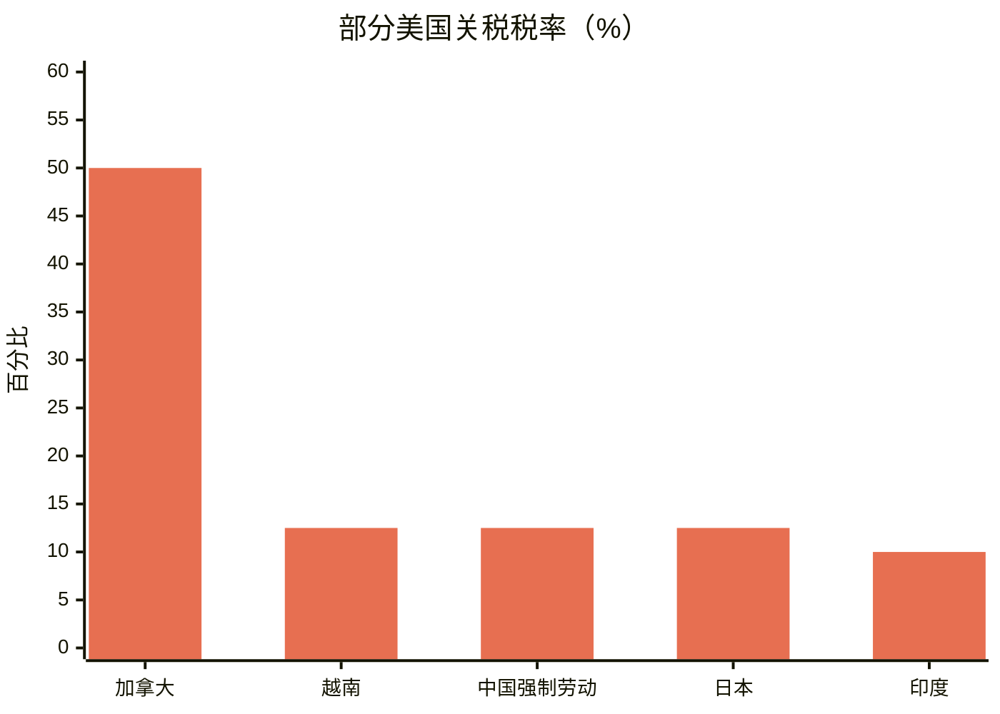

*注：加拿大为第338条税率（50%）；越南、中国强制劳动与日本为第301条强制劳动税率（12.5%）；印度为现行第301条强制劳动税率（10%；宣布的18%协议税率从未实施）。来源：USTR、Troutman、BDO、Industrial Front。*

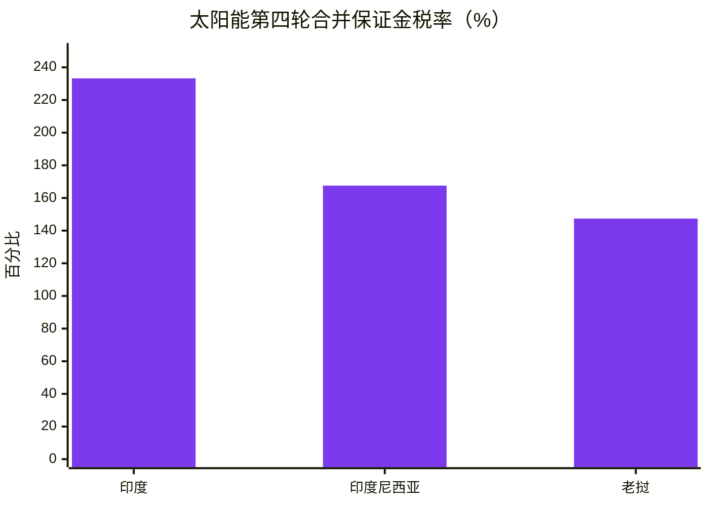

*注：反倾销保证金税率与反补贴税之和，“其他企业”税率。印度：反倾销107.17% + 反补贴126.09%；印度尼西亚：反倾销94.36% + 反补贴73.20%；老挝：反倾销65.36% + 反补贴82.03%。来源：商务部反倾销反补贴税令，2026年11月9日。*

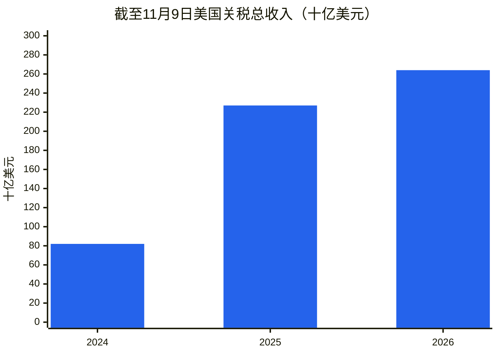

*注：根据两党政策中心追踪的美国财政部每日报表，截至11月9日的日历年关税与消费税总收入。来源：两党政策中心，引自The Motley Fool，2026年11月15日。*

---

## 5. 美国政策深度分析

### 第301条——11月10日的通知

USTR于2026年11月10日发布了《产品排除延期通知》（91 FR 72610；文件号2026-22925），将针对中国第301条（技术转让与知识产权）关税的全部178项现行排除延长。这些排除——164项一般排除（税则号9903.88.69）和14项太阳能制造排除（税则号9903.88.70）——原定于2026年11月9日美国东部时间晚上11:59到期。新的窗口涵盖2026年11月10日美国东部时间凌晨12:01或之后、2027年1月9日美国东部时间晚上11:59之前进入消费或从保税仓库提取进入消费的货物。每项排除的范围不变；每项仅适用于与税则注释中10位税则号与产品描述相符的产品。USTR未征求新的意见，依据的是其2025年9月通知的记录。由24个行业协会组成的联盟曾于11月4日要求至少延长一年。有报道指出，通知中存在不一致之处，部分内容提及1月10日而非1月9日；执行日期为1月9日。USTR于11月10日发布了另一份通知（91 FR 72608；文件号2026-22867），将针对中国海事、物流和造船业做法的第301条行动进一步暂停——包括涉案船舶费用（附件一至三）和附件V.A关税——自2026年11月10日起至2027年1月9日美国东部时间晚上11:59。在暂停期间，任何一方均不产生费用责任。USTR就该提案收到约60条独立意见。该行动此前已自2025年11月10日起暂停至2026年11月9日。

USTR还决定将其针对越南政府与知识产权保护和执法有关的某些行为、政策与做法进行的第301条调查延长三个月（案卷号USTR-2026-0364；文件号2026-22868；自2026年11月3日起生效）。该调查于2026年5月29日启动，此前越南在USTR《2026年特别301报告》中被列为重点外国国家。关于是否可采取行动以及采取何种行动（如有）的决定，现将不晚于2027年2月28日作出，而非原定的2026年11月29日截止日期。USTR援引了“需要更多时间的复杂问题”。越南还是另外两项待决第301条调查的对象，涉及强制劳动进口禁令与制造业结构性过剩产能。越南已面临12.5%的第301条强制劳动关税（税则项目9903.05.04），自2026年7月24日起生效。

截至2026年11月10日，尚未发布USTR关于制造业结构性过剩产能的第301条调查的最终措施。韩国产业通商资源部长官金正官于11月10日告诉国会委员会，首尔正密切关注事态发展；据报道，调查结果比韩国官员预期的时间表晚了两个多月。该调查涵盖包括韩国在内的16个经济体。韩国正寻求将美国关税维持在15%附近。贸易律师和分析师告诉《全球贸易评论》（Global Trade Review），近期识别的主要风险正是这项于3月启动的调查，涵盖中国、新加坡、瑞士、挪威、印度尼西亚、马来西亚、柬埔寨、泰国、韩国、越南、台湾、孟加拉国、墨西哥、日本和印度以及欧盟，决定将于2027年3月前作出。

### 第232条——无新行动；多晶硅关税将于12月4日生效

在报道窗口内未发现新的第232条公告或税率变化。截至2026年11月9日有效的第232条制度（根据协调关税表与CBP指南汇总）为：钢铁、铝和铜为50%，包括许多衍生产品（其他列明衍生产品为25%；固定工业机械、电力与农用设备以及家用供暖、通风与空调设备合计为15%）；半导体为25%，附列明豁免；专利药品为100%（仿制药不在范围内），部分原产地与企业的税率较低；汽车及零部件为15%至25%；铜衍生产品、卡车及卡车零部件、木材与木料、多晶硅和无人机各有其自身的税率与条件。多晶硅关税将于2026年12月4日开始征收，在此之前，一项BIS规则允许商务部禁止进口量远超历史水平的进口商在12月4日前继续进口，除非商务部给予豁免。机器人与工业机械已有2026年10月28日第11077号公告作出的威胁认定，该公告指示进行谈判，未征收新关税。2027年1月的日程包括第232条家具与橱柜税率上调：自2027年1月1日起，软垫家具升至30%，厨房橱柜与浴室柜升至50%。

### CBP——外国登记进口商；5106表格作废

CBP于2026年11月6日发布了临时最终规则《对外国登记进口商的强化要求》（CBP Dec. 26-19，91 FR 69977；文件号2026-22735），实施第14411号行政命令第2节。自2027年1月5日起，外国登记进口商只有在自身获得CTPAT验证或通过获得CTPAT验证的持牌报关行申报的情况下，方可将商品申报进入消费。海关法规新增的第110部分定义了“美国登记进口商”（美国公民或合法永久居民，或根据美国法律组建并位于美国的实体，并满足额外的所有权或不动产条件——例如，至少51%的受益所有权由美国公民或合法永久居民持有并拥有控制权，或直接拥有大量无负担的美国不动产）。美国或外国进口商身份必须在申报入境与报关单时声明（新增19 CFR 141.21—141.22）；经纪人必须通过审查记录核实客户的美国进口商身份，并将核实记录保存五年；通过CSMS报文，CBP 3461和7501表格（及电子等效表格）新增了三个数据字段。经纪人可在2027年1月5日前申请延期合规；所有经纪人预计将于2027年5月6日前实现全面合规。该规则还扩大了经纪人可能根据19 U.S.C. 1592面临处罚的情形。意见征集截止日期为2027年1月5日（案卷号USCBP-2026-1387）。CBP自身的分析显示：0.4%的外国登记进口商已获得CTPAT验证，68%已使用获得验证的经纪人；其余32%除非更换经纪人或自身获得CTPAT验证，否则将无法继续向美国进口货物。

另外，CBP致函众多获得CTPAT认证的进口商，称除非首先解决CBP对其5106表格信息准确性的关切，否则其进口商登记号可能自2026年11月18日美国东部时间凌晨12:01起对申报入境的货物作废（见A5）。CBP于2026年10月8日发布的低价值货物拟议规则制定通知（91 FR 64532；案卷号USCBP-2026-0298）仍在征求意见中，意见截止日期为2026年12月7日。该提案将要求价值不超过2500美元货物的非正式入境在进口当日或之前以电子方式申报，要求每宗非正式入境提供保证金，并在经纪人为非货主或购买人的收货人申报时，使经纪人成为登记进口商。800美元的最低免税额继续无限期暂停——非邮政货物自2026年6月24日起，邮政货物自2026年7月24日起。另外，CBP将针对适用第201、232或301条关税或伙伴政府机构要求的邮件强制正式入境的日期，从2026年10月22日推迟至2027年1月20日。

### BIS出口管制——关联企业规则暂停至1月10日；消音器转由商务部管制

BIS发布了一项最终规则（文件号2026-22793），将其临时最终规则《将最终用户管制扩大至某些被列入清单实体的关联企业》（即关联企业规则）的暂停延长至2027年1月10日。2025年11月实施的一年期暂停（90 FR 50857）原定于2026年11月9日结束；新规则于2026年11月9日生效，因此没有间断。关联企业规则于2025年9月30日发布（90 FR 47201），将《出口管理条例》下的出口管制扩大至由实体清单、军事最终用户清单或某些OFAC指定方中的一方或多方直接或间接、单独或合计拥有50%或以上权益的外国实体。该规则还引入了一项新的警示标志，要求出口商在已知外国一方由被列入清单实体部分拥有时解决所有权问题。此次延期并未撤销或修改该规则。如BIS不采取进一步行动，扩大的管制措施将于2027年1月10日生效。《联邦公报》通知除日期变更外未给出任何政策理由；政府官员表示，此次延期与同样延长至2027年1月10日的美中贸易停战协议有关。BIS还宣布，自2026年11月20日起，某些消音器、枪口装置和声音抑制器的出口将从国务院的《美国军品清单》转由BIS《出口管理条例》管制；消音器将被列入商务管制清单，BIS将要求对某些出口、再出口或境内转让（包括向外国人发布相关软件与技术）办理许可证。目前适用于枪支的许可例外也将适用于消音器。

### 《联邦公报》——窗口内的反倾销反补贴税活动

11月9日：商务部发布了针对印度、印度尼西亚和老挝的结晶硅光伏电池与组件的反倾销与反补贴税终裁（见A7）。11月10日：商务部初步认定，台湾和土耳其的镀锡板产品在美国以低于公平价值的价格销售。商务部对台湾东钢工业公司（Ton Yi Industrial Corporation）及其他所有台湾出口商设定了18.07%的反倾销税率。对土耳其，商务部对托斯亚利（Tosyali）及其他所有出口商设定了3.89%的税率，对Tatrix International设定了42.06%的税率。进口商现须按这些税率缴纳保证金。这些税率与商务部9月为中国设定的初裁税率（倾销136.52%、补贴66.61%）并列。土耳其的终裁倾销认定将于11月5日签署后75天（2027年1月19日）作出；台湾的终裁将于11月10日发布后135天（2027年3月25日）作出；中国的终裁结果将于2026年11月30日前公布，除非延期。11月12日：商务部公布了针对中国木质橱柜、浴室柜及部件（2024—2025年期间）反倾销行政复审的终裁结果，为接受复审的企业——宜兴鹏佳科技有限公司、江苏祥生卧室家具有限公司、厦门金环南公司和中山NU家具有限公司——设定了7.48%的反倾销税率，适用于2026年11月12日或之后进入消费或从保税仓库提取进入消费的涉案货物。中国全国保证金税率仍为251.64%。在针对中国木质线条与细木工产品的反补贴行政复审中，商务部为南平华泰木竹有限公司、福建银丰进出口贸易有限公司和福建宏佳工艺品有限公司设定了147.88%的终裁反补贴税率，为接受复审的非抽样企业设定了21.39%的税率，适用于2026年11月12日或之后进入消费或从保税仓库提取进入消费的涉案货物。商务部拟在公布后不早于35天（2026年12月17日）发布评估指示。

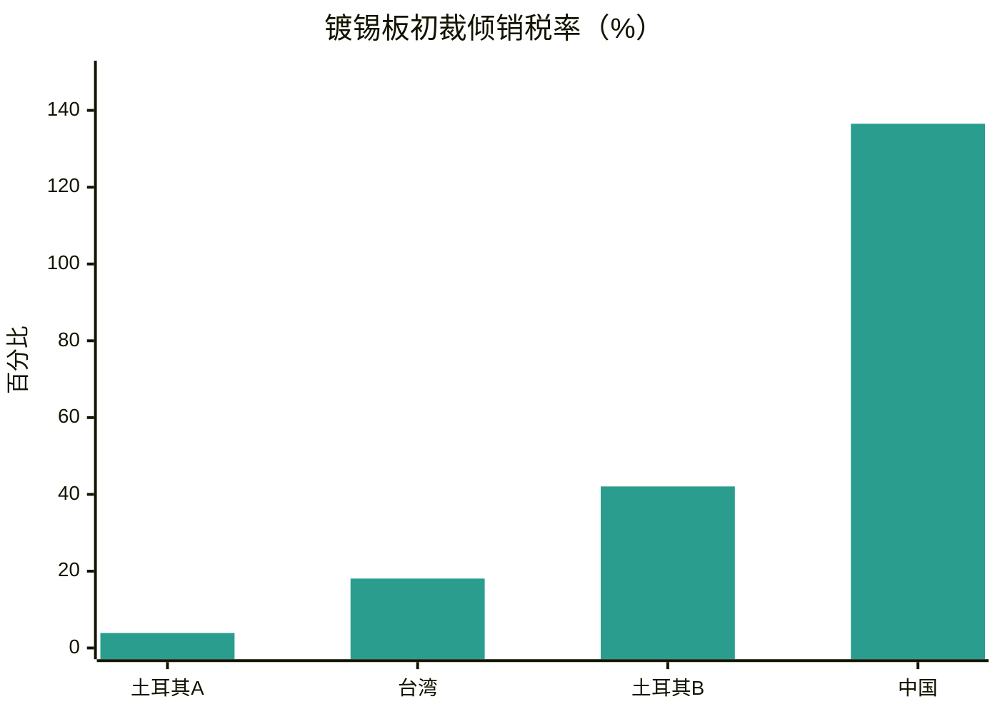

*注：土耳其A为托斯亚利及其他所有出口商（3.89%）；土耳其B为Tatrix International（42.06%）；中国为9月初裁税率（136.52%）。来源：商务部初裁认定，2026年11月10日。*

### 常设事项

- **《维吾尔强迫劳动预防法》（UFLPA）/ 实体清单：**在2026年11月9日至16日的窗口内，未发现新的UFLPA实体清单新增或新的暂扣放行令。最近一次实体清单新增（43家公司）于2026年7月31日宣布；CBP针对进口商的现行强制劳动操作指南发布于2026年6月。CBP最近公布的执法总数（源自塞尔维亚紫金铜业的放行）为56项暂扣放行令（WRO）和8项认定（依据19 U.S.C. § 1307）；后来的报道称，在2026年9月29日又发布两项命令后，总数为60项暂扣放行令和8项认定。
- **白宫：**窗口内未发布新的关税公告或情况说明。
- **USITC / 协调关税表：**窗口内除太阳能第四轮税令外，未发现新的协调关税表税率变化。USITC关于太阳能第四轮的完整公开报告（USITC第5804号出版物）将于2026年11月23日前在USITC网站上公布。
- **trade.gov / 市场情报：**窗口内未发现与美国关税政策有关的新市场情报发布。
- **internationaltradetoday.com：**付费墙；其标题确认了CBP外国登记进口商规则的报道（11月5日）。

---

## 6. 分地区世界政策

### 欧洲

欧盟低价值电子商务重置现已生效（见3.3）：自11月1日起，按每个商品项目收取2欧元手续费并强制使用产品标识符，叠加自2026年7月1日起按每个关税税号收取的3欧元统一关税。11月9日，理事会同意取消增值税进口一站式服务150欧元的上限，自2028年7月1日起适用。11月1日至7日当周的欧盟海关关税（TARIC）活动以提前部署而非新的保护性关税为主：共处理了15055条变更记录，其中超过13600条为预先安排的措施，将优惠准入与自主配额提前部署至2027年。11月6日，超过2500条预先安排的记录设立了定于2027年1月1日生效的自主关税配额，包括海产品加工行业的大规模配额。当周生效的6238项措施中，5405项于11月1日生效，集中于即时更替。集中于11月3日的技术性贸易防御调整重新校准了散装聚氯乙烯、悬浮聚氯乙烯、阿司匹林及其他聚合物与特种化学品的措施边界。这一模式表明，行政姿态侧重于部署2027年的准入而非征收新关税，但贸易防御范围的变化改变了针对聚合物与化学品的现有措施覆盖范围，要求进口商准确申报。

欧盟—印度自由贸易协定据报道将于2026年12月中旬在布鲁塞尔签署（见3.3）。欧盟—墨西哥现代化贸易协定已于2026年5月22日正式签署，等待欧洲议会批准后生效。欧盟与印度尼西亚和澳大利亚的协定预计均将于2026年底前签署。欧盟—南方共同市场临时协定自2026年5月1日起临时生效。

**来源：**[RegFollower](https://regfollower.com/eu-forward-staging-and-trade-defence-realignment-mark-the-november-tariff-turn/)；[Flex Logistics](https://flexlogistics.eu/eu-trade-deals-online-sellers/)

### 英国

2026/31号贸易救济通知使国务大臣接受贸易救济局在到期复审ER0080（于2026年1月22日启动）中的建议生效。对原产于土耳其的虹鳟鱼征收的反补贴税——涵盖通知中列明的尺寸限制内的活鱼、新鲜、冷藏、冷冻和熏制鱼，归类于税目0301、0302、0303、0304和0305——按现有税率延长五年至2031年1月30日，不重新计算。该通知于2026年11月6日生效，变更自2026年1月30日起适用，并取代2021/12号征税通知。按出口商划分的税率从1.5%至8%不等；两组所列出口商分别缴纳6.9%和7.6%；所有其他出口商缴纳9.5%。

英国税务海关总署（HM Revenue and Customs）于11月2日更新了英国碳边境调节机制（CBAM）政策摘要，增加了关于计算碳价格减免的信息。这是今年秋季的第三次更新，此前2026年9月9日和10月16日的更新反映了《碳边境调节机制（排放与核查）条例2026》的制定。摘要确认，英国CBAM将于2027年1月1日启动，适用于按商品编码确定的特定铝、水泥、化肥、氢和钢铁产品。距离启动不足两个月，适用商品的进口商需要在该机制开始收费之前确认其商品编码、排放数据与碳价格减免计算。

英国商业贸易部于11月6日发布了定期双边贸易与投资情况说明，包括针对卡塔尔的情况说明。截至2026年第二季度末的四个季度，英国与卡塔尔的货物与服务贸易总额为54亿英镑，较截至2025年第二季度末的四个季度下降7.2%，即4.16亿英镑。英国对卡塔尔出口为39亿英镑（下降10.3%，即4.47亿英镑），自卡塔尔进口为15亿英镑（增长2.1%，即3100万英镑）。卡塔尔是英国第47大贸易伙伴，占英国贸易总额的0.3%。

**来源：**[Global Customs Compliance](https://www.globalcustomscompliance.com/trade-and-customs-watch-2026-11-13/?utm_source=rss&utm_medium=rss&utm_campaign=trade-and-customs-watch-2026-11-13)

### 加拿大

财政部长弗朗索瓦-菲利普·香槟于11月9日宣布了加拿大关税救济措施的变化（见3.7）：针对美国关税的横向减免延长一年至2028年6月30日，救济范围现还包括用于采矿、采石或石油天然气开采的非钢铁货物，以及公共教育实体使用的所有货物，包括原住民组织规定的实体使用的货物；自2026年12月1日起取消某些拖车的减免，自2027年2月1日起取消某些铝线材、铝型材和纸板产品的减免。这些变化叠加于2026年9月8日对一系列美国进口商品征收的15%至50%的反制关税之上。加拿大边境服务局于11月2日更新了第26-07号海关通知，将计划货物减免扩大至附表1至3，为附表2和3引入特别授权代码，并澄清了资格条件；同时删除了附录A，该附录曾就风电塔减免提供额外指导。商务部长王文涛与加拿大国际贸易部长马尼德·西杜于11月3日在北京共同主持了第29届中加经济贸易联合委员会会议；任何成果的实质内容均无法根据所审查的材料核实。

**来源：**[Department of Finance Canada](https://www.canada.ca/en/department-finance/news/2026/11/canada-modifies-tariff-relief-measures-to-better-support-workers-and-businesses.html)；[GHY](https://www.ghy.com/trade-compliance/category/canada-imports/)

### 中国

中国方面延长停战协议的内容见第2节与第3.1节。商务部英文网站（english.mofcom.gov.cn）于11月16日可以访问；仅可见首页标题，包括发言人关于调整不可靠实体清单措施的表态，以及第29届中加经济贸易联合委员会会议的列示。商务部在同期一次新闻发布会上对欧盟2欧元收费的回应的实质内容无法根据所审查的材料核实。

### 印度与新西兰

印度—美国临时协议仍未签署（见A10与3.2）。欧盟—印度协定据报道将于12月中旬签署（见3.3）。印度与欧盟还于11月初在布鲁塞尔继续进行实施谈判。商务部长皮尤什·戈亚尔于11月3日表示，印度在任何自由贸易协定中从未开放乳制品行业，也不会允许进口转基因产品，这条红线与每一个正在进行的自贸协定谈判都相关。

### 亚太——韩国与巴西

李在明总统在11月3日的内阁会议上敦促政府加快与巴西就韩国化妆品25%关税进行的谈判，称该税是这一在当地对韩国制造产品需求强劲的行业的障碍。他表示，将生产转移至巴西并不能解决问题，理由是当地消费者强烈偏好韩国制造的化妆品，并询问外交部长赵显谈判的进展情况。赵显表示，在卢拉总统于10月25日决选中连任后，谈判如今可以推进。这一干预使一项行业关税在巴西新任期开始前成为总统级双边议题。

韩国消费品企业在11月5日至7日于墨尔本举办的韩流博览会与澳大利亚韩国食品展上签署了1800万美元的出口合同与谅解备忘录，该活动由产业通商资源部与农林畜产食品部共同主办，由大韩贸易投资振兴公社（KOTRA）与韩国农水产食品流通公社组织。出口洽谈活动涉及101家韩国企业与来自大洋洲和东南亚的144家采购商，进行了1235场洽谈，达成32份合同与谅解备忘录。韩国对澳大利亚的化妆品出口从2023年的7300万美元增至2024年的1.12亿美元和2025年的1.66亿美元，受到自2014年12月12日起生效的《韩国—澳大利亚自由贸易协定》下关税削减的支持。

**来源：**[SE Daily](https://en.sedaily.com/politics/2026/11/03/lee-presses-brazil-to-cut-25-percent-tariff-on-korean)；[Aju Press](https://www.ajupress.com/view/20261108110470271)

### 多边

**世界贸易组织。**在11月4日至6日的会议上，世贸组织卫生与植物检疫措施委员会审议了具体贸易关注、透明度、指导与能力建设。秘书处报告称，在2026年的监测工作之后，55项具体贸易关注得到解决，19项得到部分解决；监测工作涉及就自2024年11月以来未提出的具体贸易关注联系39个成员，其中25个成员作出回应。11月的会议审议了78项具体贸易关注，包括五项首次提出的具体贸易关注，涉及欧盟的农药残留限量及其他监管措施、影响哥伦比亚肉类产品的进口限制、批准巴拉圭牛肉出口至日本的延误，以及与禽流感有关的智利禽类产品限制。自1995年以来讨论的640项具体贸易关注中，63%已得到解决（326项）或部分解决（75项）。农业委员会特别会议于11月3日举行了两次介绍，回顾了自乌拉圭回合以来农业贸易谈判的演变，涵盖出口竞争与发展中国家政府以管理价格进行的公共粮食储备。下一次会议定于2026年11月23日举行，将讨论出口限制与特殊保障机制。11月16日，世贸组织同意设立争端解决专家组，审查中国针对印度对某些技术产品征收关税及国内太阳能制造业激励计划的申诉，此前中国第二次提出设立专家组的要求。双边磋商未能达成和解；印度曾于2026年5月阻止中国的首次要求。专家组将审查《关税与贸易总协定》、《补贴与反补贴措施协定》与《与贸易有关的投资措施协定》的遵守情况。10月30日，世贸组织成员在贸易与发展委员会会议上通过一项宣言，将促贸援助倡议重新定位为“促贸援助：贸易与发展伙伴关系”，结束了为期两天的第十次全球促贸援助审议——这是20年来该议题的首个多边成果。世贸组织总干事恩戈齐·奥孔乔-伊韦阿拉于11月5日在一场关于贸易、生物多样性与海洋经济的活动上发表主旨演讲，指出海洋经济规模达2.6万亿美元，支撑约1.33亿个就业岗位，全球贸易商品中80%以上经海运，世界货物贸易中72%仍按最惠国待遇进行。她提到了自2025年9月起生效的《渔业补贴协定》，并敦促成员完成剩余谈判。

**联合国贸易和发展会议（UNCTAD）。**UNCTAD于11月9日发布了《全球贸易更新》（2026年11月），恰逢在土耳其安塔利亚举行的COP31（11月9—20日），探讨贸易如何支持气候行动。报告发现，与气候相关的条款在贸易协定中越来越普遍，出现在2016年至2021年间签署的一半以上协定中，但执行仍然有限：近期贸易协定中确定的与气候相关条款中，仅有7%涉及降低关税与非关税壁垒。在2025年接受调查的174个国家中，仅有七个国家报告已全面实施针对绿色与气候相关货物的贸易便利化措施。2025年，与太阳能和风能价值链相关的货物全球出口超过1.8万亿美元，增速快于其他制成品出口；2026年上半年，电池贸易增长29%，电动汽车贸易增长11%；发展中经济体2024年出口了1.3万亿美元的生物多样性相关货物，2025年出口了1.2万亿美元的海洋货物与服务，2024年出口了约2040亿美元的非塑料替代品。报告认为，以可负担的价格获得气候技术对适应与减排至关重要。中国社会科学院世界经济与政治研究所与UNCTAD撰写的一份关于发展向中国市场出口能力的报告，于11月5日在上海举行的第九届虹桥国际经济论坛（与中国国际进口博览会同期举行）上发布。该报告分析了包括哥伦比亚、肯尼亚、西班牙、泰国和英国在内的10个贸易伙伴；据该研究所所长称，中国占世界出口的份额从2000年的3.2%上升至2025年的9.2%。

**国际贸易中心（ITC）。**国际贸易中心与非洲进出口银行于11月3日在安提瓜和巴布达圣约翰斯发布了报告《重塑非洲—加勒比贸易：经济转型机遇》，发布场合为英联邦政府首脑会议期间。该报告发现，到2030年，非洲与加勒比地区之间的货物与服务年度贸易额可达16.5亿美元（不含矿物燃料）。非洲对加勒比地区年度货物出口潜力中约80%尚未开发，而加勒比地区的出口潜力主要在服务业，达到4.81亿美元。优先行业包括加工食品与动物饲料、化学品、矿产与金属、服装与纺织品、皮革与鞋类、旅游、运输服务与创意产业。研究结果基于贸易与出口潜力分析、行业评估，以及对两地区1175家企业与企业支持组织的调查。

**世界海关组织（WCO）。**11月3日，WCO在其布鲁塞尔总部举办了一场关于海关在救灾中作用的混合研讨会，有来自海关管理部门、国际组织以及人道主义与物流从业者的190多名参与者；秘书长伊恩·桑德斯将讨论与WCO 2026年主题“海关以警惕与承诺守护社会”联系起来。11月5日，WCO发布了2025—2026年度报告。11月9日，WCO举办了关于颠覆性技术的智慧海关项目全球活动，11月11日举办了关于清除电子商务假冒商品的研讨会，参与者包括海关管理部门、万国邮政联盟与eBay。11月12日，WCO报告了对东非共同体国家修订原产地规则与发展自主培训能力的支持，11月13日，秘书长在WCO假冒与盗版小组会议期间会见了世界动物卫生组织总干事，重申在打击非法贸易方面的合作。

**来源：**[Logistics News PH](https://logisticsnews.ph/2026/11/12/wto-sps-committee-reports-progress-in-resolving-trade-concerns/)；[India ReNews](https://indiarenews.in/blog/read/wto-sets-up-dispute-panel-to-examine-china-s-challenge-against-india-s-solar-incentives-and-technology-tariffs)；[UNCTAD](https://unctad.org/publication/global-trade-update-november-2026)；[WCO](https://www.wcoomd.org/en/media/newsroom/2026/november.aspx)

---

## 7. 执法行动

### 反倾销与反补贴税

商务部针对印度、印度尼西亚和老挝太阳能电池的最终反倾销反补贴税令（见A7），以及台湾和土耳其的镀锡板初裁税率与木质橱柜和细木工复审结果（见第5节），是本周的贸易救济行动。按税率计算，太阳能税令是窗口内最大的反倾销反补贴税行动，每起案件的合并保证金税率均超过进口完税价值的100%。镀锡板初裁税率为台湾与土耳其供应商设定了保证金成本，而中国案件的税率要高得多（9月为倾销136.52%、补贴66.61%），其终裁将于11月30日作出。木质橱柜与细木工复审为指定的中国家具与细木工出口商重置了保证金税率，同时保留了非常高的中国全国税率（251.64%），使接受复审与未接受复审的供应商之间保持了很大的关税差距。

### CBP查获与强迫劳动

11月3日，CBP官员在诺加莱斯德康西尼口岸将一名36岁的美国男性公民移送二次检查，该男子驾驶一辆2006年款日产Titan皮卡从墨西哥返回。对卡车货厢内塑料折叠椅的实物检查发现，椅子内藏有300多包芬太尼。车辆与毒品被扣押；国土安全调查局特工赶赴入境口岸，案件正在进一步调查中。共查获112磅以上的芬太尼。在报道窗口内未发现新的暂扣放行令。CBP在窗口前发布的最新暂扣放行令是印度尼西亚棕榈油命令与2026年6月16日的塞尔维亚紫金铜业命令。窗口内没有新的暂扣放行令——此前夏季与秋季曾发布一系列命令——本身就是强迫劳动执法节奏的一个数据点；进口商不应将其解读为政策变化。

一名夏威夷男子于11月12日被判处24个月监禁并罚款15000美元，罪名是在没有OFAC许可证的情况下向伊朗转移资金。38岁的阿拉什·埃诺尔戈扎蒂（Arash Einolghozati）来自瓦胡岛怀厄卢阿，由美国高级地区法官海伦·吉尔摩判处24个月监禁，随后三年监督释放。根据法庭记录，自2026年3月起（司法部发布中的表述）并持续至至少2022年4月，埃诺尔戈扎蒂多次将政府发行的货币与加密货币从美国境内转移给其明知身处伊朗或将进一步把资金转移给伊朗境内个人的收款人，明知在没有财政部外国资产控制办公室许可证的情况下这样做是违法的。转移总额超过226000美元。联邦调查局调查了该案。该案表明，针对伊朗的制裁刑事执法已延伸至同时使用现金与加密货币的个人汇款人，此前财政部发起了针对伊朗相关金融渠道的“经济弃儿行动”（Operation Economic Outcast）。

**来源：**[CBP](https://www.cbp.gov/newsroom/local-media-release/cbp-officers-seize-112-pounds-fentanyl-nogales-port-entry)；[US Department of Justice](https://www.justice.gov/usao-hi/pr/north-shore-man-sentenced-two-years-prison-sending-money-iran-violation-us-sanctions)

### 制裁

OFAC于11月4日宣布，根据第13902号行政命令，指定了一个涉嫌欺诈性船舶悬挂旗帜与登记的公司网络，该网络为伊朗石油出口提供便利。该网络由印度国民苏尼尔·库马尔·夏尔马（Suniel Kumar Sharma）与贾斯普里特·普里蒂·沙希德（Jaspreet Preeti Shahid）领导，二人常驻印度昌迪加尔，经营冒充船旗登记处与海事服务提供商的公司，涉及的国家与司法管辖区包括圭亚那、斯威士兰、老挝、阿鲁巴、马里、莫桑比克、马拉维、圣马丁和东帝汶。这些公司向运载伊朗石油的船舶出售欺诈性登记与证书，包括代表伊朗军方及其代理人运营的船舶。OFAC指定了该网络中的四名个人与九个实体，还因在伊朗航空业的活动制裁了土耳其的Fugo Ground Services Inc.。OFAC随指定发布了一份警示《伊朗影子船队依赖虚假船旗逃避制裁》，警告商业行为体避开使用可疑船旗登记处的船舶。同一行动还在特别指定国民与被封锁人员清单（SDN）上1000多个现有条目中增加了“次级制裁风险：见第13902号行政命令第2节”的标注。

国务院于11月5日宣布，根据第14404号行政命令（2026年5月1日），指定了八个实体与两名个人，并将五艘船舶认定为被封锁财产。目标包括吉列尔莫·福斯蒂诺·罗德里格斯·洛佩斯·卡列哈（Guillermo Faustino Rodriguez Lopez Calleja），其属于一个向古巴运进运出石油产品的海运公司网络；安妮·罗德里格斯·拉斯特雷斯（Any Rodriguez Lastres），古巴武装部队控股公司GAESA总裁阿尼娅·吉列尔米娜·拉斯特雷斯·莫雷拉（Ania Guillermina Lastres Morera）之女；塞浦路斯的Caroil Transport Marine Ltd；以及中国的中电进出口公司（China National Electronic Import and Export Company，CEIEC）与北京华科技术有限公司，被描述为该政权军队的供应商。被认定为被封锁财产的五艘船舶为ESPERANZA、GLORIA C、MARIA CRISTINA、EMILIA和LOURDES。同一天，OFAC主任布拉德利·T·史密斯发布了一项决定，认定第14404号行政命令第2(a)(i)(A)节中的行业制裁权限适用于古巴经济的电子、制造、海事与技术行业。这四个行业加入了行政命令本身列明的五个行业：能源、国防及相关物资、金属与采矿、金融服务与安全。任何被认定在四个新增古巴行业中经营或曾经经营的外国人，如今都面临封锁制裁。

国务院于11月4日根据第13949号行政命令指定了三名人员，涉及伊朗寻求便携式防空导弹系统（MANPADS）：穆罕默德·阿里·托利博夫（Mohammed Ali Tolibov），其经营的Armory Alliance是一家总部位于白俄罗斯的中间商，连接中国企业与伊朗；Vanguard Tactical Supply Limited，一家尼日利亚公司，被指控利用虚假最终用户将中国原产便携式防空导弹引向伊朗；以及常驻俄罗斯的阿利舍尔·多穆洛德扎诺夫（Alisher Domullodzhanov），被指控协助伊朗寻找发射器。这三人在美国境内或由美国人持有的资产被冻结，并须向OFAC报告。

金融犯罪执法网络（FinCEN）于11月6日发布命令，禁止美国金融机构参与与MEXC Global（总部位于塞舌尔的加密货币交易所）之间任何资金汇划，认定其为与俄罗斯非法金融有关的主要洗钱关切金融机构。FinCEN表示，MEXC Global在2021年5月至2026年5月期间为至少167亿美元与逃避制裁、网络犯罪及其他非法活动有关的交易提供了便利，处理了涉及受制裁俄罗斯实体的交易，包括交易所Garantex及其继任者Grinex，处理了超过10亿美元与伊朗加密货币交易所（包括受制裁交易所）的直接交易，并为约2200万美元与伊朗中央银行、伊斯兰革命卫队及其圣城旅有关的交易提供了便利。该命令将一家用于俄罗斯与伊朗逃避制裁的加密货币交易所切断与美国金融体系的联系，对使用加密货币渠道的贸易融资与支付合规具有相关性。

**来源：**[Steptoe](https://www.steptoe.com/en/news-publications/stepwise-risk-outlook/sanctions-update-november-9-2026.html)；[US Department of State](https://www.state.gov/releases/office-of-the-spokesman/2026/11/further-sanctions-on-the-cuban-regimes-foreign-military-support-and-illicit-revenue-networks-fact-sheet/)

---

## 8. 数据发布

### 中国——2026年10月对外贸易

中国海关总署于11月10日发布了2026年10月初步贸易数据。以美元计，10月出口同比增长35.2%，至4123亿美元，进口增长41.6%，至3071亿美元。以人民币计，10月出口增长28.7%，至2.79万亿元人民币，进口增长34.7%，至2.08万亿元人民币。1月至10月货物贸易总额为44.81万亿元人民币，同比增长20%。10月货物顺差为1053亿美元，低于2026年9月的1335亿美元；1月至10月累计顺差达到10426亿美元。1月至10月出口37828亿美元，已超过据报道的2025年全年出口37719亿美元。1月至10月集成电路出口翻了一番多，达到3411亿美元，同比增长111.1%（高于1616亿美元）；集成电路进口为5665亿美元，增长65.1%。以人民币计，1月至10月出口为25.99万亿元人民币，增长17.6%；进口为18.82万亿元人民币，增长23.6%；机电产品占出口16.81万亿元人民币，增长25.2%，占总出口的64.7%。据报道，以人民币计，1月至10月与东盟的贸易增长24.2%，与欧盟增长8.5%，与美国增长6.3%。海关总署指出，这些数据为初步数据，月度公报更为准确。

**来源：**[NGlobe News](https://www.nglobenews.com/en/article/china-october-trade-surplus-1-trillion-2026-11-10/)

### 印度——2026年10月对外贸易

印度商务部于11月13日发布了2026年10月快速估计数据。商品出口同比增长45.06%，创下494.7亿美元的纪录，商品进口达到创纪录的893.5亿美元，商品逆差为398.8亿美元——高于9月的302.1亿美元，但低于2025年10月的425.8亿美元。包括服务贸易在内，总体出口达到899.9亿美元，总体逆差收窄至200.9亿美元。石油进口同比增长54.31%，至228.2亿美元，黄金进口从9月的18亿美元升至55.1亿美元，赶在排灯节之前。该部将石油产品、电子产品、宝石与珠宝、有机与无机化学品以及工程产品列为出口增长的驱动因素。服务出口为405.1亿美元；服务进口为207.2亿美元（估计值）。2026—27财年4月至10月商品出口为3090.6亿美元（高于一年前的2534.0亿美元）；总体出口5688.4亿美元，增长16.66%；总体进口6621.9亿美元，增长16%。

**来源：**[GuruTrade](https://www.gurutrade.com/news/india-oct-trade-deficit-hits-1-yr-high-of-39-88b-on-gold-1794605244.html)

### 欧元区与德国

欧盟统计局于11月13日发布了2026年9月货物贸易首次估计数据。欧元区对世界其他地区录得103亿欧元逆差，而2025年9月为顺差135亿欧元，2026年8月为逆差166亿欧元。欧盟录得168亿欧元逆差，而一年前为顺差114亿欧元。欧盟统计局将恶化的主要原因归于能源，欧元区能源逆差从207亿欧元扩大至330亿欧元，以及机械与车辆顺差收窄，从100亿欧元降至30亿欧元。欧元区出口为2727亿欧元，同比增长6.0%；进口为2830亿欧元，增长16.1%。2026年1月至9月欧元区差额为负365亿欧元，而2025年同期为正1022亿欧元；出口22634亿欧元（增长2.4%）；进口22999亿欧元。欧盟1月至9月逆差为832亿欧元，而2025年同期为顺差855亿欧元。数据为初步数据，基于成员国在2026年11月10日前传送的信息。

德国联邦统计局（Destatis）于11月9日发布了2026年9月对外贸易初步数据（第390号新闻稿）。经日历与季节调整，出口较8月增长2.0%，进口增长4.2%。对欧盟国家出口当月增长3.5%，对非欧盟国家出口增长0.1%。出口为1411亿欧元（环比增长2.0%；同比增长7.7%）；进口为1255亿欧元（环比增长4.2%；同比增长8.7%）；对外贸易顺差为156亿欧元，低于2026年8月的179亿欧元，与2025年9月的155亿欧元基本持平。未经调整的出口为1485亿欧元；未经调整的进口为1311亿欧元；未经调整的顺差为174亿欧元。Destatis表示，详细结果将于2026年11月20日公布，现阶段无法提供关于与个别国家或国家集团贸易变化原因的信息。

**来源：**[Eurostat](https://ec.europa.eu/eurostat/en/web/products-euro-indicators/w/6-13112026-bp)；[Destatis](https://www.destatis.de/EN/Press/2026/11/PE26_390_51.html)

### 日本——2026年10月贸易，前20天

日本海关11月10日发布了2026年10月前20天的初步数据。出口同比增长23.5%，至73147亿日元，但进口增长32.4%，至81251亿日元，逆差扩大至8104亿日元，而一年前为2166亿日元。该发布仅公布总数，未按伙伴或商品分类。初步的部分月份数据表明，10月全月逆差将扩大，原因是进口增速超过出口增速；将于下周发布的全月数据将显示这一趋势是否在整个月份中持续。

**来源：**[Kilambi](https://news.kilambi.com/stories/2026-11-09-japan-trade-deficit-widens-october-first-20-days/)

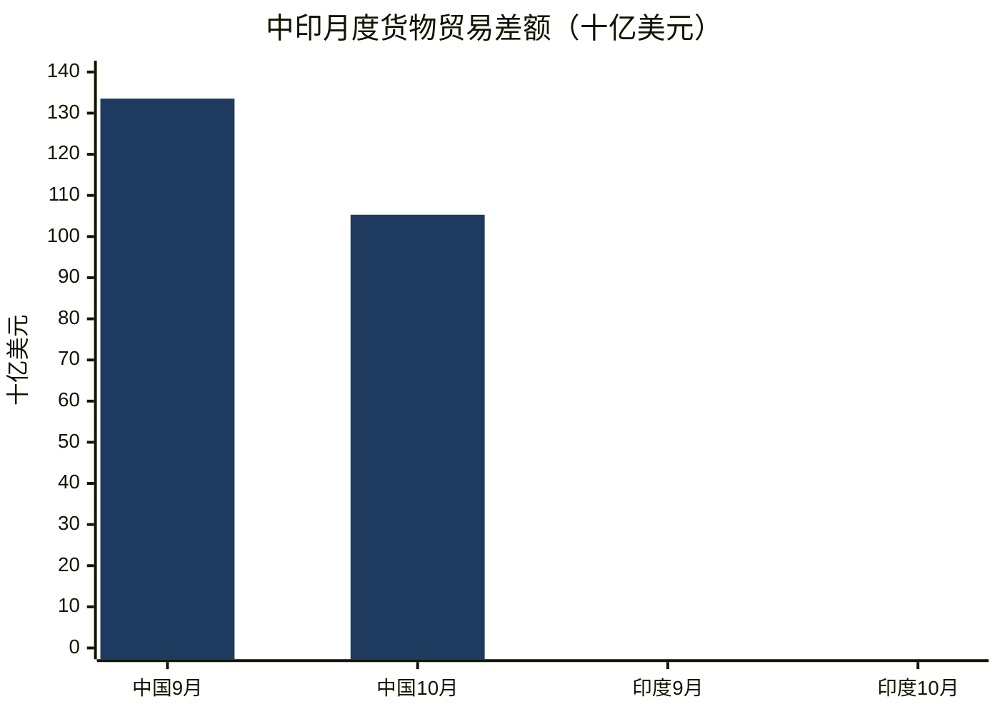

*注：中国月度货物顺差：9月1335.3亿美元，10月1053亿美元。印度月度商品逆差：9月302.1亿美元，10月398.8亿美元。来源：海关总署、印度商务部。*

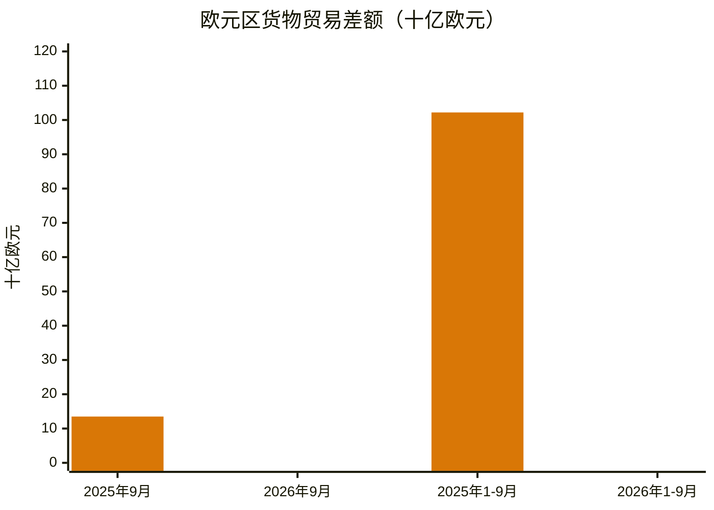

*注：欧元区货物贸易差额：2025年9月为正135亿欧元，2026年9月为负103亿欧元；2025年1—9月为正1022亿欧元，2026年1—9月为负365亿欧元。来源：欧盟统计局，2026年11月13日。*

### 智库

中期选举之后，11月5日至10日的报道援引耶鲁大学预算实验室与税务基金会来量化美国关税的成本（见3.2）。预算实验室11月2日的统计显示，美国平均法定关税税率为11.8%，根据现行法律到年底将升至11.9%，对美国消费者价格造成约0.7%的影响，即每户家庭每年约900美元。税务基金会估计，2026年关税将使每户家庭平均多缴税820美元（2026年8月的模型），而预算实验室在2026年8月24日的报告中将负担定为每户约1100美元。这两个数字采用了不同的方法：税务基金会的820美元反映的是2026年基于实际进口情况的数字，而耶鲁大学的1100美元假设现行关税以固定进口权重保持不变。税务基金会高级经济学家埃丽卡·约克于10月7日撰文称，废除自2017年以来征收的所有关税将在十年内耗资近1.8万亿美元，而征收1%的广义增值税足以弥补这一缺口。预算实验室执行主任玛莎·金贝尔于11月5日告诉Marketplace，关税在十年内带来近2万亿美元的收入。根据财政部的数据，2026财年净关税收入总计1732亿美元。在报道窗口内，通过网络搜索未发现tradeintelligence.eu新的贸易政策内容。

**来源：**[Geopolitiqs](https://www.geopolitiqs.com/tn/2026-11-09/tariffs-average-rate)；[Dave Manuel](https://www.davemanuel.com/2026/11/06/what-happens-to-tariffs-now-that-democrats-control-congress/)

### 数据门户

在报道窗口内，未发现USITC DataWeb、联合国商品贸易统计数据库（UN Comtrade）、世界综合贸易解决方案（WITS）、世界银行或国际货币基金组织（IMF）门户有重大新发布。

---

## 9. 货运市场

### 集装箱现货运价——德鲁里世界集装箱指数

德鲁里2026年11月12日星期四的评估显示，综合指数每周下跌2%，至每40英尺集装箱4305美元，连续第二周下跌，原因是跨太平洋与亚欧/地中海航线需求疲软。在跨太平洋航线，上海—纽约下跌3%，至每40英尺9020美元，为2026年8月以来最低，上海—洛杉矶下跌2%，至7416美元，为2026年9月以来最低。在亚欧/地中海航线，上海—鹿特丹下跌3%，至3504美元，上海—热那亚持平于4168美元。承运人宣布下周跨太平洋航线停航八次，而本周为四次（亚欧/地中海航线为八次，而本周为五次），并宣布自11月下半月起提高亚欧/地中海航线的全品类运价与旺季附加费。德鲁里预计，下周跨太平洋运价将进一步下跌，亚欧/地中海运价将略有上涨。上海港拥堵上周升至49小时，高于此前一周的36小时。上周有53艘船舶通过苏伊士运河，一艘船舶通过霍尔木兹海峡。

**来源：**[Drewry](https://www.drewry.co.uk/supply-chain-advisors/supply-chain-expertise/world-container-index-assessed-by-drewry)

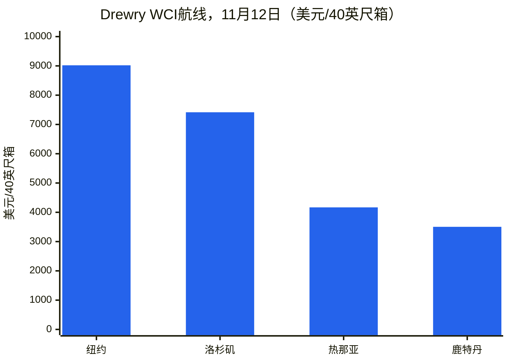

*注：所有航线均从上海出发。上海—纽约9020美元；上海—洛杉矶7416美元；上海—热那亚4168美元；上海—鹿特丹3504美元。综合指数为每40英尺4305美元，环比下跌2%。来源：Drewry，2026年11月12日。*

### 波罗的海货运指数（Freightos Baltic Index）

Freightos在其11月10日的每周更新中报告称，全球指数下跌2%，至3452美元（此前读数为3513美元），亚洲—北欧下跌5%，11月全面涨价未能维持后，跨太平洋航线运价走低。亚洲—美国西海岸价格（FBX01周度）下跌1%，至每40英尺集装箱约8200美元；亚洲—美国东海岸（FBX03周度）下跌2%，至每40英尺集装箱约9700美元；亚洲—北欧（FBX11周度）下跌5%，至每40英尺集装箱3400美元，同比上涨50%；亚洲—地中海（FBX13周度）下跌1%，至每40英尺集装箱4300美元，同比上涨88%。全球指数连续第二周下跌，与德鲁里的数据一致，证实11月的涨价未能维持，而亚欧航线的运价仍远高于一年前的水平。国际码头与仓库工会第26分会守夜人工会将其在洛杉矶和长滩港口的罢工截止日期延长至11月20日，以便有更多时间谈判。全国零售联合会报告称，美国海运进口量9月达到略低于纪录水平的237万标准箱，创峰值，10月预计下降5%，11月预计较9月高点下降14%。

**来源：**[Freightos](https://www.freightos.com/freight-resources/la-lb-strike-deadline-extended-dem-win-increasing-trade-uncertainty-november-10-2026-update/)

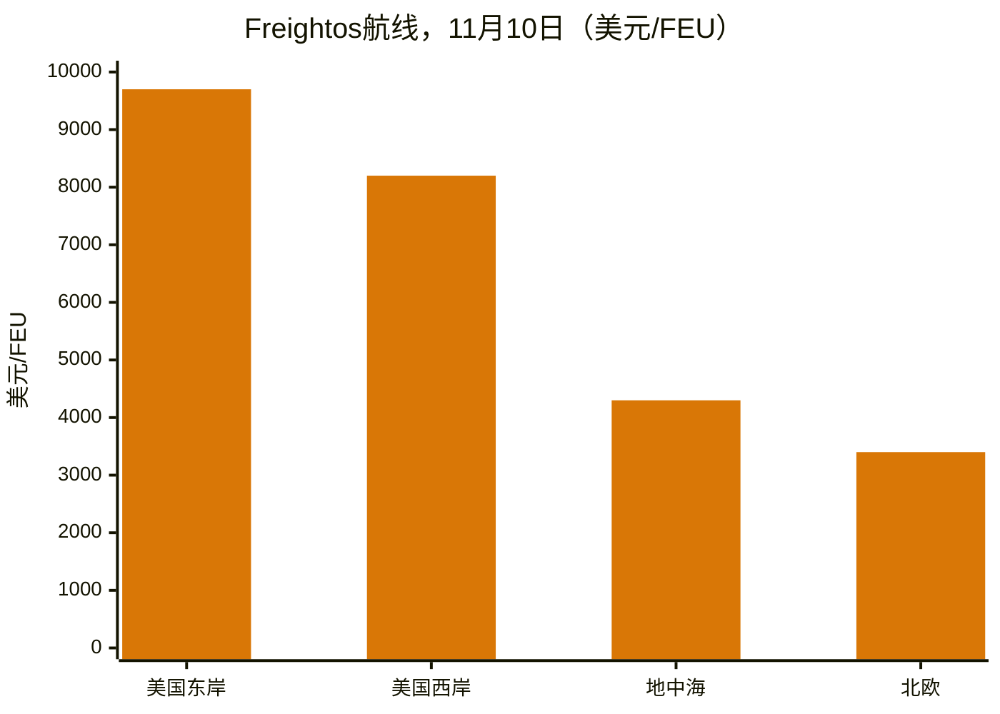

*注：亚洲—美国东海岸约每40英尺集装箱9700美元；亚洲—美国西海岸约8200美元；亚洲—地中海4300美元；亚洲—北欧3400美元。全球指数为3452美元，环比下跌2%。来源：Freightos，2026年11月10日。*

### 11月涨价——已宣布，已打折

截至11月12日的一周，跨太平洋海运运价略有下跌，承运人计划的全面涨价未能落实，但仍处于旺季水平附近。承运人曾寻求11月每40英尺集装箱涨价2000—3000美元，并提交了11月15—16日进一步涨价的申请，但货运代理指出舱位供应改善、船期更加稳定。亚欧运价也有所回落：北欧价格本周下跌5%，至每40英尺集装箱3400美元，地中海运价下跌1%，至4300美元。上海出口集装箱运价指数11月13日下跌61.12点，至3572.33点，连续第二周下跌，原因是美国航线运价下跌而地中海运价上涨。上海—美国东海岸运价下跌470美元，至每40英尺集装箱9387美元，上海—美国西海岸下跌270美元，至7111美元，上海—欧洲下跌77美元，至3402美元，而上海—地中海上涨380美元，至4746美元。

**来源：**[FreightWaves](https://www.freightwaves.com/news/us-midterm-shift-adds-trade-uncertainty-as-trans-pacific-ocean-freight-rates-stay-elevated)；[ShipUniverse](https://www.shipuniverse.com/news/container-freight-rates-split-as-u-s-east-coast-drops-470-as-mediterranean-surges-6-7/)

### 停航与运力

德鲁里停航追踪预计，11月16日至12月21日期间，主要东西航线716个预定航次中将有52个停航，约占计划出发班次的7%。承运人宣布下周跨太平洋航线停航八次，而本周为四次，亚欧/地中海航线为八次，而本周为五次。计划停航的规模表明，随着11月涨价未能维持，承运人正采取行动限制进入12月的运力。

### 干散货——波罗的海交易所

波罗的海干散货指数在截至11月13日的一周内上涨6.2%，至2980点，连续第四周上涨，尽管周五下跌，结束了连续七个交易日的上涨。指数在本周内上涨——11月9日为2854点，11月10日为2862点，11月11日为2959点，11月12日为3020点——随后在11月13日星期五下跌40点，即1.3%，至2980点。好望角型船运价推动了本周的涨幅：BCI 182 5TC最高达到43860美元，收于42798美元。巴拿马型与超灵便型运价在本周也有所上涨。此前一周的涨幅（截至11月6日的一周）为3.4%，从10月30日的2714点升至2805点。干散货运价与集装箱运价走势相反，连续四周上涨使指数达到10月初以来的最高水平，表明运载铁矿石、煤炭与谷物的好望角型与巴拿马型船舶需求更加坚挺，尽管集装箱需求走软。波罗的海交易所第46周的集装箱摘要描述了相对平淡的一周：四条主要东西航线的集装箱运价平均下跌0.52%，中国/美国西海岸下跌0.77%，东海岸持平，亚欧运价略有走弱，北欧下跌0.53%，地中海下跌0.79%。

**来源：**[The DCN](https://www.thedcn.com.au/news/baltic-exchange-weekly-report-13-november-2026)

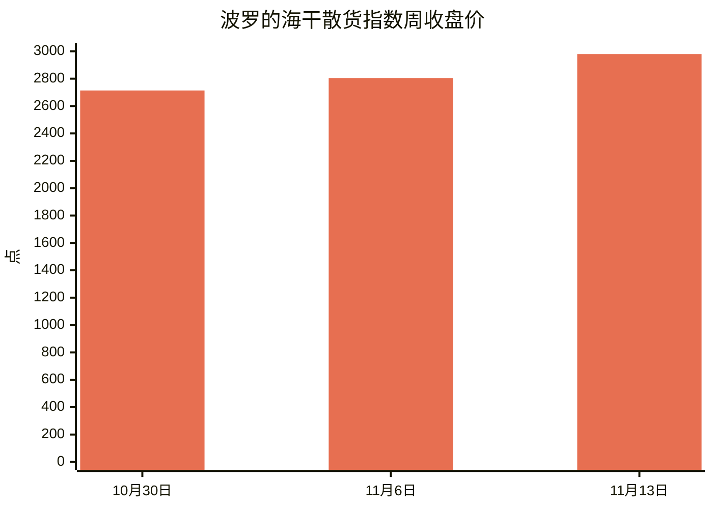

*注：周收盘价：2714点（10月30日）、2805点（11月6日）、2980点（11月13日）。连续第四周上涨。来源：波罗的海交易所周报，2026年11月13日。*

### 苏伊士运河与船期可靠性

苏伊士运河回归继续（见3.5）。德鲁里统计，截至11月1日的一周内有53艘集装箱船通过运河，同比增长130%，并估计约60%的亚欧运力已回到苏伊士航线。长荣的Ever Eon轮于11月8日通过运河，是长荣近三年来首次通过。随着承运人恢复苏伊士服务，亚欧运输时间缩短了七至十天，但到港正在集中：Flexport预测，11月16—22日当周，北欧港口到港船舶运力将达到正常水平的131%，31艘集装箱船经苏伊士运河航行，另有61艘仍绕行好望角。Flexport将超过正常运力120%的到港视为拥堵风险，11月中旬至1月期间至少有三周预计将超过该阈值。第42周平均集装箱滞留时间达到3.37天，堆场利用率据报为80%—90%。

### 空运

全球空运现货运价连续第三周上涨，第44周上涨4%，至每公斤约3.93美元，比去年同期高出约40%，依据为TAC指数。波罗的海空运指数在截至11月9日的七天内上涨6.6%，同比上涨28.2%。Freightos 11月10日的更新显示，中国—北美上涨3%，至每公斤8.00美元以上，中国—北欧上涨11%，至每公斤4.87美元，北欧—北美上涨9%；跨大西洋空运运价在过去一个月内上涨33%，至每公斤2.90美元。Xeneta 10月全球现货均价为每公斤3.11美元，同比上涨29%。IATA报告称，9月货运需求同比增长7.7%，亚太—北美货运量增长17%，而航油价格比一年前高出103.4%。空运正在吸收年末假日订单与人工智能硬件货运，运力因冬季客运时刻表而收紧，推动运价逼近去年12月的峰值。货运代理报告称，在有舱位的情况下，中国—美国西海岸运价约为每公斤8.50—9.00美元。

**来源：**[Daily8 News](https://www.daily8news.com/article/air-cargo-rates-2026-high-peak-season-20261113/)；[IATA](https://www.iata.org/en/pressroom/2026-releases/10-29-air-cargo-demand-accelerates-september/)；[TAC Index via LinkedIn](https://www.linkedin.com/pulse/air-freight-market-update-november-10-2026-tacindex-pkmfc)

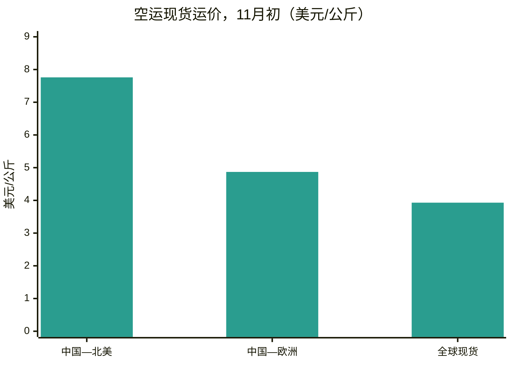

*注：中国—北美每公斤7.76美元（Freightos，11月初；11月10日的更新中超过每公斤8.00美元）；中国—北欧每公斤4.87美元；全球现货约每公斤3.93美元（TAC指数，第44周）。来源：Freightos、TAC指数。*

### 港口与物流中断

**洛杉矶与长滩。**守夜人谈判延长至11月20日（见A8）。C.H. Robinson报告称，在9月异常强劲以及一系列台风使中国一些最大港口的集装箱积压、中断海运船期并导致承运人跳港与甩货之后，来自亚洲的零售货物在11月初仍在消化中断的影响。在洛杉矶与长滩，拥堵依然严重，主要原因是内陆运输铁路车辆不足；一些托运人正转向转运与卡车运输。截至11月2日，35688个进口集装箱在码头等待码头铁路列车，其中10562个已等待九天或更久。洛杉矶港报告称，10月30日当地货物在码头滞留3.7天，码头铁路货物滞留5.6天。假设没有新的中断，预计恢复将持续两到三周逐步进行。洛杉矶港2026年10月处理了1026872标准箱，创当月纪录，也是该港历史上第二高的月度总量，仅次于9月1042652标准箱的历史纪录。这是该港首次连续两个月突破100万标准箱，也是2026年第三次达到这一水平。重箱进口约为538620标准箱，同比增长25%，比该港五年10月均值高出30%；重箱出口为114981标准箱，同比下降7%；空箱为373271标准箱，连续第二个月创纪录。1月至10月总量约为9108497标准箱，比去年同期高出5%，比五年均值高出9%。

**美国进口展望。**全国零售联合会全球港口追踪报告称，其追踪的港口9月处理了237万标准箱的重箱进口，是2026年最繁忙的月份，也是自追踪开始以来第三繁忙的月份。10月预计为226万标准箱，同比增长9.1%；11月为205万标准箱，增长1.2%；12月为203万标准箱，增长1.3%。全年预测约为2600万标准箱，比2025年增长2%。2027年初展望转弱：1月预测为204万标准箱，同比下降3%；2月为189万标准箱，下降0.5%；3月为192万标准箱，下降11.2%。

**德班。**德班尚未从8月德班门户码头转由ICTSI运营并切换至Navis N4码头系统中恢复；8月14日至9月10日期间，该码头的货量较此前四个月均值下降约30%。在11月3日的货物移动更新中，全港规划指标为15天，较前一周上升一天。11月2日，有17艘集装箱船在等待德班——六艘在指定锚地内，十一艘在更远的近海——约85000标准箱滞留海上。在截至11月初的七天内，集装箱船平均锚泊时间为7.46天。马士基将其自远东亚洲至南非与毛里求斯的干箱旺季附加费自11月9日起提高至每20英尺集装箱1000美元、每40英尺集装箱2000美元，是10月15日设定的250美元/500美元水平的四倍，并将其德班拥堵费自11月1日起提高至每20英尺集装箱400美元、每40英尺集装箱800美元（中国始发货物）。交通部长芭芭拉·克里西表示，德班门户码头可能仅在2026年12月至2027年2月期间恢复至此前的表现，德迅（Kuehne+Nagel）预计2027年第一季度末之前不会有实质性改善。

**来源：**[C.H. Robinson](https://www.chrobinson.com/en-us/resources/insights-and-advisories/north-america-freight-insights/nov-2026-freight-market-update/industry-insights/retail/)；[AJOT](https://www.ajot.com/news/port-of-los-angeles-tops-1-million-container-units-for-second-consecutive-month)；[FreightWaves](https://www.freightwaves.com/news/retailers-forecast-u-s-imports-to-stay-elevated-through-2026-after-breakout-peak-season)；[DTFU Logistics](https://www.dtfulogistics.com/news/durban-port-congestion-2026-china-south-africa/)

### 供应商情报

笛卡尔系统集团（Descartes Systems Group）于11月11日发布了11月全球航运报告，基于Descartes Datamyne贸易数据。2026年10月美国集装箱进口量创下月度历史新高，达到2674808标准箱——比2022年5月创下的2622465标准箱的前纪录高出2.0%（52343标准箱）；较2026年9月增长5.0%，较2025年10月增长16.0%，较2019年10月增长29.2%。自中国进口连续第四个月增长，达到987805标准箱，为自2025年1月以来的最高月度货量；环比增长6.9%（63351标准箱），同比增长22.9%；中国占美国集装箱进口总量的份额升至36.9%，高于9月的36.3%。中国始发的主要商品类别：塑料144530标准箱；家具与床上用品137551标准箱；玩具、游戏与体育用品102672标准箱。前十大原产国进口量环比增长5.8%。2026年1月至10月美国集装箱进口量较2025年同期增长2.3%，这是累计货量连续第二个月领先于上年同期，此前八个月均低于去年同期。东海岸与墨西哥湾沿岸港口的市场份额超过西海岸门户：墨西哥湾沿岸进口为266905标准箱，环比增长24.0%，比12个月均值高出16.2%，为Descartes自2023年8月开始追踪该区域数据以来的最高水平。休斯敦录得最大的月度港口增量，增长42665标准箱（26.7%）。洛杉矶进口下降1.4%，长滩下降2.0%，奥克兰下降10.9%。五大东海岸与墨西哥湾沿岸门户的合计市场份额为39.9%，高于9月的36.7%；五大西海岸门户降至44.9%，低于47.0%。美国前十大港口处理了84.8%的进口。10个追踪门户的平均港口中转延误为10月6.3天，而9月为6.0天，6月为4.2天；10个港口中有七个延误上升。延误最长的港口：纽约/新泽西8.1天；西雅图7.6天；萨凡纳6.9天。自2026年7月以来，进口量每个月都超过250万标准箱。10月创纪录的货量在很大程度上由中国始发货物连续第四个月增长推动，表明尽管关税与贸易政策不确定性持续，美国海运进口需求依然强劲。市场份额向东海岸与墨西哥湾沿岸港口转移，以及中转延误稳步上升——自6月以来上升约50%——表明即使没有大范围港口拥堵，内陆物流网络的压力也在加大。

在2026年11月9日至16日的窗口内，未发现TradeInt的合格供应商信息。TradeInt博客页面显示其最新文章日期为2025年12月31日；在该网站或tradeint.com/insights/的搜索中，未发现日期为2026年11月9日至16日的博客文章。

**来源：**[Descartes](https://www.descartes.com/resources/global-logistics-shipping-report-resource-center?language=en)；[All About Shipping](https://allaboutshipping.co.uk/2026/11/11/descartes-releases-november-global-shipping-report-u-s-container-imports-hit-record-volume-in-october/)；[TradeInt blog](https://tradeint.com/insights/blogs/)

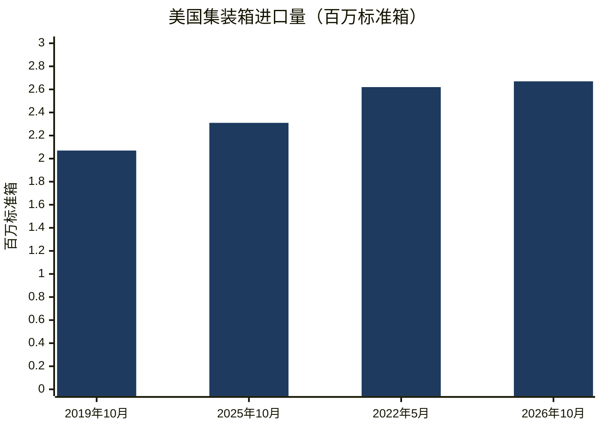

*注：2026年10月：2674808标准箱，创月度历史新高；此前纪录为2022年5月：2622465标准箱；2025年10月：约231万标准箱（同比增长16.0%）；2019年10月：约207万标准箱（增长29.2%）。来源：Descartes 11月全球航运报告，2026年11月11日。*

---

## 10. 政策时间线

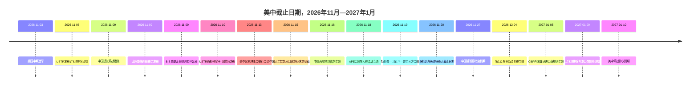

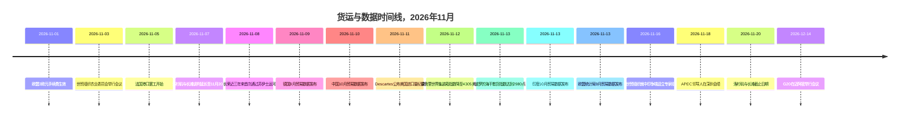

---

## 11. 未来90天即将到来的截止日期与事件

| 日期 | 事项 |
|---|---|
| 2026年11月18日 | CBP可能作废尚未解决5106表格准确性问题的CTPAT进口商的进口商登记号（函件于11月4日发出）。 |
| 2026年11月18日 | 中国修订后的无人机、隧道掘进机和挖泥船两用物项出口管制生效（第49—51号公告）。 |
| 2026年11月18—19日 | APEC经济领导人会议在深圳举行；特朗普—习近平—普京三方会晤于11月19日举行。 |
| 2026年11月20日 | 洛杉矶/长滩守夜人谈判截止日期（第四次延期）。 |
| 2026年11月20日 | BIS将某些消音器自《美国军品清单》转入商务管制清单的措施生效。 |
| 2026年11月20日 | COP31在土耳其安塔利亚闭幕（11月9—20日）。 |
| 2026年11月23日 | 世贸组织农业委员会就出口限制与特殊保障机制举行会议；USITC太阳能第四轮完整报告（第5804号出版物）到期。 |
| 2026年11月27日 | 中国2025年第72号公告关于暂停对输美镓、锗、锑和超硬材料推定拒绝的做法计划到期，如无进一步暂停或修订。 |
| 2026年11月30日 | 商务部针对中国镀锡板产品的终裁倾销与补贴认定到期，除非延期。 |
| 2026年12月4日 | 第232条多晶硅关税开始征收。 |
| 2026年12月7日 | CBP低价值货物拟议规则征求意见截止（91 FR 64532；案卷号USCBP-2026-0298）。 |
| 2026年12月14—15日 | G20领导人在迈阿密举行会议。 |
| 2026年12月16日 | 欧盟—印度自由贸易协定据报道将于布鲁塞尔签署，莫迪总理预计出席。 |
| 2026年12月17日 | 商务部拟发布木质橱柜与细木工复审评估指示的最早日期（11月12日公布后35天）。 |
| 2027年1月1日 | 第232条税率上调：软垫家具升至30%，厨房橱柜与浴室柜升至50%；针对加拿大车辆、汽车零部件和钢铁威胁征收的50%关税也以该日期为目标；英国CBAM启动。 |
| 2027年1月3日 | 新一届美国国会就职。 |
| 2027年1月5日 | CBP外国登记进口商临时最终规则生效；意见征集同日截止（案卷号USCBP-2026-1387）。 |
| 2027年1月9—10日 | 美中停战协议截止日期汇合：178项第301条排除与海事收费暂停于1月9日到期；BIS关联企业规则暂停与中国的对等暂停于1月10日到期。 |
| 2027年1月12日 | USMCA联合审查磋商的书面意见与听证参与申请截止（案卷号USTR-2026-0595与USTR-2026-0596）。 |
| 2027年1月19日 | 商务部针对土耳其镀锡板产品的终裁倾销认定到期。 |
| 2027年1月20日 | 针对适用第201、232或301条关税或伙伴政府机构要求的邮件，正式入境成为强制要求。 |
| 2027年1月30日 | 英国对土耳其虹鳟鱼反补贴税变更自该日起适用（2026/31号通知）。 |
| 2027年2月1日 | 加拿大取消某些铝线材、铝型材和纸板产品的横向关税减免。 |
| 2027年2月6日 | 农历新年。 |
| 2027年2月28日 | USTR在越南知识产权第301条调查中的裁定截止日期。 |
| 2027年3月 | USTR第301条结构性过剩产能调查决定预计作出（2027年3月前到期）。 |
| 2027年3月25日 | 商务部针对台湾镀锡板产品的终裁倾销认定到期。 |
| 2027年5月6日 | 经纪人全面遵守外国登记进口商规则的预期日期。 |
| 2028年6月30日 | 加拿大横向关税减免延长至该日期。 |

---

## 12. 来源与方法

报道窗口：2026年11月9日至16日。汇编自全球约45家贸易新闻、政策、数据与货运来源。

咨询的来源包括：FreightWaves、The Loadstar、Splash247、gCaptain、Hellenic Shipping News、Container News、Supply Chain Dive、Logistics Management、Air Cargo News、Port Technology、TradeInt insights blog；whitehouse.gov、cbp.gov、ustr.gov、federalregister.gov、trade.gov、usitc.gov、bis.doc.gov、JD Supra；ec.europa.eu、gov.uk、cbsa-asfc.gc.ca、canada.ca/en/department-finance、english.mofcom.gov.cn；wto.org、unctad.org、intracen.org、wcoomd.org；dataweb.usitc.gov、ustradecensus.gov、comtradeplus.un.org、wits.worldbank.org、eurostat、data.worldbank.org、imf.org；taxfoundation.org、budgetlab.yale.edu、tradeintelligence.eu；drewry.co.uk、balticexchange.com、freightos.com；descartes.com、tradeint.com。

11月9日之前的事项仅作为后续跟进、落入窗口内的《联邦公报》发布或窗口内某一截止日期的背景出现。商务部英文网站仅可查看首页标题；其对欧盟收费的回应以及关于不可靠实体清单的表态的实质内容无法根据审查信息核实。世贸组织新闻索引通过抓取未返回可读文本，因此世贸组织事项使用转载的世贸组织发布内容。TradeInt在窗口内没有合格的供应商信息：其最新博客文章日期为2025年12月31日。在报道窗口内，未发现USITC DataWeb、联合国商品贸易统计数据库、WITS、世界银行或IMF门户有重大新发布。在窗口内未发现新的暂扣放行令。
