# Global Trade Intelligence Report — Week of November 16–23, 2026

**Weekly briefing.** Coverage window: November 16–23, 2026. Compiled from approximately 45 trade news, policy, data, and freight sources worldwide.

---

## Table of contents

1. [Executive summary](#1-executive-summary)
2. [Alerts](#2-alerts)
3. [Top stories — deep dives](#3-top-stories--deep-dives)
4. [Tariff tracker](#4-tariff-tracker)
5. [US policy deep dive](#5-us-policy-deep-dive)
6. [World policy by region](#6-world-policy-by-region)
7. [Enforcement actions](#7-enforcement-actions)
8. [Data releases](#8-data-releases)
9. [Freight market](#9-freight-market)
10. [Policy timelines](#10-policy-timelines)
11. [Upcoming deadlines & events (next 90 days)](#11-upcoming-deadlines--events-next-90-days)
12. [Sources & methodology](#12-sources--methodology)

---

## 1. Executive summary

A week in which the summit expected to settle the United States–China truce settled nothing, while the week's decisive trade actions came from regulators, courts and signing ceremonies elsewhere. The APEC leaders' meeting in Shenzhen on November 18–19 produced a declaration and a first-ever Trump–Xi–Putin trilateral, but no tariff relief and no confirmed extension of the truce, which still expires on January 9–10, 2027; the next venue for a decision is the G20 summit in Miami on December 14–15. The Bureau of Industry and Security instead moved the week's largest measure unilaterally, publishing an interim final rule on November 19 that closes the remote-access route for advanced chips, rescinds the AI Diffusion Rule, and requires licences for advanced computing items to five Southeast Asian and Latin American countries. Europe signed its way forward: the European Union and Indonesia signed a comprehensive economic partnership on November 21, the EU–India signing date firmed to December 16, and the United Kingdom and the EU agreed an SPS deal and emissions-trading linkage at their November 20 summit. In the Gulf, attacks on shipping in and around the Strait of Hormuz reached their highest monthly level since the United States–Iran war began, and Washington extended its blockade to ship-to-ship transfers.

- **APEC produced a declaration, not a tariff deal.** The 33rd APEC Economic Leaders' Meeting closed on November 19 with the Shenzhen Outlook, a voluntary, non-binding statement, and an agreement between Presidents Trump and Xi to draft an action plan for United States–China "strategic stability". The first Trump–Xi–Putin trilateral issued a four-point Peace Declaration with no volumes, timelines or trade content. Some reporting said the leaders agreed to extend the trade truce; neither side published a duration or terms, and the Chinese readout mentioned no extension. The truce still expires on January 9–10, 2027, and the Board of Trade's $30 billion-for-$30 billion reciprocal tariff-cut package remains unagreed. [China Briefing](https://www.china-briefing.com/news/apec-2026-in-shenzhen-what-the-leaders-meeting-and-trump-xi-talks-mean-for-business/)
- **BIS closed the remote-access chip loophole.** The interim final rule published on November 19 (91 FR 74970) adds a worldwide end-use control requiring a licence where advanced computing items will be used in a data centre providing more than 12,000,000 aggregate total processing performance to companies headquartered in Country Group D:5 or Macau, adds licence requirements for advanced computing items to Indonesia, Malaysia, Singapore, Thailand and Brazil, and formally rescinds the AI Diffusion Rule. TSMC and Samsung told Chinese clients they would halt sales of certain processors while seeking licences. House Foreign Affairs Committee records published the same day showed 879,868 advanced AI processors approved for Chinese-tied entities through May 11, 2026, including 579,868 Nvidia H200 accelerators. [Willkie Farr & Gallagher](https://www.willkie.com/publications/2026/11/bis-moves-to-close-the-remote-access-gap-for-advanced-chips)
- **Europe signed, and set a date for its biggest deal.** The EU and Indonesia signed a Comprehensive Economic Partnership Agreement and an Investment Protection Agreement on November 21 after nearly a decade of talks; Indonesia will remove tariffs on 98.5% of tariff lines for EU goods, saving EU exporters more than €600 million a year in duties. The EU–India free trade agreement is now expected to be signed on December 16 in Brussels, with 93% of Indian shipments receiving duty-free access. At the November 20 UK–EU summit, the two sides agreed an SPS agreement to remove many agri-food border checks from March 1, 2028, and to link their emissions trading schemes, with mutual carbon border adjustment exemptions worth about £6.5 billion of UK exports. [Turkish Post](https://turkishpost.com.tr/en/2026/11/21/eu-indonesia-trade-deal/); [Asia Daily](https://asiadaily.org/news/19949/)
- **The India–United States deal is still unsigned, and the wait is now structural.** Commerce Secretary Rajesh Agrawal said on November 18 that India cannot sign until Washington rebuilds its tariff framework after the Supreme Court struck down the reciprocal and emergency tariffs, and until the Section 301 investigations — including the excess-capacity probe — are known. USTR Ambassador Jamieson Greer is reported to have said on November 21 that the excess-capacity investigation will conclude before the end of 2026, ahead of its March 11, 2027 statutory deadline; that report is single-sourced and unverified. [The Hindu BusinessLine](https://www.thehindubusinessline.com/economy/no-india-us-trade-deal-until-new-us-tariff-framework-section-301-probes/article71716562.ece/amp/)
- **Hormuz attacks reached their highest level since the war began.** More than 30 attacks on shipping were reported in October and at least 22 in November to November 22, according to a CNN analysis of UK Maritime Trade Operations data; three tankers were struck on November 20–21, and an ADNOC tanker was attacked on November 17, leaving one crew member unaccounted for and 11 injured. The International Maritime Organization counted 138 confirmed incidents and 25 seafarer deaths as of November 17. Gulf oil exports ran at 18.4 million barrels per day in October, 26% below pre-war levels, and Brent held near $92 a barrel. [CNN](https://www.cnn.com/2026/11/22/middleeast/hormuz-attacks-highest-levels-iran-war-intl?cid=external-feeds_iluminar_meta)
- **New duties landed on plywood, and the pipeline widened.** Commerce published antidumping and countervailing duty orders on hardwood and decorative plywood from China, Indonesia and Vietnam on November 17, with a combined rate of about 276% for China. The USITC published its full Solar IV report (Publication 5804), splitting critical circumstances — retroactive duties for Indonesia only. New petitions targeted plastic balloons from China, with alleged margins of 50% to 276%. [Transport News](https://www.transportnews.net/a/commerce-hardwood-plywood-duty-orders-china-indonesia-vietnam)
- **Japan set a trade record; the freight market split again.** Japan's October exports rose 20.5% year on year to a record ¥11.77 trillion and imports rose 21.6% to a record ¥12.25 trillion, with the deficit narrowing to ¥476.5 billion, roughly half the forecast. The Drewry World Container Index fell 3% to $4,176 per 40ft container in its fourth consecutive weekly decline, while air cargo held at 2026 highs, with China–North America rates at $9.25 per kilogram. Maersk and Hapag-Lloyd announced the return of their last three Gemini Asia–Europe services to the Suez route by mid-January. [Drewry](https://www.drewry.co.uk/supply-chain-advisors/world-container-index-weekly-update?topics=Container%20Shipping)

**Freight:** container spot rates fell for a fourth consecutive week on the transpacific while Mediterranean rates rebounded; dry bulk eased from its peak; air cargo held at 2026 highs into peak season; the Suez return neared completion as Gemini announced its last three services back through the Red Sea; the LA/Long Beach strike threat ended with a tentative deal on November 21; and Durban's queue lengthened to 263 hours at anchor despite higher throughput.

---

## 2. Alerts

| # | Alert | Effective | Impact | Source |
|---|-------|-----------|--------|--------|
| A1 | APEC leaders meet in Shenzhen; Trump–Xi bilateral and first Trump–Xi–Putin trilateral produce a declaration and a "strategic stability" action plan, but no tariff relief and no confirmed truce extension | Nov 18–19, 2026 | Truce still expires Jan 9–10, 2027; next decision point is the G20 in Miami, Dec 14–15 | [China Briefing](https://www.china-briefing.com/news/apec-2026-in-shenzhen-what-the-leaders-meeting-and-trump-xi-talks-mean-for-business/) |
| A2 | BIS interim final rule "Addressing Remote Access to Advanced Semiconductors" imposes a worldwide data-centre end-use control (12,000,000 TPP threshold), licence requirements for advanced chips to five countries, and rescinds the AI Diffusion Rule | Nov 19, 2026 (published; 91 FR 74970) | Foundries pause China shipments pending licences; data centres serving D:5 companies have 90 days to obtain a licence | [Willkie Farr & Gallagher](https://www.willkie.com/publications/2026/11/bis-moves-to-close-the-remote-access-gap-for-advanced-chips) |
| A3 | China's suspension of the export ban on gallium, germanium, antimony and superhard materials to the United States lapses, with no extension published as of Nov 20–21 | Nov 27, 2026 | Underlying rule calls for licences to be denied in principle; US buyers of covered materials face a decision this week | [InvestorNews](https://investornews.com/market-opinion/critical-minerals-report-trump-xi-and-the-critical-minerals-behind-the-ai-race/) |
| A4 | EU hybrid-car safeguard: written submissions closed Nov 20; provisional measures expected from Dec 1, with a reported 350,000-vehicle annual cap on Chinese-built hybrids | Dec 1, 2026 (expected) | Chinese hybrid imports already 474,475 units in Jan–Aug 2026, above the proposed annual cap; no legal act published yet | [Ports Europe](https://www.portseurope.com/eu-opens-hybrid-safeguard-probe-as-chinese-shipments-outrun-planned-quota/) |
| A5 | Section 232 polysilicon minimum import prices ($21/kg polysilicon; $100/kg ingots and wafers; $0.22/W cells; $0.38/W modules) plus a 15% duty on derivatives take effect; anti-stockpiling rule runs to Dec 3 | Dec 4, 2026 | Price floor under the entire US solar supply chain; CBP test environment live since Nov 12 | [Stoel Rives](https://www.stoel.com/printpilot-publication-commerces-anti-stockpiling-rule-imposes-limits-on-pre-december-4-polysilicon-imports.pdf?1791987859) |
| A6 | Attacks on shipping in and around the Strait of Hormuz at the highest monthly level since the war began; three tankers struck Nov 20–21; US extends blockade to ship-to-ship transfers and strikes an IRGC site on Qeshm Island | Nov 16–22, 2026 | 138 confirmed incidents and 25 seafarer deaths (IMO); Gulf oil exports 26% below pre-war; Brent about $92 | [CNN](https://www.cnn.com/2026/11/22/middleeast/hormuz-attacks-highest-levels-iran-war-intl?cid=external-feeds_iluminar_meta) |
| A7 | Pacific Maritime Association and ILWU Local 26 reach a tentative agreement hours after the 12:01 a.m. deadline, averting a walkout at Los Angeles and Long Beach; ratification pending, terms undisclosed | Nov 21, 2026 | Strike threat lifted for now at the busiest US container gateway; risk returns if members reject the deal | [FreightWaves](https://www.freightwaves.com/news/tentative-union-deal-averts-strike-at-port-of-la-long-beach) |
| A8 | Commerce publishes final AD/CVD orders on hardwood and decorative plywood from China, Indonesia and Vietnam; combined rate about 276% for China | Nov 17, 2026 | Cash deposits resume; Chinese hardwood plywood effectively priced out of the US market | [Transport News](https://www.transportnews.net/a/commerce-hardwood-plywood-duty-orders-china-indonesia-vietnam) |
| A9 | CBP foreign importer-of-record interim final rule takes effect Jan 5, 2027; the Nov 18 Form 5106 voiding deadline passed with no voidings reported as of Nov 20 | Jan 5, 2027 | Foreign importers must be CTPAT-validated or use a CTPAT-validated broker; entries may be rejected from Jan 5 | [Freight Right](https://www.freightright.com/news/cbp-tightens-importer-requirements-what-businesses-must-do-before-january-2027) |
| A10 | COP31 in Antalya ends Nov 22 without a political agreement; IMO delegates begin technical talks ahead of MEPC 85, with an extraordinary session provisionally set for Dec 4 | Nov 22–23, 2026 | Shipping's Net-Zero Framework adoption uncertain; US opposes mandatory emissions charges | [Splash247](https://splash247.com/cop31-collapse-casts-shadow-over-shippings-net-zero-showdown/) |
| A11 | Belgian air traffic control strike closes Belgian airspace 07:00–21:00 on Nov 23; Liège cargo hub shut for 14 hours, about 429 Brussels flights cancelled | Nov 23, 2026 | European air cargo disrupted at peak season; knock-on effects expected into Nov 24 | [The Loadstar](https://theloadstar.com/) |
| A12 | USTR's Section 301 excess-capacity investigation reported to conclude before year-end, ahead of the Mar 11, 2027 statutory deadline; no formal determination published | Reported Nov 21, 2026 | A single determination could impose new duties on 16 economies; single-source report, unverified | [East Asia Brief](https://eastasiabrief.com/trade-policy/ustr-accelerates-section-301-probe-hit-year-end-target-1636) |

### A1 — APEC: the decision point that decided nothing

The 33rd APEC Economic Leaders' Meeting closed in Shenzhen on November 19 with the 2026 APEC Leaders' Shenzhen Outlook, a voluntary, non-binding statement committing the 21 member economies to work on resilient supply chains, trade digitalisation and artificial intelligence. President Xi Jinping chaired the leaders' meeting and held a bilateral meeting with President Donald Trump the same afternoon, after a two-hour discussion on November 18 focused mainly on trade and tariffs; the two agreed to draft an action plan for United States–China "strategic stability". The same day, Xi hosted the first three-way meeting of the Chinese, United States and Russian presidents, which produced a four-point Heads of State Declaration toward Peace covering increased production and supply of refined petroleum products, UN reform, respect for state immunities and dialogue on reducing nuclear risks — with no volumes, timelines, or mention of Ukraine, Iran, trade or AI. Trump pressed China to honour its pledge to buy $17 billion in United States agricultural products; Chinese officials have said the pledge is conditional on reciprocal tariff reductions through the Board of Trade. Xi pledged further tariff cuts, expanded market access and a $20 million contribution to APEC cooperation. United States–China goods trade in January–September 2026 was about $474 billion. [China Briefing](https://www.china-briefing.com/news/apec-2026-in-shenzhen-what-the-leaders-meeting-and-trump-xi-talks-mean-for-business/)

**Analysis:** the meeting that was expected to be the decision point for extending the truce beyond January produced no tariff outcome at all. The truce still expires on January 9–10, 2027, and the next venue for an extension is now the G20 summit in Miami on December 14–15. The Board of Trade's $30 billion-for-$30 billion reciprocal tariff-cut package remains unagreed, and importers planning entries after January 9 still have no written extension. The real trade outcomes of summit week were bilateral and on the sidelines: the Philippines–Chile CEPA and the Peru–Thailand FTA were signed, China–Canada tariff relief was expanded, and China–Indonesia opened CEPA talks.

### A2 — BIS closes the remote-access chip loophole

The Bureau of Industry and Security released an interim final rule on November 16, published in the Federal Register on November 19 (91 FR 74970) and effective on publication. The rule adds a worldwide end-use control (new EAR § 744.24) requiring a licence where there is knowledge that advanced computing items will be used in a data centre providing more than 12,000,000 aggregate total processing performance to companies headquartered in Country Group D:5 (including China) or Macau; data centres already providing such compute have 90 days, to about February 17, 2027, to obtain a licence to continue. It adds a licence requirement for advanced computing items to Indonesia, Malaysia, Singapore, Thailand and Brazil, with an exception for United States-headquartered end users that file new monthly reports. It narrows the routes by which front-end fabricators and outsourced semiconductor assembly and test companies can overcome the presumption that an advanced-node logic chip (16/14 nm or below) is a controlled data-centre AI item. It formally rescinds the Biden-era AI Diffusion Rule, including the country tiers, the model-weights control and the Data Center Validated End User framework. Comments are due January 19, 2027. [Willkie Farr & Gallagher](https://www.willkie.com/publications/2026/11/bis-moves-to-close-the-remote-access-gap-for-advanced-chips)

**Key figures:** 12,000,000 aggregate TPP threshold; 90-day transition to about February 17, 2027; 879,868 processors approved for Chinese-tied entities through May 11, 2026 (579,868 Nvidia H200; about 300,000 AMD Instinct MI325X), from requests exceeding 3.4 million processors. The Financial Times reported on November 19 that TSMC and Samsung told Chinese clients they would halt sales of certain processors while seeking United States licences. On November 20 Treasury Secretary Scott Bessent said current Nvidia H200 export limits would hold without additional restrictions and that "the proper chip restrictions are in place". The rule was written by and at the direction of the Treasury Department and the National Security Council, according to BIS's own announcement.

### A3 — The gallium suspension lapses on November 27

China's Announcement No. 72 of 2025, which suspends the presumption of refusal for United States-bound gallium, germanium, antimony and superhard materials, runs only until November 27, 2026 and was not mentioned in MOFCOM Announcement No. 58, which extended the separate rare-earth package suspension to January 10, 2027. As of November 20–21 no extension had been published. Unless Beijing acts, the underlying rule calls for licences for the covered materials to be denied in principle, with closer scrutiny of end users and end uses for covered graphite. Licensing requirements for gallium, germanium (since August 1, 2023) and antimony (since September 15, 2024) for all destinations remain in force regardless. [InvestorNews](https://investornews.com/market-opinion/critical-minerals-report-trump-xi-and-the-critical-minerals-behind-the-ai-race/)

**Analysis:** the wider truce runs to January 10, 2027, but this suspension is a separate instrument with its own date. United States buyers of covered gallium, germanium and antimony products face a decision this week, and the lapse would land four days after the coverage window closes.

### A4 — EU hybrid-car safeguard: the cap is already below the run-rate

The European Commission opened a safeguard investigation on October 30 into imports of new full, mild and plug-in hybrid cars from every non-EU country, citing a 49% rise in import volumes — from 957,965 vehicles in 2023 to 1,423,691 in the year to June 30, 2026 — at prices well below those of EU producers. Written submissions closed on November 20. EU officials have said imports of Chinese-built hybrids will be capped at 350,000 cars in the first year, rising 6% a year for four years, under a safeguard the Commission plans to launch on December 1; no legal act has yet been published, and the quota mechanism and treatment of cars above the limit are not yet public. Eurostat data show EU imports of hybrid cars from China reached 474,475 units in the first eight months of 2026 — already above the proposed annual cap and a 175% year-on-year jump — against 302,000 in 2025 and 107,000 in 2024. The Commission expects about 800,000 Chinese hybrid imports in 2026. Chinese brands' share of Europe's plug-in hybrid market rose from 2% to 25%. Exemptions apply to the European Economic Area, Ukraine, Kenya and small developing exporters; Chinese brands building in the EU, such as BYD in Hungary and Chery in Spain, sit outside the quota. Battery electric vehicles face tariffs of 25% to 45% depending on manufacturer, and are not covered by the hybrid cap. [Ports Europe](https://www.portseurope.com/eu-opens-hybrid-safeguard-probe-as-chinese-shipments-outrun-planned-quota/)

**Analysis:** the cap would cut Chinese hybrid shipments to Europe by more than half against the 2026 run-rate, reshaping vehicle flows, finished-vehicle logistics and production decisions in Central and Eastern Europe. It is the EU's most significant new trade-defence measure of the year, and the December 1 start date is days away with key mechanics still unpublished. The Association of European Vehicle Logistics warned the cap would be a serious blow to finished-vehicle logistics players.

### A5 — Polysilicon: the price floor is set, the anti-stockpiling rule already bites

Proclamation 11052 of August 6, 2026 (Section 232) imposed minimum import prices on polysilicon and its derivatives and a 15% ad valorem tariff on derivative products, effective December 4, 2026. The minimum import prices are $21 per kilogram for polysilicon, $100 per kilogram for polysilicon ingots and wafers, $0.22 per watt for solar cells and $0.38 per watt for solar modules. On September 24, 2026 BIS published a temporary final rule implementing the proclamation's anti-stockpiling directive, effective September 22 and running through December 3, issued without notice and comment after trade data showed sharp import increases by some importers in the week after the proclamation. Existing importers of record registered before August 6 may continue importing subject to monitoring; if Commerce determines an importer is importing in volumes substantially greater than its historic averages, it notifies CBP, which notifies the importer and its brokers, and the importer is barred from further entries until December 4. New importers registered on or after August 6 face hard weekly caps absent Commerce approval: 12 kg of polysilicon, 7 kg of ingots and wafers, 2,000 solar cells and 55 solar modules per week. CBP opened the ACE test environment on November 12, activating four simulated Chapter 99 classifications for testing. [Stoel Rives](https://www.stoel.com/printpilot-publication-commerces-anti-stockpiling-rule-imposes-limits-on-pre-december-4-polysilicon-imports.pdf?1791987859)

**Analysis:** the December 4 measures set a price floor under the entire United States solar supply chain, and the anti-stockpiling rule means the restriction is already biting for importers who pulled deliveries forward. Solar developers face higher input costs from December, and the onshoring waiver gives domestic-build commitments a route around the duties. Production filing guidance with the official Chapter 99 headings had not yet been published as of November 23.

### A6 — Hormuz: attacks at their highest level since the war began

Reported attacks on shipping in the Strait of Hormuz, the Persian Gulf and the Gulf of Oman exceeded 30 in October — the first time above that level since the war began — and at least 22 had been reported in November as of November 22, the second-highest figure, according to a CNN analysis of UK Maritime Trade Operations (UKMTO) data; UKMTO notes the figures are likely an undercount. Between November 13 and 18 UKMTO listed five attack reports, including a tanker struck on November 16 with an engine-room fire and a second tanker hit twice the same day. On November 17 an ADNOC Logistics & Services tanker was attacked in the strait, leaving one crew member unaccounted for and 11 injured; the vessel was identified by security firm Vanguard Tech as the product tanker NAVIG8 MESSI. On November 16–17 the Panama-flagged LPG carrier Tara Gas was struck, set ablaze and abandoned. On November 20–21 projectiles struck three more tankers exiting the strait — the Marshall Islands-flagged Captain Leon, the Hong Kong-flagged crude tanker Torkel and the Arina — with fires aboard the first two. The International Maritime Organization counted 138 confirmed incidents and 25 seafarer deaths as of November 17. The United States conducted strikes on an IRGC missile site on Qeshm Island on November 17, and on November 18 United States Central Command extended the blockade to ships taking Iranian cargo in ship-to-ship transfers. Kpler reported Iranian oil on water outside the blockade zone had hit zero, with Iranian oil revenues potentially dropping to zero by mid-December. [CNN](https://www.cnn.com/2026/11/22/middleeast/hormuz-attacks-highest-levels-iran-war-intl?cid=external-feeds_iluminar_meta)

**Key figures:** Gulf oil exports (excluding Oman) at 18.4 million barrels per day in October, 26% below pre-war levels, with Hormuz traffic about 65% below normal (IEA November Oil Market Report); Brent for January delivery settled at $92.44 on November 16 and $91.98 on November 19. Commercial traffic through the channel, through which about a fifth of the world's oil passed before the war, remains well below the 2025 baseline.

### A7 — LA/Long Beach: strike averted at the last hour

The Pacific Maritime Association (PMA) said on Saturday morning, November 21, that it had reached a tentative agreement with ILWU Local 26 after the two sides returned to federally mediated talks on Friday, November 20. The union represents about 250 watchmen who control access at terminal gates and run security patrols at six container terminals in Los Angeles and Long Beach. The union had indicated it would not extend the contract past 12:01 a.m. Pacific on Saturday, November 21, and a strike could have halted vessel, yard and gate operations if other dockworkers honoured picket lines. The current contract stays in effect while members vote on ratification. No terms and no ratification timeline have been disclosed; the union had not commented as of November 21–22. The previous contract expired in July 2025 and the dispute had run through strike deadlines on November 1, 4, 6 and 20. The PMA's earlier offer included a one-time $3,200 bonus per member and wage increases lifting average annual earnings for full-time watchmen from more than $170,000 to $198,000, but those figures describe the pre-deal offer, not the final agreement. [FreightWaves](https://www.freightwaves.com/news/tentative-union-deal-averts-strike-at-port-of-la-long-beach)

**Analysis:** the strike threat at the nation's busiest container gateway is off for now, five days before Thanksgiving, removing the largest near-term disruption risk for holiday inventory. The deal is not final until ratified, and no vote date has been published, so the risk returns if members reject it. The complex was already strained, with rail dwell times above nine days.

### A8 — Plywood orders: China at about 276% combined

Commerce issued antidumping and countervailing duty orders on hardwood and decorative plywood from China, Indonesia and Vietnam on November 17 (FR Docs. 2026-23386 and 2026-23393), effective the same day. Antidumping cash-deposit rates: China 187.27% (deposit 185.96% after subsidy offset) for the China-wide entity; Indonesia 15.40% to 84.94%; Vietnam 90.12% (deposit 84.95%). Countervailing duty rates: China 88.96%; Indonesia 4.22% to 128.66%; Vietnam 47.68% to 165.39%. Combined exposure reaches about 276% for China and about 255% for Vietnam's Junma Phu Tho. Softwood structural plywood was dropped after the USITC found those imports negligible; CBP will end suspension of liquidation and refund cash deposits on those entries made on or after March 2, 2026. The USITC also found no critical circumstances for antidumping duties on plywood from China, so deposits collected on that basis will be refunded. [Transport News](https://www.transportnews.net/a/commerce-hardwood-plywood-duty-orders-china-indonesia-vietnam)

### A9 — CBP: the November 18 cliff did not materialise; January 5 is the hard date

CBP had warned CTPAT-certified importers that their importer-of-record numbers could be voided for entries filed from 12:01 a.m. ET on November 18, 2026 over inaccurate or incomplete CBP Form 5106 information, following an NCBFAA alert on November 4. As of the morning of November 20, no reporting of actual voidings had surfaced, and no CBP letter text has been published. CBP clarified that the CTPAT verification notices sent from November 4 were intended to encourage timely review and correction of email and phone fields in ACE, and did not mean an importer number had been voided or was scheduled to be voided. The underlying authority is CBP's August 19 Federal Register notice (91 FR 53627), under which voiding of numbers with inaccurate or incomplete Form 5106 data has been possible since September 18, 2026. Separately, CBP published an interim final rule on November 6 (91 FR 69977) establishing heightened requirements for foreign importers of record, effective January 5, 2027: a foreign importer must be CTPAT-validated or use a CTPAT-validated licensed customs broker, and three new fields are being added to CBP Forms 3461 and 7501. Comments on the rule are due January 5, 2027. [GHY International](https://www.ghy.com/trade-compliance/cbp-ctpat-importer-ior-numbers-voided-nov-18/)

**Analysis:** the feared November 18 cliff did not materialise, but the enforcement machinery is real and the January 5, 2027 foreign-importer rule is the next hard date. Importers whose Form 5106 records carry a broker's address, email or phone number remain exposed to voiding without warning, and CBP says its validation checks may reject entries and entry summaries from January 5 where the requirements are unmet.

### A10 — COP31 collapses; shipping's net-zero decision moves to MEPC 85

The COP31 summit in Antalya ended on November 22 without an overarching agreement after nearly 200 countries failed to bridge divisions over fossil fuels and climate finance. The European Union, Britain and vulnerable island states rejected the proposed Antalya Pact, which made no explicit reference to moving away from coal, oil and gas, while Saudi Arabia and Russia resisted tougher language; some subsidiary decisions were agreed, but the central political declaration failed. It was the first COP since Copenhagen in 2009 to end without a final agreement, and the first meeting since the UN confirmed global temperatures were set to exceed 1.5°C. The collapse provides a difficult backdrop for IMO delegates, who began five days of technical discussions on November 23 ahead of next week's Marine Environment Protection Committee (MEPC 85). Shipping's proposed Net-Zero Framework, approved in draft form last year but not adopted, combines tightening greenhouse-gas fuel-intensity requirements with financial compliance payments and incentives for cleaner fuels; the economic element remains deeply divisive, with the United States opposing mandatory emissions charges. Adoption was postponed in October 2025, and an extraordinary IMO meeting is provisionally scheduled for December 4, subject to confirmation at MEPC 85. [Splash247](https://splash247.com/cop31-collapse-casts-shadow-over-shippings-net-zero-showdown/)

### A11 — Belgian air traffic control strike closes Liège for 14 hours

Staff at skeyes, Belgium's air navigation service provider, joined a national strike called by the country's three main trade unions against federal austerity measures, suspending regular air traffic control services on Monday, November 23 from 07:00 to 21:00 local time. Virtually all departing and arriving flights at Belgian airports were cancelled in that window; Brussels Airport had about 429 flights and 59,500 passengers scheduled for the day, and Charleroi cancelled all flights for the whole day. Airlines rescheduled flights and moved aircraft to airports in neighbouring countries. The strike was announced late on Saturday, November 21, giving airlines less than two days' notice. Liège matters most for freight: it is one of Europe's busiest cargo airports, the European hub for several freight operators and a staging point for e-commerce traffic, so a fourteen-hour hole in Belgian air traffic control on a Monday disrupts freight connections as well as passenger travel. Some knock-on disruption was expected to spill into Tuesday, November 24. [The Loadstar](https://theloadstar.com/)

### A12 — Section 301 excess-capacity probe reported to conclude before year-end

USTR Ambassador Jamieson Greer is reported to have confirmed in a television interview on November 21 that the Section 301 investigation into structural excess capacity in manufacturing across 16 economies will conclude before the end of 2026, months ahead of the 12-month statutory deadline of March 11, 2027. He declined to specify preliminary tariff rates or country-specific penalty schedules. The investigation (dockets USTR-2026-0067 and USTR-2026-0068, initiated March 11, 2026) covers 21 sectors including automobiles, lithium-ion batteries, semiconductors, steel, aluminium, robotics, solar modules and precision machinery, across China, the EU, Singapore, Switzerland, Norway, Indonesia, Malaysia, Cambodia, Thailand, South Korea, Vietnam, Taiwan, Bangladesh, Mexico, Japan and India. No findings, proposed action or product list has been published; the final determination and country remedy schedules are reported to arrive before December 31. [East Asia Brief](https://eastasiabrief.com/trade-policy/ustr-accelerates-section-301-probe-hit-year-end-target-1636)

**Analysis:** if accurate, the timetable accelerates a decision that Indian officials have called the gating item for the India–United States deal and that South Korean officials have said is already more than two months behind their expected timetable. This is the largest live tariff risk in the United States programme: a single determination could impose new duties on 16 economies at once. The report rests on a single trade-press account of the interview; no USTR press release or Federal Register notice had appeared as of November 23, so the year-end date should be treated as reported, not confirmed.

---
## 3. Top stories — deep dives

### 3.1 APEC: the decision point that decided nothing

The 33rd APEC Economic Leaders' Meeting was the week's expected decision point for the United States–China truce, and it produced none. Leaders adopted the 2026 APEC Leaders' Shenzhen Outlook, a voluntary, non-binding statement on four pillars — economy and trade, connectivity, innovation and development — with three outcome documents on trade, connectivity and innovation. Commitments include the APEC Trade Digitalization Cooperation Framework (2027–2030) covering paperless trade, cross-border e-commerce and emerging technologies in trade; advancing the Free Trade Area of the Asia-Pacific in a "market-driven" way with no timeline; and resilient supply chains "particularly for essential goods". Xi Jinping pledged tariff cuts, expanded market access and a $20 million contribution to APEC cooperation, plus a new policy research centre in Shenzhen.

The bilateral substance was thin. The Xi–Trump meeting on November 19, following a two-hour discussion on November 18 focused mainly on trade and tariffs, produced an agreement to draft an action plan for United States–China "strategic stability" and discussion of agricultural purchases. Trump pressed China to fulfil a pledge to buy $17 billion in United States agricultural products; Chinese officials said the pledge is conditional on reciprocal tariff reductions. The trilateral with President Putin the same day — about 90 minutes, the first three-way meeting of the three presidents — produced a four-point Peace Declaration on nuclear-risk dialogue, UN reform, increased production and supply of refined petroleum products with stable energy flows, and limits on International Criminal Court jurisdiction, with no volumes, timelines or tariff content. Some outlets said the two leaders agreed to extend the trade truce; neither side published a duration or terms, and the Chinese readout mentioned no extension details. Other summaries state plainly that the meeting did not extend the truce or set new terms on tariffs, rare earths or chips. The discrepancy should be treated as unconfirmed until an official notice appears. [China Briefing](https://www.china-briefing.com/news/apec-2026-in-shenzhen-what-the-leaders-meeting-and-trump-xi-talks-mean-for-business/)

**Analysis:** with seven weeks to the January cliff, the next venue is the G20 in Miami on December 14–15. Importers should plan on the written position: exclusions attach on entry date, so goods entered after January 9 fall outside the extension. The summit's real trade outcomes were on the sidelines, and they point in a consistent direction — Asian and middle-power economies signing deals with each other rather than waiting on Washington and Beijing. Canada concluded Philippines and ASEAN agreements and expanded its China arrangement; the Philippines signed a CEPA with Chile and concluded talks with Canada; Peru and Thailand signed an FTA; China and Indonesia launched CEPA negotiations. The pattern of the week is diversification by signing, not by waiting.

### 3.2 BIS closes the remote-access chip loophole — and the record shows the scale of what was already approved

The interim final rule released on November 16 and published on November 19 is the most consequential export-control action of the year. It targets the main remaining route by which Chinese firms could access United States-controlled computing power: renting it in third-country data centres. The worldwide end-use control in new EAR § 744.24 requires a licence where there is knowledge that advanced computing items will be used in a data centre providing more than 12,000,000 aggregate total processing performance to companies headquartered in Country Group D:5 or Macau. Data centres already providing such compute have 90 days to obtain a licence to continue. The rule also adds a licence requirement for advanced computing items to Indonesia, Malaysia, Singapore, Thailand and Brazil — the countries where much of the region's data-centre capacity sits — with an exception for United States-headquartered end users that file new monthly reports. It narrows the routes by which front-end fabricators and outsourced semiconductor assembly and test companies can overcome the presumption that an advanced-node logic chip (16/14 nm or below) is a controlled data-centre AI item. And it formally rescinds the Biden-era AI Diffusion Rule, including the country tiers, the model-weights control and the Data Center Validated End User framework. [Willkie Farr & Gallagher](https://www.willkie.com/publications/2026/11/bis-moves-to-close-the-remote-access-gap-for-advanced-chips)

**Key figures:** the House Foreign Affairs Committee published BIS licensing records on November 19 showing 879,868 advanced AI processors approved for Chinese-tied entities through May 11, 2026 — 579,868 Nvidia H200 accelerators and about 300,000 AMD Instinct MI325X units, from requests exceeding 3.4 million processors. Nvidia reported $2.4 billion of licensed Hopper-generation sales to China in the quarter to October 25. The Financial Times reported that TSMC and Samsung told Chinese clients they would halt sales of certain processors while seeking United States licences. Treasury Secretary Scott Bessent said on November 20 that current Nvidia H200 export limits would hold without additional restrictions.

**Analysis:** foundry shipment pauses show immediate commercial effect, while the licensing disclosure puts the scale of previously authorised exports on the public record. Beijing has reacted angrily, and the measure was a point of friction at APEC. The rule reaches the semiconductor supply chain in Southeast Asia, a major logistics and manufacturing hub, and the 90-day transition for existing data-centre compute runs to about February 17, 2027. The political dispute over the Affiliates Rule suspension and the Entity List freeze is now the same story: ownership-based screening is paused to January 10, 2027 while the list itself has not grown in over a year, and the interagency disagreement is public. Treasury Secretary Bessent said on November 13 that Treasury, Defense, State and USTR had all favoured putting Megaspeed International on the Entity List for months, and that Commerce "has the pen". Commerce Secretary Howard Lutnick has agreed to testify before the Senate Banking Committee on December 10.

### 3.3 Europe signs its way out: EU–Indonesia, EU–India, and the UK–EU reset

Three European signing and summit outcomes landed in one week, and together they describe the EU's diversification strategy in action. On November 21 in Brussels, the EU and Indonesia signed a Comprehensive Economic Partnership Agreement and a separate Investment Protection Agreement after nearly a decade of negotiations. Indonesia will remove tariffs on 98.5% of tariff lines for EU goods once the provisions take full effect; the Commission says the deal will save EU exporters more than €600 million a year in customs duties, and 221 EU geographical indications receive protection. The European Parliament must still give consent and Indonesia must ratify; both sides aim for provisional application from early 2027. The deal connects the EU's roughly 450-million-person market with Southeast Asia's largest economy and the world's fourth-most-populous country, a combined market of around 730 million people. [Turkish Post](https://turkishpost.com.tr/en/2026/11/21/eu-indonesia-trade-deal/)

The EU–India agreement, concluded on January 27, 2026 after more than two decades of talks, is now expected to be signed on December 16, 2026 in Brussels during Prime Minister Narendra Modi's visit, according to an Indian official cited by PTI and reported on November 22. The Commission has submitted proposals to the Council seeking authorisation for signing and conclusion, along with the final legal text and tariff schedules. Under the pact, 93% of Indian shipments would receive duty-free access to the EU, including zero tariffs on around $33 billion of labour-intensive exports; India's basic customs duty on cars falls from as high as 110% to as low as 10% within an annual quota of 250,000 vehicles; tariffs on 96.6% of EU goods trade with India will be eliminated or reduced. Bilateral trade is valued at €180 billion a year. Entry into force is reported for March or April 2027, after European Parliament consent and Indian ratification. [Asia Daily](https://asiadaily.org/news/19949/)

At the second UK–EU summit on November 20, the two sides agreed three packages: a Sanitary and Phytosanitary agreement covering food, agricultural products, animals and plants, aimed at removing many certification requirements and routine border checks for qualifying goods moving between Great Britain and the EU, with a planned implementation date of March 1, 2028; linking the UK Emissions Trading Scheme with the EU Emissions Trading System, with mutual recognition of allowances and mutual exemptions from the respective carbon border adjustment mechanisms once the link is fully operational, targeted from January 1, 2028; and youth mobility measures. The UK will exempt goods originating in the EU, EEA and Switzerland from its CBAM from January 1, 2027, a year before the EU's reciprocal exemption for UK goods takes effect from January 1, 2028. The UK Government estimates about £6.5 billion of UK exports could benefit from exemption from the EU CBAM, and the SPS agreement could increase economic output by up to £5.1 billion a year by 2040. [Thames Valley Chamber](https://www.thamesvalleychamber.co.uk/uk-eu-summit-2026-new-trade-agreements-reached/)

**Analysis:** the contrast between the three tracks is instructive. Indonesia is signed; India has a firm date; the UK–EU package is agreed but its benefits arrive in 2028. In each case no duty changes at the border until ratification and entry into force, so sourcing and pricing decisions should not assume the new rates yet. The UK–EU sequencing matters: the UK exempts EU goods from its CBAM a year before the EU reciprocates, and the UK's own CBAM still starts January 1, 2027, so importers face a year of UK CBAM charges before the mutual exemptions bite. One warning hangs over the summit: ACEA and SMMT warned that stricter UK–EU rules of origin for electric and hybrid vehicles, due January 1, 2027, would leave fewer than one in four battery-electric and plug-in hybrid vehicles traded between the two markets qualifying for tariff-free treatment, exposing the rest to a 10% tariff. The November 20 summit did not produce a reported resolution on that point.

### 3.4 Hormuz: the chokepoint under fire

The Strait of Hormuz is under near-daily attack, with seafarer deaths mounting and traffic running about 65% below normal. Reported attacks on shipping in the strait, the Persian Gulf and the Gulf of Oman exceeded 30 in October — the first time above that level since the war began — and at least 22 had been reported in November as of November 22, the second-highest figure, according to a CNN analysis of UKMTO data; UKMTO notes the figures are likely an undercount. The International Maritime Organization counted 138 confirmed incidents and 25 seafarer deaths as of November 17. The IEA's November Oil Market Report put Gulf oil exports (excluding Oman) at 18.4 million barrels per day in October, 26% below pre-war levels. Kpler reported Iranian oil on water outside the blockade zone had hit zero, with Iranian oil revenues potentially dropping to zero by mid-December. [CNN](https://www.cnn.com/2026/11/22/middleeast/hormuz-attacks-highest-levels-iran-war-intl?cid=external-feeds_iluminar_meta)

**Key figures:** Brent for January delivery settled at $92.44 on November 16 and $91.98 on November 19. The week's attacks included an ADNOC Logistics & Services tanker on November 17 (one crew member unaccounted for, 11 injured), the Panama-flagged LPG carrier Tara Gas struck, set ablaze and abandoned on November 16–17, and three tankers — Captain Leon, Torkel and Arina — struck on November 20–21. The United States conducted strikes on an IRGC missile site on Qeshm Island on November 17, and on November 18 United States Central Command extended the blockade to ships taking Iranian cargo in ship-to-ship transfers.

**Analysis:** tanker earnings are at multi-year highs on the disruption, while Gulf exporters are routing around the risk and the United States blockade is squeezing Iranian oil revenues to near zero. Any further escalation directly threatens energy prices and shipping insurance costs. The contrast with the Red Sea is sharp: the Suez return is proceeding even as the Gulf chokepoint deteriorates, and the two waterways now tell opposite stories about regional maritime security.

### 3.5 Freight: softening ocean, record air, and the Suez return

Drewry's World Container Index fell 3% to $4,176 per 40ft container on November 19, its fourth consecutive weekly decline, though still 126% higher year on year. Transpacific rates fell for a seventh consecutive week: Shanghai–New York dropped 9% to $8,194, the lowest in 15 weeks, and Shanghai–Los Angeles fell 5% to $7,026, the lowest in 12 weeks. Shanghai–Genoa rose 6% to $4,436 after three stable weeks, while Shanghai–Rotterdam was unchanged at $3,496. Drewry expects transpacific rates to fall further next week; ten blank sailings were announced for the following week against four this week. Carriers have announced peak season surcharges of $1,000–$1,600 per 40ft on Asia–Europe/Mediterranean from December. The Shanghai Containerized Freight Index fell 1.92% to 3,503.78 on November 20, its third consecutive weekly decline, while the China Containerized Freight Index rose 0.21% to 1,923.21. Freightos reported Asia–US West Coast at $8,459 per FEU (up 3%), Asia–US East Coast at $9,848 (up 1%), Asia–North Europe level at $3,407 and Asia–Mediterranean at $4,295 (down 1%). The Baltic Dry Index fell to 2,898 on November 20, down from 2,980 on November 13 after reaching 3,020 on November 12, its highest since October 5; the Capesize index stood at 4,502 with average daily earnings of $40,827. [Drewry](https://www.drewry.co.uk/supply-chain-advisors/world-container-index-weekly-update?topics=Container%20Shipping)

**Key figures:** air cargo moved the other way. The Baltic Air Freight Index slipped 1.5% in the week to November 16 but remained 20.8% higher year on year, after rising 6.6% the previous week to its highest level of 2026. Freightos reported China–North America air rates up 16% to $9.25/kg, above last year's $8.00/kg peak, China–North Europe up 4% to $5.05/kg, and transatlantic rates up 12% to $3.27/kg, the highest since December 2022, driven by peak-season demand, Asia cargo diverting to alternative lanes and winter capacity cuts. The driver is capacity shortage and high-value tech cargo, not fuel — jet fuel prices fell sharply over the same period.

**Analysis:** container spot rates remain far above year-ago levels even as they soften, and carriers are struggling to push through increases into weak demand — a signal that 2027 contract negotiations will favour shippers. The Suez return will free vessel capacity and pressure rates further in 2027: Maersk and Hapag-Lloyd announced on November 16 that their Gemini Cooperation's AE1, AE2 and AE3 services will return to the trans-Suez route, making them the first alliance to restore Suez routing across all Asia–Europe services. AE2 starts December 4, AE3 on December 20, AE1 on January 14, 2027. The switch reduces the number of ships on AE2 from 14 to 13 and on AE3 from 13 to 11, freeing capacity, and cuts Asia–Europe transit times by seven to ten days. Drewry counted 53 containerships through the canal in the week to November 1, up 130% year on year, and estimates about 60% of Asia–Europe capacity is back on the Suez route. The security caveat matters: implementation depends on continued stability in the Red Sea, and the Hormuz escalation shows the region remains volatile.

### 3.6 Japan's record trade and the chip cycle

Japan's full-month October trade, released November 18, confirmed the pattern flagged by the first-20-days figures, but the full-month deficit came in far smaller than forecast because import values grew less than expected while exports set a record. Exports were ¥11.7688 trillion (up 20.5% year on year), a single-month record and the 14th consecutive monthly increase; imports were ¥12.2453 trillion (up 21.6% year on year), also a single-month record; the trade balance was a deficit of ¥476.5 billion (approximately $3.0 billion), the sixth consecutive monthly deficit, narrower than September's revised ¥556.5 billion deficit and roughly half the approximately ¥1 trillion deficit analysts had expected. Export volume rose 5.8% year on year; import volume fell 0.2%. [Action Forex](https://www.actionforex.com/live-comments/661239-japan-trade-deficit-narrows-as-chip-exports-surge-but-oil-costs-stay-high/)

**Key figures:** exports to the United States rose 23.9% to ¥2.1739 trillion (autos up 37.2%; semiconductor manufacturing equipment up 118.5%); the surplus with the United States was ¥690.5 billion (up 34.1%). Exports to China rose 13.3% to ¥1.9373 trillion (autos down 53.3%; semiconductor manufacturing equipment up 42.6%); the deficit with China was ¥905.3 billion, the 67th consecutive monthly deficit. Exports to the EU rose 22.1% and to Asia 22.0%. Semiconductor manufacturing equipment exports rose 49.7% year on year overall. Crude oil import value rose 60.5% year on year on volumes down 0.7%; crude imports from the United States rose 1,122.8% in value.

**Analysis:** Japan is the clearest real-economy read on the AI-hardware cycle: semiconductor equipment exports are growing at near-50% rates, and the United States-bound auto surge shows tariff-affected trade still flowing at record volumes. The growth was driven by chip-related goods and a sharp divergence in autos by destination: vehicle shipments to the United States jumped 37.2% while those to China fell 53.3%. Energy costs remain the drag — crude import values rose 60.5% on slightly lower volumes. The sixth straight monthly deficit, alongside record export values, shows an economy whose trade is expanding in both directions at historically high levels, with the balance still negative on energy prices. Next release: first 20 days of November on December 7; full November figures on December 15.

### 3.7 India–United States still unsigned while Canada diversifies

The India–United States interim trade agreement has not been signed. A joint statement in February 2026 set out a framework for an interim agreement, and negotiators met in New Delhi on November 2–3 on customs and trade facilitation. On November 14 External Affairs Minister S. Jaishankar said most issues had been resolved and a deal could be sealed soon. On November 15, in Cairo, Commerce and Industry Minister Piyush Goyal said India and the United States had agreed that Indian goods in the American market would receive preferential market access compared with competitor nations, and that the two sides were working to close the first tranche by the end of the current financial year. On November 18 Commerce Secretary Rajesh Agrawal said the actual signing "will still take some time" and that India will sign only after the United States completes its Section 301 investigations and settles its new tariff structure. The February framework had set an 18% United States rate, which was never applied; India currently pays a 10% Section 301 rate against 12.5% for Vietnam and China. A White House document published November 3 listed India among countries with which the president had "secured new and improved trade agreements", although the interim agreement has not been formally signed. Several outlets re-circulated the February announcement this week in terms that read as a fresh signing; the authoritative position as of November 18–21 is unsigned, near-final, and gated on the Section 301 outcomes. [Durgesh Chavda](https://www.durgeshchavda.com/insights/india-us-trade-deal-2026-status/)

**Key figures:** Indian merchandise exports to the United States were $59.52 billion in April–October 2026, up from $51.99 billion a year earlier. The framework also promised zero reciprocal tariffs on Indian generic pharmaceuticals once the interim agreement is concluded, with negotiated outcomes for generics and ingredients depending on the Section 232 pharmaceuticals investigation (a 100% generics tariff is due from August 1, 2028 under that track).

**Analysis:** Canada offers the contrast. On November 14 in Manila, Prime Minister Mark Carney announced the conclusion of negotiations for a bilateral Canada–Philippines free trade agreement and the substantial conclusion of the ASEAN–Canada Free Trade Agreement. Ottawa aims to formally sign both agreements in 2027. The ASEAN agreement would open a market of nearly 700 million people; Ottawa estimates it would add nearly C$2 billion to Canada's economy, support about 14,000 jobs and open opportunities for more than C$3.5 billion in exports. The Philippines agreement — covering a market of more than 110 million people — could triple Canadian exports to the country by 2035, led by agriculture and forest products; Canada–Philippines goods trade was C$3.4 billion in 2025. On November 18 in Shenzhen, Carney and President Xi Jinping agreed to extend and expand the bilateral Canada–China trade arrangement through December 2028, including extra tariff relief on about C$400 million in Canadian exports, including C$116 million in frozen pork and C$285 million in fish and seafood. Canada is diversifying away from the United States at speed — the United States share of Canada's exports fell to 66% in July, the lowest since 1997 outside the pandemic — and the ASEAN agreement would be ASEAN's first free trade agreement with a North American partner. [RealAgriculture](https://www.realagriculture.com/2026/11/ag-exporters-welcome-conclusion-of-philippines-and-asean-trade-deal-negotiations/)

---
## 4. Tariff tracker

| Country / origin | Measure | Rate | Effective date | Status | Source |
|---|---|---|---|---|---|
| China | Section 301 product exclusions (178; HTSUS 9903.88.69 / 9903.88.70) | Exclusion from list duties (25% Lists 1–3; 7.5% List 4A if lapsed) | Nov 10, 2026 – Jan 9, 2027 (11:59 p.m. ET) | In force; no extension agreed at APEC Nov 19; next venue G20 Miami Dec 14–15 | [USTR](https://ustr.gov/about/policy-offices/press-office/press-releases) |
| China | Section 301 maritime action suspension (port fees; Annex V.A duties) | Fees suspended | Nov 10, 2026 – Jan 9, 2027 | In force; no extension agreed at APEC | [USTR](https://ustr.gov/about/policy-offices/press-office/press-releases) |
| China | Section 301 forced-labour duty (base layer, 60 economies) | 12.5% (flat, stacks on list rates) | Since Jul 24, 2026 | In force; CIT challenge heard Sep 30, no ruling | [JD Supra](https://www.jdsupra.com/legalnews/lower-tariffs-higher-gray-market-risk-6159993/) |
| India | Section 301 forced-labour duty (rate in force) | 10% | Since Jul 24, 2026 | In force; interim deal unsigned as of Nov 21; 18% framework rate never applied | [The Hindu](https://www.learnthrupractice.com/upsc-news-paper/item/article71715672/india-u-s-trade-deal-signing-will-still) |
| India | Interim trade agreement (framework, Feb 2026) | 18% reciprocal tariff; India to cut tariffs to zero on US goods; $500bn US purchases over 5 years | n/a — no signing date | Framework only; signing gated on US Section 301 outcomes | [PharmaSource](https://pharmasource.global/content/regulation/us-india-trade-framework-zero-tariffs-promised-a-100-generics-tariff-looming/) |
| Canada | Section 338 duties | 50% | Since Aug 22, 2026; scope revised Oct 30, 2026 | In force; challenged in *Gellert v. Trump*; oral argument Jan 20, 2027; government brief due Dec 11 | [Liberty Justice Center](https://libertyjusticecenter.org/pressrelease/former-u-s-trade-representatives-scholars-back-liberty-justice-centers-challenge-to-trumps-canadian-tariffs/) |
| 16 economies incl. China, India, Korea, Vietnam, EU | Section 301 excess-capacity investigation | n/a — no rates proposed | Determination due by Mar 11, 2027 | Reported Nov 21: Greer said it concludes before year-end (single-source, unverified) | [East Asia Brief](https://eastasiabrief.com/trade-policy/ustr-accelerates-section-301-probe-hit-year-end-target-1636) |
| All origins | Section 232 — polysilicon + derivatives (MIP + 15% on derivatives) | MIP $21/kg polysilicon; $100/kg ingots/wafers; $0.22/W cells; $0.38/W modules; 15% ad valorem on derivatives | Dec 4, 2026 | Announced; ACE test environment live Nov 12; anti-stockpiling rule to Dec 3 | [Stoel Rives](https://www.stoel.com/printpilot-publication-commerces-anti-stockpiling-rule-imposes-limits-on-pre-december-4-polysilicon-imports.pdf?1791987859) |
| All origins | Section 232 — robotics / industrial machinery | n/a — no tariff set | Proclamation 11077, Oct 28, 2026 | Threat finding only; negotiations; report within 180 days (about Apr 26, 2027) | [Constilumen](https://www.constilumen.com/updates/proclamation-11077-robotics-industrial-machinery-section-232) |
| China / Indonesia / Vietnam | AD/CVD orders — hardwood and decorative plywood | AD: China 187.27% (deposit 185.96%); Indonesia 15.40–84.94%; Vietnam 90.12% (deposit 84.95%). CVD: China 88.96%; Indonesia 4.22–128.66%; Vietnam 47.68–165.39% | Orders published Nov 17, 2026 | Final orders in force | [Transport News](https://www.transportnews.net/a/commerce-hardwood-plywood-duty-orders-china-indonesia-vietnam) |
| China | AD administrative review — wood mouldings and millwork | China-wide 220.87%; separate rate 37.24% | Final results Nov 17, 2026 | Final; cash deposits from Nov 17 | [PolicyRisk](https://policyrisk.com/federal-register/2026-23402) |
| China / Malaysia / Turkey | AD/CVD preliminary — corrugated die-cut cardboard boxes | n/a — no rates set | USITC preliminary determination Nov 17, 2026 | USITC affirmative preliminary; final phase begun | [Justia](https://regulations.justia.com/regulations/fedreg/2026/11/17/2026-23401.html) |
| India / Indonesia / Laos | AD/CVD orders — solar cells (Solar IV) | Combined cash-deposit 233.26% / 167.56% / 147.39% | Orders Nov 9, 2026; deposits from Nov 5 | Final orders in force; USITC Pub. 5804 views published; critical circumstances: Indonesia yes, India/Laos no | [Federal Register](https://www.federalregister.gov/documents/2026/11/05/2026-22565/crystalline-silicon-photovoltaic-cells-whether-or-not-assembled-into-modules-from-india-indonesia) |
| Rwanda / South Africa | AGOA beneficiary termination (intended) | Loss of duty-free AGOA treatment; standard MFN duties apply | Intended Jan 1, 2027 | Intent notified Nov 2; terminating proclamation still required, none published as of Nov 23 | [USTR](https://ustr.gov/about/policy-offices/press-office/press-releases/2026/november/ambassador-greer-issues-statement-president-trumps-intent-terminate-rwanda-and-south-africa-agoa) |
| Foreign importers of record | Heightened requirements (CTPAT validation or validated broker) | n/a | Jan 5, 2027 | Interim final rule in force (91 FR 69977); comments due Jan 5, 2027 | [Freight Right](https://www.freightright.com/news/cbp-tightens-importer-requirements-what-businesses-must-do-before-january-2027) |
| China (US-bound) | Suspension of export ban on gallium, germanium, antimony, superhard materials | Ban suspended; licences still required | Suspension ends Nov 27, 2026 | No extension published as of Nov 20–21 | [InvestorNews](https://investornews.com/market-opinion/critical-minerals-report-trump-xi-and-the-critical-minerals-behind-the-ai-race/) |
| EU | Hybrid-car safeguard (reported cap on Chinese-built hybrids) | Cap 350,000 vehicles in year one, rising 6% a year | Provisional measures expected from Dec 1, 2026 | Investigation open; submissions closed Nov 20; no legal act published | [Ports Europe](https://www.portseurope.com/eu-opens-hybrid-safeguard-probe-as-chinese-shipments-outrun-planned-quota/) |

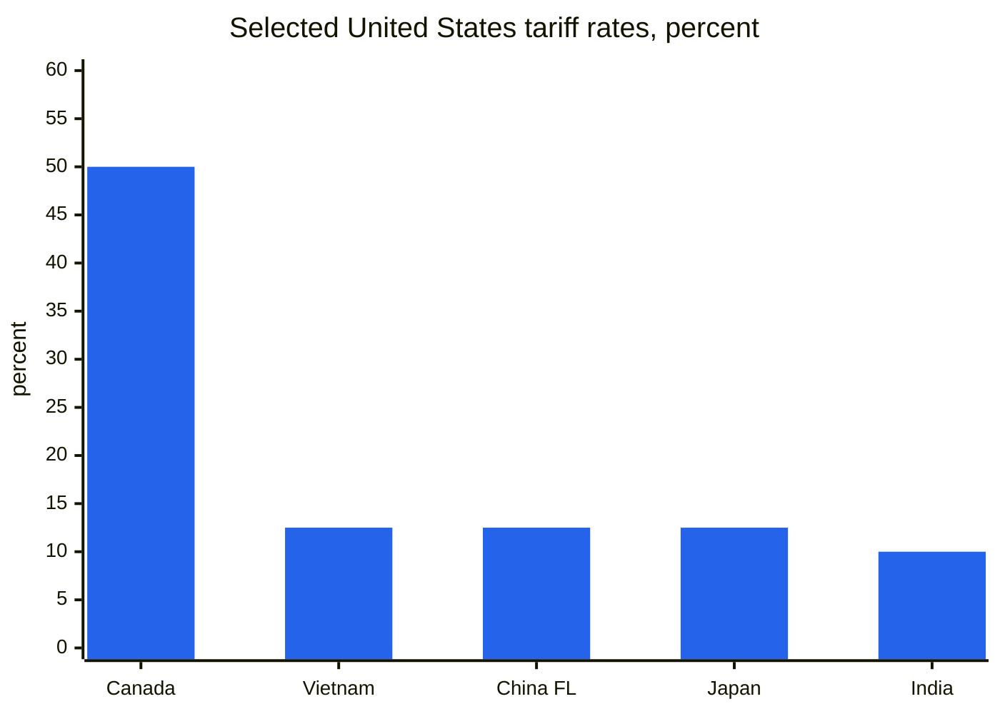

*Note: Canada = Section 338 rate (50%); Vietnam, China FL and Japan = Section 301 forced-labour rates (12.5%); India = Section 301 forced-labour rate in force (10%; the announced 18% deal rate was never applied). Sources: USTR, Liberty Justice Center, JD Supra.*

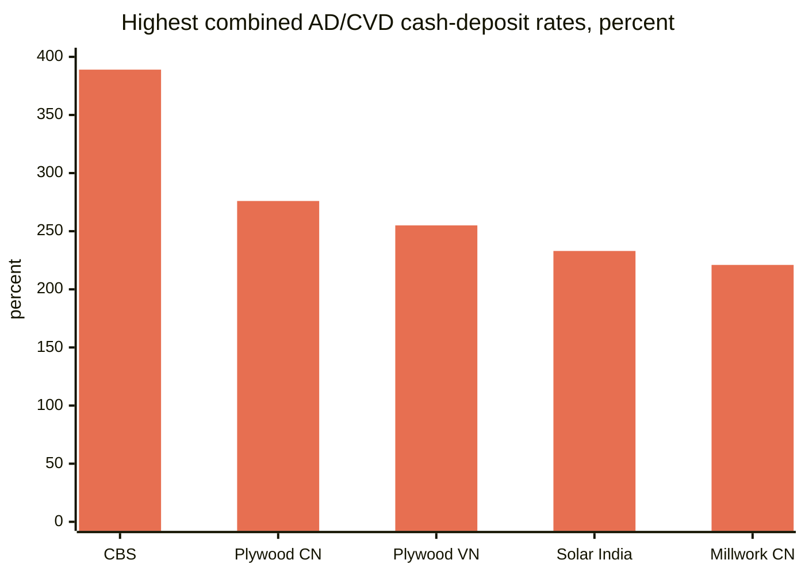

*Note: combined antidumping plus countervailing duty cash-deposit exposure. CBS rubber accelerator: AD deposit 281.69% + CVD 107.57% (preliminary); hardwood plywood China: AD 187.27% + CVD 88.96%; plywood Vietnam (Junma Phu Tho): AD 90.12% + CVD 165.39%; solar cells India: combined 233.26%; wood mouldings China-wide: AD 220.87% (CVD review separate). Sources: Commerce Federal Register notices, November 2026.*

---

## 5. US policy deep dive

### Section 301 — exclusions stand; the excess-capacity probe may land early

No change to the China Section 301 exclusions or the maritime-fee suspension in the window: the 178 exclusions and the fee suspension run through 11:59 p.m. ET on January 9, 2027, and no new USTR notice appeared. APEC produced no extension, and the next decision point is now the G20 in Miami on December 14–15. The Section 301 forced-labour duty (12.5% for China, Vietnam and Japan; 10% for India) remains in force; the Court of International Trade heard the challenge to the forced-labour tariffs (In re Section 301 Forced Labor Cases, Learning Resources as lead case) on September 30, and the three-judge panel has not ruled and no ruling date is set. On October 16 the government and plaintiffs filed briefs answering the panel's questions on which part of Section 301 USTR relied on and whether it had to consider economic development. Separately, CBP revised Chapter 99 reporting codes for the China Section 301 tariffs on October 22 (CSMS 70261629); importers may seek refunds on earlier entries of products USTR later excluded, via post-summary corrections. [JD Supra](https://www.jdsupra.com/legalnews/lower-tariffs-higher-gray-market-risk-6159993/)

The excess-capacity investigation is the week's open question. Ambassador Greer is reported to have said on November 21 that the investigation into structural excess capacity across 16 economies will conclude before the end of 2026, months ahead of the March 11, 2027 statutory deadline. He declined to specify preliminary tariff rates or country-specific penalty schedules. The investigation covers 21 sectors including automobiles, lithium-ion batteries, semiconductors, steel, aluminium, robotics, solar modules and precision machinery. If accurate, the timetable accelerates a decision that Indian officials have called the gating item for the India–United States deal and that South Korean officials have said is already more than two months behind their expected timetable. No findings, proposed action or product list has been published. The report is single-sourced; no USTR press release or Federal Register notice had appeared as of November 23. [East Asia Brief](https://eastasiabrief.com/trade-policy/ustr-accelerates-section-301-probe-hit-year-end-target-1636)

USTR's only trade-enforcement press releases in the window touched labour, not tariffs: on November 19 the United States asked Mexico to review an alleged denial of workers' rights at Polygroup Industrias México under the USMCA Rapid Response Labor Mechanism, and a second RRM request, concerning Industrias FG, was issued on November 13. Ambassador Greer gave virtual remarks for the Responsible Business Alliance annual conference on November 18 and wrote to the Wall Street Journal on November 16 on how tariffs are advancing Americans' long-term prosperity. [USTR](https://ustr.gov/about-us/policy-offices/press-office/press-releases)

### Section 232 — polysilicon due December 4; robotics still a negotiation

CBP activated four simulated, unofficial Chapter 99 classifications (9903.45.43, 9903.45.45, 9903.45.47, 9903.45.49) in the ACE Certification environment on November 12 for testing only, ahead of the Section 232 duties on polysilicon and derivatives. The minimum import prices test at $21/kg for polysilicon (HTSUS 2804.61.00), $100/kg for ingots and wafers, $0.22/watt for solar cells and $0.38/watt for solar modules; the duty equals the shortfall between entered value and the minimum import price, or a specific tariff equal to the minimum price, alongside a 15% ad valorem duty on derivatives (raw polysilicon itself is exempt from the 15% duty but subject to the price floor). For Japan, South Korea, Taiwan, Switzerland, Liechtenstein and EU members, the combined Section 232 duty plus Column 1 duty is capped at 15%. Production filing guidance with the official Chapter 99 headings is still to come before December 4. The measures apply broadly with no USMCA exemption. [HTS Hero](https://htshero.com/tariff-updates/2026)

Proclamation 11077 (robotics and industrial machinery, signed October 28, published November 2, 91 FR 69199) remains a threat finding with no new tariff, directing Commerce and USTR to negotiate and report within 180 days (about April 26, 2027). It is the third time in three months the administration has chosen negotiations over immediate tariffs after a Section 232 probe, after wind turbines and commercial aircraft. No in-window development was found. [Constilumen](https://www.constilumen.com/updates/proclamation-11077-robotics-industrial-machinery-section-232)

### CBP — Form 5106 deadline passes quietly; foreign-importer rule lands January 5

The November 18 deadline passed with no reported voidings (see A9). The underlying enforcement is live since September 18, 2026 under CBP's August 19 notice (91 FR 53627): importer numbers with inaccurate or incomplete Form 5106 data can be voided immediately, with no cure period described, and a voided number cannot be used to enter goods. Phone numbers and email addresses are the data elements most often missing or incorrect in ACE records, according to trade advisers. The November 18 letters were a targeted wave against CTPAT importers, not the start of the power. CBP deployed the Foreign Importer of Record Enhancement to the ACE Certification environment on November 12 (CSMS #70409426) and to Production on January 5, 2027; three new data fields were added to CBP Forms 3461 and 7501 (CSMS #70381183), and CBP says its validation checks may reject entries and entry summaries from January 5 where the requirements are unmet. Comments on the interim final rule are due January 5, 2027 (docket USCBP-2026-1387). [DutyStacks](https://dutystacks.beehiiv.com/p/issue-006-apec-ends-with-a-declaration-not-a-deal-the-lukoil-clock-moves)

CBP's newsroom carried only local releases in the window — a Del Rio Port of Entry seizure of outbound weapons, ammunition and drugs (November 19); cocaine worth over $390,000 seized at Roma Port of Entry (November 18); 440 pieces of counterfeit jewelry seized in Cincinnati on November 11 (reported November 18); and a temporary closure of the Alburg Springs, Vermont land port for construction (November 19). No national tariff or trade-policy release appeared. CSMS #70460453 (November 17) reminded importers that locomotives and other railroad equipment that do not qualify as instruments of international traffic must be entered and duties paid, including Section 232 duties under Proclamation 11021 on certain steel railcars and AD/CVD on freight rail couplers from China, the Czech Republic, India and Mexico. Guidance only; no new duties. [CBP](https://www.cbp.gov/newsroom)

### BIS export controls — remote-access rule, suppressors, and the Entity List freeze

The remote-access interim final rule is covered in A2 and section 3.2. Two further BIS items landed in the window. Certain silencers, mufflers and sound suppressors moved from the US Munitions List (USML Category I) to the Commerce Control List under new ECCNs 0A501.f (rifle, pistol and multi-host suppressors) and 0A502.f (shotgun-only suppressors), effective November 20 (rules published July 23, 2026, 91 FR 46252). ECCN 0A501.f is controlled for national security, regional stability, crime control, UN and anti-terrorism reasons; 0A502.f carries a new regional-stability control. Licence Exception LVS (up to $500) is available for both paragraphs where Canada is the ultimate destination. Suppressors specially designed for fully automatic firearms remain on the USML under ITAR. BIS estimated the change will generate about 200 additional export licence applications a year. [Thomson Reuters](https://www.thomsonreuters.com/en-us/help/onesource-global-trade/regulatory-insights/2026/october-29th/us-issues-interim-final-rule-silencers-mufflers)

The Affiliates Rule suspension runs through January 10, 2027 with no new BIS rule in the window, but the political dispute over its non-use intensified. Treasury Secretary Bessent said on November 13 that Treasury, Defense, State and USTR had all favoured putting Megaspeed International (a Singapore-based Nvidia customer reported to have bought more than $4.8 billion of advanced Nvidia chips over two years) on the Entity List for months, and that Commerce "has the pen". On November 15 he sharpened the pressure on Nvidia itself. Commerce denied the reported Situation Room exchange of November 5. The Financial Times reported on November 10 that Commerce has tried to slow new Entity List additions, and that the list has had no additions in 13 months (last addition October 9, 2025), with more than 100 candidates awaiting review-panel approval including Chinese AI lab DeepSeek. Commerce Secretary Howard Lutnick has agreed to testify before the Senate Banking Committee on December 10, 2026. Three House Democrats wrote to Lutnick on November 9 demanding written answers by December 1. Separately, Malaysian trade records cited by Bloomberg show Megaspeed imported at least 17,544 Nvidia GB300 processors worth about $787 million in November 2025, and an FBI-requested Indonesian police search of Megaspeed's local unit found empty GPU racks. Nvidia says it put Megaspeed on its internal block list in June 2025. [ExplainX](https://explainx.ai/blog/bessent-blames-commerce-megaspeed-entity-list-lutnick-ouster-talks-nvidia-huang-2026)

### Federal Register — AD/CVD activity in the window

The week's Federal Register trade activity was dominated by antidumping and countervailing duty notices, detailed in section 7: hardwood and decorative plywood orders (November 17), wood mouldings and millwork final review results (November 17), the USITC preliminary determination on corrugated die-cut cardboard boxes (November 17), and finished carbon steel flanges review preliminaries (November 16). No new withhold release orders, no new BIS rules beyond the remote-access rule, no new White House tariff proclamation and no new USTR Section 301 notice appeared in the window. The Federal Register was not swept document-by-document for the whole week, so further administrative-review notices may exist.

### Standing items

- **AGOA:** President Trump notified Congress and the governments of Rwanda and South Africa on November 2 of his intent to terminate their AGOA beneficiary status effective January 1, 2027, following the annual interagency eligibility review (public hearing July 23). AGOA was extended by legislation through December 31, 2028. To finalise the termination the President must issue a proclamation before January 1 removing both countries from the HTSUS list of AGOA beneficiaries; no such proclamation had been published as of November 23. South African exports would then face standard MFN duties instead of duty-free AGOA treatment. [USTR](https://ustr.gov/about/policy-offices/press-office/press-releases/2026/november/ambassador-greer-issues-statement-president-trumps-intent-terminate-rwanda-and-south-africa-agoa)
- **Post-midterm tariff outlook:** the November 3 election delivered a Democratic congressional majority taking office in January, but the election itself changes no duty rates; the remaining duties rest on Section 301 and Section 232 authority, and changing them would require executive action or veto-proof legislation. The sequence: IEEPA tariffs struck down February 20, 2026, collection ended February 24; a 10% Section 122 surcharge ran February 24–July 24, 2026 and lapsed after its 150-day statutory maximum without congressional extension; Section 301 tariffs covering 60 economies took effect July 24, 2026 at 10% or 12.5%. Manufacturers are advised not to assume current tariff protection will last. [JD Supra](https://www.jdsupra.com/legalnews/lower-tariffs-higher-gray-market-risk-6159993/)
- **White House:** no new tariff proclamation or fact sheet was identified in the window. The most recent relevant proclamation remains Proclamation 11077 (robotics and industrial machinery).

---
## 6. World policy by region

### Europe

**EU–Indonesia CEPA signed, November 21.** After nearly a decade of negotiations, the EU and Indonesia signed a Comprehensive Economic Partnership Agreement and a separate Investment Protection Agreement in Brussels. EU Trade Commissioner Maroš Šefčovič signed for the bloc; Commission President Ursula von der Leyen attended. The Council had approved signature on November 18. Indonesia will remove tariffs on 98.5% of tariff lines for EU goods once the provisions take full effect; the Commission says the deal will save EU exporters more than €600 million a year in customs duties, and 221 EU geographical indications receive protection. The European Parliament must still give consent and Indonesia must ratify; both sides aim for provisional application from early 2027. Von der Leyen said President Prabowo Subianto will visit Brussels on December 11. The signing closes almost ten years of talks and is the EU's second major Asian trade signing of the year, part of a diversification push as relations with the United States and China grow more difficult. For exporters, the practical point is that the agreement is signed, not in force; sourcing and pricing decisions should not assume the new rates yet. [Turkish Post](https://turkishpost.com.tr/en/2026/11/21/eu-indonesia-trade-deal/)

**EU–India FTA signing firmed to December 16, 2026.** The EU–India free trade agreement is now expected to be signed on December 16, 2026 in Brussels during Prime Minister Narendra Modi's visit, according to an Indian official cited by PTI and reported November 22. The Commission has submitted proposals to the Council seeking authorisation for signing and conclusion, along with the final legal text and tariff schedules. EU Ambassador to India Jean-Eric Paquet confirmed the mid-December timeline during a visit to Assam. Entry into force is expected in 2027, after European Parliament approval, Council conclusion and Indian ratification. Under the pact, 93% of Indian shipments would receive duty-free access to the EU, including zero tariffs on around $33 billion of labour-intensive exports. Negotiations concluded January 27, 2026. A separate investment protection agreement and an agreement on geographical indications remain under negotiation. [Asia Daily](https://asiadaily.org/news/19949/)

**EU €2 handling fee: first impact data — low-value parcels down over 60%.** The €2 Union handling fee per item line (Delegated Regulation (EU) 2026/2152) and mandatory Product Identifiers entered their third week. New detail confirmed this week: the Commission says low-value parcel volumes fell by more than 60% against the pre-duty trend in Q3 2026, as some sellers switched to shipping stock in bulk to EU warehouses. The Commission also reports 5.9 billion low-value e-commerce items were imported into the EU in 2025, four times the 2022 figure, with more than 90% coming from China. Both the €3 flat duty and the €2 fee form part of the taxable amount for VAT under the Commission's revised guidance of October 6, 2026. Italy's national €2 fee per consignment up to €150 was postponed to December 1, 2026, in addition to the EU charges. A Europe-wide inspection campaign found more than 60% of items checked did not comply with European standards. The first hard evidence on the EU's low-value import reset shows a sharp behavioural shift: parcel volumes fell by more than 60% against trend in the third quarter, before the €2 fee even took effect, as sellers moved stock into EU warehouses to avoid per-item charges. The fee is permanent, applies at any value, and is non-refundable even on returns, so it changes returns economics as well as landed cost. No official figures on revenue collected or clearance delays were published in the window. [Fashion Law Journal](https://fashionlawjournal.com/eu-small-parcel-tax/)

**EU hybrid-car safeguard.** See A4. The Commission opened the investigation on October 30; written submissions closed November 20; provisional measures are expected from December 1 with a reported 350,000-vehicle annual cap on Chinese-built hybrids. [Ports Europe](https://www.portseurope.com/eu-opens-hybrid-safeguard-probe-as-chinese-shipments-outrun-planned-quota/)

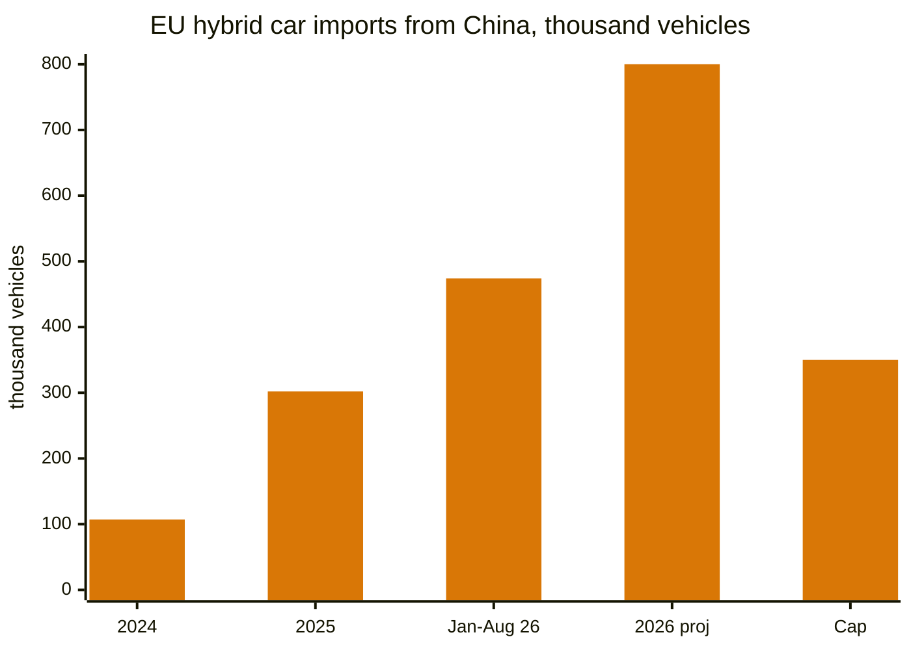

*Note: imports are Eurostat figures; 2026 projection is the Commission's estimate; the cap is the reported first-year safeguard cap of 350,000 vehicles. Source: Eurostat via Ports Europe; Commission.*

**EU–Australia FTA: signed in March, ratification uncertain; no new movement in window.** The EU–Australia FTA was concluded March 24, 2026 and signed in Canberra the same day, but it is not yet in force and cannot be implemented without parliamentary scrutiny and changes to Australian law, a process DFAT says could take up to two years. Germany's Ambassador to Australia said October 29–31 that ratification in Australia depends on Senate votes from the Coalition, Greens or crossbench, and expressed hope it could be completed in Q1 2027; the opposition National Party has vowed to oppose it and the Liberal Party has not declared a position. The EU has warned the deal will not be renegotiated if parliament rejects it. Entry into force is not expected before late 2027. 98% of Australia's exports by value would enter the EU duty-free; two-way trade exceeds A$109 billion a year. [AAP](https://aapnews.aap.com.au/news/claim-eu-trade-deal-mandates-methane-reducing-livestock-feed-is-baseless)

**EU–Canada digital trade agreement concluded October 30; text not yet public.** The EU and Canada concluded negotiations on a Digital Trade Agreement on October 30, 2026, complementing CETA (provisionally applied since 2017). The agreement sets rules for cross-border data flows, e-contracts, e-signatures and e-invoices, online consumer protection and unsolicited commercial messages. Negotiations were launched only in March 2026 at the fifth CETA Joint Committee meeting. The agreed text has not been published; legal scrubbing and translation into all EU languages come before signature. The speed of the negotiation — concluded within eight months of launch — reflects the political priority both sides attach to digital-trade rules as United States policy grows less predictable. Signature and entry into force remain a 2027 matter at the earliest. [European Commission](https://policy.trade.ec.europa.eu/news/eu-and-canada-conclude-negotiations-digital-trade-agreement-2026-10-30_en?prefLang=ga)

**UK–EU automotive rules of origin: ACEA and SMMT warn one in four EVs faces a 10% tariff from January 1, 2027.** ACEA and SMMT warned that stricter UK–EU Trade and Cooperation Agreement rules of origin for electric and hybrid vehicles, due to take effect January 1, 2027, would leave fewer than one in four battery-electric and plug-in hybrid vehicles traded between the two markets qualifying for tariff-free treatment, exposing the rest to a 10% tariff. The associations also warned the EU's proposed Industrial Accelerator Act could place tariffs on UK vehicles and components, threatening an automotive trading relationship worth US$87 billion a year. The EU still imports around two-thirds of its lithium-ion batteries despite about US$80.8 billion invested in EU battery supply chains since 2017. Germany's VDA argued in November for postponing the rules-of-origin change until the EU battery supply chain develops further. The November 20 summit did not produce a reported resolution on this point. [Manufacturing Digital](https://manufacturingdigital.com/news/acea-smmt-uk-eu-tariff-rules-threaten-auto-manufacturers)

### United Kingdom

**UK–EU summit, November 20: SPS agreement, ETS linking and mutual CBAM exemptions agreed.** See section 3.3. At the second UK–EU summit, the two sides agreed an SPS agreement (implementation March 1, 2028; the UK Government estimates it could increase economic output by up to £5.1 billion a year by 2040), linking the UK Emissions Trading Scheme with the EU Emissions Trading System (mutual CBAM exemptions targeted from January 1, 2028; about £6.5 billion of UK exports could benefit), and youth mobility measures. The UK will exempt goods originating in the EU, EEA and Switzerland from its CBAM from January 1, 2027. The agreements have not yet taken effect; further legal and implementation processes are required. [Thames Valley Chamber](https://www.thamesvalleychamber.co.uk/uk-eu-summit-2026-new-trade-agreements-reached/)

**UK CBAM scope to expand to refinery products; consultation launched at Budget 2026.** The Government intends to expand the UK Carbon Border Adjustment Mechanism to include refinery products, subject to consultation on feasibility and impacts. The consultation was launched at Budget 2026. No timeline was given; the Government said it intends to deliver the measure "as soon as is feasible" and will set out a timeline in due course. The UK CBAM as legislated starts January 1, 2027 for aluminium, cement, fertiliser, hydrogen and iron and steel. The expansion would widen the UK CBAM beyond its initial five sectors into refined petroleum products, but it remains at consultation stage with no date. It sits alongside the November 20 summit agreement, under which EU-origin goods will be exempt from the UK CBAM from January 1, 2027 — so the refinery-products expansion, if it proceeds, would in practice fall mainly on non-EU suppliers. [UK Parliament](https://questions-statements.parliament.uk/written-questions/detail/2026-10-28/39108)

**No new UK trade-remedies notices in the window; rainbow trout duty extension stands.** No new trade-remedies notice was found in the coverage window. The standing item: Trade Remedies Notice 2026/31 extended the countervailing duty on Turkish rainbow trout for five years to January 30, 2031, effective November 6, 2026, at existing rates (exporter-specific 1.5%–8%; all others 9.5%). The UK CBAM commencement on January 1, 2027 is now the nearest dated UK trade event.

### Canada

**Canada–China bilateral arrangement extended and expanded, November 17.** Canada and China extended and expanded the Preliminary Joint Arrangement on Addressing Bilateral Economic and Trade Issues. China will provide additional tariff relief for approximately C$400 million in Canadian exports — C$116 million in frozen pork cuts and C$285 million in fish and seafood (frozen cold-water shrimp and prawns including Pacific spot prawn C$87.5 million; molluscs including geoduck C$61.4 million; sea cucumber C$39.4 million; Greenland halibut C$96 million) — by suspending an additional 25% tariff on those products from January 1, 2027 through December 31, 2028. The expansion builds on the two-year extension of tariff relief for canola meal, peas, lobster and crab agreed earlier in November (ministerial talks November 4). In exchange, Canada extended by two years existing remission measures for certain Chinese steel and aluminium products due to expire at end-2026, and expanded remission coverage to an additional 32 steel and aluminium tariff items (23 steel, 9 aluminium) where Canadian supply is insufficient or unavailable. The C$400 million figure is the value of Canadian exports in those categories in 2024, before China's additional tariffs; it is not a payment or a guarantee of new business. The arrangement's new expiry date is December 31, 2028. The deal also revives a bilateral currency swap, per China Briefing's APEC summary. [Prime Minister of Canada](https://www.pm.gc.ca/en/news/news-releases/2026/11/17/prime-minister-carney-advances-canadas-strategic-partnership-china)

**Section 338 court challenge: oral argument set for January 20, 2027.** See section 3.7 and A9 in last week's report. Amicus briefs supporting the challenge to the Section 338 tariffs on Canadian goods were filed by former USTRs Carla Hills and Robert Zoellick, trade scholars and taxpayer advocates; the Liberty Justice Center announced the filings November 16. Oral argument is scheduled for January 20, 2027. The government's response brief is due December 11, 2026, with Gellert's reply due January 11, 2027. The case (Gellert Global Group Corp. v. Trump, Court No. 26-04636) challenges 50% duties on about $20 billion of Canadian imports; Gellert says it will pay roughly $40 million a year on Canadian cheese and has paid at least US$381,000 on entries made September 15–October 7, 2026. On October 28 the court granted Gellert's motion in part and denied it in part (the docket entry does not specify which parts). Proclamation 11076 rewrote the motor-vehicle product list again for goods entered from October 30, 2026. The tariffs remain in force. [Liberty Justice Center](https://libertyjusticecenter.org/pressrelease/former-u-s-trade-representatives-scholars-back-liberty-justice-centers-challenge-to-trumps-canadian-tariffs/)

**Canada's tariff-relief revenue picture: C$14.1 billion assessed, C$8.9 billion remitted.** From March 2025 through October 26, 2026, Canada assessed C$14.1 billion (about US$10 billion) in tariffs on United States products, but C$8.9 billion was remitted or relieved, leaving net revenue of C$5.2 billion. This quantifies how broad the remission programme is: most counter-tariffs have not actually produced revenue. The November 9 changes (horizontal remission extended to June 30, 2028; relief removed for certain trailers from December 1, 2026 and certain aluminium wire, extrusions and paperboard from February 1, 2027) stand as reported last week; no further changes in the window. [Mining Weekly](https://www.miningweekly.com/article/canada-expands-us-tariff-exemptions-cuts-some-aluminium-relief-2026-11-10)

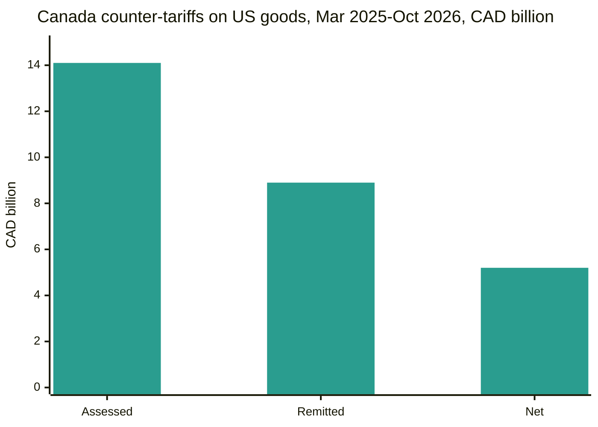

*Note: assessed tariffs on United States products March 2025 to October 26, 2026; remitted or relieved under the remission programme; net revenue. Source: Government of Canada disclosure via Mining Weekly, November 10, 2026.*

**Canada questions India at the WTO over rice stocks diverted to ethanol.** Canada raised formal questions at the WTO on November 14 regarding India's allocation of state-held rice stocks to ethanol manufacturers, requesting details on the volume of public grain diverted into domestic fuel-alcohol distillation. This follows the pattern of agriculture-committee scrutiny of India's domestic support (see Multilateral). No Indian response was reported in the window. [Distillers Hub](https://distillershub.com/news/111420315/)

### China

**Dual-use export controls on drones, tunnel-boring machines and dredgers took effect November 18.** Announcements No. 49 (drones), No. 50 (tunnel-boring machines and related equipment) and No. 51 (dredgers) took effect November 18, 2026, revising the Dual-Use Items Export Control List. Licences are required for drone autopilots, drones capable of beyond-line-of-sight flight with endurance of at least three hours, engines specially designed for drones, and drones with a range of 300 km or more or equipped for aerosol dispersal above 80 litres. Announcement No. 49 raises the endurance threshold for controlled drones from one hour to three hours, so mass-market drones below that threshold no longer need licences, while controls extend to more drone parts. Announcement No. 50 imposes controls on tunnel-boring machines for the first time, plus specified walking excavators and high-altitude shotcrete machines; exports to sensitive destinations require licences, other destinations may use registration-based certificates, subject to onward-transfer restrictions. Announcement No. 51 adds licensing for specified dredge pumps, dragheads and cutterheads. A re-export rule also applies from November 18: foreign companies need a Chinese licence to pass Chinese-origin construction machinery such as tunnel-boring machines on to certain countries. Separately, MOFCOM and GAC Announcement No. 52 (October 19) revised procedures under which customs may hold goods presented for export without a licence. The controls are now live, and their design is two-sided: thresholds were raised so ordinary commercial drones fall outside the regime, while the net widened to tunnel-boring machines — a first — and to re-exports of Chinese-origin machinery by foreign companies. That re-export rule is the sharpest edge for third-country buyers and resellers, since it reaches transactions with no Chinese exporter. [Mondaq](https://alpha.mondaq.com/china/new-technology/1870494/new-chinese-export-control-measures-tighten-restrictions-on-the-export-of-advanced-technologies-and-dual-use-goods-strengthen-enforcement)

**Technology export catalogue: comments closed November 15; interim registration now the operative regime.** Public comments on Announcement No. 48 (October 16), which would add 40 technologies to the Catalogue of Technologies Prohibited or Restricted from Export (23 AI, 5 biopharmaceuticals, 12 photovoltaics; 14 prohibited, 26 restricted), closed November 15. No final catalogue had been published as of November 23. What is operative now is the interim pre-export registration requirement in force since October 16, which covers exports of the listed technologies including transactions already under way and transfers of ownership or control of a domestic enterprise holding the technologies to an overseas entity. New analysis this week clarified scope: in biopharma, transfers of ownership of cell and gene therapy and siRNA platforms would be prohibited, but licensing, CRO/CDMO services and technology necessary for product R&D or manufacture in an outbound business-development transaction would not be; in AI, overseas local deployment of a restricted model counts as a technology export, while API access, app or web interaction, SaaS and lightweight on-device deployment are outside the scope. Restricted-technology export review takes up to about 45 working days in two stages. MOFCOM also opened a consultation on draft Measures for Dual-Use Export-Control Investigations and Enforcement, with comments due November 29, 2026. The solar provisions remain the most consequential for foreign manufacturers, covering polysilicon production, wafers 70 micrometres or thinner, and perovskite and tandem cell fabrication. [Jones Day](https://www.jonesday.com/en/insights/2026/11/china-tightens-its-grip-on-exports-of-strategic-technologies-what-it-means-for-technology-deals-involving-ai-and-biotech)

**MOFCOM English site reachable; front page shows November 12 press conference only.** The English-language site was reachable on November 23. Front-page content was limited to the November 12 regular press conference (including remarks on the November 6 He Lifeng video call with Bessent and Greer, and on the China–EU medical-devices match-making event at the CIIE) and Gazette issues. No new announcements on the technology catalogue or the gallium suspension were visible on the front page. MOFCOM's English portal remains a thin source — headlines only, with substantive announcements appearing first in Chinese. The November 12 press conference confirmed eight rounds of China–United States economic and trade consultations since May 2025. The gallium-related suspension (Announcement No. 72 of 2025) lapses November 27, 2026 and no amending notice had been found as of November 23. [MOFCOM](https://english.mofcom.gov.cn/)

**China–United States: no tariff outcome from APEC; truce still runs to January 9–10, 2027.** See A1 and section 3.1. The Xi–Trump bilateral on November 19 produced no tariff relief announcement and no rare-earth outcome; reporting describes a stalemate on tariffs, rare earths and semiconductors. Trump pressed China to fulfil a pledge to buy US$17 billion in United States agricultural products; Chinese officials said the pledge is conditional on reciprocal tariff reductions. The two leaders agreed to draft an action plan for United States–China "strategic stability". The proposed $30 billion-for-$30 billion and $60 billion reciprocal tariff-cut packages remain unfinalised. [China Briefing](https://www.china-briefing.com/news/apec-2026-in-shenzhen-what-the-leaders-meeting-and-trump-xi-talks-mean-for-business/)

### India

**India–United States deal still unsigned; Commerce Secretary says signing must wait for the United States tariff framework.** See section 3.7. Commerce Secretary Rajesh Agrawal said November 18 the proposed India–United States trade deal cannot be signed until Washington puts a new tariff architecture in place following the Supreme Court's dismantling of reciprocal and emergency tariffs, because the comparative advantages offered to different countries need to be clear. The outcome of ongoing Section 301 investigations — including the excess-capacity probe, whose findings are expected in a few weeks or months — also needs to be known, since every country would want certainty on those probes. The legal agreement has been negotiated and is in final stages; both sides want to conclude as quickly as possible. Jaishankar said November 14 the deal is in its "last stretch" and the bulk of issues are sorted. The February 7, 2026 framework set an 18% United States rate, never applied; Indian goods currently pay a 10% Section 301 rate. [The Hindu BusinessLine](https://www.thehindubusinessline.com/economy/no-india-us-trade-deal-until-new-us-tariff-framework-section-301-probes/article71716562.ece/amp/)

**India–EU: signing December 16; dairy and GM red lines restated.** No change to the red lines reported last week: India has never opened its dairy sector in any FTA and will not allow imports of genetically modified products. The EU–India signing is now dated December 16 (see Europe). The red lines are stable and relevant to every live Indian FTA track, including the unsigned United States deal, where agriculture and dairy are among the unresolved sensitivities.

### Asia-Pacific

**APEC Shenzhen: leaders adopt the Shenzhen Outlook; no tariff deal; side deals for Canada, Chile, Philippines, Peru, Indonesia.** See sections 3.1 and 3.7. Side deals: China–Canada tariff relief (see Canada); Philippines–Chile Comprehensive Economic Partnership Agreement signed November 19 — the Philippines' first FTA with a Latin American country, preferential access for 8,632 product categories, duty-free treatment for virtually all existing Philippine shipments to Chile (electronics, machinery, desiccated coconut, carrageenan, processed tuna); Peru–Thailand FTA signed November 19; China–Chile economic and trade roadmap and MOU on free trade and multilateralism; China–Indonesia announced November 20 the launch of CEPA negotiations. The Philippines also expressed interest in joining CPTPP and said its Philippines–Canada FTA negotiations are concluded. [BusinessMirror](https://businessmirror.com.ph/2026/11/20/new-trade-deal-opens-chile-market-for-phl/)

**Pax Silica: San Francisco Declaration signed November 15 by the United States and eight partners.** The United States and eight partners signed the San Francisco Declaration on the Secure Foundations of Enduring Prosperity under the Pax Silica framework, agreeing to develop a shared list of sensitive technologies and critical supply chains needing stronger protection, exchange information on vulnerabilities, and organise working groups. The declaration covers semiconductors, AI infrastructure, critical minerals, energy, advanced manufacturing, transport logistics and communications networks, and takes aim at non-market practices, overcapacity and unfair dumping. It is non-binding: no funding commitment, no named companies, no implementation deadline, and the shared list itself has not been written or published. Pax Silica, launched December 2025, now has about 26 participants. EU members did not attend the Founders Retreat but are reviewing the document for "regulatory compatibility"; Germany, Sweden, the Netherlands and the European Commission are expected to sign shortly. The declaration moves Pax Silica from a broad partnership statement toward concrete security coordination — the homework is a joint list of technologies and infrastructure to protect — but the deliverable does not yet exist, so its trade effect is prospective. Watch whether the EU members sign and whether the shared list, when drafted, produces export-control or investment-screening consequences. [Asia Daily](https://asiadaily.org/news/18839/)

**Philippines secures US$41.1 billion in investment pledges at APEC; CPTPP interest stated.** President Marcos returned from Shenzhen with investment pledges worth US$41.1 billion spanning manufacturing, electric vehicles and clean-energy technology, with potential for more than 7,000 jobs. The most concrete pledge is C&U Group's US$87 million for a 20-hectare facility in Alitagtag, Batangas. The Philippines also expressed interest in joining CPTPP during a meeting with Mexican President Claudia Sheinbaum, and noted its concluded Philippines–Canada FTA negotiations and the signed Philippines–Chile CEPA. Philippine exports grew 15.4% in 2025 with continued monthly increases January–September 2026. Pledges are not capital expenditure, and the US$41.1 billion headline should be read as an intent signal rather than committed investment; the C&U facility is the only itemised commitment. [Further Asia](https://furtherasia.com/philippines-gets-us41-1b-investment-pledges-after-apec/)

**Korea–Brazil cosmetics tariff: no new development in the window.** The file remains at the presidential-prompt stage with no reported negotiation outcome. Last week's item stands: President Lee pressed at a November 3 cabinet meeting for fast talks on Brazil's 25% tariff on Korean cosmetics, after Lula's re-election on October 25. Korean cosmetics exports reached US$12.4 billion in the first ten months of 2026, up 27.3% year on year. [Seoul Economic Daily](https://en.sedaily.com/politics/2026/11/03/lee-presses-brazil-to-cut-25-percent-tariff-on-korean)

### Multilateral

**WTO reform track: United States challenges China, rejects agriculture in the "level playing field" track; no MC15 package without agriculture, Brazil warns.** At a marathon meeting on November 16 on the WTO reform track's "level playing field" issues, the United States said it remains concerned about an "unsustainable" bilateral trade relationship with China, alleging Beijing does not play by the rules, and suggested the asymmetry — a trade deficit described as likely US$1 trillion a year — had become too great to be addressed under existing WTO rules. Washington also conveyed that non-discrimination, including MFN treatment, could not be applied in the face of continuing asymmetries. The United States, alongside the farm-defensive G10 countries led by Norway, Japan and Switzerland, opposed including agriculture in the level-playing-field discussions, insisting agriculture belongs only in the Committee on Agriculture in Special Session. Several countries supported China's proposals on the level playing field, including multilateral discussions on industrial policy and industrial subsidies; the EU indicated approval of China's proposal, and China said it would accept OECD work on state intervention and subsidies. Brazil warned there would be no WTO reform package for adoption at MC15 (scheduled 2028) without agriculture in the level-playing-field track. New Zealand signalled it may table a document on agriculture. The reform track is now openly split on two axes: whether agriculture belongs in the level-playing-field discussion, and whether the United States–China asymmetry can be handled inside WTO rules at all. The United States position — that MFN cannot apply amid continuing asymmetries — is a direct challenge to a core WTO principle. The November 16 meeting produced no agreement. The next Committee on Agriculture special session is scheduled November 23, 2026, covering export restrictions and the special safeguard mechanism. [Third World Network](https://www.twn.my/title2/wto.info/2026/ti261112.htm)

**WTO agriculture: India sugar subsidies near US$18 billion alleged; Canada questions rice-for-ethanol.** A report submitted to the WTO claims India provided nearly US$18 billion in sugar subsidies last year, exceeding WTO limits — a follow-up to Australia's September 9 counter-notification alleging India failed to notify domestic support for sugar, cotton and pulses. The December 2021 panel in India — Sugar and Sugarcane found India's sugar support inconsistent with WTO obligations. Separately, Canada raised formal questions (see Canada) about India's allocation of state-held rice stocks to ethanol manufacturers. The Committee on Agriculture in special session meets November 23, 2026, covering export restrictions and the special safeguard mechanism. Agriculture remains the WTO's most contested file, with India at the centre of three parallel scrutinies — sugar, rice-for-ethanol and the earlier cotton/pulses notification gaps. The US$18 billion figure is an allegation in a submitted report, not a WTO finding, and should be treated as such. [RFD-TV](https://www.rfdtv.com/indian-sugar-subsidies-draw-scrutiny-over-unfair-trade-practices)

**WTO DS644 (China v. India): panel in place since June; merits undecided.** Correction to last week's report, which stated the WTO "agreed to establish" a panel in DS644 on November 16. The public record shows the Dispute Settlement Body established the panel on June 23, 2026 and composed it on October 7, 2026. China requested consultations December 19, 2025; the panel was requested May 11, 2026; establishment was deferred May 22 (India blocked the first request). The dispute covers India's tariff treatment of certain technology products and incentive measures in its Solar Module Programme alleged to favour domestic over imported goods. No panel report, findings or remedy have been published. No new development in the window. The dispute is in formal adjudication with a composed panel, but nothing has been decided and India has changed no tariff line or programme rule as a result. [WTO](https://www.wto.org/english/news_e/news26_e/dsb_23jun26_426_e.htm)

**UNCTAD Trade and Development Report 2026: global growth slowing to 2.6%; United States–China trade down over 20% since 2024.** UNCTAD's Trade and Development Report 2026, published November 17, projects global growth slowing to 2.6% in 2026 from 2.9% in 2025, with developing economies at 4% (down from 4.7%). Trade in goods and services is expected to grow about 4% at constant prices; global trade reached a record US$35 trillion in 2025. Asia contributes 59% of global growth in 2026 (India 7.3%, China 4.5%, Indonesia 5.2%). Trade between China and the United States has fallen by more than 20% since 2024, while East Asia has expanded trade with both. The slowdown is linked to the Middle East conflict, which pushed Brent crude from US$70 to over US$110 a barrel; capital-flow volatility has doubled since the conflict began; official development assistance is projected to fall almost 7% in 2026, its third consecutive annual decline. UNCTAD's headline is fragmentation with Asian resilience: the world's two largest economies have cut bilateral trade by over a fifth since 2024, yet global trade still hit a record US$35 trillion in 2025 and Asia generates most of 2026's growth. Note the growth figures are UNCTAD's own and are not directly comparable with IMF figures. This is a new release in the window, distinct from the November 9 Global Trade Update covered last week. [UNCTAD](https://unctad.org/publication/global-trade-update-november-2026)

**WCO: Andorra becomes 141st party to the Revised Kyoto Convention, November 18.** The Principality of Andorra acceded to the Revised Kyoto Convention as the 141st Contracting Party. Other WCO November items were already covered last week (disaster-relief symposium November 3; 2025–2026 Annual Report November 5; Smart Customs event November 9; counterfeits-in-e-commerce symposium November 11; EAC rules-of-origin support November 12; WOAH meeting November 13). No further WCO news was published November 16–23 beyond the Andorra accession. A small but structural item: the Revised Kyoto Convention — the WCO's core trade-facilitation instrument — gains its 141st party. [WCO](https://www.wcoomd.org/en/media/newsroom/2026.aspx)

**ITC–Afreximbank Africa–Caribbean trade report: no new item.** No new ITC item was found in the November 16–23 window. The November 3 report stands: annual Africa–Caribbean trade in goods and services could reach up to US$1.65 billion by 2030, excluding mineral fuels; about 80% of Africa's annual goods export potential to the Caribbean remains untapped; Caribbean export potential lies mainly in services at US$481 million. One note from coverage this week: a July 2025 ITC–Afreximbank projection put the same corridor at US$2.1 billion by 2030, so the new figure is about 21% lower — though the two figures may not be directly comparable, as the earlier one may have included mineral fuels and the new one excludes them, and the baseline (US$729 million) is goods only while the projection covers goods and services. The report should not be presented as a downgrade without that qualification. [Central Charts](https://www.centralcharts.com/en/news/5841368-africa-and-caribbean-trade-potential-could-reach-1-65-billion-annually-by-2030-international-trade-centre-itc-afreximbank-report)

---
## 7. Enforcement actions

### Antidumping and countervailing duties

**Hardwood and decorative plywood — AD/CVD orders on China, Indonesia, Vietnam (November 17).** See A8. Commerce issued antidumping and countervailing duty orders (cases A-570-211, A-560-844, A-552-851; C-570-212, C-560-845, C-552-852). CBP will keep suspending liquidation and require cash deposits. The orders cover flat, multilayered plywood or other veneered panels of two or more plies with a hardwood, softwood or bamboo face or back veneer, including trimmed and cut-to-size panels. The orders close a proceeding that began with petitions in 2025 and follow affirmative final determinations by both agencies. Plywood is a high-volume building-materials import, and the China combined rate near 276% effectively prices Chinese hardwood plywood out of the United States market, pushing buyers toward Indonesian and Vietnamese suppliers — whose own rates vary widely (15% to 165%), rewarding supplier selection. [Factbox](https://factbox.net/s/commerce-imposes-plywood-antidumping-and-countervailing-duties-on-china-indonesia-vietnam)

**Finished carbon steel flanges from India — AD/CVD administrative review preliminary results (November 16).** Commerce published preliminary results of the AD/CVD administrative reviews of finished carbon steel flanges from India, covering the 2024–25 period (AD notice FR Doc. 2026-23278, 91 FR 73546; CVD notice FR Doc. 2026-23270, 91 FR 73519). AD preliminary margins (period of review August 1, 2024–July 31, 2025): R. N. Gupta & Co. 7.15%; Norma Group 0.00%; 15 non-selected companies 7.15%. Review rescinded for 27 companies with no reviewable suspended entries. All-others cash deposit continues at 8.91%. CVD preliminary rates (period of review calendar 2024): Norma 2.23%; RNG 2.28%; non-selected 2.26%. Review rescinded for 28 companies. CVD all-others cash deposit continues at 7.39%. Current cash deposits unchanged until final results (due within 120 days of publication unless extended). Deadlines were tolled 47 and 21 days for the federal government shutdown. Routine review results, but they show the AD/CVD system grinding on through the shutdown backlog, and the low rates confirm that the 2017 flange orders now impose only modest costs on the reviewed Indian exporters — a contrast with the triple-digit rates in the new plywood and solar orders. [Drawback AI](https://www.drawbackai.com/library/finished-carbon-steel-flanges-india-ad-cvd-review-prelims-2024-2025)

**Corrugated die-cut cardboard boxes — USITC affirmative preliminary determinations (filed November 13; published November 17).** The Commission determined there is a reasonable indication that a United States industry is materially injured by reason of imports of corrugated die-cut cardboard boxes from China, Malaysia and Turkey (HTSUS subheading 4819.10.00), alleged sold at less than fair value and, for Turkey, subsidised (Investigation Nos. 701-TA-806 and 731-TA-1805–1807, Preliminary; FR Doc. 2026-23401). Petitions were filed September 9, 2026 by the American Pizza Boxes Manufacturers Coalition (Smurfit Westrock and Pratt Industries) and the United Steelworkers union. The Commission completed and filed its determinations November 13, 2026; the final phase of the investigations has commenced. The case now moves to Commerce for preliminary dumping and subsidy determinations; if affirmative, cash deposits could begin in early 2027. No duty rates exist yet. A small product, but the petitioner profile (two large United States packaging producers plus the Steelworkers) and the three-country scope show the AD/CVD pipeline reaching further into everyday packaging and food-service goods. [govinfo](https://www.govinfo.gov/content/pkg/FR-2026-11-17/html/2026-23401.htm)

**New AD/CVD petitions — certain plastic balloons from China (filed November 18).** United States producers filed AD/CVD petitions on certain plastic balloons from China on November 18. Alleged dumping margins 50% to 276%; alleged subsidies above the de minimis level (no numerical CVD rate proposed). Scope: certain plastic balloons of non-textile plastic film or sheet, maximum single body dimension not exceeding 20 feet uninflated. Estimated Commerce preliminary CVD determination February 11, 2027; preliminary AD determination April 27, 2027 (estimates, subject to extension). No duty or cash-deposit rates have been calculated; the figures are allegations only. The USITC must first decide whether there is a reasonable indication of material injury; a negative finding would end the investigations. The second new petition in the window, and the alleged margins (up to 276%) are at the top of the range seen this year. Balloon imports are a small trade flow, but the petitions add to the pattern of AD/CVD actions reaching low-value consumer goods. [JD Supra](https://www.jdsupra.com/legalnews/new-trade-petitions-target-certain-4267033/)

**CBS rubber accelerator from China — preliminary AD determination (published November 6; catch-up item).** This item was published November 6, just before last week's window, and was not covered in last week's report. Commerce preliminarily found that CBS (N-cyclohexylbenzothiazole-2-sulfenamide, a rubber vulcanization accelerator also sold as Accelerator CZ) from China is sold in the United States at less than fair value, at a margin of nearly 286% (AD preliminary determination published November 6, 2026, 91 FR 70053; CVD preliminary determination published October 8, 2026, 91 FR 64337). Preliminary AD margin 285.94% and cash-deposit rate 281.69% (after subsidy offset) for the China-wide entity, based on facts available with adverse inferences. Preliminary CVD rate 107.57%. Combined cash deposits about 389% of entered value. Critical circumstances found in both cases, so deposits can reach back 90 days before each notice (about August 8, 2026 for AD; about July 10, 2026 for CVD). Final Commerce determinations due around January 11–12, 2027. Petitioner: LANXESS Corporation (petitions filed May 7, 2026). The CBS case is the most extreme rate in the current AD/CVD pipeline and a direct cost shock for United States tyre and rubber-goods manufacturers, who use CBS as a curing accelerator. [OneFirm Intel](https://onefirmintel.com/blog/cbs-rubber-accelerator-duties-china)

**Solar IV — USITC Publication 5804 published (available by November 11).** The USITC's full report on the solar AD/CVD cases was published ahead of its November 23 target date, closing the documentation loop on the November 9 Commerce orders (combined cash-deposit rates up to 233.26% for India, 268.06% for one Indonesian producer, 219.43% for one Laotian producer). Publication 5804 (November 2026), "Crystalline Silicon Photovoltaic Cells, Whether or Not Assembled Into Modules, from India, Indonesia, and Laos," Investigation Nos. 701-TA-772–774 and 731-TA-1756–1758 (Final). The Commission completed and filed its affirmative injury determinations November 2, 2026; the Federal Register notice appeared November 5 (91 FR 69865). Critical circumstances: the Commission found imports from India and Laos are not likely to undermine seriously the remedial effect of the orders, but imports from Indonesia are likely to do so — hence retroactive CVD exposure for Indonesia only (entries on or after November 28, 2025). Publication 5804 is the document importers, customs brokers and solar buyers will cite for scope and retroactivity questions through 2027. The Indonesia-only retroactivity creates a three-way split in landed-cost exposure that did not exist under the earlier solar cases. [USITC](https://www.usitc.gov/secretary/fed_reg_notices/701_731/701_772_notice11022026sgl.pdf)

**Wood mouldings and millwork from China — final AD review results (November 17).** Commerce published final results in the antidumping administrative review of wood mouldings and millwork products from China (period February 1, 2024 – January 31, 2025; FR Doc. 2026-23402). Fujian Hongjia Craft Products and Nanping Huatai Wood & Bamboo withdrew from verification, so Commerce applied adverse facts available, found their data unverifiable, denied them separate rates and placed them in the China-wide entity. The China-wide antidumping rate is 220.87%; separate-rate exporters Bel Trade Wood Industrial and Tim Feng Manufacturing were assigned 37.24%. Cash deposits apply to entries on or after November 17, 2026 at those rates. This is the antidumping companion to the countervailing duty review results published November 12 (CVD 147.88% for Nanping Huatai, Fujian Yinfeng and Fujian Hongjia; 21.39% for non-selected companies), already covered last week. Commerce will issue assessment instructions no earlier than 35 days after publication. The gap between the 37.24% separate rate and the 220.87% China-wide rate is a further illustration of the cost of non-cooperation in reviews. [PolicyRisk](https://policyrisk.com/federal-register/2026-23402)

### CBP seizures and forced labour

**Nogales, Arizona (November 11 seizure; CBP release November 19).** CBP officers at Nogales seized a second large fentanyl load in as many weeks — more than 136 pounds of narcotics seized at the Port of Nogales DeConcini crossing during a vehicle inspection November 11, 2026: more than 92 pounds of fentanyl pills and more than 44 pounds of methamphetamine, in more than 80 concealed packages. A 25-year-old United States citizen in a 2020 Honda Civic was referred for secondary inspection; nonintrusive inspection found anomalies and a canine team alerted. The narcotics and vehicle were seized; the subject was taken into custody by the FBI and federal prosecution was accepted. It follows the November 3 seizure of more than 112 pounds of fentanyl concealed in plastic folding chairs in a pickup truck (CBP release November 10), which was covered in last week's report. Two major fentanyl seizures at the same crossing within eight days underline the scale of narcotics movement through Nogales and the enforcement load on CBP's secondary-inspection capacity. [CBP](https://www.cbp.gov/newsroom/national-media-release/port-nogales-cbp-officers-and-homeland-security-task-force-partners)

**Withhold Release Orders — none in the window.** No new Withhold Release Order was identified in the November 16–23 window. The most recent WROs remain the Indonesian palm-oil orders of September 29, 2026 (Mitra Aneka Rezeki and Hardaya Inti Plantation), the Serbia Zijin Copper order of June 16, 2026, and the Linglong tyre order (Serbia). CBP's active WRO count stands at 60, with eight Findings under 19 U.S.C. § 1307 (per Thompson Hine, October 1, 2026). [Thompson Hine](https://www.thompsonhine.com/insights/cbp-issues-withhold-release-orders-on-two-indonesian-palm-oil-producers/)

### Sanctions

**OFAC designations (November 13, November 18, November 19).** OFAC's November actions continued at a steady pace. On November 13 (published November 18) OFAC designated the Los Huistas drug trafficking organization (Guatemala, linked to the Sinaloa Cartel and CJNG) under E.O. 14059 and E.O. 13224. On November 18 six parties were designated under E.O. 13224 for Hizballah financing — the Lebanese charity Wa Ta'awanu Association and its founder Afif Abdel Rida Chouman, plus a gold and cash smuggling network (money changer Hassan Khechen, his brother Ibrahim, Gold Global Company in Sidon, and Istanbul gold wholesaler Sankari Gold). Every entry carries a secondary-sanctions warning. On November 19 two sets of designations: (i) counter-narcotics (E.O. 14059): the Australia-headquartered Comanchero Outlaw Motorcycle Gang and its leadership (Alexandre Varela Villar, "Alex Vare," World Commander, based in Spain; Allan Meehan, World President; others in New Zealand), and the Toronto leadership of the 'Ndrangheta (Angelo Figliomeni, the Camera di Controllo, Luigi Vescio Sr. and family businesses including Ontario funeral homes and a limousine company); (ii) cyber scam centres (E.O. 13694): Cambodian operator Zhao Hui, his companies Bei Fang Bo Lin Construction Decoration Co. and ZHZ Investment Consulting Co., and two Democratic Karen Benevolent Army commanders (Saw Shwe Wah, Saw A One) overseeing security at scam compounds in Burma. In total 24 designations on November 19, plus 1 removal and 5 amendments. One Tron wallet address was published (Alex Vare's, `TVwLtgUXyDhmcSoQ9x2z9QSua41f8mDFvU`). The gold-network designations put bullion dealers and banks in Lebanon and Türkiye on secondary-sanctions notice, with direct trade-finance implications. The scam-compound actions target a fraud pipeline that moves money through crypto and regional banks, and the single published wallet address gives compliance teams a concrete screening hit. The November 19 action (24 designations) was the largest single OFAC action of the window. [Justia](https://regulations.justia.com/regulations/fedreg/2026/11/18/2026-23456.html)

**EU lists 49 Russian-related parties (November 17).** The EU added 49 Russian-related parties to its sanctions lists on November 17, as part of a day that saw 126 designations across the monitored authorities. This is a routine continuation of the EU's Russia sanctions programme rather than a new package. EU Russia listings continue to accumulate, and each round adds screening burden for traders with Russian exposure; the absence of a headline package this week suggests incremental rather than escalatory action. The count is as reported by the Youverify monitor, not verified against the EU list itself. [Youverify](https://youverify.co/en/sanctions)

---

## 8. Data releases

### Japan — full-month October 2026 trade (released November 18)

See section 3.6. Exports ¥11.7688 trillion (up 20.5% year on year), a single-month record and the 14th consecutive monthly increase; imports ¥12.2453 trillion (up 21.6% year on year), also a single-month record; trade balance a deficit of ¥476.5 billion (approximately $3.0 billion), the sixth consecutive monthly deficit, narrower than September's revised ¥556.5 billion deficit and roughly half the approximately ¥1 trillion deficit analysts had expected. Seasonally adjusted deficit ¥767.2 billion. Export volume index up 5.8% year on year; import volume index down 0.2% year on year. [Action Forex](https://www.actionforex.com/live-comments/661239-japan-trade-deficit-narrows-as-chip-exports-surge-but-oil-costs-stay-high/)

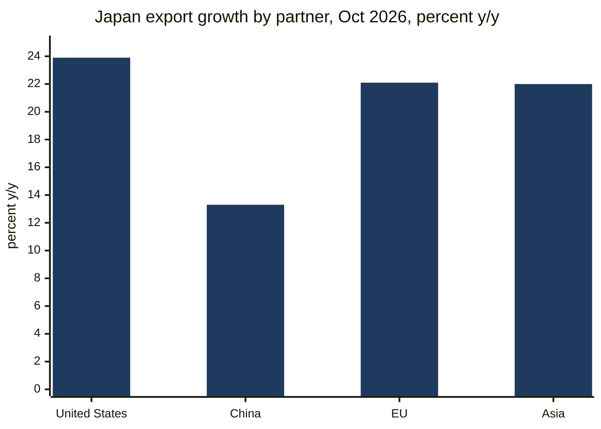

*Note: export values by destination, October 2026, year on year. United States: autos up 37.2%, semiconductor manufacturing equipment up 118.5%. China: autos down 53.3%, semiconductor manufacturing equipment up 42.6%. Source: Japan Ministry of Finance preliminary Trade Statistics, October 2026.*

### Euro area — September 2026 current account (ECB, released November 19)

The ECB's September balance-of-payments release put the euro area current account surplus at €12 billion, little changed from the prior month. The goods surplus on a balance-of-payments basis was €14 billion — a different measure from Eurostat's customs-basis September goods deficit of €10.3 billion reported November 13, and the two should not be compared directly. Services surplus €16 billion; secondary income deficit €16 billion; primary income deficit €1 billion. The current-account reading is the cleaner gauge of the euro area's external position once services and income flows are included, and it shows the bloc still in surplus overall despite the customs-basis goods deficit. The gap between the two goods measures is a standing source of confusion in trade commentary and worth noting when the December goods release lands. The next monthly balance-of-payments release is due December 18 and will cover October; the quarterly release follows January 12. [QNC News](https://qncnews.com/2026/11/23/euro-area-current-account-surplus-holds-at-12-billion-euros-in-september/)

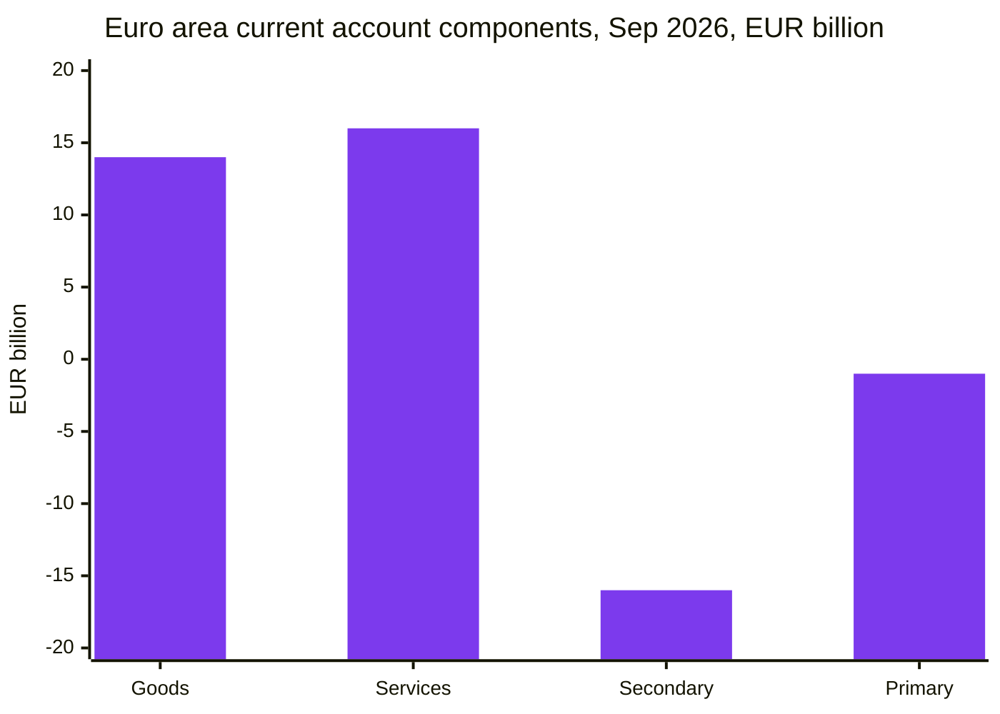

*Note: balance-of-payments basis, September 2026. Current account surplus €12 billion. Source: European Central Bank.*

### Germany — cross-border electricity trade, first three quarters of 2026 (Destatis, press release No. 406, November 20)

Destatis reported that German cross-border electricity trade moved close to physical balance over the first nine months of 2026, with exports surging and import volumes falling. Germany exported 48.8 TWh of electricity worth €4.3 billion in January–September 2026 (volume up 25.5% year on year; value up 51.3%). Electricity imports fell 13.3% in volume to 49.2 TWh, but their value rose 20.4% to €5.7 billion. The physical import surplus shrank 97.5% to 0.4 TWh. Average import price €116/MWh (up 38.9% year on year) vs €84/MWh in January–September 2025. In September 2026 alone, Germany exported 5.4 TWh (up 22.7% year on year; value up 122.7% to €0.6 billion) and imported 4.6 TWh (down 26.1% volume; value up 64.5% to €0.8 billion). A niche item, but it illustrates how energy price asymmetry — not volume — now drives Germany's energy trade balance, and it is the only Destatis trade release identified in the window. The figures are compiled under foreign-trade rules (commodity code 27160000) and differ methodologically from grid-based energy statistics. The main September goods-trade detail release flagged for November 20 was not separately identified in searches. [NewsVerum](https://newsverum.com/en/news/germany-electricity-exports-reach-4-3-billion-euros-first-three-quarters-2026)

### United States — September 2026 trade (FT-900) and October advance indicators

No United States trade release fell inside the November 16–23 window. The latest FT-900 (November 4) showed a September deficit of $105.0 billion, slightly narrower than August's revised $105.7 billion. Year to date the deficit was $92.4 billion (12.2%) smaller than January–September 2025; exports grew 11.6% and imports 6.2% over that period. The advance September goods deficit was $134.9 billion (October 28 release), up $2.8 billion from August's $132.1 billion. The October FT-900 is scheduled for December 8, 2026, and the advance October goods-trade indicator is due November 27, 2026. The United States is the largest single gap in this week's data coverage: October trade will not be known until December, so any assessment of how the tariff stack affected October import values must wait. [Value.today](https://www.value.today/economy/usa/releases/trade)

### Data portals — no major in-window releases identified

No major new trade-data release from USITC DataWeb, UN Comtrade, World Bank WITS, World Bank data portal or IMF (WEO/IFS) was identified in the November 16–23 window. The IMF's World Economic Outlook was last updated in October 2026; no November update was found. Eurostat's next goods-trade release (October) is due December 18, 2026. China's November trade figures are due in December. [Eurostat](https://ec.europa.eu/eurostat/web/international-trade-in-goods/publications)

### Think tanks

**Tax Foundation tariff tracker: applied rate 11.8%, effective rate 7.2%; US$1.4 trillion over ten years.** The Tax Foundation's tracker now counts more than 50 changes to United States tariff policy since January 2025. Key estimates: new tariffs apply to 54% of United States goods imports in 2026; the applied tariff rate rises to 11.8% (from 1.5% in 2022); the effective rate (duties collected as a share of imports) is 7.2% for calendar 2026; tariffs imposed and scheduled will raise US$1.4 trillion from 2026 through 2035 on a conventional basis (US$1 trillion on a dynamic basis); long-run GDP down 0.4%, capital stock down 0.3%, hours worked down 338,000 full-time-equivalent jobs. Tariffs raised taxes by an average of US$1,000 per United States household in 2025 and an estimated US$820 per household in 2026, as the new tariffs have not fully replaced the IEEPA tariffs struck down by the Supreme Court. Section 232 polysilicon tariffs (15%, or 10% for the UK) take effect December 4, 2026. The household cost fell from US$1,000 in 2025 to US$820 in 2026 precisely because the struck-down IEEPA tariffs have not been fully replaced — a useful corrective to any reading of the revenue figures as a simple increase. [Tax Foundation](https://taxfoundation.org/research/federal-tax/trump-tariffs-trade-war/page/20/)

**Yale Budget Lab: average tariff rate 11.2% in November; about US$900 per household a year.** Yale's count of November 2 put the average statutory tariff rate at 11.8%, rising to 11.9% by the end of the year under current law; the daily count has stood at 11.76% since September 29. The average effective rate was about 11.2% in November 2026, against about 2.5% in January 2025. Executive director Martha Gimbel told Marketplace on November 5 that households face about US$1,100 a year at current rates (an August 24 report figure, measured at fixed import weights) and about 0.7% on consumer prices; the Budget Lab's calendar-2026 estimate is about US$900 a household a year. Tariffs bring in almost US$2 trillion over ten years. Yale's Tobin Center research found approximately 80%–100% of the tariffs examined were reflected in higher prices paid by American importers, with a central estimate of around 90%. Yale and the Tax Foundation agree on the statutory rate (about 11.8%) but differ on household cost — US$820 (Tax Foundation, 2026, based on what is actually imported) versus about US$900–US$1,100 (Yale, depending on method and weights) — because the two use different methods, not different facts. The pass-through finding (around 90% of tariffs reflected in importer prices) is the analytically important number: it underpins the household-cost estimates and contradicts claims that foreign exporters absorb the duties. The December step-up to 11.9% is already in current law. [Geopolitiqs](https://geopolitiqs.com/tn/2026-11-09/tariffs-average-rate)

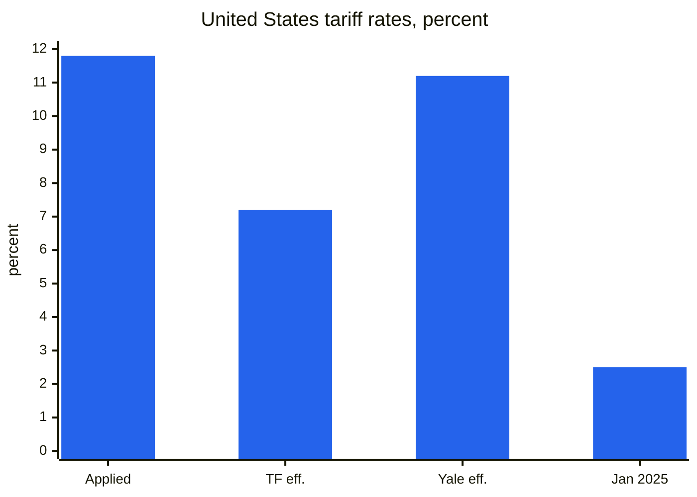

*Note: applied statutory rate 11.8% (both houses agree); Tax Foundation effective rate 7.2% for calendar 2026 (duties collected as a share of imports); Yale Budget Lab average effective rate about 11.2% in November 2026; about 2.5% in January 2025. Sources: Tax Foundation; Budget Lab at Yale.*

---
## 9. Freight market

### Container spot rates — Drewry World Container Index

Drewry's World Container Index fell 3% to $4,176 per 40ft container on November 19, its fourth consecutive weekly decline, though still 126% higher year on year. Transpacific rates fell for a seventh consecutive week: Shanghai–New York dropped 9% to $8,194, the lowest in 15 weeks, and Shanghai–Los Angeles fell 5% to $7,026, the lowest in 12 weeks. Shanghai–Genoa rose 6% to $4,436 after three stable weeks, while Shanghai–Rotterdam was unchanged at $3,496. Drewry expects transpacific rates to fall further next week; ten blank sailings were announced for the following week against four this week. The composite has fallen about 9% over four weeks (from $4,585 on October 22). The container market split further: transpacific rates fell sharply for a seventh straight week while Mediterranean rates rebounded 6% and transatlantic rates rose 2% in both directions (Rotterdam–New York $3,146; New York–Rotterdam $1,217). [Drewry](https://www.drewry.co.uk/supply-chain-advisors/world-container-index-weekly-update?topics=Container%20Shipping)

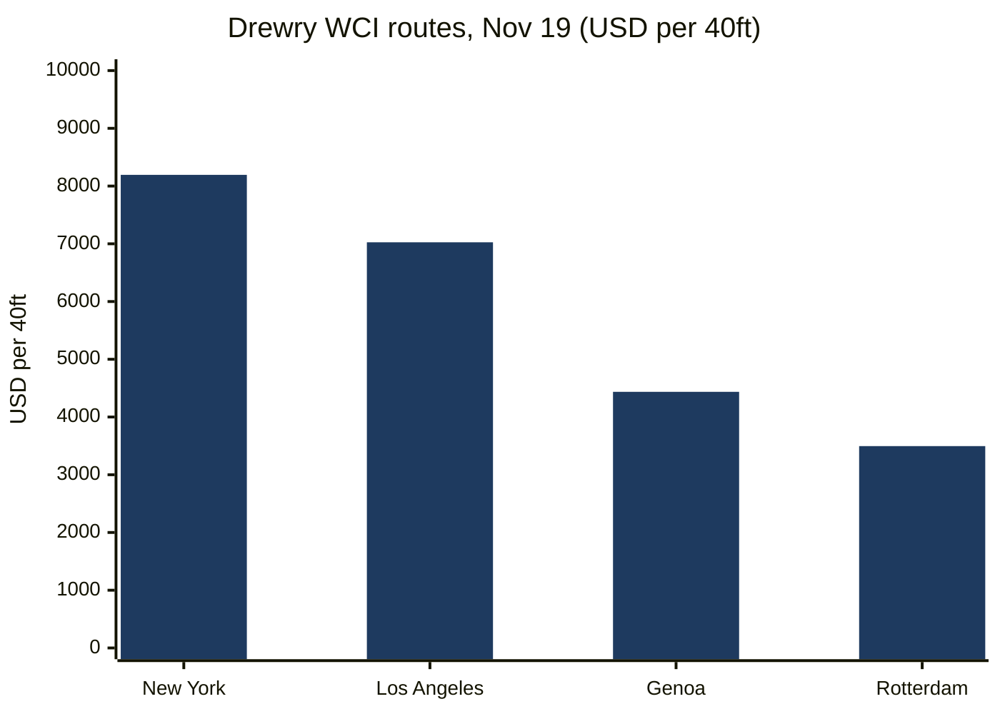

*Note: Shanghai-origin spot rates per 40ft container, November 19, 2026. Source: Drewry World Container Index.*

### Freightos Baltic Index

Freightos reported Asia–US West Coast at $8,459 per FEU (up 3%), Asia–US East Coast at $9,848 (up 1%), Asia–North Europe level at $3,407 and Asia–Mediterranean at $4,295 (down 1%) in its November 17 update. Asia–Europe rates are 40–50% above a year ago; Asia–North Europe is down 5% versus end of October. The global FBX composite for the November 17 update is n/a — the weekly update does not state a global figure. (A tracker reading of $3,419 per FEU for the global FBX was recorded on November 22; the prior weekly global reading was $3,452 on November 10.) Freightos's lane readings ticked up slightly on the transpacific even as Drewry's same-lane readings fell — the two benchmarks measure different rate baskets and weeks, and the gap (Freightos Asia–US West Coast $8,459 vs Drewry Shanghai–Los Angeles $7,026) is a reminder not to mix them. Freightos notes November GRIs did not hold, mid-month increase plans may also fail, and carriers are raising blank sailings; December increases are announced and could take if supported by pre-Lunar New Year demand. Freightos's warning that the Red Sea return plus fleet growth raises overcapacity risk next year frames the 2027 outlook. [Freightos](https://www.freightos.com/freight-resources/us-air-cargo-recovering-from-outage-new-us-cn-tensions-ahead-of-talks-november-17-2026-update/)

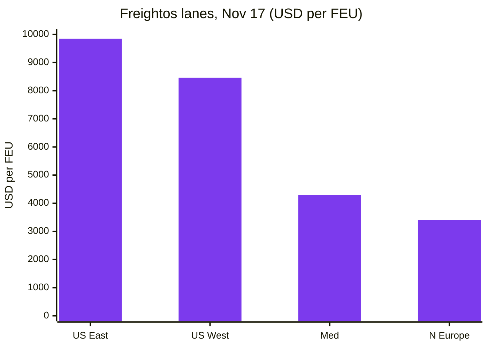

*Note: Asia-origin spot rates per FEU, November 17, 2026. Source: Freightos Baltic Index.*

### Shanghai Containerized Freight Index

The SCFI composite fell to 3,503.78 on November 20, down 68.55 points (down 1.92%) week on week from 3,572.33 on November 13 — the third straight weekly fall, with losses widening each week (down 1.46%, down 1.68%, down 1.92%); lowest since mid-September; 129.67 points shed over three weeks from 3,687.35 on October 30. Shanghai–US West Coast $6,711 per FEU (down $400, down 5.63%); Shanghai–US East Coast $8,776 per FEU (down $611, down 6.51%); Shanghai–Mediterranean $3,678 per TEU (up 1.63%); Shanghai–Europe $2,291 per TEU; Santos $3,110 per TEU (down 15.19%). The China Containerized Freight Index (CCFI, contract rates) rose 0.21% to 1,923.21, a second straight weekly gain — diverging from the spot SCFI. Three indices (Drewry, Freightos lanes, SCFI) now agree the transpacific spot market is correcting hard into the post-peak-season lull, with the SCFI's United States East Coast lane down more than $600 in a week. The CCFI's rise suggests shippers on contract rates are not yet seeing the benefit — a gap that matters for 2027 tender timing. [Forwarder News](https://www.forwardernews.com/news/2026-11-20-scfi-falls-a-third-week)

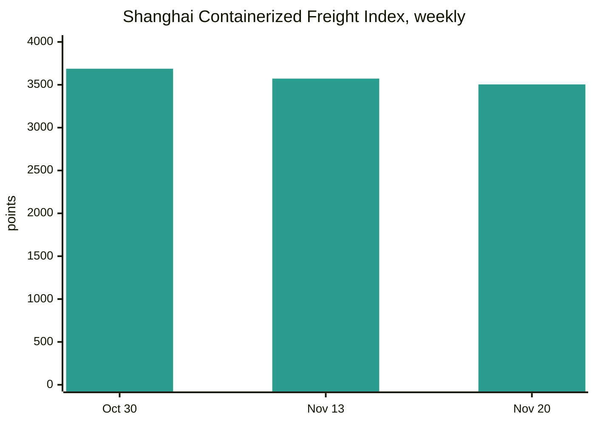

*Note: SCFI composite, weekly. Source: Shanghai Shipping Exchange.*

### November rate increases — announced, already discounted

Carriers have announced peak season surcharges of $1,000–$1,600 per 40ft on Asia–Europe/Mediterranean from December. November general rate increases did not hold, according to Freightos, and mid-month increase plans may also fail. December increases are announced and could take if supported by pre-Lunar New Year demand. The pattern of the autumn — announced increases failing to hold against weak demand — is now the established rhythm of the market. [Freightos](https://www.freightos.com/freight-resources/us-air-cargo-recovering-from-outage-new-us-cn-tensions-ahead-of-talks-november-17-2026-update/)

### Blank sailings and capacity

Ten blank sailings were announced for the following week, against four this week. Drewry's cancelled-sailings tracker projected 52 blank sailings out of 716 scheduled services on major East–West trades between November 16 and December 21 (about 7%). Carriers are leaning harder on blank sailings as the transpacific correction deepens, and the Gemini Suez return frees further capacity into 2027. [Drewry](https://www.drewry.co.uk/supply-chain-advisors/world-container-index-weekly-update?topics=Container%20Shipping)

### Dry bulk — Baltic Exchange

The Baltic Dry Index closed at 2,898 on November 20, down 82 points (down 2.8%) week on week from 2,980 on November 13 — ending four consecutive weekly gains. Daily path: 2,921 (Monday November 16), 2,893 (Tuesday), 2,914 (Wednesday), 2,901 (Thursday), 2,898 (Friday). Capesize index 4,502 (down 4.6% week on week; from 4,719); Capesize average daily earnings $40,827 (Friday; $37,184 on Tuesday November 17). Panamax index 2,140 (up 1.0% week on week; from 2,118), highest since October 22; Panamax daily earnings $19,264. Supramax index 1,810 (down 1.4% week on week; from 1,836); daily earnings $22,884. Handysize index 1,072 (up 2.4% week on week). C5 (West Australia–Qingdao iron ore) route ended the week at $14.40 per tonne, recovering from a $13.40 low midweek. Dry bulk turned down after four weeks of gains, with Capesize the main drag (down 4.6% on the week) on weakening North Atlantic demand and a lengthening list of available vessels, while Panamax rose to a one-month high on grain and coal demand. The split — Capesize down, Panamax up — points to iron-ore demand softening while grain and coal trades hold, a useful leading signal for commodity demand into year-end. [HandyBulk](https://www.handybulk.com/baltic-dry-index/)

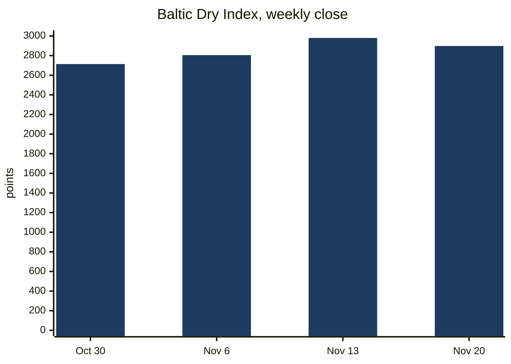

*Note: Baltic Dry Index weekly closes. Source: Baltic Exchange.*

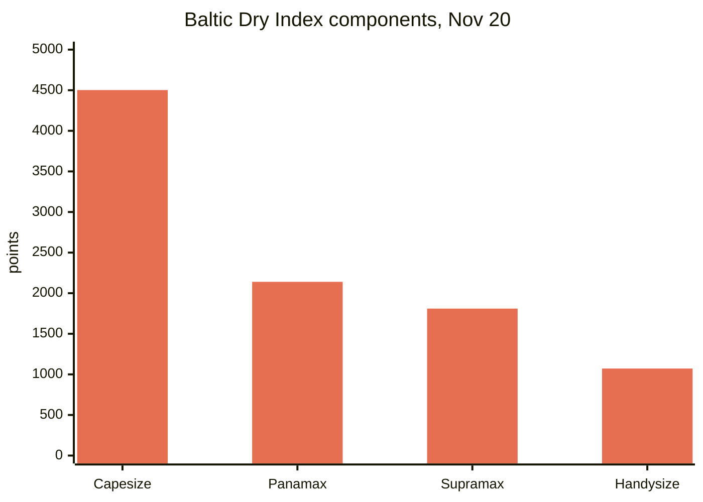

*Note: Baltic Exchange segment indices, November 20, 2026. Source: Baltic Exchange.*

### Suez and schedule reliability

Maersk and Hapag-Lloyd announced on November 16 that their Gemini Cooperation's AE1, AE2 and AE3 services will return to the trans-Suez route and the Red Sea, replacing diverted voyages around the Cape of Good Hope. The transition is phased: AE2 first, with the Mary Maersk (voyage 650W) starting its rotation at Ningbo on December 4; AE3 follows with the Alette Maersk (voyage 652W) starting at Shanghai on December 20; AE1 begins with the Damietta Express (voyage 702W) starting at Shanghai on January 14, 2027. The revised rotations include Suez Canal transits in both directions. The move follows earlier restorations of the AE5, AE11, AE12, ME2 and ME1 services. According to Linerlytica, the return of these three services makes Maersk and Hapag-Lloyd the first alliance to restore Suez routing across all of its Asia–Europe services. The switch reduces the number of ships on AE2 from 14 to 13 and on AE3 from 13 to 11, freeing capacity. Maersk said the changes would improve transit times, while cautioning that implementation depends on continued stability in the Red Sea and ongoing monitoring of regional security conditions. Evergreen was the last Ocean Alliance member to resume Suez transits; ZIM remains the most prominent major carrier still routing Asia–Europe services around the Cape. Drewry counted 53 containerships through the canal in the week to November 1, up 130% year on year, and estimates about 60% of Asia–Europe capacity is back on the Suez route. DHL estimates broader network adjustments could take another 6–12 months. Flexport forecast 131% of normal arriving capacity in Northern European ports in the week of November 16–22 as bunched arrivals land. [FreightWaves](https://www.freightwaves.com/news/maersk-and-hapag-lloyd-restore-asia-europe-suez-routes-as-u-s-shippers-watch-capacity-and-costs)

### Air cargo

The Baltic Air Freight Index (BAI00) rose 6.6% in the week to November 9 (up 28.2% year on year) to its highest level of 2026, then slipped 1.5% in the seven days to November 16 (up 20.8% year on year). Hong Kong outbound (BAI30) fell 4.5% week on week to November 16 (up 19.0% year on year); Shanghai outbound (BAI80) fell 2.7% (up 13.1%); Frankfurt outbound (BAI20) fell 2.7% (up 36.4%); London Heathrow outbound (BAI40) fell 9.4% (up 2.6%). Chicago outbound (BAI50) spiked 39.2% week on week (up 72.1% year on year) after the United States air-traffic-control outage. In the week to November 9: Frankfurt outbound up 9.9% week on week, London up 5.6%, Hong Kong up 4.6%, Shanghai up 5.7%. Freightos Air Index (November 17 update): China–North America $9.25/kg (up 16% week on week), above the 2025 peak-season high of $8.00/kg reached only in mid-December last year; China–North Europe $5.05/kg (up 4%); North Europe–North America $3.27/kg (up 12%), highest since December 2022. Xeneta October global spot average $3.11/kg (up 29% year on year). TAC global spot about $3.93/kg in week 44 (up 4% week on week, about 40% year on year). Jet fuel: IATA monitor down 6.5% in the week to November 6 and 11.7% over the month to November 13. [Baltic Exchange](https://www.balticexchange.com/en/news-and-events/news/guest-column/2026/Air-freight-rates-surge-past-previous-peak-season-highs-as-jet-fuel-prices-soar.html)

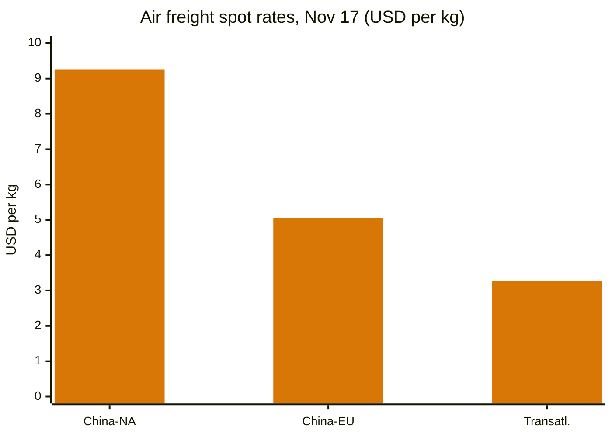

*Note: Freightos Air Index, November 17, 2026. China–North America above the 2025 peak-season high of $8.00/kg; transatlantic highest since December 2022. Source: Freightos.*

**Disruption:** a United States air-traffic-control system failure grounded thousands of flights over the weekend of November 14–15 — the FAA nationwide ground stop of November 13 (a single faulty router at El Dorado, Arkansas, affecting 17 of 22 air route traffic control centres) disrupted more than 20,000 flights over the weekend and left air cargo backlogs into the following week; the FAA paused installation of the new routers on November 17 and the administration raised its air-traffic-control modernisation cost estimate above $50 billion. A Microsoft outage added disruption; TAC said the data were patchier than usual. Freightos said international air rates to the United States had not surged significantly as a result of the outage. Air cargo hit its 2026 high in the week to November 9 on chip and AI-hardware demand plus peak-season volumes, with China–North America rates passing last year's peak a month early. The November 16 pullback may be a breather rather than a turn: TAC notes several more weeks of peak season remain. The Belgian air traffic control strike on November 23 (see A11) follows the FAA ground stop ten days earlier, underlining how thin the margin is in air freight infrastructure this peak season. [Air Cargo News](https://www.aircargonews.net/cargo-airport/2026/11/us-air-cargo-supply-chains-recover-following-ground-stop/)

### Port and logistics disruptions

**Los Angeles / Long Beach.** See A7. The strike threat that had hung over the largest United States container gateway since November 1 was averted at the last minute with a tentative agreement on November 21; ratification is pending and the union has not commented publicly. The rail backlog at the complex (35,688 import containers awaiting on-dock rail as of November 2) remains, and rail dwell times for import containers exceeded nine days, according to the Port of Los Angeles executive director. The Vincent Thomas Bridge closure (November 7, 16 months) continues separately. [Maritime Executive](https://maritime-executive.com/article/ports-of-la-and-long-beach-avert-strike-as-watchmen-reach-deal)

**Durban.** Durban's congestion deepened in the window despite better terminal throughput: Durban Gateway Terminal handled 36,332 TEU in the latest reporting week (up 28% week on week, strongest waterside performance in 4 months), but average vessel anchorage waiting time rose from 189 hours to 263 hours (almost 11 days) even as vessels waiting offshore fell from 14 to 11. Yard occupancy about 69%. Affected supply chains face additional end-to-end delays exceeding 20 days. Transport Minister Barbara Creecy has given ICTSI three months to improve performance or risk losing its port licence (per Moneyweb). Transnet emergency measures (November 18): Berth 102 allocated to geared vessels; diversions to Ngqura Container Terminal; additional rail movements; final refurbished ship-to-shore crane at Pier 1 commissioned November 20 and handed over November 21. DGT acknowledged "continued service shortcomings," blaming the poor and unsafe condition of equipment after years of under-investment; it has committed over R2 billion over three years to upgrade Pier 2 equipment. Maersk's $1,000/$2,000 peak-season surcharge and $400/$800 congestion fee remain in force. The licence threat is a new escalation — a state ultimatum to a private terminal operator — and the three-month window runs to February 2027. [Shipping and Freight Resource](https://shippingandfreightresource.com/transnet-steps-in-to-alleviate-congestion-at-durban-gateway-terminal/)

**Panama Canal.** Lower-than-normal summer rainfall had triggered draft and daily transit restrictions for Panama Canal crossings, with container carriers rolling out surcharges. Better-than-expected precipitation since then allowed the Panama Canal Authority to reverse those steps. Current water levels are about back to normal for the time of year, and projections have downgraded the severity of the expected El Niño, so the risk of severe restrictions in Q4 2026 and H1 2027 is assessed as lower than feared over the summer. The removal of Panama restrictions takes one surcharge driver off the table for United States East/Gulf Coast routings and reduces a source of schedule disruption that had compounded the LA/Long Beach rail backlog. [Freightos](https://www.freightos.com/freight-resources/us-air-cargo-recovering-from-outage-new-us-cn-tensions-ahead-of-talks-november-17-2026-update/)

**Intra-Asia congestion.** The Loadstar reported on November 20 that worsening bottlenecks in South-east Asian transhipment hubs have kept intra-Asia rates firm even as long-haul spot rates fall, and that India–Gulf shippers face additional costs from expensive container returns on top of rising rates. No figures were published in the headlines reviewed. [The Loadstar](https://theloadstar.com/)

**United States import outlook.** United States container imports broke a four-year volume record in October, according to Descartes, with shipments from China climbing for a fourth straight month to nearly 988,000 TEU, their highest level since January 2025. The Port of Los Angeles handled 1,026,872 TEU in October, a record for the month and the second-highest-volume month on record, trailing only September's 1,042,652 TEU. United States rail carloads averaged 233,193 in October, up 3.4% annually, the tenth straight month of annual gain; United States intermodal volume through October reached 12,271,905 units, up 4.7% year to date, with October up 9.6% annually and setting an all-time volume record. The Cass Freight Index showed October shipments at 1.056, up 5.9% annually, and expenditures at 4.010, also up 5.9% annually. The FTR Trucking Conditions Index for September stood at 8.13, trailing August's 11.5. The Global Port Tracker (November 9) expects United States-bound port imports to decline over the balance of 2026 as the extended peak season winds down: September 2026 loaded imports 2.37 million TEU (busiest month of 2026; up 3.4% month on month, up 12.6% year on year); forecasts October 2.26 million TEU (up 9.1% year on year); November 2.05 million TEU (up 1.2%); December 2.03 million TEU (up 1.3%). Full-year 2026 about 26 million TEU (up 2% vs 25.4 million in 2025) — revised up from the October forecast of 25.8 million. Early 2027: January 2.04 million TEU (down 3% year on year); February 1.89 million (down 0.5%); March 1.92 million (down 11.2%). Record import volumes into the United States continued through October even as spot rates softened, pointing to front-loading ahead of the January truce deadline and the December polysilicon measures. [FreightWaves](https://www.freightwaves.com/news/retailers-forecast-u-s-imports-to-stay-elevated-through-2026-after-breakout-peak-season)

**Smaller items.** Bangladeshi garment exporters are turning to costly airfreight to meet delivery deadlines after weeks of disruption, as buyers shop elsewhere (The Loadstar, November 23). Expeditors is rethinking its approach to acquisitions after decades of organic growth and is already evaluating opportunities in technology, and the sale of United States-based Neovia and Turkey's Ekol marked a return of M&A to the contract logistics sector (The Loadstar, November 19). Cargo volumes along Russia's Northern Sea Route surpassed 40 million tonnes for the first time, a record for the Arctic shipping route, although President Putin's ambitions for the route remain out of reach (gCaptain, November 23). FedEx launched weekly routes connecting manufacturing hubs in Shanghai and Guangzhou to United States destinations to support artificial intelligence-driven demand (Supply Chain Dive).

### Vendor intelligence

No qualifying vendor item was recorded in the window. Descartes' only in-window press item was an industry award (November 17, named the leading transportation management system provider in North America in ARC Advisory Group's Transportation Management Systems Global Market Research report). TradeInt's November 22 blog batch was data-marketing content drawn from its own database covering H1 2026 and earlier periods, with "Unlock data" calls to action; the Russia post's reported 901% year-on-year growth is a dataset-coverage artefact, not a trade movement. Descartes' November Global Shipping Report (November 11), reporting record United States container imports of 2,674,808 TEU in October 2026, was covered in last week's report. Descartes' fiscal third-quarter results are not due until early December 2026. [Descartes](https://www.descartes.com/resources/knowledge-center/descartes-releases-november-global-shipping-report-us-container-imports); [TradeInt](https://tradeint.com/insights/blogs/)

---

## 10. Policy timelines

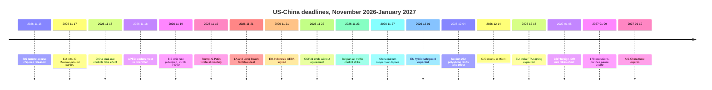

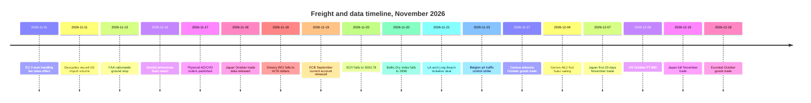

---

## 11. Upcoming deadlines & events (next 90 days)

| Date | Item |
|---|---|
| 23 November 2026 | WTO Committee on Agriculture meets on export restrictions and the special safeguard mechanism; USITC Solar IV full report (Publication 5804) due. |
| 24 November 2026 | Belgian air traffic control strike knock-on disruption expected to spill into Tuesday. |
| 27 November 2026 | China's Announcement No. 72 of 2025 suspension of the presumption of refusal for US-bound gallium, germanium, antimony and superhard materials is scheduled to lapse, absent a further suspension or amendment; Census advance October goods-trade indicator due. |
| 29 November 2026 | Comments due on MOFCOM's draft Measures for Dual-Use Export-Control Investigations and Enforcement. |
| 30 November 2026 | Commerce final dumping and subsidy findings for China tin mill products due, unless postponed. |
| 1 December 2026 | EU hybrid-car safeguard provisional measures expected; Canada removes horizontal tariff relief for certain trailers; Italy's national €2 small-parcel fee takes effect; House Democrats' deadline for Lutnick's written answers on Megaspeed and the Entity List. |
| 4 December 2026 | Section 232 polysilicon duties attach; Gemini AE2 first Suez-routing sailing from Ningbo; MEPC 85 extraordinary IMO session provisionally scheduled. |
| 7 December 2026 | Comments due on CBP's low-value shipments proposed rule (91 FR 64532; docket USCBP-2026-0298); Japan first-20-days November trade. |
| 8 December 2026 | US October FT-900 trade release. |
| 10 December 2026 | Lutnick testifies before the Senate Banking Committee (Megaspeed / Entity List). |
| 11 December 2026 | Government response brief due in *Gellert v. Trump* (Section 338); EU–Indonesia: President Prabowo visits Brussels. |
| 14–15 December 2026 | G20 leaders meet in Miami. |
| 15 December 2026 | Japan full November trade. |
| 16 December 2026 | EU–India free trade agreement reported to be signed in Brussels, with Prime Minister Modi expected to attend. |
| 17 December 2026 | Earliest date Commerce intends to issue assessment instructions in the wooden-cabinet and millwork reviews (35 days after 12 November publication). |
| 18 December 2026 | Eurostat October goods trade; ECB October balance of payments. |
| 20 December 2026 | Gemini AE3 first Suez-routing sailing from Shanghai. |
| 1 January 2027 | Section 232 rates rise to 30% on upholstered furniture and 50% on kitchen cabinets and vanities; threatened 50% on Canadian vehicles, auto parts and steel also aimed at this date; UK CBAM commences; UK–EU stricter EV rules of origin take effect; AGOA termination for Rwanda and South Africa intended to take effect (proclamation still needed). |
| 3 January 2027 | New United States Congress seated. |
| 5 January 2027 | CBP foreign importer-of-record interim final rule takes effect; comments due the same day (docket USCBP-2026-1387). |
| 9–10 January 2027 | US–China truce deadlines converge: 178 Section 301 exclusions and the maritime-fee suspension expire 9 January; BIS Affiliates Rule suspension and China's reciprocal suspensions expire 10 January. |
| 11–12 January 2027 | Commerce final AD/CVD determinations on CBS rubber accelerator from China due. |
| 11 January 2027 | Reply brief due in *Gellert v. Trump*. |
| 12 January 2027 | Written comments and hearing participation requests due for the USMCA joint review consultation (dockets USTR-2026-0595 and USTR-2026-0596). |
| 14 January 2027 | Gemini AE1 first Suez-routing sailing from Shanghai. |
| 19 January 2027 | Commerce final dumping finding for Türkiye tin mill products due; comments due on the BIS remote-access chip rule. |
| 20 January 2027 | Formal entry becomes mandatory for mail subject to Section 201, 232 or 301 duties or partner-government-agency requirements; oral argument in *Gellert v. Trump*. |
| 30 January 2027 | UK countervailing duty variation on Turkish rainbow trout applies from this date (notice 2026/31). |
| 1 February 2027 | Canada removes horizontal tariff relief for certain aluminium wire and extrusions and paperboard products. |
| 6 February 2027 | Lunar New Year. |
| 11 February 2027 | Commerce preliminary CVD determination on plastic balloons from China (estimated). |
| 17 February 2027 | BIS remote-access chip rule: 90-day data-centre licence transition ends (about). |
| 28 February 2027 | USTR determination deadline in the Vietnam intellectual-property Section 301 investigation. |
| March 2027 | USTR Section 301 structural excess-capacity investigation decision expected (due by March 2027); EU–India FTA entry into force reported for March or April 2027. |
| 25 March 2027 | Commerce final dumping finding for Taiwan tin mill products due. |
| 27 April 2027 | Commerce preliminary AD determination on plastic balloons from China (estimated). |
| 6 May 2027 | Full broker compliance expected with the foreign importer-of-record rule. |
| 30 June 2028 | Canadian horizontal tariff remission extended to this date. |

---

## 12. Sources & methodology

Coverage window: November 16–23, 2026. Compiled from approximately 45 trade news, policy, data, and freight sources worldwide.

Sources consulted include: FreightWaves, The Loadstar, Splash247, gCaptain, Hellenic Shipping News, Container News, Supply Chain Dive, Logistics Management, Air Cargo News, Port Technology, TradeInt insights blog; whitehouse.gov, cbp.gov, ustr.gov, federalregister.gov, trade.gov, usitc.gov, bis.doc.gov, JD Supra; ec.europa.eu, gov.uk, cbsa-asfc.gc.ca, canada.ca/en/department-finance, english.mofcom.gov.cn; wto.org, unctad.org, intracen.org, wcoomd.org; dataweb.usitc.gov, ustradecensus.gov, comtradeplus.un.org, wits.worldbank.org, eurostat, data.worldbank.org, imf.org; taxfoundation.org, budgetlab.yale.edu, tradeintelligence.eu; drewry.co.uk, balticexchange.com, freightos.com; descartes.com, tradeint.com.

All figures are as reported in the cited sources; figures that could not be verified are marked n/a. Items dated before November 16 appear only as follow-ups, Federal Register publications falling in the window, or context for a deadline in the window. Container News returned only a cookie-consent notice and yielded no usable content; the WTO news index returned no readable text via fetch, so WTO items use WTO releases as republished; MOFCOM's English site was reachable only for front-page headlines, and the substance of its announcements was not verifiable from the information reviewed. TradeInt had no qualifying vendor item in the window: its November 22 blog batch was data-marketing content drawn from its own database. No major new in-window releases were identified from USITC DataWeb, UN Comtrade, WITS, World Bank or IMF portals. No new Withhold Release Order was identified in the window. The Federal Register was not swept document-by-document for the whole week; further administrative-review notices may exist. The reported year-end conclusion of the Section 301 excess-capacity investigation rests on a single trade-press report of a November 21 television interview; no USTR notice had appeared as of November 23. The EU's November 17 Russia listings count (49) is as reported by the Youverify monitor, not verified against the EU list itself.
