# Informe de Inteligencia Comercial Global — Semana del 16 al 23 de noviembre de 2026

**Boletín semanal.** Ventana de cobertura: 16–23 de noviembre de 2026. Recopilado a partir de aproximadamente 45 fuentes de noticias comerciales, políticas, datos y fletes de todo el mundo.

---

## Índice

1. [Resumen ejecutivo](#1-executive-summary)
2. [Alertas](#2-alerts)
3. [Principales noticias — análisis en profundidad](#3-top-stories--deep-dives)
4. [Seguimiento arancelario](#4-tariff-tracker)
5. [Análisis en profundidad de la política estadounidense](#5-us-policy-deep-dive)
6. [Política mundial por región](#6-world-policy-by-region)
7. [Medidas de cumplimiento](#7-enforcement-actions)
8. [Publicación de datos](#8-data-releases)
9. [Mercado de fletes](#9-freight-market)
10. [Cronologías de política](#10-policy-timelines)
11. [Próximos plazos y eventos (próximos 90 días)](#11-upcoming-deadlines--events-next-90-days)
12. [Fuentes y metodología](#12-sources--methodology)

---

## 1. Resumen ejecutivo

Una semana en la que la cumbre de la que se esperaba que resolviera la tregua entre Estados Unidos y China no resolvió nada, mientras las medidas comerciales decisivas de la semana llegaron de reguladores, tribunales y ceremonias de firma en otros lugares. La reunión de líderes de la APEC en Shenzhen el 18 y 19 de noviembre produjo una declaración y una primera trilateral Trump–Xi–Putin, pero sin alivio arancelario ni prórroga confirmada de la tregua, que sigue expirando el 9–10 de enero de 2027; el próximo escenario para una decisión es la cumbre del G20 en Miami el 14 y 15 de diciembre. La Oficina de Industria y Seguridad (BIS) movió en cambio la mayor medida de la semana de forma unilateral, al publicar el 19 de noviembre una norma final provisional que cierra la vía de acceso remoto a los chips avanzados, deroga la Regla de Difusión de IA y exige licencias para los artículos de computación avanzada destinados a cinco países del sudeste asiático y América Latina. Europa avanzó firmando: la Unión Europea e Indonesia firmaron un acuerdo económico integral el 21 de noviembre, la fecha de firma UE–India se fijó para el 16 de diciembre, y el Reino Unido y la UE acordaron un acuerdo sanitario y fitosanitario (SPS) y la vinculación de sus sistemas de comercio de emisiones en su cumbre del 20 de noviembre. En el Golfo, los ataques contra el transporte marítimo en el estrecho de Ormuz y sus alrededores alcanzaron su nivel mensual más alto desde que comenzó la guerra entre Estados Unidos e Irán, y Washington extendió su bloqueo a las transferencias de buque a buque.

- **La APEC produjo una declaración, no un acuerdo arancelario.** La 33.ª Reunión de Líderes Económicos de la APEC concluyó el 19 de noviembre con la Perspectiva de Shenzhen, una declaración voluntaria y no vinculante, y un acuerdo entre los presidentes Trump y Xi para redactar un plan de acción para la "estabilidad estratégica" entre Estados Unidos y China. La primera trilateral Trump–Xi–Putin emitió una Declaración de Paz de cuatro puntos sin volúmenes, plazos ni contenido comercial. Algunas informaciones dijeron que los líderes acordaron prorrogar la tregua comercial; ninguna de las partes publicó una duración ni condiciones, y el comunicado chino no mencionó ninguna prórroga. La tregua sigue expirando el 9–10 de enero de 2027, y el paquete de recortes arancelarios recíprocos de 30.000 millones de dólares por 30.000 millones de dólares de la Junta de Comercio sigue sin acordarse. [China Briefing](https://www.china-briefing.com/news/apec-2026-in-shenzhen-what-the-leaders-meeting-and-trump-xi-talks-mean-for-business/)
- **La BIS cerró la vía del acceso remoto a los chips.** La norma final provisional publicada el 19 de noviembre (91 FR 74970) añade un control mundial de uso final que exige una licencia cuando los artículos de computación avanzada se utilizarán en un centro de datos que proporcione más de 12.000.000 de rendimiento agregado total de procesamiento a empresas con sede en el Grupo de Países D:5 o Macao, añade requisitos de licencia para los artículos de computación avanzada destinados a Indonesia, Malasia, Singapur, Tailandia y Brasil, y deroga formalmente la Regla de Difusión de IA. TSMC y Samsung comunicaron a sus clientes chinos que suspenderían las ventas de ciertos procesadores mientras solicitaban licencias. Los registros de la Comisión de Asuntos Exteriores de la Cámara, publicados el mismo día, mostraron 879.868 procesadores avanzados de IA aprobados para entidades vinculadas a China hasta el 11 de mayo de 2026, incluidos 579.868 aceleradores Nvidia H200. [Willkie Farr & Gallagher](https://www.willkie.com/publications/2026/11/bis-moves-to-close-the-remote-access-gap-for-advanced-chips)
- **Europa firmó, y fijó fecha para su mayor acuerdo.** La UE e Indonesia firmaron un Acuerdo de Asociación Económica Integral y un Acuerdo de Protección de Inversiones el 21 de noviembre, tras casi una década de conversaciones; Indonesia eliminará los aranceles sobre el 98,5% de las líneas arancelarias para los productos de la UE, lo que ahorrará a los exportadores de la UE más de 600 millones de euros al año en derechos. Se espera ahora que el acuerdo de libre comercio UE–India se firme el 16 de diciembre en Bruselas, con el 93% de los envíos indios recibiendo acceso libre de aranceles. En la cumbre Reino Unido–UE del 20 de noviembre, ambas partes acordaron un acuerdo SPS para eliminar muchos controles fronterizos agroalimentarios a partir del 1 de marzo de 2028, y vincular sus sistemas de comercio de emisiones, con exenciones mutuas del ajuste en frontera por carbono por valor de unos 6.500 millones de libras de exportaciones británicas. [Turkish Post](https://turkishpost.com.tr/en/2026/11/21/eu-indonesia-trade-deal/); [Asia Daily](https://asiadaily.org/news/19949/)
- **El acuerdo India–Estados Unidos sigue sin firmarse, y la espera es ahora estructural.** El secretario de Comercio, Rajesh Agrawal, dijo el 18 de noviembre que India no puede firmar hasta que Washington reconstruya su marco arancelario después de que el Tribunal Supremo anulara los aranceles recíprocos y de emergencia, y hasta que se conozcan las investigaciones de la Sección 301, incluida la investigación sobre exceso de capacidad. Se informó de que el embajador de la USTR, Jamieson Greer, dijo el 21 de noviembre que la investigación sobre exceso de capacidad concluirá antes de finales de 2026, antes de su plazo legal del 11 de marzo de 2027; ese informe proviene de una sola fuente y no está verificado. [The Hindu BusinessLine](https://www.thehindubusinessline.com/economy/no-india-us-trade-deal-until-new-us-tariff-framework-section-301-probes/article71716562.ece/amp/)
- **Los ataques en Ormuz alcanzaron su nivel más alto desde que comenzó la guerra.** Se informaron más de 30 ataques contra el transporte marítimo en octubre y al menos 22 en noviembre hasta el 22 de noviembre, según un análisis de CNN de los datos de UK Maritime Trade Operations; tres petroleros fueron atacados el 20 y 21 de noviembre, y un petrolero de ADNOC fue atacado el 17 de noviembre, dejando un tripulante desaparecido y 11 heridos. La Organización Marítima Internacional contó 138 incidentes confirmados y 25 muertes de marinos hasta el 17 de noviembre. Las exportaciones petroleras del Golfo se situaron en 18,4 millones de barriles diarios en octubre, un 26% por debajo de los niveles previos a la guerra, y el Brent se mantuvo cerca de los 92 dólares por barril. [CNN](https://www.cnn.com/2026/11/22/middleeast/hormuz-attacks-highest-levels-iran-war-intl?cid=external-feeds_iluminar_meta)
- **Llegaron nuevos aranceles a la madera contrachapada, y la cartera se amplió.** El Departamento de Comercio publicó órdenes de derechos antidumping y compensatorios sobre la madera contrachapada de frondosas y decorativa procedente de China, Indonesia y Vietnam el 17 de noviembre, con una tasa combinada de alrededor del 276% para China. La USITC publicó su informe completo Solar IV (Publicación 5804), dividiendo las circunstancias críticas — aranceles retroactivos solo para Indonesia. Nuevas peticiones se dirigieron a los globos de plástico procedentes de China, con márgenes alegados del 50% al 276%. [Transport News](https://www.transportnews.net/a/commerce-hardwood-plywood-duty-orders-china-indonesia-vietnam)
- **Japón marcó un récord comercial; el mercado de fletes se dividió de nuevo.** Las exportaciones japonesas de octubre subieron un 20,5% interanual hasta un récord de 11,77 billones de yenes y las importaciones subieron un 21,6% hasta un récord de 12,25 billones de yenes, con el déficit reduciéndose a 476.500 millones de yenes, aproximadamente la mitad de lo previsto. El Índice Mundial de Contenedores de Drewry cayó un 3% hasta 4.176 dólares por contenedor de 40 pies en su cuarta caída semanal consecutiva, mientras la carga aérea se mantuvo en los máximos de 2026, con las tarifas China–Norteamérica en 9,25 dólares por kilogramo. Maersk y Hapag-Lloyd anunciaron el regreso de sus últimos tres servicios Gemini Asia–Europa a la ruta del Suez para mediados de enero. [Drewry](https://www.drewry.co.uk/supply-chain-advisors/world-container-index-weekly-update?topics=Container%20Shipping)

**Fletes:** las tarifas al contado de contenedores cayeron por cuarta semana consecutiva en el transpacífico mientras las tarifas del Mediterráneo repuntaron; la carga seca a granel se moderó desde su máximo; la carga aérea se mantuvo en los máximos de 2026 de cara a la temporada alta; el regreso al Suez estuvo a punto de completarse cuando Gemini anunció sus últimos tres servicios de vuelta por el mar Rojo; la amenaza de huelga en Los Ángeles/Long Beach terminó con un acuerdo provisional el 21 de noviembre; y la cola de Durban se alargó hasta 263 horas fondeadas pese a un mayor rendimiento.

---

## 2. Alertas

| # | Alerta | Vigencia | Impacto | Fuente |
|---|-------|-----------|--------|--------|
| A1 | Los líderes de la APEC se reúnen en Shenzhen; la bilateral Trump–Xi y la primera trilateral Trump–Xi–Putin producen una declaración y un plan de acción de "estabilidad estratégica", pero sin alivio arancelario ni prórroga confirmada de la tregua | 18–19 nov. 2026 | La tregua sigue expirando el 9–10 ene. 2027; el próximo punto de decisión es el G20 en Miami, 14–15 dic. | [China Briefing](https://www.china-briefing.com/news/apec-2026-in-shenzhen-what-the-leaders-meeting-and-trump-xi-talks-mean-for-business/) |
| A2 | La norma final provisional de la BIS "Addressing Remote Access to Advanced Semiconductors" impone un control mundial de uso final en centros de datos (umbral de 12.000.000 TPP), requisitos de licencia para chips avanzados a cinco países, y deroga la Regla de Difusión de IA | 19 nov. 2026 (publicada; 91 FR 74970) | Las fundiciones pausan los envíos a China a la espera de licencias; los centros de datos que atienden a empresas D:5 tienen 90 días para obtener una licencia | [Willkie Farr & Gallagher](https://www.willkie.com/publications/2026/11/bis-moves-to-close-the-remote-access-gap-for-advanced-chips) |
| A3 | La suspensión china de la prohibición de exportar galio, germanio, antimonio y materiales superduros a Estados Unidos vence, sin prórroga publicada hasta el 20–21 nov. | 27 nov. 2026 | La norma subyacente pide denegar las licencias en principio; los compradores estadounidenses de los materiales afectados afrontan una decisión esta semana | [InvestorNews](https://investornews.com/market-opinion/critical-minerals-report-trump-xi-and-the-critical-minerals-behind-the-ai-race/) |
| A4 | Salvaguardia de la UE para coches híbridos: las alegaciones escritas cerraron el 20 nov.; se esperan medidas provisionales a partir del 1 dic., con un tope informado de 350.000 vehículos anuales para los híbridos fabricados en China | 1 dic. 2026 (previsto) | Las importaciones chinas de híbridos ya suman 474.475 unidades en ene.–ago. 2026, por encima del tope anual propuesto; aún no se ha publicado ningún acto jurídico | [Ports Europe](https://www.portseurope.com/eu-opens-hybrid-safeguard-probe-as-chinese-shipments-outrun-planned-quota/) |
| A5 | Los precios mínimos de importación de la Sección 232 para el polisilicio (21 $/kg polisilicio; 100 $/kg lingotes y obleas; 0,22 $/W células; 0,38 $/W módulos) más un arancel del 15% sobre derivados entran en vigor; la norma contra el acaparamiento rige hasta el 3 dic. | 4 dic. 2026 | Precio mínimo para toda la cadena de suministro solar de EE. UU.; entorno de pruebas de la CBP activo desde el 12 nov. | [Stoel Rives](https://www.stoel.com/printpilot-publication-commerces-anti-stockpiling-rule-imposes-limits-on-pre-december-4-polysilicon-imports.pdf?1791987859) |
| A6 | Ataques contra el transporte marítimo en el estrecho de Ormuz y sus alrededores en el nivel mensual más alto desde que comenzó la guerra; tres petroleros atacados el 20–21 nov.; EE. UU. extiende el bloqueo a las transferencias de buque a buque y ataca un emplazamiento del IRGC en la isla de Qeshm | 16–22 nov. 2026 | 138 incidentes confirmados y 25 muertes de marinos (OMI); exportaciones petroleras del Golfo un 26% por debajo de antes de la guerra; Brent en torno a 92 $ | [CNN](https://www.cnn.com/2026/11/22/middleeast/hormuz-attacks-highest-levels-iran-war-intl?cid=external-feeds_iluminar_meta) |
| A7 | La Asociación Marítima del Pacífico y el ILWU Local 26 alcanzan un acuerdo provisional horas después del plazo de las 00:01, evitando una huelga en Los Ángeles y Long Beach; ratificación pendiente, términos no revelados | 21 nov. 2026 | Amenaza de huelga levantada por ahora en la principal puerta de entrada de contenedores de EE. UU.; el riesgo vuelve si los afiliados rechazan el acuerdo | [FreightWaves](https://www.freightwaves.com/news/tentative-union-deal-averts-strike-at-port-of-la-long-beach) |
| A8 | El Departamento de Comercio publica las órdenes finales AD/CVD sobre madera contrachapada de frondosas y decorativa procedente de China, Indonesia y Vietnam; tasa combinada de alrededor del 276% para China | 17 nov. 2026 | Se reanudan los depósitos en efectivo; la madera contrachapada de frondosas china queda prácticamente fuera del mercado estadounidense | [Transport News](https://www.transportnews.net/a/commerce-hardwood-plywood-duty-orders-china-indonesia-vietnam) |
| A9 | La norma final provisional de la CBP sobre importador de registro extranjero entra en vigor el 5 ene. 2027; el plazo del 18 nov. para anular el Formulario 5106 pasó sin anulaciones informadas hasta el 20 nov. | 5 ene. 2027 | Los importadores extranjeros deben estar validados por CTPAT o usar un agente de aduanas validado por CTPAT; las entradas podrán rechazarse desde el 5 ene. | [Freight Right](https://www.freightright.com/news/cbp-tightens-importer-requirements-what-businesses-must-do-before-january-2027) |
| A10 | La COP31 en Antalya termina el 22 nov. sin acuerdo político; los delegados de la OMI inician conversaciones técnicas antes del MEPC 85, con una sesión extraordinaria fijada provisionalmente para el 4 dic. | 22–23 nov. 2026 | Adopción incierta del Marco Net-Zero del transporte marítimo; EE. UU. se opone a los cargos obligatorios por emisiones | [Splash247](https://splash247.com/cop31-collapse-casts-shadow-over-shippings-net-zero-showdown/) |
| A11 | La huelga del control de tráfico aéreo belga cierra el espacio aéreo belga de 07:00 a 21:00 el 23 nov.; el centro de carga de Lieja cerrado 14 horas, unos 429 vuelos de Bruselas cancelados | 23 nov. 2026 | Carga aérea europea interrumpida en temporada alta; efectos en cadena previstos hasta el 24 nov. | [The Loadstar](https://theloadstar.com/) |
| A12 | Se informa de que la investigación de la Sección 301 de la USTR sobre exceso de capacidad concluirá antes de fin de año, antes del plazo legal del 11 mar. 2027; no se ha publicado ninguna determinación formal | Informado el 21 nov. 2026 | Una sola determinación podría imponer nuevos aranceles a 16 economías; informe de una sola fuente, sin verificar | [East Asia Brief](https://eastasiabrief.com/trade-policy/ustr-accelerates-section-301-probe-hit-year-end-target-1636) |

### A1 — APEC: el punto de decisión que no decidió nada

La 33.ª Reunión de Líderes Económicos de la APEC concluyó en Shenzhen el 19 de noviembre con la Perspectiva de Shenzhen 2026 de los Líderes de la APEC, una declaración voluntaria y no vinculante que compromete a las 21 economías miembros a trabajar en cadenas de suministro resilientes, la digitalización del comercio y la inteligencia artificial. El presidente Xi Jinping presidió la reunión de líderes y celebró una reunión bilateral con el presidente Donald Trump la misma tarde, tras una conversación de dos horas el 18 de noviembre centrada principalmente en el comercio y los aranceles; ambos acordaron redactar un plan de acción para la "estabilidad estratégica" entre Estados Unidos y China. El mismo día, Xi acogió la primera reunión trilateral de los presidentes de China, Estados Unidos y Rusia, que produjo una Declaración de Jefes de Estado hacia la Paz de cuatro puntos que abarca el aumento de la producción y el suministro de productos petrolíferos refinados, la reforma de la ONU, el respeto de las inmunidades estatales y el diálogo sobre la reducción de los riesgos nucleares — sin volúmenes, plazos ni mención de Ucrania, Irán, el comercio o la IA. Trump presionó a China para que cumpliera su promesa de comprar 17.000 millones de dólares en productos agrícolas estadounidenses; los funcionarios chinos han dicho que la promesa está condicionada a reducciones arancelarias recíprocas a través de la Junta de Comercio. Xi prometió nuevos recortes arancelarios, mayor acceso al mercado y una contribución de 20 millones de dólares a la cooperación de la APEC. El comercio de bienes entre Estados Unidos y China en enero–septiembre de 2026 fue de unos 474.000 millones de dólares. [China Briefing](https://www.china-briefing.com/news/apec-2026-in-shenzhen-what-the-leaders-meeting-and-trump-xi-talks-mean-for-business/)

**Análisis:** la reunión de la que se esperaba que fuera el punto de decisión para prorrogar la tregua más allá de enero no produjo ningún resultado arancelario. La tregua sigue expirando el 9–10 de enero de 2027, y el próximo escenario para una prórroga es ahora la cumbre del G20 en Miami el 14 y 15 de diciembre. El paquete de recortes arancelarios recíprocos de 30.000 millones de dólares por 30.000 millones de dólares de la Junta de Comercio sigue sin acordarse, y los importadores que planean entradas después del 9 de enero siguen sin una prórroga escrita. Los verdaderos resultados comerciales de la semana de la cumbre fueron bilaterales y al margen: se firmaron el CEPA Filipinas–Chile y el TLC Perú–Tailandia, se amplió el alivio arancelario China–Canadá y China–Indonesia abrió conversaciones sobre un CEPA.

### A2 — La BIS cierra la vía del acceso remoto a los chips

La Oficina de Industria y Seguridad publicó una norma final provisional el 16 de noviembre, publicada en el Registro Federal el 19 de noviembre (91 FR 74970) y efectiva desde su publicación. La norma añade un control mundial de uso final (nueva EAR § 744.24) que exige una licencia cuando se sabe que los artículos de computación avanzada se utilizarán en un centro de datos que proporcione más de 12.000.000 de rendimiento agregado total de procesamiento a empresas con sede en el Grupo de Países D:5 (incluida China) o Macao; los centros de datos que ya proporcionan esa capacidad de cómputo tienen 90 días, hasta aproximadamente el 17 de febrero de 2027, para obtener una licencia para continuar. Añade un requisito de licencia para los artículos de computación avanzada destinados a Indonesia, Malasia, Singapur, Tailandia y Brasil, con una excepción para los usuarios finales con sede en Estados Unidos que presenten nuevos informes mensuales. Reduce las vías por las que los fabricantes front-end y las empresas de ensamblaje y pruebas de semiconductores subcontratadas pueden superar la presunción de que un chip lógico de nodo avanzado (16/14 nm o inferior) es un artículo controlado de IA para centros de datos. Deroga formalmente la Regla de Difusión de IA de la era Biden, incluidos los niveles por país, el control de pesos de modelos y el marco de Usuario Final Validado de Centros de Datos. Los comentarios vencen el 19 de enero de 2027. [Willkie Farr & Gallagher](https://www.willkie.com/publications/2026/11/bis-moves-to-close-the-remote-access-gap-for-advanced-chips)

**Cifras clave:** umbral de 12.000.000 de TPP agregado; transición de 90 días hasta aproximadamente el 17 de febrero de 2027; 879.868 procesadores aprobados para entidades vinculadas a China hasta el 11 de mayo de 2026 (579.868 Nvidia H200; unos 300.000 AMD Instinct MI325X), de solicitudes que superaban los 3,4 millones de procesadores. El Financial Times informó el 19 de noviembre de que TSMC y Samsung comunicaron a sus clientes chinos que suspenderían las ventas de ciertos procesadores mientras solicitaban licencias estadounidenses. El 20 de noviembre, el secretario del Tesoro, Scott Bessent, dijo que los límites actuales a la exportación del Nvidia H200 se mantendrían sin restricciones adicionales y que "las restricciones adecuadas a los chips están en vigor". La norma fue redactada por el Departamento del Tesoro y el Consejo de Seguridad Nacional y por orden de estos, según el propio anuncio de la BIS.

### A3 — La suspensión del galio vence el 27 de noviembre

El Anuncio n.º 72 de 2025 de China, que suspende la presunción de denegación para el galio, el germanio, el antimonio y los materiales superduros con destino a Estados Unidos, rige solo hasta el 27 de noviembre de 2026 y no fue mencionado en el Anuncio n.º 58 del MOFCOM, que prorrogó la suspensión del paquete separado de tierras raras hasta el 10 de enero de 2027. Hasta el 20–21 de noviembre no se había publicado ninguna prórroga. A menos que Pekín actúe, la norma subyacente pide denegar en principio las licencias para los materiales cubiertos, con un escrutinio más estrecho de los usuarios finales y los usos finales del grafito cubierto. Los requisitos de licencia para el galio, el germanio (desde el 1 de agosto de 2023) y el antimonio (desde el 15 de septiembre de 2024) para todos los destinos siguen en vigor en cualquier caso. [InvestorNews](https://investornews.com/market-opinion/critical-minerals-report-trump-xi-and-the-critical-minerals-behind-the-ai-race/)

**Análisis:** la tregua más amplia se extiende hasta el 10 de enero de 2027, pero esta suspensión es un instrumento separado con su propia fecha. Los compradores estadounidenses de productos cubiertos de galio, germanio y antimonio afrontan una decisión esta semana, y el vencimiento llegaría cuatro días después de que se cierre la ventana de cobertura.

### A4 — Salvaguardia de la UE para coches híbridos: el tope ya está por debajo del ritmo actual

La Comisión Europea abrió una investigación de salvaguardia el 30 de octubre sobre las importaciones de coches híbridos nuevos —completos, suaves y enchufables— procedentes de todos los países no pertenecientes a la UE, citando un aumento del 49% en los volúmenes de importación —de 957.965 vehículos en 2023 a 1.423.691 en el año hasta el 30 de junio de 2026— a precios muy inferiores a los de los productores de la UE. Las alegaciones escritas cerraron el 20 de noviembre. Funcionarios de la UE han dicho que las importaciones de híbridos fabricados en China se limitarán a 350.000 coches en el primer año, aumentando un 6% anual durante cuatro años, en virtud de una salvaguardia que la Comisión planea lanzar el 1 de diciembre; aún no se ha publicado ningún acto jurídico, y el mecanismo de cuotas y el tratamiento de los coches por encima del límite aún no son públicos. Los datos de Eurostat muestran que las importaciones de la UE de coches híbridos procedentes de China alcanzaron 474.475 unidades en los ocho primeros meses de 2026 —ya por encima del tope anual propuesto y un salto interanual del 175%— frente a 302.000 en 2025 y 107.000 en 2024. La Comisión espera unos 800.000 híbridos chinos importados en 2026. La cuota de las marcas chinas en el mercado europeo de híbridos enchufables subió del 2% al 25%. Se aplican exenciones al Espacio Económico Europeo, Ucrania, Kenia y los pequeños exportadores en desarrollo; las marcas chinas que fabrican en la UE, como BYD en Hungría y Chery en España, quedan fuera de la cuota. Los vehículos eléctricos de batería afrontan aranceles del 25% al 45% según el fabricante, y no están cubiertos por el tope de híbridos. [Ports Europe](https://www.portseurope.com/eu-opens-hybrid-safeguard-probe-as-chinese-shipments-outrun-planned-quota/)

**Análisis:** el tope reduciría los envíos chinos de híbridos a Europa en más de la mitad frente al ritmo de 2026, remodelando los flujos de vehículos, la logística de vehículos terminados y las decisiones de producción en Europa Central y Oriental. Es la medida de defensa comercial nueva más importante de la UE en el año, y la fecha de inicio del 1 de diciembre está a días de distancia con mecanismos clave aún sin publicar. La Asociación de Logística de Vehículos Europeos advirtió de que el tope sería un duro golpe para los operadores de logística de vehículos terminados.

### A5 — Polisilicio: el precio mínimo está fijado, la norma contra el acaparamiento ya se nota

La Proclamación 11052 del 6 de agosto de 2026 (Sección 232) impuso precios mínimos de importación al polisilicio y sus derivados y un arancel ad valorem del 15% sobre los productos derivados, con vigencia desde el 4 de diciembre de 2026. Los precios mínimos de importación son 21 dólares por kilogramo para el polisilicio, 100 dólares por kilogramo para los lingotes y obleas de polisilicio, 0,22 dólares por vatio para las células solares y 0,38 dólares por vatio para los módulos solares. El 24 de septiembre de 2026, la BIS publicó una norma final temporal que aplica la directiva contra el acaparamiento de la proclamación, efectiva desde el 22 de septiembre y vigente hasta el 3 de diciembre, emitida sin aviso ni comentarios después de que los datos comerciales mostraran fuertes aumentos de las importaciones por parte de algunos importadores en la semana posterior a la proclamación. Los importadores de registro existentes registrados antes del 6 de agosto pueden seguir importando sujetos a seguimiento; si el Departamento de Comercio determina que un importador importa en volúmenes sustancialmente superiores a sus promedios históricos, lo notifica a la CBP, que notifica al importador y a sus agentes, y el importador queda impedido de realizar nuevas entradas hasta el 4 de diciembre. Los nuevos importadores registrados el 6 de agosto o después afrontan topes semanales estrictos sin aprobación del Departamento de Comercio: 12 kg de polisilicio, 7 kg de lingotes y obleas, 2.000 células solares y 55 módulos solares por semana. La CBP abrió el entorno de pruebas ACE el 12 de noviembre, activando cuatro clasificaciones simuladas del Capítulo 99 para pruebas. [Stoel Rives](https://www.stoel.com/printpilot-publication-commerces-anti-stockpiling-rule-imposes-limits-on-pre-december-4-polysilicon-imports.pdf?1791987859)

**Análisis:** las medidas del 4 de diciembre fijan un precio mínimo para toda la cadena de suministro solar de Estados Unidos, y la norma contra el acaparamiento significa que la restricción ya afecta a los importadores que adelantaron entregas. Los promotores solares afrontan mayores costes de insumos a partir de diciembre, y la exención por construcción nacional ofrece a los compromisos de fabricación doméstica una vía para eludir los aranceles. La guía de presentación de producción con las partidas oficiales del Capítulo 99 aún no se había publicado hasta el 23 de noviembre.

### A6 — Ormuz: el punto de estrangulamiento bajo fuego

Los ataques informados contra el transporte marítimo en el estrecho de Ormuz, el golfo Pérsico y el golfo de Omán superaron los 30 en octubre —la primera vez por encima de ese nivel desde que comenzó la guerra— y al menos 22 se habían informado en noviembre hasta el 22 de noviembre, la segunda cifra más alta, según un análisis de CNN de los datos de UK Maritime Trade Operations (UKMTO); la UKMTO señala que las cifras probablemente subestiman la realidad. Entre el 13 y el 18 de noviembre, la UKMTO enumeró cinco informes de ataques, incluido un petrolero atacado el 16 de noviembre con un incendio en la sala de máquinas y un segundo petrolero alcanzado dos veces el mismo día. El 17 de noviembre, un petrolero de ADNOC Logistics & Services fue atacado en el estrecho, dejando un tripulante desaparecido y 11 heridos; el buque fue identificado por la empresa de seguridad Vanguard Tech como el petrolero de productos NAVIG8 MESSI. El 16–17 de noviembre, el buque gasero LPG con bandera de Panamá Tara Gas fue atacado, incendiado y abandonado. El 20–21 de noviembre, proyectiles alcanzaron otros tres petroleros que salían del estrecho —el Captain Leon, con bandera de las Islas Marshall, el petrolero de crudo con bandera de Hong Kong Torkel y el Arina— con incendios a bordo de los dos primeros. La Organización Marítima Internacional contó 138 incidentes confirmados y 25 muertes de marinos hasta el 17 de noviembre. Estados Unidos llevó a cabo ataques contra un emplazamiento de misiles del IRGC en la isla de Qeshm el 17 de noviembre, y el 18 de noviembre el Mando Central de Estados Unidos extendió el bloqueo a los buques que reciben carga iraní en transferencias de buque a buque. Kpler informó de que el petróleo iraní en el agua fuera de la zona de bloqueo había llegado a cero, y que los ingresos petroleros iraníes podrían caer a cero a mediados de diciembre. [CNN](https://www.cnn.com/2026/11/22/middleeast/hormuz-attacks-highest-levels-iran-war-intl?cid=external-feeds_iluminar_meta)

**Cifras clave:** las exportaciones petroleras del Golfo (excluido Omán) en 18,4 millones de barriles diarios en octubre, un 26% por debajo de los niveles previos a la guerra, con el tráfico de Ormuz en torno a un 65% por debajo de lo normal (Informe de noviembre sobre el mercado petrolero de la AIE); el Brent para entrega en enero se liquidó a 92,44 dólares el 16 de noviembre y a 91,98 dólares el 19 de noviembre. El tráfico comercial por el canal, por el que pasaba alrededor de una quinta parte del petróleo mundial antes de la guerra, sigue muy por debajo de la referencia de 2025.

### A7 — Los Ángeles/Long Beach: huelga evitada en la última hora

La Asociación Marítima del Pacífico (PMA) dijo el sábado por la mañana, 21 de noviembre, que había alcanzado un acuerdo provisional con el ILWU Local 26 después de que ambas partes volvieran a las conversaciones con mediación federal el viernes 20 de noviembre. El sindicato representa a unos 250 vigilantes que controlan el acceso en las puertas de las terminales y realizan patrullas de seguridad en seis terminales de contenedores de Los Ángeles y Long Beach. El sindicato había indicado que no prorrogaría el contrato más allá de las 00:01 del Pacífico del sábado 21 de noviembre, y una huelga podría haber paralizado las operaciones de buques, patios y puertas si otros estibadores respetaban los piquetes. El contrato actual se mantiene en vigor mientras los afiliados votan la ratificación. No se han revelado los términos ni el calendario de ratificación; el sindicato no había comentado hasta el 21–22 de noviembre. El contrato anterior expiró en julio de 2025 y la disputa había pasado por plazos de huelga el 1, 4, 6 y 20 de noviembre. La oferta anterior de la PMA incluía una bonificación única de 3.200 dólares por afiliado y aumentos salariales que elevarían las ganancias anuales medias de los vigilantes a tiempo completo de más de 170.000 dólares a 198.000 dólares, pero esas cifras describen la oferta previa al acuerdo, no el acuerdo final. [FreightWaves](https://www.freightwaves.com/news/tentative-union-deal-averts-strike-at-port-of-la-long-beach)

**Análisis:** la amenaza de huelga en la principal puerta de entrada de contenedores del país está descartada por ahora, cinco días antes de Acción de Gracias, lo que elimina el mayor riesgo de interrupción a corto plazo para el inventario navideño. El acuerdo no es definitivo hasta su ratificación, y no se ha publicado ninguna fecha de votación, por lo que el riesgo vuelve si los afiliados lo rechazan. El complejo ya estaba tensionado, con tiempos de permanencia ferroviaria superiores a nueve días.

### A8 — Órdenes sobre madera contrachapada: China en torno al 276% combinado

El Departamento de Comercio emitió órdenes de derechos antidumping y compensatorios sobre la madera contrachapada de frondosas y decorativa procedente de China, Indonesia y Vietnam el 17 de noviembre (FR Docs. 2026-23386 y 2026-23393), efectivas el mismo día. Tasas de depósito en efectivo antidumping: China 187,27% (depósito 185,96% tras la compensación de subvenciones) para la entidad de toda China; Indonesia 15,40% a 84,94%; Vietnam 90,12% (depósito 84,95%). Tasas de derechos compensatorios: China 88,96%; Indonesia 4,22% a 128,66%; Vietnam 47,68% a 165,39%. La exposición combinada alcanza alrededor del 276% para China y alrededor del 255% para Junma Phu Tho de Vietnam. La madera contrachapada estructural de coníferas se eliminó después de que la USITC considerara insignificantes esas importaciones; la CBP pondrá fin a la suspensión de la liquidación y reembolsará los depósitos en efectivo sobre esas entradas realizadas a partir del 2 de marzo de 2026. La USITC también consideró que no había circunstancias críticas para los derechos antidumping sobre la madera contrachapada procedente de China, por lo que se reembolsarán los depósitos cobrados sobre esa base. [Transport News](https://www.transportnews.net/a/commerce-hardwood-plywood-duty-orders-china-indonesia-vietnam)

### A9 — CBP: el plazo del 18 de noviembre no se materializó; el 5 de enero es la fecha firme

La CBP había advertido a los importadores certificados por CTPAT de que sus números de importador de registro podrían anularse para las entradas presentadas a partir de las 00:01 ET del 18 de noviembre de 2026 por información inexacta o incompleta en el Formulario 5106 de la CBP, tras una alerta de la NCBFAA el 4 de noviembre. Hasta la mañana del 20 de noviembre, no había aparecido ningún informe de anulaciones reales, y no se ha publicado ningún texto de carta de la CBP. La CBP aclaró que los avisos de verificación de CTPAT enviados desde el 4 de noviembre pretendían fomentar la revisión y corrección oportunas de los campos de correo electrónico y teléfono en ACE, y no significaban que un número de importador hubiera sido anulado o estuviera previsto anularlo. La autoridad subyacente es el aviso del 19 de agosto en el Registro Federal de la CBP (91 FR 53627), en virtud del cual la anulación de números con datos inexactos o incompletos del Formulario 5106 es posible desde el 18 de septiembre de 2026. Por separado, la CBP publicó una norma final provisional el 6 de noviembre (91 FR 69977) que establece requisitos más estrictos para los importadores de registro extranjeros, efectiva el 5 de enero de 2027: un importador extranjero debe estar validado por CTPAT o utilizar un agente de aduanas con licencia validado por CTPAT, y se están añadiendo tres nuevos campos a los Formularios 3461 y 7501 de la CBP. Los comentarios sobre la norma vencen el 5 de enero de 2027. [GHY International](https://www.ghy.com/trade-compliance/cbp-ctpat-importer-ior-numbers-voided-nov-18/)

**Análisis:** el temido plazo del 18 de noviembre no se materializó, pero el mecanismo de cumplimiento es real y la norma sobre importadores extranjeros del 5 de enero de 2027 es la próxima fecha firme. Los importadores cuyos registros del Formulario 5106 llevan la dirección, el correo electrónico o el número de teléfono de un agente siguen expuestos a la anulación sin previo aviso, y la CBP dice que sus comprobaciones de validación pueden rechazar entradas y resúmenes de entrada a partir del 5 de enero cuando no se cumplan los requisitos.

### A10 — La COP31 fracasa; la decisión de cero emisiones netas del transporte marítimo pasa al MEPC 85

La cumbre COP31 en Antalya terminó el 22 de noviembre sin un acuerdo general después de que casi 200 países no lograran superar sus divisiones sobre los combustibles fósiles y la financiación climática. La Unión Europea, Gran Bretaña y los Estados insulares vulnerables rechazaron el propuesto Pacto de Antalya, que no hacía referencia explícita a abandonar el carbón, el petróleo y el gas, mientras Arabia Saudí y Rusia se resistían a un lenguaje más duro; se acordaron algunas decisiones subsidiarias, pero la declaración política central fracasó. Fue la primera COP desde Copenhague en 2009 que termina sin un acuerdo final, y la primera reunión desde que la ONU confirmó que las temperaturas mundiales superarían los 1,5 °C. El fracaso ofrece un contexto difícil para los delegados de la OMI, que comenzaron cinco días de debates técnicos el 23 de noviembre antes del Comité de Protección del Medio Marino (MEPC 85) de la próxima semana. El propuesto Marco Net-Zero del transporte marítimo, aprobado en forma de borrador el año pasado pero no adoptado, combina requisitos cada vez más estrictos de intensidad de gases de efecto invernadero en los combustibles con pagos financieros de cumplimiento e incentivos para combustibles más limpios; el elemento económico sigue siendo profundamente divisivo, con Estados Unidos opuesto a los cargos obligatorios por emisiones. La adopción se pospuso en octubre de 2025, y una reunión extraordinaria de la OMI está fijada provisionalmente para el 4 de diciembre, sujeta a confirmación en el MEPC 85. [Splash247](https://splash247.com/cop31-collapse-casts-shadow-over-shippings-net-zero-showdown/)

### A11 — La huelga del control de tráfico aéreo belga cierra Lieja durante 14 horas

El personal de skeyes, el proveedor belga de servicios de navegación aérea, se sumó a una huelga nacional convocada por los tres principales sindicatos del país contra las medidas de austeridad federales, suspendiendo los servicios regulares de control de tráfico aéreo el lunes 23 de noviembre de 07:00 a 21:00 hora local. Prácticamente todos los vuelos de salida y llegada en los aeropuertos belgas fueron cancelados en esa ventana; el aeropuerto de Bruselas tenía unos 429 vuelos y 59.500 pasajeros programados para el día, y Charleroi canceló todos los vuelos de todo el día. Las aerolíneas reprogramaron vuelos y trasladaron aeronaves a aeropuertos de países vecinos. La huelga se anunció a última hora del sábado 21 de noviembre, dando a las aerolíneas menos de dos días de aviso. Lieja es lo más importante para la carga: es uno de los aeropuertos de carga más activos de Europa, el centro europeo de varios operadores de carga y un punto de escala para el tráfico de comercio electrónico, por lo que un vacío de catorce horas en el control de tráfico aéreo belga un lunes interrumpe las conexiones de carga además del tráfico de pasajeros. Se esperaba que algunas interrupciones en cadena se extendieran al martes 24 de noviembre. [The Loadstar](https://theloadstar.com/)

### A12 — Se informa de que la investigación de la Sección 301 sobre exceso de capacidad concluirá antes de fin de año

Se informó de que el embajador de la USTR, Jamieson Greer, confirmó en una entrevista televisiva el 21 de noviembre que la investigación de la Sección 301 sobre el exceso de capacidad estructural en la fabricación en 16 economías concluirá antes de finales de 2026, meses antes del plazo legal de 12 meses del 11 de marzo de 2027. Se negó a especificar las tasas arancelarias preliminares o los calendarios de sanciones específicos por país. La investigación (expedientes USTR-2026-0067 y USTR-2026-0068, iniciada el 11 de marzo de 2026) abarca 21 sectores, incluidos automóviles, baterías de iones de litio, semiconductores, acero, aluminio, robótica, módulos solares y maquinaria de precisión, en China, la UE, Singapur, Suiza, Noruega, Indonesia, Malasia, Camboya, Tailandia, Corea del Sur, Vietnam, Taiwán, Bangladés, México, Japón e India. No se han publicado conclusiones, medidas propuestas ni lista de productos; se informa de que la determinación final y los calendarios de remedios por país llegarán antes del 31 de diciembre. [East Asia Brief](https://eastasiabrief.com/trade-policy/ustr-accelerates-section-301-probe-hit-year-end-target-1636)

**Análisis:** de ser exacto, el calendario acelera una decisión que los funcionarios indios han llamado el elemento determinante para el acuerdo India–Estados Unidos y que los funcionarios surcoreanos han dicho que ya va más de dos meses por detrás de su calendario previsto. Este es el mayor riesgo arancelario vivo en el programa estadounidense: una sola determinación podría imponer nuevos aranceles a 16 economías a la vez. El informe se basa en una sola cuenta periodística del sector sobre la entrevista; hasta el 23 de noviembre no había aparecido ningún comunicado de prensa de la USTR ni aviso en el Registro Federal, por lo que la fecha de fin de año debe tratarse como informada, no confirmada.

---

## 3. Principales noticias — análisis en profundidad

### 3.1 APEC: el punto de decisión que no decidió nada

La 33.ª Reunión de Líderes Económicos de la APEC fue el punto de decisión esperado de la semana para la tregua entre Estados Unidos y China, y no produjo ninguno. Los líderes adoptaron la Perspectiva de Shenzhen 2026 de los Líderes de la APEC, una declaración voluntaria y no vinculante sobre cuatro pilares —economía y comercio, conectividad, innovación y desarrollo— con tres documentos de resultados sobre comercio, conectividad e innovación. Los compromisos incluyen el Marco de Cooperación para la Digitalización del Comercio de la APEC (2027–2030), que abarca el comercio sin papel, el comercio electrónico transfronterizo y las tecnologías emergentes en el comercio; avanzar en el Área de Libre Comercio de Asia-Pacífico de forma "impulsada por el mercado", sin calendario; y cadenas de suministro resilientes "en particular para los bienes esenciales". Xi Jinping prometió recortes arancelarios, mayor acceso al mercado y una contribución de 20 millones de dólares a la cooperación de la APEC, además de un nuevo centro de investigación de políticas en Shenzhen.

La sustancia bilateral fue escasa. La reunión Xi–Trump del 19 de noviembre, tras una conversación de dos horas el 18 de noviembre centrada principalmente en el comercio y los aranceles, produjo un acuerdo para redactar un plan de acción para la "estabilidad estratégica" entre Estados Unidos y China y un debate sobre las compras agrícolas. Trump presionó a China para que cumpliera la promesa de comprar 17.000 millones de dólares en productos agrícolas estadounidenses; los funcionarios chinos dijeron que la promesa está condicionada a reducciones arancelarias recíprocas. La trilateral con el presidente Putin el mismo día —unos 90 minutos, la primera reunión trilateral de los tres presidentes— produjo una Declaración de Paz de cuatro puntos sobre el diálogo sobre riesgos nucleares, la reforma de la ONU, el aumento de la producción y el suministro de productos petrolíferos refinados con flujos energéticos estables, y límites a la jurisdicción de la Corte Penal Internacional, sin volúmenes, plazos ni contenido arancelario. Algunos medios dijeron que los dos líderes acordaron prorrogar la tregua comercial; ninguna de las partes publicó una duración ni condiciones, y el comunicado chino no mencionó detalles de la prórroga. Otros resúmenes afirman claramente que la reunión no prorrogó la tregua ni fijó nuevos términos sobre aranceles, tierras raras o chips. La discrepancia debe tratarse como no confirmada hasta que aparezca un aviso oficial. [China Briefing](https://www.china-briefing.com/news/apec-2026-in-shenzhen-what-the-leaders-meeting-and-trump-xi-talks-mean-for-business/)

**Análisis:** con siete semanas hasta el plazo de enero, el próximo escenario es el G20 en Miami el 14 y 15 de diciembre. Los importadores deben planificar según la posición escrita: las exclusiones se aplican en la fecha de entrada, por lo que los bienes que entren después del 9 de enero quedan fuera de la prórroga. Los verdaderos resultados comerciales de la cumbre estuvieron al margen, y apuntan en una dirección coherente —las economías asiáticas y de potencia media firmando acuerdos entre sí en lugar de esperar a Washington y Pekín. Canadá concluyó acuerdos con Filipinas y la ASEAN y amplió su acuerdo con China; Filipinas firmó un CEPA con Chile y concluyó conversaciones con Canadá; Perú y Tailandia firmaron un TLC; China e Indonesia lanzaron negociaciones de CEPA. El patrón de la semana es la diversificación mediante la firma, no mediante la espera.

### 3.2 La BIS cierra la vía del acceso remoto a los chips — y el registro muestra la magnitud de lo ya aprobado

La norma final provisional publicada el 16 de noviembre y publicada el 19 de noviembre es la medida de control de exportaciones más importante del año. Apunta a la principal vía restante por la que las empresas chinas podían acceder a la potencia de cómputo controlada por Estados Unidos: alquilarla en centros de datos de terceros países. El control mundial de uso final de la nueva EAR § 744.24 exige una licencia cuando se sabe que los artículos de computación avanzada se utilizarán en un centro de datos que proporcione más de 12.000.000 de rendimiento agregado total de procesamiento a empresas con sede en el Grupo de Países D:5 o Macao. Los centros de datos que ya proporcionan esa capacidad de cómputo tienen 90 días para obtener una licencia para continuar. La norma también añade un requisito de licencia para los artículos de computación avanzada destinados a Indonesia, Malasia, Singapur, Tailandia y Brasil —los países donde se encuentra gran parte de la capacidad de centros de datos de la región— con una excepción para los usuarios finales con sede en Estados Unidos que presenten nuevos informes mensuales. Reduce las vías por las que los fabricantes front-end y las empresas de ensamblaje y pruebas de semiconductores subcontratadas pueden superar la presunción de que un chip lógico de nodo avanzado (16/14 nm o inferior) es un artículo controlado de IA para centros de datos. Y deroga formalmente la Regla de Difusión de IA de la era Biden, incluidos los niveles por país, el control de pesos de modelos y el marco de Usuario Final Validado de Centros de Datos. [Willkie Farr & Gallagher](https://www.willkie.com/publications/2026/11/bis-moves-to-close-the-remote-access-gap-for-advanced-chips)

**Cifras clave:** la Comisión de Asuntos Exteriores de la Cámara publicó registros de licencias de la BIS el 19 de noviembre que muestran 879.868 procesadores avanzados de IA aprobados para entidades vinculadas a China hasta el 11 de mayo de 2026 —579.868 aceleradores Nvidia H200 y unos 300.000 unidades AMD Instinct MI325X, de solicitudes que superaban los 3,4 millones de procesadores. Nvidia informó de 2.400 millones de dólares en ventas con licencia de la generación Hopper a China en el trimestre hasta el 25 de octubre. El Financial Times informó de que TSMC y Samsung comunicaron a sus clientes chinos que suspenderían las ventas de ciertos procesadores mientras solicitaban licencias estadounidenses. El secretario del Tesoro, Scott Bessent, dijo el 20 de noviembre que los límites actuales a la exportación del Nvidia H200 se mantendrían sin restricciones adicionales.

**Análisis:** las pausas en los envíos de las fundiciones muestran un efecto comercial inmediato, mientras la divulgación de licencias pone en el registro público la magnitud de las exportaciones previamente autorizadas. Pekín ha reaccionado con enojo, y la medida fue un punto de fricción en la APEC. La norma alcanza la cadena de suministro de semiconductores en el sudeste asiático, un importante centro logístico y manufacturero, y la transición de 90 días para la capacidad de cómputo existente en centros de datos se extiende hasta aproximadamente el 17 de febrero de 2027. La disputa política sobre la suspensión de la Regla de Afiliados y la congelación de la Lista de Entidades es ahora la misma historia: el escrutinio basado en la propiedad está en pausa hasta el 10 de enero de 2027 mientras la lista misma no ha crecido en más de un año, y el desacuerdo entre agencias es público. El secretario del Tesoro, Bessent, dijo el 13 de noviembre que el Tesoro, Defensa, Estado y la USTR habían favorecido durante meses incluir a Megaspeed International en la Lista de Entidades, y que el Departamento de Comercio "tiene la pluma". El secretario de Comercio, Howard Lutnick, ha aceptado testificar ante la Comisión Bancaria del Senado el 10 de diciembre.

### 3.3 Europa firma su salida: UE–Indonesia, UE–India y el reinicio Reino Unido–UE

Tres resultados europeos de firma y cumbre llegaron en una semana, y juntos describen la estrategia de diversificación de la UE en acción. El 21 de noviembre en Bruselas, la UE e Indonesia firmaron un Acuerdo de Asociación Económica Integral y un Acuerdo de Protección de Inversiones por separado tras casi una década de negociaciones. Indonesia eliminará los aranceles sobre el 98,5% de las líneas arancelarias para los productos de la UE una vez que las disposiciones entren plenamente en vigor; la Comisión dice que el acuerdo ahorrará a los exportadores de la UE más de 600 millones de euros al año en derechos de aduana, y 221 indicaciones geográficas de la UE reciben protección. El Parlamento Europeo aún debe dar su consentimiento e Indonesia debe ratificar; ambas partes aspiran a la aplicación provisional desde principios de 2027. El acuerdo conecta el mercado de la UE, de unos 450 millones de personas, con la mayor economía del sudeste asiático y el cuarto país más poblado del mundo, un mercado combinado de unos 730 millones de personas. [Turkish Post](https://turkishpost.com.tr/en/2026/11/21/eu-indonesia-trade-deal/)

El acuerdo UE–India, concluido el 27 de enero de 2026 tras más de dos décadas de conversaciones, se espera ahora que se firme el 16 de diciembre de 2026 en Bruselas durante la visita del primer ministro Narendra Modi, según un funcionario indio citado por PTI e informado el 22 de noviembre. La Comisión ha presentado propuestas al Consejo solicitando autorización para la firma y la conclusión, junto con el texto jurídico final y los calendarios arancelarios. En virtud del pacto, el 93% de los envíos indios recibirían acceso libre de aranceles a la UE, incluidos aranceles cero sobre unos 33.000 millones de dólares en exportaciones intensivas en mano de obra; el arancel aduanero básico de India sobre los automóviles cae desde hasta el 110% hasta tan solo el 10% dentro de una cuota anual de 250.000 vehículos; los aranceles sobre el 96,6% del comercio de bienes de la UE con India se eliminarán o reducirán. El comercio bilateral está valorado en 180.000 millones de euros al año. La entrada en vigor se informa para marzo o abril de 2027, tras el consentimiento del Parlamento Europeo y la ratificación india. [Asia Daily](https://asiadaily.org/news/19949/)

En la segunda cumbre Reino Unido–UE el 20 de noviembre, ambas partes acordaron tres paquetes: un acuerdo sanitario y fitosanitario (SPS) que abarca alimentos, productos agrícolas, animales y plantas, destinado a eliminar muchos requisitos de certificación y controles fronterizos rutinarios para los productos cualificados que se mueven entre Gran Bretaña y la UE, con una fecha de aplicación prevista del 1 de marzo de 2028; la vinculación del Sistema de Comercio de Emisiones del Reino Unido con el Sistema de Comercio de Emisiones de la UE, con reconocimiento mutuo de derechos de emisión y exenciones mutuas de los respectivos mecanismos de ajuste en frontera por carbono una vez que la vinculación esté plenamente operativa, con objetivo a partir del 1 de enero de 2028; y medidas de movilidad juvenil. El Reino Unido eximirá a los bienes originarios de la UE, el EEE y Suiza de su CBAM a partir del 1 de enero de 2027, un año antes de que la exención recíproca de la UE para los bienes británicos entre en vigor el 1 de enero de 2028. El Gobierno británico estima que unos 6.500 millones de libras de exportaciones británicas podrían beneficiarse de la exención del CBAM de la UE, y que el acuerdo SPS podría aumentar la producción económica hasta 5.100 millones de libras al año para 2040. [Thames Valley Chamber](https://www.thamesvalleychamber.co.uk/uk-eu-summit-2026-new-trade-agreements-reached/)

**Análisis:** el contraste entre las tres vías es instructivo. Indonesia está firmado; India tiene una fecha firme; el paquete Reino Unido–UE está acordado pero sus beneficios llegan en 2028. En cada caso, ningún cambio arancelario en la frontera hasta la ratificación y la entrada en vigor, por lo que las decisiones de abastecimiento y precios no deben asumir aún las nuevas tasas. La secuencia Reino Unido–UE importa: el Reino Unido exime a los bienes de la UE de su CBAM un año antes de que la UE corresponda, y el propio CBAM británico aún comienza el 1 de enero de 2027, por lo que los importadores afrontan un año de cargos del CBAM británico antes de que las exenciones mutuas surtan efecto. Una advertencia pesa sobre la cumbre: ACEA y SMMT advirtieron de que las normas de origen Reino Unido–UE más estrictas para los vehículos eléctricos e híbridos, previstas para el 1 de enero de 2027, dejarían a menos de uno de cada cuatro vehículos eléctricos de batería e híbridos enchufables comercializados entre los dos mercados cualificando para el trato libre de aranceles, exponiendo al resto a un arancel del 10%. La cumbre del 20 de noviembre no produjo una resolución informada sobre ese punto.

### 3.4 Ormuz: el punto de estrangulamiento bajo fuego

El estrecho de Ormuz está bajo ataque casi diario, con muertes de marinos en aumento y el tráfico en torno a un 65% por debajo de lo normal. Los ataques informados contra el transporte marítimo en el estrecho, el golfo Pérsico y el golfo de Omán superaron los 30 en octubre —la primera vez por encima de ese nivel desde que comenzó la guerra— y al menos 22 se habían informado en noviembre hasta el 22 de noviembre, la segunda cifra más alta, según un análisis de CNN de los datos de la UKMTO; la UKMTO señala que las cifras probablemente subestiman la realidad. La Organización Marítima Internacional contó 138 incidentes confirmados y 25 muertes de marinos hasta el 17 de noviembre. El Informe de noviembre sobre el mercado petrolero de la AIE situó las exportaciones petroleras del Golfo (excluido Omán) en 18,4 millones de barriles diarios en octubre, un 26% por debajo de los niveles previos a la guerra. Kpler informó de que el petróleo iraní en el agua fuera de la zona de bloqueo había llegado a cero, y que los ingresos petroleros iraníes podrían caer a cero a mediados de diciembre. [CNN](https://www.cnn.com/2026/11/22/middleeast/hormuz-attacks-highest-levels-iran-war-intl?cid=external-feeds_iluminar_meta)

**Cifras clave:** el Brent para entrega en enero se liquidó a 92,44 dólares el 16 de noviembre y a 91,98 dólares el 19 de noviembre. Los ataques de la semana incluyeron un petrolero de ADNOC Logistics & Services el 17 de noviembre (un tripulante desaparecido, 11 heridos), el buque gasero LPG con bandera de Panamá Tara Gas atacado, incendiado y abandonado el 16–17 de noviembre, y tres petroleros —Captain Leon, Torkel y Arina— atacados el 20–21 de noviembre. Estados Unidos llevó a cabo ataques contra un emplazamiento de misiles del IRGC en la isla de Qeshm el 17 de noviembre, y el 18 de noviembre el Mando Central de Estados Unidos extendió el bloqueo a los buques que reciben carga iraní en transferencias de buque a buque.

**Análisis:** las ganancias de los petroleros están en máximos de varios años por la interrupción, mientras los exportadores del Golfo sortean el riesgo y el bloqueo estadounidense está reduciendo los ingresos petroleros iraníes casi a cero. Cualquier nueva escalada amenaza directamente los precios de la energía y los costes del seguro marítimo. El contraste con el mar Rojo es marcado: el regreso al Suez avanza mientras el punto de estrangulamiento del Golfo se deteriora, y las dos vías fluviales cuentan ahora historias opuestas sobre la seguridad marítima regional.

### 3.5 Fletes: océano en retroceso, aire récord y el regreso al Suez

El Índice Mundial de Contenedores de Drewry cayó un 3% hasta 4.176 dólares por contenedor de 40 pies el 19 de noviembre, su cuarta caída semanal consecutiva, aunque aún un 126% más alto interanual. Las tarifas transpacíficas cayeron por séptima semana consecutiva: Shanghái–Nueva York bajó un 9% hasta 8.194 dólares, el nivel más bajo en 15 semanas, y Shanghái–Los Ángeles cayó un 5% hasta 7.026 dólares, el nivel más bajo en 12 semanas. Shanghái–Génova subió un 6% hasta 4.436 dólares tras tres semanas estables, mientras Shanghái–Róterdam se mantuvo sin cambios en 3.496 dólares. Drewry espera que las tarifas transpacíficas caigan aún más la próxima semana; se anunciaron diez salidas en blanco para la semana siguiente frente a cuatro esta semana. Los transportistas han anunciado recargos de temporada alta de 1.000–1.600 dólares por contenedor de 40 pies en Asia–Europa/Mediterráneo a partir de diciembre. El Índice de Fletes de Contenedores de Shanghái cayó un 1,92% hasta 3.503,78 el 20 de noviembre, su tercera caída semanal consecutiva, mientras el Índice de Fletes de Contenedores de China subió un 0,21% hasta 1.923,21. Freightos informó de Asia–costa oeste de EE. UU. en 8.459 dólares por FEU (un 3% más), Asia–costa este de EE. UU. en 9.848 dólares (un 1% más), Asia–norte de Europa estable en 3.407 dólares y Asia–Mediterráneo en 4.295 dólares (un 1% menos). El Índice Báltico de Carga Seca cayó a 2.898 el 20 de noviembre, desde 2.980 el 13 de noviembre tras alcanzar 3.020 el 12 de noviembre, su máximo desde el 5 de octubre; el índice Capesize se situó en 4.502 con ganancias medias diarias de 40.827 dólares. [Drewry](https://www.drewry.co.uk/supply-chain-advisors/world-container-index-weekly-update?topics=Container%20Shipping)

**Cifras clave:** la carga aérea se movió en sentido contrario. El Índice Báltico de Carga Aérea bajó un 1,5% en la semana hasta el 16 de noviembre, pero se mantuvo un 20,8% más alto interanual, tras subir un 6,6% la semana anterior hasta su nivel más alto de 2026. Freightos informó de tarifas aéreas China–Norteamérica con un aumento del 16% hasta 9,25 $/kg, por encima del máximo del año pasado de 8,00 $/kg, China–norte de Europa con un aumento del 4% hasta 5,05 $/kg, y tarifas transatlánticas con un aumento del 12% hasta 3,27 $/kg, el nivel más alto desde diciembre de 2022, impulsadas por la demanda de temporada alta, la carga asiática que se desvía a rutas alternativas y los recortes de capacidad invernal. El motor es la escasez de capacidad y la carga tecnológica de alto valor, no el combustible —los precios del combustible de aviación cayeron bruscamente en el mismo periodo.

**Análisis:** las tarifas al contado de contenedores siguen muy por encima de los niveles de hace un año incluso mientras se moderan, y los transportistas tienen dificultades para imponer aumentos ante una demanda débil —una señal de que las negociaciones de contratos de 2027 favorecerán a los cargadores. El regreso al Suez liberará capacidad de buques y presionará aún más las tarifas en 2027: Maersk y Hapag-Lloyd anunciaron el 16 de noviembre que sus servicios AE1, AE2 y AE3 de Gemini Cooperation volverán a la ruta trans-Suez, convirtiéndose en la primera alianza en restaurar la ruta por Suez en todos los servicios Asia–Europa. AE2 comienza el 4 de diciembre, AE3 el 20 de diciembre, AE1 el 14 de enero de 2027. El cambio reduce el número de buques en AE2 de 14 a 13 y en AE3 de 13 a 11, liberando capacidad, y recorta los tiempos de tránsito Asia–Europa en siete a diez días. Drewry contó 53 portacontenedores por el canal en la semana hasta el 1 de noviembre, un 130% más interanual, y estima que alrededor del 60% de la capacidad Asia–Europa está de vuelta en la ruta del Suez. La advertencia de seguridad importa: la aplicación depende de la estabilidad continuada en el mar Rojo, y la escalada en Ormuz muestra que la región sigue siendo volátil.

### 3.6 El récord comercial de Japón y el ciclo de los chips

El comercio de octubre de Japón en el mes completo, publicado el 18 de noviembre, confirmó el patrón señalado por las cifras de los primeros 20 días, pero el déficit del mes completo resultó mucho menor de lo previsto porque los valores de importación crecieron menos de lo esperado mientras las exportaciones marcaban un récord. Las exportaciones fueron de 11,7688 billones de yenes (un 20,5% más interanual), un récord en un solo mes y el 14.º aumento mensual consecutivo; las importaciones fueron de 12,2453 billones de yenes (un 21,6% más interanual), también un récord en un solo mes; la balanza comercial fue un déficit de 476.500 millones de yenes (aproximadamente 3.000 millones de dólares), el sexto déficit mensual consecutivo, menor que el déficit revisado de septiembre de 556.500 millones de yenes y aproximadamente la mitad del déficit de alrededor de 1 billón de yenes que esperaban los analistas. El volumen de exportación subió un 5,8% interanual; el volumen de importación cayó un 0,2%. [Action Forex](https://www.actionforex.com/live-comments/661239-japan-trade-deficit-narrows-as-chip-exports-surge-but-oil-costs-stay-high/)

**Cifras clave:** las exportaciones a Estados Unidos subieron un 23,9% hasta 2,1739 billones de yenes (automóviles un 37,2% más; equipos de fabricación de semiconductores un 118,5% más); el superávit con Estados Unidos fue de 690.500 millones de yenes (un 34,1% más). Las exportaciones a China subieron un 13,3% hasta 1,9373 billones de yenes (automóviles un 53,3% menos; equipos de fabricación de semiconductores un 42,6% más); el déficit con China fue de 905.300 millones de yenes, el 67.º déficit mensual consecutivo. Las exportaciones a la UE subieron un 22,1% y a Asia un 22,0%. Las exportaciones de equipos de fabricación de semiconductores subieron un 49,7% interanual en total. El valor de las importaciones de petróleo crudo subió un 60,5% interanual con volúmenes un 0,7% menores; las importaciones de crudo procedentes de Estados Unidos subieron un 1.122,8% en valor.

**Análisis:** Japón es la lectura más clara de la economía real sobre el ciclo del hardware de IA: las exportaciones de equipos de semiconductores crecen a tasas cercanas al 50%, y el repunte de automóviles con destino a Estados Unidos muestra que el comercio afectado por aranceles sigue fluyendo a volúmenes récord. El crecimiento fue impulsado por los bienes relacionados con los chips y una marcada divergencia en los automóviles por destino: los envíos de vehículos a Estados Unidos subieron un 37,2% mientras los destinados a China cayeron un 53,3%. Los costes de la energía siguen siendo el lastre —los valores de importación de crudo subieron un 60,5% con volúmenes ligeramente menores. El sexto déficit mensual consecutivo, junto con valores de exportación récord, muestra una economía cuyo comercio se expande en ambas direcciones a niveles históricamente altos, con la balanza aún negativa por los precios de la energía. Próxima publicación: primeros 20 días de noviembre el 7 de diciembre; cifras completas de noviembre el 15 de diciembre.

### 3.7 India–Estados Unidos aún sin firmar mientras Canadá diversifica

El acuerdo comercial provisional India–Estados Unidos no se ha firmado. Una declaración conjunta de febrero de 2026 estableció un marco para un acuerdo provisional, y los negociadores se reunieron en Nueva Delhi el 2 y 3 de noviembre sobre aduanas y facilitación del comercio. El 14 de noviembre, el ministro de Asuntos Exteriores, S. Jaishankar, dijo que la mayoría de los asuntos se habían resuelto y que un acuerdo podría cerrarse pronto. El 15 de noviembre, en El Cairo, el ministro de Comercio e Industria, Piyush Goyal, dijo que India y Estados Unidos habían acordado que los productos indios en el mercado estadounidense recibirían acceso preferencial al mercado en comparación con los países competidores, y que ambas partes estaban trabajando para cerrar el primer tramo para finales del ejercicio fiscal en curso. El 18 de noviembre, el secretario de Comercio, Rajesh Agrawal, dijo que la firma real "aún tardará algún tiempo" y que India firmará solo después de que Estados Unidos complete sus investigaciones de la Sección 301 y resuelva su nueva estructura arancelaria. El marco de febrero había fijado una tasa estadounidense del 18%, que nunca se aplicó; India paga actualmente un arancel de la Sección 301 del 10% frente al 12,5% de Vietnam y China. Un documento de la Casa Blanca publicado el 3 de noviembre enumeró a India entre los países con los que el presidente había "asegurado acuerdos comerciales nuevos y mejorados", aunque el acuerdo provisional no se ha firmado formalmente. Varios medios volvieron a difundir esta semana el anuncio de febrero en términos que se leían como una firma reciente; la posición autorizada hasta el 18–21 de noviembre es sin firmar, casi final y condicionada a los resultados de la Sección 301. [Durgesh Chavda](https://www.durgeshchavda.com/insights/india-us-trade-deal-2026-status/)

**Cifras clave:** las exportaciones indias de mercancías a Estados Unidos fueron de 59.520 millones de dólares en abril–octubre de 2026, frente a 51.990 millones de dólares un año antes. El marco también prometía aranceles recíprocos cero sobre los productos farmacéuticos genéricos indios una vez concluido el acuerdo provisional, con resultados negociados para los genéricos y los ingredientes que dependen de la investigación de la Sección 232 sobre productos farmacéuticos (un arancel del 100% sobre los genéricos vence a partir del 1 de agosto de 2028 en esa vía).

**Análisis:** Canadá ofrece el contraste. El 14 de noviembre en Manila, el primer ministro Mark Carney anunció la conclusión de las negociaciones para un acuerdo bilateral de libre comercio Canadá–Filipinas y la conclusión sustancial del Acuerdo de Libre Comercio ASEAN–Canadá. Ottawa aspira a firmar formalmente ambos acuerdos en 2027. El acuerdo con la ASEAN abriría un mercado de casi 700 millones de personas; Ottawa estima que añadiría casi 2.000 millones de dólares canadienses a la economía de Canadá, apoyaría unos 14.000 empleos y abriría oportunidades para más de 3.500 millones de dólares canadienses en exportaciones. El acuerdo con Filipinas —que abarca un mercado de más de 110 millones de personas— podría triplicar las exportaciones canadienses al país para 2035, lideradas por la agricultura y los productos forestales; el comercio de bienes Canadá–Filipinas fue de 3.400 millones de dólares canadienses en 2025. El 18 de noviembre en Shenzhen, Carney y el presidente Xi Jinping acordaron prorrogar y ampliar el acuerdo comercial bilateral Canadá–China hasta diciembre de 2028, incluido un alivio arancelario adicional sobre unos 400 millones de dólares canadienses en exportaciones canadienses, incluidos 116 millones de dólares canadienses en carne de cerdo congelada y 285 millones de dólares canadienses en pescado y marisco. Canadá está diversificándose lejos de Estados Unidos a gran velocidad —la cuota estadounidense de las exportaciones de Canadá cayó al 66% en julio, la más baja desde 1997 fuera de la pandemia— y el acuerdo con la ASEAN sería el primer acuerdo de libre comercio de la ASEAN con un socio norteamericano. [RealAgriculture](https://www.realagriculture.com/2026/11/ag-exporters-welcome-conclusion-of-philippines-and-asean-trade-deal-negotiations/)

---

## 4. Seguimiento arancelario

| País / origen | Medida | Tasa | Fecha de vigencia | Estado | Fuente |
|---|---|---|---|---|---|
| China | Exclusiones de productos de la Sección 301 (178; HTSUS 9903.88.69 / 9903.88.70) | Exclusión de los aranceles de las listas (25% Listas 1–3; 7,5% Lista 4A si vence) | 10 nov. 2026 – 9 ene. 2027 (23:59 ET) | En vigor; sin prórroga acordada en la APEC el 19 nov.; próximo escenario G20 Miami 14–15 dic. | [USTR](https://ustr.gov/about/policy-offices/press-office/press-releases) |
| China | Suspensión de la medida marítima de la Sección 301 (tasas portuarias; aranceles del Anexo V.A) | Tasas suspendidas | 10 nov. 2026 – 9 ene. 2027 | En vigor; sin prórroga acordada en la APEC | [USTR](https://ustr.gov/about/policy-offices/press-office/press-releases) |
| China | Arancel de la Sección 301 sobre trabajo forzoso (capa base, 60 economías) | 12,5% (fijo, se suma a las tasas de las listas) | Desde el 24 jul. 2026 | En vigor; impugnación ante el CIT vista el 30 sep., sin fallo | [JD Supra](https://www.jdsupra.com/legalnews/lower-tariffs-higher-gray-market-risk-6159993/) |
| India | Arancel de la Sección 301 sobre trabajo forzoso (tasa en vigor) | 10% | Desde el 24 jul. 2026 | En vigor; acuerdo provisional sin firmar hasta el 21 nov.; tasa del marco del 18% nunca aplicada | [The Hindu](https://www.learnthrupractice.com/upsc-news-paper/item/article71715672/india-u-s-trade-deal-signing-will-still) |
| India | Acuerdo comercial provisional (marco, feb. 2026) | Arancel recíproco del 18%; India recortará los aranceles a cero sobre los bienes de EE. UU.; 500.000 M$ en compras estadounidenses en 5 años | n/a — sin fecha de firma | Solo marco; firma condicionada a los resultados de la Sección 301 de EE. UU. | [PharmaSource](https://pharmasource.global/content/regulation/us-india-trade-framework-zero-tariffs-promised-a-100-generics-tariff-looming/) |
| Canadá | Aranceles de la Sección 338 | 50% | Desde el 22 ago. 2026; ámbito revisado el 30 oct. 2026 | En vigor; impugnado en *Gellert v. Trump*; vista oral el 20 ene. 2027; escrito del gobierno vence el 11 dic. | [Liberty Justice Center](https://libertyjusticecenter.org/pressrelease/former-u-s-trade-representatives-scholars-back-liberty-justice-centers-challenge-to-trumps-canadian-tariffs/) |
| 16 economías, incl. China, India, Corea, Vietnam, UE | Investigación de la Sección 301 sobre exceso de capacidad | n/a — sin tasas propuestas | Determinación vence el 11 mar. 2027 | Informado el 21 nov.: Greer dijo que concluye antes de fin de año (una sola fuente, sin verificar) | [East Asia Brief](https://eastasiabrief.com/trade-policy/ustr-accelerates-section-301-probe-hit-year-end-target-1636) |
| Todos los orígenes | Sección 232 — polisilicio + derivados (MIP + 15% sobre derivados) | MIP 21 $/kg polisilicio; 100 $/kg lingotes/obleas; 0,22 $/W células; 0,38 $/W módulos; 15% ad valorem sobre derivados | 4 dic. 2026 | Anunciado; entorno de pruebas ACE activo el 12 nov.; norma contra el acaparamiento hasta el 3 dic. | [Stoel Rives](https://www.stoel.com/printpilot-publication-commerces-anti-stockpiling-rule-imposes-limits-on-pre-december-4-polysilicon-imports.pdf?1791987859) |
| Todos los orígenes | Sección 232 — robótica / maquinaria industrial | n/a — sin arancel fijado | Proclamación 11077, 28 oct. 2026 | Solo constatación de amenaza; negociaciones; informe en 180 días (aprox. 26 abr. 2027) | [Constilumen](https://www.constilumen.com/updates/proclamation-11077-robotics-industrial-machinery-section-232) |
| China / Indonesia / Vietnam | Órdenes AD/CVD — madera contrachapada de frondosas y decorativa | AD: China 187,27% (depósito 185,96%); Indonesia 15,40–84,94%; Vietnam 90,12% (depósito 84,95%). CVD: China 88,96%; Indonesia 4,22–128,66%; Vietnam 47,68–165,39% | Órdenes publicadas el 17 nov. 2026 | Órdenes finales en vigor | [Transport News](https://www.transportnews.net/a/commerce-hardwood-plywood-duty-orders-china-indonesia-vietnam) |
| China | Revisión administrativa AD — molduras y carpintería de madera | Toda China 220,87%; tasa separada 37,24% | Resultados finales el 17 nov. 2026 | Final; depósitos en efectivo desde el 17 nov. | [PolicyRisk](https://policyrisk.com/federal-register/2026-23402) |
| China / Malasia / Turquía | AD/CVD preliminares — cajas de cartón corrugado troqueladas | n/a — sin tasas fijadas | Determinación preliminar de la USITC el 17 nov. 2026 | Preliminar afirmativa de la USITC; fase final iniciada | [Justia](https://regulations.justia.com/regulations/fedreg/2026/11/17/2026-23401.html) |
| India / Indonesia / Laos | Órdenes AD/CVD — células solares (Solar IV) | Depósito en efectivo combinado 233,26% / 167,56% / 147,39% | Órdenes el 9 nov. 2026; depósitos desde el 5 nov. | Órdenes finales en vigor; opiniones de la USITC Pub. 5804 publicadas; circunstancias críticas: Indonesia sí, India/Laos no | [Federal Register](https://www.federalregister.gov/documents/2026/11/05/2026-22565/crystalline-silicon-photovoltaic-cells-whether-or-not-assembled-into-modules-from-india-indonesia) |
| Ruanda / Sudáfrica | Terminación prevista de beneficiario AGOA | Pérdida del trato libre de aranceles AGOA; se aplican los aranceles estándar NMF | Prevista el 1 ene. 2027 | Intención notificada el 2 nov.; aún se requiere la proclamación de terminación, ninguna publicada hasta el 23 nov. | [USTR](https://ustr.gov/about/policy-offices/press-office/press-releases/2026/november/ambassador-greer-issues-statement-president-trumps-intent-terminate-rwanda-and-south-africa-agoa) |
| Importadores de registro extranjeros | Requisitos más estrictos (validación CTPAT o agente validado) | n/a | 5 ene. 2027 | Norma final provisional en vigor (91 FR 69977); comentarios vencen el 5 ene. 2027 | [Freight Right](https://www.freightright.com/news/cbp-tightens-importer-requirements-what-businesses-must-do-before-january-2027) |
| China (con destino a EE. UU.) | Suspensión de la prohibición de exportar galio, germanio, antimonio, materiales superduros | Prohibición suspendida; aún se requieren licencias | La suspensión termina el 27 nov. 2026 | Sin prórroga publicada hasta el 20–21 nov. | [InvestorNews](https://investornews.com/market-opinion/critical-minerals-report-trump-xi-and-the-critical-minerals-behind-the-ai-race/) |
| UE | Salvaguardia de coches híbridos (tope informado sobre híbridos fabricados en China) | Tope de 350.000 vehículos en el primer año, aumentando un 6% anual | Medidas provisionales previstas desde el 1 dic. 2026 | Investigación abierta; alegaciones cerradas el 20 nov.; sin acto jurídico publicado | [Ports Europe](https://www.portseurope.com/eu-opens-hybrid-safeguard-probe-as-chinese-shipments-outrun-planned-quota/) |

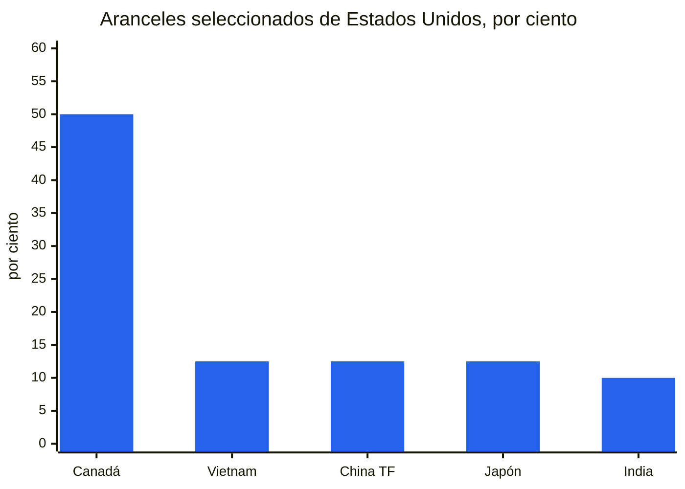

*Nota: Canadá = tasa de la Sección 338 (50%); Vietnam, China TF y Japón = tasas de la Sección 301 sobre trabajo forzoso (12,5%); India = tasa de la Sección 301 sobre trabajo forzoso en vigor (10%; la tasa anunciada del acuerdo del 18% nunca se aplicó). Fuentes: USTR, Liberty Justice Center, JD Supra.*

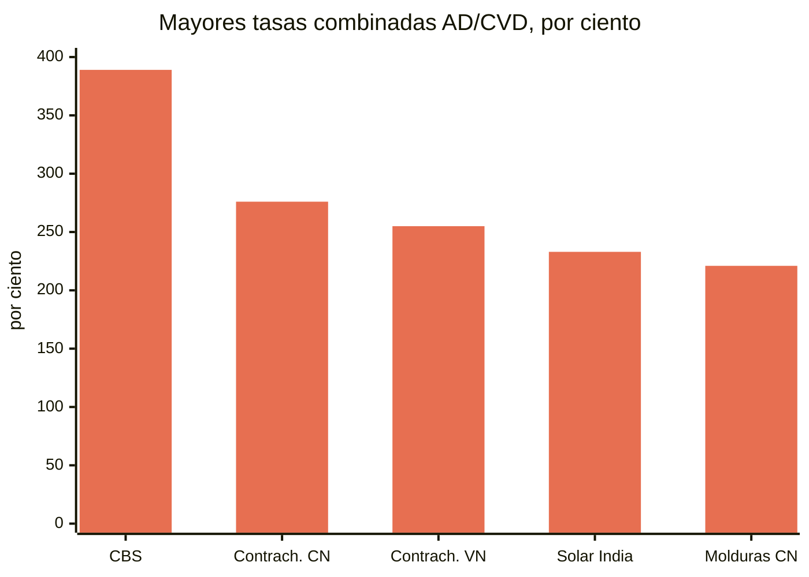

*Nota: exposición combinada de depósitos en efectivo antidumping más derechos compensatorios. Acelerador de caucho CBS: depósito AD 281,69% + CVD 107,57% (preliminar); madera contrachapada de frondosas China: AD 187,27% + CVD 88,96%; madera contrachapada Vietnam (Junma Phu Tho): AD 90,12% + CVD 165,39%; células solares India: combinado 233,26%; molduras de madera para toda China: AD 220,87% (revisión CVD aparte). Fuentes: avisos del Departamento de Comercio en el Registro Federal, noviembre de 2026.*

---

## 5. Análisis en profundidad de la política estadounidense

### Sección 301 — las exclusiones se mantienen; la investigación sobre exceso de capacidad podría llegar pronto

Sin cambios en las exclusiones de la Sección 301 para China ni en la suspensión de las tasas marítimas en la ventana: las 178 exclusiones y la suspensión de tasas rigen hasta las 23:59 ET del 9 de enero de 2027, y no apareció ningún nuevo aviso de la USTR. La APEC no produjo ninguna prórroga, y el próximo punto de decisión es ahora el G20 en Miami el 14 y 15 de diciembre. El arancel de la Sección 301 sobre trabajo forzoso (12,5% para China, Vietnam y Japón; 10% para India) sigue en vigor; el Tribunal de Comercio Internacional escuchó la impugnación de los aranceles sobre trabajo forzoso (In re Section 301 Forced Labor Cases, caso principal Learning Resources) el 30 de septiembre, y el panel de tres jueces no ha fallado y no hay fecha de fallo fijada. El 16 de octubre, el gobierno y los demandantes presentaron escritos respondiendo a las preguntas del panel sobre en qué parte de la Sección 301 se apoyó la USTR y si debía considerar el desarrollo económico. Por separado, la CBP revisó los códigos de información del Capítulo 99 para los aranceles de la Sección 301 de China el 22 de octubre (CSMS 70261629); los importadores pueden solicitar reembolsos sobre entradas anteriores de productos que la USTR excluyó posteriormente, mediante correcciones posteriores al resumen. [JD Supra](https://www.jdsupra.com/legalnews/lower-tariffs-higher-gray-market-risk-6159993/)

La investigación sobre exceso de capacidad es la cuestión abierta de la semana. Se informó de que el embajador Greer dijo el 21 de noviembre que la investigación sobre el exceso de capacidad estructural en 16 economías concluirá antes de finales de 2026, meses antes del plazo legal del 11 de marzo de 2027. Se negó a especificar las tasas arancelarias preliminares o los calendarios de sanciones específicos por país. La investigación abarca 21 sectores, incluidos automóviles, baterías de iones de litio, semiconductores, acero, aluminio, robótica, módulos solares y maquinaria de precisión. De ser exacto, el calendario acelera una decisión que los funcionarios indios han llamado el elemento determinante para el acuerdo India–Estados Unidos y que los funcionarios surcoreanos han dicho que ya va más de dos meses por detrás de su calendario previsto. No se han publicado conclusiones, medidas propuestas ni lista de productos. El informe proviene de una sola fuente; hasta el 23 de noviembre no había aparecido ningún comunicado de prensa de la USTR ni aviso en el Registro Federal. [East Asia Brief](https://eastasiabrief.com/trade-policy/ustr-accelerates-section-301-probe-hit-year-end-target-1636)

Los únicos comunicados de prensa de cumplimiento comercial de la USTR en la ventana se referían al trabajo, no a los aranceles: el 19 de noviembre, Estados Unidos pidió a México que revisara una presunta denegación de los derechos de los trabajadores en Polygroup Industrias México en virtud del Mecanismo de Respuesta Rápida Laboral del T-MEC, y una segunda solicitud RRM, relativa a Industrias FG, se emitió el 13 de noviembre. El embajador Greer pronunció comentarios virtuales para la conferencia anual de la Responsible Business Alliance el 18 de noviembre y escribió al Wall Street Journal el 16 de noviembre sobre cómo los aranceles están impulsando la prosperidad a largo plazo de los estadounidenses. [USTR](https://ustr.gov/about-us/policy-offices/press-office/press-releases)

### Sección 232 — polisilicio vence el 4 de diciembre; la robótica sigue siendo una negociación

La CBP activó cuatro clasificaciones simuladas y no oficiales del Capítulo 99 (9903.45.43, 9903.45.45, 9903.45.47, 9903.45.49) en el entorno de Certificación ACE el 12 de noviembre solo para pruebas, antes de los aranceles de la Sección 232 sobre el polisilicio y sus derivados. Los precios mínimos de importación se prueban en 21 $/kg para el polisilicio (HTSUS 2804.61.00), 100 $/kg para lingotes y obleas, 0,22 $/vatio para células solares y 0,38 $/vatio para módulos solares; el arancel equivale a la diferencia entre el valor declarado y el precio mínimo de importación, o a un arancel específico igual al precio mínimo, junto con un arancel ad valorem del 15% sobre los derivados (el polisilicio en bruto en sí está exento del arancel del 15% pero sujeto al precio mínimo). Para Japón, Corea del Sur, Taiwán, Suiza, Liechtenstein y los miembros de la UE, el arancel combinado de la Sección 232 más el arancel de la Columna 1 tiene un tope del 15%. La guía de presentación de producción con las partidas oficiales del Capítulo 99 aún debe llegar antes del 4 de diciembre. Las medidas se aplican ampliamente sin exención del T-MEC. [HTS Hero](https://htshero.com/tariff-updates/2026)

La Proclamación 11077 (robótica y maquinaria industrial, firmada el 28 de octubre, publicada el 2 de noviembre, 91 FR 69199) sigue siendo una constatación de amenaza sin nuevo arancel, que ordena al Departamento de Comercio y a la USTR negociar e informar en 180 días (aproximadamente el 26 de abril de 2027). Es la tercera vez en tres meses que la administración ha optado por las negociaciones en lugar de aranceles inmediatos tras una investigación de la Sección 232, después de las turbinas eólicas y las aeronaves comerciales. No se encontró ningún desarrollo en la ventana. [Constilumen](https://www.constilumen.com/updates/proclamation-11077-robotics-industrial-machinery-section-232)

### CBP — el plazo del Formulario 5106 pasa sin ruido; la norma sobre importadores extranjeros llega el 5 de enero

El plazo del 18 de noviembre pasó sin anulaciones informadas (véase A9). El cumplimiento subyacente está activo desde el 18 de septiembre de 2026 en virtud del aviso del 19 de agosto de la CBP (91 FR 53627): los números de importador con datos inexactos o incompletos del Formulario 5106 pueden anularse de inmediato, sin periodo de subsanación descrito, y un número anulado no puede utilizarse para introducir bienes. Los números de teléfono y las direcciones de correo electrónico son los elementos de datos que más a menudo faltan o son incorrectos en los registros ACE, según los asesores comerciales. Las cartas del 18 de noviembre fueron una oleada dirigida contra los importadores CTPAT, no el inicio de la potestad. La CBP desplegó la Mejora del Importador de Registro Extranjero en el entorno de Certificación ACE el 12 de noviembre (CSMS #70409426) y en Producción el 5 de enero de 2027; se añadieron tres nuevos campos de datos a los Formularios 3461 y 7501 de la CBP (CSMS #70381183), y la CBP dice que sus comprobaciones de validación pueden rechazar entradas y resúmenes de entrada a partir del 5 de enero cuando no se cumplan los requisitos. Los comentarios sobre la norma final provisional vencen el 5 de enero de 2027 (expediente USCBP-2026-1387). [DutyStacks](https://dutystacks.beehiiv.com/p/issue-006-apec-ends-with-a-declaration-not-a-deal-the-lukoil-clock-moves)

La sala de prensa de la CBP solo llevó comunicados locales en la ventana —una incautación en el Puerto de Entrada de Del Río de armas, municiones y drogas de salida (19 de noviembre); cocaína por valor de más de 390.000 dólares incautada en el Puerto de Entrada de Roma (18 de noviembre); 440 piezas de joyería falsificada incautadas en Cincinnati el 11 de noviembre (informado el 18 de noviembre); y un cierre temporal del puerto terrestre de Alburg Springs, Vermont, por obras (19 de noviembre). No apareció ningún comunicado nacional sobre aranceles o política comercial. El CSMS #70460453 (17 de noviembre) recordó a los importadores que las locomotoras y otros equipos ferroviarios que no cualifiquen como instrumentos de tráfico internacional deben declararse y pagarse los aranceles, incluidos los aranceles de la Sección 232 en virtud de la Proclamación 11021 sobre ciertos vagones de acero y AD/CVD sobre acopladores ferroviarios de carga procedentes de China, la República Checa, India y México. Solo orientación; sin nuevos aranceles. [CBP](https://www.cbp.gov/newsroom)

### Controles de exportación de la BIS — norma de acceso remoto, supresores y la congelación de la Lista de Entidades

La norma final provisional de acceso remoto se trata en A2 y en la sección 3.2. Dos elementos más de la BIS llegaron en la ventana. Ciertos silenciadores, amortiguadores y supresores de sonido pasaron de la Lista de Municiones de Estados Unidos (USML Categoría I) a la Lista de Control de Comercio en virtud de las nuevas ECCN 0A501.f (supresores de rifle, pistola y multi-anfitrión) y 0A502.f (supresores solo para escopeta), efectivas el 20 de noviembre (normas publicadas el 23 de julio de 2026, 91 FR 46252). La ECCN 0A501.f está controlada por motivos de seguridad nacional, estabilidad regional, control del delito, ONU y antiterrorismo; la 0A502.f lleva un nuevo control de estabilidad regional. La Excepción de Licencia LVS (hasta 500 dólares) está disponible para ambos párrafos cuando Canadá es el destino final. Los supresores diseñados especialmente para armas de fuego totalmente automáticas permanecen en la USML en virtud de la ITAR. La BIS estimó que el cambio generará unas 200 solicitudes adicionales de licencia de exportación al año. [Thomson Reuters](https://www.thomsonreuters.com/en-us/help/onesource-global-trade/regulatory-insights/2026/october-29th/us-issues-interim-final-rule-silencers-mufflers)

La suspensión de la Regla de Afiliados se extiende hasta el 10 de enero de 2027 sin ninguna nueva norma de la BIS en la ventana, pero la disputa política sobre su no utilización se intensificó. El secretario del Tesoro, Bessent, dijo el 13 de noviembre que el Tesoro, Defensa, Estado y la USTR habían favorecido durante meses incluir a Megaspeed International (un cliente de Nvidia con sede en Singapur que, según se informa, compró más de 4.800 millones de dólares en chips avanzados de Nvidia en dos años) en la Lista de Entidades, y que el Departamento de Comercio "tiene la pluma". El 15 de noviembre endureció la presión sobre la propia Nvidia. El Departamento de Comercio negó el intercambio informado en la Sala de Situación del 5 de noviembre. El Financial Times informó el 10 de noviembre de que el Departamento de Comercio ha intentado frenar las nuevas incorporaciones a la Lista de Entidades, y que la lista no ha tenido incorporaciones en 13 meses (última incorporación el 9 de octubre de 2025), con más de 100 candidatos a la espera de la aprobación del panel de revisión, incluido el laboratorio chino de IA DeepSeek. El secretario de Comercio, Howard Lutnick, ha aceptado testificar ante la Comisión Bancaria del Senado el 10 de diciembre de 2026. Tres demócratas de la Cámara escribieron a Lutnick el 9 de noviembre exigiendo respuestas escritas para el 1 de diciembre. Por separado, los registros comerciales malasios citados por Bloomberg muestran que Megaspeed importó al menos 17.544 procesadores Nvidia GB300 por valor de unos 787 millones de dólares en noviembre de 2025, y un registro policial indonesio de la unidad local de Megaspeed solicitado por el FBI encontró bastidores de GPU vacíos. Nvidia dice que incluyó a Megaspeed en su lista interna de bloqueo en junio de 2025. [ExplainX](https://explainx.ai/blog/bessent-blames-commerce-megaspeed-entity-list-lutnick-ouster-talks-nvidia-huang-2026)

### Registro Federal — actividad AD/CVD en la ventana

La actividad comercial de la semana en el Registro Federal estuvo dominada por avisos de derechos antidumping y compensatorios, detallados en la sección 7: órdenes sobre madera contrachapada de frondosas y decorativa (17 de noviembre), resultados finales de la revisión sobre molduras y carpintería de madera (17 de noviembre), la determinación preliminar de la USITC sobre cajas de cartón corrugado troqueladas (17 de noviembre), y preliminares de revisión sobre bridas de acero al carbono terminadas (16 de noviembre). No aparecieron en la ventana nuevas órdenes de retención de liberación, nuevas normas de la BIS más allá de la norma de acceso remoto, nuevas proclamaciones arancelarias de la Casa Blanca ni nuevos avisos de la Sección 301 de la USTR. El Registro Federal no se examinó documento por documento durante toda la semana, por lo que pueden existir otros avisos de revisión administrativa.

### Temas permanentes

- **AGOA:** el presidente Trump notificó al Congreso y a los gobiernos de Ruanda y Sudáfrica el 2 de noviembre su intención de terminar su condición de beneficiarios de la AGOA a partir del 1 de enero de 2027, tras la revisión anual interagencial de elegibilidad (audiencia pública el 23 de julio). La AGOA se prorrogó por ley hasta el 31 de diciembre de 2028. Para finalizar la terminación, el presidente debe emitir una proclamación antes del 1 de enero que elimine a ambos países de la lista HTSUS de beneficiarios de la AGOA; hasta el 23 de noviembre no se había publicado ninguna proclamación de ese tipo. Las exportaciones sudafricanas afrontarían entonces los aranceles estándar NMF en lugar del trato libre de aranceles de la AGOA. [USTR](https://ustr.gov/about/policy-offices/press-office/press-releases/2026/november/ambassador-greer-issues-statement-president-trumps-intent-terminate-rwanda-and-south-africa-agoa)
- **Perspectiva arancelaria tras las elecciones de mitad de mandato:** las elecciones del 3 de noviembre dieron una mayoría demócrata en el Congreso que asumirá en enero, pero la elección en sí no cambia ninguna tasa arancelaria; los aranceles restantes se apoyan en la autoridad de la Sección 301 y la Sección 232, y cambiarlos requeriría acción ejecutiva o legislación a prueba de veto. La secuencia: aranceles IEEPA anulados el 20 de febrero de 2026, recaudación terminada el 24 de febrero; un recargo del 10% de la Sección 122 rigió del 24 de febrero al 24 de julio de 2026 y venció tras su máximo legal de 150 días sin prórroga del Congreso; los aranceles de la Sección 301 que cubren 60 economías entraron en vigor el 24 de julio de 2026 al 10% o al 12,5%. Se aconseja a los fabricantes no asumir que la actual protección arancelaria durará. [JD Supra](https://www.jdsupra.com/legalnews/lower-tariffs-higher-gray-market-risk-6159993/)
- **Casa Blanca:** no se identificó ninguna nueva proclamación arancelaria ni hoja informativa en la ventana. La proclamación pertinente más reciente sigue siendo la Proclamación 11077 (robótica y maquinaria industrial).

---

## 6. Política mundial por región

### Europa

**CEPA UE–Indonesia firmado, 21 de noviembre.** Tras casi una década de negociaciones, la UE e Indonesia firmaron un Acuerdo de Asociación Económica Integral y un Acuerdo de Protección de Inversiones por separado en Bruselas. El comisario europeo de Comercio, Maroš Šefčovič, firmó por el bloque; la presidenta de la Comisión, Ursula von der Leyen, asistió. El Consejo había aprobado la firma el 18 de noviembre. Indonesia eliminará los aranceles sobre el 98,5% de las líneas arancelarias para los productos de la UE una vez que las disposiciones entren plenamente en vigor; la Comisión dice que el acuerdo ahorrará a los exportadores de la UE más de 600 millones de euros al año en derechos de aduana, y 221 indicaciones geográficas de la UE reciben protección. El Parlamento Europeo aún debe dar su consentimiento e Indonesia debe ratificar; ambas partes aspiran a la aplicación provisional desde principios de 2027. Von der Leyen dijo que el presidente Prabowo Subianto visitará Bruselas el 11 de diciembre. La firma cierra casi diez años de conversaciones y es la segunda gran firma comercial asiática de la UE en el año, parte de un impulso de diversificación a medida que las relaciones con Estados Unidos y China se vuelven más difíciles. Para los exportadores, el punto práctico es que el acuerdo está firmado, no en vigor; las decisiones de abastecimiento y precios no deben asumir aún las nuevas tasas. [Turkish Post](https://turkishpost.com.tr/en/2026/11/21/eu-indonesia-trade-deal/)

**Firma del TLC UE–India fijada para el 16 de diciembre de 2026.** Se espera ahora que el acuerdo de libre comercio UE–India se firme el 16 de diciembre de 2026 en Bruselas durante la visita del primer ministro Narendra Modi, según un funcionario indio citado por PTI e informado el 22 de noviembre. La Comisión ha presentado propuestas al Consejo solicitando autorización para la firma y la conclusión, junto con el texto jurídico final y los calendarios arancelarios. El embajador de la UE en India, Jean-Eric Paquet, confirmó el calendario de mediados de diciembre durante una visita a Assam. Se espera la entrada en vigor en 2027, tras la aprobación del Parlamento Europeo, la conclusión del Consejo y la ratificación india. En virtud del pacto, el 93% de los envíos indios recibirían acceso libre de aranceles a la UE, incluidos aranceles cero sobre unos 33.000 millones de dólares en exportaciones intensivas en mano de obra. Las negociaciones concluyeron el 27 de enero de 2026. Un acuerdo separado de protección de inversiones y un acuerdo sobre indicaciones geográficas siguen en negociación. [Asia Daily](https://asiadaily.org/news/19949/)

**Tasa de tramitación de 2 € de la UE: primeros datos de impacto — los paquetes de bajo valor bajan más de un 60%.** La tasa de tramitación de la Unión de 2 € por línea de artículo (Reglamento Delegado (UE) 2026/2152) y los Identificadores de Producto obligatorios entraron en su tercera semana. Nuevo detalle confirmado esta semana: la Comisión dice que los volúmenes de paquetes de bajo valor cayeron más de un 60% frente a la tendencia previa a los aranceles en el tercer trimestre de 2026, ya que algunos vendedores pasaron a enviar existencias a granel a almacenes de la UE. La Comisión también informa de que en 2025 se importaron 5.900 millones de artículos de comercio electrónico de bajo valor en la UE, cuatro veces la cifra de 2022, con más del 90% procedentes de China. Tanto el arancel fijo de 3 € como la tasa de 2 € forman parte de la base imponible del IVA en virtud de la guía revisada de la Comisión del 6 de octubre de 2026. La tasa nacional italiana de 2 € por envío de hasta 150 € se aplazó al 1 de diciembre de 2026, además de los cargos de la UE. Una campaña de inspección en toda Europa encontró que más del 60% de los artículos revisados no cumplían las normas europeas. La primera evidencia sólida sobre el reajuste de importaciones de bajo valor de la UE muestra un cambio brusco de comportamiento: los volúmenes de paquetes cayeron más de un 60% frente a la tendencia en el tercer trimestre, antes incluso de que entrara en vigor la tasa de 2 €, a medida que los vendedores trasladaban existencias a almacenes de la UE para evitar cargos por artículo. La tasa es permanente, se aplica a cualquier valor y no es reembolsable ni siquiera en las devoluciones, por lo que cambia la economía de las devoluciones además del coste de desembarque. No se publicaron cifras oficiales sobre los ingresos recaudados ni los retrasos en el despacho en la ventana. [Fashion Law Journal](https://fashionlawjournal.com/eu-small-parcel-tax/)

**Salvaguardia de la UE para coches híbridos.** Véase A4. La Comisión abrió la investigación el 30 de octubre; las alegaciones escritas cerraron el 20 de noviembre; se esperan medidas provisionales a partir del 1 de diciembre con un tope informado de 350.000 vehículos anuales para los híbridos fabricados en China. [Ports Europe](https://www.portseurope.com/eu-opens-hybrid-safeguard-probe-as-chinese-shipments-outrun-planned-quota/)

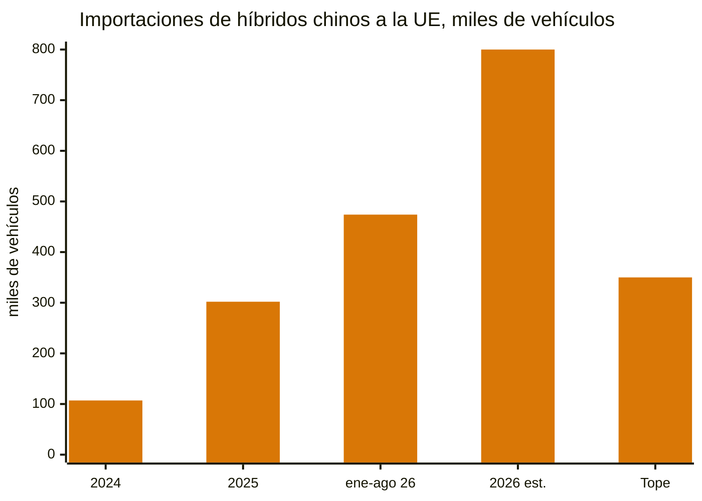

*Nota: las importaciones son cifras de Eurostat; la proyección de 2026 es la estimación de la Comisión; el tope es el tope de salvaguardia informado para el primer año de 350.000 vehículos. Fuente: Eurostat vía Ports Europe; Comisión.*

**TLC UE–Australia: firmado en marzo, ratificación incierta; sin novedades en la ventana.** El TLC UE–Australia se concluyó el 24 de marzo de 2026 y se firmó en Canberra el mismo día, pero aún no está en vigor y no puede aplicarse sin escrutinio parlamentario y cambios en la legislación australiana, un proceso que el DFAT dice que podría tardar hasta dos años. El embajador de Alemania en Australia dijo el 29–31 de octubre que la ratificación en Australia depende de los votos en el Senado de la Coalición, los Verdes o los independientes, y expresó la esperanza de que pudiera completarse en el primer trimestre de 2027; el Partido Nacional de la oposición ha prometido oponerse y el Partido Liberal no ha declarado su posición. La UE ha advertido de que el acuerdo no se renegociará si el parlamento lo rechaza. No se espera la entrada en vigor antes de finales de 2027. El 98% de las exportaciones de Australia por valor entrarían en la UE libres de aranceles; el comercio bilateral supera los 109.000 millones de dólares australianos al año. [AAP](https://aapnews.aap.com.au/news/claim-eu-trade-deal-mandates-methane-reducing-livestock-feed-is-baseless)

**Acuerdo de comercio digital UE–Canadá concluido el 30 de octubre; texto aún no público.** La UE y Canadá concluyeron las negociaciones de un Acuerdo de Comercio Digital el 30 de octubre de 2026, que complementa el CETA (aplicado provisionalmente desde 2017). El acuerdo establece normas para los flujos transfronterizos de datos, los contratos electrónicos, las firmas electrónicas y las facturas electrónicas, la protección del consumidor en línea y los mensajes comerciales no solicitados. Las negociaciones se lanzaron solo en marzo de 2026 en la quinta reunión del Comité Conjunto del CETA. El texto acordado no se ha publicado; la depuración jurídica y la traducción a todos los idiomas de la UE preceden a la firma. La rapidez de la negociación —concluida en ocho meses desde su lanzamiento— refleja la prioridad política que ambas partes atribuyen a las normas de comercio digital a medida que la política estadounidense se vuelve menos predecible. La firma y la entrada en vigor siguen siendo un asunto de 2027 como muy pronto. [European Commission](https://policy.trade.ec.europa.eu/news/eu-and-canada-conclude-negotiations-digital-trade-agreement-2026-10-30_en?prefLang=ga)

**Normas de origen automotrices Reino Unido–UE: ACEA y SMMT advierten de que uno de cada cuatro vehículos eléctricos afronta un arancel del 10% a partir del 1 de enero de 2027.** ACEA y SMMT advirtieron de que las normas de origen más estrictas del Acuerdo de Comercio y Cooperación Reino Unido–UE para los vehículos eléctricos e híbridos, que entrarán en vigor el 1 de enero de 2027, dejarían a menos de uno de cada cuatro vehículos eléctricos de batería e híbridos enchufables comercializados entre los dos mercados cualificando para el trato libre de aranceles, exponiendo al resto a un arancel del 10%. Las asociaciones también advirtieron de que la propuesta Ley Aceleradora Industrial de la UE podría imponer aranceles a los vehículos y componentes británicos, amenazando una relación comercial automotriz por valor de 87.000 millones de dólares estadounidenses al año. La UE aún importa alrededor de dos tercios de sus baterías de iones de litio pese a unos 80.800 millones de dólares estadounidenses invertidos en las cadenas de suministro de baterías de la UE desde 2017. La VDA de Alemania argumentó en noviembre a favor de aplazar el cambio de las normas de origen hasta que se desarrolle la cadena de suministro de baterías de la UE. La cumbre del 20 de noviembre no produjo una resolución informada sobre este punto. [Manufacturing Digital](https://manufacturingdigital.com/news/acea-smmt-uk-eu-tariff-rules-threaten-auto-manufacturers)

### Reino Unido

**Cumbre Reino Unido–UE, 20 de noviembre: acuerdo SPS, vinculación ETS y exenciones mutuas del CBAM acordadas.** Véase la sección 3.3. En la segunda cumbre Reino Unido–UE, ambas partes acordaron un acuerdo SPS (aplicación el 1 de marzo de 2028; el Gobierno británico estima que podría aumentar la producción económica hasta 5.100 millones de libras al año para 2040), la vinculación del Sistema de Comercio de Emisiones del Reino Unido con el Sistema de Comercio de Emisiones de la UE (exenciones mutuas del CBAM con objetivo a partir del 1 de enero de 2028; unos 6.500 millones de libras de exportaciones británicas podrían beneficiarse), y medidas de movilidad juvenil. El Reino Unido eximirá a los bienes originarios de la UE, el EEE y Suiza de su CBAM a partir del 1 de enero de 2027. Los acuerdos aún no han entrado en vigor; se requieren más procesos jurídicos y de aplicación. [Thames Valley Chamber](https://www.thamesvalleychamber.co.uk/uk-eu-summit-2026-new-trade-agreements-reached/)

**El ámbito del CBAM británico se ampliará a los productos de refinería; consulta lanzada en el Presupuesto 2026.** El Gobierno tiene la intención de ampliar el Mecanismo de Ajuste en Frontera por Carbono del Reino Unido para incluir los productos de refinería, sujeto a consulta sobre la viabilidad y los impactos. La consulta se lanzó en el Presupuesto 2026. No se dio ningún calendario; el Gobierno dijo que tiene la intención de aplicar la medida "tan pronto como sea factible" y expondrá un calendario a su debido tiempo. El CBAM británico, tal como se legisló, comienza el 1 de enero de 2027 para el aluminio, el cemento, los fertilizantes, el hidrógeno y el hierro y el acero. La ampliación extendería el CBAM británico más allá de sus cinco sectores iniciales hacia los productos petrolíferos refinados, pero sigue en fase de consulta sin fecha. Se sitúa junto al acuerdo de la cumbre del 20 de noviembre, en virtud del cual los bienes de origen de la UE estarán exentos del CBAM británico a partir del 1 de enero de 2027 —por lo que la ampliación a los productos de refinería, si procede, recaería en la práctica principalmente sobre los proveedores no pertenecientes a la UE. [UK Parliament](https://questions-statements.parliament.uk/written-questions/detail/2026-10-28/39108)

**Sin nuevos avisos de medidas comerciales del Reino Unido en la ventana; la prórroga del arancel sobre la trucha arcoíris se mantiene.** No se encontró ningún nuevo aviso de medidas comerciales en la ventana de cobertura. El tema permanente: el Aviso de Medidas Comerciales 2026/31 prorrogó el derecho compensatorio sobre la trucha arcoíris turca durante cinco años hasta el 30 de enero de 2031, efectivo el 6 de noviembre de 2026, a las tasas existentes (específicas por exportador 1,5%–8%; todos los demás 9,5%). El inicio del CBAM británico el 1 de enero de 2027 es ahora el evento comercial británico fechado más próximo.

### Canadá

**Acuerdo bilateral Canadá–China prorrogado y ampliado, 17 de noviembre.** Canadá y China prorrogaron y ampliaron el Acuerdo Conjunto Preliminar sobre la Resolución de Cuestiones Económicas y Comerciales Bilaterales. China proporcionará un alivio arancelario adicional para aproximadamente 400 millones de dólares canadienses en exportaciones canadienses —116 millones de dólares canadienses en cortes de cerdo congelado y 285 millones de dólares canadienses en pescado y marisco (camarón y langostino de agua fría congelados, incluidos 87,5 millones de dólares canadienses en langostino manchado del Pacífico; moluscos, incluidos 61,4 millones de dólares canadienses en geoduck; pepino de mar 39,4 millones de dólares canadienses; fletán de Groenlandia 96 millones de dólares canadienses)— suspendiendo un arancel adicional del 25% sobre esos productos desde el 1 de enero de 2027 hasta el 31 de diciembre de 2028. La ampliación se basa en la prórroga de dos años del alivio arancelario para la harina de canola, los guisantes, la langosta y el cangrejo acordada a principios de noviembre (conversaciones ministeriales el 4 de noviembre). A cambio, Canadá prorrogó por dos años las medidas de remisión existentes para ciertos productos de acero y aluminio chinos que vencían a finales de 2026, y amplió la cobertura de remisión a 32 partidas arancelarias adicionales de acero y aluminio (23 de acero, 9 de aluminio) donde el suministro canadiense es insuficiente o no está disponible. La cifra de 400 millones de dólares canadienses es el valor de las exportaciones canadienses en esas categorías en 2024, antes de los aranceles adicionales de China; no es un pago ni una garantía de nuevos negocios. La nueva fecha de vencimiento del acuerdo es el 31 de diciembre de 2028. El acuerdo también revive un swap de divisas bilateral, según el resumen de la APEC de China Briefing. [Prime Minister of Canada](https://www.pm.gc.ca/en/news/news-releases/2026/11/17/prime-minister-carney-advances-canadas-strategic-partnership-china)

**Impugnación judicial de la Sección 338: vista oral fijada para el 20 de enero de 2027.** Véase la sección 3.7 y A9 en el informe de la semana pasada. Los escritos de amicus curiae en apoyo de la impugnación de los aranceles de la Sección 338 sobre los bienes canadienses fueron presentados por las ex USTR Carla Hills y Robert Zoellick, académicos de comercio y defensores de los contribuyentes; el Liberty Justice Center anunció las presentaciones el 16 de noviembre. La vista oral está programada para el 20 de enero de 2027. El escrito de respuesta del gobierno vence el 11 de diciembre de 2026, y la réplica de Gellert vence el 11 de enero de 2027. El caso (Gellert Global Group Corp. v. Trump, causa n.º 26-04636) impugna aranceles del 50% sobre unos 20.000 millones de dólares en importaciones canadienses; Gellert dice que pagará aproximadamente 40 millones de dólares al año por el queso canadiense y que ha pagado al menos 381.000 dólares estadounidenses en entradas realizadas del 15 de septiembre al 7 de octubre de 2026. El 28 de octubre, el tribunal concedió en parte y denegó en parte la moción de Gellert (la entrada del expediente no especifica qué partes). La Proclamación 11076 reescribió de nuevo la lista de productos de vehículos de motor para los bienes introducidos a partir del 30 de octubre de 2026. Los aranceles siguen en vigor. [Liberty Justice Center](https://libertyjusticecenter.org/pressrelease/former-u-s-trade-representatives-scholars-back-liberty-justice-centers-challenge-to-trumps-canadian-tariffs/)

**El panorama de ingresos por alivio arancelario de Canadá: 14.100 millones de dólares canadienses evaluados, 8.900 millones remitidos.** Desde marzo de 2025 hasta el 26 de octubre de 2026, Canadá evaluó 14.100 millones de dólares canadienses (unos 10.000 millones de dólares estadounidenses) en aranceles sobre los productos estadounidenses, pero 8.900 millones de dólares canadienses fueron remitidos o eximidos, dejando ingresos netos de 5.200 millones de dólares canadienses. Esto cuantifica la amplitud del programa de remisión: la mayoría de los contraranceles no han producido realmente ingresos. Los cambios del 9 de noviembre (remisión horizontal prorrogada hasta el 30 de junio de 2028; alivio eliminado para ciertos remolques a partir del 1 de diciembre de 2026 y para ciertos alambres de aluminio, extrusiones y cartón a partir del 1 de febrero de 2027) se mantienen como se informó la semana pasada; sin más cambios en la ventana. [Mining Weekly](https://www.miningweekly.com/article/canada-expands-us-tariff-exemptions-cuts-some-aluminium-relief-2026-11-10)

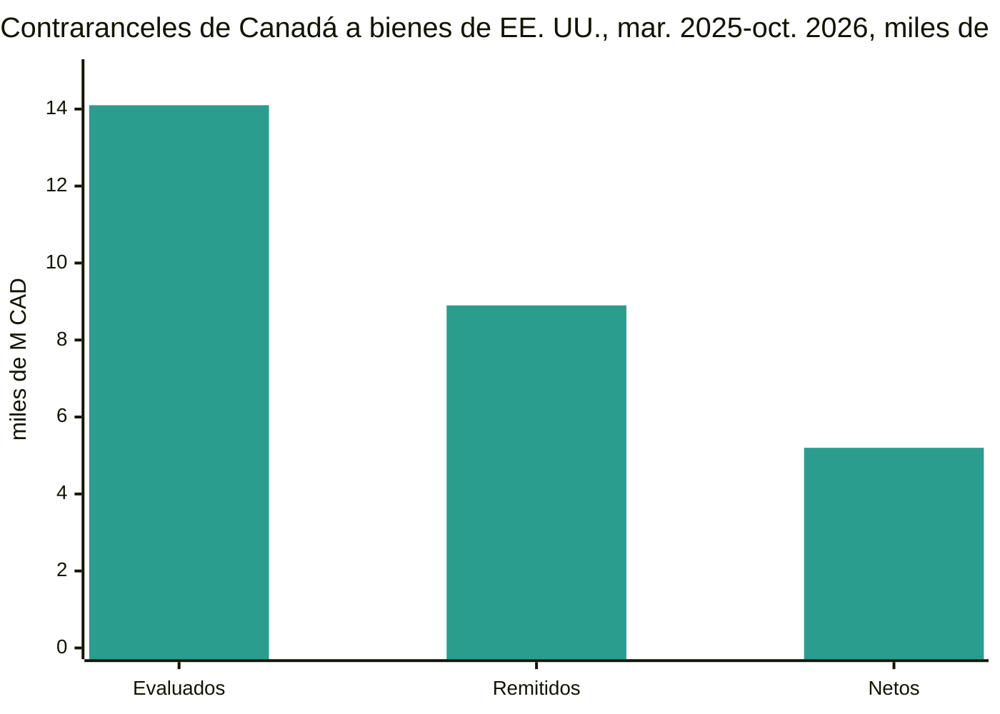

*Nota: aranceles evaluados sobre productos estadounidenses de marzo de 2025 al 26 de octubre de 2026; remitidos o eximidos en virtud del programa de remisión; ingresos netos. Fuente: divulgación del Gobierno de Canadá vía Mining Weekly, 10 de noviembre de 2026.*

**Canadá cuestiona a India en la OMC por las existencias de arroz desviadas al etanol.** Canadá planteó preguntas formales en la OMC el 14 de noviembre sobre la asignación por parte de India de existencias estatales de arroz a fabricantes de etanol, solicitando detalles sobre el volumen de grano público desviado a la destilación nacional de alcohol combustible. Esto sigue el patrón de escrutinio del comité de agricultura sobre el apoyo interno de India (véase Multilateral). No se informó de ninguna respuesta india en la ventana. [Distillers Hub](https://distillershub.com/news/111420315/)

### China

**Los controles de exportación de doble uso sobre drones, tuneladoras y dragas entraron en vigor el 18 de noviembre.** Los Anuncios n.º 49 (drones), n.º 50 (tuneladoras y equipos conexos) y n.º 51 (dragas) entraron en vigor el 18 de noviembre de 2026, revisando la Lista de Control de Exportación de Artículos de Doble Uso. Se requieren licencias para los pilotos automáticos de drones, los drones capaces de volar más allá de la línea de visión con una autonomía de al menos tres horas, los motores diseñados especialmente para drones, y los drones con un alcance de 300 km o más o equipados para la dispersión de aerosoles por encima de 80 litros. El Anuncio n.º 49 eleva el umbral de autonomía para los drones controlados de una hora a tres horas, por lo que los drones de consumo masivo por debajo de ese umbral ya no necesitan licencias, mientras los controles se extienden a más piezas de drones. El Anuncio n.º 50 impone controles sobre las tuneladoras por primera vez, además de determinadas excavadoras ambulantes y máquinas de hormigón proyectado de gran altitud; las exportaciones a destinos sensibles requieren licencias, otros destinos pueden utilizar certificados basados en el registro, sujetos a restricciones de transferencia ulterior. El Anuncio n.º 51 añade licencias para determinadas bombas de dragado, cabezales de arrastre y cabezales de corte. Una norma de reexportación también se aplica desde el 18 de noviembre: las empresas extranjeras necesitan una licencia china para pasar maquinaria de construcción de origen chino, como las tuneladoras, a ciertos países. Por separado, el Anuncio n.º 52 del MOFCOM y la GAC (19 de octubre) revisó los procedimientos en virtud de los cuales las aduanas pueden retener bienes presentados para la exportación sin licencia. Los controles ya están en vigor, y su diseño tiene dos caras: los umbrales se elevaron para que los drones comerciales ordinarios queden fuera del régimen, mientras la red se amplió a las tuneladoras —una primicia— y a las reexportaciones de maquinaria de origen chino por parte de empresas extranjeras. Esa norma de reexportación es el filo más agudo para los compradores y revendedores de terceros países, ya que alcanza transacciones sin exportador chino. [Mondaq](https://alpha.mondaq.com/china/new-technology/1870494/new-chinese-export-control-measures-tighten-restrictions-on-the-export-of-advanced-technologies-and-dual-use-goods-strengthen-enforcement)

**Catálogo de exportación de tecnología: los comentarios cerraron el 15 de noviembre; el registro provisional es ahora el régimen vigente.** Los comentarios públicos sobre el Anuncio n.º 48 (16 de octubre), que añadiría 40 tecnologías al Catálogo de Tecnologías Prohibidas o Restringidas para la Exportación (23 de IA, 5 biofarmacéuticas, 12 fotovoltaicas; 14 prohibidas, 26 restringidas), cerraron el 15 de noviembre. Hasta el 23 de noviembre no se había publicado ningún catálogo final. Lo que está vigente ahora es el requisito provisional de registro previo a la exportación en vigor desde el 16 de octubre, que abarca las exportaciones de las tecnologías enumeradas, incluidas las transacciones ya en curso y las transferencias de propiedad o control de una empresa nacional que posea las tecnologías a una entidad extranjera. Un nuevo análisis de esta semana aclaró el ámbito: en biofarmacia, las transferencias de propiedad de plataformas de terapia celular y génica y de siRNA estarían prohibidas, pero la concesión de licencias, los servicios CRO/CDMO y la tecnología necesaria para la I+D o la fabricación de productos en una transacción de desarrollo empresarial saliente no lo estarían; en IA, el despliegue local en el extranjero de un modelo restringido cuenta como exportación de tecnología, mientras el acceso API, la interacción con aplicaciones o web, el SaaS y el despliegue ligero en el dispositivo quedan fuera del ámbito. La revisión de la exportación de tecnología restringida tarda hasta unos 45 días laborables en dos etapas. El MOFCOM también abrió una consulta sobre el proyecto de Medidas para las Investigaciones y la Aplicación del Control de Exportación de Doble Uso, con comentarios hasta el 29 de noviembre de 2026. Las disposiciones solares siguen siendo las más importantes para los fabricantes extranjeros, ya que abarcan la producción de polisilicio, las obleas de 70 micrómetros o menos, y la fabricación de células de perovskita y en tándem. [Jones Day](https://www.jonesday.com/en/insights/2026/11/china-tightens-its-grip-on-exports-of-strategic-technologies-what-it-means-for-technology-deals-involving-ai-and-biotech)

**Sitio en inglés del MOFCOM accesible; la página principal solo muestra la conferencia de prensa del 12 de noviembre.** El sitio en inglés era accesible el 23 de noviembre. El contenido de la página principal se limitaba a la conferencia de prensa regular del 12 de noviembre (incluidos los comentarios sobre la videollamada del 6 de noviembre de He Lifeng con Bessent y Greer, y sobre el evento de emparejamiento de dispositivos médicos China–UE en la CIIE) y a las ediciones de la Gaceta. No se veían nuevos anuncios sobre el catálogo de tecnología ni sobre la suspensión del galio en la página principal. El portal en inglés del MOFCOM sigue siendo una fuente escasa —solo titulares, con los anuncios sustantivos apareciendo primero en chino. La conferencia de prensa del 12 de noviembre confirmó ocho rondas de consultas económicas y comerciales entre China y Estados Unidos desde mayo de 2025. La suspensión relacionada con el galio (Anuncio n.º 72 de 2025) vence el 27 de noviembre de 2026 y hasta el 23 de noviembre no se había encontrado ningún aviso modificatorio. [MOFCOM](https://english.mofcom.gov.cn/)

**China–Estados Unidos: sin resultado arancelario de la APEC; la tregua sigue hasta el 9–10 de enero de 2027.** Véase A1 y la sección 3.1. La bilateral Xi–Trump del 19 de noviembre no produjo ningún anuncio de alivio arancelario ni resultado sobre tierras raras; las informaciones describen un estancamiento sobre aranceles, tierras raras y semiconductores. Trump presionó a China para que cumpliera la promesa de comprar 17.000 millones de dólares estadounidenses en productos agrícolas estadounidenses; los funcionarios chinos dijeron que la promesa está condicionada a reducciones arancelarias recíprocas. Los dos líderes acordaron redactar un plan de acción para la "estabilidad estratégica" entre Estados Unidos y China. Los paquetes propuestos de recortes arancelarios recíprocos de 30.000 millones de dólares por 30.000 millones de dólares y de 60.000 millones de dólares siguen sin finalizarse. [China Briefing](https://www.china-briefing.com/news/apec-2026-in-shenzhen-what-the-leaders-meeting-and-trump-xi-talks-mean-for-business/)

### India

**El acuerdo India–Estados Unidos sigue sin firmarse; el secretario de Comercio dice que la firma debe esperar al marco arancelario estadounidense.** Véase la sección 3.7. El secretario de Comercio, Rajesh Agrawal, dijo el 18 de noviembre que el acuerdo comercial propuesto India–Estados Unidos no puede firmarse hasta que Washington ponga en marcha una nueva arquitectura arancelaria tras el desmantelamiento por parte del Tribunal Supremo de los aranceles recíprocos y de emergencia, porque las ventajas comparativas ofrecidas a los distintos países deben quedar claras. También debe conocerse el resultado de las investigaciones en curso de la Sección 301 —incluida la investigación sobre exceso de capacidad, cuyos resultados se esperan en unas semanas o meses— ya que todos los países querrían certeza sobre esas investigaciones. El acuerdo jurídico se ha negociado y está en sus etapas finales; ambas partes quieren concluir lo antes posible. Jaishankar dijo el 14 de noviembre que el acuerdo está en su "tramo final" y que la mayor parte de los asuntos están resueltos. El marco del 7 de febrero de 2026 fijó una tasa estadounidense del 18%, nunca aplicada; los productos indios pagan actualmente un arancel de la Sección 301 del 10%. [The Hindu BusinessLine](https://www.thehindubusinessline.com/economy/no-india-us-trade-deal-until-new-us-tariff-framework-section-301-probes/article71716562.ece/amp/)

**India–UE: firma el 16 de diciembre; líneas rojas sobre lácteos y OMG reafirmadas.** Sin cambios en las líneas rojas informadas la semana pasada: India nunca ha abierto su sector lácteo en ningún TLC y no permitirá importaciones de productos genéticamente modificados. La firma UE–India está ahora fechada para el 16 de diciembre (véase Europa). Las líneas rojas son estables y relevantes para todas las vías vivas de TLC indias, incluido el acuerdo estadounidense sin firmar, donde la agricultura y los lácteos figuran entre las sensibilidades sin resolver.

### Asia-Pacífico

**APEC Shenzhen: los líderes adoptan la Perspectiva de Shenzhen; sin acuerdo arancelario; acuerdos paralelos para Canadá, Chile, Filipinas, Perú e Indonesia.** Véanse las secciones 3.1 y 3.7. Acuerdos paralelos: alivio arancelario China–Canadá (véase Canadá); Acuerdo de Asociación Económica Integral Filipinas–Chile firmado el 19 de noviembre —el primer TLC de Filipinas con un país latinoamericano, acceso preferencial para 8.632 categorías de productos, trato libre de aranceles para prácticamente todos los envíos filipinos existentes a Chile (electrónica, maquinaria, coco desecado, carragenina, atún procesado); TLC Perú–Tailandia firmado el 19 de noviembre; hoja de ruta económica y comercial China–Chile y memorando de entendimiento sobre libre comercio y multilateralismo; China–Indonesia anunció el 20 de noviembre el lanzamiento de negociaciones de CEPA. Filipinas también expresó interés en unirse al CPTPP y dijo que sus negociaciones de TLC Filipinas–Canadá han concluido. [BusinessMirror](https://businessmirror.com.ph/2026/11/20/new-trade-deal-opens-chile-market-for-phl/)

**Pax Silica: Declaración de San Francisco firmada el 15 de noviembre por Estados Unidos y ocho socios.** Estados Unidos y ocho socios firmaron la Declaración de San Francisco sobre los Fundamentos Seguros de la Prosperidad Duradera en el marco de Pax Silica, acordando elaborar una lista compartida de tecnologías sensibles y cadenas de suministro críticas que necesitan mayor protección, intercambiar información sobre vulnerabilidades y organizar grupos de trabajo. La declaración abarca semiconductores, infraestructura de IA, minerales críticos, energía, manufactura avanzada, logística de transporte y redes de comunicaciones, y apunta a las prácticas no de mercado, el exceso de capacidad y el dumping desleal. No es vinculante: sin compromiso de financiación, sin empresas nombradas, sin plazo de aplicación, y la propia lista compartida no se ha redactado ni publicado. Pax Silica, lanzada en diciembre de 2025, cuenta ahora con unos 26 participantes. Los miembros de la UE no asistieron al Retiro de Fundadores pero están revisando el documento por su "compatibilidad normativa"; se espera que Alemania, Suecia, los Países Bajos y la Comisión Europea firmen en breve. La declaración hace pasar a Pax Silica de una declaración de asociación amplia a una coordinación concreta de seguridad —la tarea es una lista conjunta de tecnologías e infraestructuras que proteger— pero el entregable aún no existe, por lo que su efecto comercial es prospectivo. Hay que observar si los miembros de la UE firman y si la lista compartida, cuando se redacte, produce consecuencias de control de exportaciones o de examen de inversiones. [Asia Daily](https://asiadaily.org/news/18839/)

**Filipinas asegura 41.100 millones de dólares estadounidenses en promesas de inversión en la APEC; interés en el CPTPP declarado.** El presidente Marcos regresó de Shenzhen con promesas de inversión por valor de 41.100 millones de dólares estadounidenses que abarcan la manufactura, los vehículos eléctricos y la tecnología de energía limpia, con potencial para más de 7.000 empleos. La promesa más concreta es la de C&U Group por 87 millones de dólares estadounidenses para una instalación de 20 hectáreas en Alitagtag, Batangas. Filipinas también expresó interés en unirse al CPTPP durante una reunión con la presidenta mexicana Claudia Sheinbaum, y señaló sus negociaciones concluidas de TLC Filipinas–Canadá y el CEPA Filipinas–Chile firmado. Las exportaciones filipinas crecieron un 15,4% en 2025 con aumentos mensuales continuados de enero a septiembre de 2026. Las promesas no son gastos de capital, y el titular de 41.100 millones de dólares estadounidenses debe leerse como una señal de intención más que como inversión comprometida; la instalación de C&U es el único compromiso detallado. [Further Asia](https://furtherasia.com/philippines-gets-us41-1b-investment-pledges-after-apec/)

**Arancel Corea–Brasil sobre cosméticos: sin novedades en la ventana.** El expediente sigue en la fase de impulso presidencial sin resultado de negociación informado. El tema de la semana pasada se mantiene: el presidente Lee presionó en una reunión de gabinete del 3 de noviembre para conversaciones rápidas sobre el arancel del 25% de Brasil sobre los cosméticos coreanos, tras la reelección de Lula el 25 de octubre. Las exportaciones coreanas de cosméticos alcanzaron 12.400 millones de dólares estadounidenses en los diez primeros meses de 2026, un 27,3% más interanual. [Seoul Economic Daily](https://en.sedaily.com/politics/2026/11/03/lee-presses-brazil-to-cut-25-percent-tariff-on-korean)

### Multilateral

**Vía de reforma de la OMC: Estados Unidos desafía a China y rechaza la agricultura en la vía del "campo de juego nivelado"; sin paquete MC15 sin agricultura, advierte Brasil.** En una reunión maratoniana el 16 de noviembre sobre las cuestiones de "campo de juego nivelado" de la vía de reforma de la OMC, Estados Unidos dijo que sigue preocupado por una relación comercial bilateral "insostenible" con China, alegando que Pekín no juega según las normas, y sugirió que la asimetría —un déficit comercial descrito como probablemente de 1 billón de dólares estadounidenses al año— se había vuelto demasiado grande para abordarla en el marco de las normas vigentes de la OMC. Washington también transmitió que la no discriminación, incluido el trato NMF, no podía aplicarse ante las continuas asimetrías. Estados Unidos, junto con los países del G10 defensores de la agricultura liderados por Noruega, Japón y Suiza, se opuso a incluir la agricultura en los debates sobre el campo de juego nivelado, insistiendo en que la agricultura pertenece solo al Comité de Agricultura en Sesión Especial. Varios países apoyaron las propuestas de China sobre el campo de juego nivelado, incluidos los debates multilaterales sobre política industrial y subvenciones industriales; la UE indicó su aprobación de la propuesta de China, y China dijo que aceptaría el trabajo de la OCDE sobre la intervención estatal y las subvenciones. Brasil advirtió de que no habría ningún paquete de reforma de la OMC para su adopción en la MC15 (prevista para 2028) sin la agricultura en la vía del campo de juego nivelado. Nueva Zelanda señaló que podría presentar un documento sobre agricultura. La vía de reforma está ahora abiertamente dividida en dos ejes: si la agricultura pertenece al debate sobre el campo de juego nivelado, y si la asimetría Estados Unidos–China puede manejarse dentro de las normas de la OMC. La posición estadounidense —que el trato NMF no puede aplicarse ante asimetrías continuadas— es un desafío directo a un principio fundamental de la OMC. La reunión del 16 de noviembre no produjo ningún acuerdo. La próxima sesión especial del Comité de Agricultura está prevista para el 23 de noviembre de 2026, y abarcará las restricciones a la exportación y el mecanismo especial de salvaguardia. [Third World Network](https://www.twn.my/title2/wto.info/2026/ti261112.htm)

**Agricultura en la OMC: subvenciones al azúcar de India de casi 18.000 millones de dólares estadounidenses alegadas; Canadá cuestiona el arroz para etanol.** Un informe presentado ante la OMC afirma que India proporcionó casi 18.000 millones de dólares estadounidenses en subvenciones al azúcar el año pasado, superando los límites de la OMC —un seguimiento de la contranotificación de Australia del 9 de septiembre que alegaba que India no notificó el apoyo interno al azúcar, el algodón y las legumbres. El panel de diciembre de 2021 en India —Azúcar y Caña de Azúcar consideró que el apoyo al azúcar de India era incompatible con las obligaciones de la OMC. Por separado, Canadá planteó preguntas formales (véase Canadá) sobre la asignación por parte de India de existencias estatales de arroz a fabricantes de etanol. El Comité de Agricultura en sesión especial se reúne el 23 de noviembre de 2026, y abarcará las restricciones a la exportación y el mecanismo especial de salvaguardia. La agricultura sigue siendo el expediente más disputado de la OMC, con India en el centro de tres escrutinios paralelos —azúcar, arroz para etanol y las lagunas anteriores de notificación de algodón/legumbres. La cifra de 18.000 millones de dólares estadounidenses es una alegación en un informe presentado, no una constatación de la OMC, y debe tratarse como tal. [RFD-TV](https://www.rfdtv.com/indian-sugar-subsidies-draw-scrutiny-over-unfair-trade-practices)

**OMC DS644 (China c. India): panel en vigor desde junio; fondo sin decidir.** Corrección al informe de la semana pasada, que afirmaba que la OMC "acordó establecer" un panel en DS644 el 16 de noviembre. El registro público muestra que el Órgano de Solución de Diferencias estableció el panel el 23 de junio de 2026 y lo compuso el 7 de octubre de 2026. China solicitó consultas el 19 de diciembre de 2025; el panel se solicitó el 11 de mayo de 2026; el establecimiento se aplazó el 22 de mayo (India bloqueó la primera solicitud). La diferencia abarca el trato arancelario de India a ciertos productos tecnológicos y las medidas de incentivo de su Programa de Módulos Solares, presuntamente favorables a los bienes nacionales frente a los importados. No se ha publicado ningún informe del panel, constataciones ni remedios. Sin novedades en la ventana. La diferencia está en adjudicación formal con un panel compuesto, pero no se ha decidido nada e India no ha cambiado ninguna línea arancelaria ni norma del programa como consecuencia. [OMC](https://www.wto.org/english/news_e/news26_e/dsb_23jun26_426_e.htm)

**Informe sobre Comercio y Desarrollo 2026 de la UNCTAD: crecimiento mundial ralentizándose hasta el 2,6%; comercio Estados Unidos–China con una caída de más del 20% desde 2024.** El Informe sobre Comercio y Desarrollo 2026 de la UNCTAD, publicado el 17 de noviembre, proyecta un crecimiento mundial que se ralentiza hasta el 2,6% en 2026 desde el 2,9% en 2025, con las economías en desarrollo en el 4% (frente al 4,7%). Se espera que el comercio de bienes y servicios crezca alrededor del 4% a precios constantes; el comercio mundial alcanzó un récord de 35 billones de dólares estadounidenses en 2025. Asia aporta el 59% del crecimiento mundial en 2026 (India 7,3%, China 4,5%, Indonesia 5,2%). El comercio entre China y Estados Unidos ha caído más de un 20% desde 2024, mientras Asia Oriental ha ampliado el comercio con ambos. La ralentización está vinculada al conflicto de Oriente Medio, que empujó el crudo Brent de 70 dólares estadounidenses a más de 110 dólares por barril; la volatilidad de los flujos de capital se ha duplicado desde que comenzó el conflicto; se prevé que la asistencia oficial para el desarrollo caiga casi un 7% en 2026, su tercer descenso anual consecutivo. El titular de la UNCTAD es la fragmentación con resiliencia asiática: las dos mayores economías del mundo han recortado el comercio bilateral en más de una quinta parte desde 2024, pero el comercio mundial alcanzó aun así un récord de 35 billones de dólares estadounidenses en 2025 y Asia genera la mayor parte del crecimiento de 2026. Nótese que las cifras de crecimiento son propias de la UNCTAD y no son directamente comparables con las cifras del FMI. Esta es una nueva publicación en la ventana, distinta de la Actualización del Comercio Mundial del 9 de noviembre tratada la semana pasada. [UNCTAD](https://unctad.org/publication/global-trade-update-november-2026)

**OMA: Andorra se convierte en la 141.ª parte del Convenio de Kioto Revisado, 18 de noviembre.** El Principado de Andorra se adhirió al Convenio de Kioto Revisado como la 141.ª Parte Contratante. Otros temas de noviembre de la OMA ya se trataron la semana pasada (simposio sobre ayuda en caso de catástrofe el 3 de noviembre; Informe Anual 2025–2026 el 5 de noviembre; evento Smart Customs el 9 de noviembre; simposio sobre falsificaciones en el comercio electrónico el 11 de noviembre; apoyo a las normas de origen de la CAO el 12 de noviembre; reunión con la WOAH el 13 de noviembre). No se publicaron más noticias de la OMA del 16 al 23 de noviembre más allá de la adhesión de Andorra. Un tema pequeño pero estructural: el Convenio de Kioto Revisado —el instrumento fundamental de facilitación del comercio de la OMA— gana su 141.ª parte. [OMA](https://www.wcoomd.org/en/media/newsroom/2026.aspx)

**Informe ITC–Afreximbank sobre comercio África–Caribe: sin novedades.** No se encontró ningún nuevo tema del ITC en la ventana del 16 al 23 de noviembre. El informe del 3 de noviembre se mantiene: el comercio anual África–Caribe de bienes y servicios podría alcanzar hasta 1.650 millones de dólares estadounidenses para 2030, excluidos los combustibles minerales; alrededor del 80% del potencial anual de exportación de bienes de África al Caribe sigue sin aprovecharse; el potencial de exportación del Caribe reside principalmente en los servicios, en 481 millones de dólares estadounidenses. Una nota de la cobertura de esta semana: una proyección de julio de 2025 del ITC–Afreximbank situaba el mismo corredor en 2.100 millones de dólares estadounidenses para 2030, por lo que la nueva cifra es alrededor de un 21% menor —aunque las dos cifras pueden no ser directamente comparables, ya que la anterior podría haber incluido los combustibles minerales y la nueva los excluye, y la base (729 millones de dólares estadounidenses) es solo de bienes mientras la proyección abarca bienes y servicios. El informe no debe presentarse como una rebaja sin esa salvedad. [Central Charts](https://www.centralcharts.com/en/news/5841368-africa-and-caribbean-trade-potential-could-reach-1-65-billion-annually-by-2030-international-trade-centre-itc-afreximbank-report)

---

## 7. Medidas de cumplimiento

### Derechos antidumping y compensatorios

**Madera contrachapada de frondosas y decorativa — órdenes AD/CVD sobre China, Indonesia y Vietnam (17 de noviembre).** Véase A8. El Departamento de Comercio emitió órdenes de derechos antidumping y compensatorios (casos A-570-211, A-560-844, A-552-851; C-570-212, C-560-845, C-552-852). La CBP seguirá suspendiendo la liquidación y exigiendo depósitos en efectivo. Las órdenes abarcan la madera contrachapada plana y multicapa u otros paneles enchapados de dos o más capas con una chapa de cara o trasera de frondosas, coníferas o bambú, incluidos los paneles recortados y cortados a medida. Las órdenes cierran un procedimiento que comenzó con peticiones en 2025 y siguen a determinaciones finales afirmativas de ambas agencias. La madera contrachapada es una importación de material de construcción de alto volumen, y la tasa combinada de China cercana al 276% deja efectivamente a la madera contrachapada de frondosas china fuera del mercado estadounidense, empujando a los compradores hacia proveedores indonesios y vietnamitas —cuyas tasas varían ampliamente (del 15% al 165%), recompensando la selección de proveedores. [Factbox](https://factbox.net/s/commerce-imposes-plywood-antidumping-and-countervailing-duties-on-china-indonesia-vietnam)

**Bridas de acero al carbono terminadas procedentes de India — resultados preliminares de la revisión administrativa AD/CVD (16 de noviembre).** El Departamento de Comercio publicó los resultados preliminares de las revisiones administrativas AD/CVD de las bridas de acero al carbono terminadas procedentes de India, que abarcan el periodo 2024–25 (aviso AD FR Doc. 2026-23278, 91 FR 73546; aviso CVD FR Doc. 2026-23270, 91 FR 73519). Márgenes preliminares AD (periodo de revisión del 1 de agosto de 2024 al 31 de julio de 2025): R. N. Gupta & Co. 7,15%; Norma Group 0,00%; 15 empresas no seleccionadas 7,15%. Revisión rescindida para 27 empresas sin entradas suspendidas revisables. El depósito en efectivo para todos los demás continúa en el 8,91%. Tasas preliminares CVD (periodo de revisión año natural 2024): Norma 2,23%; RNG 2,28%; no seleccionadas 2,26%. Revisión rescindida para 28 empresas. El depósito en efectivo CVD para todos los demás continúa en el 7,39%. Los depósitos en efectivo actuales se mantienen sin cambios hasta los resultados finales (previstos dentro de los 120 días siguientes a la publicación, salvo prórroga). Los plazos se suspendieron 47 y 21 días por el cierre del gobierno federal. Resultados rutinarios de revisión, pero muestran que el sistema AD/CVD sigue avanzando a través del atraso del cierre, y las bajas tasas confirman que las órdenes de bridas de 2017 imponen ahora solo costes modestos a los exportadores indios revisados —un contraste con las tasas de tres dígitos de las nuevas órdenes sobre madera contrachapada y energía solar. [Drawback AI](https://www.drawbackai.com/library/finished-carbon-steel-flanges-india-ad-cvd-review-prelims-2024-2025)

**Cajas de cartón corrugado troqueladas — determinaciones preliminares afirmativas de la USITC (presentadas el 13 de noviembre; publicadas el 17 de noviembre).** La Comisión determinó que existe una indicación razonable de que una industria estadounidense sufre daño material por las importaciones de cajas de cartón corrugado troqueladas procedentes de China, Malasia y Turquía (subpartida HTSUS 4819.10.00), presuntamente vendidas a menos del valor justo y, en el caso de Turquía, subvencionadas (Investigaciones n.º 701-TA-806 y 731-TA-1805–1807, Preliminares; FR Doc. 2026-23401). Las peticiones fueron presentadas el 9 de septiembre de 2026 por la American Pizza Boxes Manufacturers Coalition (Smurfit Westrock y Pratt Industries) y el sindicato United Steelworkers. La Comisión completó y presentó sus determinaciones el 13 de noviembre de 2026; la fase final de las investigaciones ha comenzado. El caso pasa ahora al Departamento de Comercio para las determinaciones preliminares de dumping y subvención; si son afirmativas, los depósitos en efectivo podrían comenzar a principios de 2027. Aún no existen tasas arancelarias. Un producto pequeño, pero el perfil de los peticionarios (dos grandes productores estadounidenses de embalaje más los Steelworkers) y el ámbito de tres países muestran que la cartera AD/CVD llega cada vez más a los bienes de embalaje y restauración cotidianos. [govinfo](https://www.govinfo.gov/content/pkg/FR-2026-11-17/html/2026-23401.html)

**Nuevas peticiones AD/CVD — ciertos globos de plástico procedentes de China (presentadas el 18 de noviembre).** Los productores estadounidenses presentaron peticiones AD/CVD sobre ciertos globos de plástico procedentes de China el 18 de noviembre. Márgenes de dumping alegados del 50% al 276%; subvenciones alegadas por encima del nivel de minimis (sin tasa CVD numérica propuesta). Ámbito: ciertos globos de plástico de lámina o película plástica no textil, con una dimensión máxima de un solo cuerpo que no exceda los 20 pies sin inflar. Determinación preliminar CVD estimada del Departamento de Comercio el 11 de febrero de 2027; determinación preliminar AD el 27 de abril de 2027 (estimaciones, sujetas a prórroga). No se ha calculado ninguna tasa arancelaria ni de depósito en efectivo; las cifras son solo alegaciones. La USITC debe decidir primero si existe una indicación razonable de daño material; una constatación negativa pondría fin a las investigaciones. La segunda nueva petición en la ventana, y los márgenes alegados (hasta el 276%) están en el extremo superior del rango visto este año. Las importaciones de globos son un flujo comercial pequeño, pero las peticiones se suman al patrón de medidas AD/CVD que alcanzan los bienes de consumo de bajo valor. [JD Supra](https://www.jdsupra.com/legalnews/new-trade-petitions-target-certain-4267033/)

**Acelerador de caucho CBS procedente de China — determinación preliminar AD (publicada el 6 de noviembre; tema de actualización).** Este tema se publicó el 6 de noviembre, justo antes de la ventana de la semana pasada, y no se trató en el informe de la semana pasada. El Departamento de Comercio constató preliminarmente que el CBS (N-ciclohexilbenzotiazol-2-sulfenamida, un acelerador de vulcanización de caucho también vendido como Acelerador CZ) procedente de China se vende en Estados Unidos a menos del valor justo, con un margen de casi el 286% (determinación preliminar AD publicada el 6 de noviembre de 2026, 91 FR 70053; determinación preliminar CVD publicada el 8 de octubre de 2026, 91 FR 64337). Margen preliminar AD del 285,94% y tasa de depósito en efectivo del 281,69% (tras la compensación de subvenciones) para la entidad de toda China, sobre la base de los hechos disponibles con inferencias adversas. Tasa preliminar CVD del 107,57%. Depósitos en efectivo combinados de alrededor del 389% del valor declarado. Circunstancias críticas constatadas en ambos casos, por lo que los depósitos pueden remontarse 90 días antes de cada aviso (alrededor del 8 de agosto de 2026 para AD; alrededor del 10 de julio de 2026 para CVD). Las determinaciones finales del Departamento de Comercio vencen alrededor del 11–12 de enero de 2027. Peticionario: LANXESS Corporation (peticiones presentadas el 7 de mayo de 2026). El caso CBS es la tasa más extrema en la cartera AD/CVD actual y un choque de costes directo para los fabricantes estadounidenses de neumáticos y productos de caucho, que utilizan el CBS como acelerador de curado. [OneFirm Intel](https://onefirmintel.com/blog/cbs-rubber-accelerator-duties-china)

**Solar IV — Publicación 5804 de la USITC publicada (disponible el 11 de noviembre).** El informe completo de la USITC sobre los casos AD/CVD solares se publicó antes de su fecha objetivo del 23 de noviembre, cerrando el círculo documental sobre las órdenes del 9 de noviembre del Departamento de Comercio (tasas combinadas de depósito en efectivo de hasta el 233,26% para India, el 268,06% para un productor indonesio, el 219,43% para un productor laosiano). Publicación 5804 (noviembre de 2026), "Crystalline Silicon Photovoltaic Cells, Whether or Not Assembled Into Modules, from India, Indonesia, and Laos", Investigaciones n.º 701-TA-772–774 y 731-TA-1756–1758 (Final). La Comisión completó y presentó sus determinaciones afirmativas de daño el 2 de noviembre de 2026; el aviso en el Registro Federal apareció el 5 de noviembre (91 FR 69865). Circunstancias críticas: la Comisión consideró que las importaciones procedentes de India y Laos no es probable que socaven gravemente el efecto reparador de las órdenes, pero las importaciones procedentes de Indonesia sí es probable que lo hagan —de ahí la exposición retroactiva CVD solo para Indonesia (entradas a partir del 28 de noviembre de 2025). La Publicación 5804 es el documento que los importadores, agentes de aduanas y compradores solares citarán para las cuestiones de ámbito y retroactividad durante 2027. La retroactividad solo para Indonesia crea una división en tres vías en la exposición al coste de desembarque que no existía en los casos solares anteriores. [USITC](https://www.usitc.gov/secretary/fed_reg_notices/701_731/701_772_notice11022026sgl.pdf)

**Molduras y carpintería de madera procedentes de China — resultados finales de la revisión AD (17 de noviembre).** El Departamento de Comercio publicó los resultados finales de la revisión administrativa antidumping de los productos de molduras y carpintería de madera procedentes de China (periodo del 1 de febrero de 2024 al 31 de enero de 2025; FR Doc. 2026-23402). Fujian Hongjia Craft Products y Nanping Huatai Wood & Bamboo se retiraron de la verificación, por lo que el Departamento de Comercio aplicó los hechos adversos disponibles, consideró sus datos no verificables, les negó tasas separadas y las situó en la entidad de toda China. La tasa antidumping para toda China es del 220,87%; a los exportadores con tasa separada Bel Trade Wood Industrial y Tim Feng Manufacturing se les asignó el 37,24%. Los depósitos en efectivo se aplican a las entradas a partir del 17 de noviembre de 2026 a esas tasas. Este es el complemento antidumping de los resultados de la revisión de derechos compensatorios publicados el 12 de noviembre (CVD 147,88% para Nanping Huatai, Fujian Yinfeng y Fujian Hongjia; 21,39% para las empresas no seleccionadas), ya tratados la semana pasada. El Departamento de Comercio emitirá instrucciones de evaluación no antes de 35 días después de la publicación. La brecha entre la tasa separada del 37,24% y la tasa de toda China del 220,87% es una ilustración más del coste de la no cooperación en las revisiones. [PolicyRisk](https://policyrisk.com/federal-register/2026-23402)

### Incautaciones de la CBP y trabajo forzoso

**Nogales, Arizona (incautación del 11 de noviembre; comunicado de la CBP del 19 de noviembre).** Los agentes de la CBP en Nogales incautaron una segunda gran carga de fentanilo en otras tantas semanas —más de 136 libras de narcóticos incautados en el Puerto de Nogales, cruce DeConcini, durante una inspección de vehículos el 11 de noviembre de 2026: más de 92 libras de pastillas de fentanilo y más de 44 libras de metanfetamina, en más de 80 paquetes ocultos. Un ciudadano estadounidense de 25 años en un Honda Civic 2020 fue remitido a inspección secundaria; la inspección no intrusiva encontró anomalías y un equipo canino alertó. Los narcóticos y el vehículo fueron incautados; el sujeto fue detenido por el FBI y se aceptó la acusación federal. Sigue a la incautación del 3 de noviembre de más de 112 libras de fentanilo ocultas en sillas plegables de plástico en una camioneta (comunicado de la CBP del 10 de noviembre), que se trató en el informe de la semana pasada. Dos grandes incautaciones de fentanilo en el mismo cruce en ocho días subrayan la magnitud del movimiento de narcóticos por Nogales y la carga de cumplimiento sobre la capacidad de inspección secundaria de la CBP. [CBP](https://www.cbp.gov/newsroom/national-media-release/port-nogales-cbp-officers-and-homeland-security-task-force-partners)

**Órdenes de retención de liberación — ninguna en la ventana.** No se identificó ninguna nueva Orden de Retención de Liberación en la ventana del 16 al 23 de noviembre. Las WRO más recientes siguen siendo las órdenes sobre aceite de palma indonesio del 29 de septiembre de 2026 (Mitra Aneka Rezeki y Hardaya Inti Plantation), la orden de Zijin Copper de Serbia del 16 de junio de 2026, y la orden sobre neumáticos Linglong (Serbia). El recuento de WRO activas de la CBP se sitúa en 60, con ocho Determinaciones en virtud de 19 U.S.C. § 1307 (según Thompson Hine, 1 de octubre de 2026). [Thompson Hine](https://www.thompsonhine.com/insights/cbp-issues-withhold-release-orders-on-two-indonesian-palm-oil-producers/)

### Sanciones

**Designaciones de la OFAC (13, 18 y 19 de noviembre).** Las acciones de noviembre de la OFAC continuaron a un ritmo constante. El 13 de noviembre (publicado el 18 de noviembre), la OFAC designó a la organización de tráfico de drogas Los Huistas (Guatemala, vinculada al Cártel de Sinaloa y al CJNG) en virtud de la E.O. 14059 y la E.O. 13224. El 18 de noviembre, seis partes fueron designadas en virtud de la E.O. 13224 por financiación de Hizballah —la organización benéfica libanesa Wa Ta'awanu Association y su fundador Afif Abdel Rida Chouman, además de una red de contrabando de oro y efectivo (el cambista Hassan Khechen, su hermano Ibrahim, Gold Global Company en Sidón, y el mayorista de oro de Estambul Sankari Gold). Cada entrada lleva una advertencia de sanciones secundarias. El 19 de noviembre, dos conjuntos de designaciones: (i) lucha contra el narcotráfico (E.O. 14059): la banda de motociclistas fuera de la ley Comanchero, con sede en Australia, y su liderazgo (Alexandre Varela Villar, "Alex Vare", Comandante Mundial, con base en España; Allan Meehan, Presidente Mundial; otros en Nueva Zelanda), y el liderazgo en Toronto de la 'Ndrangheta (Angelo Figliomeni, la Camera di Controllo, Luigi Vescio Sr. y empresas familiares, incluidas funerarias de Ontario y una empresa de limusinas); (ii) centros de estafa cibernética (E.O. 13694): el operador camboyano Zhao Hui, sus empresas Bei Fang Bo Lin Construction Decoration Co. y ZHZ Investment Consulting Co., y dos comandantes del Ejército Benevolente Democrático Karen (Saw Shwe Wah, Saw A One) que supervisan la seguridad en los complejos de estafa en Birmania. En total, 24 designaciones el 19 de noviembre, además de 1 eliminación y 5 modificaciones. Se publicó una dirección de billetera Tron (la de Alex Vare, `TVwLtgUXyDhmcSoQ9x2z9QSua41f8mDFvU`). Las designaciones de la red de oro ponen a los comerciantes de lingotes y bancos de Líbano y Turquía en aviso de sanciones secundarias, con implicaciones directas para la financiación comercial. Las acciones contra los complejos de estafa apuntan a una vía de fraude que mueve dinero a través de criptomonedas y bancos regionales, y la única dirección de billetera publicada ofrece a los equipos de cumplimiento un resultado concreto de examen. La acción del 19 de noviembre (24 designaciones) fue la mayor acción individual de la OFAC de la ventana. [Justia](https://regulations.justia.com/regulations/fedreg/2026/11/18/2026-23456.html)

**La UE incluye a 49 partes relacionadas con Rusia (17 de noviembre).** La UE añadió 49 partes relacionadas con Rusia a sus listas de sanciones el 17 de noviembre, como parte de un día en el que se registraron 126 designaciones en las autoridades supervisadas. Es una continuación rutinaria del programa de sanciones de la UE contra Rusia más que un nuevo paquete. Las inclusiones rusas de la UE siguen acumulándose, y cada ronda añade carga de examen a los comerciantes con exposición rusa; la ausencia de un paquete destacado esta semana sugiere una acción incremental más que escalatoria. El recuento es el informado por el monitor Youverify, no verificado contra la propia lista de la UE. [Youverify](https://youverify.co/en/sanctions)

---

## 8. Publicación de datos

### Japón — comercio de octubre de 2026 en el mes completo (publicado el 18 de noviembre)

Véase la sección 3.6. Exportaciones de 11,7688 billones de yenes (un 20,5% más interanual), un récord en un solo mes y el 14.º aumento mensual consecutivo; importaciones de 12,2453 billones de yenes (un 21,6% más interanual), también un récord en un solo mes; balanza comercial con un déficit de 476.500 millones de yenes (aproximadamente 3.000 millones de dólares), el sexto déficit mensual consecutivo, menor que el déficit revisado de septiembre de 556.500 millones de yenes y aproximadamente la mitad del déficit de alrededor de 1 billón de yenes que esperaban los analistas. Déficit desestacionalizado de 767.200 millones de yenes. Índice de volumen de exportación un 5,8% más interanual; índice de volumen de importación un 0,2% menos interanual. [Action Forex](https://www.actionforex.com/live-comments/661239-japan-trade-deficit-narrows-as-chip-exports-surge-but-oil-costs-stay-high/)

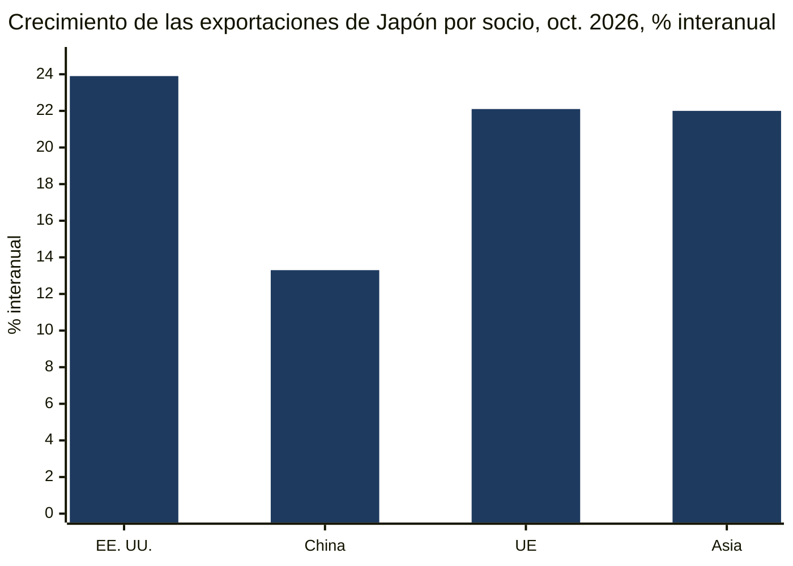

*Nota: valores de exportación por destino, octubre de 2026, interanual. Estados Unidos: automóviles un 37,2% más, equipos de fabricación de semiconductores un 118,5% más. China: automóviles un 53,3% menos, equipos de fabricación de semiconductores un 42,6% más. Fuente: Estadísticas Comerciales preliminares del Ministerio de Finanzas de Japón, octubre de 2026.*

### Zona euro — cuenta corriente de septiembre de 2026 (BCE, publicada el 19 de noviembre)

La publicación de la balanza de pagos de septiembre del BCE situó el superávit por cuenta corriente de la zona euro en 12.000 millones de euros, poco cambiado respecto al mes anterior. El superávit de bienes en base de balanza de pagos fue de 14.000 millones de euros —una medida diferente del déficit de bienes de septiembre de 10.300 millones de euros en base aduanera de Eurostat informado el 13 de noviembre, y ambas no deben compararse directamente. Superávit de servicios de 16.000 millones de euros; déficit de ingresos secundarios de 16.000 millones de euros; déficit de ingresos primarios de 1.000 millones de euros. La lectura de la cuenta corriente es el indicador más limpio de la posición exterior de la zona euro una vez incluidos los servicios y los flujos de ingresos, y muestra que el bloque sigue en superávit en general pese al déficit de bienes en base aduanera. La brecha entre las dos medidas de bienes es una fuente permanente de confusión en los comentarios comerciales y vale la pena señalarla cuando llegue la publicación de bienes de diciembre. La próxima publicación mensual de la balanza de pagos vence el 18 de diciembre y abarcará octubre; la publicación trimestral sigue el 12 de enero. [QNC News](https://qncnews.com/2026/11/23/euro-area-current-account-surplus-holds-at-12-billion-euros-in-september/)

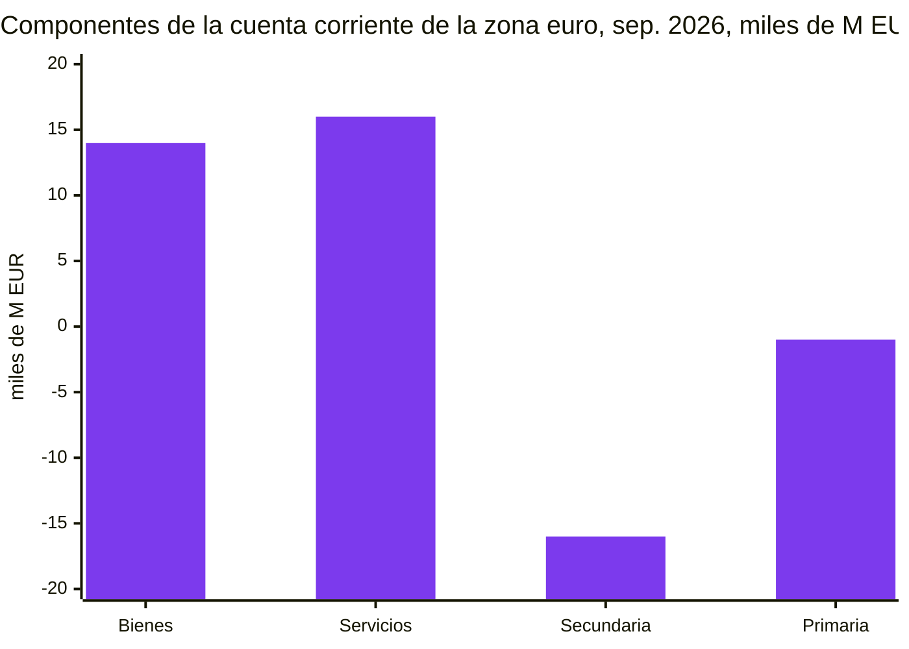

*Nota: base de balanza de pagos, septiembre de 2026. Superávit por cuenta corriente de 12.000 millones de euros. Fuente: Banco Central Europeo.*

### Alemania — comercio transfronterizo de electricidad, tres primeros trimestres de 2026 (Destatis, comunicado de prensa n.º 406, 20 de noviembre)

Destatis informó de que el comercio transfronterizo alemán de electricidad se acercó al equilibrio físico durante los nueve primeros meses de 2026, con las exportaciones en aumento y los volúmenes de importación en descenso. Alemania exportó 48,8 TWh de electricidad por valor de 4.300 millones de euros en enero–septiembre de 2026 (volumen un 25,5% más interanual; valor un 51,3% más). Las importaciones de electricidad cayeron un 13,3% en volumen hasta 49,2 TWh, pero su valor subió un 20,4% hasta 5.700 millones de euros. El superávit físico de importación se redujo un 97,5% hasta 0,4 TWh. Precio medio de importación de 116 €/MWh (un 38,9% más interanual) frente a 84 €/MWh en enero–septiembre de 2025. Solo en septiembre de 2026, Alemania exportó 5,4 TWh (un 22,7% más interanual; valor un 122,7% más hasta 600 millones de euros) e importó 4,6 TWh (volumen un 26,1% menos; valor un 64,5% más hasta 800 millones de euros). Un tema de nicho, pero ilustra cómo la asimetría de precios de la energía —no el volumen— impulsa ahora la balanza comercial energética de Alemania, y es la única publicación comercial de Destatis identificada en la ventana. Las cifras se compilan según las normas de comercio exterior (código de mercancía 27160000) y difieren metodológicamente de las estadísticas energéticas basadas en la red. La publicación principal de detalle del comercio de bienes de septiembre señalada para el 20 de noviembre no se identificó por separado en las búsquedas. [NewsVerum](https://newsverum.com/en/news/germany-electricity-exports-reach-4-3-billion-euros-first-three-quarters-2026)

### Estados Unidos — comercio de septiembre de 2026 (FT-900) e indicadores anticipados de octubre

Ninguna publicación comercial estadounidense cayó dentro de la ventana del 16 al 23 de noviembre. El último FT-900 (4 de noviembre) mostró un déficit de septiembre de 105.000 millones de dólares, ligeramente menor que los 105.700 millones de dólares revisados de agosto. En lo que va de año, el déficit fue 92.400 millones de dólares (12,2%) menor que en enero–septiembre de 2025; las exportaciones crecieron un 11,6% y las importaciones un 6,2% en ese periodo. El déficit anticipado de bienes de septiembre fue de 134.900 millones de dólares (publicación del 28 de octubre), 2.800 millones de dólares más que los 132.100 millones de dólares de agosto. El FT-900 de octubre está previsto para el 8 de diciembre de 2026, y el indicador anticipado de bienes de octubre vence el 27 de noviembre de 2026. Estados Unidos es la mayor laguna individual en la cobertura de datos de esta semana: el comercio de octubre no se conocerá hasta diciembre, por lo que cualquier evaluación de cómo la acumulación arancelaria afectó a los valores de importación de octubre debe esperar. [Value.today](https://www.value.today/economy/usa/releases/trade)

### Portales de datos — sin grandes publicaciones en la ventana identificadas

No se identificó ninguna nueva publicación importante de datos comerciales de USITC DataWeb, UN Comtrade, WITS del Banco Mundial, el portal de datos del Banco Mundial o el FMI (WEO/IFS) en la ventana del 16 al 23 de noviembre. El informe Perspectivas de la Economía Mundial del FMI se actualizó por última vez en octubre de 2026; no se encontró ninguna actualización de noviembre. La próxima publicación de comercio de bienes de Eurostat (octubre) vence el 18 de diciembre de 2026. Las cifras comerciales de noviembre de China vencen en diciembre. [Eurostat](https://ec.europa.eu/eurostat/web/international-trade-in-goods/publications)

### Grupos de reflexión

**Rastreador de aranceles de la Tax Foundation: tasa aplicada del 11,8%, tasa efectiva del 7,2%; 1,4 billones de dólares estadounidenses en diez años.** El rastreador de la Tax Foundation cuenta ahora más de 50 cambios en la política arancelaria estadounidense desde enero de 2025. Estimaciones clave: los nuevos aranceles se aplican al 54% de las importaciones de bienes estadounidenses en 2026; la tasa arancelaria aplicada sube al 11,8% (desde el 1,5% en 2022); la tasa efectiva (aranceles recaudados como porcentaje de las importaciones) es del 7,2% para el año natural 2026; los aranceles impuestos y programados recaudarán 1,4 billones de dólares estadounidenses de 2026 a 2035 en base convencional (1 billón de dólares estadounidenses en base dinámica); PIB a largo plazo un 0,4% menos, stock de capital un 0,3% menos, horas trabajadas 338.000 empleos equivalentes a tiempo completo menos. Los aranceles elevaron los impuestos en una media de 1.000 dólares estadounidenses por hogar estadounidense en 2025 y unos 820 dólares estadounidenses estimados por hogar en 2026, ya que los nuevos aranceles no han reemplazado por completo los aranceles IEEPA anulados por el Tribunal Supremo. Los aranceles de la Sección 232 sobre el polisilicio (15%, o 10% para el Reino Unido) entran en vigor el 4 de diciembre de 2026. El coste por hogar cayó de 1.000 dólares estadounidenses en 2025 a 820 dólares estadounidenses en 2026 precisamente porque los aranceles IEEPA anulados no han sido reemplazados por completo —una corrección útil a cualquier lectura de las cifras de ingresos como un simple aumento. [Tax Foundation](https://taxfoundation.org/research/federal-tax/trump-tariffs-trade-war/page/20/)

**Yale Budget Lab: tasa arancelaria media del 11,2% en noviembre; unos 900 dólares estadounidenses por hogar al año.** El recuento de Yale del 2 de noviembre situó la tasa arancelaria media legal en el 11,8%, subiendo al 11,9% para finales de año según la ley vigente; el recuento diario se ha mantenido en el 11,76% desde el 29 de septiembre. La tasa efectiva media fue de alrededor del 11,2% en noviembre de 2026, frente a alrededor del 2,5% en enero de 2025. La directora ejecutiva, Martha Gimbel, dijo a Marketplace el 5 de noviembre que los hogares afrontan unos 1.100 dólares estadounidenses al año con las tasas actuales (una cifra de un informe del 24 de agosto, medida con ponderaciones fijas de importación) y alrededor del 0,7% en los precios al consumo; la estimación del Budget Lab para el año natural 2026 es de unos 900 dólares estadounidenses por hogar al año. Los aranceles aportan casi 2 billones de dólares estadounidenses en diez años. La investigación del Tobin Center de Yale encontró que aproximadamente el 80%–100% de los aranceles examinados se reflejaron en precios más altos pagados por los importadores estadounidenses, con una estimación central de alrededor del 90%. Yale y la Tax Foundation coinciden en la tasa legal (alrededor del 11,8%) pero difieren en el coste por hogar —820 dólares estadounidenses (Tax Foundation, 2026, según lo que realmente se importa) frente a unos 900–1.100 dólares estadounidenses (Yale, según el método y las ponderaciones)— porque ambas utilizan métodos diferentes, no hechos diferentes. La constatación de traspaso (alrededor del 90% de los aranceles reflejados en los precios de los importadores) es el número analíticamente importante: sustenta las estimaciones de coste por hogar y contradice las afirmaciones de que los exportadores extranjeros absorben los aranceles. El aumento de diciembre al 11,9% ya está en la ley vigente. [Geopolitiqs](https://geopolitiqs.com/tn/2026-11-09/tariffs-average-rate)

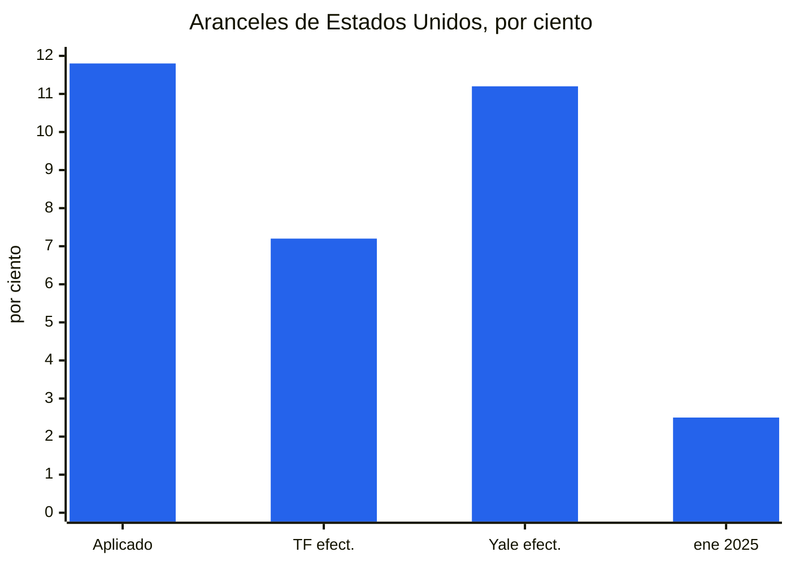

*Nota: tasa legal aplicada del 11,8% (ambas instituciones coinciden); tasa efectiva de la Tax Foundation del 7,2% para el año natural 2026 (aranceles recaudados como porcentaje de las importaciones); tasa efectiva media del Budget Lab de Yale de alrededor del 11,2% en noviembre de 2026; alrededor del 2,5% en enero de 2025. Fuentes: Tax Foundation; Budget Lab de Yale.*

---

## 9. Mercado de fletes

### Tarifas al contado de contenedores — Índice Mundial de Contenedores de Drewry

El Índice Mundial de Contenedores de Drewry cayó un 3% hasta 4.176 dólares por contenedor de 40 pies el 19 de noviembre, su cuarta caída semanal consecutiva, aunque aún un 126% más alto interanual. Las tarifas transpacíficas cayeron por séptima semana consecutiva: Shanghái–Nueva York bajó un 9% hasta 8.194 dólares, el nivel más bajo en 15 semanas, y Shanghái–Los Ángeles cayó un 5% hasta 7.026 dólares, el nivel más bajo en 12 semanas. Shanghái–Génova subió un 6% hasta 4.436 dólares tras tres semanas estables, mientras Shanghái–Róterdam se mantuvo sin cambios en 3.496 dólares. Drewry espera que las tarifas transpacíficas caigan aún más la próxima semana; se anunciaron diez salidas en blanco para la semana siguiente frente a cuatro esta semana. El compuesto ha caído alrededor del 9% en cuatro semanas (desde 4.585 dólares el 22 de octubre). El mercado de contenedores se dividió aún más: las tarifas transpacíficas cayeron bruscamente por séptima semana consecutiva mientras las tarifas del Mediterráneo repuntaron un 6% y las tarifas transatlánticas subieron un 2% en ambas direcciones (Róterdam–Nueva York 3.146 dólares; Nueva York–Róterdam 1.217 dólares). [Drewry](https://www.drewry.co.uk/supply-chain-advisors/world-container-index-weekly-update?topics=Container%20Shipping)

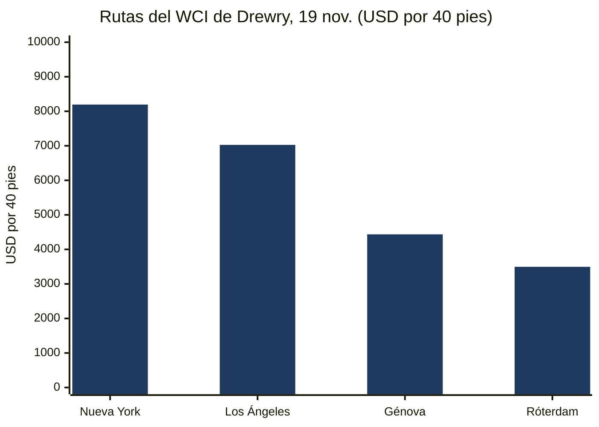

*Nota: tarifas al contado de origen Shanghái por contenedor de 40 pies, 19 de noviembre de 2026. Fuente: Índice Mundial de Contenedores de Drewry.*

### Índice Báltico de Freightos

Freightos informó de Asia–costa oeste de EE. UU. en 8.459 dólares por FEU (un 3% más), Asia–costa este de EE. UU. en 9.848 dólares (un 1% más), Asia–norte de Europa estable en 3.407 dólares y Asia–Mediterráneo en 4.295 dólares (un 1% menos) en su actualización del 17 de noviembre. Las tarifas Asia–Europa están un 40–50% por encima de hace un año; Asia–norte de Europa está un 5% por debajo frente a finales de octubre. El compuesto mundial FBX de la actualización del 17 de noviembre es n/a —la actualización semanal no indica una cifra mundial. (Una lectura de un rastreador de 3.419 dólares por FEU para el FBX mundial se registró el 22 de noviembre; la lectura mundial semanal anterior fue de 3.452 dólares el 10 de noviembre.) Las lecturas de rutas de Freightos subieron ligeramente en el transpacífico incluso mientras las lecturas de Drewry en la misma ruta caían —los dos índices de referencia miden cestas de tarifas y semanas diferentes, y la brecha (Freightos Asia–costa oeste de EE. UU. 8.459 dólares frente a Drewry Shanghái–Los Ángeles 7.026 dólares) es un recordatorio de no mezclarlos. Freightos señala que los GRI de noviembre no se sostuvieron, que los planes de aumento de mediados de mes también podrían fracasar, y que los transportistas están aumentando las salidas en blanco; los aumentos de diciembre están anunciados y podrían sostenerse si cuentan con el apoyo de la demanda previa al Año Nuevo Lunar. La advertencia de Freightos de que el regreso al mar Rojo más el crecimiento de la flota eleva el riesgo de sobrecapacidad el próximo año enmarca la perspectiva para 2027. [Freightos](https://www.freightos.com/freight-resources/us-air-cargo-recovering-from-outage-new-us-cn-tensions-ahead-of-talks-november-17-2026-update/)

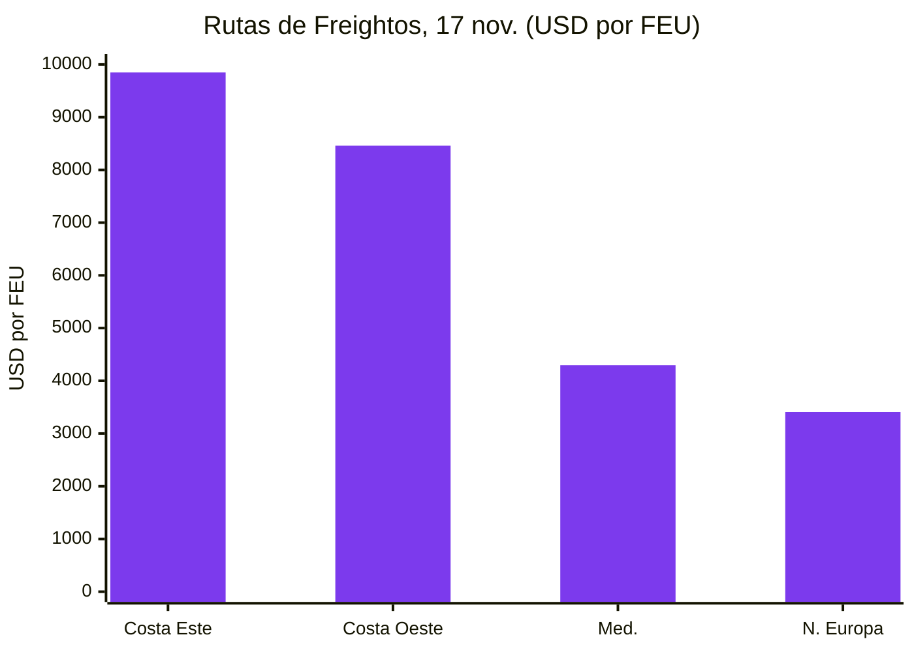

*Nota: tarifas al contado de origen Asia por FEU, 17 de noviembre de 2026. Fuente: Índice Báltico de Freightos.*

### Índice de Fletes de Contenedores de Shanghái

El compuesto SCFI cayó a 3.503,78 el 20 de noviembre, 68,55 puntos menos (un 1,92% menos) semana a semana desde 3.572,33 el 13 de noviembre —la tercera caída semanal consecutiva, con pérdidas que se amplían cada semana (un 1,46% menos, un 1,68% menos, un 1,92% menos); el nivel más bajo desde mediados de septiembre; 129,67 puntos perdidos en tres semanas desde 3.687,35 el 30 de octubre. Shanghái–costa oeste de EE. UU. 6.711 dólares por FEU (400 dólares menos, un 5,63% menos); Shanghái–costa este de EE. UU. 8.776 dólares por FEU (611 dólares menos, un 6,51% menos); Shanghái–Mediterráneo 3.678 dólares por TEU (un 1,63% más); Shanghái–Europa 2.291 dólares por TEU; Santos 3.110 dólares por TEU (un 15,19% menos). El Índice de Fletes de Contenedores de China (CCFI, tarifas por contrato) subió un 0,21% hasta 1.923,21, una segunda ganancia semanal consecutiva —divergiendo del SCFI al contado. Tres índices (Drewry, rutas de Freightos, SCFI) coinciden ahora en que el mercado al contado transpacífico está corrigiendo con fuerza hacia la pausa posterior a la temporada alta, con la ruta de la costa este de EE. UU. del SCFI con más de 600 dólares menos en una semana. El aumento del CCFI sugiere que los cargadores con tarifas por contrato aún no ven el beneficio —una brecha que importa para el calendario de licitaciones de 2027. [Forwarder News](https://www.forwardernews.com/news/2026-11-20-scfi-falls-a-third-week)

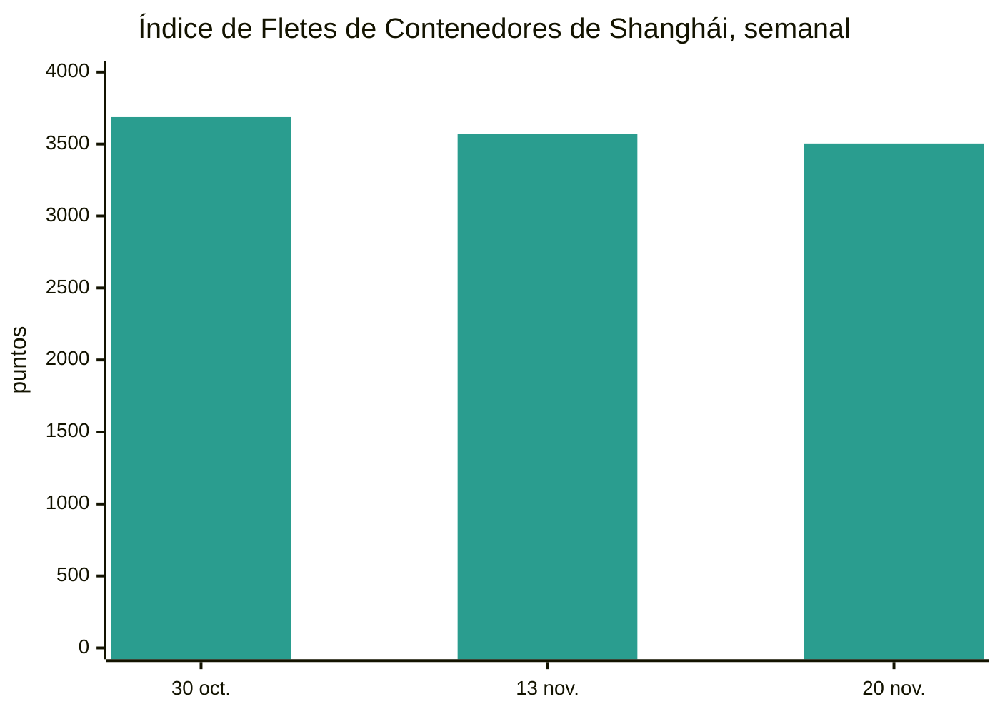

*Nota: compuesto SCFI, semanal. Fuente: Bolsa de Transporte Marítimo de Shanghái.*

### Aumentos de tarifas de noviembre — anunciados, ya descontados

Los transportistas han anunciado recargos de temporada alta de 1.000–1.600 dólares por contenedor de 40 pies en Asia–Europa/Mediterráneo a partir de diciembre. Los aumentos generales de tarifas de noviembre no se sostuvieron, según Freightos, y los planes de aumento de mediados de mes también podrían fracasar. Los aumentos de diciembre están anunciados y podrían sostenerse si cuentan con el apoyo de la demanda previa al Año Nuevo Lunar. El patrón del otoño —aumentos anunciados que no se sostienen ante una demanda débil— es ahora el ritmo establecido del mercado. [Freightos](https://www.freightos.com/freight-resources/us-air-cargo-recovering-from-outage-new-us-cn-tensions-ahead-of-talks-november-17-2026-update/)

### Salidas en blanco y capacidad

Se anunciaron diez salidas en blanco para la semana siguiente, frente a cuatro esta semana. El rastreador de salidas canceladas de Drewry proyectó 52 salidas en blanco de 716 servicios programados en las principales rutas Este–Oeste entre el 16 de noviembre y el 21 de diciembre (alrededor del 7%). Los transportistas se apoyan cada vez más en las salidas en blanco a medida que se profundiza la corrección transpacífica, y el regreso al Suez de Gemini libera más capacidad hacia 2027. [Drewry](https://www.drewry.co.uk/supply-chain-advisors/world-container-index-weekly-update?topics=Container%20Shipping)

### Carga seca a granel — Bolsa Báltica

El Índice Báltico de Carga Seca cerró en 2.898 el 20 de noviembre, 82 puntos menos (un 2,8% menos) semana a semana desde 2.980 el 13 de noviembre —poniendo fin a cuatro ganancias semanales consecutivas. Trayectoria diaria: 2.921 (lunes 16 de noviembre), 2.893 (martes), 2.914 (miércoles), 2.901 (jueves), 2.898 (viernes). Índice Capesize 4.502 (un 4,6% menos semana a semana; desde 4.719); ganancias medias diarias Capesize de 40.827 dólares (viernes; 37.184 dólares el martes 17 de noviembre). Índice Panamax 2.140 (un 1,0% más semana a semana; desde 2.118), el nivel más alto desde el 22 de octubre; ganancias diarias Panamax de 19.264 dólares. Índice Supramax 1.810 (un 1,4% menos semana a semana; desde 1.836); ganancias diarias de 22.884 dólares. Índice Handysize 1.072 (un 2,4% más semana a semana). La ruta C5 (Australia Occidental–Qingdao, mineral de hierro) terminó la semana en 14,40 dólares por tonelada, recuperándose de un mínimo de 13,40 dólares a mitad de semana. La carga seca a granel bajó tras cuatro semanas de ganancias, con Capesize como principal lastre (un 4,6% menos en la semana) por la debilidad de la demanda del Atlántico Norte y una lista cada vez mayor de buques disponibles, mientras Panamax subió a un máximo de un mes por la demanda de grano y carbón. La división —Capesize a la baja, Panamax al alza— apunta a una demanda de mineral de hierro que se suaviza mientras los comercios de grano y carbón se mantienen, una señal anticipada útil para la demanda de materias primas hacia fin de año. [HandyBulk](https://www.handybulk.com/baltic-dry-index/)

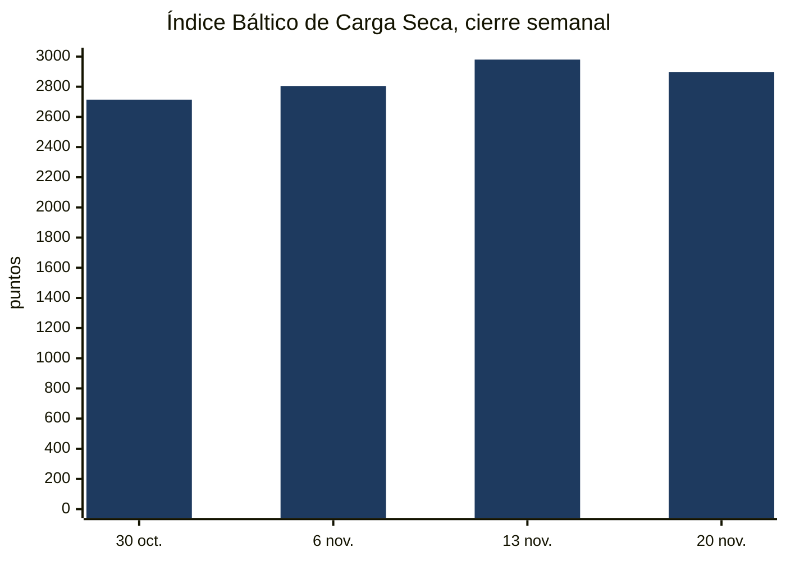

*Nota: cierres semanales del Índice Báltico de Carga Seca. Fuente: Bolsa Báltica.*

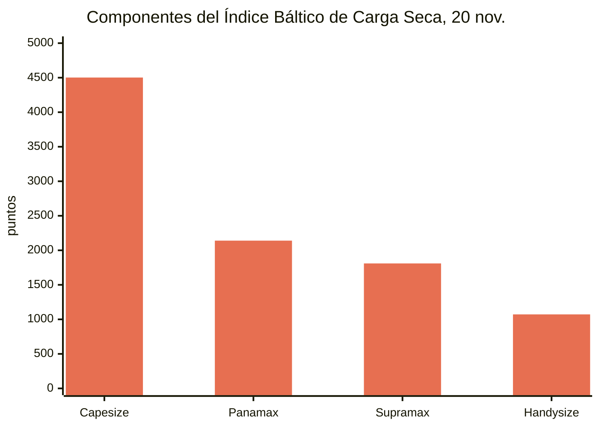

*Nota: índices por segmento de la Bolsa Báltica, 20 de noviembre de 2026. Fuente: Bolsa Báltica.*

### Suez y fiabilidad de los itinerarios

Maersk y Hapag-Lloyd anunciaron el 16 de noviembre que sus servicios AE1, AE2 y AE3 de Gemini Cooperation volverán a la ruta trans-Suez y al mar Rojo, en sustitución de los viajes desviados alrededor del cabo de Buena Esperanza. La transición es escalonada: AE2 primero, con el Mary Maersk (viaje 650W) iniciando su rotación en Ningbo el 4 de diciembre; AE3 sigue con el Alette Maersk (viaje 652W) iniciando en Shanghái el 20 de diciembre; AE1 comienza con el Damietta Express (viaje 702W) iniciando en Shanghái el 14 de enero de 2027. Las rotaciones revisadas incluyen tránsitos por el canal de Suez en ambas direcciones. El cambio sigue a restauraciones anteriores de los servicios AE5, AE11, AE12, ME2 y ME1. Según Linerlytica, el regreso de estos tres servicios convierte a Maersk y Hapag-Lloyd en la primera alianza en restaurar la ruta por Suez en todos sus servicios Asia–Europa. El cambio reduce el número de buques en AE2 de 14 a 13 y en AE3 de 13 a 11, liberando capacidad. Maersk dijo que los cambios mejorarían los tiempos de tránsito, al tiempo que advirtió de que la aplicación depende de la estabilidad continuada en el mar Rojo y del seguimiento continuo de las condiciones de seguridad regionales. Evergreen fue el último miembro de la Ocean Alliance en reanudar los tránsitos por Suez; ZIM sigue siendo el transportista importante más destacado que aún dirige los servicios Asia–Europa alrededor del Cabo. Drewry contó 53 portacontenedores por el canal en la semana hasta el 1 de noviembre, un 130% más interanual, y estima que alrededor del 60% de la capacidad Asia–Europa está de vuelta en la ruta del Suez. DHL estima que los ajustes más amplios de la red podrían tardar otros 6–12 meses. Flexport previó un 131% de la capacidad normal de llegada en los puertos del norte de Europa en la semana del 16 al 22 de noviembre a medida que llegan las llegadas agrupadas. [FreightWaves](https://www.freightwaves.com/news/maersk-and-hapag-lloyd-restore-asia-europe-suez-routes-as-u-s-shippers-watch-capacity-and-costs)

### Carga aérea

El Índice Báltico de Carga Aérea (BAI00) subió un 6,6% en la semana hasta el 9 de noviembre (un 28,2% más interanual) hasta su nivel más alto de 2026, y luego bajó un 1,5% en los siete días hasta el 16 de noviembre (un 20,8% más interanual). Hong Kong saliente (BAI30) cayó un 4,5% semana a semana hasta el 16 de noviembre (un 19,0% más interanual); Shanghái saliente (BAI80) cayó un 2,7% (un 13,1% más); Fráncfort saliente (BAI20) cayó un 2,7% (un 36,4% más); Londres Heathrow saliente (BAI40) cayó un 9,4% (un 2,6% más). Chicago saliente (BAI50) se disparó un 39,2% semana a semana (un 72,1% más interanual) tras la interrupción del control de tráfico aéreo estadounidense. En la semana hasta el 9 de noviembre: Fráncfort saliente un 9,9% más semana a semana, Londres un 5,6% más, Hong Kong un 4,6% más, Shanghái un 5,7% más. Índice Aéreo de Freightos (actualización del 17 de noviembre): China–Norteamérica 9,25 $/kg (un 16% más semana a semana), por encima del máximo de temporada alta de 2025 de 8,00 $/kg alcanzado solo a mediados de diciembre del año pasado; China–norte de Europa 5,05 $/kg (un 4% más); norte de Europa–Norteamérica 3,27 $/kg (un 12% más), el nivel más alto desde diciembre de 2022. Xeneta: media mundial al contado de octubre de 3,11 $/kg (un 29% más interanual). TAC: al contado mundial de unos 3,93 $/kg en la semana 44 (un 4% más semana a semana, alrededor de un 40% más interanual). Combustible de aviación: el monitor de la IATA bajó un 6,5% en la semana hasta el 6 de noviembre y un 11,7% en el mes hasta el 13 de noviembre. [Baltic Exchange](https://www.balticexchange.com/en/news-and-events/news/guest-column/2026/Air-freight-rates-surge-past-previous-peak-season-highs-as-jet-fuel-prices-soar.html)

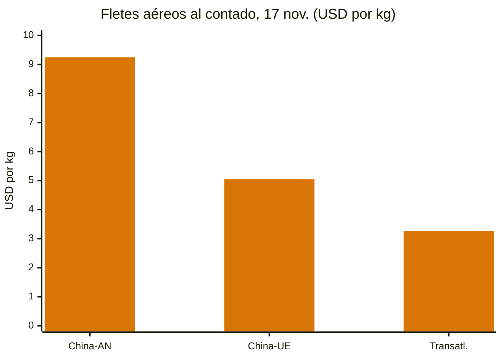

*Nota: Índice Aéreo de Freightos, 17 de noviembre de 2026. China–Norteamérica por encima del máximo de temporada alta de 2025 de 8,00 $/kg; transatlántico en su nivel más alto desde diciembre de 2022. Fuente: Freightos.*

**Interrupción:** un fallo del sistema de control de tráfico aéreo estadounidense dejó en tierra miles de vuelos durante el fin de semana del 14–15 de noviembre —la parada nacional en tierra de la FAA del 13 de noviembre (un solo router defectuoso en El Dorado, Arkansas, que afectó a 17 de los 22 centros de control de tráfico de rutas aéreas) interrumpió más de 20.000 vuelos durante el fin de semana y dejó atrasos de carga aérea en la semana siguiente; la FAA pausó la instalación de los nuevos routers el 17 de noviembre y la administración elevó su estimación de costes de modernización del control de tráfico aéreo por encima de los 50.000 millones de dólares. Una interrupción de Microsoft añadió perturbación; TAC dijo que los datos eran más irregulares de lo habitual. Freightos dijo que las tarifas aéreas internacionales a Estados Unidos no se habían disparado significativamente como resultado de la interrupción. La carga aérea alcanzó su máximo de 2026 en la semana hasta el 9 de noviembre por la demanda de chips y hardware de IA más los volúmenes de temporada alta, con las tarifas China–Norteamérica superando el máximo del año pasado un mes antes. El retroceso del 16 de noviembre puede ser una pausa más que un giro: TAC señala que quedan varias semanas más de temporada alta. La huelga del control de tráfico aéreo belga del 23 de noviembre (véase A11) sigue a la parada en tierra de la FAA diez días antes, subrayando lo escaso que es el margen en la infraestructura de carga aérea en esta temporada alta. [Air Cargo News](https://www.aircargonews.net/cargo-airport/2026/11/us-air-cargo-supply-chains-recover-following-ground-stop/)

### Interrupciones portuarias y logísticas

**Los Ángeles / Long Beach.** Véase A7. La amenaza de huelga que pesaba sobre la mayor puerta de entrada de contenedores de Estados Unidos desde el 1 de noviembre se evitó en el último minuto con un acuerdo provisional el 21 de noviembre; la ratificación está pendiente y el sindicato no ha comentado públicamente. El atraso ferroviario en el complejo (35.688 contenedores de importación a la espera de ferrocarril en muelle hasta el 2 de noviembre) persiste, y los tiempos de permanencia ferroviaria para los contenedores de importación superaron los nueve días, según el director ejecutivo del Puerto de Los Ángeles. El cierre del puente Vincent Thomas (7 de noviembre, 16 meses) continúa por separado. [Maritime Executive](https://maritime-executive.com/article/ports-of-la-and-long-beach-avert-strike-as-watchmen-reach-deal)

**Durban.** La congestión de Durban se agravó en la ventana pese a un mejor rendimiento de la terminal: la Terminal Gateway de Durban movió 36.332 TEU en la última semana informada (un 28% más semana a semana, el mejor rendimiento en muelle en 4 meses), pero el tiempo medio de espera de fondeo de los buques subió de 189 horas a 263 horas (casi 11 días) incluso cuando los buques en espera en alta mar bajaron de 14 a 11. Ocupación de patio de alrededor del 69%. Las cadenas de suministro afectadas afrontan retrasos adicionales de extremo a extremo que superan los 20 días. La ministra de Transporte, Barbara Creecy, ha dado a ICTSI tres meses para mejorar el rendimiento o arriesgarse a perder su licencia portuaria (según Moneyweb). Medidas de emergencia de Transnet (18 de noviembre): el Atraque 102 asignado a buques con grúas; desvíos a la Terminal de Contenedores de Ngqura; movimientos ferroviarios adicionales; la última grúa buque-tierra reacondicionada en el Muelle 1 puesta en servicio el 20 de noviembre y entregada el 21 de noviembre. DGT reconoció "deficiencias continuas de servicio", culpando al mal estado y la inseguridad de los equipos tras años de falta de inversión; se ha comprometido a más de 2.000 millones de rands en tres años para mejorar los equipos del Muelle 2. El recargo de temporada alta de Maersk de 1.000/2.000 dólares y la tasa de congestión de 400/800 dólares siguen en vigor. La amenaza a la licencia es una nueva escalada —un ultimátum estatal a un operador de terminal privado— y la ventana de tres meses se extiende hasta febrero de 2027. [Shipping and Freight Resource](https://shippingandfreightresource.com/transnet-steps-in-to-alleviate-congestion-at-durban-gateway-terminal/)

**Canal de Panamá.** Las lluvias estivales inferiores a lo normal habían desencadenado restricciones de calado y de tránsitos diarios para los cruces del canal de Panamá, y los transportistas de contenedores aplicaron recargos. Las precipitaciones mejores de lo esperado desde entonces permitieron a la Autoridad del Canal de Panamá revertir esas medidas. Los niveles actuales de agua están aproximadamente de vuelta a lo normal para la época del año, y las proyecciones han rebajado la gravedad del El Niño esperado, por lo que el riesgo de restricciones graves en el cuarto trimestre de 2026 y el primer semestre de 2027 se considera menor de lo temido durante el verano. La eliminación de las restricciones de Panamá retira un factor de recargo de la mesa para las rutas de la costa este/golfo de Estados Unidos y reduce una fuente de interrupción de los itinerarios que había agravado el atraso ferroviario de Los Ángeles/Long Beach. [Freightos](https://www.freightos.com/freight-resources/us-air-cargo-recovering-from-outage-new-us-cn-tensions-ahead-of-talks-november-17-2026-update/)

**Congestión intraasiática.** The Loadstar informó el 20 de noviembre de que el empeoramiento de los cuellos de botella en los centros de transbordo del sudeste asiático ha mantenido firmes las tarifas intraasiáticas incluso mientras caen las tarifas al contado de larga distancia, y que los cargadores India–Golfo afrontan costes adicionales por las costosas devoluciones de contenedores además del aumento de las tarifas. No se publicaron cifras en los titulares revisados. [The Loadstar](https://theloadstar.com/)

**Perspectiva de importación estadounidense.** Las importaciones de contenedores estadounidenses batieron un récord de volumen de cuatro años en octubre, según Descartes, con envíos procedentes de China subiendo por cuarto mes consecutivo hasta casi 988.000 TEU, su nivel más alto desde enero de 2025. El Puerto de Los Ángeles movió 1.026.872 TEU en octubre, un récord para el mes y el segundo mes de mayor volumen registrado, solo por detrás de los 1.042.652 TEU de septiembre. Los vagones ferroviarios estadounidenses promediaron 233.193 en octubre, un 3,4% más anual, el décimo mes consecutivo de ganancia anual; el volumen intermodal estadounidense hasta octubre alcanzó 12.271.905 unidades, un 4,7% más en lo que va de año, con octubre un 9,6% más anual y marcando un récord histórico de volumen. El Índice de Carga Cass mostró envíos de octubre en 1,056, un 5,9% más anual, y gastos en 4,010, también un 5,9% más anual. El Índice de Condiciones de Transporte por Carretera de FTR para septiembre se situó en 8,13, por debajo de los 11,5 de agosto. El Global Port Tracker (9 de noviembre) espera que las importaciones portuarias con destino a Estados Unidos disminuyan en lo que queda de 2026 a medida que se apaga la prolongada temporada alta: importaciones cargadas de septiembre de 2026 de 2,37 millones de TEU (mes más activo de 2026; un 3,4% más intermensual, un 12,6% más interanual); previsiones de octubre de 2,26 millones de TEU (un 9,1% más interanual); noviembre de 2,05 millones de TEU (un 1,2% más); diciembre de 2,03 millones de TEU (un 1,3% más). Todo el año 2026 unos 26 millones de TEU (un 2% más frente a 25,4 millones en 2025) —revisado al alza desde la previsión de octubre de 25,8 millones. Principios de 2027: enero de 2,04 millones de TEU (un 3% menos interanual); febrero de 1,89 millones (un 0,5% menos); marzo de 1,92 millones (un 11,2% menos). Los volúmenes récord de importación a Estados Unidos continuaron durante octubre incluso mientras las tarifas al contado se moderaban, apuntando a una anticipación de cargas antes del plazo de la tregua de enero y de las medidas de polisilicio de diciembre. [FreightWaves](https://www.freightwaves.com/news/retailers-forecast-u-s-imports-to-stay-elevated-through-2026-after-breakout-peak-season)

**Temas menores.** Los exportadores de prendas de vestir de Bangladés están recurriendo a la costosa carga aérea para cumplir los plazos de entrega tras semanas de interrupción, mientras los compradores compran en otros lugares (The Loadstar, 23 de noviembre). Expeditors está replanteando su enfoque hacia las adquisiciones tras décadas de crecimiento orgánico y ya está evaluando oportunidades en tecnología, y la venta de la estadounidense Neovia y de la turca Ekol marcó el regreso de las fusiones y adquisiciones al sector de la logística por contrato (The Loadstar, 19 de noviembre). Los volúmenes de carga a lo largo de la Ruta Marítima del Norte de Rusia superaron los 40 millones de toneladas por primera vez, un récord para la ruta marítima ártica, aunque las ambiciones del presidente Putin para la ruta siguen fuera de alcance (gCaptain, 23 de noviembre). FedEx lanzó rutas semanales que conectan los centros manufactureros de Shanghái y Guangzhou con destinos estadounidenses para apoyar la demanda impulsada por la inteligencia artificial (Supply Chain Dive).

### Inteligencia de proveedores

No se registró ningún tema de proveedor que cumpliera los criterios en la ventana. El único tema de prensa de Descartes en la ventana fue un premio del sector (17 de noviembre, nombrado el principal proveedor de sistemas de gestión de transporte en Norteamérica en el informe de investigación de mercado mundial de Sistemas de Gestión de Transporte de ARC Advisory Group). El lote de blogs del 22 de noviembre de TradeInt era contenido de marketing de datos extraído de su propia base de datos que abarcaba el primer semestre de 2026 y periodos anteriores, con llamadas a la acción de "Unlock data"; el crecimiento interanual informado del 901% en el post sobre Rusia es un artefacto de cobertura del conjunto de datos, no un movimiento comercial. El Informe Mundial de Transporte Marítimo de noviembre de Descartes (11 de noviembre), que informaba de importaciones récord de contenedores estadounidenses de 2.674.808 TEU en octubre de 2026, se trató en el informe de la semana pasada. Los resultados del tercer trimestre fiscal de Descartes no vencen hasta principios de diciembre de 2026. [Descartes](https://www.descartes.com/resources/knowledge-center/descartes-releases-november-global-shipping-report-us-container-imports); [TradeInt](https://tradeint.com/insights/blogs/)

---

## 10. Cronologías de política

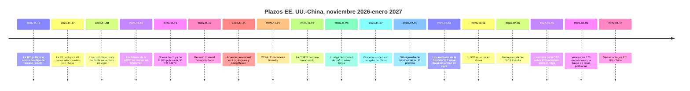

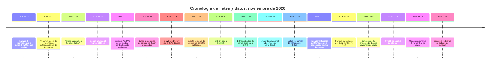

---

## 11. Próximos plazos y eventos (próximos 90 días)

| Fecha | Tema |
|---|---|
| 23 de noviembre de 2026 | El Comité de Agricultura de la OMC se reúne sobre restricciones a la exportación y el mecanismo especial de salvaguardia; informe completo Solar IV de la USITC (Publicación 5804) vence. |
| 24 de noviembre de 2026 | Se espera que la interrupción en cadena de la huelga del control de tráfico aéreo belga se extienda al martes. |
| 27 de noviembre de 2026 | El Anuncio n.º 72 de 2025 de China sobre la suspensión de la presunción de denegación para el galio, el germanio, el antimonio y los materiales superduros con destino a EE. UU. vence, a falta de una nueva suspensión o modificación; indicador anticipado del Censo sobre el comercio de bienes de octubre vence. |
| 29 de noviembre de 2026 | Comentarios vencen sobre el proyecto de Medidas del MOFCOM para las Investigaciones y la Aplicación del Control de Exportación de Doble Uso. |
| 30 de noviembre de 2026 | Determinaciones finales de dumping y subvención del Departamento de Comercio para los productos de hojalata de China vencen, salvo aplazamiento. |
| 1 de diciembre de 2026 | Medidas provisionales de la salvaguardia de coches híbridos de la UE previstas; Canadá elimina el alivio arancelario horizontal para ciertos remolques; la tasa nacional italiana de 2 € para paquetes pequeños entra en vigor; plazo de los demócratas de la Cámara para las respuestas escritas de Lutnick sobre Megaspeed y la Lista de Entidades. |
| 4 de diciembre de 2026 | Aranceles de la Sección 232 sobre el polisilicio entran en vigor; primera navegación por Suez de Gemini AE2 desde Ningbo; sesión extraordinaria del MEPC 85 de la OMI fijada provisionalmente. |
| 7 de diciembre de 2026 | Comentarios vencen sobre la norma propuesta de la CBP sobre envíos de bajo valor (91 FR 64532; expediente USCBP-2026-0298); comercio de los primeros 20 días de noviembre de Japón. |
| 8 de diciembre de 2026 | Publicación comercial FT-900 de octubre de EE. UU. |
| 10 de diciembre de 2026 | Lutnick testifica ante la Comisión Bancaria del Senado (Megaspeed / Lista de Entidades). |
| 11 de diciembre de 2026 | Escrito de respuesta del gobierno vence en *Gellert v. Trump* (Sección 338); UE–Indonesia: el presidente Prabowo visita Bruselas. |
| 14–15 de diciembre de 2026 | Los líderes del G20 se reúnen en Miami. |
| 15 de diciembre de 2026 | Comercio completo de noviembre de Japón. |
| 16 de diciembre de 2026 | Se informa de que el acuerdo de libre comercio UE–India se firmará en Bruselas, con la asistencia prevista del primer ministro Modi. |
| 17 de diciembre de 2026 | Fecha más temprana en que el Departamento de Comercio pretende emitir instrucciones de evaluación en las revisiones de gabinetes de madera y carpintería (35 días después de la publicación del 12 de noviembre). |
| 18 de diciembre de 2026 | Comercio de bienes de octubre de Eurostat; balanza de pagos de octubre del BCE. |
| 20 de diciembre de 2026 | Primera navegación por Suez de Gemini AE3 desde Shanghái. |
| 1 de enero de 2027 | Las tasas de la Sección 232 suben al 30% sobre muebles tapizados y al 50% sobre gabinetes de cocina y tocadores; el 50% amenazado sobre vehículos, piezas de automóvil y acero canadienses también apunta a esta fecha; el CBAM británico comienza; las normas de origen más estrictas Reino Unido–UE para vehículos eléctricos entran en vigor; la terminación de la AGOA para Ruanda y Sudáfrica prevista para entrar en vigor (aún se necesita la proclamación). |
| 3 de enero de 2027 | Nuevo Congreso de Estados Unidos toma posesión. |
| 5 de enero de 2027 | La norma final provisional de la CBP sobre importador de registro extranjero entra en vigor; comentarios vencen el mismo día (expediente USCBP-2026-1387). |
| 9–10 de enero de 2027 | Los plazos de la tregua EE. UU.–China convergen: las 178 exclusiones de la Sección 301 y la suspensión de tasas marítimas vencen el 9 de enero; la suspensión de la Regla de Afiliados de la BIS y las suspensiones recíprocas de China vencen el 10 de enero. |
| 11–12 de enero de 2027 | Determinaciones finales AD/CVD del Departamento de Comercio sobre el acelerador de caucho CBS procedente de China vencen. |
| 11 de enero de 2027 | Escrito de réplica vence en *Gellert v. Trump*. |
| 12 de enero de 2027 | Comentarios escritos y solicitudes de participación en la audiencia vencen para la consulta de revisión conjunta del T-MEC (expedientes USTR-2026-0595 y USTR-2026-0596). |
| 14 de enero de 2027 | Primera navegación por Suez de Gemini AE1 desde Shanghái. |
| 19 de enero de 2027 | Determinación final de dumping del Departamento de Comercio para los productos de hojalata de Turquía vence; comentarios vencen sobre la norma de la BIS sobre chips de acceso remoto. |
| 20 de enero de 2027 | La entrada formal se vuelve obligatoria para el correo sujeto a aranceles de las Secciones 201, 232 o 301 o a requisitos de agencias gubernamentales asociadas; vista oral en *Gellert v. Trump*. |
| 30 de enero de 2027 | La variación del derecho compensatorio británico sobre la trucha arcoíris turca se aplica a partir de esta fecha (aviso 2026/31). |
| 1 de febrero de 2027 | Canadá elimina el alivio arancelario horizontal para ciertos alambres de aluminio y extrusiones y productos de cartón. |
| 6 de febrero de 2027 | Año Nuevo Lunar. |
| 11 de febrero de 2027 | Determinación preliminar CVD del Departamento de Comercio sobre globos de plástico procedentes de China (estimada). |
| 17 de febrero de 2027 | Norma de la BIS sobre chips de acceso remoto: la transición de licencia de 90 días para centros de datos termina (aproximadamente). |
| 28 de febrero de 2027 | Plazo de determinación de la USTR en la investigación de la Sección 301 sobre propiedad intelectual de Vietnam. |
| Marzo de 2027 | Decisión prevista de la investigación de la Sección 301 de la USTR sobre exceso de capacidad estructural (vence en marzo de 2027); entrada en vigor del TLC UE–India informada para marzo o abril de 2027. |
| 25 de marzo de 2027 | Determinación final de dumping del Departamento de Comercio para los productos de hojalata de Taiwán vence. |
| 27 de abril de 2027 | Determinación preliminar AD del Departamento de Comercio sobre globos de plástico procedentes de China (estimada). |
| 6 de mayo de 2027 | Cumplimiento pleno de los agentes esperado con la norma sobre importador de registro extranjero. |
| 30 de junio de 2028 | Remisión arancelaria horizontal canadiense prorrogada hasta esta fecha. |

---

## 12. Fuentes y metodología

Ventana de cobertura: 16–23 de noviembre de 2026. Recopilado a partir de aproximadamente 45 fuentes de noticias comerciales, políticas, datos y fletes de todo el mundo.

Las fuentes consultadas incluyen: FreightWaves, The Loadstar, Splash247, gCaptain, Hellenic Shipping News, Container News, Supply Chain Dive, Logistics Management, Air Cargo News, Port Technology, blog de análisis de TradeInt; whitehouse.gov, cbp.gov, ustr.gov, federalregister.gov, trade.gov, usitc.gov, bis.doc.gov, JD Supra; ec.europa.eu, gov.uk, cbsa-asfc.gc.ca, canada.ca/en/department-finance, english.mofcom.gov.cn; wto.org, unctad.org, intracen.org, wcoomd.org; dataweb.usitc.gov, ustradecensus.gov, comtradeplus.un.org, wits.worldbank.org, eurostat, data.worldbank.org, imf.org; taxfoundation.org, budgetlab.yale.edu, tradeintelligence.eu; drewry.co.uk, balticexchange.com, freightos.com; descartes.com, tradeint.com.

Los temas con fecha anterior al 16 de noviembre aparecen solo como seguimientos, publicaciones del Registro Federal que caen en la ventana, o contexto para un plazo en la ventana. Container News solo devolvió un aviso de consentimiento de cookies y no aportó contenido utilizable; el índice de noticias de la OMC no devolvió texto legible mediante la consulta, por lo que los temas de la OMC utilizan las publicaciones de la OMC tal como se republicaron; el sitio en inglés del MOFCOM era accesible solo para los titulares de la página principal, y la sustancia de sus anuncios no era verificable a partir de la información revisada. TradeInt no tuvo ningún tema de proveedor que cumpliera los criterios en la ventana: su lote de blogs del 22 de noviembre era contenido de marketing de datos extraído de su propia base de datos. No se identificaron nuevas publicaciones importantes en la ventana de USITC DataWeb, UN Comtrade, WITS, el Banco Mundial ni los portales del FMI. No se identificó ninguna nueva Orden de Retención de Liberación en la ventana. El Registro Federal no se examinó documento por documento durante toda la semana; pueden existir otros avisos de revisión administrativa. La conclusión informada de fin de año de la investigación de la Sección 301 sobre exceso de capacidad se basa en un solo informe periodístico del sector sobre una entrevista televisiva del 21 de noviembre; hasta el 23 de noviembre no había aparecido ningún aviso de la USTR. El recuento de inclusiones de Rusia de la UE del 17 de noviembre (49) es el informado por el monitor Youverify, no verificado contra la propia lista de la UE.
