# Laporan Intelijen Perdagangan Global — Pekan 16–23 November 2026

**Briefing mingguan.** Jendela liputan: 16–23 November 2026. Disusun dari sekitar 45 sumber berita perdagangan, kebijakan, data, dan angkutan di seluruh dunia.

---

## Daftar isi

1. [Ringkasan eksekutif](#1-executive-summary)
2. [Peringatan](#2-alerts)
3. [Berita utama — pembahasan mendalam](#3-top-stories--deep-dives)
4. [Pelacak tarif](#4-tariff-tracker)
5. [Pembahasan mendalam kebijakan AS](#5-us-policy-deep-dive)
6. [Kebijakan dunia menurut kawasan](#6-world-policy-by-region)
7. [Tindakan penegakan](#7-enforcement-actions)
8. [Rilis data](#8-data-releases)
9. [Pasar angkutan](#9-freight-market)
10. [Linimasa kebijakan](#10-policy-timelines)
11. [Tenggat & acara mendatang (90 hari ke depan)](#11-upcoming-deadlines--events-next-90-days)
12. [Sumber & metodologi](#12-sources--methodology)

---

## 1. Ringkasan eksekutif

Pekan di mana KTT yang diharapkan menyelesaikan gencatan Amerika Serikat–Tiongkok justru tidak menyelesaikan apa pun, sementara tindakan perdagangan yang menentukan pada pekan ini datang dari regulator, pengadilan, dan upacara penandatanganan di tempat lain. Pertemuan Pemimpin APEC di Shenzhen pada 18–19 November menghasilkan sebuah deklarasi dan trilateral Trump–Xi–Putin pertama, tetapi tanpa keringanan tarif dan tanpa perpanjangan gencatan yang terkonfirmasi, yang tetap berakhir pada 9–10 Januari 2027; tempat berikutnya untuk mengambil keputusan adalah KTT G20 di Miami pada 14–15 Desember. Biro Industri dan Keamanan justru mengambil langkah terbesar pekan ini secara sepihak, menerbitkan aturan final sementara pada 19 November yang menutup jalur akses jarak jauh untuk chip canggih, mencabut Aturan Difusi AI, dan mewajibkan lisensi untuk barang komputasi canggih ke lima negara di Asia Tenggara dan Amerika Latin. Eropa melaju dengan penandatanganan: Uni Eropa dan Indonesia menandatangani kemitraan ekonomi komprehensif pada 21 November, tanggal penandatanganan UE–India ditetapkan pada 16 Desember, dan Britania Raya serta UE menyepakati kesepakatan SPS dan pengaitan perdagangan emisi pada KTT mereka tanggal 20 November. Di Teluk, serangan terhadap pelayaran di dalam dan sekitar Selat Hormuz mencapai tingkat bulanan tertinggi sejak perang Amerika Serikat–Iran dimulai, dan Washington memperluas blokadenya ke transfer antar-kapal.

- **APEC menghasilkan deklarasi, bukan kesepakatan tarif.** Pertemuan Pemimpin Ekonomi APEC ke-33 ditutup pada 19 November dengan Pandangan Shenzhen, sebuah pernyataan sukarela yang tidak mengikat, dan kesepakatan antara Presiden Trump dan Xi untuk menyusun rencana aksi bagi "stabilitas strategis" Amerika Serikat–Tiongkok. Trilateral Trump–Xi–Putin pertama mengeluarkan Deklarasi Perdamaian empat poin tanpa volume, linimasa, atau isi perdagangan. Sejumlah laporan menyebut para pemimpin sepakat memperpanjang gencatan perdagangan; tidak ada pihak yang mempublikasikan durasi atau ketentuan, dan pernyataan resmi Tiongkok tidak menyebut perpanjangan. Gencatan tetap berakhir pada 9–10 Januari 2027, dan paket pemotongan tarif timbal balik senilai $30 miliar untuk $30 miliar dari Dewan Perdagangan tetap belum disepakati. [China Briefing](https://www.china-briefing.com/news/apec-2026-in-shenzhen-what-the-leaders-meeting-and-trump-xi-talks-mean-for-business/)
- **BIS menutup celah akses jarak jauh chip.** Aturan final sementara yang diterbitkan pada 19 November (91 FR 74970) menambahkan kontrol penggunaan akhir di seluruh dunia yang mewajibkan lisensi apabila barang komputasi canggih akan digunakan di pusat data yang menyediakan kinerja pemrosesan total agregat lebih dari 12.000.000 kepada perusahaan yang berkantor pusat di Country Group D:5 atau Makau, menambahkan persyaratan lisensi untuk barang komputasi canggih ke Indonesia, Malaysia, Singapura, Thailand, dan Brasil, serta secara resmi mencabut Aturan Difusi AI. TSMC dan Samsung menyampaikan kepada klien Tiongkok bahwa mereka akan menghentikan penjualan prosesor tertentu sambil mengajukan lisensi. Catatan Komite Urusan Luar Negeri DPR yang diterbitkan pada hari yang sama menunjukkan 879.868 prosesor AI canggih disetujui untuk entitas yang terkait Tiongkok hingga 11 Mei 2026, termasuk 579.868 akselerator Nvidia H200. [Willkie Farr & Gallagher](https://www.willkie.com/publications/2026/11/bis-moves-to-close-the-remote-access-gap-for-advanced-chips)
- **Eropa menandatangani, dan menetapkan tanggal untuk kesepakatan terbesarnya.** UE dan Indonesia menandatangani Perjanjian Kemitraan Ekonomi Komprehensif dan Perjanjian Perlindungan Investasi pada 21 November setelah hampir satu dekade perundingan; Indonesia akan menghapus tarif atas 98,5% lini tarif untuk barang UE, menghemat lebih dari €600 juta per tahun dalam bentuk bea bagi eksportir UE. Perjanjian perdagangan bebas UE–India kini diperkirakan akan ditandatangani pada 16 Desember di Brussels, dengan 93% pengiriman India mendapatkan akses bebas bea. Pada KTT Britania Raya–UE tanggal 20 November, kedua pihak menyepakati perjanjian SPS untuk menghapus banyak pemeriksaan perbatasan agri-pangan mulai 1 Maret 2028, dan mengaitkan skema perdagangan emisi mereka, dengan pengecualian penyesuaian batas karbon timbal balik senilai sekitar £6,5 miliar ekspor Britania Raya. [Turkish Post](https://turkishpost.com.tr/en/2026/11/21/eu-indonesia-trade-deal/); [Asia Daily](https://asiadaily.org/news/19949/)
- **Kesepakatan India–Amerika Serikat masih belum ditandatangani, dan penantiannya kini bersifat struktural.** Sekretaris Perdagangan Rajesh Agrawal mengatakan pada 18 November bahwa India tidak dapat menandatangani hingga Washington membangun kembali kerangka tarifnya setelah Mahkamah Agung membatalkan tarif timbal balik dan darurat, dan hingga penyelidikan Pasal 301 — termasuk penyelidikan kapasitas berlebih — diketahui hasilnya. Duta Besar USTR Jamieson Greer dilaporkan mengatakan pada 21 November bahwa penyelidikan kapasitas berlebih akan selesai sebelum akhir 2026, mendahului tenggat statutori 11 Maret 2027; laporan tersebut bersumber tunggal dan belum terverifikasi. [The Hindu BusinessLine](https://www.thehindubusinessline.com/economy/no-india-us-trade-deal-until-new-us-tariff-framework-section-301-probes/article71716562.ece/amp/)
- **Serangan di Hormuz mencapai tingkat tertinggi sejak perang dimulai.** Lebih dari 30 serangan terhadap pelayaran dilaporkan pada Oktober dan sedikitnya 22 pada November hingga 22 November, menurut analisis CNN atas data Operasi Perdagangan Maritim Britania Raya; tiga tanker diserang pada 20–21 November, dan sebuah tanker ADNOC diserang pada 17 November, menyebabkan satu awak kapal belum ditemukan dan 11 orang terluka. Organisasi Maritim Internasional menghitung 138 insiden terkonfirmasi dan 25 kematian pelaut hingga 17 November. Ekspor minyak Teluk berjalan pada 18,4 juta barel per hari pada Oktober, 26% di bawah tingkat sebelum perang, dan Brent bertahan di sekitar $92 per barel. [CNN](https://www.cnn.com/2026/11/22/middleeast/hormuz-attacks-highest-levels-iran-war-intl?cid=external-feeds_iluminar_meta)
- **Bea baru dikenakan atas kayu lapis, dan jalur pengajuannya melebar.** Departemen Perdagangan menerbitkan perintah bea antidumping dan bea masuk anti-subsidi atas kayu lapis keras dan dekoratif dari Tiongkok, Indonesia, dan Vietnam pada 17 November, dengan tarif gabungan sekitar 276% untuk Tiongkok. USITC menerbitkan laporan lengkap Solar IV (Publikasi 5804), yang memisahkan keadaan kritis — bea retroaktif hanya untuk Indonesia. Petisi baru menargetkan balon plastik dari Tiongkok, dengan dugaan margin 50% hingga 276%. [Transport News](https://www.transportnews.net/a/commerce-hardwood-plywood-duty-orders-china-indonesia-vietnam)
- **Jepang mencetak rekor perdagangan; pasar angkutan terbelah lagi.** Ekspor Jepang pada Oktober naik 20,5% tahun ke tahun ke rekor ¥11,77 triliun dan impor naik 21,6% ke rekor ¥12,25 triliun, dengan defisit menyempit menjadi ¥476,5 miliar, kira-kira setengah dari perkiraan. Drewry World Container Index turun 3% menjadi $4.176 per kontainer 40 kaki dalam penurunan mingguan keempat berturut-turut, sementara kargo udara bertahan pada level tertinggi 2026, dengan tarif Tiongkok–Amerika Utara sebesar $9,25 per kilogram. Maersk dan Hapag-Lloyd mengumumkan kembalinya tiga layanan Gemini Asia–Eropa terakhir mereka ke rute Suez pada pertengahan Januari. [Drewry](https://www.drewry.co.uk/supply-chain-advisors/world-container-index-weekly-update?topics=Container%20Shipping)

**Angkutan:** tarif spot kontainer turun untuk pekan keempat berturut-turut di rute transpasifik sementara tarif Mediterania rebound; curah kering mereda dari puncaknya; kargo udara bertahan pada level tertinggi 2026 memasuki musim puncak; kembalinya rute Suez mendekati penyelesaian ketika Gemini mengumumkan tiga layanan terakhirnya kembali melalui Laut Merah; ancaman mogok di LA/Long Beach berakhir dengan kesepakatan tentatif pada 21 November; dan antrean Durban memanjang menjadi 263 jam di jangkar meski throughput lebih tinggi.

---

## 2. Peringatan

| # | Peringatan | Berlaku | Dampak | Sumber |
|---|-------|-----------|--------|--------|
| A1 | Para pemimpin APEC bertemu di Shenzhen; bilateral Trump–Xi dan trilateral Trump–Xi–Putin pertama menghasilkan deklarasi dan rencana aksi "stabilitas strategis", tetapi tanpa keringanan tarif dan tanpa perpanjangan gencatan yang terkonfirmasi | 18–19 Nov 2026 | Gencatan tetap berakhir 9–10 Jan 2027; titik keputusan berikutnya adalah G20 di Miami, 14–15 Des | [China Briefing](https://www.china-briefing.com/news/apec-2026-in-shenzhen-what-the-leaders-meeting-and-trump-xi-talks-mean-for-business/) |
| A2 | Aturan final sementara BIS "Addressing Remote Access to Advanced Semiconductors" memberlakukan kontrol penggunaan akhir pusat data di seluruh dunia (ambang batas 12.000.000 TPP), persyaratan lisensi untuk chip canggih ke lima negara, dan mencabut Aturan Difusi AI | 19 Nov 2026 (diterbitkan; 91 FR 74970) | Perusahaan pengecoran menghentikan sementara pengiriman ke Tiongkok sambil menunggu lisensi; pusat data yang melayani perusahaan D:5 memiliki 90 hari untuk memperoleh lisensi | [Willkie Farr & Gallagher](https://www.willkie.com/publications/2026/11/bis-moves-to-close-the-remote-access-gap-for-advanced-chips) |
| A3 | Penangguhan Tiongkok atas larangan ekspor galium, germanium, antimon, dan material superkeras ke Amerika Serikat berakhir, tanpa perpanjangan yang diterbitkan hingga 20–21 Nov | 27 Nov 2026 | Aturan yang mendasarinya menyerukan agar lisensi ditolak pada prinsipnya; pembeli AS atas material yang tercakup menghadapi keputusan pekan ini | [InvestorNews](https://investornews.com/market-opinion/critical-minerals-report-trump-xi-and-the-critical-minerals-behind-the-ai-race/) |
| A4 | Tindakan pengamanan mobil hibrida UE: pengajuan tertulis ditutup 20 Nov; tindakan sementara diperkirakan mulai 1 Des, dengan dilaporkan batas tahunan 350.000 kendaraan untuk hibrida buatan Tiongkok | 1 Des 2026 (diperkirakan) | Impor hibrida Tiongkok sudah 474.475 unit pada Jan–Agu 2026, di atas batas tahunan yang diusulkan; belum ada akta hukum yang diterbitkan | [Ports Europe](https://www.portseurope.com/eu-opens-hybrid-safeguard-probe-as-chinese-shipments-outrun-planned-quota/) |
| A5 | Harga impor minimum Pasal 232 untuk polisilikon ($21/kg polisilikon; $100/kg ingot dan wafer; $0,22/W sel; $0,38/W modul) ditambah bea 15% atas derivatif mulai berlaku; aturan anti-penimbunan berjalan hingga 3 Des | 4 Des 2026 | Batas harga di bawah seluruh rantai pasok surya AS; lingkungan uji CBP aktif sejak 12 Nov | [Stoel Rives](https://www.stoel.com/printpilot-publication-commerces-anti-stockpiling-rule-imposes-limits-on-pre-december-4-polysilicon-imports.pdf?1791987859) |
| A6 | Serangan terhadap pelayaran di dalam dan sekitar Selat Hormuz pada tingkat bulanan tertinggi sejak perang dimulai; tiga tanker diserang 20–21 Nov; AS memperluas blokade ke transfer antar-kapal dan menyerang situs IRGC di Pulau Qeshm | 16–22 Nov 2026 | 138 insiden terkonfirmasi dan 25 kematian pelaut (IMO); ekspor minyak Teluk 26% di bawah tingkat sebelum perang; Brent sekitar $92 | [CNN](https://www.cnn.com/2026/11/22/middleeast/hormuz-attacks-highest-levels-iran-war-intl?cid=external-feeds_iluminar_meta) |
| A7 | Pacific Maritime Association dan ILWU Local 26 mencapai kesepakatan tentatif beberapa jam setelah tenggat pukul 12.01 pagi, menggagalkan pemogokan di Los Angeles dan Long Beach; ratifikasi menunggu, ketentuan tidak diungkapkan | 21 Nov 2026 | Ancaman mogok dicabut untuk saat ini di gerbang kontainer tersibuk AS; risiko kembali jika anggota menolak kesepakatan | [FreightWaves](https://www.freightwaves.com/news/tentative-union-deal-averts-strike-at-port-of-la-long-beach) |
| A8 | Departemen Perdagangan menerbitkan perintah AD/CVD final atas kayu lapis keras dan dekoratif dari Tiongkok, Indonesia, dan Vietnam; tarif gabungan sekitar 276% untuk Tiongkok | 17 Nov 2026 | Setoran tunai dilanjutkan; kayu lapis keras Tiongkok secara efektif tidak lagi terjangkau di pasar AS | [Transport News](https://www.transportnews.net/a/commerce-hardwood-plywood-duty-orders-china-indonesia-vietnam) |
| A9 | Aturan final sementara CBP tentang importir asing sebagai pencatat mulai berlaku 5 Jan 2027; tenggat 18 Nov untuk pembatalan Formulir 5106 berlalu tanpa pembatalan yang dilaporkan hingga 20 Nov | 5 Jan 2027 | Importir asing harus tervalidasi CTPAT atau menggunakan broker berlisensi yang tervalidasi CTPAT; entri dapat ditolak mulai 5 Jan | [Freight Right](https://www.freightright.com/news/cbp-tightens-importer-requirements-what-businesses-must-do-before-january-2027) |
| A10 | COP31 di Antalya berakhir 22 Nov tanpa kesepakatan politik; delegasi IMO memulai pembahasan teknis menjelang MEPC 85, dengan sidang luar biasa sementara ditetapkan 4 Des | 22–23 Nov 2026 | Adopsi Kerangka Net-Zero pelayaran tidak pasti; AS menentang pungutan emisi wajib | [Splash247](https://splash247.com/cop31-collapse-casts-shadow-over-shippings-net-zero-showdown/) |
| A11 | Mogok pengendali lalu lintas udara Belgia menutup wilayah udara Belgia 07.00–21.00 pada 23 Nov; hub kargo Liège ditutup 14 jam, sekitar 429 penerbangan Brussels dibatalkan | 23 Nov 2026 | Kargo udara Eropa terganggu pada musim puncak; dampak lanjutan diperkirakan hingga 24 Nov | [The Loadstar](https://theloadstar.com/) |
| A12 | Penyelidikan Pasal 301 USTR tentang kapasitas berlebih dilaporkan akan selesai sebelum akhir tahun, mendahului tenggat statutori 11 Mar 2027; tidak ada penetapan resmi yang diterbitkan | Dilaporkan 21 Nov 2026 | Satu penetapan dapat memberlakukan bea baru atas 16 ekonomi; laporan bersumber tunggal, belum terverifikasi | [East Asia Brief](https://eastasiabrief.com/trade-policy/ustr-accelerates-section-301-probe-hit-year-end-target-1636) |

### A1 — APEC: titik keputusan yang tidak memutuskan apa pun

Pertemuan Pemimpin Ekonomi APEC ke-33 ditutup di Shenzhen pada 19 November dengan Pandangan Pemimpin APEC 2026 Shenzhen, sebuah pernyataan sukarela yang tidak mengikat yang mengikat 21 ekonomi anggota untuk bekerja pada rantai pasok yang tangguh, digitalisasi perdagangan, dan kecerdasan buatan. Presiden Xi Jinping memimpin pertemuan para pemimpin dan mengadakan pertemuan bilateral dengan Presiden Donald Trump pada sore yang sama, setelah diskusi dua jam pada 18 November yang terutama berfokus pada perdagangan dan tarif; keduanya sepakat menyusun rencana aksi bagi "stabilitas strategis" Amerika Serikat–Tiongkok. Pada hari yang sama, Xi menjadi tuan rumah pertemuan tiga pihak pertama antara presiden Tiongkok, Amerika Serikat, dan Rusia, yang menghasilkan Deklarasi Kepala Negara empat poin menuju Perdamaian yang mencakup peningkatan produksi dan pasokan produk minyak olahan, reformasi PBB, penghormatan terhadap kekebalan negara, dan dialog tentang pengurangan risiko nuklir — tanpa volume, linimasa, atau penyebutan Ukraina, Iran, perdagangan, atau AI. Trump mendesak Tiongkok untuk memenuhi janjinya membeli produk pertanian Amerika Serikat senilai $17 miliar; pejabat Tiongkok mengatakan janji itu bersyarat pada pengurangan tarif timbal balik melalui Dewan Perdagangan. Xi menjanjikan pemotongan tarif lebih lanjut, akses pasar yang diperluas, dan kontribusi $20 juta untuk kerja sama APEC. Perdagangan barang Amerika Serikat–Tiongkok pada Januari–September 2026 sekitar $474 miliar. [China Briefing](https://www.china-briefing.com/news/apec-2026-in-shenzhen-what-the-leaders-meeting-and-trump-xi-talks-mean-for-business/)

**Analisis:** pertemuan yang diharapkan menjadi titik keputusan untuk memperpanjang gencatan setelah Januari tidak menghasilkan hasil tarif apa pun. Gencatan tetap berakhir pada 9–10 Januari 2027, dan tempat berikutnya untuk perpanjangan kini adalah KTT G20 di Miami pada 14–15 Desember. Paket pemotongan tarif timbal balik $30 miliar untuk $30 miliar dari Dewan Perdagangan tetap belum disepakati, dan importir yang merencanakan entri setelah 9 Januari masih belum memiliki perpanjangan tertulis. Hasil perdagangan nyata pada pekan KTT bersifat bilateral dan di sela-sela: CEPA Filipina–Chile dan FTA Peru–Thailand ditandatangani, keringanan tarif Tiongkok–Kanada diperluas, dan Tiongkok–Indonesia membuka perundingan CEPA.

### A2 — BIS menutup celah akses jarak jauh chip

Biro Industri dan Keamanan merilis aturan final sementara pada 16 November, diterbitkan dalam Federal Register pada 19 November (91 FR 74970) dan berlaku sejak diterbitkan. Aturan tersebut menambahkan kontrol penggunaan akhir di seluruh dunia (EAR § 744.24 baru) yang mewajibkan lisensi apabila diketahui bahwa barang komputasi canggih akan digunakan di pusat data yang menyediakan kinerja pemrosesan total agregat lebih dari 12.000.000 kepada perusahaan yang berkantor pusat di Country Group D:5 (termasuk Tiongkok) atau Makau; pusat data yang sudah menyediakan komputasi semacam itu memiliki 90 hari, hingga sekitar 17 Februari 2027, untuk memperoleh lisensi agar dapat melanjutkan. Aturan ini menambahkan persyaratan lisensi untuk barang komputasi canggih ke Indonesia, Malaysia, Singapura, Thailand, dan Brasil, dengan pengecualian bagi pengguna akhir yang berkantor pusat di Amerika Serikat yang menyampaikan laporan bulanan baru. Aturan ini mempersempit jalur bagi perusahaan pengecoran front-end dan perusahaan perakitan dan pengujian semikonduktor alih daya untuk mengatasi praduga bahwa chip logika node canggih (16/14 nm atau di bawahnya) merupakan barang AI pusat data yang dikendalikan. Aturan ini secara resmi mencabut Aturan Difusi AI era Biden, termasuk tingkatan negara, kontrol bobot model, dan kerangka Data Center Validated End User. Komentar ditunggu hingga 19 Januari 2027. [Willkie Farr & Gallagher](https://www.willkie.com/publications/2026/11/bis-moves-to-close-the-remote-access-gap-for-advanced-chips)

**Angka kunci:** ambang batas 12.000.000 TPP agregat; transisi 90 hari hingga sekitar 17 Februari 2027; 879.868 prosesor disetujui untuk entitas yang terkait Tiongkok hingga 11 Mei 2026 (579.868 Nvidia H200; sekitar 300.000 AMD Instinct MI325X), dari permintaan yang melebihi 3,4 juta prosesor. Financial Times melaporkan pada 19 November bahwa TSMC dan Samsung menyampaikan kepada klien Tiongkok bahwa mereka akan menghentikan penjualan prosesor tertentu sambil mengajukan lisensi Amerika Serikat. Pada 20 November Menteri Keuangan Scott Bessent mengatakan batas ekspor Nvidia H200 saat ini akan tetap berlaku tanpa pembatasan tambahan dan bahwa "pembatasan chip yang tepat sudah diberlakukan". Aturan ini ditulis oleh dan atas arahan Departemen Keuangan dan Dewan Keamanan Nasional, menurut pengumuman BIS sendiri.

### A3 — Penangguhan galium berakhir pada 27 November

Pengumuman Tiongkok No. 72 Tahun 2025, yang menangguhkan praduga penolakan untuk galium, germanium, antimon, dan material superkeras yang ditujukan ke Amerika Serikat, hanya berlaku hingga 27 November 2026 dan tidak disebutkan dalam Pengumuman MOFCOM No. 58, yang memperpanjang penangguhan paket tanah jarang yang terpisah hingga 10 Januari 2027. Hingga 20–21 November belum ada perpanjangan yang diterbitkan. Kecuali Beijing bertindak, aturan yang mendasarinya menyerukan agar lisensi untuk material yang tercakup ditolak pada prinsipnya, dengan pemeriksaan lebih ketat terhadap pengguna akhir dan penggunaan akhir untuk grafit yang tercakup. Persyaratan lisensi untuk galium, germanium (sejak 1 Agustus 2023) dan antimon (sejak 15 September 2024) untuk semua tujuan tetap berlaku tanpa memandang hal itu. [InvestorNews](https://investornews.com/market-opinion/critical-minerals-report-trump-xi-and-the-critical-minerals-behind-the-ai-race/)

**Analisis:** gencatan yang lebih luas berjalan hingga 10 Januari 2027, tetapi penangguhan ini merupakan instrumen terpisah dengan tanggalnya sendiri. Pembeli Amerika Serikat atas produk galium, germanium, dan antimon yang tercakup menghadapi keputusan pekan ini, dan berakhirnya penangguhan itu akan jatuh empat hari setelah jendela liputan ditutup.

### A4 — Tindakan pengamanan mobil hibrida UE: batas sudah di bawah laju berjalan

Komisi Eropa membuka penyelidikan pengamanan pada 30 Oktober terhadap impor mobil hibrida baru penuh, ringan, dan plug-in dari setiap negara non-UE, dengan alasan kenaikan volume impor 49% — dari 957.965 kendaraan pada 2023 menjadi 1.423.691 pada tahun hingga 30 Juni 2026 — dengan harga jauh di bawah harga produsen UE. Pengajuan tertulis ditutup pada 20 November. Pejabat UE mengatakan impor hibrida buatan Tiongkok akan dibatasi hingga 350.000 mobil pada tahun pertama, naik 6% per tahun selama empat tahun, berdasarkan tindakan pengamanan yang direncanakan Komisi untuk diluncurkan pada 1 Desember; belum ada akta hukum yang diterbitkan, dan mekanisme kuota serta perlakuan terhadap mobil di atas batas belum dipublikasikan. Data Eurostat menunjukkan impor UE atas mobil hibrida dari Tiongkok mencapai 474.475 unit dalam delapan bulan pertama 2026 — sudah di atas batas tahunan yang diusulkan dan melonjak 175% tahun ke tahun — dibandingkan 302.000 pada 2025 dan 107.000 pada 2024. Komisi memperkirakan sekitar 800.000 impor hibrida Tiongkok pada 2026. Pangsa merek Tiongkok di pasar hibrida plug-in Eropa naik dari 2% menjadi 25%. Pengecualian berlaku bagi Kawasan Ekonomi Eropa, Ukraina, Kenya, dan eksportir kecil dari negara berkembang; merek Tiongkok yang membangun di UE, seperti BYD di Hungaria dan Chery di Spanyol, berada di luar kuota. Kendaraan listrik baterai menghadapi tarif 25% hingga 45% tergantung produsen, dan tidak tercakup dalam batas hibrida. [Ports Europe](https://www.portseurope.com/eu-opens-hybrid-safeguard-probe-as-chinese-shipments-outrun-planned-quota/)

**Analisis:** batas tersebut akan memangkas pengiriman hibrida Tiongkok ke Eropa lebih dari setengah dibandingkan laju berjalan 2026, mengubah kembali arus kendaraan, logistik kendaraan jadi, dan keputusan produksi di Eropa Tengah dan Timur. Ini adalah langkah pertahanan perdagangan baru UE yang paling signifikan tahun ini, dan tanggal mulai 1 Desember tinggal beberapa hari lagi dengan mekanisme kunci yang masih belum dipublikasikan. Asosiasi Logistik Kendaraan Eropa memperingatkan bahwa batas tersebut akan menjadi pukulan serius bagi pelaku logistik kendaraan jadi.

### A5 — Polisilikon: batas harga ditetapkan, aturan anti-penimbunan sudah berdampak

Proklamasi 11052 tanggal 6 Agustus 2026 (Pasal 232) memberlakukan harga impor minimum atas polisilikon dan derivatifnya serta tarif ad valorem 15% atas produk derivatif, berlaku 4 Desember 2026. Harga impor minimum adalah $21 per kilogram untuk polisilikon, $100 per kilogram untuk ingot dan wafer polisilikon, $0,22 per watt untuk sel surya, dan $0,38 per watt untuk modul surya. Pada 24 September 2026 BIS menerbitkan aturan final sementara yang menerapkan arahan anti-penimbunan dalam proklamasi tersebut, berlaku 22 September dan berjalan hingga 3 Desember, diterbitkan tanpa pemberitahuan dan komentar setelah data perdagangan menunjukkan lonjakan impor yang tajam oleh sejumlah importir pada pekan setelah proklamasi. Importir tercatat yang sudah ada dan terdaftar sebelum 6 Agustus dapat terus mengimpor dengan pemantauan; jika Departemen Perdagangan menetapkan bahwa seorang importir mengimpor dalam volume yang jauh lebih besar daripada rata-rata historisnya, Departemen memberi tahu CBP, yang memberi tahu importir dan brokernya, dan importir tersebut dilarang melakukan entri lebih lanjut hingga 4 Desember. Importir baru yang terdaftar pada atau setelah 6 Agustus menghadapi batas mingguan yang ketat tanpa persetujuan Departemen Perdagangan: 12 kg polisilikon, 7 kg ingot dan wafer, 2.000 sel surya, dan 55 modul surya per minggu. CBP membuka lingkungan uji ACE pada 12 November, mengaktifkan empat klasifikasi Bab 99 simulasi untuk pengujian. [Stoel Rives](https://www.stoel.com/printpilot-publication-commerces-anti-stockpiling-rule-imposes-limits-on-pre-december-4-polysilicon-imports.pdf?1791987859)

**Analisis:** langkah-langkah 4 Desember menetapkan batas harga di bawah seluruh rantai pasok surya Amerika Serikat, dan aturan anti-penimbunan berarti pembatasan itu sudah berdampak bagi importir yang menarik pengiriman lebih awal. Pengembang surya menghadapi biaya input yang lebih tinggi mulai Desember, dan pengecualian pembangunan dalam negeri (onshoring waiver) memberi komitmen pembangunan domestik jalur untuk menghindari bea tersebut. Panduan pengajuan produksi dengan judul resmi Bab 99 belum diterbitkan hingga 23 November.

### A6 — Hormuz: titik sempit yang diserang

Selat Hormuz berada di bawah serangan hampir setiap hari, dengan kematian pelaut yang meningkat dan lalu lintas berjalan sekitar 65% di bawah normal. Serangan yang dilaporkan terhadap pelayaran di selat, Teluk Persia, dan Teluk Oman melebihi 30 pada Oktober — pertama kalinya di atas tingkat itu sejak perang dimulai — dan sedikitnya 22 telah dilaporkan pada November hingga 22 November, angka tertinggi kedua, menurut analisis CNN atas data UKMTO; UKMTO mencatat angka tersebut kemungkinan kurang dari sebenarnya. Organisasi Maritim Internasional menghitung 138 insiden terkonfirmasi dan 25 kematian pelaut hingga 17 November. Laporan Pasar Minyak November IEA menempatkan ekspor minyak Teluk (tidak termasuk Oman) pada 18,4 juta barel per hari pada Oktober, 26% di bawah tingkat sebelum perang. Kpler melaporkan minyak Iran yang berada di atas air di luar zona blokade telah mencapai nol, dengan pendapatan minyak Iran berpotensi turun menjadi nol pada pertengahan Desember. [CNN](https://www.cnn.com/2026/11/22/middleeast/hormuz-attacks-highest-levels-iran-war-intl?cid=external-feeds_iluminar_meta)

**Angka kunci:** ekspor minyak Teluk (tidak termasuk Oman) pada 18,4 juta barel per hari pada Oktober, 26% di bawah tingkat sebelum perang, dengan lalu lintas Hormuz sekitar 65% di bawah normal (Laporan Pasar Minyak November IEA); Brent untuk pengiriman Januari ditutup pada $92,44 pada 16 November dan $91,98 pada 19 November. Lalu lintas komersial melalui kanal tersebut, yang sebelum perang dilewati sekitar seperlima minyak dunia, tetap jauh di bawah garis dasar 2025.
### A7 — LA/Long Beach: mogok digagalkan pada jam terakhir

Pacific Maritime Association (PMA) mengatakan pada Sabtu pagi, 21 November, bahwa pihaknya telah mencapai kesepakatan tentatif dengan ILWU Local 26 setelah kedua pihak kembali ke perundingan yang dimediasi pemerintah federal pada Jumat, 20 November. Serikat tersebut mewakili sekitar 250 penjaga yang mengendalikan akses di gerbang terminal dan menjalankan patroli keamanan di enam terminal kontainer di Los Angeles dan Long Beach. Serikat tersebut telah mengisyaratkan tidak akan memperpanjang kontrak melewati pukul 12.01 pagi waktu Pasifik pada Sabtu, 21 November, dan mogok dapat menghentikan operasi kapal, lapangan, dan gerbang jika pekerja dermaga lain menghormati garis piket. Kontrak saat ini tetap berlaku sementara anggota memberikan suara atas ratifikasi. Tidak ada ketentuan dan tidak ada linimasa ratifikasi yang diungkapkan; serikat tersebut belum berkomentar hingga 21–22 November. Kontrak sebelumnya berakhir pada Juli 2025 dan sengketa telah berjalan melalui tenggat mogok pada 1, 4, 6, dan 20 November. Tawaran PMA sebelumnya mencakup bonus satu kali $3.200 per anggota dan kenaikan upah yang mengangkat rata-rata penghasilan tahunan penjaga penuh waktu dari lebih dari $170.000 menjadi $198.000, tetapi angka-angka itu menggambarkan tawaran sebelum kesepakatan, bukan kesepakatan akhir. [FreightWaves](https://www.freightwaves.com/news/tentative-union-deal-averts-strike-at-port-of-la-long-beach)

**Analisis:** ancaman mogok di gerbang kontainer tersibuk negara itu dicabut untuk saat ini, lima hari sebelum Thanksgiving, menghilangkan risiko gangguan jangka pendek terbesar bagi inventaris liburan. Kesepakatan itu belum final hingga diratifikasi, dan belum ada tanggal pemungutan suara yang dipublikasikan, sehingga risiko kembali jika anggota menolaknya. Kompleks itu sudah tegang, dengan waktu tunggu kereta api di atas sembilan hari.

### A8 — Perintah kayu lapis: Tiongkok pada sekitar 276% gabungan

Departemen Perdagangan menerbitkan perintah bea antidumping dan bea masuk anti-subsidi atas kayu lapis keras dan dekoratif dari Tiongkok, Indonesia, dan Vietnam pada 17 November (FR Docs. 2026-23386 dan 2026-23393), berlaku pada hari yang sama. Tarif setoran tunai antidumping: Tiongkok 187,27% (setoran 185,96% setelah offset subsidi) untuk entitas seluruh Tiongkok; Indonesia 15,40% hingga 84,94%; Vietnam 90,12% (setoran 84,95%). Tarif bea masuk anti-subsidi: Tiongkok 88,96%; Indonesia 4,22% hingga 128,66%; Vietnam 47,68% hingga 165,39%. Eksposur gabungan mencapai sekitar 276% untuk Tiongkok dan sekitar 255% untuk Junma Phu Tho dari Vietnam. Kayu lapis struktural kayu lunak dikeluarkan setelah USITC menemukan impor tersebut dapat diabaikan; CBP akan mengakhiri penangguhan likuidasi dan mengembalikan setoran tunai atas entri tersebut yang dibuat pada atau setelah 2 Maret 2026. USITC juga tidak menemukan keadaan kritis untuk bea antidumping atas kayu lapis dari Tiongkok, sehingga setoran yang dikumpulkan atas dasar itu akan dikembalikan. [Transport News](https://www.transportnews.net/a/commerce-hardwood-plywood-duty-orders-china-indonesia-vietnam)

### A9 — CBP: tebing 18 November tidak terjadi; 5 Januari adalah tanggal yang pasti

CBP telah memperingatkan importir bersertifikat CTPAT bahwa nomor pencatat-importir mereka dapat dibatalkan untuk entri yang diajukan mulai pukul 12.01 pagi ET pada 18 November 2026 atas informasi Formulir CBP 5106 yang tidak akurat atau tidak lengkap, menyusul peringatan NCBFAA pada 4 November. Hingga pagi 20 November, belum ada laporan tentang pembatalan aktual yang muncul, dan tidak ada teks surat CBP yang diterbitkan. CBP mengklarifikasi bahwa pemberitahuan verifikasi CTPAT yang dikirim mulai 4 November dimaksudkan untuk mendorong peninjauan dan koreksi tepat waktu atas kolom surel dan telepon dalam ACE, dan tidak berarti nomor importir telah dibatalkan atau dijadwalkan untuk dibatalkan. Kewenangan yang mendasarinya adalah pemberitahuan Federal Register CBP tanggal 19 Agustus (91 FR 53627), yang berdasarkan itu pembatalan nomor dengan data Formulir 5106 yang tidak akurat atau tidak lengkap telah dimungkinkan sejak 18 September 2026. Secara terpisah, CBP menerbitkan aturan final sementara pada 6 November (91 FR 69977) yang menetapkan persyaratan yang lebih ketat bagi importir asing sebagai pencatat, berlaku 5 Januari 2027: importir asing harus tervalidasi CTPAT atau menggunakan broker pabean berlisensi yang tervalidasi CTPAT, dan tiga kolom baru ditambahkan ke Formulir CBP 3461 dan 7501. Komentar atas aturan tersebut ditunggu hingga 5 Januari 2027. [GHY International](https://www.ghy.com/trade-compliance/cbp-ctpat-importer-ior-numbers-voided-nov-18/)

**Analisis:** tebing 18 November yang ditakutkan tidak terjadi, tetapi mesin penegakan itu nyata dan aturan importir asing 5 Januari 2027 adalah tanggal pasti berikutnya. Importir yang catatan Formulir 5106-nya mencantumkan alamat, surel, atau nomor telepon broker tetap terpapar pembatalan tanpa peringatan, dan CBP mengatakan pemeriksaan validasinya dapat menolak entri dan ringkasan entri mulai 5 Januari apabila persyaratan tidak terpenuhi.

### A10 — COP31 runtuh; keputusan net-zero pelayaran pindah ke MEPC 85

KTT COP31 di Antalya berakhir pada 22 November tanpa kesepakatan menyeluruh setelah hampir 200 negara gagal menjembatani perbedaan atas bahan bakar fosil dan pendanaan iklim. Uni Eropa, Britania Raya, dan negara-negara kepulauan yang rentan menolak Pakta Antalya yang diusulkan, yang tidak merujuk secara eksplisit pada peralihan dari batu bara, minyak, dan gas, sementara Arab Saudi dan Rusia menolak bahasa yang lebih keras; sejumlah keputusan turunan disepakati, tetapi deklarasi politik pusat gagal. Ini adalah COP pertama sejak Kopenhagen pada 2009 yang berakhir tanpa kesepakatan akhir, dan pertemuan pertama sejak PBB mengonfirmasi suhu global akan melampaui 1,5°C. Keruntuhan itu memberikan latar yang sulit bagi delegasi IMO, yang memulai lima hari diskusi teknis pada 23 November menjelang Komite Perlindungan Lingkungan Laut (MEPC 85) pekan depan. Kerangka Net-Zero pelayaran yang diusulkan, disetujui dalam bentuk draf tahun lalu tetapi belum diadopsi, menggabungkan persyaratan intensitas bahan bakar gas rumah kaca yang semakin ketat dengan pembayaran kepatuhan finansial dan insentif untuk bahan bakar yang lebih bersih; unsur ekonomi tetap sangat memecah belah, dengan Amerika Serikat menentang pungutan emisi wajib. Adopsi ditunda pada Oktober 2025, dan pertemuan luar biasa IMO sementara dijadwalkan pada 4 Desember, tergantung konfirmasi pada MEPC 85. [Splash247](https://splash247.com/cop31-collapse-casts-shadow-over-shippings-net-zero-showdown/)

### A11 — Mogok pengendali lalu lintas udara Belgia menutup Liège selama 14 jam

Staf di skeyes, penyedia layanan navigasi udara Belgia, bergabung dalam mogok nasional yang diserukan tiga serikat pekerja utama negara itu menentang langkah penghematan pemerintah federal, menangguhkan layanan pengendalian lalu lintas udara reguler pada Senin, 23 November dari pukul 07.00 hingga 21.00 waktu setempat. Hampir semua penerbangan yang berangkat dan tiba di bandara Belgia dibatalkan dalam jendela tersebut; Bandara Brussels memiliki sekitar 429 penerbangan dan 59.500 penumpang yang dijadwalkan untuk hari itu, dan Charleroi membatalkan semua penerbangan sepanjang hari. Maskapai menjadwalkan ulang penerbangan dan memindahkan pesawat ke bandara di negara tetangga. Mogok itu diumumkan pada larut Sabtu, 21 November, memberi maskapai waktu kurang dari dua hari untuk pemberitahuan. Liège paling penting bagi angkutan: bandara itu adalah salah satu bandara kargo tersibuk di Eropa, hub Eropa bagi beberapa operator angkutan, dan titik staging bagi lalu lintas e-commerce, sehingga lubang empat belas jam dalam pengendalian lalu lintas udara Belgia pada hari Senin mengganggu koneksi angkutan maupun perjalanan penumpang. Sejumlah gangguan lanjutan diperkirakan meluas hingga Selasa, 24 November. [The Loadstar](https://theloadstar.com/)

### A12 — Penyelidikan Pasal 301 tentang kapasitas berlebih dilaporkan selesai sebelum akhir tahun

Duta Besar USTR Jamieson Greer dilaporkan mengonfirmasi dalam wawancara televisi pada 21 November bahwa penyelidikan Pasal 301 tentang kapasitas berlebih struktural dalam manufaktur di 16 ekonomi akan selesai sebelum akhir 2026, beberapa bulan mendahului tenggat statutori 12 bulan pada 11 Maret 2027. Ia menolak merinci tarif pendahuluan atau jadwal hukuman per negara. Penyelidikan (doket USTR-2026-0067 dan USTR-2026-0068, dimulai 11 Maret 2026) mencakup 21 sektor termasuk mobil, baterai lithium-ion, semikonduktor, baja, aluminium, robotika, modul surya, dan mesin presisi, di Tiongkok, UE, Singapura, Swiss, Norwegia, Indonesia, Malaysia, Kamboja, Thailand, Korea Selatan, Vietnam, Taiwan, Bangladesh, Meksiko, Jepang, dan India. Belum ada temuan, tindakan yang diusulkan, atau daftar produk yang diterbitkan; penetapan akhir dan jadwal pemulihan per negara dilaporkan akan tiba sebelum 31 Desember. [East Asia Brief](https://eastasiabrief.com/trade-policy/ustr-accelerates-section-301-probe-hit-year-end-target-1636)

**Analisis:** jika akurat, linimasa itu mempercepat keputusan yang oleh pejabat India disebut sebagai item penentu bagi kesepakatan India–Amerika Serikat dan yang menurut pejabat Korea Selatan sudah lebih dari dua bulan di belakang linimasa yang mereka perkirakan. Ini adalah risiko tarif langsung terbesar dalam program Amerika Serikat: satu penetapan dapat memberlakukan bea baru atas 16 ekonomi sekaligus. Laporan tersebut bersandar pada satu laporan pers perdagangan tentang wawancara itu; tidak ada siaran pers USTR atau pemberitahuan Federal Register yang muncul hingga 23 November, sehingga tanggal akhir tahun harus diperlakukan sebagai dilaporkan, bukan terkonfirmasi.

---

## 3. Berita utama — pembahasan mendalam

### 3.1 APEC: titik keputusan yang tidak memutuskan apa pun

Pertemuan Pemimpin Ekonomi APEC ke-33 adalah titik keputusan yang diharapkan pada pekan ini untuk gencatan Amerika Serikat–Tiongkok, dan tidak menghasilkan apa pun. Para pemimpin mengadopsi Pandangan Pemimpin APEC 2026 Shenzhen, sebuah pernyataan sukarela yang tidak mengikat pada empat pilar — ekonomi dan perdagangan, konektivitas, inovasi, dan pembangunan — dengan tiga dokumen hasil tentang perdagangan, konektivitas, dan inovasi. Komitmen mencakup Kerangka Kerja Sama Digitalisasi Perdagangan APEC (2027–2030) yang meliputi perdagangan tanpa kertas, e-commerce lintas batas, dan teknologi baru dalam perdagangan; memajukan Kawasan Perdagangan Bebas Asia-Pasifik dengan cara "yang digerakkan pasar" tanpa linimasa; dan rantai pasok yang tangguh "khususnya untuk barang esensial". Xi Jinping menjanjikan pemotongan tarif, akses pasar yang diperluas, dan kontribusi $20 juta untuk kerja sama APEC, ditambah pusat penelitian kebijakan baru di Shenzhen.

Substansi bilateralnya tipis. Pertemuan Xi–Trump pada 19 November, menyusul diskusi dua jam pada 18 November yang terutama berfokus pada perdagangan dan tarif, menghasilkan kesepakatan untuk menyusun rencana aksi bagi "stabilitas strategis" Amerika Serikat–Tiongkok dan pembahasan tentang pembelian pertanian. Trump mendesak Tiongkok untuk memenuhi janji membeli produk pertanian Amerika Serikat senilai $17 miliar; pejabat Tiongkok mengatakan janji itu bersyarat pada pengurangan tarif timbal balik. Trilateral dengan Presiden Putin pada hari yang sama — sekitar 90 menit, pertemuan tiga pihak pertama antara ketiga presiden — menghasilkan Deklarasi Perdamaian empat poin tentang dialog risiko nuklir, reformasi PBB, peningkatan produksi dan pasokan produk minyak olahan dengan arus energi yang stabil, dan batasan terhadap yurisdiksi Mahkamah Pidana Internasional, tanpa volume, linimasa, atau isi tarif. Sejumlah media menyebut kedua pemimpin sepakat memperpanjang gencatan perdagangan; tidak ada pihak yang mempublikasikan durasi atau ketentuan, dan pernyataan resmi Tiongkok tidak menyebut rincian perpanjangan. Ringkasan lain menyatakan dengan jelas bahwa pertemuan itu tidak memperpanjang gencatan atau menetapkan ketentuan baru tentang tarif, tanah jarang, atau chip. Perbedaan itu harus diperlakukan sebagai belum terkonfirmasi hingga pemberitahuan resmi muncul. [China Briefing](https://www.china-briefing.com/news/apec-2026-in-shenzhen-what-the-leaders-meeting-and-trump-xi-talks-mean-for-business/)

**Analisis:** dengan tujuh pekan menuju tebing Januari, tempat berikutnya adalah G20 di Miami pada 14–15 Desember. Importir sebaiknya merencanakan berdasarkan posisi tertulis: pengecualian melekat pada tanggal entri, sehingga barang yang masuk setelah 9 Januari berada di luar perpanjangan. Hasil perdagangan nyata KTT berada di sela-sela, dan semuanya mengarah pada arah yang konsisten — ekonomi Asia dan kekuatan menengah menandatangani kesepakatan satu sama lain daripada menunggu Washington dan Beijing. Kanada menyelesaikan perjanjian Filipina dan ASEAN serta memperluas pengaturannya dengan Tiongkok; Filipina menandatangani CEPA dengan Chile dan menyelesaikan perundingan dengan Kanada; Peru dan Thailand menandatangani FTA; Tiongkok dan Indonesia meluncurkan perundingan CEPA. Pola pekan ini adalah diversifikasi melalui penandatanganan, bukan melalui penantian.

### 3.2 BIS menutup celah akses jarak jauh chip — dan catatan menunjukkan skala dari yang sudah disetujui

Aturan final sementara yang dirilis pada 16 November dan diterbitkan pada 19 November merupakan tindakan kontrol ekspor paling berdampak tahun ini. Aturan ini menargetkan jalur utama yang tersisa bagi perusahaan Tiongkok untuk mengakses daya komputasi yang dikendalikan Amerika Serikat: menyewanya di pusat data negara ketiga. Kontrol penggunaan akhir di seluruh dunia dalam EAR § 744.24 baru mewajibkan lisensi apabila diketahui bahwa barang komputasi canggih akan digunakan di pusat data yang menyediakan kinerja pemrosesan total agregat lebih dari 12.000.000 kepada perusahaan yang berkantor pusat di Country Group D:5 atau Makau. Pusat data yang sudah menyediakan komputasi semacam itu memiliki 90 hari untuk memperoleh lisensi agar dapat melanjutkan. Aturan ini juga menambahkan persyaratan lisensi untuk barang komputasi canggih ke Indonesia, Malaysia, Singapura, Thailand, dan Brasil — negara-negara tempat sebagian besar kapasitas pusat data kawasan berada — dengan pengecualian bagi pengguna akhir yang berkantor pusat di Amerika Serikat yang menyampaikan laporan bulanan baru. Aturan ini mempersempit jalur bagi perusahaan pengecoran front-end dan perusahaan perakitan dan pengujian semikonduktor alih daya untuk mengatasi praduga bahwa chip logika node canggih (16/14 nm atau di bawahnya) merupakan barang AI pusat data yang dikendalikan. Dan aturan ini secara resmi mencabut Aturan Difusi AI era Biden, termasuk tingkatan negara, kontrol bobot model, dan kerangka Data Center Validated End User. [Willkie Farr & Gallagher](https://www.willkie.com/publications/2026/11/bis-moves-to-close-the-remote-access-gap-for-advanced-chips)

**Angka kunci:** Komite Urusan Luar Negeri DPR menerbitkan catatan lisensi BIS pada 19 November yang menunjukkan 879.868 prosesor AI canggih disetujui untuk entitas yang terkait Tiongkok hingga 11 Mei 2026 — 579.868 akselerator Nvidia H200 dan sekitar 300.000 unit AMD Instinct MI325X, dari permintaan yang melebihi 3,4 juta prosesor. Nvidia melaporkan penjualan Hopper berlisensi senilai $2,4 miliar ke Tiongkok pada kuartal hingga 25 Oktober. Financial Times melaporkan bahwa TSMC dan Samsung menyampaikan kepada klien Tiongkok bahwa mereka akan menghentikan penjualan prosesor tertentu sambil mengajukan lisensi Amerika Serikat. Menteri Keuangan Scott Bessent mengatakan pada 20 November bahwa batas ekspor Nvidia H200 saat ini akan tetap berlaku tanpa pembatasan tambahan.

**Analisis:** penghentian pengiriman perusahaan pengecoran menunjukkan dampak komersial langsung, sementara pengungkapan lisensi menempatkan skala ekspor yang sebelumnya diotorisasi ke dalam catatan publik. Beijing bereaksi dengan marah, dan langkah itu menjadi titik gesekan di APEC. Aturan ini menjangkau rantai pasok semikonduktor di Asia Tenggara, pusat logistik dan manufaktur utama, dan transisi 90 hari untuk komputasi pusat data yang sudah ada berjalan hingga sekitar 17 Februari 2027. Sengketa politik atas penangguhan Aturan Afiliasi dan pembekuan Daftar Entitas kini menjadi cerita yang sama: penyaringan berbasis kepemilikan ditangguhkan hingga 10 Januari 2027 sementara daftar itu sendiri tidak bertambah dalam lebih dari setahun, dan ketidaksepakatan antarlembaga bersifat publik. Menteri Keuangan Bessent mengatakan pada 13 November bahwa Departemen Keuangan, Pertahanan, Luar Negeri, dan USTR semuanya mendukung pencantuman Megaspeed International ke dalam Daftar Entitas selama berbulan-bulan, dan bahwa Departemen Perdagangan "memegang pena". Menteri Perdagangan Howard Lutnick telah setuju untuk bersaksi di hadapan Komite Perbankan Senat pada 10 Desember.

### 3.3 Eropa menandatangani jalan keluarnya: UE–Indonesia, UE–India, dan reset Britania Raya–UE

Tiga hasil penandatanganan dan KTT Eropa jatuh dalam satu pekan, dan bersama-sama menggambarkan strategi diversifikasi UE dalam tindakan. Pada 21 November di Brussels, UE dan Indonesia menandatangani Perjanjian Kemitraan Ekonomi Komprehensif dan Perjanjian Perlindungan Investasi terpisah setelah hampir satu dekade perundingan. Indonesia akan menghapus tarif atas 98,5% lini tarif untuk barang UE setelah ketentuan berlaku penuh; Komisi mengatakan kesepakatan itu akan menghemat lebih dari €600 juta per tahun dalam bea pabean bagi eksportir UE, dan 221 indikasi geografis UE menerima perlindungan. Parlemen Eropa masih harus memberikan persetujuan dan Indonesia harus meratifikasi; kedua pihak menargetkan penerapan sementara mulai awal 2027. Kesepakatan itu menghubungkan pasar UE yang berpenduduk sekitar 450 juta orang dengan ekonomi terbesar di Asia Tenggara dan negara berpenduduk terbanyak keempat di dunia, pasar gabungan sekitar 730 juta orang. [Turkish Post](https://turkishpost.com.tr/en/2026/11/21/eu-indonesia-trade-deal/)

Perjanjian UE–India, yang disepakati pada 27 Januari 2026 setelah lebih dari dua dekade perundingan, kini diperkirakan akan ditandatangani pada 16 Desember 2026 di Brussels selama kunjungan Perdana Menteri Narendra Modi, menurut pejabat India yang dikutip PTI dan dilaporkan pada 22 November. Komisi telah menyampaikan usulan kepada Dewan yang meminta otorisasi untuk penandatanganan dan penyelesaian, beserta teks hukum final dan jadwal tarif. Berdasarkan pakta itu, 93% pengiriman India akan menerima akses bebas bea ke UE, termasuk tarif nol atas sekitar $33 miliar ekspor padat karya; bea masuk dasar India atas mobil turun dari setinggi 110% menjadi serendah 10% dalam kuota tahunan 250.000 kendaraan; tarif atas 96,6% perdagangan barang UE dengan India akan dihapuskan atau dikurangi. Perdagangan bilateral bernilai €180 miliar per tahun. Pemberlakuan dilaporkan pada Maret atau April 2027, setelah persetujuan Parlemen Eropa dan ratifikasi India. [Asia Daily](https://asiadaily.org/news/19949/)

Pada KTT Britania Raya–UE kedua pada 20 November, kedua pihak menyepakati tiga paket: perjanjian Sanitary and Phytosanitary yang mencakup pangan, produk pertanian, hewan, dan tumbuhan, yang bertujuan menghapus banyak persyaratan sertifikasi dan pemeriksaan perbatasan rutin untuk barang yang memenuhi syarat yang bergerak antara Britania Raya dan UE, dengan tanggal penerapan yang direncanakan 1 Maret 2028; pengaitan Skema Perdagangan Emisi Britania Raya dengan Sistem Perdagangan Emisi UE, dengan pengakuan timbal balik atas tunjangan dan pengecualian timbal balik dari masing-masing mekanisme penyesuaian batas karbon setelah pengaitan beroperasi penuh, ditargetkan mulai 1 Januari 2028; dan langkah-langkah mobilitas pemuda. Britania Raya akan membebaskan barang yang berasal dari UE, EEA, dan Swiss dari CBAM-nya mulai 1 Januari 2027, setahun sebelum pengecualian timbal balik UE untuk barang Britania Raya berlaku mulai 1 Januari 2028. Pemerintah Britania Raya memperkirakan sekitar £6,5 miliar ekspor Britania Raya dapat memperoleh manfaat dari pengecualian dari CBAM UE, dan perjanjian SPS dapat meningkatkan output ekonomi hingga £5,1 miliar per tahun pada 2040. [Thames Valley Chamber](https://www.thamesvalleychamber.co.uk/uk-eu-summit-2026-new-trade-agreements-reached/)

**Analisis:** kontras antara ketiga jalur itu instruktif. Indonesia sudah ditandatangani; India memiliki tanggal yang pasti; paket Britania Raya–UE disepakati tetapi manfaatnya tiba pada 2028. Dalam setiap kasus tidak ada perubahan bea di perbatasan hingga ratifikasi dan pemberlakuan, sehingga keputusan sumber dan penetapan harga tidak boleh mengasumsikan tarif baru tersebut. Urutan Britania Raya–UE penting: Britania Raya membebaskan barang UE dari CBAM-nya setahun sebelum UE membalas, dan CBAM Britania Raya sendiri tetap dimulai 1 Januari 2027, sehingga importir menghadapi setahun pungutan CBAM Britania Raya sebelum pengecualian timbal balik berlaku. Satu peringatan menggantung di atas KTT itu: ACEA dan SMMT memperingatkan bahwa aturan asal usul Britania Raya–UE yang lebih ketat untuk kendaraan listrik dan hibrida, yang berlaku 1 Januari 2027, akan membuat kurang dari satu dari empat kendaraan listrik baterai dan hibrida plug-in yang diperdagangkan antara kedua pasar memenuhi syarat untuk perlakuan bebas tarif, mengekspos sisanya pada tarif 10%. KTT 20 November tidak menghasilkan penyelesaian yang dilaporkan mengenai hal itu.
### 3.4 Hormuz: titik sempit yang diserang

Selat Hormuz berada di bawah serangan hampir setiap hari, dengan kematian pelaut yang meningkat dan lalu lintas berjalan sekitar 65% di bawah normal. Serangan yang dilaporkan terhadap pelayaran di selat, Teluk Persia, dan Teluk Oman melebihi 30 pada Oktober — pertama kalinya di atas tingkat itu sejak perang dimulai — dan sedikitnya 22 telah dilaporkan pada November hingga 22 November, angka tertinggi kedua, menurut analisis CNN atas data UKMTO; UKMTO mencatat angka tersebut kemungkinan kurang dari sebenarnya. Organisasi Maritim Internasional menghitung 138 insiden terkonfirmasi dan 25 kematian pelaut hingga 17 November. Laporan Pasar Minyak November IEA menempatkan ekspor minyak Teluk (tidak termasuk Oman) pada 18,4 juta barel per hari pada Oktober, 26% di bawah tingkat sebelum perang. Kpler melaporkan minyak Iran yang berada di atas air di luar zona blokade telah mencapai nol, dengan pendapatan minyak Iran berpotensi turun menjadi nol pada pertengahan Desember. [CNN](https://www.cnn.com/2026/11/22/middleeast/hormuz-attacks-highest-levels-iran-war-intl?cid=external-feeds_iluminar_meta)

**Angka kunci:** Brent untuk pengiriman Januari ditutup pada $92,44 pada 16 November dan $91,98 pada 19 November. Serangan pekan ini mencakup tanker ADNOC Logistics & Services pada 17 November (satu awak kapal belum ditemukan, 11 terluka), kapal pengangkut LPG berbendera Panama Tara Gas yang diserang, terbakar, dan ditinggalkan pada 16–17 November, serta tiga tanker — Captain Leon, Torkel, dan Arina — yang diserang pada 20–21 November. Amerika Serikat melakukan serangan terhadap situs rudal IRGC di Pulau Qeshm pada 17 November, dan pada 18 November Komando Pusat Amerika Serikat memperluas blokade ke kapal-kapal yang menerima kargo Iran dalam transfer antar-kapal.

**Analisis:** pendapatan tanker berada pada level tertinggi multi-tahun akibat gangguan, sementara eksportir Teluk mengarahkan rute menjauhi risiko dan blokade Amerika Serikat menekan pendapatan minyak Iran hingga mendekati nol. Eskalasi lebih lanjut secara langsung mengancam harga energi dan biaya asuransi pelayaran. Kontras dengan Laut Merah sangat tajam: kembalinya rute Suez berjalan bahkan ketika titik sempit Teluk memburuk, dan kedua jalur air itu kini menceritakan kisah yang berlawanan tentang keamanan maritim regional.

### 3.5 Angkutan: laut melunak, udara mencetak rekor, dan kembalinya rute Suez

Drewry World Container Index turun 3% menjadi $4.176 per kontainer 40 kaki pada 19 November, penurunan mingguan keempat berturut-turut, meski masih 126% lebih tinggi tahun ke tahun. Tarif transpasifik turun untuk pekan ketujuh berturut-turut: Shanghai–New York turun 9% menjadi $8.194, terendah dalam 15 pekan, dan Shanghai–Los Angeles turun 5% menjadi $7.026, terendah dalam 12 pekan. Shanghai–Genoa naik 6% menjadi $4.436 setelah tiga pekan stabil, sementara Shanghai–Rotterdam tidak berubah pada $3.496. Drewry memperkirakan tarif transpasifik akan turun lebih lanjut pekan depan; sepuluh pelayaran kosong diumumkan untuk pekan berikutnya dibandingkan empat pada pekan ini. Perusahaan pelayaran telah mengumumkan biaya tambahan musim puncak sebesar $1.000–$1.600 per 40 kaki pada rute Asia–Eropa/Mediterania mulai Desember. Shanghai Containerized Freight Index turun 1,92% menjadi 3.503,78 pada 20 November, penurunan mingguan ketiganya berturut-turut, sementara China Containerized Freight Index naik 0,21% menjadi 1.923,21. Freightos melaporkan Asia–Pantai Barat AS sebesar $8.459 per FEU (naik 3%), Asia–Pantai Timur AS sebesar $9.848 (naik 1%), Asia–Eropa Utara stabil pada $3.407, dan Asia–Mediterania sebesar $4.295 (turun 1%). Baltic Dry Index turun menjadi 2.898 pada 20 November, turun dari 2.980 pada 13 November setelah mencapai 3.020 pada 12 November, tertinggi sejak 5 Oktober; indeks Capesize berada pada 4.502 dengan rata-rata penghasilan harian $40.827. [Drewry](https://www.drewry.co.uk/supply-chain-advisors/world-container-index-weekly-update?topics=Container%20Shipping)

**Angka kunci:** kargo udara bergerak ke arah sebaliknya. Baltic Air Freight Index turun 1,5% pada pekan hingga 16 November tetapi tetap 20,8% lebih tinggi tahun ke tahun, setelah naik 6,6% pada pekan sebelumnya ke level tertinggi 2026. Freightos melaporkan tarif udara Tiongkok–Amerika Utara naik 16% menjadi $9,25/kg, di atas puncak tahun lalu sebesar $8,00/kg, Tiongkok–Eropa Utara naik 4% menjadi $5,05/kg, dan tarif transatlantik naik 12% menjadi $3,27/kg, tertinggi sejak Desember 2022, didorong oleh permintaan musim puncak, kargo Asia yang dialihkan ke jalur alternatif, dan pemotongan kapasitas musim dingin. Pendorongnya adalah kekurangan kapasitas dan kargo teknologi bernilai tinggi, bukan bahan bakar — harga bahan bakar jet turun tajam selama periode yang sama.

**Analisis:** tarif spot kontainer tetap jauh di atas level tahun lalu meski melunak, dan perusahaan pelayaran kesulitan mendorong kenaikan di tengah permintaan yang lemah — sinyal bahwa negosiasi kontrak 2027 akan menguntungkan pengirim. Kembalinya rute Suez akan membebaskan kapasitas kapal dan menekan tarif lebih lanjut pada 2027: Maersk dan Hapag-Lloyd mengumumkan pada 16 November bahwa layanan AE1, AE2, dan AE3 dari Gemini Cooperation akan kembali ke rute trans-Suez, menjadikan mereka aliansi pertama yang memulihkan rute Suez di semua layanan Asia–Eropa. AE2 dimulai 4 Desember, AE3 pada 20 Desember, AE1 pada 14 Januari 2027. Peralihan itu mengurangi jumlah kapal di AE2 dari 14 menjadi 13 dan di AE3 dari 13 menjadi 11, membebaskan kapasitas, dan memangkas waktu transit Asia–Eropa tujuh hingga sepuluh hari. Drewry menghitung 53 kapal kontainer melalui kanal pada pekan hingga 1 November, naik 130% tahun ke tahun, dan memperkirakan sekitar 60% kapasitas Asia–Eropa kembali ke rute Suez. Peringatan keamanan penting: penerapan bergantung pada stabilitas yang berkelanjutan di Laut Merah, dan eskalasi Hormuz menunjukkan kawasan itu tetap volatil.

### 3.6 Rekor perdagangan Jepang dan siklus chip

Perdagangan penuh bulan Oktober Jepang, yang dirilis 18 November, mengonfirmasi pola yang ditandai oleh angka 20 hari pertama, tetapi defisit bulan penuh jauh lebih kecil dari perkiraan karena nilai impor tumbuh kurang dari yang diperkirakan sementara ekspor mencetak rekor. Ekspor mencapai ¥11,7688 triliun (naik 20,5% tahun ke tahun), rekor satu bulan dan kenaikan bulanan ke-14 berturut-turut; impor mencapai ¥12,2453 triliun (naik 21,6% tahun ke tahun), juga rekor satu bulan; neraca perdagangan adalah defisit ¥476,5 miliar (sekitar $3,0 miliar), defisit bulanan keenam berturut-turut, lebih sempit daripada defisit September yang direvisi sebesar ¥556,5 miliar dan kira-kira setengah dari defisit sekitar ¥1 triliun yang diperkirakan para analis. Volume ekspor naik 5,8% tahun ke tahun; volume impor turun 0,2%. [Action Forex](https://www.actionforex.com/live-comments/661239-japan-trade-deficit-narrows-as-chip-exports-surge-but-oil-costs-stay-high/)

**Angka kunci:** ekspor ke Amerika Serikat naik 23,9% menjadi ¥2,1739 triliun (mobil naik 37,2%; peralatan manufaktur semikonduktor naik 118,5%); surplus dengan Amerika Serikat mencapai ¥690,5 miliar (naik 34,1%). Ekspor ke Tiongkok naik 13,3% menjadi ¥1,9373 triliun (mobil turun 53,3%; peralatan manufaktur semikonduktor naik 42,6%); defisit dengan Tiongkok mencapai ¥905,3 miliar, defisit bulanan ke-67 berturut-turut. Ekspor ke UE naik 22,1% dan ke Asia 22,0%. Ekspor peralatan manufaktur semikonduktor naik 49,7% tahun ke tahun secara keseluruhan. Nilai impor minyak mentah naik 60,5% tahun ke tahun dengan volume turun 0,7%; impor minyak mentah dari Amerika Serikat naik 1.122,8% dalam nilai.

**Analisis:** Jepang adalah pembacaan ekonomi riil yang paling jelas atas siklus perangkat keras AI: ekspor peralatan semikonduktor tumbuh pada tingkat mendekati 50%, dan lonjakan mobil yang ditujukan ke Amerika Serikat menunjukkan perdagangan yang terdampak tarif tetap mengalir pada volume rekor. Pertumbuhan didorong oleh barang terkait chip dan divergensi tajam pada mobil menurut tujuan: pengiriman kendaraan ke Amerika Serikat melonjak 37,2% sementara ke Tiongkok turun 53,3%. Biaya energi tetap menjadi beban — nilai impor minyak mentah naik 60,5% dengan volume sedikit lebih rendah. Defisit bulanan keenam berturut-turut, di samping nilai ekspor rekor, menunjukkan ekonomi yang perdagangannya berkembang ke kedua arah pada level yang secara historis tinggi, dengan neraca tetap negatif akibat harga energi. Rilis berikutnya: 20 hari pertama November pada 7 Desember; angka penuh November pada 15 Desember.

### 3.7 India–Amerika Serikat masih belum ditandatangani sementara Kanada melakukan diversifikasi

Perjanjian perdagangan interim India–Amerika Serikat belum ditandatangani. Pernyataan bersama pada Februari 2026 menguraikan kerangka perjanjian interim, dan para negosiator bertemu di New Delhi pada 2–3 November mengenai fasilitasi pabean dan perdagangan. Pada 14 November Menteri Luar Negeri S. Jaishankar mengatakan sebagian besar isu telah diselesaikan dan kesepakatan dapat segera ditutup. Pada 15 November, di Kairo, Menteri Perdagangan dan Industri Piyush Goyal mengatakan India dan Amerika Serikat telah sepakat bahwa barang India di pasar Amerika akan menerima akses pasar preferensial dibandingkan negara pesaing, dan kedua pihak bekerja untuk menutup tranche pertama pada akhir tahun fiskal berjalan. Pada 18 November Sekretaris Perdagangan Rajesh Agrawal mengatakan penandatanganan aktual "masih membutuhkan waktu" dan India hanya akan menandatangani setelah Amerika Serikat menyelesaikan penyelidikan Pasal 301 dan menetapkan struktur tarif barunya. Kerangka Februari menetapkan tarif Amerika Serikat 18%, yang tidak pernah diterapkan; India saat ini membayar tarif Pasal 301 sebesar 10% dibandingkan 12,5% untuk Vietnam dan Tiongkok. Dokumen Gedung Putih yang diterbitkan 3 November mencantumkan India di antara negara-negara yang dengannya presiden telah "mengamankan perjanjian perdagangan baru dan lebih baik", meskipun perjanjian interim itu belum ditandatangani secara resmi. Sejumlah media menyebarkan kembali pengumuman Februari pekan ini dengan bahasa yang terbaca sebagai penandatanganan baru; posisi otoritatif hingga 18–21 November adalah belum ditandatangani, hampir final, dan tergantung pada hasil Pasal 301. [Durgesh Chavda](https://www.durgeshchavda.com/insights/india-us-trade-deal-2026-status/)

**Angka kunci:** ekspor barang India ke Amerika Serikat mencapai $59,52 miliar pada April–Oktober 2026, naik dari $51,99 miliar setahun sebelumnya. Kerangka itu juga menjanjikan tarif timbal balik nol atas obat generik India setelah perjanjian interim disepakati, dengan hasil yang dinegosiasikan untuk generik dan bahan-bahan tergantung pada penyelidikan Pasal 232 tentang farmasi (tarif generik 100% berlaku mulai 1 Agustus 2028 berdasarkan jalur itu).

**Analisis:** Kanada menawarkan kontrasnya. Pada 14 November di Manila, Perdana Menteri Mark Carney mengumumkan penyelesaian perundingan perjanjian perdagangan bebas bilateral Kanada–Filipina dan penyelesaian substansial Perjanjian Perdagangan Bebas ASEAN–Kanada. Ottawa menargetkan penandatanganan resmi kedua perjanjian itu pada 2027. Perjanjian ASEAN akan membuka pasar hampir 700 juta orang; Ottawa memperkirakan perjanjian itu akan menambah hampir C$2 miliar bagi ekonomi Kanada, mendukung sekitar 14.000 pekerjaan, dan membuka peluang ekspor lebih dari C$3,5 miliar. Perjanjian Filipina — yang mencakup pasar lebih dari 110 juta orang — dapat melipatgandakan ekspor Kanada ke negara itu pada 2035, dipimpin oleh pertanian dan produk hutan; perdagangan barang Kanada–Filipina mencapai C$3,4 miliar pada 2025. Pada 18 November di Shenzhen, Carney dan Presiden Xi Jinping sepakat memperpanjang dan memperluas pengaturan perdagangan bilateral Kanada–Tiongkok hingga Desember 2028, termasuk keringanan tarif tambahan atas sekitar C$400 juta ekspor Kanada, termasuk C$116 juta daging babi beku dan C$285 juta ikan dan makanan laut. Kanada melakukan diversifikasi menjauhi Amerika Serikat dengan cepat — pangsa Amerika Serikat atas ekspor Kanada turun menjadi 66% pada Juli, terendah sejak 1997 di luar pandemi — dan perjanjian ASEAN akan menjadi perjanjian perdagangan bebas pertama ASEAN dengan mitra Amerika Utara. [RealAgriculture](https://www.realagriculture.com/2026/11/ag-exporters-welcome-conclusion-of-philippines-and-asean-trade-deal-negotiations/)

---

## 4. Pelacak tarif

| Negara / asal | Langkah | Tarif | Tanggal berlaku | Status | Sumber |
|---|---|---|---|---|---|
| Tiongkok | Pengecualian produk Pasal 301 (178; HTSUS 9903.88.69 / 9903.88.70) | Pengecualian dari bea daftar (25% Daftar 1–3; 7,5% Daftar 4A jika berakhir) | 10 Nov 2026 – 9 Jan 2027 (23.59 ET) | Berlaku; tidak ada perpanjangan yang disepakati di APEC 19 Nov; tempat berikutnya G20 Miami 14–15 Des | [USTR](https://ustr.gov/about/policy-offices/press-office/press-releases) |
| Tiongkok | Penangguhan tindakan maritim Pasal 301 (biaya pelabuhan; bea Lampiran V.A) | Biaya ditangguhkan | 10 Nov 2026 – 9 Jan 2027 | Berlaku; tidak ada perpanjangan yang disepakati di APEC | [USTR](https://ustr.gov/about/policy-offices/press-office/press-releases) |
| Tiongkok | Bea kerja paksa Pasal 301 (lapisan dasar, 60 ekonomi) | 12,5% (tetap, ditumpuk di atas tarif daftar) | Sejak 24 Jul 2026 | Berlaku; gugatan CIT disidangkan 30 Sep, belum ada putusan | [JD Supra](https://www.jdsupra.com/legalnews/lower-tariffs-higher-gray-market-risk-6159993/) |
| India | Bea kerja paksa Pasal 301 (tarif yang berlaku) | 10% | Sejak 24 Jul 2026 | Berlaku; kesepakatan interim belum ditandatangani hingga 21 Nov; tarif kerangka 18% tidak pernah diterapkan | [The Hindu](https://www.learnthrupractice.com/upsc-news-paper/item/article71715672/india-u-s-trade-deal-signing-will-still) |
| India | Perjanjian perdagangan interim (kerangka, Feb 2026) | Tarif timbal balik 18%; India memangkas tarif menjadi nol atas barang AS; pembelian AS $500 miliar selama 5 tahun | n/a — tidak ada tanggal penandatanganan | Kerangka saja; penandatanganan tergantung pada hasil Pasal 301 AS | [PharmaSource](https://pharmasource.global/content/regulation/us-india-trade-framework-zero-tariffs-promised-a-100-generics-tariff-looming/) |
| Kanada | Bea Pasal 338 | 50% | Sejak 22 Agu 2026; cakupan direvisi 30 Okt 2026 | Berlaku; digugat dalam *Gellert v. Trump*; argumen lisan 20 Jan 2027; berkas pemerintah jatuh tempo 11 Des | [Liberty Justice Center](https://libertyjusticecenter.org/pressrelease/former-u-s-trade-representatives-scholars-back-liberty-justice-centers-challenge-to-trumps-canadian-tariffs/) |
| 16 ekonomi termasuk Tiongkok, India, Korea, Vietnam, UE | Penyelidikan Pasal 301 tentang kapasitas berlebih | n/a — tidak ada tarif yang diusulkan | Penetapan jatuh tempo 11 Mar 2027 | Dilaporkan 21 Nov: Greer mengatakan penyelidikan selesai sebelum akhir tahun (bersumber tunggal, belum terverifikasi) | [East Asia Brief](https://eastasiabrief.com/trade-policy/ustr-accelerates-section-301-probe-hit-year-end-target-1636) |
| Semua asal | Pasal 232 — polisilikon + derivatif (MIP + 15% atas derivatif) | MIP $21/kg polisilikon; $100/kg ingot/wafer; $0,22/W sel; $0,38/W modul; 15% ad valorem atas derivatif | 4 Des 2026 | Diumumkan; lingkungan uji ACE aktif 12 Nov; aturan anti-penimbunan hingga 3 Des | [Stoel Rives](https://www.stoel.com/printpilot-publication-commerces-anti-stockpiling-rule-imposes-limits-on-pre-december-4-polysilicon-imports.pdf?1791987859) |
| Semua asal | Pasal 232 — robotika / mesin industri | n/a — tidak ada tarif yang ditetapkan | Proklamasi 11077, 28 Okt 2026 | Hanya temuan ancaman; negosiasi; laporan dalam 180 hari (sekitar 26 Apr 2027) | [Constilumen](https://www.constilumen.com/updates/proclamation-11077-robotics-industrial-machinery-section-232) |
| Tiongkok / Indonesia / Vietnam | Perintah AD/CVD — kayu lapis keras dan dekoratif | AD: Tiongkok 187,27% (setoran 185,96%); Indonesia 15,40–84,94%; Vietnam 90,12% (setoran 84,95%). CVD: Tiongkok 88,96%; Indonesia 4,22–128,66%; Vietnam 47,68–165,39% | Perintah diterbitkan 17 Nov 2026 | Perintah final berlaku | [Transport News](https://www.transportnews.net/a/commerce-hardwood-plywood-duty-orders-china-indonesia-vietnam) |
| Tiongkok | Tinjauan administratif AD — cetakan kayu dan millwork | Seluruh Tiongkok 220,87%; tarif terpisah 37,24% | Hasil final 17 Nov 2026 | Final; setoran tunai mulai 17 Nov | [PolicyRisk](https://policyrisk.com/federal-register/2026-23402) |
| Tiongkok / Malaysia / Turki | AD/CVD pendahuluan — kotak kardus bergelombang potong mati | n/a — tidak ada tarif yang ditetapkan | Penetapan pendahuluan USITC 17 Nov 2026 | USITC afirmatif pendahuluan; fase final dimulai | [Justia](https://regulations.justia.com/regulations/fedreg/2026/11/17/2026-23401.html) |
| India / Indonesia / Laos | Perintah AD/CVD — sel surya (Solar IV) | Setoran tunai gabungan 233,26% / 167,56% / 147,39% | Perintah 9 Nov 2026; setoran mulai 5 Nov | Perintah final berlaku; pandangan USITC Pub. 5804 diterbitkan; keadaan kritis: Indonesia ya, India/Laos tidak | [Federal Register](https://www.federalregister.gov/documents/2026/11/05/2026-22565/crystalline-silicon-photovoltaic-cells-whether-or-not-assembled-into-modules-from-india-indonesia) |
| Rwanda / Afrika Selatan | Pengakhiran penerima manfaat AGOA (dimaksudkan) | Kehilangan perlakuan bebas bea AGOA; bea MFN standar berlaku | Dimaksudkan 1 Jan 2027 | Niat diberitahukan 2 Nov; proklamasi pengakhiran masih diperlukan, belum diterbitkan hingga 23 Nov | [USTR](https://ustr.gov/about/policy-offices/press-office/press-releases/2026/november/ambassador-greer-issues-statement-president-trumps-intent-terminate-rwanda-and-south-africa-agoa) |
| Importir asing sebagai pencatat | Persyaratan yang diperketat (validasi CTPAT atau broker tervalidasi) | n/a | 5 Jan 2027 | Aturan final sementara berlaku (91 FR 69977); komentar jatuh tempo 5 Jan 2027 | [Freight Right](https://www.freightright.com/news/cbp-tightens-importer-requirements-what-businesses-must-do-before-january-2027) |
| Tiongkok (tujuan AS) | Penangguhan larangan ekspor atas galium, germanium, antimon, material superkeras | Larangan ditangguhkan; lisensi tetap diperlukan | Penangguhan berakhir 27 Nov 2026 | Tidak ada perpanjangan yang diterbitkan hingga 20–21 Nov | [InvestorNews](https://investornews.com/market-opinion/critical-minerals-report-trump-xi-and-the-critical-minerals-behind-the-ai-race/) |
| UE | Tindakan pengamanan mobil hibrida (dilaporkan batas atas hibrida buatan Tiongkok) | Batas 350.000 kendaraan pada tahun pertama, naik 6% per tahun | Tindakan sementara diperkirakan mulai 1 Des 2026 | Penyelidikan dibuka; pengajuan ditutup 20 Nov; belum ada akta hukum yang diterbitkan | [Ports Europe](https://www.portseurope.com/eu-opens-hybrid-safeguard-probe-as-chinese-shipments-outrun-planned-quota/) |

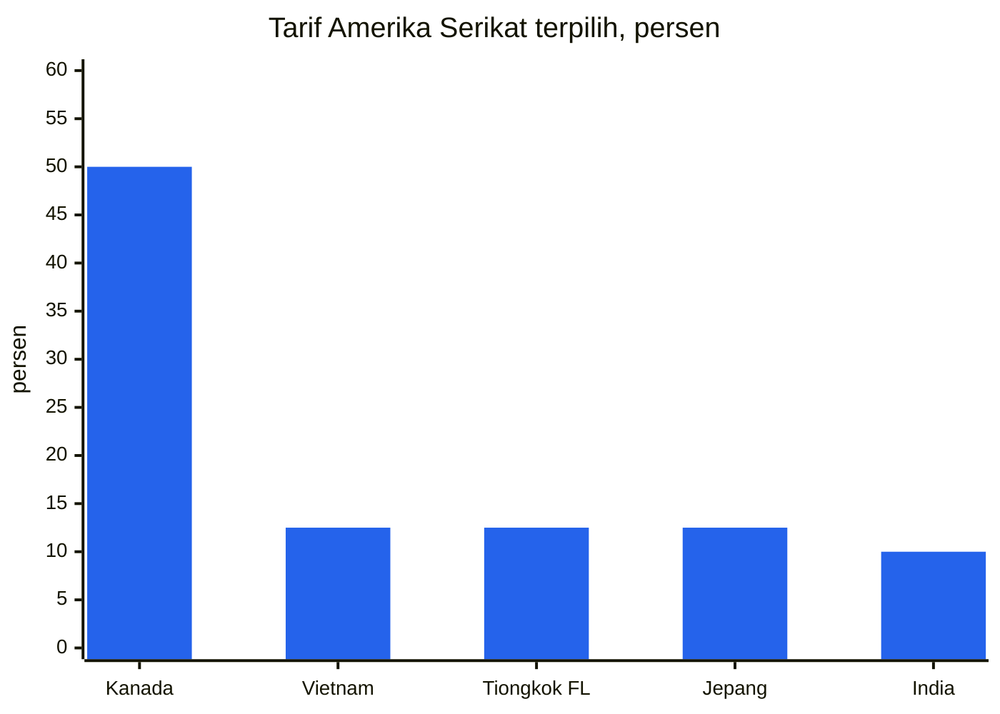

*Catatan: Kanada = tarif Pasal 338 (50%); Vietnam, Tiongkok FL, dan Jepang = tarif kerja paksa Pasal 301 (12,5%); India = tarif kerja paksa Pasal 301 yang berlaku (10%; tarif kesepakatan 18% yang diumumkan tidak pernah diterapkan). Sumber: USTR, Liberty Justice Center, JD Supra.*

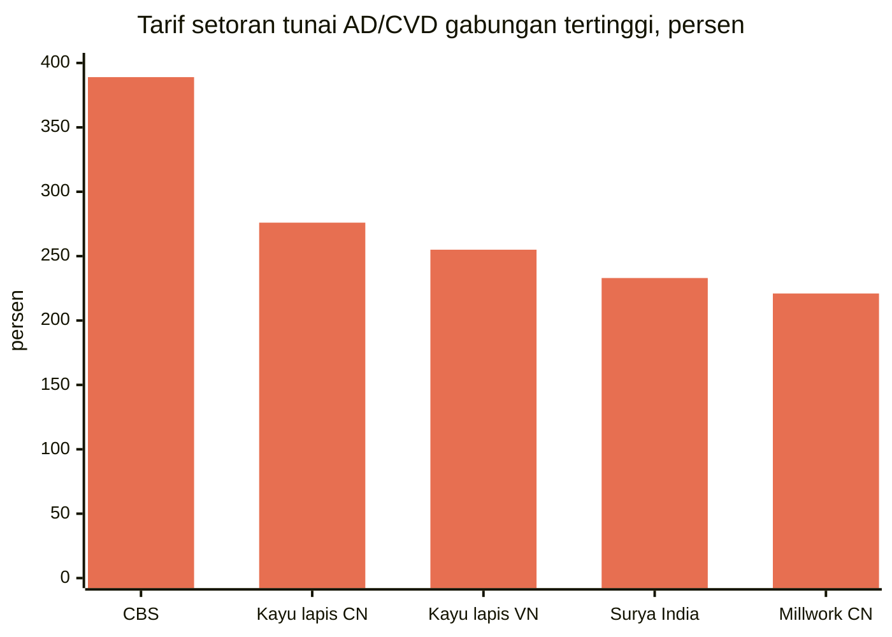

*Catatan: eksposur setoran tunai gabungan bea antidumping ditambah bea masuk anti-subsidi. Akselerator karet CBS: setoran AD 281,69% + CVD 107,57% (pendahuluan); kayu lapis keras Tiongkok: AD 187,27% + CVD 88,96%; kayu lapis Vietnam (Junma Phu Tho): AD 90,12% + CVD 165,39%; sel surya India: gabungan 233,26%; cetakan kayu seluruh Tiongkok: AD 220,87% (tinjauan CVD terpisah). Sumber: pemberitahuan Federal Register Departemen Perdagangan, November 2026.*

---

## 5. Pembahasan mendalam kebijakan AS

### Pasal 301 — pengecualian tetap berlaku; penyelidikan kapasitas berlebih dapat selesai lebih awal

Tidak ada perubahan atas pengecualian Pasal 301 Tiongkok atau penangguhan biaya maritim dalam jendela ini: 178 pengecualian dan penangguhan biaya berjalan hingga pukul 23.59 ET pada 9 Januari 2027, dan tidak ada pemberitahuan USTR baru yang muncul. APEC tidak menghasilkan perpanjangan, dan titik keputusan berikutnya kini adalah G20 di Miami pada 14–15 Desember. Bea kerja paksa Pasal 301 (12,5% untuk Tiongkok, Vietnam, dan Jepang; 10% untuk India) tetap berlaku; Pengadilan Perdagangan Internasional menyidangkan gugatan terhadap tarif kerja paksa (In re Section 301 Forced Labor Cases, Learning Resources sebagai perkara utama) pada 30 September, dan panel tiga hakim belum memutuskan dan belum ada tanggal putusan yang ditetapkan. Pada 16 Oktober pemerintah dan para penggugat mengajukan berkas yang menjawab pertanyaan panel tentang bagian Pasal 301 mana yang dijadikan dasar USTR dan apakah USTR harus mempertimbangkan pembangunan ekonomi. Secara terpisah, CBP merevisi kode pelaporan Bab 99 untuk tarif Pasal 301 Tiongkok pada 22 Oktober (CSMS 70261629); importir dapat mengajukan pengembalian atas entri sebelumnya atas produk yang kemudian dikecualikan USTR, melalui koreksi pasca-ringkasan. [JD Supra](https://www.jdsupra.com/legalnews/lower-tariffs-higher-gray-market-risk-6159993/)

Penyelidikan kapasitas berlebih adalah pertanyaan terbuka pekan ini. Duta Besar Greer dilaporkan mengatakan pada 21 November bahwa penyelidikan atas kapasitas berlebih struktural di 16 ekonomi akan selesai sebelum akhir 2026, beberapa bulan mendahului tenggat statutori 11 Maret 2027. Ia menolak merinci tarif pendahuluan atau jadwal hukuman per negara. Penyelidikan mencakup 21 sektor termasuk mobil, baterai lithium-ion, semikonduktor, baja, aluminium, robotika, modul surya, dan mesin presisi. Jika akurat, linimasa itu mempercepat keputusan yang oleh pejabat India disebut sebagai item penentu bagi kesepakatan India–Amerika Serikat dan yang menurut pejabat Korea Selatan sudah lebih dari dua bulan di belakang linimasa yang mereka perkirakan. Belum ada temuan, tindakan yang diusulkan, atau daftar produk yang diterbitkan. Laporan tersebut bersumber tunggal; tidak ada siaran pers USTR atau pemberitahuan Federal Register yang muncul hingga 23 November. [East Asia Brief](https://eastasiabrief.com/trade-policy/ustr-accelerates-section-301-probe-hit-year-end-target-1636)

Satu-satunya siaran pers penegakan perdagangan USTR dalam jendela ini menyentuh ketenagakerjaan, bukan tarif: pada 19 November Amerika Serikat meminta Meksiko untuk meninjau dugaan penolakan hak pekerja di Polygroup Industrias México berdasarkan Mekanisme Respons Cepat Ketenagakerjaan USMCA, dan permintaan RRM kedua, mengenai Industrias FG, dikeluarkan pada 13 November. Duta Besar Greer menyampaikan sambutan virtual untuk konferensi tahunan Responsible Business Alliance pada 18 November dan menulis kepada Wall Street Journal pada 16 November tentang bagaimana tarif memajukan kemakmuran jangka panjang rakyat Amerika. [USTR](https://ustr.gov/about-us/policy-offices/press-office/press-releases)

### Pasal 232 — polisilikon jatuh tempo 4 Desember; robotika masih negosiasi

CBP mengaktifkan empat klasifikasi Bab 99 simulasi yang tidak resmi (9903.45.43, 9903.45.45, 9903.45.47, 9903.45.49) dalam lingkungan Sertifikasi ACE pada 12 November hanya untuk pengujian, menjelang bea Pasal 232 atas polisilikon dan derivatifnya. Harga impor minimum diuji pada $21/kg untuk polisilikon (HTSUS 2804.61.00), $100/kg untuk ingot dan wafer, $0,22/watt untuk sel surya, dan $0,38/watt untuk modul surya; bea sama dengan selisih antara nilai entri dan harga impor minimum, atau tarif spesifik yang sama dengan harga minimum, di samping bea ad valorem 15% atas derivatif (polisilikon mentah itu sendiri dikecualikan dari bea 15% tetapi tunduk pada batas harga). Untuk Jepang, Korea Selatan, Taiwan, Swiss, Liechtenstein, dan anggota UE, gabungan bea Pasal 232 ditambah bea Kolom 1 dibatasi hingga 15%. Panduan pengajuan produksi dengan judul resmi Bab 99 masih akan datang sebelum 4 Desember. Langkah-langkah itu berlaku luas tanpa pengecualian USMCA. [HTS Hero](https://htshero.com/tariff-updates/2026)

Proklamasi 11077 (robotika dan mesin industri, ditandatangani 28 Oktober, diterbitkan 2 November, 91 FR 69199) tetap merupakan temuan ancaman tanpa tarif baru, yang mengarahkan Departemen Perdagangan dan USTR untuk bernegosiasi dan melaporkan dalam 180 hari (sekitar 26 April 2027). Ini adalah ketiga kalinya dalam tiga bulan pemerintahan memilih negosiasi daripada tarif langsung setelah penyelidikan Pasal 232, setelah turbin angin dan pesawat komersial. Tidak ada perkembangan dalam jendela yang ditemukan. [Constilumen](https://www.constilumen.com/updates/proclamation-11077-robotics-industrial-machinery-section-232)

### CBP — Tenggat Formulir 5106 berlalu dengan tenang; aturan importir asing berlaku 5 Januari

Tenggat 18 November berlalu tanpa pembatalan yang dilaporkan (lihat A9). Penegakan yang mendasarinya berlaku sejak 18 September 2026 berdasarkan pemberitahuan CBP tanggal 19 Agustus (91 FR 53627): nomor importir dengan data Formulir 5106 yang tidak akurat atau tidak lengkap dapat dibatalkan segera, tanpa masa perbaikan yang dijelaskan, dan nomor yang dibatalkan tidak dapat digunakan untuk memasukkan barang. Nomor telepon dan alamat surel adalah unsur data yang paling sering hilang atau salah dalam catatan ACE, menurut penasihat perdagangan. Surat-surat 18 November merupakan gelombang tertarget terhadap importir CTPAT, bukan awal dari kewenangan itu. CBP menyebarkan Foreign Importer of Record Enhancement ke lingkungan Sertifikasi ACE pada 12 November (CSMS #70409426) dan ke Produksi pada 5 Januari 2027; tiga kolom data baru ditambahkan ke Formulir CBP 3461 dan 7501 (CSMS #70381183), dan CBP mengatakan pemeriksaan validasinya dapat menolak entri dan ringkasan entri mulai 5 Januari apabila persyaratan tidak terpenuhi. Komentar atas aturan final sementara ditunggu hingga 5 Januari 2027 (doket USCBP-2026-1387). [DutyStacks](https://dutystacks.beehiiv.com/p/issue-006-apec-ends-with-a-declaration-not-a-deal-the-lukoil-clock-moves)

Ruang berita CBP hanya memuat rilis lokal dalam jendela ini — penyitaan senjata, amunisi, dan narkoba yang keluar di Pelabuhan Masuk Del Rio (19 November); kokain senilai lebih dari $390.000 yang disita di Pelabuhan Masuk Roma (18 November); 440 buah perhiasan palsu yang disita di Cincinnati pada 11 November (dilaporkan 18 November); dan penutupan sementara pelabuhan darat Alburg Springs, Vermont untuk konstruksi (19 November). Tidak ada rilis tarif atau kebijakan perdagangan nasional yang muncul. CSMS #70460453 (17 November) mengingatkan importir bahwa lokomotif dan peralatan kereta api lain yang tidak memenuhi syarat sebagai alat lalu lintas internasional harus dimasukkan dan beanya dibayar, termasuk bea Pasal 232 berdasarkan Proklamasi 11021 atas gerbong baja tertentu dan AD/CVD atas coupler kereta barang dari Tiongkok, Republik Ceko, India, dan Meksiko. Hanya panduan; tidak ada bea baru. [CBP](https://www.cbp.gov/newsroom)

### Kontrol ekspor BIS — aturan akses jarak jauh, peredam, dan pembekuan Daftar Entitas

Aturan final sementara akses jarak jauh dibahas di A2 dan bagian 3.2. Dua item BIS lainnya jatuh dalam jendela ini. Peredam, muffler, dan peredam suara tertentu dipindahkan dari Daftar Munisi AS (USML Kategori I) ke Daftar Kontrol Perdagangan berdasarkan ECCN baru 0A501.f (peredam senapan, pistol, dan multi-host) dan 0A502.f (peredam khusus senapan gentel), berlaku 20 November (aturan diterbitkan 23 Juli 2026, 91 FR 46252). ECCN 0A501.f dikendalikan untuk alasan keamanan nasional, stabilitas regional, pengendalian kejahatan, PBB, dan anti-terorisme; 0A502.f membawa kontrol stabilitas regional baru. Pengecualian Lisensi LVS (hingga $500) tersedia untuk kedua paragraf apabila Kanada adalah tujuan akhir. Peredam yang dirancang khusus untuk senjata api sepenuhnya otomatis tetap berada di USML berdasarkan ITAR. BIS memperkirakan perubahan itu akan menghasilkan sekitar 200 permohonan lisensi ekspor tambahan per tahun. [Thomson Reuters](https://www.thomsonreuters.com/en-us/help/onesource-global-trade/regulatory-insights/2026/october-29th/us-issues-interim-final-rule-silencers-mufflers)

Penangguhan Aturan Afiliasi berjalan hingga 10 Januari 2027 tanpa aturan BIS baru dalam jendela ini, tetapi sengketa politik atas tidak digunakannya aturan itu semakin intens. Menteri Keuangan Bessent mengatakan pada 13 November bahwa Departemen Keuangan, Pertahanan, Luar Negeri, dan USTR semuanya mendukung pencantuman Megaspeed International (pelanggan Nvidia yang berbasis di Singapura yang dilaporkan telah membeli chip Nvidia canggih senilai lebih dari $4,8 miliar selama dua tahun) ke dalam Daftar Entitas selama berbulan-bulan, dan bahwa Departemen Perdagangan "memegang pena". Pada 15 November ia mempertajam tekanan terhadap Nvidia sendiri. Departemen Perdagangan membantah pertukaran Situation Room yang dilaporkan pada 5 November. Financial Times melaporkan pada 10 November bahwa Departemen Perdagangan telah mencoba memperlambat penambahan Daftar Entitas baru, dan daftar itu tidak bertambah selama 13 bulan (penambahan terakhir 9 Oktober 2025), dengan lebih dari 100 kandidat menunggu persetujuan panel peninjau termasuk laboratorium AI Tiongkok DeepSeek. Menteri Perdagangan Howard Lutnick telah setuju untuk bersaksi di hadapan Komite Perbankan Senat pada 10 Desember 2026. Tiga anggota DPR dari Partai Demokrat menulis kepada Lutnick pada 9 November menuntut jawaban tertulis hingga 1 Desember. Secara terpisah, catatan perdagangan Malaysia yang dikutip Bloomberg menunjukkan Megaspeed mengimpor sedikitnya 17.544 prosesor Nvidia GB300 senilai sekitar $787 juta pada November 2025, dan penggeledahan polisi Indonesia atas permintaan FBI terhadap unit lokal Megaspeed menemukan rak GPU yang kosong. Nvidia mengatakan pihaknya memasukkan Megaspeed ke dalam daftar blokir internalnya pada Juni 2025. [ExplainX](https://explainx.ai/blog/bessent-blames-commerce-megaspeed-entity-list-lutnick-ouster-talks-nvidia-huang-2026)

### Federal Register — aktivitas AD/CVD dalam jendela ini

Aktivitas perdagangan Federal Register pekan ini didominasi oleh pemberitahuan bea antidumping dan bea masuk anti-subsidi, dirinci dalam bagian 7: perintah kayu lapis keras dan dekoratif (17 November), hasil tinjauan final cetakan kayu dan millwork (17 November), penetapan pendahuluan USITC atas kotak kardus bergelombang potong mati (17 November), dan pendahuluan tinjauan flensa baja karbon jadi (16 November). Tidak ada perintah penahanan pelepasan baru, tidak ada aturan BIS baru selain aturan akses jarak jauh, tidak ada proklamasi tarif baru Gedung Putih, dan tidak ada pemberitahuan Pasal 301 USTR baru yang muncul dalam jendela ini. Federal Register tidak disapu dokumen demi dokumen selama sepekan penuh, sehingga pemberitahuan tinjauan administratif lebih lanjut mungkin ada.

### Item yang berlaku

- **AGOA:** Presiden Trump memberitahukan Kongres dan pemerintah Rwanda dan Afrika Selatan pada 2 November tentang niatnya mengakhiri status penerima manfaat AGOA mereka efektif 1 Januari 2027, menyusul tinjauan kelayakan antarlembaga tahunan (sidang publik 23 Juli). AGOA diperpanjang oleh undang-undang hingga 31 Desember 2028. Untuk menyelesaikan pengakhiran itu Presiden harus menerbitkan proklamasi sebelum 1 Januari yang menghapus kedua negara dari daftar HTSUS penerima manfaat AGOA; tidak ada proklamasi semacam itu yang diterbitkan hingga 23 November. Ekspor Afrika Selatan kemudian akan menghadapi bea MFN standar, bukan perlakuan bebas bea AGOA. [USTR](https://ustr.gov/about/policy-offices/press-office/press-releases/2026/november/ambassador-greer-issues-statement-president-trumps-intent-terminate-rwanda-and-south-africa-agoa)
- **Prospek tarif pasca-pemilu paruh waktu:** pemilu 3 November menghasilkan mayoritas Demokrat di Kongres yang mulai menjabat pada Januari, tetapi pemilu itu sendiri tidak mengubah tarif bea apa pun; bea yang tersisa bertumpu pada kewenangan Pasal 301 dan Pasal 232, dan mengubahnya akan memerlukan tindakan eksekutif atau undang-undang yang tahan veto. Urutannya: tarif IEEPA dibatalkan 20 Februari 2026, pengumpulan berakhir 24 Februari; biaya tambahan Pasal 122 sebesar 10% berjalan 24 Februari–24 Juli 2026 dan berakhir setelah maksimum statutori 150 hari tanpa perpanjangan Kongres; tarif Pasal 301 yang mencakup 60 ekonomi berlaku 24 Juli 2026 pada 10% atau 12,5%. Produsen disarankan untuk tidak menganggap perlindungan tarif saat ini akan bertahan. [JD Supra](https://www.jdsupra.com/legalnews/lower-tariffs-higher-gray-market-risk-6159993/)
- **Gedung Putih:** tidak ada proklamasi tarif atau lembar fakta baru yang teridentifikasi dalam jendela ini. Proklamasi relevan terbaru tetap Proklamasi 11077 (robotika dan mesin industri).

---

## 6. Kebijakan dunia menurut kawasan

### Eropa

**CEPA UE–Indonesia ditandatangani, 21 November.** Setelah hampir satu dekade perundingan, UE dan Indonesia menandatangani Perjanjian Kemitraan Ekonomi Komprehensif dan Perjanjian Perlindungan Investasi terpisah di Brussels. Komisaris Perdagangan UE Maroš Šefčovič menandatangani untuk blok tersebut; Presiden Komisi Ursula von der Leyen hadir. Dewan telah menyetujui penandatanganan pada 18 November. Indonesia akan menghapus tarif atas 98,5% lini tarif untuk barang UE setelah ketentuan berlaku penuh; Komisi mengatakan kesepakatan itu akan menghemat lebih dari €600 juta per tahun dalam bea pabean bagi eksportir UE, dan 221 indikasi geografis UE menerima perlindungan. Parlemen Eropa masih harus memberikan persetujuan dan Indonesia harus meratifikasi; kedua pihak menargetkan penerapan sementara mulai awal 2027. Von der Leyen mengatakan Presiden Prabowo Subianto akan mengunjungi Brussels pada 11 Desember. Penandatanganan itu menutup hampir sepuluh tahun perundingan dan merupakan penandatanganan perdagangan besar kedua UE di Asia tahun ini, bagian dari dorongan diversifikasi ketika hubungan dengan Amerika Serikat dan Tiongkok semakin sulit. Bagi eksportir, poin praktisnya adalah perjanjian itu ditandatangani, belum berlaku; keputusan sumber dan penetapan harga belum boleh mengasumsikan tarif baru tersebut. [Turkish Post](https://turkishpost.com.tr/en/2026/11/21/eu-indonesia-trade-deal/)

**Penandatanganan FTA UE–India ditetapkan pada 16 Desember 2026.** Perjanjian perdagangan bebas UE–India kini diperkirakan akan ditandatangani pada 16 Desember 2026 di Brussels selama kunjungan Perdana Menteri Narendra Modi, menurut pejabat India yang dikutip PTI dan dilaporkan 22 November. Komisi telah menyampaikan usulan kepada Dewan yang meminta otorisasi untuk penandatanganan dan penyelesaian, beserta teks hukum final dan jadwal tarif. Duta Besar UE untuk India Jean-Eric Paquet mengonfirmasi linimasa pertengahan Desember selama kunjungan ke Assam. Pemberlakuan diperkirakan pada 2027, setelah persetujuan Parlemen Eropa, penyelesaian Dewan, dan ratifikasi India. Berdasarkan pakta itu, 93% pengiriman India akan menerima akses bebas bea ke UE, termasuk tarif nol atas sekitar $33 miliar ekspor padat karya. Perundingan disepakati 27 Januari 2026. Perjanjian perlindungan investasi terpisah dan perjanjian tentang indikasi geografis masih dinegosiasikan. [Asia Daily](https://asiadaily.org/news/19949/)

**Biaya penanganan €2 UE: data dampak pertama — paket bernilai rendah turun lebih dari 60%.** Biaya penanganan Union sebesar €2 per lini barang (Peraturan Delegasi (UE) 2026/2152) dan Pengidentifikasi Produk wajib memasuki pekan ketiga. Rincian baru yang dikonfirmasi pekan ini: Komisi mengatakan volume paket bernilai rendah turun lebih dari 60% dibandingkan tren sebelum bea pada kuartal III 2026, karena sejumlah penjual beralih mengirim stok dalam jumlah besar ke gudang UE. Komisi juga melaporkan 5,9 miliar barang e-commerce bernilai rendah diimpor ke UE pada 2025, empat kali lipat angka 2022, dengan lebih dari 90% berasal dari Tiongkok. Baik bea tetap €3 maupun biaya €2 menjadi bagian dari jumlah kena pajak untuk PPN berdasarkan panduan Komisi yang direvisi tanggal 6 Oktober 2026. Biaya nasional Italia sebesar €2 per kiriman hingga €150 ditunda hingga 1 Desember 2026, di samping pungutan UE. Kampanye inspeksi di seluruh Eropa menemukan lebih dari 60% barang yang diperiksa tidak memenuhi standar Eropa. Bukti keras pertama tentang reset impor bernilai rendah UE menunjukkan pergeseran perilaku yang tajam: volume paket turun lebih dari 60% dibandingkan tren pada kuartal ketiga, sebelum biaya €2 bahkan berlaku, karena penjual memindahkan stok ke gudang UE untuk menghindari pungutan per barang. Biaya itu permanen, berlaku pada nilai berapa pun, dan tidak dapat dikembalikan bahkan atas pengembalian, sehingga mengubah ekonomi pengembalian maupun biaya landed. Tidak ada angka resmi tentang pendapatan yang dikumpulkan atau keterlambatan kliring yang diterbitkan dalam jendela ini. [Fashion Law Journal](https://fashionlawjournal.com/eu-small-parcel-tax/)

**Tindakan pengamanan mobil hibrida UE.** Lihat A4. Komisi membuka penyelidikan pada 30 Oktober; pengajuan tertulis ditutup 20 November; tindakan sementara diperkirakan mulai 1 Desember dengan dilaporkan batas tahunan 350.000 kendaraan untuk hibrida buatan Tiongkok. [Ports Europe](https://www.portseurope.com/eu-opens-hybrid-safeguard-probe-as-chinese-shipments-outrun-planned-quota/)

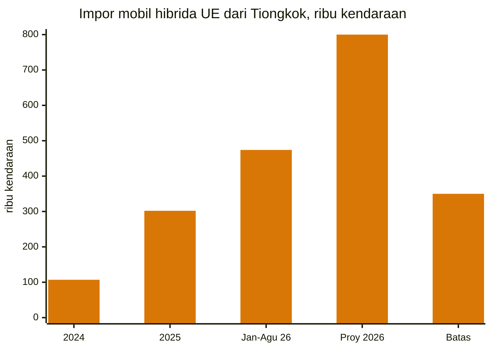

*Catatan: impor adalah angka Eurostat; proyeksi 2026 adalah perkiraan Komisi; batas adalah batas pengamanan tahun pertama yang dilaporkan sebesar 350.000 kendaraan. Sumber: Eurostat via Ports Europe; Komisi.*

**FTA UE–Australia: ditandatangani pada Maret, ratifikasi tidak pasti; tidak ada pergerakan baru dalam jendela ini.** FTA UE–Australia disepakati 24 Maret 2026 dan ditandatangani di Canberra pada hari yang sama, tetapi belum berlaku dan tidak dapat diterapkan tanpa pengawasan parlemen dan perubahan hukum Australia, proses yang menurut DFAT dapat memakan waktu hingga dua tahun. Duta Besar Jerman untuk Australia mengatakan 29–31 Oktober bahwa ratifikasi di Australia bergantung pada suara Senat dari Koalisi, Greens, atau crossbench, dan menyampaikan harapan dapat diselesaikan pada kuartal I 2027; Partai Nasional oposisi telah berjanji menentangnya dan Partai Liberal belum menyatakan posisi. UE telah memperingatkan kesepakatan itu tidak akan dirundingkan ulang jika parlemen menolaknya. Pemberlakuan tidak diperkirakan sebelum akhir 2027. Sebanyak 98% ekspor Australia berdasarkan nilai akan memasuki UE bebas bea; perdagangan dua arah melebihi A$109 miliar per tahun. [AAP](https://aapnews.aap.com.au/news/claim-eu-trade-deal-mandates-methane-reducing-livestock-feed-is-baseless)

**Perjanjian perdagangan digital UE–Kanada disepakati 30 Oktober; teks belum dipublikasikan.** UE dan Kanada menyelesaikan perundingan Perjanjian Perdagangan Digital pada 30 Oktober 2026, melengkapi CETA (diterapkan sementara sejak 2017). Perjanjian itu menetapkan aturan untuk arus data lintas batas, kontrak elektronik, tanda tangan elektronik dan faktur elektronik, perlindungan konsumen daring, dan pesan komersial yang tidak diminta. Perundingan diluncurkan baru pada Maret 2026 pada pertemuan kelima Komite Bersama CETA. Teks yang disepakati belum diterbitkan; penyuntingan hukum dan penerjemahan ke semua bahasa UE dilakukan sebelum penandatanganan. Kecepatan perundingan — diselesaikan dalam delapan bulan sejak diluncurkan — mencerminkan prioritas politik yang diberikan kedua pihak pada aturan perdagangan digital ketika kebijakan Amerika Serikat semakin tidak dapat diprediksi. Penandatanganan dan pemberlakuan tetap menjadi urusan 2027 paling cepat. [European Commission](https://policy.trade.ec.europa.eu/news/eu-and-canada-conclude-negotiations-digital-trade-agreement-2026-10-30_en?prefLang=ga)

**Aturan asal usul otomotif Britania Raya–UE: ACEA dan SMMT memperingatkan satu dari empat EV menghadapi tarif 10% mulai 1 Januari 2027.** ACEA dan SMMT memperingatkan bahwa aturan asal usul Perjanjian Perdagangan dan Kerja Sama Britania Raya–UE yang lebih ketat untuk kendaraan listrik dan hibrida, yang berlaku 1 Januari 2027, akan membuat kurang dari satu dari empat kendaraan listrik baterai dan hibrida plug-in yang diperdagangkan antara kedua pasar memenuhi syarat untuk perlakuan bebas tarif, mengekspos sisanya pada tarif 10%. Asosiasi itu juga memperingatkan Undang-Undang Akselerator Industri UE yang diusulkan dapat memberlakukan tarif atas kendaraan dan komponen Britania Raya, mengancam hubungan perdagangan otomotif senilai US$87 miliar per tahun. UE masih mengimpor sekitar dua pertiga baterai lithium-ion-nya meski sekitar US$80,8 miliar telah diinvestasikan dalam rantai pasok baterai UE sejak 2017. VDA Jerman berargumen pada November untuk menunda perubahan aturan asal usul hingga rantai pasok baterai UE berkembang lebih lanjut. KTT 20 November tidak menghasilkan penyelesaian yang dilaporkan mengenai hal itu. [Manufacturing Digital](https://manufacturingdigital.com/news/acea-smmt-uk-eu-tariff-rules-threaten-auto-manufacturers)

### Britania Raya

**KTT Britania Raya–UE, 20 November: perjanjian SPS, pengaitan ETS, dan pengecualian CBAM timbal balik disepakati.** Lihat bagian 3.3. Pada KTT Britania Raya–UE kedua, kedua pihak menyepakati perjanjian SPS (penerapan 1 Maret 2028; Pemerintah Britania Raya memperkirakan perjanjian itu dapat meningkatkan output ekonomi hingga £5,1 miliar per tahun pada 2040), pengaitan Skema Perdagangan Emisi Britania Raya dengan Sistem Perdagangan Emisi UE (pengecualian CBAM timbal balik ditargetkan mulai 1 Januari 2028; sekitar £6,5 miliar ekspor Britania Raya dapat memperoleh manfaat), dan langkah-langkah mobilitas pemuda. Britania Raya akan membebaskan barang yang berasal dari UE, EEA, dan Swiss dari CBAM-nya mulai 1 Januari 2027. Perjanjian-perjanjian itu belum berlaku; proses hukum dan penerapan lebih lanjut diperlukan. [Thames Valley Chamber](https://www.thamesvalleychamber.co.uk/uk-eu-summit-2026-new-trade-agreements-reached/)

**Cakupan CBAM Britania Raya akan diperluas ke produk kilang; konsultasi diluncurkan pada Anggaran 2026.** Pemerintah bermaksud memperluas Mekanisme Penyesuaian Batas Karbon Britania Raya untuk mencakup produk kilang, tergantung konsultasi tentang kelayakan dan dampak. Konsultasi diluncurkan pada Anggaran 2026. Tidak ada linimasa yang diberikan; Pemerintah mengatakan bermaksud melaksanakan langkah itu "secepat mungkin" dan akan menetapkan linimasa pada waktunya. CBAM Britania Raya sebagaimana ditetapkan dalam undang-undang dimulai 1 Januari 2027 untuk aluminium, semen, pupuk, hidrogen, serta besi dan baja. Perluasan itu akan memperluas CBAM Britania Raya melampaui lima sektor awalnya ke produk minyak olahan, tetapi masih pada tahap konsultasi tanpa tanggal. Langkah itu berdampingan dengan kesepakatan KTT 20 November, yang berdasarkan itu barang asal UE akan dibebaskan dari CBAM Britania Raya mulai 1 Januari 2027 — sehingga perluasan produk kilang, jika dilanjutkan, pada praktiknya terutama akan jatuh pada pemasok non-UE. [UK Parliament](https://questions-statements.parliament.uk/written-questions/detail/2026-10-28/39108)

**Tidak ada pemberitahuan pemulihan perdagangan baru dari Britania Raya dalam jendela ini; perpanjangan bea atas trout pelangi tetap berlaku.** Tidak ada pemberitahuan pemulihan perdagangan baru yang ditemukan dalam jendela liputan. Item yang berlaku: Pemberitahuan Pemulihan Perdagangan 2026/31 memperpanjang bea imbalan atas trout pelangi Turki selama lima tahun hingga 30 Januari 2031, berlaku 6 November 2026, pada tarif yang berlaku (khusus eksportir 1,5%–8%; semua lainnya 9,5%). Dimulainya CBAM Britania Raya pada 1 Januari 2027 kini menjadi peristiwa perdagangan Britania Raya terdekat yang bertanggal.

### Kanada

**Pengaturan bilateral Kanada–Tiongkok diperpanjang dan diperluas, 17 November.** Kanada dan Tiongkok memperpanjang dan memperluas Pengaturan Bersama Pendahuluan tentang Penanganan Isu Ekonomi dan Perdagangan Bilateral. Tiongkok akan memberikan keringanan tarif tambahan untuk sekitar C$400 juta ekspor Kanada — C$116 juta dalam potongan daging babi beku dan C$285 juta dalam ikan dan makanan laut (udang dan udang air dingin beku termasuk udang spot Pasifik C$87,5 juta; moluska termasuk geoduck C$61,4 juta; teripang C$39,4 juta; halibut Greenland C$96 juta) — dengan menangguhkan tarif tambahan 25% atas produk tersebut mulai 1 Januari 2027 hingga 31 Desember 2028. Perluasan itu dibangun di atas perpanjangan dua tahun keringanan tarif untuk tepung kanola, kacang polong, lobster, dan kepiting yang disepakati awal November (perundingan tingkat menteri 4 November). Sebagai imbalannya, Kanada memperpanjang dua tahun langkah remisi yang berlaku untuk produk baja dan aluminium Tiongkok tertentu yang akan berakhir pada akhir 2026, dan memperluas cakupan remisi ke tambahan 32 item tarif baja dan aluminium (23 baja, 9 aluminium) yang pasokan Kanadanya tidak mencukupi atau tidak tersedia. Angka C$400 juta adalah nilai ekspor Kanada dalam kategori tersebut pada 2024, sebelum tarif tambahan Tiongkok; angka itu bukan pembayaran atau jaminan bisnis baru. Tanggal berakhir baru pengaturan itu adalah 31 Desember 2028. Kesepakatan itu juga menghidupkan kembali swap mata uang bilateral, menurut ringkasan APEC China Briefing. [Prime Minister of Canada](https://www.pm.gc.ca/en/news/news-releases/2026/11/17/prime-minister-carney-advances-canadas-strategic-partnership-china)

**Gugatan pengadilan Pasal 338: argumen lisan ditetapkan 20 Januari 2027.** Lihat bagian 3.7 dan A9 dalam laporan pekan lalu. Berkas amicus yang mendukung gugatan terhadap tarif Pasal 338 atas barang Kanada diajukan oleh mantan USTR Carla Hills dan Robert Zoellick, pakar perdagangan, dan advokat pembayar pajak; Liberty Justice Center mengumumkan pengajuan itu 16 November. Argumen lisan dijadwalkan 20 Januari 2027. Berkas tanggapan pemerintah jatuh tempo 11 Desember 2026, dengan jawaban Gellert jatuh tempo 11 Januari 2027. Perkara itu (Gellert Global Group Corp. v. Trump, Pengadilan No. 26-04636) menggugat bea 50% atas sekitar $20 miliar impor Kanada; Gellert mengatakan akan membayar kira-kira $40 juta per tahun atas keju Kanada dan telah membayar sedikitnya US$381.000 atas entri yang dibuat 15 September–7 Oktober 2026. Pada 28 Oktober pengadilan mengabulkan sebagian dan menolak sebagian mosi Gellert (entri doket tidak merinci bagian mana). Proklamasi 11076 menulis ulang daftar produk kendaraan bermotor lagi untuk barang yang masuk mulai 30 Oktober 2026. Tarif tetap berlaku. [Liberty Justice Center](https://libertyjusticecenter.org/pressrelease/former-u-s-trade-representatives-scholars-back-liberty-justice-centers-challenge-to-trumps-canadian-tariffs/)

**Gambaran pendapatan keringanan tarif Kanada: C$14,1 miliar dinilai, C$8,9 miliar diremisi.** Dari Maret 2025 hingga 26 Oktober 2026, Kanada menilai C$14,1 miliar (sekitar US$10 miliar) tarif atas produk Amerika Serikat, tetapi C$8,9 miliar diremisi atau dibebaskan, menyisakan pendapatan bersih C$5,2 miliar. Hal ini mengukur seberapa luas program remisi: sebagian besar tarif balasan sebenarnya tidak menghasilkan pendapatan. Perubahan 9 November (remisi horizontal diperpanjang hingga 30 Juni 2028; keringanan dihapus untuk trailer tertentu mulai 1 Desember 2026 dan kawat aluminium, ekstrusi, dan karton tertentu mulai 1 Februari 2027) tetap berlaku sebagaimana dilaporkan pekan lalu; tidak ada perubahan lebih lanjut dalam jendela ini. [Mining Weekly](https://www.miningweekly.com/article/canada-expands-us-tariff-exemptions-cuts-some-aluminium-relief-2026-11-10)

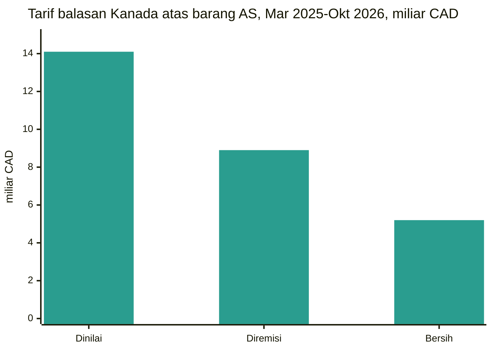

*Catatan: tarif yang dinilai atas produk Amerika Serikat Maret 2025 hingga 26 Oktober 2026; diremisi atau dibebaskan berdasarkan program remisi; pendapatan bersih. Sumber: pengungkapan Pemerintah Kanada via Mining Weekly, 10 November 2026.*

**Kanada mempertanyakan India di WTO atas stok beras yang dialihkan ke etanol.** Kanada mengajukan pertanyaan resmi di WTO pada 14 November mengenai alokasi stok beras yang dikuasai negara oleh India kepada produsen etanol, meminta rincian volume gandum publik yang dialihkan ke penyulingan alkohol bahan bakar domestik. Hal ini mengikuti pola pengawasan komite pertanian atas dukungan domestik India (lihat Multilateral). Tidak ada tanggapan India yang dilaporkan dalam jendela ini. [Distillers Hub](https://distillershub.com/news/111420315/)

### Tiongkok

**Kontrol ekspor penggunaan ganda atas drone, mesin bor terowongan, dan kapal keruk berlaku 18 November.** Pengumuman No. 49 (drone), No. 50 (mesin bor terowongan dan peralatan terkait), dan No. 51 (kapal keruk) berlaku 18 November 2026, merevisi Daftar Kontrol Ekspor Barang Penggunaan Ganda. Lisensi diperlukan untuk autopilot drone, drone yang mampu terbang di luar jangkauan visual dengan daya tahan sedikitnya tiga jam, mesin yang dirancang khusus untuk drone, dan drone dengan jangkauan 300 km atau lebih atau dilengkapi untuk penyebaran aerosol di atas 80 liter. Pengumuman No. 49 menaikkan ambang daya tahan untuk drone yang dikendalikan dari satu jam menjadi tiga jam, sehingga drone pasar massal di bawah ambang itu tidak lagi memerlukan lisensi, sementara kontrol meluas ke lebih banyak suku cadang drone. Pengumuman No. 50 memberlakukan kontrol atas mesin bor terowongan untuk pertama kalinya, ditambah ekskavator berjalan tertentu dan mesin shotcrete dataran tinggi; ekspor ke tujuan sensitif memerlukan lisensi, tujuan lain dapat menggunakan sertifikat berbasis pendaftaran, tergantung pembatasan transfer lanjutan. Pengumuman No. 51 menambahkan lisensi untuk pompa keruk, draghead, dan cutterhead tertentu. Aturan ekspor ulang juga berlaku mulai 18 November: perusahaan asing memerlukan lisensi Tiongkok untuk meneruskan mesin konstruksi asal Tiongkok seperti mesin bor terowongan ke negara-negara tertentu. Secara terpisah, Pengumuman MOFCOM dan GAC No. 52 (19 Oktober) merevisi prosedur yang berdasarkan itu bea cukai dapat menahan barang yang diajukan untuk ekspor tanpa lisensi. Kontrol itu kini berlaku, dan rancangannya bermuka dua: ambang batas dinaikkan sehingga drone komersial biasa berada di luar rezim, sementara jaring diperlebar ke mesin bor terowongan — pertama kalinya — dan ke ekspor ulang mesin asal Tiongkok oleh perusahaan asing. Aturan ekspor ulang itu adalah sisi paling tajam bagi pembeli dan penjual ulang negara ketiga, karena menjangkau transaksi tanpa eksportir Tiongkok. [Mondaq](https://alpha.mondaq.com/china/new-technology/1870494/new-chinese-export-control-measures-tighten-restrictions-on-the-export-of-advanced-technologies-and-dual-use-goods-strengthen-enforcement)

**Katalog ekspor teknologi: komentar ditutup 15 November; pendaftaran sementara kini menjadi rezim yang berlaku.** Komentar publik atas Pengumuman No. 48 (16 Oktober), yang akan menambahkan 40 teknologi ke Katalog Teknologi yang Dilarang atau Dibatasi untuk Diekspor (23 AI, 5 biofarmasi, 12 fotovoltaik; 14 dilarang, 26 dibatasi), ditutup 15 November. Tidak ada katalog final yang diterbitkan hingga 23 November. Yang berlaku kini adalah persyaratan pendaftaran pra-ekspor sementara yang berlaku sejak 16 Oktober, yang mencakup ekspor teknologi yang terdaftar termasuk transaksi yang sudah berjalan dan transfer kepemilikan atau kendali atas perusahaan domestik yang memegang teknologi itu ke entitas luar negeri. Analisis baru pekan ini memperjelas cakupan: dalam biofarmasi, transfer kepemilikan platform terapi sel dan gen serta siRNA akan dilarang, tetapi lisensi, layanan CRO/CDMO, dan teknologi yang diperlukan untuk R&D produk atau manufaktur dalam transaksi pengembangan bisnis outbound tidak akan dilarang; dalam AI, penyebaran lokal di luar negeri atas model yang dibatasi dihitung sebagai ekspor teknologi, sementara akses API, interaksi aplikasi atau web, SaaS, dan penyebaran ringan di perangkat berada di luar cakupan. Tinjauan ekspor teknologi yang dibatasi memakan waktu hingga sekitar 45 hari kerja dalam dua tahap. MOFCOM juga membuka konsultasi atas draf Langkah-langkah Penyelidikan dan Penegakan Kontrol Ekspor Penggunaan Ganda, dengan komentar jatuh tempo 29 November 2026. Ketentuan surya tetap yang paling berdampak bagi produsen asing, mencakup produksi polisilikon, wafer setebal 70 mikrometer atau lebih tipis, dan fabrikasi sel perovskit dan tandem. [Jones Day](https://www.jonesday.com/en/insights/2026/11/china-tightens-its-grip-on-exports-of-strategic-technologies-what-it-means-for-technology-deals-involving-ai-and-biotech)

**Situs berbahasa Inggris MOFCOM dapat diakses; halaman depan hanya menampilkan konferensi pers 12 November.** Situs berbahasa Inggris dapat diakses pada 23 November. Isi halaman depan terbatas pada konferensi pers reguler 12 November (termasuk komentar tentang panggilan video He Lifeng pada 6 November dengan Bessent dan Greer, serta acara match-making perangkat medis Tiongkok–UE di CIIE) dan edisi Gazette. Tidak ada pengumuman baru tentang katalog teknologi atau penangguhan galium yang terlihat di halaman depan. Portal berbahasa Inggris MOFCOM tetap menjadi sumber yang tipis — hanya judul, dengan pengumuman substantif yang muncul pertama kali dalam bahasa Tiongkok. Konferensi pers 12 November mengonfirmasi delapan putaran konsultasi ekonomi dan perdagangan Tiongkok–Amerika Serikat sejak Mei 2025. Penangguhan terkait galium (Pengumuman No. 72 Tahun 2025) berakhir 27 November 2026 dan belum ada pemberitahuan perubahan yang ditemukan hingga 23 November. [MOFCOM](https://english.mofcom.gov.cn/)

**Tiongkok–Amerika Serikat: tidak ada hasil tarif dari APEC; gencatan tetap berjalan hingga 9–10 Januari 2027.** Lihat A1 dan bagian 3.1. Bilateral Xi–Trump pada 19 November tidak menghasilkan pengumuman keringanan tarif dan tidak ada hasil tanah jarang; laporan menggambarkan kebuntuan atas tarif, tanah jarang, dan semikonduktor. Trump mendesak Tiongkok untuk memenuhi janji membeli produk pertanian Amerika Serikat senilai US$17 miliar; pejabat Tiongkok mengatakan janji itu bersyarat pada pengurangan tarif timbal balik. Kedua pemimpin sepakat menyusun rencana aksi bagi "stabilitas strategis" Amerika Serikat–Tiongkok. Paket pemotongan tarif timbal balik $30 miliar untuk $30 miliar dan $60 miliar yang diusulkan tetap belum difinalisasi. [China Briefing](https://www.china-briefing.com/news/apec-2026-in-shenzhen-what-the-leaders-meeting-and-trump-xi-talks-mean-for-business/)

### India

**Kesepakatan India–Amerika Serikat masih belum ditandatangani; Sekretaris Perdagangan mengatakan penandatanganan harus menunggu kerangka tarif Amerika Serikat.** Lihat bagian 3.7. Sekretaris Perdagangan Rajesh Agrawal mengatakan 18 November bahwa kesepakatan perdagangan India–Amerika Serikat yang diusulkan tidak dapat ditandatangani hingga Washington menerapkan arsitektur tarif baru menyusul pembongkaran tarif timbal balik dan darurat oleh Mahkamah Agung, karena keunggulan komparatif yang ditawarkan kepada berbagai negara perlu jelas. Hasil penyelidikan Pasal 301 yang sedang berlangsung — termasuk penyelidikan kapasitas berlebih, yang temuannya diperkirakan dalam beberapa pekan atau bulan — juga perlu diketahui, karena setiap negara menginginkan kepastian atas penyelidikan itu. Perjanjian hukum telah dinegosiasikan dan berada pada tahap akhir; kedua pihak ingin menyelesaikan secepat mungkin. Jaishankar mengatakan 14 November bahwa kesepakatan itu berada pada "tahap akhir" dan sebagian besar isu telah diselesaikan. Kerangka 7 Februari 2026 menetapkan tarif Amerika Serikat 18%, tidak pernah diterapkan; barang India saat ini membayar tarif Pasal 301 sebesar 10%. [The Hindu BusinessLine](https://www.thehindubusinessline.com/economy/no-india-us-trade-deal-until-new-us-tariff-framework-section-301-probes/article71716562.ece/amp/)

**India–UE: penandatanganan 16 Desember; garis merah susu dan GM ditegaskan kembali.** Tidak ada perubahan atas garis merah yang dilaporkan pekan lalu: India tidak pernah membuka sektor susunya dalam FTA apa pun dan tidak akan mengizinkan impor produk hasil rekayasa genetika. Penandatanganan UE–India kini bertanggal 16 Desember (lihat Eropa). Garis merah itu stabil dan relevan bagi setiap jalur FTA India yang aktif, termasuk kesepakatan Amerika Serikat yang belum ditandatangani, yang pertanian dan susunya termasuk sensitivitas yang belum terselesaikan.

### Asia-Pasifik

**APEC Shenzhen: para pemimpin mengadopsi Pandangan Shenzhen; tidak ada kesepakatan tarif; kesepakatan sampingan untuk Kanada, Chile, Filipina, Peru, Indonesia.** Lihat bagian 3.1 dan 3.7. Kesepakatan sampingan: keringanan tarif Tiongkok–Kanada (lihat Kanada); Perjanjian Kemitraan Ekonomi Komprehensif Filipina–Chile ditandatangani 19 November — FTA pertama Filipina dengan negara Amerika Latin, akses preferensial untuk 8.632 kategori produk, perlakuan bebas bea untuk hampir semua pengiriman Filipina yang ada ke Chile (elektronik, mesin, kelapa kering, karagenan, tuna olahan); FTA Peru–Thailand ditandatangani 19 November; peta jalan ekonomi dan perdagangan Tiongkok–Chile dan MOU tentang perdagangan bebas dan multilateralisme; Tiongkok–Indonesia mengumumkan 20 November peluncuran perundingan CEPA. Filipina juga menyatakan minat bergabung dengan CPTPP dan mengatakan perundingan FTA Filipina–Kanada telah diselesaikan. [BusinessMirror](https://businessmirror.com.ph/2026/11/20/new-trade-deal-opens-chile-market-for-phl/)

**Pax Silica: Deklarasi San Francisco ditandatangani 15 November oleh Amerika Serikat dan delapan mitra.** Amerika Serikat dan delapan mitra menandatangani Deklarasi San Francisco tentang Fondasi Aman bagi Kemakmuran yang Berkelanjutan berdasarkan kerangka Pax Silica, menyepakati untuk mengembangkan daftar bersama teknologi sensitif dan rantai pasok kritis yang memerlukan perlindungan lebih kuat, bertukar informasi tentang kerentanan, dan mengorganisasi kelompok kerja. Deklarasi itu mencakup semikonduktor, infrastruktur AI, mineral kritis, energi, manufaktur canggih, logistik transportasi, dan jaringan komunikasi, serta menyasar praktik non-pasar, kelebihan kapasitas, dan dumping yang tidak adil. Deklarasi itu tidak mengikat: tidak ada komitmen pendanaan, tidak ada perusahaan yang disebutkan, tidak ada tenggat penerapan, dan daftar bersama itu sendiri belum ditulis atau diterbitkan. Pax Silica, diluncurkan Desember 2025, kini memiliki sekitar 26 peserta. Anggota UE tidak menghadiri Founders Retreat tetapi sedang meninjau dokumen itu untuk "kompatibilitas regulasi"; Jerman, Swedia, Belanda, dan Komisi Eropa diperkirakan akan menandatangani segera. Deklarasi itu menggerakkan Pax Silica dari pernyataan kemitraan yang luas menuju koordinasi keamanan yang konkret — pekerjaan rumahnya adalah daftar bersama teknologi dan infrastruktur yang harus dilindungi — tetapi hasil yang dapat disampaikan belum ada, sehingga dampak perdagangannya bersifat prospektif. Perhatikan apakah anggota UE menandatangani dan apakah daftar bersama itu, ketika disusun, menghasilkan konsekuensi kontrol ekspor atau penyaringan investasi. [Asia Daily](https://asiadaily.org/news/18839/)

**Filipina mengamankan janji investasi US$41,1 miliar di APEC; minat CPTPP dinyatakan.** Presiden Marcos kembali dari Shenzhen dengan janji investasi senilai US$41,1 miliar yang mencakup manufaktur, kendaraan listrik, dan teknologi energi bersih, dengan potensi lebih dari 7.000 pekerjaan. Janji paling konkret adalah C&U Group senilai US$87 juta untuk fasilitas seluas 20 hektare di Alitagtag, Batangas. Filipina juga menyatakan minat bergabung dengan CPTPP selama pertemuan dengan Presiden Meksiko Claudia Sheinbaum, dan mencatat perundingan FTA Filipina–Kanada yang telah diselesaikan dan CEPA Filipina–Chile yang telah ditandatangani. Ekspor Filipina tumbuh 15,4% pada 2025 dengan peningkatan bulanan yang berkelanjutan pada Januari–September 2026. Janji bukanlah belanja modal, dan angka utama US$41,1 miliar harus dibaca sebagai sinyal niat daripada investasi yang sudah berkomitmen; fasilitas C&U adalah satu-satunya komitmen yang dirinci. [Further Asia](https://furtherasia.com/philippines-gets-us41-1b-investment-pledges-after-apec/)

**Tarif kosmetik Korea–Brasil: tidak ada perkembangan baru dalam jendela ini.** Berkas itu tetap pada tahap dorongan presiden tanpa hasil negosiasi yang dilaporkan. Item pekan lalu tetap berlaku: Presiden Lee mendesak pada rapat kabinet 3 November agar perundingan cepat atas tarif Brasil 25% atas kosmetik Korea, setelah Lula terpilih kembali pada 25 Oktober. Ekspor kosmetik Korea mencapai US$12,4 miliar dalam sepuluh bulan pertama 2026, naik 27,3% tahun ke tahun. [Seoul Economic Daily](https://en.sedaily.com/politics/2026/11/03/lee-presses-brazil-to-cut-25-percent-tariff-on-korean)

### Multilateral

**Jalur reformasi WTO: Amerika Serikat menantang Tiongkok, menolak pertanian dalam jalur "level playing field"; tidak ada paket MC15 tanpa pertanian, Brasil memperingatkan.** Pada pertemuan maraton 16 November tentang isu "level playing field" dalam jalur reformasi WTO, Amerika Serikat mengatakan tetap prihatin tentang hubungan perdagangan bilateral yang "tidak berkelanjutan" dengan Tiongkok, dengan tuduhan Beijing tidak bermain sesuai aturan, dan menyarankan asimetri — defisit perdagangan yang digambarkan kemungkinan US$1 triliun per tahun — telah menjadi terlalu besar untuk ditangani berdasarkan aturan WTO yang ada. Washington juga menyampaikan bahwa non-diskriminasi, termasuk perlakuan MFN, tidak dapat diterapkan di hadapan asimetri yang berlanjut. Amerika Serikat, bersama negara-negara G10 yang defensif di bidang pertanian yang dipimpin Norwegia, Jepang, dan Swiss, menentang pencantuman pertanian dalam diskusi level-playing-field, dengan menegaskan pertanian hanya menjadi urusan Komite Pertanian dalam Sidang Khusus. Sejumlah negara mendukung usulan Tiongkok tentang level playing field, termasuk diskusi multilateral tentang kebijakan industri dan subsidi industri; UE mengisyaratkan persetujuan atas usulan Tiongkok, dan Tiongkok mengatakan akan menerima pekerjaan OECD tentang intervensi negara dan subsidi. Brasil memperingatkan tidak akan ada paket reformasi WTO untuk diadopsi pada MC15 (dijadwalkan 2028) tanpa pertanian dalam jalur level-playing-field. Selandia Baru mengisyaratkan mungkin mengajukan dokumen tentang pertanian. Jalur reformasi kini secara terbuka terbelah pada dua sumbu: apakah pertanian termasuk dalam diskusi level-playing-field, dan apakah asimetri Amerika Serikat–Tiongkok dapat ditangani di dalam aturan WTO. Posisi Amerika Serikat — bahwa MFN tidak dapat berlaku di tengah asimetri yang berlanjut — merupakan tantangan langsung terhadap prinsip inti WTO. Pertemuan 16 November tidak menghasilkan kesepakatan. Sidang khusus Komite Pertanian berikutnya dijadwalkan 23 November 2026, mencakup pembatasan ekspor dan mekanisme pengamanan khusus. [Third World Network](https://www.twn.my/title2/wto.info/2026/ti261112.htm)

**Pertanian WTO: subsidi gula India mendekati US$18 miliar dituduhkan; Kanada mempertanyakan beras untuk etanol.** Sebuah laporan yang disampaikan ke WTO mengklaim India memberikan subsidi gula hampir US$18 miliar tahun lalu, melebihi batas WTO — tindak lanjut dari pemberitahuan balasan Australia pada 9 September yang menuduh India gagal memberitahukan dukungan domestik untuk gula, kapas, dan kacang-kacangan. Panel Desember 2021 dalam India — Gula dan Tebu menemukan dukungan gula India tidak konsisten dengan kewajiban WTO. Secara terpisah, Kanada mengajukan pertanyaan resmi (lihat Kanada) tentang alokasi stok beras yang dikuasai negara oleh India kepada produsen etanol. Komite Pertanian dalam sidang khusus bertemu 23 November 2026, mencakup pembatasan ekspor dan mekanisme pengamanan khusus. Pertanian tetap menjadi berkas WTO yang paling diperebutkan, dengan India di pusat tiga pengawasan paralel — gula, beras untuk etanol, dan kesenjangan pemberitahuan kapas/kacang-kacangan sebelumnya. Angka US$18 miliar adalah tuduhan dalam laporan yang disampaikan, bukan temuan WTO, dan harus diperlakukan demikian. [RFD-TV](https://www.rfdtv.com/indian-sugar-subsidies-draw-scrutiny-over-unfair-trade-practices)

**WTO DS644 (Tiongkok v. India): panel terbentuk sejak Juni; pokok perkara belum diputuskan.** Koreksi atas laporan pekan lalu, yang menyatakan WTO "sepakat membentuk" panel dalam DS644 pada 16 November. Catatan publik menunjukkan Badan Penyelesaian Sengketa membentuk panel pada 23 Juni 2026 dan menyusunnya pada 7 Oktober 2026. Tiongkok meminta konsultasi 19 Desember 2025; panel diminta 11 Mei 2026; pembentukan ditunda 22 Mei (India memblokir permintaan pertama). Sengketa itu mencakup perlakuan tarif India atas produk teknologi tertentu dan langkah-langkah insentif dalam Program Modul Surya yang diduga menguntungkan barang domestik dibandingkan barang impor. Tidak ada laporan panel, temuan, atau pemulihan yang diterbitkan. Tidak ada perkembangan baru dalam jendela ini. Sengketa itu berada dalam adjudikasi formal dengan panel yang telah tersusun, tetapi belum ada yang diputuskan dan India tidak mengubah lini tarif atau aturan program apa pun sebagai akibatnya. [WTO](https://www.wto.org/english/news_e/news26_e/dsb_23jun26_426_e.htm)

**Laporan Perdagangan dan Pembangunan UNCTAD 2026: pertumbuhan global melambat menjadi 2,6%; perdagangan Amerika Serikat–Tiongkok turun lebih dari 20% sejak 2024.** Laporan Perdagangan dan Pembangunan UNCTAD 2026, diterbitkan 17 November, memproyeksikan pertumbuhan global melambat menjadi 2,6% pada 2026 dari 2,9% pada 2025, dengan ekonomi berkembang pada 4% (turun dari 4,7%). Perdagangan barang dan jasa diperkirakan tumbuh sekitar 4% pada harga konstan; perdagangan global mencapai rekor US$35 triliun pada 2025. Asia berkontribusi 59% dari pertumbuhan global pada 2026 (India 7,3%, Tiongkok 4,5%, Indonesia 5,2%). Perdagangan antara Tiongkok dan Amerika Serikat telah turun lebih dari 20% sejak 2024, sementara Asia Timur telah memperluas perdagangan dengan keduanya. Perlambatan itu terkait dengan konflik Timur Tengah, yang mendorong minyak mentah Brent dari US$70 menjadi lebih dari US$110 per barel; volatilitas arus modal telah berlipat ganda sejak konflik dimulai; bantuan pembangunan resmi diproyeksikan turun hampir 7% pada 2026, penurunan tahunan ketiga berturut-turut. Judul utama UNCTAD adalah fragmentasi dengan ketahanan Asia: dua ekonomi terbesar dunia telah memangkas perdagangan bilateral lebih dari seperlima sejak 2024, namun perdagangan global tetap mencapai rekor US$35 triliun pada 2025 dan Asia menghasilkan sebagian besar pertumbuhan 2026. Perhatikan bahwa angka pertumbuhan itu adalah angka UNCTAD sendiri dan tidak dapat dibandingkan langsung dengan angka IMF. Ini adalah rilis baru dalam jendela ini, berbeda dari Global Trade Update 9 November yang dibahas pekan lalu. [UNCTAD](https://unctad.org/publication/global-trade-update-november-2026)

**WCO: Andorra menjadi pihak ke-141 Konvensi Kyoto yang Direvisi, 18 November.** Kepangeranan Andorra mengaksesi Konvensi Kyoto yang Direvisi sebagai Pihak Kontrak ke-141. Item WCO November lainnya sudah dibahas pekan lalu (simposium bantuan bencana 3 November; Laporan Tahunan 2025–2026 pada 5 November; acara Smart Customs 9 November; simposium barang palsu dalam e-commerce 11 November; dukungan aturan asal usul EAC 12 November; pertemuan WOAH 13 November). Tidak ada berita WCO lebih lanjut yang diterbitkan 16–23 November selain aksesi Andorra. Item kecil tetapi struktural: Konvensi Kyoto yang Direvisi — instrumen fasilitasi perdagangan inti WCO — mendapatkan pihak ke-141. [WCO](https://www.wcoomd.org/en/media/newsroom/2026.aspx)

**Laporan perdagangan Afrika–Karibia ITC–Afreximbank: tidak ada item baru.** Tidak ada item ITC baru yang ditemukan dalam jendela 16–23 November. Laporan 3 November tetap berlaku: perdagangan tahunan Afrika–Karibia dalam barang dan jasa dapat mencapai hingga US$1,65 miliar pada 2030, tidak termasuk bahan bakar mineral; sekitar 80% potensi ekspor barang tahunan Afrika ke Karibia tetap belum dimanfaatkan; potensi ekspor Karibia terutama terletak pada jasa sebesar US$481 juta. Satu catatan dari liputan pekan ini: proyeksi Juli 2025 ITC–Afreximbank menempatkan koridor yang sama pada US$2,1 miliar pada 2030, sehingga angka baru itu sekitar 21% lebih rendah — meski kedua angka mungkin tidak dapat dibandingkan langsung, karena angka sebelumnya mungkin mencakup bahan bakar mineral dan angka baru mengecualikannya, dan garis dasar (US$729 juta) hanya barang sementara proyeksi mencakup barang dan jasa. Laporan itu tidak boleh disajikan sebagai penurunan tanpa kualifikasi tersebut. [Central Charts](https://www.centralcharts.com/en/news/5841368-africa-and-caribbean-trade-potential-could-reach-1-65-billion-annually-by-2030-international-trade-centre-itc-afreximbank-report)

---

## 7. Tindakan penegakan

### Bea antidumping dan bea masuk anti-subsidi

**Kayu lapis keras dan dekoratif — perintah AD/CVD atas Tiongkok, Indonesia, Vietnam (17 November).** Lihat A8. Departemen Perdagangan menerbitkan perintah bea antidumping dan bea masuk anti-subsidi (perkara A-570-211, A-560-844, A-552-851; C-570-212, C-560-845, C-552-852). CBP akan terus menangguhkan likuidasi dan mewajibkan setoran tunai. Perintah itu mencakup kayu lapis datar berlapis banyak atau panel berlapis veneer lainnya dari dua lapis atau lebih dengan veneer muka atau belakang kayu keras, kayu lunak, atau bambu, termasuk panel yang dipangkas dan dipotong sesuai ukuran. Perintah itu menutup proses yang dimulai dengan petisi pada 2025 dan mengikuti penetapan final afirmatif dari kedua lembaga. Kayu lapis adalah impor bahan bangunan bervolume tinggi, dan tarif gabungan Tiongkok yang mendekati 276% secara efektif membuat kayu lapis keras Tiongkok tidak terjangkau di pasar Amerika Serikat, mendorong pembeli ke pemasok Indonesia dan Vietnam — yang tarifnya sendiri sangat bervariasi (15% hingga 165%), sehingga pemilihan pemasok menjadi penting. [Factbox](https://factbox.net/s/commerce-imposes-plywood-antidumping-and-countervailing-duties-on-china-indonesia-vietnam)

**Flensa baja karbon jadi dari India — hasil pendahuluan tinjauan administratif AD/CVD (16 November).** Departemen Perdagangan menerbitkan hasil pendahuluan tinjauan administratif AD/CVD atas flensa baja karbon jadi dari India, mencakup periode 2024–25 (pemberitahuan AD FR Doc. 2026-23278, 91 FR 73546; pemberitahuan CVD FR Doc. 2026-23270, 91 FR 73519). Margin pendahuluan AD (periode tinjauan 1 Agustus 2024–31 Juli 2025): R. N. Gupta & Co. 7,15%; Norma Group 0,00%; 15 perusahaan yang tidak dipilih 7,15%. Tinjauan dibatalkan untuk 27 perusahaan tanpa entri yang ditangguhkan dan dapat ditinjau. Setoran tunai semua lainnya berlanjut pada 8,91%. Tarif pendahuluan CVD (periode tinjauan kalender 2024): Norma 2,23%; RNG 2,28%; yang tidak dipilih 2,26%. Tinjauan dibatalkan untuk 28 perusahaan. Setoran tunai semua lainnya untuk CVD berlanjut pada 7,39%. Setoran tunai saat ini tidak berubah hingga hasil final (jatuh tempo dalam 120 hari sejak publikasi kecuali diperpanjang). Tenggat ditunda 47 dan 21 hari karena penutupan pemerintah federal. Hasil tinjauan rutin, tetapi menunjukkan sistem AD/CVD terus berjalan melalui tumpukan penutupan, dan tarif rendah itu mengonfirmasi bahwa perintah flensa 2017 kini hanya memberlakukan biaya yang moderat pada eksportir India yang ditinjau — kontras dengan tarif tiga digit dalam perintah kayu lapis dan surya yang baru. [Drawback AI](https://www.drawbackai.com/library/finished-carbon-steel-flanges-india-ad-cvd-review-prelims-2024-2025)

**Kotak kardus bergelombang potong mati — penetapan pendahuluan afirmatif USITC (diajukan 13 November; diterbitkan 17 November).** Komisi menetapkan ada indikasi wajar bahwa industri Amerika Serikat mengalami kerugian material akibat impor kotak kardus bergelombang potong mati dari Tiongkok, Malaysia, dan Turki (subpos HTSUS 4819.10.00), yang diduga dijual di bawah nilai wajar dan, untuk Turki, disubsidi (Penyelidikan No. 701-TA-806 dan 731-TA-1805–1807, Pendahuluan; FR Doc. 2026-23401). Petisi diajukan 9 September 2026 oleh Koalisi Produsen Kotak Pizza Amerika (Smurfit Westrock dan Pratt Industries) dan serikat United Steelworkers. Komisi menyelesaikan dan mengajukan penetapannya pada 13 November 2026; fase final penyelidikan telah dimulai. Perkara itu kini berlanjut ke Departemen Perdagangan untuk penetapan pendahuluan dumping dan subsidi; jika afirmatif, setoran tunai dapat dimulai pada awal 2027. Belum ada tarif bea. Produk kecil, tetapi profil pemohon (dua produsen kemasan besar Amerika Serikat ditambah Steelworkers) dan cakupan tiga negara menunjukkan jalur AD/CVD menjangkau lebih jauh ke barang kemasan dan layanan makanan sehari-hari. [govinfo](https://www.govinfo.gov/content/pkg/FR-2026-11-17/html/2026-23401.htm)

**Petisi AD/CVD baru — balon plastik tertentu dari Tiongkok (diajukan 18 November).** Produsen Amerika Serikat mengajukan petisi AD/CVD atas balon plastik tertentu dari Tiongkok pada 18 November. Dugaan margin dumping 50% hingga 276%; dugaan subsidi di atas tingkat de minimis (tidak ada tarif CVD numerik yang diusulkan). Cakupan: balon plastik tertentu dari film atau lembaran plastik non-tekstil, dimensi tubuh tunggal maksimum tidak melebihi 20 kaki dalam keadaan tidak mengembang. Perkiraan penetapan pendahuluan CVD Departemen Perdagangan 11 Februari 2027; penetapan pendahuluan AD 27 April 2027 (perkiraan, dapat diperpanjang). Belum ada tarif bea atau setoran tunai yang dihitung; angka-angka itu hanya tuduhan. USITC harus terlebih dahulu memutuskan apakah ada indikasi wajar atas kerugian material; temuan negatif akan mengakhiri penyelidikan. Petisi baru kedua dalam jendela ini, dan dugaan margin (hingga 276%) berada di ujung atas kisaran yang terlihat tahun ini. Impor balon adalah arus perdagangan kecil, tetapi petisi itu menambah pola tindakan AD/CVD yang menjangkau barang konsumsi bernilai rendah. [JD Supra](https://www.jdsupra.com/legalnews/new-trade-petitions-target-certain-4267033/)

**Akselerator karet CBS dari Tiongkok — penetapan pendahuluan AD (diterbitkan 6 November; item susulan).** Item ini diterbitkan 6 November, sesaat sebelum jendela pekan lalu, dan tidak dibahas dalam laporan pekan lalu. Departemen Perdagangan untuk sementara menemukan bahwa CBS (N-cyclohexylbenzothiazole-2-sulfenamide, akselerator vulkanisasi karet yang juga dijual sebagai Accelerator CZ) dari Tiongkok dijual di Amerika Serikat di bawah nilai wajar, dengan margin hampir 286% (penetapan pendahuluan AD diterbitkan 6 November 2026, 91 FR 70053; penetapan pendahuluan CVD diterbitkan 8 Oktober 2026, 91 FR 64337). Margin pendahuluan AD 285,94% dan tarif setoran tunai 281,69% (setelah offset subsidi) untuk entitas seluruh Tiongkok, berdasarkan fakta yang tersedia dengan kesimpulan yang merugikan. Tarif pendahuluan CVD 107,57%. Setoran tunai gabungan sekitar 389% dari nilai entri. Keadaan kritis ditemukan dalam kedua perkara, sehingga setoran dapat berlaku surut 90 hari sebelum setiap pemberitahuan (sekitar 8 Agustus 2026 untuk AD; sekitar 10 Juli 2026 untuk CVD). Penetapan final Departemen Perdagangan jatuh tempo sekitar 11–12 Januari 2027. Pemohon: LANXESS Corporation (petisi diajukan 7 Mei 2026). Perkara CBS adalah tarif paling ekstrem dalam jalur AD/CVD saat ini dan guncangan biaya langsung bagi produsen ban dan barang karet Amerika Serikat, yang menggunakan CBS sebagai akselerator pengawetan. [OneFirm Intel](https://onefirmintel.com/blog/cbs-rubber-accelerator-duties-china)

**Solar IV — Publikasi USITC 5804 diterbitkan (tersedia hingga 11 November).** Laporan lengkap USITC tentang perkara AD/CVD surya diterbitkan mendahului target 23 November, menutup lingkaran dokumentasi atas perintah Departemen Perdagangan 9 November (tarif setoran tunai gabungan hingga 233,26% untuk India, 268,06% untuk satu produsen Indonesia, 219,43% untuk satu produsen Laos). Publikasi 5804 (November 2026), "Crystalline Silicon Photovoltaic Cells, Whether or Not Assembled Into Modules, from India, Indonesia, and Laos," Penyelidikan No. 701-TA-772–774 dan 731-TA-1756–1758 (Final). Komisi menyelesaikan dan mengajukan penetapan kerugian afirmatifnya pada 2 November 2026; pemberitahuan Federal Register muncul 5 November (91 FR 69865). Keadaan kritis: Komisi menemukan impor dari India dan Laos tidak mungkin secara serius merusak efek pemulihan dari perintah itu, tetapi impor dari Indonesia kemungkinan akan demikian — karenanya eksposur CVD retroaktif hanya untuk Indonesia (entri pada atau setelah 28 November 2025). Publikasi 5804 adalah dokumen yang akan dikutip importir, broker pabean, dan pembeli surya untuk pertanyaan cakupan dan retroaktivitas hingga 2027. Retroaktivitas hanya untuk Indonesia menciptakan pemisahan tiga arah dalam eksposur biaya landed yang tidak ada dalam perkara surya sebelumnya. [USITC](https://www.usitc.gov/secretary/fed_reg_notices/701_731/701_772_notice11022026sgl.pdf)

**Cetakan kayu dan millwork dari Tiongkok — hasil final tinjauan AD (17 November).** Departemen Perdagangan menerbitkan hasil final dalam tinjauan administratif antidumping atas produk cetakan kayu dan millwork dari Tiongkok (periode 1 Februari 2024 – 31 Januari 2025; FR Doc. 2026-23402). Fujian Hongjia Craft Products dan Nanping Huatai Wood & Bamboo mengundurkan diri dari verifikasi, sehingga Departemen Perdagangan menerapkan fakta yang tersedia yang merugikan, menemukan data mereka tidak dapat diperiksa, menolak tarif terpisah bagi mereka, dan menempatkan mereka dalam entitas seluruh Tiongkok. Tarif antidumping seluruh Tiongkok adalah 220,87%; eksportir bertarif terpisah Bel Trade Wood Industrial dan Tim Feng Manufacturing ditetapkan 37,24%. Setoran tunai berlaku untuk entri pada atau setelah 17 November 2026 pada tarif tersebut. Ini adalah pendamping antidumping atas hasil tinjauan bea masuk anti-subsidi yang diterbitkan 12 November (CVD 147,88% untuk Nanping Huatai, Fujian Yinfeng, dan Fujian Hongjia; 21,39% untuk perusahaan yang tidak dipilih), yang sudah dibahas pekan lalu. Departemen Perdagangan akan menerbitkan instruksi penilaian tidak lebih awal dari 35 hari setelah publikasi. Kesenjangan antara tarif terpisah 37,24% dan tarif seluruh Tiongkok 220,87% merupakan ilustrasi lebih lanjut tentang biaya ketidakkerja sama dalam tinjauan. [PolicyRisk](https://policyrisk.com/federal-register/2026-23402)

### Penyitaan CBP dan kerja paksa

**Nogales, Arizona (penyitaan 11 November; rilis CBP 19 November).** Petugas CBP di Nogales menyita muatan fentanil besar kedua dalam dua pekan — lebih dari 136 pon narkotika yang disita di Pelabuhan Penyeberangan DeConcini Nogales selama pemeriksaan kendaraan 11 November 2026: lebih dari 92 pon pil fentanil dan lebih dari 44 pon metamfetamin, dalam lebih dari 80 paket tersembunyi. Seorang warga negara Amerika Serikat berusia 25 tahun dalam Honda Civic 2020 dirujuk untuk pemeriksaan sekunder; pemeriksaan non-intrusif menemukan kejanggalan dan tim anjing melacak. Narkotika dan kendaraan disita; subjek ditahan oleh FBI dan penuntutan federal diterima. Penyitaan itu mengikuti penyitaan 3 November atas lebih dari 112 pon fentanil yang disembunyikan dalam kursi lipat plastik di truk pikap (rilis CBP 10 November), yang dibahas dalam laporan pekan lalu. Dua penyitaan fentanil besar di penyeberangan yang sama dalam delapan hari menggarisbawahi skala pergerakan narkotika melalui Nogales dan beban penegakan atas kapasitas pemeriksaan sekunder CBP. [CBP](https://www.cbp.gov/newsroom/national-media-release/port-nogales-cbp-officers-and-homeland-security-task-force-partners)

**Perintah Penahanan Pelepasan — tidak ada dalam jendela ini.** Tidak ada Perintah Penahanan Pelepasan baru yang teridentifikasi dalam jendela 16–23 November. WRO terbaru tetap perintah minyak sawit Indonesia tanggal 29 September 2026 (Mitra Aneka Rezeki dan Hardaya Inti Plantation), perintah Zijin Copper Serbia tanggal 16 Juni 2026, dan perintah ban Linglong (Serbia). Jumlah WRO aktif CBP mencapai 60, dengan delapan Temuan berdasarkan 19 U.S.C. § 1307 (menurut Thompson Hine, 1 Oktober 2026). [Thompson Hine](https://www.thompsonhine.com/insights/cbp-issues-withhold-release-orders-on-two-indonesian-palm-oil-producers/)

### Sanksi

**Penunjukan OFAC (13 November, 18 November, 19 November).** Tindakan OFAC pada November berlanjut dengan kecepatan yang stabil. Pada 13 November (diterbitkan 18 November) OFAC menunjuk organisasi perdagangan narkoba Los Huistas (Guatemala, terkait Kartel Sinaloa dan CJNG) berdasarkan E.O. 14059 dan E.O. 13224. Pada 18 November enam pihak ditunjuk berdasarkan E.O. 13224 atas pendanaan Hizballah — badan amal Lebanon Wa Ta'awanu Association dan pendirinya Afif Abdel Rida Chouman, ditambah jaringan penyelundupan emas dan uang tunai (penukar uang Hassan Khechen, saudaranya Ibrahim, Gold Global Company di Sidon, dan pedagang grosir emas Istanbul Sankari Gold). Setiap entri membawa peringatan sanksi sekunder. Pada 19 November dua set penunjukan: (i) kontra-narkotika (E.O. 14059): Comanchero Outlaw Motorcycle Gang yang berkantor pusat di Australia dan kepemimpinannya (Alexandre Varela Villar, "Alex Vare," Komandan Dunia, berbasis di Spanyol; Allan Meehan, Presiden Dunia; lainnya di Selandia Baru), dan kepemimpinan Toronto dari 'Ndrangheta (Angelo Figliomeni, Camera di Controllo, Luigi Vescio Sr., dan bisnis keluarga termasuk rumah duka Ontario dan perusahaan limusin); (ii) pusat penipuan siber (E.O. 13694): operator Kamboja Zhao Hui, perusahaannya Bei Fang Bo Lin Construction Decoration Co. dan ZHZ Investment Consulting Co., serta dua komandan Democratic Karen Benevolent Army (Saw Shwe Wah, Saw A One) yang mengawasi keamanan di kompleks penipuan di Burma. Total 24 penunjukan pada 19 November, ditambah 1 penghapusan dan 5 perubahan. Satu alamat dompet Tron diterbitkan (milik Alex Vare, `TVwLtgUXyDhmcSoQ9x2z9QSua41f8mDFvU`). Penunjukan jaringan emas menempatkan pedagang emas batangan dan bank di Lebanon dan Türkiye dalam pemberitahuan sanksi sekunder, dengan implikasi langsung bagi pendanaan perdagangan. Tindakan terhadap kompleks penipuan menargetkan jalur penipuan yang memindahkan uang melalui kripto dan bank regional, dan satu alamat dompet yang diterbitkan memberi tim kepatuhan temuan penyaringan yang konkret. Tindakan 19 November (24 penunjukan) adalah tindakan OFAC tunggal terbesar dalam jendela ini. [Justia](https://regulations.justia.com/regulations/fedreg/2026/11/18/2026-23456.html)

**UE mencantumkan 49 pihak terkait Rusia (17 November).** UE menambahkan 49 pihak terkait Rusia ke daftar sanksinya pada 17 November, sebagai bagian dari hari yang menyaksikan 126 penunjukan di seluruh otoritas yang dipantau. Ini adalah kelanjutan rutin program sanksi Rusia UE, bukan paket baru. Pencantuman Rusia oleh UE terus bertambah, dan setiap putaran menambah beban penyaringan bagi pedagang dengan eksposur Rusia; tidak adanya paket utama pekan ini menunjukkan tindakan bertahap daripada eskalasi. Jumlah itu sebagaimana dilaporkan oleh monitor Youverify, tidak diverifikasi terhadap daftar UE itu sendiri. [Youverify](https://youverify.co/en/sanctions)

---

## 8. Rilis data

### Jepang — perdagangan penuh bulan Oktober 2026 (dirilis 18 November)

Lihat bagian 3.6. Ekspor ¥11,7688 triliun (naik 20,5% tahun ke tahun), rekor satu bulan dan kenaikan bulanan ke-14 berturut-turut; impor ¥12,2453 triliun (naik 21,6% tahun ke tahun), juga rekor satu bulan; neraca perdagangan defisit ¥476,5 miliar (sekitar $3,0 miliar), defisit bulanan keenam berturut-turut, lebih sempit daripada defisit September yang direvisi sebesar ¥556,5 miliar dan kira-kira setengah dari defisit sekitar ¥1 triliun yang diperkirakan para analis. Defisit yang disesuaikan secara musiman ¥767,2 miliar. Indeks volume ekspor naik 5,8% tahun ke tahun; indeks volume impor turun 0,2% tahun ke tahun. [Action Forex](https://www.actionforex.com/live-comments/661239-japan-trade-deficit-narrows-as-chip-exports-surge-but-oil-costs-stay-high/)

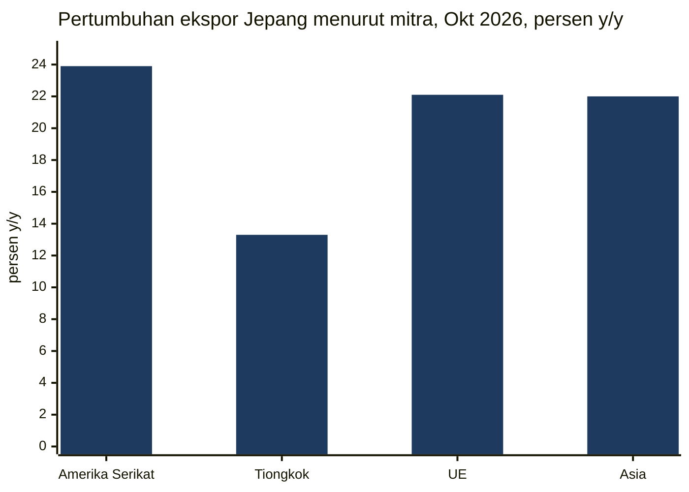

*Catatan: nilai ekspor menurut tujuan, Oktober 2026, tahun ke tahun. Amerika Serikat: mobil naik 37,2%, peralatan manufaktur semikonduktor naik 118,5%. Tiongkok: mobil turun 53,3%, peralatan manufaktur semikonduktor naik 42,6%. Sumber: Statistik Perdagangan awal Kementerian Keuangan Jepang, Oktober 2026.*

### Kawasan euro — neraca berjalan September 2026 (ECB, dirilis 19 November)

Rilis neraca pembayaran September ECB menempatkan surplus neraca berjalan kawasan euro pada €12 miliar, sedikit berubah dari bulan sebelumnya. Surplus barang berdasarkan neraca pembayaran adalah €14 miliar — ukuran yang berbeda dari defisit barang September berdasarkan pabean Eurostat sebesar €10,3 miliar yang dilaporkan 13 November, dan keduanya tidak boleh dibandingkan langsung. Surplus jasa €16 miliar; defisit pendapatan sekunder €16 miliar; defisit pendapatan primer €1 miliar. Pembacaan neraca berjalan adalah ukuran yang lebih bersih atas posisi eksternal kawasan euro setelah arus jasa dan pendapatan dimasukkan, dan menunjukkan blok itu masih surplus secara keseluruhan meski defisit barang berdasarkan pabean. Kesenjangan antara kedua ukuran barang adalah sumber kebingungan yang terus-menerus dalam komentar perdagangan dan patut dicatat ketika rilis barang Desember tiba. Rilis neraca pembayaran bulanan berikutnya jatuh tempo 18 Desember dan akan mencakup Oktober; rilis triwulanan menyusul 12 Januari. [QNC News](https://qncnews.com/2026/11/23/euro-area-current-account-surplus-holds-at-12-billion-euros-in-september/)

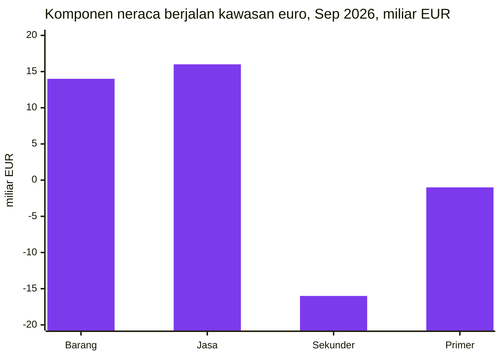

*Catatan: berdasarkan neraca pembayaran, September 2026. Surplus neraca berjalan €12 miliar. Sumber: Bank Sentral Eropa.*

### Jerman — perdagangan listrik lintas batas, tiga kuartal pertama 2026 (Destatis, siaran pers No. 406, 20 November)

Destatis melaporkan bahwa perdagangan listrik lintas batas Jerman bergerak mendekati keseimbangan fisik selama sembilan bulan pertama 2026, dengan ekspor melonjak dan volume impor turun. Jerman mengekspor 48,8 TWh listrik senilai €4,3 miliar pada Januari–September 2026 (volume naik 25,5% tahun ke tahun; nilai naik 51,3%). Impor listrik turun 13,3% dalam volume menjadi 49,2 TWh, tetapi nilainya naik 20,4% menjadi €5,7 miliar. Surplus impor fisik menyusut 97,5% menjadi 0,4 TWh. Harga impor rata-rata €116/MWh (naik 38,9% tahun ke tahun) dibandingkan €84/MWh pada Januari–September 2025. Pada September 2026 saja, Jerman mengekspor 5,4 TWh (naik 22,7% tahun ke tahun; nilai naik 122,7% menjadi €0,6 miliar) dan mengimpor 4,6 TWh (volume turun 26,1%; nilai naik 64,5% menjadi €0,8 miliar). Item khusus, tetapi menggambarkan bagaimana asimetri harga energi — bukan volume — kini mendorong neraca perdagangan energi Jerman, dan ini adalah satu-satunya rilis perdagangan Destatis yang teridentifikasi dalam jendela ini. Angka-angka itu disusun berdasarkan aturan perdagangan luar negeri (kode komoditas 27160000) dan berbeda secara metodologis dari statistik energi berbasis jaringan. Rilis rincian perdagangan barang September utama yang ditandai untuk 20 November tidak teridentifikasi secara terpisah dalam pencarian. [NewsVerum](https://newsverum.com/en/news/germany-electricity-exports-reach-4-3-billion-euros-first-three-quarters-2026)

### Amerika Serikat — perdagangan September 2026 (FT-900) dan indikator pendahuluan Oktober

Tidak ada rilis perdagangan Amerika Serikat yang jatuh dalam jendela 16–23 November. FT-900 terbaru (4 November) menunjukkan defisit September sebesar $105,0 miliar, sedikit lebih sempit daripada defisit Agustus yang direvisi sebesar $105,7 miliar. Sejak awal tahun defisit lebih kecil $92,4 miliar (12,2%) dibandingkan Januari–September 2025; ekspor tumbuh 11,6% dan impor 6,2% selama periode itu. Defisit barang pendahuluan September adalah $134,9 miliar (rilis 28 Oktober), naik $2,8 miliar dari $132,1 miliar pada Agustus. FT-900 Oktober dijadwalkan 8 Desember 2026, dan indikator barang pendahuluan Oktober jatuh tempo 27 November 2026. Amerika Serikat adalah kesenjangan terbesar tunggal dalam cakupan data pekan ini: perdagangan Oktober tidak akan diketahui hingga Desember, sehingga penilaian apa pun tentang bagaimana tumpukan tarif memengaruhi nilai impor Oktober harus menunggu. [Value.today](https://www.value.today/economy/usa/releases/trade)

### Portal data — tidak ada rilis besar dalam jendela yang teridentifikasi

Tidak ada rilis data perdagangan besar baru dari USITC DataWeb, UN Comtrade, WITS Bank Dunia, portal data Bank Dunia, atau IMF (WEO/IFS) yang teridentifikasi dalam jendela 16–23 November. World Economic Outlook IMF terakhir diperbarui pada Oktober 2026; tidak ada pembaruan November yang ditemukan. Rilis perdagangan barang Eurostat berikutnya (Oktober) jatuh tempo 18 Desember 2026. Angka perdagangan Tiongkok November jatuh tempo pada Desember. [Eurostat](https://ec.europa.eu/eurostat/web/international-trade-in-goods/publications)

### Think tank

**Pelacak tarif Tax Foundation: tarif diterapkan 11,8%, tarif efektif 7,2%; US$1,4 triliun selama sepuluh tahun.** Pelacak Tax Foundation kini menghitung lebih dari 50 perubahan kebijakan tarif Amerika Serikat sejak Januari 2025. Perkiraan kunci: tarif baru berlaku untuk 54% impor barang Amerika Serikat pada 2026; tarif diterapkan naik menjadi 11,8% (dari 1,5% pada 2022); tarif efektif (bea yang dikumpulkan sebagai bagian dari impor) adalah 7,2% untuk kalender 2026; tarif yang diberlakukan dan dijadwalkan akan mengumpulkan US$1,4 triliun dari 2026 hingga 2035 secara konvensional (US$1 triliun secara dinamis); PDB jangka panjang turun 0,4%, stok modal turun 0,3%, jam kerja turun 338.000 pekerjaan setara penuh waktu. Tarif menaikkan pajak rata-rata US$1.000 per rumah tangga Amerika Serikat pada 2025 dan diperkirakan US$820 per rumah tangga pada 2026, karena tarif baru belum sepenuhnya menggantikan tarif IEEPA yang dibatalkan Mahkamah Agung. Tarif polisilikon Pasal 232 (15%, atau 10% untuk Britania Raya) berlaku 4 Desember 2026. Biaya rumah tangga turun dari US$1.000 pada 2025 menjadi US$820 pada 2026 justru karena tarif IEEPA yang dibatalkan belum sepenuhnya digantikan — koreksi yang berguna terhadap pembacaan angka pendapatan sebagai kenaikan sederhana. [Tax Foundation](https://taxfoundation.org/research/federal-tax/trump-tariffs-trade-war/page/20/)

**Yale Budget Lab: tarif rata-rata 11,2% pada November; sekitar US$900 per rumah tangga per tahun.** Hitungan Yale tanggal 2 November menempatkan tarif statutori rata-rata pada 11,8%, naik menjadi 11,9% pada akhir tahun berdasarkan hukum yang berlaku; hitungan harian telah berada pada 11,76% sejak 29 September. Tarif efektif rata-rata sekitar 11,2% pada November 2026, dibandingkan sekitar 2,5% pada Januari 2025. Direktur eksekutif Martha Gimbel mengatakan kepada Marketplace pada 5 November bahwa rumah tangga menghadapi sekitar US$1.100 per tahun pada tarif saat ini (angka laporan 24 Agustus, diukur pada bobot impor tetap) dan sekitar 0,7% pada harga konsumen; perkiraan kalender 2026 Budget Lab adalah sekitar US$900 per rumah tangga per tahun. Tarif menghasilkan hampir US$2 triliun selama sepuluh tahun. Penelitian Tobin Center Yale menemukan sekitar 80%–100% dari tarif yang diperiksa tercermin dalam harga yang lebih tinggi yang dibayar importir Amerika, dengan perkiraan pusat sekitar 90%. Yale dan Tax Foundation sepakat tentang tarif statutori (sekitar 11,8%) tetapi berbeda tentang biaya rumah tangga — US$820 (Tax Foundation, 2026, berdasarkan apa yang sebenarnya diimpor) versus sekitar US$900–US$1.100 (Yale, tergantung metode dan bobot) — karena keduanya menggunakan metode yang berbeda, bukan fakta yang berbeda. Temuan pass-through (sekitar 90% tarif tercermin dalam harga importir) adalah angka yang penting secara analitis: angka itu mendasari perkiraan biaya rumah tangga dan bertentangan dengan klaim bahwa eksportir asing menyerap bea tersebut. Kenaikan Desember menjadi 11,9% sudah tercantum dalam hukum yang berlaku. [Geopolitiqs](https://geopolitiqs.com/tn/2026-11-09/tariffs-average-rate)

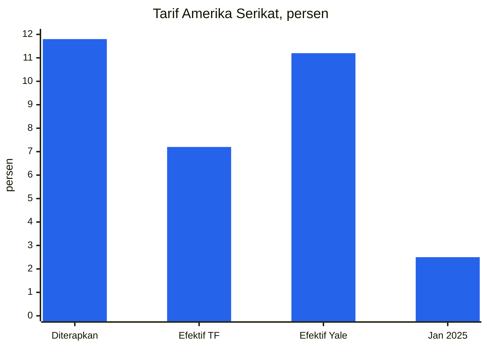

*Catatan: tarif statutori diterapkan 11,8% (kedua lembaga sepakat); tarif efektif Tax Foundation 7,2% untuk kalender 2026 (bea yang dikumpulkan sebagai bagian dari impor); tarif efektif rata-rata Yale Budget Lab sekitar 11,2% pada November 2026; sekitar 2,5% pada Januari 2025. Sumber: Tax Foundation; Budget Lab di Yale.*

---

## 9. Pasar angkutan

### Tarif spot kontainer — Drewry World Container Index

Drewry World Container Index turun 3% menjadi $4.176 per kontainer 40 kaki pada 19 November, penurunan mingguan keempat berturut-turut, meski masih 126% lebih tinggi tahun ke tahun. Tarif transpasifik turun untuk pekan ketujuh berturut-turut: Shanghai–New York turun 9% menjadi $8.194, terendah dalam 15 pekan, dan Shanghai–Los Angeles turun 5% menjadi $7.026, terendah dalam 12 pekan. Shanghai–Genoa naik 6% menjadi $4.436 setelah tiga pekan stabil, sementara Shanghai–Rotterdam tidak berubah pada $3.496. Drewry memperkirakan tarif transpasifik akan turun lebih lanjut pekan depan; sepuluh pelayaran kosong diumumkan untuk pekan berikutnya dibandingkan empat pada pekan ini. Komposit telah turun sekitar 9% selama empat pekan (dari $4.585 pada 22 Oktober). Pasar kontainer terbelah lebih lanjut: tarif transpasifik turun tajam untuk pekan ketujuh berturut-turut sementara tarif Mediterania rebound 6% dan tarif transatlantik naik 2% di kedua arah (Rotterdam–New York $3.146; New York–Rotterdam $1.217). [Drewry](https://www.drewry.co.uk/supply-chain-advisors/world-container-index-weekly-update?topics=Container%20Shipping)

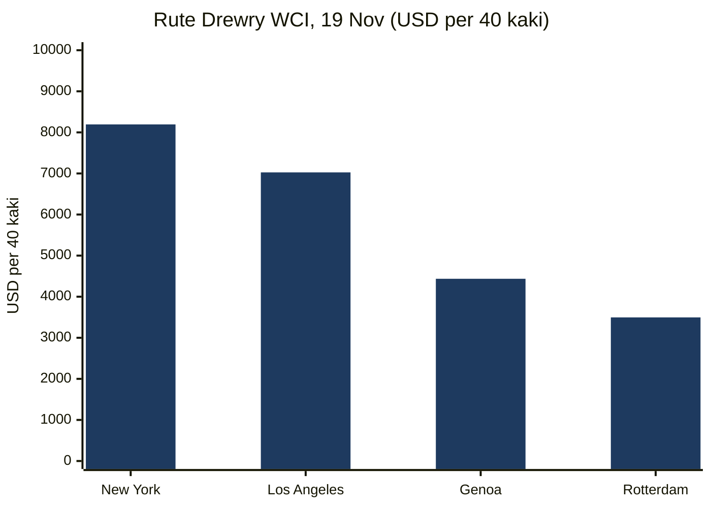

*Catatan: tarif spot asal Shanghai per kontainer 40 kaki, 19 November 2026. Sumber: Drewry World Container Index.*

### Freightos Baltic Index

Freightos melaporkan Asia–Pantai Barat AS sebesar $8.459 per FEU (naik 3%), Asia–Pantai Timur AS sebesar $9.848 (naik 1%), Asia–Eropa Utara stabil pada $3.407, dan Asia–Mediterania sebesar $4.295 (turun 1%) dalam pembaruan 17 November. Tarif Asia–Eropa 40–50% di atas setahun lalu; Asia–Eropa Utara turun 5% dibandingkan akhir Oktober. Komposit FBX global untuk pembaruan 17 November adalah n/a — pembaruan mingguan tidak menyatakan angka global. (Pembacaan pelacak sebesar $3.419 per FEU untuk FBX global tercatat pada 22 November; pembacaan global mingguan sebelumnya adalah $3.452 pada 10 November.) Pembacaan jalur Freightos naik sedikit pada rute transpasifik bahkan ketika pembacaan jalur yang sama dari Drewry turun — kedua tolok ukur mengukur keranjang tarif dan pekan yang berbeda, dan kesenjangan itu (Freightos Asia–Pantai Barat AS $8.459 vs Drewry Shanghai–Los Angeles $7.026) mengingatkan untuk tidak mencampur keduanya. Freightos mencatat GRI November tidak bertahan, rencana kenaikan pertengahan bulan juga dapat gagal, dan perusahaan pelayaran meningkatkan pelayaran kosong; kenaikan Desember diumumkan dan dapat berlaku jika didukung permintaan pra-Tahun Baru Imlek. Peringatan Freightos bahwa kembalinya rute Laut Merah ditambah pertumbuhan armada meningkatkan risiko kelebihan kapasitas tahun depan membingkai prospek 2027. [Freightos](https://www.freightos.com/freight-resources/us-air-cargo-recovering-from-outage-new-us-cn-tensions-ahead-of-talks-november-17-2026-update/)

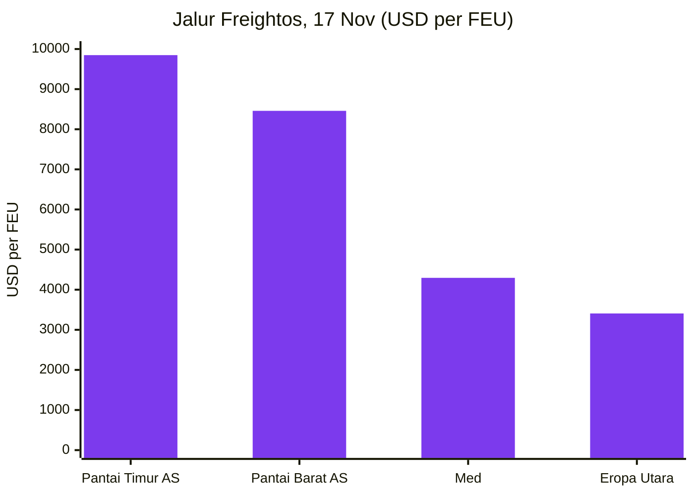

*Catatan: tarif spot asal Asia per FEU, 17 November 2026. Sumber: Freightos Baltic Index.*

### Shanghai Containerized Freight Index

Komposit SCFI turun menjadi 3.503,78 pada 20 November, turun 68,55 poin (turun 1,92%) pekan ke pekan dari 3.572,33 pada 13 November — penurunan mingguan ketiga berturut-turut, dengan kerugian yang melebar setiap pekan (turun 1,46%, turun 1,68%, turun 1,92%); terendah sejak pertengahan September; 129,67 poin hilang selama tiga pekan dari 3.687,35 pada 30 Oktober. Shanghai–Pantai Barat AS $6.711 per FEU (turun $400, turun 5,63%); Shanghai–Pantai Timur AS $8.776 per FEU (turun $611, turun 6,51%); Shanghai–Mediterania $3.678 per TEU (naik 1,63%); Shanghai–Eropa $2.291 per TEU; Santos $3.110 per TEU (turun 15,19%). China Containerized Freight Index (CCFI, tarif kontrak) naik 0,21% menjadi 1.923,21, kenaikan mingguan kedua berturut-turut — berbeda dari SCFI spot. Tiga indeks (Drewry, jalur Freightos, SCFI) kini sepakat pasar spot transpasifik terkoreksi keras memasuki jeda pasca-musim puncak, dengan jalur Pantai Timur AS SCFI turun lebih dari $600 dalam sepekan. Kenaikan CCFI menunjukkan pengirim dengan tarif kontrak belum melihat manfaatnya — kesenjangan yang penting bagi waktu tender 2027. [Forwarder News](https://www.forwardernews.com/news/2026-11-20-scfi-falls-a-third-week)

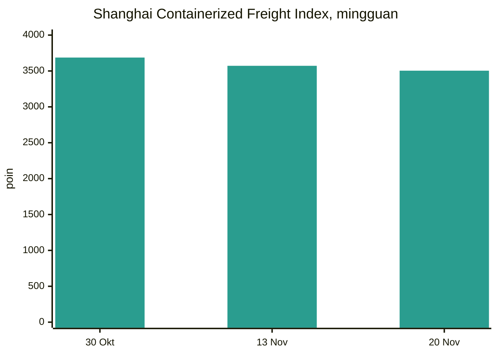

*Catatan: komposit SCFI, mingguan. Sumber: Shanghai Shipping Exchange.*

### Kenaikan tarif November — diumumkan, sudah didiskon

Perusahaan pelayaran telah mengumumkan biaya tambahan musim puncak sebesar $1.000–$1.600 per 40 kaki pada rute Asia–Eropa/Mediterania mulai Desember. Kenaikan tarif umum November tidak bertahan, menurut Freightos, dan rencana kenaikan pertengahan bulan juga dapat gagal. Kenaikan Desember diumumkan dan dapat berlaku jika didukung permintaan pra-Tahun Baru Imlek. Pola musim gugur — kenaikan yang diumumkan gagal bertahan di tengah permintaan yang lemah — kini menjadi ritme pasar yang mapan. [Freightos](https://www.freightos.com/freight-resources/us-air-cargo-recovering-from-outage-new-us-cn-tensions-ahead-of-talks-november-17-2026-update/)

### Pelayaran kosong dan kapasitas

Sepuluh pelayaran kosong diumumkan untuk pekan berikutnya, dibandingkan empat pada pekan ini. Pelacak pelayaran yang dibatalkan Drewry memproyeksikan 52 pelayaran kosong dari 716 layanan terjadwal pada perdagangan utama Timur–Barat antara 16 November dan 21 Desember (sekitar 7%). Perusahaan pelayaran semakin mengandalkan pelayaran kosong ketika koreksi transpasifik semakin dalam, dan kembalinya rute Suez oleh Gemini membebaskan kapasitas lebih lanjut ke 2027. [Drewry](https://www.drewry.co.uk/supply-chain-advisors/world-container-index-weekly-update?topics=Container%20Shipping)

### Curah kering — Baltic Exchange

Baltic Dry Index ditutup pada 2.898 pada 20 November, turun 82 poin (turun 2,8%) pekan ke pekan dari 2.980 pada 13 November — mengakhiri empat kenaikan mingguan berturut-turut. Jalur harian: 2.921 (Senin 16 November), 2.893 (Selasa), 2.914 (Rabu), 2.901 (Kamis), 2.898 (Jumat). Indeks Capesize 4.502 (turun 4,6% pekan ke pekan; dari 4.719); rata-rata penghasilan harian Capesize $40.827 (Jumat; $37.184 pada Selasa 17 November). Indeks Panamax 2.140 (naik 1,0% pekan ke pekan; dari 2.118), tertinggi sejak 22 Oktober; penghasilan harian Panamax $19.264. Indeks Supramax 1.810 (turun 1,4% pekan ke pekan; dari 1.836); penghasilan harian $22.884. Indeks Handysize 1.072 (naik 2,4% pekan ke pekan). Rute C5 (Australia Barat–Qingdao, bijih besi) mengakhiri pekan pada $14,40 per ton, pulih dari titik terendah $13,40 pada pertengahan pekan. Curah kering berbalik turun setelah empat pekan kenaikan, dengan Capesize sebagai penahan utama (turun 4,6% dalam sepekan) akibat melemahnya permintaan Atlantik Utara dan daftar kapal yang tersedia yang semakin panjang, sementara Panamax naik ke level tertinggi satu bulan atas permintaan gandum dan batu bara. Pemisahan itu — Capesize turun, Panamax naik — menunjukkan permintaan bijih besi melunak sementara perdagangan gandum dan batu bara bertahan, sinyal awal yang berguna bagi permintaan komoditas hingga akhir tahun. [HandyBulk](https://www.handybulk.com/baltic-dry-index/)

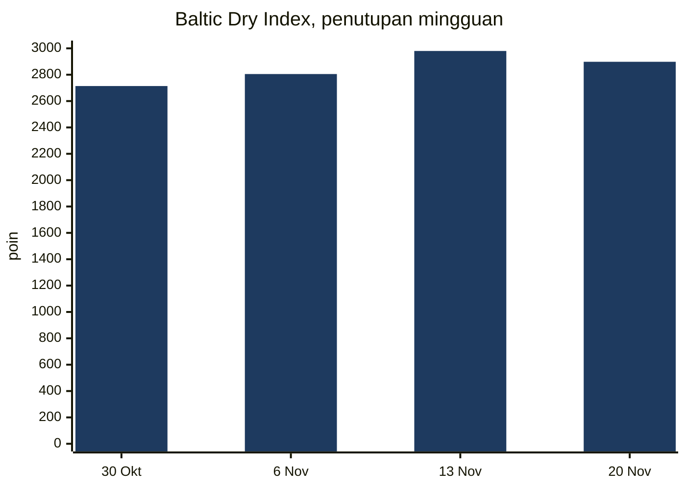

*Catatan: penutupan mingguan Baltic Dry Index. Sumber: Baltic Exchange.*

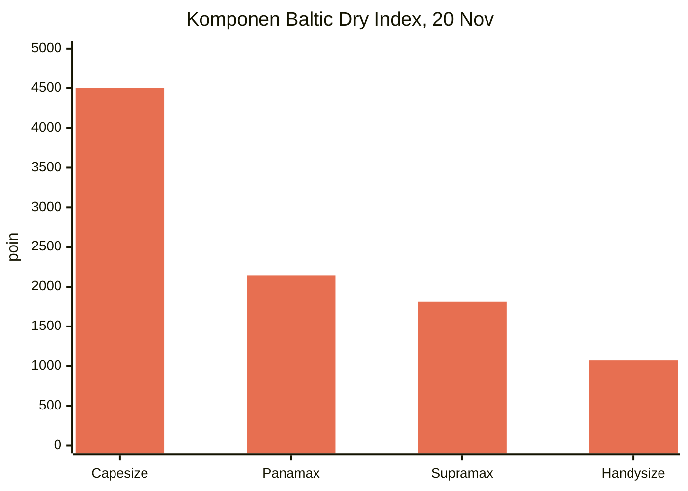

*Catatan: indeks segmen Baltic Exchange, 20 November 2026. Sumber: Baltic Exchange.*

### Suez dan keandalan jadwal

Maersk dan Hapag-Lloyd mengumumkan pada 16 November bahwa layanan AE1, AE2, dan AE3 dari Gemini Cooperation akan kembali ke rute trans-Suez dan Laut Merah, menggantikan pelayaran yang dialihkan mengelilingi Tanjung Harapan. Transisi dilakukan bertahap: AE2 pertama, dengan Mary Maersk (pelayaran 650W) memulai rotasinya di Ningbo pada 4 Desember; AE3 menyusul dengan Alette Maersk (pelayaran 652W) yang dimulai di Shanghai pada 20 Desember; AE1 dimulai dengan Damietta Express (pelayaran 702W) yang dimulai di Shanghai pada 14 Januari 2027. Rotasi yang direvisi mencakup transit Terusan Suez di kedua arah. Langkah itu mengikuti pemulihan sebelumnya atas layanan AE5, AE11, AE12, ME2, dan ME1. Menurut Linerlytica, kembalinya ketiga layanan ini menjadikan Maersk dan Hapag-Lloyd aliansi pertama yang memulihkan rute Suez di semua layanan Asia–Eropa-nya. Peralihan itu mengurangi jumlah kapal di AE2 dari 14 menjadi 13 dan di AE3 dari 13 menjadi 11, membebaskan kapasitas. Maersk mengatakan perubahan itu akan meningkatkan waktu transit, sambil memperingatkan bahwa penerapan bergantung pada stabilitas yang berkelanjutan di Laut Merah dan pemantauan kondisi keamanan regional yang berkelanjutan. Evergreen adalah anggota Ocean Alliance terakhir yang melanjutkan transit Suez; ZIM tetap menjadi perusahaan pelayaran besar yang paling menonjol yang masih mengarahkan layanan Asia–Eropa mengelilingi Tanjung. Drewry menghitung 53 kapal kontainer melalui kanal pada pekan hingga 1 November, naik 130% tahun ke tahun, dan memperkirakan sekitar 60% kapasitas Asia–Eropa kembali ke rute Suez. DHL memperkirakan penyesuaian jaringan yang lebih luas dapat memakan waktu 6–12 bulan lagi. Flexport memperkirakan 131% dari kapasitas kedatangan normal di pelabuhan Eropa Utara pada pekan 16–22 November ketika kedatangan yang menumpuk tiba. [FreightWaves](https://www.freightwaves.com/news/maersk-and-hapag-lloyd-restore-asia-europe-suez-routes-as-u-s-shippers-watch-capacity-and-costs)

### Kargo udara

Baltic Air Freight Index (BAI00) naik 6,6% pada pekan hingga 9 November (naik 28,2% tahun ke tahun) ke level tertinggi 2026, kemudian turun 1,5% dalam tujuh hari hingga 16 November (naik 20,8% tahun ke tahun). Hong Kong outbound (BAI30) turun 4,5% pekan ke pekan hingga 16 November (naik 19,0% tahun ke tahun); Shanghai outbound (BAI80) turun 2,7% (naik 13,1%); Frankfurt outbound (BAI20) turun 2,7% (naik 36,4%); London Heathrow outbound (BAI40) turun 9,4% (naik 2,6%). Chicago outbound (BAI50) melonjak 39,2% pekan ke pekan (naik 72,1% tahun ke tahun) setelah pemadaman pengendalian lalu lintas udara Amerika Serikat. Pada pekan hingga 9 November: Frankfurt outbound naik 9,9% pekan ke pekan, London naik 5,6%, Hong Kong naik 4,6%, Shanghai naik 5,7%. Freightos Air Index (pembaruan 17 November): Tiongkok–Amerika Utara $9,25/kg (naik 16% pekan ke pekan), di atas level tertinggi musim puncak 2025 sebesar $8,00/kg yang baru tercapai pada pertengahan Desember tahun lalu; Tiongkok–Eropa Utara $5,05/kg (naik 4%); Eropa Utara–Amerika Utara $3,27/kg (naik 12%), tertinggi sejak Desember 2022. Rata-rata spot global Xeneta Oktober $3,11/kg (naik 29% tahun ke tahun). Spot global TAC sekitar $3,93/kg pada pekan 44 (naik 4% pekan ke pekan, sekitar 40% tahun ke tahun). Bahan bakar jet: monitor IATA turun 6,5% pada pekan hingga 6 November dan 11,7% selama sebulan hingga 13 November. [Baltic Exchange](https://www.balticexchange.com/en/news-and-events/news/guest-column/2026/Air-freight-rates-surge-past-previous-peak-season-highs-as-jet-fuel-prices-soar.html)

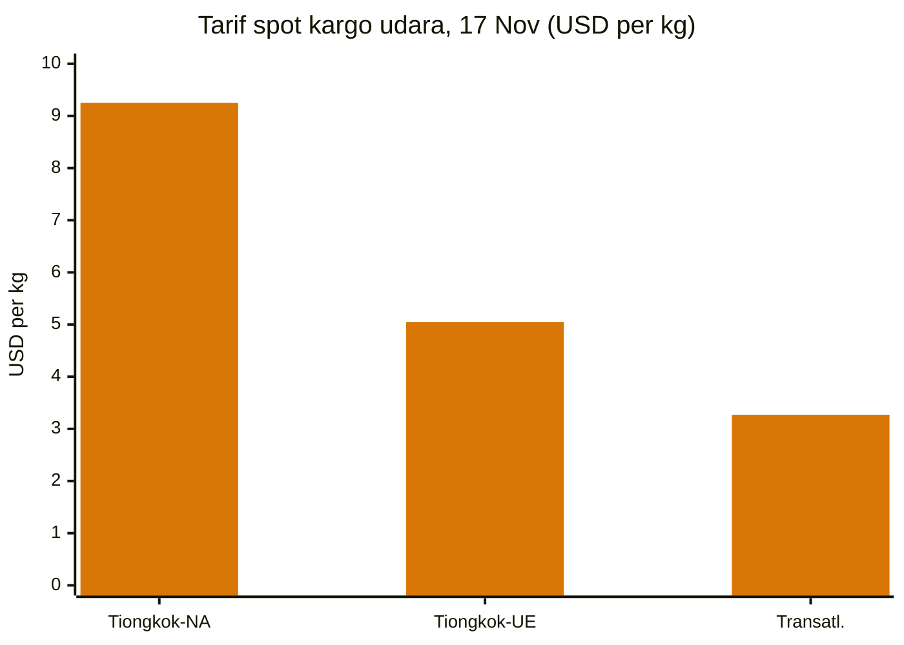

*Catatan: Freightos Air Index, 17 November 2026. Tiongkok–Amerika Utara di atas level tertinggi musim puncak 2025 sebesar $8,00/kg; transatlantik tertinggi sejak Desember 2022. Sumber: Freightos.*

**Gangguan:** kegagalan sistem pengendalian lalu lintas udara Amerika Serikat mengandangkan ribuan penerbangan selama akhir pekan 14–15 November — penghentian darat nasional FAA tanggal 13 November (satu router rusak di El Dorado, Arkansas, yang memengaruhi 17 dari 22 pusat pengendalian lalu lintas rute udara) mengganggu lebih dari 20.000 penerbangan selama akhir pekan dan menyisakan tumpukan kargo udara hingga pekan berikutnya; FAA menghentikan pemasangan router baru pada 17 November dan pemerintah menaikkan perkiraan biaya modernisasi pengendalian lalu lintas udara di atas $50 miliar. Pemadaman Microsoft menambah gangguan; TAC mengatakan data lebih tidak merata dari biasanya. Freightos mengatakan tarif udara internasional ke Amerika Serikat tidak melonjak secara signifikan akibat pemadaman itu. Kargo udara mencapai level tertinggi 2026 pada pekan hingga 9 November atas permintaan chip dan perangkat keras AI ditambah volume musim puncak, dengan tarif Tiongkok–Amerika Utara melampaui puncak tahun lalu sebulan lebih awal. Penarikan kembali 16 November mungkin merupakan jeda daripada pembalikan: TAC mencatat masih ada beberapa pekan musim puncak tersisa. Mogok pengendali lalu lintas udara Belgia pada 23 November (lihat A11) menyusul penghentian darat FAA sepuluh hari sebelumnya, menggarisbawahi betapa tipisnya margin infrastruktur kargo udara pada musim puncak ini. [Air Cargo News](https://www.aircargonews.net/cargo-airport/2026/11/us-air-cargo-supply-chains-recover-following-ground-stop/)

### Gangguan pelabuhan dan logistik

**Los Angeles / Long Beach.** Lihat A7. Ancaman mogok yang menggantung di atas gerbang kontainer terbesar Amerika Serikat sejak 1 November digagalkan pada menit terakhir dengan kesepakatan tentatif pada 21 November; ratifikasi menunggu dan serikat belum berkomentar secara publik. Tumpukan kereta api di kompleks itu (35.688 kontainer impor menunggu kereta api di dermaga hingga 2 November) tetap ada, dan waktu tunggu kereta api untuk kontainer impor melebihi sembilan hari, menurut direktur eksekutif Pelabuhan Los Angeles. Penutupan Jembatan Vincent Thomas (7 November, 16 bulan) berlanjut secara terpisah. [Maritime Executive](https://maritime-executive.com/article/ports-of-la-and-long-beach-avert-strike-as-watchmen-reach-deal)

**Durban.** Kemacetan Durban semakin dalam dalam jendela ini meski throughput terminal lebih baik: Durban Gateway Terminal menangani 36.332 TEU pada pekan pelaporan terbaru (naik 28% pekan ke pekan, kinerja perairan terkuat dalam 4 bulan), tetapi rata-rata waktu tunggu jangkar kapal naik dari 189 jam menjadi 263 jam (hampir 11 hari) bahkan ketika kapal yang menunggu di lepas pantai turun dari 14 menjadi 11. Okupansi lapangan sekitar 69%. Rantai pasok yang terdampak menghadapi keterlambatan ujung-ke-ujung tambahan yang melebihi 20 hari. Menteri Transportasi Barbara Creecy telah memberi ICTSI tiga bulan untuk meningkatkan kinerja atau berisiko kehilangan lisensi pelabuhannya (menurut Moneyweb). Langkah darurat Transnet (18 November): Dermaga 102 dialokasikan untuk kapal bergear; pengalihan ke Terminal Kontainer Ngqura; pergerakan kereta api tambahan; crane ship-to-shore hasil refurbish terakhir di Pier 1 mulai beroperasi 20 November dan diserahkan 21 November. DGT mengakui "kekurangan layanan yang berkelanjutan," menyalahkan kondisi peralatan yang buruk dan tidak aman setelah bertahun-tahun kurang investasi; perusahaan telah berkomitmen lebih dari R2 miliar selama tiga tahun untuk meningkatkan peralatan Pier 2. Biaya tambahan musim puncak Maersk sebesar $1.000/$2.000 dan biaya kemacetan $400/$800 tetap berlaku. Ancaman lisensi adalah eskalasi baru — ultimatum negara kepada operator terminal swasta — dan jendela tiga bulan berjalan hingga Februari 2027. [Shipping and Freight Resource](https://shippingandfreightresource.com/transnet-steps-in-to-alleviate-congestion-at-durban-gateway-terminal/)

**Terusan Panama.** Curah hujan musim panas yang lebih rendah dari normal telah memicu pembatasan draft dan transit harian untuk penyeberangan Terusan Panama, dengan perusahaan pelayaran kontainer memberlakukan biaya tambahan. Curah hujan yang lebih baik dari perkiraan sejak saat itu memungkinkan Otoritas Terusan Panama membalikkan langkah-langkah tersebut. Level air saat ini kira-kira kembali normal untuk musim ini, dan proyeksi telah menurunkan tingkat keparahan El Niño yang diperkirakan, sehingga risiko pembatasan parah pada kuartal IV 2026 dan semester I 2027 dinilai lebih rendah daripada yang ditakutkan selama musim panas. Penghapusan pembatasan Panama menghilangkan satu pendorong biaya tambahan bagi rute Pantai Timur/Teluk AS dan mengurangi sumber gangguan jadwal yang telah memperparah tumpukan kereta api LA/Long Beach. [Freightos](https://www.freightos.com/freight-resources/us-air-cargo-recovering-from-outage-new-us-cn-tensions-ahead-of-talks-november-17-2026-update/)

**Kemacetan intra-Asia.** The Loadstar melaporkan pada 20 November bahwa kemacetan yang memburuk di hub transhipment Asia Tenggara telah membuat tarif intra-Asia tetap kuat bahkan ketika tarif spot jarak jauh turun, dan bahwa pengirim India–Teluk menghadapi biaya tambahan dari pengembalian kontainer yang mahal di atas tarif yang naik. Tidak ada angka yang diterbitkan dalam judul yang ditinjau. [The Loadstar](https://theloadstar.com/)

**Prospek impor Amerika Serikat.** Impor kontainer Amerika Serikat memecahkan rekor volume empat tahun pada Oktober, menurut Descartes, dengan pengiriman dari Tiongkok naik untuk bulan keempat berturut-turut hingga hampir 988.000 TEU, level tertinggi sejak Januari 2025. Pelabuhan Los Angeles menangani 1.026.872 TEU pada Oktober, rekor untuk bulan itu dan bulan bervolume tertinggi kedua dalam catatan, hanya tertinggal dari 1.042.652 TEU pada September. Muatan kereta api Amerika Serikat rata-rata 233.193 pada Oktober, naik 3,4% per tahun, bulan kesepuluh berturut-turut dengan kenaikan tahunan; volume intermodal Amerika Serikat hingga Oktober mencapai 12.271.905 unit, naik 4,7% sejak awal tahun, dengan Oktober naik 9,6% per tahun dan mencetak rekor volume sepanjang masa. Cass Freight Index menunjukkan pengiriman Oktober pada 1,056, naik 5,9% per tahun, dan pengeluaran pada 4,010, juga naik 5,9% per tahun. Indeks Kondisi Truk FTR untuk September berada pada 8,13, tertinggal dari 11,5 pada Agustus. Global Port Tracker (9 November) memperkirakan impor pelabuhan yang ditujukan ke Amerika Serikat akan menurun selama sisa 2026 ketika musim puncak yang diperpanjang mereda: impor bermuatan September 2026 2,37 juta TEU (bulan tersibuk 2026; naik 3,4% bulan ke bulan, naik 12,6% tahun ke tahun); perkiraan Oktober 2,26 juta TEU (naik 9,1% tahun ke tahun); November 2,05 juta TEU (naik 1,2%); Desember 2,03 juta TEU (naik 1,3%). Tahun penuh 2026 sekitar 26 juta TEU (naik 2% dibandingkan 25,4 juta pada 2025) — direvisi naik dari perkiraan Oktober sebesar 25,8 juta. Awal 2027: Januari 2,04 juta TEU (turun 3% tahun ke tahun); Februari 1,89 juta (turun 0,5%); Maret 1,92 juta (turun 11,2%). Rekor volume impor ke Amerika Serikat berlanjut hingga Oktober bahkan ketika tarif spot melunak, menunjukkan front-loading menjelang tenggat gencatan Januari dan langkah-langkah polisilikon Desember. [FreightWaves](https://www.freightwaves.com/news/retailers-forecast-u-s-imports-to-stay-elevated-through-2026-after-breakout-peak-season)

**Item yang lebih kecil.** Eksportir garmen Bangladesh beralih ke angkutan udara yang mahal untuk memenuhi tenggat pengiriman setelah berminggu-minggu gangguan, ketika pembeli berbelanja di tempat lain (The Loadstar, 23 November). Expeditors memikirkan kembali pendekatannya terhadap akuisisi setelah puluhan tahun pertumbuhan organik dan sudah mengevaluasi peluang dalam teknologi, dan penjualan Neovia yang berbasis di Amerika Serikat serta Ekol dari Turki menandai kembalinya M&A ke sektor logistik kontrak (The Loadstar, 19 November). Volume kargo di sepanjang Rute Laut Utara Rusia melampaui 40 juta ton untuk pertama kalinya, rekor bagi rute pelayaran Arktik, meskipun ambisi Presiden Putin untuk rute itu tetap di luar jangkauan (gCaptain, 23 November). FedEx meluncurkan rute mingguan yang menghubungkan hub manufaktur di Shanghai dan Guangzhou ke tujuan Amerika Serikat untuk mendukung permintaan yang didorong kecerdasan buatan (Supply Chain Dive).

### Intelijen vendor

Tidak ada item vendor yang memenuhi syarat yang tercatat dalam jendela ini. Satu-satunya item pers Descartes dalam jendela ini adalah penghargaan industri (17 November, dinobatkan sebagai penyedia sistem manajemen transportasi terkemuka di Amerika Utara dalam laporan riset pasar Sistem Manajemen Transportasi Global ARC Advisory Group). Batch blog TradeInt tanggal 22 November adalah konten pemasaran data yang diambil dari basis datanya sendiri yang mencakup semester I 2026 dan periode sebelumnya, dengan ajakan bertindak "Unlock data"; pertumbuhan 901% tahun ke tahun yang dilaporkan dalam posting Rusia adalah artefak cakupan dataset, bukan pergerakan perdagangan. Laporan Pengiriman Global November Descartes (11 November), yang melaporkan rekor impor kontainer Amerika Serikat sebesar 2.674.808 TEU pada Oktober 2026, dibahas dalam laporan pekan lalu. Hasil kuartal ketiga fiskal Descartes tidak jatuh tempo hingga awal Desember 2026. [Descartes](https://www.descartes.com/resources/knowledge-center/descartes-releases-november-global-shipping-report-us-container-imports); [TradeInt](https://tradeint.com/insights/blogs/)

---

## 10. Linimasa kebijakan

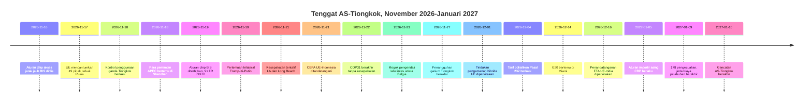

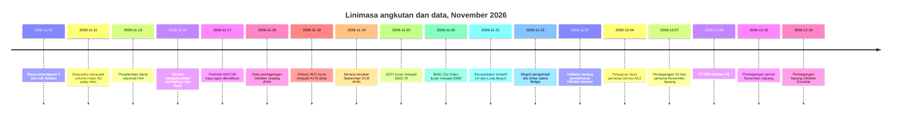

---

## 11. Tenggat & acara mendatang (90 hari ke depan)

| Tanggal | Item |
|---|---|
| 23 November 2026 | Komite Pertanian WTO bertemu tentang pembatasan ekspor dan mekanisme pengamanan khusus; laporan lengkap USITC Solar IV (Publikasi 5804) jatuh tempo. |
| 24 November 2026 | Gangguan lanjutan mogok pengendali lalu lintas udara Belgia diperkirakan meluas hingga Selasa. |
| 27 November 2026 | Penangguhan Pengumuman Tiongkok No. 72 Tahun 2025 atas praduga penolakan untuk galium, germanium, antimon, dan material superkeras tujuan AS dijadwalkan berakhir, tanpa penangguhan atau perubahan lebih lanjut; indikator perdagangan barang pendahuluan Oktober Sensus jatuh tempo. |
| 29 November 2026 | Komentar jatuh tempo atas draf Langkah-langkah Penyelidikan dan Penegakan Kontrol Ekspor Penggunaan Ganda MOFCOM. |
| 30 November 2026 | Temuan dumping dan subsidi final Departemen Perdagangan untuk produk tin mill Tiongkok jatuh tempo, kecuali ditunda. |
| 1 Desember 2026 | Tindakan sementara tindakan pengamanan mobil hibrida UE diperkirakan; Kanada menghapus keringanan tarif horizontal untuk trailer tertentu; biaya paket kecil nasional Italia sebesar €2 berlaku; tenggat anggota DPR Demokrat untuk jawaban tertulis Lutnick tentang Megaspeed dan Daftar Entitas. |
| 4 Desember 2026 | Bea polisilikon Pasal 232 berlaku; pelayaran rute Suez pertama Gemini AE2 dari Ningbo; sidang luar biasa IMO MEPC 85 sementara dijadwalkan. |
| 7 Desember 2026 | Komentar jatuh tempo atas aturan yang diusulkan CBP tentang pengiriman bernilai rendah (91 FR 64532; doket USCBP-2026-0298); perdagangan 20 hari pertama November Jepang. |
| 8 Desember 2026 | Rilis perdagangan Oktober AS FT-900. |
| 10 Desember 2026 | Lutnick bersaksi di hadapan Komite Perbankan Senat (Megaspeed / Daftar Entitas). |
| 11 Desember 2026 | Berkas tanggapan pemerintah jatuh tempo dalam *Gellert v. Trump* (Pasal 338); UE–Indonesia: Presiden Prabowo mengunjungi Brussels. |
| 14–15 Desember 2026 | Para pemimpin G20 bertemu di Miami. |
| 15 Desember 2026 | Perdagangan penuh November Jepang. |
| 16 Desember 2026 | Perjanjian perdagangan bebas UE–India dilaporkan akan ditandatangani di Brussels, dengan Perdana Menteri Modi diperkirakan hadir. |
| 17 Desember 2026 | Tanggal paling awal Departemen Perdagangan bermaksud menerbitkan instruksi penilaian dalam tinjauan kabinet kayu dan millwork (35 hari setelah publikasi 12 November). |
| 18 Desember 2026 | Perdagangan barang Oktober Eurostat; neraca pembayaran Oktober ECB. |
| 20 Desember 2026 | Pelayaran rute Suez pertama Gemini AE3 dari Shanghai. |
| 1 Januari 2027 | Tarif Pasal 232 naik menjadi 30% atas furnitur berlapis kain dan 50% atas kabinet dapur dan meja rias; ancaman 50% atas kendaraan, suku cadang mobil, dan baja Kanada juga ditujukan pada tanggal ini; CBAM Britania Raya dimulai; aturan asal usul EV Britania Raya–UE yang lebih ketat berlaku; pengakhiran AGOA untuk Rwanda dan Afrika Selatan dimaksudkan berlaku (proklamasi masih diperlukan). |
| 3 Januari 2027 | Kongres Amerika Serikat yang baru dilantik. |
| 5 Januari 2027 | Aturan final sementara CBP tentang importir asing sebagai pencatat berlaku; komentar jatuh tempo pada hari yang sama (doket USCBP-2026-1387). |
| 9–10 Januari 2027 | Tenggat gencatan AS–Tiongkok bertemu: 178 pengecualian Pasal 301 dan penangguhan biaya maritim berakhir 9 Januari; penangguhan Aturan Afiliasi BIS dan penangguhan timbal balik Tiongkok berakhir 10 Januari. |
| 11–12 Januari 2027 | Penetapan AD/CVD final Departemen Perdagangan atas akselerator karet CBS dari Tiongkok jatuh tempo. |
| 11 Januari 2027 | Berkas jawaban jatuh tempo dalam *Gellert v. Trump*. |
| 12 Januari 2027 | Komentar tertulis dan permintaan partisipasi sidang jatuh tempo untuk konsultasi tinjauan bersama USMCA (doket USTR-2026-0595 dan USTR-2026-0596). |
| 14 Januari 2027 | Pelayaran rute Suez pertama Gemini AE1 dari Shanghai. |
| 19 Januari 2027 | Temuan dumping final Departemen Perdagangan untuk produk tin mill Türkiye jatuh tempo; komentar jatuh tempo atas aturan chip akses jarak jauh BIS. |
| 20 Januari 2027 | Entri formal menjadi wajib untuk surat yang dikenai bea Pasal 201, 232, atau 301 atau persyaratan lembaga pemerintah mitra; argumen lisan dalam *Gellert v. Trump*. |
| 30 Januari 2027 | Variasi bea imbalan Britania Raya atas trout pelangi Turki berlaku mulai tanggal ini (pemberitahuan 2026/31). |
| 1 Februari 2027 | Kanada menghapus keringanan tarif horizontal untuk kawat dan ekstrusi aluminium tertentu dan produk karton. |
| 6 Februari 2027 | Tahun Baru Imlek. |
| 11 Februari 2027 | Penetapan pendahuluan CVD Departemen Perdagangan atas balon plastik dari Tiongkok (perkiraan). |
| 17 Februari 2027 | Aturan chip akses jarak jauh BIS: transisi lisensi pusat data 90 hari berakhir (sekitar). |
| 28 Februari 2027 | Tenggat penetapan USTR dalam penyelidikan Pasal 301 kekayaan intelektual Vietnam. |
| Maret 2027 | Keputusan penyelidikan Pasal 301 USTR tentang kapasitas berlebih struktural diperkirakan (jatuh tempo Maret 2027); pemberlakuan FTA UE–India dilaporkan pada Maret atau April 2027. |
| 25 Maret 2027 | Temuan dumping final Departemen Perdagangan untuk produk tin mill Taiwan jatuh tempo. |
| 27 April 2027 | Penetapan pendahuluan AD Departemen Perdagangan atas balon plastik dari Tiongkok (perkiraan). |
| 6 Mei 2027 | Kepatuhan penuh broker diperkirakan dengan aturan importir asing sebagai pencatat. |
| 30 Juni 2028 | Remisi tarif horizontal Kanada diperpanjang hingga tanggal ini. |

---

## 12. Sumber & metodologi

Jendela liputan: 16–23 November 2026. Disusun dari sekitar 45 sumber berita perdagangan, kebijakan, data, dan angkutan di seluruh dunia.

Sumber yang dikonsultasikan meliputi: FreightWaves, The Loadstar, Splash247, gCaptain, Hellenic Shipping News, Container News, Supply Chain Dive, Logistics Management, Air Cargo News, Port Technology, blog wawasan TradeInt; whitehouse.gov, cbp.gov, ustr.gov, federalregister.gov, trade.gov, usitc.gov, bis.doc.gov, JD Supra; ec.europa.eu, gov.uk, cbsa-asfc.gc.ca, canada.ca/en/department-finance, english.mofcom.gov.cn; wto.org, unctad.org, intracen.org, wcoomd.org; dataweb.usitc.gov, ustradecensus.gov, comtradeplus.un.org, wits.worldbank.org, eurostat, data.worldbank.org, imf.org; taxfoundation.org, budgetlab.yale.edu, tradeintelligence.eu; drewry.co.uk, balticexchange.com, freightos.com; descartes.com, tradeint.com.

Item yang bertanggal sebelum 16 November muncul hanya sebagai tindak lanjut, publikasi Federal Register yang jatuh dalam jendela ini, atau konteks untuk tenggat dalam jendela ini. Container News hanya mengembalikan pemberitahuan persetujuan cookie dan tidak menghasilkan konten yang dapat digunakan; indeks berita WTO tidak mengembalikan teks yang dapat dibaca melalui fetch, sehingga item WTO menggunakan rilis WTO sebagaimana diterbitkan ulang; situs berbahasa Inggris MOFCOM hanya dapat diakses untuk judul halaman depan, dan substansi pengumumannya tidak dapat dikonfirmasi dari informasi yang ditinjau. TradeInt tidak memiliki item vendor yang memenuhi syarat dalam jendela ini: batch blog 22 November-nya adalah konten pemasaran data yang diambil dari basis datanya sendiri. Tidak ada rilis besar baru dalam jendela yang teridentifikasi dari portal USITC DataWeb, UN Comtrade, WITS, Bank Dunia, atau IMF. Tidak ada Perintah Penahanan Pelepasan baru yang teridentifikasi dalam jendela ini. Federal Register tidak disapu dokumen demi dokumen selama sepekan penuh; pemberitahuan tinjauan administratif lebih lanjut mungkin ada. Kesimpulan akhir tahun yang dilaporkan atas penyelidikan Pasal 301 tentang kapasitas berlebih bersandar pada satu laporan pers perdagangan tentang wawancara televisi 21 November; tidak ada pemberitahuan USTR yang muncul hingga 23 November. Jumlah pencantuman Rusia UE tanggal 17 November (49) sebagaimana dilaporkan oleh monitor Youverify, tidak diverifikasi terhadap daftar UE itu sendiri.
