# グローバル貿易インテリジェンス・レポート — 2026年11月16日～23日週

**週次ブリーフィング。**対象期間：2026年11月16日～23日。世界の貿易ニュース、政策、データ、貨物に関する約45のデータソースから編纂。

---

## 目次

1. [エグゼクティブサマリー](#1-executive-summary)
2. [アラート](#2-alerts)
3. [主要記事 — 詳細分析](#3-top-stories--deep-dives)
4. [関税トラッカー](#4-tariff-tracker)
5. [米国政策の詳細分析](#5-us-policy-deep-dive)
6. [地域別世界政策](#6-world-policy-by-region)
7. [執行措置](#7-enforcement-actions)
8. [データ発表](#8-data-releases)
9. [貨物市場](#9-freight-market)
10. [政策タイムライン](#10-policy-timelines)
11. [今後の期限とイベント（今後90日間）](#11-upcoming-deadlines--events-next-90-days)
12. [データソースと方法論](#12-sources--methodology)

---

## 1. エグゼクティブサマリー

米中休戦の決着が期待された首脳会議が何も決めなかった週となった一方で、今週の決定的な貿易措置は、他の場所の規制当局、裁判所、署名式から生まれた。11月18～19日に深圳で開かれたAPEC首脳会議は宣言を採択し、初のトランプ・習・プーチン三者会談も実現したが、関税緩和はなく、2027年1月9～10日に失効する休戦の延長も確認されなかった。次の決断の場は、12月14～15日にマイアミで開かれるG20首脳会議となる。代わりに今週最大の措置を一方的に動かしたのは産業安全保障局（BIS）で、11月19日に暫定最終規則を公表し、先端チップへのリモートアクセス経路を閉鎖し、AI拡散規則を廃止し、東南アジアとラテンアメリカの5カ国への先端コンピューティング製品にライセンスを義務付けた。欧州は署名で前進した。欧州連合（EU）とインドネシアは11月21日に包括的経済連携協定に署名し、EU・インドの署名日は12月16日に固まり、英国とEUは11月20日の首脳会議でSPS協定と排出量取引制度の連携に合意した。湾岸では、ホルムズ海峡とその周辺の船舶への攻撃が、米イラン戦争開始以来の月間最多水準に達し、ワシントンは封鎖を船対船積み替えにまで拡大した。

- **APECは宣言を生んだが、関税合意は生まなかった。**第33回APEC首脳会議は11月19日、深圳展望（Shenzhen Outlook）を採択して閉幕した。これは任意の非拘束力の声明であり、トランプ大統領と習近平国家主席は米中「戦略的安定」のための行動計画を起草することで合意した。初のトランプ・習・プーチン三者会談は、数量、期限、貿易に関する内容を含まない4項目の平和宣言を発表した。一部報道は、首脳らが貿易休戦の延長に合意したと伝えたが、どちらの側も期間や条件を公表しておらず、中国側の発表文は延長に言及していない。休戦は2027年1月9～10日に失効する見通しで、貿易委員会（Board of Trade）の300億ドル対300億ドルの相互関税引き下げ案は未合意のままである。[China Briefing](https://www.china-briefing.com/news/apec-2026-in-shenzhen-what-the-leaders-meeting-and-trump-xi-talks-mean-for-business/)
- **BISがリモートアクセスによるチップ迂回を封じた。**11月19日に公表された暫定最終規則（91 FR 74970）は、全世界を対象とする最終用途管理を新設し、先端コンピューティング製品がカントリーグループD:5またはマカオに本社を置く企業に合計処理性能1,200万以上を提供するデータセンターで使用される場合にライセンスを義務付け、インドネシア、マレーシア、シンガポール、タイ、ブラジルへの先端コンピューティング製品にライセンス要件を追加し、AI拡散規則を正式に廃止した。TSMCとサムスンは中国の顧客に対し、ライセンス取得を求めながら特定プロセッサの販売を停止すると伝えた。下院外交委員会が同日公表した記録によれば、2026年5月11日までに中国関連企業向けに承認された先端AIプロセッサは879,868個で、うちNvidia H200アクセラレータが579,868個だった。[Willkie Farr & Gallagher](https://www.willkie.com/publications/2026/11/bis-moves-to-close-the-remote-access-gap-for-advanced-chips)
- **欧州は署名し、最大の協定の日程も決めた。**EUとインドネシアは、ほぼ10年に及ぶ交渉を経て、11月21日に包括的経済連携協定と投資保護協定に署名した。インドネシアはEU製品の関税品目の98.5%で関税を撤廃し、EU輸出業者は年間6億ユーロ超の関税を節約できる。EU・インド自由貿易協定は12月16日にブリュッセルで署名される見通しとなり、インドからの出荷の93%が無関税となる。11月20日の英EU首脳会議では、2028年3月1日から多くの農産食品の国境検査を撤廃するSPS協定と、排出量取引制度の連携に両者が合意し、英国輸出の約65億ポンド分が相互の炭素国境調整措置の免除対象となる。[Turkish Post](https://turkishpost.com.tr/en/2026/11/21/eu-indonesia-trade-deal/); [Asia Daily](https://asiadaily.org/news/19949/)
- **インド・米国協定は依然未署名で、その遅れは今や構造的なものだ。**ラジェシュ・アグラワル商務長官は11月18日、最高裁判所が相互関税と緊急関税を無効化した後、ワシントンが関税枠組みを再構築するまで、また過剰生産能力調査を含む301条調査の行方が判明するまで、インドは署名できないと述べた。ジェイミソン・グリアUSTR代表は11月21日、過剰生産能力調査が2026年末までに結論を出すと報じられたが、これは2027年3月11日の法定期限より前倒しとなる。ただし同報道は一つの報道機関によるもので未確認である。[The Hindu BusinessLine](https://www.thehindubusinessline.com/economy/no-india-us-trade-deal-until-new-us-tariff-framework-section-301-probes/article71716562.ece/amp/)
- **ホルムズ海峡攻撃は戦争開始以来の最多水準に達した。**CNNによる英国海事貿易機関（UKMTO）データの分析によれば、10月に30件超、11月22日までに少なくとも22件の船舶攻撃が報告された。11月20～21日には3隻のタンカーが攻撃を受け、11月17日にはADNOCのタンカーが攻撃されて乗組員1人が行方不明、11人が負傷した。国際海事機関（IMO）は11月17日時点で138件の確認された事案と25人の船員死亡を数えた。湾岸の石油輸出は10月に日量1,840万バレルで、戦前水準を26%下回り、ブレント原油は1バレル当たり92ドル前後で推移した。[CNN](https://www.cnn.com/2026/11/22/middleeast/hormuz-attacks-highest-levels-iran-war-intl?cid=external-feeds_iluminar_meta)
- **合板に新たな関税が課され、対象はさらに広がった。**商務省は11月17日、中国、インドネシア、ベトナム産の広葉樹・装飾合板に対するアンチダンピング関税・相殺関税命令を公表し、中国向けの合算税率は約276%となった。米国国際貿易委員会（USITC）はソーラーIVの完全報告書（Publication 5804）を公表し、クリティカル・サーカムスタンス（緊急事態）を分離して、インドネシアのみに遡及関税を適用した。中国産プラスチック製バルーンを対象とする新たな申立てでは、50%～276%のダンピング・マージンが主張された。[Transport News](https://www.transportnews.net/a/commerce-hardwood-plywood-duty-orders-china-indonesia-vietnam)
- **日本は貿易の記録を更新し、貨物市場は再び二極化した。**日本の10月輸出は前年比20.5%増の11兆7,700億円と過去最高を記録し、輸入も21.6%増の12兆2,500億円と過去最高となった。貿易赤字は4,765億円に縮小し、予想の約半分だった。ドリューワー世界コンテナ指数は3%下落して40フィート当たり4,176ドルとなり、4週連続の下落となった。一方、航空貨物は2026年の高水準を維持し、中国・北米路線は1キログラム当たり9.25ドルとなった。マースクとハパックロイドは、ジェミニ・アジア・欧州サービスの最後の3航路を1月中旬までにスエズ航路へ復帰させると発表した。[Drewry](https://www.drewry.co.uk/supply-chain-advisors/world-container-index-weekly-update?topics=Container%20Shipping)

**貨物：**コンテナスポット運賃は太平洋航路で4週連続下落する一方、地中海航路は反発した。ドライバルクはピークから緩和し、航空貨物はピークシーズン入りで2026年の高水準を維持した。ジェミニが最後の3サービスを紅海経由で復帰させると発表し、スエズ復帰はほぼ完了に近づいた。LA・ロングビーチのストライキの脅威は11月21日の暫定合意で回避された。ダーバンの待機時間は、取扱量が増加したにもかかわらず、錨泊待ち263時間に延びた。

---

## 2. アラート

| # | アラート | 発効日 | 影響 | データソース |
|---|-------|-----------|--------|--------|
| A1 | APEC首脳会議が深圳で開催。トランプ・習二者会談と初のトランプ・習・プーチン三者会談は宣言と「戦略的安定」の行動計画を生んだが、関税緩和も休戦延長の確認もなし | 2026年11月18～19日 | 休戦は2027年1月9～10日に失効する見通し。次の決断の場は12月14～15日のマイアミG20 | [China Briefing](https://www.china-briefing.com/news/apec-2026-in-shenzhen-what-the-leaders-meeting-and-trump-xi-talks-mean-for-business/) |
| A2 | BIS暫定最終規則「先端半導体へのリモートアクセスへの対応」は、全世界を対象とするデータセンター最終用途管理（合計処理性能1,200万の閾値）、5カ国への先端チップのライセンス要件を課し、AI拡散規則を廃止 | 2026年11月19日（公表。91 FR 74970） | ファウンドリがライセンス取得待ちで中国向け出荷を停止。D:5企業にサービスを提供するデータセンターはライセンス取得まで90日 | [Willkie Farr & Gallagher](https://www.willkie.com/publications/2026/11/bis-moves-to-close-the-remote-access-gap-for-advanced-chips) |
| A3 | ガリウム、ゲルマニウム、アンチモン、超硬材料の対米輸出禁止の中国の停止措置が失効。11月20～21日時点で延長は公表されていない | 2026年11月27日 | 基礎となる規則ではライセンスは原則却下とされる。対象材料の米国買い手は今週中に判断を迫られる | [InvestorNews](https://investornews.com/market-opinion/critical-minerals-report-trump-xi-and-the-critical-minerals-behind-the-ai-race/) |
| A4 | EUハイブリッド車セーフガード：意見書の提出は11月20日に締め切り。暫定措置は12月1日からと見込まれ、中国製ハイブリッド車に年間35万台の上限が報じられている | 2026年12月1日（見込み） | 中国製ハイブリッド車の輸入は2026年1～8月で既に474,475台で、提案された年間上限を上回る。法的文書は未公表 | [Ports Europe](https://www.portseurope.com/eu-opens-hybrid-safeguard-probe-as-chinese-shipments-outrun-planned-quota/) |
| A5 | 232条ポリシリコン最低輸入価格（ポリシリコン1キログラム当たり21ドル、インゴット・ウェハー1キログラム当たり100ドル、セル1ワット当たり0.22ドル、モジュール1ワット当たり0.38ドル）と派生品への15%関税が発効。買いだめ防止規則は12月3日まで継続 | 2026年12月4日 | 米国太陽光サプライチェーン全体に価格下限を設定。CBPのテスト環境は11月12日から稼働 | [Stoel Rives](https://www.stoel.com/printpilot-publication-commerces-anti-stockpiling-rule-imposes-limits-on-pre-december-4-polysilicon-imports.pdf?1791987859) |
| A6 | ホルムズ海峡とその周辺の船舶への攻撃が戦争開始以来の月間最多水準。11月20～21日に3隻のタンカーが攻撃され、米国は封鎖を船対船積み替えに拡大し、ケシュム島のIRGC施設を攻撃 | 2026年11月16～22日 | 138件の確認された事案と25人の船員死亡（IMO）。湾岸の石油輸出は戦前比26%減。ブレント原油は約92ドル | [CNN](https://www.cnn.com/2026/11/22/middleeast/hormuz-attacks-highest-levels-iran-war-intl?cid=external-feeds_iluminar_meta) |
| A7 | 太平洋海事協会（PMA）とILWU第26支部が午前0時1分の期限の数時間後に暫定合意に達し、ロサンゼルス・ロングビーチでのストライキを回避。批准待ちで条件は未公表 | 2026年11月21日 | 米国最大のコンテナゲートウェイでのストライキの脅威は当面解消。組合員が合意を否決すればリスクは再燃 | [FreightWaves](https://www.freightwaves.com/news/tentative-union-deal-averts-strike-at-port-of-la-long-beach) |
| A8 | 商務省が中国、インドネシア、ベトナム産の広葉樹・装飾合板に対する最終AD/CVD命令を公表。中国向け合算税率は約276% | 2026年11月17日 | 現金預託が再開。中国産広葉樹合板は事実上、米国市場から締め出される | [Transport News](https://www.transportnews.net/a/commerce-hardwood-plywood-duty-orders-china-indonesia-vietnam) |
| A9 | CBPの外国輸入者（importer-of-record）暫定最終規則が2027年1月5日に発効。11月18日の様式5106無効化期限は、11月20日時点で無効化の報告なしに経過 | 2027年1月5日 | 外国輸入者はCTPAT認証を受けるか、CTPAT認証を受けたブローカーを利用しなければならない。1月5日から申告が却下される可能性 | [Freight Right](https://www.freightright.com/news/cbp-tightens-importer-requirements-what-businesses-must-do-before-january-2027) |
| A10 | COP31が11月22日に政治合意なく閉幕。IMO代表団はMEPC 85に向けた技術協議を開始し、臨時会合を12月4日に暫定的に設定 | 2026年11月22～23日 | 海運のネットゼロ枠組みの採択は不透明。米国は義務的な排出課金に反対 | [Splash247](https://splash247.com/cop31-collapse-casts-shadow-over-shippings-net-zero-showdown/) |
| A11 | ベルギー航空管制ストライキにより、11月23日7時～21時にベルギー領空が閉鎖。リエージュ貨物ハブが14時間閉鎖され、ブリュッセル発着便約429便が欠航 | 2026年11月23日 | ピークシーズンの欧州航空貨物が混乱。11月24日への波及が見込まれる | [The Loadstar](https://theloadstar.com/) |
| A12 | USTRの301条過剰生産能力調査が2027年3月11日の法定期限を前に年内に結論を出すと報じられた。正式な決定は未公表 | 2026年11月21日に報道 | 一つの決定で16カ国・地域に新たな関税が課される可能性。一つの報道機関による報道で未確認 | [East Asia Brief](https://eastasiabrief.com/trade-policy/ustr-accelerates-section-301-probe-hit-year-end-target-1636) |

### A1 — APEC：何も決めなかった決断の場

第33回APEC首脳会議は11月19日、深圳で閉幕し、21の加盟経済圏が強靱なサプライチェーン、貿易のデジタル化、人工知能に取り組むことを約束する任意の非拘束力の声明「2026年APEC首脳深圳展望」を採択した。習近平国家主席が首脳会議を議長として主宰し、同日午後にドナルド・トランプ大統領と二者会談を行った。これは11月18日の貿易・関税を中心とする2時間の協議に続くものだった。両首脳は米中「戦略的安定」のための行動計画を起草することで合意した。同日、習主席は中国、米国、ロシアの首脳による初の三者会談を主催し、精製石油製品の生産・供給の増加、国際連合の改革、国家免責の尊重、核リスク低減に関する対話を盛り込んだ4項目の首脳平和宣言を発表したが、数量、期限、ウクライナ、イラン、貿易、AIへの言及はなかった。トランプ大統領は、中国が170億ドル相当の米国農産物を購入するとの約束を履行するよう求めた。中国当局者は、この約束は貿易委員会を通じた相互関税引き下げを条件としていると述べた。習主席はさらなる関税引き下げ、市場アクセスの拡大、APEC協力への2,000万ドルの拠出を約束した。2026年1～9月の米中財貿易額は約4,740億ドルだった。[China Briefing](https://www.china-briefing.com/news/apec-2026-in-shenzhen-what-the-leaders-meeting-and-trump-xi-talks-mean-for-business/)

**分析：**1月以降への休戦延長を決める場と期待された会議は、関税面で何の成果も生まなかった。休戦は2027年1月9～10日に失効する見通しで、延長を決める次の場は12月14～15日のマイアミG20首脳会議となった。貿易委員会の300億ドル対300億ドルの相互関税引き下げ案は未合意のままで、1月9日以降の申告を計画する輸入業者には書面による延長が存在しない。首脳会議週の真の貿易成果は二国間と周辺にあった。フィリピン・チリCEPAとペルー・タイFTAが署名され、中国・カナダの関税緩和が拡大し、中国・インドネシアがCEPA交渉を開始した。

### A2 — BISがリモートアクセスによるチップ迂回を封じる

産業安全保障局（BIS）は11月16日に暫定最終規則を公表し、11月19日に連邦官報に掲載した（91 FR 74970）。同規則は公布と同時に発効した。新設された全世界対象の最終用途管理（新EAR § 744.24）は、先端コンピューティング製品がカントリーグループD:5（中国を含む）またはマカオに本社を置く企業に合計処理性能1,200万超を提供するデータセンターで使用されると知りながら使用される場合にライセンスを義務付ける。既にそのような演算能力を提供しているデータセンターには、継続のためライセンスを取得するまで90日間（2027年2月17日頃まで）の猶予がある。インドネシア、マレーシア、シンガポール、タイ、ブラジルへの先端コンピューティング製品にもライセンス要件を追加し、新たな月次報告を提出する米国本社の最終使用者には例外を認める。フロントエンド・ファブとアウトソーシング半導体組立・テスト企業が、先端ノード・ロジックチップ（16/14nm以下）が管理対象のデータセンターAI製品であるとの推定を覆す経路を狭めた。バイデン政権時代のAI拡散規則を正式に廃止し、国別ティア、モデル重み管理、データセンター検証済み最終使用者（Data Center Validated End User）枠組みも廃止した。意見提出期限は2027年1月19日。[Willkie Farr & Gallagher](https://www.willkie.com/publications/2026/11/bis-moves-to-close-the-remote-access-gap-for-advanced-chips)

**主要数値：**合計処理性能1,200万の閾値。2027年2月17日頃までの90日間の移行期間。2026年5月11日までに中国関連企業向けに承認されたプロセッサ879,868個（Nvidia H200が579,868個、AMD Instinct MI325Xが約30万個）。申請総数は340万個超だった。フィナンシャル・タイムズは11月19日、TSMCとサムスンが中国の顧客に対し、米国のライセンス取得を求めながら特定プロセッサの販売を停止すると伝えたと報じた。11月20日、スコット・ベッセント財務長官は、現行のNvidia H200輸出制限は追加制限なしに維持され、「適切なチップ制限が整っている」と述べた。同規則はBIS自身の発表によれば、財務省と国家安全保障会議の指示の下で起草された。

### A3 — ガリウムの停止措置が11月27日に失効する

中国の2025年第72号公告は、米国向けガリウム、ゲルマニウム、アンチモン、超硬材料に対する拒否推定の停止措置を定めたもので、2026年11月27日までの期限付きであり、レアアース関連の停止措置を2027年1月10日まで延長した商務部（MOFCOM）第58号公告には言及されていない。11月20～21日時点で延長は公表されていない。北京が行動しなければ、基礎となる規則により、対象材料のライセンスは原則として却下され、対象黒鉛の最終使用者と最終用途はより厳格な審査を受ける。ガリウム、ゲルマニウム（2023年8月1日以降）、アンチモン（2024年9月15日以降）の全仕向け地向けライセンス要件は、いずれにせよ引き続き有効である。[InvestorNews](https://investornews.com/market-opinion/critical-minerals-report-trump-xi-and-the-critical-minerals-behind-the-ai-race/)

**分析：**より広範な休戦は2027年1月10日まで続くが、この停止措置は独自の日付を持つ別の措置である。対象となるガリウム、ゲルマニウム、アンチモン製品の米国買い手は今週中に判断を迫られ、失効は対象期間の終了から4日後に訪れる。

### A4 — EUハイブリッド車セーフガード：上限は既に輸入ペースを下回る

欧州委員会は10月30日、EU域外のすべての国からの新型フルハイブリッド、マイルドハイブリッド、プラグインハイブリッド車の輸入に対するセーフガード調査を開始した。輸入台数が49%増加し、2023年の957,965台から2026年6月30日までの1年間で1,423,691台に達し、価格がEU生産者の価格を大幅に下回ったことが理由である。意見書の提出は11月20日に締め切られた。EU当局者は、中国製ハイブリッド車の輸入を初年度に年間35万台に制限し、その後4年間は年6%ずつ引き上げるセーフガードを、委員会が12月1日に開始する計画だと述べている。法的文書はまだ公表されておらず、上限の仕組みや上限を超えた車両の扱いはまだ明らかになっていない。ユーロスタットのデータによれば、2026年1～8月の中国からのEUのハイブリッド車輸入は474,475台に達し、提案された年間上限を既に上回り、前年比175%増となった。2025年は302,000台、2024年は107,000台だった。委員会は2026年の中国製ハイブリッド車輸入を約80万台と見込む。中国ブランドの欧州プラグインハイブリッド市場シェアは2%から25%に上昇した。欧州経済領域、ウクライナ、ケニア、小規模な発展途上輸出国は適用除外となる。BYDのハンガリー工場やチェリーのスペイン工場のように、EU域内で生産する中国ブランドは上限の対象外である。バッテリー電気自動車はメーカーにより25%～45%の関税が課されており、ハイブリッド車の上限の対象ではない。[Ports Europe](https://www.portseurope.com/eu-opens-hybrid-safeguard-probe-as-chinese-shipments-outrun-planned-quota/)

**分析：**上限が導入されれば、中国の対欧州ハイブリッド車出荷は2026年のペースから半分以下に削減され、車両の流れ、完成車物流、中東欧での生産判断が変わる。これはEUの今年最大の新規貿易救済措置であり、12月1日の開始日は目前に迫っているが、主要な仕組みは未公表のままである。欧州車両物流協会は、上限が完成車物流事業者にとって深刻な打撃になると警告した。

### A5 — ポリシリコン：価格下限は設定済み、買いだめ防止規則は既に効いている

2026年8月6日の布告11052（232条）は、ポリシリコンとその派生品に最低輸入価格と派生品への15%従価税を課し、2026年12月4日に発効する。最低輸入価格は、ポリシリコンが1キログラム当たり21ドル、ポリシリコン・インゴットとウェハーが1キログラム当たり100ドル、太陽電池が1ワット当たり0.22ドル、太陽光モジュールが1ワット当たり0.38ドルである。2026年9月24日、BISは布告の買いだめ防止指令を実施する暫定最終規則を公表した。これは9月22日に発効し、12月3日まで継続する。布告後の週に一部の輸入業者が輸入を急増させたとの貿易データを受け、公告・意見募集なしに発出された。8月6日以前に登録された既存の輸入者は、監視下で輸入を継続できる。商務省が輸入業者の輸入量が過去の平均を大幅に上回ると判断した場合、CBPに通知し、CBPが輸入業者とそのブローカーに通知し、輸入業者は12月4日までそれ以上の申告ができなくなる。8月6日以降に登録された新規輸入者は、商務省の承認なしに厳しい週次上限に直面する。ポリシリコン12キログラム、インゴット・ウェハー7キログラム、太陽電池2,000個、太陽光モジュール55枚である。CBPは11月12日にACEテスト環境を開設し、テスト用に4つの模擬第99章分類を有効化した。[Stoel Rives](https://www.stoel.com/printpilot-publication-commerces-anti-stockpiling-rule-imposes-limits-on-pre-december-4-polysilicon-imports.pdf?1791987859)

**分析：**12月4日の措置は米国太陽光サプライチェーン全体に価格下限を設定し、買いだめ防止規則により、納入を前倒しした輸入業者には既に制限が及んでいる。太陽光発電事業者は12月から投入コストの上昇に直面し、国内建設へのコミットメントには関税回避のための免除ルートがある。公式の第99章見出しを伴う本番申告の指針は、11月23日時点でまだ公表されていない。

### A6 — ホルムズ海峡：攻撃下のチョークポイント

ホルムズ海峡、ペルシャ湾、オマーン湾の船舶に対する攻撃報告は、10月に30件を超え、戦争開始以来初めてその水準を超えた。11月22日時点で11月は少なくとも22件が報告され、2番目に多い数字となった。これはCNNによるUKMTOデータの分析によるもので、UKMTOは実際の件数は過少報告の可能性が高いと指摘している。11月13～18日には、UKMTOが5件の攻撃報告を掲載した。その中には、11月16日にタンカーが攻撃され機関室で火災が発生した件と、同日に別のタンカーが2回攻撃された件が含まれる。11月17日にはADNOC Logistics & Servicesのタンカーが海峡で攻撃を受け、乗組員1人が行方不明、11人が負傷した。同船はセキュリティ会社Vanguard Techにより製品タンカーNAVIG8 MESSIと特定された。11月16～17日には、パナマ船籍のLPG運搬船Tara Gasが攻撃され、炎上して放棄された。11月20～21日には、海峡を出る3隻のタンカー（マーシャル諸島船籍のCaptain Leon、香港船籍の原油タンカーTorkel、Arina）に飛翔体が命中し、最初の2隻で火災が発生した。国際海事機関（IMO）は11月17日時点で138件の確認された事案と25人の船員死亡を数えた。米国は11月17日にケシュム島のIRGCミサイル施設を攻撃し、11月18日には米国中央軍がイラン産原油を船対船積み替えで受け取る船舶にも封鎖を拡大した。Kplerによれば、封鎖区域外にあるイラン産原油の海上在庫はゼロに達し、イラン石油収入は12月中旬までにゼロになる可能性がある。[CNN](https://www.cnn.com/2026/11/22/middleeast/hormuz-attacks-highest-levels-iran-war-intl?cid=external-feeds_iluminar_meta)

**主要数値：**湾岸の石油輸出（オマーンを除く）は10月に日量1,840万バレルで、戦前水準を26%下回った（IEA 11月石油市場報告）。ホルムズ海峡の交通量は通常比で約65%減。ブレント原油の1月限は11月16日に92.44ドル、11月19日に91.98ドルで引けた。戦争前は世界の石油の約5分の1がこの海峡を通過していたが、商業交通量は2025年の基準を大きく下回ったままである。

### A7 — LA・ロングビーチ：最後の1時間でストライキを回避

太平洋海事協会（PMA）は11月21日土曜の朝、ILWU第26支部と暫定合意に達したと発表した。両者は11月20日金曜日に連邦政府の調停による協議に復帰した。同支部は、ロサンゼルスとロングビーチの6つのコンテナターミナルでゲートへの出入りを管理し、警備巡回を行う約250人の監視員を代表する。組合は土曜11月21日午前0時1分を過ぎて契約を延長しない意向を示しており、他の港湾労働者がピケットラインを尊重すれば、船舶、ヤード、ゲートの業務が停止するおそれがあった。組合員の批准投票が行われる間、現行契約は引き続き有効である。条件も批准の期限も公表されておらず、組合は11月21～22日時点でコメントしていない。前の契約は2025年7月に失効し、紛争は11月1日、4日、6日、20日のストライキ期限を経て続いていた。PMAの以前の提示には、組合員1人当たり3,200ドルの一時金と、正規の監視員の平均年収を17万ドル超から19万8,000ドルに引き上げる賃上げが含まれていたが、これらの数字は最終合意ではなく合意前の提示を表す。[FreightWaves](https://www.freightwaves.com/news/tentative-union-deal-averts-strike-at-port-of-la-long-beach)

**分析：**全米最大のコンテナゲートウェイでのストライキの脅威は、感謝祭の5日前に当面解消された。ホリデー商戦の在庫に対する最大の短期的な混乱リスクが取り除かれた。ただし、合意は批准されるまで最終決定ではなく、投票日も公表されていないため、組合員が否決すればリスクは再燃する。同複合施設は既に逼迫しており、鉄道の滞留日数は9日を超えていた。

### A8 — 合板命令：中国は合算で約276%

商務省は11月17日、中国、インドネシア、ベトナム産の広葉樹・装飾合板に対するアンチダンピング関税・相殺関税命令を発出した（FR Docs. 2026-23386および2026-23393）。同日発効した。アンチダンピング現金預託率：中国は187.27%（補助金相殺後の預託率は185.96%）、インドネシアは15.40%～84.94%、ベトナムは90.12%（預託率は84.95%）。相殺関税率：中国は88.96%、インドネシアは4.22%～128.66%、ベトナムは47.68%～165.39%。合算の負担は中国で約276%、ベトナムのJunma Phu Thoで約255%に達する。針葉樹構造用合板は、USITCが輸入を微量と判断したため対象から外れた。CBPは2026年3月2日以降の申告について清算の停止を解除し、現金預託を返還する。USITCはまた、中国産合板に対するアンチダンピング関税についてクリティカル・サーカムスタンスを認めず、その根拠で徴収された預託金は返還される。[Transport News](https://www.transportnews.net/a/commerce-hardwood-plywood-duty-orders-china-indonesia-vietnam)

### A9 — CBP：11月18日の崖は現実化しなかった。1月5日が確実な期限だ

CBPは、CTPAT認証を受けた輸入者に対し、CBP様式5106の情報が不正確または不完全な場合、2026年11月18日午前0時1分（東部時間）以降に提出された申告について輸入者番号が無効化される可能性があると警告していた。これは11月4日のNCBFAAアラートに続くものだった。11月20日朝時点で、実際の無効化の報告は出ておらず、CBPの書簡の文面も公表されていない。CBPは、11月4日以降に送付されたCTPAT確認通知は、ACE内の電子メールと電話番号欄の適時の見直しと訂正を促すためのものであり、輸入者番号が無効化されたことや、無効化が予定されていることを意味するものではないと説明した。根拠となるのはCBPの8月19日の連邦官報公告（91 FR 53627）で、同公告の下では、様式5106のデータが不正確または不完全な番号の無効化は2026年9月18日から可能となっている。別途、CBPは11月6日に外国輸入者に対する要件強化の暫定最終規則を公表した（91 FR 69977）。2027年1月5日に発効し、外国輸入者はCTPAT認証を受けるか、CTPAT認証を受けた免許通関業者を利用しなければならず、CBP様式3461と7501に3つの新しい欄が追加される。同規則への意見提出期限は2027年1月5日。[GHY International](https://www.ghy.com/trade-compliance/cbp-ctpat-importer-ior-numbers-voided-nov-18/)

**分析：**懸念された11月18日の崖は現実化しなかったが、執行の仕組みは実在し、2027年1月5日の外国輸入者規則が次の確実な期限である。様式5106の記録にブローカーの住所、電子メール、電話番号が記載された輸入者は、警告なしに無効化されるリスクにさらされたままであり、CBPによれば、要件が満たされていない場合、1月5日から申告と申告概要が却下される可能性がある。

### A10 — COP31が崩壊。海運のネットゼロ決定はMEPC 85へ

アンタルヤで開かれたCOP31首脳会議は、化石燃料と気候資金をめぐる約200カ国の溝を埋められず、11月22日に包括的な合意なく閉幕した。EU、英国、脆弱な島嶼国は、石炭、石油、ガスからの脱却への明示的な言及がないアンタルヤ協定案を拒否し、サウジアラビアとロシアはより厳しい文言に抵抗した。一部の下位決定は合意されたが、中心的な政治宣言は失敗した。2009年のコペンハーゲン以来、最終合意なく終わった初のCOPであり、国連が世界の気温が1.5℃を超える見通しであることを確認して以来初の会議でもあった。この崩壊は、IMO代表団にとって厳しい背景となる。代表団は11月23日に5日間の技術協議を開始し、来週の海洋環境保護委員会（MEPC 85）に臨む。海運のネットゼロ枠組み案は昨年草案として承認されたが採択されておらず、温室効果ガス燃料強度要件の段階的強化と、クリーン燃料への資金的コンプライアンス支払い・インセンティブを組み合わせる。経済的要素は依然として深刻な対立点であり、米国は義務的な排出課金に反対している。採択は2025年10月に延期され、臨時IMO会合が12月4日に暫定的に予定されているが、MEPC 85での確認が条件となる。[Splash247](https://splash247.com/cop31-collapse-casts-shadow-over-shippings-net-zero-showdown/)

### A11 — ベルギー航空管制ストライキによりリエージュが14時間閉鎖

ベルギーの航空管制サービス提供者skeyesの職員は、連邦政府の緊縮措置に反対する同国3大労働組合の呼びかけによる全国ストライキに参加し、11月23日月曜日の7時から21時（現地時間）まで通常の航空管制サービスを停止した。この時間帯、ベルギーの空港の出発便と到着便はほぼすべて欠航となった。ブリュッセル空港では同日、約429便と59,500人の旅客が予定されており、シャルルロワは終日すべての便を欠航した。航空会社は便を振り替え、航空機を近隣国の空港に移動させた。ストライキは11月21日土曜日の遅い時間に発表され、航空会社への通知は2日足らずだった。貨物にとって最も重要なのはリエージュである。同空港は欧州で最も忙しい貨物空港の一つであり、複数の貨物運航会社の欧州ハブであり、eコマース貨物の中継拠点でもあるため、月曜日のベルギー航空管制の14時間の空白は、旅客だけでなく貨物の接続にも混乱をもたらす。一部の波及的な混乱は11月24日火曜日に及ぶと見込まれた。[The Loadstar](https://theloadstar.com/)

### A12 — 301条過剰生産能力調査が年内に結論を出すと報じられた

ジェイミソン・グリアUSTR代表は、11月21日のテレビインタビューで、16カ国・地域にわたる製造業の構造的過剰生産能力に関する301条調査が、2027年3月11日の12カ月の法定期限より数カ月早い2026年末までに結論を出すと確認したと報じられた。同代表は、暫定的な関税率や国別の罰則スケジュールについては明言を避けた。同調査（ドケットUSTR-2026-0067およびUSTR-2026-0068、2026年3月11日開始）は、自動車、リチウムイオン電池、半導体、鉄鋼、アルミニウム、ロボット、太陽光モジュール、精密機械を含む21部門を対象とし、中国、EU、シンガポール、スイス、ノルウェー、インドネシア、マレーシア、カンボジア、タイ、韓国、ベトナム、台湾、バングラデシュ、メキシコ、日本、インドに及ぶ。調査結果、提案された措置、製品リストは公表されていない。最終決定と国別の救済スケジュールは12月31日までに示されると報じられている。[East Asia Brief](https://eastasiabrief.com/trade-policy/ustr-accelerates-section-301-probe-hit-year-end-target-1636)

**分析：**報道が正確であれば、この日程は、インド当局がインド・米国協定の前提条件と呼ぶ決定を前倒しし、韓国当局が既に予想より2カ月以上遅れていると述べている決定を加速させる。これは米国関税プログラムにおける最大の現行の関税リスクである。一つの決定で16カ国・地域に一度に新たな関税が課される可能性がある。同報道はインタビューに関する単一の貿易専門紙の記事に基づくもので、11月23日時点でUSTRのプレスリリースも連邦官報の公告も出ていないため、年内の日程は確認済みではなく報道されたものとして扱うべきである。

---

## 3. 主要記事 — 詳細分析

### 3.1 APEC：何も決めなかった決断の場

第33回APEC首脳会議は、米中休戦の今週の決断の場と期待されたが、何も決めなかった。首脳らは、経済・貿易、連結性、イノベーション、開発の4本柱からなる任意の非拘束力の声明「2026年APEC首脳深圳展望」を採択し、貿易、連結性、イノベーションに関する3つの成果文書をまとめた。約束には、ペーパーレス貿易、国境を越えるeコマース、貿易における新興技術をカバーするAPEC貿易デジタル化協力枠組み（2027～2030年）、期限を設けず「市場主導」の方法でアジア太平洋自由貿易圏を前進させること、「特に必需品」について強靱なサプライチェーンを構築することが含まれる。習近平国家主席は関税引き下げ、市場アクセスの拡大、APEC協力への2,000万ドルの拠出に加え、深圳に新たな政策研究センターを設立することを約束した。

二者会談の実質は薄かった。11月19日の習・トランプ会談は、11月18日に貿易と関税を中心に行われた2時間の協議に続くもので、米中「戦略的安定」のための行動計画の起草で合意し、農産物の購入について協議した。トランプ大統領は中国に対し、170億ドル相当の米国農産物を購入するとの約束を履行するよう求めた。中国当局者は、この約束は相互関税引き下げを条件としていると述べた。同日のプーチン大統領との三者会談（約90分、3首脳による初の三者会談）は、核リスク対話、国連改革、安定したエネルギー供給を伴う精製石油製品の生産・供給の増加、国際刑事裁判所の管轄権の制限に関する4項目の平和宣言を生んだが、数量、期限、関税に関する内容はなかった。一部の報道機関は、両首脳が貿易休戦の延長に合意したと伝えたが、どちらの側も期間や条件を公表しておらず、中国側の発表文は延長の詳細に言及していない。他の要約は、会談は休戦を延長せず、関税、レアアース、チップについて新たな条件を設定しなかったと率直に述べている。この食い違いは、公式の発表が出るまで未確認として扱うべきである。[China Briefing](https://www.china-briefing.com/news/apec-2026-in-shenzhen-what-the-leaders-meeting-and-trump-xi-talks-mean-for-business/)

**分析：**1月の崖まで7週間となった今、次の場は12月14～15日のマイアミG20首脳会議である。輸入業者は書面上の立場に基づいて計画すべきである。適用除外は申告日に結び付くため、1月9日以降に申告される貨物は延長対象外となる。首脳会議の真の貿易成果は周辺にあり、一貫した方向性を示している。アジアと中堅国の経済圏は、ワシントンと北京を待つのではなく、互いに協定に署名している。カナダはフィリピンおよびASEANとの協定を締結し、中国との取り決めを拡大した。フィリピンはチリとCEPAに署名し、カナダとの交渉を妥結した。ペルーとタイはFTAに署名し、中国とインドネシアはCEPA交渉を開始した。今週のパターンは、待つことではなく署名による多角化である。

### 3.2 BISがリモートアクセスによるチップ迂回を封じる — 記録が示す既に承認された規模

11月16日に公表され、11月19日に掲載された暫定最終規則は、今年最も重要な輸出管理措置である。中国企業が米国管理下のコンピューティング能力にアクセスする主要な残された経路、すなわち第三国のデータセンターで借りる経路を標的としている。新EAR § 744.24の全世界対象の最終用途管理は、先端コンピューティング製品がカントリーグループD:5またはマカオに本社を置く企業に合計処理性能1,200万超を提供するデータセンターで使用されると知りながら使用される場合にライセンスを義務付ける。既にそのような演算能力を提供しているデータセンターには、継続のためライセンスを取得するまで90日間の猶予がある。同規則はまた、インドネシア、マレーシア、シンガポール、タイ、ブラジルへの先端コンピューティング製品にライセンス要件を追加する。これらは地域のデータセンター能力の多くが集中する国々であり、新たな月次報告を提出する米国本社の最終使用者には例外を認める。フロントエンド・ファブとアウトソーシング半導体組立・テスト企業が、先端ノード・ロジックチップ（16/14nm以下）が管理対象のデータセンターAI製品であるとの推定を覆す経路を狭めた。そして、バイデン政権時代のAI拡散規則を正式に廃止し、国別ティア、モデル重み管理、データセンター検証済み最終使用者枠組みも廃止した。[Willkie Farr & Gallagher](https://www.willkie.com/publications/2026/11/bis-moves-to-close-the-remote-access-gap-for-advanced-chips)

**主要数値：**下院外交委員会は11月19日、BISのライセンス記録を公表した。それによれば、2026年5月11日までに中国関連企業向けに承認された先端AIプロセッサは879,868個で、Nvidia H200アクセラレータが579,868個、AMD Instinct MI325Xが約30万個だった。申請総数は340万個を超えた。Nvidiaは10月25日までの四半期に、中国へのライセンス付きHopper世代の売上高24億ドルを報告した。フィナンシャル・タイムズは、TSMCとサムスンが中国の顧客に対し、米国のライセンス取得を求めながら特定プロセッサの販売を停止すると伝えたと報じた。ベッセント財務長官は11月20日、現行のNvidia H200輸出制限は追加制限なしに維持されると述べた。

**分析：**ファウンドリの出荷停止は即時の商業的影響を示し、ライセンス開示はこれまでに承認された輸出の規模を公の記録に残した。北京は激しく反発しており、この措置はAPECでの摩擦点となった。同規則は、主要な物流・製造ハブである東南アジアの半導体サプライチェーンに及び、既存のデータセンター演算能力に対する90日間の移行期間は2027年2月17日頃まで続く。関連会社規則（Affiliates Rule）の停止とエンティティ・リストの凍結をめぐる政治的対立は、今や同じ話の一部である。所有権に基づく審査は2027年1月10日まで停止される一方、リスト自体は1年以上拡大しておらず、省庁間の意見の相違は公然となっている。ベッセント財務長官は11月13日、財務省、国防総省、国務省、USTRはいずれも数カ月にわたり、Megaspeed Internationalをエンティティ・リストに掲載することを支持していたが、商務省が「ペンを持っている」と述べた。ハワード・ラトニック商務長官は12月10日に上院銀行委員会で証言することに同意した。

### 3.3 欧州は署名で打開する：EU・インドネシア、EU・インド、英EUリセット

欧州の3つの署名・首脳会議の成果が1週間に集中し、EUの多角化戦略を一体として示している。11月21日にブリュッセルで、EUとインドネシアは、ほぼ10年に及ぶ交渉を経て、包括的経済連携協定と別個の投資保護協定に署名した。インドネシアは、規定が完全に発効すれば、EU製品の関税品目の98.5%で関税を撤廃する。委員会によれば、この協定によりEU輸出業者は年間6億ユーロ超の関税を節約でき、221のEU地理的表示が保護を受ける。欧州議会の同意とインドネシアの批准がまだ必要であり、両者は2027年初頭からの暫定適用を目指す。この協定は、EUの約4億5,000万人の市場と、東南アジア最大の経済圏であり世界第4位の人口を持つ国を結び、合計約7億3,000万人の市場となる。[Turkish Post](https://turkishpost.com.tr/en/2026/11/21/eu-indonesia-trade-deal/)

EU・インド協定は、20年超の交渉を経て2026年1月27日に妥結し、現在は2026年12月16日にブリュッセルで、ナレンドラ・モディ首相の訪問中に署名される見通しとなった。これはPTIが引用したインド当局者の発言として11月22日に報じられた。委員会は、署名と締結の承認を求める提案を理事会に提出し、最終的な法的文書と関税スケジュールも添えた。同協定の下では、インドからの出荷の93%がEUへの無関税アクセスを受け、約330億ドル相当の労働集約型輸出品は関税ゼロとなる。インドの自動車に対する基本関税は、年間25万台の割当内で最高110%から最低10%に引き下げられる。インドとのEU財貿易の96.6%で関税が撤廃または引き下げられる。二国間貿易額は年間1,800億ユーロである。発効は、欧州議会の同意とインドの批准を経て、2027年3月または4月と報じられている。[Asia Daily](https://asiadaily.org/news/19949/)

11月20日の第2回英EU首脳会議では、3つのパッケージに合意した。食品、農産物、動物、植物を対象とする衛生植物検疫（SPS）協定で、グレートブリテンとEUの間を移動する対象貨物について多くの認証要件と日常的な国境検査の撤廃を目指し、実施予定日は2028年3月1日。英国排出量取引制度とEU排出量取引制度の連携で、許容量の相互承認と、連携が完全に稼働した後の各々の炭素国境調整措置からの相互免除を定め、2028年1月1日からの適用を目標とする。そして若者移動措置である。英国は2027年1月1日から、EU、欧州経済領域、スイス原産の貨物を自国のCBAMから免除する。これは、英国製品に対するEUの相互免除が2028年1月1日から発効する1年前である。英国政府は、英国輸出の約65億ポンド分がEUのCBAMからの免除の恩恵を受けられると見積もり、SPS協定により2040年までに経済生産が年間最大51億ポンド増加する可能性があるとしている。[Thames Valley Chamber](https://www.thamesvalleychamber.co.uk/uk-eu-summit-2026-new-trade-agreements-reached/)

**分析：**3つの軌道の対比は示唆に富む。インドネシアは署名済み、インドは確定した日程がある、英EUパッケージは合意済みだが、その恩恵は2028年に到来する。いずれの場合も、批准と発効までは国境での関税変更はなく、調達と価格設定の判断は新税率を前提とすべきではない。英EUの順序が重要である。英国はEU製品を自国のCBAMから免除するのがEUの相互措置より1年早く、英国独自のCBAMは2027年1月1日に開始されるため、輸入業者は相互免除が効くまで1年間の英国CBAM課金に直面する。首脳会議には一つの警告が付きまとう。ACEAとSMMTは、2027年1月1日に発効予定の英EU電気自動車・ハイブリッド車の厳格な原産地規則により、両市場間で取引されるバッテリー電気自動車とプラグインハイブリッド車の4台に1台未満しか無関税待遇の資格を満たさず、残りは10%の関税にさらされると警告した。11月20日の首脳会議では、この点について報告された解決はなかった。

### 3.4 ホルムズ海峡：攻撃下のチョークポイント

ホルムズ海峡はほぼ毎日の攻撃にさらされ、船員の死者が増加し、交通量は通常比で約65%減となっている。海峡、ペルシャ湾、オマーン湾の船舶に対する攻撃報告は、10月に30件を超え、戦争開始以来初めてその水準を超えた。11月22日時点で11月は少なくとも22件が報告され、2番目に多い数字となった。これはCNNによるUKMTOデータの分析によるもので、UKMTOは実際の件数は過少報告の可能性が高いと指摘している。国際海事機関（IMO）は11月17日時点で138件の確認された事案と25人の船員死亡を数えた。IEAの11月石油市場報告によれば、湾岸の石油輸出（オマーンを除く）は10月に日量1,840万バレルで、戦前水準を26%下回った。Kplerによれば、封鎖区域外にあるイラン産原油の海上在庫はゼロに達し、イラン石油収入は12月中旬までにゼロになる可能性がある。[CNN](https://www.cnn.com/2026/11/22/middleeast/hormuz-attacks-highest-levels-iran-war-intl?cid=external-feeds_iluminar_meta)

**主要数値：**ブレント原油の1月限は11月16日に92.44ドル、11月19日に91.98ドルで引けた。今週の攻撃には、11月17日のADNOC Logistics & Servicesのタンカー（乗組員1人が行方不明、11人が負傷）、11月16～17日に攻撃され炎上して放棄されたパナマ船籍のLPG運搬船Tara Gas、11月20～21日に攻撃された3隻のタンカー（Captain Leon、Torkel、Arina）が含まれる。米国は11月17日にケシュム島のIRGCミサイル施設を攻撃し、11月18日には米国中央軍がイラン産原油を船対船積み替えで受け取る船舶にも封鎖を拡大した。

**分析：**タンカー収益は混乱により数年来の高水準にある一方、湾岸の輸出業者はリスクを回避して輸送し、米国の封鎖によりイラン石油収入はほぼゼロにまで圧迫されている。これ以上のエスカレーションは、エネルギー価格と船舶保険コストに直接の脅威となる。紅海との対比は鮮明である。スエズ復帰が進む一方で、湾岸のチョークポイントは悪化しており、2つの水路は地域の海上安全保障について正反対の物語を語っている。

### 3.5 貨物：軟化する海上運賃、記録的な航空貨物、スエズ復帰

ドリューワー世界コンテナ指数は11月19日に3%下落して40フィート当たり4,176ドルとなり、4週連続の下落となったが、前年比では依然126%高い。太平洋航路の運賃は7週連続で下落した。上海・ニューヨークは9%下落して8,194ドルと15週間ぶりの安値、上海・ロサンゼルスは5%下落して7,026ドルと12週間ぶりの安値となった。上海・ジェノバは3週間の横ばいの後、6%上昇して4,436ドル、上海・ロッテルダムは3,496ドルで変わらずだった。ドリューワーは来週も太平洋航路の運賃がさらに下落すると見込む。翌週の欠航は10便が発表され、今週は4便だった。運送業者は12月からアジア・欧州／地中海航路で40フィート当たり1,000～1,600ドルのピークシーズン追加料金を発表した。上海コンテナ貨物指数（SCFI）は11月20日に1.92%下落して3,503.78となり、3週連続の下落となった。一方、中国コンテナ貨物指数（CCFI）は0.21%上昇して1,923.21となった。フレイトスは、アジア・米国西海岸をFEU当たり8,459ドル（3%上昇）、アジア・米国東海岸を9,848ドル（1%上昇）、アジア・北欧を3,407ドルで横ばい、アジア・地中海を4,295ドル（1%下落）と報告した。バルチック海運指数は11月20日に2,898まで下落し、11月13日の2,980から低下した。11月12日には3,020と、10月5日以来の高値に達していた。ケープサイズ指数は4,502で、1日当たりの平均収益は40,827ドルだった。[Drewry](https://www.drewry.co.uk/supply-chain-advisors/world-container-index-weekly-update?topics=Container%20Shipping)

**主要数値：**航空貨物は逆の動きを見せた。バルチック航空貨物指数は11月16日までの週に1.5%下落したが、前年比では20.8%高く、前の週に6.6%上昇して2026年の最高水準に達していた。フレイトスは、中国・北米の航空運賃が16%上昇して1キログラム当たり9.25ドルとなり、昨年の8.00ドルというピークを上回ったと報告した。中国・北欧は4%上昇して1キログラム当たり5.05ドル、大西洋横断は12%上昇して1キログラム当たり3.27ドルとなり、2022年12月以来の高値となった。背景は、燃料ではなく、輸送能力の不足と高付加価値のハイテク貨物である。ジェット燃料価格は同じ期間に大幅に下落した。

**分析：**コンテナスポット運賃は軟化しつつも前年比では大幅に高い水準にあり、運送業者は弱い需要の中で値上げを通すのに苦労している。これは、2027年の契約交渉が荷主有利になることを示す兆候である。スエズ復帰により船舶の輸送能力が解放され、2027年には運賃がさらに圧迫される。マースクとハパックロイドは11月16日、ジェミニ・コーポレーションのAE1、AE2、AE3サービスがスエズ経由の航路に復帰すると発表し、アジア・欧州の全サービスでスエズ航路を復旧した初のアライアンスとなった。AE2は12月4日、AE3は12月20日、AE1は2027年1月14日に開始する。この切り替えにより、AE2の船舶数は14隻から13隻に、AE3は13隻から11隻に減少し、輸送能力が解放され、アジア・欧州間の輸送時間は7～10日短縮される。ドリューワーは11月1日までの週に53隻のコンテナ船が運河を通過したと数え、前年比130%増であり、アジア・欧州輸送能力の約60%がスエズ航路に復帰したと推定する。ただし、安全保障上の注意点は重要である。実施は紅海の安定継続に依存し、ホルムズ海峡のエスカレーションは地域が依然として不安定であることを示している。

### 3.6 日本の記録的な貿易とチップ循環

11月18日に発表された日本の10月通月の貿易は、上旬20日間の数字で示されたパターンを確認したが、輸出が記録を更新する一方で輸入額の伸びが予想を下回ったため、通月の赤字は予想より大幅に小さくなった。輸出は11兆7,688億円（前年比20.5%増）で、単月として過去最高、14カ月連続の増加となった。輸入は12兆2,453億円（前年比21.6%増）で、こちらも単月として過去最高となった。貿易収支は4,765億円の赤字（約30億ドル）で、6カ月連続の赤字となったが、9月の改定値5,565億円の赤字より縮小し、アナリストが予想した約1兆円の赤字の約半分だった。輸出数量は前年比5.8%増、輸入数量は0.2%減だった。[Action Forex](https://www.actionforex.com/live-comments/661239-japan-trade-deficit-narrows-as-chip-exports-surge-but-oil-costs-stay-high/)

**主要数値：**対米輸出は23.9%増の2兆1,739億円（自動車37.2%増、半導体製造装置118.5%増）。対米収支は6,905億円の黒字（34.1%増）。対中輸出は13.3%増の1兆9,373億円（自動車53.3%減、半導体製造装置42.6%増）。対中収支は9,053億円の赤字で、67カ月連続の赤字となった。対EU輸出は22.1%増、アジア向けは22.0%増だった。半導体製造装置の輸出は全体で前年比49.7%増となった。原油の輸入額は前年比60.5%増となったが、数量は0.7%減だった。米国からの原油輸入額は1,122.8%増となった。

**分析：**日本はAIハードウェア循環を最も明確に示す実体経済の指標である。半導体装置の輸出は50%近い伸びを続けており、米国向けの自動車急増は、関税の影響を受ける貿易が依然として記録的な数量で流れていることを示している。成長はチップ関連財と、仕向け地による自動車の急激な乖離によってけん引された。米国向け車両出荷は37.2%増えた一方、中国向けは53.3%減った。エネルギーコストは依然として重荷であり、原油輸入額は数量がわずかに減少したにもかかわらず60.5%増となった。6カ月連続の赤字と記録的な輸出額の並存は、貿易が両方向で歴史的に高い水準に拡大しつつも、エネルギー価格により収支は依然マイナスである経済を示している。次の発表は、11月上旬20日間が12月7日、11月通月が12月15日である。

### 3.7 インド・米国は依然未署名、カナダは多角化を進める

インド・米国暫定貿易協定は署名されていない。2026年2月の共同声明は暫定協定の枠組みを示し、交渉担当者は11月2～3日にニューデリーで税関・貿易円滑化について協議した。11月14日、S.ジャイシャンカル外相は、ほとんどの問題は解決済みで、協定は近く締結できると述べた。11月15日、カイロでピユシュ・ゴヤル商工大臣は、インドと米国は、米国市場におけるインド製品が競合国より優遇的な市場アクセスを受けると合意し、両者は今会計年度末までに第1弾をまとめるべく取り組んでいると述べた。11月18日、ラジェシュ・アグラワル商務長官は、実際の署名には「まだしばらく時間がかかる」と述べ、インドは米国が301条調査を完了し、新たな関税構造を確定させた後にのみ署名するとした。2月の枠組みは18%の米国関税率を定めたが、適用されたことはない。インドは現在、ベトナムと中国の12.5%に対し、10%の301条関税を支払っている。11月3日に公表されたホワイトハウスの文書は、インドを大統領が「新たな改善された貿易協定を確保した」国の一つに挙げたが、暫定協定は正式に署名されていない。今週、いくつかの報道機関が2月の発表を新たな署名のように再掲したが、11月18～21日時点の権威ある立場は、未署名、ほぼ最終段階、301条の結果待ちである。[Durgesh Chavda](https://www.durgeshchavda.com/insights/india-us-trade-deal-2026-status/)

**主要数値：**2026年4～10月のインドの対米商品輸出は595億2,000万ドルで、前年同期の519億9,000万ドルから増加した。同枠組みはまた、暫定協定の締結後、インドのジェネリック医薬品に対する相互関税をゼロにすると約束した。ジェネリック医薬品と原料の交渉結果は、232条医薬品調査（その枠組みでは2028年8月1日から100%のジェネリック関税が課される）に左右される。

**分析：**カナダは対照的である。11月14日にマニラで、マーク・カーニー首相はカナダ・フィリピン二国間自由貿易協定の交渉妥結と、ASEAN・カナダ自由貿易協定の実質妥結を発表した。オタワは両協定を2027年に正式に署名することを目指す。ASEAN協定は約7億人の市場を開き、オタワの試算ではカナダ経済に約20億カナダドルを追加し、約14,000人の雇用を支え、35億カナダドル超の輸出機会を開く。フィリピン協定は1億1,000万人超の市場を対象とし、2035年までにカナダの同国への輸出を3倍にする可能性があり、農産物と林産物が中心となる。カナダ・フィリピン財貿易額は2025年に34億カナダドルだった。11月18日に深圳で、カーニー首相と習近平国家主席は、カナダ・中国二国間貿易取り決めを2028年12月まで延長・拡大することで合意した。これには、約4億カナダドル相当のカナダ輸出品に対する追加関税緩和が含まれ、冷凍豚肉1億1,600万カナダドル、魚介類2億8,500万カナダドルが対象となる。カナダは米国からの多角化を急速に進めている。カナダ輸出に占める米国の割合は7月に66%に低下し、パンデミック期を除けば1997年以来の低水準となった。ASEAN協定は、ASEANが北米のパートナーと結ぶ初の自由貿易協定となる。[RealAgriculture](https://www.realagriculture.com/2026/11/ag-exporters-welcome-conclusion-of-philippines-and-asean-trade-deal-negotiations/)

---

## 4. 関税トラッカー

| 国・地域 | 措置 | 税率 | 発効日 | 状況 | データソース |
|---|---|---|---|---|---|
| 中国 | 301条製品適用除外（178件。HTSUS 9903.88.69／9903.88.70） | リスト関税からの除外（リスト1～3は25%、リスト4Aは失効した場合7.5%） | 2026年11月10日～2027年1月9日（午後11時59分、東部時間） | 施行中。11月19日のAPECで延長合意なし。次の協議の場は12月14～15日のマイアミG20 | [USTR](https://ustr.gov/about/policy-offices/press-office/press-releases) |
| 中国 | 301条海事措置の停止（港湾料金、附属書V.A関税） | 料金を停止 | 2026年11月10日～2027年1月9日 | 施行中。APECで延長合意なし | [USTR](https://ustr.gov/about/policy-offices/press-office/press-releases) |
| 中国 | 301条強制労働関税（基本層、60カ国・地域） | 12.5%（定額、リスト関税に上乗せ） | 2026年7月24日以降 | 施行中。CITでの審理は9月30日に実施、判決なし | [JD Supra](https://www.jdsupra.com/legalnews/lower-tariffs-higher-gray-market-risk-6159993/) |
| インド | 301条強制労働関税（施行中の税率） | 10% | 2026年7月24日以降 | 施行中。暫定協定は11月21日時点で未署名。18%の枠組み税率は適用されず | [The Hindu](https://www.learnthrupractice.com/upsc-news-paper/item/article71715672/india-u-s-trade-deal-signing-will-still) |
| インド | 暫定貿易協定（2026年2月の枠組み） | 相互関税18%。インドは米国製品への関税をゼロに引き下げ、5年間で5,000億ドルの米国製品を購入 | n/a — 署名日なし | 枠組みのみ。署名は米国の301条調査の結果待ち | [PharmaSource](https://pharmasource.global/content/regulation/us-india-trade-framework-zero-tariffs-promised-a-100-generics-tariff-looming/) |
| カナダ | 338条関税 | 50% | 2026年8月22日以降。対象範囲は2026年10月30日に改定 | 施行中。*Gellert v. Trump*で争われている。口頭弁論は2027年1月20日。政府側答弁書の期限は12月11日 | [Liberty Justice Center](https://libertyjusticecenter.org/pressrelease/former-u-s-trade-representatives-scholars-back-liberty-justice-centers-challenge-to-trumps-canadian-tariffs/) |
| 中国、インド、韓国、ベトナム、EUを含む16カ国・地域 | 301条過剰生産能力調査 | n/a — 税率は提案されていない | 決定期限は2027年3月11日 | 11月21日に報道：グリア代表が年内に結論を出すと述べた（一つの報道機関によるもの、未確認） | [East Asia Brief](https://eastasiabrief.com/trade-policy/ustr-accelerates-section-301-probe-hit-year-end-target-1636) |
| 全仕向け地 | 232条 — ポリシリコン＋派生品（最低輸入価格＋派生品に15%） | 最低輸入価格：ポリシリコン1キログラム当たり21ドル、インゴット・ウェハー1キログラム当たり100ドル、セル1ワット当たり0.22ドル、モジュール1ワット当たり0.38ドル。派生品に15%従価税 | 2026年12月4日 | 発表済み。ACEテスト環境は11月12日から稼働。買いだめ防止規則は12月3日まで | [Stoel Rives](https://www.stoel.com/printpilot-publication-commerces-anti-stockpiling-rule-imposes-limits-on-pre-december-4-polysilicon-imports.pdf?1791987859) |
| 全仕向け地 | 232条 — ロボット／産業機械 | n/a — 関税は設定されていない | 布告11077、2026年10月28日 | 脅威認定のみ。交渉中。180日以内（2027年4月26日頃）に報告 | [Constilumen](https://www.constilumen.com/updates/proclamation-11077-robotics-industrial-machinery-section-232) |
| 中国／インドネシア／ベトナム | AD/CVD命令 — 広葉樹・装飾合板 | AD：中国187.27%（預託率185.96%）、インドネシア15.40～84.94%、ベトナム90.12%（預託率84.95%）。CVD：中国88.96%、インドネシア4.22～128.66%、ベトナム47.68～165.39% | 命令は2026年11月17日に公表 | 最終命令が施行中 | [Transport News](https://www.transportnews.net/a/commerce-hardwood-plywood-duty-orders-china-indonesia-vietnam) |
| 中国 | AD行政見直し — 木製モールディング・ミルワーク | 中国全体220.87%、個別税率37.24% | 最終結果は2026年11月17日 | 最終決定。11月17日から現金預託 | [PolicyRisk](https://policyrisk.com/federal-register/2026-23402) |
| 中国／マレーシア／トルコ | AD/CVD予備決定 — 段ボール製ダイカット箱 | n/a — 税率は設定されていない | USITC予備決定は2026年11月17日 | USITCが肯定的な予備決定。最終段階を開始 | [Justia](https://regulations.justia.com/regulations/fedreg/2026/11/17/2026-23401.html) |
| インド／インドネシア／ラオス | AD/CVD命令 — 太陽電池（ソーラーIV） | 合算現金預託率233.26%／167.56%／147.39% | 命令は2026年11月9日。預託は11月5日から | 最終命令が施行中。USITC Pub. 5804の見解を公表。クリティカル・サーカムスタンス：インドネシアは該当、インド・ラオスは非該当 | [Federal Register](https://www.federalregister.gov/documents/2026/11/05/2026-22565/crystalline-silicon-photovoltaic-cells-whether-or-not-assembled-into-modules-from-india-indonesia) |
| ルワンダ／南アフリカ | AGOA受益国資格の終了（意向） | AGOA無関税待遇の喪失。標準MFN関税が適用 | 2027年1月1日に意向 | 11月2日に意向を通知。終了布告は依然必要で、11月23日時点で公表なし | [USTR](https://ustr.gov/about/policy-offices/press-office/press-releases/2026/november/ambassador-greer-issues-statement-president-trumps-intent-terminate-rwanda-and-south-africa-agoa) |
| 外国輸入者 | 要件強化（CTPAT認証または認証を受けたブローカー） | n/a | 2027年1月5日 | 暫定最終規則が施行中（91 FR 69977）。意見提出期限は2027年1月5日 | [Freight Right](https://www.freightright.com/news/cbp-tightens-importer-requirements-what-businesses-must-do-before-january-2027) |
| 中国（米国向け） | ガリウム、ゲルマニウム、アンチモン、超硬材料の輸出禁止の停止 | 禁止を停止。ライセンスは依然必要 | 停止は2026年11月27日に終了 | 11月20～21日時点で延長は公表されていない | [InvestorNews](https://investornews.com/market-opinion/critical-minerals-report-trump-xi-and-the-critical-minerals-behind-the-ai-race/) |
| EU | ハイブリッド車セーフガード（中国製ハイブリッド車の上限が報じられている） | 初年度の上限は35万台、年6%ずつ増加 | 暫定措置は2026年12月1日からと見込まれる | 調査中。意見提出は11月20日に締め切り。法的文書は未公表 | [Ports Europe](https://www.portseurope.com/eu-opens-hybrid-safeguard-probe-as-chinese-shipments-outrun-planned-quota/) |

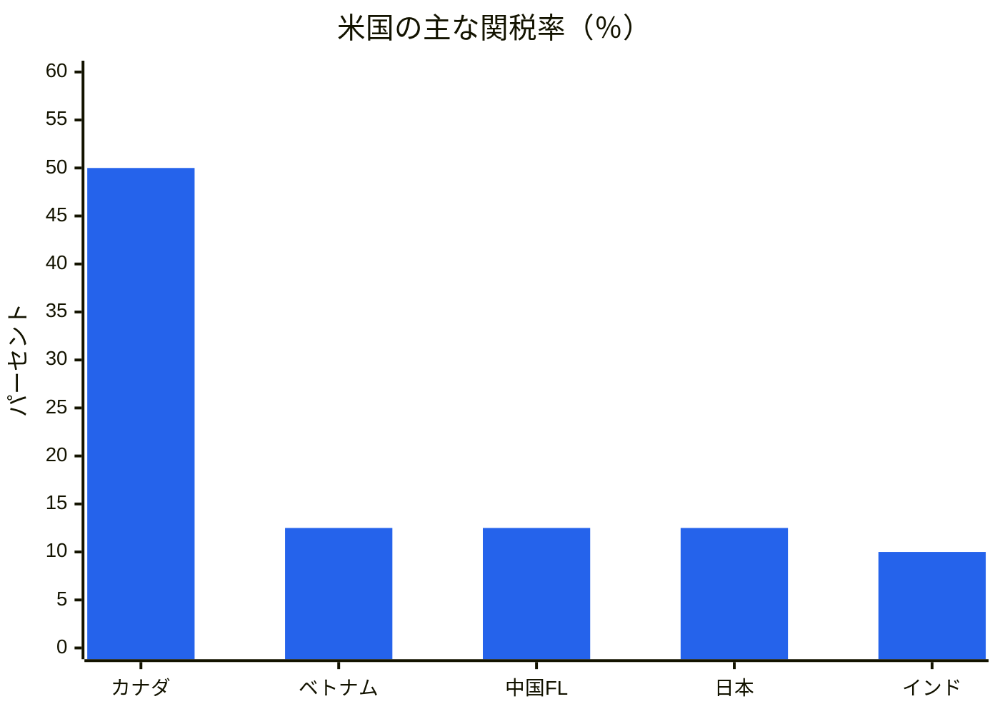

*注：カナダ＝338条関税率（50%）。ベトナム、中国FL、日本＝301条強制労働関税率（12.5%）。インド＝施行中の301条強制労働関税率（10%。発表された18%の協定税率は適用されず）。データソース：USTR、Liberty Justice Center、JD Supra。*

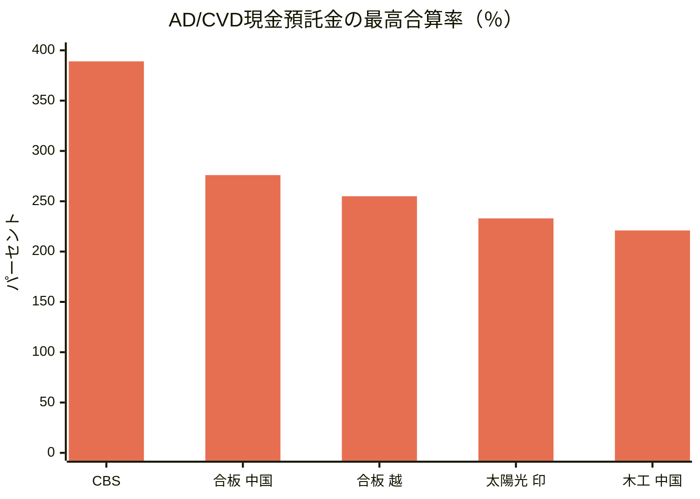

*注：アンチダンピング関税と相殺関税の合算現金預託負担。CBSゴム加硫促進剤：AD預託率281.69%＋CVD 107.57%（予備決定）。広葉樹合板（中国）：AD 187.27%＋CVD 88.96%。合板（ベトナム、Junma Phu Tho）：AD 90.12%＋CVD 165.39%。太陽電池（インド）：合算233.26%。木製モールディング（中国全体）：AD 220.87%（CVD見直しは別途）。データソース：2026年11月の商務省連邦官報公告。*

---

## 5. 米国政策の詳細分析

### 301条 — 適用除外は維持。過剰生産能力調査は早期に結論を出す可能性

対象期間中、中国に対する301条適用除外や海事料金の停止に変更はなかった。178件の適用除外と料金停止は2027年1月9日午後11時59分（東部時間）まで継続し、新たなUSTR公告は出ていない。APECで延長は決まらず、次の決断の場は12月14～15日のマイアミG20首脳会議となった。301条強制労働関税（中国、ベトナム、日本は12.5%、インドは10%）は引き続き施行中である。国際貿易裁判所は9月30日、強制労働関税に対する異議（In re Section 301 Forced Labor Cases、Learning Resourcesを主事件とする）を審理したが、3人の判事による合議体は判決を出しておらず、判決日も定まっていない。10月16日、政府と原告は、USTRが301条のどの部分に依拠したのか、経済発展を考慮しなければならなかったのかという合議体の質問に答える答弁書を提出した。別途、CBPは10月22日、中国301条関税の第99章報告コードを改定した（CSMS 70261629）。輸入業者は、USTRが後に適用除外とした製品の以前の申告について、申告概要訂正を通じて返還を求めることができる。[JD Supra](https://www.jdsupra.com/legalnews/lower-tariffs-higher-gray-market-risk-6159993/)

過剰生産能力調査は今週の未解決の問題である。グリア大使は11月21日、16カ国・地域にわたる構造的過剰生産能力に関する調査が、2027年3月11日の法定期限より数カ月早い2026年末までに結論を出すと述べたと報じられた。同大使は、暫定的な関税率や国別の罰則スケジュールについては明言を避けた。同調査は、自動車、リチウムイオン電池、半導体、鉄鋼、アルミニウム、ロボット、太陽光モジュール、精密機械を含む21部門を対象とする。報道が正確であれば、この日程は、インド当局がインド・米国協定の前提条件と呼ぶ決定を前倒しし、韓国当局が既に予想より2カ月以上遅れていると述べている決定を加速させる。調査結果、提案された措置、製品リストは公表されていない。同報道は一つの報道機関によるもので、11月23日時点でUSTRのプレスリリースも連邦官報の公告も出ていない。[East Asia Brief](https://eastasiabrief.com/trade-policy/ustr-accelerates-section-301-probe-hit-year-end-target-1636)

対象期間中のUSTRの貿易執行プレスリリースは、関税ではなく労働に関するものだった。11月19日、米国はUSMCA迅速対応労働メカニズムに基づき、Polygroup Industrias Méxicoにおける労働者の権利侵害の疑いについてメキシコに審査を求め、11月13日にはIndustrias FGに関する2件目のRRM要請が出された。グリア大使は11月18日に責任ある企業連合（Responsible Business Alliance）の年次会議でオンライン講演を行い、11月16日には関税が米国の長期的な繁栄をいかに前進させているかについてウォール・ストリート・ジャーナルに寄稿した。[USTR](https://ustr.gov/about-us/policy-offices/press-office/press-releases)

### 232条 — ポリシリコンは12月4日に発効。ロボットは依然交渉段階

CBPは11月12日、ポリシリコンと派生品に対する232条関税に先立ち、ACE認証環境で4つの模擬・非公式の第99章分類（9903.45.43、9903.45.45、9903.45.47、9903.45.49）をテスト専用に有効化した。最低輸入価格は、ポリシリコン（HTSUS 2804.61.00）が1キログラム当たり21ドル、インゴット・ウェハーが1キログラム当たり100ドル、太陽電池が1ワット当たり0.22ドル、太陽光モジュールが1ワット当たり0.38ドルでテストされる。関税は、申告価格と最低輸入価格の差額、または最低輸入価格に等しい特定関税に、派生品への15%従価税を加えたものとなる（ポリシリコン原料自体は15%関税の対象外だが、価格下限の対象となる）。日本、韓国、台湾、スイス、リヒテンシュタイン、EU加盟国については、232条関税と第1欄関税の合計が15%に制限される。公式の第99章見出しを伴う本番申告の指針は、12月4日までにまだ公表されていない。同措置は広範に適用され、USMCAの適用除外はない。[HTS Hero](https://htshero.com/tariff-updates/2026)

布告11077（ロボット・産業機械、10月28日署名、11月2日公表、91 FR 69199）は、新たな関税を伴わない脅威認定のままであり、商務省とUSTRに対し、交渉を行い180日以内（2027年4月26日頃）に報告するよう指示している。これは、風力タービンと民間航空機に続き、232条調査の後に即時関税ではなく交渉を選んだ3カ月で3回目の事例である。対象期間中に新たな動きは見られなかった。[Constilumen](https://www.constilumen.com/updates/proclamation-11077-robotics-industrial-machinery-section-232)

### CBP — 様式5106の期限は静かに経過。外国輸入者規則は1月5日に施行

11月18日の期限は、報告された無効化なしに経過した（A9参照）。基礎となる執行は、CBPの8月19日の公告（91 FR 53627）の下で2026年9月18日から有効である。様式5106のデータが不正確または不完全な輸入者番号は直ちに無効化される可能性があり、是正期間は定められておらず、無効化された番号は貨物の申告に使用できない。貿易アドバイザーによれば、ACE記録で最も頻繁に欠落または誤りがあるデータ要素は電話番号と電子メールアドレスである。11月18日の書簡は、CTPAT輸入者を対象とした的を絞った一斉送付であり、権限の始まりではない。CBPは11月12日に外国輸入者記録強化（Foreign Importer of Record Enhancement）をACE認証環境に導入し（CSMS #70409426）、2027年1月5日に本番環境へ移行する。CBP様式3461と7501には3つの新しいデータ欄が追加され（CSMS #70381183）、CBPによれば、要件が満たされていない場合、1月5日から申告と申告概要が却下される可能性がある。暫定最終規則への意見提出期限は2027年1月5日（ドケットUSCBP-2026-1387）。[DutyStacks](https://dutystacks.beehiiv.com/p/issue-006-apec-ends-with-a-declaration-not-a-deal-the-lukoil-clock-moves)

CBPのニュースルームが対象期間に掲載したのは地方の発表のみだった。デル・リオ入国港での武器、弾薬、麻薬の国外持ち出し押収（11月19日）、ローマ入国港での39万ドル超のコカイン押収（11月18日）、11月11日にシンシナティで押収された440点の偽造宝飾品（11月18日報告）、バーモント州オールバーグ・スプリングス陸上港の工事による一時閉鎖（11月19日）である。全国的な関税・貿易政策の発表はなかった。CSMS #70460453（11月17日）は、国際交通の手段として認められない機関車その他の鉄道設備は申告し関税を納付しなければならないことを輸入業者に注意喚起した。これには、特定の鋼製貨車に対する布告11021に基づく232条関税と、中国、チェコ、インド、メキシコ産の貨車用連結器に対するAD/CVDが含まれる。指針のみであり、新たな関税はない。[CBP](https://www.cbp.gov/newsroom)

### BIS輸出管理 — リモートアクセス規則、サプレッサー、エンティティ・リストの凍結

リモートアクセス暫定最終規則についてはA2と3.2節を参照。対象期間にはさらに2件のBIS関連事項があった。特定のサイレンサー、マフラー、サウンドサプレッサーが、米国軍需品リスト（USMLカテゴリーI）から商務管理リストへ移管され、新たなECCN 0A501.f（ライフル、ピストル、マルチホスト用サプレッサー）と0A502.f（ショットガン専用サプレッサー）の下に置かれた。2026年11月20日に発効した（規則は2026年7月23日に公表、91 FR 46252）。ECCN 0A501.fは国家安全保障、地域安定、犯罪管理、国連、反テロの理由で管理される。0A502.fには新たな地域安定管理が課される。ライセンス例外LVS（500ドルまで）は、カナダが最終仕向け地の場合、両項目に利用可能である。全自動火器専用に設計されたサプレッサーは、ITARの下でUSMLに残る。BISは、この変更により年間約200件の追加の輸出ライセンス申請が生じると見積もった。[Thomson Reuters](https://www.thomsonreuters.com/en-us/help/onesource-global-trade/regulatory-insights/2026/october-29th/us-issues-interim-final-rule-silencers-mufflers)

関連会社規則の停止は2027年1月10日まで継続し、対象期間に新たなBIS規則はなかったが、その不使用をめぐる政治的対立は激化した。ベッセント財務長官は11月13日、財務省、国防総省、国務省、USTRはいずれも数カ月にわたり、Megaspeed International（2年間で48億ドル超の先端Nvidiaチップを購入したと報じられるシンガポール拠点のNvidia顧客）をエンティティ・リストに掲載することを支持していたが、商務省が「ペンを持っている」と述べた。11月15日にはNvidia自体への圧力を強めた。商務省は11月5日のシチュエーションルームでのやり取りの報道を否定した。フィナンシャル・タイムズは11月10日、商務省がエンティティ・リストへの新規追加を遅らせようとしており、リストは13カ月間追加がない（最後の追加は2025年10月9日）こと、中国のAI研究所DeepSeekを含む100件超の候補が審査パネルの承認待ちであることを報じた。ハワード・ラトニック商務長官は2026年12月10日に上院銀行委員会で証言することに同意した。下院民主党議員3人は11月9日、ラトニック長官に12月1日までに書面で回答するよう求める書簡を送った。別途、ブルームバーグが引用したマレーシアの貿易記録によれば、Megaspeedは2025年11月に少なくとも17,544個のNvidia GB300プロセッサ（約7億8,700万ドル相当）を輸入し、FBIの要請によるインドネシア警察のMegaspeed現地法人への捜索では空のGPUラックが見つかった。Nvidiaは、2025年6月にMegaspeedを社内のブロックリストに載せたと述べている。[ExplainX](https://explainx.ai/blog/bessent-blames-commerce-megaspeed-entity-list-lutnick-ouster-talks-nvidia-huang-2026)

### 連邦官報 — 対象期間のAD/CVD関連

今週の連邦官報の貿易関連事項はアンチダンピング関税・相殺関税の公告が中心で、詳細は第7節のとおりである。広葉樹・装飾合板の命令（11月17日）、木製モールディング・ミルワークの最終見直し結果（11月17日）、段ボール製ダイカット箱に関するUSITC予備決定（11月17日）、完成炭素鋼フランジの見直し予備結果（11月16日）である。新たな保留解除命令（WRO）、リモートアクセス規則以外の新たなBIS規則、新たなホワイトハウスの関税布告、新たなUSTRの301条公告は対象期間に出ていない。連邦官報は1週間分を文書ごとに網羅的に調査したわけではないため、他の行政見直し公告が存在する可能性がある。

### 継続項目

- **AGOA：**トランプ大統領は11月2日、年次省庁間適格性審査（7月23日に公聴会を実施）を受け、ルワンダと南アフリカのAGOA受益国資格を2027年1月1日付で終了する意向を議会と両国政府に通知した。AGOAは法改正により2028年12月31日まで延長された。終了を確定させるには、大統領は1月1日までに両国をAGOA受益国のHTSUSリストから削除する布告を発出しなければならない。11月23日時点でそのような布告は公表されていない。南アフリカの輸出は、その後、AGOA無関税待遇ではなく標準MFN関税に直面することになる。[USTR](https://ustr.gov/about/policy-offices/press-office/press-releases/2026/november/ambassador-greer-issues-statement-president-trumps-intent-terminate-rwanda-and-south-africa-agoa)
- **中間選挙後の関税見通し：**11月3日の選挙により、1月に就任する民主党の議会多数派が誕生したが、選挙自体は関税率を変更しない。残存する関税は301条と232条の権限に基づくものであり、変更には大統領の措置または拒否権を覆す立法が必要である。経緯は次のとおりである。IEEPA関税は2026年2月20日に無効化され、徴収は2月24日に終了した。10%の122条追加関税は2026年2月24日から7月24日まで適用され、議会の延長なしに150日の法定期間の上限を迎えて失効した。60カ国・地域を対象とする301条関税は2026年7月24日に10%または12.5%で発効した。製造業者には、現行の関税保護が続くと想定しないよう助言する。[JD Supra](https://www.jdsupra.com/legalnews/lower-tariffs-higher-gray-market-risk-6159993/)
- **ホワイトハウス：**対象期間に新たな関税布告やファクトシートは確認されなかった。関連する最新の布告は引き続き布告11077（ロボット・産業機械）である。

---

## 6. 地域別世界政策

### 欧州

**EU・インドネシアCEPAに署名、11月21日。**ほぼ10年に及ぶ交渉を経て、EUとインドネシアはブリュッセルで包括的経済連携協定と別個の投資保護協定に署名した。EU側はマロシュ・シェフチョビッチ貿易担当委員が署名し、ウルズラ・フォン・デア・ライエン欧州委員会委員長が出席した。理事会は11月18日に署名を承認していた。インドネシアは、規定が完全に発効すれば、EU製品の関税品目の98.5%で関税を撤廃する。委員会によれば、この協定によりEU輸出業者は年間6億ユーロ超の関税を節約でき、221のEU地理的表示が保護を受ける。欧州議会の同意とインドネシアの批准がまだ必要であり、両者は2027年初頭からの暫定適用を目指す。フォン・デア・ライエン委員長は、プラボウォ・スビアント大統領が12月11日にブリュッセルを訪問すると述べた。この署名は約10年に及ぶ交渉を締結し、米国および中国との関係が困難になる中で、EUの多角化推進の一環として、今年2件目の主要なアジア貿易署名となった。輸出業者にとって実務上の要点は、協定は署名されたが発効していないことであり、調達と価格設定の判断は新税率を前提とすべきではない。[Turkish Post](https://turkishpost.com.tr/en/2026/11/21/eu-indonesia-trade-deal/)

**EU・インドFTAの署名が2026年12月16日に確定。**EU・インド自由貿易協定は、PTIが引用したインド当局者の発言として11月22日に報じられたところによれば、ナレンドラ・モディ首相の訪問中の2026年12月16日にブリュッセルで署名される見通しとなった。委員会は、署名と締結の承認を求める提案を理事会に提出し、最終的な法的文書と関税スケジュールも添えた。ジャン＝エリック・パケ駐インドEU大使は、アッサム訪問中に12月中旬の期限を確認した。発効は、欧州議会の承認、理事会の締結、インドの批准を経て2027年が見込まれる。同協定の下では、インドからの出荷の93%がEUへの無関税アクセスを受け、約330億ドル相当の労働集約型輸出品は関税ゼロとなる。交渉は2026年1月27日に妥結した。別個の投資保護協定と地理的表示に関する協定は引き続き交渉中である。[Asia Daily](https://asiadaily.org/news/19949/)

**EUの2ユーロ取扱手数料：初の影響データ — 低額小包が60%超減少。**1品目当たり2ユーロのEU取扱手数料（委任規則（EU）2026/2152）と製品識別子の義務化が3週目に入った。今週確認された新たな詳細は次のとおりである。委員会によれば、2026年第3四半期の低額小包の数量は、関税導入前の傾向に対して60%超減少した。これは、一部の販売業者がEUの倉庫へ在庫を一括出荷する方法に切り替えたためである。委員会はまた、2025年にEUに輸入された低額eコマース商品は59億点で、2022年の4倍となり、90%超が中国からだったと報告している。3ユーロの定額関税と2ユーロの手数料は、2026年10月6日の委員会の改定指針の下で、VATの課税標準に含まれる。150ユーロまでの貨物に対するイタリアの1件当たり2ユーロの手数料は、EUの課徴金に加えて2026年12月1日に延期された。欧州全域の検査キャンペーンでは、検査した商品の60%超が欧州基準に適合していなかった。EUの低額輸入リセットに関する初の確かな証拠は、2ユーロの手数料が発効する前に既に、第3四半期に小包数量が傾向に対して60%超減少するという急激な行動変化を示している。これは、販売業者が品目ごとの課金を避けるために在庫をEUの倉庫に移したためである。同手数料は恒久的で、あらゆる価額に適用され、返品時でも返金されないため、返品の経済性と着地コストの両方を変える。徴収された収入や通関遅延に関する公式の数字は、対象期間に公表されなかった。[Fashion Law Journal](https://fashionlawjournal.com/eu-small-parcel-tax/)

**EUハイブリッド車セーフガード。**A4参照。委員会は10月30日に調査を開始した。意見書の提出は11月20日に締め切られ、暫定措置は12月1日からと見込まれ、中国製ハイブリッド車の年間上限は35万台と報じられている。[Ports Europe](https://www.portseurope.com/eu-opens-hybrid-safeguard-probe-as-chinese-shipments-outrun-planned-quota/)

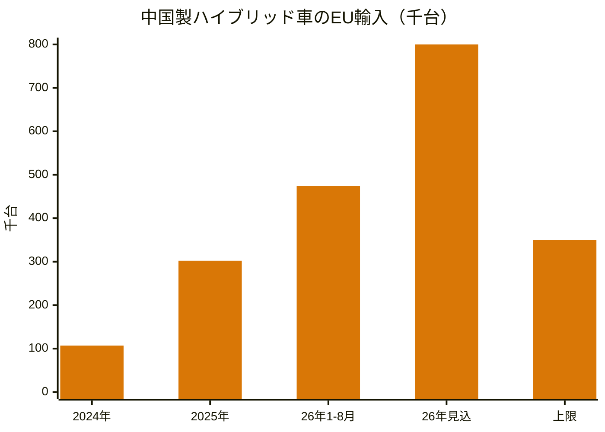

*注：輸入はユーロスタットの数字。2026年の見通しは委員会の推計。上限は報告された初年度のセーフガード上限35万台。データソース：Ports Europe経由のユーロスタット、委員会。*

**EU・オーストラリアFTA：3月に署名、批准は不透明。対象期間に新たな動きなし。**EU・オーストラリアFTAは2026年3月24日に妥結し、同日キャンベラで署名されたが、まだ発効しておらず、議会の審査とオーストラリア法の改正なしに実施することはできない。DFATによれば、この手続きには最長2年かかる可能性がある。ドイツの駐オーストラリア大使は10月29～31日、オーストラリアでの批准は連合、グリーンズ、クロスベンチからの上院票に依存すると述べ、2027年第1四半期に完了することへの期待を示した。野党の国民党は反対を表明しており、自由党は立場を表明していない。EUは、議会が協定を否決した場合、再交渉はしないと警告している。発効は2027年後半より前には見込まれない。オーストラリアの輸出額の98%がEUに無関税で入ることになる。二国間貿易額は年間1,090億豪ドル超である。[AAP](https://aapnews.aap.com.au/news/claim-eu-trade-deal-mandates-methane-reducing-livestock-feed-is-baseless)

**EU・カナダ・デジタル貿易協定は10月30日に妥結。文書は未公表。**EUとカナダは2026年10月30日にデジタル貿易協定の交渉を妥結した。これは、2017年から暫定適用されているCETAを補完するものである。同協定は、国境を越えるデータフロー、電子契約、電子署名、電子請求書、オンライン消費者保護、迷惑な商業メッセージに関する規則を定める。交渉は2026年3月に第5回CETA合同委員会で開始されたばかりだった。合意された文書は公表されていない。署名の前に、法的精査とすべてのEU言語への翻訳が行われる。交渉の速さ（開始から8カ月以内に妥結）は、米国の政策が予測しにくくなる中で、両者がデジタル貿易規則に置く政治的優先度を反映している。署名と発効は早くとも2027年の問題である。[European Commission](https://policy.trade.ec.europa.eu/news/eu-and-canada-conclude-negotiations-digital-trade-agreement-2026-10-30_en?prefLang=ga)

**英EU自動車原産地規則：ACEAとSMMTは、2027年1月1日から4台に1台のEVが10%関税に直面すると警告。**ACEAとSMMTは、2027年1月1日に発効予定の英EU貿易協力協定（TCA）の電気自動車・ハイブリッド車に対する厳格な原産地規則により、両市場間で取引されるバッテリー電気自動車とプラグインハイブリッド車の4台に1台未満しか無関税待遇の資格を満たさず、残りは10%の関税にさらされると警告した。両団体はまた、EUが提案する産業加速法（Industrial Accelerator Act）が英国の車両と部品に関税を課す可能性があり、年間870億ドル相当の自動車貿易関係を脅かすと警告した。EUは2017年以降、EUのバッテリーサプライチェーンに約808億ドルを投資したにもかかわらず、リチウムイオン電池の約3分の2を依然として輸入している。ドイツのVDAは11月、EUのバッテリーサプライチェーンがさらに発展するまで原産地規則の変更を延期するよう主張した。11月20日の首脳会議では、この点について報告された解決はなかった。[Manufacturing Digital](https://manufacturingdigital.com/news/acea-smmt-uk-eu-tariff-rules-threaten-auto-manufacturers)

### 英国

**英EU首脳会議（11月20日）：SPS協定、ETS連携、相互CBAM免除に合意。**3.3節参照。第2回英EU首脳会議で、両者はSPS協定（2028年3月1日実施。英国政府は2040年までに経済生産が年間最大51億ポンド増加する可能性があると見積もり）、英国排出量取引制度とEU排出量取引制度の連携（2028年1月1日からの相互CBAM免除を目標。英国輸出の約65億ポンド分が恩恵を受けられる可能性）、若者移動措置に合意した。英国は2027年1月1日から、EU、欧州経済領域、スイス原産の貨物を自国のCBAMから免除する。これらの協定はまだ発効しておらず、さらなる法的・実施手続きが必要である。[Thames Valley Chamber](https://www.thamesvalleychamber.co.uk/uk-eu-summit-2026-new-trade-agreements-reached/)

**英国CBAMの対象を精製製品に拡大へ。2026年度予算で協議を開始。**政府は、実現可能性と影響に関する協議を条件として、英国炭素国境調整メカニズム（CBAM）の対象を精製製品に拡大する意向である。協議は2026年度予算で開始された。期限は示されておらず、政府は「可能な限り速やかに」実施する意向であり、しかるべき時期に期限を示すと述べた。立法上の英国CBAMは、アルミニウム、セメント、肥料、水素、鉄鋼を対象として2027年1月1日に開始される。拡大により、英国CBAMは当初の5部門を超えて精製石油製品に広がるが、協議段階にあり日程は未定である。これは11月20日の首脳会議の合意と並行するもので、同合意の下では、EU原産の貨物は2027年1月1日から英国CBAMの対象外となる。したがって、精製製品への拡大が進めば、実際には主にEU域外の供給業者に影響することになる。[UK Parliament](https://questions-statements.parliament.uk/written-questions/detail/2026-10-28/39108)

**対象期間に新たな英国貿易救済公告なし。トルコ産ニジマスへの関税延長は維持。**対象期間に新たな貿易救済公告は見られなかった。継続項目は次のとおりである。貿易救済公告2026/31により、トルコ産ニジマスに対する相殺関税が5年間延長され、2031年1月30日まで、2026年11月6日から発効し、既存の税率（輸出者別1.5%～8%、その他すべて9.5%）が適用される。2027年1月1日の英国CBAM開始が、現在最も近い日程の英国貿易イベントである。

### カナダ

**カナダ・中国二国間取り決めを11月17日に延長・拡大。**カナダと中国は、二国間の経済・貿易問題に対処するための予備的共同取り決めを延長・拡大した。中国は、約4億カナダドル相当のカナダ輸出品（冷凍豚肉カット1億1,600万カナダドル、魚介類2億8,500万カナダドル。冷凍冷水エビ・クルマエビを含む太平洋産スポットエビ8,750万カナダドル、ジオダックを含む軟体動物6,140万カナダドル、ナマコ3,940万カナダドル、カラスガレイ9,600万カナダドル）に対する追加関税緩和を提供する。これは、2027年1月1日から2028年12月31日まで、これらの製品に対する追加25%関税を停止することによるものである。この拡大は、11月初旬（11月4日の閣僚級協議）に合意された、キャノーラミール、エンドウ豆、ロブスター、カニに対する関税緩和の2年間の延長に基づくものである。引き換えに、カナダは、2026年末に期限を迎える中国製鉄鋼・アルミニウム製品に対する既存の救済措置を2年間延長し、カナダの供給が不十分または入手できない場合の追加32品目（鉄鋼23品目、アルミニウム9品目）に救済対象を拡大した。4億カナダドルという数字は、中国の追加関税が課される前の2024年におけるこれらの品目のカナダ輸出額であり、支払いや新規事業の保証ではない。取り決めの新たな失効日は2028年12月31日である。同合意はまた、China BriefingのAPEC要約によれば、二国間通貨スワップを復活させる。[Prime Minister of Canada](https://www.pm.gc.ca/en/news/news-releases/2026/11/17/prime-minister-carney-advances-canadas-strategic-partnership-china)

**338条裁判：口頭弁論は2027年1月20日に設定。**3.7節および先週の報告書のA9参照。カナダ製品に対する338条関税への異議を支持する意見書が、カーラ・ヒルズ、ロバート・ゼーリック両元USTR、貿易学者、納税者擁護団体から提出され、Liberty Justice Centerが11月16日に提出を発表した。口頭弁論は2027年1月20日に予定されている。政府側の答弁書の期限は2026年12月11日、ゲラート側の反論は2027年1月11日である。同訴訟（Gellert Global Group Corp. v. Trump、事件番号26-04636）は、約200億ドル相当のカナダ輸入品に対する50%の関税に異議を唱えるものである。ゲラート社は、カナダ産チーズに年間約4,000万ドルを支払うことになるとし、2026年9月15日～10月7日の申告について少なくとも38万1,000ドルを支払ったと述べている。10月28日、裁判所はゲラート社の申立てを一部認容し、一部却下した（記録にはどの部分かは明記されていない）。布告11076は、2026年10月30日から申告される貨物について自動車製品リストを再び書き換えた。関税は引き続き施行中である。[Liberty Justice Center](https://libertyjusticecenter.org/pressrelease/former-u-s-trade-representatives-scholars-back-liberty-justice-centers-challenge-to-trumps-canadian-tariffs/)

**カナダの関税緩和の収支：賦課額141億カナダドル、免除額89億カナダドル。**2025年3月から2026年10月26日まで、カナダは米国製品に141億カナダドル（約100億米ドル）の関税を賦課したが、89億カナダドルが免除または軽減され、純収入は52億カナダドルとなった。これは救済プログラムの幅広さを定量化するものである。ほとんどの報復関税は実際には収入を生んでいない。11月9日の変更（水平救済を2028年6月30日まで延長。特定のトレーラーに対する救済は2026年12月1日から、特定のアルミニウム線、押出材、板紙に対する救済は2027年2月1日から廃止）は先週報じられたとおり維持されており、対象期間にさらなる変更はない。[Mining Weekly](https://www.miningweekly.com/article/canada-expands-us-tariff-exemptions-cuts-some-aluminium-relief-2026-11-10)

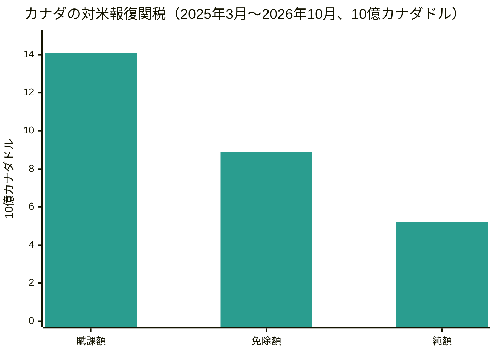

*注：2025年3月から2026年10月26日までの米国製品に対する賦課関税。救済プログラムの下で免除または軽減された額。純収入。データソース：2026年11月10日のMining Weekly経由のカナダ政府開示。*

**カナダがWTOでインドに米の備蓄のエタノール転用について質問。**カナダは11月14日、WTOでインドが国家備蓄の米をエタノール製造業者に配分したことについて正式な質問を提起し、国内燃料用アルコール蒸留に転用された公的穀物の数量の詳細を求めた。これは、インドの国内支持に対する農業委員会の審査のパターンに沿うものである（多国間機関の項参照）。対象期間にインドの回答は報告されていない。[Distillers Hub](https://distillershub.com/news/111420315/)

### 中国

**ドローン、トンネル掘削機、浚渫船に対するデュアルユース輸出管理が11月18日に発効。**第49号公告（ドローン）、第50号公告（トンネル掘削機と関連設備）、第51号公告（浚渫船）は2026年11月18日に発効し、デュアルユース品目輸出管理リストを改定した。ライセンスが必要となるのは、ドローンの自動操縦装置、見通し外飛行が可能で航続時間が3時間以上のドローン、ドローン専用に設計されたエンジン、航続距離300キロメートル以上または80リットル超のエアロゾル散布装置を備えたドローンである。第49号公告は、管理対象ドローンの航続時間の閾値を1時間から3時間に引き上げたため、その閾値を下回る量産ドローンはライセンスが不要となった一方、管理はより多くのドローン部品に拡大された。第50号公告は、トンネル掘削機に対する管理を初めて課し、特定の歩行式掘削機と高所ショットクリート機械も対象とした。機微な仕向け地への輸出にはライセンスが必要で、その他の仕向け地では登録制の証明書を利用できるが、再移転の制限が課される。第51号公告は、特定の浚渫ポンプ、ドラグヘッド、カッターヘッドにライセンスを追加した。再輸出規則も11月18日から適用される。外国企業は、トンネル掘削機などの中国原産の建設機械を特定の国に転売する際に中国のライセンスが必要となる。別途、MOFCOMと税関総署の第52号公告（10月19日）は、ライセンスなしに輸出のために提示された貨物を税関が保留できる手続きを改定した。これらの管理は現在有効であり、その設計は両面性を持つ。閾値を引き上げたことで一般的な商業ドローンは制度の対象外となった一方、対象はトンネル掘削機（初めて）と、中国原産機械の外国企業による再輸出にまで広がった。この再輸出規則は、第三国の買い手と再販業者にとって最も鋭い側面である。中国の輸出業者が関与しない取引にも及ぶからである。[Mondaq](https://alpha.mondaq.com/china/new-technology/1870494/new-chinese-export-control-measures-tighten-restrictions-on-the-export-of-advanced-technologies-and-dual-use-goods-strengthen-enforcement)

**技術輸出目録：意見提出は11月15日に締め切り。暫定登録が現在の運用制度。**第48号公告（10月16日）に対する意見提出は11月15日に締め切られた。同公告は、輸出禁止・制限技術目録に40技術（AI 23件、バイオ医薬品5件、太陽光発電12件。禁止14件、制限26件）を追加するものである。11月23日時点で最終目録は公表されていない。現在運用されているのは、10月16日から施行されている暫定輸出前登録要件であり、既に進行中の取引や、当該技術を保有する国内企業の所有権・支配権の海外事業体への移転を含む、対象技術の輸出を対象とする。今週の新たな分析により、範囲が明確になった。バイオ医薬品では、細胞・遺伝子治療およびsiRNAプラットフォームの所有権の移転は禁止されるが、ライセンス、CRO/CDMOサービス、アウトバウンド事業開発取引における製品の研究開発または製造に必要な技術は対象外となる。AIでは、制限対象モデルの海外現地展開は技術輸出に該当するが、APIアクセス、アプリやウェブでの利用、SaaS、軽量のオンデバイス展開は対象外である。制限技術の輸出審査は2段階で最大約45営業日かかる。MOFCOMはまた、デュアルユース輸出管理調査・執行措置の草案について協議を開始し、意見提出期限は2026年11月29日である。太陽光関連の規定は、外国メーカーにとって依然として最も重大であり、ポリシリコン生産、70マイクロメートル以下のウェハー、ペロブスカイトおよびタンデムセル製造を対象とする。[Jones Day](https://www.jonesday.com/en/insights/2026/11/china-tightens-its-grip-on-exports-of-strategic-technologies-what-it-means-for-technology-deals-involving-ai-and-biotech)

**MOFCOM英語サイトは閲覧可能。トップページは11月12日の記者会見のみ。**英語サイトは11月23日に閲覧可能だった。トップページの内容は、11月12日の定例記者会見（11月6日の何立峰副首相とベッセント財務長官、グリアUSTR代表とのビデオ通話、およびCIIEでの中国・EU医療機器マッチメイキングイベントに関する発言を含む）と官報に限られていた。技術目録やガリウム停止措置に関する新たな公告は、トップページには見られなかった。MOFCOMの英語ポータルは依然として内容の薄いものであり、見出しのみで、実質的な公告はまず中国語で掲載される。11月12日の記者会見では、2025年5月以降8回の中国・米国経済貿易協議が行われたことが確認された。ガリウム関連の停止措置（2025年第72号公告）は2026年11月27日に失効し、11月23日時点で改正公告は見つかっていない。[MOFCOM](https://english.mofcom.gov.cn/)

**中国・米国：APECで関税面の成果なし。休戦は2027年1月9～10日まで継続。**A1および3.1節参照。11月19日の習・トランプ二者会談では、関税緩和の発表もレアアースに関する成果もなかった。報道は、関税、レアアース、半導体をめぐる膠着状態を伝えている。トランプ大統領は中国に対し、170億ドル相当の米国農産物を購入するとの約束を履行するよう求めた。中国当局者は、この約束は相互関税引き下げを条件としていると述べた。両首脳は米中「戦略的安定」のための行動計画を起草することで合意した。提案された300億ドル対300億ドルおよび600億ドルの相互関税引き下げ案は未確定のままである。[China Briefing](https://www.china-briefing.com/news/apec-2026-in-shenzhen-what-the-leaders-meeting-and-trump-xi-talks-mean-for-business/)

### インド

**インド・米国協定は依然未署名。商務長官は、署名には米国の関税枠組みが必要と述べた。**3.7節参照。ラジェシュ・アグラワル商務長官は11月18日、提案されたインド・米国貿易協定は、最高裁判所が相互関税と緊急関税を解体した後、ワシントンが新たな関税構造を整備するまで署名できないと述べた。これは、各国に提供される比較優位が明確になる必要があるためである。過剰生産能力調査を含む、進行中の301条調査の結果も判明する必要がある。すべての国がこれらの調査について確実性を求めるからである。法的協定は交渉済みで最終段階にある。両者は可能な限り速やかに締結したいと考えている。ジャイシャンカル外相は11月14日、協定は「最終段階」にあり、問題の大半は解決済みと述べた。2026年2月7日の枠組みは18%の米国関税率を定めたが、適用されたことはない。インド製品は現在10%の301条関税を支払っている。[The Hindu BusinessLine](https://www.thehindubusinessline.com/economy/no-india-us-trade-deal-until-new-us-tariff-framework-section-301-probes/article71716562.ece/amp/)

**インド・EU：署名は12月16日。酪農と遺伝子組み換えのレッドラインを再確認。**先週報じられたレッドラインに変更はない。インドは、いかなるFTAでも酪農部門を開放したことはなく、遺伝子組み換え製品の輸入も認めない。EU・インドの署名は現在12月16日とされている（欧州の項参照）。レッドラインは安定しており、農業と酪農が未解決の懸案事項である未署名の米国協定を含む、インドのすべての現行FTA交渉に関連する。

### アジア太平洋

**APEC深圳：首脳らが深圳展望を採択。関税合意なし。カナダ、チリ、フィリピン、ペルー、インドネシアの周辺合意。**3.1節および3.7節参照。周辺合意は次のとおりである。中国・カナダ関税緩和（カナダの項参照）。フィリピン・チリ包括的経済連携協定は11月19日に署名された。フィリピンにとってラテンアメリカ諸国との初のFTAであり、8,632品目に優遇アクセスを提供し、チリへの既存のフィリピン出荷のほぼすべて（電子機器、機械、乾燥ココナッツ、カラギーナン、加工マグロ）が無関税待遇を受ける。ペルー・タイFTAは11月19日に署名された。中国・チリ経済貿易ロードマップと自由貿易・多国間主義に関する覚書。中国・インドネシアは11月20日にCEPA交渉の開始を発表した。フィリピンはまた、CPTPPへの加盟に関心を示し、フィリピン・カナダFTA交渉が妥結したと発表した。[BusinessMirror](https://businessmirror.com.ph/2026/11/20/new-trade-deal-opens-chile-market-for-phl/)

**パックス・シリカ：サンフランシスコ宣言が11月15日に米国と8つのパートナーにより署名。**米国と8つのパートナーは、パックス・シリカ枠組みの下で「永続的な繁栄の確固たる基盤に関するサンフランシスコ宣言」に署名し、より強力な保護を必要とする機微な技術と重要なサプライチェーンの共有リストを作成し、脆弱性に関する情報を交換し、作業部会を組織することに合意した。同宣言は、半導体、AIインフラ、重要鉱物、エネルギー、先端製造、輸送物流、通信ネットワークを対象とし、非市場慣行、過剰生産能力、不公正なダンピングに対処する。拘束力はない。資金拠出の約束、企業名、実施期限はなく、共有リスト自体も作成も公表もされていない。2025年12月に開始されたパックス・シリカには現在約26の参加国がある。EU加盟国は創設者リトリートに出席しなかったが、「規制適合性」について文書を検討中であり、ドイツ、スウェーデン、オランダ、欧州委員会が近く署名すると見込まれる。同宣言により、パックス・シリカは広範なパートナーシップ声明から具体的な安全保障協力へと移行した。課題は、保護すべき技術とインフラの共同リストである。しかし成果物はまだ存在しないため、貿易への影響は将来的なものにとどまる。EU加盟国が署名するか、共有リストが起草された際に輸出管理や投資審査への影響が生じるかを注視すべきである。[Asia Daily](https://asiadaily.org/news/18839/)

**フィリピンがAPECで411億ドルの投資誓約を確保。CPTPPへの関心を表明。**マルコス大統領は深圳から、製造業、電気自動車、クリーンエネルギー技術にわたる411億ドル相当の投資誓約を持ち帰り、7,000人超の雇用創出の可能性を伴う。最も具体的な誓約は、C&Uグループによるバタンガス州アリタグタグの20ヘクタール施設への8,700万ドルである。フィリピンはまた、メキシコのクラウディア・シェインバウム大統領との会談でCPTPPへの加盟に関心を示し、フィリピン・カナダFTA交渉の妥結とフィリピン・チリCEPAの署名に言及した。フィリピンの輸出は2025年に15.4%増加し、2026年1～9月も月次で増加を続けた。誓約は設備投資ではないため、411億ドルという見出しは、確約された投資ではなく意向のシグナルとして読むべきである。C&U施設が唯一の項目化された約束である。[Further Asia](https://furtherasia.com/philippines-gets-us41-1b-investment-pledges-after-apec/)

**韓国・ブラジル化粧品関税：対象期間に新たな動きなし。**同案件は大統領の指示段階にとどまり、交渉結果の報告はない。先週の項目が引き続き有効である。李大統領は11月3日の閣議で、ルラ大統領の10月25日の再選を受け、ブラジルが韓国化粧品に課す25%の関税について早期の交渉を促した。韓国化粧品の輸出は2026年1～10月に124億ドルに達し、前年比27.3%増となった。[Seoul Economic Daily](https://en.sedaily.com/politics/2026/11/03/lee-presses-brazil-to-cut-25-percent-tariff-on-korean)

### 多国間機関

**WTO改革の動き：米国が中国に異議を唱え、「公平な競争条件」の議題から農業を除外。農業なしにMC15パッケージは成立しないとブラジルが警告。**11月16日に開かれたWTO改革の「公平な競争条件」問題に関する長時間の会合で、米国は、中国との二国間貿易関係が「持続不可能」であることに依然として懸念を示し、北京がルールに従って行動していないと主張し、年間1兆ドル規模とされる貿易赤字の非対称性が、既存のWTOルールでは対処できないほど大きくなったと示唆した。ワシントンはまた、最恵国待遇を含む無差別原則は、非対称性が続く中では適用できないと伝えた。米国は、ノルウェー、日本、スイスが主導する農業防衛的なG10諸国とともに、農業を公平な競争条件の議論に含めることに反対し、農業は農業委員会特別会合でのみ扱うべきだと主張した。数カ国は、産業政策と産業補助金に関する多国間議論を含む、中国の公平な競争条件に関する提案を支持した。EUは中国の提案を承認する意向を示し、中国は国家介入と補助金に関するOECDの作業を受け入れると述べた。ブラジルは、公平な競争条件の議題に農業が含まれなければ、MC15（2028年開催予定）で採択されるWTO改革パッケージはないと警告した。ニュージーランドは農業に関する文書を提出する可能性を示唆した。改革の動きは今や2つの軸で公然と分裂している。農業が公平な競争条件の議論に属するかどうか、そして米中間の非対称性をWTOルールの中で処理できるかどうかである。非対称性が続く中で最恵国待遇は適用できないという米国の立場は、WTOの核心原則への直接の挑戦である。11月16日の会合では合意は得られなかった。次回の農業委員会特別会合は2026年11月23日に予定され、輸出制限と特別セーフガード措置を扱う。[Third World Network](https://www.twn.my/title2/wto.info/2026/ti261112.htm)

**WTO農業：インドの砂糖補助金が180億ドル近くに達すると主張。カナダが米のエタノール転用について質問。**WTOに提出された報告書は、インドが昨年、WTOの上限を超える180億ドル近い砂糖補助金を提供したと主張している。これは、オーストラリアが9月9日に、インドが砂糖、綿花、豆類に対する国内支持を通報しなかったと主張するカウンター通報を行ったことに続くものである。2021年12月のパネル（インド — 砂糖・サトウキビ）は、インドの砂糖支持がWTO義務に反すると判断した。別途、カナダは、インドが国家備蓄の米をエタノール製造業者に配分したことについて正式な質問を提起した（カナダの項参照）。農業委員会特別会合は2026年11月23日に開催され、輸出制限と特別セーフガード措置を扱う。農業は依然としてWTOで最も論争の多い分野であり、インドは砂糖、米のエタノール転用、以前の綿花・豆類の通報漏れという3つの並行する審査の中心にある。180億ドルという数字は、提出された報告書における主張であり、WTOの認定ではなく、そのように扱うべきである。[RFD-TV](https://www.rfdtv.com/indian-sugar-subsidies-draw-scrutiny-over-unfair-trade-practices)

**WTO DS644（中国対インド）：パネルは6月から設置済み。本案は未判断。**先週の報告書の訂正である。先週の報告書は、WTOが11月16日にDS644でパネル設置に「合意した」と述べた。公開記録によれば、紛争解決機関は2026年6月23日にパネルを設置し、2026年10月7日にパネルを構成した。中国は2025年12月19日に協議を要請し、パネルは2026年5月11日に要請され、設置は5月22日に延期された（インドが最初の要請を阻止）。同紛争は、インドの特定技術製品に対する関税待遇と、ソーラーモジュール・プログラムにおける国内産品を輸入品より優遇するとされる奨励措置を対象とする。パネル報告書、認定、救済措置は公表されていない。対象期間に新たな動きはない。同紛争は、構成されたパネルによる正式な裁定中であるが、何も決定されておらず、インドはその結果としていかなる関税品目もプログラム規則も変更していない。[WTO](https://www.wto.org/english/news_e/news26_e/dsb_23jun26_426_e.htm)

**UNCTAD貿易開発報告書2026：世界成長は2.6%に減速。米中貿易は2024年以降20%超減少。**UNCTADの貿易開発報告書2026は11月17日に公表され、世界成長は2025年の2.9%から2026年には2.6%に減速し、発展途上国は4.7%から4%になると予測した。財・サービス貿易は実質で約4%成長すると見込まれ、世界の貿易は2025年に過去最高の35兆ドルに達した。アジアは2026年の世界成長の59%を占める（インド7.3%、中国4.5%、インドネシア5.2%）。中国と米国の間の貿易は2024年以降20%超減少した一方、東アジアは両国との貿易を拡大した。減速は中東紛争と関連しており、ブレント原油は1バレル当たり70ドルから110ドル超に上昇した。紛争開始以降、資本フローの変動は2倍になった。政府開発援助は2026年に約7%減少すると予測され、3年連続の減少となる。UNCTADの見出しは、アジアの強靱性を伴う分断である。世界最大の2つの経済圏は2024年以降、二国間貿易を5分の1以上削減したにもかかわらず、世界の貿易は2025年に過去最高の35兆ドルに達し、アジアが2026年の成長の大半を生み出している。成長率はUNCTAD独自のものであり、IMFの数字と直接比較できないことに留意すべきである。これは対象期間の新たな発表であり、先週取り上げた11月9日の世界貿易アップデートとは別である。[UNCTAD](https://unctad.org/publication/global-trade-update-november-2026)

**WCO：アンドラが11月18日に改正京都規約の141番目の締約国に。**アンドラ公国は、改正京都規約の141番目の締約国として加入した。11月のその他のWCO関連事項は先週既に取り上げた（11月3日の災害救援シンポジウム、11月5日の2025～2026年年次報告書、11月9日のスマート税関イベント、11月11日のeコマースにおける偽造品シンポジウム、11月12日のEAC原産地規則支援、11月13日のWOAH会合）。11月16～23日にアンドラの加入以外に新たなWCOニュースは公表されなかった。小さいながらも構造的な項目である。WCOの中核的な貿易円滑化手段である改正京都規約が141番目の締約国を得た。[WCO](https://www.wcoomd.org/en/media/newsroom/2026.aspx)

**ITC・アフレキシムバンクのアフリカ・カリブ海貿易報告書：新たな項目なし。**2026年11月16～23日の対象期間に新たなITC関連事項は見つからなかった。11月3日の報告書が引き続き有効である。2030年までに、アフリカ・カリブ海間の財・サービス貿易は年間最大16億5,000万ドルに達する可能性がある（鉱物燃料を除く）。アフリカのカリブ海向け年間財輸出潜在力の約80%は未開拓のままである。カリブ海の輸出潜在力は主にサービスにあり、4億8,100万ドルである。今週の報道からの補足として、2025年7月のITC・アフレキシムバンクの予測では、同じ回廊が2030年までに21億ドルに達するとされていたため、新しい数字は約21%低い。ただし、2つの数字は直接比較できない可能性がある。以前の数字には鉱物燃料が含まれていた可能性があり、新しい数字はそれを除外していること、また基準（7億2,900万ドル）は財のみであるのに対し、予測は財とサービスを対象としているためである。同報告書は、この限定条件なしに引き下げとして提示すべきではない。[Central Charts](https://www.centralcharts.com/en/news/5841368-africa-and-caribbean-trade-potential-could-reach-1-65-billion-annually-by-2030-international-trade-centre-itc-afreximbank-report)

---

## 7. 執行措置

### アンチダンピング関税と相殺関税

**広葉樹・装飾合板 — 中国、インドネシア、ベトナムに対するAD/CVD命令（11月17日）。**A8参照。商務省はアンチダンピング関税・相殺関税命令を発出した（事件番号A-570-211、A-560-844、A-552-851、C-570-212、C-560-845、C-552-852）。CBPは清算の停止を継続し、現金預託を要求する。命令の対象は、広葉樹、針葉樹、竹の表面または裏面単板を持つ2層以上の合板またはその他の単板パネルで、トリミングおよびカット済みパネルを含む平らな多層合板である。同命令は、2025年に申立てにより開始された手続きを締めくくり、両機関による肯定的な最終決定に続くものである。合板は大量の建築資材輸入品であり、中国の合算税率が276%近くに達することで、中国産広葉樹合板は事実上、米国市場から締め出され、買い手はインドネシアとベトナムの供給業者に向かう。両国の税率は大きく異なる（15%～165%）ため、供給業者の選択が報われる。[Factbox](https://factbox.net/s/commerce-imposes-plywood-antidumping-and-countervailing-duties-on-china-indonesia-vietnam)

**インド産完成炭素鋼フランジ — AD/CVD行政見直しの予備結果（11月16日）。**商務省は、インド産完成炭素鋼フランジのAD/CVD行政見直しの予備結果を公表した。対象期間は2024～25年（AD公告FR Doc. 2026-23278、91 FR 73546。CVD公告FR Doc. 2026-23270、91 FR 73519）。AD予備マージン（審査期間2024年8月1日～2025年7月31日）：R. N. Gupta & Co.が7.15%、Norma Groupが0.00%、非選択企業15社が7.15%。審査対象の停止中申告がない27社については見直しを取り下げた。その他の企業に対する現金預託は引き続き8.91%である。CVD予備税率（審査期間は2024暦年）：Normaが2.23%、RNGが2.28%、非選択企業が2.26%。28社については見直しを取り下げた。CVDのその他の企業に対する現金預託は引き続き7.39%である。現在の現金預託は、最終結果が出るまで変更されない（公表から120日以内に最終結果が出る。延長される場合もある）。期限は連邦政府の閉鎖により47日と21日延長された。日常的な見直し結果であるが、AD/CVD制度が閉鎖による滞留の中でも動き続けていることを示し、低い税率は、2017年のフランジ命令が審査対象のインド輸出業者に現在は控えめなコストしか課していないことを確認する。これは、新たな合板と太陽光の命令における3桁の税率とは対照的である。[Drawback AI](https://www.drawbackai.com/library/finished-carbon-steel-flanges-india-ad-cvd-review-prelims-2024-2025)

**段ボール製ダイカット箱 — USITCの肯定的な予備決定（11月13日提出、11月17日公表）。**委員会は、中国、マレーシア、トルコからの段ボール製ダイカット箱（HTSUS細分類4819.10.00）の輸入により、米国産業が実質的な損害を受けている合理的な兆候があると判断した。同輸入品は公正価値を下回る価格で販売され、トルコについては補助金を受けていると主張された（調査番号701-TA-806および731-TA-1805～1807、予備段階。FR Doc. 2026-23401）。申立ては2026年9月9日に、米国ピザボックス製造業者連合（Smurfit WestrockとPratt Industries）と全米鉄鋼労働組合により提出された。委員会は2026年11月13日に決定を完了・提出し、調査の最終段階が開始された。同案件は現在、商務省に移り、ダンピングと補助金の予備決定が行われる。肯定的であれば、2027年初頭に現金預託が開始される可能性がある。関税率はまだ存在しない。小さな製品ではあるが、申立人の顔ぶれ（米国の大手包装メーカー2社と鉄鋼労働組合）と3カ国に及ぶ範囲は、AD/CVDの対象が日常の包装・食品サービス用品にまで広がっていることを示す。[govinfo](https://www.govinfo.gov/content/pkg/FR-2026-11-17/html/2026-23401.html)

**新たなAD/CVD申立て — 中国産特定プラスチック製バルーン（11月18日提出）。**米国生産者は11月18日、中国産特定プラスチック製バルーンに対するAD/CVD申立てを提出した。主張されるダンピング・マージンは50%～276%。主張される補助金はデミニミス水準を上回る（数値的なCVD税率は提案されていない）。対象範囲は、非繊維プラスチックフィルムまたはシート製の特定のプラスチック製バルーンで、膨らませていない状態での最大単体寸法が20フィートを超えないもの。商務省のCVD予備決定の推定は2027年2月11日、AD予備決定は2027年4月27日（推定、延長される可能性あり）。関税率や現金預託率は算定されていない。これらの数字は主張にすぎない。USITCはまず、実質的な損害の合理的な兆候があるかどうかを判断しなければならない。否定的な判断が出れば、調査は終了する。対象期間の2件目の新たな申立てであり、主張されるマージン（最大276%）は今年見られた範囲の上限にある。バルーンの輸入は小規模な貿易フローであるが、申立てはAD/CVD措置が低価格の消費財にまで及ぶパターンを加える。[JD Supra](https://www.jdsupra.com/legalnews/new-trade-petitions-target-certain-4267033/)

**中国産CBSゴム加硫促進剤 — AD予備決定（11月6日公表。追補項目）。**この項目は先週の対象期間の直前である11月6日に公表され、先週の報告書では取り上げられなかった。商務省は、中国産CBS（N-シクロヘキシルベンゾチアゾール-2-スルフェンアミド。ゴム加硫促進剤で、促進剤CZとしても販売される）が米国で公正価値を下回る価格で販売されていると予備的に判断した。マージンは約286%（AD予備決定は2026年11月6日公表、91 FR 70053。CVD予備決定は2026年10月8日公表、91 FR 64337）。AD予備マージンは285.94%、現金預託率は281.69%（補助金相殺後）で、中国全体の事業体に対するものであり、不利な推論を伴う入手可能な事実に基づく。CVD予備税率は107.57%。合算現金預託は申告価格の約389%である。両案件でクリティカル・サーカムスタンスが認められたため、預託は各公告の約90日前まで遡及する（ADは2026年8月8日頃、CVDは2026年7月10日頃）。商務省の最終決定は2027年1月11～12日頃の見込み。申立人：LANXESS Corporation（申立ては2026年5月7日に提出）。CBS案件は、現在のAD/CVD対象の中で最も極端な税率であり、硬化促進剤としてCBSを使用する米国のタイヤ・ゴム製品メーカーにとって直接的なコストショックとなる。[OneFirm Intel](https://onefirmintel.com/blog/cbs-rubber-accelerator-duties-china)

**ソーラーIV — USITC Publication 5804を公表（11月11日までに入手可能）。**USITCの太陽光AD/CVD案件に関する完全報告書が、11月23日の目標日より前に公表され、11月9日の商務省命令（インドの合算現金預託率は最大233.26%、インドネシアの1生産者は268.06%、ラオスの1生産者は219.43%）の文書化を締めくくった。Publication 5804（2026年11月）「インド、インドネシア、ラオス産の結晶シリコン太陽電池（モジュールに組み立てられているかどうかを問わない）」、調査番号701-TA-772～774および731-TA-1756～1758（最終）。委員会は2026年11月2日に肯定的な損害認定を完了・提出し、連邦官報の公告は11月5日に掲載された（91 FR 69865）。クリティカル・サーカムスタンスについて、委員会は、インドとラオスからの輸入が命令の救済効果を著しく損なう可能性は低いと判断したが、インドネシアからの輸入はその可能性が高いと判断した。したがって、遡及的なCVD負担はインドネシアのみに適用される（2025年11月28日以降の申告）。Publication 5804は、2027年を通じて輸入業者、通関業者、太陽光バイヤーが対象範囲と遡及性について引用する文書となる。インドネシアのみの遡及性により、以前の太陽光案件には存在しなかった3者間の着地コスト負担の分離が生じた。[USITC](https://www.usitc.gov/secretary/fed_reg_notices/701_731/701_772_notice11022026sgl.pdf)

**中国産木製モールディング・ミルワーク — AD最終見直し結果（11月17日）。**商務省は、中国産木製モールディング・ミルワーク製品のアンチダンピング行政見直しの最終結果を公表した（対象期間2024年2月1日～2025年1月31日。FR Doc. 2026-23402）。福建鴻嘉工芸品と南平華泰木竹は検証から撤退したため、商務省は不利な事実を適用し、そのデータを検証不能と判断し、個別税率を認めず、両社を中国全体の事業体に置いた。中国全体のアンチダンピング税率は220.87%。個別税率の輸出業者であるBel Trade Wood IndustrialとTim Feng Manufacturingには37.24%が割り当てられた。現金預託は2026年11月17日以降の申告にこれらの税率で適用される。これは、11月12日に公表された相殺関税見直し結果（南平華泰、福建銀豊、福建鴻嘉が147.88%、非選択企業が21.39%）のアンチダンピング版であり、先週既に取り上げた。商務省は、公表から35日後以降に査定指示を発出する。37.24%の個別税率と220.87%の中国全体税率の差は、見直しにおける非協力のコストをさらに示すものである。[PolicyRisk](https://policyrisk.com/federal-register/2026-23402)

### CBPの押収と強制労働

**ノガレス、アリゾナ州（11月11日の押収。CBP発表は11月19日）。**ノガレスのCBP職員は、2週間で2度目となる大量のフェンタニル押収を行った。2026年11月11日、ノガレス・デコンシーニ国境検問所での車両検査で、136ポンド超の麻薬を押収した。フェンタニル錠剤92ポンド超とメタンフェタミン44ポンド超で、80個超の隠匿包装に入っていた。2020年式ホンダ・シビックに乗った25歳の米国市民が二次検査に回され、非侵襲検査で異常が見つかり、麻薬探知犬が反応した。麻薬と車両は押収され、対象者はFBIに身柄を引き渡され、連邦起訴が受理された。これは、11月3日にピックアップトラックのプラスチック製折りたたみ椅子に隠された112ポンド超のフェンタニルを押収した件（CBP発表は11月10日）に続くもので、先週の報告書で取り上げた。8日以内に同じ検問所で2件の大量フェンタニル押収があったことは、ノガレスを通じた麻薬移動の規模と、CBPの二次検査能力への執行負担を浮き彫りにする。[CBP](https://www.cbp.gov/newsroom/national-media-release/port-nogales-cbp-officers-and-homeland-security-task-force-partners)

**保留解除命令（WRO） — 対象期間に新規なし。**2026年11月16～23日の対象期間に新たな保留解除命令は確認されなかった。最新のWROは引き続き、2026年9月29日のインドネシア産パーム油命令（Mitra Aneka RezekiとHardaya Inti Plantation）、2026年6月16日のセルビアZijin Copper命令、Linglongタイヤ命令（セルビア）である。CBPの有効なWROは60件で、19 U.S.C. § 1307に基づく認定は8件である（Thompson Hine、2026年10月1日時点）。[Thompson Hine](https://www.thompsonhine.com/insights/cbp-issues-withhold-release-orders-on-two-indonesian-palm-oil-producers/)

### 制裁

**OFAC指定（11月13日、11月18日、11月19日）。**OFACの11月の措置は着実なペースで続いた。11月13日（11月18日公表）、OFACはロス・ウイスタス麻薬密売組織（グアテマラ、シナロア・カルテルとCJNGに関連）を大統領令14059および13224に基づき指定した。11月18日には、ヒズボラへの資金提供に関与したとして、E.O. 13224に基づき6者が指定された。レバノンの慈善団体Wa Ta'awanu Associationとその創設者アフィフ・アブデル・リダ・チョウマン、さらに金・現金密輸ネットワーク（両替商ハッサン・ケシェン、その弟イブラヒム、シドンのGold Global Company、イスタンブールの金卸売業者Sankari Gold）である。すべての項目に二次制裁の警告が付いている。11月19日には2つの指定が行われた。（i）麻薬対策（E.O. 14059）：オーストラリアに本部を置くComancheroアウトロー・モーターサイクル・ギャングとその指導者（スペイン在住の世界司令官アレクサンドル・ヴァレラ・ビリャール（通称「アレックス・ヴァレ」）、世界会長アラン・ミーハン、ニュージーランドの他の幹部）、およびトロントのンドランゲタ指導部（アンジェロ・フィリオメーニ、Camera di Controllo、ルイジ・ヴェッシオ・シニアと、オンタリオ州の葬儀場とリムジン会社を含む家族経営企業）。（ii）サイバー詐欺センター（E.O. 13694）：カンボジアの事業者Zhao Hui、その企業であるBei Fang Bo Lin Construction Decoration Co.とZHZ Investment Consulting Co.、およびビルマの詐欺施設の警備を監督する民主カレン慈善軍の指揮官2人（Saw Shwe Wah、Saw A One）。11月19日は合計24件の指定に加え、1件の削除と5件の修正があった。1件のTronウォレットアドレスが公表された（アレックス・ヴァレのもの。`TVwLtgUXyDhmcSoQ9x2z9QSua41f8mDFvU`）。金ネットワークの指定により、レバノンとトルコの金地金業者と銀行は二次制裁の通知を受け、貿易金融に直接の影響を及ぼす。詐欺施設への措置は、暗号資産と地域の銀行を通じて資金を移動させる詐欺パイプラインを標的としており、公表された1件のウォレットアドレスは、コンプライアンスチームに具体的なスクリーニング対象を与える。11月19日の措置（24件の指定）は、対象期間で最大の単独OFAC措置だった。[Justia](https://regulations.justia.com/regulations/fedreg/2026/11/18/2026-23456.html)

**EUがロシア関連49団体・個人をリストに追加（11月17日）。**EUは11月17日、ロシア関連の49団体・個人を制裁リストに追加した。これは、監視対象当局全体で126件の指定が行われた日の一部である。これは、新たなパッケージではなく、EUの対ロシア制裁プログラムの日常的な継続である。EUのロシア関連リストは蓄積を続けており、各回の追加はロシアへの曝露を持つ貿易業者のスクリーニング負担を増やす。今週、見出しとなるパッケージがなかったことは、エスカレーションではなく漸進的な措置を示唆する。同件数はYouverifyモニターによる報告であり、EUのリスト自体と照合して検証したものではない。[Youverify](https://youverify.co/en/sanctions)

---

## 8. データ発表

### 日本 — 2026年10月通月の貿易（11月18日発表）

3.6節参照。輸出は11兆7,688億円（前年比20.5%増）で、単月として過去最高、14カ月連続の増加。輸入は12兆2,453億円（前年比21.6%増）で、こちらも単月として過去最高。貿易収支は4,765億円の赤字（約30億ドル）で、6カ月連続の赤字となったが、9月の改定値5,565億円の赤字より縮小し、アナリストが予想した約1兆円の赤字の約半分だった。季節調整済み赤字は7,672億円。輸出数量指数は前年比5.8%増、輸入数量指数は0.2%減。[Action Forex](https://www.actionforex.com/live-comments/661239-japan-trade-deficit-narrows-as-chip-exports-surge-but-oil-costs-stay-high/)

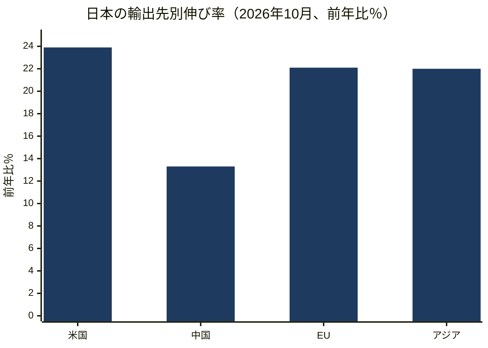

*注：2026年10月の仕向け地別輸出額（前年比）。米国：自動車37.2%増、半導体製造装置118.5%増。中国：自動車53.3%減、半導体製造装置42.6%増。データソース：財務省貿易統計速報（2026年10月）。*

### ユーロ圏 — 2026年9月経常収支（ECB、11月19日発表）

ECBの9月の国際収支発表によれば、ユーロ圏の経常収支黒字は120億ユーロで、前月とほぼ変わらなかった。国際収支ベースの財収支黒字は140億ユーロだった。これは、11月13日に報告されたユーロスタットの税関ベースの9月財赤字103億ユーロとは異なる指標であり、両者を直接比較すべきではない。サービス収支黒字は160億ユーロ、第二次所得収支赤字は160億ユーロ、第一次所得収支赤字は10億ユーロだった。経常収支の数値は、サービスと所得の流れを含めた場合のユーロ圏の対外ポジションをより明確に示す指標であり、税関ベースの財赤字にもかかわらず、圏全体では依然として黒字であることを示している。2つの財の指標の差は、貿易解説における恒常的な混乱の原因であり、12月の財発表の際にも留意すべきである。次の月次国際収支発表は12月18日で、10月分を対象とする。四半期発表は1月12日に続く。[QNC News](https://qncnews.com/2026/11/23/euro-area-current-account-surplus-holds-at-12-billion-euros-in-september/)

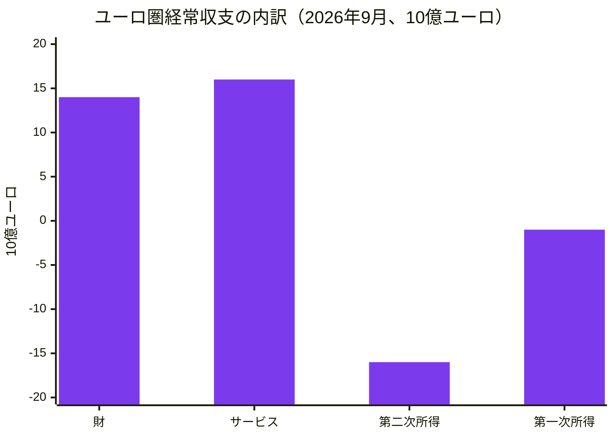

*注：国際収支ベース、2026年9月。経常収支黒字は120億ユーロ。データソース：欧州中央銀行。*

### ドイツ — 2026年第1～3四半期の国境を越える電力貿易（Destatis、プレスリリース第406号、11月20日）

Destatisによれば、2026年1～9月のドイツの国境を越える電力貿易は、輸出が急増し、輸入量が減少したことで、物理的にはほぼ均衡に近づいた。ドイツは2026年1～9月に488億キロワット時の電力を輸出し、43億ユーロ相当だった（数量は前年比25.5%増、金額は51.3%増）。電力輸入は数量が13.3%減の492億キロワット時となったが、金額は20.4%増の57億ユーロだった。物理的な輸入超過は97.5%縮小し、4億キロワット時となった。平均輸入価格は116ユーロ/MWh（前年比38.9%増）で、2025年1～9月の84ユーロ/MWhと比較される。2026年9月単月では、ドイツは54億キロワット時を輸出し（前年比22.7%増、金額は122.7%増の6億ユーロ）、46億キロワット時を輸入した（数量26.1%減、金額64.5%増の8億ユーロ）。ニッチな項目ではあるが、ドイツのエネルギー貿易収支を現在動かしているのは数量ではなくエネルギー価格の非対称性であることを示しており、対象期間に確認された唯一のDestatis貿易発表である。同数字は外国貿易規則（商品コード27160000）の下で集計されており、送電網ベースのエネルギー統計とは方法論が異なる。11月20日が予定されていた9月の主要財貿易詳細発表は、検索では別途確認されなかった。[NewsVerum](https://newsverum.com/en/news/germany-electricity-exports-reach-4-3-billion-euros-first-three-quarters-2026)

### 米国 — 2026年9月の貿易（FT-900）と10月の先行指標

2026年11月16～23日の対象期間に米国の貿易発表はなかった。最新のFT-900（11月4日）によれば、9月の赤字は1,050億ドルで、8月の改定値1,057億ドルよりわずかに縮小した。年初来の赤字は2025年1～9月より924億ドル（12.2%）小さく、輸出は11.6%増、輸入は6.2%増だった。9月の財赤字の速報値は1,349億ドル（10月28日発表）で、8月の1,321億ドルから28億ドル増加した。10月のFT-900は2026年12月8日に予定され、10月の財貿易先行指標は2026年11月27日に発表される。米国は今週のデータ対象範囲における最大の空白である。10月の貿易は12月まで判明しないため、関税の積み重ねが10月の輸入額にどう影響したかの評価は待たなければならない。[Value.today](https://www.value.today/economy/usa/releases/trade)

### データポータル — 対象期間に主要な発表は確認されず

2026年11月16～23日の対象期間に、USITC DataWeb、UN Comtrade、世界銀行WITS、世界銀行データポータル、IMF（WEO/IFS）からの主要な新たな貿易データ発表は確認されなかった。IMFの世界経済見通しは2026年10月に最後に更新され、11月の更新は見つからなかった。ユーロスタットの次回の財貿易発表（10月分）は2026年12月18日に予定されている。中国の11月貿易統計は12月に発表される。[Eurostat](https://ec.europa.eu/eurostat/web/international-trade-in-goods/publications)

### シンクタンク

**タックス・ファウンデーション関税トラッカー：適用税率11.8%、実効税率7.2%。10年間で1.4兆ドル。**タックス・ファウンデーションのトラッカーは、2025年1月以降の米国関税政策の変更を50件超数えている。主要な推計は次のとおりである。新たな関税は2026年の米国財輸入の54%に適用される。適用関税率は11.8%に上昇する（2022年は1.5%）。実効税率（輸入額に占める徴収関税の割合）は2026暦年で7.2%。課された関税と予定される関税は、2026年から2035年まで従来ベースで1.4兆ドル（動的ベースで1兆ドル）の収入をもたらす。長期的にはGDPが0.4%減、資本ストックが0.3%減、労働時間がフルタイム換算で338,000人分減少する。関税により、2025年には米国の1世帯当たり平均1,000ドル、2026年には推定820ドルの税負担が増加した。これは、最高裁判所により無効化されたIEEPA関税が新たな関税で完全には置き換えられていないためである。232条ポリシリコン関税（15%、英国は10%）は2026年12月4日に発効する。世帯負担が2025年の1,000ドルから2026年の820ドルに減少したのは、まさに無効化されたIEEPA関税が完全には置き換えられていないためであり、収入の数字を単純な増加と読むことへの有益な修正となる。[Tax Foundation](https://taxfoundation.org/research/federal-tax/trump-tariffs-trade-war/page/20/)

**イェール・バジェット・ラボ：11月の平均関税率は11.2%。1世帯当たり年間約900ドル。**イェールの11月2日時点の集計によれば、平均法定関税率は11.8%で、現行法の下では年末までに11.9%に上昇する。日次集計は9月29日以降11.76%で推移している。11月の平均実効税率は約11.2%で、2025年1月の約2.5%と比較される。マーサ・ギンベル事務局長は11月5日にMarketplaceに対し、世帯は現行税率で年間約1,100ドルに直面すると述べた（8月24日の報告書の数字で、固定輸入加重で測定）。消費者物価への影響は約0.7%である。バジェット・ラボの2026暦年の推計は、1世帯当たり年間約900ドルである。関税は10年間で約2兆ドルの収入をもたらす。イェールのトービン・センターの研究によれば、調査対象となった関税の約80%～100%が米国輸入業者の支払価格の上昇に反映され、中心推計は約90%だった。イェールとタックス・ファウンデーションは法定税率（約11.8%）では一致するが、世帯負担では異なる。タックス・ファウンデーションの820ドル（2026年、実際に輸入されたものに基づく）に対し、イェールは方法と加重により約900～1,100ドルである。これは、事実が異なるのではなく、方法が異なるためである。パススルー率の認定（関税の約90%が輸入業者価格に反映）は、分析上重要な数字である。世帯負担の推計を裏付け、外国輸出業者が関税を吸収するとの主張に反する。12月の11.9%への引き上げは既に現行法に組み込まれている。[Geopolitiqs](https://geopolitiqs.com/tn/2026-11-09/tariffs-average-rate)

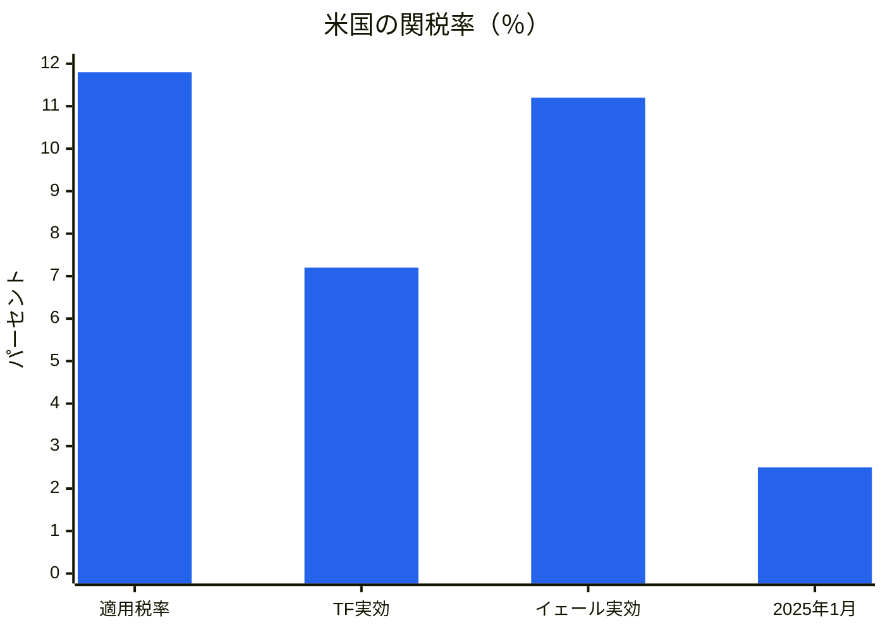

*注：適用法定税率11.8%（両機関が一致）。タックス・ファウンデーションの実効税率は2026暦年で7.2%（輸入額に占める徴収関税の割合）。イェール・バジェット・ラボの平均実効税率は2026年11月に約11.2%。2025年1月は約2.5%。データソース：タックス・ファウンデーション、イェール・バジェット・ラボ。*

---

## 9. 貨物市場

### コンテナスポット運賃 — ドリューワー世界コンテナ指数

ドリューワー世界コンテナ指数は11月19日に3%下落して40フィート当たり4,176ドルとなり、4週連続の下落となったが、前年比では依然126%高い。太平洋航路の運賃は7週連続で下落した。上海・ニューヨークは9%下落して8,194ドルと15週間ぶりの安値、上海・ロサンゼルスは5%下落して7,026ドルと12週間ぶりの安値となった。上海・ジェノバは3週間の横ばいの後、6%上昇して4,436ドル、上海・ロッテルダムは3,496ドルで変わらずだった。ドリューワーは来週も太平洋航路の運賃がさらに下落すると見込む。翌週の欠航は10便が発表され、今週は4便だった。複合指数は4週間で約9%下落した（10月22日の4,585ドルから）。コンテナ市場はさらに二極化した。太平洋航路の運賃が7週連続で急落する一方、地中海航路は6%反発し、大西洋横断航路は両方向で2%上昇した（ロッテルダム・ニューヨークは3,146ドル、ニューヨーク・ロッテルダムは1,217ドル）。[Drewry](https://www.drewry.co.uk/supply-chain-advisors/world-container-index-weekly-update?topics=Container%20Shipping)

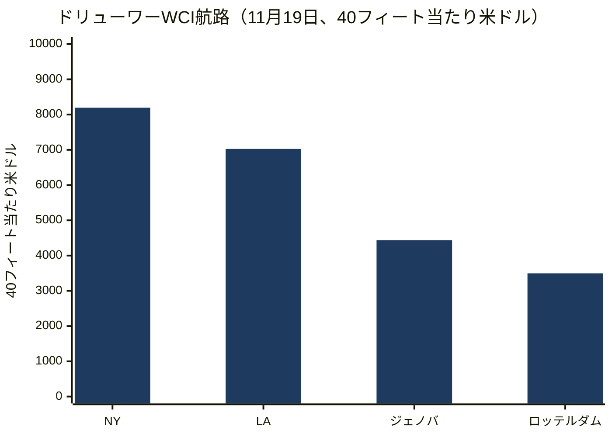

*注：上海発の40フィート当たりスポット運賃、2026年11月19日。データソース：ドリューワー世界コンテナ指数。*

### フレイトス・バルチック指数

フレイトスは11月17日の更新で、アジア・米国西海岸をFEU当たり8,459ドル（3%上昇）、アジア・米国東海岸を9,848ドル（1%上昇）、アジア・北欧を3,407ドルで横ばい、アジア・地中海を4,295ドル（1%下落）と報告した。アジア・欧州運賃は前年比40～50%高い。アジア・北欧は10月末比で5%下落している。11月17日の更新における世界のFBX複合指数はn/aである。週次更新では世界全体の数字は示されていない（11月22日に記録された世界のFBXのトラッカー値はFEU当たり3,419ドルで、前の週次の世界全体の値は11月10日の3,452ドルだった）。フレイトスの航路の数値は、ドリューワーの同じ航路の数値が下落する中でも太平洋航路でわずかに上昇した。両ベンチマークは異なる運賃バスケットと週を測定しており、その差（フレイトスのアジア・米国西海岸8,459ドルに対し、ドリューワーの上海・ロサンゼルス7,026ドル）は、両者を混同すべきでないことを示す。フレイトスは、11月の一般運賃引き上げ（GRI）は定着せず、月中の引き上げ計画も失敗する可能性があると指摘し、運送業者は欠航を増やしていると述べた。12月の引き上げは発表済みであり、旧正月前の需要に支えられれば定着する可能性がある。フレイトスが、紅海復帰と船隊の増加により来年の過剰輸送能力リスクが高まると警告していることは、2027年の見通しの枠組みとなる。[Freightos](https://www.freightos.com/freight-resources/us-air-cargo-recovering-from-outage-new-us-cn-tensions-ahead-of-talks-november-17-2026-update/)

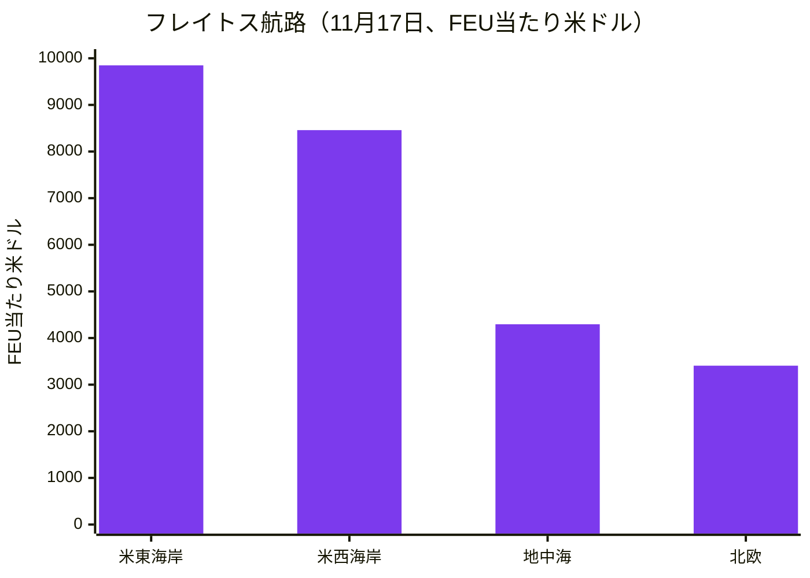

*注：アジア発のFEU当たりスポット運賃、2026年11月17日。データソース：フレイトス・バルチック指数。*

### 上海コンテナ貨物指数

SCFI複合指数は11月20日に3,503.78まで下落し、11月13日の3,572.33から68.55ポイント（1.92%）下落した。3週連続の下落で、下落幅は週を追うごとに拡大している（1.46%減、1.68%減、1.92%減）。9月中旬以来の最低水準であり、10月30日の3,687.35から3週間で129.67ポイント下落した。上海・米国西海岸はFEU当たり6,711ドル（400ドル減、5.63%減）、上海・米国東海岸はFEU当たり8,776ドル（611ドル減、6.51%減）、上海・地中海はTEU当たり3,678ドル（1.63%増）、上海・欧州はTEU当たり2,291ドル、サントスはTEU当たり3,110ドル（15.19%減）となった。中国コンテナ貨物指数（CCFI、契約運賃）は0.21%上昇して1,923.21となり、2週連続の上昇となった。スポットのSCFIとは乖離している。3つの指数（ドリューワー、フレイトスの航路、SCFI）は現在、ピークシーズン後の低迷期に入り、太平洋スポット市場が大きく調整していることに同意している。SCFIの米国東海岸航路は1週間で600ドル超下落した。CCFIの上昇は、契約運賃の荷主がまだ恩恵を受けていないことを示唆する。これは2027年の入札時期にとって重要な差である。[Forwarder News](https://www.forwardernews.com/news/2026-11-20-scfi-falls-a-third-week)

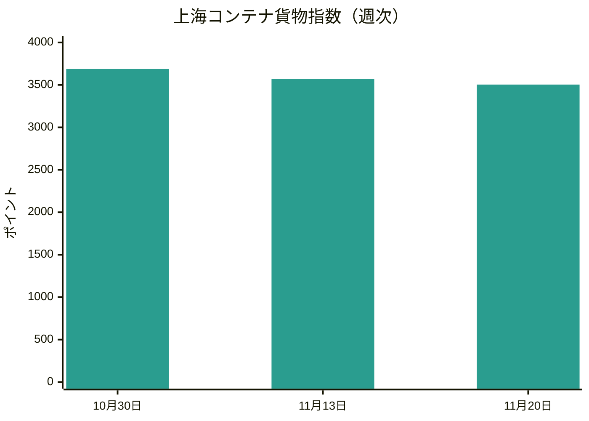

*注：SCFI複合指数（週次）。データソース：上海航運交易所。*

### 11月の運賃引き上げ — 発表済みだが、既に値引きされている

運送業者は12月からアジア・欧州／地中海航路で40フィート当たり1,000～1,600ドルのピークシーズン追加料金を発表した。フレイトスによれば、11月の一般運賃引き上げは定着せず、月中の引き上げ計画も失敗する可能性がある。12月の引き上げは発表済みであり、旧正月前の需要に支えられれば定着する可能性がある。秋のパターン、すなわち発表された引き上げが弱い需要の中で定着しないという流れは、今や市場の定番のリズムとなっている。[Freightos](https://www.freightos.com/freight-resources/us-air-cargo-recovering-from-outage-new-us-cn-tensions-ahead-of-talks-november-17-2026-update/)

### 欠航と輸送能力

翌週の欠航は10便が発表され、今週は4便だった。ドリューワーの欠航トラッカーは、11月16日から12月21日までの主要な東西航路の716便のうち52便（約7%）が欠航になると予測した。運送業者は、太平洋航路の調整が深まる中で欠航への依存を強めており、ジェミニのスエズ復帰により2027年にさらに輸送能力が解放される。[Drewry](https://www.drewry.co.uk/supply-chain-advisors/world-container-index-weekly-update?topics=Container%20Shipping)

### ドライバルク — バルチック海運取引所

バルチック海運指数は11月20日に2,898で引け、11月13日の2,980から82ポイント（2.8%）下落し、4週連続の上昇に終止符を打った。日次推移は、2,921（11月16日月曜）、2,893（火曜）、2,914（水曜）、2,901（木曜）、2,898（金曜）だった。ケープサイズ指数は4,502（前週比4.6%減、4,719から）。ケープサイズの1日当たり平均収益は40,827ドル（金曜。11月17日火曜は37,184ドル）。パナマックス指数は2,140（前週比1.0%増、2,118から）で、10月22日以来の高値。パナマックスの1日当たり収益は19,264ドル。スープラマックス指数は1,810（前週比1.4%減、1,836から）。1日当たり収益は22,884ドル。ハンディサイズ指数は1,072（前週比2.4%増）。C5（西オーストラリア・青島間の鉄鉱石）航路は週末に1トン当たり14.40ドルで終え、週半ばの13.40ドルの安値から回復した。ドライバルクは4週間の上昇の後、北大西洋の需要弱化と利用可能な船舶の増加により、ケープサイズが主な押し下げ要因となって（週で4.6%減）下落に転じた。一方、パナマックスは穀物と石炭の需要により1カ月ぶりの高値に上昇した。ケープサイズが下落し、パナマックスが上昇するという分離は、鉄鉱石需要が軟化する一方で穀物と石炭の取引が堅調であることを示し、年末に向けた商品需要の有益な先行指標となる。[HandyBulk](https://www.handybulk.com/baltic-dry-index/)

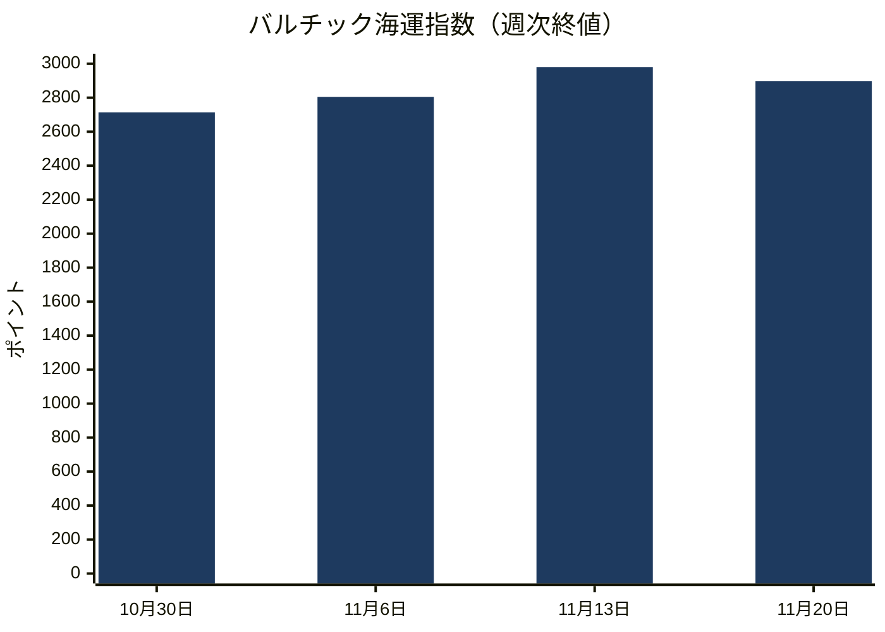

*注：バルチック海運指数の週次終値。データソース：バルチック海運取引所。*

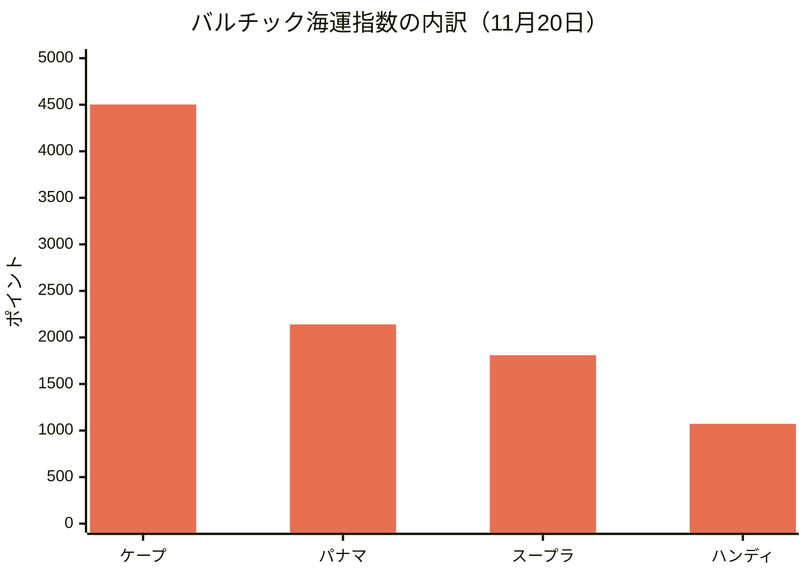

*注：バルチック海運取引所のセグメント指数、2026年11月20日。データソース：バルチック海運取引所。*

### スエズとスケジュールの信頼性

マースクとハパックロイドは11月16日、ジェミニ・コーポレーションのAE1、AE2、AE3サービスがスエズ経由の航路と紅海に復帰し、喜望峰周りの迂回航路に代わると発表した。移行は段階的である。AE2が最初で、Mary Maersk（650W航海）が12月4日に寧波でローテーションを開始する。AE3はAlette Maersk（652W航海）が12月20日に上海で開始し、AE1はDamietta Express（702W航海）が2027年1月14日に上海で開始する。改定されたローテーションには、両方向のスエズ運河通過が含まれる。この動きは、AE5、AE11、AE12、ME2、ME1サービスの以前の復旧に続くものである。Linerlyticaによれば、これら3サービスの復帰により、マースクとハパックロイドは、アジア・欧州の全サービスでスエズ航路を復旧した初のアライアンスとなった。この切り替えにより、AE2の船舶数は14隻から13隻に、AE3は13隻から11隻に減少し、輸送能力が解放される。マースクは、輸送時間の改善につながると述べた一方、実施は紅海の安定継続と地域の安全保障状況の継続的な監視に依存すると注意した。エバーグリーンは、スエズ通過を再開したオーシャン・アライアンスの最後のメンバーだった。ZIMは、アジア・欧州サービスを依然として喜望峰周りで運航している主要運送業者の中で最も目立つ存在である。ドリューワーは11月1日までの週に53隻のコンテナ船が運河を通過したと数え、前年比130%増であり、アジア・欧州輸送能力の約60%がスエズ航路に復帰したと推定する。DHLは、より広範なネットワーク調整にはさらに6～12カ月かかる可能性があると見積もる。フレックスポートは、11月16～22日の週に北欧の港に到着する輸送能力が通常の131%になると予測した。これは、到着が集中するためである。[FreightWaves](https://www.freightwaves.com/news/maersk-and-hapag-lloyd-restore-asia-europe-suez-routes-as-u-s-shippers-watch-capacity-and-costs)

### 航空貨物

バルチック航空貨物指数（BAI00）は、11月9日までの週に6.6%上昇し（前年比28.2%増）、2026年の最高水準に達した後、11月16日までの7日間で1.5%下落した（前年比20.8%増）。香港発（BAI30）は11月16日までの週に前週比4.5%下落（前年比19.0%増）。上海発（BAI80）は2.7%下落（前年比13.1%増）。フランクフルト発（BAI20）は2.7%下落（前年比36.4%増）。ロンドン・ヒースロー発（BAI40）は9.4%下落（前年比2.6%増）。シカゴ発（BAI50）は、米国の航空管制障害の後、前週比39.2%急騰した（前年比72.1%増）。11月9日までの週では、フランクフルト発が前週比9.9%増、ロンドン発が5.6%増、香港発が4.6%増、上海発が5.7%増となった。フレイトス航空指数（11月17日更新）：中国・北米は1キログラム当たり9.25ドル（前週比16%増）で、昨年の8.00ドルというピークシーズンの最高値を上回った。昨年は12月中旬にのみ達した水準である。中国・北欧は1キログラム当たり5.05ドル（4%増）。北欧・北米は1キログラム当たり3.27ドル（12%増）で、2022年12月以来の高値となった。Xenetaの10月の世界スポット平均は1キログラム当たり3.11ドル（前年比29%増）。TACの世界スポットは第44週に約1キログラム当たり3.93ドル（前週比4%増、前年比約40%増）だった。ジェット燃料：IATAモニターは11月6日までの週に6.5%下落し、11月13日までの1カ月で11.7%下落した。[Baltic Exchange](https://www.balticexchange.com/en/news-and-events/news/guest-column/2026/Air-freight-rates-surge-past-previous-peak-season-highs-as-jet-fuel-prices-soar.html)

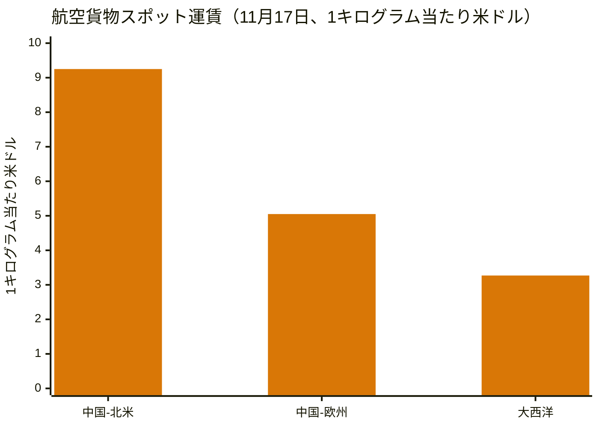

*注：フレイトス航空指数、2026年11月17日。中国・北米は2025年のピークシーズンの最高値8.00ドルを上回る。大西洋横断は2022年12月以来の高値。データソース：フレイトス。*

**混乱：**米国の航空管制システムの障害により、11月14～15日の週末に数千便が地上待機となった。11月13日のFAAによる全米地上停止措置（アーカンソー州エルドラドの単一の故障したルーターが、22の航空管制センターのうち17に影響）は、週末に2万便超を混乱させ、翌週まで航空貨物の滞留を残した。FAAは11月17日に新しいルーターの設置を一時停止し、政権は航空管制近代化のコスト見積もりを500億ドル超に引き上げた。マイクロソフトの障害も混乱を加えた。TACは、データが通常より断片的だったと述べた。フレイトスによれば、障害の結果、米国向けの国際航空運賃は大幅に急騰しなかった。航空貨物は、チップとAIハードウェアの需要とピークシーズンの数量により、11月9日までの週に2026年の最高値に達し、中国・北米運賃は昨年のピークを1カ月早く上回った。11月16日の下落は、転換点ではなく一服の可能性が高い。TACは、ピークシーズンがまだ数週間残っていると指摘する。11月23日のベルギー航空管制ストライキ（A11参照）は、10日前のFAA地上停止措置に続くものであり、今ピークシーズンの航空貨物インフラの余裕がいかに薄いかを浮き彫りにする。[Air Cargo News](https://www.aircargonews.net/cargo-airport/2026/11/us-air-cargo-supply-chains-recover-following-ground-stop/)

### 港湾・物流の混乱

**ロサンゼルス／ロングビーチ。**A7参照。11月1日から米国最大のコンテナゲートウェイにのしかかっていたストライキの脅威は、11月21日の暫定合意により土壇場で回避された。批准待ちであり、組合は公にコメントしていない。複合施設の鉄道滞留（11月2日時点で、埠頭鉄道待ちの輸入コンテナ35,688個）は残っており、ロサンゼルス港のエグゼクティブ・ディレクターによれば、輸入コンテナの鉄道滞留日数は9日を超えた。ヴィンセント・トーマス橋の閉鎖（11月7日、16カ月間）は別途継続している。[Maritime Executive](https://maritime-executive.com/article/ports-of-la-and-long-beach-avert-strike-as-watchmen-reach-deal)

**ダーバン。**ターミナルの取扱量が改善したにもかかわらず、対象期間にダーバンの混雑は深刻化した。ダーバン・ゲートウェイ・ターミナルは最新の報告週に36,332 TEUを取り扱い（前週比28%増、4カ月で最も強い水際の実績）、平均船舶錨泊待ち時間は189時間から263時間（ほぼ11日）に延びた。沖合で待機する船舶は14隻から11隻に減少した。ヤード占有率は約69%。影響を受けるサプライチェーンは、20日超の追加のエンドツーエンドの遅延に直面する。バーバラ・クリシー運輸大臣は、ICTSIに対し、3カ月以内に実績を改善しなければ港湾ライセンスを失うリスクがあると通告した（Moneywebによる）。トランスネットの緊急措置（11月18日）：102番バースをギアード船に割り当て、ングクラ・コンテナターミナルへの迂回、追加の鉄道輸送、ピア1の最後の改修済み岸壁クレーンを11月20日に試運転し、11月21日に引き渡した。DGTは「継続的なサービス上の欠陥」を認め、長年の投資不足の後の設備の劣悪で危険な状態を原因とした。ピア2の設備更新のため、3年間で20億ランド超を投じると約束した。マースクの1,000ドル／2,000ドルのピークシーズン追加料金と400ドル／800ドルの混雑料金は引き続き有効である。ライセンスの脅威は新たなエスカレーションであり、民間ターミナル事業者に対する国家の最後通牒であり、3カ月の期限は2027年2月まで続く。[Shipping and Freight Resource](https://shippingandfreightresource.com/transnet-steps-in-to-alleviate-congestion-at-durban-gateway-terminal/)

**パナマ運河。**夏の降雨量が平年を下回ったため、パナマ運河の通過に喫水と1日当たりの通過隻数の制限が課され、コンテナ運送業者は追加料金を導入した。その後の予想を上回る降雨により、パナマ運河庁はこれらの措置を撤回することができた。現在の水位はこの時期としてはほぼ平年に戻っており、予想されるエルニーニョの深刻度は下方修正されたため、2026年第4四半期と2027年上半期に深刻な制限が課されるリスクは、夏に懸念されたよりも低いと評価される。パナマの制限撤廃により、米国東海岸・メキシコ湾岸航路の追加料金の要因が一つ取り除かれ、LA・ロングビーチの鉄道滞留を悪化させていたスケジュール混乱の原因も減少した。[Freightos](https://www.freightos.com/freight-resources/us-air-cargo-recovering-from-outage-new-us-cn-tensions-ahead-of-talks-november-17-2026-update/)

**アジア域内の混雑。**The Loadstarは11月20日、東南アジアの積み替えハブにおけるボトルネックの悪化により、長距離スポット運賃が下落する中でもアジア域内運賃が堅調に推移し、インド・湾岸の荷主は運賃上昇に加え、高額なコンテナ返却費用に直面していると報じた。閲覧した見出しには数字は掲載されていなかった。[The Loadstar](https://theloadstar.com/)

**米国の輸入見通し。**デカルトによれば、米国のコンテナ輸入は10月に4年ぶりの数量記録を更新し、中国からの出荷は4カ月連続で増加し、98万8,000 TEU近くに達し、2025年1月以来の高水準となった。ロサンゼルス港は10月に1,026,872 TEUを取り扱い、同月として過去最高、歴代2番目の高水準となった。9月の1,042,652 TEUに次ぐ。米国の鉄道貨車積載量は10月に平均233,193両で、年間3.4%増となり、10カ月連続の年間増加となった。10月までの米国のインターモーダル数量は12,271,905単位に達し、年初来4.7%増、10月は年間9.6%増で、過去最高の数量を記録した。キャス貨物指数によれば、10月の出荷は1.056で年間5.9%増、支出は4.010で同じく年間5.9%増だった。9月のFTRトラック輸送状況指数は8.13で、8月の11.5を下回った。グローバル・ポート・トラッカー（11月9日）は、長期化したピークシーズンが終わるにつれ、2026年残りの期間、米国向け港湾輸入は減少すると見込む。2026年9月の積載輸入は237万TEU（2026年で最も忙しい月。前月比3.4%増、前年比12.6%増）。予測では、10月は226万TEU（前年比9.1%増）、11月は205万TEU（1.2%増）、12月は203万TEU（1.3%増）。2026年通年は約2,600万TEU（2025年の2,540万TEU比2%増）で、10月の予測2,580万TEUから上方修正された。2027年初頭：1月は204万TEU（前年比3%減）、2月は189万TEU（0.5%減）、3月は192万TEU（11.2%減）。スポット運賃が軟化する中でも、10月まで米国への輸入量は記録的な水準が続いた。これは、1月の休戦期限と12月のポリシリコン措置を前にした前倒しを示唆する。[FreightWaves](https://www.freightwaves.com/news/retailers-forecast-u-s-imports-to-stay-elevated-through-2026-after-breakout-peak-season)

**小規模な項目。**バングラデシュの衣料品輸出業者は、数週間の混乱の後、納期を守るため高額な航空貨物に頼るようになっており、バイヤーは他の調達先を探している（The Loadstar、11月23日）。エクスペディターズは、数十年にわたる有機的成長の後、買収へのアプローチを再考しており、既に技術分野の機会を評価している。米国拠点のNeoviaとトルコのEkolの売却は、契約物流分野へのM&Aの復帰を示した（The Loadstar、11月19日）。ロシアの北極海航路の貨物量は初めて4,000万トンを超え、同航路の記録となった。ただし、プーチン大統領の同航路への野心は依然として手が届かない（gCaptain、11月23日）。フェデックスは、人工知能需要の拡大を支えるため、上海と広州の製造ハブと米国の目的地を結ぶ週次航路を開始した（Supply Chain Dive）。

### ベンダーインテリジェンス

対象期間に該当するベンダー関連の項目は記録されなかった。デカルトの対象期間の唯一のプレスリリースは業界賞だった（11月17日、ARC Advisory Groupの輸送管理システム世界市場調査報告書で北米の主要な輸送管理システム提供者に選出）。TradeIntの11月22日のブログは、自社データベースから得た2026年上半期以前のデータマーケティング・コンテンツであり、「データのロック解除」への呼びかけを伴うものだった。ロシアに関する記事で報告された901%の前年比成長は、データセットの対象範囲の変化によるものであり、貿易の動きではない。デカルトの11月の世界海運報告書（11月11日）は、2026年10月の米国コンテナ輸入が2,674,808 TEUと記録的だったと報告したが、先週の報告書で取り上げた。デカルトの第3四半期決算は2026年12月初旬まで発表されない。[Descartes](https://www.descartes.com/resources/knowledge-center/descartes-releases-november-global-shipping-report-us-container-imports); [TradeInt](https://tradeint.com/insights/blogs/)

---

## 10. 政策タイムライン

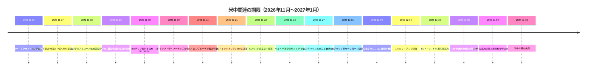

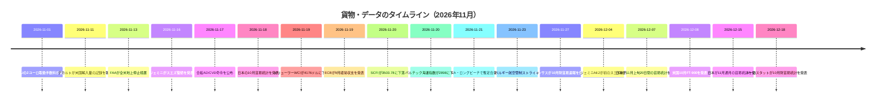

---

## 11. 今後の期限とイベント（今後90日間）

| 日付 | 項目 |
|---|---|
| 2026年11月23日 | WTO農業委員会が輸出制限と特別セーフガード措置について会合。USITCソーラーIV完全報告書（Publication 5804）の期限。 |
| 2026年11月24日 | ベルギー航空管制ストライキの波及的な混乱が火曜日に及ぶ見込み。 |
| 2026年11月27日 | 中国の2025年第72号公告による、米国向けガリウム、ゲルマニウム、アンチモン、超硬材料に対する拒否推定の停止措置が、さらなる停止または改正がない限り失効予定。センサスの10月財貿易先行指標が発表される。 |
| 2026年11月29日 | MOFCOMのデュアルユース輸出管理調査・執行措置草案に対する意見提出期限。 |
| 2026年11月30日 | 中国産ブリキ製品に対する商務省の最終ダンピング・補助金認定の期限（延期される場合を除く）。 |
| 2026年12月1日 | EUハイブリッド車セーフガード暫定措置の開始見込み。カナダが特定のトレーラーに対する水平関税救済を廃止。イタリアの1件当たり2ユーロの小包手数料が発効。下院民主党によるMegaspeedとエンティティ・リストに関するラトニック長官への書面回答の期限。 |
| 2026年12月4日 | 232条ポリシリコン関税が発効。ジェミニAE2が寧波から初のスエズ航路航行を開始。MEPC 85臨時IMO会合が暫定的に予定。 |
| 2026年12月7日 | CBPの低額貨物規則案（91 FR 64532、ドケットUSCBP-2026-0298）に対する意見提出期限。日本が11月上旬20日間の貿易統計を発表。 |
| 2026年12月8日 | 米国10月FT-900貿易発表。 |
| 2026年12月10日 | ラトニック長官が上院銀行委員会で証言（Megaspeed／エンティティ・リスト）。 |
| 2026年12月11日 | *Gellert v. Trump*（338条）における政府側答弁書の期限。EU・インドネシア：プラボウォ大統領がブリュッセルを訪問。 |
| 2026年12月14～15日 | G20首脳会議がマイアミで開催。 |
| 2026年12月15日 | 日本が11月通月の貿易統計を発表。 |
| 2026年12月16日 | EU・インド自由貿易協定がブリュッセルで署名されると報じられ、モディ首相の出席が見込まれる。 |
| 2026年12月17日 | 木製キャビネット・ミルワーク見直しにおける商務省の査定指示の発出予定の最速日（11月12日の公表から35日後）。 |
| 2026年12月18日 | ユーロスタット10月財貿易、ECB10月国際収支。 |
| 2026年12月20日 | ジェミニAE3が上海から初のスエズ航路航行を開始。 |
| 2027年1月1日 | 232条税率が張り地家具で30%、キッチンキャビネット・化粧台で50%に引き上げ。カナダ産車両、自動車部品、鉄鋼に対する50%の脅威もこの日を目標とする。英国CBAMが開始。英EUの厳格なEV原産地規則が発効。ルワンダと南アフリカに対するAGOA終了が発効予定（布告は依然必要）。 |
| 2027年1月3日 | 新米国議会が開会。 |
| 2027年1月5日 | CBP外国輸入者暫定最終規則が発効。同日に意見提出期限（ドケットUSCBP-2026-1387）。 |
| 2027年1月9～10日 | 米中休戦の期限が集中。178件の301条適用除外と海事料金停止が1月9日に失効。BIS関連会社規則の停止と中国の相互停止措置が1月10日に失効。 |
| 2027年1月11～12日 | 中国産CBSゴム加硫促進剤に対する商務省の最終AD/CVD決定の期限。 |
| 2027年1月11日 | *Gellert v. Trump*における反論答弁書の期限。 |
| 2027年1月12日 | USMCA共同見直し協議に対する書面意見と公聴会参加要請の期限（ドケットUSTR-2026-0595およびUSTR-2026-0596）。 |
| 2027年1月14日 | ジェミニAE1が上海から初のスエズ航路航行を開始。 |
| 2027年1月19日 | トルコ産ブリキ製品に対する商務省の最終ダンピング認定の期限。BISリモートアクセス・チップ規則に対する意見提出期限。 |
| 2027年1月20日 | 201条、232条、301条関税またはパートナー政府機関の要件の対象となる郵便物について、正式申告が義務化。*Gellert v. Trump*の口頭弁論。 |
| 2027年1月30日 | トルコ産ニジマスに対する英国相殺関税の変更がこの日から適用（公告2026/31）。 |
| 2027年2月1日 | カナダが特定のアルミニウム線・押出材・板紙製品に対する水平関税救済を廃止。 |
| 2027年2月6日 | 旧正月。 |
| 2027年2月11日 | 中国産プラスチック製バルーンに対する商務省のCVD予備決定（推定）。 |
| 2027年2月17日 | BISリモートアクセス・チップ規則：90日間のデータセンター・ライセンス移行期間が終了（約）。 |
| 2027年2月28日 | ベトナム知的財産301条調査におけるUSTR決定期限。 |
| 2027年3月 | USTRの301条構造的過剰生産能力調査の決定が見込まれる（2027年3月までに期限）。EU・インドFTAの発効は2027年3月または4月と報じられている。 |
| 2027年3月25日 | 台湾産ブリキ製品に対する商務省の最終ダンピング認定の期限。 |
| 2027年4月27日 | 中国産プラスチック製バルーンに対する商務省のAD予備決定（推定）。 |
| 2027年5月6日 | 外国輸入者規則へのブローカーの完全なコンプライアンスが見込まれる。 |
| 2028年6月30日 | カナダの水平関税救済がこの日まで延長。 |

---

## 12. データソースと方法論

対象期間：2026年11月16日～23日。世界の貿易ニュース、政策、データ、貨物に関する約45のデータソースから編纂。

参照したデータソースは以下のとおり：FreightWaves、The Loadstar、Splash247、gCaptain、Hellenic Shipping News、Container News、Supply Chain Dive、Logistics Management、Air Cargo News、Port Technology、TradeIntインサイトブログ。whitehouse.gov、cbp.gov、ustr.gov、federalregister.gov、trade.gov、usitc.gov、bis.doc.gov、JD Supra。ec.europa.eu、gov.uk、cbsa-asfc.gc.ca、canada.ca/en/department-finance、english.mofcom.gov.cn。wto.org、unctad.org、intracen.org、wcoomd.org。dataweb.usitc.gov、ustradecensus.gov、comtradeplus.un.org、wits.worldbank.org、eurostat、data.worldbank.org、imf.org。taxfoundation.org、budgetlab.yale.edu、tradeintelligence.eu。drewry.co.uk、balticexchange.com、freightos.com。descartes.com、tradeint.com。

11月16日より前の日付の項目は、フォローアップ、対象期間に該当する連邦官報の公表、または対象期間の期限に関する背景としてのみ掲載している。Container Newsはクッキー同意の通知のみを返し、利用可能な内容は得られなかった。WTOニュース索引は取得により読み取り可能なテキストを返さなかったため、WTO関連項目は再掲載されたWTO発表を利用している。MOFCOMの英語サイトはトップページの見出しのみ閲覧可能であり、その公告の内容は検討された情報からは確認できなかった。TradeIntは対象期間に該当するベンダー関連の項目がなかった。その11月22日のブログは自社データベースから得たデータマーケティング・コンテンツだった。USITC DataWeb、UN Comtrade、WITS、世界銀行、IMFのポータルから、対象期間の主要な新たな発表は確認されなかった。対象期間に新たな保留解除命令は確認されなかった。連邦官報は1週間分を文書ごとに網羅的に調査したわけではないため、他の行政見直し公告が存在する可能性がある。301条過剰生産能力調査の年末結論に関する報道は、11月21日のテレビインタビューに関する単一の貿易専門紙の報道に基づくものである。11月23日時点でUSTRの公告は出ていない。EUの11月17日のロシア関連リスト追加件数（49件）は、Youverifyモニターによる報告であり、EUのリスト自体と照合して検証したものではない。
