# รายงานข่าวกรองการค้าโลก — สัปดาห์ที่ 16–23 พฤศจิกายน 2026

**สรุปรายสัปดาห์** ช่วงความครอบคลุม: 16–23 พฤศจิกายน 2026 รวบรวมจากแหล่งข่าวการค้า นโยบาย ข้อมูล และค่าระวางประมาณ 45 แหล่งทั่วโลก

---

## สารบัญ

1. [บทสรุปผู้บริหาร](#1-executive-summary)
2. [สัญญาณเตือน](#2-alerts)
3. [เรื่องเด่น — วิเคราะห์เชิงลึก](#3-top-stories--deep-dives)
4. [ตารางติดตามภาษี](#4-tariff-tracker)
5. [วิเคราะห์เชิงลึกนโยบายสหรัฐ](#5-us-policy-deep-dive)
6. [นโยบายโลกตามภูมิภาค](#6-world-policy-by-region)
7. [มาตรการบังคับใช้](#7-enforcement-actions)
8. [ข้อมูลที่เผยแพร่](#8-data-releases)
9. [ตลาดค่าระวาง](#9-freight-market)
10. [ไทม์ไลน์นโยบาย](#10-policy-timelines)
11. [กำหนดเวลาและเหตุการณ์ที่จะมาถึง (90 วันข้างหน้า)](#11-upcoming-deadlines--events-next-90-days)
12. [แหล่งข้อมูลและระเบียบวิธี](#12-sources--methodology)

---

## 1. บทสรุปผู้บริหาร

สัปดาห์ที่การประชุมสุดยอดซึ่งคาดว่าจะยุติข้อตกลงพักรบสหรัฐ–จีนกลับไม่ยุติอะไรเลย ขณะที่มาตรการการค้าที่ชี้ขาดของสัปดาห์มาจากหน่วยงานกำกับดูแล ศาล และพิธีลงนามในที่อื่น การประชุมผู้นำเอเปกที่เซินเจิ้นเมื่อวันที่ 18–19 พฤศจิกายนออกแถลงการณ์ร่วมและจัดการประชุมไตรภาคีทรัมป์–สี–ปูตินเป็นครั้งแรก แต่ไม่มีการลดภาษีและไม่มีการยืนยันการขยายเวลาข้อตกลงพักรบ ซึ่งยังคงหมดอายุในวันที่ 9–10 มกราคม 2027 ส่วนเวทีถัดไปสำหรับการตัดสินใจคือการประชุมสุดยอด G20 ที่ไมอามีในวันที่ 14–15 ธันวาคม สำนักงานอุตสาหกรรมและความมั่นคง (BIS) กลับเป็นผู้ดำเนินการมาตรการที่ใหญ่ที่สุดของสัปดาห์แต่เพียงฝ่ายเดียว โดยเผยแพร่กฎชั่วคราวฉบับสุดท้ายเมื่อวันที่ 19 พฤศจิกายน ซึ่งปิดช่องทางการเข้าถึงชิปขั้นสูงจากระยะไกล ยกเลิกกฎการแพร่กระจาย AI และกำหนดให้ต้องขอใบอนุญาตสำหรับสินค้าคอมพิวเตอร์ขั้นสูงไปยังห้าประเทศในเอเชียตะวันออกเฉียงใต้และละตินอเมริกา ยุโรปเดินหน้าด้วยการลงนาม โดยสหภาพยุโรปและอินโดนีเซียลงนามข้อตกลงหุ้นส่วนเศรษฐกิจที่ครอบคลุมเมื่อวันที่ 21 พฤศจิกายน กำหนดวันลงนามข้อตกลงสหภาพยุโรป–อินเดียชัดเจนขึ้นเป็นวันที่ 16 ธันวาคม และสหราชอาณาจักรกับสหภาพยุโรปตกลงข้อตกลง SPS และการเชื่อมโยงระบบซื้อขายสิทธิการปล่อยมลพิษในการประชุมสุดยอดเมื่อวันที่ 20 พฤศจิกายน ในอ่าวเปอร์เซีย การโจมตีเรือขนส่งสินค้าในและรอบช่องแคบฮอร์มุซแตะระดับสูงสุดรายเดือนนับตั้งแต่สงครามสหรัฐ–อิหร่านเริ่มต้น และวอชิงตันขยายการปิดล้อมไปยังการถ่ายโอนสินค้าระหว่างเรือ

- **เอเปกออกแถลงการณ์ ไม่ใช่ข้อตกลงภาษี** การประชุมผู้นำเศรษฐกิจเอเปกครั้งที่ 33 ปิดฉากเมื่อวันที่ 19 พฤศจิกายนด้วยเอกสาร Shenzhen Outlook ซึ่งเป็นแถลงการณ์โดยสมัครใจและไม่มีผลผูกพัน และข้อตกลงระหว่างประธานาธิบดีทรัมป์กับสีที่จะร่างแผนปฏิบัติการเพื่อ "เสถียรภาพเชิงยุทธศาสตร์" ระหว่างสหรัฐกับจีน การประชุมไตรภาคีทรัมป์–สี–ปูตินครั้งแรกออกแถลงการณ์สันติภาพสี่ข้อโดยไม่มีปริมาณ กำหนดเวลา หรือเนื้อหาด้านการค้า รายงานบางฉบับระบุว่าผู้นำตกลงขยายเวลาข้อตกลงพักรบทางการค้า แต่ไม่มีฝ่ายใดเผยแพร่ระยะเวลาหรือเงื่อนไข และบันทึกของจีนไม่ได้กล่าวถึงการขยายเวลา ข้อตกลงพักรบยังคงหมดอายุในวันที่ 9–10 มกราคม 2027 และแพ็กเกจลดภาษีต่างตอบแทนมูลค่า 3 หมื่นล้านดอลลาร์ต่อ 3 หมื่นล้านดอลลาร์ของคณะกรรมการการค้ายังไม่บรรลุข้อตกลง [China Briefing](https://www.china-briefing.com/news/apec-2026-in-shenzhen-what-the-leaders-meeting-and-trump-xi-talks-mean-for-business/)
- **BIS ปิดช่องโหว่การเข้าถึงชิปจากระยะไกล** กฎชั่วคราวฉบับสุดท้ายที่เผยแพร่เมื่อวันที่ 19 พฤศจิกายน (91 FR 74970) เพิ่มมาตรการควบคุมการใช้ปลายทางทั่วโลก โดยกำหนดให้ต้องขอใบอนุญาตเมื่อสินค้าคอมพิวเตอร์ขั้นสูงจะถูกใช้ในศูนย์ข้อมูลที่ให้สมรรถนะการประมวลผลรวมมากกว่า 12,000,000 หน่วยแก่บริษัทที่มีสำนักงานใหญ่ในกลุ่มประเทศ D:5 หรือมาเก๊า เพิ่มข้อกำหนดใบอนุญาตสำหรับสินค้าคอมพิวเตอร์ขั้นสูงไปยังอินโดนีเซีย มาเลเซีย สิงคโปร์ ไทย และบราซิล และยกเลิกกฎการแพร่กระจาย AI อย่างเป็นทางการ TSMC และ Samsung แจ้งลูกค้าชาวจีนว่าจะระงับการขายโปรเซสเซอร์บางรุ่นระหว่างขอใบอนุญาต บันทึกของคณะกรรมาธิการกิจการต่างประเทศของสภาผู้แทนราษฎรที่เผยแพร่ในวันเดียวกันแสดงว่ามีการอนุมัติโปรเซสเซอร์ AI ขั้นสูง 879,868 ชิ้นให้แก่หน่วยงานที่มีความเชื่อมโยงกับจีนจนถึงวันที่ 11 พฤษภาคม 2026 ซึ่งรวมถึงตัวเร่ง Nvidia H200 จำนวน 579,868 ชิ้น [Willkie Farr & Gallagher](https://www.willkie.com/publications/2026/11/bis-moves-to-close-the-remote-access-gap-for-advanced-chips)
- **ยุโรปลงนาม และกำหนดวันสำหรับข้อตกลงที่ใหญ่ที่สุด** สหภาพยุโรปและอินโดนีเซียลงนามข้อตกลงหุ้นส่วนเศรษฐกิจที่ครอบคลุมและข้อตกลงคุ้มครองการลงทุนเมื่อวันที่ 21 พฤศจิกายน หลังการเจรจาเกือบหนึ่งทศวรรษ อินโดนีเซียจะยกเลิกภาษีสำหรับสินค้าจากสหภาพยุโรป 98.5% ของรายการภาษี ช่วยผู้ส่งออกของสหภาพยุโรปประหยัดค่าภาษีได้มากกว่า 600 ล้านยูโรต่อปี คาดว่าข้อตกลงการค้าเสรีสหภาพยุโรป–อินเดียจะลงนามในวันที่ 16 ธันวาคมที่บรัสเซลส์ โดยสินค้าจากอินเดีย 93% จะได้รับการเข้าถึงแบบปลอดภาษี ในการประชุมสุดยอดสหราชอาณาจักร–สหภาพยุโรปเมื่อวันที่ 20 พฤศจิกายน ทั้งสองฝ่ายตกลงข้อตกลง SPS เพื่อยกเลิกการตรวจสอบชายแดนสินค้าเกษตรอาหารหลายรายการตั้งแต่วันที่ 1 มีนาคม 2028 และเชื่อมโยงระบบซื้อขายสิทธิการปล่อยมลพิษของทั้งสองฝ่าย พร้อมการยกเว้นกลไกปรับคาร์บอนที่ชายแดนซึ่งกันและกัน มูลค่าการส่งออกของสหราชอาณาจักรประมาณ 6.5 พันล้านปอนด์ [Turkish Post](https://turkishpost.com.tr/en/2026/11/21/eu-indonesia-trade-deal/); [Asia Daily](https://asiadaily.org/news/19949/)
- **ข้อตกลงอินเดีย–สหรัฐยังไม่ได้ลงนาม และการรอคอยกลายเป็นเรื่องเชิงโครงสร้าง** รัฐมนตรีว่าการกระทรวงพาณิชย์ Rajesh Agrawal กล่าวเมื่อวันที่ 18 พฤศจิกายนว่า อินเดียไม่สามารถลงนามได้จนกว่าวอชิงตันจะสร้างกรอบภาษีใหม่หลังศาลสูงสุดยกเลิกภาษีตอบโต้และภาษีฉุกเฉิน และจนกว่าจะทราบผลการสอบสวนตามมาตรา 301 ซึ่งรวมถึงการสอบสวนเรื่องกำลังการผลิตส่วนเกิน มีรายงานว่าเอกอัครราชทูต USTR Jamieson Greer กล่าวเมื่อวันที่ 21 พฤศจิกายนว่า การสอบสวนเรื่องกำลังการผลิตส่วนเกินจะสรุปก่อนสิ้นปี 2026 ก่อนเส้นตายตามกฎหมายวันที่ 11 มีนาคม 2027 รายงานดังกล่าวมาจากแหล่งเดียวและยังไม่ได้รับการยืนยัน [The Hindu BusinessLine](https://www.thehindubusinessline.com/economy/no-india-us-trade-deal-until-new-us-tariff-framework-section-301-probes/article71716562.ece/amp/)
- **การโจมตีในช่องแคบฮอร์มุซแตะระดับสูงสุดนับตั้งแต่สงครามเริ่มต้น** มีรายงานการโจมตีเรือขนส่งสินค้ามากกว่า 30 ครั้งในเดือนตุลาคม และอย่างน้อย 22 ครั้งในเดือนพฤศจิกายนถึงวันที่ 22 พฤศจิกายน ตามการวิเคราะห์ของ CNN จากข้อมูลของหน่วยปฏิบัติการการค้าทางทะเลของสหราชอาณาจักร เรือบรรทุกน้ำมันสามลำถูกโจมตีในวันที่ 20–21 พฤศจิกายน และเรือบรรทุกน้ำมันของ ADNOC ถูกโจมตีเมื่อวันที่ 17 พฤศจิกายน ทำให้ลูกเรือหนึ่งคนสูญหายและอีก 11 คนได้รับบาดเจ็บ องค์การทางทะเลระหว่างประเทศนับเหตุการณ์ที่ยืนยันแล้วได้ 138 ครั้ง และลูกเรือเสียชีวิต 25 คน ณ วันที่ 17 พฤศจิกายน การส่งออกน้ำมันของอ่าวเปอร์เซียอยู่ที่ 18.4 ล้านบาร์เรลต่อวันในเดือนตุลาคม ต่ำกว่าระดับก่อนสงคราม 26% และราคาน้ำมัน Brent อยู่ใกล้ 92 ดอลลาร์ต่อบาร์เรล [CNN](https://www.cnn.com/2026/11/22/middleeast/hormuz-attacks-highest-levels-iran-war-intl?cid=external-feeds_iluminar_meta)
- **ภาษีใหม่ตกแก่ไม้อัด และรายการที่รอดำเนินการขยายกว้างขึ้น** กระทรวงพาณิชย์เผยแพร่คำสั่งภาษีตอบโต้การทุ่มตลาดและภาษีตอบโต้การอุดหนุนสำหรับไม้อัดเนื้อแข็งและไม้อัดตกแต่งจากจีน อินโดนีเซีย และเวียดนามเมื่อวันที่ 17 พฤศจิกายน โดยมีอัตรารวมประมาณ 276% สำหรับจีน USITC เผยแพร่รายงาน Solar IV ฉบับเต็ม (Publication 5804) โดยแยกการพิจารณาสถานการณ์วิกฤต — ภาษีย้อนหลังสำหรับอินโดนีเซียเท่านั้น คำร้องใหม่พุ่งเป้าไปที่ลูกโป่งพลาสติกจากจีน โดยมีอัตรากำไรที่กล่าวหาว่า 50% ถึง 276% [Transport News](https://www.transportnews.net/a/commerce-hardwood-plywood-duty-orders-china-indonesia-vietnam)
- **ญี่ปุ่นทำสถิติการค้า ส่วนตลาดค่าระวางแยกทางกันอีกครั้ง** การส่งออกของญี่ปุ่นในเดือนตุลาคมเพิ่มขึ้น 20.5% เมื่อเทียบกับปีก่อน แตะสถิติ 11.77 ล้านล้านเยน และการนำเข้าเพิ่มขึ้น 21.6% แตะสถิติ 12.25 ล้านล้านเยน โดยขาดดุลลดลงเหลือ 476.5 พันล้านเยน ประมาณครึ่งหนึ่งของที่คาดการณ์ไว้ ดัชนี Drewry World Container Index ลดลง 3% เหลือ 4,176 ดอลลาร์ต่อตู้ 40 ฟุต เป็นการลดลงติดต่อกันสัปดาห์ที่สี่ ขณะที่ค่าระวางอากาศยังคงอยู่ที่ระดับสูงสุดของปี 2026 โดยเส้นทางจีน–อเมริกาเหนืออยู่ที่ 9.25 ดอลลาร์ต่อกิโลกรัม Maersk และ Hapag-Lloyd ประกาศว่าจะนำบริการ Gemini เอเชีย–ยุโรปสามเส้นทางสุดท้ายกลับมาใช้เส้นทางสุเอซภายในกลางเดือนมกราคม [Drewry](https://www.drewry.co.uk/supply-chain-advisors/world-container-index-weekly-update?topics=Container%20Shipping)

**ค่าระวาง:** อัตราค่าระวางตู้คอนเทนเนอร์ลดลงเป็นสัปดาห์ที่สี่ติดต่อกันในเส้นทางข้ามแปซิฟิก ขณะที่อัตราค่าระวางเมดิเตอร์เรเนียนฟื้นตัว สินค้าเทกองแห้งอ่อนตัวลงจากจุดสูงสุด ค่าระวางอากาศยังคงอยู่ที่ระดับสูงสุดของปี 2026 เข้าสู่ช่วงพีค การกลับมาใช้เส้นทางสุเอซใกล้เสร็จสมบูรณ์เมื่อ Gemini ประกาศนำบริการสามเส้นทางสุดท้ายกลับผ่านทะเลแดง ภัยคุกคามการประท้วงที่ LA/Long Beach สิ้นสุดลงด้วยข้อตกลงเบื้องต้นเมื่อวันที่ 21 พฤศจิกายน และคิวเรือที่เดอร์บันยาวขึ้นเป็น 263 ชั่วโมงที่ทอดสมอ แม้ปริมาณงานจะสูงขึ้น

---

## 2. สัญญาณเตือน

| # | สัญญาณเตือน | มีผล | ผลกระทบ | แหล่งข้อมูล |
|---|-------|-----------|--------|--------|
| A1 | ผู้นำเอเปกประชุมที่เซินเจิ้น การประชุมทวิภาคีทรัมป์–สี และการประชุมไตรภาคีทรัมป์–สี–ปูตินครั้งแรกออกแถลงการณ์และแผนปฏิบัติการ "เสถียรภาพเชิงยุทธศาสตร์" แต่ไม่มีการลดภาษีและไม่มีการยืนยันการขยายเวลาข้อตกลงพักรบ | 18–19 พ.ย. 2026 | ข้อตกลงพักรบยังคงหมดอายุ 9–10 ม.ค. 2027 จุดตัดสินใจถัดไปคือ G20 ที่ไมอามี 14–15 ธ.ค. | [China Briefing](https://www.china-briefing.com/news/apec-2026-in-shenzhen-what-the-leaders-meeting-and-trump-xi-talks-mean-for-business/) |
| A2 | กฎชั่วคราวฉบับสุดท้ายของ BIS เรื่อง "การจัดการการเข้าถึงเซมิคอนดักเตอร์ขั้นสูงจากระยะไกล" กำหนดมาตรการควบคุมการใช้ปลายทางของศูนย์ข้อมูลทั่วโลก (เกณฑ์ 12,000,000 TPP) ข้อกำหนดใบอนุญาตสำหรับชิปขั้นสูงไปยังห้าประเทศ และยกเลิกกฎการแพร่กระจาย AI | 19 พ.ย. 2026 (ตีพิมพ์; 91 FR 74970) | โรงงานผลิตชิปหยุดส่งสินค้าไปจีนระหว่างรอใบอนุญาต ศูนย์ข้อมูลที่ให้บริการบริษัทกลุ่ม D:5 มีเวลา 90 วันในการขอใบอนุญาต | [Willkie Farr & Gallagher](https://www.willkie.com/publications/2026/11/bis-moves-to-close-the-remote-access-gap-for-advanced-chips) |
| A3 | การระงับคำสั่งห้ามส่งออกแกลเลียม เจอร์เมเนียม พลวง และวัสดุแข็งยิ่งยวดของจีนไปยังสหรัฐสิ้นสุดลง โดยไม่มีการขยายเวลาที่เผยแพร่ ณ วันที่ 20–21 พ.ย. | 27 พ.ย. 2026 | กฎพื้นฐานกำหนดให้ปฏิเสธใบอนุญาตโดยหลักการ ผู้ซื้อสินค้าที่ครอบคลุมในสหรัฐต้องตัดสินใจภายในสัปดาห์นี้ | [InvestorNews](https://investornews.com/market-opinion/critical-minerals-report-trump-xi-and-the-critical-minerals-behind-the-ai-race/) |
| A4 | มาตรการคุ้มครองรถไฮบริดของสหภาพยุโรป: ปิดรับความเห็นเป็นลายลักษณ์อักษรวันที่ 20 พ.ย. คาดว่ามาตรการชั่วคราวจะเริ่มตั้งแต่วันที่ 1 ธ.ค. โดยมีรายงานเพดาน 350,000 คันต่อปีสำหรับรถไฮบริดที่ผลิตในจีน | 1 ธ.ค. 2026 (คาดว่า) | การนำเข้ารถไฮบริดจากจีนแล้ว 474,475 คันในเดือน ม.ค.–ส.ค. 2026 สูงกว่าเพดานประจำปีที่เสนอ ยังไม่มีกฎหมายที่ตีพิมพ์ | [Ports Europe](https://www.portseurope.com/eu-opens-hybrid-safeguard-probe-as-chinese-shipments-outrun-planned-quota/) |
| A5 | ราคานำเข้าขั้นต่ำตามมาตรา 232 สำหรับโพลีซิลิคอน (21 ดอลลาร์/กก. สำหรับโพลีซิลิคอน; 100 ดอลลาร์/กก. สำหรับแท่งและแผ่นเวเฟอร์; 0.22 ดอลลาร์/วัตต์ สำหรับเซลล์; 0.38 ดอลลาร์/วัตต์ สำหรับโมดูล) บวกภาษี 15% สำหรับผลิตภัณฑ์อนุพันธ์มีผลบังคับใช้ กฎต่อต้านการกักตุนมีผลถึงวันที่ 3 ธ.ค. | 4 ธ.ค. 2026 | ราคาขั้นต่ำครอบคลุมห่วงโซ่อุปทานพลังงานแสงอาทิตย์ทั้งหมดของสหรัฐ สภาพแวดล้อมทดสอบของ CBP เปิดใช้งานตั้งแต่วันที่ 12 พ.ย. | [Stoel Rives](https://www.stoel.com/printpilot-publication-commerces-anti-stockpiling-rule-imposes-limits-on-pre-december-4-polysilicon-imports.pdf?1791987859) |
| A6 | การโจมตีเรือขนส่งสินค้าในและรอบช่องแคบฮอร์มุซอยู่ในระดับสูงสุดรายเดือนนับตั้งแต่สงครามเริ่มต้น เรือบรรทุกน้ำมันสามลำถูกโจมตีในวันที่ 20–21 พ.ย. สหรัฐขยายการปิดล้อมไปยังการถ่ายโอนสินค้าระหว่างเรือ และโจมตีฐานของ IRGC บนเกาะเกชม์ | 16–22 พ.ย. 2026 | เหตุการณ์ที่ยืนยันแล้ว 138 ครั้ง และลูกเรือเสียชีวิต 25 คน (IMO) การส่งออกน้ำมันของอ่าวเปอร์เซียต่ำกว่าระดับก่อนสงคราม 26% ราคา Brent ประมาณ 92 ดอลลาร์ | [CNN](https://www.cnn.com/2026/11/22/middleeast/hormuz-attacks-highest-levels-iran-war-intl?cid=external-feeds_iluminar_meta) |
| A7 | สมาคมการเดินเรือแปซิฟิกและ ILWU Local 26 บรรลุข้อตกลงเบื้องต้นไม่กี่ชั่วโมงหลังเส้นตาย 00:01 น. หลีกเลี่ยงการหยุดงานที่ลอสแอนเจลิสและลองบีช การให้สัตยาบันยังค้างอยู่ เงื่อนไขไม่เปิดเผย | 21 พ.ย. 2026 | ภัยคุกคามการประท้วงที่ประตูขนส่งตู้คอนเทนเนอร์ที่คึกคักที่สุดของสหรัฐถูกยกเลิกชั่วคราว ความเสี่ยงจะกลับมาหากสมาชิกปฏิเสธข้อตกลง | [FreightWaves](https://www.freightwaves.com/news/tentative-union-deal-averts-strike-at-port-of-la-long-beach) |
| A8 | กระทรวงพาณิชย์เผยแพร่คำสั่ง AD/CVD ฉบับสุดท้ายสำหรับไม้อัดเนื้อแข็งและไม้อัดตกแต่งจากจีน อินโดนีเซีย และเวียดนาม อัตรารวมประมาณ 276% สำหรับจีน | 17 พ.ย. 2026 | เริ่มเรียกเก็บเงินประกันอีกครั้ง ไม้อัดเนื้อแข็งของจีนถูกผลักออกจากตลาดสหรัฐอย่างมีประสิทธิภาพ | [Transport News](https://www.transportnews.net/a/commerce-hardwood-plywood-duty-orders-china-indonesia-vietnam) |
| A9 | กฎชั่วคราวฉบับสุดท้ายของ CBP สำหรับผู้นำเข้าต่างชาติมีผลวันที่ 5 ม.ค. 2027 เส้นตายการยกเลิกแบบฟอร์ม 5106 วันที่ 18 พ.ย. ผ่านไปโดยไม่มีรายงานการยกเลิก ณ วันที่ 20 พ.ย. | 5 ม.ค. 2027 | ผู้นำเข้าต่างชาติต้องได้รับการรับรอง CTPAT หรือใช้ตัวแทนศุลกากรที่ได้รับการรับรอง CTPAT มิฉะนั้นรายการสินค้าอาจถูกปฏิเสธตั้งแต่วันที่ 5 ม.ค. | [Freight Right](https://www.freightright.com/news/cbp-tightens-importer-requirements-what-businesses-must-do-before-january-2027) |
| A10 | COP31 ที่อันตัลยาสิ้นสุดวันที่ 22 พ.ย. โดยไม่มีข้อตกลงทางการเมือง ผู้แทน IMO เริ่มการหารือทางเทคนิคก่อน MEPC 85 โดยมีการประชุมวิสามัญเบื้องต้นกำหนดไว้วันที่ 4 ธ.ค. | 22–23 พ.ย. 2026 | การรับรองกรอบ Net-Zero ของการขนส่งทางเรือไม่แน่นอน สหรัฐคัดค้านค่าธรรมเนียมการปล่อยมลพิษแบบบังคับ | [Splash247](https://splash247.com/cop31-collapse-casts-shadow-over-shippings-net-zero-showdown/) |
| A11 | การประท้วงของเจ้าหน้าที่ควบคุมจราจรทางอากาศเบลเยียมปิดน่านฟ้าเบลเยียม 07:00–21:00 น. วันที่ 23 พ.ย. ศูนย์กลางสินค้า Liège ปิด 14 ชั่วโมง เที่ยวบินที่บรัสเซลส์ถูกยกเลิกประมาณ 429 เที่ยว | 23 พ.ย. 2026 | ค่าระวางอากาศยุโรปหยุดชะงักในช่วงพีค คาดว่าผลกระทบจะลามถึงวันที่ 24 พ.ย. | [The Loadstar](https://theloadstar.com/) |
| A12 | มีรายงานว่าการสอบสวนตามมาตรา 301 เรื่องกำลังการผลิตส่วนเกินของ USTR จะสรุปก่อนสิ้นปี ก่อนเส้นตายตามกฎหมายวันที่ 11 มี.ค. 2027 ยังไม่มีการประกาศผลอย่างเป็นทางการ | รายงานวันที่ 21 พ.ย. 2026 | การตัดสินเพียงครั้งเดียวอาจกำหนดภาษีใหม่แก่ 16 เศรษฐกิจ รายงานมาจากแหล่งเดียว ยังไม่ยืนยัน | [East Asia Brief](https://eastasiabrief.com/trade-policy/ustr-accelerates-section-301-probe-hit-year-end-target-1636) |

### A1 — เอเปก: จุดตัดสินใจที่ไม่ได้ตัดสินใจอะไร

การประชุมผู้นำเศรษฐกิจเอเปกครั้งที่ 33 ปิดฉากที่เซินเจิ้นเมื่อวันที่ 19 พฤศจิกายนด้วยเอกสาร 2026 APEC Leaders' Shenzhen Outlook ซึ่งเป็นแถลงการณ์โดยสมัครใจและไม่มีผลผูกพัน ผูกมัดเศรษฐกิจสมาชิก 21 แห่งให้ทำงานด้านห่วงโซ่อุปทานที่ยืดหยุ่น การเปลี่ยนการค้าให้เป็นดิจิทัล และปัญญาประดิษฐ์ ประธานาธิบดีสี จิ้นผิงเป็นประธานการประชุมผู้นำและจัดการประชุมทวิภาคีกับประธานาธิบดีโดนัลด์ ทรัมป์ในบ่ายวันเดียวกัน หลังการหารือสองชั่วโมงเมื่อวันที่ 18 พฤศจิกายนซึ่งเน้นเรื่องการค้าและภาษีเป็นหลัก ทั้งสองตกลงที่จะร่างแผนปฏิบัติการเพื่อ "เสถียรภาพเชิงยุทธศาสตร์" ระหว่างสหรัฐกับจีน ในวันเดียวกัน สีเป็นเจ้าภาพการประชุมสามฝ่ายครั้งแรกของประธานาธิบดีจีน สหรัฐ และรัสเซีย ซึ่งออกแถลงการณ์ของผู้นำสี่ข้อเพื่อสันติภาพ ครอบคลุมการเพิ่มการผลิตและอุปทานผลิตภัณฑ์ปิโตรเลียมกลั่น การปฏิรูปสหประชาชาติ การเคารพภูมิคุ้มกันของรัฐ และการหารือเพื่อลดความเสี่ยงด้านนิวเคลียร์ โดยไม่มีปริมาณ กำหนดเวลา หรือการกล่าวถึงยูเครน อิหร่าน การค้า หรือ AI ทรัมป์กดดันจีนให้ทำตามคำมั่นที่จะซื้อสินค้าเกษตรของสหรัฐมูลค่า 17 พันล้านดอลลาร์ เจ้าหน้าที่จีนระบุว่าคำมั่นดังกล่าวขึ้นอยู่กับการลดภาษีต่างตอบแทนผ่านคณะกรรมการการค้า สีให้คำมั่นว่าจะลดภาษีเพิ่มเติม ขยายการเข้าถึงตลาด และบริจาค 20 ล้านดอลลาร์เพื่อความร่วมมือเอเปก การค้าสินค้าสหรัฐ–จีนในเดือนมกราคม–กันยายน 2026 อยู่ที่ประมาณ 474 พันล้านดอลลาร์ [China Briefing](https://www.china-briefing.com/news/apec-2026-in-shenzhen-what-the-leaders-meeting-and-trump-xi-talks-mean-for-business/)

**บทวิเคราะห์:** การประชุมที่คาดว่าจะเป็นจุดตัดสินใจในการขยายเวลาข้อตกลงพักรบออกไปหลังเดือนมกราคมกลับไม่ให้ผลลัพธ์ด้านภาษีใด ๆ เลย ข้อตกลงพักรบยังคงหมดอายุในวันที่ 9–10 มกราคม 2027 และเวทีถัดไปสำหรับการขยายเวลาคือการประชุมสุดยอด G20 ที่ไมอามีในวันที่ 14–15 ธันวาคม แพ็กเกจลดภาษีต่างตอบแทนมูลค่า 3 หมื่นล้านดอลลาร์ต่อ 3 หมื่นล้านดอลลาร์ของคณะกรรมการการค้ายังไม่บรรลุข้อตกลง และผู้นำเข้าที่วางแผนนำเข้าสินค้าหลังวันที่ 9 มกราคมยังคงไม่มีการขยายเวลาเป็นลายลักษณ์อักษร ผลลัพธ์ด้านการค้าที่แท้จริงของสัปดาห์การประชุมสุดยอดเป็นเรื่องทวิภาคีและอยู่นอกเวทีหลัก ได้แก่ CEPA ฟิลิปปินส์–ชิลี และ FTA เปรู–ไทยที่ลงนาม การขยายการลดภาษีจีน–แคนาดา และการเปิดการเจรจา CEPA จีน–อินโดนีเซีย

### A2 — BIS ปิดช่องโหว่การเข้าถึงชิปจากระยะไกล

สำนักงานอุตสาหกรรมและความมั่นคงเผยแพร่กฎชั่วคราวฉบับสุดท้ายเมื่อวันที่ 16 พฤศจิกายน ตีพิมพ์ใน Federal Register เมื่อวันที่ 19 พฤศจิกายน (91 FR 74970) และมีผลเมื่อตีพิมพ์ กฎดังกล่าวเพิ่มมาตรการควบคุมการใช้ปลายทางทั่วโลก (EAR มาตรา 744.24 ฉบับใหม่) โดยกำหนดให้ต้องขอใบอนุญาตเมื่อทราบว่าสินค้าคอมพิวเตอร์ขั้นสูงจะถูกใช้ในศูนย์ข้อมูลที่ให้สมรรถนะการประมวลผลรวมมากกว่า 12,000,000 หน่วยแก่บริษัทที่มีสำนักงานใหญ่ในกลุ่มประเทศ D:5 (รวมถึงจีน) หรือมาเก๊า ศูนย์ข้อมูลที่ให้การประมวลผลดังกล่าวอยู่แล้วมีเวลา 90 วัน ถึงประมาณวันที่ 17 กุมภาพันธ์ 2027 ในการขอใบอนุญาตเพื่อดำเนินการต่อ กฎดังกล่าวเพิ่มข้อกำหนดใบอนุญาตสำหรับสินค้าคอมพิวเตอร์ขั้นสูงไปยังอินโดนีเซีย มาเลเซีย สิงคโปร์ ไทย และบราซิล โดยยกเว้นผู้ใช้ปลายทางที่มีสำนักงานใหญ่ในสหรัฐที่ยื่นรายงานรายเดือนฉบับใหม่ กฎดังกล่าวจำกัดช่องทางที่ผู้ผลิตชิปส่วนหน้าและบริษัทประกอบและทดสอบเซมิคอนดักเตอร์แบบรับจ้างจะใช้เพื่อหลีกเลี่ยงข้อสันนิษฐานว่าชิปตรรกะโหนดขั้นสูง (16/14 นาโนเมตรหรือต่ำกว่า) เป็นสินค้า AI สำหรับศูนย์ข้อมูลที่ถูกควบคุม และยกเลิกกฎการแพร่กระจาย AI ยุคไบเดนอย่างเป็นทางการ รวมถึงระดับประเทศ มาตรการควบคุมน้ำหนักโมเดล และกรอบ Data Center Validated End User ความเห็นต่อกฎดังกล่าวครบกำหนดวันที่ 19 มกราคม 2027 [Willkie Farr & Gallagher](https://www.willkie.com/publications/2026/11/bis-moves-to-close-the-remote-access-gap-for-advanced-chips)

**ตัวเลขสำคัญ:** เกณฑ์ 12,000,000 TPP; ช่วงเปลี่ยนผ่าน 90 วันถึงประมาณวันที่ 17 กุมภาพันธ์ 2027; โปรเซสเซอร์ 879,868 ชิ้นที่อนุมัติให้แก่หน่วยงานที่มีความเชื่อมโยงกับจีนจนถึงวันที่ 11 พฤษภาคม 2026 (Nvidia H200 579,868 ชิ้น; AMD Instinct MI325X ประมาณ 300,000 ชิ้น) จากคำขอที่เกิน 3.4 ล้านชิ้น Financial Times รายงานเมื่อวันที่ 19 พฤศจิกายนว่า TSMC และ Samsung แจ้งลูกค้าชาวจีนว่าจะระงับการขายโปรเซสเซอร์บางรุ่นระหว่างขอใบอนุญาตของสหรัฐ เมื่อวันที่ 20 พฤศจิกายน รัฐมนตรีว่าการกระทรวงการคลัง Scott Bessent กล่าวว่าข้อจำกัดการส่งออก Nvidia H200 ในปัจจุบันจะคงอยู่โดยไม่มีข้อจำกัดเพิ่มเติม และ "มาตรการจำกัดชิปที่เหมาะสมมีอยู่แล้ว" กฎดังกล่าวเขียนขึ้นโดยและตามคำสั่งของกระทรวงการคลังและสภาความมั่นคงแห่งชาติ ตามประกาศของ BIS เอง

### A3 — การระงับแกลเลียมสิ้นสุดวันที่ 27 พฤศจิกายน

ประกาศฉบับที่ 72 ของปี 2025 ของจีน ซึ่งระงับข้อสันนิษฐานการปฏิเสธสำหรับแกลเลียม เจอร์เมเนียม พลวง และวัสดุแข็งยิ่งยวดที่มุ่งหน้าไปยังสหรัฐ มีผลเพียงถึงวันที่ 27 พฤศจิกายน 2026 และไม่ได้กล่าวถึงในประกาศฉบับที่ 58 ของ MOFCOM ซึ่งขยายการระงับแพ็กเกจแร่หายากแยกต่างหากไปถึงวันที่ 10 มกราคม 2027 ณ วันที่ 20–21 พฤศจิกายน ยังไม่มีการเผยแพร่การขยายเวลา หากปักกิ่งไม่ดำเนินการ กฎพื้นฐานจะกำหนดให้ปฏิเสธใบอนุญาตสำหรับวัสดุที่ครอบคลุมโดยหลักการ พร้อมการตรวจสอบผู้ใช้ปลายทางและการใช้ปลายทางอย่างใกล้ชิดยิ่งขึ้นสำหรับกราไฟต์ที่ครอบคลุม ข้อกำหนดใบอนุญาตสำหรับแกลเลียม เจอร์เมเนียม (ตั้งแต่ 1 สิงหาคม 2023) และพลวง (ตั้งแต่ 15 กันยายน 2024) สำหรับทุกจุดหมายยังคงมีผลบังคับใช้ไม่ว่าอย่างไร [InvestorNews](https://investornews.com/market-opinion/critical-minerals-report-trump-xi-and-the-critical-minerals-behind-the-ai-race/)

**บทวิเคราะห์:** ข้อตกลงพักรบในวงกว้างมีผลถึงวันที่ 10 มกราคม 2027 แต่การระงับนี้เป็นเครื่องมือแยกต่างหากที่มีวันของตัวเอง ผู้ซื้อแกลเลียม เจอร์เมเนียม และพลวงที่ครอบคลุมในสหรัฐต้องตัดสินใจภายในสัปดาห์นี้ และการสิ้นสุดจะมีผลสี่วันหลังช่วงความครอบคลุมสิ้นสุดลง

### A4 — มาตรการคุ้มครองรถไฮบริดของสหภาพยุโรป: เพดานต่ำกว่าอัตราการนำเข้าปัจจุบันแล้ว

คณะกรรมาธิการยุโรปเปิดการสอบสวนมาตรการคุ้มครองเมื่อวันที่ 30 ตุลาคมเกี่ยวกับการนำเข้ารถยนต์ไฮบริดแบบฟูล ไมลด์ และปลั๊กอินใหม่จากทุกประเทศนอกสหภาพยุโรป โดยอ้างปริมาณการนำเข้าที่เพิ่มขึ้น 49% — จาก 957,965 คันในปี 2023 เป็น 1,423,691 คันในปีถึงวันที่ 30 มิถุนายน 2026 — ในราคาที่ต่ำกว่าผู้ผลิตของสหภาพยุโรปอย่างมาก ปิดรับความเห็นเป็นลายลักษณ์อักษรเมื่อวันที่ 20 พฤศจิกายน เจ้าหน้าที่สหภาพยุโรประบุว่าการนำเข้ารถไฮบริดที่ผลิตในจีนจะถูกจำกัดที่ 350,000 คันในปีแรก เพิ่มขึ้น 6% ต่อปีเป็นเวลาสี่ปี ภายใต้มาตรการคุ้มครองที่คณะกรรมาธิการวางแผนจะเริ่มใช้ในวันที่ 1 ธันวาคม ยังไม่มีกฎหมายที่ตีพิมพ์ และกลไกโควตาและการปฏิบัติต่อรถยนต์ที่เกินขีดจำกัดยังไม่เปิดเผยต่อสาธารณะ ข้อมูล Eurostat แสดงว่าการนำเข้ารถไฮบริดของสหภาพยุโรปจากจีนแตะ 474,475 คันในแปดเดือนแรกของปี 2026 — สูงกว่าเพดานประจำปีที่เสนอแล้ว และเพิ่มขึ้น 175% เมื่อเทียบกับปีก่อน — เทียบกับ 302,000 คันในปี 2025 และ 107,000 คันในปี 2024 คณะกรรมาธิการคาดการณ์การนำเข้ารถไฮบริดจากจีนประมาณ 800,000 คันในปี 2026 ส่วนแบ่งตลาดรถปลั๊กอินไฮบริดของยุโรปของแบรนด์จีนเพิ่มขึ้นจาก 2% เป็น 25% การยกเว้นใช้กับเขตเศรษฐกิจยุโรป ยูเครน เคนยา และผู้ส่งออกรายเล็กจากประเทศกำลังพัฒนา แบรนด์จีนที่ผลิตในสหภาพยุโรป เช่น BYD ในฮังการี และ Chery ในสเปน อยู่นอกโควตา รถยนต์ไฟฟ้าแบตเตอรี่เผชิญภาษี 25% ถึง 45% ขึ้นอยู่กับผู้ผลิต และไม่อยู่ภายใต้เพดานรถไฮบริด [Ports Europe](https://www.portseurope.com/eu-opens-hybrid-safeguard-probe-as-chinese-shipments-outrun-planned-quota/)

**บทวิเคราะห์:** เพดานดังกล่าวจะลดการส่งออกรถไฮบริดของจีนไปยังยุโรปลงกว่าครึ่งเมื่อเทียบกับอัตราปี 2026 ซึ่งจะเปลี่ยนทิศทางการไหลของยานพาหนะ โลจิสติกส์รถยนต์สำเร็จรูป และการตัดสินใจด้านการผลิตในยุโรปกลางและยุโรปตะวันออก นี่คือมาตรการป้องกันทางการค้าฉบับใหม่ที่สำคัญที่สุดของสหภาพยุโรปในปีนี้ และวันเริ่มต้นวันที่ 1 ธันวาคมอยู่ห่างออกไปเพียงไม่กี่วัน ขณะที่กลไกสำคัญยังไม่เผยแพร่ สมาคมโลจิสติกส์ยานยนต์ยุโรปเตือนว่าเพดานดังกล่าวจะส่งผลกระทบอย่างรุนแรงต่อผู้ประกอบการโลจิสติกส์รถยนต์สำเร็จรูป

### A5 — โพลีซิลิคอน: กำหนดราคาขั้นต่ำแล้ว กฎต่อต้านการกักตุนเริ่มมีผลแล้ว

ประกาศฉบับที่ 11052 ลงวันที่ 6 สิงหาคม 2026 (มาตรา 232) กำหนดราคานำเข้าขั้นต่ำสำหรับโพลีซิลิคอนและผลิตภัณฑ์อนุพันธ์ และภาษีตามมูลค่า 15% สำหรับผลิตภัณฑ์อนุพันธ์ มีผลวันที่ 4 ธันวาคม 2026 ราคานำเข้าขั้นต่ำคือ 21 ดอลลาร์ต่อกิโลกรัมสำหรับโพลีซิลิคอน 100 ดอลลาร์ต่อกิโลกรัมสำหรับแท่งและแผ่นเวเฟอร์โพลีซิลิคอน 0.22 ดอลลาร์ต่อวัตต์สำหรับเซลล์แสงอาทิตย์ และ 0.38 ดอลลาร์ต่อวัตต์สำหรับโมดูลแสงอาทิตย์ เมื่อวันที่ 24 กันยายน 2026 BIS เผยแพร่กฎชั่วคราวฉบับสุดท้ายเพื่อบังคับใช้คำสั่งต่อต้านการกักตุนของประกาศดังกล่าว มีผลวันที่ 22 กันยายนและมีผลถึงวันที่ 3 ธันวาคม ออกโดยไม่มีการแจ้งและรับความเห็น หลังข้อมูลการค้าแสดงการเพิ่มขึ้นอย่างรวดเร็วของการนำเข้าของผู้นำเข้าบางรายในสัปดาห์หลังประกาศ ผู้นำเข้าที่จดทะเบียนก่อนวันที่ 6 สิงหาคมสามารถนำเข้าต่อไปได้ภายใต้การติดตาม หากกระทรวงพาณิชย์พิจารณาว่าผู้นำเข้ากำลังนำเข้าในปริมาณที่มากกว่าค่าเฉลี่ยในอดีตอย่างมาก จะแจ้ง CBP ซึ่งจะแจ้งผู้นำเข้าและตัวแทนของตน และผู้นำเข้าจะถูกห้ามนำเข้าเพิ่มเติมจนถึงวันที่ 4 ธันวาคม ผู้นำเข้าที่จดทะเบียนในหรือหลังวันที่ 6 สิงหาคมเผชิญเพดานรายสัปดาห์ที่เข้มงวดหากไม่ได้รับอนุมัติจากกระทรวงพาณิชย์ ได้แก่ โพลีซิลิคอน 12 กก. แท่งและแผ่นเวเฟอร์ 7 กก. เซลล์แสงอาทิตย์ 2,000 เซลล์ และโมดูลแสงอาทิตย์ 55 โมดูลต่อสัปดาห์ CBP เปิดสภาพแวดล้อมทดสอบ ACE เมื่อวันที่ 12 พฤศจิกายน โดยเปิดใช้การจำแนกประเภทบทที่ 99 จำลองสี่รายการเพื่อการทดสอบ [Stoel Rives](https://www.stoel.com/printpilot-publication-commerces-anti-stockpiling-rule-imposes-limits-on-pre-december-4-polysilicon-imports.pdf?1791987859)

**บทวิเคราะห์:** มาตรการวันที่ 4 ธันวาคมกำหนดราคาขั้นต่ำภายใต้ห่วงโซ่อุปทานพลังงานแสงอาทิตย์ทั้งหมดของสหรัฐ และกฎต่อต้านการกักตุนหมายความว่าข้อจำกัดเริ่มมีผลแล้วสำหรับผู้นำเข้าที่ดึงการส่งมอบมาล่วงหน้า ผู้พัฒนาพลังงานแสงอาทิตย์เผชิญต้นทุนปัจจัยการผลิตที่สูงขึ้นตั้งแต่เดือนธันวาคม และการยกเว้นสำหรับการผลิตในประเทศให้เส้นทางหลีกเลี่ยงภาษีแก่ผู้ที่ผูกมัดการก่อสร้างในประเทศ แนวทางการยื่นเอกสารการผลิตพร้อมหัวข้อบทที่ 99 อย่างเป็นทางการยังไม่เผยแพร่ ณ วันที่ 23 พฤศจิกายน

### A6 — ฮอร์มุซ: การโจมตีอยู่ในระดับสูงสุดนับตั้งแต่สงครามเริ่มต้น

รายงานการโจมตีเรือขนส่งสินค้าในช่องแคบฮอร์มุซ อ่าวเปอร์เซีย และอ่าวโอมานเกิน 30 ครั้งในเดือนตุลาคม — เป็นครั้งแรกที่เกินระดับดังกล่าวนับตั้งแต่สงครามเริ่มต้น — และอย่างน้อย 22 ครั้งในเดือนพฤศจิกายน ณ วันที่ 22 พฤศจิกายน ซึ่งเป็นตัวเลขสูงสุดเป็นอันดับสอง ตามการวิเคราะห์ของ CNN จากข้อมูลของหน่วยปฏิบัติการการค้าทางทะเลของสหราชอาณาจักร (UKMTO) โดย UKMTO ระบุว่าตัวเลขน่าจะต่ำกว่าความเป็นจริง ระหว่างวันที่ 13–18 พฤศจิกายน UKMTO บันทึกรายงานการโจมตีห้าครั้ง รวมถึงเรือบรรทุกน้ำมันถูกโจมตีเมื่อวันที่ 16 พฤศจิกายนจนเกิดเพลิงไหม้ในห้องเครื่อง และเรือบรรทุกน้ำมันอีกลำถูกโจมตีสองครั้งในวันเดียวกัน เมื่อวันที่ 17 พฤศจิกายน เรือบรรทุกน้ำมันของ ADNOC Logistics & Services ถูกโจมตีในช่องแคบ ทำให้ลูกเรือหนึ่งคนสูญหายและอีก 11 คนได้รับบาดเจ็บ เรือดังกล่าวได้รับการระบุโดยบริษัทความปลอดภัย Vanguard Tech ว่าเป็นเรือบรรทุกผลิตภัณฑ์ NAVIG8 MESSI เมื่อวันที่ 16–17 พฤศจิกายน เรือบรรทุกก๊าซ LPG ติดธงปานามา Tara Gas ถูกโจมตี เกิดเพลิงไหม้ และถูกทิ้ง เมื่อวันที่ 20–21 พฤศจิกายน กระสุนโจมตีเรือบรรทุกน้ำมันอีกสามลำที่กำลังออกจากช่องแคบ ได้แก่ Captain Leon ติดธงหมู่เกาะมาร์แชลล์ เรือบรรทุกน้ำมันดิบ Torkel ติดธงฮ่องกง และ Arina โดยเกิดเพลิงไหม้บนเรือสองลำแรก องค์การทางทะเลระหว่างประเทศนับเหตุการณ์ที่ยืนยันแล้วได้ 138 ครั้ง และลูกเรือเสียชีวิต 25 คน ณ วันที่ 17 พฤศจิกายน สหรัฐโจมตีฐานขีปนาวุธของ IRGC บนเกาะเกชม์เมื่อวันที่ 17 พฤศจิกายน และเมื่อวันที่ 18 พฤศจิกายน กองบัญชาการกลางสหรัฐขยายการปิดล้อมไปยังเรือที่รับสินค้าน้ำมันอิหร่านในการถ่ายโอนระหว่างเรือ Kpler รายงานว่าน้ำมันอิหร่านที่ลอยลำอยู่นอกเขตปิดล้อมเหลือศูนย์แล้ว โดยรายได้น้ำมันของอิหร่านอาจลดลงเหลือศูนย์ภายในกลางเดือนธันวาคม [CNN](https://www.cnn.com/2026/11/22/middleeast/hormuz-attacks-highest-levels-iran-war-intl?cid=external-feeds_iluminar_meta)

**ตัวเลขสำคัญ:** การส่งออกน้ำมันของอ่าวเปอร์เซีย (ไม่รวมโอมาน) อยู่ที่ 18.4 ล้านบาร์เรลต่อวันในเดือนตุลาคม ต่ำกว่าระดับก่อนสงคราม 26% โดยการจราจรผ่านช่องแคบฮอร์มุซต่ำกว่าปกติประมาณ 65% (รายงานตลาดน้ำมันเดือนพฤศจิกายนของ IEA) ราคา Brent สำหรับส่งมอบเดือนมกราคมปิดที่ 92.44 ดอลลาร์เมื่อวันที่ 16 พฤศจิกายน และ 91.98 ดอลลาร์เมื่อวันที่ 19 พฤศจิกายน การจราจรเชิงพาณิชย์ผ่านช่องทางซึ่งก่อนสงครามมีน้ำมันประมาณหนึ่งในห้าของโลกไหลผ่าน ยังคงต่ำกว่าฐานปี 2025 อย่างมาก

### A7 — LA/Long Beach: หลีกเลี่ยงการประท้วงในชั่วโมงสุดท้าย

สมาคมการเดินเรือแปซิฟิก (PMA) กล่าวเมื่อเช้าวันเสาร์ที่ 21 พฤศจิกายนว่าได้บรรลุข้อตกลงเบื้องต้นกับ ILWU Local 26 หลังทั้งสองฝ่ายกลับสู่การเจรจาที่มีผู้ไกล่เกลี่ยของรัฐบาลกลางเมื่อวันศุกร์ที่ 20 พฤศจิกายน สหภาพเป็นตัวแทนเจ้าหน้าที่รักษาความปลอดภัยประมาณ 250 คน ซึ่งควบคุมการเข้าถึงที่ประตูท่าเรือและลาดตระเวนรักษาความปลอดภัยที่ท่าเรือตู้คอนเทนเนอร์หกแห่งในลอสแอนเจลิสและลองบีช สหภาพระบุว่าจะไม่ขยายสัญญาเกิน 00:01 น. ตามเวลาแปซิฟิกของวันเสาร์ที่ 21 พฤศจิกายน และการประท้วงอาจทำให้การดำเนินงานของเรือ ลาน และประตูหยุดชะงักหากคนงานท่าเรือคนอื่นเคารพแนวประท้วง สัญญาปัจจุบันยังคงมีผลขณะที่สมาชิกลงคะแนนให้สัตยาบัน ยังไม่มีการเปิดเผยเงื่อนไขและกำหนดเวลาการให้สัตยาบัน สหภาพยังไม่ได้ให้ความเห็น ณ วันที่ 21–22 พฤศจิกายน สัญญาฉบับก่อนหมดอายุในเดือนกรกฎาคม 2025 และข้อพิพาทดำเนินผ่านเส้นตายการประท้วงในวันที่ 1, 4, 6 และ 20 พฤศจิกายน ข้อเสนอก่อนหน้าของ PMA รวมถึงโบนัสครั้งเดียว 3,200 ดอลลาร์ต่อสมาชิก และการขึ้นค่าจ้างที่ยกค่าเฉลี่ยรายได้ต่อปีของเจ้าหน้าที่รักษาความปลอดภัยเต็มเวลาจากมากกว่า 170,000 ดอลลาร์เป็น 198,000 ดอลลาร์ แต่ตัวเลขดังกล่าวอธิบายข้อเสนอก่อนข้อตกลง ไม่ใช่ข้อตกลงสุดท้าย [FreightWaves](https://www.freightwaves.com/news/tentative-union-deal-averts-strike-at-port-of-la-long-beach)

**บทวิเคราะห์:** ภัยคุกคามการประท้วงที่ประตูขนส่งตู้คอนเทนเนอร์ที่คึกคักที่สุดของประเทศถูกยกเลิกชั่วคราว ห้าวันก่อนวันขอบคุณพระเจ้า ขจัดความเสี่ยงด้านการหยุดชะงักที่ใหญ่ที่สุดในระยะใกล้สำหรับสินค้าคงคลังช่วงวันหยุด ข้อตกลงยังไม่ถือว่าสิ้นสุดจนกว่าจะให้สัตยาบัน และยังไม่มีการเผยแพร่วันลงคะแนน ดังนั้นความเสี่ยงจะกลับมาหากสมาชิกปฏิเสธ ศูนย์ท่าเรือมีความตึงเครียดอยู่แล้ว โดยเวลาที่ตู้คอนเทนเนอร์รอรถไฟเกินเก้าวัน

### A8 — คำสั่งไม้อัด: จีนอยู่ที่อัตรารวมประมาณ 276%

กระทรวงพาณิชย์ออกคำสั่งภาษีตอบโต้การทุ่มตลาดและภาษีตอบโต้การอุดหนุนสำหรับไม้อัดเนื้อแข็งและไม้อัดตกแต่งจากจีน อินโดนีเซีย และเวียดนามเมื่อวันที่ 17 พฤศจิกายน (เอกสาร FR 2026-23386 และ 2026-23393) มีผลในวันเดียวกัน อัตราภาษีตอบโต้การทุ่มตลาดแบบวางเงินประกัน ได้แก่ จีน 187.27% (เงินประกัน 185.96% หลังหักชดเชยการอุดหนุน) สำหรับหน่วยงานทั่วประเทศจีน อินโดนีเซีย 15.40% ถึง 84.94% เวียดนาม 90.12% (เงินประกัน 84.95%) อัตราภาษีตอบโต้การอุดหนุน ได้แก่ จีน 88.96% อินโดนีเซีย 4.22% ถึง 128.66% เวียดนาม 47.68% ถึง 165.39% ความเสี่ยงรวมแตะประมาณ 276% สำหรับจีน และประมาณ 255% สำหรับ Junma Phu Tho ของเวียดนาม ไม้อัดโครงสร้างไม้เนื้ออ่อนถูกตัดออกหลัง USITC พบว่าการนำเข้าดังกล่าวไม่มีนัยสำคัญ CBP จะยุติการระงับการชำระบัญชีและคืนเงินประกันสำหรับรายการดังกล่าวที่ทำตั้งแต่วันที่ 2 มีนาคม 2026 USITC ยังพบว่าไม่มีสถานการณ์วิกฤตสำหรับภาษีตอบโต้การทุ่มตลาดสำหรับไม้อัดจากจีน ดังนั้นเงินประกันที่เก็บตามพื้นฐานดังกล่าวจะได้รับการคืน [Transport News](https://www.transportnews.net/a/commerce-hardwood-plywood-duty-orders-china-indonesia-vietnam)

### A9 — CBP: หน้าผาวันที่ 18 พฤศจิกายนไม่เกิดขึ้นจริง วันที่ 5 มกราคมคือวันสำคัญที่แท้จริง

CBP เคยเตือนผู้นำเข้าที่ได้รับการรับรอง CTPAT ว่าหมายเลขผู้นำเข้าของตนอาจถูกยกเลิกสำหรับรายการที่ยื่นตั้งแต่ 00:01 น. ตามเวลาตะวันออกของวันที่ 18 พฤศจิกายน 2026 เนื่องจากข้อมูลแบบฟอร์ม 5106 ของ CBP ไม่ถูกต้องหรือไม่สมบูรณ์ ตามคำเตือนของ NCBFAA เมื่อวันที่ 4 พฤศจิกายน ณ เช้าวันที่ 20 พฤศจิกายน ยังไม่มีรายงานการยกเลิกจริงปรากฏ และยังไม่มีการเผยแพร่ข้อความจดหมายของ CBP CBP ชี้แจงว่า ประกาศการตรวจสอบ CTPAT ที่ส่งตั้งแต่วันที่ 4 พฤศจิกายนมีจุดประสงค์เพื่อกระตุ้นให้ตรวจสอบและแก้ไขฟิลด์อีเมลและโทรศัพท์ใน ACE อย่างทันท่วงที และไม่ได้หมายความว่าหมายเลขผู้นำเข้าถูกยกเลิกหรือมีกำหนดจะถูกยกเลิก อำนาจพื้นฐานคือประกาศของ CBP ใน Federal Register เมื่อวันที่ 19 สิงหาคม (91 FR 53627) ซึ่งการยกเลิกหมายเลขที่มีข้อมูลแบบฟอร์ม 5106 ไม่ถูกต้องหรือไม่สมบูรณ์เป็นไปได้ตั้งแต่วันที่ 18 กันยายน 2026 แยกต่างหาก CBP เผยแพร่กฎชั่วคราวฉบับสุดท้ายเมื่อวันที่ 6 พฤศจิกายน (91 FR 69977) กำหนดข้อกำหนดที่เข้มงวดขึ้นสำหรับผู้นำเข้าต่างชาติ มีผลวันที่ 5 มกราคม 2027 โดยผู้นำเข้าต่างชาติต้องได้รับการรับรอง CTPAT หรือใช้ตัวแทนศุลกากรที่ได้รับใบอนุญาตและได้รับการรับรอง CTPAT และมีการเพิ่มฟิลด์ใหม่สามฟิลด์ในแบบฟอร์ม 3461 และ 7501 ของ CBP ความเห็นต่อกฎดังกล่าวครบกำหนดวันที่ 5 มกราคม 2027 [GHY International](https://www.ghy.com/trade-compliance/cbp-ctpat-importer-ior-numbers-voided-nov-18/)

**บทวิเคราะห์:** หน้าผาวันที่ 18 พฤศจิกายนที่น่ากลัวไม่เกิดขึ้นจริง แต่กลไกการบังคับใช้เป็นของจริง และกฎผู้นำเข้าต่างชาติวันที่ 5 มกราคม 2027 คือวันสำคัญถัดไป ผู้นำเข้าที่บันทึกแบบฟอร์ม 5106 มีที่อยู่ อีเมล หรือหมายเลขโทรศัพท์ของตัวแทนยังคงเสี่ยงต่อการถูกยกเลิกโดยไม่มีการเตือน และ CBP ระบุว่าการตรวจสอบของตนอาจปฏิเสธรายการและสรุปรายการตั้งแต่วันที่ 5 มกราคมหากไม่เป็นไปตามข้อกำหนด

### A10 — COP31 ล่ม การตัดสินใจเรื่อง Net-Zero ของการขนส่งทางเรือเลื่อนไป MEPC 85

การประชุมสุดยอด COP31 ที่อันตัลยาสิ้นสุดเมื่อวันที่ 22 พฤศจิกายนโดยไม่มีข้อตกลงโดยรวม หลังเกือบ 200 ประเทศไม่สามารถเชื่อมความแตกแยกเรื่องเชื้อเพลิงฟอสซิลและการเงินเพื่อสภาพภูมิอากาศได้ สหภาพยุโรป อังกฤษ และรัฐเกาะที่เปราะบางปฏิเสธร่าง Antalya Pact ซึ่งไม่ได้กล่าวถึงการเลิกใช้ถ่านหิน น้ำมัน และก๊าซอย่างชัดเจน ขณะที่ซาอุดีอาระเบียและรัสเซียต่อต้านภาษาที่เข้มงวดกว่า มีการตกลงมติย่อยบางฉบับ แต่แถลงการณ์ทางการเมืองหลักล้มเหลว นี่คือ COP ครั้งแรกนับตั้งแต่โคเปนเฮเกนในปี 2009 ที่สิ้นสุดโดยไม่มีข้อตกลงสุดท้าย และเป็นการประชุมครั้งแรกนับตั้งแต่สหประชาชาติยืนยันว่าอุณหภูมิโลกจะเกิน 1.5°C ความล้มเหลวสร้างบรรยากาศที่ยากลำบากสำหรับผู้แทน IMO ซึ่งเริ่มการหารือทางเทคนิคห้าวันเมื่อวันที่ 23 พฤศจิกายน ก่อนการประชุมคณะกรรมการคุ้มครองสิ่งแวดล้อมทางทะเล (MEPC 85) ในสัปดาห์หน้า กรอบ Net-Zero ที่เสนอสำหรับการขนส่งทางเรือ ซึ่งอนุมัติในร่างเมื่อปีที่แล้วแต่ยังไม่ได้รับรอง ผสมผสานข้อกำหนดความเข้มข้นของก๊าซเรือนกระจกของเชื้อเพลิงที่เข้มงวดขึ้นกับการชำระเงินเพื่อการปฏิบัติตามทางการเงินและสิ่งจูงใจสำหรับเชื้อเพลิงที่สะอาดกว่า องค์ประกอบทางเศรษฐกิจยังคงเป็นที่ถกเถียงอย่างลึกซึ้ง โดยสหรัฐคัดค้านค่าธรรมเนียมการปล่อยมลพิษแบบบังคับ การรับรองถูกเลื่อนในเดือนตุลาคม 2025 และการประชุมวิสามัญของ IMO กำหนดเบื้องต้นไว้วันที่ 4 ธันวาคม ขึ้นอยู่กับการยืนยันที่ MEPC 85 [Splash247](https://splash247.com/cop31-collapse-casts-shadow-over-shippings-net-zero-showdown/)

### A11 — การประท้วงของเจ้าหน้าที่ควบคุมจราจรทางอากาศเบลเยียมปิด Liège 14 ชั่วโมง

เจ้าหน้าที่ของ skeyes ผู้ให้บริการนำทางทางอากาศของเบลเยียม เข้าร่วมการประท้วงระดับชาติที่สหภาพแรงงานหลักสามแห่งของประเทศเรียกร้องเพื่อต่อต้านมาตรการรัดเข็มขัดของรัฐบาลกลาง โดยระงับบริการควบคุมจราจรทางอากาศตามปกติในวันจันทร์ที่ 23 พฤศจิกายน ตั้งแต่ 07:00 ถึง 21:00 น. ตามเวลาท้องถิ่น เที่ยวบินขาออกและขาเข้าของสนามบินเบลเยียมเกือบทั้งหมดถูกยกเลิกในช่วงเวลาดังกล่าว สนามบินบรัสเซลส์มีเที่ยวบินประมาณ 429 เที่ยวและผู้โดยสาร 59,500 คนที่กำหนดไว้สำหรับวันนั้น และสนามบิน Charleroi ยกเลิกเที่ยวบินทั้งหมดตลอดทั้งวัน สายการบินจัดตารางเที่ยวบินใหม่และย้ายเครื่องบินไปยังสนามบินในประเทศเพื่อนบ้าน การประท้วงประกาศช้าในวันเสาร์ที่ 21 พฤศจิกายน ทำให้สายการบินมีเวลาเตรียมตัวน้อยกว่าสองวัน Liège มีความสำคัญที่สุดสำหรับสินค้า เนื่องจากเป็นหนึ่งในสนามบินขนส่งสินค้าที่คึกคักที่สุดของยุโรป เป็นศูนย์กลางยุโรปของผู้ประกอบการขนส่งสินค้าหลายราย และเป็นจุดจัดเตรียมการจราจรอีคอมเมิร์ซ ดังนั้นช่องว่าง 14 ชั่วโมงในการควบคุมจราจรทางอากาศของเบลเยียมในวันจันทร์จึงรบกวนการเชื่อมต่อสินค้าเช่นเดียวกับการเดินทางของผู้โดยสาร คาดว่าจะมีการหยุดชะงักตามมาบ้างลามถึงวันอังคารที่ 24 พฤศจิกายน [The Loadstar](https://theloadstar.com/)

### A12 — มีรายงานว่าการสอบสวนมาตรา 301 เรื่องกำลังการผลิตส่วนเกินจะสรุปก่อนสิ้นปี

มีรายงานว่าเอกอัครราชทูต USTR Jamieson Greer ยืนยันในการสัมภาษณ์ทางโทรทัศน์เมื่อวันที่ 21 พฤศจิกายนว่า การสอบสวนตามมาตรา 301 เรื่องกำลังการผลิตส่วนเกินเชิงโครงสร้างในการผลิตใน 16 เศรษฐกิจจะสรุปก่อนสิ้นปี 2026 เร็วกว่าเส้นตายตามกฎหมาย 12 เดือนในวันที่ 11 มีนาคม 2027 หลายเดือน เขาปฏิเสธที่จะระบุอัตราภาษีเบื้องต้นหรือตารางบทลงโทษเฉพาะประเทศ การสอบสวน (สำนวน USTR-2026-0067 และ USTR-2026-0068 เริ่มวันที่ 11 มีนาคม 2026) ครอบคลุม 21 ภาคส่วน รวมถึงยานยนต์ แบตเตอรี่ลิเธียมไอออน เซมิคอนดักเตอร์ เหล็ก อะลูมิเนียม หุ่นยนต์ โมดูลแสงอาทิตย์ และเครื่องจักรกลความแม่นยำ ในจีน สหภาพยุโรป สิงคโปร์ สวิตเซอร์แลนด์ นอร์เวย์ อินโดนีเซีย มาเลเซีย กัมพูชา ไทย เกาหลีใต้ เวียดนาม ไต้หวัน บังกลาเทศ เม็กซิโก ญี่ปุ่น และอินเดีย ยังไม่มีการเผยแพร่ข้อค้นพบ การดำเนินการที่เสนอ หรือรายการผลิตภัณฑ์ การตัดสินขั้นสุดท้ายและตารางการเยียวยาประเทศมีรายงานว่าจะมาถึงก่อนวันที่ 31 ธันวาคม [East Asia Brief](https://eastasiabrief.com/trade-policy/ustr-accelerates-section-301-probe-hit-year-end-target-1636)

**บทวิเคราะห์:** หากถูกต้อง กำหนดเวลาดังกล่าวจะเร่งการตัดสินใจที่เจ้าหน้าที่อินเดียเรียกว่าเป็นประเด็นค้างคาสำหรับข้อตกลงอินเดีย–สหรัฐ และเจ้าหน้าที่เกาหลีใต้ระบุว่าล่าช้ากว่ากำหนดการที่คาดไว้มากกว่าสองเดือนแล้ว นี่คือความเสี่ยงด้านภาษีที่มีอยู่ใหญ่ที่สุดในโครงการของสหรัฐ การตัดสินเพียงครั้งเดียวอาจกำหนดภาษีใหม่แก่ 16 เศรษฐกิจพร้อมกัน รายงานดังกล่าวอาศัยบัญชีข่าวการค้าเพียงแหล่งเดียวของการสัมภาษณ์ ไม่มีข่าวประชาสัมพันธ์ของ USTR หรือประกาศใน Federal Register ปรากฏ ณ วันที่ 23 พฤศจิกายน ดังนั้นวันสิ้นปีควรถือว่าเป็นรายงาน ไม่ใช่การยืนยัน

---

## 3. เรื่องเด่น — วิเคราะห์เชิงลึก

### 3.1 เอเปก: จุดตัดสินใจที่ไม่ได้ตัดสินใจอะไร

การประชุมผู้นำเศรษฐกิจเอเปกครั้งที่ 33 เป็นจุดตัดสินใจที่คาดไว้สำหรับข้อตกลงพักรบสหรัฐ–จีน และไม่ให้ผลลัพธ์ใด ๆ ผู้นำรับรองเอกสาร 2026 APEC Leaders' Shenzhen Outlook ซึ่งเป็นแถลงการณ์โดยสมัครใจและไม่มีผลผูกพันในสี่เสาหลัก ได้แก่ เศรษฐกิจและการค้า การเชื่อมโยง นวัตกรรม และการพัฒนา พร้อมเอกสารผลลัพธ์สามฉบับด้านการค้า การเชื่อมโยง และนวัตกรรม คำมั่นรวมถึงกรอบความร่วมมือการเปลี่ยนการค้าเอเปกให้เป็นดิจิทัล (2027–2030) ครอบคลุมการค้าไร้กระดาษ อีคอมเมิร์ซข้ามพรมแดน และเทคโนโลยีเกิดใหม่ในการค้า การผลักดันเขตการค้าเสรีเอเชีย-แปซิฟิกในลักษณะ "ขับเคลื่อนโดยตลาด" โดยไม่มีกำหนดเวลา และห่วงโซ่อุปทานที่ยืดหยุ่น "โดยเฉพาะสำหรับสินค้าจำเป็น" สี จิ้นผิงให้คำมั่นว่าจะลดภาษี ขยายการเข้าถึงตลาด และบริจาค 20 ล้านดอลลาร์เพื่อความร่วมมือเอเปก พร้อมศูนย์วิจัยนโยบายแห่งใหม่ในเซินเจิ้น

เนื้อหาทวิภาคีมีน้อย การประชุมสี–ทรัมป์เมื่อวันที่ 19 พฤศจิกายน หลังการหารือสองชั่วโมงเมื่อวันที่ 18 พฤศจิกายนซึ่งเน้นเรื่องการค้าและภาษีเป็นหลัก ให้ผลเป็นข้อตกลงที่จะร่างแผนปฏิบัติการเพื่อ "เสถียรภาพเชิงยุทธศาสตร์" ระหว่างสหรัฐกับจีน และการหารือเรื่องการซื้อสินค้าเกษตร ทรัมป์กดดันจีนให้ทำตามคำมั่นที่จะซื้อสินค้าเกษตรของสหรัฐมูลค่า 17 พันล้านดอลลาร์ เจ้าหน้าที่จีนระบุว่าคำมั่นดังกล่าวขึ้นอยู่กับการลดภาษีต่างตอบแทน การประชุมไตรภาคีกับประธานาธิบดีปูตินในวันเดียวกัน — ประมาณ 90 นาที เป็นการประชุมสามฝ่ายครั้งแรกของประธานาธิบดีทั้งสาม — ออกแถลงการณ์สันติภาพสี่ข้อเรื่องการหารือความเสี่ยงด้านนิวเคลียร์ การปฏิรูปสหประชาชาติ การเพิ่มการผลิตและอุปทานผลิตภัณฑ์ปิโตรเลียมกลั่นพร้อมการไหลของพลังงานที่มั่นคง และการจำกัดเขตอำนาจของศาลอาญาระหว่างประเทศ โดยไม่มีปริมาณ กำหนดเวลา หรือเนื้อหาด้านภาษี สื่อบางแห่งระบุว่าผู้นำทั้งสองตกลงขยายเวลาข้อตกลงพักรบทางการค้า แต่ไม่มีฝ่ายใดเผยแพร่ระยะเวลาหรือเงื่อนไข และบันทึกของจีนไม่ได้กล่าวถึงรายละเอียดการขยายเวลา บทสรุปอื่นระบุอย่างตรงไปตรงมาว่าการประชุมไม่ได้ขยายเวลาข้อตกลงพักรบหรือกำหนดเงื่อนไขใหม่ด้านภาษี แร่หายาก หรือชิป ความขัดแย้งดังกล่าวควรถือว่ายังไม่ยืนยันจนกว่าจะมีประกาศอย่างเป็นทางการ [China Briefing](https://www.china-briefing.com/news/apec-2026-in-shenzhen-what-the-leaders-meeting-and-trump-xi-talks-mean-for-business/)

**บทวิเคราะห์:** เมื่อเหลือเจ็ดสัปดาห์ก่อนถึงหน้าผาเดือนมกราคม เวทีถัดไปคือ G20 ที่ไมอามีในวันที่ 14–15 ธันวาคม ผู้นำเข้าควรวางแผนตามตำแหน่งที่เป็นลายลักษณ์อักษร การยกเว้นแนบกับวันนำเข้า ดังนั้นสินค้าที่นำเข้าหลังวันที่ 9 มกราคมจะอยู่นอกการขยายเวลา ผลลัพธ์ด้านการค้าที่แท้จริงของการประชุมสุดยอดอยู่นอกเวทีหลัก และชี้ไปในทิศทางที่สอดคล้องกัน — เศรษฐกิจเอเชียและประเทศอำนาจกลางลงนามข้อตกลงกันเองแทนที่จะรอวอชิงตันและปักกิ่ง แคนาดาสรุปข้อตกลงกับฟิลิปปินส์และอาเซียนและขยายข้อตกลงกับจีน ฟิลิปปินส์ลงนาม CEPA กับชิลีและสรุปการเจรจากับแคนาดา เปรูและไทยลงนาม FTA จีนและอินโดนีเซียเปิดการเจรจา CEPA รูปแบบของสัปดาห์คือการกระจายความเสี่ยงด้วยการลงนาม ไม่ใช่ด้วยการรอคอย

### 3.2 BIS ปิดช่องโหว่การเข้าถึงชิปจากระยะไกล — และบันทึกแสดงขนาดของสิ่งที่อนุมัติไปแล้ว

กฎชั่วคราวฉบับสุดท้ายที่เผยแพร่เมื่อวันที่ 16 พฤศจิกายนและตีพิมพ์เมื่อวันที่ 19 พฤศจิกายนเป็นมาตรการควบคุมการส่งออกที่สำคัญที่สุดของปี กฎดังกล่าวพุ่งเป้าไปที่เส้นทางหลักที่เหลือซึ่งบริษัทจีนสามารถเข้าถึงพลังการประมวลผลที่สหรัฐควบคุม นั่นคือการเช่าใช้ในศูนย์ข้อมูลของประเทศที่สาม มาตรการควบคุมการใช้ปลายทางทั่วโลกใน EAR มาตรา 744.24 ฉบับใหม่กำหนดให้ต้องขอใบอนุญาตเมื่อทราบว่าสินค้าคอมพิวเตอร์ขั้นสูงจะถูกใช้ในศูนย์ข้อมูลที่ให้สมรรถนะการประมวลผลรวมมากกว่า 12,000,000 หน่วยแก่บริษัทที่มีสำนักงานใหญ่ในกลุ่มประเทศ D:5 หรือมาเก๊า ศูนย์ข้อมูลที่ให้การประมวลผลดังกล่าวอยู่แล้วมีเวลา 90 วันในการขอใบอนุญาตเพื่อดำเนินการต่อ กฎดังกล่าวยังเพิ่มข้อกำหนดใบอนุญาตสำหรับสินค้าคอมพิวเตอร์ขั้นสูงไปยังอินโดนีเซีย มาเลเซีย สิงคโปร์ ไทย และบราซิล ซึ่งเป็นประเทศที่ตั้งของความจุศูนย์ข้อมูลส่วนใหญ่ของภูมิภาค โดยยกเว้นผู้ใช้ปลายทางที่มีสำนักงานใหญ่ในสหรัฐที่ยื่นรายงานรายเดือนฉบับใหม่ กฎดังกล่าวจำกัดช่องทางที่ผู้ผลิตชิปส่วนหน้าและบริษัทประกอบและทดสอบเซมิคอนดักเตอร์แบบรับจ้างจะใช้เพื่อหลีกเลี่ยงข้อสันนิษฐานว่าชิปตรรกะโหนดขั้นสูง (16/14 นาโนเมตรหรือต่ำกว่า) เป็นสินค้า AI สำหรับศูนย์ข้อมูลที่ถูกควบคุม และยกเลิกกฎการแพร่กระจาย AI ยุคไบเดนอย่างเป็นทางการ รวมถึงระดับประเทศ มาตรการควบคุมน้ำหนักโมเดล และกรอบ Data Center Validated End User [Willkie Farr & Gallagher](https://www.willkie.com/publications/2026/11/bis-moves-to-close-the-remote-access-gap-for-advanced-chips)

**ตัวเลขสำคัญ:** คณะกรรมาธิการกิจการต่างประเทศของสภาผู้แทนราษฎรเผยแพร่บันทึกการออกใบอนุญาตของ BIS เมื่อวันที่ 19 พฤศจิกายน แสดงว่ามีการอนุมัติโปรเซสเซอร์ AI ขั้นสูง 879,868 ชิ้นให้แก่หน่วยงานที่มีความเชื่อมโยงกับจีนจนถึงวันที่ 11 พฤษภาคม 2026 — ตัวเร่ง Nvidia H200 579,868 ชิ้น และหน่วย AMD Instinct MI325X ประมาณ 300,000 ชิ้น จากคำขอที่เกิน 3.4 ล้านชิ้น Nvidia รายงานยอดขาย Hopper ที่ได้รับใบอนุญาตไปยังจีนมูลค่า 2.4 พันล้านดอลลาร์ในไตรมาสถึงวันที่ 25 ตุลาคม Financial Times รายงานว่า TSMC และ Samsung แจ้งลูกค้าชาวจีนว่าจะระงับการขายโปรเซสเซอร์บางรุ่นระหว่างขอใบอนุญาตของสหรัฐ รัฐมนตรีว่าการกระทรวงการคลัง Scott Bessent กล่าวเมื่อวันที่ 20 พฤศจิกายนว่าข้อจำกัดการส่งออก Nvidia H200 ในปัจจุบันจะคงอยู่โดยไม่มีข้อจำกัดเพิ่มเติม

**บทวิเคราะห์:** การหยุดส่งสินค้าของโรงงานผลิตชิปแสดงผลเชิงพาณิชย์ทันที ขณะที่การเปิดเผยใบอนุญาตทำให้ขนาดของการส่งออกที่ได้รับอนุญาตก่อนหน้านี้ปรากฏในบันทึกสาธารณะ ปักกิ่งตอบโต้ด้วยความไม่พอใจ และมาตรการดังกล่าวเป็นประเด็นขัดแย้งที่เอเปก กฎดังกล่าวเข้าถึงห่วงโซ่อุปทานเซมิคอนดักเตอร์ในเอเชียตะวันออกเฉียงใต้ ซึ่งเป็นศูนย์กลางโลจิสติกส์และการผลิตที่สำคัญ และช่วงเปลี่ยนผ่าน 90 วันสำหรับการประมวลผลของศูนย์ข้อมูลที่มีอยู่มีผลถึงประมาณวันที่ 17 กุมภาพันธ์ 2027 ข้อพิพาททางการเมืองเรื่องการระงับกฎบริษัทในเครือและการระงับ Entity List ขณะนี้เป็นเรื่องเดียวกัน การคัดกรองตามความเป็นเจ้าของถูกระงับถึงวันที่ 10 มกราคม 2027 ขณะที่รายชื่อเองไม่ได้เพิ่มขึ้นมากว่าหนึ่งปี และความขัดแย้งระหว่างหน่วยงานปรากฏต่อสาธารณะ รัฐมนตรีว่าการกระทรวงการคลัง Bessent กล่าวเมื่อวันที่ 13 พฤศจิกายนว่า กระทรวงการคลัง กระทรวงกลาโหม กระทรวงการต่างประเทศ และ USTR ต่างสนับสนุนการนำ Megaspeed International ขึ้น Entity List มานานหลายเดือน และกระทรวงพาณิชย์ "ถือปากกา" รัฐมนตรีว่าการกระทรวงพาณิชย์ Howard Lutnick ตกลงที่จะให้การต่อคณะกรรมาธิการการธนาคารของวุฒิสภาเมื่อวันที่ 10 ธันวาคม

### 3.3 ยุโรปลงนามเพื่อหลุดพ้น: สหภาพยุโรป–อินโดนีเซีย สหภาพยุโรป–อินเดีย และการรีเซ็ตสหราชอาณาจักร–สหภาพยุโรป

ผลลัพธ์การลงนามและการประชุมสุดยอดของยุโรปสามรายการเกิดขึ้นในสัปดาห์เดียว และร่วมกันอธิบายกลยุทธ์การกระจายความเสี่ยงของสหภาพยุโรป เมื่อวันที่ 21 พฤศจิกายนที่บรัสเซลส์ สหภาพยุโรปและอินโดนีเซียลงนามข้อตกลงหุ้นส่วนเศรษฐกิจที่ครอบคลุมและข้อตกลงคุ้มครองการลงทุนแยกต่างหาก หลังการเจรจาเกือบหนึ่งทศวรรษ อินโดนีเซียจะยกเลิกภาษีสำหรับสินค้าจากสหภาพยุโรป 98.5% ของรายการภาษีเมื่อบทบัญญัติมีผลเต็มที่ คณะกรรมาธิการระบุว่าข้อตกลงจะช่วยผู้ส่งออกของสหภาพยุโรปประหยัดค่าภาษีศุลกากรมากกว่า 600 ล้านยูโรต่อปี และสิ่งบ่งชี้ทางภูมิศาสตร์ของสหภาพยุโรป 221 รายการได้รับการคุ้มครอง รัฐสภายุโรปยังต้องให้ความยินยอมและอินโดนีเซียต้องให้สัตยาบัน ทั้งสองฝ่ายมุ่งใช้บังคับชั่วคราวตั้งแต่ต้นปี 2027 ข้อตกลงเชื่อมโยงตลาดของสหภาพยุโรปที่มีประชากรประมาณ 450 ล้านคนกับเศรษฐกิจที่ใหญ่ที่สุดของเอเชียตะวันออกเฉียงใต้และประเทศที่มีประชากรมากที่สุดเป็นอันดับสี่ของโลก เป็นตลาดรวมประมาณ 730 ล้านคน [Turkish Post](https://turkishpost.com.tr/en/2026/11/21/eu-indonesia-trade-deal/)

ข้อตกลงสหภาพยุโรป–อินเดีย ซึ่งสรุปเมื่อวันที่ 27 มกราคม 2026 หลังการเจรจามากกว่าสองทศวรรษ คาดว่าจะลงนามในวันที่ 16 ธันวาคม 2026 ที่บรัสเซลส์ระหว่างการเยือนของนายกรัฐมนตรี Narendra Modi ตามที่เจ้าหน้าที่อินเดียให้ข้อมูลแก่ PTI และรายงานเมื่อวันที่ 22 พฤศจิกายน คณะกรรมาธิการได้ยื่นข้อเสนอต่อคณะมนตรีเพื่อขออนุมัติการลงนามและการสรุป พร้อมร่างกฎหมายฉบับสุดท้ายและตารางภาษี ภายใต้ข้อตกลง สินค้าจากอินเดีย 93% จะได้รับการเข้าถึงสหภาพยุโรปแบบปลอดภาษี รวมถึงภาษีศูนย์สำหรับการส่งออกที่ใช้แรงงานเข้มข้นมูลค่าประมาณ 33 พันล้านดอลลาร์ อากรศุลกากรพื้นฐานของอินเดียสำหรับรถยนต์จะลดลงจากสูงสุด 110% เหลือต่ำสุด 10% ภายในโควตาประจำปี 250,000 คัน ภาษีสำหรับสินค้าของสหภาพยุโรป 96.6% ที่ค้ากับอินเดียจะถูกยกเลิกหรือลดลง การค้าแบบทวิภาคีมีมูลค่า 180 พันล้านยูโรต่อปี มีรายงานว่าการมีผลบังคับใช้จะอยู่ในเดือนมีนาคมหรือเมษายน 2027 หลังความยินยอมของรัฐสภายุโรปและการให้สัตยาบันของอินเดีย [Asia Daily](https://asiadaily.org/news/19949/)

ในการประชุมสุดยอดสหราชอาณาจักร–สหภาพยุโรปครั้งที่สองเมื่อวันที่ 20 พฤศจิกายน ทั้งสองฝ่ายตกลงสามแพ็กเกจ ได้แก่ ข้อตกลงด้านสุขอนามัยและสุขอนามัยพืช (SPS) ครอบคลุมอาหาร ผลิตภัณฑ์เกษตร สัตว์ และพืช มุ่งยกเลิกข้อกำหนดการรับรองและการตรวจสอบชายแดนตามปกติหลายรายการสำหรับสินค้าที่มีคุณสมบัติที่เคลื่อนย้ายระหว่างบริเตนใหญ่และสหภาพยุโรป โดยมีวันบังคับใช้ที่วางแผนไว้คือ 1 มีนาคม 2028 การเชื่อมโยงระบบซื้อขายการปล่อยมลพิษของสหราชอาณาจักรกับระบบซื้อขายการปล่อยมลพิษของสหภาพยุโรป โดยมีการรับรองสิทธิซึ่งกันและกันและการยกเว้นกลไกปรับคาร์บอนที่ชายแดนซึ่งกันและกันเมื่อการเชื่อมโยงมีผลเต็มที่ โดยมีเป้าหมายตั้งแต่วันที่ 1 มกราคม 2028 และมาตรการด้านการเคลื่อนย้ายของเยาวชน สหราชอาณาจักรจะยกเว้นสินค้าที่มีถิ่นกำเนิดในสหภาพยุโรป เขตเศรษฐกิจยุโรป และสวิตเซอร์แลนด์จาก CBAM ของตนตั้งแต่วันที่ 1 มกราคม 2027 หนึ่งปีก่อนที่การยกเว้นแบบตอบแทนของสหภาพยุโรปสำหรับสินค้าของสหราชอาณาจักรจะมีผลตั้งแต่วันที่ 1 มกราคม 2028 รัฐบาลสหราชอาณาจักรประเมินว่าการส่งออกของสหราชอาณาจักรประมาณ 6.5 พันล้านปอนด์อาจได้รับประโยชน์จากการยกเว้นจาก CBAM ของสหภาพยุโรป และข้อตกลง SPS อาจเพิ่มผลผลิตทางเศรษฐกิจได้สูงสุด 5.1 พันล้านปอนด์ต่อปีภายในปี 2040 [Thames Valley Chamber](https://www.thamesvalleychamber.co.uk/uk-eu-summit-2026-new-trade-agreements-reached/)

**บทวิเคราะห์:** ความแตกต่างระหว่างสามเส้นทางให้ข้อมูลเชิงลึก อินโดนีเซียลงนามแล้ว อินเดียมีวันแน่นอน ส่วนแพ็กเกจสหราชอาณาจักร–สหภาพยุโรปตกลงแล้วแต่ผลประโยชน์จะมาถึงในปี 2028 ในแต่ละกรณีไม่มีการเปลี่ยนแปลงภาษีที่ชายแดนจนกว่าจะให้สัตยาบันและมีผลบังคับใช้ ดังนั้นการตัดสินใจด้านการจัดหาและการกำหนดราคาจึงไม่ควรสมมติอัตราภาษีใหม่ ลำดับเวลาของสหราชอาณาจักร–สหภาพยุโรปมีความสำคัญ สหราชอาณาจักรยกเว้นสินค้าของสหภาพยุโรปจาก CBAM ของตนหนึ่งปีก่อนที่สหภาพยุโรปจะตอบแทน และ CBAM ของสหราชอาณาจักรเองยังคงเริ่มวันที่ 1 มกราคม 2027 ดังนั้นผู้นำเข้าจึงเผชิญค่าธรรมเนียม CBAM ของสหราชอาณาจักรหนึ่งปีก่อนที่การยกเว้นซึ่งกันและกันจะมีผล คำเตือนหนึ่งแขวนอยู่เหนือการประชุมสุดยอด ACEA และ SMMT เตือนว่ากฎถิ่นกำเนิดที่เข้มงวดขึ้นของสหราชอาณาจักร–สหภาพยุโรปสำหรับยานยนต์ไฟฟ้าและไฮบริด ซึ่งจะมีผลวันที่ 1 มกราคม 2027 จะทำให้ยานยนต์ไฟฟ้าแบตเตอรี่และปลั๊กอินไฮบริดที่ค้าขายระหว่างสองตลาดน้อยกว่าหนึ่งในสี่ที่มีคุณสมบัติได้รับการปฏิบัติปลอดภาษี ส่วนที่เหลือเผชิญภาษี 10% การประชุมสุดยอดวันที่ 20 พฤศจิกายนไม่ได้ให้การแก้ปัญหาที่รายงานไว้ในประเด็นนี้

### 3.4 ฮอร์มุซ: จุดคอขวดที่ถูกโจมตี

ช่องแคบฮอร์มุซถูกโจมตีเกือบทุกวัน โดยลูกเรือเสียชีวิตเพิ่มขึ้นและการจราจรต่ำกว่าปกติประมาณ 65% รายงานการโจมตีเรือขนส่งสินค้าในช่องแคบ อ่าวเปอร์เซีย และอ่าวโอมานเกิน 30 ครั้งในเดือนตุลาคม — เป็นครั้งแรกที่เกินระดับดังกล่าวนับตั้งแต่สงครามเริ่มต้น — และอย่างน้อย 22 ครั้งในเดือนพฤศจิกายน ณ วันที่ 22 พฤศจิกายน ซึ่งเป็นตัวเลขสูงสุดเป็นอันดับสอง ตามการวิเคราะห์ของ CNN จากข้อมูลของ UKMTO โดย UKMTO ระบุว่าตัวเลขน่าจะต่ำกว่าความเป็นจริง องค์การทางทะเลระหว่างประเทศนับเหตุการณ์ที่ยืนยันแล้วได้ 138 ครั้ง และลูกเรือเสียชีวิต 25 คน ณ วันที่ 17 พฤศจิกายน รายงานตลาดน้ำมันเดือนพฤศจิกายนของ IEA ระบุการส่งออกน้ำมันของอ่าวเปอร์เซีย (ไม่รวมโอมาน) ที่ 18.4 ล้านบาร์เรลต่อวันในเดือนตุลาคม ต่ำกว่าระดับก่อนสงคราม 26% Kpler รายงานว่าน้ำมันอิหร่านที่ลอยลำอยู่นอกเขตปิดล้อมเหลือศูนย์แล้ว โดยรายได้น้ำมันของอิหร่านอาจลดลงเหลือศูนย์ภายในกลางเดือนธันวาคม [CNN](https://www.cnn.com/2026/11/22/middleeast/hormuz-attacks-highest-levels-iran-war-intl?cid=external-feeds_iluminar_meta)

**ตัวเลขสำคัญ:** ราคา Brent สำหรับส่งมอบเดือนมกราคมปิดที่ 92.44 ดอลลาร์เมื่อวันที่ 16 พฤศจิกายน และ 91.98 ดอลลาร์เมื่อวันที่ 19 พฤศจิกายน การโจมตีของสัปดาห์รวมถึงเรือบรรทุกน้ำมันของ ADNOC Logistics & Services เมื่อวันที่ 17 พฤศจิกายน (ลูกเรือหนึ่งคนสูญหาย 11 คนได้รับบาดเจ็บ) เรือบรรทุกก๊าซ LPG ติดธงปานามา Tara Gas ถูกโจมตี เกิดเพลิงไหม้ และถูกทิ้งเมื่อวันที่ 16–17 พฤศจิกายน และเรือบรรทุกน้ำมันสามลำ ได้แก่ Captain Leon, Torkel และ Arina ถูกโจมตีเมื่อวันที่ 20–21 พฤศจิกายน สหรัฐโจมตีฐานขีปนาวุธของ IRGC บนเกาะเกชม์เมื่อวันที่ 17 พฤศจิกายน และเมื่อวันที่ 18 พฤศจิกายน กองบัญชาการกลางสหรัฐขยายการปิดล้อมไปยังเรือที่รับสินค้าน้ำมันอิหร่านในการถ่ายโอนระหว่างเรือ

**บทวิเคราะห์:** รายได้ของเรือบรรทุกน้ำมันอยู่ในระดับสูงสุดในรอบหลายปีจากความหยุดชะงัก ขณะที่ผู้ส่งออกในอ่าวเปอร์เซียกำลังเลี่ยงความเสี่ยง และการปิดล้อมของสหรัฐกำลังบีบรายได้น้ำมันของอิหร่านให้ใกล้ศูนย์ การยกระดับเพิ่มเติมใด ๆ จะคุกคามราคาพลังงานและต้นทุนประกันภัยการขนส่งทางเรือโดยตรง ความแตกต่างกับทะเลแดงชัดเจน การกลับมาใช้เส้นทางสุเอซกำลังดำเนินไปแม้จุดคอขวดในอ่าวเปอร์เซียจะเลวร้ายลง และทางน้ำทั้งสองแห่งขณะนี้เล่าเรื่องที่ตรงกันข้ามเกี่ยวกับความมั่นคงทางทะเลในภูมิภาค

### 3.5 ค่าระวาง: ทางทะเลอ่อนตัว ทางอากาศทำสถิติ และการกลับมาใช้เส้นทางสุเอซ

ดัชนี Drewry World Container Index ลดลง 3% เหลือ 4,176 ดอลลาร์ต่อตู้ 40 ฟุตเมื่อวันที่ 19 พฤศจิกายน เป็นการลดลงติดต่อกันสัปดาห์ที่สี่ แม้ยังสูงกว่าปีก่อน 126% อัตราค่าระวางข้ามแปซิฟิกลดลงเป็นสัปดาห์ที่เจ็ดติดต่อกัน เซี่ยงไฮ้–นิวยอร์กลดลง 9% เหลือ 8,194 ดอลลาร์ ต่ำที่สุดในรอบ 15 สัปดาห์ และเซี่ยงไฮ้–ลอสแอนเจลิสลดลง 5% เหลือ 7,026 ดอลลาร์ ต่ำที่สุดในรอบ 12 สัปดาห์ เซี่ยงไฮ้–เจนัวเพิ่มขึ้น 6% เป็น 4,436 ดอลลาร์หลังทรงตัวสามสัปดาห์ ขณะที่เซี่ยงไฮ้–รอตเตอร์ดัมไม่เปลี่ยนแปลงที่ 3,496 ดอลลาร์ Drewry คาดว่าอัตราค่าระวางข้ามแปซิฟิกจะลดลงอีกในสัปดาห์หน้า มีการประกาศงดเดินเรือเปล่า 10 เที่ยวสำหรับสัปดาห์ถัดไป เทียบกับ 4 เที่ยวในสัปดาห์นี้ ผู้ให้บริการขนส่งประกาศค่าธรรมเนียมช่วงพีค 1,000–1,600 ดอลลาร์ต่อตู้ 40 ฟุตสำหรับเส้นทางเอเชีย–ยุโรป/เมดิเตอร์เรเนียนตั้งแต่เดือนธันวาคม ดัชนี Shanghai Containerized Freight Index ลดลง 1.92% เหลือ 3,503.78 เมื่อวันที่ 20 พฤศจิกายน เป็นการลดลงติดต่อกันสัปดาห์ที่สาม ขณะที่ดัชนี China Containerized Freight Index เพิ่มขึ้น 0.21% เป็น 1,923.21 Freightos รายงานเส้นทางเอเชีย–ชายฝั่งตะวันตกของสหรัฐที่ 8,459 ดอลลาร์ต่อ FEU (เพิ่มขึ้น 3%) เอเชีย–ชายฝั่งตะวันออกของสหรัฐที่ 9,848 ดอลลาร์ (เพิ่มขึ้น 1%) เอเชีย–ยุโรปเหนือทรงตัวที่ 3,407 ดอลลาร์ และเอเชีย–เมดิเตอร์เรเนียนที่ 4,295 ดอลลาร์ (ลดลง 1%) [Drewry](https://www.drewry.co.uk/supply-chain-advisors/world-container-index-weekly-update?topics=Container%20Shipping)

**ตัวเลขสำคัญ:** ค่าระวางอากาศเคลื่อนไหวในทิศทางตรงกันข้าม ดัชนี Baltic Air Freight Index ลดลง 1.5% ในสัปดาห์ถึงวันที่ 16 พฤศจิกายน แต่ยังคงสูงกว่าปีก่อน 20.8% หลังเพิ่มขึ้น 6.6% ในสัปดาห์ก่อนหน้าแตะระดับสูงสุดของปี 2026 Freightos รายงานอัตราค่าระวางอากาศจีน–อเมริกาเหนือเพิ่มขึ้น 16% เป็น 9.25 ดอลลาร์/กก. สูงกว่าจุดสูงสุดของปีที่แล้วที่ 8.00 ดอลลาร์/กก. จีน–ยุโรปเหนือเพิ่มขึ้น 4% เป็น 5.05 ดอลลาร์/กก. และเส้นทางข้ามแอตแลนติกเพิ่มขึ้น 12% เป็น 3.27 ดอลลาร์/กก. สูงสุดนับตั้งแต่เดือนธันวาคม 2022 ขับเคลื่อนโดยความต้องการช่วงพีค สินค้าจากเอเชียที่เปลี่ยนไปใช้เส้นทางอื่น และการลดความจุในช่วงฤดูหนาว ปัจจัยขับเคลื่อนคือการขาดแคลนความจุและสินค้าเทคโนโลยีที่มีมูลค่าสูง ไม่ใช่เชื้อเพลิง โดยราคาน้ำมันเครื่องบินลดลงอย่างรวดเร็วในช่วงเวลาเดียวกัน

**บทวิเคราะห์:** อัตราค่าระวางตู้คอนเทนเนอร์ยังคงสูงกว่าระดับปีก่อนมากแม้จะอ่อนตัวลง และผู้ให้บริการขนส่งกำลังดิ้นรนที่จะผลักดันการขึ้นราคาเข้าสู่ความต้องการที่อ่อนแอ ซึ่งเป็นสัญญาณว่าการเจรจาสัญญาปี 2027 จะเอื้อประโยชน์แก่ผู้ส่งสินค้า การกลับมาใช้เส้นทางสุเอซจะปลดปล่อยความจุของเรือและกดดันอัตราค่าระวางเพิ่มเติมในปี 2027 Maersk และ Hapag-Lloyd ประกาศเมื่อวันที่ 16 พฤศจิกายนว่า บริการ AE1, AE2 และ AE3 ของ Gemini Cooperation จะกลับมาใช้เส้นทางข้ามสุเอซ ทำให้พวกเขาเป็นพันธมิตรแรกที่ฟื้นฟูเส้นทางสุเอซในบริการเอเชีย–ยุโรปทั้งหมด AE2 เริ่มวันที่ 4 ธันวาคม AE3 วันที่ 20 ธันวาคม AE1 วันที่ 14 มกราคม 2027 การเปลี่ยนเส้นทางลดจำนวนเรือใน AE2 จาก 14 ลำเหลือ 13 ลำ และใน AE3 จาก 13 ลำเหลือ 11 ลำ ปลดปล่อยความจุ และลดเวลาเดินทางเอเชีย–ยุโรปลงเจ็ดถึงสิบวัน Drewry นับเรือคอนเทนเนอร์ผ่านคลองได้ 53 ลำในสัปดาห์ถึงวันที่ 1 พฤศจิกายน เพิ่มขึ้น 130% เมื่อเทียบกับปีก่อน และประเมินว่าความจุเอเชีย–ยุโรปประมาณ 60% กลับมาใช้เส้นทางสุเอซแล้ว ข้อแม้ด้านความมั่นคงมีความสำคัญ การดำเนินการขึ้นอยู่กับความมั่นคงที่ต่อเนื่องในทะเลแดง และการยกระดับในฮอร์มุซแสดงให้เห็นว่าภูมิภาคยังคงผันผวน

### 3.6 สถิติการค้าของญี่ปุ่นและวงจรชิป

ข้อมูลการค้าเดือนตุลาคมฉบับเต็มของญี่ปุ่นที่เผยแพร่เมื่อวันที่ 18 พฤศจิกายน ยืนยันรูปแบบที่ตัวเลข 20 วันแรกชี้ไว้ แต่ขาดดุลเดือนเต็มออกมาน้อยกว่าที่คาดการณ์ไว้มาก เนื่องจากมูลค่าการนำเข้าเติบโตน้อยกว่าที่คาด ขณะที่การส่งออกทำสถิติ การส่งออกอยู่ที่ 11.7688 ล้านล้านเยน (เพิ่มขึ้น 20.5% เมื่อเทียบกับปีก่อน) เป็นสถิติรายเดือนเดียวและเป็นการเพิ่มขึ้นติดต่อกันเดือนที่ 14 การนำเข้าอยู่ที่ 12.2453 ล้านล้านเยน (เพิ่มขึ้น 21.6% เมื่อเทียบกับปีก่อน) เป็นสถิติรายเดือนเดียวเช่นกัน ดุลการค้าขาดดุล 476.5 พันล้านเยน (ประมาณ 3.0 พันล้านดอลลาร์) เป็นการขาดดุลติดต่อกันเดือนที่หก แคบกว่าการขาดดุล 556.5 พันล้านเยนที่ปรับปรุงของเดือนกันยายน และประมาณครึ่งหนึ่งของการขาดดุลประมาณ 1 ล้านล้านเยนที่นักวิเคราะห์คาดไว้ ปริมาณการส่งออกเพิ่มขึ้น 5.8% เมื่อเทียบกับปีก่อน ปริมาณการนำเข้าลดลง 0.2% [Action Forex](https://www.actionforex.com/live-comments/661239-japan-trade-deficit-narrows-as-chip-exports-surge-but-oil-costs-stay-high/)

**ตัวเลขสำคัญ:** การส่งออกไปยังสหรัฐเพิ่มขึ้น 23.9% เป็น 2.1739 ล้านล้านเยน (รถยนต์เพิ่มขึ้น 37.2% อุปกรณ์ผลิตเซมิคอนดักเตอร์เพิ่มขึ้น 118.5%) เกินดุลกับสหรัฐ 690.5 พันล้านเยน (เพิ่มขึ้น 34.1%) การส่งออกไปจีนเพิ่มขึ้น 13.3% เป็น 1.9373 ล้านล้านเยน (รถยนต์ลดลง 53.3% อุปกรณ์ผลิตเซมิคอนดักเตอร์เพิ่มขึ้น 42.6%) ขาดดุลกับจีน 905.3 พันล้านเยน เป็นการขาดดุลติดต่อกันเดือนที่ 67 การส่งออกไปสหภาพยุโรปเพิ่มขึ้น 22.1% และไปเอเชีย 22.0% การส่งออกอุปกรณ์ผลิตเซมิคอนดักเตอร์เพิ่มขึ้น 49.7% เมื่อเทียบกับปีก่อนโดยรวม มูลค่าการนำเข้าน้ำมันดิบเพิ่มขึ้น 60.5% เมื่อเทียบกับปีก่อน โดยปริมาณลดลง 0.7% การนำเข้าน้ำมันดิบจากสหรัฐเพิ่มขึ้น 1,122.8% ในมูลค่า

**บทวิเคราะห์:** ญี่ปุ่นเป็นภาพสะท้อนทางเศรษฐกิจจริงที่ชัดเจนที่สุดของวงจรฮาร์ดแวร์ AI การส่งออกอุปกรณ์เซมิคอนดักเตอร์เติบโตในอัตราเกือบ 50% และการพุ่งขึ้นของรถยนต์ที่มุ่งหน้าไปยังสหรัฐแสดงให้เห็นว่าการค้าที่ได้รับผลกระทบจากภาษียังคงไหลในปริมาณสูงสุดเป็นประวัติการณ์ การเติบโตขับเคลื่อนโดยสินค้าที่เกี่ยวข้องกับชิปและความแตกต่างอย่างรุนแรงของรถยนต์ตามจุดหมาย การส่งมอบยานพาหนะไปยังสหรัฐเพิ่มขึ้น 37.2% ขณะที่ไปยังจีนลดลง 53.3% ต้นทุนพลังงานยังคงเป็นตัวฉุด มูลค่าการนำเข้าน้ำมันดิบเพิ่มขึ้น 60.5% โดยปริมาณลดลงเล็กน้อย การขาดดุลติดต่อกันเดือนที่หกควบคู่กับมูลค่าการส่งออกสูงสุดเป็นประวัติการณ์ แสดงให้เห็นเศรษฐกิจที่มีการค้าขยายตัวทั้งสองทิศทางในระดับสูงเป็นประวัติการณ์ โดยดุลยังคงติดลบจากราคาพลังงาน การเผยแพร่ครั้งต่อไป ข้อมูล 20 วันแรกของเดือนพฤศจิกายนในวันที่ 7 ธันวาคม ตัวเลขเดือนพฤศจิกายนฉบับเต็มในวันที่ 15 ธันวาคม

### 3.7 อินเดีย–สหรัฐยังไม่ได้ลงนาม ขณะที่แคนาดากระจายความเสี่ยง

ข้อตกลงการค้าระหว่างกาลอินเดีย–สหรัฐยังไม่ได้ลงนาม แถลงการณ์ร่วมในเดือนกุมภาพันธ์ 2026 วางกรอบสำหรับข้อตกลงระหว่างกาล และผู้เจรจาพบกันที่นิวเดลีเมื่อวันที่ 2–3 พฤศจิกายนเรื่องศุลกากรและการอำนวยความสะดวกทางการค้า เมื่อวันที่ 14 พฤศจิกายน รัฐมนตรีว่าการกระทรวงการต่างประเทศ S. Jaishankar กล่าวว่าประเด็นส่วนใหญ่ได้รับการแก้ไขแล้วและข้อตกลงอาจปิดได้ในไม่ช้า เมื่อวันที่ 15 พฤศจิกายนที่ไคโร รัฐมนตรีว่าการกระทรวงพาณิชย์และอุตสาหกรรม Piyush Goyal กล่าวว่าอินเดียและสหรัฐตกลงกันว่าสินค้าอินเดียในตลาดอเมริกาจะได้รับการเข้าถึงตลาดแบบพิเศษเมื่อเทียบกับประเทศคู่แข่ง และทั้งสองฝ่ายกำลังทำงานเพื่อปิดงวดแรกภายในสิ้นปีงบประมาณปัจจุบัน เมื่อวันที่ 18 พฤศจิกายน รัฐมนตรีว่าการกระทรวงพาณิชย์ Rajesh Agrawal กล่าวว่าการลงนามจริง "จะยังต้องใช้เวลาอีกสักระยะ" และอินเดียจะลงนามก็ต่อเมื่อสหรัฐดำเนินการสอบสวนตามมาตรา 301 ให้เสร็จและกำหนดโครงสร้างภาษีใหม่ กรอบเดือนกุมภาพันธ์กำหนดอัตราของสหรัฐไว้ที่ 18% ซึ่งไม่เคยนำมาใช้ อินเดียปัจจุบันจ่ายภาษีมาตรา 301 ที่ 10% เทียบกับ 12.5% สำหรับเวียดนามและจีน เอกสารทำเนียบขาวที่เผยแพร่เมื่อวันที่ 3 พฤศจิกายนระบุอินเดียในบรรดาประเทศที่ประธานาธิบดี "บรรลุข้อตกลงการค้าใหม่และที่ปรับปรุงแล้ว" แม้ข้อตกลงระหว่างกาลยังไม่ได้ลงนามอย่างเป็นทางการ สื่อหลายแห่งนำประกาศเดือนกุมภาพันธ์มาเผยแพร่ซ้ำในสัปดาห์นี้ในลักษณะที่อ่านเหมือนการลงนามใหม่ ตำแหน่งที่เชื่อถือได้ ณ วันที่ 18–21 พฤศจิกายนคือ ยังไม่ได้ลงนาม ใกล้เสร็จสิ้น และขึ้นอยู่กับผลลัพธ์ของมาตรา 301 [Durgesh Chavda](https://www.durgeshchavda.com/insights/india-us-trade-deal-2026-status/)

**ตัวเลขสำคัญ:** การส่งออกสินค้าของอินเดียไปยังสหรัฐอยู่ที่ 59.52 พันล้านดอลลาร์ในเดือนเมษายน–ตุลาคม 2026 เพิ่มขึ้นจาก 51.99 พันล้านดอลลาร์ในปีก่อน กรอบดังกล่าวยังสัญญาว่าจะไม่มีภาษีตอบโต้สำหรับยา generics ของอินเดียเมื่อข้อตกลงระหว่างกาลสรุปแล้ว โดยผลลัพธ์ที่เจรจาสำหรับยา generics และส่วนผสมขึ้นอยู่กับการสอบสวนตามมาตรา 232 เรื่องยา (ภาษี generics 100% จะมีผลตั้งแต่วันที่ 1 สิงหาคม 2028 ภายใต้เส้นทางดังกล่าว)

**บทวิเคราะห์:** แคนาดาให้ภาพตรงกันข้าม เมื่อวันที่ 14 พฤศจิกายนที่มะนิลา นายกรัฐมนตรี Mark Carney ประกาศการสรุปการเจรจาข้อตกลงการค้าเสรีทวิภาคีแคนาดา–ฟิลิปปินส์ และการสรุปอย่างมีนัยสำคัญของข้อตกลงการค้าเสรีอาเซียน–แคนาดา ออตตาวาตั้งเป้าจะลงนามข้อตกลงทั้งสองอย่างเป็นทางการในปี 2027 ข้อตกลงอาเซียนจะเปิดตลาดเกือบ 700 ล้านคน ออตตาวาประเมินว่าจะเพิ่มเศรษฐกิจของแคนาดาเกือบ 2 พันล้านดอลลาร์แคนาดา สนับสนุนงานประมาณ 14,000 ตำแหน่ง และเปิดโอกาสการส่งออกมากกว่า 3.5 พันล้านดอลลาร์แคนาดา ข้อตกลงฟิลิปปินส์ — ครอบคลุมตลาดมากกว่า 110 ล้านคน — อาจเพิ่มการส่งออกของแคนาดาไปยังประเทศดังกล่าวเป็นสามเท่าภายในปี 2035 นำโดยเกษตรกรรมและผลิตภัณฑ์ป่าไม้ การค้าสินค้าแคนาดา–ฟิลิปปินส์อยู่ที่ 3.4 พันล้านดอลลาร์แคนาดาในปี 2025 เมื่อวันที่ 18 พฤศจิกายนที่เซินเจิ้น Carney และประธานาธิบดีสี จิ้นผิงตกลงที่จะขยายและขยายขอบเขตข้อตกลงทวิภาคีแคนาดา–จีนจนถึงเดือนธันวาคม 2028 รวมถึงการลดภาษีเพิ่มเติมสำหรับสินค้าส่งออกของแคนาดาประมาณ 400 ล้านดอลลาร์แคนาดา ซึ่งรวมถึงหมูแช่แข็ง 116 ล้านดอลลาร์แคนาดา และปลาและอาหารทะเล 285 ล้านดอลลาร์แคนาดา แคนาดากำลังกระจายความเสี่ยงออกจากสหรัฐอย่างรวดเร็ว — ส่วนแบ่งการส่งออกของสหรัฐในแคนาดาลดลงเหลือ 66% ในเดือนกรกฎาคม ต่ำที่สุดนับตั้งแต่ปี 1997 นอกช่วงการระบาด — และข้อตกลงอาเซียนจะเป็นข้อตกลงการค้าเสรีฉบับแรกของอาเซียนกับหุ้นส่วนในอเมริกาเหนือ [RealAgriculture](https://www.realagriculture.com/2026/11/ag-exporters-welcome-conclusion-of-philippines-and-asean-trade-deal-negotiations/)

---

## 4. ตารางติดตามภาษี

| ประเทศ / แหล่งกำเนิด | มาตรการ | อัตรา | วันที่มีผล | สถานะ | แหล่งข้อมูล |
|---|---|---|---|---|---|
| จีน | การยกเว้นผลิตภัณฑ์ตามมาตรา 301 (178 รายการ; HTSUS 9903.88.69 / 9903.88.70) | ยกเว้นจากภาษีตามรายการ (25% รายการ 1–3; 7.5% รายการ 4A หากสิ้นสุด) | 10 พ.ย. 2026 – 9 ม.ค. 2027 (23:59 น. ET) | มีผลบังคับใช้ ยังไม่มีการตกลงขยายเวลาที่เอเปก 19 พ.ย. เวทีถัดไป G20 ไมอามี 14–15 ธ.ค. | [USTR](https://ustr.gov/about/policy-offices/press-office/press-releases) |
| จีน | การระงับมาตรการทางทะเลตามมาตรา 301 (ค่าธรรมเนียมท่าเรือ; ภาษีภาคผนวก V.A) | ระงับค่าธรรมเนียม | 10 พ.ย. 2026 – 9 ม.ค. 2027 | มีผลบังคับใช้ ยังไม่มีการตกลงขยายเวลาที่เอเปก | [USTR](https://ustr.gov/about/policy-offices/press-office/press-releases) |
| จีน | ภาษีแรงงานบังคับตามมาตรา 301 (ชั้นพื้นฐาน 60 เศรษฐกิจ) | 12.5% (คงที่ บวกทับอัตราตามรายการ) | ตั้งแต่ 24 ก.ค. 2026 | มีผลบังคับใช้ มีการไต่สวนคดีท้าทายที่ CIT วันที่ 30 ก.ย. ยังไม่มีคำตัดสิน | [JD Supra](https://www.jdsupra.com/legalnews/lower-tariffs-higher-gray-market-risk-6159993/) |
| อินเดีย | ภาษีแรงงานบังคับตามมาตรา 301 (อัตราที่มีผล) | 10% | ตั้งแต่ 24 ก.ค. 2026 | มีผลบังคับใช้ ข้อตกลงระหว่างกาลยังไม่ได้ลงนาม ณ วันที่ 21 พ.ย. อัตรากรอบ 18% ไม่เคยนำมาใช้ | [The Hindu](https://www.learnthrupractice.com/upsc-news-paper/item/article71715672/india-u-s-trade-deal-signing-will-still) |
| อินเดีย | ข้อตกลงการค้าระหว่างกาล (กรอบ ก.พ. 2026) | ภาษีตอบโต้ 18%; อินเดียจะลดภาษีสินค้าสหรัฐเหลือศูนย์; สหรัฐซื้อสินค้า 5 แสนล้านดอลลาร์ใน 5 ปี | n/a — ไม่มีวันลงนาม | เป็นเพียงกรอบ การลงนามขึ้นอยู่กับผลลัพธ์มาตรา 301 ของสหรัฐ | [PharmaSource](https://pharmasource.global/content/regulation/us-india-trade-framework-zero-tariffs-promised-a-100-generics-tariff-looming/) |
| แคนาดา | ภาษีมาตรา 338 | 50% | ตั้งแต่ 22 ส.ค. 2026; ปรับขอบเขต 30 ต.ค. 2026 | มีผลบังคับใช้ ถูกท้าทายในคดี *Gellert v. Trump*; การไต่สวนด้วยวาจา 20 ม.ค. 2027; คำแถลงของรัฐบาลครบกำหนด 11 ธ.ค. | [Liberty Justice Center](https://libertyjusticecenter.org/pressrelease/former-u-s-trade-representatives-scholars-back-liberty-justice-centers-challenge-to-trumps-canadian-tariffs/) |
| 16 เศรษฐกิจ รวมถึงจีน อินเดีย เกาหลี เวียดนาม สหภาพยุโรป | การสอบสวนมาตรา 301 เรื่องกำลังการผลิตส่วนเกิน | n/a — ยังไม่มีการเสนออัตรา | การตัดสินครบกำหนดภายใน 11 มี.ค. 2027 | มีรายงานวันที่ 21 พ.ย.: Greer กล่าวว่าจะสรุปก่อนสิ้นปี (แหล่งเดียว ยังไม่ยืนยัน) | [East Asia Brief](https://eastasiabrief.com/trade-policy/ustr-accelerates-section-301-probe-hit-year-end-target-1636) |
| ทุกแหล่งกำเนิด | มาตรา 232 — โพลีซิลิคอนและผลิตภัณฑ์อนุพันธ์ (MIP + 15% สำหรับผลิตภัณฑ์อนุพันธ์) | MIP 21 ดอลลาร์/กก. โพลีซิลิคอน; 100 ดอลลาร์/กก. แท่ง/เวเฟอร์; 0.22 ดอลลาร์/วัตต์ เซลล์; 0.38 ดอลลาร์/วัตต์ โมดูล; 15% ตามมูลค่าสำหรับผลิตภัณฑ์อนุพันธ์ | 4 ธ.ค. 2026 | ประกาศแล้ว สภาพแวดล้อมทดสอบ ACE เปิดใช้งาน 12 พ.ย. กฎต่อต้านการกักตุนถึง 3 ธ.ค. | [Stoel Rives](https://www.stoel.com/printpilot-publication-commerces-anti-stockpiling-rule-imposes-limits-on-pre-december-4-polysilicon-imports.pdf?1791987859) |
| ทุกแหล่งกำเนิด | มาตรา 232 — หุ่นยนต์ / เครื่องจักรอุตสาหกรรม | n/a — ยังไม่มีการกำหนดภาษี | ประกาศฉบับที่ 11077 วันที่ 28 ต.ค. 2026 | เป็นเพียงข้อค้นพบภัยคุกคาม อยู่ระหว่างเจรจา รายงานภายใน 180 วัน (ประมาณ 26 เม.ย. 2027) | [Constilumen](https://www.constilumen.com/updates/proclamation-11077-robotics-industrial-machinery-section-232) |
| จีน / อินโดนีเซีย / เวียดนาม | คำสั่ง AD/CVD — ไม้อัดเนื้อแข็งและไม้อัดตกแต่ง | AD: จีน 187.27% (เงินประกัน 185.96%); อินโดนีเซีย 15.40–84.94%; เวียดนาม 90.12% (เงินประกัน 84.95%) CVD: จีน 88.96%; อินโดนีเซีย 4.22–128.66%; เวียดนาม 47.68–165.39% | คำสั่งตีพิมพ์ 17 พ.ย. 2026 | คำสั่งฉบับสุดท้ายมีผลบังคับใช้ | [Transport News](https://www.transportnews.net/a/commerce-hardwood-plywood-duty-orders-china-indonesia-vietnam) |
| จีน | การทบทวนเชิงบริหาร AD — ไม้ขึ้นรูปและงานไม้ตกแต่ง | ทั่วประเทศจีน 220.87%; อัตราแยก 37.24% | ผลสุดท้าย 17 พ.ย. 2026 | ฉบับสุดท้าย เงินประกันตั้งแต่ 17 พ.ย. | [PolicyRisk](https://policyrisk.com/federal-register/2026-23402) |
| จีน / มาเลเซีย / ตุรกี | AD/CVD เบื้องต้น — กล่องกระดาษลูกฟูกตัดไดคัต | n/a — ยังไม่มีการกำหนดอัตรา | USITC ตัดสินเบื้องต้น 17 พ.ย. 2026 | USITC ตัดสินเบื้องต้นเป็นผลบวก เริ่มขั้นสุดท้ายแล้ว | [Justia](https://regulations.justia.com/regulations/fedreg/2026/11/17/2026-23401.html) |
| อินเดีย / อินโดนีเซีย / ลาว | คำสั่ง AD/CVD — เซลล์แสงอาทิตย์ (Solar IV) | เงินประกันรวม 233.26% / 167.56% / 147.39% | คำสั่ง 9 พ.ย. 2026; เงินประกันตั้งแต่ 5 พ.ย. | คำสั่งฉบับสุดท้ายมีผลบังคับใช้; เผยแพร่มุมมอง USITC Pub. 5804; สถานการณ์วิกฤต: อินโดนีเซียใช่ อินเดีย/ลาวไม่ | [Federal Register](https://www.federalregister.gov/documents/2026/11/05/2026-22565/crystalline-silicon-photovoltaic-cells-whether-or-not-assembled-into-modules-from-india-indonesia) |
| รวันดา / แอฟริกาใต้ | การยุติสถานะผู้ได้รับประโยชน์ AGOA (ตามเจตนา) | สูญเสียการปฏิบัติปลอดภาษี AGOA ใช้ภาษี MFN มาตรฐาน | ตั้งใจมีผล 1 ม.ค. 2027 | แจ้งเจตนา 2 พ.ย. ยังต้องมีประกาศยุติ ยังไม่มีการเผยแพร่ ณ วันที่ 23 พ.ย. | [USTR](https://ustr.gov/about/policy-offices/press-office/press-releases/2026/november/ambassador-greer-issues-statement-president-trumps-intent-terminate-rwanda-and-south-africa-agoa) |
| ผู้นำเข้าต่างชาติ | ข้อกำหนดที่เข้มงวดขึ้น (การรับรอง CTPAT หรือใช้ตัวแทนที่ได้รับการรับรอง) | n/a | 5 ม.ค. 2027 | กฎชั่วคราวฉบับสุดท้ายมีผล (91 FR 69977); ความเห็นครบกำหนด 5 ม.ค. 2027 | [Freight Right](https://www.freightright.com/news/cbp-tightens-importer-requirements-what-businesses-must-do-before-january-2027) |
| จีน (มุ่งหน้าสหรัฐ) | การระงับคำสั่งห้ามส่งออกแกลเลียม เจอร์เมเนียม พลวง วัสดุแข็งยิ่งยวด | ระงับคำสั่งห้าม ยังต้องขอใบอนุญาต | การระงับสิ้นสุด 27 พ.ย. 2026 | ยังไม่มีการเผยแพร่การขยายเวลา ณ วันที่ 20–21 พ.ย. | [InvestorNews](https://investornews.com/market-opinion/critical-minerals-report-trump-xi-and-the-critical-minerals-behind-the-ai-race/) |
| สหภาพยุโรป | มาตรการคุ้มครองรถไฮบริด (รายงานเพดานสำหรับรถไฮบริดที่ผลิตในจีน) | เพดาน 350,000 คันในปีแรก เพิ่มขึ้น 6% ต่อปี | คาดว่ามาตรการชั่วคราวตั้งแต่วันที่ 1 ธ.ค. 2026 | การสอบสวนเปิดอยู่ ปิดรับความเห็น 20 พ.ย. ยังไม่มีกฎหมายที่ตีพิมพ์ | [Ports Europe](https://www.portseurope.com/eu-opens-hybrid-safeguard-probe-as-chinese-shipments-outrun-planned-quota/) |

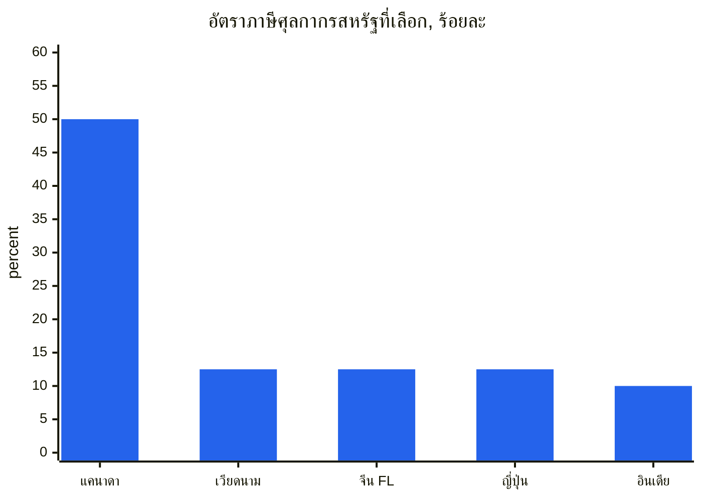

*หมายเหตุ: แคนาดา = อัตรามาตรา 338 (50%); เวียดนาม จีน FL และญี่ปุ่น = อัตราภาษีแรงงานบังคับตามมาตรา 301 (12.5%); อินเดีย = อัตราภาษีแรงงานบังคับตามมาตรา 301 ที่มีผล (10%; อัตราข้อตกลง 18% ที่ประกาศไว้ไม่เคยนำมาใช้) แหล่งข้อมูล: USTR, Liberty Justice Center, JD Supra*

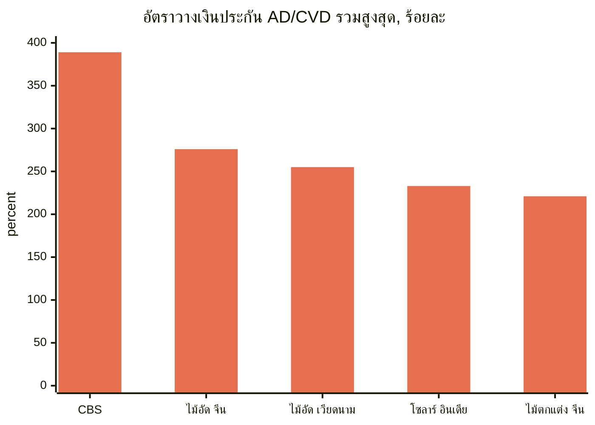

*หมายเหตุ: ความเสี่ยงเงินประกันภาษีตอบโต้การทุ่มตลาดบวกภาษีตอบโต้การอุดหนุนรวม CBS ตัวเร่งปฏิกิริยายาง: เงินประกัน AD 281.69% + CVD 107.57% (เบื้องต้น); ไม้อัดเนื้อแข็งจีน: AD 187.27% + CVD 88.96%; ไม้อัดเวียดนาม (Junma Phu Tho): AD 90.12% + CVD 165.39%; เซลล์แสงอาทิตย์อินเดีย: รวม 233.26%; ไม้ขึ้นรูปทั่วประเทศจีน: AD 220.87% (การทบทวน CVD แยกต่างหาก) แหล่งข้อมูล: ประกาศของกระทรวงพาณิชย์ใน Federal Register เดือนพฤศจิกายน 2026*

---

## 5. วิเคราะห์เชิงลึกนโยบายสหรัฐ

### มาตรา 301 — การยกเว้นยังคงอยู่ การสอบสวนเรื่องกำลังการผลิตส่วนเกินอาจมาถึงเร็ว

ไม่มีการเปลี่ยนแปลงการยกเว้นตามมาตรา 301 สำหรับจีนหรือการระงับค่าธรรมเนียมทางทะเลในช่วงความครอบคลุม การยกเว้น 178 รายการและการระงับค่าธรรมเนียมมีผลถึง 23:59 น. ET ของวันที่ 9 มกราคม 2027 และไม่มีประกาศใหม่ของ USTR เอเปกไม่ได้ให้การขยายเวลา และจุดตัดสินใจถัดไปคือ G20 ที่ไมอามีในวันที่ 14–15 ธันวาคม ภาษีแรงงานบังคับตามมาตรา 301 (12.5% สำหรับจีน เวียดนาม และญี่ปุ่น; 10% สำหรับอินเดีย) ยังคงมีผลบังคับใช้ ศาลการค้าระหว่างประเทศไต่สวนคดีท้าทายภาษีแรงงานบังคับ (In re Section 301 Forced Labor Cases, คดีนำคือ Learning Resources) เมื่อวันที่ 30 กันยายน และคณะผู้พิพากษาสามคนยังไม่ได้ตัดสินและยังไม่มีกำหนดวันตัดสิน เมื่อวันที่ 16 ตุลาคม รัฐบาลและโจทก์ยื่นคำแถลงตอบคำถามของคณะผู้พิพากษาเกี่ยวกับส่วนใดของมาตรา 301 ที่ USTR อาศัย และว่าต้องพิจารณาการพัฒนาเศรษฐกิจหรือไม่ แยกต่างหาก CBP ปรับปรุงรหัสการรายงานบทที่ 99 สำหรับภาษีมาตรา 301 ของจีนเมื่อวันที่ 22 ตุลาคม (CSMS 70261629) ผู้นำเข้าอาจขอคืนเงินสำหรับรายการก่อนหน้าของผลิตภัณฑ์ที่ USTR ยกเว้นในภายหลัง ผ่านการแก้ไขหลังสรุป [JD Supra](https://www.jdsupra.com/legalnews/lower-tariffs-higher-gray-market-risk-6159993/)

การสอบสวนเรื่องกำลังการผลิตส่วนเกินคือคำถามเปิดของสัปดาห์ มีรายงานว่าเอกอัครราชทูต Greer กล่าวเมื่อวันที่ 21 พฤศจิกายนว่า การสอบสวนเรื่องกำลังการผลิตส่วนเกินเชิงโครงสร้างใน 16 เศรษฐกิจจะสรุปก่อนสิ้นปี 2026 เร็วกว่าเส้นตายตามกฎหมายวันที่ 11 มีนาคม 2027 หลายเดือน เขาปฏิเสธที่จะระบุอัตราภาษีเบื้องต้นหรือตารางบทลงโทษเฉพาะประเทศ การสอบสวนครอบคลุม 21 ภาคส่วน รวมถึงยานยนต์ แบตเตอรี่ลิเธียมไอออน เซมิคอนดักเตอร์ เหล็ก อะลูมิเนียม หุ่นยนต์ โมดูลแสงอาทิตย์ และเครื่องจักรกลความแม่นยำ หากถูกต้อง กำหนดเวลาดังกล่าวจะเร่งการตัดสินใจที่เจ้าหน้าที่อินเดียเรียกว่าเป็นประเด็นค้างคาสำหรับข้อตกลงอินเดีย–สหรัฐ และเจ้าหน้าที่เกาหลีใต้ระบุว่าล่าช้ากว่ากำหนดการที่คาดไว้มากกว่าสองเดือนแล้ว ยังไม่มีการเผยแพร่ข้อค้นพบ การดำเนินการที่เสนอ หรือรายการผลิตภัณฑ์ รายงานมาจากแหล่งเดียว ไม่มีข่าวประชาสัมพันธ์ของ USTR หรือประกาศใน Federal Register ปรากฏ ณ วันที่ 23 พฤศจิกายน [East Asia Brief](https://eastasiabrief.com/trade-policy/ustr-accelerates-section-301-probe-hit-year-end-target-1636)

ข่าวประชาสัมพันธ์ด้านการบังคับใช้การค้าฉบับเดียวของ USTR ในช่วงความครอบคลุมแตะเรื่องแรงงาน ไม่ใช่ภาษี เมื่อวันที่ 19 พฤศจิกายน สหรัฐขอให้เม็กซิโกทบทวนการกล่าวหาว่าปฏิเสธสิทธิแรงงานที่ Polygroup Industrias México ภายใต้กลไกตอบสนองอย่างรวดเร็วด้านแรงงานของ USMCA และคำขอ RRM ครั้งที่สองเกี่ยวกับ Industrias FG ออกเมื่อวันที่ 13 พฤศจิกายน เอกอัครราชทูต Greer กล่าวสุนทรพจน์เสมือนจริงสำหรับการประชุมประจำปีของ Responsible Business Alliance เมื่อวันที่ 18 พฤศจิกายน และเขียนถึง Wall Street Journal เมื่อวันที่ 16 พฤศจิกายนเรื่องภาษีที่ส่งเสริมความเจริญรุ่งเรืองระยะยาวของชาวอเมริกัน [USTR](https://ustr.gov/about-us/policy-offices/press-office/press-releases)

### มาตรา 232 — โพลีซิลิคอนครบกำหนด 4 ธันวาคม หุ่นยนต์ยังอยู่ระหว่างเจรจา

CBP เปิดใช้การจำแนกประเภทบทที่ 99 จำลองสี่รายการที่ไม่เป็นทางการ (9903.45.43, 9903.45.45, 9903.45.47, 9903.45.49) ในสภาพแวดล้อม ACE Certification เมื่อวันที่ 12 พฤศจิกายน เพื่อการทดสอบเท่านั้น ก่อนภาษีมาตรา 232 สำหรับโพลีซิลิคอนและผลิตภัณฑ์อนุพันธ์ ราคานำเข้าขั้นต่ำทดสอบที่ 21 ดอลลาร์/กก. สำหรับโพลีซิลิคอน (HTSUS 2804.61.00) 100 ดอลลาร์/กก. สำหรับแท่งและแผ่นเวเฟอร์ 0.22 ดอลลาร์/วัตต์ สำหรับเซลล์แสงอาทิตย์ และ 0.38 ดอลลาร์/วัตต์ สำหรับโมดูลแสงอาทิตย์ ภาษีเท่ากับส่วนต่างระหว่างมูลค่าที่นำเข้ากับราคานำเข้าขั้นต่ำ หรือภาษีเฉพาะเท่ากับราคาขั้นต่ำ ควบคู่กับภาษีตามมูลค่า 15% สำหรับผลิตภัณฑ์อนุพันธ์ (โพลีซิลิคอนดิบเองได้รับการยกเว้นภาษี 15% แต่ต้องอยู่ภายใต้ราคาขั้นต่ำ) สำหรับญี่ปุ่น เกาหลีใต้ ไต้หวัน สวิตเซอร์แลนด์ ลิกเตนสไตน์ และสมาชิกสหภาพยุโรป ภาษีมาตรา 232 รวมบวกภาษีคอลัมน์ 1 ถูกจำกัดไว้ที่ 15% แนวทางการยื่นเอกสารการผลิตพร้อมหัวข้อบทที่ 99 อย่างเป็นทางการยังอยู่ระหว่างดำเนินการก่อนวันที่ 4 ธันวาคม มาตรการดังกล่าวใช้ในวงกว้างโดยไม่มีการยกเว้น USMCA [HTS Hero](https://htshero.com/tariff-updates/2026)

ประกาศฉบับที่ 11077 (หุ่นยนต์และเครื่องจักรอุตสาหกรรม ลงนาม 28 ตุลาคม ตีพิมพ์ 2 พฤศจิกายน 91 FR 69199) ยังคงเป็นข้อค้นพบภัยคุกคามที่ไม่มีภาษีใหม่ โดยสั่งให้กระทรวงพาณิชย์และ USTR เจรจาและรายงานภายใน 180 วัน (ประมาณ 26 เมษายน 2027) นี่เป็นครั้งที่สามในรอบสามเดือนที่รัฐบาลเลือกการเจรจาแทนภาษีทันทีหลังการสอบสวนตามมาตรา 232 ต่อจากกังหันลมและเครื่องบินพาณิชย์ ไม่พบพัฒนาการในช่วงความครอบคลุม [Constilumen](https://www.constilumen.com/updates/proclamation-11077-robotics-industrial-machinery-section-232)

### CBP — เส้นตายแบบฟอร์ม 5106 ผ่านไปอย่างเงียบ ๆ กฎผู้นำเข้าต่างชาติมีผล 5 มกราคม

เส้นตายวันที่ 18 พฤศจิกายนผ่านไปโดยไม่มีรายงานการยกเลิก (ดู A9) การบังคับใช้พื้นฐานมีผลตั้งแต่วันที่ 18 กันยายน 2026 ภายใต้ประกาศของ CBP เมื่อวันที่ 19 สิงหาคม (91 FR 53627) หมายเลขผู้นำเข้าที่มีข้อมูลแบบฟอร์ม 5106 ไม่ถูกต้องหรือไม่สมบูรณ์สามารถถูกยกเลิกได้ทันที โดยไม่มีระยะเวลาแก้ไขที่อธิบายไว้ และหมายเลขที่ถูกยกเลิกไม่สามารถใช้เพื่อนำเข้าสินค้าได้ หมายเลขโทรศัพท์และที่อยู่อีเมลเป็นองค์ประกอบข้อมูลที่มักขาดหายหรือไม่ถูกต้องที่สุดในบันทึก ACE ตามที่ที่ปรึกษาด้านการค้า จดหมายวันที่ 18 พฤศจิกายนเป็นคลื่นที่มุ่งเป้าไปที่ผู้นำเข้า CTPAT ไม่ใช่จุดเริ่มต้นของอำนาจ CBP นำ Foreign Importer of Record Enhancement ไปใช้ในสภาพแวดล้อม ACE Certification เมื่อวันที่ 12 พฤศจิกายน (CSMS #70409426) และจะนำไปใช้ในการผลิตวันที่ 5 มกราคม 2027 มีการเพิ่มฟิลด์ข้อมูลใหม่สามฟิลด์ในแบบฟอร์ม 3461 และ 7501 ของ CBP (CSMS #70381183) และ CBP ระบุว่าการตรวจสอบของตนอาจปฏิเสธรายการและสรุปรายการตั้งแต่วันที่ 5 มกราคมหากไม่เป็นไปตามข้อกำหนด ความเห็นต่อกฎชั่วคราวฉบับสุดท้ายครบกำหนดวันที่ 5 มกราคม 2027 (สำนวน USCBP-2026-1387) [DutyStacks](https://dutystacks.beehiiv.com/p/issue-006-apec-ends-with-a-declaration-not-a-deal-the-lukoil-clock-moves)

ห้องข่าวของ CBP มีเพียงข่าวท้องถิ่นในช่วงความครอบคลุม ได้แก่ การยึดอาวุธ กระสุน และยาเสพติดขาออกที่ท่าเรือ Del Rio (19 พฤศจิกายน) โคเคนมูลค่ากว่า 390,000 ดอลลาร์ถูกยึดที่ท่าเรือ Roma (18 พฤศจิกายน) เครื่องประดับปลอม 440 ชิ้นถูกยึดที่ซินซินนาติเมื่อวันที่ 11 พฤศจิกายน (รายงาน 18 พฤศจิกายน) และการปิดชั่วคราวของท่าบก Alburg Springs รัฐเวอร์มอนต์เพื่อก่อสร้าง (19 พฤศจิกายน) ไม่มีข่าวระดับชาติเรื่องภาษีหรือนโยบายการค้า CSMS #70460453 (17 พฤศจิกายน) เตือนผู้นำเข้าว่าหัวรถจักรและอุปกรณ์รถไฟอื่นที่ไม่เข้าเกณฑ์เป็นเครื่องมือการขนส่งระหว่างประเทศต้องนำเข้าและชำระภาษี รวมถึงภาษีมาตรา 232 ภายใต้ประกาศฉบับที่ 11021 สำหรับตู้รถไฟเหล็กบางประเภท และ AD/CVD สำหรับข้อต่อรถไฟบรรทุกสินค้าจากจีน สาธารณรัฐเช็ก อินเดีย และเม็กซิโก เป็นเพียงแนวทาง ไม่มีภาษีใหม่ [CBP](https://www.cbp.gov/newsroom)

### มาตรการควบคุมการส่งออกของ BIS — กฎการเข้าถึงระยะไกล ตัวเก็บเสียง และการระงับ Entity List

กฎชั่วคราวฉบับสุดท้ายเรื่องการเข้าถึงระยะไกลครอบคลุมใน A2 และหัวข้อ 3.2 มีรายการ BIS อีกสองรายการในช่วงความครอบคลุม ตัวเก็บเสียง ท่อเก็บเสียง และอุปกรณ์ลดเสียงบางชนิดย้ายจากรายการยุทโธปกรณ์ของสหรัฐ (USML หมวด I) ไปยังรายการควบคุมการค้าภายใต้ ECCN 0A501.f (ตัวเก็บเสียงสำหรับปืนยาว ปืนพก และแบบหลายโฮสต์) และ 0A502.f (ตัวเก็บเสียงสำหรับปืนลูกซองเท่านั้น) มีผลวันที่ 20 พฤศจิกายน (กฎตีพิมพ์ 23 กรกฎาคม 2026, 91 FR 46252) ECCN 0A501.f ถูกควบคุมด้วยเหตุผลด้านความมั่นคงแห่งชาติ เสถียรภาพระดับภูมิภาค การควบคุมอาชญากรรม สหประชาชาติ และการต่อต้านการก่อการร้าย 0A502.f มีมาตรการควบคุมเสถียรภาพระดับภูมิภาคฉบับใหม่ ข้อยกเว้นใบอนุญาต LVS (สูงสุด 500 ดอลลาร์) ใช้ได้กับทั้งสองย่อหน้าเมื่อแคนาดาเป็นจุดหมายปลายทางสุดท้าย ตัวเก็บเสียงที่ออกแบบมาเป็นพิเศษสำหรับอาวุธปืนอัตโนมัติเต็มรูปแบบยังคงอยู่ใน USML ภายใต้ ITAR BIS ประเมินว่าการเปลี่ยนแปลงดังกล่าวจะทำให้มีคำขอใบอนุญาตส่งออกเพิ่มเติมประมาณ 200 ฉบับต่อปี [Thomson Reuters](https://www.thomsonreuters.com/en-us/help/onesource-global-trade/regulatory-insights/2026/october-29th/us-issues-interim-final-rule-silencers-mufflers)

การระงับกฎบริษัทในเครือมีผลถึงวันที่ 10 มกราคม 2027 โดยไม่มีกฎ BIS ใหม่ในช่วงความครอบคลุม แต่ข้อพิพาททางการเมืองเรื่องการไม่ใช้กฎดังกล่าวทวีความรุนแรงขึ้น รัฐมนตรีว่าการกระทรวงการคลัง Bessent กล่าวเมื่อวันที่ 13 พฤศจิกายนว่า กระทรวงการคลัง กระทรวงกลาโหม กระทรวงการต่างประเทศ และ USTR ต่างสนับสนุนการนำ Megaspeed International (ลูกค้า Nvidia ในสิงคโปร์ที่มีรายงานว่าซื้อชิป Nvidia ขั้นสูงมากกว่า 4.8 พันล้านดอลลาร์ในสองปี) ขึ้น Entity List มานานหลายเดือน และกระทรวงพาณิชย์ "ถือปากกา" เมื่อวันที่ 15 พฤศจิกายน เขากดดัน Nvidia เองอย่างหนักขึ้น กระทรวงพาณิชย์ปฏิเสธรายงานการแลกเปลี่ยนในห้องสถานการณ์เมื่อวันที่ 5 พฤศจิกายน Financial Times รายงานเมื่อวันที่ 10 พฤศจิกายนว่า กระทรวงพาณิชย์พยายามชะลอการเพิ่มรายชื่อ Entity List ใหม่ และรายชื่อไม่มีการเพิ่มใหม่มา 13 เดือน (เพิ่มครั้งล่าสุด 9 ตุลาคม 2025) โดยมีผู้สมัครมากกว่า 100 รายรอการอนุมัติจากคณะกรรมการทบทวน รวมถึงห้องปฏิบัติการ AI ของจีน DeepSeek รัฐมนตรีว่าการกระทรวงพาณิชย์ Howard Lutnick ตกลงที่จะให้การต่อคณะกรรมาธิการการธนาคารของวุฒิสภาเมื่อวันที่ 10 ธันวาคม 2026 สมาชิกสภาผู้แทนราษฎรพรรคเดโมแครตสามคนเขียนถึง Lutnick เมื่อวันที่ 9 พฤศจิกายน เรียกร้องคำตอบเป็นลายลักษณ์อักษรภายในวันที่ 1 ธันวาคม แยกต่างหาก บันทึกการค้าของมาเลเซียที่ Bloomberg อ้างถึงแสดงว่า Megaspeed นำเข้าโปรเซสเซอร์ Nvidia GB300 อย่างน้อย 17,544 ชิ้น มูลค่าประมาณ 787 ล้านดอลลาร์ในเดือนพฤศจิกายน 2025 และการค้นหาของตำรวจอินโดนีเซียตามคำขอของ FBI ที่หน่วยงานท้องถิ่นของ Megaspeed พบชั้นวาง GPU ว่างเปล่า Nvidia ระบุว่าตนนำ Megaspeed ขึ้นบัญชีบล็อกภายในของบริษัทในเดือนมิถุนายน 2025 [ExplainX](https://explainx.ai/blog/bessent-blames-commerce-megaspeed-entity-list-lutnick-ouster-talks-nvidia-huang-2026)

### Federal Register — กิจกรรม AD/CVD ในช่วงความครอบคลุม

กิจกรรมด้านการค้าของ Federal Register ในสัปดาห์นี้ถูกครอบงำโดยประกาศภาษีตอบโต้การทุ่มตลาดและภาษีตอบโต้การอุดหนุน ซึ่งมีรายละเอียดในหัวข้อ 7 ได้แก่ คำสั่งไม้อัดเนื้อแข็งและไม้อัดตกแต่ง (17 พฤศจิกายน) ผลการทบทวนขั้นสุดท้ายสำหรับไม้ขึ้นรูปและงานไม้ตกแต่ง (17 พฤศจิกายน) การตัดสินเบื้องต้นของ USITC สำหรับกล่องกระดาษลูกฟูกตัดไดคัต (17 พฤศจิกายน) และผลเบื้องต้นของการทบทวนหน้าแปลนเหล็กกล้าคาร์บอนสำเร็จรูป (16 พฤศจิกายน) ไม่มีคำสั่งระงับการปล่อยสินค้า (WRO) ใหม่ ไม่มีกฎ BIS ใหม่นอกเหนือจากกฎการเข้าถึงระยะไกล ไม่มีประกาศภาษีใหม่ของทำเนียบขาว และไม่มีประกาศมาตรา 301 ใหม่ของ USTR ปรากฏในช่วงความครอบคลุม Federal Register ไม่ได้ถูกกวาดเอกสารทีละฉบับตลอดทั้งสัปดาห์ ดังนั้นอาจมีประกาศการทบทวนเชิงบริหารเพิ่มเติม

### รายการที่ค้างอยู่

- **AGOA:** ประธานาธิบดีทรัมป์แจ้งรัฐสภาและรัฐบาลของรวันดาและแอฟริกาใต้เมื่อวันที่ 2 พฤศจิกายนถึงเจตนาที่จะยุติสถานะผู้ได้รับประโยชน์ AGOA ของตน มีผลวันที่ 1 มกราคม 2027 หลังการทบทวนคุณสมบัติประจำปีระหว่างหน่วยงาน (การไต่สวนสาธารณะ 23 กรกฎาคม) AGOA ได้รับการขยายโดยกฎหมายจนถึงวันที่ 31 ธันวาคม 2028 เพื่อให้การยุติเสร็จสมบูรณ์ ประธานาธิบดีต้องออกประกาศก่อนวันที่ 1 มกราคมเพื่อลบทั้งสองประเทศออกจากรายการผู้ได้รับประโยชน์ AGOA ของ HTSUS ยังไม่มีประกาศดังกล่าวเผยแพร่ ณ วันที่ 23 พฤศจิกายน การส่งออกของแอฟริกาใต้จะเผชิญภาษี MFN มาตรฐานแทนการปฏิบัติปลอดภาษี AGOA [USTR](https://ustr.gov/about/policy-offices/press-office/press-releases/2026/november/ambassador-greer-issues-statement-president-trumps-intent-terminate-rwanda-and-south-africa-agoa)
- **แนวโน้มภาษีหลังการเลือกตั้งกลางเทอม:** การเลือกตั้งวันที่ 3 พฤศจิกายนทำให้พรรคเดโมแครตได้เสียงข้างมากในสภาคองเกรสซึ่งจะเข้ารับตำแหน่งในเดือนมกราคม แต่การเลือกตั้งเองไม่ได้เปลี่ยนแปลงอัตราภาษีใด ๆ ภาษีที่เหลืออาศัยอำนาจตามมาตรา 301 และมาตรา 232 และการเปลี่ยนแปลงจะต้องอาศัยการดำเนินการของฝ่ายบริหารหรือกฎหมายที่ผ่านด้วยเสียงข้างมากที่เอาชนะการยับยั้งได้ ลำดับเหตุการณ์: ภาษี IEEPA ถูกศาลยกเลิกเมื่อวันที่ 20 กุมภาพันธ์ 2026 การเรียกเก็บสิ้นสุดวันที่ 24 กุมภาพันธ์ ภาษีเพิ่มเติม 10% ตามมาตรา 122 มีผลวันที่ 24 กุมภาพันธ์–24 กรกฎาคม 2026 และสิ้นสุดหลังครบระยะเวลาสูงสุดตามกฎหมาย 150 วันโดยไม่มีการขยายเวลาจากสภาคองเกรส ภาษีมาตรา 301 ที่ครอบคลุม 60 เศรษฐกิจมีผลวันที่ 24 กรกฎาคม 2026 ที่ 10% หรือ 12.5% ผู้ผลิตได้รับคำแนะนำว่าอย่าสมมติว่าการคุ้มครองภาษีปัจจุบันจะคงอยู่ [JD Supra](https://www.jdsupra.com/legalnews/lower-tariffs-higher-gray-market-risk-6159993/)
- **ทำเนียบขาว:** ไม่พบประกาศภาษีหรือแฟกต์ชีตใหม่ในช่วงความครอบคลุม ประกาศที่เกี่ยวข้องล่าสุดยังคงเป็นประกาศฉบับที่ 11077 (หุ่นยนต์และเครื่องจักรอุตสาหกรรม)

---

## 6. นโยบายโลกตามภูมิภาค

### ยุโรป

**CEPA สหภาพยุโรป–อินโดนีเซียลงนาม 21 พฤศจิกายน** หลังการเจรจาเกือบหนึ่งทศวรรษ สหภาพยุโรปและอินโดนีเซียลงนามข้อตกลงหุ้นส่วนเศรษฐกิจที่ครอบคลุมและข้อตกลงคุ้มครองการลงทุนแยกต่างหากที่บรัสเซลส์ กรรมาธิการการค้าสหภาพยุโรป Maroš Šefčovič ลงนามในนามของกลุ่ม ประธานคณะกรรมาธิการ Ursula von der Leyen เข้าร่วมด้วย คณะมนตรีอนุมัติการลงนามเมื่อวันที่ 18 พฤศจิกายน อินโดนีเซียจะยกเลิกภาษีสำหรับสินค้าจากสหภาพยุโรป 98.5% ของรายการภาษีเมื่อบทบัญญัติมีผลเต็มที่ คณะกรรมาธิการระบุว่าข้อตกลงจะช่วยผู้ส่งออกของสหภาพยุโรปประหยัดค่าภาษีศุลกากรมากกว่า 600 ล้านยูโรต่อปี และสิ่งบ่งชี้ทางภูมิศาสตร์ของสหภาพยุโรป 221 รายการได้รับการคุ้มครอง รัฐสภายุโรปยังต้องให้ความยินยอมและอินโดนีเซียต้องให้สัตยาบัน ทั้งสองฝ่ายมุ่งใช้บังคับชั่วคราวตั้งแต่ต้นปี 2027 Von der Leyen กล่าวว่าประธานาธิบดี Prabowo Subianto จะเยือนบรัสเซลส์ในวันที่ 11 ธันวาคม การลงนามปิดการเจรจาเกือบสิบปี และเป็นข้อตกลงการค้าฉบับใหญ่ฉบับที่สองของสหภาพยุโรปกับเอเชียในปีนี้ ซึ่งเป็นส่วนหนึ่งของการผลักดันการกระจายความเสี่ยงเมื่อความสัมพันธ์กับสหรัฐและจีนยากลำบากขึ้น สำหรับผู้ส่งออก ประเด็นเชิงปฏิบัติคือข้อตกลงลงนามแล้ว แต่ยังไม่มีผลบังคับใช้ การตัดสินใจด้านการจัดหาและการกำหนดราคาจึงไม่ควรสมมติอัตราภาษีใหม่ [Turkish Post](https://turkishpost.com.tr/en/2026/11/21/eu-indonesia-trade-deal/)

**การลงนาม FTA สหภาพยุโรป–อินเดียชัดเจนขึ้นเป็น 16 ธันวาคม 2026** ข้อตกลงการค้าเสรีสหภาพยุโรป–อินเดียคาดว่าจะลงนามในวันที่ 16 ธันวาคม 2026 ที่บรัสเซลส์ระหว่างการเยือนของนายกรัฐมนตรี Narendra Modi ตามที่เจ้าหน้าที่อินเดียให้ข้อมูลแก่ PTI และรายงานเมื่อวันที่ 22 พฤศจิกายน คณะกรรมาธิการได้ยื่นข้อเสนอต่อคณะมนตรีเพื่อขออนุมัติการลงนามและการสรุป พร้อมร่างกฎหมายฉบับสุดท้ายและตารางภาษี เอกอัครราชทูตสหภาพยุโรปประจำอินเดีย Jean-Eric Paquet ยืนยันกำหนดเวลากลางเดือนธันวาคมระหว่างการเยือนรัฐอัสสัม การมีผลบังคับใช้คาดว่าในปี 2027 หลังการอนุมัติของรัฐสภายุโรป การสรุปของคณะมนตรี และการให้สัตยาบันของอินเดีย ภายใต้ข้อตกลง สินค้าจากอินเดีย 93% จะได้รับการเข้าถึงสหภาพยุโรปแบบปลอดภาษี รวมถึงภาษีศูนย์สำหรับการส่งออกที่ใช้แรงงานเข้มข้นมูลค่าประมาณ 33 พันล้านดอลลาร์ การเจรจาสรุปเมื่อวันที่ 27 มกราคม 2026 ข้อตกลงคุ้มครองการลงทุนแยกต่างหากและข้อตกลงเรื่องสิ่งบ่งชี้ทางภูมิศาสตร์ยังอยู่ระหว่างเจรจา [Asia Daily](https://asiadaily.org/news/19949/)

**ค่าธรรมเนียมจัดการ 2 ยูโรของสหภาพยุโรป: ข้อมูลผลกระทบครั้งแรก — พัสดุมูลค่าต่ำลดลงกว่า 60%** ค่าธรรมเนียมจัดการของสหภาพยุโรป 2 ยูโรต่อรายการสินค้า (กฎมอบอำนาจ (EU) 2026/2152) และตัวระบุผลิตภัณฑ์ภาคบังคับเข้าสู่สัปดาห์ที่สาม รายละเอียดใหม่ที่ยืนยันในสัปดาห์นี้ คณะกรรมาธิการระบุว่าปริมาณพัสดุมูลค่าต่ำลดลงมากกว่า 60% เมื่อเทียบกับแนวโน้มก่อนเก็บภาษีในไตรมาสที่ 3 ปี 2026 เนื่องจากผู้ขายบางรายเปลี่ยนไปส่งสินค้าจำนวนมากไปยังคลังสินค้าในสหภาพยุโรป คณะกรรมาธิการยังรายงานว่าสินค้าอีคอมเมิร์ซมูลค่าต่ำ 5.9 พันล้านชิ้นถูกนำเข้าสู่สหภาพยุโรปในปี 2025 เป็นสี่เท่าของตัวเลขปี 2022 โดยมากกว่า 90% มาจากจีน ทั้งภาษีคงที่ 3 ยูโรและค่าธรรมเนียม 2 ยูโรเป็นส่วนหนึ่งของฐานภาษีสำหรับ VAT ภายใต้แนวทางที่ปรับปรุงของคณะกรรมาธิการเมื่อวันที่ 6 ตุลาคม 2026 ค่าธรรมเนียมระดับชาติ 2 ยูโรของอิตาลีต่อพัสดุสูงสุด 150 ยูโรถูกเลื่อนเป็นวันที่ 1 ธันวาคม 2026 นอกเหนือจากค่าธรรมเนียมของสหภาพยุโรป การรณรงค์ตรวจสอบทั่วยุโรปพบว่าสินค้าที่ตรวจสอบมากกว่า 60% ไม่เป็นไปตามมาตรฐานยุโรป หลักฐานที่ชัดเจนครั้งแรกเกี่ยวกับการรีเซ็ตการนำเข้ามูลค่าต่ำของสหภาพยุโรปแสดงการเปลี่ยนแปลงพฤติกรรมอย่างรุนแรง ปริมาณพัสดุลดลงมากกว่า 60% เมื่อเทียบกับแนวโน้มในไตรมาสที่สาม ก่อนที่ค่าธรรมเนียม 2 ยูโรจะมีผลด้วยซ้ำ เนื่องจากผู้ขายย้ายสต็อกไปยังคลังสินค้าในสหภาพยุโรปเพื่อหลีกเลี่ยงค่าธรรมเนียมต่อรายการ ค่าธรรมเนียมเป็นแบบถาวร ใช้กับทุกมูลค่า และไม่สามารถขอคืนได้แม้ในกรณีคืนสินค้า ดังนั้นจึงเปลี่ยนเศรษฐศาสตร์การคืนสินค้าเช่นเดียวกับต้นทุนที่ดิน ไม่มีการเผยแพร่ตัวเลขอย่างเป็นทางการเกี่ยวกับรายได้ที่เก็บได้หรือความล่าช้าในการเคลียร์สินค้าในช่วงความครอบคลุม [Fashion Law Journal](https://fashionlawjournal.com/eu-small-parcel-tax/)

**มาตรการคุ้มครองรถไฮบริดของสหภาพยุโรป** ดู A4 คณะกรรมาธิการเปิดการสอบสวนเมื่อวันที่ 30 ตุลาคม ปิดรับความเห็นเป็นลายลักษณ์อักษรเมื่อวันที่ 20 พฤศจิกายน คาดว่ามาตรการชั่วคราวจะเริ่มตั้งแต่วันที่ 1 ธันวาคม โดยมีรายงานเพดาน 350,000 คันต่อปีสำหรับรถไฮบริดที่ผลิตในจีน [Ports Europe](https://www.portseurope.com/eu-opens-hybrid-safeguard-probe-as-chinese-shipments-outrun-planned-quota/)

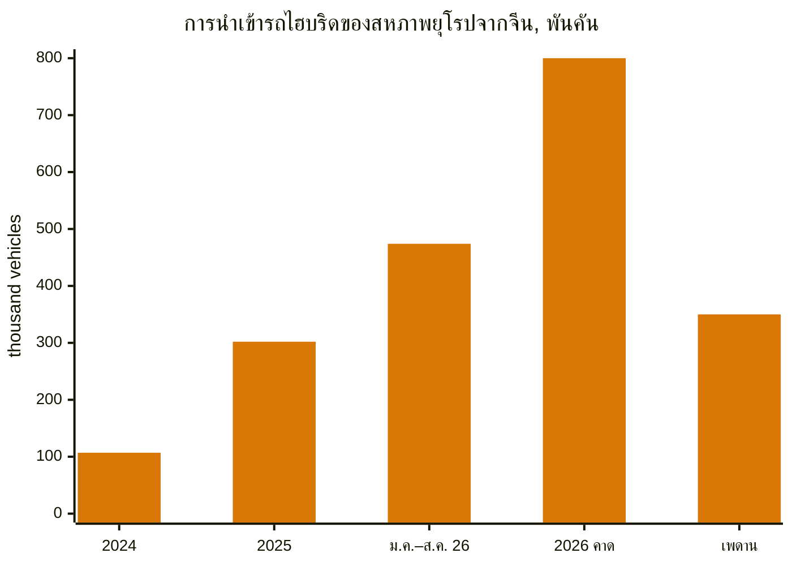

*หมายเหตุ: การนำเข้าคือตัวเลข Eurostat การคาดการณ์ปี 2026 คือการประเมินของคณะกรรมาธิการ เพดานคือเพดานมาตรการคุ้มครองปีแรกที่รายงานไว้ที่ 350,000 คัน แหล่งข้อมูล: Eurostat ผ่าน Ports Europe; คณะกรรมาธิการ*

**FTA สหภาพยุโรป–ออสเตรเลีย: ลงนามในเดือนมีนาคม การให้สัตยาบันไม่แน่นอน ไม่มีความเคลื่อนไหวใหม่ในช่วงความครอบคลุม** FTA สหภาพยุโรป–ออสเตรเลียสรุปเมื่อวันที่ 24 มีนาคม 2026 และลงนามที่แคนเบอร์ราในวันเดียวกัน แต่ยังไม่มีผลบังคับใช้และไม่สามารถดำเนินการได้โดยไม่มีการตรวจสอบของรัฐสภาและการเปลี่ยนแปลงกฎหมายออสเตรเลีย ซึ่งเป็นกระบวนการที่ DFAT ระบุว่าอาจใช้เวลาถึงสองปี เอกอัครราชทูตเยอรมนีประจำออสเตรเลียกล่าวเมื่อวันที่ 29–31 ตุลาคมว่า การให้สัตยาบันในออสเตรเลียขึ้นอยู่กับคะแนนเสียงของวุฒิสภาจากฝ่ายพันธมิตร กรีนส์ หรือสมาชิกอิสระ และแสดงความหวังว่าจะแล้วเสร็จในไตรมาสที่ 1 ปี 2027 พรรคแห่งชาติฝ่ายค้านให้คำมั่นว่าจะคัดค้าน และพรรคเสรีนิยมยังไม่ได้ประกาศจุดยืน สหภาพยุโรปเตือนว่าข้อตกลงจะไม่ถูกเจรจาใหม่หากรัฐสภาปฏิเสธ การมีผลบังคับใช้ไม่คาดว่าจะเกิดขึ้นก่อนปลายปี 2027 การส่งออกของออสเตรเลีย 98% ตามมูลค่าจะเข้าสู่สหภาพยุโรปแบบปลอดภาษี การค้าทวิภาคีเกิน 109 พันล้านดอลลาร์ออสเตรเลียต่อปี [AAP](https://aapnews.aap.com.au/news/claim-eu-trade-deal-mandates-methane-reducing-livestock-feed-is-baseless)

**ข้อตกลงการค้าดิจิทัลสหภาพยุโรป–แคนาดาสรุปเมื่อวันที่ 30 ตุลาคม ยังไม่มีการเผยแพร่ข้อความ** สหภาพยุโรปและแคนาดาสรุปการเจรจาข้อตกลงการค้าดิจิทัลเมื่อวันที่ 30 ตุลาคม 2026 เพื่อเสริม CETA (ใช้บังคับชั่วคราวตั้งแต่ปี 2017) ข้อตกลงกำหนดกฎสำหรับการไหลของข้อมูลข้ามพรมแดน สัญญาอิเล็กทรอนิกส์ ลายเซ็นอิเล็กทรอนิกส์และใบแจ้งหนี้อิเล็กทรอนิกส์ การคุ้มครองผู้บริโภคออนไลน์ และข้อความเชิงพาณิชย์ที่ไม่พึงประสงค์ การเจรจาเริ่มขึ้นเพียงเดือนมีนาคม 2026 ในการประชุมคณะกรรมการร่วม CETA ครั้งที่ห้า ข้อความที่ตกลงกันยังไม่เผยแพร่ การตรวจสอบทางกฎหมายและการแปลเป็นทุกภาษาของสหภาพยุโรปจะมาก่อนการลงนาม ความรวดเร็วของการเจรจา — สรุปภายในแปดเดือนหลังเริ่ม — สะท้อนความสำคัญทางการเมืองที่ทั้งสองฝ่ายให้ความสำคัญกับกฎการค้าดิจิทัลเมื่อนโยบายของสหรัฐคาดเดาได้น้อยลง การลงนามและการมีผลบังคับใช้ยังคงเป็นเรื่องของปี 2027 อย่างเร็วที่สุด [European Commission](https://policy.trade.ec.europa.eu/news/eu-and-canada-conclude-negotiations-digital-trade-agreement-2026-10-30_en?prefLang=ga)

**กฎถิ่นกำเนิดยานยนต์สหราชอาณาจักร–สหภาพยุโรป: ACEA และ SMMT เตือนว่าหนึ่งในสี่ของ EV เผชิญภาษี 10% ตั้งแต่วันที่ 1 มกราคม 2027** ACEA และ SMMT เตือนว่ากฎถิ่นกำเนิดที่เข้มงวดขึ้นตามข้อตกลงความร่วมมือด้านการค้าและความร่วมมือสหราชอาณาจักร–สหภาพยุโรปสำหรับยานยนต์ไฟฟ้าและไฮบริด ซึ่งจะมีผลวันที่ 1 มกราคม 2027 จะทำให้ยานยนต์ไฟฟ้าแบตเตอรี่และปลั๊กอินไฮบริดที่ค้าขายระหว่างสองตลาดน้อยกว่าหนึ่งในสี่ที่มีคุณสมบัติได้รับการปฏิบัติปลอดภาษี ส่วนที่เหลือเผชิญภาษี 10% สมาคมยังเตือนว่าร่างพระราชบัญญัติ Industrial Accelerator ของสหภาพยุโรปที่เสนออาจกำหนดภาษีสำหรับยานยนต์และชิ้นส่วนของสหราชอาณาจักร คุกคามความสัมพันธ์ทางการค้ายานยนต์มูลค่า 87 พันล้านดอลลาร์สหรัฐต่อปี สหภาพยุโรปยังคงนำเข้าแบตเตอรี่ลิเธียมไอออนประมาณสองในสาม แม้จะมีการลงทุนในห่วงโซ่อุปทานแบตเตอรี่ของสหภาพยุโรปประมาณ 80.8 พันล้านดอลลาร์สหรัฐตั้งแต่ปี 2017 VDA ของเยอรมนีโต้แย้งในเดือนพฤศจิกายนให้เลื่อนการเปลี่ยนแปลงกฎถิ่นกำเนิดออกไปจนกว่าห่วงโซ่อุปทานแบตเตอรี่ของสหภาพยุโรปจะพัฒนาเพิ่มเติม การประชุมสุดยอดวันที่ 20 พฤศจิกายนไม่ได้ให้การแก้ปัญหาที่รายงานไว้ในประเด็นนี้ [Manufacturing Digital](https://manufacturingdigital.com/news/acea-smmt-uk-eu-tariff-rules-threaten-auto-manufacturers)

### สหราชอาณาจักร

**การประชุมสุดยอดสหราชอาณาจักร–สหภาพยุโรป 20 พฤศจิกายน: ตกลงข้อตกลง SPS การเชื่อมโยง ETS และการยกเว้น CBAM ซึ่งกันและกัน** ดูหัวข้อ 3.3 ในการประชุมสุดยอดสหราชอาณาจักร–สหภาพยุโรปครั้งที่สอง ทั้งสองฝ่ายตกลงข้อตกลง SPS (บังคับใช้ 1 มีนาคม 2028 รัฐบาลสหราชอาณาจักรประเมินว่าอาจเพิ่มผลผลิตทางเศรษฐกิจได้สูงสุด 5.1 พันล้านปอนด์ต่อปีภายในปี 2040) การเชื่อมโยงระบบซื้อขายการปล่อยมลพิษของสหราชอาณาจักรกับระบบซื้อขายการปล่อยมลพิษของสหภาพยุโรป (การยกเว้น CBAM ซึ่งกันและกันมีเป้าหมายตั้งแต่วันที่ 1 มกราคม 2028 การส่งออกของสหราชอาณาจักรประมาณ 6.5 พันล้านปอนด์อาจได้รับประโยชน์) และมาตรการด้านการเคลื่อนย้ายของเยาวชน สหราชอาณาจักรจะยกเว้นสินค้าที่มีถิ่นกำเนิดในสหภาพยุโรป เขตเศรษฐกิจยุโรป และสวิตเซอร์แลนด์จาก CBAM ของตนตั้งแต่วันที่ 1 มกราคม 2027 ข้อตกลงยังไม่มีผลบังคับใช้ ยังต้องมีกระบวนการทางกฎหมายและการดำเนินการเพิ่มเติม [Thames Valley Chamber](https://www.thamesvalleychamber.co.uk/uk-eu-summit-2026-new-trade-agreements-reached/)

**ขอบเขต CBAM ของสหราชอาณาจักรจะขยายไปยังผลิตภัณฑ์กลั่น เปิดการปรึกษาหารือในงบประมาณ 2026** รัฐบาลตั้งใจจะขยายกลไกปรับคาร์บอนที่ชายแดนของสหราชอาณาจักรให้รวมถึงผลิตภัณฑ์กลั่น ขึ้นอยู่กับการปรึกษาหารือเรื่องความเป็นไปได้และผลกระทบ การปรึกษาหารือเปิดตัวในงบประมาณ 2026 ไม่มีการให้กำหนดเวลา รัฐบาลระบุว่าตั้งใจจะดำเนินการ "โดยเร็วที่สุดเท่าที่จะเป็นไปได้" และจะกำหนดกำหนดเวลาในภายหลัง CBAM ของสหราชอาณาจักรตามที่ตราไว้เริ่มวันที่ 1 มกราคม 2027 สำหรับอะลูมิเนียม ซีเมนต์ ปุ๋ย ไฮโดรเจน และเหล็กกล้า การขยายจะขยาย CBAM ของสหราชอาณาจักรออกไปนอกห้าภาคส่วนแรกไปยังผลิตภัณฑ์ปิโตรเลียมกลั่น แต่ยังคงอยู่ในขั้นตอนการปรึกษาหารือโดยไม่มีวันกำหนด ควบคู่ไปกับข้อตกลงในการประชุมสุดยอดวันที่ 20 พฤศจิกายน ซึ่งสินค้าที่มีถิ่นกำเนิดในสหภาพยุโรปจะได้รับการยกเว้นจาก CBAM ของสหราชอาณาจักรตั้งแต่วันที่ 1 มกราคม 2027 ดังนั้นการขยายไปยังผลิตภัณฑ์กลั่น หากดำเนินการต่อ ในทางปฏิบัติจะตกแก่ผู้จัดหานอกสหภาพยุโรปเป็นหลัก [UK Parliament](https://questions-statements.parliament.uk/written-questions/detail/2026-10-28/39108)

**ไม่มีประกาศมาตรการเยียวยาทางการค้าใหม่ของสหราชอาณาจักรในช่วงความครอบคลุม การขยายภาษีปลาเทราท์สายรุ้งยังคงอยู่** ไม่พบประกาศมาตรการเยียวยาทางการค้าใหม่ในช่วงความครอบคลุม รายการที่ค้างอยู่: ประกาศมาตรการเยียวยาทางการค้า 2026/31 ขยายภาษีตอบโต้การอุดหนุนสำหรับปลาเทราท์สายรุ้งของตุรกีเป็นเวลาห้าปีถึงวันที่ 30 มกราคม 2031 มีผลวันที่ 6 พฤศจิกายน 2026 ในอัตราปัจจุบัน (เฉพาะผู้ส่งออก 1.5%–8% ผู้อื่นทั้งหมด 9.5%) การเริ่มต้น CBAM ของสหราชอาณาจักรในวันที่ 1 มกราคม 2027 คือเหตุการณ์การค้าของสหราชอาณาจักรที่มีวันกำหนดใกล้ที่สุดในขณะนี้

### แคนาดา

**ข้อตกลงทวิภาคีแคนาดา–จีนขยายและขยายขอบเขต 17 พฤศจิกายน** แคนาดาและจีนขยายและขยายขอบเขตข้อตกลงร่วมเบื้องต้นว่าด้วยการจัดการประเด็นเศรษฐกิจและการค้าทวิภาคี จีนจะให้การลดภาษีเพิ่มเติมสำหรับสินค้าส่งออกของแคนาดาประมาณ 400 ล้านดอลลาร์แคนาดา — หมูแช่แข็ง 116 ล้านดอลลาร์แคนาดา และปลาและอาหารทะเล 285 ล้านดอลลาร์แคนาดา (กุ้งน้ำเย็นแช่แข็งและกุ้งรวมถึงกุ้งลายเสือแปซิฟิก 87.5 ล้านดอลลาร์แคนาดา หอยรวมถึงหอยงวงช้าง 61.4 ล้านดอลลาร์แคนาดา ปลิงทะเล 39.4 ล้านดอลลาร์แคนาดา ปลาฮาลิบัตกรีนแลนด์ 96 ล้านดอลลาร์แคนาดา) — โดยระงับภาษีเพิ่มเติม 25% สำหรับผลิตภัณฑ์ดังกล่าวตั้งแต่วันที่ 1 มกราคม 2027 ถึงวันที่ 31 ธันวาคม 2028 การขยายนี้ต่อยอดจากการขยายสองปีของการลดภาษีสำหรับกากคาโนลา ถั่วลันเตา กุ้งมังกร และปูที่ตกลงกันก่อนหน้านี้ในเดือนพฤศจิกายน (การหารือระดับรัฐมนตรี 4 พฤศจิกายน) เพื่อแลกเปลี่ยน แคนาดาขยายมาตรการผ่อนผันที่มีอยู่สำหรับผลิตภัณฑ์เหล็กและอะลูมิเนียมของจีนบางรายการที่จะหมดอายุปลายปี 2026 ออกไปสองปี และขยายความครอบคลุมการผ่อนผันไปยังรายการภาษีเหล็กและอะลูมิเนียมเพิ่มเติม 32 รายการ (เหล็ก 23 รายการ อะลูมิเนียม 9 รายการ) ซึ่งแคนาดามีอุปทานไม่เพียงพอหรือไม่มี ตัวเลข 400 ล้านดอลลาร์แคนาดาคือมูลค่าการส่งออกของแคนาดาในหมวดดังกล่าวในปี 2024 ก่อนภาษีเพิ่มเติมของจีน ไม่ใช่การชำระเงินหรือการรับประกันธุรกิจใหม่ วันหมดอายุใหม่ของข้อตกลงคือ 31 ธันวาคม 2028 ข้อตกลงยังฟื้นการแลกเปลี่ยนสกุลเงินทวิภาคี ตามบทสรุปเอเปกของ China Briefing [Prime Minister of Canada](https://www.pm.gc.ca/en/news/news-releases/2026/11/17/prime-minister-carney-advances-canadas-strategic-partnership-china)

**การท้าทายศาลมาตรา 338: การไต่สวนด้วยวาจากำหนด 20 มกราคม 2027** ดูหัวข้อ 3.7 และ A9 ในรายงานสัปดาห์ที่แล้ว คำแถลง amicus ที่สนับสนุนการท้าทายภาษีมาตรา 338 สำหรับสินค้าแคนาดายื่นโดยอดีต USTR Carla Hills และ Robert Zoellick นักวิชาการด้านการค้า และผู้สนับสนุนผู้เสียภาษี Liberty Justice Center ประกาศการยื่นเมื่อวันที่ 16 พฤศจิกายน การไต่สวนด้วยวาจากำหนดวันที่ 20 มกราคม 2027 คำแถลงตอบโต้ของรัฐบาลครบกำหนดวันที่ 11 ธันวาคม 2026 และคำแถลงตอบของ Gellert ครบกำหนดวันที่ 11 มกราคม 2027 คดี (Gellert Global Group Corp. v. Trump, เลขคดี 26-04636) ท้าทายภาษี 50% สำหรับสินค้านำเข้าจากแคนาดาประมาณ 20 พันล้านดอลลาร์ Gellert ระบุว่าจะจ่ายประมาณ 40 ล้านดอลลาร์ต่อปีสำหรับชีสแคนาดา และจ่ายไปแล้วอย่างน้อย 381,000 ดอลลาร์สหรัฐสำหรับรายการที่นำเข้าวันที่ 15 กันยายน–7 ตุลาคม 2026 เมื่อวันที่ 28 ตุลาคม ศาลอนุมัติคำร้องของ Gellert บางส่วนและปฏิเสธบางส่วน (รายการในสำนวนไม่ได้ระบุว่าส่วนใด) ประกาศฉบับที่ 11076 เขียนรายการผลิตภัณฑ์ยานยนต์ใหม่สำหรับสินค้าที่นำเข้าตั้งแต่วันที่ 30 ตุลาคม 2026 ภาษียังคงมีผลบังคับใช้ [Liberty Justice Center](https://libertyjusticecenter.org/pressrelease/former-u-s-trade-representatives-scholars-back-liberty-justice-centers-challenge-to-trumps-canadian-tariffs/)

**ภาพรายได้จากการลดภาษีของแคนาดา: ประเมิน 14.1 พันล้านดอลลาร์แคนาดา ผ่อนผัน 8.9 พันล้านดอลลาร์แคนาดา** ตั้งแต่เดือนมีนาคม 2025 ถึงวันที่ 26 ตุลาคม 2026 แคนาดาประเมินภาษีสินค้าของสหรัฐ 14.1 พันล้านดอลลาร์แคนาดา (ประมาณ 10 พันล้านดอลลาร์สหรัฐ) แต่ผ่อนผันหรือยกเว้น 8.9 พันล้านดอลลาร์แคนาดา เหลือรายได้สุทธิ 5.2 พันล้านดอลลาร์แคนาดา ตัวเลขนี้แสดงให้เห็นว่าโครงการผ่อนผันกว้างเพียงใด ภาษีตอบโต้ส่วนใหญ่ไม่ได้สร้างรายได้จริง การเปลี่ยนแปลงวันที่ 9 พฤศจิกายน (การผ่อนผันแนวนอนขยายถึงวันที่ 30 มิถุนายน 2028 ยกเลิกการผ่อนผันสำหรับรถพ่วงบางประเภทตั้งแต่วันที่ 1 ธันวาคม 2026 และลวดอะลูมิเนียม ผลิตภัณฑ์อัดขึ้นรูป และกระดาษแข็งบางประเภทตั้งแต่วันที่ 1 กุมภาพันธ์ 2027) ยังคงเป็นไปตามที่รายงานในสัปดาห์ที่แล้ว ไม่มีการเปลี่ยนแปลงเพิ่มเติมในช่วงความครอบคลุม [Mining Weekly](https://www.miningweekly.com/article/canada-expands-us-tariff-exemptions-cuts-some-aluminium-relief-2026-11-10)

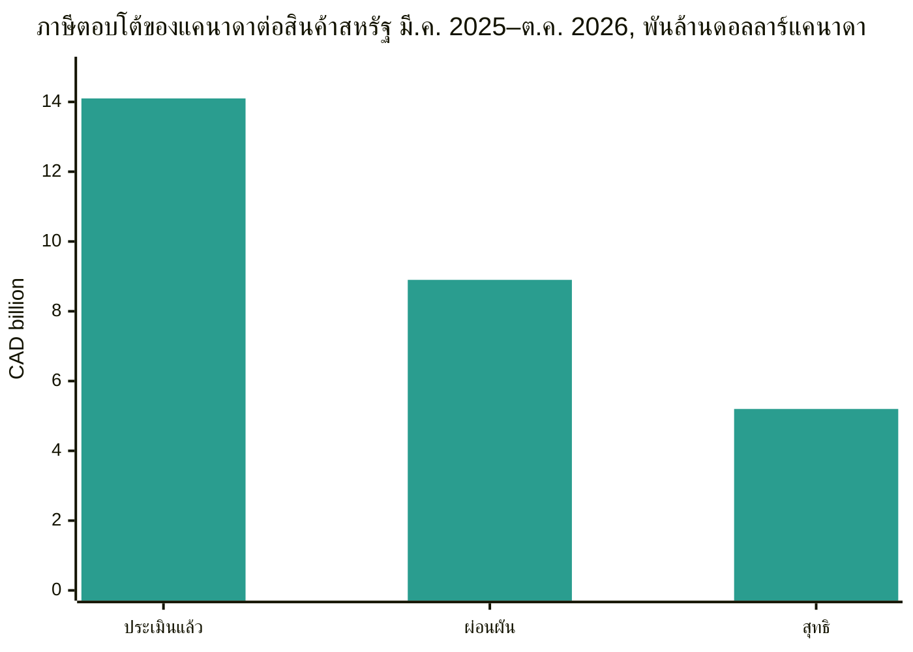

*หมายเหตุ: ภาษีที่ประเมินสำหรับผลิตภัณฑ์ของสหรัฐ เดือนมีนาคม 2025 ถึงวันที่ 26 ตุลาคม 2026 ผ่อนผันหรือยกเว้นภายใต้โครงการผ่อนผัน รายได้สุทธิ แหล่งข้อมูล: การเปิดเผยของรัฐบาลแคนาดาผ่าน Mining Weekly วันที่ 10 พฤศจิกายน 2026*

**แคนาดาตั้งคำถามกับอินเดียที่ WTO เรื่องสต็อกข้าวที่เปลี่ยนไปใช้เอทานอล** แคนาดาตั้งคำถามอย่างเป็นทางการที่ WTO เมื่อวันที่ 14 พฤศจิกายนเกี่ยวกับการจัดสรรสต็อกข้าวของรัฐของอินเดียให้กับผู้ผลิตเอทานอล โดยขอรายละเอียดเกี่ยวกับปริมาณธัญพืชสาธารณะที่เปลี่ยนไปใช้การกลั่นแอลกอฮอล์เชื้อเพลิงในประเทศ ต่อจากรูปแบบการตรวจสอบของคณะกรรมการเกษตรเกี่ยวกับการสนับสนุนภายในประเทศของอินเดีย (ดูพหุภาคี) ไม่มีการรายงานคำตอบของอินเดียในช่วงความครอบคลุม [Distillers Hub](https://distillershub.com/news/111420315/)

### จีน

**มาตรการควบคุมการส่งออกสินค้าใช้สองทางสำหรับโดรน เครื่องเจาะอุโมงค์ และเรือขุดมีผล 18 พฤศจิกายน** ประกาศฉบับที่ 49 (โดรน) ฉบับที่ 50 (เครื่องเจาะอุโมงค์และอุปกรณ์ที่เกี่ยวข้อง) และฉบับที่ 51 (เรือขุด) มีผลวันที่ 18 พฤศจิกายน 2026 โดยปรับปรุงรายการควบคุมการส่งออกสินค้าใช้สองทาง ต้องขอใบอนุญาตสำหรับระบบนำร่องอัตโนมัติของโดรน โดรนที่บินได้เกินระยะสายตาที่มีความทนทานอย่างน้อยสามชั่วโมง เครื่องยนต์ที่ออกแบบมาเป็นพิเศษสำหรับโดรน และโดรนที่มีระยะ 300 กม. ขึ้นไปหรือติดตั้งสำหรับกระจายละอองฝอยเกิน 80 ลิตร ประกาศฉบับที่ 49 ยกเกณฑ์ความทนทานสำหรับโดรนที่ถูกควบคุมจากหนึ่งชั่วโมงเป็นสามชั่วโมง ดังนั้นโดรนตลาดมวลชนที่ต่ำกว่าเกณฑ์ดังกล่าวจึงไม่ต้องขอใบอนุญาตอีกต่อไป ขณะที่มาตรการควบคุมขยายไปยังชิ้นส่วนโดรนมากขึ้น ประกาศฉบับที่ 50 กำหนดมาตรการควบคุมเครื่องเจาะอุโมงค์เป็นครั้งแรก บวกเครื่องขุดเดินได้ที่ระบุและเครื่องฉีดคอนกรีตบนที่สูง การส่งออกไปยังจุดหมายที่อ่อนไหวต้องขอใบอนุญาต จุดหมายอื่นอาจใช้ใบรับรองตามการจดทะเบียน ภายใต้ข้อจำกัดการถ่ายโอนต่อไป ประกาศฉบับที่ 51 เพิ่มการออกใบอนุญาตสำหรับปั๊มขุด หัวลาก และหัวตัดที่ระบุ กฎการส่งออกซ้ำยังใช้ตั้งแต่วันที่ 18 พฤศจิกายน บริษัทต่างชาติต้องขอใบอนุญาตของจีนเพื่อส่งต่อเครื่องจักรก่อสร้างที่มีถิ่นกำเนิดในจีน เช่น เครื่องเจาะอุโมงค์ ไปยังบางประเทศ แยกต่างหาก ประกาศฉบับที่ 52 ของ MOFCOM และ GAC (19 ตุลาคม) ปรับปรุงขั้นตอนที่ศุลกากรอาจกักสินค้าที่นำเสนอเพื่อส่งออกโดยไม่มีใบอนุญาต มาตรการควบคุมมีผลแล้ว และการออกแบบมีสองด้าน เกณฑ์ถูกยกขึ้นเพื่อให้โดรนเชิงพาณิชย์ทั่วไปอยู่นอกระบบ ขณะที่ขอบเขตขยายไปยังเครื่องเจาะอุโมงค์ — เป็นครั้งแรก — และการส่งออกซ้ำของเครื่องจักรที่มีถิ่นกำเนิดในจีนโดยบริษัทต่างชาติ กฎการส่งออกซ้ำดังกล่าวเป็นจุดที่แหลมคมที่สุดสำหรับผู้ซื้อและผู้ขายต่อในประเทศที่สาม เนื่องจากเข้าถึงธุรกรรมที่ไม่มีผู้ส่งออกจีน [Mondaq](https://alpha.mondaq.com/china/new-technology/1870494/new-chinese-export-control-measures-tighten-restrictions-on-the-export-of-advanced-technologies-and-dual-use-goods-strengthen-enforcement)

**แคตตาล็อกการส่งออกเทคโนโลยี: ปิดรับความเห็น 15 พฤศจิกายน การจดทะเบียนชั่วคราวก่อนส่งออกเป็นระบบที่ใช้อยู่ในขณะนี้** ความเห็นสาธารณะต่อประกาศฉบับที่ 48 (16 ตุลาคม) ซึ่งจะเพิ่มเทคโนโลยี 40 รายการในแคตตาล็อกเทคโนโลยีที่ห้ามหรือจำกัดการส่งออก (AI 23 รายการ ชีวเภสัชภัณฑ์ 5 รายการ โฟโตวอลเทอิก 12 รายการ ห้าม 14 รายการ จำกัด 26 รายการ) ปิดรับเมื่อวันที่ 15 พฤศจิกายน ยังไม่มีการเผยแพร่แคตตาล็อกฉบับสุดท้าย ณ วันที่ 23 พฤศจิกายน สิ่งที่ใช้อยู่ในขณะนี้คือข้อกำหนดการจดทะเบียนชั่วคราวก่อนส่งออกที่มีผลตั้งแต่วันที่ 16 ตุลาคม ซึ่งครอบคลุมการส่งออกเทคโนโลยีที่ระบุ รวมถึงธุรกรรมที่อยู่ระหว่างดำเนินการและการโอนความเป็นเจ้าของหรือการควบคุมของวิสาหกิจในประเทศที่ถือเทคโนโลยีดังกล่าวไปยังหน่วยงานในต่างประเทศ การวิเคราะห์ใหม่ในสัปดาห์นี้ชี้แจงขอบเขต ในชีวเภสัชภัณฑ์ การโอนความเป็นเจ้าของแพลตฟอร์มการบำบัดด้วยเซลล์และยีนและ siRNA จะถูกห้าม แต่การออกใบอนุญาต บริการ CRO/CDMO และเทคโนโลยีที่จำเป็นสำหรับการวิจัยและพัฒนาผลิตภัณฑ์หรือการผลิตในธุรกรรมพัฒนาธุรกิจขาออกจะไม่ถูกห้าม ใน AI การนำโมเดลที่ถูกจำกัดไปใช้ในท้องถิ่นในต่างประเทศนับเป็นการส่งออกเทคโนโลยี ขณะที่การเข้าถึง API การโต้ตอบผ่านแอปหรือเว็บ SaaS และการนำไปใช้บนอุปกรณ์แบบเบาอยู่นอกขอบเขต การทบทวนการส่งออกเทคโนโลยีที่ถูกจำกัดใช้เวลาสูงสุดประมาณ 45 วันทำการในสองขั้นตอน MOFCOM ยังเปิดการปรึกษาหารือเกี่ยวกับร่างมาตรการสำหรับการสอบสวนและการบังคับใช้การควบคุมการส่งออกสินค้าใช้สองทาง โดยความเห็นครบกำหนดวันที่ 29 พฤศจิกายน 2026 บทบัญญัติเกี่ยวกับพลังงานแสงอาทิตย์ยังคงมีผลมากที่สุดสำหรับผู้ผลิตต่างชาติ ครอบคลุมการผลิตโพลีซิลิคอน แผ่นเวเฟอร์หนา 70 ไมโครเมตรหรือบางกว่า และการผลิตเซลล์เพอรอฟสไกต์และเซลล์แทนเดม [Jones Day](https://www.jonesday.com/en/insights/2026/11/china-tightens-its-grip-on-exports-of-strategic-technologies-what-it-means-for-technology-deals-involving-ai-and-biotech)

**เว็บไซต์ภาษาอังกฤษของ MOFCOM เข้าถึงได้ หน้าแรกแสดงเพียงการแถลงข่าววันที่ 12 พฤศจิกายน** เว็บไซต์ภาษาอังกฤษเข้าถึงได้เมื่อวันที่ 23 พฤศจิกายน เนื้อหาหน้าแรกจำกัดอยู่ที่การแถลงข่าวประจำวันที่ 12 พฤศจิกายน (รวมถึงข้อสังเกตเกี่ยวกับการสนทนาทางวิดีโอของ He Lifeng กับ Bessent และ Greer เมื่อวันที่ 6 พฤศจิกายน และเกี่ยวกับงานจับคู่ธุรกิจอุปกรณ์การแพทย์จีน–สหภาพยุโรปที่ CIIE) และฉบับราชกิจจานุเบกษา ไม่พบประกาศใหม่เกี่ยวกับแคตตาล็อกเทคโนโลยีหรือการระงับแกลเลียมบนหน้าแรก พอร์ทัลภาษาอังกฤษของ MOFCOM ยังคงเป็นแหล่งข้อมูลที่บาง — มีเพียงพาดหัวข่าว โดยประกาศที่เป็นสาระสำคัญปรากฏเป็นภาษาจีนก่อน การแถลงข่าววันที่ 12 พฤศจิกายนยืนยันการปรึกษาหารือทางเศรษฐกิจและการค้าระหว่างจีนกับสหรัฐแปดรอบนับตั้งแต่เดือนพฤษภาคม 2025 การระงับที่เกี่ยวข้องกับแกลเลียม (ประกาศฉบับที่ 72 ของปี 2025) สิ้นสุดวันที่ 27 พฤศจิกายน 2026 และไม่พบประกาศแก้ไข ณ วันที่ 23 พฤศจิกายน [MOFCOM](https://english.mofcom.gov.cn/)

**จีน–สหรัฐ: ไม่มีผลลัพธ์ด้านภาษีจากเอเปก ข้อตกลงพักรบยังคงมีผลถึงวันที่ 9–10 มกราคม 2027** ดู A1 และหัวข้อ 3.1 การประชุมทวิภาคีสี–ทรัมป์เมื่อวันที่ 19 พฤศจิกายนไม่ได้ให้ประกาศลดภาษีและไม่มีผลลัพธ์ด้านแร่หายาก รายงานอธิบายถึงทางตันเรื่องภาษี แร่หายาก และเซมิคอนดักเตอร์ ทรัมป์กดดันจีนให้ทำตามคำมั่นที่จะซื้อสินค้าเกษตรของสหรัฐมูลค่า 17 พันล้านดอลลาร์ เจ้าหน้าที่จีนระบุว่าคำมั่นดังกล่าวขึ้นอยู่กับการลดภาษีต่างตอบแทน ผู้นำทั้งสองตกลงที่จะร่างแผนปฏิบัติการเพื่อ "เสถียรภาพเชิงยุทธศาสตร์" ระหว่างสหรัฐกับจีน แพ็กเกจลดภาษีต่างตอบแทน 3 หมื่นล้านดอลลาร์ต่อ 3 หมื่นล้านดอลลาร์และ 6 หมื่นล้านดอลลาร์ที่เสนอยังไม่เสร็จสมบูรณ์ [China Briefing](https://www.china-briefing.com/news/apec-2026-in-shenzhen-what-the-leaders-meeting-and-trump-xi-talks-mean-for-business/)

### อินเดีย

**ข้อตกลงอินเดีย–สหรัฐยังไม่ได้ลงนาม รัฐมนตรีว่าการกระทรวงพาณิชย์ระบุว่าการลงนามต้องรอกรอบภาษีของสหรัฐ** ดูหัวข้อ 3.7 รัฐมนตรีว่าการกระทรวงพาณิชย์ Rajesh Agrawal กล่าวเมื่อวันที่ 18 พฤศจิกายนว่า ข้อตกลงการค้าอินเดีย–สหรัฐที่เสนอไม่สามารถลงนามได้จนกว่าวอชิงตันจะวางสถาปัตยกรรมภาษีใหม่หลังศาลสูงสุดรื้อภาษีตอบโต้และภาษีฉุกเฉิน เนื่องจากต้องให้ความได้เปรียบเชิงเปรียบเทียบที่เสนอแก่ประเทศต่าง ๆ ชัดเจน ผลลัพธ์ของการสอบสวนตามมาตรา 301 ที่กำลังดำเนินอยู่ — รวมถึงการสอบสวนเรื่องกำลังการผลิตส่วนเกิน ซึ่งคาดว่าจะมีข้อค้นพบในอีกไม่กี่สัปดาห์หรือหลายเดือน — ก็ต้องทราบด้วย เนื่องจากทุกประเทศต้องการความแน่นอนเกี่ยวกับการสอบสวนเหล่านั้น ข้อตกลงทางกฎหมายได้เจรจาแล้วและอยู่ในขั้นตอนสุดท้าย ทั้งสองฝ่ายต้องการสรุปโดยเร็วที่สุด Jaishankar กล่าวเมื่อวันที่ 14 พฤศจิกายนว่า ข้อตกลงอยู่ใน "ช่วงสุดท้าย" และประเด็นส่วนใหญ่ได้รับการแก้ไขแล้ว กรอบวันที่ 7 กุมภาพันธ์ 2026 กำหนดอัตราของสหรัฐไว้ที่ 18% ซึ่งไม่เคยนำมาใช้ สินค้าอินเดียปัจจุบันจ่ายภาษีมาตรา 301 ที่ 10% [The Hindu BusinessLine](https://www.thehindubusinessline.com/economy/no-india-us-trade-deal-until-new-us-tariff-framework-section-301-probes/article71716562.ece/amp/)

**อินเดีย–สหภาพยุโรป: ลงนาม 16 ธันวาคม เส้นแดงด้านผลิตภัณฑ์นมและ GM ยืนยันอีกครั้ง** ไม่มีการเปลี่ยนแปลงเส้นแดงที่รายงานในสัปดาห์ที่แล้ว อินเดียไม่เคยเปิดภาคผลิตภัณฑ์นมใน FTA ใด ๆ และจะไม่ยอมให้นำเข้าผลิตภัณฑ์ดัดแปลงพันธุกรรม การลงนามสหภาพยุโรป–อินเดียมีกำหนดวันที่ 16 ธันวาคม (ดูยุโรป) เส้นแดงมีความมั่นคงและเกี่ยวข้องกับทุกเส้นทางการเจรจา FTA ของอินเดียที่กำลังดำเนินอยู่ รวมถึงข้อตกลงกับสหรัฐที่ยังไม่ได้ลงนาม ซึ่งเกษตรกรรมและผลิตภัณฑ์นมเป็นหนึ่งในประเด็นอ่อนไหวที่ยังไม่ได้รับการแก้ไข

### เอเชีย-แปซิฟิก

**เอเปกเซินเจิ้น: ผู้นำรับรอง Shenzhen Outlook ไม่มีการตกลงภาษี ข้อตกลงข้างเคียงสำหรับแคนาดา ชิลี ฟิลิปปินส์ เปรู อินโดนีเซีย** ดูหัวข้อ 3.1 และ 3.7 ข้อตกลงข้างเคียง: การลดภาษีจีน–แคนาดา (ดูแคนาดา); ข้อตกลงหุ้นส่วนเศรษฐกิจที่ครอบคลุมฟิลิปปินส์–ชิลีลงนามเมื่อวันที่ 19 พฤศจิกายน — FTA ฉบับแรกของฟิลิปปินส์กับประเทศละตินอเมริกา การเข้าถึงแบบพิเศษสำหรับสินค้า 8,632 หมวดหมู่ การปฏิบัติปลอดภาษีสำหรับสินค้าที่ฟิลิปปินส์ส่งออกไปชิลีเกือบทั้งหมดที่มีอยู่ (อิเล็กทรอนิกส์ เครื่องจักร มะพร้าวอบแห้ง คาร์ราจีแนน ทูน่าแปรรูป); FTA เปรู–ไทยลงนามเมื่อวันที่ 19 พฤศจิกายน; แผนงานเศรษฐกิจและการค้าจีน–ชิลีและ MOU ว่าด้วยการค้าเสรีและพหุภาคีนิยม; จีน–อินโดนีเซียประกาศเมื่อวันที่ 20 พฤศจิกายนว่าจะเปิดการเจรจา CEPA ฟิลิปปินส์ยังแสดงความสนใจที่จะเข้าร่วม CPTPP และระบุว่าการเจรจา FTA ฟิลิปปินส์–แคนาดาสรุปแล้ว [BusinessMirror](https://businessmirror.com.ph/2026/11/20/new-trade-deal-opens-chile-market-for-phl/)

**Pax Silica: ปฏิญญาซานฟรานซิสโกลงนาม 15 พฤศจิกายนโดยสหรัฐและหุ้นส่วนแปดประเทศ** สหรัฐและหุ้นส่วนแปดประเทศลงนามปฏิญญาซานฟรานซิสโกว่าด้วยรากฐานที่มั่นคงของความเจริญรุ่งเรืองที่ยั่งยืนภายใต้กรอบ Pax Silica โดยตกลงที่จะพัฒนารายการร่วมของเทคโนโลยีที่อ่อนไหวและห่วงโซ่อุปทานที่สำคัญซึ่งต้องการการคุ้มครองที่เข้มงวดขึ้น แลกเปลี่ยนข้อมูลเกี่ยวกับช่องโหว่ และจัดตั้งคณะทำงาน ปฏิญญาครอบคลุมเซมิคอนดักเตอร์ โครงสร้างพื้นฐาน AI แร่สำคัญ พลังงาน การผลิตขั้นสูง โลจิสติกส์การขนส่ง และเครือข่ายการสื่อสาร และมุ่งเป้าไปที่แนวปฏิบัติที่ไม่ใช่ตลาด กำลังการผลิตส่วนเกิน และการทุ่มตลาดที่ไม่เป็นธรรม ปฏิญญาไม่มีผลผูกพัน ไม่มีการผูกมัดเงินทุน ไม่มีชื่อบริษัท ไม่มีเส้นตายการดำเนินการ และรายการร่วมเองยังไม่ได้เขียนหรือเผยแพร่ Pax Silica ซึ่งเปิดตัวในเดือนธันวาคม 2025 ปัจจุบันมีผู้เข้าร่วมประมาณ 26 ราย สมาชิกสหภาพยุโรปไม่ได้เข้าร่วมการประชุม Founders Retreat แต่กำลังทบทวนเอกสารเพื่อ "ความเข้ากันได้ด้านกฎระเบียบ" คาดว่าเยอรมนี สวีเดน เนเธอร์แลนด์ และคณะกรรมาธิการยุโรปจะลงนามในไม่ช้า ปฏิญญาดังกล่าวขยับ Pax Silica จากแถลงการณ์หุ้นส่วนในวงกว้างไปสู่การประสานงานด้านความมั่นคงที่เป็นรูปธรรม — งานบ้านคือรายการร่วมของเทคโนโลยีและโครงสร้างพื้นฐานที่ต้องคุ้มครอง — แต่สิ่งที่ส่งมอบยังไม่มีอยู่ ดังนั้นผลทางการค้าจึงเป็นเรื่องในอนาคต จับตาดูว่าสมาชิกสหภาพยุโรปจะลงนามหรือไม่ และรายการร่วมเมื่อร่างแล้วจะให้ผลด้านการควบคุมการส่งออกหรือการคัดกรองการลงทุนหรือไม่ [Asia Daily](https://asiadaily.org/news/18839/)

**ฟิลิปปินส์ได้คำมั่นการลงทุน 41.1 พันล้านดอลลาร์สหรัฐที่เอเปก แสดงความสนใจ CPTPP** ประธานาธิบดี Marcos กลับจากเซินเจิ้นพร้อมคำมั่นการลงทุนมูลค่า 41.1 พันล้านดอลลาร์สหรัฐ ครอบคลุมการผลิต ยานยนต์ไฟฟ้า และเทคโนโลยีพลังงานสะอาด โดยมีศักยภาพสร้างงานมากกว่า 7,000 ตำแหน่ง คำมั่นที่เป็นรูปธรรมที่สุดคือ C&U Group มูลค่า 87 ล้านดอลลาร์สหรัฐสำหรับโรงงานขนาด 20 เฮกตาร์ที่ Alitagtag, Batangas ฟิลิปปินส์ยังแสดงความสนใจที่จะเข้าร่วม CPTPP ระหว่างการประชุมกับประธานาธิบดีเม็กซิโก Claudia Sheinbaum และระบุว่าการเจรจา FTA ฟิลิปปินส์–แคนาดาสรุปแล้วและ CEPA ฟิลิปปินส์–ชิลีลงนามแล้ว การส่งออกของฟิลิปปินส์เติบโต 15.4% ในปี 2025 โดยเพิ่มขึ้นรายเดือนอย่างต่อเนื่องในเดือนมกราคม–กันยายน 2026 คำมั่นไม่ใช่การใช้จ่ายลงทุน และตัวเลข 41.1 พันล้านดอลลาร์สหรัฐควรอ่านว่าเป็นสัญญาณเจตนา ไม่ใช่การลงทุนที่ผูกมัด โรงงานของ C&U เป็นคำมั่นเดียวที่ระบุรายละเอียด [Further Asia](https://furtherasia.com/philippines-gets-us41-1b-investment-pledges-after-apec/)

**ภาษีเครื่องสำอางเกาหลี–บราซิล: ไม่มีความคืบหน้าใหม่ในช่วงความครอบคลุม** เรื่องยังคงอยู่ในขั้นตอนที่ประธานาธิบดีกระตุ้น โดยไม่มีผลลัพธ์การเจรจาที่รายงาน รายการสัปดาห์ที่แล้วคงอยู่ ประธานาธิบดี Lee กดดันในการประชุมคณะรัฐมนตรีเมื่อวันที่ 3 พฤศจิกายนให้เร่งเจรจาเรื่องภาษี 25% ของบราซิลสำหรับเครื่องสำอางเกาหลี หลัง Lula ได้รับเลือกตั้งใหม่เมื่อวันที่ 25 ตุลาคม การส่งออกเครื่องสำอางของเกาหลีแตะ 12.4 พันล้านดอลลาร์สหรัฐในสิบเดือนแรกของปี 2026 เพิ่มขึ้น 27.3% เมื่อเทียบกับปีก่อน [Seoul Economic Daily](https://en.sedaily.com/politics/2026/11/03/lee-presses-brazil-to-cut-25-percent-tariff-on-korean)

### พหุภาคี

**แนวทางการปฏิรูป WTO: สหรัฐท้าทายจีน ปฏิเสธเกษตรกรรมในแนวทาง "สนามแข่งขันที่เท่าเทียม" บราซิลเตือนว่าไม่มีแพ็กเกจ MC15 หากไม่มีเกษตรกรรม** ในการประชุมมาราธอนเมื่อวันที่ 16 พฤศจิกายนเรื่องประเด็น "สนามแข่งขันที่เท่าเทียม" ของแนวทางการปฏิรูป WTO สหรัฐระบุว่ายังคงกังวลเกี่ยวกับความสัมพันธ์ทางการค้าทวิภาคีกับจีนที่ "ไม่ยั่งยืน" โดยกล่าวหาว่าปักกิ่งไม่เล่นตามกฎ และเสนอว่าความไม่สมมาตร — ขาดดุลการค้าที่อธิบายว่าอาจสูงถึง 1 ล้านล้านดอลลาร์สหรัฐต่อปี — ใหญ่เกินกว่าจะจัดการได้ภายใต้กฎของ WTO ที่มีอยู่ วอชิงตันยังสื่อสารว่าการไม่เลือกปฏิบัติ รวมถึงการปฏิบัติ MFN ไม่สามารถใช้ได้เมื่อเผชิญกับความไม่สมมาตรที่ต่อเนื่อง สหรัฐร่วมกับประเทศ G10 ที่ป้องกันการเกษตร นำโดยนอร์เวย์ ญี่ปุ่น และสวิตเซอร์แลนด์ คัดค้านการรวมเกษตรกรรมในการหารือเรื่องสนามแข่งขันที่เท่าเทียม โดยยืนยันว่าเกษตรกรรมเป็นของคณะกรรมการเกษตรในการประชุมพิเศษเท่านั้น หลายประเทศสนับสนุนข้อเสนอของจีนเรื่องสนามแข่งขันที่เท่าเทียม รวมถึงการหารือพหุภาคีเรื่องนโยบายอุตสาหกรรมและการอุดหนุนอุตสาหกรรม สหภาพยุโรปแสดงการอนุมัติข้อเสนอของจีน และจีนระบุว่าจะยอมรับงานของ OECD เรื่องการแทรกแซงของรัฐและการอุดหนุน บราซิลเตือนว่าจะไม่มีแพ็กเกจการปฏิรูป WTO สำหรับการรับรองที่ MC15 (กำหนดปี 2028) หากไม่มีเกษตรกรรมในแนวทางสนามแข่งขันที่เท่าเทียม นิวซีแลนด์ส่งสัญญาณว่าอาจเสนอเอกสารเรื่องเกษตรกรรม แนวทางการปฏิรูปขณะนี้แตกแยกอย่างเปิดเผยในสองแกน เกษตรกรรมเป็นส่วนหนึ่งของการหารือเรื่องสนามแข่งขันที่เท่าเทียมหรือไม่ และความไม่สมมาตรระหว่างสหรัฐกับจีนสามารถจัดการภายในกฎของ WTO ได้หรือไม่ จุดยืนของสหรัฐ — ว่า MFN ไม่สามารถใช้ได้ท่ามกลางความไม่สมมาตรที่ต่อเนื่อง — เป็นการท้าทายโดยตรงต่อหลักการหลักของ WTO การประชุมวันที่ 16 พฤศจิกายนไม่ได้ให้ข้อตกลง การประชุมพิเศษครั้งต่อไปของคณะกรรมการเกษตรกำหนดวันที่ 23 พฤศจิกายน 2026 ครอบคลุมข้อจำกัดการส่งออกและกลไกคุ้มครองพิเศษ [Third World Network](https://www.twn.my/title2/wto.info/2026/ti261112.htm)

**เกษตรกรรม WTO: กล่าวหาว่าอินเดียอุดหนุนน้ำตาลเกือบ 1.8 หมื่นล้านดอลลาร์สหรัฐ แคนาดาตั้งคำถามเรื่องข้าวเพื่อเอทานอล** รายงานที่ยื่นต่อ WTO อ้างว่าอินเดียให้การอุดหนุนน้ำตาลเกือบ 1.8 หมื่นล้านดอลลาร์สหรัฐในปีที่แล้ว เกินขีดจำกัดของ WTO — ต่อเนื่องจากการแจ้งโต้ของออสเตรเลียเมื่อวันที่ 9 กันยายนที่กล่าวหาว่าอินเดียไม่แจ้งการสนับสนุนภายในประเทศสำหรับน้ำตาล ฝ้าย และพืชตระกูลถั่ว คณะผู้พิพากษาเดือนธันวาคม 2021 ในคดี India — Sugar and Sugarcane พบว่าการสนับสนุนน้ำตาลของอินเดียไม่สอดคล้องกับพันธกรณีของ WTO แยกต่างหาก แคนาดาตั้งคำถามอย่างเป็นทางการ (ดูแคนาดา) เกี่ยวกับการจัดสรรสต็อกข้าวของรัฐของอินเดียให้กับผู้ผลิตเอทานอล คณะกรรมการเกษตรในการประชุมพิเศษประชุมวันที่ 23 พฤศจิกายน 2026 ครอบคลุมข้อจำกัดการส่งออกและกลไกคุ้มครองพิเศษ เกษตรกรรมยังคงเป็นแฟ้มที่มีการโต้แย้งมากที่สุดของ WTO โดยอินเดียเป็นศูนย์กลางของการตรวจสอบคู่ขนานสามเรื่อง ได้แก่ น้ำตาล ข้าวเพื่อเอทานอล และช่องว่างการแจ้งเตือนฝ้าย/พืชตระกูลถั่วก่อนหน้านี้ ตัวเลข 1.8 หมื่นล้านดอลลาร์สหรัฐเป็นข้อกล่าวหาในรายงานที่ยื่น ไม่ใช่ข้อค้นพบของ WTO และควรถือเช่นนั้น [RFD-TV](https://www.rfdtv.com/indian-sugar-subsidies-draw-scrutiny-over-unfair-trade-practices)

**WTO DS644 (จีน v. อินเดีย): คณะผู้พิพากษาตั้งขึ้นตั้งแต่เดือนมิถุนายน ยังไม่มีการตัดสินในเนื้อหา** แก้ไขรายงานสัปดาห์ที่แล้ว ซึ่งระบุว่า WTO "ตกลงที่จะจัดตั้ง" คณะผู้พิพากษาใน DS644 เมื่อวันที่ 16 พฤศจิกายน บันทึกสาธารณะแสดงว่าองค์กรระงับข้อพิพาทจัดตั้งคณะผู้พิพากษาเมื่อวันที่ 23 มิถุนายน 2026 และประกอบคณะเมื่อวันที่ 7 ตุลาคม 2026 จีนขอปรึกษาหารือเมื่อวันที่ 19 ธันวาคม 2025 คณะผู้พิพากษาถูกร้องขอเมื่อวันที่ 11 พฤษภาคม 2026 การจัดตั้งถูกเลื่อนเมื่อวันที่ 22 พฤษภาคม (อินเดียขัดขวางคำขอครั้งแรก) ข้อพิพาทครอบคลุมการปฏิบัติทางภาษีของอินเดียสำหรับผลิตภัณฑ์เทคโนโลยีบางรายการและมาตรการจูงใจในโครงการ Solar Module Programme ที่กล่าวหาว่าเอื้อประโยชน์ต่อสินค้าในประเทศมากกว่าสินค้านำเข้า ยังไม่มีการเผยแพร่รายงานของคณะผู้พิพากษา ข้อค้นพบ หรือการเยียวยา ไม่มีความคืบหน้าใหม่ในช่วงความครอบคลุม ข้อพิพาทอยู่ในการพิจารณาอย่างเป็นทางการโดยคณะผู้พิพากษาที่ประกอบแล้ว แต่ยังไม่มีการตัดสินใด ๆ และอินเดียไม่ได้เปลี่ยนแปลงรายการภาษีหรือกฎของโครงการใด ๆ อันเป็นผลจากเรื่องนี้ [WTO](https://www.wto.org/english/news_e/news26_e/dsb_23jun26_426_e.htm)

**รายงานการค้าและการพัฒนา 2026 ของ UNCTAD: การเติบโตทั่วโลกชะลอตัวเหลือ 2.6% การค้าสหรัฐ–จีนลดลงกว่า 20% นับตั้งแต่ปี 2024** รายงานการค้าและการพัฒนา 2026 ของ UNCTAD ที่เผยแพร่เมื่อวันที่ 17 พฤศจิกายน คาดการณ์การเติบโตทั่วโลกชะลอตัวเหลือ 2.6% ในปี 2026 จาก 2.9% ในปี 2025 โดยเศรษฐกิจกำลังพัฒนาอยู่ที่ 4% (ลดลงจาก 4.7%) การค้าสินค้าและบริการคาดว่าจะเติบโตประมาณ 4% ในราคาคงที่ การค้าทั่วโลกแตะสถิติ 35 ล้านล้านดอลลาร์สหรัฐในปี 2025 เอเชียมีส่วน 59% ของการเติบโตทั่วโลกในปี 2026 (อินเดีย 7.3% จีน 4.5% อินโดนีเซีย 5.2%) การค้าระหว่างจีนกับสหรัฐลดลงมากกว่า 20% นับตั้งแต่ปี 2024 ขณะที่เอเชียตะวันออกขยายการค้ากับทั้งสองฝ่าย การชะลอตัวเชื่อมโยงกับความขัดแย้งในตะวันออกกลาง ซึ่งผลักดันราคาน้ำมัน Brent จาก 70 ดอลลาร์สหรัฐเป็นมากกว่า 110 ดอลลาร์สหรัฐต่อบาร์เรล ความผันผวนของกระแสเงินทุนเพิ่มขึ้นเป็นสองเท่านับตั้งแต่ความขัดแย้งเริ่มต้น ความช่วยเหลือเพื่อการพัฒนาอย่างเป็นทางการคาดว่าจะลดลงเกือบ 7% ในปี 2026 เป็นการลดลงติดต่อกันปีที่สาม ประเด็นหลักของ UNCTAD คือการแตกแยกพร้อมความยืดหยุ่นของเอเชีย เศรษฐกิจที่ใหญ่ที่สุดสองแห่งของโลกตัดการค้าทวิภาคีลงกว่าหนึ่งในห้านับตั้งแต่ปี 2024 แต่การค้าทั่วโลกยังคงแตะสถิติ 35 ล้านล้านดอลลาร์สหรัฐในปี 2025 และเอเชียสร้างการเติบโตส่วนใหญ่ของปี 2026 โปรดทราบว่าตัวเลขการเติบโตเป็นของ UNCTAD เองและไม่สามารถเปรียบเทียบโดยตรงกับตัวเลขของ IMF นี่คือรายงานใหม่ในช่วงความครอบคลุม แตกต่างจาก Global Trade Update วันที่ 9 พฤศจิกายนที่ครอบคลุมในสัปดาห์ที่แล้ว [UNCTAD](https://unctad.org/publication/global-trade-update-november-2026)

**WCO: อันดอร์รากลายเป็นภาคีลำดับที่ 141 ของอนุสัญญาเกียวโตฉบับปรับปรุง 18 พฤศจิกายน** ราชรัฐอันดอร์ราเข้าร่วมอนุสัญญาเกียวโตฉบับปรับปรุงในฐานะภาคีสัญญาลำดับที่ 141 รายการ WCO อื่น ๆ ในเดือนพฤศจิกายนครอบคลุมในสัปดาห์ที่แล้วแล้ว (การประชุมวิชาการเรื่องการบรรเทาภัยพิบัติ 3 พฤศจิกายน รายงานประจำปี 2025–2026 วันที่ 5 พฤศจิกายน กิจกรรม Smart Customs วันที่ 9 พฤศจิกายน การประชุมวิชาการเรื่องสินค้าปลอมในอีคอมเมิร์ซ 11 พฤศจิกายน การสนับสนุนกฎถิ่นกำเนิดของ EAC วันที่ 12 พฤศจิกายน การประชุม WOAH วันที่ 13 พฤศจิกายน) ไม่มีข่าว WCO เพิ่มเติมเผยแพร่ในวันที่ 16–23 พฤศจิกายนนอกเหนือจากการเข้าร่วมของอันดอร์รา เป็นรายการเล็กแต่เชิงโครงสร้าง อนุสัญญาเกียวโตฉบับปรับปรุง — เครื่องมืออำนวยความสะดวกทางการค้าหลักของ WCO — ได้ภาคีลำดับที่ 141 [WCO](https://www.wcoomd.org/en/media/newsroom/2026.aspx)

**รายงานการค้าแอฟริกา–แคริบเบียนของ ITC–Afreximbank: ไม่มีรายการใหม่** ไม่พบรายการ ITC ใหม่ในช่วงความครอบคลุม 16–23 พฤศจิกายน รายงานวันที่ 3 พฤศจิกายนคงอยู่ การค้าแอฟริกา–แคริบเบียนประจำปีในสินค้าและบริการอาจแตะสูงสุด 1.65 พันล้านดอลลาร์สหรัฐภายในปี 2030 ไม่รวมเชื้อเพลิงแร่ ศักยภาพการส่งออกสินค้าประจำปีของแอฟริกาไปยังแคริบเบียนประมาณ 80% ยังไม่ได้ใช้ ศักยภาพการส่งออกของแคริบเบียนส่วนใหญ่อยู่ในบริการที่ 481 ล้านดอลลาร์สหรัฐ ข้อสังเกตหนึ่งจากความครอบคลุมในสัปดาห์นี้ การคาดการณ์เดือนกรกฎาคม 2025 ของ ITC–Afreximbank ระบุเส้นทางเดียวกันที่ 2.1 พันล้านดอลลาร์สหรัฐภายในปี 2030 ดังนั้นตัวเลขใหม่จึงต่ำกว่าประมาณ 21% — แม้ตัวเลขทั้งสองอาจไม่สามารถเปรียบเทียบโดยตรง เนื่องจากตัวเลขก่อนหน้าอาจรวมเชื้อเพลิงแร่และตัวเลขใหม่ไม่รวม และฐาน (729 ล้านดอลลาร์สหรัฐ) เป็นสินค้าเท่านั้น ขณะที่การคาดการณ์ครอบคลุมสินค้าและบริการ รายงานไม่ควรนำเสนอว่าเป็นการปรับลดโดยไม่มีข้อจำกัดดังกล่าว [Central Charts](https://www.centralcharts.com/en/news/5841368-africa-and-caribbean-trade-potential-could-reach-1-65-billion-annually-by-2030-international-trade-centre-itc-afreximbank-report)

---

## 7. มาตรการบังคับใช้

### ภาษีตอบโต้การทุ่มตลาดและภาษีตอบโต้การอุดหนุน

**ไม้อัดเนื้อแข็งและไม้อัดตกแต่ง — คำสั่ง AD/CVD สำหรับจีน อินโดนีเซีย เวียดนาม (17 พฤศจิกายน)** ดู A8 กระทรวงพาณิชย์ออกคำสั่งภาษีตอบโต้การทุ่มตลาดและภาษีตอบโต้การอุดหนุน (คดี A-570-211, A-560-844, A-552-851; C-570-212, C-560-845, C-552-852) CBP จะระงับการชำระบัญชีต่อไปและเรียกเก็บเงินประกัน คำสั่งครอบคลุมไม้อัดแบนหลายชั้นหรือแผ่นไม้อัดอื่นที่มีสองชั้นขึ้นไปที่มีแผ่นไม้อัดหน้าและหลังเป็นไม้เนื้อแข็ง ไม้เนื้ออ่อน หรือไม้ไผ่ รวมถึงแผ่นที่ตัดแต่งและตัดตามขนาด คำสั่งปิดกระบวนการที่เริ่มด้วยคำร้องในปี 2025 และตามการตัดสินขั้นสุดท้ายที่เป็นผลบวกของทั้งสองหน่วยงาน ไม้อัดเป็นสินค้านำเข้าวัสดุก่อสร้างที่มีปริมาณสูง และอัตรารวมของจีนที่ใกล้ 276% ผลักไม้อัดเนื้อแข็งของจีนออกจากตลาดสหรัฐอย่างมีประสิทธิภาพ ผลักผู้ซื้อไปยังผู้จัดหาจากอินโดนีเซียและเวียดนาม ซึ่งอัตราของตนแตกต่างกันมาก (15% ถึง 165%) ให้รางวัลแก่การเลือกผู้จัดหา [Factbox](https://factbox.net/s/commerce-imposes-plywood-antidumping-and-countervailing-duties-on-china-indonesia-vietnam)

**หน้าแปลนเหล็กกล้าคาร์บอนสำเร็จรูปจากอินเดีย — ผลเบื้องต้นของการทบทวนเชิงบริหาร AD/CVD (16 พฤศจิกายน)** กระทรวงพาณิชย์เผยแพร่ผลเบื้องต้นของการทบทวนเชิงบริหาร AD/CVD สำหรับหน้าแปลนเหล็กกล้าคาร์บอนสำเร็จรูปจากอินเดีย ครอบคลุมช่วงปี 2024–25 (ประกาศ AD เอกสาร FR 2026-23278, 91 FR 73546; ประกาศ CVD เอกสาร FR 2026-23270, 91 FR 73519) อัตรากำไร AD เบื้องต้น (ช่วงทบทวน 1 สิงหาคม 2024–31 กรกฎาคม 2025): R. N. Gupta & Co. 7.15%; Norma Group 0.00%; บริษัทที่ไม่ได้รับการคัดเลือก 15 แห่ง 7.15% ยกเลิกการทบทวนสำหรับ 27 บริษัทที่ไม่มีรายการที่ถูกระงับที่ทบทวนได้ เงินประกันสำหรับผู้อื่นทั้งหมดยังคงอยู่ที่ 8.91% อัตรา CVD เบื้องต้น (ช่วงทบทวนปีปฏิทิน 2024): Norma 2.23%; RNG 2.28%; บริษัทที่ไม่ได้รับการคัดเลือก 2.26% ยกเลิกการทบทวนสำหรับ 28 บริษัท เงินประกัน CVD สำหรับผู้อื่นทั้งหมดยังคงอยู่ที่ 7.39% เงินประกันปัจจุบันไม่เปลี่ยนแปลงจนกว่าจะมีผลสุดท้าย (ครบกำหนดภายใน 120 วันหลังตีพิมพ์ เว้นแต่จะขยาย) เส้นตายถูกเลื่อน 47 และ 21 วันเนื่องจากการปิดทำการของรัฐบาลกลาง ผลการทบทวนตามปกติ แต่แสดงให้เห็นว่าระบบ AD/CVD ยังคงเดินหน้าผ่านงานค้างจากการปิดทำการ และอัตราที่ต่ำยืนยันว่าคำสั่งหน้าแปลนปี 2017 ปัจจุบันกำหนดต้นทุนเพียงเล็กน้อยแก่ผู้ส่งออกอินเดียที่ทบทวน — ตรงกันข้ามกับอัตราสามหลักในคำสั่งไม้อัดและพลังงานแสงอาทิตย์ฉบับใหม่ [Drawback AI](https://www.drawbackai.com/library/finished-carbon-steel-flanges-india-ad-cvd-review-prelims-2024-2025)

**กล่องกระดาษลูกฟูกตัดไดคัต — การตัดสินเบื้องต้นเป็นผลบวกของ USITC (ยื่น 13 พฤศจิกายน; ตีพิมพ์ 17 พฤศจิกายน)** คณะกรรมาธิการตัดสินว่ามีข้อบ่งชี้ที่สมเหตุสมผลว่าอุตสาหกรรมของสหรัฐได้รับบาดเจ็บอย่างมีนัยสำคัญเนื่องจากการนำเข้ากล่องกระดาษลูกฟูกตัดไดคัตจากจีน มาเลเซีย และตุรกี (HTSUS หมวดย่อย 4819.10.00) ซึ่งกล่าวหาว่าขายต่ำกว่ามูลค่าที่เป็นธรรม และสำหรับตุรกี ได้รับการอุดหนุน (การสอบสวนเลขที่ 701-TA-806 และ 731-TA-1805–1807 เบื้องต้น; เอกสาร FR 2026-23401) คำร้องยื่นเมื่อวันที่ 9 กันยายน 2026 โดย American Pizza Boxes Manufacturers Coalition (Smurfit Westrock และ Pratt Industries) และสหภาพ United Steelworkers คณะกรรมาธิการสรุปและยื่นการตัดสินเมื่อวันที่ 13 พฤศจิกายน 2026 ขั้นสุดท้ายของการสอบสวนได้เริ่มขึ้นแล้ว คดีขณะนี้ย้ายไปยังกระทรวงพาณิชย์เพื่อการตัดสินเบื้องต้นเรื่องการทุ่มตลาดและการอุดหนุน หากเป็นผลบวก เงินประกันอาจเริ่มในต้นปี 2027 ยังไม่มีอัตราภาษี เป็นผลิตภัณฑ์เล็ก แต่โปรไฟล์ของผู้ร้อง (ผู้ผลิตบรรจุภัณฑ์รายใหญ่ของสหรัฐสองรายบวกสหภาพ Steelworkers) และขอบเขตสามประเทศแสดงให้เห็นว่าท่อ AD/CVD ขยายไปถึงสินค้าบรรจุภัณฑ์และบริการอาหารในชีวิตประจำวันมากขึ้น [govinfo](https://www.govinfo.gov/content/pkg/FR-2026-11-17/html/2026-23401.htm)

**คำร้อง AD/CVD ใหม่ — ลูกโป่งพลาสติกบางชนิดจากจีน (ยื่น 18 พฤศจิกายน)** ผู้ผลิตของสหรัฐยื่นคำร้อง AD/CVD สำหรับลูกโป่งพลาสติกบางชนิดจากจีนเมื่อวันที่ 18 พฤศจิกายน อัตรากำไรจากการทุ่มตลาดที่กล่าวหา 50% ถึง 276% การอุดหนุนที่กล่าวหาเกินระดับ de minimis (ไม่มีการเสนออัตราตัวเลข CVD) ขอบเขต: ลูกโป่งพลาสติกบางชนิดที่ทำจากฟิล์มหรือแผ่นพลาสติกที่ไม่ใช่สิ่งทอ ขนาดตัวเดียวสูงสุดไม่เกิน 20 ฟุตเมื่อยังไม่พอง การตัดสินเบื้องต้น CVD ของกระทรวงพาณิชย์โดยประมาณวันที่ 11 กุมภาพันธ์ 2027 การตัดสินเบื้องต้น AD วันที่ 27 เมษายน 2027 (ประมาณการ อาจขยายได้) ยังไม่มีการคำนวณอัตราภาษีหรือเงินประกัน ตัวเลขดังกล่าวเป็นเพียงข้อกล่าวหา USITC ต้องตัดสินก่อนว่ามีข้อบ่งชี้ที่สมเหตุสมผลของการบาดเจ็บอย่างมีนัยสำคัญหรือไม่ ข้อค้นพบที่เป็นลบจะยุติการสอบสวน คำร้องใหม่รายการที่สองในช่วงความครอบคลุม และอัตรากำไรที่กล่าวหา (สูงสุด 276%) อยู่ในช่วงสูงสุดที่เห็นในปีนี้ การนำเข้าลูกโป่งเป็นการค้าเล็ก แต่คำร้องเพิ่มเข้าไปในรูปแบบของมาตรการ AD/CVD ที่เข้าถึงสินค้าอุปโภคบริโภคที่มีมูลค่าต่ำ [JD Supra](https://www.jdsupra.com/legalnews/new-trade-petitions-target-certain-4267033/)

**ตัวเร่งปฏิกิริยายาง CBS จากจีน — การตัดสินเบื้องต้น AD (ตีพิมพ์ 6 พฤศจิกายน; รายการตามหลัง)** รายการนี้ตีพิมพ์เมื่อวันที่ 6 พฤศจิกายน ก่อนช่วงความครอบคลุมของสัปดาห์ที่แล้วเล็กน้อย และไม่ได้ครอบคลุมในรายงานสัปดาห์ที่แล้ว กระทรวงพาณิชย์พบเบื้องต้นว่า CBS (N-cyclohexylbenzothiazole-2-sulfenamide ตัวเร่งปฏิกิริยาการวัลคาไนซ์ยาง หรือที่ขายในชื่อ Accelerator CZ) จากจีนถูกขายในสหรัฐต่ำกว่ามูลค่าที่เป็นธรรม ที่อัตรากำไรเกือบ 286% (การตัดสินเบื้องต้น AD ตีพิมพ์ 6 พฤศจิกายน 2026, 91 FR 70053; การตัดสินเบื้องต้น CVD ตีพิมพ์ 8 ตุลาคม 2026, 91 FR 64337) อัตรากำไร AD เบื้องต้น 285.94% และอัตราเงินประกัน 281.69% (หลังหักชดเชยการอุดหนุน) สำหรับหน่วยงานทั่วประเทศจีน โดยอาศัยข้อเท็จจริงที่มีพร้อมการอนุมานที่เป็นผลเสีย อัตรา CVD เบื้องต้น 107.57% เงินประกันรวมประมาณ 389% ของมูลค่าที่นำเข้า พบสถานการณ์วิกฤตในทั้งสองคดี ดังนั้นเงินประกันสามารถย้อนหลังได้ 90 วันก่อนประกาศแต่ละฉบับ (ประมาณ 8 สิงหาคม 2026 สำหรับ AD; ประมาณ 10 กรกฎาคม 2026 สำหรับ CVD) การตัดสินขั้นสุดท้ายของกระทรวงพาณิชย์ครบกำหนดประมาณวันที่ 11–12 มกราคม 2027 ผู้ร้อง: LANXESS Corporation (คำร้องยื่น 7 พฤษภาคม 2026) คดี CBS เป็นอัตราที่รุนแรงที่สุดในท่อ AD/CVD ปัจจุบัน และเป็นผลกระทบต้นทุนโดยตรงต่อผู้ผลิตยางและผลิตภัณฑ์ยางของสหรัฐ ซึ่งใช้ CBS เป็นตัวเร่งปฏิกิริยาการบ่ม [OneFirm Intel](https://onefirmintel.com/blog/cbs-rubber-accelerator-duties-china)

**Solar IV — USITC Publication 5804 ตีพิมพ์ (มีให้ใช้ภายในวันที่ 11 พฤศจิกายน)** รายงานฉบับเต็มของ USITC เกี่ยวกับคดี AD/CVD พลังงานแสงอาทิตย์ตีพิมพ์ก่อนวันที่เป้าหมาย 23 พฤศจิกายน ปิดวงจรเอกสารสำหรับคำสั่งของกระทรวงพาณิชย์เมื่อวันที่ 9 พฤศจิกายน (อัตราวางเงินประกันรวมสูงสุด 233.26% สำหรับอินเดีย 268.06% สำหรับผู้ผลิตรายหนึ่งของอินโดนีเซีย 219.43% สำหรับผู้ผลิตรายหนึ่งของลาว) Publication 5804 (พฤศจิกายน 2026) "Crystalline Silicon Photovoltaic Cells, Whether or Not Assembled Into Modules, from India, Indonesia, and Laos" การสอบสวนเลขที่ 701-TA-772–774 และ 731-TA-1756–1758 (ขั้นสุดท้าย) คณะกรรมาธิการสรุปและยื่นการตัดสินการบาดเจ็บที่เป็นผลบวกเมื่อวันที่ 2 พฤศจิกายน 2026 ประกาศใน Federal Register ปรากฏเมื่อวันที่ 5 พฤศจิกายน (91 FR 69865) สถานการณ์วิกฤต: คณะกรรมาธิการพบว่าการนำเข้าจากอินเดียและลาวไม่น่าจะบ่อนทำลายผลการเยียวยาของคำสั่งอย่างร้ายแรง แต่การนำเข้าจากอินโดนีเซียน่าจะทำเช่นนั้น — ดังนั้นจึงมีความเสี่ยง CVD ย้อนหลังสำหรับอินโดนีเซียเท่านั้น (รายการตั้งแต่วันที่ 28 พฤศจิกายน 2025) Publication 5804 คือเอกสารที่ผู้นำเข้า ตัวแทนศุลกากร และผู้ซื้อพลังงานแสงอาทิตย์จะอ้างอิงสำหรับคำถามเรื่องขอบเขตและการย้อนหลังตลอดปี 2027 การย้อนหลังเฉพาะอินโดนีเซียสร้างการแยกสามทางในความเสี่ยงต้นทุนที่ดินซึ่งไม่มีอยู่ภายใต้คดีพลังงานแสงอาทิตย์ก่อนหน้านี้ [USITC](https://www.usitc.gov/secretary/fed_reg_notices/701_731/701_772_notice11022026sgl.pdf)

**ไม้ขึ้นรูปและงานไม้ตกแต่งจากจีน — ผลสุดท้ายของการทบทวน AD (17 พฤศจิกายน)** กระทรวงพาณิชย์เผยแพร่ผลสุดท้ายในการทบทวนเชิงบริหารภาษีตอบโต้การทุ่มตลาดสำหรับผลิตภัณฑ์ไม้ขึ้นรูปและงานไม้ตกแต่งจากจีน (ช่วง 1 กุมภาพันธ์ 2024 – 31 มกราคม 2025; เอกสาร FR 2026-23402) Fujian Hongjia Craft Products และ Nanping Huatai Wood & Bamboo ถอนตัวจากการตรวจสอบ ดังนั้นกระทรวงพาณิชย์จึงใช้ข้อเท็จจริงที่มีที่เป็นผลเสีย พบว่าข้อมูลของตนไม่เพียงพอต่อการตรวจสอบ ปฏิเสธอัตราที่แยกต่างหาก และจัดให้อยู่ในหน่วยงานทั่วประเทศจีน อัตราภาษีตอบโต้การทุ่มตลาดทั่วประเทศจีนคือ 220.87% ผู้ส่งออกที่มีอัตราแยก Bel Trade Wood Industrial และ Tim Feng Manufacturing ได้รับ 37.24% เงินประกันใช้กับรายการตั้งแต่วันที่ 17 พฤศจิกายน 2026 ในอัตราดังกล่าว นี่คือคู่ขนานด้านภาษีตอบโต้การทุ่มตลาดของผลการทบทวนภาษีตอบโต้การอุดหนุนที่ตีพิมพ์เมื่อวันที่ 12 พฤศจิกายน (CVD 147.88% สำหรับ Nanping Huatai, Fujian Yinfeng และ Fujian Hongjia; 21.39% สำหรับบริษัทที่ไม่ได้รับการคัดเลือก) ซึ่งครอบคลุมในสัปดาห์ที่แล้วแล้ว กระทรวงพาณิชย์จะออกคำแนะนำการประเมินไม่เร็วกว่า 35 วันหลังตีพิมพ์ ช่องว่างระหว่างอัตราแยก 37.24% กับอัตราทั่วประเทศจีน 220.87% เป็นภาพประกอบเพิ่มเติมของต้นทุนของการไม่ร่วมมือในการทบทวน [PolicyRisk](https://policyrisk.com/federal-register/2026-23402)

### การยึดของ CBP และแรงงานบังคับ

**โนกาเลส รัฐแอริโซนา (การยึด 11 พฤศจิกายน; CBP เผยแพร่ 19 พฤศจิกายน)** เจ้าหน้าที่ CBP ที่โนกาเลสยึดเฟนทานิลจำนวนมากเป็นครั้งที่สองในสองสัปดาห์ — ยาเสพติดมากกว่า 136 ปอนด์ถูกยึดที่ด่าน Nogales DeConcini ระหว่างการตรวจสอบยานพาหนะเมื่อวันที่ 11 พฤศจิกายน 2026 ได้แก่ ยาเฟนทานิลมากกว่า 92 ปอนด์และเมทแอมเฟตามีนมากกว่า 44 ปอนด์ ในห่อที่ซ่อนไว้มากกว่า 80 ห่อ ชายชาวอเมริกันอายุ 25 ปีในรถ Honda Civic ปี 2020 ถูกส่งไปตรวจสอบเพิ่มเติม การตรวจสอบแบบไม่รุกรานพบความผิดปกติและทีมสุนัขแจ้งเตือน ยาเสพติดและยานพาหนะถูกยึด ผู้ต้องหาถูก FBI ควบคุมตัวและยอมรับการดำเนินคดีของรัฐบาลกลาง ต่อจากการยึดเฟนทานิลมากกว่า 112 ปอนด์ที่ซ่อนในเก้าอี้พับพลาสติกในรถกระบะเมื่อวันที่ 3 พฤศจิกายน (CBP เผยแพร่ 10 พฤศจิกายน) ซึ่งครอบคลุมในรายงานสัปดาห์ที่แล้ว การยึดเฟนทานิลรายใหญ่สองครั้งที่ด่านเดียวกันภายในแปดวันเน้นย้ำขนาดของการเคลื่อนย้ายยาเสพติดผ่านโนกาเลสและภาระการบังคับใช้ต่อความสามารถในการตรวจสอบเพิ่มเติมของ CBP [CBP](https://www.cbp.gov/newsroom/national-media-release/port-nogales-cbp-officers-and-homeland-security-task-force-partners)

**คำสั่งระงับการปล่อยสินค้า — ไม่มีในช่วงความครอบคลุม** ไม่พบคำสั่งระงับการปล่อยสินค้า (WRO) ใหม่ในช่วงความครอบคลุม 16–23 พฤศจิกายน WRO ล่าสุดยังคงเป็นคำสั่งน้ำมันปาล์มอินโดนีเซียเมื่อวันที่ 29 กันยายน 2026 (Mitra Aneka Rezeki และ Hardaya Inti Plantation) คำสั่ง Zijin Copper ของเซอร์เบียเมื่อวันที่ 16 มิถุนายน 2026 และคำสั่งยาง Linglong (เซอร์เบีย) จำนวน WRO ที่ใช้งานของ CBP อยู่ที่ 60 ฉบับ โดยมีข้อค้นพบแปดฉบับภายใต้ 19 U.S.C. § 1307 (ตาม Thompson Hine วันที่ 1 ตุลาคม 2026) [Thompson Hine](https://www.thompsonhine.com/insights/cbp-issues-withhold-release-orders-on-two-indonesian-palm-oil-producers/)

### การคว่ำบาตร

**การกำหนดของ OFAC (13, 18, 19 พฤศจิกายน)** การดำเนินการของ OFAC ในเดือนพฤศจิกายนดำเนินต่อไปในจังหวะคงที่ เมื่อวันที่ 13 พฤศจิกายน (ตีพิมพ์ 18 พฤศจิกายน) OFAC กำหนดองค์กรค้ายาเสพติด Los Huistas (กัวเตมาลา เชื่อมโยงกับ Sinaloa Cartel และ CJNG) ภายใต้ E.O. 14059 และ E.O. 13224 เมื่อวันที่ 18 พฤศจิกายน มีหกฝ่ายถูกกำหนดภายใต้ E.O. 13224 สำหรับการจัดหาเงินทุนให้ Hizballah — มูลนิธิเลบานอน Wa Ta'awanu Association และผู้ก่อตั้ง Afif Abdel Rida Chouman บวกเครือข่ายลักลอบทองคำและเงินสด (ผู้แลกเปลี่ยนเงิน Hassan Khechen น้องชาย Ibrahim บริษัท Gold Global Company ใน Sidon และผู้ค้าส่งทองคำในอิสตันบูล Sankari Gold) ทุกรายการมีคำเตือนการคว่ำบาตรขั้นที่สอง เมื่อวันที่ 19 พฤศจิกายน มีการกำหนดสองชุด ได้แก่ (i) ต่อต้านยาเสพติด (E.O. 14059): แก๊งมอเตอร์ไซค์นอกกฎหมาย Comanchero ที่มีสำนักงานใหญ่ในออสเตรเลียและผู้นำ (Alexandre Varela Villar "Alex Vare" ผู้บัญชาการโลก ประจำอยู่ในสเปน Allan Meehan ประธานโลก คนอื่น ๆ ในนิวซีแลนด์) และผู้นำโตรอนโตของ 'Ndrangheta (Angelo Figliomeni, Camera di Controllo, Luigi Vescio Sr. และธุรกิจครอบครัวรวมถึงบ้านงานศพในออนแทรีโอและบริษัทรถลีมูซีน); (ii) ศูนย์หลอกลวงทางไซเบอร์ (E.O. 13694): ผู้ประกอบการกัมพูชา Zhao Hui บริษัทของเขา Bei Fang Bo Lin Construction Decoration Co. และ ZHZ Investment Consulting Co. และผู้บัญชาการกองทัพกะเหรี่ยงเพื่อประชาธิปไตยสองคน (Saw Shwe Wah, Saw A One) ที่ดูแลความปลอดภัยที่ศูนย์หลอกลวงในพม่า รวม 24 การกำหนดเมื่อวันที่ 19 พฤศจิกายน บวกการลบ 1 รายการและการแก้ไข 5 รายการ มีการเผยแพร่ที่อยู่กระเป๋าเงิน Tron หนึ่งรายการ (ของ Alex Vare คือ `TVwLtgUXyDhmcSoQ9x2z9QSua41f8mDFvU`) การกำหนดเครือข่ายทองคำทำให้ตัวแทนจำหน่ายทองคำแท่งและธนาคารในเลบานอนและตุรกีได้รับแจ้งการคว่ำบาตรขั้นที่สอง โดยมีผลกระทบโดยตรงต่อการเงินเพื่อการค้า การดำเนินการต่อศูนย์หลอกลวงมุ่งเป้าไปที่ท่อการฉ้อโกงที่เคลื่อนย้ายเงินผ่านคริปโตและธนาคารในภูมิภาค และที่อยู่กระเป๋าเงินเดียวที่เผยแพร่ให้ทีมปฏิบัติตามกฎระเบียบมีจุดที่ต้องคัดกรองที่เป็นรูปธรรม การดำเนินการวันที่ 19 พฤศจิกายน (24 การกำหนด) เป็นการดำเนินการ OFAC ครั้งเดียวที่ใหญ่ที่สุดในช่วงความครอบคลุม [Justia](https://regulations.justia.com/regulations/fedreg/2026/11/18/2026-23456.html)

**สหภาพยุโรปขึ้นบัญชีฝ่ายที่เกี่ยวข้องกับรัสเซีย 49 ราย (17 พฤศจิกายน)** สหภาพยุโรปเพิ่มฝ่ายที่เกี่ยวข้องกับรัสเซีย 49 รายในรายการคว่ำบาตรเมื่อวันที่ 17 พฤศจิกายน ซึ่งเป็นส่วนหนึ่งของวันที่เห็นการกำหนด 126 รายการในหน่วยงานที่ติดตาม นี่คือการดำเนินต่อตามปกติของโครงการคว่ำบาตรรัสเซียของสหภาพยุโรป ไม่ใช่แพ็กเกจใหม่ การขึ้นบัญชีรัสเซียของสหภาพยุโรปยังคงสะสมต่อไป และแต่ละรอบเพิ่มภาระการคัดกรองสำหรับผู้ค้าที่มีความเสี่ยงด้านรัสเซีย การไม่มีแพ็กเกจที่เป็นข่าวในสัปดาห์นี้ชี้ให้เห็นการดำเนินการแบบค่อยเป็นค่อยไปมากกว่าการยกระดับ จำนวนดังกล่าวเป็นไปตามที่รายงานโดยเครื่องมือติดตาม Youverify ไม่ได้ตรวจสอบเทียบกับรายการของสหภาพยุโรปเอง [Youverify](https://youverify.co/en/sanctions)

---

## 8. ข้อมูลที่เผยแพร่

### ญี่ปุ่น — การค้าเดือนตุลาคม 2026 ฉบับเต็ม (เผยแพร่ 18 พฤศจิกายน)

ดูหัวข้อ 3.6 การส่งออก 11.7688 ล้านล้านเยน (เพิ่มขึ้น 20.5% เมื่อเทียบกับปีก่อน) เป็นสถิติรายเดือนเดียวและเป็นการเพิ่มขึ้นติดต่อกันเดือนที่ 14 การนำเข้า 12.2453 ล้านล้านเยน (เพิ่มขึ้น 21.6% เมื่อเทียบกับปีก่อน) เป็นสถิติรายเดือนเดียวเช่นกัน ดุลการค้าขาดดุล 476.5 พันล้านเยน (ประมาณ 3.0 พันล้านดอลลาร์) เป็นการขาดดุลติดต่อกันเดือนที่หก แคบกว่าการขาดดุล 556.5 พันล้านเยนที่ปรับปรุงของเดือนกันยายน และประมาณครึ่งหนึ่งของการขาดดุลประมาณ 1 ล้านล้านเยนที่นักวิเคราะห์คาดไว้ ขาดดุลที่ปรับตามฤดูกาล 767.2 พันล้านเยน ดัชนีปริมาณการส่งออกเพิ่มขึ้น 5.8% เมื่อเทียบกับปีก่อน ดัชนีปริมาณการนำเข้าลดลง 0.2% เมื่อเทียบกับปีก่อน [Action Forex](https://www.actionforex.com/live-comments/661239-japan-trade-deficit-narrows-as-chip-exports-surge-but-oil-costs-stay-high/)

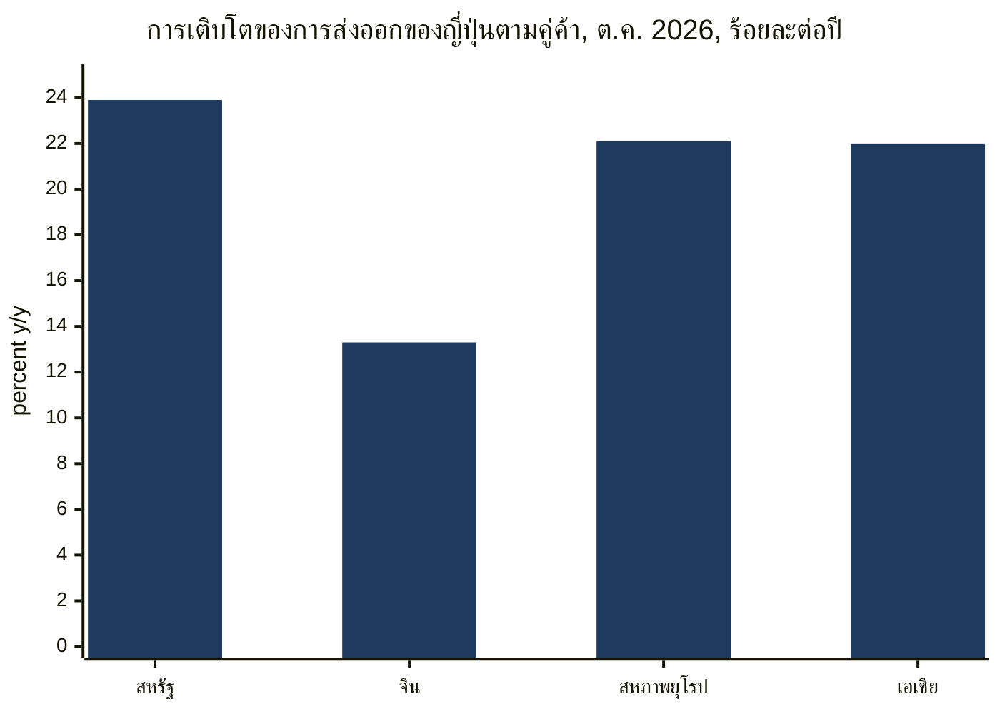

*หมายเหตุ: มูลค่าการส่งออกตามจุดหมาย เดือนตุลาคม 2026 เทียบกับปีก่อน สหรัฐ: รถยนต์เพิ่มขึ้น 37.2% อุปกรณ์ผลิตเซมิคอนดักเตอร์เพิ่มขึ้น 118.5% จีน: รถยนต์ลดลง 53.3% อุปกรณ์ผลิตเซมิคอนดักเตอร์เพิ่มขึ้น 42.6% แหล่งข้อมูล: สถิติการค้าเบื้องต้นของกระทรวงการคลังญี่ปุ่น เดือนตุลาคม 2026*

### ยูโรโซน — บัญชีเดินสะพัดเดือนกันยายน 2026 (ECB เผยแพร่ 19 พฤศจิกายน)

การเผยแพร่ดุลการชำระเงินเดือนกันยายนของ ECB ระบุบัญชีเดินสะพัดของยูโรโซนเกินดุล 12 พันล้านยูโร เปลี่ยนแปลงเล็กน้อยจากเดือนก่อน ดุลสินค้าตามดุลการชำระเงินเกินดุล 14 พันล้านยูโร — เป็นมาตรการที่แตกต่างจากขาดดุลสินค้าตามฐานศุลกากรของ Eurostat ในเดือนกันยายนที่ 10.3 พันล้านยูโร ซึ่งรายงานเมื่อวันที่ 13 พฤศจิกายน และทั้งสองไม่ควรเปรียบเทียบโดยตรง ดุลบริการเกินดุล 16 พันล้านยูโร ขาดดุลรายได้รอง 16 พันล้านยูโร ขาดดุลรายได้หลัก 1 พันล้านยูโร การอ่านค่าบัญชีเดินสะพัดเป็นมาตรวัดที่สะอาดกว่าของสถานะภายนอกของยูโรโซนเมื่อรวมบริการและกระแสรายได้ และแสดงให้เห็นว่ากลุ่มยังคงเกินดุลโดยรวมแม้จะมีขาดดุลสินค้าตามฐานศุลกากร ช่องว่างระหว่างมาตรการสินค้าทั้งสองเป็นแหล่งความสับสนที่ยืนต้นในความเห็นด้านการค้าและควรสังเกตเมื่อการเผยแพร่สินค้าเดือนธันวาคมมาถึง การเผยแพร่ดุลการชำระเงินรายเดือนครั้งต่อไปครบกำหนดวันที่ 18 ธันวาคมและจะครอบคลุมเดือนตุลาคม การเผยแพร่รายไตรมาสตามมาในวันที่ 12 มกราคม [QNC News](https://qncnews.com/2026/11/23/euro-area-current-account-surplus-holds-at-12-billion-euros-in-september/)

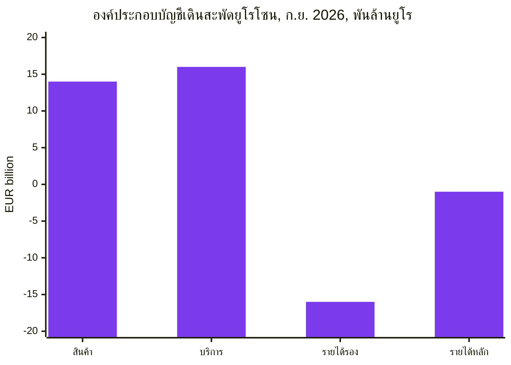

*หมายเหตุ: ตามฐานดุลการชำระเงิน เดือนกันยายน 2026 บัญชีเดินสะพัดเกินดุล 12 พันล้านยูโร แหล่งข้อมูล: ธนาคารกลางยุโรป*

### เยอรมนี — การค้าไฟฟ้าข้ามพรมแดน เก้าเดือนแรกของปี 2026 (Destatis ข่าวประชาสัมพันธ์ฉบับที่ 406 วันที่ 20 พฤศจิกายน)

Destatis รายงานว่าการค้าไฟฟ้าข้ามพรมแดนของเยอรมนีเคลื่อนตัวใกล้สมดุลทางกายภาพในช่วงเก้าเดือนแรกของปี 2026 โดยการส่งออกพุ่งสูงขึ้นและปริมาณการนำเข้าลดลง เยอรมนีส่งออกไฟฟ้า 48.8 TWh มูลค่า 4.3 พันล้านยูโรในเดือนมกราคม–กันยายน 2026 (ปริมาณเพิ่มขึ้น 25.5% เมื่อเทียบกับปีก่อน มูลค่าเพิ่มขึ้น 51.3%) การนำเข้าไฟฟ้าลดลง 13.3% ในปริมาณเหลือ 49.2 TWh แต่มูลค่าเพิ่มขึ้น 20.4% เป็น 5.7 พันล้านยูโร ส่วนเกินการนำเข้าทางกายภาพหดตัว 97.5% เหลือ 0.4 TWh ราคานำเข้าเฉลี่ย 116 ยูโร/MWh (เพิ่มขึ้น 38.9% เมื่อเทียบกับปีก่อน) เทียบกับ 84 ยูโร/MWh ในเดือนมกราคม–กันยายน 2025 ในเดือนกันยายน 2026 เพียงเดือนเดียว เยอรมนีส่งออก 5.4 TWh (เพิ่มขึ้น 22.7% เมื่อเทียบกับปีก่อน มูลค่าเพิ่มขึ้น 122.7% เป็น 0.6 พันล้านยูโร) และนำเข้า 4.6 TWh (ปริมาณลดลง 26.1% มูลค่าเพิ่มขึ้น 64.5% เป็น 0.8 พันล้านยูโร) เป็นรายการเฉพาะกลุ่ม แต่แสดงให้เห็นว่าความไม่สมมาตรของราคาพลังงาน — ไม่ใช่ปริมาณ — ขับเคลื่อนดุลการค้าพลังงานของเยอรมนีในขณะนี้ และเป็นรายงานการค้า Destatis ฉบับเดียวที่พบในช่วงความครอบคลุม ตัวเลขรวบรวมภายใต้กฎการค้าต่างประเทศ (รหัสสินค้า 27160000) และแตกต่างในเชิงวิธีวิทยาจากสถิติพลังงานตามโครงข่าย การเผยแพร่รายละเอียดการค้าสินค้าเดือนกันยายนหลักที่กำหนดไว้วันที่ 20 พฤศจิกายนไม่ได้ระบุแยกต่างหากในการค้นหา [NewsVerum](https://newsverum.com/en/news/germany-electricity-exports-reach-4-3-billion-euros-first-three-quarters-2026)

### สหรัฐ — การค้าเดือนกันยายน 2026 (FT-900) และตัวชี้วัดล่วงหน้าเดือนตุลาคม

ไม่มีรายงานการค้าของสหรัฐตกอยู่ในช่วงความครอบคลุม 16–23 พฤศจิกายน FT-900 ล่าสุด (4 พฤศจิกายน) แสดงขาดดุลเดือนกันยายน 105.0 พันล้านดอลลาร์ แคบกว่าขาดดุลเดือนสิงหาคมที่ปรับปรุงแล้ว 105.7 พันล้านดอลลาร์เล็กน้อย ตั้งแต่ต้นปีขาดดุล 92.4 พันล้านดอลลาร์ (12.2%) น้อยกว่าเดือนมกราคม–กันยายน 2025 การส่งออกเติบโต 11.6% และการนำเข้า 6.2% ในช่วงดังกล่าว ขาดดุลสินค้าล่วงหน้าเดือนกันยายนอยู่ที่ 134.9 พันล้านดอลลาร์ (เผยแพร่ 28 ตุลาคม) เพิ่มขึ้น 2.8 พันล้านดอลลาร์จาก 132.1 พันล้านดอลลาร์ของเดือนสิงหาคม FT-900 เดือนตุลาคมกำหนดวันที่ 8 ธันวาคม 2026 และตัวชี้วัดการค้าสินค้าล่วงหน้าเดือนตุลาคมครบกำหนดวันที่ 27 พฤศจิกายน 2026 สหรัฐเป็นช่องว่างที่ใหญ่ที่สุดเพียงแห่งเดียวในความครอบคลุมข้อมูลของสัปดาห์นี้ การค้าเดือนตุลาคมจะไม่ทราบจนถึงเดือนธันวาคม ดังนั้นการประเมินใด ๆ ว่ากองภาษีส่งผลต่อมูลค่าการนำเข้าเดือนตุลาคมอย่างไรต้องรอ [Value.today](https://www.value.today/economy/usa/releases/trade)

### พอร์ทัลข้อมูล — ไม่พบรายงานสำคัญในช่วงความครอบคลุม

ไม่พบรายงานข้อมูลการค้าใหม่ที่สำคัญจาก USITC DataWeb, UN Comtrade, World Bank WITS, พอร์ทัลข้อมูล World Bank หรือ IMF (WEO/IFS) ในช่วงความครอบคลุม 16–23 พฤศจิกายน World Economic Outlook ของ IMF อัปเดตล่าสุดในเดือนตุลาคม 2026 ไม่พบการอัปเดตเดือนพฤศจิกายน การเผยแพร่การค้าสินค้าครั้งต่อไปของ Eurostat (เดือนตุลาคม) ครบกำหนดวันที่ 18 ธันวาคม 2026 ตัวเลขการค้าของจีนเดือนพฤศจิกายนครบกำหนดในเดือนธันวาคม [Eurostat](https://ec.europa.eu/eurostat/web/international-trade-in-goods/publications)

### สถาบันวิจัย

**ตัวติดตามภาษีของ Tax Foundation: อัตราที่ใช้ 11.8% อัตราที่แท้จริง 7.2% 1.4 ล้านล้านดอลลาร์สหรัฐในสิบปี** ตัวติดตามของ Tax Foundation นับการเปลี่ยนแปลงนโยบายภาษีของสหรัฐมากกว่า 50 ครั้งนับตั้งแต่เดือนมกราคม 2025 ประมาณการสำคัญ: ภาษีใหม่ใช้กับสินค้านำเข้าของสหรัฐ 54% ในปี 2026 อัตราภาษีที่ใช้เพิ่มขึ้นเป็น 11.8% (จาก 1.5% ในปี 2022) อัตราที่แท้จริง (ภาษีที่เก็บได้เป็นส่วนแบ่งของการนำเข้า) คือ 7.2% สำหรับปีปฏิทิน 2026 ภาษีที่กำหนดและที่วางแผนไว้จะระดมได้ 1.4 ล้านล้านดอลลาร์สหรัฐตั้งแต่ปี 2026 ถึง 2035 ตามฐานปกติ (1 ล้านล้านดอลลาร์สหรัฐตามฐานพลวัต) GDP ระยะยาวลดลง 0.4% สต็อกทุนลดลง 0.3% ชั่วโมงการทำงานลดลง 338,000 งานเต็มเวลา ภาษีเพิ่มภาษีเฉลี่ย 1,000 ดอลลาร์สหรัฐต่อครัวเรือนสหรัฐในปี 2025 และประมาณ 820 ดอลลาร์สหรัฐต่อครัวเรือนในปี 2026 เนื่องจากภาษีใหม่ยังไม่ได้ทดแทนภาษี IEEPA ที่ศาลสูงสุดยกเลิกอย่างเต็มที่ ภาษีโพลีซิลิคอนตามมาตรา 232 (15% หรือ 10% สำหรับสหราชอาณาจักร) มีผลวันที่ 4 ธันวาคม 2026 ต้นทุนครัวเรือนลดลงจาก 1,000 ดอลลาร์สหรัฐในปี 2025 เหลือ 820 ดอลลาร์สหรัฐในปี 2026 เพราะภาษี IEEPA ที่ถูกยกเลิกยังไม่ได้ถูกทดแทนอย่างเต็มที่ — เป็นการแก้ไขที่มีประโยชน์ต่อการอ่านตัวเลขรายได้ว่าเพิ่มขึ้นอย่างง่าย ๆ [Tax Foundation](https://taxfoundation.org/research/federal-tax/trump-tariffs-trade-war/page/20/)

**Yale Budget Lab: อัตราภาษีเฉลี่ย 11.2% ในเดือนพฤศจิกายน ประมาณ 900 ดอลลาร์สหรัฐต่อครัวเรือนต่อปี** การนับของ Yale เมื่อวันที่ 2 พฤศจิกายนระบุอัตราภาษีตามกฎหมายเฉลี่ยที่ 11.8% เพิ่มขึ้นเป็น 11.9% ภายในสิ้นปีภายใต้กฎหมายปัจจุบัน การนับรายวันอยู่ที่ 11.76% มาตั้งแต่วันที่ 29 กันยายน อัตราที่แท้จริงเฉลี่ยอยู่ที่ประมาณ 11.2% ในเดือนพฤศจิกายน 2026 เทียบกับประมาณ 2.5% ในเดือนมกราคม 2025 ผู้อำนวยการบริหาร Martha Gimbel บอกกับ Marketplace เมื่อวันที่ 5 พฤศจิกายนว่า ครัวเรือนเผชิญประมาณ 1,100 ดอลลาร์สหรัฐต่อปีในอัตราปัจจุบัน (ตัวเลขรายงานวันที่ 24 สิงหาคม วัดที่น้ำหนักการนำเข้าคงที่) และประมาณ 0.7% ต่อราคาผู้บริโภค การประมาณการปีปฏิทิน 2026 ของ Budget Lab อยู่ที่ประมาณ 900 ดอลลาร์สหรัฐต่อครัวเรือนต่อปี ภาษีนำรายได้เกือบ 2 ล้านล้านดอลลาร์สหรัฐในสิบปี งานวิจัยของ Tobin Center ของ Yale พบว่าภาษีที่ตรวจสอบประมาณ 80%–100% สะท้อนในราคาที่สูงขึ้นที่ผู้นำเข้าชาวอเมริกันจ่าย โดยมีค่าประมาณกลางประมาณ 90% Yale และ Tax Foundation เห็นพ้องเรื่องอัตราตามกฎหมาย (ประมาณ 11.8%) แต่แตกต่างกันเรื่องต้นทุนครัวเรือน — 820 ดอลลาร์สหรัฐ (Tax Foundation ปี 2026 ตามสิ่งที่นำเข้าจริง) เทียบกับประมาณ 900–1,100 ดอลลาร์สหรัฐ (Yale ขึ้นอยู่กับวิธีและน้ำหนัก) — เนื่องจากทั้งสองใช้วิธีที่แตกต่างกัน ไม่ใช่ข้อเท็จจริงที่แตกต่างกัน ข้อค้นพบเรื่องการส่งผ่าน (ประมาณ 90% ของภาษีสะท้อนในราคาผู้นำเข้า) เป็นตัวเลขที่สำคัญในเชิงวิเคราะห์ สนับสนุนการประมาณการต้นทุนครัวเรือนและขัดแย้งกับข้ออ้างว่าผู้ส่งออกต่างชาติรับภาระภาษี การเพิ่มขึ้นในเดือนธันวาคมเป็น 11.9% อยู่ในกฎหมายปัจจุบันแล้ว [Geopolitiqs](https://geopolitiqs.com/tn/2026-11-09/tariffs-average-rate)

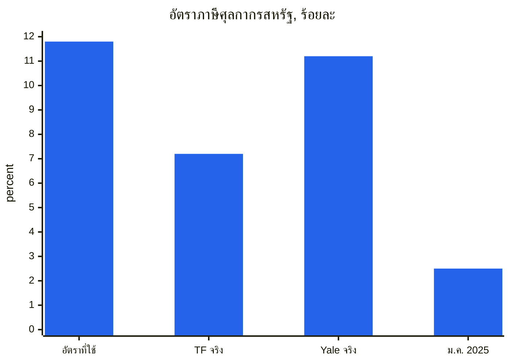

*หมายเหตุ: อัตราตามกฎหมายที่ใช้ 11.8% (ทั้งสองสถาบันเห็นพ้อง); อัตราที่แท้จริงของ Tax Foundation 7.2% สำหรับปีปฏิทิน 2026 (ภาษีที่เก็บได้เป็นส่วนแบ่งของการนำเข้า); อัตราที่แท้จริงเฉลี่ยของ Yale Budget Lab ประมาณ 11.2% ในเดือนพฤศจิกายน 2026; ประมาณ 2.5% ในเดือนมกราคม 2025 แหล่งข้อมูล: Tax Foundation; Budget Lab ที่ Yale*

---

## 9. ตลาดค่าระวาง

### อัตราค่าระวางตู้คอนเทนเนอร์ — Drewry World Container Index

ดัชนี Drewry World Container Index ลดลง 3% เหลือ 4,176 ดอลลาร์ต่อตู้ 40 ฟุตเมื่อวันที่ 19 พฤศจิกายน เป็นการลดลงติดต่อกันสัปดาห์ที่สี่ แม้ยังสูงกว่าปีก่อน 126% อัตราค่าระวางข้ามแปซิฟิกลดลงเป็นสัปดาห์ที่เจ็ดติดต่อกัน เซี่ยงไฮ้–นิวยอร์กลดลง 9% เหลือ 8,194 ดอลลาร์ ต่ำที่สุดในรอบ 15 สัปดาห์ และเซี่ยงไฮ้–ลอสแอนเจลิสลดลง 5% เหลือ 7,026 ดอลลาร์ ต่ำที่สุดในรอบ 12 สัปดาห์ เซี่ยงไฮ้–เจนัวเพิ่มขึ้น 6% เป็น 4,436 ดอลลาร์หลังทรงตัวสามสัปดาห์ ขณะที่เซี่ยงไฮ้–รอตเตอร์ดัมไม่เปลี่ยนแปลงที่ 3,496 ดอลลาร์ Drewry คาดว่าอัตราค่าระวางข้ามแปซิฟิกจะลดลงอีกในสัปดาห์หน้า มีการประกาศงดเดินเรือเปล่า 10 เที่ยวสำหรับสัปดาห์ถัดไป เทียบกับ 4 เที่ยวในสัปดาห์นี้ ดัชนีรวมลดลงประมาณ 9% ในสี่สัปดาห์ (จาก 4,585 ดอลลาร์เมื่อวันที่ 22 ตุลาคม) ตลาดตู้คอนเทนเนอร์แยกทางกันเพิ่มเติม อัตราค่าระวางข้ามแปซิฟิกลดลงอย่างรุนแรงเป็นสัปดาห์ที่เจ็ดติดต่อกัน ขณะที่อัตราค่าระวางเมดิเตอร์เรเนียนฟื้นตัว 6% และอัตราค่าระวางข้ามแอตแลนติกเพิ่มขึ้น 2% ในทั้งสองทิศทาง (รอตเตอร์ดัม–นิวยอร์ก 3,146 ดอลลาร์; นิวยอร์ก–รอตเตอร์ดัม 1,217 ดอลลาร์) [Drewry](https://www.drewry.co.uk/supply-chain-advisors/world-container-index-weekly-update?topics=Container%20Shipping)

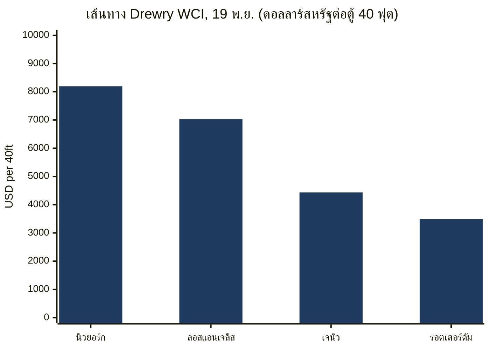

*หมายเหตุ: อัตราค่าระวางจากเซี่ยงไฮ้ต่อตู้ 40 ฟุต วันที่ 19 พฤศจิกายน 2026 แหล่งข้อมูล: Drewry World Container Index*

### Freightos Baltic Index

Freightos รายงานเส้นทางเอเชีย–ชายฝั่งตะวันตกของสหรัฐที่ 8,459 ดอลลาร์ต่อ FEU (เพิ่มขึ้น 3%) เอเชีย–ชายฝั่งตะวันออกของสหรัฐที่ 9,848 ดอลลาร์ (เพิ่มขึ้น 1%) เอเชีย–ยุโรปเหนือทรงตัวที่ 3,407 ดอลลาร์ และเอเชีย–เมดิเตอร์เรเนียนที่ 4,295 ดอลลาร์ (ลดลง 1%) ในการอัปเดตวันที่ 17 พฤศจิกายน อัตราค่าระวางเอเชีย–ยุโรปสูงกว่าปีก่อน 40–50% เอเชีย–ยุโรปเหนือลดลง 5% เมื่อเทียบกับปลายเดือนตุลาคม ค่า FBX รวมทั่วโลกสำหรับการอัปเดตวันที่ 17 พฤศจิกายนคือ n/a — การอัปเดตรายสัปดาห์ไม่ได้ระบุตัวเลขทั่วโลก (ค่าอ่านตัวติดตามที่ 3,419 ดอลลาร์ต่อ FEU สำหรับ FBX ทั่วโลกบันทึกเมื่อวันที่ 22 พฤศจิกายน ค่าอ่านทั่วโลกรายสัปดาห์ก่อนหน้าคือ 3,452 ดอลลาร์เมื่อวันที่ 10 พฤศจิกายน) ค่าเลนของ Freightos ขยับขึ้นเล็กน้อยในเส้นทางข้ามแปซิฟิกแม้ค่าอ่านเส้นทางเดียวกันของ Drewry จะลดลง — ทั้งสองดัชนีวัดตะกร้าอัตราและสัปดาห์ที่แตกต่างกัน และช่องว่าง (Freightos เอเชีย–ชายฝั่งตะวันตกของสหรัฐ 8,459 ดอลลาร์ เทียบกับ Drewry เซี่ยงไฮ้–ลอสแอนเจลิส 7,026 ดอลลาร์) เป็นเครื่องเตือนไม่ให้ผสมกัน Freightos ระบุว่า GRI เดือนพฤศจิกายนไม่ยืน แผนขึ้นราคากลางเดือนอาจล้มเหลวเช่นกัน และผู้ให้บริการขนส่งกำลังเพิ่มการงดเดินเรือเปล่า การขึ้นราคาเดือนธันวาคมประกาศแล้วและอาจยืนหากได้รับการสนับสนุนจากความต้องการก่อนตรุษจีน Freightos เตือนว่าการกลับมาใช้เส้นทางทะเลแดงบวกการเติบโตของกองเรือเพิ่มความเสี่ยงกำลังการผลิตส่วนเกินในปีหน้า ซึ่งเป็นกรอบแนวโน้มปี 2027 [Freightos](https://www.freightos.com/freight-resources/us-air-cargo-recovering-from-outage-new-us-cn-tensions-ahead-of-talks-november-17-2026-update/)

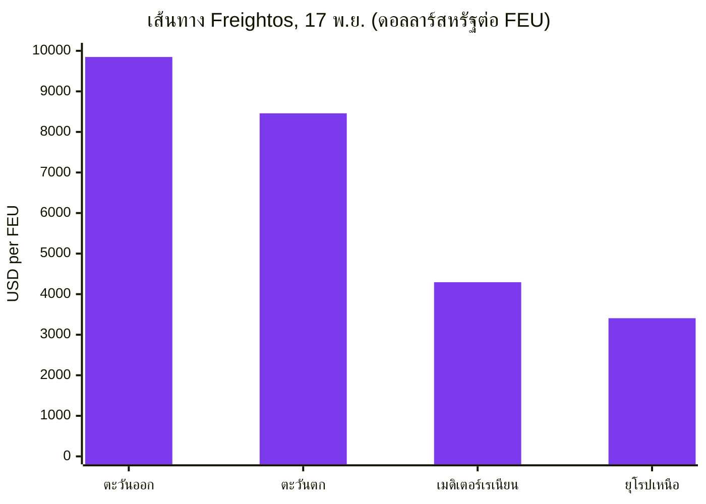

*หมายเหตุ: อัตราค่าระวางจากเอเชียต่อ FEU วันที่ 17 พฤศจิกายน 2026 แหล่งข้อมูล: Freightos Baltic Index*

### Shanghai Containerized Freight Index

ดัชนีรวม SCFI ลดลงเหลือ 3,503.78 เมื่อวันที่ 20 พฤศจิกายน ลดลง 68.55 จุด (ลดลง 1.92%) สัปดาห์ต่อสัปดาห์ จาก 3,572.33 เมื่อวันที่ 13 พฤศจิกายน — เป็นการลดลงติดต่อกันสัปดาห์ที่สาม โดยขาดทุนขยายกว้างขึ้นในแต่ละสัปดาห์ (ลดลง 1.46% ลดลง 1.68% ลดลง 1.92%) ต่ำที่สุดนับตั้งแต่กลางเดือนกันยายน สูญเสีย 129.67 จุดในสามสัปดาห์จาก 3,687.35 เมื่อวันที่ 30 ตุลาคม เซี่ยงไฮ้–ชายฝั่งตะวันตกของสหรัฐ 6,711 ดอลลาร์ต่อ FEU (ลดลง 400 ดอลลาร์ ลดลง 5.63%) เซี่ยงไฮ้–ชายฝั่งตะวันออกของสหรัฐ 8,776 ดอลลาร์ต่อ FEU (ลดลง 611 ดอลลาร์ ลดลง 6.51%) เซี่ยงไฮ้–เมดิเตอร์เรเนียน 3,678 ดอลลาร์ต่อ TEU (เพิ่มขึ้น 1.63%) เซี่ยงไฮ้–ยุโรป 2,291 ดอลลาร์ต่อ TEU Santos 3,110 ดอลลาร์ต่อ TEU (ลดลง 15.19%) ดัชนี China Containerized Freight Index (CCFI อัตราสัญญา) เพิ่มขึ้น 0.21% เป็น 1,923.21 เป็นการเพิ่มขึ้นติดต่อกันสัปดาห์ที่สอง — แตกต่างจาก SCFI แบบสปอต ดัชนีสามตัว (Drewry, เลน Freightos, SCFI) ขณะนี้เห็นพ้องว่าตลาดสปอตข้ามแปซิฟิกกำลังปรับฐานอย่างรุนแรงเข้าสู่ช่วงเงียบหลังฤดูกาลพีค โดยเลนชายฝั่งตะวันออกของสหรัฐของ SCFI ลดลงมากกว่า 600 ดอลลาร์ในหนึ่งสัปดาห์ การเพิ่มขึ้นของ CCFI ชี้ให้เห็นว่าผู้ส่งสินค้าที่ใช้อัตราสัญญายังไม่เห็นประโยชน์ — ช่องว่างที่สำคัญต่อกำหนดเวลาประมูลปี 2027 [Forwarder News](https://www.forwardernews.com/news/2026-11-20-scfi-falls-a-third-week)

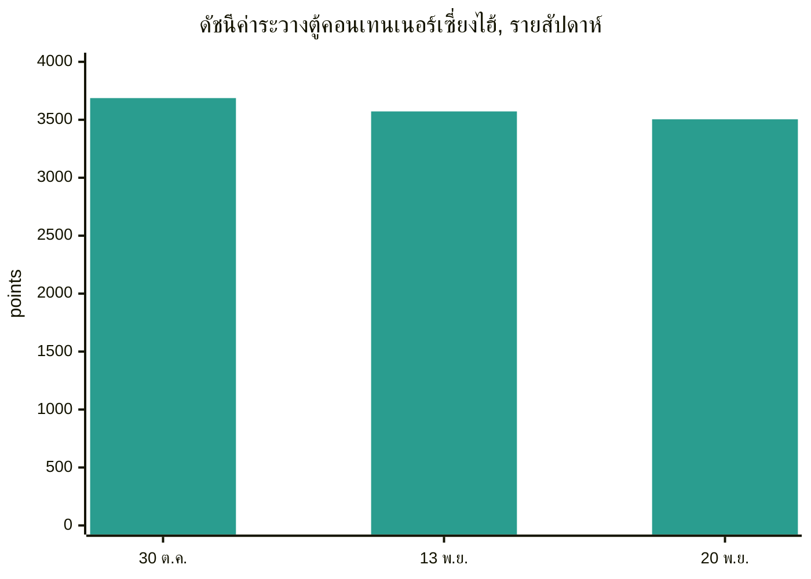

*หมายเหตุ: ดัชนีรวม SCFI รายสัปดาห์ แหล่งข้อมูล: Shanghai Shipping Exchange*

### การขึ้นราคาพฤศจิกายน — ประกาศแล้ว แต่ตลาดไม่รับ

ผู้ให้บริการขนส่งประกาศค่าธรรมเนียมช่วงพีค 1,000–1,600 ดอลลาร์ต่อตู้ 40 ฟุตสำหรับเส้นทางเอเชีย–ยุโรป/เมดิเตอร์เรเนียนตั้งแต่เดือนธันวาคม การขึ้นราคาทั่วไปในเดือนพฤศจิกายนไม่ยืน ตามที่ Freightos ระบุ และแผนขึ้นราคากลางเดือนอาจล้มเหลวเช่นกัน การขึ้นราคาเดือนธันวาคมประกาศแล้วและอาจยืนหากได้รับการสนับสนุนจากความต้องการก่อนตรุษจีน รูปแบบของฤดูใบไม้ร่วง — การขึ้นราคาที่ประกาศไว้ไม่ยืนท่ามกลางความต้องการที่อ่อนแอ — กลายเป็นจังหวะที่มั่นคงของตลาดแล้ว [Freightos](https://www.freightos.com/freight-resources/us-air-cargo-recovering-from-outage-new-us-cn-tensions-ahead-of-talks-november-17-2026-update/)

### การงดเดินเรือเปล่าและความจุ

มีการประกาศงดเดินเรือเปล่า 10 เที่ยวสำหรับสัปดาห์ถัดไป เทียบกับ 4 เที่ยวในสัปดาห์นี้ ตัวติดตามการยกเลิกการเดินเรือของ Drewry คาดการณ์การงดเดินเรือเปล่า 52 เที่ยวจากบริการที่กำหนดไว้ 716 เที่ยวในการค้าตะวันออก–ตะวันตกหลักระหว่างวันที่ 16 พฤศจิกายนถึง 21 ธันวาคม (ประมาณ 7%) ผู้ให้บริการขนส่งพึ่งพาการงดเดินเรือเปล่ามากขึ้นเมื่อการปรับฐานข้ามแปซิฟิกลึกขึ้น และการกลับมาใช้เส้นทางสุเอซของ Gemini ปลดปล่อยความจุเพิ่มเติมเข้าสู่ปี 2027 [Drewry](https://www.drewry.co.uk/supply-chain-advisors/world-container-index-weekly-update?topics=Container%20Shipping)

### สินค้าเทกองแห้ง — Baltic Exchange

ดัชนี Baltic Dry Index ปิดที่ 2,898 เมื่อวันที่ 20 พฤศจิกายน ลดลง 82 จุด (ลดลง 2.8%) สัปดาห์ต่อสัปดาห์ จาก 2,980 เมื่อวันที่ 13 พฤศจิกายน — สิ้นสุดการเพิ่มขึ้นติดต่อกันสี่สัปดาห์ เส้นทางรายวัน: 2,921 (วันจันทร์ที่ 16 พฤศจิกายน) 2,893 (วันอังคาร) 2,914 (วันพุธ) 2,901 (วันพฤหัสบดี) 2,898 (วันศุกร์) ดัชนี Capesize 4,502 (ลดลง 4.6% สัปดาห์ต่อสัปดาห์ จาก 4,719) รายได้เฉลี่ยต่อวันของ Capesize 40,827 ดอลลาร์ (วันศุกร์; 37,184 ดอลลาร์เมื่อวันอังคารที่ 17 พฤศจิกายน) ดัชนี Panamax 2,140 (เพิ่มขึ้น 1.0% สัปดาห์ต่อสัปดาห์ จาก 2,118) สูงสุดนับตั้งแต่วันที่ 22 ตุลาคม รายได้ต่อวันของ Panamax 19,264 ดอลลาร์ ดัชนี Supramax 1,810 (ลดลง 1.4% สัปดาห์ต่อสัปดาห์ จาก 1,836) รายได้ต่อวัน 22,884 ดอลลาร์ ดัชนี Handysize 1,072 (เพิ่มขึ้น 2.4% สัปดาห์ต่อสัปดาห์) เส้นทาง C5 (ออสเตรเลียตะวันตก–ชิงเต่า แร่เหล็ก) ปิดสัปดาห์ที่ 14.40 ดอลลาร์ต่อตัน ฟื้นตัวจากระดับต่ำกลางสัปดาห์ที่ 13.40 ดอลลาร์ สินค้าเทกองแห้งปรับตัวลงหลังเพิ่มขึ้นสี่สัปดาห์ โดย Capesize เป็นตัวฉุดหลัก (ลดลง 4.6% ในสัปดาห์) จากความต้องการแอตแลนติกเหนือที่อ่อนแอและรายชื่อเรือว่างที่ยาวขึ้น ขณะที่ Panamax เพิ่มขึ้นแตะระดับสูงสุดในรอบหนึ่งเดือนจากความต้องการธัญพืชและถ่านหิน การแยกทาง — Capesize ลง Panamax ขึ้น — ชี้ว่าความต้องการแร่เหล็กอ่อนตัวลงขณะที่การค้าธัญพืชและถ่านหินคงอยู่ ซึ่งเป็นสัญญาณนำที่มีประโยชน์สำหรับความต้องการสินค้าโภคภัณฑ์เข้าสู่ปลายปี [HandyBulk](https://www.handybulk.com/baltic-dry-index/)

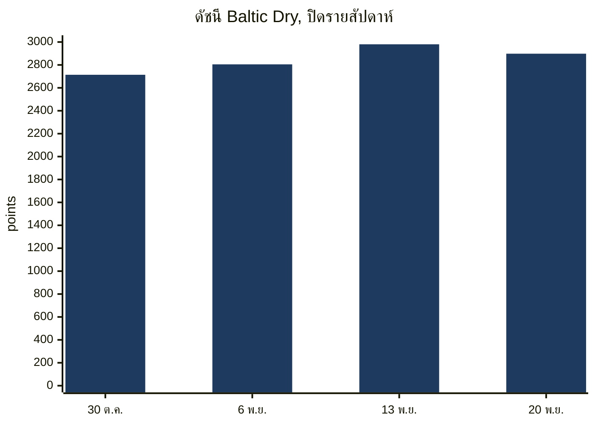

*หมายเหตุ: ดัชนี Baltic Dry ปิดรายสัปดาห์ แหล่งข้อมูล: Baltic Exchange*

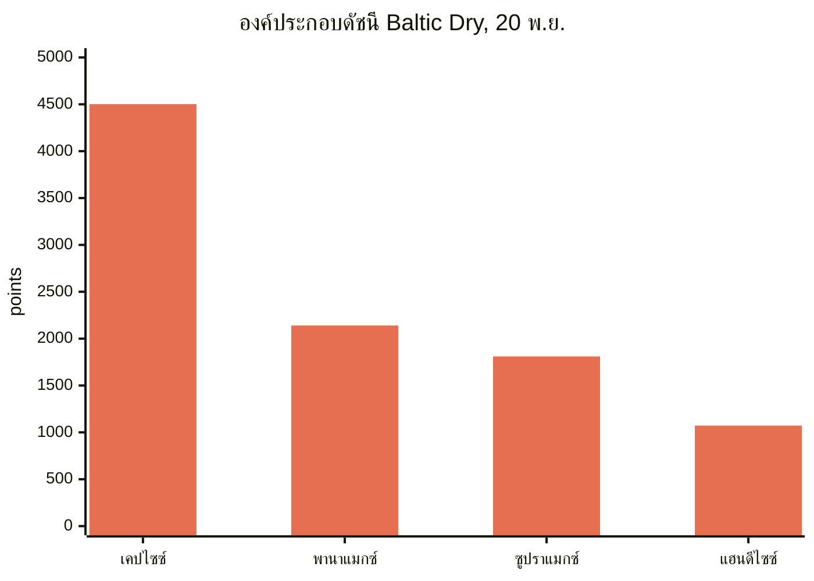

*หมายเหตุ: ดัชนีรายกลุ่มของ Baltic Exchange วันที่ 20 พฤศจิกายน 2026 แหล่งข้อมูล: Baltic Exchange*

### สุเอซและความน่าเชื่อถือของตารางเดินเรือ

Maersk และ Hapag-Lloyd ประกาศเมื่อวันที่ 16 พฤศจิกายนว่า บริการ AE1, AE2 และ AE3 ของ Gemini Cooperation จะกลับมาใช้เส้นทางข้ามสุเอซและทะเลแดง แทนการเดินทางอ้อมแหลมกูดโฮป การเปลี่ยนผ่านเป็นแบบเป็นขั้น AE2 ก่อน โดยเรือ Mary Maersk (เที่ยว 650W) เริ่มการหมุนเวียนที่หนิงโปในวันที่ 4 ธันวาคม AE3 ตามมาด้วยเรือ Alette Maersk (เที่ยว 652W) เริ่มที่เซี่ยงไฮ้ในวันที่ 20 ธันวาคม AE1 เริ่มด้วยเรือ Damietta Express (เที่ยว 702W) เริ่มที่เซี่ยงไฮ้ในวันที่ 14 มกราคม 2027 การหมุนเวียนที่ปรับปรุงรวมถึงการผ่านคลองสุเอซทั้งสองทิศทาง การเคลื่อนไหวดังกล่าวตามการฟื้นฟูบริการ AE5, AE11, AE12, ME2 และ ME1 ก่อนหน้านี้ ตามข้อมูลของ Linerlytica การกลับมาของบริการสามเส้นทางนี้ทำให้ Maersk และ Hapag-Lloyd เป็นพันธมิตรแรกที่ฟื้นฟูเส้นทางสุเอซในบริการเอเชีย–ยุโรปทั้งหมด การเปลี่ยนเส้นทางลดจำนวนเรือใน AE2 จาก 14 ลำเหลือ 13 ลำ และใน AE3 จาก 13 ลำเหลือ 11 ลำ ปลดปล่อยความจุ Maersk ระบุว่าการเปลี่ยนแปลงจะปรับปรุงเวลาเดินทาง ขณะที่เตือนว่าการดำเนินการขึ้นอยู่กับความมั่นคงที่ต่อเนื่องในทะเลแดงและการติดตามสถานการณ์ความมั่นคงในภูมิภาคอย่างต่อเนื่อง Evergreen เป็นสมาชิกรายสุดท้ายของ Ocean Alliance ที่กลับมาผ่านสุเอซ ZIM ยังคงเป็นผู้ให้บริการรายใหญ่ที่โดดเด่นที่สุดที่ยังคงเดินเรือบริการเอเชีย–ยุโรปอ้อมแหลม Drewry นับเรือคอนเทนเนอร์ผ่านคลองได้ 53 ลำในสัปดาห์ถึงวันที่ 1 พฤศจิกายน เพิ่มขึ้น 130% เมื่อเทียบกับปีก่อน และประเมินว่าความจุเอเชีย–ยุโรปประมาณ 60% กลับมาใช้เส้นทางสุเอซแล้ว DHL ประเมินว่าการปรับเครือข่ายในวงกว้างอาจใช้เวลาอีก 6–12 เดือน Flexport คาดการณ์ความจุที่มาถึงท่าเรือยุโรปเหนือ 131% ของปกติในสัปดาห์ที่ 16–22 พฤศจิกายนเมื่อเรือที่มาถึงพร้อมกัน [FreightWaves](https://www.freightwaves.com/news/maersk-and-hapag-lloyd-restore-asia-europe-suez-routes-as-u-s-shippers-watch-capacity-and-costs)

### ค่าระวางอากาศ

ดัชนี Baltic Air Freight Index (BAI00) เพิ่มขึ้น 6.6% ในสัปดาห์ถึงวันที่ 9 พฤศจิกายน (เพิ่มขึ้น 28.2% เมื่อเทียบกับปีก่อน) แตะระดับสูงสุดของปี 2026 จากนั้นลดลง 1.5% ในเจ็ดวันถึงวันที่ 16 พฤศจิกายน (เพิ่มขึ้น 20.8% เมื่อเทียบกับปีก่อน) ฮ่องกงขาออก (BAI30) ลดลง 4.5% สัปดาห์ต่อสัปดาห์ถึงวันที่ 16 พฤศจิกายน (เพิ่มขึ้น 19.0% เมื่อเทียบกับปีก่อน) เซี่ยงไฮ้ขาออก (BAI80) ลดลง 2.7% (เพิ่มขึ้น 13.1%) แฟรงก์เฟิร์ตขาออก (BAI20) ลดลง 2.7% (เพิ่มขึ้น 36.4%) ลอนดอนฮีทโธรว์ขาออก (BAI40) ลดลง 9.4% (เพิ่มขึ้น 2.6%) ชิคาโกขาออก (BAI50) พุ่งขึ้น 39.2% สัปดาห์ต่อสัปดาห์ (เพิ่มขึ้น 72.1% เมื่อเทียบกับปีก่อน) หลังระบบควบคุมจราจรทางอากาศของสหรัฐขัดข้อง ในสัปดาห์ถึงวันที่ 9 พฤศจิกายน แฟรงก์เฟิร์ตขาออกเพิ่มขึ้น 9.9% สัปดาห์ต่อสัปดาห์ ลอนดอนเพิ่มขึ้น 5.6% ฮ่องกงเพิ่มขึ้น 4.6% เซี่ยงไฮ้เพิ่มขึ้น 5.7% ดัชนี Freightos Air Index (อัปเดต 17 พฤศจิกายน): จีน–อเมริกาเหนือ 9.25 ดอลลาร์/กก. (เพิ่มขึ้น 16% สัปดาห์ต่อสัปดาห์) สูงกว่าจุดสูงสุดช่วงพีคปี 2025 ที่ 8.00 ดอลลาร์/กก. ซึ่งแตะเพียงกลางเดือนธันวาคมปีที่แล้ว จีน–ยุโรปเหนือ 5.05 ดอลลาร์/กก. (เพิ่มขึ้น 4%) ยุโรปเหนือ–อเมริกาเหนือ 3.27 ดอลลาร์/กก. (เพิ่มขึ้น 12%) สูงสุดนับตั้งแต่เดือนธันวาคม 2022 Xeneta ค่าเฉลี่ยสปอตทั่วโลกเดือนตุลาคม 3.11 ดอลลาร์/กก. (เพิ่มขึ้น 29% เมื่อเทียบกับปีก่อน) TAC สปอตทั่วโลกประมาณ 3.93 ดอลลาร์/กก. ในสัปดาห์ที่ 44 (เพิ่มขึ้น 4% สัปดาห์ต่อสัปดาห์ ประมาณ 40% เมื่อเทียบกับปีก่อน) น้ำมันเครื่องบิน: การติดตามของ IATA ลดลง 6.5% ในสัปดาห์ถึงวันที่ 6 พฤศจิกายน และ 11.7% ในเดือนถึงวันที่ 13 พฤศจิกายน [Baltic Exchange](https://www.balticexchange.com/en/news-and-events/news/guest-column/2026/Air-freight-rates-surge-past-previous-peak-season-highs-as-jet-fuel-prices-soar.html)

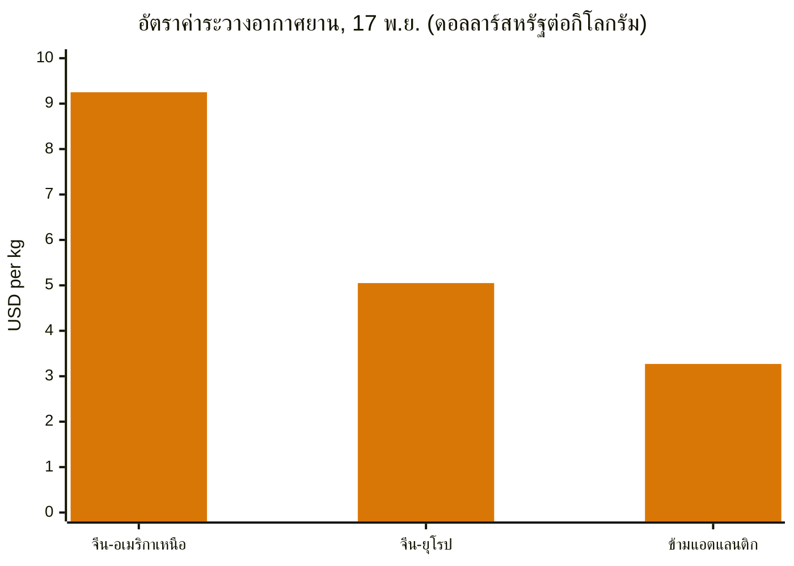

*หมายเหตุ: Freightos Air Index วันที่ 17 พฤศจิกายน 2026 จีน–อเมริกาเหนือสูงกว่าจุดสูงสุดช่วงพีคปี 2025 ที่ 8.00 ดอลลาร์/กก. เส้นทางข้ามแอตแลนติกสูงสุดนับตั้งแต่เดือนธันวาคม 2022 แหล่งข้อมูล: Freightos*

**การหยุดชะงัก:** ระบบควบคุมจราจรทางอากาศของสหรัฐขัดข้องทำให้เที่ยวบินหลายพันเที่ยวต้องหยุดบินในช่วงสุดสัปดาห์วันที่ 14–15 พฤศจิกายน — การหยุดบินทั่วประเทศของ FAA เมื่อวันที่ 13 พฤศจิกายน (เราเตอร์ตัวเดียวที่ชำรุดที่ El Dorado รัฐอาร์คันซอ ส่งผลกระทบต่อศูนย์ควบคุมจราจรทางอากาศ 17 จาก 22 แห่ง) รบกวนเที่ยวบินมากกว่า 20,000 เที่ยวในช่วงสุดสัปดาห์ และทิ้งงานค้างด้านค่าระวางอากาศเข้าสู่สัปดาห์ถัดไป FAA ระงับการติดตั้งเราเตอร์ใหม่เมื่อวันที่ 17 พฤศจิกายน และรัฐบาลเพิ่มประมาณการต้นทุนการปรับปรุงระบบควบคุมจราจรทางอากาศให้เกิน 50 พันล้านดอลลาร์ การขัดข้องของ Microsoft เพิ่มความหยุดชะงัก TAC ระบุว่าข้อมูลมีช่องว่างมากกว่าปกติ Freightos ระบุว่าอัตราค่าระวางอากาศระหว่างประเทศไปยังสหรัฐไม่ได้พุ่งสูงขึ้นอย่างมีนัยสำคัญอันเป็นผลจากการขัดข้อง ค่าระวางอากาศแตะระดับสูงสุดของปี 2026 ในสัปดาห์ถึงวันที่ 9 พฤศจิกายน จากความต้องการชิปและฮาร์ดแวร์ AI บวกปริมาณช่วงพีค โดยอัตราค่าระวางจีน–อเมริกาเหนือผ่านจุดสูงสุดของปีที่แล้วเร็วกว่าหนึ่งเดือน การถอยลงเมื่อวันที่ 16 พฤศจิกายนอาจเป็นการพักตัวมากกว่าการกลับทิศ TAC ระบุว่ายังเหลือช่วงพีคอีกหลายสัปดาห์ การประท้วงของเจ้าหน้าที่ควบคุมจราจรทางอากาศเบลเยียมเมื่อวันที่ 23 พฤศจิกายน (ดู A11) ตามหลังการหยุดบินของ FAA สิบวันก่อนหน้า เน้นย้ำว่าช่องว่างในโครงสร้างพื้นฐานค่าระวางอากาศบางเพียงใดในช่วงพีคนี้ [Air Cargo News](https://www.aircargonews.net/cargo-airport/2026/11/us-air-cargo-supply-chains-recover-following-ground-stop/)

### การหยุดชะงักที่ท่าเรือและโลจิสติกส์

**ลอสแอนเจลิส / ลองบีช** ดู A7 ภัยคุกคามการประท้วงที่แขวนอยู่เหนือประตูขนส่งตู้คอนเทนเนอร์ที่ใหญ่ที่สุดของสหรัฐตั้งแต่วันที่ 1 พฤศจิกายนถูกหลีกเลี่ยงในนาทีสุดท้ายด้วยข้อตกลงเบื้องต้นเมื่อวันที่ 21 พฤศจิกายน การให้สัตยาบันยังค้างอยู่และสหภาพยังไม่ได้ให้ความเห็นต่อสาธารณะ งานค้างด้านรถไฟที่ศูนย์ท่าเรือ (ตู้คอนเทนเนอร์นำเข้า 35,688 ตู้ที่รอรถไฟบนท่า ณ วันที่ 2 พฤศจิกายน) ยังคงอยู่ และเวลาที่ตู้คอนเทนเนอร์นำเข้ารอรถไฟเกินเก้าวัน ตามที่ผู้อำนวยการบริหารท่าเรือลอสแอนเจลิสระบุ การปิดสะพาน Vincent Thomas (7 พฤศจิกายน 16 เดือน) ดำเนินต่อไปแยกต่างหาก [Maritime Executive](https://maritime-executive.com/article/ports-of-la-and-long-beach-avert-strike-as-watchmen-reach-deal)

**เดอร์บัน** ความแออัดของเดอร์บันลึกขึ้นในช่วงความครอบคลุมแม้ปริมาณงานของท่าเรือจะดีขึ้น Durban Gateway Terminal จัดการ 36,332 TEU ในสัปดาห์รายงานล่าสุด (เพิ่มขึ้น 28% สัปดาห์ต่อสัปดาห์ ประสิทธิภาพด้านน้ำที่แข็งแกร่งที่สุดในรอบ 4 เดือน) แต่เวลาเฉลี่ยที่เรือรอทอดสมอเพิ่มขึ้นจาก 189 ชั่วโมงเป็น 263 ชั่วโมง (เกือบ 11 วัน) แม้เรือที่รออยู่กลางทะเลลดลงจาก 14 ลำเหลือ 11 ลำ การใช้พื้นที่ลานประมาณ 69% ห่วงโซ่อุปทานที่ได้รับผลกระทบเผชิญความล่าช้าเพิ่มเติมตั้งแต่ต้นจนจบเกิน 20 วัน รัฐมนตรีว่าการกระทรวงคมนาคม Barbara Creecy ให้เวลา ICTSI สามเดือนในการปรับปรุงประสิทธิภาพ มิฉะนั้นเสี่ยงสูญเสียใบอนุญาตท่าเรือ (ตาม Moneyweb) มาตรการฉุกเฉินของ Transnet (18 พฤศจิกายน): จัดสรรท่าเทียบเรือ 102 ให้เรือที่มีเครน เลี่ยงไปท่าเรือ Ngqura Container Terminal เพิ่มการเคลื่อนย้ายทางรถไฟ ปั้นจั่นท่าเรือต่อเรือลำสุดท้ายที่ปรับปรุงแล้วที่ท่าเรือ 1 เริ่มใช้งานวันที่ 20 พฤศจิกายนและส่งมอบวันที่ 21 พฤศจิกายน DGT ยอมรับ "ข้อบกพร่องด้านบริการอย่างต่อเนื่อง" โดยโทษสภาพอุปกรณ์ที่แย่และไม่ปลอดภัยหลังขาดการลงทุนมาหลายปี DGT ผูกมัดเงินกว่า 2 พันล้านแรนด์ในสามปีเพื่อยกระดับอุปกรณ์ท่าเรือ 2 ค่าธรรมเนียมช่วงพีค 1,000/2,000 ดอลลาร์ของ Maersk และค่าธรรมเนียมความแออัด 400/800 ดอลลาร์ยังคงมีผล ภัยคุกคามเรื่องใบอนุญาตเป็นการยกระดับใหม่ — คำขาดของรัฐต่อผู้ประกอบการท่าเรือเอกชน — และกรอบสามเดือนมีผลถึงเดือนกุมภาพันธ์ 2027 [Shipping and Freight Resource](https://shippingandfreightresource.com/transnet-steps-in-to-alleviate-congestion-at-durban-gateway-terminal/)

**คลองปานามา** ปริมาณฝนฤดูร้อนที่ต่ำกว่าปกติทำให้เกิดข้อจำกัดเรื่องร่างน้ำและความลึกและการผ่านรายวันสำหรับการข้ามคลองปานามา โดยผู้ให้บริการตู้คอนเทนเนอร์เรียกเก็บค่าธรรมเนียมเพิ่มเติม ปริมาณน้ำฝนที่ดีกว่าที่คาดตั้งแต่นั้นทำให้หน่วยงานคลองปานามายกเลิกมาตรการดังกล่าว ระดับน้ำปัจจุบันใกล้เคียงปกติสำหรับช่วงเวลาของปี และการคาดการณ์ได้ลดความรุนแรงของเอลนีโญที่คาดไว้ ดังนั้นความเสี่ยงของข้อจำกัดรุนแรงในไตรมาสที่ 4 ปี 2026 และครึ่งแรกของปี 2027 จึงประเมินว่าต่ำกว่าที่กังวลในช่วงฤดูร้อน การยกเลิกข้อจำกัดของปานามานำตัวขับเคลื่อนค่าธรรมเนียมหนึ่งรายการออกจากตารางสำหรับเส้นทางชายฝั่งตะวันออก/อ่าวของสหรัฐ และลดแหล่งที่มาของความหยุดชะงักของตารางเดินเรือที่ทำให้งานค้างด้านรถไฟที่ LA/Long Beach รุนแรงขึ้น [Freightos](https://www.freightos.com/freight-resources/us-air-cargo-recovering-from-outage-new-us-cn-tensions-ahead-of-talks-november-17-2026-update/)

**ความแออัดภายในเอเชีย** The Loadstar รายงานเมื่อวันที่ 20 พฤศจิกายนว่า คอขวดที่เลวร้ายลงในศูนย์กลางการถ่ายลำในเอเชียตะวันออกเฉียงใต้ทำให้อัตราค่าระวางภายในเอเชียคงตัวแม้ค่าระวางระยะไกลจะลดลง และผู้ส่งสินค้าอินเดีย–อ่าวเปอร์เซียเผชิญต้นทุนเพิ่มเติมจากค่าตู้คืนที่แพงนอกเหนือจากอัตราค่าระวางที่เพิ่มขึ้น ไม่มีการเผยแพร่ตัวเลขในพาดหัวข่าวที่ทบทวน [The Loadstar](https://theloadstar.com/)

**แนวโน้มการนำเข้าของสหรัฐ** การนำเข้าตู้คอนเทนเนอร์ของสหรัฐทำสถิติปริมาณสี่ปีในเดือนตุลาคม ตามข้อมูลของ Descartes โดยการขนส่งจากจีนเพิ่มขึ้นเป็นเดือนที่สี่ติดต่อกันเกือบ 988,000 TEU สูงสุดนับตั้งแต่เดือนมกราคม 2025 ท่าเรือลอสแอนเจลิสจัดการ 1,026,872 TEU ในเดือนตุลาคม เป็นสถิติของเดือนและเป็นเดือนที่มีปริมาณสูงสุดเป็นอันดับสองเป็นประวัติการณ์ รองจาก 1,042,652 TEU ของเดือนกันยายน ตู้รถไฟของสหรัฐเฉลี่ย 233,193 ตู้ในเดือนตุลาคม เพิ่มขึ้น 3.4% ต่อปี เป็นการเพิ่มขึ้นติดต่อกันเดือนที่สิบ ปริมาณอินเตอร์โมดัลของสหรัฐถึงเดือนตุลาคมอยู่ที่ 12,271,905 หน่วย เพิ่มขึ้น 4.7% ตั้งแต่ต้นปี โดยเดือนตุลาคมเพิ่มขึ้น 9.6% ต่อปีและทำสถิติปริมาณสูงสุดตลอดกาล ดัชนี Cass Freight Index แสดงการขนส่งเดือนตุลาคมที่ 1.056 เพิ่มขึ้น 5.9% ต่อปี และค่าใช้จ่ายที่ 4.010 เพิ่มขึ้น 5.9% ต่อปีเช่นกัน ดัชนี FTR Trucking Conditions Index สำหรับเดือนกันยายนอยู่ที่ 8.13 ต่ำกว่า 11.5 ของเดือนสิงหาคม Global Port Tracker (9 พฤศจิกายน) คาดว่าการนำเข้าท่าเรือที่มุ่งหน้าไปยังสหรัฐจะลดลงในช่วงที่เหลือของปี 2026 เมื่อฤดูกาลพีคที่ยืดเยื้อคลี่คลาย การนำเข้าที่บรรทุกแล้วเดือนกันยายน 2026 อยู่ที่ 2.37 ล้าน TEU (เดือนที่คึกคักที่สุดของปี 2026 เพิ่มขึ้น 3.4% เดือนต่อเดือน เพิ่มขึ้น 12.6% เมื่อเทียบกับปีก่อน) คาดการณ์เดือนตุลาคม 2.26 ล้าน TEU (เพิ่มขึ้น 9.1% เมื่อเทียบกับปีก่อน) พฤศจิกายน 2.05 ล้าน TEU (เพิ่มขึ้น 1.2%) ธันวาคม 2.03 ล้าน TEU (เพิ่มขึ้น 1.3%) ทั้งปี 2026 ประมาณ 26 ล้าน TEU (เพิ่มขึ้น 2% เทียบกับ 25.4 ล้าน TEU ในปี 2025) — ปรับขึ้นจากการคาดการณ์เดือนตุลาคมที่ 25.8 ล้าน TEU ต้นปี 2027: มกราคม 2.04 ล้าน TEU (ลดลง 3% เมื่อเทียบกับปีก่อน) กุมภาพันธ์ 1.89 ล้าน TEU (ลดลง 0.5%) มีนาคม 1.92 ล้าน TEU (ลดลง 11.2%) ปริมาณการนำเข้าที่ทำสถิติเข้าสู่สหรัฐดำเนินต่อตลอดเดือนตุลาคมแม้ค่าระวางสปอตจะอ่อนตัวลง ชี้ให้เห็นการนำเข้าล่วงหน้าก่อนเส้นตายข้อตกลงพักรบเดือนมกราคมและมาตรการโพลีซิลิคอนเดือนธันวาคม [FreightWaves](https://www.freightwaves.com/news/retailers-forecast-u-s-imports-to-stay-elevated-through-2026-after-breakout-peak-season)

**รายการเล็ก ๆ** ผู้ส่งออกเสื้อผ้าบังกลาเทศหันไปใช้ค่าระวางอากาศที่มีราคาแพงเพื่อส่งมอบให้ทันกำหนดหลังการหยุดชะงักหลายสัปดาห์ เนื่องจากผู้ซื้อหันไปหาที่อื่น (The Loadstar วันที่ 23 พฤศจิกายน) Expeditors กำลังทบทวนแนวทางด้านการเข้าซื้อกิจการหลังเติบโตแบบออร์แกนิกมาหลายทศวรรษ และกำลังประเมินโอกาสด้านเทคโนโลยีอยู่แล้ว และการขาย Neovia ในสหรัฐและ Ekol ของตุรกีถือเป็นการกลับมาของ M&A ในภาคโลจิสติกส์สัญญา (The Loadstar วันที่ 19 พฤศจิกายน) ปริมาณสินค้าตามเส้นทางทะเลเหนือของรัสเซียเกิน 40 ล้านตันเป็นครั้งแรก เป็นสถิติสำหรับเส้นทางขนส่งทางเรืออาร์กติก แม้ความทะเยอทะยานของประธานาธิบดีปูตินสำหรับเส้นทางดังกล่าวยังคงอยู่ไกลเกินเอื้อม (gCaptain วันที่ 23 พฤศจิกายน) FedEx เปิดเส้นทางรายสัปดาห์เชื่อมศูนย์การผลิตในเซี่ยงไฮ้และกว่างโจวไปยังจุดหมายในสหรัฐเพื่อสนับสนุนความต้องการที่ขับเคลื่อนโดยปัญญาประดิษฐ์ (Supply Chain Dive)

### ข่าวกรองผู้ขาย

ไม่มีรายการผู้ขายที่ผ่านเกณฑ์บันทึกในช่วงความครอบคลุม รายการข่าวประชาสัมพันธ์เพียงรายการเดียวของ Descartes ในช่วงความครอบคลุมคือรางวัลอุตสาหกรรม (17 พฤศจิกายน ได้รับการยกย่องว่าเป็นผู้ให้บริการระบบจัดการการขนส่งชั้นนำในอเมริกาเหนือในรายงานวิจัยตลาดระบบจัดการการขนส่งทั่วโลกของ ARC Advisory Group) ชุดบล็อกวันที่ 22 พฤศจิกายนของ TradeInt เป็นเนื้อหาการตลาดข้อมูลที่ดึงมาจากฐานข้อมูลของตนเอง ครอบคลุมครึ่งแรกของปี 2026 และช่วงก่อนหน้า พร้อมคำกระตุ้นให้ "ปลดล็อกข้อมูล" การเติบโต 901% เมื่อเทียบกับปีก่อนที่รายงานในโพสต์เกี่ยวกับรัสเซียเป็นสิ่งประดิษฐ์ของความครอบคลุมของชุดข้อมูล ไม่ใช่การเคลื่อนไหวทางการค้า รายงานการขนส่งทั่วโลกเดือนพฤศจิกายนของ Descartes (11 พฤศจิกายน) ซึ่งรายงานการนำเข้าตู้คอนเทนเนอร์ของสหรัฐที่ทำสถิติ 2,674,808 TEU ในเดือนตุลาคม 2026 ครอบคลุมในรายงานสัปดาห์ที่แล้ว ผลประกอบการไตรมาสที่สามของ Descartes ยังไม่ครบกำหนดจนถึงต้นเดือนธันวาคม 2026 [Descartes](https://www.descartes.com/resources/knowledge-center/descartes-releases-november-global-shipping-report-us-container-imports); [TradeInt](https://tradeint.com/insights/blogs/)

---

## 10. ไทม์ไลน์นโยบาย

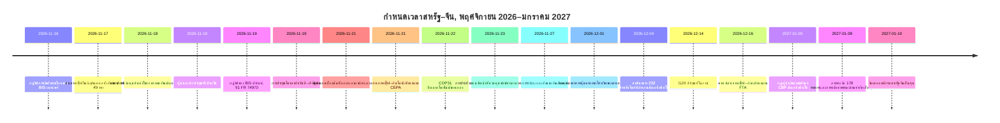

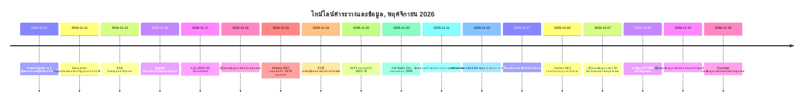

---

## 11. กำหนดเวลาและเหตุการณ์ที่จะมาถึง (90 วันข้างหน้า)

| วันที่ | รายการ |
|---|---|
| 23 พฤศจิกายน 2026 | คณะกรรมการเกษตรของ WTO ประชุมเรื่องข้อจำกัดการส่งออกและกลไกคุ้มครองพิเศษ; รายงาน Solar IV ฉบับเต็มของ USITC (Publication 5804) ครบกำหนด |
| 24 พฤศจิกายน 2026 | คาดว่าความหยุดชะงักตามมาจากการประท้วงของเจ้าหน้าที่ควบคุมจราจรทางอากาศเบลเยียมจะลามถึงวันอังคาร |
| 27 พฤศจิกายน 2026 | ประกาศฉบับที่ 72 ของปี 2025 ของจีนเรื่องการระงับข้อสันนิษฐานการปฏิเสธสำหรับแกลเลียม เจอร์เมเนียม พลวง และวัสดุแข็งยิ่งยวดที่มุ่งหน้าไปยังสหรัฐมีกำหนดสิ้นสุด หากไม่มีการระงับหรือแก้ไขเพิ่มเติม; ตัวชี้วัดการค้าสินค้าเดือนตุลาคมเบื้องต้นของสำนักสำรวจสำมะโนครบกำหนด |
| 29 พฤศจิกายน 2026 | ความเห็นต่อร่างมาตรการของ MOFCOM ว่าด้วยการสอบสวนและการบังคับใช้การควบคุมการส่งออกสินค้าใช้สองทางครบกำหนด |
| 30 พฤศจิกายน 2026 | ข้อค้นพบสุดท้ายของกระทรวงพาณิชย์เรื่องการทุ่มตลาดและการอุดหนุนสำหรับผลิตภัณฑ์เหล็กแผ่นเคลือบดีบุกของจีนครบกำหนด เว้นแต่จะเลื่อน |
| 1 ธันวาคม 2026 | คาดว่ามาตรการชั่วคราวมาตรการคุ้มครองรถไฮบริดของสหภาพยุโรป; แคนาดายกเลิกการผ่อนผันภาษีแนวนอนสำหรับรถพ่วงบางประเภท; ค่าธรรมเนียมพัสดุเล็ก 2 ยูโรระดับชาติของอิตาลีมีผล; เส้นตายของสมาชิกสภาผู้แทนราษฎรพรรคเดโมแครตสำหรับคำตอบเป็นลายลักษณ์อักษรของ Lutnick เรื่อง Megaspeed และ Entity List |
| 4 ธันวาคม 2026 | ภาษีโพลีซิลิคอนตามมาตรา 232 มีผล; Gemini AE2 เดินเรือผ่านสุเอซเที่ยวแรกจากหนิงโป; การประชุมวิสามัญ MEPC 85 ของ IMO กำหนดเบื้องต้น |
| 7 ธันวาคม 2026 | ความเห็นต่อกฎที่เสนอของ CBP เรื่องการขนส่งมูลค่าต่ำครบกำหนด (91 FR 64532; สำนวน USCBP-2026-0298); ญี่ปุ่นเผยข้อมูลการค้า 20 วันแรกของเดือนพฤศจิกายน |
| 8 ธันวาคม 2026 | สหรัฐเผยแพร่รายงานการค้า FT-900 เดือนตุลาคม |
| 10 ธันวาคม 2026 | Lutnick ให้การต่อคณะกรรมาธิการการธนาคารของวุฒิสภา (Megaspeed / Entity List) |
| 11 ธันวาคม 2026 | คำแถลงตอบโต้ของรัฐบาลครบกำหนดในคดี *Gellert v. Trump* (มาตรา 338); สหภาพยุโรป–อินโดนีเซีย: ประธานาธิบดี Prabowo เยือนบรัสเซลส์ |
| 14–15 ธันวาคม 2026 | ผู้นำ G20 ประชุมที่ไมอามี |
| 15 ธันวาคม 2026 | ญี่ปุ่นเผยข้อมูลการค้าเดือนพฤศจิกายนฉบับเต็ม |
| 16 ธันวาคม 2026 | มีรายงานว่าข้อตกลงการค้าเสรีสหภาพยุโรป–อินเดียจะลงนามที่บรัสเซลส์ โดยคาดว่านายกรัฐมนตรี Modi จะเข้าร่วม |
| 17 ธันวาคม 2026 | วันแรกสุดที่กระทรวงพาณิชย์ตั้งใจจะออกคำแนะนำการประเมินในการทบทวนตู้ไม้และงานไม้ตกแต่ง (35 วันหลังตีพิมพ์ 12 พฤศจิกายน) |
| 18 ธันวาคม 2026 | Eurostat เผยข้อมูลการค้าสินค้าเดือนตุลาคม; ECB เผยดุลการชำระเงินเดือนตุลาคม |
| 20 ธันวาคม 2026 | Gemini AE3 เดินเรือผ่านสุเอซเที่ยวแรกจากเซี่ยงไฮ้ |
| 1 มกราคม 2027 | อัตรามาตรา 232 เพิ่มเป็น 30% สำหรับเฟอร์นิเจอร์บุผ้า และ 50% สำหรับตู้ครัวและตู้อ่างล้างหน้า; ภาษี 50% ที่ขู่ไว้สำหรับยานยนต์ ชิ้นส่วนรถยนต์ และเหล็กของแคนาดาก็มุ่งเป้าวันนี้เช่นกัน; CBAM ของสหราชอาณาจักรเริ่ม; กฎถิ่นกำเนิด EV ที่เข้มงวดขึ้นของสหราชอาณาจักร–สหภาพยุโรปมีผล; การยุติ AGOA สำหรับรวันดาและแอฟริกาใต้ตั้งใจมีผล (ยังต้องมีประกาศ) |
| 3 มกราคม 2027 | สภาคองเกรสชุดใหม่ของสหรัฐเข้ารับตำแหน่ง |
| 5 มกราคม 2027 | กฎชั่วคราวฉบับสุดท้ายของ CBP สำหรับผู้นำเข้าต่างชาติมีผล; ความเห็นครบกำหนดในวันเดียวกัน (สำนวน USCBP-2026-1387) |
| 9–10 มกราคม 2027 | เส้นตายข้อตกลงพักรบสหรัฐ–จีนบรรจบกัน: การยกเว้นมาตรา 301 จำนวน 178 รายการและการระงับค่าธรรมเนียมทางทะเลสิ้นสุด 9 มกราคม; การระงับกฎบริษัทในเครือของ BIS และการระงับตอบโต้ของจีนสิ้นสุด 10 มกราคม |
| 11–12 มกราคม 2027 | การตัดสิน AD/CVD ขั้นสุดท้ายของกระทรวงพาณิชย์สำหรับตัวเร่งปฏิกิริยายาง CBS จากจีนครบกำหนด |
| 11 มกราคม 2027 | คำแถลงตอบครบกำหนดในคดี *Gellert v. Trump* |
| 12 มกราคม 2027 | ความเห็นเป็นลายลักษณ์อักษรและคำขอเข้าร่วมการไต่สวนครบกำหนดสำหรับการปรึกษาหารือการทบทวนร่วม USMCA (สำนวน USTR-2026-0595 และ USTR-2026-0596) |
| 14 มกราคม 2027 | Gemini AE1 เดินเรือผ่านสุเอซเที่ยวแรกจากเซี่ยงไฮ้ |
| 19 มกราคม 2027 | ข้อค้นพบสุดท้ายของกระทรวงพาณิชย์เรื่องการทุ่มตลาดสำหรับผลิตภัณฑ์เหล็กแผ่นเคลือบดีบุกของตุรกีครบกำหนด; ความเห็นต่อกฎชิปการเข้าถึงระยะไกลของ BIS ครบกำหนด |
| 20 มกราคม 2027 | การแจ้งเข้าอย่างเป็นทางการกลายเป็นข้อบังคับสำหรับจดหมายที่อยู่ภายใต้ภาษีมาตรา 201, 232 หรือ 301 หรือข้อกำหนดของหน่วยงานรัฐบาลคู่ค้า; การไต่สวนด้วยวาจาในคดี *Gellert v. Trump* |
| 30 มกราคม 2027 | การเปลี่ยนแปลงภาษีตอบโต้การอุดหนุนของสหราชอาณาจักรสำหรับปลาเทราท์สายรุ้งของตุรกีมีผลตั้งแต่วันนี้ (ประกาศ 2026/31) |
| 1 กุมภาพันธ์ 2027 | แคนาดายกเลิกการผ่อนผันภาษีแนวนอนสำหรับลวดอะลูมิเนียมและผลิตภัณฑ์อัดขึ้นรูปและผลิตภัณฑ์กระดาษแข็งบางประเภท |
| 6 กุมภาพันธ์ 2027 | ตรุษจีน |
| 11 กุมภาพันธ์ 2027 | การตัดสินเบื้องต้น CVD ของกระทรวงพาณิชย์สำหรับลูกโป่งพลาสติกจากจีน (โดยประมาณ) |
| 17 กุมภาพันธ์ 2027 | กฎชิปการเข้าถึงระยะไกลของ BIS: ช่วงเปลี่ยนผ่านใบอนุญาตศูนย์ข้อมูล 90 วันสิ้นสุด (โดยประมาณ) |
| 28 กุมภาพันธ์ 2027 | เส้นตายการตัดสินของ USTR ในการสอบสวนมาตรา 301 เรื่องทรัพย์สินทางปัญญาของเวียดนาม |
| มีนาคม 2027 | คาดว่าการตัดสินการสอบสวนมาตรา 301 เรื่องกำลังการผลิตส่วนเกินเชิงโครงสร้างของ USTR (ครบกำหนดภายในเดือนมีนาคม 2027); มีรายงานว่า FTA สหภาพยุโรป–อินเดียมีผลบังคับใช้ในเดือนมีนาคมหรือเมษายน 2027 |
| 25 มีนาคม 2027 | ข้อค้นพบสุดท้ายของกระทรวงพาณิชย์เรื่องการทุ่มตลาดสำหรับผลิตภัณฑ์เหล็กแผ่นเคลือบดีบุกของไต้หวันครบกำหนด |
| 27 เมษายน 2027 | การตัดสินเบื้องต้น AD ของกระทรวงพาณิชย์สำหรับลูกโป่งพลาสติกจากจีน (โดยประมาณ) |
| 6 พฤษภาคม 2027 | คาดว่าตัวแทนศุลกากรจะปฏิบัติตามกฎผู้นำเข้าต่างชาติอย่างเต็มที่ |
| 30 มิถุนายน 2028 | การผ่อนผันภาษีแนวนอนของแคนาดาขยายถึงวันนี้ |

---

## 12. แหล่งข้อมูลและระเบียบวิธี

ช่วงความครอบคลุม: 16–23 พฤศจิกายน 2026 รวบรวมจากแหล่งข่าวการค้า นโยบาย ข้อมูล และค่าระวางประมาณ 45 แหล่งทั่วโลก

แหล่งข้อมูลที่ปรึกษา ได้แก่: FreightWaves, The Loadstar, Splash247, gCaptain, Hellenic Shipping News, Container News, Supply Chain Dive, Logistics Management, Air Cargo News, Port Technology, บล็อกข่าวสาร TradeInt; whitehouse.gov, cbp.gov, ustr.gov, federalregister.gov, trade.gov, usitc.gov, bis.doc.gov, JD Supra; ec.europa.eu, gov.uk, cbsa-asfc.gc.ca, canada.ca/en/department-finance, english.mofcom.gov.cn; wto.org, unctad.org, intracen.org, wcoomd.org; dataweb.usitc.gov, ustradecensus.gov, comtradeplus.un.org, wits.worldbank.org, eurostat, data.worldbank.org, imf.org; taxfoundation.org, budgetlab.yale.edu, tradeintelligence.eu; drewry.co.uk, balticexchange.com, freightos.com; descartes.com, tradeint.com.

รายการที่มีวันที่ก่อนวันที่ 16 พฤศจิกายนปรากฏเฉพาะในฐานะรายการติดตาม การตีพิมพ์ใน Federal Register ที่ตกอยู่ในช่วงความครอบคลุม หรือบริบทสำหรับเส้นตายในช่วงความครอบคลุม Container News ส่งคืนเพียงประกาศยินยอมคุกกี้และไม่ให้เนื้อหาที่ใช้ได้ ดัชนีข่าวของ WTO ไม่ส่งคืนข้อความที่อ่านได้ผ่านการดึงข้อมูล ดังนั้นรายการ WTO จึงใช้ข่าวของ WTO ตามที่ตีพิมพ์ซ้ำ เว็บไซต์ภาษาอังกฤษของ MOFCOM เข้าถึงได้เฉพาะพาดหัวข่าวหน้าแรก และสาระสำคัญของประกาศต่าง ๆ ไม่อาจยืนยันได้จากข้อมูลที่ทบทวน TradeInt ไม่มีรายการผู้ขายที่ผ่านเกณฑ์ในช่วงความครอบคลุม ชุดบล็อกวันที่ 22 พฤศจิกายนของบริษัทเป็นเนื้อหาการตลาดข้อมูลที่ดึงมาจากฐานข้อมูลของตนเอง ไม่พบรายงานใหม่ที่สำคัญในช่วงความครอบคลุมจากพอร์ทัล USITC DataWeb, UN Comtrade, WITS, World Bank หรือ IMF ไม่พบคำสั่งระงับการปล่อยสินค้าใหม่ในช่วงความครอบคลุม Federal Register ไม่ได้ถูกกวาดเอกสารทีละฉบับตลอดทั้งสัปดาห์ อาจมีประกาศการทบทวนเชิงบริหารเพิ่มเติม รายงานเรื่องการสรุปการสอบสวนมาตรา 301 เรื่องกำลังการผลิตส่วนเกินภายในสิ้นปีอาศัยรายงานข่าวการค้าเพียงแหล่งเดียวของการสัมภาษณ์ทางโทรทัศน์เมื่อวันที่ 21 พฤศจิกายน ยังไม่มีประกาศของ USTR ปรากฏ ณ วันที่ 23 พฤศจิกายน จำนวนรายการรัสเซียของสหภาพยุโรปเมื่อวันที่ 17 พฤศจิกายน (49 รายการ) เป็นไปตามที่รายงานโดยเครื่องมือติดตาม Youverify ไม่ได้ตรวจสอบเทียบกับรายการของสหภาพยุโรปเอง
