# Báo cáo Tình báo Thương mại Toàn cầu — Tuần 16–23 tháng 11 năm 2026

**Bản tin hàng tuần.** Phạm vi bao phủ: 16–23 tháng 11 năm 2026. Tổng hợp từ khoảng 45 nguồn tin tức, chính sách, dữ liệu và vận tải thương mại trên toàn thế giới.

---

## Mục lục

1. [Tóm tắt điều hành](#1-executive-summary)
2. [Cảnh báo](#2-alerts)
3. [Các câu chuyện hàng đầu — phân tích chuyên sâu](#3-top-stories--deep-dives)
4. [Bảng theo dõi thuế quan](#4-tariff-tracker)
5. [Phân tích chuyên sâu chính sách Mỹ](#5-us-policy-deep-dive)
6. [Chính sách thế giới theo khu vực](#6-world-policy-by-region)
7. [Các biện pháp thực thi](#7-enforcement-actions)
8. [Các dữ liệu công bố](#8-data-releases)
9. [Thị trường vận tải](#9-freight-market)
10. [Dòng thời gian chính sách](#10-policy-timelines)
11. [Các hạn chót & sự kiện sắp tới (90 ngày tới)](#11-upcoming-deadlines--events-next-90-days)
12. [Nguồn & phương pháp luận](#12-sources--methodology)

---

## 1. Tóm tắt điều hành

Một tuần mà hội nghị thượng đỉnh được kỳ vọng sẽ giải quyết thỏa thuận đình chiến thương mại Mỹ–Trung lại không giải quyết được gì, trong khi các hành động thương mại quyết định của tuần lại đến từ các cơ quan quản lý, tòa án và lễ ký kết ở nơi khác. Cuộc họp các nhà lãnh đạo APEC tại Thâm Quyến ngày 18–19 tháng 11 đã ra một tuyên bố và cuộc gặp ba bên Trump–Xi–Putin đầu tiên, nhưng không có giảm thuế và không có xác nhận gia hạn thỏa thuận đình chiến, vốn vẫn hết hạn vào ngày 9–10 tháng 1 năm 2027; địa điểm tiếp theo để ra quyết định là hội nghị thượng đỉnh G20 tại Miami ngày 14–15 tháng 12. Thay vào đó, Cục Công nghiệp và An ninh (BIS) đã đơn phương đưa ra biện pháp lớn nhất của tuần, công bố quy định cuối cùng tạm thời ngày 19 tháng 11 nhằm đóng tuyến tiếp cận từ xa đối với chip tiên tiến, bãi bỏ Quy định về Khuếch tán AI và yêu cầu giấy phép đối với các mặt hàng điện toán tiên tiến tới năm quốc gia Đông Nam Á và Mỹ Latinh. Châu Âu tiến lên bằng các lễ ký kết: Liên minh châu Âu và Indonesia đã ký một hiệp định đối tác kinh tế toàn diện ngày 21 tháng 11, ngày ký kết EU–Ấn Độ được ấn định vào ngày 16 tháng 12, và Vương quốc Anh cùng EU đã nhất trí một thỏa thuận SPS và liên kết hệ thống giao dịch phát thải tại hội nghị thượng đỉnh ngày 20 tháng 11. Tại vùng Vịnh, các vụ tấn công nhằm vào tàu thuyền trong và quanh Eo biển Hormuz đã đạt mức cao nhất trong tháng kể từ khi chiến tranh Mỹ–Iran bắt đầu, và Washington đã mở rộng lệnh phong tỏa sang hoạt động chuyển tải giữa các tàu.

- **APEC ra tuyên bố, không phải thỏa thuận thuế quan.** Hội nghị các Nhà lãnh đạo Kinh tế APEC lần thứ 33 kết thúc ngày 19 tháng 11 với Tuyên bố Thâm Quyến, một văn bản tự nguyện, không ràng buộc, và một thỏa thuận giữa Tổng thống Trump và Chủ tịch Tập về việc soạn thảo kế hoạch hành động vì "ổn định chiến lược" Mỹ–Trung. Cuộc gặp ba bên Trump–Xi–Putin đầu tiên đã ra Tuyên bố Hòa bình bốn điểm, không có khối lượng, thời hạn hay nội dung thương mại. Một số báo cáo cho rằng các nhà lãnh đạo đã nhất trí gia hạn thỏa thuận đình chiến thương mại; cả hai phía đều không công bố thời hạn hay điều khoản, và bản tường thuật của Trung Quốc không nhắc tới việc gia hạn. Thỏa thuận đình chiến vẫn hết hạn vào ngày 9–10 tháng 1 năm 2027, và gói cắt giảm thuế quan đối ứng 30 tỉ đô la đổi 30 tỉ đô la của Hội đồng Thương mại vẫn chưa được nhất trí. [China Briefing](https://www.china-briefing.com/news/apec-2026-in-shenzhen-what-the-leaders-meeting-and-trump-xi-talks-mean-for-business/)
- **BIS đóng lỗ hổng tiếp cận từ xa đối với chip.** Quy định cuối cùng tạm thời công bố ngày 19 tháng 11 (91 FR 74970) bổ sung một biện pháp kiểm soát sử dụng cuối trên toàn thế giới, yêu cầu giấy phép khi các mặt hàng điện toán tiên tiến sẽ được sử dụng trong một trung tâm dữ liệu cung cấp tổng hiệu năng xử lý gộp trên 12.000.000 cho các công ty có trụ sở tại Nhóm Quốc gia D:5 hoặc Ma Cao, bổ sung yêu cầu giấy phép đối với các mặt hàng điện toán tiên tiến tới Indonesia, Malaysia, Singapore, Thái Lan và Brazil, đồng thời chính thức bãi bỏ Quy định về Khuếch tán AI. TSMC và Samsung đã thông báo với các khách hàng Trung Quốc rằng họ sẽ ngừng bán một số bộ xử lý trong khi xin giấy phép. Hồ sơ của Ủy ban Đối ngoại Hạ viện công bố cùng ngày cho thấy 879.868 bộ xử lý AI tiên tiến đã được phê duyệt cho các thực thể có liên hệ với Trung Quốc tính đến ngày 11 tháng 5 năm 2026, trong đó có 579.868 bộ tăng tốc Nvidia H200. [Willkie Farr & Gallagher](https://www.willkie.com/publications/2026/11/bis-moves-to-close-the-remote-access-gap-for-advanced-chips)
- **Châu Âu ký kết, và ấn định ngày cho thỏa thuận lớn nhất.** EU và Indonesia đã ký Hiệp định Đối tác Kinh tế Toàn diện và Hiệp định Bảo hộ Đầu tư ngày 21 tháng 11 sau gần một thập kỷ đàm phán; Indonesia sẽ xóa bỏ thuế quan đối với 98,5% dòng thuế cho hàng hóa EU, giúp các nhà xuất khẩu EU tiết kiệm hơn 600 triệu euro tiền thuế mỗi năm. Hiệp định thương mại tự do EU–Ấn Độ hiện dự kiến được ký ngày 16 tháng 12 tại Brussels, với 93% lô hàng Ấn Độ được tiếp cận miễn thuế. Tại hội nghị thượng đỉnh Anh–EU ngày 20 tháng 11, hai bên đã nhất trí một thỏa thuận SPS nhằm loại bỏ nhiều kiểm tra biên giới nông thực phẩm từ ngày 1 tháng 3 năm 2028, và liên kết các hệ thống giao dịch phát thải, với các miễn trừ điều chỉnh biên giới carbon lẫn nhau trị giá khoảng 6,5 tỉ bảng Anh xuất khẩu của Anh. [Turkish Post](https://turkishpost.com.tr/en/2026/11/21/eu-indonesia-trade-deal/); [Asia Daily](https://asiadaily.org/news/19949/)
- **Thỏa thuận Ấn Độ–Mỹ vẫn chưa được ký, và sự chờ đợi giờ đã mang tính cấu trúc.** Bộ trưởng Thương mại Rajesh Agrawal cho biết ngày 18 tháng 11 rằng Ấn Độ không thể ký cho đến khi Washington tái thiết khung thuế quan sau khi Tòa án Tối cao bác bỏ các mức thuế đối ứng và khẩn cấp, và cho đến khi các cuộc điều tra theo Mục 301 — trong đó có cuộc điều tra về công suất dư thừa — được biết rõ. Đại sứ USTR Jamieson Greer được cho là đã nói ngày 21 tháng 11 rằng cuộc điều tra về công suất dư thừa sẽ kết thúc trước cuối năm 2026, trước hạn chót theo luật định là ngày 11 tháng 3 năm 2027; báo cáo đó chỉ có một nguồn duy nhất và chưa được xác minh. [The Hindu BusinessLine](https://www.thehindubusinessline.com/economy/no-india-us-trade-deal-until-new-us-tariff-framework-section-301-probes/article71716562.ece/amp/)
- **Các vụ tấn công ở Hormuz đạt mức cao nhất kể từ khi chiến tranh bắt đầu.** Hơn 30 vụ tấn công nhằm vào tàu thuyền đã được báo cáo trong tháng 10 và ít nhất 22 vụ trong tháng 11 tính đến ngày 22 tháng 11, theo phân tích của CNN dựa trên dữ liệu của Cơ quan Thương mại Hàng hải Vương quốc Anh (UKMTO); ba tàu chở dầu đã bị tấn công ngày 20–21 tháng 11, và một tàu chở dầu của ADNOC bị tấn công ngày 17 tháng 11, khiến một thuyền viên mất tích và 11 người bị thương. Tổ chức Hàng hải Quốc tế ghi nhận 138 vụ việc đã xác nhận và 25 thuyền viên thiệt mạng tính đến ngày 17 tháng 11. Xuất khẩu dầu của vùng Vịnh đạt 18,4 triệu thùng mỗi ngày trong tháng 10, thấp hơn 26% so với mức trước chiến tranh, và dầu Brent giữ quanh mức 92 đô la một thùng. [CNN](https://www.cnn.com/2026/11/22/middleeast/hormuz-attacks-highest-levels-iran-war-intl?cid=external-feeds_iluminar_meta)
- **Thuế mới áp lên ván ép, và danh sách tiếp tục mở rộng.** Bộ Thương mại đã công bố lệnh thuế chống bán phá giá và thuế chống trợ cấp đối với ván ép gỗ cứng và ván ép trang trí từ Trung Quốc, Indonesia và Việt Nam ngày 17 tháng 11, với mức thuế gộp khoảng 276% đối với Trung Quốc. USITC đã công bố toàn bộ Báo cáo Solar IV (Ấn phẩm 5804), tách riêng hoàn cảnh nghiêm trọng — thuế hồi tố chỉ áp với Indonesia. Các đơn kiện mới nhắm vào bóng bay nhựa từ Trung Quốc, với biên độ bị cáo buộc từ 50% đến 276%. [Transport News](https://www.transportnews.net/a/commerce-hardwood-plywood-duty-orders-china-indonesia-vietnam)
- **Nhật Bản lập kỷ lục thương mại; thị trường vận tải lại phân hóa.** Xuất khẩu tháng 10 của Nhật Bản tăng 20,5% so với cùng kỳ năm trước lên mức kỷ lục 11,77 nghìn tỉ yên và nhập khẩu tăng 21,6% lên mức kỷ lục 12,25 nghìn tỉ yên, với thâm hụt thu hẹp còn 476,5 tỉ yên, bằng khoảng một nửa dự báo. Chỉ số Container Thế giới Drewry giảm 3% xuống 4.176 đô la mỗi container 40ft trong tuần giảm thứ tư liên tiếp, trong khi hàng không giữ ở mức cao nhất năm 2026, với cước Trung Quốc–Bắc Mỹ ở mức 9,25 đô la mỗi kilôgam. Maersk và Hapag-Lloyd thông báo ba dịch vụ Gemini Á–Âu cuối cùng sẽ trở lại tuyến Suez vào giữa tháng 1. [Drewry](https://www.drewry.co.uk/supply-chain-advisors/world-container-index-weekly-update?topics=Container%20Shipping)

**Vận tải:** cước container giao ngay giảm tuần thứ tư liên tiếp trên tuyến xuyên Thái Bình Dương trong khi cước Địa Trung Hải phục hồi; hàng rời khô giảm từ đỉnh; hàng không giữ ở mức cao nhất năm 2026 trong mùa cao điểm; việc trở lại Suez gần hoàn tất khi Gemini thông báo ba dịch vụ cuối cùng quay lại qua Biển Đỏ; nguy cơ đình công tại LA/Long Beach chấm dứt với thỏa thuận dự kiến ngày 21 tháng 11; và hàng chờ tại Durban kéo dài tới 263 giờ neo đậu dù thông lượng tăng.

---

## 2. Cảnh báo

| # | Cảnh báo | Hiệu lực | Tác động | Nguồn |
|---|-------|-----------|--------|--------|
| A1 | Các nhà lãnh đạo APEC họp tại Thâm Quyến; cuộc gặp song phương Trump–Xi và cuộc gặp ba bên Trump–Xi–Putin đầu tiên ra tuyên bố và kế hoạch hành động vì "ổn định chiến lược", nhưng không có giảm thuế và không có xác nhận gia hạn thỏa thuận đình chiến | Nov 18–19, 2026 | Thỏa thuận đình chiến vẫn hết hạn ngày 9–10 tháng 1 năm 2027; điểm quyết định tiếp theo là G20 tại Miami, ngày 14–15 tháng 12 | [China Briefing](https://www.china-briefing.com/news/apec-2026-in-shenzhen-what-the-leaders-meeting-and-trump-xi-talks-mean-for-business/) |
| A2 | Quy định cuối cùng tạm thời của BIS "Giải quyết việc tiếp cận từ xa đối với chất bán dẫn tiên tiến" áp dụng biện pháp kiểm soát sử dụng cuối đối với trung tâm dữ liệu trên toàn thế giới (ngưỡng 12.000.000 TPP), yêu cầu giấy phép đối với chip tiên tiến tới năm quốc gia, và bãi bỏ Quy định về Khuếch tán AI | Nov 19, 2026 (công bố; 91 FR 74970) | Các nhà máy đúc tạm dừng lô hàng sang Trung Quốc trong khi chờ giấy phép; các trung tâm dữ liệu phục vụ công ty D:5 có 90 ngày để xin giấy phép | [Willkie Farr & Gallagher](https://www.willkie.com/publications/2026/11/bis-moves-to-close-the-remote-access-gap-for-advanced-chips) |
| A3 | Việc Trung Quốc tạm đình chỉ lệnh cấm xuất khẩu gali, germani, antimon và vật liệu siêu cứng sang Mỹ hết hạn, và không có gia hạn nào được công bố tính đến ngày 20–21 tháng 11 | Nov 27, 2026 | Quy định gốc yêu cầu về nguyên tắc từ chối cấp phép; người mua Mỹ các vật liệu thuộc diện đối mặt với quyết định trong tuần này | [InvestorNews](https://investornews.com/market-opinion/critical-minerals-report-trump-xi-and-the-critical-minerals-behind-the-ai-race/) |
| A4 | Biện pháp tự vệ của EU đối với ô tô hybrid: nhận ý kiến bằng văn bản kết thúc ngày 20 tháng 11; các biện pháp tạm thời dự kiến từ ngày 1 tháng 12, với hạn mức 350.000 xe mỗi năm được báo cáo đối với xe hybrid sản xuất tại Trung Quốc | Dec 1, 2026 (dự kiến) | Nhập khẩu xe hybrid Trung Quốc đã đạt 474.475 chiếc trong tháng 1–8 năm 2026, vượt hạn mức năm được đề xuất; chưa có văn bản pháp lý nào được công bố | [Ports Europe](https://www.portseurope.com/eu-opens-hybrid-safeguard-probe-as-chinese-shipments-outrun-planned-quota/) |
| A5 | Giá nhập khẩu tối thiểu theo Mục 232 đối với polysilicon (21 đô la/kg polysilicon; 100 đô la/kg thỏi và tấm wafer; 0,22 đô la/W pin mặt trời; 0,38 đô la/W mô-đun) cộng thuế 15% đối với sản phẩm phái sinh có hiệu lực; quy định chống tích trữ chạy đến ngày 3 tháng 12 | Dec 4, 2026 | Sàn giá cho toàn bộ chuỗi cung ứng năng lượng mặt trời của Mỹ; môi trường thử nghiệm của CBP hoạt động từ ngày 12 tháng 11 | [Stoel Rives](https://www.stoel.com/printpilot-publication-commerces-anti-stockpiling-rule-imposes-limits-on-pre-december-4-polysilicon-imports.pdf?1791987859) |
| A6 | Các vụ tấn công nhằm vào tàu thuyền trong và quanh Eo biển Hormuz ở mức cao nhất trong tháng kể từ khi chiến tranh bắt đầu; ba tàu chở dầu bị tấn công ngày 20–21 tháng 11; Mỹ mở rộng phong tỏa sang hoạt động chuyển tải giữa các tàu và tấn công một cơ sở của IRGC trên đảo Qeshm | Nov 16–22, 2026 | 138 vụ việc đã xác nhận và 25 thuyền viên thiệt mạng (IMO); xuất khẩu dầu vùng Vịnh thấp hơn 26% so với trước chiến tranh; dầu Brent khoảng 92 đô la | [CNN](https://www.cnn.com/2026/11/22/middleeast/hormuz-attacks-highest-levels-iran-war-intl?cid=external-feeds_iluminar_meta) |
| A7 | Hiệp hội Hàng hải Thái Bình Dương và ILWU Local 26 đạt thỏa thuận dự kiến vài giờ sau hạn chót 12:01 sáng, tránh đình công tại Los Angeles và Long Beach; việc phê chuẩn đang chờ, các điều khoản chưa được tiết lộ | Nov 21, 2026 | Nguy cơ đình công được gỡ bỏ tạm thời tại cửa ngõ container bận rộn nhất nước Mỹ; rủi ro quay lại nếu thành viên bác bỏ thỏa thuận | [FreightWaves](https://www.freightwaves.com/news/tentative-union-deal-averts-strike-at-port-of-la-long-beach) |
| A8 | Bộ Thương mại công bố lệnh AD/CVD cuối cùng đối với ván ép gỗ cứng và ván ép trang trí từ Trung Quốc, Indonesia và Việt Nam; mức thuế gộp khoảng 276% đối với Trung Quốc | Nov 17, 2026 | Ký quỹ tiếp tục; ván ép gỗ cứng Trung Quốc thực tế bị loại khỏi thị trường Mỹ | [Transport News](https://www.transportnews.net/a/commerce-hardwood-plywood-duty-orders-china-indonesia-vietnam) |
| A9 | Quy định cuối cùng tạm thời của CBP về nhà nhập khẩu nước ngoài có hiệu lực ngày 5 tháng 1 năm 2027; hạn chót ngày 18 tháng 11 về việc vô hiệu Mẫu 5106 đã qua mà không có vụ vô hiệu nào được báo cáo tính đến ngày 20 tháng 11 | Jan 5, 2027 | Nhà nhập khẩu nước ngoài phải được xác thực CTPAT hoặc sử dụng môi giới được xác thực CTPAT; tờ khai có thể bị từ chối từ ngày 5 tháng 1 | [Freight Right](https://www.freightright.com/news/cbp-tightens-importer-requirements-what-businesses-must-do-before-january-2027) |
| A10 | COP31 tại Antalya kết thúc ngày 22 tháng 11 mà không có thỏa thuận chính trị; các đại biểu IMO bắt đầu thảo luận kỹ thuật trước MEPC 85, với phiên họp đặc biệt dự kiến vào ngày 4 tháng 12 | Nov 22–23, 2026 | Việc thông qua Khung Net-Zero của ngành hàng hải chưa chắc chắn; Mỹ phản đối phí phát thải bắt buộc | [Splash247](https://splash247.com/cop31-collapse-casts-shadow-over-shippings-net-zero-showdown/) |
| A11 | Đình công của kiểm soát không lưu Bỉ đóng không phận Bỉ 07:00–21:00 ngày 23 tháng 11; trung tâm hàng hóa Liège đóng cửa 14 giờ, khoảng 429 chuyến bay tại Brussels bị hủy | Nov 23, 2026 | Hàng không châu Âu bị gián đoạn trong mùa cao điểm; tác động dây chuyền dự kiến kéo sang ngày 24 tháng 11 | [The Loadstar](https://theloadstar.com/) |
| A12 | Cuộc điều tra Mục 301 về công suất dư thừa của USTR được báo cáo sẽ kết thúc trước cuối năm, trước hạn chót theo luật định ngày 11 tháng 3 năm 2027; chưa có quyết định chính thức nào được công bố | Được báo cáo ngày 21 tháng 11 năm 2026 | Một quyết định duy nhất có thể áp thuế mới lên 16 nền kinh tế; báo cáo chỉ có một nguồn, chưa được xác minh | [East Asia Brief](https://eastasiabrief.com/trade-policy/ustr-accelerates-section-301-probe-hit-year-end-target-1636) |

### A1 — APEC: điểm quyết định mà không quyết định gì

Hội nghị các Nhà lãnh đạo Kinh tế APEC lần thứ 33 kết thúc tại Thâm Quyến ngày 19 tháng 11 với Tuyên bố Thâm Quyến của các Nhà lãnh đạo APEC 2026, một văn bản tự nguyện, không ràng buộc, cam kết 21 nền kinh tế thành viên cùng làm việc về chuỗi cung ứng bền vững, số hóa thương mại và trí tuệ nhân tạo. Chủ tịch Tập Cận Bình chủ trì cuộc họp các nhà lãnh đạo và có cuộc gặp song phương với Tổng thống Donald Trump cùng buổi chiều, sau cuộc thảo luận hai giờ ngày 18 tháng 11 tập trung chủ yếu vào thương mại và thuế quan; hai bên đã nhất trí soạn thảo kế hoạch hành động vì "ổn định chiến lược" Mỹ–Trung. Cùng ngày, ông Tập chủ trì cuộc gặp ba bên đầu tiên giữa các tổng thống Trung Quốc, Mỹ và Nga, ra Tuyên bố bốn điểm của các Nguyên thủ hướng tới Hòa bình, bao gồm tăng sản xuất và cung ứng sản phẩm dầu mỏ tinh chế, cải cách Liên hợp quốc, tôn trọng quyền miễn trừ của nhà nước và đối thoại về giảm rủi ro hạt nhân — không có khối lượng, thời hạn hay nhắc tới Ukraine, Iran, thương mại hay AI. Ông Trump thúc giục Trung Quốc thực hiện cam kết mua 17 tỉ đô la nông sản Mỹ; các quan chức Trung Quốc cho biết cam kết này phụ thuộc vào việc cắt giảm thuế quan đối ứng thông qua Hội đồng Thương mại. Ông Tập cam kết cắt giảm thuế quan thêm, mở rộng tiếp cận thị trường và đóng góp 20 triệu đô la cho hợp tác APEC. Thương mại hàng hóa Mỹ–Trung trong tháng 1–9 năm 2026 đạt khoảng 474 tỉ đô la. [China Briefing](https://www.china-briefing.com/news/apec-2026-in-shenzhen-what-the-leaders-meeting-and-trump-xi-talks-mean-for-business/)

**Phân tích:** cuộc họp được kỳ vọng là điểm quyết định cho việc gia hạn thỏa thuận đình chiến sau tháng 1 lại không đưa ra kết quả thuế quan nào. Thỏa thuận đình chiến vẫn hết hạn vào ngày 9–10 tháng 1 năm 2027, và địa điểm tiếp theo cho việc gia hạn giờ là hội nghị thượng đỉnh G20 tại Miami ngày 14–15 tháng 12. Gói cắt giảm thuế quan đối ứng 30 tỉ đô la đổi 30 tỉ đô la của Hội đồng Thương mại vẫn chưa được nhất trí, và các nhà nhập khẩu lên kế hoạch nhập hàng sau ngày 9 tháng 1 vẫn chưa có văn bản gia hạn. Các kết quả thương mại thực sự của tuần hội nghị thượng đỉnh mang tính song phương và diễn ra bên lề: CEPA Philippines–Chile và FTA Peru–Thái Lan đã được ký, việc giảm thuế Trung Quốc–Canada được mở rộng, và Trung Quốc–Indonesia mở đàm phán CEPA.

### A2 — BIS đóng lỗ hổng tiếp cận từ xa đối với chip

Cục Công nghiệp và An ninh đã ban hành quy định cuối cùng tạm thời ngày 16 tháng 11, công bố trên Công báo Liên bang ngày 19 tháng 11 (91 FR 74970) và có hiệu lực khi công bố. Quy định bổ sung biện pháp kiểm soát sử dụng cuối trên toàn thế giới (EAR § 744.24 mới), yêu cầu giấy phép khi biết rằng các mặt hàng điện toán tiên tiến sẽ được sử dụng trong một trung tâm dữ liệu cung cấp tổng hiệu năng xử lý gộp trên 12.000.000 cho các công ty có trụ sở tại Nhóm Quốc gia D:5 (bao gồm Trung Quốc) hoặc Ma Cao; các trung tâm dữ liệu đã cung cấp mức điện toán như vậy có 90 ngày, đến khoảng ngày 17 tháng 2 năm 2027, để xin giấy phép tiếp tục hoạt động. Quy định bổ sung yêu cầu giấy phép đối với các mặt hàng điện toán tiên tiến tới Indonesia, Malaysia, Singapore, Thái Lan và Brazil, với ngoại lệ cho người dùng cuối có trụ sở tại Mỹ phải nộp báo cáo hàng tháng mới. Quy định thu hẹp các tuyến mà các nhà sản xuất mặt trước và các công ty lắp ráp và kiểm tra bán dẫn thuê ngoài có thể dùng để vượt qua giả định rằng một chip logic nút tiên tiến (16/14 nm trở xuống) là mặt hàng AI trung tâm dữ liệu bị kiểm soát. Quy định chính thức bãi bỏ Quy định về Khuếch tán AI thời Biden, bao gồm các tầng quốc gia, biện pháp kiểm soát trọng số mô hình và khung Người dùng cuối Được xác thực của Trung tâm Dữ liệu. Ý kiến đóng góp đến hạn ngày 19 tháng 1 năm 2027. [Willkie Farr & Gallagher](https://www.willkie.com/publications/2026/11/bis-moves-to-close-the-remote-access-gap-for-advanced-chips)

**Số liệu chính:** ngưỡng 12.000.000 TPP gộp; thời gian chuyển tiếp 90 ngày đến khoảng ngày 17 tháng 2 năm 2027; 879.868 bộ xử lý đã được phê duyệt cho các thực thể có liên hệ với Trung Quốc tính đến ngày 11 tháng 5 năm 2026 (579.868 bộ tăng tốc Nvidia H200; khoảng 300.000 bộ AMD Instinct MI325X), từ các đơn xin vượt quá 3,4 triệu bộ xử lý. Tờ Financial Times đưa tin ngày 19 tháng 11 rằng TSMC và Samsung đã thông báo với các khách hàng Trung Quốc rằng họ sẽ ngừng bán một số bộ xử lý trong khi xin giấy phép của Mỹ. Ngày 20 tháng 11, Bộ trưởng Tài chính Scott Bessent cho biết các giới hạn xuất khẩu Nvidia H200 hiện tại sẽ được giữ nguyên mà không có thêm hạn chế, và "các hạn chế chip phù hợp đã được áp dụng". Quy định được soạn thảo bởi và theo chỉ đạo của Bộ Tài chính và Hội đồng An ninh Quốc gia, theo thông báo của chính BIS.

### A3 — Việc tạm đình chỉ đối với gali hết hạn ngày 27 tháng 11

Thông báo số 72 năm 2025 của Trung Quốc, tạm đình chỉ giả định từ chối đối với gali, germani, antimon và vật liệu siêu cứng xuất sang Mỹ, chỉ có hiệu lực đến ngày 27 tháng 11 năm 2026 và không được nhắc tới trong Thông báo số 58 của MOFCOM, vốn gia hạn gói tạm đình chỉ đất hiếm riêng biệt đến ngày 10 tháng 1 năm 2027. Tính đến ngày 20–21 tháng 11, chưa có gia hạn nào được công bố. Trừ khi Bắc Kinh hành động, quy định gốc yêu cầu về nguyên tắc từ chối cấp phép đối với các vật liệu thuộc diện, kèm theo việc xem xét kỹ hơn người dùng cuối và mục đích sử dụng cuối đối với graphit thuộc diện. Yêu cầu cấp phép đối với gali, germani (từ ngày 1 tháng 8 năm 2023) và antimon (từ ngày 15 tháng 9 năm 2024) đối với mọi điểm đến vẫn có hiệu lực bất kể điều gì. [InvestorNews](https://investornews.com/market-opinion/critical-minerals-report-trump-xi-and-the-critical-minerals-behind-the-ai-race/)

**Phân tích:** thỏa thuận đình chiến rộng hơn kéo dài đến ngày 10 tháng 1 năm 2027, nhưng việc tạm đình chỉ này là một công cụ riêng với ngày hết hạn riêng. Người mua Mỹ các sản phẩm gali, germani và antimon thuộc diện đối mặt với quyết định trong tuần này, và việc hết hạn sẽ đến bốn ngày sau khi phạm vi bao phủ kết thúc.

### A4 — Biện pháp tự vệ của EU đối với ô tô hybrid: hạn mức đã thấp hơn tốc độ hiện tại

Ủy ban châu Âu đã mở cuộc điều tra tự vệ ngày 30 tháng 10 đối với nhập khẩu ô tô hybrid mới — hybrid toàn phần, hybrid nhẹ và hybrid cắm sạc — từ mọi quốc gia ngoài EU, viện dẫn mức tăng 49% về khối lượng nhập khẩu — từ 957.965 xe năm 2023 lên 1.423.691 xe trong năm tính đến ngày 30 tháng 6 năm 2026 — với giá thấp hơn nhiều so với giá của các nhà sản xuất EU. Việc nhận ý kiến bằng văn bản kết thúc ngày 20 tháng 11. Các quan chức EU cho biết nhập khẩu xe hybrid sản xuất tại Trung Quốc sẽ bị giới hạn ở mức 350.000 xe trong năm đầu, tăng 6% mỗi năm trong bốn năm, theo biện pháp tự vệ mà Ủy ban dự kiến triển khai ngày 1 tháng 12; chưa có văn bản pháp lý nào được công bố, và cơ chế hạn ngạch cùng cách xử lý xe vượt hạn mức vẫn chưa công khai. Dữ liệu Eurostat cho thấy nhập khẩu ô tô hybrid của EU từ Trung Quốc đạt 474.475 chiếc trong tám tháng đầu năm 2026 — đã vượt hạn mức năm được đề xuất và tăng 175% so với cùng kỳ năm trước — so với 302.000 chiếc năm 2025 và 107.000 chiếc năm 2024. Ủy ban dự kiến khoảng 800.000 xe hybrid Trung Quốc nhập khẩu trong năm 2026. Thị phần của các thương hiệu Trung Quốc trong thị trường hybrid cắm sạc của châu Âu tăng từ 2% lên 25%. Các miễn trừ áp dụng cho Khu vực Kinh tế châu Âu, Ukraine, Kenya và các nhà xuất khẩu nhỏ đang phát triển; các thương hiệu Trung Quốc sản xuất tại EU, như BYD tại Hungary và Chery tại Tây Ban Nha, nằm ngoài hạn ngạch. Xe điện chạy pin chịu thuế 25% đến 45% tùy nhà sản xuất, và không thuộc hạn mức hybrid. [Ports Europe](https://www.portseurope.com/eu-opens-hybrid-safeguard-probe-as-chinese-shipments-outrun-planned-quota/)

**Phân tích:** hạn mức sẽ cắt giảm hơn một nửa lượng xe hybrid Trung Quốc xuất sang châu Âu so với tốc độ năm 2026, định hình lại dòng xe thành phẩm, logistics xe thành phẩm và các quyết định sản xuất tại Trung và Đông Âu. Đây là biện pháp phòng vệ thương mại mới quan trọng nhất của EU trong năm, và ngày bắt đầu 1 tháng 12 chỉ còn vài ngày nữa trong khi các cơ chế then chốt vẫn chưa được công bố. Hiệp hội Logistics Xe châu Âu cảnh báo hạn mức sẽ là đòn nặng đối với các doanh nghiệp logistics xe thành phẩm.

### A5 — Polysilicon: sàn giá đã được ấn định, quy định chống tích trữ đã có tác dụng

Tuyên cáo 11052 ngày 6 tháng 8 năm 2026 (Mục 232) đã áp giá nhập khẩu tối thiểu đối với polysilicon và các sản phẩm phái sinh cùng thuế 15% theo giá trị đối với sản phẩm phái sinh, có hiệu lực ngày 4 tháng 12 năm 2026. Các mức giá nhập khẩu tối thiểu là 21 đô la mỗi kilôgam đối với polysilicon, 100 đô la mỗi kilôgam đối với thỏi và tấm wafer polysilicon, 0,22 đô la mỗi watt đối với pin mặt trời và 0,38 đô la mỗi watt đối với mô-đun mặt trời. Ngày 24 tháng 9 năm 2026, BIS đã công bố quy định cuối cùng tạm thời thi hành chỉ thị chống tích trữ của tuyên cáo, có hiệu lực ngày 22 tháng 9 và kéo dài đến ngày 3 tháng 12, ban hành mà không lấy ý kiến công chúng sau khi dữ liệu thương mại cho thấy nhập khẩu tăng mạnh ở một số nhà nhập khẩu trong tuần sau tuyên cáo. Các nhà nhập khẩu hiện hữu đã đăng ký trước ngày 6 tháng 8 có thể tiếp tục nhập khẩu trong diện giám sát; nếu Bộ Thương mại xác định một nhà nhập khẩu nhập khẩu với khối lượng lớn hơn đáng kể so với mức trung bình lịch sử của mình, Bộ sẽ thông báo cho CBP, CBP thông báo cho nhà nhập khẩu và các môi giới của họ, và nhà nhập khẩu bị cấm nhập thêm cho đến ngày 4 tháng 12. Các nhà nhập khẩu mới đăng ký từ ngày 6 tháng 8 trở đi đối mặt với hạn mức cứng hàng tuần nếu không có phê duyệt của Bộ Thương mại: 12 kg polysilicon, 7 kg thỏi và tấm wafer, 2.000 pin mặt trời và 55 mô-đun mặt trời mỗi tuần. CBP đã mở môi trường thử nghiệm ACE ngày 12 tháng 11, kích hoạt bốn phân loại mô phỏng theo Chương 99 để thử nghiệm. [Stoel Rives](https://www.stoel.com/printpilot-publication-commerces-anti-stockpiling-rule-imposes-limits-on-pre-december-4-polysilicon-imports.pdf?1791987859)

**Phân tích:** các biện pháp ngày 4 tháng 12 đặt sàn giá cho toàn bộ chuỗi cung ứng năng lượng mặt trời của Mỹ, và quy định chống tích trữ có nghĩa là hạn chế đã có tác dụng đối với các nhà nhập khẩu đã đẩy nhanh giao hàng. Các nhà phát triển năng lượng mặt trời đối mặt với chi phí đầu vào cao hơn từ tháng 12, và miễn trừ cho sản xuất trong nước cho các cam kết xây dựng nội địa một tuyến đường tránh thuế. Hướng dẫn khai báo sản xuất với các tiêu đề chính thức theo Chương 99 vẫn chưa được công bố tính đến ngày 23 tháng 11.

### A6 — Hormuz: các vụ tấn công ở mức cao nhất kể từ khi chiến tranh bắt đầu

Các vụ tấn công được báo cáo nhằm vào tàu thuyền tại Eo biển Hormuz, Vịnh Ba Tư và Vịnh Oman đã vượt 30 vụ trong tháng 10 — lần đầu tiên vượt mức đó kể từ khi chiến tranh bắt đầu — và ít nhất 22 vụ đã được báo cáo trong tháng 11 tính đến ngày 22 tháng 11, con số cao thứ hai, theo phân tích của CNN dựa trên dữ liệu của UKMTO; UKMTO lưu ý các con số này có thể còn thấp hơn thực tế. Từ ngày 13 đến 18 tháng 11, UKMTO liệt kê năm báo cáo tấn công, trong đó có một tàu chở dầu bị tấn công ngày 16 tháng 11 gây cháy phòng máy và một tàu chở dầu khác bị tấn công hai lần cùng ngày. Ngày 17 tháng 11, một tàu chở dầu của ADNOC Logistics & Services bị tấn công trong eo biển, khiến một thuyền viên mất tích và 11 người bị thương; tàu được công ty an ninh Vanguard Tech xác định là tàu chở sản phẩm NAVIG8 MESSI. Ngày 16–17 tháng 11, tàu chở LPG treo cờ Panama Tara Gas bị tấn công, bốc cháy và bị bỏ lại. Ngày 20–21 tháng 11, đạn pháo đã tấn công thêm ba tàu chở dầu rời khỏi eo biển — tàu Captain Leon treo cờ Quần đảo Marshall, tàu chở dầu thô Torkel treo cờ Hồng Kông và tàu Arina — với hỏa hoạn trên hai tàu đầu tiên. Tổ chức Hàng hải Quốc tế ghi nhận 138 vụ việc đã xác nhận và 25 thuyền viên thiệt mạng tính đến ngày 17 tháng 11. Mỹ đã tiến hành các cuộc tấn công nhằm vào một cơ sở tên lửa của IRGC trên đảo Qeshm ngày 17 tháng 11, và ngày 18 tháng 11, Bộ Tư lệnh Trung tâm Mỹ đã mở rộng lệnh phong tỏa sang các tàu nhận hàng hóa Iran trong hoạt động chuyển tải giữa các tàu. Kpler báo cáo lượng dầu Iran trên mặt nước ngoài khu vực phong tỏa đã về 0, với doanh thu dầu của Iran có thể giảm về 0 vào giữa tháng 12. [CNN](https://www.cnn.com/2026/11/22/middleeast/hormuz-attacks-highest-levels-iran-war-intl?cid=external-feeds_iluminar_meta)

**Số liệu chính:** xuất khẩu dầu vùng Vịnh (không tính Oman) ở mức 18,4 triệu thùng mỗi ngày trong tháng 10, thấp hơn 26% so với mức trước chiến tranh, với lưu lượng qua Hormuz thấp hơn khoảng 65% so với bình thường (Báo cáo Thị trường Dầu tháng 11 của IEA); dầu Brent giao tháng 1 chốt ở mức 92,44 đô la ngày 16 tháng 11 và 91,98 đô la ngày 19 tháng 11. Lưu lượng thương mại qua kênh này, nơi khoảng một phần năm lượng dầu thế giới đi qua trước chiến tranh, vẫn thấp hơn nhiều so với mức cơ sở năm 2025.

### A7 — LA/Long Beach: đình công được tránh vào giờ chót

Hiệp hội Hàng hải Thái Bình Dương (PMA) cho biết sáng thứ Bảy, ngày 21 tháng 11, rằng họ đã đạt thỏa thuận dự kiến với ILWU Local 26 sau khi hai bên quay lại đàm phán có trung gian liên bang vào thứ Sáu, ngày 20 tháng 11. Công đoàn đại diện khoảng 250 nhân viên gác cổng kiểm soát ra vào tại các cổng cảng và tuần tra an ninh tại sáu bến container ở Los Angeles và Long Beach. Công đoàn đã cho biết sẽ không gia hạn hợp đồng sau 12:01 sáng theo giờ Thái Bình Dương ngày thứ Bảy, 21 tháng 11, và một cuộc đình công có thể đã làm tê liệt hoạt động tàu, bãi và cổng nếu các công nhân bến tàu khác tôn trọng hàng rào đình công. Hợp đồng hiện tại vẫn có hiệu lực trong khi các thành viên bỏ phiếu phê chuẩn. Không có điều khoản nào và không có lịch trình phê chuẩn nào được tiết lộ; công đoàn chưa bình luận tính đến ngày 21–22 tháng 11. Hợp đồng trước đó hết hạn tháng 7 năm 2025 và tranh chấp đã kéo dài qua các hạn chót đình công ngày 1, 4, 6 và 20 tháng 11. Đề nghị trước đó của PMA bao gồm khoản thưởng một lần 3.200 đô la mỗi thành viên và tăng lương nâng thu nhập trung bình hàng năm của nhân viên gác cổng toàn thời gian từ hơn 170.000 đô la lên 198.000 đô la, nhưng những con số đó mô tả đề nghị trước thỏa thuận, không phải thỏa thuận cuối cùng. [FreightWaves](https://www.freightwaves.com/news/tentative-union-deal-averts-strike-at-port-of-la-long-beach)

**Phân tích:** nguy cơ đình công tại cửa ngõ container bận rộn nhất nước Mỹ đã được gỡ bỏ tạm thời, năm ngày trước Lễ Tạ ơn, loại bỏ rủi ro gián đoạn lớn nhất trong ngắn hạn đối với hàng tồn kho dịp lễ. Thỏa thuận chưa phải là cuối cùng cho đến khi được phê chuẩn, và chưa có ngày bỏ phiếu nào được công bố, vì vậy rủi ro sẽ quay lại nếu các thành viên bác bỏ thỏa thuận. Khu phức hợp này vốn đã căng thẳng, với thời gian lưu bãi đường sắt trên chín ngày.

### A8 — Lệnh ván ép: Trung Quốc ở mức gộp khoảng 276%

Bộ Thương mại đã ban hành lệnh thuế chống bán phá giá và thuế chống trợ cấp đối với ván ép gỗ cứng và ván ép trang trí từ Trung Quốc, Indonesia và Việt Nam ngày 17 tháng 11 (FR Docs. 2026-23386 và 2026-23393), có hiệu lực cùng ngày. Mức ký quỹ chống bán phá giá: Trung Quốc 187,27% (ký quỹ 185,96% sau khi bù trừ trợ cấp) đối với thực thể toàn Trung Quốc; Indonesia 15,40% đến 84,94%; Việt Nam 90,12% (ký quỹ 84,95%). Mức thuế chống trợ cấp: Trung Quốc 88,96%; Indonesia 4,22% đến 128,66%; Việt Nam 47,68% đến 165,39%. Mức gộp lên tới khoảng 276% đối với Trung Quốc và khoảng 255% đối với Junma Phu Tho của Việt Nam. Ván ép gỗ mềm kết cấu đã bị loại sau khi USITC xác định lượng nhập khẩu đó không đáng kể; CBP sẽ chấm dứt tạm đình chỉ thanh lý và hoàn trả ký quỹ đối với các tờ khai đó được thực hiện từ ngày 2 tháng 3 năm 2026 trở đi. USITC cũng xác định không có hoàn cảnh nghiêm trọng đối với thuế chống bán phá giá áp lên ván ép từ Trung Quốc, vì vậy các khoản ký quỹ thu trên cơ sở đó sẽ được hoàn trả. [Transport News](https://www.transportnews.net/a/commerce-hardwood-plywood-duty-orders-china-indonesia-vietnam)

### A9 — CBP: vách đá ngày 18 tháng 11 không xảy ra; ngày 5 tháng 1 là ngày cứng

CBP đã cảnh báo các nhà nhập khẩu được chứng nhận CTPAT rằng số nhà nhập khẩu của họ có thể bị vô hiệu đối với các tờ khai nộp từ 12:01 sáng theo giờ miền Đông ngày 18 tháng 11 năm 2026 do thông tin Mẫu 5106 của CBP không chính xác hoặc không đầy đủ, sau cảnh báo của NCBFAA ngày 4 tháng 11. Tính đến sáng ngày 20 tháng 11, chưa có báo cáo nào về việc vô hiệu thực tế xuất hiện, và chưa có văn bản thư nào của CBP được công bố. CBP làm rõ rằng các thông báo xác minh CTPAT gửi từ ngày 4 tháng 11 nhằm khuyến khích việc rà soát và sửa chữa kịp thời các trường email và điện thoại trong ACE, chứ không có nghĩa là số nhà nhập khẩu đã bị vô hiệu hoặc dự kiến bị vô hiệu. Cơ sở pháp lý là thông báo ngày 19 tháng 8 của CBP trên Công báo Liên bang (91 FR 53627), theo đó việc vô hiệu các số có dữ liệu Mẫu 5106 không chính xác hoặc không đầy đủ đã có thể thực hiện từ ngày 18 tháng 9 năm 2026. Riêng biệt, CBP đã công bố quy định cuối cùng tạm thời ngày 6 tháng 11 (91 FR 69977) thiết lập các yêu cầu cao hơn đối với nhà nhập khẩu nước ngoài, có hiệu lực ngày 5 tháng 1 năm 2027: nhà nhập khẩu nước ngoài phải được xác thực CTPAT hoặc sử dụng môi giới hải quan được cấp phép đã được xác thực CTPAT, và ba trường mới đang được bổ sung vào Mẫu 3461 và 7501 của CBP. Ý kiến về quy định đến hạn ngày 5 tháng 1 năm 2027. [GHY International](https://www.ghy.com/trade-compliance/cbp-ctpat-importer-ior-numbers-voided-nov-18/)

**Phân tích:** vách đá ngày 18 tháng 11 được lo ngại đã không xảy ra, nhưng bộ máy thực thi là có thật và quy định về nhà nhập khẩu nước ngoài ngày 5 tháng 1 năm 2027 là ngày cứng tiếp theo. Các nhà nhập khẩu có hồ sơ Mẫu 5106 mang địa chỉ, email hoặc số điện thoại của môi giới vẫn có nguy cơ bị vô hiệu mà không được báo trước, và CBP cho biết các kiểm tra xác thực của họ có thể từ chối tờ khai và tờ khai tóm tắt từ ngày 5 tháng 1 khi các yêu cầu chưa được đáp ứng.

### A10 — COP31 sụp đổ; quyết định net-zero của ngành hàng hải chuyển sang MEPC 85

Hội nghị thượng đỉnh COP31 tại Antalya kết thúc ngày 22 tháng 11 mà không có thỏa thuận bao quát sau khi gần 200 quốc gia không thu hẹp được bất đồng về nhiên liệu hóa thạch và tài chính khí hậu. Liên minh châu Âu, Anh và các quốc đảo dễ tổn thương đã bác bỏ Hiệp ước Antalya được đề xuất, vốn không nhắc rõ tới việc rời xa than, dầu và khí đốt, trong khi Ả Rập Xê Út và Nga phản đối ngôn từ mạnh hơn; một số quyết định phụ đã được nhất trí, nhưng tuyên bố chính trị trung tâm đã thất bại. Đây là COP đầu tiên kể từ Copenhagen năm 2009 kết thúc mà không có thỏa thuận cuối cùng, và là cuộc họp đầu tiên kể từ khi Liên hợp quốc xác nhận nhiệt độ toàn cầu được dự báo vượt 1,5°C. Sự sụp đổ tạo bối cảnh khó khăn cho các đại biểu IMO, những người đã bắt đầu năm ngày thảo luận kỹ thuật ngày 23 tháng 11 trước Ủy ban Bảo vệ Môi trường Biển (MEPC 85) tuần tới. Khung Net-Zero được đề xuất cho ngành hàng hải, đã được phê duyệt dưới dạng dự thảo năm ngoái nhưng chưa được thông qua, kết hợp các yêu cầu thắt chặt về cường độ phát thải khí nhà kính của nhiên liệu với các khoản thanh toán tuân thủ tài chính và ưu đãi cho nhiên liệu sạch hơn; yếu tố kinh tế vẫn gây chia rẽ sâu sắc, với Mỹ phản đối phí phát thải bắt buộc. Việc thông qua đã bị hoãn tháng 10 năm 2025, và một cuộc họp đặc biệt của IMO dự kiến vào ngày 4 tháng 12, tùy thuộc xác nhận tại MEPC 85. [Splash247](https://splash247.com/cop31-collapse-casts-shadow-over-shippings-net-zero-showdown/)

### A11 — Đình công kiểm soát không lưu Bỉ đóng Liège trong 14 giờ

Nhân viên tại skeyes, nhà cung cấp dịch vụ dẫn đường hàng không của Bỉ, đã tham gia cuộc đình công toàn quốc do ba công đoàn chính của nước này kêu gọi nhằm phản đối các biện pháp thắt lưng buộc bụng của liên bang, đình chỉ các dịch vụ kiểm soát không lưu thường xuyên vào thứ Hai, ngày 23 tháng 11 từ 07:00 đến 21:00 giờ địa phương. Hầu như mọi chuyến bay đi và đến tại các sân bay Bỉ đều bị hủy trong khung giờ đó; Sân bay Brussels có khoảng 429 chuyến bay và 59.500 hành khách theo lịch trong ngày, và Charleroi hủy toàn bộ chuyến bay trong cả ngày. Các hãng hàng không đã dời lịch bay và chuyển máy bay sang các sân bay ở nước láng giềng. Cuộc đình công được thông báo muộn vào tối thứ Bảy, ngày 21 tháng 11, khiến các hãng hàng không có chưa đầy hai ngày để chuẩn bị. Liège quan trọng nhất đối với hàng hóa: đây là một trong những sân bay hàng hóa bận rộn nhất châu Âu, trung tâm châu Âu của một số hãng vận tải hàng hóa và điểm trung chuyển cho lưu lượng thương mại điện tử, vì vậy một khoảng trống 14 giờ trong kiểm soát không lưu Bỉ vào thứ Hai làm gián đoạn cả kết nối hàng hóa lẫn hành khách. Một số gián đoạn dây chuyền dự kiến lan sang thứ Ba, ngày 24 tháng 11. [The Loadstar](https://theloadstar.com/)

### A12 — Cuộc điều tra Mục 301 về công suất dư thừa được báo cáo sẽ kết thúc trước cuối năm

Đại sứ USTR Jamieson Greer được cho là đã xác nhận trong một cuộc phỏng vấn truyền hình ngày 21 tháng 11 rằng cuộc điều tra Mục 301 về công suất dư thừa mang tính cấu trúc trong sản xuất tại 16 nền kinh tế sẽ kết thúc trước cuối năm 2026, sớm hơn nhiều tháng so với hạn chót theo luật định 12 tháng là ngày 11 tháng 3 năm 2027. Ông từ chối nêu mức thuế sơ bộ hay lịch trình phạt theo từng quốc gia. Cuộc điều tra (hồ sơ USTR-2026-0067 và USTR-2026-0068, khởi xướng ngày 11 tháng 3 năm 2026) bao phủ 21 lĩnh vực, trong đó có ô tô, pin lithium-ion, chất bán dẫn, thép, nhôm, robot, mô-đun năng lượng mặt trời và máy móc chính xác, tại Trung Quốc, EU, Singapore, Thụy Sĩ, Na Uy, Indonesia, Malaysia, Campuchia, Thái Lan, Hàn Quốc, Việt Nam, Đài Loan, Bangladesh, Mexico, Nhật Bản và Ấn Độ. Chưa có kết luận, hành động đề xuất hay danh sách sản phẩm nào được công bố; quyết định cuối cùng và lịch trình biện pháp theo quốc gia được báo cáo sẽ đến trước ngày 31 tháng 12. [East Asia Brief](https://eastasiabrief.com/trade-policy/ustr-accelerates-section-301-probe-hit-year-end-target-1636)

**Phân tích:** nếu chính xác, lịch trình này đẩy nhanh một quyết định mà các quan chức Ấn Độ gọi là yếu tố then chốt đối với thỏa thuận Ấn Độ–Mỹ và các quan chức Hàn Quốc cho biết đã chậm hơn hai tháng so với lịch trình dự kiến của họ. Đây là rủi ro thuế quan trực tiếp lớn nhất trong chương trình của Mỹ: một quyết định duy nhất có thể áp thuế mới lên 16 nền kinh tế cùng lúc. Báo cáo dựa trên một bài báo thương mại duy nhất về cuộc phỏng vấn; chưa có thông cáo báo chí nào của USTR hay thông báo trên Công báo Liên bang xuất hiện tính đến ngày 23 tháng 11, vì vậy ngày cuối năm nên được xem là thông tin được báo cáo, chưa được xác nhận.

---

## 3. Các câu chuyện hàng đầu — phân tích chuyên sâu

### 3.1 APEC: điểm quyết định mà không quyết định gì

Hội nghị các Nhà lãnh đạo Kinh tế APEC lần thứ 33 là điểm quyết định được kỳ vọng của tuần đối với thỏa thuận đình chiến thương mại Mỹ–Trung, và nó đã không đưa ra quyết định nào. Các nhà lãnh đạo đã thông qua Tuyên bố Thâm Quyến của các Nhà lãnh đạo APEC 2026, một văn bản tự nguyện, không ràng buộc về bốn trụ cột — kinh tế và thương mại, kết nối, đổi mới và phát triển — cùng ba văn kiện kết quả về thương mại, kết nối và đổi mới. Các cam kết bao gồm Khung Hợp tác Số hóa Thương mại APEC (2027–2030) bao phủ thương mại không giấy tờ, thương mại điện tử xuyên biên giới và các công nghệ mới nổi trong thương mại; thúc đẩy Khu vực Thương mại Tự do châu Á–Thái Bình Dương theo cách "do thị trường dẫn dắt" mà không có thời hạn; và chuỗi cung ứng bền vững "đặc biệt đối với hàng hóa thiết yếu". Ông Tập Cận Bình cam kết cắt giảm thuế quan, mở rộng tiếp cận thị trường và đóng góp 20 triệu đô la cho hợp tác APEC, cùng một trung tâm nghiên cứu chính sách mới tại Thâm Quyến.

Nội dung song phương thì mỏng. Cuộc gặp Tập–Trump ngày 19 tháng 11, sau cuộc thảo luận hai giờ ngày 18 tháng 11 tập trung chủ yếu vào thương mại và thuế quan, đã đưa ra thỏa thuận soạn thảo kế hoạch hành động vì "ổn định chiến lược" Mỹ–Trung và thảo luận về mua nông sản. Ông Trump thúc giục Trung Quốc thực hiện cam kết mua 17 tỉ đô la nông sản Mỹ; các quan chức Trung Quốc cho biết cam kết này phụ thuộc vào việc cắt giảm thuế quan đối ứng. Cuộc gặp ba bên với Tổng thống Putin cùng ngày — khoảng 90 phút, cuộc gặp ba bên đầu tiên giữa ba tổng thống — đã ra Tuyên bố Hòa bình bốn điểm về đối thoại rủi ro hạt nhân, cải cách Liên hợp quốc, tăng sản xuất và cung ứng sản phẩm dầu mỏ tinh chế với dòng năng lượng ổn định, và giới hạn thẩm quyền của Tòa án Hình sự Quốc tế, không có khối lượng, thời hạn hay nội dung thuế quan. Một số hãng tin cho rằng hai nhà lãnh đạo đã nhất trí gia hạn thỏa thuận đình chiến thương mại; cả hai phía đều không công bố thời hạn hay điều khoản, và bản tường thuật của Trung Quốc không nhắc tới chi tiết gia hạn. Các bản tóm tắt khác nêu rõ cuộc họp đã không gia hạn thỏa thuận đình chiến hay đặt ra điều khoản mới về thuế quan, đất hiếm hay chip. Sự khác biệt này nên được xem là chưa xác nhận cho đến khi có thông báo chính thức. [China Briefing](https://www.china-briefing.com/news/apec-2026-in-shenzhen-what-the-leaders-meeting-and-trump-xi-talks-mean-for-business/)

**Phân tích:** với bảy tuần nữa tới vách đá tháng 1, địa điểm tiếp theo là G20 tại Miami ngày 14–15 tháng 12. Các nhà nhập khẩu nên lập kế hoạch theo lập trường bằng văn bản: các trường hợp miễn trừ gắn với ngày nhập hàng, vì vậy hàng hóa nhập sau ngày 9 tháng 1 nằm ngoài phạm vi gia hạn. Các kết quả thương mại thực sự của hội nghị thượng đỉnh diễn ra bên lề, và chúng chỉ theo một hướng nhất quán — các nền kinh tế châu Á và các cường quốc tầm trung ký thỏa thuận với nhau thay vì chờ đợi Washington và Bắc Kinh. Canada đã kết thúc các thỏa thuận với Philippines và ASEAN và mở rộng thỏa thuận với Trung Quốc; Philippines đã ký CEPA với Chile và kết thúc đàm phán với Canada; Peru và Thái Lan đã ký FTA; Trung Quốc và Indonesia khởi động đàm phán CEPA. Mô hình của tuần là đa dạng hóa bằng cách ký kết, không phải bằng cách chờ đợi.

### 3.2 BIS đóng lỗ hổng tiếp cận từ xa đối với chip — và hồ sơ cho thấy quy mô của những gì đã được phê duyệt

Quy định cuối cùng tạm thời ban hành ngày 16 tháng 11 và công bố ngày 19 tháng 11 là hành động kiểm soát xuất khẩu có hệ quả nhất trong năm. Quy định nhắm vào tuyến chính còn lại mà các công ty Trung Quốc có thể tiếp cận năng lực điện toán do Mỹ kiểm soát: thuê năng lực đó tại các trung tâm dữ liệu ở nước thứ ba. Biện pháp kiểm soát sử dụng cuối trên toàn thế giới tại EAR § 744.24 mới yêu cầu giấy phép khi biết rằng các mặt hàng điện toán tiên tiến sẽ được sử dụng trong một trung tâm dữ liệu cung cấp tổng hiệu năng xử lý gộp trên 12.000.000 cho các công ty có trụ sở tại Nhóm Quốc gia D:5 hoặc Ma Cao. Các trung tâm dữ liệu đã cung cấp mức điện toán như vậy có 90 ngày để xin giấy phép tiếp tục hoạt động. Quy định cũng bổ sung yêu cầu giấy phép đối với các mặt hàng điện toán tiên tiến tới Indonesia, Malaysia, Singapore, Thái Lan và Brazil — các quốc gia nơi phần lớn năng lực trung tâm dữ liệu của khu vực đặt tại đó — với ngoại lệ cho người dùng cuối có trụ sở tại Mỹ phải nộp báo cáo hàng tháng mới. Quy định thu hẹp các tuyến mà các nhà sản xuất mặt trước và các công ty lắp ráp và kiểm tra bán dẫn thuê ngoài có thể dùng để vượt qua giả định rằng một chip logic nút tiên tiến (16/14 nm trở xuống) là mặt hàng AI trung tâm dữ liệu bị kiểm soát. Và quy định chính thức bãi bỏ Quy định về Khuếch tán AI thời Biden, bao gồm các tầng quốc gia, biện pháp kiểm soát trọng số mô hình và khung Người dùng cuối Được xác thực của Trung tâm Dữ liệu. [Willkie Farr & Gallagher](https://www.willkie.com/publications/2026/11/bis-moves-to-close-the-remote-access-gap-for-advanced-chips)

**Số liệu chính:** hồ sơ cấp phép của BIS do Ủy ban Đối ngoại Hạ viện công bố ngày 19 tháng 11 cho thấy 879.868 bộ xử lý AI tiên tiến đã được phê duyệt cho các thực thể có liên hệ với Trung Quốc tính đến ngày 11 tháng 5 năm 2026 — 579.868 bộ tăng tốc Nvidia H200 và khoảng 300.000 bộ AMD Instinct MI325X, từ các đơn xin vượt quá 3,4 triệu bộ xử lý. Nvidia báo cáo doanh số 2,4 tỉ đô la từ các sản phẩm thế hệ Hopper được cấp phép bán sang Trung Quốc trong quý tính đến ngày 25 tháng 10. Tờ Financial Times đưa tin TSMC và Samsung đã thông báo với các khách hàng Trung Quốc rằng họ sẽ ngừng bán một số bộ xử lý trong khi xin giấy phép của Mỹ. Bộ trưởng Tài chính Scott Bessent cho biết ngày 20 tháng 11 rằng các giới hạn xuất khẩu Nvidia H200 hiện tại sẽ được giữ nguyên mà không có thêm hạn chế.

**Phân tích:** việc các nhà máy đúc tạm dừng giao hàng cho thấy tác động thương mại tức thì, trong khi việc công bố cấp phép đặt quy mô của các xuất khẩu đã được phép trước đây lên hồ sơ công khai. Bắc Kinh đã phản ứng giận dữ, và biện pháp này là điểm ma sát tại APEC. Quy định chạm tới chuỗi cung ứng bán dẫn tại Đông Nam Á, một trung tâm logistics và sản xuất lớn, và thời gian chuyển tiếp 90 ngày cho điện toán trung tâm dữ liệu hiện hữu kéo dài đến khoảng ngày 17 tháng 2 năm 2027. Tranh chấp chính trị về việc tạm đình chỉ Quy định về Công ty liên kết và việc đóng băng Danh sách Thực thể giờ là cùng một câu chuyện: việc sàng lọc dựa trên quyền sở hữu bị tạm dừng đến ngày 10 tháng 1 năm 2027 trong khi danh sách không tăng thêm trong hơn một năm, và bất đồng liên cơ quan đã công khai. Bộ trưởng Tài chính Bessent cho biết ngày 13 tháng 11 rằng Bộ Tài chính, Quốc phòng, Ngoại giao và USTR đều ủng hộ việc đưa Megaspeed International vào Danh sách Thực thể trong nhiều tháng, và rằng Bộ Thương mại "nắm quyền quyết định". Bộ trưởng Thương mại Howard Lutnick đã đồng ý điều trần trước Ủy ban Ngân hàng Thượng viện ngày 10 tháng 12.

### 3.3 Châu Âu ký kết để thoát ra: EU–Indonesia, EU–Ấn Độ và tái thiết Anh–EU

Ba kết quả ký kết và hội nghị thượng đỉnh châu Âu trong một tuần, cùng nhau, mô tả chiến lược đa dạng hóa của EU trong hành động. Ngày 21 tháng 11 tại Brussels, EU và Indonesia đã ký Hiệp định Đối tác Kinh tế Toàn diện và Hiệp định Bảo hộ Đầu tư riêng biệt sau gần một thập kỷ đàm phán. Indonesia sẽ xóa bỏ thuế quan đối với 98,5% dòng thuế cho hàng hóa EU khi các điều khoản có hiệu lực đầy đủ; Ủy ban cho biết thỏa thuận sẽ giúp các nhà xuất khẩu EU tiết kiệm hơn 600 triệu euro mỗi năm tiền thuế hải quan, và 221 chỉ dẫn địa lý của EU được bảo hộ. Nghị viện châu Âu vẫn phải chấp thuận và Indonesia phải phê chuẩn; cả hai bên đặt mục tiêu áp dụng tạm thời từ đầu năm 2027. Thỏa thuận kết nối thị trường khoảng 450 triệu dân của EU với nền kinh tế lớn nhất Đông Nam Á và quốc gia đông dân thứ tư thế giới, một thị trường kết hợp khoảng 730 triệu người. [Turkish Post](https://turkishpost.com.tr/en/2026/11/21/eu-indonesia-trade-deal/)

Hiệp định EU–Ấn Độ, kết thúc ngày 27 tháng 1 năm 2026 sau hơn hai thập kỷ đàm phán, hiện dự kiến được ký ngày 16 tháng 12 năm 2026 tại Brussels trong chuyến thăm của Thủ tướng Narendra Modi, theo một quan chức Ấn Độ được PTI trích dẫn và báo cáo ngày 22 tháng 11. Ủy ban đã trình đề xuất lên Hội đồng xin phép ký kết và phê chuẩn, kèm theo văn bản pháp lý cuối cùng và biểu thuế. Theo hiệp ước, 93% lô hàng Ấn Độ sẽ được tiếp cận miễn thuế vào EU, bao gồm thuế 0% đối với khoảng 33 tỉ đô la xuất khẩu thâm dụng lao động; thuế hải quan cơ bản của Ấn Độ đối với ô tô giảm từ mức cao nhất 110% xuống thấp nhất 10% trong hạn ngạch hàng năm 250.000 xe; thuế quan đối với 96,6% thương mại hàng hóa EU với Ấn Độ sẽ được xóa bỏ hoặc giảm. Thương mại song phương trị giá 180 tỉ euro mỗi năm. Việc có hiệu lực được báo cáo vào tháng 3 hoặc tháng 4 năm 2027, sau khi Nghị viện châu Âu chấp thuận và Ấn Độ phê chuẩn. [Asia Daily](https://asiadaily.org/news/19949/)

Tại hội nghị thượng đỉnh Anh–EU lần thứ hai ngày 20 tháng 11, hai bên đã nhất trí ba gói: thỏa thuận Vệ sinh và Kiểm dịch động thực vật (SPS) bao phủ thực phẩm, nông sản, động vật và thực vật, nhằm loại bỏ nhiều yêu cầu chứng nhận và kiểm tra biên giới thường xuyên đối với hàng hóa đủ điều kiện di chuyển giữa Vương quốc Anh và EU, với ngày thực hiện dự kiến là 1 tháng 3 năm 2028; liên kết Hệ thống Giao dịch Phát thải của Anh với Hệ thống Giao dịch Phát thải của EU, với công nhận lẫn nhau về hạn ngạch phát thải và miễn trừ lẫn nhau khỏi các cơ chế điều chỉnh biên giới carbon tương ứng khi liên kết vận hành đầy đủ, mục tiêu từ ngày 1 tháng 1 năm 2028; và các biện pháp di chuyển của thanh niên. Anh sẽ miễn hàng hóa có xuất xứ từ EU, EEA và Thụy Sĩ khỏi CBAM của mình từ ngày 1 tháng 1 năm 2027, một năm trước khi miễn trừ đối ứng của EU đối với hàng hóa Anh có hiệu lực từ ngày 1 tháng 1 năm 2028. Chính phủ Anh ước tính khoảng 6,5 tỉ bảng Anh xuất khẩu của Anh có thể hưởng lợi từ việc miễn CBAM của EU, và thỏa thuận SPS có thể tăng sản lượng kinh tế lên tới 5,1 tỉ bảng Anh mỗi năm vào năm 2040. [Thames Valley Chamber](https://www.thamesvalleychamber.co.uk/uk-eu-summit-2026-new-trade-agreements-reached/)

**Phân tích:** sự tương phản giữa ba hướng đi rất đáng chú ý. Indonesia đã được ký; Ấn Độ có ngày chắc chắn; gói Anh–EU đã được nhất trí nhưng lợi ích của nó đến vào năm 2028. Trong mỗi trường hợp, không có thay đổi thuế nào tại biên giới cho đến khi phê chuẩn và có hiệu lực, vì vậy các quyết định tìm nguồn cung ứng và định giá không nên giả định các mức thuế mới. Trình tự Anh–EU có ý nghĩa: Anh miễn hàng hóa EU khỏi CBAM của mình một năm trước khi EU đáp lại, và CBAM của chính Anh vẫn bắt đầu ngày 1 tháng 1 năm 2027, vì vậy các nhà nhập khẩu đối mặt với một năm phí CBAM của Anh trước khi các miễn trừ lẫn nhau có hiệu lực. Một cảnh báo treo trên hội nghị thượng đỉnh: ACEA và SMMT cảnh báo các quy tắc xuất xứ Anh–EU nghiêm ngặt hơn đối với xe điện và xe hybrid, có hiệu lực ngày 1 tháng 1 năm 2027, sẽ khiến chưa tới một phần tư xe điện chạy pin và xe hybrid cắm sạc giao dịch giữa hai thị trường đủ điều kiện hưởng miễn thuế, khiến phần còn lại chịu thuế 10%. Hội nghị thượng đỉnh ngày 20 tháng 11 không đưa ra giải pháp nào được báo cáo về điểm này.

### 3.4 Hormuz: điểm nghẽn bị tấn công

Eo biển Hormuz đang bị tấn công gần như hàng ngày, với số thuyền viên thiệt mạng tăng lên và lưu lượng thấp hơn khoảng 65% so với bình thường. Các vụ tấn công được báo cáo nhằm vào tàu thuyền tại eo biển, Vịnh Ba Tư và Vịnh Oman đã vượt 30 vụ trong tháng 10 — lần đầu tiên vượt mức đó kể từ khi chiến tranh bắt đầu — và ít nhất 22 vụ đã được báo cáo trong tháng 11 tính đến ngày 22 tháng 11, con số cao thứ hai, theo phân tích của CNN dựa trên dữ liệu của UKMTO; UKMTO lưu ý các con số này có thể còn thấp hơn thực tế. Tổ chức Hàng hải Quốc tế ghi nhận 138 vụ việc đã xác nhận và 25 thuyền viên thiệt mạng tính đến ngày 17 tháng 11. Báo cáo Thị trường Dầu tháng 11 của IEA đưa xuất khẩu dầu vùng Vịnh (không tính Oman) ở mức 18,4 triệu thùng mỗi ngày trong tháng 10, thấp hơn 26% so với mức trước chiến tranh. Kpler báo cáo lượng dầu Iran trên mặt nước ngoài khu vực phong tỏa đã về 0, với doanh thu dầu của Iran có thể giảm về 0 vào giữa tháng 12. [CNN](https://www.cnn.com/2026/11/22/middleeast/hormuz-attacks-highest-levels-iran-war-intl?cid=external-feeds_iluminar_meta)

**Số liệu chính:** dầu Brent giao tháng 1 chốt ở mức 92,44 đô la ngày 16 tháng 11 và 91,98 đô la ngày 19 tháng 11. Các vụ tấn công trong tuần bao gồm một tàu chở dầu của ADNOC Logistics & Services ngày 17 tháng 11 (một thuyền viên mất tích, 11 người bị thương), tàu chở LPG treo cờ Panama Tara Gas bị tấn công, bốc cháy và bị bỏ lại ngày 16–17 tháng 11, và ba tàu chở dầu — Captain Leon, Torkel và Arina — bị tấn công ngày 20–21 tháng 11. Mỹ đã tiến hành các cuộc tấn công nhằm vào một cơ sở tên lửa của IRGC trên đảo Qeshm ngày 17 tháng 11, và ngày 18 tháng 11, Bộ Tư lệnh Trung tâm Mỹ đã mở rộng lệnh phong tỏa sang các tàu nhận hàng hóa Iran trong hoạt động chuyển tải giữa các tàu.

**Phân tích:** thu nhập của tàu chở dầu đang ở mức cao nhất trong nhiều năm nhờ gián đoạn, trong khi các nước xuất khẩu vùng Vịnh đang đi vòng tránh rủi ro và lệnh phong tỏa của Mỹ đang siết doanh thu dầu của Iran xuống gần 0. Bất kỳ leo thang nào nữa cũng đe dọa trực tiếp giá năng lượng và chi phí bảo hiểm hàng hải. Sự tương phản với Biển Đỏ rất rõ: việc trở lại Suez đang tiến triển ngay cả khi điểm nghẽn vùng Vịnh xấu đi, và hai tuyến đường thủy giờ kể hai câu chuyện trái ngược về an ninh hàng hải khu vực.

### 3.5 Vận tải: đường biển mềm đi, hàng không lập kỷ lục và việc trở lại Suez

Chỉ số Container Thế giới của Drewry giảm 3% xuống 4.176 đô la mỗi container 40ft ngày 19 tháng 11, tuần giảm thứ tư liên tiếp, dù vẫn cao hơn 126% so với cùng kỳ năm trước. Cước xuyên Thái Bình Dương giảm tuần thứ bảy liên tiếp: Thượng Hải–New York giảm 9% xuống 8.194 đô la, mức thấp nhất trong 15 tuần, và Thượng Hải–Los Angeles giảm 5% xuống 7.026 đô la, mức thấp nhất trong 12 tuần. Thượng Hải–Genoa tăng 6% lên 4.436 đô la sau ba tuần ổn định, trong khi Thượng Hải–Rotterdam không đổi ở mức 3.496 đô la. Drewry dự kiến cước xuyên Thái Bình Dương sẽ giảm thêm trong tuần tới; mười chuyến tàu trống đã được thông báo cho tuần sau so với bốn chuyến trong tuần này. Các hãng đã thông báo phụ phí mùa cao điểm 1.000–1.600 đô la mỗi container 40ft trên tuyến Á–Âu/Địa Trung Hải từ tháng 12. Chỉ số Vận tải Container Thượng Hải giảm 1,92% xuống 3.503,78 ngày 20 tháng 11, tuần giảm thứ ba liên tiếp, trong khi Chỉ số Vận tải Container Trung Quốc tăng 0,21% lên 1.923,21. Freightos báo cáo tuyến Á–Bờ Tây Mỹ ở mức 8.459 đô la mỗi FEU (tăng 3%), Á–Bờ Đông Mỹ ở mức 9.848 đô la (tăng 1%), Á–Bắc Âu ổn định ở mức 3.407 đô la và Á–Địa Trung Hải ở mức 4.295 đô la (giảm 1%). Chỉ số Hàng rời Baltic giảm xuống 2.898 ngày 20 tháng 11, từ mức 2.980 ngày 13 tháng 11 sau khi đạt 3.020 ngày 12 tháng 11, mức cao nhất kể từ ngày 5 tháng 10; chỉ số Capesize ở mức 4.502 với thu nhập trung bình hàng ngày 40.827 đô la. [Drewry](https://www.drewry.co.uk/supply-chain-advisors/world-container-index-weekly-update?topics=Container%20Shipping)

**Số liệu chính:** hàng không đi theo hướng ngược lại. Chỉ số Vận tải Hàng không Baltic giảm 1,5% trong tuần tính đến ngày 16 tháng 11 nhưng vẫn cao hơn 20,8% so với cùng kỳ năm trước, sau khi tăng 6,6% trong tuần trước lên mức cao nhất năm 2026. Freightos báo cáo cước hàng không Trung Quốc–Bắc Mỹ tăng 16% lên 9,25 đô la/kg, vượt mức cao nhất 8,00 đô la/kg của năm ngoái, Trung Quốc–Bắc Âu tăng 4% lên 5,05 đô la/kg, và cước xuyên Đại Tây Dương tăng 12% lên 3,27 đô la/kg, mức cao nhất kể từ tháng 12 năm 2022, do nhu cầu mùa cao điểm, hàng hóa châu Á chuyển sang các tuyến thay thế và cắt giảm năng lực mùa đông. Động lực là thiếu năng lực và hàng công nghệ giá trị cao, không phải nhiên liệu — giá nhiên liệu máy bay đã giảm mạnh trong cùng kỳ.

**Phân tích:** cước container giao ngay vẫn cao hơn nhiều so với mức một năm trước ngay cả khi đang mềm đi, và các hãng đang gặp khó khăn trong việc đẩy tăng giá vào nhu cầu yếu — một tín hiệu cho thấy đàm phán hợp đồng năm 2027 sẽ có lợi cho chủ hàng. Việc trở lại Suez sẽ giải phóng năng lực tàu và gây thêm áp lực lên cước trong năm 2027: Maersk và Hapag-Lloyd thông báo ngày 16 tháng 11 rằng các dịch vụ AE1, AE2 và AE3 của Gemini Cooperation sẽ trở lại tuyến xuyên Suez, trở thành liên minh đầu tiên khôi phục tuyến Suez trên tất cả các dịch vụ Á–Âu. AE2 bắt đầu ngày 4 tháng 12, AE3 ngày 20 tháng 12, AE1 ngày 14 tháng 1 năm 2027. Việc chuyển đổi giảm số tàu trên AE2 từ 14 xuống 13 và trên AE3 từ 13 xuống 11, giải phóng năng lực, và rút ngắn thời gian vận chuyển Á–Âu từ bảy đến mười ngày. Drewry đếm được 53 tàu container qua kênh đào trong tuần tính đến ngày 1 tháng 11, tăng 130% so với cùng kỳ năm trước, và ước tính khoảng 60% năng lực Á–Âu đã quay lại tuyến Suez. Lưu ý về an ninh có ý nghĩa: việc thực hiện phụ thuộc vào sự ổn định tiếp tục tại Biển Đỏ, và leo thang ở Hormuz cho thấy khu vực vẫn biến động.

### 3.6 Kỷ lục thương mại của Nhật Bản và chu kỳ chip

Thương mại tháng 10 đầy đủ của Nhật Bản, công bố ngày 18 tháng 11, đã xác nhận mô hình được báo trước bởi số liệu 20 ngày đầu tháng, nhưng thâm hụt cả tháng thấp hơn nhiều so với dự báo vì giá trị nhập khẩu tăng ít hơn dự kiến trong khi xuất khẩu lập kỷ lục. Xuất khẩu đạt 11,7688 nghìn tỉ yên (tăng 20,5% so với cùng kỳ năm trước), kỷ lục một tháng và tháng tăng thứ 14 liên tiếp; nhập khẩu đạt 12,2453 nghìn tỉ yên (tăng 21,6% so với cùng kỳ năm trước), cũng là kỷ lục một tháng; cán cân thương mại thâm hụt 476,5 tỉ yên (khoảng 3,0 tỉ đô la), tháng thâm hụt thứ sáu liên tiếp, hẹp hơn mức thâm hụt 556,5 tỉ yên đã điều chỉnh của tháng 9 và bằng khoảng một nửa mức thâm hụt khoảng 1 nghìn tỉ yên mà các nhà phân tích dự kiến. Khối lượng xuất khẩu tăng 5,8% so với cùng kỳ năm trước; khối lượng nhập khẩu giảm 0,2%. [Action Forex](https://www.actionforex.com/live-comments/661239-japan-trade-deficit-narrows-as-chip-exports-surge-but-oil-costs-stay-high/)

**Số liệu chính:** xuất khẩu sang Mỹ tăng 23,9% lên 2,1739 nghìn tỉ yên (ô tô tăng 37,2%; thiết bị sản xuất chất bán dẫn tăng 118,5%); thặng dư với Mỹ đạt 690,5 tỉ yên (tăng 34,1%). Xuất khẩu sang Trung Quốc tăng 13,3% lên 1,9373 nghìn tỉ yên (ô tô giảm 53,3%; thiết bị sản xuất chất bán dẫn tăng 42,6%); thâm hụt với Trung Quốc là 905,3 tỉ yên, tháng thâm hụt thứ 67 liên tiếp. Xuất khẩu sang EU tăng 22,1% và sang châu Á tăng 22,0%. Xuất khẩu thiết bị sản xuất chất bán dẫn tăng 49,7% so với cùng kỳ năm trước. Giá trị nhập khẩu dầu thô tăng 60,5% so với cùng kỳ năm trước trên khối lượng giảm 0,7%; nhập khẩu dầu thô từ Mỹ tăng 1.122,8% về giá trị.

**Phân tích:** Nhật Bản là thước đo rõ ràng nhất về mặt kinh tế thực đối với chu kỳ phần cứng AI: xuất khẩu thiết bị bán dẫn đang tăng ở mức gần 50%, và làn sóng ô tô sang Mỹ cho thấy thương mại chịu tác động thuế quan vẫn chảy ở mức kỷ lục. Tăng trưởng được thúc đẩy bởi hàng hóa liên quan đến chip và sự phân hóa mạnh về ô tô theo điểm đến: xuất khẩu xe sang Mỹ tăng vọt 37,2% trong khi sang Trung Quốc giảm 53,3%. Chi phí năng lượng vẫn là gánh nặng — giá trị nhập khẩu dầu thô tăng 60,5% trên khối lượng giảm nhẹ. Tháng thâm hụt thứ sáu liên tiếp, cùng với giá trị xuất khẩu kỷ lục, cho thấy một nền kinh tế mà thương mại đang mở rộng theo cả hai hướng ở mức cao lịch sử, với cán cân vẫn âm do giá năng lượng. Kỳ công bố tiếp theo: 20 ngày đầu tháng 11 vào ngày 7 tháng 12; số liệu đầy đủ tháng 11 vào ngày 15 tháng 12.

### 3.7 Ấn Độ–Mỹ vẫn chưa ký trong khi Canada đa dạng hóa

Hiệp định thương mại tạm thời Ấn Độ–Mỹ vẫn chưa được ký. Một tuyên bố chung tháng 2 năm 2026 đã nêu khung cho một hiệp định tạm thời, và các nhà đàm phán đã gặp nhau tại New Delhi ngày 2–3 tháng 11 về hải quan và tạo thuận lợi thương mại. Ngày 14 tháng 11, Bộ trưởng Ngoại giao S. Jaishankar cho biết hầu hết vấn đề đã được giải quyết và thỏa thuận có thể được chốt sớm. Ngày 15 tháng 11, tại Cairo, Bộ trưởng Thương mại và Công nghiệp Piyush Goyal cho biết Ấn Độ và Mỹ đã nhất trí rằng hàng hóa Ấn Độ tại thị trường Mỹ sẽ được tiếp cận thị trường ưu đãi so với các nước cạnh tranh, và hai bên đang làm việc để hoàn tất đợt đầu tiên trước cuối năm tài chính hiện tại. Ngày 18 tháng 11, Bộ trưởng Thương mại Rajesh Agrawal cho biết việc ký kết thực tế "vẫn cần thêm thời gian" và Ấn Độ sẽ chỉ ký sau khi Mỹ hoàn tất các cuộc điều tra Mục 301 và ổn định cấu trúc thuế quan mới. Khung tháng 2 đã đặt mức thuế 18% của Mỹ, chưa bao giờ được áp dụng; Ấn Độ hiện trả mức thuế Mục 301 là 10% so với 12,5% của Việt Nam và Trung Quốc. Một tài liệu của Nhà Trắng công bố ngày 3 tháng 11 liệt kê Ấn Độ trong số các quốc gia mà tổng thống đã "đảm bảo các thỏa thuận thương mại mới và cải thiện", dù hiệp định tạm thời chưa được ký chính thức. Một số hãng tin đã đưa lại thông báo tháng 2 trong tuần này với cách diễn đạt như một lễ ký mới; lập trường có căn cứ tính đến ngày 18–21 tháng 11 là chưa ký, gần hoàn tất, và phụ thuộc vào kết quả Mục 301. [Durgesh Chavda](https://www.durgeshchavda.com/insights/india-us-trade-deal-2026-status/)

**Số liệu chính:** xuất khẩu hàng hóa của Ấn Độ sang Mỹ đạt 59,52 tỉ đô la trong tháng 4–10 năm 2026, tăng từ 51,99 tỉ đô la một năm trước. Khung này cũng hứa hẹn thuế đối ứng 0% đối với dược phẩm generic của Ấn Độ khi hiệp định tạm thời được ký kết, với kết quả đàm phán đối với dược phẩm generic và nguyên liệu phụ thuộc vào cuộc điều tra Mục 232 về dược phẩm (thuế 100% đối với dược phẩm generic sẽ áp từ ngày 1 tháng 8 năm 2028 theo hướng đó).

**Phân tích:** Canada là trường hợp tương phản. Ngày 14 tháng 11 tại Manila, Thủ tướng Mark Carney thông báo kết thúc đàm phán hiệp định thương mại tự do song phương Canada–Philippines và kết thúc thực chất Hiệp định Thương mại Tự do ASEAN–Canada. Ottawa đặt mục tiêu ký chính thức cả hai hiệp định trong năm 2027. Hiệp định ASEAN sẽ mở ra thị trường gần 700 triệu người; Ottawa ước tính hiệp định sẽ bổ sung gần 2 tỉ đô la Canada cho nền kinh tế Canada, hỗ trợ khoảng 14.000 việc làm và mở ra cơ hội cho hơn 3,5 tỉ đô la Canada xuất khẩu. Hiệp định Philippines — bao phủ thị trường hơn 110 triệu người — có thể tăng gấp ba xuất khẩu của Canada sang nước này vào năm 2035, dẫn đầu là nông nghiệp và lâm sản; thương mại hàng hóa Canada–Philippines đạt 3,4 tỉ đô la Canada năm 2025. Ngày 18 tháng 11 tại Thâm Quyến, ông Carney và Chủ tịch Tập Cận Bình đã nhất trí gia hạn và mở rộng thỏa thuận thương mại song phương Canada–Trung Quốc đến tháng 12 năm 2028, bao gồm giảm thuế thêm cho khoảng 400 triệu đô la Canada xuất khẩu, trong đó có 116 triệu đô la Canada thịt lợn đông lạnh và 285 triệu đô la Canada cá và hải sản. Canada đang đa dạng hóa khỏi Mỹ với tốc độ nhanh — thị phần của Mỹ trong xuất khẩu của Canada giảm xuống 66% trong tháng 7, mức thấp nhất kể từ năm 1997 ngoài thời kỳ đại dịch — và hiệp định ASEAN sẽ là hiệp định thương mại tự do đầu tiên của ASEAN với một đối tác Bắc Mỹ. [RealAgriculture](https://www.realagriculture.com/2026/11/ag-exporters-welcome-conclusion-of-philippines-and-asean-trade-deal-negotiations/)

---

## 4. Bảng theo dõi thuế quan

| Quốc gia / xuất xứ | Biện pháp | Mức thuế | Ngày hiệu lực | Trạng thái | Nguồn |
|---|---|---|---|---|---|
| Trung Quốc | Các trường hợp miễn trừ Mục 301 (178; HTSUS 9903.88.69 / 9903.88.70) | Miễn khỏi thuế theo danh sách (25% Danh sách 1–3; 7,5% Danh sách 4A nếu hết hạn) | 10 tháng 11 năm 2026 – 9 tháng 1 năm 2027 (11:59 tối, giờ miền Đông) | Có hiệu lực; không có gia hạn nào được nhất trí tại APEC ngày 19 tháng 11; địa điểm tiếp theo G20 Miami ngày 14–15 tháng 12 | [USTR](https://ustr.gov/about/policy-offices/press-office/press-releases) |
| Trung Quốc | Tạm đình chỉ hành động hàng hải Mục 301 (phí cảng; thuế Phụ lục V.A) | Phí được tạm đình chỉ | Nov 10, 2026 – Jan 9, 2027 | Có hiệu lực; không có gia hạn nào được nhất trí tại APEC | [USTR](https://ustr.gov/about/policy-offices/press-office/press-releases) |
| Trung Quốc | Thuế lao động cưỡng bức Mục 301 (lớp cơ sở, 60 nền kinh tế) | 12,5% (cố định, cộng dồn trên mức theo danh sách) | Từ ngày 24 tháng 7 năm 2026 | Có hiệu lực; vụ kiện tại CIT được xét xử ngày 30 tháng 9, chưa có phán quyết | [JD Supra](https://www.jdsupra.com/legalnews/lower-tariffs-higher-gray-market-risk-6159993/) |
| Ấn Độ | Thuế lao động cưỡng bức Mục 301 (mức đang áp) | 10% | Từ ngày 24 tháng 7 năm 2026 | Có hiệu lực; thỏa thuận tạm thời chưa ký tính đến ngày 21 tháng 11; mức 18% theo khung chưa bao giờ được áp dụng | [The Hindu](https://www.learnthrupractice.com/upsc-news-paper/item/article71715672/india-u-s-trade-deal-signing-will-still) |
| Ấn Độ | Hiệp định thương mại tạm thời (khung, tháng 2 năm 2026) | Thuế đối ứng 18%; Ấn Độ cắt thuế về 0 đối với hàng hóa Mỹ; 500 tỉ đô la mua hàng Mỹ trong 5 năm | n/a — không có ngày ký | Chỉ là khung; việc ký phụ thuộc vào kết quả Mục 301 của Mỹ | [PharmaSource](https://pharmasource.global/content/regulation/us-india-trade-framework-zero-tariffs-promised-a-100-generics-tariff-looming/) |
| Canada | Thuế Mục 338 | 50% | Từ ngày 22 tháng 8 năm 2026; phạm vi sửa đổi ngày 30 tháng 10 năm 2026 | Có hiệu lực; bị kiện trong vụ *Gellert v. Trump*; tranh tụng ngày 20 tháng 1 năm 2027; bản tóm tắt của chính phủ đến hạn ngày 11 tháng 12 | [Liberty Justice Center](https://libertyjusticecenter.org/pressrelease/former-u-s-trade-representatives-scholars-back-liberty-justice-centers-challenge-to-trumps-canadian-tariffs/) |
| 16 nền kinh tế gồm Trung Quốc, Ấn Độ, Hàn Quốc, Việt Nam, EU | Điều tra Mục 301 về công suất dư thừa | n/a — chưa đề xuất mức thuế | Quyết định đến hạn Mar 11, 2027 | Được báo cáo ngày 21 tháng 11: Greer nói sẽ kết thúc trước cuối năm (một nguồn duy nhất, chưa được xác minh) | [East Asia Brief](https://eastasiabrief.com/trade-policy/ustr-accelerates-section-301-probe-hit-year-end-target-1636) |
| Mọi xuất xứ | Mục 232 — polysilicon + sản phẩm phái sinh (MIP + 15% đối với sản phẩm phái sinh) | MIP 21 đô la/kg polysilicon; 100 đô la/kg thỏi/tấm wafer; 0,22 đô la/W pin mặt trời; 0,38 đô la/W mô-đun; 15% theo giá trị đối với sản phẩm phái sinh | Dec 4, 2026 | Đã công bố; môi trường thử nghiệm ACE hoạt động ngày 12 tháng 11; quy định chống tích trữ đến ngày 3 tháng 12 | [Stoel Rives](https://www.stoel.com/printpilot-publication-commerces-anti-stockpiling-rule-imposes-limits-on-pre-december-4-polysilicon-imports.pdf?1791987859) |
| Mọi xuất xứ | Mục 232 — robot / máy móc công nghiệp | n/a — chưa đặt thuế | Tuyên cáo 11077, Oct 28, 2026 | Chỉ là kết luận về mối đe dọa; đang đàm phán; báo cáo trong 180 ngày (khoảng Apr 26, 2027) | [Constilumen](https://www.constilumen.com/updates/proclamation-11077-robotics-industrial-machinery-section-232) |
| Trung Quốc / Indonesia / Việt Nam | Lệnh AD/CVD — ván ép gỗ cứng và ván ép trang trí | AD: Trung Quốc 187,27% (ký quỹ 185,96%); Indonesia 15,40–84,94%; Việt Nam 90,12% (ký quỹ 84,95%). CVD: Trung Quốc 88,96%; Indonesia 4,22–128,66%; Việt Nam 47,68–165,39% | Lệnh công bố Nov 17, 2026 | Lệnh cuối cùng có hiệu lực | [Transport News](https://www.transportnews.net/a/commerce-hardwood-plywood-duty-orders-china-indonesia-vietnam) |
| Trung Quốc | Rà soát hành chính AD — khuôn gỗ và đồ gỗ gia công | Toàn Trung Quốc 220,87%; mức riêng 37,24% | Kết quả cuối cùng Nov 17, 2026 | Cuối cùng; ký quỹ từ ngày 17 tháng 11 | [PolicyRisk](https://policyrisk.com/federal-register/2026-23402) |
| Trung Quốc / Malaysia / Thổ Nhĩ Kỳ | AD/CVD sơ bộ — hộp các-tông sóng cắt khuôn | n/a — chưa đặt mức thuế | Quyết định sơ bộ của USITC Nov 17, 2026 | USITC kết luận sơ bộ khẳng định; giai đoạn cuối đã bắt đầu | [Justia](https://regulations.justia.com/regulations/fedreg/2026/11/17/2026-23401.html) |
| Ấn Độ / Indonesia / Lào | Lệnh AD/CVD — pin mặt trời (Solar IV) | Ký quỹ gộp 233,26% / 167,56% / 147,39% | Lệnh Nov 9, 2026; ký quỹ từ Nov 5 | Lệnh cuối cùng có hiệu lực; quan điểm của USITC trong Ấn phẩm 5804 đã công bố; hoàn cảnh nghiêm trọng: Indonesia có, Ấn Độ/Lào không | [Federal Register](https://www.federalregister.gov/documents/2026/11/05/2026-22565/crystalline-silicon-photovoltaic-cells-whether-or-not-assembled-into-modules-from-india-indonesia) |
| Rwanda / Nam Phi | Chấm dứt tư cách hưởng lợi AGOA (dự kiến) | Mất đãi ngộ miễn thuế AGOA; áp thuế MFN tiêu chuẩn | Dự kiến Jan 1, 2027 | Ý định đã thông báo ngày 2 tháng 11; vẫn cần tuyên cáo chấm dứt, chưa công bố tính đến ngày 23 tháng 11 | [USTR](https://ustr.gov/about/policy-offices/press-office/press-releases/2026/november/ambassador-greer-issues-statement-president-trumps-intent-terminate-rwanda-and-south-africa-agoa) |
| Nhà nhập khẩu nước ngoài | Yêu cầu cao hơn (xác thực CTPAT hoặc môi giới đã xác thực) | n/a | Jan 5, 2027 | Quy định cuối cùng tạm thời có hiệu lực (91 FR 69977); ý kiến đến hạn ngày 5 tháng 1 năm 2027 | [Freight Right](https://www.freightright.com/news/cbp-tightens-importer-requirements-what-businesses-must-do-before-january-2027) |
| Trung Quốc (hướng sang Mỹ) | Tạm đình chỉ lệnh cấm xuất khẩu gali, germani, antimon, vật liệu siêu cứng | Lệnh cấm được tạm đình chỉ; vẫn cần giấy phép | Việc tạm đình chỉ kết thúc Nov 27, 2026 | Chưa có gia hạn nào được công bố tính đến ngày 20–21 tháng 11 | [InvestorNews](https://investornews.com/market-opinion/critical-minerals-report-trump-xi-and-the-critical-minerals-behind-the-ai-race/) |
| EU | Biện pháp tự vệ đối với ô tô hybrid (hạn mức được báo cáo đối với xe hybrid sản xuất tại Trung Quốc) | Hạn mức 350.000 xe trong năm đầu, tăng 6% mỗi năm | Biện pháp tạm thời dự kiến từ Dec 1, 2026 | Điều tra đang mở; nhận ý kiến kết thúc ngày 20 tháng 11; chưa có văn bản pháp lý nào được công bố | [Ports Europe](https://www.portseurope.com/eu-opens-hybrid-safeguard-probe-as-chinese-shipments-outrun-planned-quota/) |

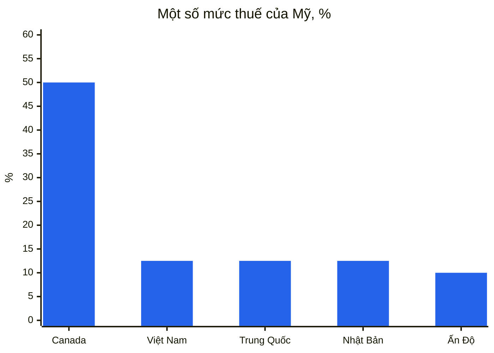

*Lưu ý: Canada = mức thuế Mục 338 (50%); Việt Nam, Trung Quốc và Nhật Bản = mức thuế lao động cưỡng bức Mục 301 (12,5%); Ấn Độ = mức thuế lao động cưỡng bức Mục 301 đang áp (10%; mức 18% theo thỏa thuận đã công bố chưa bao giờ được áp dụng). Nguồn: USTR, Liberty Justice Center, JD Supra.*

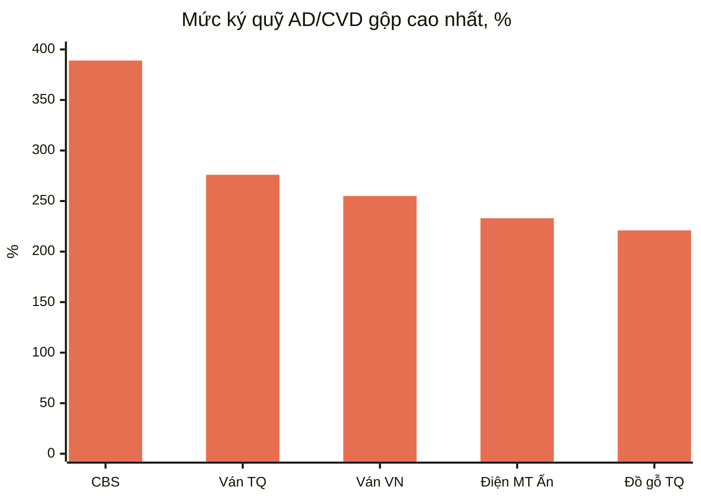

*Lưu ý: mức ký quỹ gộp thuế chống bán phá giá cộng thuế chống trợ cấp. Chất tăng tốc cao su CBS: ký quỹ AD 281,69% + CVD 107,57% (sơ bộ); ván ép gỗ cứng Trung Quốc: AD 187,27% + CVD 88,96%; ván ép Việt Nam (Junma Phu Tho): AD 90,12% + CVD 165,39%; pin mặt trời Ấn Độ: gộp 233,26%; khuôn gỗ Trung Quốc toàn quốc: AD 220,87% (rà soát CVD riêng). Nguồn: thông báo của Bộ Thương mại trên Công báo Liên bang, tháng 11 năm 2026.*

---

## 5. Phân tích chuyên sâu chính sách Mỹ

### Mục 301 — các trường hợp miễn trừ vẫn giữ; cuộc điều tra về công suất dư thừa có thể kết thúc sớm

Không có thay đổi nào đối với các trường hợp miễn trừ Mục 301 đối với Trung Quốc hay việc tạm đình chỉ phí hàng hải trong khung thời gian: 178 trường hợp miễn trừ và việc tạm đình chỉ phí kéo dài đến 11:59 tối theo giờ miền Đông ngày 9 tháng 1 năm 2027, và không có thông báo mới nào của USTR xuất hiện. APEC không đưa ra gia hạn, và điểm quyết định tiếp theo giờ là G20 tại Miami ngày 14–15 tháng 12. Thuế lao động cưỡng bức Mục 301 (12,5% đối với Trung Quốc, Việt Nam và Nhật Bản; 10% đối với Ấn Độ) vẫn có hiệu lực; Tòa án Thương mại Quốc tế đã xét xử vụ kiện đối với thuế lao động cưỡng bức (In re Section 301 Forced Labor Cases, vụ Learning Resources là vụ dẫn đầu) ngày 30 tháng 9, và hội đồng ba thẩm phán chưa ra phán quyết và chưa ấn định ngày phán quyết. Ngày 16 tháng 10, chính phủ và nguyên đơn đã nộp bản tóm tắt trả lời các câu hỏi của hội đồng về việc USTR dựa vào phần nào của Mục 301 và liệu cơ quan này có phải xem xét phát triển kinh tế hay không. Riêng biệt, CBP đã sửa đổi mã báo cáo Chương 99 đối với thuế Mục 301 đối với Trung Quốc ngày 22 tháng 10 (CSMS 70261629); các nhà nhập khẩu có thể xin hoàn tiền đối với các tờ khai trước đó của sản phẩm mà USTR sau đó miễn trừ, thông qua điều chỉnh sau tóm tắt. [JD Supra](https://www.jdsupra.com/legalnews/lower-tariffs-higher-gray-market-risk-6159993/)

Cuộc điều tra về công suất dư thừa là câu hỏi mở của tuần. Đại sứ Greer được cho là đã nói ngày 21 tháng 11 rằng cuộc điều tra về công suất dư thừa mang tính cấu trúc tại 16 nền kinh tế sẽ kết thúc trước cuối năm 2026, sớm hơn nhiều tháng so với hạn chót theo luật định ngày 11 tháng 3 năm 2027. Ông từ chối nêu mức thuế sơ bộ hay lịch trình phạt theo từng quốc gia. Cuộc điều tra bao phủ 21 lĩnh vực, trong đó có ô tô, pin lithium-ion, chất bán dẫn, thép, nhôm, robot, mô-đun năng lượng mặt trời và máy móc chính xác. Nếu chính xác, lịch trình này đẩy nhanh một quyết định mà các quan chức Ấn Độ gọi là yếu tố then chốt đối với thỏa thuận Ấn Độ–Mỹ và các quan chức Hàn Quốc cho biết đã chậm hơn hai tháng so với lịch trình dự kiến của họ. Chưa có kết luận, hành động đề xuất hay danh sách sản phẩm nào được công bố. Báo cáo chỉ có một nguồn; chưa có thông cáo báo chí nào của USTR hay thông báo trên Công báo Liên bang xuất hiện tính đến ngày 23 tháng 11. [East Asia Brief](https://eastasiabrief.com/trade-policy/ustr-accelerates-section-301-probe-hit-year-end-target-1636)

Các thông cáo báo chí về thực thi thương mại duy nhất của USTR trong khung thời gian liên quan tới lao động, không phải thuế quan: ngày 19 tháng 11, Mỹ yêu cầu Mexico rà soát cáo buộc từ chối quyền của người lao động tại Polygroup Industrias México theo Cơ chế Ứng phó Nhanh về Lao động của USMCA, và yêu cầu RRM thứ hai, liên quan tới Industrias FG, được ban hành ngày 13 tháng 11. Đại sứ Greer đã phát biểu trực tuyến tại hội nghị thường niên của Responsible Business Alliance ngày 18 tháng 11 và viết thư cho Wall Street Journal ngày 16 tháng 11 về cách thuế quan đang thúc đẩy thịnh vượng dài hạn của người Mỹ. [USTR](https://ustr.gov/about-us/policy-offices/press-office/press-releases)

### Mục 232 — polysilicon đến hạn ngày 4 tháng 12; robot vẫn đang đàm phán

CBP đã kích hoạt bốn phân loại mô phỏng, không chính thức theo Chương 99 (9903.45.43, 9903.45.45, 9903.45.47, 9903.45.49) trong môi trường Chứng nhận ACE ngày 12 tháng 11 chỉ để thử nghiệm, trước thuế Mục 232 đối với polysilicon và sản phẩm phái sinh. Các mức giá nhập khẩu tối thiểu được thử nghiệm ở mức 21 đô la/kg đối với polysilicon (HTSUS 2804.61.00), 100 đô la/kg đối với thỏi và tấm wafer, 0,22 đô la/watt đối với pin mặt trời và 0,38 đô la/watt đối với mô-đun mặt trời; thuế bằng phần chênh lệch giữa giá trị khai báo và giá nhập khẩu tối thiểu, hoặc thuế cụ thể bằng giá tối thiểu, cùng với thuế 15% theo giá trị đối với sản phẩm phái sinh (polysilicon thô được miễn thuế 15% nhưng chịu sàn giá). Đối với Nhật Bản, Hàn Quốc, Đài Loan, Thụy Sĩ, Liechtenstein và các thành viên EU, tổng thuế Mục 232 cộng thuế Cột 1 được giới hạn ở mức 15%. Hướng dẫn khai báo sản xuất với các tiêu đề chính thức theo Chương 99 vẫn chưa có trước ngày 4 tháng 12. Các biện pháp áp dụng rộng rãi, không có miễn trừ USMCA. [HTS Hero](https://htshero.com/tariff-updates/2026)

Tuyên cáo 11077 (robot và máy móc công nghiệp, ký ngày 28 tháng 10, công bố ngày 2 tháng 11, 91 FR 69199) vẫn là kết luận về mối đe dọa mà không có thuế mới, chỉ đạo Bộ Thương mại và USTR đàm phán và báo cáo trong 180 ngày (khoảng ngày 26 tháng 4 năm 2027). Đây là lần thứ ba trong ba tháng chính quyền chọn đàm phán thay vì áp thuế ngay sau một cuộc điều tra Mục 232, sau tuabin gió và máy bay thương mại. Không có diễn biến nào trong khung thời gian được ghi nhận. [Constilumen](https://www.constilumen.com/updates/proclamation-11077-robotics-industrial-machinery-section-232)

### CBP — hạn chót Mẫu 5106 trôi qua lặng lẽ; quy định về nhà nhập khẩu nước ngoài có hiệu lực ngày 5 tháng 1

Hạn chót ngày 18 tháng 11 trôi qua mà không có vụ vô hiệu nào được báo cáo (xem A9). Việc thực thi gốc đã có hiệu lực từ ngày 18 tháng 9 năm 2026 theo thông báo ngày 19 tháng 8 của CBP (91 FR 53627): số nhà nhập khẩu có dữ liệu Mẫu 5106 không chính xác hoặc không đầy đủ có thể bị vô hiệu ngay lập tức, không có thời gian khắc phục nào được mô tả, và số đã bị vô hiệu không thể dùng để nhập hàng. Số điện thoại và địa chỉ email là các yếu tố dữ liệu thường bị thiếu hoặc không chính xác nhất trong hồ sơ ACE, theo các cố vấn thương mại. Các thư ngày 18 tháng 11 là đợt nhắm mục tiêu vào các nhà nhập khẩu CTPAT, không phải sự khởi đầu của quyền lực này. CBP đã triển khai Tính năng Nâng cao về Nhà nhập khẩu Nước ngoài vào môi trường Chứng nhận ACE ngày 12 tháng 11 (CSMS #70409426) và vào môi trường Sản xuất ngày 5 tháng 1 năm 2027; ba trường dữ liệu mới đã được bổ sung vào Mẫu 3461 và 7501 của CBP (CSMS #70381183), và CBP cho biết các kiểm tra xác thực của họ có thể từ chối tờ khai và tờ khai tóm tắt từ ngày 5 tháng 1 khi các yêu cầu chưa được đáp ứng. Ý kiến về quy định cuối cùng tạm thời đến hạn ngày 5 tháng 1 năm 2027 (hồ sơ USCBP-2026-1387). [DutyStacks](https://dutystacks.beehiiv.com/p/issue-006-apec-ends-with-a-declaration-not-a-deal-the-lukoil-clock-moves)

Phòng tin tức của CBP chỉ đăng các thông cáo địa phương trong khung thời gian — vụ thu giữ vũ khí, đạn dược và ma túy xuất cảnh tại Cảng nhập cảnh Del Rio (ngày 19 tháng 11); cocaine trị giá hơn 390.000 đô la bị thu giữ tại Cảng nhập cảnh Roma (ngày 18 tháng 11); 440 món trang sức giả bị thu giữ tại Cincinnati ngày 11 tháng 11 (báo cáo ngày 18 tháng 11); và việc đóng cửa tạm thời cảng đất liền Alburg Springs, Vermont để xây dựng (ngày 19 tháng 11). Không có thông cáo quốc gia nào về thuế quan hay chính sách thương mại xuất hiện. CSMS #70460453 (ngày 17 tháng 11) nhắc các nhà nhập khẩu rằng đầu máy xe lửa và thiết bị đường sắt khác không đủ điều kiện là phương tiện vận tải quốc tế phải được khai báo và nộp thuế, bao gồm thuế Mục 232 theo Tuyên cáo 11021 đối với một số toa tàu thép và AD/CVD đối với khớp nối toa hàng từ Trung Quốc, Cộng hòa Séc, Ấn Độ và Mexico. Chỉ là hướng dẫn; không có thuế mới. [CBP](https://www.cbp.gov/newsroom)

### Kiểm soát xuất khẩu của BIS — quy định về tiếp cận từ xa, bộ giảm thanh và việc đóng băng Danh sách Thực thể

Quy định cuối cùng tạm thời về tiếp cận từ xa được đề cập tại A2 và mục 3.2. Hai nội dung BIS khác đã xuất hiện trong khung thời gian. Một số bộ giảm thanh, ống giảm thanh và thiết bị giảm âm đã chuyển từ Danh mục Quân dụng Mỹ (USML Mục I) sang Danh mục Kiểm soát Thương mại theo ECCN mới 0A501.f (bộ giảm thanh cho súng trường, súng ngắn và đa nòng) và 0A502.f (bộ giảm thanh chỉ dùng cho súng săn), có hiệu lực ngày 20 tháng 11 (quy định công bố ngày 23 tháng 7 năm 2026, 91 FR 46252). ECCN 0A501.f được kiểm soát vì lý do an ninh quốc gia, ổn định khu vực, kiểm soát tội phạm, Liên hợp quốc và chống khủng bố; 0A502.f mang biện pháp kiểm soát ổn định khu vực mới. Ngoại lệ Giấy phép LVS (tối đa 500 đô la) áp dụng cho cả hai đoạn khi Canada là điểm đến cuối cùng. Bộ giảm thanh được thiết kế đặc biệt cho súng hoàn toàn tự động vẫn nằm trong USML theo ITAR. BIS ước tính thay đổi này sẽ tạo ra khoảng 200 đơn xin giấy phép xuất khẩu bổ sung mỗi năm. [Thomson Reuters](https://www.thomsonreuters.com/en-us/help/onesource-global-trade/regulatory-insights/2026/october-29th/us-issues-interim-final-rule-silencers-mufflers)

Việc tạm đình chỉ Quy định về Công ty liên kết kéo dài đến ngày 10 tháng 1 năm 2027 mà không có quy định mới nào của BIS trong khung thời gian, nhưng tranh chấp chính trị về việc không sử dụng quy định này đã gay gắt hơn. Bộ trưởng Tài chính Bessent cho biết ngày 13 tháng 11 rằng Bộ Tài chính, Quốc phòng, Ngoại giao và USTR đều ủng hộ việc đưa Megaspeed International (khách hàng Nvidia tại Singapore được báo cáo đã mua hơn 4,8 tỉ đô la chip Nvidia tiên tiến trong hai năm) vào Danh sách Thực thể trong nhiều tháng, và rằng Bộ Thương mại "nắm quyền quyết định". Ngày 15 tháng 11, ông tăng áp lực lên chính Nvidia. Bộ Thương mại bác bỏ thông tin về cuộc trao đổi tại Phòng Tình huống ngày 5 tháng 11 được báo cáo. Tờ Financial Times đưa tin ngày 10 tháng 11 rằng Bộ Thương mại đã cố làm chậm việc bổ sung mới vào Danh sách Thực thể, và danh sách đã không có bổ sung nào trong 13 tháng (lần bổ sung gần nhất ngày 9 tháng 10 năm 2025), với hơn 100 ứng viên đang chờ phê duyệt của hội đồng rà soát, trong đó có phòng thí nghiệm AI Trung Quốc DeepSeek. Bộ trưởng Thương mại Howard Lutnick đã đồng ý điều trần trước Ủy ban Ngân hàng Thượng viện ngày 10 tháng 12 năm 2026. Ba Dân biểu Hạ viện đã viết thư cho ông Lutnick ngày 9 tháng 11 yêu cầu trả lời bằng văn bản trước ngày 1 tháng 12. Riêng biệt, hồ sơ thương mại Malaysia được Bloomberg trích dẫn cho thấy Megaspeed đã nhập khẩu ít nhất 17.544 bộ xử lý Nvidia GB300 trị giá khoảng 787 triệu đô la trong tháng 11 năm 2025, và một cuộc khám xét của cảnh sát Indonesia theo yêu cầu của FBI tại đơn vị địa phương của Megaspeed đã phát hiện các giá đỡ GPU trống. Nvidia cho biết họ đã đưa Megaspeed vào danh sách chặn nội bộ từ tháng 6 năm 2025. [ExplainX](https://explainx.ai/blog/bessent-blames-commerce-megaspeed-entity-list-lutnick-ouster-talks-nvidia-huang-2026)

### Công báo Liên bang — hoạt động AD/CVD trong khung thời gian

Hoạt động thương mại trên Công báo Liên bang trong tuần chủ yếu là các thông báo thuế chống bán phá giá và thuế chống trợ cấp, chi tiết tại mục 7: lệnh ván ép gỗ cứng và ván ép trang trí (ngày 17 tháng 11), kết quả rà soát cuối cùng đối với khuôn gỗ và đồ gỗ gia công (ngày 17 tháng 11), quyết định sơ bộ của USITC về hộp các-tông sóng cắt khuôn (ngày 17 tháng 11), và kết quả sơ bộ rà soát mặt bích thép carbon đã hoàn thiện (ngày 16 tháng 11). Không có lệnh tạm giữ hàng mới, không có quy định mới nào của BIS ngoài quy định về tiếp cận từ xa, không có tuyên cáo thuế quan mới nào của Nhà Trắng và không có thông báo Mục 301 mới nào của USTR xuất hiện trong khung thời gian. Công báo Liên bang không được rà soát từng tài liệu cho cả tuần, vì vậy có thể còn các thông báo rà soát hành chính khác.

### Các nội dung thường trực

- **AGOA:** Tổng thống Trump đã thông báo cho Quốc hội và chính phủ Rwanda và Nam Phi ngày 2 tháng 11 về ý định chấm dứt tư cách hưởng lợi AGOA của họ có hiệu lực ngày 1 tháng 1 năm 2027, sau đợt rà soát đủ điều kiện liên cơ quan hàng năm (phiên điều trần công khai ngày 23 tháng 7). AGOA đã được gia hạn theo luật đến ngày 31 tháng 12 năm 2028. Để hoàn tất việc chấm dứt, Tổng thống phải ban hành tuyên cáo trước ngày 1 tháng 1 loại cả hai nước khỏi danh sách hưởng lợi AGOA trong HTSUS; chưa có tuyên cáo nào như vậy được công bố tính đến ngày 23 tháng 11. Xuất khẩu của Nam Phi sau đó sẽ chịu thuế MFN tiêu chuẩn thay vì đãi ngộ miễn thuế AGOA. [USTR](https://ustr.gov/about/policy-offices/press-office/press-releases/2026/november/ambassador-greer-issues-statement-president-trumps-intent-terminate-rwanda-and-south-africa-agoa)
- **Triển vọng thuế quan sau bầu cử giữa kỳ:** cuộc bầu cử ngày 3 tháng 11 đã mang lại đa số Dân chủ tại Quốc hội nhậm chức vào tháng 1, nhưng bản thân cuộc bầu cử không thay đổi mức thuế nào; các mức thuế còn lại dựa trên thẩm quyền Mục 301 và Mục 232, và việc thay đổi chúng sẽ cần hành động của hành pháp hoặc luật được thông qua với đa số vượt quyền phủ quyết. Trình tự: thuế IEEPA bị bác ngày 20 tháng 2 năm 2026, việc thu thuế kết thúc ngày 24 tháng 2; phụ phí 10% theo Mục 122 chạy từ ngày 24 tháng 2 đến ngày 24 tháng 7 năm 2026 và hết hạn sau mức tối đa 150 ngày theo luật định mà không được Quốc hội gia hạn; thuế Mục 301 bao phủ 60 nền kinh tế có hiệu lực ngày 24 tháng 7 năm 2026 ở mức 10% hoặc 12,5%. Các nhà sản xuất được khuyên không nên cho rằng mức bảo hộ thuế quan hiện tại sẽ kéo dài. [JD Supra](https://www.jdsupra.com/legalnews/lower-tariffs-higher-gray-market-risk-6159993/)
- **Nhà Trắng:** không có tuyên cáo thuế quan hay tờ thông tin mới nào được xác định trong khung thời gian. Tuyên cáo liên quan gần nhất vẫn là Tuyên cáo 11077 (robot và máy móc công nghiệp).

---

## 6. Chính sách thế giới theo khu vực

### Châu Âu

**EU–Indonesia ký CEPA, ngày 21 tháng 11.** Sau gần một thập kỷ đàm phán, EU và Indonesia đã ký Hiệp định Đối tác Kinh tế Toàn diện và Hiệp định Bảo hộ Đầu tư riêng biệt tại Brussels. Ủy viên Thương mại EU Maroš Šefčovič ký thay mặt khối; Chủ tịch Ủy ban Ursula von der Leyen tham dự. Hội đồng đã phê duyệt việc ký kết ngày 18 tháng 11. Indonesia sẽ xóa bỏ thuế quan đối với 98,5% dòng thuế cho hàng hóa EU khi các điều khoản có hiệu lực đầy đủ; Ủy ban cho biết thỏa thuận sẽ giúp các nhà xuất khẩu EU tiết kiệm hơn 600 triệu euro mỗi năm tiền thuế hải quan, và 221 chỉ dẫn địa lý của EU được bảo hộ. Nghị viện châu Âu vẫn phải chấp thuận và Indonesia phải phê chuẩn; cả hai bên đặt mục tiêu áp dụng tạm thời từ đầu năm 2027. Bà von der Leyen cho biết Tổng thống Prabowo Subianto sẽ thăm Brussels ngày 11 tháng 12. Lễ ký kết khép lại gần mười năm đàm phán và là lễ ký thương mại lớn thứ hai của EU tại châu Á trong năm, một phần của nỗ lực đa dạng hóa khi quan hệ với Mỹ và Trung Quốc ngày càng khó khăn. Đối với các nhà xuất khẩu, điểm thực tế là thỏa thuận đã được ký, chưa có hiệu lực; các quyết định tìm nguồn cung ứng và định giá không nên giả định các mức thuế mới. [Turkish Post](https://turkishpost.com.tr/en/2026/11/21/eu-indonesia-trade-deal/)

**Ký kết FTA EU–Ấn Độ được ấn định ngày 16 tháng 12 năm 2026.** Hiệp định thương mại tự do EU–Ấn Độ hiện dự kiến được ký ngày 16 tháng 12 năm 2026 tại Brussels trong chuyến thăm của Thủ tướng Narendra Modi, theo một quan chức Ấn Độ được PTI trích dẫn và báo cáo ngày 22 tháng 11. Ủy ban đã trình đề xuất lên Hội đồng xin phép ký kết và phê chuẩn, kèm theo văn bản pháp lý cuối cùng và biểu thuế. Đại sứ EU tại Ấn Độ Jean-Eric Paquet đã xác nhận thời hạn giữa tháng 12 trong chuyến thăm Assam. Việc có hiệu lực dự kiến trong năm 2027, sau khi Nghị viện châu Âu phê duyệt, Hội đồng phê chuẩn và Ấn Độ phê chuẩn. Theo hiệp ước, 93% lô hàng Ấn Độ sẽ được tiếp cận miễn thuế vào EU, bao gồm thuế 0% đối với khoảng 33 tỉ đô la xuất khẩu thâm dụng lao động. Đàm phán kết thúc ngày 27 tháng 1 năm 2026. Một hiệp định bảo hộ đầu tư riêng biệt và một thỏa thuận về chỉ dẫn địa lý vẫn đang được đàm phán. [Asia Daily](https://asiadaily.org/news/19949/)

**Phí xử lý 2 euro của EU: dữ liệu tác động đầu tiên — bưu kiện giá trị thấp giảm hơn 60%.** Phí xử lý 2 euro của Liên minh đối với mỗi dòng mặt hàng (Quy định Ủy quyền (EU) 2026/2152) và Mã định danh Sản phẩm bắt buộc bước vào tuần thứ ba. Chi tiết mới được xác nhận trong tuần này: Ủy ban cho biết khối lượng bưu kiện giá trị thấp đã giảm hơn 60% so với xu hướng trước thuế trong quý 3 năm 2026, khi một số người bán chuyển sang vận chuyển hàng số lượng lớn tới các kho tại EU. Ủy ban cũng báo cáo 5,9 tỉ mặt hàng thương mại điện tử giá trị thấp đã được nhập khẩu vào EU năm 2025, gấp bốn lần con số năm 2022, với hơn 90% đến từ Trung Quốc. Cả thuế cố định 3 euro và phí 2 euro đều thuộc phần chịu thuế VAT theo hướng dẫn sửa đổi của Ủy ban ngày 6 tháng 10 năm 2026. Phí 2 euro quốc gia của Ý đối với mỗi lô hàng tới 150 euro đã được hoãn đến ngày 1 tháng 12 năm 2026, bổ sung cho các khoản phí của EU. Một chiến dịch kiểm tra toàn châu Âu phát hiện hơn 60% mặt hàng được kiểm tra không tuân thủ các tiêu chuẩn châu Âu. Bằng chứng cứng đầu tiên về việc EU tái thiết nhập khẩu giá trị thấp cho thấy sự thay đổi hành vi mạnh mẽ: khối lượng bưu kiện giảm hơn 60% so với xu hướng trong quý 3, trước khi phí 2 euro có hiệu lực, khi người bán chuyển hàng vào kho tại EU để tránh phí theo từng mặt hàng. Phí này là vĩnh viễn, áp dụng ở mọi giá trị, và không được hoàn lại ngay cả khi trả hàng, vì vậy nó thay đổi cả kinh tế hoàn trả lẫn chi phí hạ cánh. Không có số liệu chính thức nào về doanh thu thu được hay chậm trễ thông quan được công bố trong khung thời gian. [Fashion Law Journal](https://fashionlawjournal.com/eu-small-parcel-tax/)

**Biện pháp tự vệ của EU đối với ô tô hybrid.** Xem A4. Ủy ban đã mở cuộc điều tra ngày 30 tháng 10; việc nhận ý kiến bằng văn bản kết thúc ngày 20 tháng 11; các biện pháp tạm thời dự kiến từ ngày 1 tháng 12 với hạn mức 350.000 xe mỗi năm được báo cáo đối với xe hybrid sản xuất tại Trung Quốc. [Ports Europe](https://www.portseurope.com/eu-opens-hybrid-safeguard-probe-as-chinese-shipments-outrun-planned-quota/)

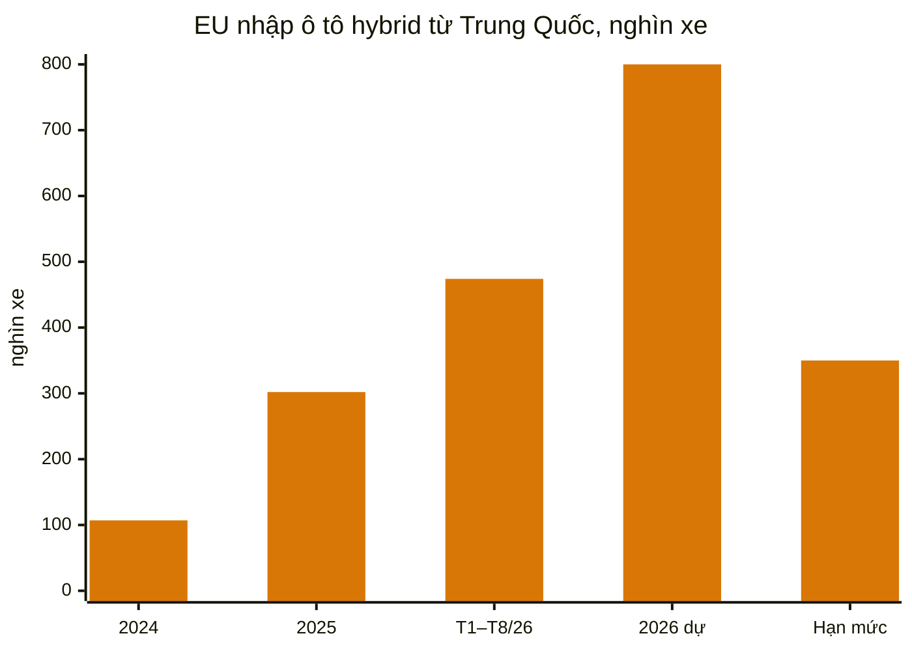

*Lưu ý: nhập khẩu là số liệu Eurostat; dự báo năm 2026 là ước tính của Ủy ban; hạn mức là hạn mức tự vệ năm đầu được báo cáo là 350.000 xe. Nguồn: Eurostat qua Ports Europe; Ủy ban.*

**FTA EU–Úc: ký tháng 3, phê chuẩn chưa chắc chắn; không có diễn biến mới trong khung thời gian.** FTA EU–Úc được kết thúc ngày 24 tháng 3 năm 2026 và ký tại Canberra cùng ngày, nhưng chưa có hiệu lực và không thể thực hiện nếu không có sự rà soát của quốc hội và thay đổi luật của Úc, một quá trình mà DFAT cho biết có thể mất tới hai năm. Đại sứ Đức tại Úc cho biết ngày 29–31 tháng 10 rằng việc phê chuẩn tại Úc phụ thuộc vào phiếu của Thượng viện từ Liên minh, Đảng Xanh hoặc nghị sĩ độc lập, và bày tỏ hy vọng có thể hoàn tất trong quý 1 năm 2027; Đảng Quốc gia đối lập đã thề sẽ phản đối và Đảng Tự do chưa tuyên bố lập trường. EU đã cảnh báo thỏa thuận sẽ không được đàm phán lại nếu quốc hội bác bỏ. Việc có hiệu lực không được dự kiến trước cuối năm 2027. 98% xuất khẩu của Úc theo giá trị sẽ vào EU miễn thuế; thương mại song phương vượt 109 tỉ đô la Úc mỗi năm. [AAP](https://aapnews.aap.com.au/news/claim-eu-trade-deal-mandates-methane-reducing-livestock-feed-is-baseless)

**Thỏa thuận thương mại số EU–Canada kết thúc ngày 30 tháng 10; văn bản chưa công khai.** EU và Canada đã kết thúc đàm phán Hiệp định Thương mại Số ngày 30 tháng 10 năm 2026, bổ sung cho CETA (áp dụng tạm thời từ năm 2017). Thỏa thuận đặt ra các quy tắc về dòng dữ liệu xuyên biên giới, hợp đồng điện tử, chữ ký điện tử và hóa đơn điện tử, bảo vệ người tiêu dùng trực tuyến và tin nhắn thương mại không mong muốn. Đàm phán chỉ được khởi động tháng 3 năm 2026 tại cuộc họp lần thứ năm của Ủy ban Hỗn hợp CETA. Văn bản đã nhất trí chưa được công bố; việc rà soát pháp lý và dịch sang mọi ngôn ngữ EU sẽ diễn ra trước khi ký kết. Tốc độ đàm phán — kết thúc trong tám tháng kể từ khi khởi động — phản ánh ưu tiên chính trị mà cả hai bên dành cho các quy tắc thương mại số khi chính sách của Mỹ ngày càng khó đoán. Việc ký kết và có hiệu lực vẫn là vấn đề của năm 2027 sớm nhất. [European Commission](https://policy.trade.ec.europa.eu/news/eu-and-canada-conclude-negotiations-digital-trade-agreement-2026-10-30_en?prefLang=ga)

**Quy tắc xuất xứ ô tô Anh–EU: ACEA và SMMT cảnh báo một trong bốn xe điện sẽ chịu thuế 10% từ ngày 1 tháng 1 năm 2027.** ACEA và SMMT cảnh báo các quy tắc xuất xứ nghiêm ngặt hơn trong Hiệp định Thương mại và Hợp tác Anh–EU đối với xe điện và xe hybrid, có hiệu lực ngày 1 tháng 1 năm 2027, sẽ khiến chưa tới một phần tư xe điện chạy pin và xe hybrid cắm sạc giao dịch giữa hai thị trường đủ điều kiện hưởng miễn thuế, khiến phần còn lại chịu thuế 10%. Các hiệp hội cũng cảnh báo Đạo luật Tăng tốc Công nghiệp được đề xuất của EU có thể áp thuế lên xe và linh kiện của Anh, đe dọa mối quan hệ thương mại ô tô trị giá 87 tỉ đô la Mỹ mỗi năm. EU vẫn nhập khẩu khoảng hai phần ba pin lithium-ion dù đã đầu tư khoảng 80,8 tỉ đô la Mỹ vào chuỗi cung ứng pin của EU kể từ năm 2017. VDA của Đức đã lập luận trong tháng 11 về việc hoãn thay đổi quy tắc xuất xứ cho đến khi chuỗi cung ứng pin của EU phát triển thêm. Hội nghị thượng đỉnh ngày 20 tháng 11 không đưa ra giải pháp nào được báo cáo về điểm này. [Manufacturing Digital](https://manufacturingdigital.com/news/acea-smmt-uk-eu-tariff-rules-threaten-auto-manufacturers)

### Vương quốc Anh

**Hội nghị thượng đỉnh Anh–EU, ngày 20 tháng 11: thỏa thuận SPS, liên kết ETS và miễn trừ CBAM lẫn nhau được nhất trí.** Xem mục 3.3. Tại hội nghị thượng đỉnh Anh–EU lần thứ hai, hai bên đã nhất trí thỏa thuận SPS (thực hiện ngày 1 tháng 3 năm 2028; Chính phủ Anh ước tính có thể tăng sản lượng kinh tế lên tới 5,1 tỉ bảng Anh mỗi năm vào năm 2040), liên kết Hệ thống Giao dịch Phát thải của Anh với Hệ thống Giao dịch Phát thải của EU (miễn trừ CBAM lẫn nhau mục tiêu từ ngày 1 tháng 1 năm 2028; khoảng 6,5 tỉ bảng Anh xuất khẩu của Anh có thể hưởng lợi), và các biện pháp di chuyển của thanh niên. Anh sẽ miễn hàng hóa có xuất xứ từ EU, EEA và Thụy Sĩ khỏi CBAM của mình từ ngày 1 tháng 1 năm 2027. Các thỏa thuận chưa có hiệu lực; vẫn cần các quy trình pháp lý và thực hiện tiếp theo. [Thames Valley Chamber](https://www.thamesvalleychamber.co.uk/uk-eu-summit-2026-new-trade-agreements-reached/)

**Phạm vi CBAM của Anh sẽ mở rộng sang sản phẩm lọc dầu; tham vấn được khởi động tại Ngân sách 2026.** Chính phủ dự định mở rộng Cơ chế Điều chỉnh Biên giới Carbon của Anh để bao gồm sản phẩm lọc dầu, tùy thuộc tham vấn về tính khả thi và tác động. Cuộc tham vấn được khởi động tại Ngân sách 2026. Không có thời hạn nào được đưa ra; Chính phủ cho biết họ dự định thực hiện biện pháp "càng sớm càng khả thi" và sẽ nêu thời hạn trong thời gian tới. CBAM của Anh theo luật bắt đầu ngày 1 tháng 1 năm 2027 đối với nhôm, xi măng, phân bón, hydro và sắt thép. Việc mở rộng sẽ mở rộng CBAM của Anh vượt năm lĩnh vực ban đầu sang sản phẩm dầu mỏ tinh chế, nhưng vẫn đang ở giai đoạn tham vấn và chưa có ngày. Nó nằm cạnh thỏa thuận hội nghị thượng đỉnh ngày 20 tháng 11, theo đó hàng hóa có xuất xứ EU sẽ được miễn khỏi CBAM của Anh từ ngày 1 tháng 1 năm 2027 — vì vậy việc mở rộng sang sản phẩm lọc dầu, nếu tiến hành, trên thực tế sẽ chủ yếu áp lên các nhà cung cấp ngoài EU. [UK Parliament](https://questions-statements.parliament.uk/written-questions/detail/2026-10-28/39108)

**Không có thông báo biện pháp phòng vệ thương mại mới nào của Anh trong khung thời gian; việc gia hạn thuế đối với cá hồi vân vẫn giữ.** Không có thông báo biện pháp phòng vệ thương mại mới nào được ghi nhận trong phạm vi bao phủ. Nội dung thường trực: Thông báo Biện pháp Phòng vệ Thương mại 2026/31 đã gia hạn thuế chống trợ cấp đối với cá hồi vân Thổ Nhĩ Kỳ thêm năm năm đến ngày 30 tháng 1 năm 2031, có hiệu lực ngày 6 tháng 11 năm 2026, ở các mức hiện hành (theo từng nhà xuất khẩu 1,5%–8%; các trường hợp khác 9,5%). Việc CBAM của Anh bắt đầu ngày 1 tháng 1 năm 2027 giờ là sự kiện thương mại có ngày gần nhất của Anh.

### Canada

**Thỏa thuận song phương Canada–Trung Quốc được gia hạn và mở rộng, ngày 17 tháng 11.** Canada và Trung Quốc đã gia hạn và mở rộng Thỏa thuận Chung Sơ bộ về Giải quyết các Vấn đề Kinh tế và Thương mại Song phương. Trung Quốc sẽ giảm thuế thêm cho khoảng 400 triệu đô la Canada xuất khẩu — 116 triệu đô la Canada thịt lợn đông lạnh và 285 triệu đô la Canada cá và hải sản (tôm nước lạnh đông lạnh và tôm bao gồm tôm đốm Thái Bình Dương 87,5 triệu đô la Canada; động vật thân mềm bao gồm ốc vòi voi 61,4 triệu đô la Canada; hải sâm 39,4 triệu đô la Canada; cá bơn Greenland 96 triệu đô la Canada) — bằng cách tạm đình chỉ thêm 25% thuế đối với các sản phẩm đó từ ngày 1 tháng 1 năm 2027 đến ngày 31 tháng 12 năm 2028. Việc mở rộng dựa trên việc gia hạn hai năm đối với giảm thuế cho khô dầu hạt cải, đậu Hà Lan, tôm hùm và cua đã nhất trí đầu tháng 11 (đàm phán cấp bộ trưởng ngày 4 tháng 11). Đổi lại, Canada gia hạn hai năm các biện pháp miễn trừ hiện hành đối với một số sản phẩm thép và nhôm của Trung Quốc sẽ hết hạn cuối năm 2026, và mở rộng phạm vi miễn trừ sang thêm 32 mặt hàng thuế thép và nhôm (23 thép, 9 nhôm) nơi nguồn cung Canada không đủ hoặc không có. Con số 400 triệu đô la Canada là giá trị xuất khẩu của Canada trong các danh mục đó năm 2024, trước thuế bổ sung của Trung Quốc; đó không phải là khoản thanh toán hay bảo đảm kinh doanh mới. Ngày hết hạn mới của thỏa thuận là ngày 31 tháng 12 năm 2028. Thỏa thuận cũng khôi phục hoán đổi tiền tệ song phương, theo bản tóm tắt APEC của China Briefing. [Prime Minister of Canada](https://www.pm.gc.ca/en/news/news-releases/2026/11/17/prime-minister-carney-advances-canadas-strategic-partnership-china)

**Vụ kiện Mục 338: tranh tụng ấn định ngày 20 tháng 1 năm 2027.** Xem mục 3.7 và A9 trong báo cáo tuần trước. Các bản tóm tắt amicus ủng hộ vụ kiện đối với thuế Mục 338 áp lên hàng hóa Canada đã được nộp bởi các cựu USTR Carla Hills và Robert Zoellick, các học giả thương mại và những người ủng hộ người nộp thuế; Trung tâm Tư pháp Liberty thông báo về việc nộp hồ sơ ngày 16 tháng 11. Tranh tụng dự kiến ngày 20 tháng 1 năm 2027. Bản tóm tắt trả lời của chính phủ đến hạn ngày 11 tháng 12 năm 2026, và bản trả lời của Gellert đến hạn ngày 11 tháng 1 năm 2027. Vụ kiện (Gellert Global Group Corp. v. Trump, Số vụ 26-04636) kiện mức thuế 50% đối với khoảng 20 tỉ đô la hàng nhập khẩu Canada; Gellert cho biết họ sẽ trả khoảng 40 triệu đô la mỗi năm đối với phô mai Canada và đã trả ít nhất 381.000 đô la Mỹ đối với các tờ khai thực hiện ngày 15 tháng 9–7 tháng 10 năm 2026. Ngày 28 tháng 10, tòa đã chấp thuận một phần và bác bỏ một phần đơn của Gellert (mục hồ sơ không nêu rõ phần nào). Tuyên cáo 11076 đã viết lại danh sách sản phẩm xe cơ giới một lần nữa đối với hàng hóa nhập từ ngày 30 tháng 10 năm 2026. Các mức thuế vẫn có hiệu lực. [Liberty Justice Center](https://libertyjusticecenter.org/pressrelease/former-u-s-trade-representatives-scholars-back-liberty-justice-centers-challenge-to-trumps-canadian-tariffs/)

**Bức tranh doanh thu giảm thuế của Canada: 14,1 tỉ đô la Canada được đánh giá, 8,9 tỉ đô la Canada được miễn.** Từ tháng 3 năm 2025 đến ngày 26 tháng 10 năm 2026, Canada đã đánh giá 14,1 tỉ đô la Canada (khoảng 10 tỉ đô la Mỹ) thuế đối với sản phẩm Mỹ, nhưng 8,9 tỉ đô la Canada đã được miễn hoặc giảm, còn doanh thu ròng 5,2 tỉ đô la Canada. Điều này lượng hóa mức độ rộng của chương trình miễn trừ: hầu hết thuế trả đũa thực tế không tạo ra doanh thu. Các thay đổi ngày 9 tháng 11 (miễn trừ ngang được gia hạn đến ngày 30 tháng 6 năm 2028; bỏ giảm thuế đối với một số xe kéo từ ngày 1 tháng 12 năm 2026 và một số dây nhôm, sản phẩm đùn và bìa giấy từ ngày 1 tháng 2 năm 2027) vẫn giữ như báo cáo tuần trước; không có thay đổi nào thêm trong khung thời gian. [Mining Weekly](https://www.miningweekly.com/article/canada-expands-us-tariff-exemptions-cuts-some-aluminium-relief-2026-11-10)

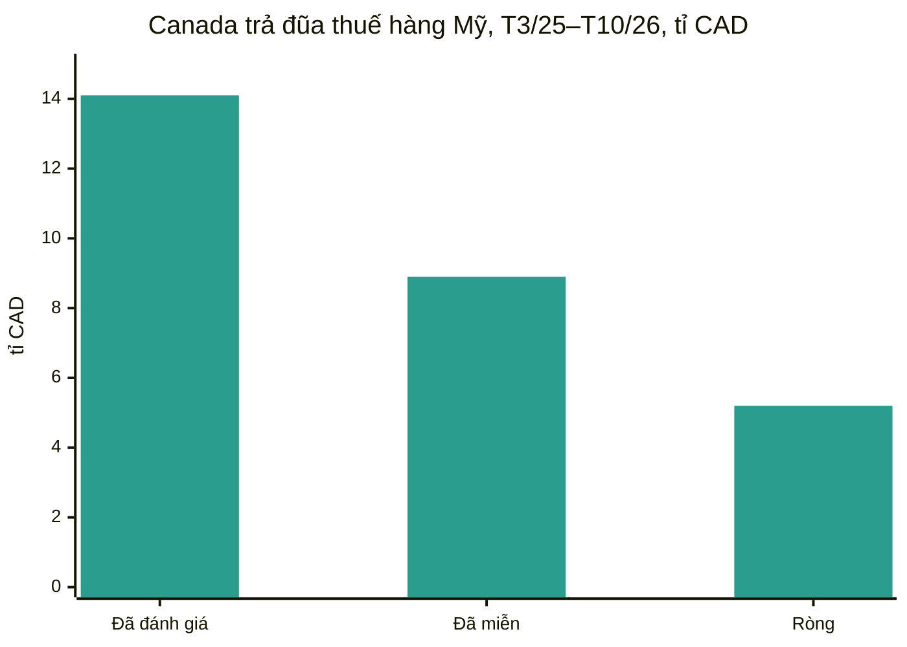

*Lưu ý: thuế đã đánh giá đối với sản phẩm Mỹ từ tháng 3 năm 2025 đến ngày 26 tháng 10 năm 2026; đã miễn hoặc giảm theo chương trình miễn trừ; doanh thu ròng. Nguồn: công bố của Chính phủ Canada qua Mining Weekly, ngày 10 tháng 11 năm 2026.*

**Canada chất vấn Ấn Độ tại WTO về gạo dự trữ chuyển sang sản xuất ethanol.** Canada đã nêu câu hỏi chính thức tại WTO ngày 14 tháng 11 về việc Ấn Độ phân bổ gạo dự trữ nhà nước cho các nhà sản xuất ethanol, yêu cầu chi tiết về khối lượng ngũ cốc công cộng chuyển sang chưng cất cồn nhiên liệu trong nước. Điều này tiếp nối mô hình giám sát của ủy ban nông nghiệp đối với hỗ trợ nội địa của Ấn Độ (xem Đa phương). Không có phản hồi nào của Ấn Độ được báo cáo trong khung thời gian. [Distillers Hub](https://distillershub.com/news/111420315/)

### Trung Quốc

**Kiểm soát xuất khẩu lưỡng dụng đối với máy bay không người lái, máy đào hầm và tàu nạo vét có hiệu lực ngày 18 tháng 11.** Thông báo số 49 (máy bay không người lái), số 50 (máy đào hầm và thiết bị liên quan) và số 51 (tàu nạo vét) có hiệu lực ngày 18 tháng 11 năm 2026, sửa đổi Danh mục Kiểm soát Xuất khẩu Mặt hàng Lưỡng dụng. Giấy phép được yêu cầu đối với hệ thống lái tự động của máy bay không người lái, máy bay không người lái có khả năng bay ngoài tầm nhìn với thời gian bay ít nhất ba giờ, động cơ được thiết kế đặc biệt cho máy bay không người lái, và máy bay không người lái có tầm bay từ 300 km trở lên hoặc được trang bị để phát tán aerosol trên 80 lít. Thông báo số 49 nâng ngưỡng thời gian bay đối với máy bay không người lái bị kiểm soát từ một giờ lên ba giờ, vì vậy máy bay không người lái phổ thông dưới ngưỡng đó không còn cần giấy phép, trong khi kiểm soát mở rộng sang nhiều bộ phận máy bay không người lái hơn. Thông báo số 50 áp kiểm soát đối với máy đào hầm lần đầu tiên, cùng với máy xúc đi bộ được chỉ định và máy phun bê tông độ cao; xuất khẩu sang các điểm đến nhạy cảm cần giấy phép, các điểm đến khác có thể dùng chứng chỉ dựa trên đăng ký, tùy thuộc hạn chế chuyển giao tiếp theo. Thông báo số 51 bổ sung cấp phép đối với bơm nạo vét, đầu kéo và đầu cắt được chỉ định. Một quy định tái xuất cũng áp dụng từ ngày 18 tháng 11: các công ty nước ngoài cần giấy phép của Trung Quốc để chuyển máy móc xây dựng có xuất xứ Trung Quốc như máy đào hầm sang một số quốc gia. Riêng biệt, Thông báo số 52 của MOFCOM và GAC (ngày 19 tháng 10) đã sửa đổi thủ tục theo đó hải quan có thể giữ hàng hóa xuất trình để xuất khẩu mà không có giấy phép. Các biện pháp kiểm soát giờ đã có hiệu lực, và thiết kế của chúng mang tính hai mặt: ngưỡng được nâng lên để máy bay không người lái thương mại thông thường nằm ngoài chế độ, trong khi phạm vi mở rộng sang máy đào hầm — lần đầu tiên — và sang tái xuất máy móc có xuất xứ Trung Quốc bởi các công ty nước ngoài. Quy định tái xuất đó là điểm sắc bén nhất đối với người mua và người bán lại ở nước thứ ba, vì nó chạm tới các giao dịch không có nhà xuất khẩu Trung Quốc. [Mondaq](https://alpha.mondaq.com/china/new-technology/1870494/new-chinese-export-control-measures-tighten-restrictions-on-the-export-of-advanced-technologies-and-dual-use-goods-strengthen-enforcement)

**Danh mục xuất khẩu công nghệ: ý kiến kết thúc ngày 15 tháng 11; đăng ký tạm thời trước xuất khẩu giờ là chế độ đang vận hành.** Ý kiến công chúng về Thông báo số 48 (ngày 16 tháng 10), theo đó sẽ bổ sung 40 công nghệ vào Danh mục Công nghệ Bị cấm hoặc Hạn chế Xuất khẩu (23 AI, 5 dược phẩm sinh học, 12 quang điện; 14 bị cấm, 26 bị hạn chế), kết thúc ngày 15 tháng 11. Chưa có danh mục cuối cùng nào được công bố tính đến ngày 23 tháng 11. Điều đang vận hành hiện nay là yêu cầu đăng ký tạm thời trước xuất khẩu có hiệu lực từ ngày 16 tháng 10, bao phủ xuất khẩu các công nghệ được liệt kê bao gồm các giao dịch đã đang diễn ra và việc chuyển quyền sở hữu hoặc kiểm soát một doanh nghiệp trong nước nắm giữ các công nghệ đó sang một thực thể ở nước ngoài. Phân tích mới trong tuần này làm rõ phạm vi: trong dược phẩm sinh học, việc chuyển quyền sở hữu nền tảng trị liệu tế bào và gen và siRNA sẽ bị cấm, nhưng cấp phép, dịch vụ CRO/CDMO và công nghệ cần thiết cho R&D sản phẩm hoặc sản xuất trong giao dịch phát triển kinh doanh ra nước ngoài thì không; trong AI, việc triển khai cục bộ ở nước ngoài một mô hình bị hạn chế được tính là xuất khẩu công nghệ, trong khi truy cập API, tương tác ứng dụng hoặc web, SaaS và triển khai nhẹ trên thiết bị nằm ngoài phạm vi. Việc rà soát xuất khẩu công nghệ bị hạn chế mất tới khoảng 45 ngày làm việc theo hai giai đoạn. MOFCOM cũng mở tham vấn về dự thảo Biện pháp Điều tra và Thực thi Kiểm soát Xuất khẩu Lưỡng dụng, với ý kiến đến hạn ngày 29 tháng 11 năm 2026. Các điều khoản về năng lượng mặt trời vẫn có hệ quả nhất đối với các nhà sản xuất nước ngoài, bao phủ sản xuất polysilicon, tấm wafer dày 70 micromet trở xuống, và chế tạo pin perovskite và pin song song. [Jones Day](https://www.jonesday.com/en/insights/2026/11/china-tightens-its-grip-on-exports-of-strategic-technologies-what-it-means-for-technology-deals-involving-ai-and-biotech)

**Trang tiếng Anh của MOFCOM có thể truy cập; trang chủ chỉ hiển thị họp báo ngày 12 tháng 11.** Trang tiếng Anh có thể truy cập ngày 23 tháng 11. Nội dung trang chủ chỉ giới hạn ở buổi họp báo thường kỳ ngày 12 tháng 11 (bao gồm nhận xét về cuộc gọi video ngày 6 tháng 11 của Hà Lập Phong với Bessent và Greer, và về sự kiện kết nối thiết bị y tế Trung Quốc–EU tại CIIE) và các số Công báo. Không có thông báo mới nào về danh mục công nghệ hay việc tạm đình chỉ gali xuất hiện trên trang chủ. Cổng tiếng Anh của MOFCOM vẫn là nguồn mỏng — chỉ có tiêu đề, với các thông báo thực chất xuất hiện trước tiên bằng tiếng Trung. Buổi họp báo ngày 12 tháng 11 xác nhận tám vòng tham vấn kinh tế và thương mại Trung Quốc–Mỹ kể từ tháng 5 năm 2025. Việc tạm đình chỉ liên quan tới gali (Thông báo số 72 năm 2025) hết hạn ngày 27 tháng 11 năm 2026 và chưa có thông báo sửa đổi nào được tìm thấy tính đến ngày 23 tháng 11. [MOFCOM](https://english.mofcom.gov.cn/)

**Trung Quốc–Mỹ: không có kết quả thuế quan từ APEC; thỏa thuận đình chiến vẫn kéo dài đến ngày 9–10 tháng 1 năm 2027.** Xem A1 và mục 3.1. Cuộc gặp song phương Tập–Trump ngày 19 tháng 11 không đưa ra thông báo giảm thuế nào và không có kết quả về đất hiếm; các báo cáo mô tả bế tắc về thuế quan, đất hiếm và chất bán dẫn. Ông Trump thúc giục Trung Quốc thực hiện cam kết mua 17 tỉ đô la Mỹ nông sản Mỹ; các quan chức Trung Quốc cho biết cam kết này phụ thuộc vào việc cắt giảm thuế quan đối ứng. Hai nhà lãnh đạo đã nhất trí soạn thảo kế hoạch hành động vì "ổn định chiến lược" Mỹ–Trung. Các gói cắt giảm thuế quan đối ứng 30 tỉ đô la đổi 30 tỉ đô la và 60 tỉ đô la được đề xuất vẫn chưa hoàn tất. [China Briefing](https://www.china-briefing.com/news/apec-2026-in-shenzhen-what-the-leaders-meeting-and-trump-xi-talks-mean-for-business/)

### Ấn Độ

**Thỏa thuận Ấn Độ–Mỹ vẫn chưa ký; Bộ trưởng Thương mại nói việc ký phải chờ khung thuế quan của Mỹ.** Xem mục 3.7. Bộ trưởng Thương mại Rajesh Agrawal cho biết ngày 18 tháng 11 rằng thỏa thuận thương mại Ấn Độ–Mỹ được đề xuất không thể ký cho đến khi Washington thiết lập kiến trúc thuế quan mới sau khi Tòa án Tối cao dỡ bỏ thuế đối ứng và khẩn cấp, vì lợi thế so sánh dành cho các nước khác nhau cần phải rõ ràng. Kết quả của các cuộc điều tra Mục 301 đang diễn ra — trong đó có cuộc điều tra về công suất dư thừa, với kết luận dự kiến trong vài tuần hoặc vài tháng tới — cũng cần được biết, vì mọi quốc gia đều muốn chắc chắn về các cuộc điều tra đó. Thỏa thuận pháp lý đã được đàm phán và đang ở giai đoạn cuối; cả hai bên đều muốn kết thúc càng nhanh càng tốt. Ông Jaishankar cho biết ngày 14 tháng 11 rằng thỏa thuận đang ở "chặng cuối" và phần lớn vấn đề đã được giải quyết. Khung ngày 7 tháng 2 năm 2026 đặt mức thuế 18% của Mỹ, chưa bao giờ được áp dụng; hàng hóa Ấn Độ hiện trả mức thuế Mục 301 là 10%. [The Hindu BusinessLine](https://www.thehindubusinessline.com/economy/no-india-us-trade-deal-until-new-us-tariff-framework-section-301-probes/article71716562.ece/amp/)

**Ấn Độ–EU: ký ngày 16 tháng 12; các giới hạn đỏ về sữa và biến đổi gen được khẳng định lại.** Không có thay đổi nào đối với các giới hạn đỏ được báo cáo tuần trước: Ấn Độ chưa bao giờ mở cửa lĩnh vực sữa trong bất kỳ FTA nào và sẽ không cho phép nhập khẩu sản phẩm biến đổi gen. Lễ ký EU–Ấn Độ giờ được ấn định ngày 16 tháng 12 (xem Châu Âu). Các giới hạn đỏ này ổn định và liên quan tới mọi hướng FTA đang diễn ra của Ấn Độ, bao gồm thỏa thuận chưa ký với Mỹ, nơi nông nghiệp và sữa là những điểm nhạy cảm chưa được giải quyết.

### Châu Á–Thái Bình Dương

**APEC Thâm Quyến: các nhà lãnh đạo thông qua Tuyên bố Thâm Quyến; không có thỏa thuận thuế quan; các thỏa thuận bên lề cho Canada, Chile, Philippines, Peru, Indonesia.** Xem các mục 3.1 và 3.7. Các thỏa thuận bên lề: giảm thuế Trung Quốc–Canada (xem Canada); Hiệp định Đối tác Kinh tế Toàn diện Philippines–Chile ký ngày 19 tháng 11 — FTA đầu tiên của Philippines với một nước Mỹ Latinh, tiếp cận ưu đãi cho 8.632 danh mục sản phẩm, miễn thuế cho hầu như mọi lô hàng hiện hữu của Philippines sang Chile (điện tử, máy móc, cơm dừa khô, carrageenan, cá ngừ chế biến); FTA Peru–Thái Lan ký ngày 19 tháng 11; lộ trình kinh tế và thương mại Trung Quốc–Chile và MOU về thương mại tự do và chủ nghĩa đa phương; Trung Quốc–Indonesia thông báo ngày 20 tháng 11 về việc khởi động đàm phán CEPA. Philippines cũng bày tỏ quan tâm gia nhập CPTPP và cho biết đàm phán FTA Philippines–Canada đã kết thúc. [BusinessMirror](https://businessmirror.com.ph/2026/11/20/new-trade-deal-opens-chile-market-for-phl/)

**Pax Silica: Tuyên bố San Francisco ký ngày 15 tháng 11 bởi Mỹ và tám đối tác.** Mỹ và tám đối tác đã ký Tuyên bố San Francisco về Nền tảng An toàn của Thịnh vượng Bền vững trong khuôn khổ Pax Silica, nhất trí xây dựng danh sách chung các công nghệ nhạy cảm và chuỗi cung ứng quan trọng cần được bảo vệ mạnh hơn, trao đổi thông tin về điểm yếu, và tổ chức các nhóm làm việc. Tuyên bố bao phủ chất bán dẫn, hạ tầng AI, khoáng sản quan trọng, năng lượng, sản xuất tiên tiến, logistics vận tải và mạng truyền thông, và nhắm vào các thực hành phi thị trường, công suất dư thừa và bán phá giá không công bằng. Tuyên bố không ràng buộc: không có cam kết tài trợ, không nêu tên công ty, không có hạn chót thực hiện, và bản thân danh sách chung chưa được viết hay công bố. Pax Silica, ra mắt tháng 12 năm 2025, giờ có khoảng 26 bên tham gia. Các thành viên EU không tham dự Hội nghị Sáng lập nhưng đang rà soát tài liệu về "tương thích quy định"; Đức, Thụy Điển, Hà Lan và Ủy ban châu Âu dự kiến sẽ ký trong thời gian ngắn. Tuyên bố đưa Pax Silica từ một tuyên bố đối tác rộng sang phối hợp an ninh cụ thể — nhiệm vụ là danh sách chung các công nghệ và hạ tầng cần bảo vệ — nhưng sản phẩm bàn giao chưa tồn tại, vì vậy tác động thương mại của nó mang tính triển vọng. Cần theo dõi liệu các thành viên EU có ký hay không và liệu danh sách chung, khi được soạn thảo, có tạo ra hệ quả kiểm soát xuất khẩu hay sàng lọc đầu tư hay không. [Asia Daily](https://asiadaily.org/news/18839/)

**Philippines đảm bảo 41,1 tỉ đô la Mỹ cam kết đầu tư tại APEC; bày tỏ quan tâm tới CPTPP.** Tổng thống Marcos trở về từ Thâm Quyến với các cam kết đầu tư trị giá 41,1 tỉ đô la Mỹ trải dài sản xuất, xe điện và công nghệ năng lượng sạch, với tiềm năng hơn 7.000 việc làm. Cam kết cụ thể nhất là 87 triệu đô la Mỹ của C&U Group cho cơ sở 20 hecta tại Alitagtag, Batangas. Philippines cũng bày tỏ quan tâm gia nhập CPTPP trong cuộc gặp với Tổng thống Mexico Claudia Sheinbaum, và lưu ý đàm phán FTA Philippines–Canada đã kết thúc và CEPA Philippines–Chile đã ký. Xuất khẩu của Philippines tăng 15,4% năm 2025 với mức tăng hàng tháng liên tục từ tháng 1–9 năm 2026. Các cam kết không phải là chi tiêu vốn, và con số 41,1 tỉ đô la Mỹ nên được hiểu là tín hiệu ý định chứ không phải đầu tư đã cam kết; cơ sở C&U là cam kết duy nhất được liệt kê chi tiết. [Further Asia](https://furtherasia.com/philippines-gets-us41-1b-investment-pledges-after-apec/)

**Thuế mỹ phẩm Hàn Quốc–Brazil: không có diễn biến mới trong khung thời gian.** Hồ sơ vẫn ở giai đoạn tổng thống thúc đẩy mà không có kết quả đàm phán nào được báo cáo. Nội dung tuần trước vẫn giữ: Tổng thống Lee thúc giục tại cuộc họp nội các ngày 3 tháng 11 về đàm phán nhanh đối với thuế 25% của Brazil đối với mỹ phẩm Hàn Quốc, sau khi Lula tái đắc cử ngày 25 tháng 10. Xuất khẩu mỹ phẩm Hàn Quốc đạt 12,4 tỉ đô la Mỹ trong mười tháng đầu năm 2026, tăng 27,3% so với cùng kỳ năm trước. [Seoul Economic Daily](https://en.sedaily.com/politics/2026/11/03/lee-presses-brazil-to-cut-25-percent-tariff-on-korean)

### Đa phương

**Hướng cải cách WTO: Mỹ thách thức Trung Quốc, bác bỏ nông nghiệp trong hướng "sân chơi bình đẳng"; không có gói MC15 nếu thiếu nông nghiệp, Brazil cảnh báo.** Tại cuộc họp kéo dài ngày 16 tháng 11 về các vấn đề "sân chơi bình đẳng" trong hướng cải cách WTO, Mỹ cho biết họ vẫn lo ngại về mối quan hệ thương mại song phương "không bền vững" với Trung Quốc, cáo buộc Bắc Kinh không tuân thủ luật chơi, và gợi ý rằng sự bất đối xứng — thâm hụt thương mại được mô tả là có thể lên tới 1 nghìn tỉ đô la Mỹ mỗi năm — đã trở nên quá lớn để giải quyết theo các quy tắc WTO hiện hành. Washington cũng truyền đạt rằng không phân biệt đối xử, bao gồm đãi ngộ tối huệ quốc, không thể áp dụng khi bất đối xứng vẫn tiếp diễn. Mỹ, cùng với các nước G10 bảo vệ nông nghiệp do Na Uy, Nhật Bản và Thụy Sĩ dẫn đầu, phản đối việc đưa nông nghiệp vào các thảo luận về sân chơi bình đẳng, khẳng định nông nghiệp chỉ thuộc về Ủy ban Nông nghiệp trong Phiên đặc biệt. Một số quốc gia ủng hộ các đề xuất của Trung Quốc về sân chơi bình đẳng, bao gồm thảo luận đa phương về chính sách công nghiệp và trợ cấp công nghiệp; EU cho thấy tán thành đề xuất của Trung Quốc, và Trung Quốc cho biết sẽ chấp nhận công việc của OECD về can thiệp nhà nước và trợ cấp. Brazil cảnh báo sẽ không có gói cải cách WTO nào được thông qua tại MC15 (dự kiến năm 2028) nếu nông nghiệp không nằm trong hướng sân chơi bình đẳng. New Zealand ra hiệu có thể trình một tài liệu về nông nghiệp. Hướng cải cách giờ công khai chia rẽ trên hai trục: liệu nông nghiệp có thuộc về thảo luận sân chơi bình đẳng hay không, và liệu bất đối xứng Mỹ–Trung có thể được xử lý trong các quy tắc WTO hay không. Lập trường của Mỹ — rằng MFN không thể áp dụng giữa các bất đối xứng tiếp diễn — là thách thức trực tiếp đối với một nguyên tắc cốt lõi của WTO. Cuộc họp ngày 16 tháng 11 không đạt được thỏa thuận nào. Phiên đặc biệt tiếp theo của Ủy ban Nông nghiệp dự kiến ngày 23 tháng 11 năm 2026, bao phủ hạn chế xuất khẩu và cơ chế tự vệ đặc biệt. [Third World Network](https://www.twn.my/title2/wto.info/2026/ti261112.htm)

**Nông nghiệp WTO: trợ cấp đường của Ấn Độ gần 18 tỉ đô la Mỹ bị cáo buộc; Canada chất vấn về gạo chuyển sang ethanol.** Một báo cáo trình lên WTO cáo buộc Ấn Độ đã cung cấp gần 18 tỉ đô la Mỹ trợ cấp đường năm ngoái, vượt giới hạn của WTO — tiếp nối thông báo đối chứng ngày 9 tháng 9 của Úc cáo buộc Ấn Độ không thông báo hỗ trợ nội địa cho đường, bông và đậu. Hội đồng tháng 12 năm 2021 trong vụ Ấn Độ — Đường và Mía đường đã xác định hỗ trợ đường của Ấn Độ không phù hợp với nghĩa vụ WTO. Riêng biệt, Canada đã nêu câu hỏi chính thức (xem Canada) về việc Ấn Độ phân bổ gạo dự trữ nhà nước cho các nhà sản xuất ethanol. Ủy ban Nông nghiệp trong phiên đặc biệt họp ngày 23 tháng 11 năm 2026, bao phủ hạn chế xuất khẩu và cơ chế tự vệ đặc biệt. Nông nghiệp vẫn là hồ sơ gây tranh cãi nhất của WTO, với Ấn Độ ở trung tâm của ba cuộc giám sát song song — đường, gạo chuyển sang ethanol và các khoảng trống thông báo bông/đậu trước đó. Con số 18 tỉ đô la Mỹ là cáo buộc trong một báo cáo được trình, không phải kết luận của WTO, và nên được xem như vậy. [RFD-TV](https://www.rfdtv.com/indian-sugar-subsidies-draw-scrutiny-over-unfair-trade-practices)

**WTO DS644 (Trung Quốc kiện Ấn Độ): hội đồng đã có từ tháng 6; nội dung chưa được quyết định.** Đính chính báo cáo tuần trước, vốn nêu WTO "đã nhất trí thành lập" hội đồng trong vụ DS644 ngày 16 tháng 11. Hồ sơ công khai cho thấy Cơ quan Giải quyết Tranh chấp đã thành lập hội đồng ngày 23 tháng 6 năm 2026 và bổ nhiệm thành viên hội đồng ngày 7 tháng 10 năm 2026. Trung Quốc yêu cầu tham vấn ngày 19 tháng 12 năm 2025; hội đồng được yêu cầu ngày 11 tháng 5 năm 2026; việc thành lập bị hoãn ngày 22 tháng 5 (Ấn Độ chặn yêu cầu đầu tiên). Tranh chấp bao phủ việc Ấn Độ áp thuế đối với một số sản phẩm công nghệ và các biện pháp khuyến khích trong Chương trình Mô-đun Năng lượng Mặt trời của Ấn Độ bị cáo buộc ưu đãi hàng nội địa hơn hàng nhập khẩu. Chưa có báo cáo, kết luận hay biện pháp khắc phục nào của hội đồng được công bố. Không có diễn biến mới trong khung thời gian. Tranh chấp đang trong quá trình xét xử chính thức với hội đồng đã được thành lập, nhưng chưa có gì được quyết định và Ấn Độ chưa thay đổi dòng thuế hay quy tắc chương trình nào vì vụ việc. [WTO](https://www.wto.org/english/news_e/news26_e/dsb_23jun26_426_e.htm)

**Báo cáo Thương mại và Phát triển 2026 của UNCTAD: tăng trưởng toàn cầu chậm lại còn 2,6%; thương mại Mỹ–Trung giảm hơn 20% kể từ năm 2024.** Báo cáo Thương mại và Phát triển 2026 của UNCTAD, công bố ngày 17 tháng 11, dự báo tăng trưởng toàn cầu chậm lại còn 2,6% năm 2026 từ mức 2,9% năm 2025, với các nền kinh tế đang phát triển ở mức 4% (giảm từ 4,7%). Thương mại hàng hóa và dịch vụ dự kiến tăng khoảng 4% theo giá cố định; thương mại toàn cầu đạt kỷ lục 35 nghìn tỉ đô la Mỹ năm 2025. Châu Á đóng góp 59% tăng trưởng toàn cầu năm 2026 (Ấn Độ 7,3%, Trung Quốc 4,5%, Indonesia 5,2%). Thương mại giữa Trung Quốc và Mỹ đã giảm hơn 20% kể từ năm 2024, trong khi Đông Á đã mở rộng thương mại với cả hai. Sự chậm lại gắn với xung đột Trung Đông, vốn đẩy dầu Brent từ 70 đô la Mỹ lên trên 110 đô la Mỹ một thùng; biến động dòng vốn đã tăng gấp đôi kể từ khi xung đột bắt đầu; hỗ trợ phát triển chính thức dự kiến giảm gần 7% năm 2026, năm giảm thứ ba liên tiếp. Thông điệp chính của UNCTAD là phân mảnh với khả năng phục hồi của châu Á: hai nền kinh tế lớn nhất thế giới đã cắt giảm thương mại song phương hơn một phần năm kể từ năm 2024, nhưng thương mại toàn cầu vẫn đạt kỷ lục 35 nghìn tỉ đô la Mỹ năm 2025 và châu Á tạo ra phần lớn tăng trưởng năm 2026. Lưu ý các con số tăng trưởng là của riêng UNCTAD và không thể so sánh trực tiếp với số liệu của IMF. Đây là bản công bố mới trong khung thời gian, khác với Cập nhật Thương mại Toàn cầu ngày 9 tháng 11 được đề cập tuần trước. [UNCTAD](https://unctad.org/publication/global-trade-update-november-2026)

**WCO: Andorra trở thành bên thứ 141 của Công ước Kyoto sửa đổi, ngày 18 tháng 11.** Công quốc Andorra đã gia nhập Công ước Kyoto sửa đổi với tư cách Bên ký kết thứ 141. Các nội dung WCO khác trong tháng 11 đã được đề cập tuần trước (hội thảo cứu trợ thiên tai ngày 3 tháng 11; Báo cáo Thường niên 2025–2026 ngày 5 tháng 11; sự kiện Hải quan Thông minh ngày 9 tháng 11; hội thảo hàng giả trong thương mại điện tử ngày 11 tháng 11; hỗ trợ quy tắc xuất xứ EAC ngày 12 tháng 11; cuộc họp WOAH ngày 13 tháng 11). Không có tin tức WCO nào khác được công bố ngày 16–23 tháng 11 ngoài việc Andorra gia nhập. Một nội dung nhỏ nhưng mang tính cấu trúc: Công ước Kyoto sửa đổi — công cụ tạo thuận lợi thương mại cốt lõi của WCO — có thêm bên thứ 141. [WCO](https://www.wcoomd.org/en/media/newsroom/2026.aspx)

**Báo cáo thương mại châu Phi–Caribe của ITC–Afreximbank: không có nội dung mới.** Không có nội dung mới nào của ITC được tìm thấy trong khung thời gian 16–23 tháng 11. Báo cáo ngày 3 tháng 11 vẫn giữ: thương mại hàng hóa và dịch vụ hàng năm châu Phi–Caribe có thể đạt tới 1,65 tỉ đô la Mỹ vào năm 2030, không tính nhiên liệu khoáng; khoảng 80% tiềm năng xuất khẩu hàng hóa hàng năm của châu Phi sang Caribe vẫn chưa được khai thác; tiềm năng xuất khẩu của Caribe chủ yếu nằm ở dịch vụ với 481 triệu đô la Mỹ. Một lưu ý từ phạm vi bao phủ tuần này: dự báo tháng 7 năm 2025 của ITC–Afreximbank đưa ra cùng hành lang ở mức 2,1 tỉ đô la Mỹ vào năm 2030, vì vậy con số mới thấp hơn khoảng 21% — dù hai con số có thể không so sánh trực tiếp được, vì con số trước có thể bao gồm nhiên liệu khoáng còn con số mới loại trừ chúng, và mức cơ sở (729 triệu đô la Mỹ) chỉ tính hàng hóa trong khi dự báo bao phủ hàng hóa và dịch vụ. Báo cáo không nên được trình bày như một sự hạ cấp nếu không có lưu ý đó. [Central Charts](https://www.centralcharts.com/en/news/5841368-africa-and-caribbean-trade-potential-could-reach-1-65-billion-annually-by-2030-international-trade-centre-itc-afreximbank-report)

---

## 7. Các biện pháp thực thi

### Thuế chống bán phá giá và thuế chống trợ cấp

**Ván ép gỗ cứng và ván ép trang trí — lệnh AD/CVD đối với Trung Quốc, Indonesia, Việt Nam (ngày 17 tháng 11).** Xem A8. Bộ Thương mại đã ban hành lệnh thuế chống bán phá giá và thuế chống trợ cấp (các vụ A-570-211, A-560-844, A-552-851; C-570-212, C-560-845, C-552-852). CBP sẽ tiếp tục tạm đình chỉ thanh lý và yêu cầu ký quỹ. Các lệnh bao phủ ván ép phẳng, nhiều lớp hoặc các tấm ván lạng khác gồm hai lớp trở lên với mặt hoặc mặt sau bằng gỗ cứng, gỗ mềm hoặc tre, bao gồm các tấm đã cắt và cắt theo kích thước. Các lệnh khép lại một vụ việc bắt đầu với các đơn kiện năm 2025 và tiếp nối các quyết định cuối cùng khẳng định của cả hai cơ quan. Ván ép là mặt hàng vật liệu xây dựng nhập khẩu khối lượng lớn, và mức thuế gộp gần 276% của Trung Quốc thực tế loại ván ép gỗ cứng Trung Quốc khỏi thị trường Mỹ, đẩy người mua sang các nhà cung cấp Indonesia và Việt Nam — với mức thuế của họ dao động rộng (15% đến 165%), thưởng cho việc lựa chọn nhà cung cấp. [Factbox](https://factbox.net/s/commerce-imposes-plywood-antidumping-and-countervailing-duties-on-china-indonesia-vietnam)

**Mặt bích thép carbon đã hoàn thiện từ Ấn Độ — kết quả sơ bộ rà soát hành chính AD/CVD (ngày 16 tháng 11).** Bộ Thương mại đã công bố kết quả sơ bộ của các cuộc rà soát hành chính AD/CVD đối với mặt bích thép carbon đã hoàn thiện từ Ấn Độ, bao phủ giai đoạn 2024–25 (thông báo AD FR Doc. 2026-23278, 91 FR 73546; thông báo CVD FR Doc. 2026-23270, 91 FR 73519). Biên độ AD sơ bộ (giai đoạn rà soát ngày 1 tháng 8 năm 2024–31 tháng 7 năm 2025): R. N. Gupta & Co. 7,15%; Norma Group 0,00%; 15 công ty không được chọn 7,15%. Rà soát được hủy đối với 27 công ty không có tờ khai tạm đình chỉ nào có thể rà soát. Ký quỹ cho các trường hợp khác tiếp tục ở mức 8,91%. Mức CVD sơ bộ (giai đoạn rà soát năm dương lịch 2024): Norma 2,23%; RNG 2,28%; các công ty không được chọn 2,26%. Rà soát được hủy đối với 28 công ty. Ký quỹ CVD cho các trường hợp khác tiếp tục ở mức 7,39%. Ký quỹ hiện tại không thay đổi cho đến kết quả cuối cùng (đến hạn trong vòng 120 ngày kể từ ngày công bố trừ khi được gia hạn). Các hạn chót đã được hoãn 47 và 21 ngày do chính phủ liên bang đóng cửa. Kết quả rà soát thường lệ, nhưng chúng cho thấy hệ thống AD/CVD vẫn tiếp tục vận hành qua tồn đọng do đóng cửa, và các mức thuế thấp xác nhận rằng các lệnh mặt bích năm 2017 giờ chỉ áp chi phí khiêm tốn lên các nhà xuất khẩu Ấn Độ được rà soát — tương phản với các mức thuế ba chữ số trong các lệnh ván ép và năng lượng mặt trời mới. [Drawback AI](https://www.drawbackai.com/library/finished-carbon-steel-flanges-india-ad-cvd-review-prelims-2024-2025)

**Hộp các-tông sóng cắt khuôn — quyết định sơ bộ khẳng định của USITC (nộp ngày 13 tháng 11; công bố ngày 17 tháng 11).** Ủy ban xác định có dấu hiệu hợp lý cho thấy một ngành công nghiệp Mỹ bị thiệt hại đáng kể do nhập khẩu hộp các-tông sóng cắt khuôn từ Trung Quốc, Malaysia và Thổ Nhĩ Kỳ (tiểu mục HTSUS 4819.10.00), bị cáo buộc bán dưới giá trị hợp lý và, đối với Thổ Nhĩ Kỳ, được trợ cấp (Các vụ điều tra số 701-TA-806 và 731-TA-1805–1807, Sơ bộ; FR Doc. 2026-23401). Các đơn kiện được nộp ngày 9 tháng 9 năm 2026 bởi Liên minh các Nhà sản xuất Hộp Pizza Mỹ (Smurfit Westrock và Pratt Industries) và công đoàn United Steelworkers. Ủy ban đã hoàn thành và nộp các quyết định ngày 13 tháng 11 năm 2026; giai đoạn cuối của các cuộc điều tra đã bắt đầu. Vụ việc giờ chuyển sang Bộ Thương mại để ra quyết định sơ bộ về bán phá giá và trợ cấp; nếu khẳng định, ký quỹ có thể bắt đầu đầu năm 2027. Chưa có mức thuế nào tồn tại. Một sản phẩm nhỏ, nhưng hồ sơ nguyên đơn (hai nhà sản xuất bao bì lớn của Mỹ cộng với Steelworkers) và phạm vi ba quốc gia cho thấy dòng AD/CVD đang vươn xa hơn vào bao bì hàng ngày và hàng thực phẩm. [govinfo](https://www.govinfo.gov/content/pkg/FR-2026-11-17/html/2026-23401.htm)

**Đơn kiện AD/CVD mới — một số bóng bay nhựa từ Trung Quốc (nộp ngày 18 tháng 11).** Các nhà sản xuất Mỹ đã nộp đơn kiện AD/CVD đối với một số bóng bay nhựa từ Trung Quốc ngày 18 tháng 11. Biên độ bán phá giá bị cáo buộc 50% đến 276%; trợ cấp bị cáo buộc vượt mức tối thiểu (không đề xuất mức CVD bằng số). Phạm vi: một số bóng bay nhựa làm từ màng hoặc tấm nhựa không dệt, kích thước thân tối đa không vượt quá 20 feet khi chưa bơm. Quyết định CVD sơ bộ ước tính của Bộ Thương mại ngày 11 tháng 2 năm 2027; quyết định AD sơ bộ ngày 27 tháng 4 năm 2027 (ước tính, có thể gia hạn). Chưa có mức thuế hay ký quỹ nào được tính; các con số chỉ là cáo buộc. USITC trước tiên phải quyết định liệu có dấu hiệu hợp lý về thiệt hại đáng kể hay không; kết luận phủ định sẽ chấm dứt các cuộc điều tra. Đơn kiện mới thứ hai trong khung thời gian, và biên độ bị cáo buộc (lên tới 276%) ở mức cao nhất trong năm nay. Nhập khẩu bóng bay là dòng thương mại nhỏ, nhưng các đơn kiện bổ sung vào mô hình các hành động AD/CVD chạm tới hàng tiêu dùng giá trị thấp. [JD Supra](https://www.jdsupra.com/legalnews/new-trade-petitions-target-certain-4267033/)

**Chất tăng tốc cao su CBS từ Trung Quốc — quyết định AD sơ bộ (công bố ngày 6 tháng 11; nội dung cập nhật).** Nội dung này được công bố ngày 6 tháng 11, ngay trước khung thời gian tuần trước, và không được đề cập trong báo cáo tuần trước. Bộ Thương mại sơ bộ xác định CBS (N-cyclohexylbenzothiazole-2-sulfenamide, chất tăng tốc lưu hóa cao su còn được bán dưới tên Accelerator CZ) từ Trung Quốc được bán tại Mỹ dưới giá trị hợp lý, với biên độ gần 286% (quyết định AD sơ bộ công bố ngày 6 tháng 11 năm 2026, 91 FR 70053; quyết định CVD sơ bộ công bố ngày 8 tháng 10 năm 2026, 91 FR 64337). Biên độ AD sơ bộ 285,94% và mức ký quỹ 281,69% (sau khi bù trừ trợ cấp) đối với thực thể toàn Trung Quốc, dựa trên các dữ kiện có sẵn với suy luận bất lợi. Mức CVD sơ bộ 107,57%. Ký quỹ gộp khoảng 389% giá trị khai báo. Hoàn cảnh nghiêm trọng được xác định trong cả hai vụ, vì vậy ký quỹ có thể truy hồi 90 ngày trước mỗi thông báo (khoảng ngày 8 tháng 8 năm 2026 đối với AD; khoảng ngày 10 tháng 7 năm 2026 đối với CVD). Quyết định cuối cùng của Bộ Thương mại đến hạn khoảng ngày 11–12 tháng 1 năm 2027. Nguyên đơn: LANXESS Corporation (đơn kiện nộp ngày 7 tháng 5 năm 2026). Vụ CBS là mức thuế cực đoan nhất trong dòng AD/CVD hiện tại và là cú sốc chi phí trực tiếp đối với các nhà sản xuất lốp xe và hàng cao su của Mỹ, những người dùng CBS làm chất tăng tốc lưu hóa. [OneFirm Intel](https://onefirmintel.com/blog/cbs-rubber-accelerator-duties-china)

**Solar IV — Ấn phẩm 5804 của USITC được công bố (có trước ngày 11 tháng 11).** Báo cáo đầy đủ của USITC về các vụ AD/CVD năng lượng mặt trời đã được công bố trước ngày mục tiêu 23 tháng 11, khép lại vòng tài liệu về các lệnh ngày 9 tháng 11 của Bộ Thương mại (mức ký quỹ gộp lên tới 233,26% đối với Ấn Độ, 268,06% đối với một nhà sản xuất Indonesia, 219,43% đối với một nhà sản xuất Lào). Ấn phẩm 5804 (tháng 11 năm 2026), "Pin quang điện silicon tinh thể, dù có lắp ráp thành mô-đun hay không, từ Ấn Độ, Indonesia và Lào", Các vụ điều tra số 701-TA-772–774 và 731-TA-1756–1758 (Cuối cùng). Ủy ban đã hoàn thành và nộp các quyết định khẳng định về thiệt hại ngày 2 tháng 11 năm 2026; thông báo trên Công báo Liên bang xuất hiện ngày 5 tháng 11 (91 FR 69865). Hoàn cảnh nghiêm trọng: Ủy ban xác định nhập khẩu từ Ấn Độ và Lào không có khả năng làm suy yếu nghiêm trọng hiệu quả khắc phục của các lệnh, nhưng nhập khẩu từ Indonesia có khả năng làm như vậy — do đó chỉ Indonesia chịu thuế hồi tố (các tờ khai từ ngày 28 tháng 11 năm 2025 trở đi). Ấn phẩm 5804 là tài liệu mà các nhà nhập khẩu, môi giới hải quan và người mua năng lượng mặt trời sẽ trích dẫn cho các câu hỏi về phạm vi và hồi tố trong suốt năm 2027. Việc hồi tố chỉ áp với Indonesia tạo ra sự phân chia ba chiều về chi phí hạ cánh mà không tồn tại trong các vụ năng lượng mặt trời trước đó. [USITC](https://www.usitc.gov/secretary/fed_reg_notices/701_731/701_772_notice11022026sgl.pdf)

**Khuôn gỗ và đồ gỗ gia công từ Trung Quốc — kết quả rà soát AD cuối cùng (ngày 17 tháng 11).** Bộ Thương mại đã công bố kết quả cuối cùng trong cuộc rà soát hành chính chống bán phá giá đối với sản phẩm khuôn gỗ và đồ gỗ gia công từ Trung Quốc (giai đoạn ngày 1 tháng 2 năm 2024 – 31 tháng 1 năm 2025; FR Doc. 2026-23402). Fujian Hongjia Craft Products và Nanping Huatai Wood & Bamboo đã rút khỏi việc xác minh, vì vậy Bộ Thương mại áp dụng các dữ kiện bất lợi có sẵn, xác định dữ liệu của họ không đủ cơ sở để xác minh, từ chối cho họ mức thuế riêng và đưa họ vào thực thể toàn Trung Quốc. Mức thuế chống bán phá giá toàn Trung Quốc là 220,87%; các nhà xuất khẩu được hưởng mức riêng Bel Trade Wood Industrial và Tim Feng Manufacturing được ấn định 37,24%. Ký quỹ áp dụng đối với các tờ khai từ ngày 17 tháng 11 năm 2026 trở đi ở các mức đó. Đây là phần chống bán phá giá đi kèm kết quả rà soát thuế chống trợ cấp công bố ngày 12 tháng 11 (CVD 147,88% đối với Nanping Huatai, Fujian Yinfeng và Fujian Hongjia; 21,39% đối với các công ty không được chọn), đã được đề cập tuần trước. Bộ Thương mại sẽ ban hành hướng dẫn đánh giá không sớm hơn 35 ngày sau khi công bố. Khoảng cách giữa mức riêng 37,24% và mức toàn Trung Quốc 220,87% là minh họa thêm về chi phí của việc không hợp tác trong các cuộc rà soát. [PolicyRisk](https://policyrisk.com/federal-register/2026-23402)

### Thu giữ của CBP và lao động cưỡng bức

**Nogales, Arizona (vụ thu giữ ngày 11 tháng 11; thông cáo của CBP ngày 19 tháng 11).** Các sĩ quan CBP tại Nogales đã thu giữ lô fentanyl lớn thứ hai trong nhiều tuần — hơn 136 pound ma túy bị thu giữ tại Cảng Nogales DeConcini trong quá trình kiểm tra xe ngày 11 tháng 11 năm 2026: hơn 92 pound viên fentanyl và hơn 44 pound methamphetamine, trong hơn 80 gói giấu kín. Một công dân Mỹ 25 tuổi lái xe Honda Civic đời 2020 được chuyển sang kiểm tra thứ cấp; kiểm tra không xâm lấn phát hiện bất thường và đội chó nghiệp vụ đã báo động. Ma túy và xe bị thu giữ; đối tượng bị FBI tạm giữ và truy tố liên bang đã được chấp nhận. Vụ này tiếp nối vụ thu giữ ngày 3 tháng 11 hơn 112 pound fentanyl giấu trong ghế gấp nhựa trên xe bán tải (thông cáo của CBP ngày 10 tháng 11), đã được đề cập trong báo cáo tuần trước. Hai vụ thu giữ fentanyl lớn tại cùng một cửa khẩu trong tám ngày nhấn mạnh quy mô vận chuyển ma túy qua Nogales và gánh nặng thực thi đối với năng lực kiểm tra thứ cấp của CBP. [CBP](https://www.cbp.gov/newsroom/national-media-release/port-nogales-cbp-officers-and-homeland-security-task-force-partners)

**Lệnh Tạm giữ Hàng — không có lệnh nào trong khung thời gian.** Không có Lệnh Tạm giữ Hàng mới nào được xác định trong khung thời gian 16–23 tháng 11. Các lệnh WRO gần nhất vẫn là các lệnh dầu cọ Indonesia ngày 29 tháng 9 năm 2026 (Mitra Aneka Rezeki và Hardaya Inti Plantation), lệnh Zijin Copper Serbia ngày 16 tháng 6 năm 2026, và lệnh lốp Linglong (Serbia). Số lượng WRO đang hoạt động của CBP là 60, với tám Kết luận theo 19 U.S.C. § 1307 (theo Thompson Hine, ngày 1 tháng 10 năm 2026). [Thompson Hine](https://www.thompsonhine.com/insights/cbp-issues-withhold-release-orders-on-two-indonesian-palm-oil-producers/)

### Trừng phạt

**Các chỉ định của OFAC (ngày 13, 18 và 19 tháng 11).** Các hành động của OFAC trong tháng 11 tiếp tục với nhịp độ ổn định. Ngày 13 tháng 11 (công bố ngày 18 tháng 11), OFAC đã chỉ định tổ chức buôn bán ma túy Los Huistas (Guatemala, liên quan tới Cartel Sinaloa và CJNG) theo Sắc lệnh Hành pháp 14059 và 13224. Ngày 18 tháng 11, sáu bên đã bị chỉ định theo Sắc lệnh Hành pháp 13224 vì tài trợ cho Hizballah — tổ chức từ thiện Lebanon Wa Ta'awanu Association và người sáng lập Afif Abdel Rida Chouman, cùng một mạng lưới buôn lậu vàng và tiền mặt (người đổi tiền Hassan Khechen, anh trai Ibrahim, Công ty Gold Global tại Sidon, và nhà buôn vàng Istanbul Sankari Gold). Mỗi mục đều mang cảnh báo trừng phạt thứ cấp. Ngày 19 tháng 11 có hai đợt chỉ định: (i) chống ma túy (Sắc lệnh Hành pháp 14059): băng đảng mô tô ngoài vòng pháp luật Comanchero có trụ sở tại Úc và lãnh đạo của nó (Alexandre Varela Villar, "Alex Vare", Chỉ huy Thế giới, đóng tại Tây Ban Nha; Allan Meehan, Chủ tịch Thế giới; những người khác tại New Zealand), và lãnh đạo Toronto của 'Ndrangheta (Angelo Figliomeni, Camera di Controllo, Luigi Vescio Sr. và các doanh nghiệp gia đình bao gồm nhà tang lễ Ontario và một công ty limousine); (ii) trung tâm lừa đảo qua mạng (Sắc lệnh Hành pháp 13694): nhà điều hành Campuchia Zhao Hui, các công ty Bei Fang Bo Lin Construction Decoration Co. và ZHZ Investment Consulting Co., cùng hai chỉ huy Quân đội Nhân từ Karen Dân chủ (Saw Shwe Wah, Saw A One) giám sát an ninh tại các khu lừa đảo ở Miến Điện. Tổng cộng 24 chỉ định ngày 19 tháng 11, cộng 1 vụ gỡ bỏ và 5 sửa đổi. Một địa chỉ ví Tron đã được công bố (của Alex Vare, `TVwLtgUXyDhmcSoQ9x2z9QSua41f8mDFvU`). Các chỉ định về mạng lưới vàng đặt các đại lý vàng thỏi và ngân hàng tại Lebanon và Thổ Nhĩ Kỳ vào diện cảnh báo trừng phạt thứ cấp, với tác động trực tiếp tới tài trợ thương mại. Các hành động chống khu lừa đảo nhắm vào đường dây gian lận chuyển tiền qua tiền mã hóa và ngân hàng khu vực, và địa chỉ ví duy nhất được công bố cho các đội tuân thủ một điểm trùng khớp cụ thể để sàng lọc. Hành động ngày 19 tháng 11 (24 chỉ định) là hành động lớn nhất của OFAC trong khung thời gian. [Justia](https://regulations.justia.com/regulations/fedreg/2026/11/18/2026-23456.html)

**EU liệt kê 49 bên liên quan tới Nga (ngày 17 tháng 11).** EU đã bổ sung 49 bên liên quan tới Nga vào danh sách trừng phạt ngày 17 tháng 11, trong một ngày ghi nhận 126 chỉ định trên các cơ quan được giám sát. Đây là sự tiếp nối thường lệ của chương trình trừng phạt Nga của EU chứ không phải gói mới. Các danh sách Nga của EU tiếp tục tích lũy, và mỗi vòng bổ sung thêm gánh nặng sàng lọc cho các nhà giao dịch có liên quan tới Nga; việc không có gói tiêu đề trong tuần này cho thấy hành động tăng dần chứ không leo thang. Con số được báo cáo bởi công cụ giám sát Youverify, chưa được xác minh theo danh sách của EU. [Youverify](https://youverify.co/en/sanctions)

---

## 8. Các dữ liệu công bố

### Nhật Bản — thương mại tháng 10 năm 2026 đầy đủ (công bố ngày 18 tháng 11)

Xem mục 3.6. Xuất khẩu 11,7688 nghìn tỉ yên (tăng 20,5% so với cùng kỳ năm trước), kỷ lục một tháng và tháng tăng thứ 14 liên tiếp; nhập khẩu 12,2453 nghìn tỉ yên (tăng 21,6% so với cùng kỳ năm trước), cũng là kỷ lục một tháng; cán cân thương mại thâm hụt 476,5 tỉ yên (khoảng 3,0 tỉ đô la), tháng thâm hụt thứ sáu liên tiếp, hẹp hơn mức thâm hụt 556,5 tỉ yên đã điều chỉnh của tháng 9 và bằng khoảng một nửa mức thâm hụt khoảng 1 nghìn tỉ yên mà các nhà phân tích dự kiến. Thâm hụt đã điều chỉnh theo mùa 767,2 tỉ yên. Chỉ số khối lượng xuất khẩu tăng 5,8% so với cùng kỳ năm trước; chỉ số khối lượng nhập khẩu giảm 0,2% so với cùng kỳ năm trước. [Action Forex](https://www.actionforex.com/live-comments/661239-japan-trade-deficit-narrows-as-chip-exports-surge-but-oil-costs-stay-high/)

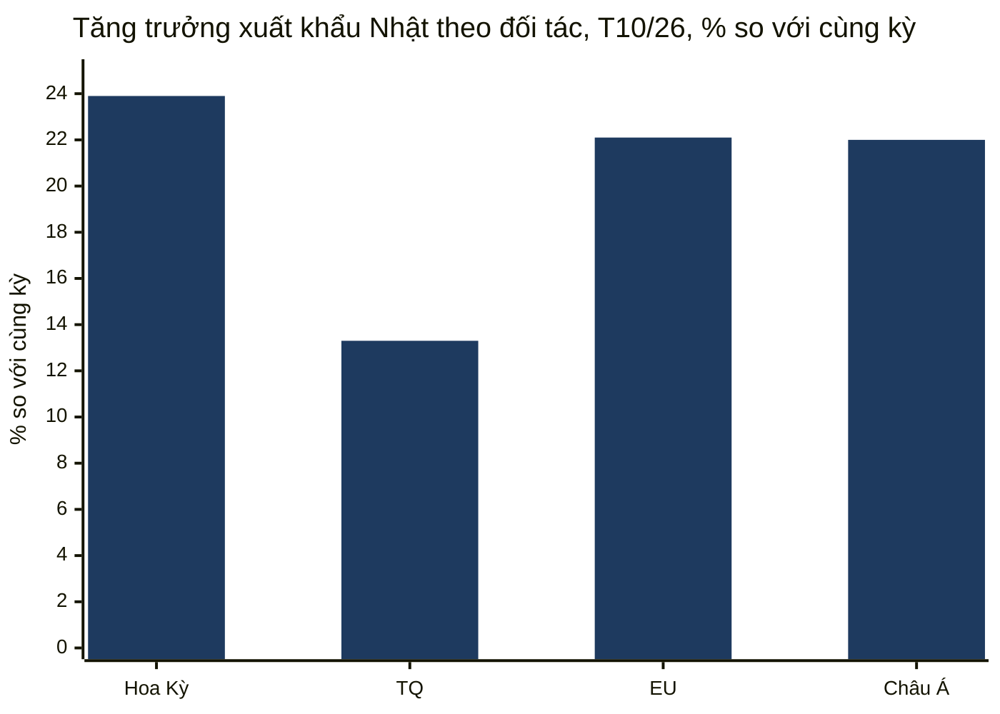

*Lưu ý: giá trị xuất khẩu theo điểm đến, tháng 10 năm 2026, so với cùng kỳ năm trước. Hoa Kỳ: ô tô tăng 37,2%, thiết bị sản xuất chất bán dẫn tăng 118,5%. Trung Quốc: ô tô giảm 53,3%, thiết bị sản xuất chất bán dẫn tăng 42,6%. Nguồn: Thống kê Thương mại sơ bộ tháng 10 năm 2026 của Bộ Tài chính Nhật Bản.*

### Khu vực đồng euro — cán cân vãng lai tháng 9 năm 2026 (ECB, công bố ngày 19 tháng 11)

Bản công bố cán cân thanh toán tháng 9 của ECB đưa thặng dư vãng lai của khu vực đồng euro ở mức 12 tỉ euro, ít thay đổi so với tháng trước. Thặng dư hàng hóa trên cơ sở cán cân thanh toán là 14 tỉ euro — thước đo khác với thâm hụt hàng hóa tháng 9 theo cơ sở hải quan của Eurostat là 10,3 tỉ euro được báo cáo ngày 13 tháng 11, và hai con số không nên so sánh trực tiếp. Thặng dư dịch vụ 16 tỉ euro; thâm hụt thu nhập thứ cấp 16 tỉ euro; thâm hụt thu nhập sơ cấp 1 tỉ euro. Số liệu vãng lai là thước đo rõ ràng hơn về vị thế đối ngoại của khối khi tính cả dòng dịch vụ và thu nhập, và nó cho thấy khối vẫn thặng dư tổng thể dù thâm hụt hàng hóa theo cơ sở hải quan. Khoảng cách giữa hai thước đo hàng hóa là nguồn gây nhầm lẫn thường trực trong bình luận thương mại và đáng lưu ý khi bản công bố hàng hóa tháng 12 ra mắt. Bản công bố cán cân thanh toán hàng tháng tiếp theo đến hạn ngày 18 tháng 12 và sẽ bao phủ tháng 10; bản công bố hàng quý tiếp theo vào ngày 12 tháng 1. [QNC News](https://qncnews.com/2026/11/23/euro-area-current-account-surplus-holds-at-12-billion-euros-in-september/)

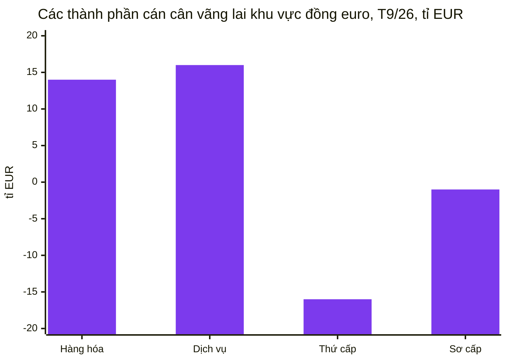

*Lưu ý: cơ sở cán cân thanh toán, tháng 9 năm 2026. Thặng dư vãng lai 12 tỉ euro. Nguồn: Ngân hàng Trung ương châu Âu.*

### Đức — thương mại điện xuyên biên giới, ba quý đầu năm 2026 (Destatis, thông cáo báo chí số 406, ngày 20 tháng 11)

Destatis báo cáo thương mại điện xuyên biên giới của Đức gần đạt cân bằng vật lý trong chín tháng đầu năm 2026, với xuất khẩu tăng mạnh và khối lượng nhập khẩu giảm. Đức đã xuất khẩu 48,8 TWh điện trị giá 4,3 tỉ euro trong tháng 1–9 năm 2026 (khối lượng tăng 25,5% so với cùng kỳ năm trước; giá trị tăng 51,3%). Nhập khẩu điện giảm 13,3% về khối lượng xuống 49,2 TWh, nhưng giá trị tăng 20,4% lên 5,7 tỉ euro. Thặng dư nhập khẩu vật lý thu hẹp 97,5% xuống 0,4 TWh. Giá nhập khẩu trung bình 116 euro/MWh (tăng 38,9% so với cùng kỳ năm trước) so với 84 euro/MWh trong tháng 1–9 năm 2025. Chỉ riêng tháng 9 năm 2026, Đức xuất khẩu 5,4 TWh (tăng 22,7% so với cùng kỳ năm trước; giá trị tăng 122,7% lên 0,6 tỉ euro) và nhập khẩu 4,6 TWh (giảm 26,1% khối lượng; giá trị tăng 64,5% lên 0,8 tỉ euro). Một nội dung chuyên biệt, nhưng nó minh họa cách bất đối xứng giá năng lượng — không phải khối lượng — giờ thúc đẩy cán cân thương mại năng lượng của Đức, và đây là bản công bố thương mại duy nhất của Destatis được xác định trong khung thời gian. Các con số được biên soạn theo quy tắc thương mại đối ngoại (mã hàng hóa 27160000) và khác về phương pháp so với thống kê năng lượng dựa trên lưới điện. Bản công bố chi tiết thương mại hàng hóa tháng 9 chính được gắn cờ cho ngày 20 tháng 11 không được xác định riêng trong các tìm kiếm. [NewsVerum](https://newsverum.com/en/news/germany-electricity-exports-reach-4-3-billion-euros-first-three-quarters-2026)

### Mỹ — thương mại tháng 9 năm 2026 (FT-900) và chỉ báo trước tháng 10

Không có bản công bố thương mại nào của Mỹ rơi vào khung thời gian 16–23 tháng 11. FT-900 mới nhất (ngày 4 tháng 11) cho thấy thâm hụt tháng 9 là 105,0 tỉ đô la, hẹp hơn một chút so với mức 105,7 tỉ đô la đã điều chỉnh của tháng 8. Tính từ đầu năm, thâm hụt nhỏ hơn 92,4 tỉ đô la (12,2%) so với tháng 1–9 năm 2025; xuất khẩu tăng 11,6% và nhập khẩu tăng 6,2% trong giai đoạn đó. Thâm hụt hàng hóa tháng 9 theo số liệu trước là 134,9 tỉ đô la (công bố ngày 28 tháng 10), tăng 2,8 tỉ đô la so với mức 132,1 tỉ đô la của tháng 8. FT-900 tháng 10 dự kiến ngày 8 tháng 12 năm 2026, và chỉ báo hàng hóa tháng 10 theo số liệu trước đến hạn ngày 27 tháng 11 năm 2026. Mỹ là khoảng trống lớn nhất trong phạm vi dữ liệu tuần này: thương mại tháng 10 sẽ không được biết cho đến tháng 12, vì vậy bất kỳ đánh giá nào về cách chồng thuế quan ảnh hưởng tới giá trị nhập khẩu tháng 10 cũng phải chờ. [Value.today](https://www.value.today/economy/usa/releases/trade)

### Cổng dữ liệu — không có bản công bố lớn nào trong khung thời gian được xác định

Không có bản công bố dữ liệu thương mại lớn mới nào từ USITC DataWeb, UN Comtrade, WITS của Ngân hàng Thế giới, cổng dữ liệu Ngân hàng Thế giới hay IMF (WEO/IFS) được xác định trong khung thời gian 16–23 tháng 11. Triển vọng Kinh tế Thế giới của IMF được cập nhật lần cuối tháng 10 năm 2026; không tìm thấy bản cập nhật tháng 11 nào. Bản công bố thương mại hàng hóa tiếp theo của Eurostat (tháng 10) đến hạn ngày 18 tháng 12 năm 2026. Số liệu thương mại tháng 11 của Trung Quốc đến hạn trong tháng 12. [Eurostat](https://ec.europa.eu/eurostat/web/international-trade-in-goods/publications)

### Các viện nghiên cứu

**Công cụ theo dõi thuế quan của Tax Foundation: thuế suất áp dụng 11,8%, thuế suất hiệu dụng 7,2%; 1,4 nghìn tỉ đô la Mỹ trong mười năm.** Công cụ theo dõi của Tax Foundation giờ đếm hơn 50 thay đổi đối với chính sách thuế quan của Mỹ kể từ tháng 1 năm 2025. Các ước tính chính: thuế mới áp lên 54% hàng nhập khẩu của Mỹ năm 2026; thuế suất áp dụng tăng lên 11,8% (từ 1,5% năm 2022); thuế suất hiệu dụng (thuế thu được tính theo tỷ lệ nhập khẩu) là 7,2% cho năm dương lịch 2026; thuế đã áp và dự kiến sẽ thu 1,4 nghìn tỉ đô la Mỹ từ năm 2026 đến năm 2035 trên cơ sở thông thường (1 nghìn tỉ đô la Mỹ trên cơ sở động); GDP dài hạn giảm 0,4%, vốn giảm 0,3%, giờ làm việc giảm 338.000 việc làm toàn thời gian tương đương. Thuế đã tăng thuế thêm trung bình 1.000 đô la Mỹ mỗi hộ gia đình Mỹ năm 2025 và ước tính 820 đô la Mỹ mỗi hộ năm 2026, vì thuế mới chưa thay thế hoàn toàn thuế IEEPA bị Tòa án Tối cao bác bỏ. Thuế polysilicon theo Mục 232 (15%, hoặc 10% đối với Anh) có hiệu lực ngày 4 tháng 12 năm 2026. Chi phí hộ gia đình giảm từ 1.000 đô la Mỹ năm 2025 xuống 820 đô la Mỹ năm 2026 chính vì thuế IEEPA bị bác bỏ chưa được thay thế hoàn toàn — một điều chỉnh hữu ích đối với bất kỳ cách đọc nào về con số doanh thu như một mức tăng đơn giản. [Tax Foundation](https://taxfoundation.org/research/federal-tax/trump-tariffs-trade-war/page/20/)

**Yale Budget Lab: thuế suất trung bình 11,2% trong tháng 11; khoảng 900 đô la Mỹ mỗi hộ gia đình mỗi năm.** Số liệu của Yale ngày 2 tháng 11 đưa thuế suất theo luật trung bình ở mức 11,8%, tăng lên 11,9% vào cuối năm theo luật hiện hành; số liệu hàng ngày đã ở mức 11,76% kể từ ngày 29 tháng 9. Thuế suất hiệu dụng trung bình khoảng 11,2% trong tháng 11 năm 2026, so với khoảng 2,5% tháng 1 năm 2025. Giám đốc điều hành Martha Gimbel nói với Marketplace ngày 5 tháng 11 rằng các hộ gia đình đối mặt với khoảng 1.100 đô la Mỹ mỗi năm ở mức thuế hiện tại (con số trong báo cáo ngày 24 tháng 8, đo ở trọng số nhập khẩu cố định) và khoảng 0,7% đối với giá tiêu dùng; ước tính năm dương lịch 2026 của Budget Lab là khoảng 900 đô la Mỹ mỗi hộ mỗi năm. Thuế mang lại gần 2 nghìn tỉ đô la Mỹ trong mười năm. Nghiên cứu của Trung tâm Tobin thuộc Yale cho thấy khoảng 80%–100% thuế được kiểm tra phản ánh vào giá cao hơn mà các nhà nhập khẩu Mỹ trả, với ước tính trung tâm khoảng 90%. Yale và Tax Foundation đồng ý về thuế suất theo luật (khoảng 11,8%) nhưng khác nhau về chi phí hộ gia đình — 820 đô la Mỹ (Tax Foundation, năm 2026, dựa trên hàng hóa thực tế được nhập khẩu) so với khoảng 900–1.100 đô la Mỹ (Yale, tùy phương pháp và trọng số) — vì hai bên dùng phương pháp khác nhau, không phải dữ kiện khác nhau. Kết luận về chuyển thuế (khoảng 90% thuế phản ánh vào giá của nhà nhập khẩu) là con số quan trọng về mặt phân tích: nó củng cố các ước tính chi phí hộ gia đình và mâu thuẫn với tuyên bố rằng các nhà xuất khẩu nước ngoài hấp thụ thuế. Bước tăng tháng 12 lên 11,9% đã nằm trong luật hiện hành. [Geopolitiqs](https://geopolitiqs.com/tn/2026-11-09/tariffs-average-rate)

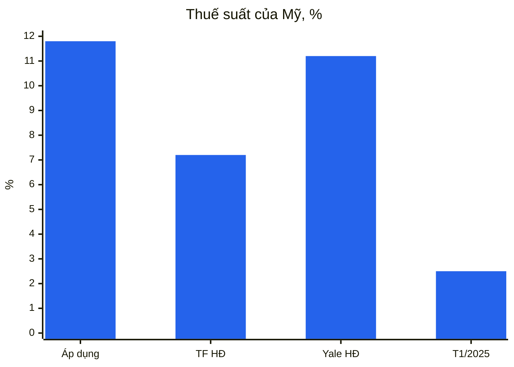

*Lưu ý: thuế suất theo luật áp dụng 11,8% (cả hai bên đều đồng ý); thuế suất hiệu dụng của Tax Foundation 7,2% cho năm dương lịch 2026 (thuế thu được tính theo tỷ lệ nhập khẩu); thuế suất hiệu dụng trung bình của Yale Budget Lab khoảng 11,2% trong tháng 11 năm 2026; khoảng 2,5% tháng 1 năm 2025. Nguồn: Tax Foundation; Budget Lab tại Yale.*

---

## 9. Thị trường vận tải

### Cước container giao ngay — Chỉ số Container Thế giới Drewry

Chỉ số Container Thế giới của Drewry giảm 3% xuống 4.176 đô la mỗi container 40ft ngày 19 tháng 11, tuần giảm thứ tư liên tiếp, dù vẫn cao hơn 126% so với cùng kỳ năm trước. Cước xuyên Thái Bình Dương giảm tuần thứ bảy liên tiếp: Thượng Hải–New York giảm 9% xuống 8.194 đô la, mức thấp nhất trong 15 tuần, và Thượng Hải–Los Angeles giảm 5% xuống 7.026 đô la, mức thấp nhất trong 12 tuần. Thượng Hải–Genoa tăng 6% lên 4.436 đô la sau ba tuần ổn định, trong khi Thượng Hải–Rotterdam không đổi ở mức 3.496 đô la. Drewry dự kiến cước xuyên Thái Bình Dương sẽ giảm thêm trong tuần tới; mười chuyến tàu trống đã được thông báo cho tuần sau so với bốn chuyến trong tuần này. Chỉ số tổng hợp đã giảm khoảng 9% trong bốn tuần (từ 4.585 đô la ngày 22 tháng 10). Thị trường container phân hóa thêm: cước xuyên Thái Bình Dương giảm mạnh tuần thứ bảy liên tiếp trong khi cước Địa Trung Hải phục hồi 6% và cước xuyên Đại Tây Dương tăng 2% theo cả hai hướng (Rotterdam–New York 3.146 đô la; New York–Rotterdam 1.217 đô la). [Drewry](https://www.drewry.co.uk/supply-chain-advisors/world-container-index-weekly-update?topics=Container%20Shipping)

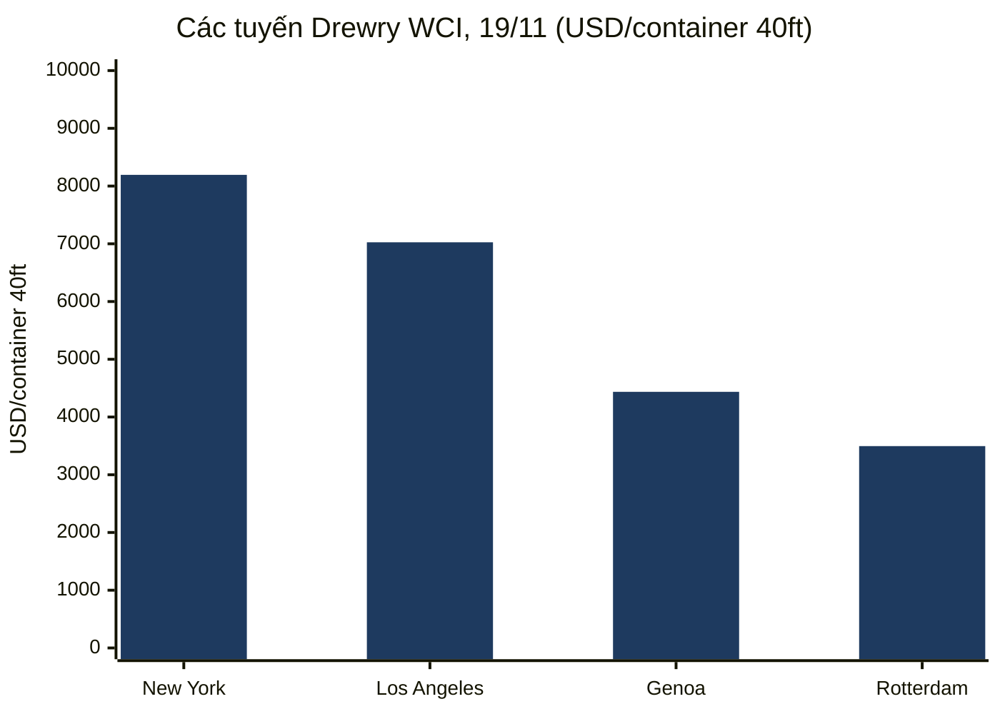

*Lưu ý: cước giao ngay xuất phát từ Thượng Hải mỗi container 40ft, ngày 19 tháng 11 năm 2026. Nguồn: Chỉ số Container Thế giới Drewry.*

### Chỉ số Freightos Baltic

Freightos báo cáo tuyến Á–Bờ Tây Mỹ ở mức 8.459 đô la mỗi FEU (tăng 3%), Á–Bờ Đông Mỹ ở mức 9.848 đô la (tăng 1%), Á–Bắc Âu ổn định ở mức 3.407 đô la và Á–Địa Trung Hải ở mức 4.295 đô la (giảm 1%) trong bản cập nhật ngày 17 tháng 11. Cước Á–Âu cao hơn 40–50% so với một năm trước; Á–Bắc Âu giảm 5% so với cuối tháng 10. Chỉ số tổng hợp FBX toàn cầu cho bản cập nhật ngày 17 tháng 11 là n/a — bản cập nhật hàng tuần không nêu con số toàn cầu. (Một số liệu theo dõi ghi 3.419 đô la mỗi FEU đối với FBX toàn cầu ngày 22 tháng 11; số liệu toàn cầu hàng tuần trước đó là 3.452 đô la ngày 10 tháng 11.) Các số liệu theo tuyến của Freightos tăng nhẹ trên tuyến xuyên Thái Bình Dương ngay cả khi số liệu cùng tuyến của Drewry giảm — hai chuẩn đo lường các rổ cước và tuần khác nhau, và khoảng cách (Freightos Á–Bờ Tây Mỹ 8.459 đô la so với Drewry Thượng Hải–Los Angeles 7.026 đô la) nhắc nhở không nên trộn lẫn chúng. Freightos lưu ý các đợt tăng giá chung tháng 11 không giữ được, kế hoạch tăng giữa tháng cũng có thể thất bại, và các hãng đang tăng chuyến tàu trống; các đợt tăng tháng 12 đã được thông báo và có thể giữ nếu được hỗ trợ bởi nhu cầu trước Tết Nguyên đán. Cảnh báo của Freightos rằng việc trở lại Biển Đỏ cộng với tăng trưởng đội tàu làm tăng rủi ro dư thừa năng lực năm tới đã định hình triển vọng năm 2027. [Freightos](https://www.freightos.com/freight-resources/us-air-cargo-recovering-from-outage-new-us-cn-tensions-ahead-of-talks-november-17-2026-update/)

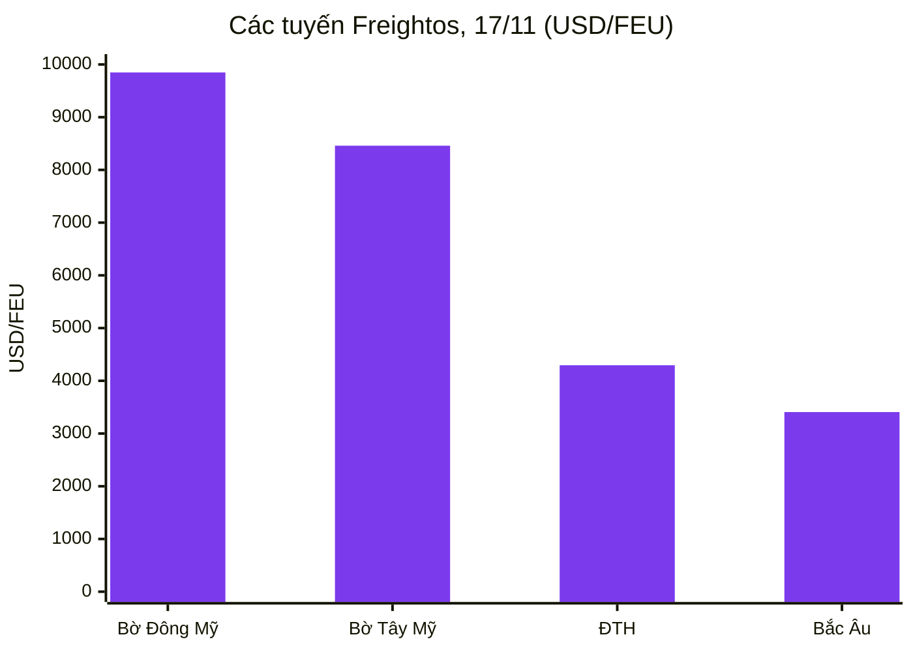

*Lưu ý: cước giao ngay xuất phát từ châu Á mỗi FEU, ngày 17 tháng 11 năm 2026. ĐTH = Địa Trung Hải. Nguồn: Chỉ số Freightos Baltic.*

### Chỉ số Vận tải Container Thượng Hải

Chỉ số tổng hợp SCFI giảm xuống 3.503,78 ngày 20 tháng 11, giảm 68,55 điểm (giảm 1,92%) so với tuần trước từ mức 3.572,33 ngày 13 tháng 11 — tuần giảm thứ ba liên tiếp, với mức giảm mở rộng mỗi tuần (giảm 1,46%, giảm 1,68%, giảm 1,92%); mức thấp nhất kể từ giữa tháng 9; mất 129,67 điểm trong ba tuần từ mức 3.687,35 ngày 30 tháng 10. Thượng Hải–Bờ Tây Mỹ 6.711 đô la mỗi FEU (giảm 400 đô la, giảm 5,63%); Thượng Hải–Bờ Đông Mỹ 8.776 đô la mỗi FEU (giảm 611 đô la, giảm 6,51%); Thượng Hải–Địa Trung Hải 3.678 đô la mỗi TEU (tăng 1,63%); Thượng Hải–châu Âu 2.291 đô la mỗi TEU; Santos 3.110 đô la mỗi TEU (giảm 15,19%). Chỉ số Vận tải Container Trung Quốc (CCFI, cước hợp đồng) tăng 0,21% lên 1.923,21, tuần tăng thứ hai liên tiếp — trái ngược với SCFI giao ngay. Ba chỉ số (Drewry, các tuyến Freightos, SCFI) giờ đều đồng ý thị trường giao ngay xuyên Thái Bình Dương đang điều chỉnh mạnh trong giai đoạn trầm lắng sau mùa cao điểm, với tuyến Bờ Đông Mỹ của SCFI giảm hơn 600 đô la trong một tuần. Việc CCFI tăng cho thấy các chủ hàng theo cước hợp đồng chưa thấy lợi ích — khoảng cách có ý nghĩa đối với thời điểm đấu thầu năm 2027. [Forwarder News](https://www.forwardernews.com/news/2026-11-20-scfi-falls-a-third-week)

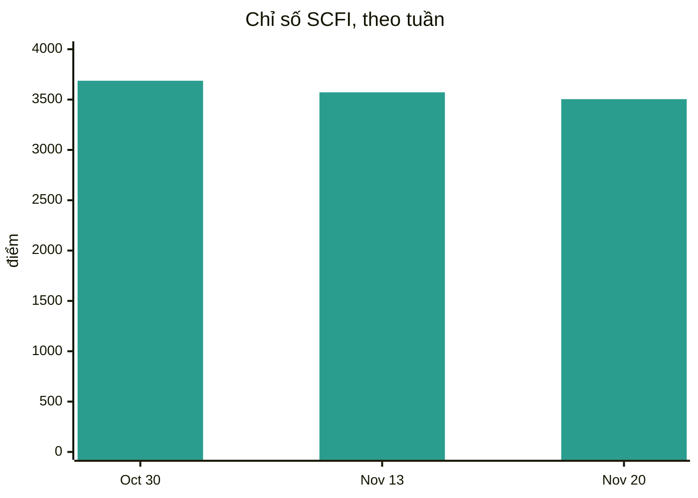

*Lưu ý: chỉ số tổng hợp SCFI, hàng tuần. Nguồn: Sở Giao dịch Vận tải Thượng Hải.*

### Tăng giá tháng 11 — đã công bố, đã bị chiết khấu

Các hãng đã thông báo phụ phí mùa cao điểm 1.000–1.600 đô la mỗi container 40ft trên tuyến Á–Âu/Địa Trung Hải từ tháng 12. Các đợt tăng giá chung tháng 11 không giữ được, theo Freightos, và kế hoạch tăng giữa tháng cũng có thể thất bại. Các đợt tăng tháng 12 đã được thông báo và có thể giữ nếu được hỗ trợ bởi nhu cầu trước Tết Nguyên đán. Mô hình của mùa thu — các đợt tăng được công bố không giữ được trước nhu cầu yếu — giờ là nhịp điệu đã định của thị trường. [Freightos](https://www.freightos.com/freight-resources/us-air-cargo-recovering-from-outage-new-us-cn-tensions-ahead-of-talks-november-17-2026-update/)

### Chuyến tàu trống và năng lực

Mười chuyến tàu trống đã được thông báo cho tuần sau, so với bốn chuyến trong tuần này. Công cụ theo dõi chuyến tàu bị hủy của Drewry dự báo 52 chuyến tàu trống trong số 716 dịch vụ theo lịch trên các tuyến Đông–Tây chính từ ngày 16 tháng 11 đến ngày 21 tháng 12 (khoảng 7%). Các hãng đang dựa nhiều hơn vào chuyến tàu trống khi đợt điều chỉnh xuyên Thái Bình Dương sâu thêm, và việc Gemini trở lại Suez giải phóng thêm năng lực vào năm 2027. [Drewry](https://www.drewry.co.uk/supply-chain-advisors/world-container-index-weekly-update?topics=Container%20Shipping)

### Hàng rời khô — Sở Giao dịch Baltic

Chỉ số Hàng rời Baltic đóng cửa ở mức 2.898 ngày 20 tháng 11, giảm 82 điểm (giảm 2,8%) so với tuần trước từ mức 2.980 ngày 13 tháng 11 — chấm dứt bốn tuần tăng liên tiếp. Diễn biến hàng ngày: 2.921 (thứ Hai ngày 16 tháng 11), 2.893 (thứ Ba), 2.914 (thứ Tư), 2.901 (thứ Năm), 2.898 (thứ Sáu). Chỉ số Capesize 4.502 (giảm 4,6% so với tuần trước; từ 4.719); thu nhập trung bình hàng ngày của Capesize 40.827 đô la (thứ Sáu; 37.184 đô la thứ Ba ngày 17 tháng 11). Chỉ số Panamax 2.140 (tăng 1,0% so với tuần trước; từ 2.118), cao nhất kể từ ngày 22 tháng 10; thu nhập hàng ngày của Panamax 19.264 đô la. Chỉ số Supramax 1.810 (giảm 1,4% so với tuần trước; từ 1.836); thu nhập hàng ngày 22.884 đô la. Chỉ số Handysize 1.072 (tăng 2,4% so với tuần trước). Tuyến C5 (Tây Úc–Thanh Đảo, quặng sắt) kết thúc tuần ở mức 14,40 đô la mỗi tấn, phục hồi từ mức thấp 13,40 đô la giữa tuần. Hàng rời khô quay đầu giảm sau bốn tuần tăng, với Capesize là lực kéo chính (giảm 4,6% trong tuần) do nhu cầu Bắc Đại Tây Dương yếu đi và danh sách tàu sẵn có dài thêm, trong khi Panamax tăng lên mức cao nhất một tháng nhờ nhu cầu ngũ cốc và than. Sự phân hóa — Capesize giảm, Panamax tăng — cho thấy nhu cầu quặng sắt mềm đi trong khi thương mại ngũ cốc và than giữ vững, một tín hiệu dẫn đầu hữu ích cho nhu cầu hàng hóa vào cuối năm. [HandyBulk](https://www.handybulk.com/baltic-dry-index/)

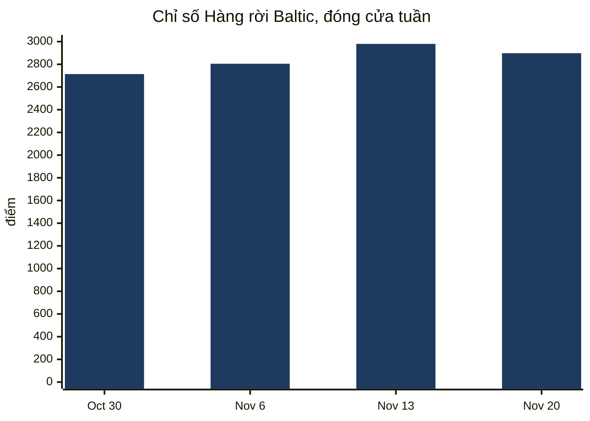

*Lưu ý: chỉ số Hàng rời Baltic đóng cửa hàng tuần. Nguồn: Sở Giao dịch Baltic.*

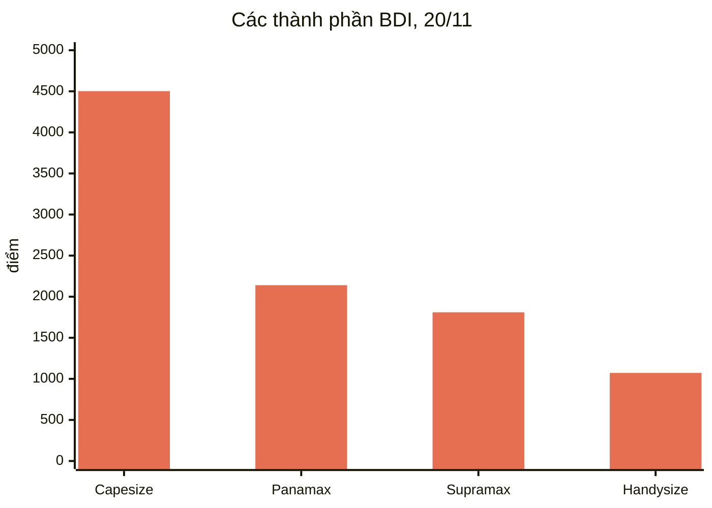

*Lưu ý: các chỉ số phân khúc của Sở Giao dịch Baltic, ngày 20 tháng 11 năm 2026. Nguồn: Sở Giao dịch Baltic.*

### Suez và độ tin cậy lịch trình

Maersk và Hapag-Lloyd thông báo ngày 16 tháng 11 rằng các dịch vụ AE1, AE2 và AE3 của Gemini Cooperation sẽ trở lại tuyến xuyên Suez và Biển Đỏ, thay thế các chuyến đi vòng qua Mũi Hảo Vọng. Quá trình chuyển đổi theo từng giai đoạn: AE2 trước tiên, với tàu Mary Maersk (chuyến 650W) bắt đầu vòng xoay tại Ninh Ba ngày 4 tháng 12; AE3 tiếp theo với tàu Alette Maersk (chuyến 652W) bắt đầu tại Thượng Hải ngày 20 tháng 12; AE1 bắt đầu với tàu Damietta Express (chuyến 702W) bắt đầu tại Thượng Hải ngày 14 tháng 1 năm 2027. Các vòng xoay sửa đổi bao gồm quá cảnh kênh Suez theo cả hai hướng. Động thái này tiếp nối việc khôi phục trước đó các dịch vụ AE5, AE11, AE12, ME2 và ME1. Theo Linerlytica, việc trở lại của ba dịch vụ này khiến Maersk và Hapag-Lloyd trở thành liên minh đầu tiên khôi phục tuyến Suez trên tất cả các dịch vụ Á–Âu của mình. Việc chuyển đổi giảm số tàu trên AE2 từ 14 xuống 13 và trên AE3 từ 13 xuống 11, giải phóng năng lực. Maersk cho biết các thay đổi sẽ cải thiện thời gian vận chuyển, đồng thời cảnh báo việc thực hiện phụ thuộc vào sự ổn định tiếp tục tại Biển Đỏ và việc giám sát liên tục các điều kiện an ninh khu vực. Evergreen là thành viên Ocean Alliance cuối cùng nối lại quá cảnh Suez; ZIM vẫn là hãng lớn nổi bật nhất vẫn định tuyến các dịch vụ Á–Âu vòng qua Mũi. Drewry đếm được 53 tàu container qua kênh đào trong tuần tính đến ngày 1 tháng 11, tăng 130% so với cùng kỳ năm trước, và ước tính khoảng 60% năng lực Á–Âu đã quay lại tuyến Suez. DHL ước tính các điều chỉnh mạng lưới rộng hơn có thể mất thêm 6–12 tháng. Flexport dự báo 131% năng lực đến bình thường tại các cảng Bắc Âu trong tuần 16–22 tháng 11 khi các tàu đến dồn dập. [FreightWaves](https://www.freightwaves.com/news/maersk-and-hapag-lloyd-restore-asia-europe-suez-routes-as-u-s-shippers-watch-capacity-and-costs)

### Hàng không

Chỉ số Vận tải Hàng không Baltic (BAI00) tăng 6,6% trong tuần tính đến ngày 9 tháng 11 (tăng 28,2% so với cùng kỳ năm trước) lên mức cao nhất năm 2026, rồi giảm 1,5% trong bảy ngày tính đến ngày 16 tháng 11 (tăng 20,8% so với cùng kỳ năm trước). Tuyến xuất phát Hồng Kông (BAI30) giảm 4,5% so với tuần trước tính đến ngày 16 tháng 11 (tăng 19,0% so với cùng kỳ năm trước); tuyến xuất phát Thượng Hải (BAI80) giảm 2,7% (tăng 13,1%); tuyến xuất phát Frankfurt (BAI20) giảm 2,7% (tăng 36,4%); tuyến xuất phát London Heathrow (BAI40) giảm 9,4% (tăng 2,6%). Tuyến xuất phát Chicago (BAI50) tăng vọt 39,2% so với tuần trước (tăng 72,1% so với cùng kỳ năm trước) sau sự cố kiểm soát không lưu của Mỹ. Trong tuần tính đến ngày 9 tháng 11: tuyến xuất phát Frankfurt tăng 9,9% so với tuần trước, London tăng 5,6%, Hồng Kông tăng 4,6%, Thượng Hải tăng 5,7%. Chỉ số Hàng không Freightos (bản cập nhật ngày 17 tháng 11): Trung Quốc–Bắc Mỹ 9,25 đô la/kg (tăng 16% so với tuần trước), vượt mức cao mùa cao điểm năm 2025 là 8,00 đô la/kg chỉ đạt được vào giữa tháng 12 năm ngoái; Trung Quốc–Bắc Âu 5,05 đô la/kg (tăng 4%); Bắc Âu–Bắc Mỹ 3,27 đô la/kg (tăng 12%), cao nhất kể từ tháng 12 năm 2022. Xeneta: giá giao ngay trung bình toàn cầu tháng 10 là 3,11 đô la/kg (tăng 29% so với cùng kỳ năm trước). TAC: giá giao ngay toàn cầu khoảng 3,93 đô la/kg trong tuần 44 (tăng 4% so với tuần trước, khoảng 40% so với cùng kỳ năm trước). Nhiên liệu máy bay: theo dõi của IATA giảm 6,5% trong tuần tính đến ngày 6 tháng 11 và 11,7% trong tháng tính đến ngày 13 tháng 11. [Baltic Exchange](https://www.balticexchange.com/en/news-and-events/news/guest-column/2026/Air-freight-rates-surge-past-previous-peak-season-highs-as-jet-fuel-prices-soar.html)

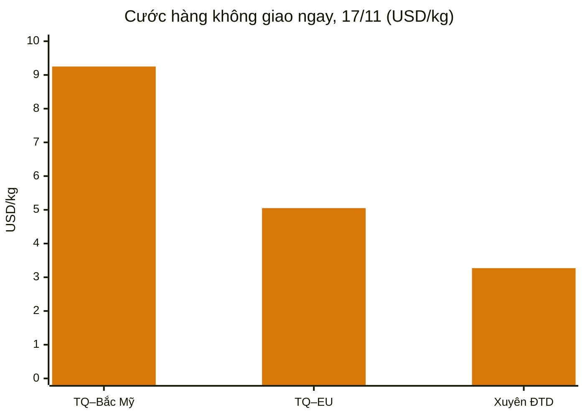

*Lưu ý: Chỉ số Hàng không Freightos, ngày 17 tháng 11 năm 2026. Trung Quốc–Bắc Mỹ vượt mức cao mùa cao điểm năm 2025 là 8,00 đô la/kg; xuyên Đại Tây Dương cao nhất kể từ tháng 12 năm 2022. Nguồn: Freightos.*

**Gián đoạn:** sự cố hệ thống kiểm soát không lưu của Mỹ đã làm hàng nghìn chuyến bay phải dừng trong cuối tuần 14–15 tháng 11 — lệnh dừng mặt đất toàn quốc của FAA ngày 13 tháng 11 (một bộ định tuyến lỗi duy nhất tại El Dorado, Arkansas, ảnh hưởng tới 17 trong số 22 trung tâm kiểm soát không lưu tuyến đường) đã làm gián đoạn hơn 20.000 chuyến bay trong cuối tuần và để lại tồn đọng hàng không vào tuần sau; FAA đã tạm dừng lắp đặt các bộ định tuyến mới ngày 17 tháng 11 và chính quyền đã nâng ước tính chi phí hiện đại hóa kiểm soát không lưu lên trên 50 tỉ đô la. Một sự cố của Microsoft làm tăng thêm gián đoạn; TAC cho biết dữ liệu chắp vá hơn thường lệ. Freightos cho biết cước hàng không quốc tế tới Mỹ không tăng mạnh đáng kể do sự cố. Hàng không đạt mức cao nhất năm 2026 trong tuần tính đến ngày 9 tháng 11 nhờ nhu cầu chip và phần cứng AI cộng với khối lượng mùa cao điểm, với cước Trung Quốc–Bắc Mỹ vượt mức cao nhất năm ngoái sớm một tháng. Đợt giảm ngày 16 tháng 11 có thể là khoảng nghỉ chứ không phải bước ngoặt: TAC lưu ý còn vài tuần mùa cao điểm nữa. Cuộc đình công kiểm soát không lưu Bỉ ngày 23 tháng 11 (xem A11) diễn ra sau lệnh dừng mặt đất của FAA mười ngày trước, nhấn mạnh biên độ mỏng manh trong hạ tầng hàng không mùa cao điểm này. [Air Cargo News](https://www.aircargonews.net/cargo-airport/2026/11/us-air-cargo-supply-chains-recover-following-ground-stop/)

### Gián đoạn cảng và logistics

**Los Angeles / Long Beach.** Xem A7. Nguy cơ đình công treo trên cửa ngõ container lớn nhất nước Mỹ kể từ ngày 1 tháng 11 đã được tránh vào phút chót với thỏa thuận dự kiến ngày 21 tháng 11; việc phê chuẩn đang chờ và công đoàn chưa bình luận công khai. Tồn đọng đường sắt tại khu phức hợp (35.688 container nhập khẩu chờ đường sắt tại bến tính đến ngày 2 tháng 11) vẫn còn, và thời gian lưu bãi đường sắt đối với container nhập khẩu vượt chín ngày, theo giám đốc điều hành Cảng Los Angeles. Việc đóng cầu Vincent Thomas (ngày 7 tháng 11, 16 tháng) vẫn tiếp diễn riêng biệt. [Maritime Executive](https://maritime-executive.com/article/ports-of-la-and-long-beach-avert-strike-as-watchmen-reach-deal)

**Durban.** Tình trạng tắc nghẽn tại Durban sâu thêm trong khung thời gian dù thông lượng bến tốt hơn: Durban Gateway Terminal đã xử lý 36.332 TEU trong tuần báo cáo mới nhất (tăng 28% so với tuần trước, hiệu suất mặt nước mạnh nhất trong 4 tháng), nhưng thời gian chờ neo đậu trung bình của tàu tăng từ 189 giờ lên 263 giờ (gần 11 ngày) ngay cả khi tàu chờ ngoài khơi giảm từ 14 xuống 11. Tỷ lệ lấp đầy bãi khoảng 69%. Các chuỗi cung ứng bị ảnh hưởng đối mặt với chậm trễ đầu-cuối thêm vượt 20 ngày. Bộ trưởng Giao thông Barbara Creecy đã cho ICTSI ba tháng để cải thiện hiệu suất nếu không có nguy cơ mất giấy phép cảng (theo Moneyweb). Các biện pháp khẩn cấp của Transnet (ngày 18 tháng 11): Bến 102 được phân cho tàu có cần cẩu; chuyển hướng sang Bến Container Ngqura; thêm vận chuyển đường sắt; cần cẩu bờ-biển được tân trang cuối cùng tại Bến 1 được đưa vào vận hành ngày 20 tháng 11 và bàn giao ngày 21 tháng 11. DGT thừa nhận "những thiếu sót dịch vụ tiếp diễn", đổ lỗi cho tình trạng thiết bị kém và không an toàn sau nhiều năm thiếu đầu tư; đơn vị này đã cam kết hơn 2 tỉ rand trong ba năm để nâng cấp thiết bị Bến 2. Phụ phí mùa cao điểm 1.000/2.000 đô la của Maersk và phí tắc nghẽn 400/800 đô la vẫn có hiệu lực. Nguy cơ mất giấy phép là leo thang mới — tối hậu thư của nhà nước đối với nhà điều hành bến tư nhân — và khung ba tháng kéo dài đến tháng 2 năm 2027. [Shipping and Freight Resource](https://shippingandfreightresource.com/transnet-steps-in-to-alleviate-congestion-at-durban-gateway-terminal/)

**Kênh đào Panama.** Lượng mưa mùa hè thấp hơn bình thường đã gây ra hạn chế mớn nước và quá cảnh hàng ngày đối với các chuyến qua Kênh đào Panama, với các hãng container áp phụ phí. Lượng mưa tốt hơn dự kiến kể từ đó đã cho phép Cơ quan Kênh đào Panama đảo ngược các bước đó. Mực nước hiện tại gần trở lại bình thường theo thời vụ, và các dự báo đã hạ mức nghiêm trọng của El Niño dự kiến, vì vậy rủi ro hạn chế nghiêm trọng trong quý 4 năm 2026 và nửa đầu năm 2027 được đánh giá thấp hơn lo ngại hồi mùa hè. Việc gỡ bỏ các hạn chế tại Panama loại bỏ một yếu tố gây phụ phí đối với các tuyến Bờ Đông/Bờ Vịnh Mỹ và giảm một nguồn gián đoạn lịch trình đã làm trầm trọng thêm tồn đọng đường sắt tại LA/Long Beach. [Freightos](https://www.freightos.com/freight-resources/us-air-cargo-recovering-from-outage-new-us-cn-tensions-ahead-of-talks-november-17-2026-update/)

**Tắc nghẽn nội Á.** The Loadstar đưa tin ngày 20 tháng 11 rằng các điểm nghẽn xấu đi tại các trung tâm trung chuyển Đông Nam Á đã giữ cước nội Á vững ngay cả khi cước đường dài giảm, và các chủ hàng Ấn Độ–Vịnh đối mặt với chi phí bổ sung do container trả lại đắt đỏ cộng với cước tăng. Không có con số nào được công bố trong các tiêu đề đã xem. [The Loadstar](https://theloadstar.com/)

**Triển vọng nhập khẩu của Mỹ.** Nhập khẩu container của Mỹ đã phá kỷ lục khối lượng bốn năm trong tháng 10, theo Descartes, với lô hàng từ Trung Quốc tăng tháng thứ tư liên tiếp lên gần 988.000 TEU, mức cao nhất kể từ tháng 1 năm 2025. Cảng Los Angeles đã xử lý 1.026.872 TEU trong tháng 10, kỷ lục của tháng và tháng có khối lượng cao thứ hai trong lịch sử, chỉ sau 1.042.652 TEU của tháng 9. Số toa tàu đường sắt của Mỹ trung bình 233.193 trong tháng 10, tăng 3,4% hàng năm, tháng tăng hàng năm thứ mười liên tiếp; khối lượng liên vận của Mỹ tính đến tháng 10 đạt 12.271.905 đơn vị, tăng 4,7% tính từ đầu năm, với tháng 10 tăng 9,6% hàng năm và lập kỷ lục khối lượng mọi thời đại. Chỉ số Vận tải Cass cho thấy lô hàng tháng 10 ở mức 1,056, tăng 5,9% hàng năm, và chi tiêu ở mức 4,010, cũng tăng 5,9% hàng năm. Chỉ số Điều kiện Vận tải Đường bộ FTR tháng 9 ở mức 8,13, thấp hơn mức 11,5 của tháng 8. Global Port Tracker (ngày 9 tháng 11) dự kiến nhập khẩu cảng vào Mỹ sẽ giảm trong phần còn lại của năm 2026 khi mùa cao điểm kéo dài kết thúc: nhập khẩu có hàng tháng 9 năm 2026 là 2,37 triệu TEU (tháng bận rộn nhất năm 2026; tăng 3,4% so với tháng trước, tăng 12,6% so với cùng kỳ năm trước); dự báo tháng 10 là 2,26 triệu TEU (tăng 9,1% so với cùng kỳ năm trước); tháng 11 là 2,05 triệu TEU (tăng 1,2%); tháng 12 là 2,03 triệu TEU (tăng 1,3%). Cả năm 2026 khoảng 26 triệu TEU (tăng 2% so với 25,4 triệu năm 2025) — điều chỉnh tăng từ dự báo tháng 10 là 25,8 triệu. Đầu năm 2027: tháng 1 là 2,04 triệu TEU (giảm 3% so với cùng kỳ năm trước); tháng 2 là 1,89 triệu (giảm 0,5%); tháng 3 là 1,92 triệu (giảm 11,2%). Khối lượng nhập khẩu kỷ lục vào Mỹ tiếp tục qua tháng 10 ngay cả khi cước giao ngay mềm đi, cho thấy việc nhập trước hạn chót thỏa thuận đình chiến tháng 1 và các biện pháp polysilicon tháng 12. [FreightWaves](https://www.freightwaves.com/news/retailers-forecast-u-s-imports-to-stay-elevated-through-2026-after-breakout-peak-season)

**Các nội dung nhỏ hơn.** Các nhà xuất khẩu may mặc Bangladesh đang chuyển sang vận tải hàng không đắt đỏ để đáp ứng hạn giao hàng sau nhiều tuần gián đoạn, khi người mua tìm nguồn khác (The Loadstar, ngày 23 tháng 11). Expeditors đang xem xét lại cách tiếp cận mua lại sau nhiều thập kỷ tăng trưởng hữu cơ và đã đánh giá các cơ hội trong công nghệ, và việc bán Neovia có trụ sở tại Mỹ và Ekol của Thổ Nhĩ Kỳ đánh dấu sự trở lại của M&A trong lĩnh vực logistics hợp đồng (The Loadstar, ngày 19 tháng 11). Khối lượng hàng hóa dọc Tuyến Biển Bắc của Nga đã vượt 40 triệu tấn lần đầu tiên, kỷ lục đối với tuyến hàng hải Bắc Cực, dù tham vọng của Tổng thống Putin đối với tuyến này vẫn ngoài tầm với (gCaptain, ngày 23 tháng 11). FedEx đã ra mắt các tuyến hàng tuần kết nối các trung tâm sản xuất tại Thượng Hải và Quảng Châu với các điểm đến tại Mỹ để hỗ trợ nhu cầu do trí tuệ nhân tạo thúc đẩy (Supply Chain Dive).

### Thông tin nhà cung cấp

Không có nội dung nhà cung cấp đủ điều kiện nào được ghi nhận trong khung thời gian. Nội dung báo chí duy nhất của Descartes trong khung thời gian là một giải thưởng ngành (ngày 17 tháng 11, được vinh danh là nhà cung cấp hệ thống quản lý vận tải hàng đầu tại Bắc Mỹ trong báo cáo Nghiên cứu Thị trường Toàn cầu về Hệ thống Quản lý Vận tải của ARC Advisory Group). Loạt bài blog ngày 22 tháng 11 của TradeInt là nội dung tiếp thị dữ liệu rút từ cơ sở dữ liệu của chính họ bao phủ nửa đầu năm 2026 và các giai đoạn trước đó, với lời kêu gọi hành động "Mở khóa dữ liệu"; mức tăng 901% so với cùng kỳ năm trước được báo cáo trong bài về Nga là hiện tượng về phạm vi bao phủ của bộ dữ liệu, không phải biến động thương mại. Báo cáo Vận tải Toàn cầu tháng 11 của Descartes (ngày 11 tháng 11), báo cáo nhập khẩu container kỷ lục của Mỹ ở mức 2.674.808 TEU trong tháng 10 năm 2026, đã được đề cập trong báo cáo tuần trước. Kết quả quý tài chính thứ ba của Descartes chưa đến hạn cho đến đầu tháng 12 năm 2026. [Descartes](https://www.descartes.com/resources/knowledge-center/descartes-releases-november-global-shipping-report-us-container-imports); [TradeInt](https://tradeint.com/insights/blogs/)

---

## 10. Dòng thời gian chính sách

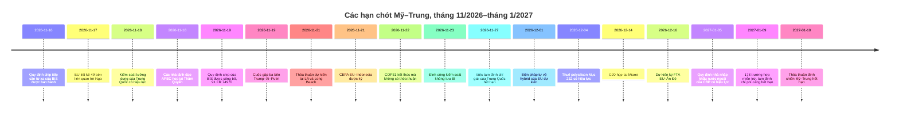

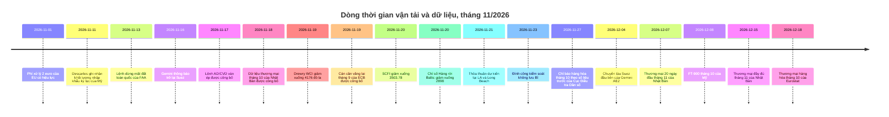

---

## 11. Các hạn chót & sự kiện sắp tới (90 ngày tới)

| Ngày | Nội dung |
|---|---|
| 23 November 2026 | Ủy ban Nông nghiệp WTO họp về hạn chế xuất khẩu và cơ chế tự vệ đặc biệt; báo cáo đầy đủ Solar IV của USITC (Ấn phẩm 5804) đến hạn. |
| 24 November 2026 | Gián đoạn dây chuyền từ đình công kiểm soát không lưu Bỉ dự kiến lan sang thứ Ba. |
| 27 November 2026 | Việc tạm đình chỉ theo Thông báo số 72 năm 2025 của Trung Quốc về giả định từ chối đối với gali, germani, antimon và vật liệu siêu cứng xuất sang Mỹ dự kiến hết hạn, nếu không có tạm đình chỉ hay sửa đổi thêm; chỉ báo hàng hóa tháng 10 theo số liệu trước của Cục Điều tra Dân số đến hạn. |
| 29 November 2026 | Ý kiến đến hạn về dự thảo Biện pháp Điều tra và Thực thi Kiểm soát Xuất khẩu Lưỡng dụng của MOFCOM. |
| 30 November 2026 | Kết luận cuối cùng của Bộ Thương mại về bán phá giá và trợ cấp đối với sản phẩm thép lá thiếc Trung Quốc đến hạn, trừ khi hoãn. |
| 1 December 2026 | Biện pháp tạm thời tự vệ ô tô hybrid của EU dự kiến; Canada bỏ giảm thuế ngang đối với một số xe kéo; phí bưu kiện nhỏ 2 euro quốc gia của Ý có hiệu lực; hạn chót của Dân biểu Hạ viện đối với câu trả lời bằng văn bản của Lutnick về Megaspeed và Danh sách Thực thể. |
| 4 December 2026 | Thuế polysilicon Mục 232 có hiệu lực; chuyến tàu Suez đầu tiên của Gemini AE2 từ Ninh Ba; phiên họp đặc biệt MEPC 85 của IMO dự kiến. |
| 7 December 2026 | Ý kiến đến hạn về quy định đề xuất của CBP về lô hàng giá trị thấp (91 FR 64532; hồ sơ USCBP-2026-0298); thương mại 20 ngày đầu tháng 11 của Nhật Bản. |
| 8 December 2026 | Bản công bố thương mại tháng 10 của Mỹ (FT-900). |
| 10 December 2026 | Lutnick điều trần trước Ủy ban Ngân hàng Thượng viện (Megaspeed / Danh sách Thực thể). |
| 11 December 2026 | Bản tóm tắt trả lời của chính phủ đến hạn trong vụ *Gellert v. Trump* (Mục 338); EU–Indonesia: Tổng thống Prabowo thăm Brussels. |
| 14–15 December 2026 | Các nhà lãnh đạo G20 họp tại Miami. |
| 15 December 2026 | Thương mại đầy đủ tháng 11 của Nhật Bản. |
| 16 December 2026 | Hiệp định thương mại tự do EU–Ấn Độ được báo cáo sẽ ký tại Brussels, với Thủ tướng Modi dự kiến tham dự. |
| 17 December 2026 | Ngày sớm nhất Bộ Thương mại dự định ban hành hướng dẫn đánh giá trong các cuộc rà soát tủ gỗ và đồ gỗ gia công (35 ngày sau khi công bố ngày 12 tháng 11). |
| 18 December 2026 | Thương mại hàng hóa tháng 10 của Eurostat; cán cân thanh toán tháng 10 của ECB. |
| 20 December 2026 | Chuyến tàu Suez đầu tiên của Gemini AE3 từ Thượng Hải. |
| 1 January 2027 | Thuế Mục 232 tăng lên 30% đối với đồ nội thất bọc nệm và 50% đối với tủ bếp và tủ lavabo; mức 50% đe dọa đối với xe, phụ tùng ô tô và thép Canada cũng nhắm vào ngày này; CBAM của Anh bắt đầu; quy tắc xuất xứ xe điện Anh–EU nghiêm ngặt hơn có hiệu lực; việc chấm dứt AGOA đối với Rwanda và Nam Phi dự kiến có hiệu lực (vẫn cần tuyên cáo). |
| 3 January 2027 | Quốc hội mới của Mỹ nhậm chức. |
| 5 January 2027 | Quy định cuối cùng tạm thời của CBP về nhà nhập khẩu nước ngoài có hiệu lực; ý kiến đến hạn cùng ngày (hồ sơ USCBP-2026-1387). |
| 9–10 January 2027 | Các hạn chót thỏa thuận đình chiến Mỹ–Trung trùng nhau: 178 trường hợp miễn trừ Mục 301 và tạm đình chỉ phí hàng hải hết hạn ngày 9 tháng 1; việc tạm đình chỉ Quy định về Công ty liên kết của BIS và các tạm đình chỉ đối ứng của Trung Quốc hết hạn ngày 10 tháng 1. |
| 11–12 January 2027 | Quyết định AD/CVD cuối cùng của Bộ Thương mại về chất tăng tốc cao su CBS từ Trung Quốc đến hạn. |
| 11 January 2027 | Bản tóm tắt trả lời đến hạn trong vụ *Gellert v. Trump*. |
| 12 January 2027 | Ý kiến bằng văn bản và yêu cầu tham gia phiên điều trần đến hạn đối với tham vấn rà soát chung USMCA (hồ sơ USTR-2026-0595 và USTR-2026-0596). |
| 14 January 2027 | Chuyến tàu Suez đầu tiên của Gemini AE1 từ Thượng Hải. |
| 19 January 2027 | Kết luận cuối cùng của Bộ Thương mại về bán phá giá đối với sản phẩm thép lá thiếc Thổ Nhĩ Kỳ đến hạn; ý kiến đến hạn về quy định chip tiếp cận từ xa của BIS. |
| 20 January 2027 | Khai báo chính thức trở thành bắt buộc đối với thư tín chịu thuế Mục 201, 232 hoặc 301 hay yêu cầu của cơ quan chính phủ đối tác; tranh tụng trong vụ *Gellert v. Trump*. |
| 30 January 2027 | Biến thể thuế chống trợ cấp của Anh đối với cá hồi vân Thổ Nhĩ Kỳ áp dụng từ ngày này (thông báo 2026/31). |
| 1 February 2027 | Canada bỏ giảm thuế ngang đối với một số dây nhôm và sản phẩm đùn và sản phẩm bìa giấy. |
| 6 February 2027 | Tết Nguyên đán. |
| 11 February 2027 | Quyết định CVD sơ bộ của Bộ Thương mại về bóng bay nhựa từ Trung Quốc (ước tính). |
| 17 February 2027 | Quy định chip tiếp cận từ xa của BIS: thời gian chuyển tiếp cấp phép trung tâm dữ liệu 90 ngày kết thúc (khoảng). |
| 28 February 2027 | Hạn chót quyết định của USTR trong cuộc điều tra Mục 301 về sở hữu trí tuệ của Việt Nam. |
| March 2027 | Quyết định điều tra Mục 301 về công suất dư thừa mang tính cấu trúc của USTR dự kiến (đến hạn vào tháng 3 năm 2027); FTA EU–Ấn Độ có hiệu lực được báo cáo vào tháng 3 hoặc tháng 4 năm 2027. |
| 25 March 2027 | Kết luận cuối cùng của Bộ Thương mại về bán phá giá đối với sản phẩm thép lá thiếc Đài Loan đến hạn. |
| 27 April 2027 | Quyết định AD sơ bộ của Bộ Thương mại về bóng bay nhựa từ Trung Quốc (ước tính). |
| 6 May 2027 | Tuân thủ đầy đủ của môi giới dự kiến với quy định về nhà nhập khẩu nước ngoài. |
| 30 June 2028 | Miễn trừ ngang thuế quan của Canada được gia hạn đến ngày này. |

---

## 12. Nguồn & phương pháp luận

Phạm vi bao phủ: 16–23 tháng 11 năm 2026. Tổng hợp từ khoảng 45 nguồn tin tức, chính sách, dữ liệu và vận tải thương mại trên toàn thế giới.

Các nguồn đã tham khảo bao gồm: FreightWaves, The Loadstar, Splash247, gCaptain, Hellenic Shipping News, Container News, Supply Chain Dive, Logistics Management, Air Cargo News, Port Technology, blog chuyên sâu của TradeInt; whitehouse.gov, cbp.gov, ustr.gov, federalregister.gov, trade.gov, usitc.gov, bis.doc.gov, JD Supra; ec.europa.eu, gov.uk, cbsa-asfc.gc.ca, canada.ca/en/department-finance, english.mofcom.gov.cn; wto.org, unctad.org, intracen.org, wcoomd.org; dataweb.usitc.gov, ustradecensus.gov, comtradeplus.un.org, wits.worldbank.org, eurostat, data.worldbank.org, imf.org; taxfoundation.org, budgetlab.yale.edu, tradeintelligence.eu; drewry.co.uk, balticexchange.com, freightos.com; descartes.com, tradeint.com.

Tất cả các số liệu đều như được báo cáo trong các nguồn được trích dẫn; các số liệu không thể xác minh được đánh dấu n/a. Các nội dung có ngày trước ngày 16 tháng 11 chỉ xuất hiện dưới dạng theo dõi, các công bố trên Công báo Liên bang rơi vào khung thời gian, hoặc bối cảnh cho một hạn chót trong khung thời gian. Container News chỉ trả về thông báo chấp thuận cookie và không cho nội dung sử dụng được; chỉ mục tin tức của WTO không trả về văn bản đọc được qua việc lấy dữ liệu, vì vậy các nội dung WTO dùng các bản tin WTO như được đăng lại; trang tiếng Anh của MOFCOM chỉ truy cập được đối với các tiêu đề trang chủ, và nội dung thực chất của các thông báo của họ không thể xác nhận được từ thông tin được xem xét. TradeInt không có nội dung nhà cung cấp đủ điều kiện nào trong khung thời gian: loạt bài blog ngày 22 tháng 11 của họ là nội dung tiếp thị dữ liệu rút từ cơ sở dữ liệu của chính họ. Không có bản công bố lớn mới nào trong khung thời gian được xác định từ các cổng USITC DataWeb, UN Comtrade, WITS, Ngân hàng Thế giới hay IMF. Không có Lệnh Tạm giữ Hàng mới nào được xác định trong khung thời gian. Công báo Liên bang không được rà soát từng tài liệu cho cả tuần; có thể còn các thông báo rà soát hành chính khác. Thông tin được báo cáo về việc kết thúc vào cuối năm của cuộc điều tra Mục 301 về công suất dư thừa dựa trên một bài báo thương mại duy nhất về cuộc phỏng vấn truyền hình ngày 21 tháng 11; chưa có thông báo nào của USTR xuất hiện tính đến ngày 23 tháng 11. Số lượng các bên Nga được EU liệt kê ngày 17 tháng 11 (49) là như được báo cáo bởi công cụ giám sát Youverify, chưa được xác minh theo danh sách của EU.
