# 全球贸易情报报告——2026年11月16日至23日一周

**每周简报。**覆盖窗口：2026年11月16日至23日。汇编自全球约45家贸易新闻、政策、数据与货运来源。

---

## 目录

1. [执行摘要](#1-executive-summary)
2. [警报](#2-alerts)
3. [重点报道——深度分析](#3-top-stories--deep-dives)
4. [关税追踪](#4-tariff-tracker)
5. [美国政策深度分析](#5-us-policy-deep-dive)
6. [世界各地区政策](#6-world-policy-by-region)
7. [执法行动](#7-enforcement-actions)
8. [数据发布](#8-data-releases)
9. [货运市场](#9-freight-market)
10. [政策时间线](#10-policy-timelines)
11. [未来90天重要期限与事件](#11-upcoming-deadlines--events-next-90-days)
12. [来源与方法](#12-sources--methodology)

---

## 1. 执行摘要

本周，原本预期将敲定美中停战协议的峰会没有达成任何结果，而本周具有决定性的贸易行动来自其他地方的监管机构、法院和签署仪式。11月18日至19日在深圳举行的亚太经合组织领导人会议发表了一份宣言，并举行了首次特朗普—习近平—普京三方会晤，但没有带来关税减免，也没有确认延长停战协议；停战协议仍将于2027年1月9日至10日到期，下一个作出决定的场合是12月14日至15日在迈阿密举行的二十国集团峰会。美国产业安全局则单方面采取了本周规模最大的措施，于11月19日公布一项临时最终规则，关闭了先进芯片的远程访问渠道，废除了《人工智能扩散规则》，并要求向五个东南亚和拉丁美洲国家出口先进计算产品须取得许可。欧洲方面签署不断：欧盟与印度尼西亚于11月21日签署全面经济伙伴关系协定，欧盟—印度签署日期确定为12月16日，英国与欧盟在11月20日峰会上就动植物卫生检疫协议和碳排放交易体系挂钩达成一致。在海湾地区，霍尔木兹海峡及周边海域针对航运的袭击达到美伊战争开始以来的最高月度水平，华盛顿将封锁范围扩大至船对船转运。

- **亚太经合组织发表了宣言，而非关税协议。**第33届亚太经合组织经济领导人会议于11月19日闭幕，发表《2026年亚太经合组织领导人深圳展望》，这是一份自愿性、无约束力的声明，并就特朗普总统与习近平主席起草美中"战略稳定"行动计划达成一致。首次特朗普—习近平—普京三方会晤发表了四点《和平宣言》，其中没有具体数量、时间表或贸易内容。一些报道称领导人同意延长贸易停战协议；但双方均未公布期限或条款，中方通报中也未提及延长。停战协议仍将于2027年1月9日至10日到期，贸易委员会300亿美元对300亿美元的对等关税削减方案仍未达成一致。[China Briefing](https://www.china-briefing.com/news/apec-2026-in-shenzhen-what-the-leaders-meeting-and-trump-xi-talks-mean-for-business/)
- **美国产业安全局关闭了芯片远程访问漏洞。**11月19日公布的临时最终规则（91 FR 74970）新增一项全球最终用途管制：凡先进计算产品将被用于向总部位于D:5国家集团或澳门的公司提供超过12,000,000总处理性能合计值的数据中心，均须取得许可；同时要求向印度尼西亚、马来西亚、新加坡、泰国和巴西出口先进计算产品须取得许可，并正式废除《人工智能扩散规则》。台积电和三星告知中国客户，在寻求许可期间将暂停销售某些处理器。同日公布的众议院外交事务委员会记录显示，截至2026年5月11日，已批准向与中国有关联的实体出口879,868颗先进人工智能处理器，其中包括579,868颗英伟达H200加速器。[Willkie Farr & Gallagher](https://www.willkie.com/publications/2026/11/bis-moves-to-close-the-remote-access-gap-for-advanced-chips)
- **欧洲签署不断，并为最大协议确定了日期。**欧盟与印度尼西亚在近十年谈判后于11月21日签署全面经济伙伴关系协定和投资保护协定；印度尼西亚将取消98.5%欧盟商品税目的关税，每年为欧盟出口商节省超过6亿欧元关税。欧盟—印度自由贸易协定现预计于12月16日在布鲁塞尔签署，93%的印度货物将获得免税准入。在11月20日的英欧峰会上，双方就动植物卫生检疫协议达成一致，将从2028年3月1日起取消许多农产品边境检查，并挂钩各自的碳排放交易体系，相互豁免碳边境调节机制，涉及约65亿英镑的英国出口。[Turkish Post](https://turkishpost.com.tr/en/2026/11/21/eu-indonesia-trade-deal/); [Asia Daily](https://asiadaily.org/news/19949/)
- **印度—美国协议仍未签署，等待现已具有结构性。**商务部长拉杰什·阿加瓦尔于11月18日表示，在最高法院推翻对等关税和紧急关税后，华盛顿重建关税框架之前，印度无法签署协议；同时须明确301条款调查的结果，包括产能过剩调查。据报道，美国贸易代表贾米森·格里尔于11月21日表示，产能过剩调查将在2026年底前完成，早于2027年3月11日的法定截止日期；该报道为单一来源，未经核实。[The Hindu BusinessLine](https://www.thehindubusinessline.com/economy/no-india-us-trade-deal-until-new-us-tariff-framework-section-301-probes/article71716562.ece/amp/)
- **霍尔木兹海峡袭击达到战争开始以来的最高水平。**根据美国有线电视新闻网对英国海上贸易行动办公室数据的分析，10月份针对航运的袭击超过30起，截至11月22日11月份至少已有22起；11月20日至21日有三艘油轮遇袭，11月17日一艘阿布扎比国家石油公司油轮遇袭，造成一名船员下落不明、11人受伤。国际海事组织统计截至11月17日已确认138起事件、25名海员死亡。海湾地区10月份石油出口量为每日1840万桶，比战前水平低26%，布伦特原油价格维持在每桶92美元附近。[CNN](https://www.cnn.com/2026/11/22/middleeast/hormuz-attacks-highest-levels-iran-war-intl?cid=external-feeds_iluminar_meta)
- **胶合板新关税落地，管道进一步扩大。**商务部于11月17日公布针对中国、印度尼西亚和越南硬木及装饰胶合板的反倾销和反补贴税令，中国的合并税率约为276%。美国国际贸易委员会公布了完整的《太阳能第四案》报告（第5804号出版物），对关键情况作出区分——仅对印度尼西亚实施追溯性关税。新的申诉针对中国产塑料气球，指控倾销幅度为50%至276%。[Transport News](https://www.transportnews.net/a/commerce-hardwood-plywood-duty-orders-china-indonesia-vietnam)
- **日本创下贸易纪录；货运市场再次分化。**日本10月份出口同比增长20.5%，达到创纪录的11.77万亿日元；进口增长21.6%，达到创纪录的12.25万亿日元；逆差收窄至4765亿日元，约为预测值的一半。德鲁里世界集装箱指数下跌3%，至每40英尺箱4176美元，连续第四周下跌；空运则维持在2026年高位，中国—北美航线运价为每公斤9.25美元。马士基与赫伯罗特宣布，其双子星合作最后三条亚欧航线将于1月中旬前恢复苏伊士航线。[Drewry](https://www.drewry.co.uk/supply-chain-advisors/world-container-index-weekly-update?topics=Container%20Shipping)

**货运：**集装箱即期运价连续第四周下跌，跨太平洋航线走弱而地中海航线反弹；干散货自高位回落；空运在旺季维持2026年高位；随着双子星合作宣布最后三条航线恢复经红海航行，苏伊士航线回归接近完成；洛杉矶/长滩罢工威胁于11月21日达成初步协议而解除；德班港锚地等待时间延长至263小时，尽管吞吐量有所提高。

---

## 2. 警报

| # | 警报 | 生效时间 | 影响 | 来源 |
|---|-------|-----------|--------|--------|
| A1 | 亚太经合组织领导人在深圳会晤；特朗普—习近平双边会晤及首次特朗普—习近平—普京三方会晤发表宣言和"战略稳定"行动计划，但没有关税减免，也没有确认延长停战协议 | 2026年11月18–19日 | 停战协议仍于2027年1月9–10日到期；下一个决策点是12月14–15日在迈阿密举行的二十国集团峰会 | [China Briefing](https://www.china-briefing.com/news/apec-2026-in-shenzhen-what-the-leaders-meeting-and-trump-xi-talks-mean-for-business/) |
| A2 | 美国产业安全局临时最终规则《应对先进半导体的远程访问》实施全球数据中心最终用途管制（12,000,000总处理性能阈值），要求向五个国家出口先进芯片须取得许可，并废除《人工智能扩散规则》 | 2026年11月19日（公布；91 FR 74970） | 代工厂暂停向中国发货，等待许可；为D:5公司提供服务的数据中心有90天时间取得许可 | [Willkie Farr & Gallagher](https://www.willkie.com/publications/2026/11/bis-moves-to-close-the-remote-access-gap-for-advanced-chips) |
| A3 | 中国暂停对美出口镓、锗、锑和超硬材料的禁令失效，截至11月20–21日未公布延期 | 2026年11月27日 | 基础规则原则上要求拒绝发放相关材料许可；美国买家本周面临抉择 | [InvestorNews](https://investornews.com/market-opinion/critical-minerals-report-trump-xi-and-the-critical-minerals-behind-the-ai-race/) |
| A4 | 欧盟混合动力车保障措施：书面意见征集于11月20日截止；预计自12月1日起采取临时措施，据报道对中国产混合动力车实施每年35万辆的上限 | 2026年12月1日（预计） | 2026年1–8月中国混合动力车进口已达474,475辆，高于拟议年度上限；尚未公布法律文件 | [Ports Europe](https://www.portseurope.com/eu-opens-hybrid-safeguard-probe-as-chinese-shipments-outrun-planned-quota/) |
| A5 | 232条款多晶硅最低进口价（多晶硅21美元/公斤；硅锭和硅片100美元/公斤；电池片0.22美元/瓦；组件0.38美元/瓦）及衍生产品15%关税生效；反囤积规则持续至12月3日 | 2026年12月4日 | 为整个美国太阳能供应链设定价格下限；海关与边境保护局测试环境自11月12日起上线 | [Stoel Rives](https://www.stoel.com/printpilot-publication-commerces-anti-stockpiling-rule-imposes-limits-on-pre-december-4-polysilicon-imports.pdf?1791987859) |
| A6 | 霍尔木兹海峡及周边海域针对航运的袭击达到战争开始以来的最高月度水平；11月20–21日三艘油轮遇袭；美国将封锁扩大至船对船转运，并打击格什姆岛一处伊斯兰革命卫队设施 | 2026年11月16–22日 | 国际海事组织统计138起已确认事件、25名海员死亡；海湾石油出口比战前低26%；布伦特原油约92美元 | [CNN](https://www.cnn.com/2026/11/22/middleeast/hormuz-attacks-highest-levels-iran-war-intl?cid=external-feeds_iluminar_meta) |
| A7 | 太平洋海事协会与国际码头和仓库工人工会第26地方分会于凌晨12:01截止时间过后数小时达成初步协议，避免洛杉矶和长滩罢工；批准程序待定，条款未披露 | 2026年11月21日 | 美国最繁忙集装箱门户的罢工威胁暂时解除；若会员否决协议，风险将重现 | [FreightWaves](https://www.freightwaves.com/news/tentative-union-deal-averts-strike-at-port-of-la-long-beach) |
| A8 | 商务部公布针对中国、印度尼西亚和越南硬木及装饰胶合板的最终反倾销/反补贴税令；中国合并税率约276% | 2026年11月17日 | 保证金恢复征收；中国硬木胶合板实际上被挤出美国市场 | [Transport News](https://www.transportnews.net/a/commerce-hardwood-plywood-duty-orders-china-indonesia-vietnam) |
| A9 | 海关与边境保护局外国进口商备案临时最终规则于2027年1月5日生效；11月18日5106表格作废截止日期已过，截至11月20日未报告作废案例 | 2027年1月5日 | 外国进口商须通过海关—商贸反恐伙伴计划验证或使用经验证的报关行；自1月5日起报关单可能被拒绝 | [Freight Right](https://www.freightright.com/news/cbp-tightens-importer-requirements-what-businesses-must-do-before-january-2027) |
| A10 | 第31届联合国气候变化大会于11月22日在安塔利亚闭幕，未达成政治协议；国际海事组织代表在海洋环境保护委员会第85届会议前开始技术谈判，特别会议暂定12月4日举行 | 2026年11月22–23日 | 航运净零框架能否通过尚不确定；美国反对强制性排放收费 | [Splash247](https://splash247.com/cop31-collapse-casts-shadow-over-shippings-net-zero-showdown/) |
| A11 | 比利时空中交通管制罢工导致比利时领空于11月23日07:00–21:00关闭；列日货运枢纽关闭14小时，布鲁塞尔约429个航班取消 | 2026年11月23日 | 欧洲空运在旺季受扰；预计影响延续至11月24日 | [The Loadstar](https://theloadstar.com/) |
| A12 | 据报道，美国贸易代表301条款产能过剩调查将于年底前结束，早于2027年3月11日的法定截止日期；尚未公布正式决定 | 2026年11月21日报道 | 一项决定可能对16个经济体同时加征关税；单一来源报道，未经核实 | [East Asia Brief](https://eastasiabrief.com/trade-policy/ustr-accelerates-section-301-probe-hit-year-end-target-1636) |

### A1——亚太经合组织：没有作出决定的决策点

第33届亚太经合组织经济领导人会议于11月19日在深圳闭幕，发表《2026年亚太经合组织领导人深圳展望》，这是一份自愿性、无约束力的声明，承诺21个成员经济体在供应链韧性、贸易数字化和人工智能方面开展合作。习近平主席主持了领导人会议，并于同日下午与唐纳德·特朗普总统举行双边会晤，此前双方于11月18日进行了约两小时的讨论，主要围绕贸易和关税；双方同意起草美中"战略稳定"行动计划。同日，习近平主持了中美俄三国元首首次三方会晤，发表四点《国家元首和平宣言》，内容涵盖增加精炼石油产品生产和供应、联合国改革、尊重国家豁免以及就降低核风险开展对话——没有具体数量、时间表，也未提及乌克兰、伊朗、贸易或人工智能。特朗普敦促中国履行购买170亿美元美国农产品的承诺；中方官员表示，该承诺以通过贸易委员会实现对等关税削减为条件。习近平承诺进一步削减关税、扩大市场准入，并向亚太经合组织合作提供2000万美元资金。2026年1–9月美中货物贸易额约为4740亿美元。[China Briefing](https://www.china-briefing.com/news/apec-2026-in-shenzhen-what-the-leaders-meeting-and-trump-xi-talks-mean-for-business/)

**分析：**原定为延长停战协议至1月之后的决策点的会议，没有产生任何关税结果。停战协议仍将于2027年1月9–10日到期，下一个延长谈判场合是12月14–15日在迈阿密举行的二十国集团峰会。贸易委员会300亿美元对300亿美元的对等关税削减方案仍未达成一致，计划在1月9日之后报关的进口商仍没有任何书面延期。本周峰会真正的贸易成果来自双边场边：菲律宾—智利全面经济伙伴关系协定和秘鲁—泰国自由贸易协定签署，中国—加拿大关税减免扩大，中国—印度尼西亚启动全面经济伙伴关系协定谈判。

### A2——美国产业安全局关闭芯片远程访问漏洞

美国产业安全局于11月16日发布、11月19日在《联邦公报》公布（91 FR 74970）并于公布当日生效的临时最终规则，新增一项全球最终用途管制（新《出口管理条例》第744.24条）：凡知晓先进计算产品将被用于向总部位于D:5国家集团（包括中国）或澳门的公司提供超过12,000,000总处理性能合计值的数据中心，均须取得许可；已提供此类算力的数据中心有90天时间（至2027年2月17日左右）取得许可方可继续运营。该规则还要求向印度尼西亚、马来西亚、新加坡、泰国和巴西出口先进计算产品须取得许可，但向提交新的月度报告的美国总部最终用户出口除外。该规则收紧了前端制造商和外包半导体封装测试企业克服"先进制程逻辑芯片（16/14纳米及以下）属于受控数据中心人工智能产品"这一推定的途径，并正式废除拜登时代的《人工智能扩散规则》，包括国家分级、模型权重管制和数据中心经验证最终用户框架。意见征集截止日期为2027年1月19日。[Willkie Farr & Gallagher](https://www.willkie.com/publications/2026/11/bis-moves-to-close-the-remote-access-gap-for-advanced-chips)

**关键数据：**12,000,000总处理性能合计值阈值；90天过渡期至2027年2月17日左右；截至2026年5月11日，已批准向与中国有关联的实体出口879,868颗处理器（579,868颗英伟达H200；约300,000颗超威Instinct MI325X），申请总量超过340万颗。《金融时报》11月19日报道，台积电和三星告知中国客户，在寻求美国许可期间将暂停销售某些处理器。11月20日，财政部长斯科特·贝森特表示，现行英伟达H200出口限制将维持不变，不再追加限制，并称"适当的芯片限制已经到位"。根据美国产业安全局自己的公告，该规则由财政部和国家安全委员会起草并指示制定。

### A3——镓暂停措施将于11月27日失效

中国2025年第72号公告暂停了对美出口镓、锗、锑和超硬材料的推定拒绝许可原则，该暂停仅持续至2026年11月27日，且未被第58号公告提及——第58号公告将另一项稀土一揽子暂停措施延长至2027年1月10日。截至11月20–21日，尚未公布延期。除非北京方面采取行动，基础规则要求原则上拒绝发放相关材料的许可，并对相关石墨的最终用户和最终用途进行更严格审查。镓、锗（自2023年8月1日起）和锑（自2024年9月15日起）面向所有目的地的许可要求无论如何仍然有效。[InvestorNews](https://investornews.com/market-opinion/critical-minerals-report-trump-xi-and-the-critical-minerals-behind-the-ai-race/)

**分析：**更广泛的停战协议持续至2027年1月10日，但这项暂停是具有自身期限的独立措施。美国相关镓、锗和锑产品买家本周面临抉择，失效将发生在覆盖窗口结束四天后。

### A4——欧盟混合动力车保障措施：上限已低于当前增速

欧盟委员会于10月30日对自所有非欧盟国家进口的新全混合动力、轻度混合动力和插电式混合动力汽车启动保障调查，理由是进口量上升49%——从2023年的957,965辆增至截至2026年6月30日一年内的1,423,691辆，且价格远低于欧盟生产商。书面意见征集于11月20日截止。欧盟官员表示，根据委员会计划于12月1日启动的保障措施，中国产混合动力车进口在第一年将被限制为35万辆，此后四年每年增长6%；尚未公布任何法律文件，配额机制及超额车辆的处理方式尚未公开。欧盟统计局数据显示，2026年前八个月欧盟自中国进口混合动力车达474,475辆——已高于拟议年度上限，同比增长175%——2025年全年为302,000辆，2024年为107,000辆。委员会预计2026年中国混合动力车进口量约为80万辆。中国品牌在欧洲插电式混合动力市场的份额从2%升至25%。豁免适用于欧洲经济区、乌克兰、肯尼亚和小型发展中出口国；在欧盟境内建厂的中国品牌，如匈牙利的比亚迪和西班牙的奇瑞，不在配额之列。纯电动汽车面临25%至45%的关税（视制造商而定），不在混合动力车上限覆盖范围内。[Ports Europe](https://www.portseurope.com/eu-opens-hybrid-safeguard-probe-as-chinese-shipments-outrun-planned-quota/)

**分析：**该上限将使中国混合动力车对欧出货量较2026年当前增速削减一半以上，重塑车辆流向、整车物流和中东欧生产决策。这是欧盟今年最重要的新增贸易防御措施，12月1日的启动日期近在眼前，但关键机制仍未公布。欧洲汽车物流协会警告，该上限将对整车物流企业造成严重打击。

### A5——多晶硅：价格下限已定，反囤积规则已见效

2026年8月6日第11052号公告（232条款）对多晶硅及其衍生产品实施最低进口价，并对衍生产品征收15%的从价关税，自2026年12月4日起生效。最低进口价为：多晶硅每公斤21美元，多晶硅硅锭和硅片每公斤100美元，太阳能电池每瓦0.22美元，太阳能组件每瓦0.38美元。2026年9月24日，美国产业安全局公布一项临时最终规则，执行该公告的反囤积指令，自9月22日起生效，持续至12月3日；该规则未经公示征求意见即发布，原因是贸易数据显示公告发布后一周内部分进口商进口量大幅增加。8月6日前登记的现有备案进口商可在受监控的情况下继续进口；若商务部认定某进口商的进口量远高于其历史平均水平，将通知海关与边境保护局，由海关通知该进口商及其报关行，该进口商在12月4日前将被禁止继续报关。8月6日或之后登记的新进口商若无商务部批准，将面临严格的周度上限：多晶硅每周12公斤，硅锭和硅片每周7公斤，太阳能电池每周2,000片，太阳能组件每周55块。海关与边境保护局于11月12日开放自动商业环境测试环境，激活四个模拟的第99章税号用于测试。[Stoel Rives](https://www.stoel.com/printpilot-publication-commerces-anti-stockpiling-rule-imposes-limits-on-pre-december-4-polysilicon-imports.pdf?1791987859)

**分析：**12月4日的措施为整个美国太阳能供应链设定了价格下限，而反囤积规则意味着对提前拉货的进口商而言，限制已经开始生效。太阳能开发商自12月起将面临更高的投入成本，本土建设承诺的豁免为绕开这些关税提供了一条途径。截至11月23日，尚未公布附有正式第99章税号的生产申报指南。

### A6——霍尔木兹海峡：袭击达到战争开始以来的最高水平

根据美国有线电视新闻网对英国海上贸易行动办公室（UKMTO）数据的分析，霍尔木兹海峡、波斯湾和阿曼湾针对航运的袭击在10月份超过30起——为战争开始以来首次超过这一水平——截至11月22日11月份至少已有22起，为第二高数字；英国海上贸易行动办公室指出，实际数字可能被低估。11月13日至18日，英国海上贸易行动办公室列出五起袭击报告，包括11月16日一艘油轮遇袭引发机舱火灾，以及同日另一艘油轮两次遇袭。11月17日，阿布扎比国家石油公司物流与服务公司一艘油轮在海峡遇袭，造成一名船员下落不明、11人受伤；据安全公司Vanguard Tech确认，该船为成品油轮NAVIG8 MESSI。11月16–17日，巴拿马籍液化石油气运输船Tara Gas遇袭、起火并被弃船。11月20–21日，炮弹击中另外三艘驶出海峡的油轮——马绍尔群岛籍Captain Leon、香港籍原油油轮Torkel和Arina——其中前两艘起火。国际海事组织统计截至11月17日已确认138起事件、25名海员死亡。美国于11月17日打击了格什姆岛一处伊斯兰革命卫队导弹设施，11月18日美国中央司令部将封锁范围扩大至通过船对船转运接收伊朗货物的船舶。开普勒数据显示，封锁区外的伊朗在途石油已降至零，伊朗石油收入可能在12月中旬前降至零。[CNN](https://www.cnn.com/2026/11/22/middleeast/hormuz-attacks-highest-levels-iran-war-intl?cid=external-feeds_iluminar_meta)

**关键数据：**海湾石油出口（不含阿曼）10月份为每日1840万桶，比战前水平低26%，霍尔木兹海峡交通量比正常水平低约65%（国际能源署11月《石油市场报告》）；1月交割的布伦特原油11月16日收于92.44美元，11月19日收于91.98美元。商业航运通过该水道的流量仍远低于2025年基线，战前全球约五分之一的石油经此通过。

### A7——洛杉矶/长滩：最后一刻避免罢工

太平洋海事协会（PMA）于11月21日星期六上午表示，在双方于11月20日星期五恢复联邦调解谈判后，已与国际码头和仓库工人工会第26地方分会达成初步协议。该工会约250名守卫人员负责洛杉矶和长滩六个集装箱码头的门禁和安保巡逻。工会曾表示不会将合同延长至11月21日星期六太平洋时间凌晨12:01之后，若其他码头工人响应纠察线，罢工可能导致船舶、堆场和闸口作业停顿。现行合同在会员投票批准期间继续有效。未披露任何条款和批准时间表；截至11月21–22日，工会尚未发表评论。此前合同于2025年7月到期，争议历经11月1日、4日、6日和20日的罢工截止日期。太平洋海事协会此前的提议包括每名会员一次性发放3,200美元奖金，并提高工资，使全职守卫人员的平均年收入从17万美元以上提高至19.8万美元，但这些数字描述的是达成协议前的提议，而非最终协议。[FreightWaves](https://www.freightwaves.com/news/tentative-union-deal-averts-strike-at-port-of-la-long-beach)

**分析：**感恩节前五天，美国最繁忙集装箱门户的罢工威胁暂时解除，消除了假期库存最大的近期中断风险。协议在批准之前尚未最终确定，也未公布投票日期，因此若会员否决，风险将重现。该综合港区本已承压，铁路滞留时间超过九天。

### A8——胶合板税令：中国合并税率约276%

商务部于11月17日发布针对中国、印度尼西亚和越南硬木及装饰胶合板的反倾销和反补贴税令（《联邦公报》文件2026-23386和2026-23393），当日生效。反倾销保证金税率：中国187.27%（补贴抵扣后保证金185.96%），适用于全国实体；印度尼西亚15.40%至84.94%；越南90.12%（保证金84.95%）。反补贴税率：中国88.96%；印度尼西亚4.22%至128.66%；越南47.68%至165.39%。合并税负中国约为276%，越南Junma Phu Tho公司约为255%。美国国际贸易委员会认定软木结构胶合板进口可忽略不计后，该产品被剔除；海关与边境保护局将终止暂停清算，并退还2026年3月2日及之后报关的此类进口保证金。美国国际贸易委员会还认定中国胶合板反倾销税不存在关键情况，因此按此征收的保证金将予退还。[Transport News](https://www.transportnews.net/a/commerce-hardwood-plywood-duty-orders-china-indonesia-vietnam)

### A9——海关与边境保护局：11月18日的悬崖没有出现；1月5日是硬性日期

海关与边境保护局曾警告海关—商贸反恐伙伴计划认证进口商，由于5106表格信息不准确或不完整，其进口商备案号可能自2026年11月18日东部时间凌晨12:01起对报关单作废；此前全国海关经纪人及货运代理人协会于11月4日发出警示。截至11月20日上午，未出现实际作废的报道，也未公布海关信函文本。海关与边境保护局澄清，自11月4日起发送的海关—商贸反恐伙伴计划核查通知旨在鼓励及时检查和更正自动商业环境中的电子邮件和电话字段，并不意味着进口商编号已被作废或计划作废。相关依据是海关与边境保护局8月19日的《联邦公报》通知（91 FR 53627），根据该通知，自2026年9月18日起，5106表格数据不准确或不完整的编号可能被作废。另据海关与边境保护局11月6日公布的临时最终规则（91 FR 69977），外国进口商备案的更高要求将于2027年1月5日生效：外国进口商须通过海关—商贸反恐伙伴计划验证或使用经海关—商贸反恐伙伴计划验证的持证报关行，5106表格3461和7501新增三个字段。针对该规则的意见征集截止日期为2027年1月5日。[GHY International](https://www.ghy.com/trade-compliance/cbp-ctpat-importer-ior-numbers-voided-nov-18/)

**分析：**令人担忧的11月18日悬崖没有出现，但执法机制是真实存在的，2027年1月5日的外国进口商规则是下一个硬性日期。5106表格记录中留有报关行地址、电子邮件或电话号码的进口商，仍面临无预警作废的风险；海关与边境保护局表示，自1月5日起，其验证检查可能拒绝不符合要求的报关单和报关摘要。

### A10——第31届联合国气候变化大会破裂；航运净零决定移至海洋环境保护委员会第85届会议

第31届联合国气候变化大会于11月22日在安塔利亚闭幕，未达成总体协议，近200个国家未能弥合在化石燃料和气候融资问题上的分歧。欧盟、英国和脆弱岛国拒绝了拟议的《安塔利亚公约》，该公约未明确提及逐步摆脱煤炭、石油和天然气；沙特阿拉伯和俄罗斯反对更强硬的措辞；部分附属决定获得通过，但核心政治宣言未能达成。这是自2009年哥本哈根会议以来首次以无最终协议告终的缔约方大会，也是自联合国确认全球气温将超过1.5°C以来首次召开的会议。这一破裂为国际海事组织代表带来了困难的背景，代表们于11月23日开始为期五天的技术讨论，为下周的海洋环境保护委员会（MEPC 85）做准备。航运业拟议的《净零框架》去年以草案形式获得批准但未获通过，该框架将收紧温室气体燃料强度要求与财务合规付款及清洁燃料激励措施相结合；经济要素仍存在严重分歧，美国反对强制性排放收费。该框架的通过于2025年10月被推迟，国际海事组织特别会议暂定于12月4日举行，须经海洋环境保护委员会第85届会议确认。[Splash247](https://splash247.com/cop31-collapse-casts-shadow-over-shippings-net-zero-showdown/)

### A11——比利时空中交通管制罢工导致列日关闭14小时

比利时空中导航服务提供商skeyes的员工加入该国三大工会为反对联邦紧缩措施而发起的全国罢工，于11月23日星期一当地时间07:00至21:00暂停常规空中交通管制服务。该时段内比利时机场几乎所有进出港航班均被取消；布鲁塞尔机场当天原定约429个航班、59,500名旅客，沙勒罗瓦取消全天所有航班。航空公司重新安排航班，并将飞机调往邻国机场。罢工于11月21日星期六晚间宣布，留给航空公司不到两天的通知时间。列日对货运最为重要：它是欧洲最繁忙的货运机场之一，是多家货运运营商的欧洲枢纽和电商货物的集散点，因此周一比利时空中交通管制出现14小时空缺，既扰乱货运衔接，也影响客运。预计部分连锁中断将延续至11月24日星期二。[The Loadstar](https://theloadstar.com/)

### A12——据报道301条款产能过剩调查将于年底前结束

据报道，美国贸易代表贾米森·格里尔于11月21日在一次电视采访中确认，针对16个经济体制造业结构性产能过剩的301条款调查将于2026年底前结束，比2027年3月11日的12个月法定截止日期提前数月。他未说明初步关税税率或针对具体国家的处罚方案。该调查（案卷USTR-2026-0067和USTR-2026-0068，2026年3月11日启动）涵盖汽车、锂离子电池、半导体、钢铁、铝、机器人、太阳能组件和精密机械等21个行业，涉及中国、欧盟、新加坡、瑞士、挪威、印度尼西亚、马来西亚、柬埔寨、泰国、韩国、越南、台湾、孟加拉国、墨西哥、日本和印度。尚未公布任何调查结果、拟议措施或产品清单；据报道，最终决定和国家补救方案将于12月31日前出台。[East Asia Brief](https://eastasiabrief.com/trade-policy/ustr-accelerates-section-301-probe-hit-year-end-target-1636)

**分析：**若报道属实，这一时间表将提前作出一项决定——印度官员称其为印美协议的门槛事项，韩国官员则表示该决定已比其预期时间表晚了两个多月。这是美国关税计划中最大的现实关税风险：一项决定可能同时对16个经济体加征新关税。该报道基于对采访的单一贸易媒体报道；截至11月23日，尚未出现美国贸易代表办公室的新闻稿或《联邦公报》通知，因此年底这一日期应视为据报道，而非已确认。

---

## 3. 重点报道——深度分析

### 3.1 亚太经合组织：没有作出决定的决策点

第33届亚太经合组织经济领导人会议是本周美中停战协议预期的决策点，但没有产生任何结果。领导人通过《2026年亚太经合组织领导人深圳展望》，这是一份自愿性、无约束力的声明，涵盖经济与贸易、互联互通、创新与发展四大支柱，并附有贸易、互联互通和创新三份成果文件。承诺包括《亚太经合组织贸易数字化合作框架（2027–2030年）》，涵盖无纸化贸易、跨境电子商务和贸易中的新兴技术；以"市场驱动"方式推进亚太自由贸易区，但无时间表；以及建设有韧性的供应链，"特别是必需品供应链"。习近平承诺削减关税、扩大市场准入、向亚太经合组织合作提供2000万美元资金，并在深圳设立新的政策研究中心。

双边实质内容单薄。11月19日习近平与特朗普的会晤——此前双方于11月18日进行了约两小时主要围绕贸易和关税的讨论——达成起草美中"战略稳定"行动计划的协议，并讨论了农产品采购。特朗普敦促中国履行购买170亿美元美国农产品的承诺；中方官员表示，该承诺以对等关税削减为条件。同日与普京总统的三方会晤——约90分钟，三国元首首次三方会晤——发表四点《和平宣言》，内容涉及核风险对话、联合国改革、增加精炼石油产品生产和供应以保障能源稳定流动，以及限制国际刑事法院管辖权，没有具体数量、时间表或关税内容。一些媒体称两位领导人同意延长贸易停战协议；双方均未公布期限或条款，中方通报中也未提及延长细节。其他综述则明确指出，会晤既未延长停战协议，也未就关税、稀土或芯片设定新条款。在官方通知出现之前，这一出入应视为未经确认。[China Briefing](https://www.china-briefing.com/news/apec-2026-in-shenzhen-what-the-leaders-meeting-and-trump-xi-talks-mean-for-business/)

**分析：**距离1月的悬崖还有七周，下一个场合是12月14–15日在迈阿密举行的二十国集团峰会。进口商应按书面立场规划：豁免按报关日期适用，因此1月9日之后报关的货物不在延期范围之内。峰会真正的贸易成果在场边，且指向一致的方向——亚洲和中等强国经济体相互签署协议，而不是等待华盛顿和北京。加拿大与菲律宾和东盟达成协议并扩大了与中国的安排；菲律宾与智利签署全面经济伙伴关系协定并与加拿大结束谈判；秘鲁与泰国签署自由贸易协定；中国与印度尼西亚启动全面经济伙伴关系协定谈判。本周的模式是通过签署实现多元化，而非等待。

### 3.2 美国产业安全局关闭芯片远程访问漏洞——记录显示已批准出口的规模

11月16日发布、11月19日公布的临时最终规则是今年最重大的出口管制行动。其目标是中国企业获取美国管控算力的主要剩余途径：在第三国数据中心租用算力。新的《出口管理条例》第744.24条规定的全球最终用途管制要求，凡知晓先进计算产品将被用于向总部位于D:5国家集团或澳门的公司提供超过12,000,000总处理性能合计值的数据中心，均须取得许可。已提供此类算力的数据中心有90天时间取得许可方可继续运营。该规则还要求向印度尼西亚、马来西亚、新加坡、泰国和巴西出口先进计算产品须取得许可——这些国家集中了该地区大部分数据中心产能——但向提交新的月度报告的美国总部最终用户出口除外。该规则收紧了前端制造商和外包半导体封装测试企业克服"先进制程逻辑芯片（16/14纳米及以下）属于受控数据中心人工智能产品"这一推定的途径，并正式废除拜登时代的《人工智能扩散规则》，包括国家分级、模型权重管制和数据中心经验证最终用户框架。[Willkie Farr & Gallagher](https://www.willkie.com/publications/2026/11/bis-moves-to-close-the-remote-access-gap-for-advanced-chips)

**关键数据：**众议院外交事务委员会于11月19日公布的美国产业安全局许可记录显示，截至2026年5月11日，已批准向与中国有关联的实体出口879,868颗先进人工智能处理器——579,868颗英伟达H200加速器和约300,000颗超威Instinct MI325X——申请总量超过340万颗。英伟达报告称，在截至10月25日的季度内，向中国销售的获许可Hopper代产品达24亿美元。《金融时报》报道，台积电和三星告知中国客户，在寻求美国许可期间将暂停销售某些处理器。财政部长斯科特·贝森特于11月20日表示，现行英伟达H200出口限制将维持不变，不再追加限制。

**分析：**代工厂暂停发货显示出直接的商业影响，而许可披露则将此前已授权出口的规模公之于众。北京方面反应强烈，该措施在亚太经合组织会议上成为摩擦点。该规则波及东南亚半导体供应链——该地区是重要的物流和制造中心，现有数据中心算力的90天过渡期持续至2027年2月17日左右。围绕《关联企业规则》暂停和实体清单冻结的政治争议如今已成为同一故事：所有权筛查暂停至2027年1月10日，而清单本身已有一年多未扩充，机构间分歧已公开。财政部长贝森特于11月13日表示，财政部、国防部、国务院和美国贸易代表办公室数月来都主张将Megaspeed International列入实体清单，并称商务部"握有决定权"。商务部长霍华德·卢特尼克已同意于12月10日出席参议院银行委员会作证。

### 3.3 欧洲签署突围：欧盟—印度尼西亚、欧盟—印度与英欧重启

一周内落地的三项欧洲签署和峰会成果共同描绘了欧盟的多元化战略。11月21日在布鲁塞尔，欧盟与印度尼西亚在近十年谈判后签署全面经济伙伴关系协定和单独的投资保护协定。印度尼西亚将在条款全面生效后取消98.5%欧盟商品税目的关税；委员会表示，该协议每年将为欧盟出口商节省超过6亿欧元关税，221项欧盟地理标志获得保护。欧洲议会仍须表示同意，印度尼西亚须批准；双方目标自2027年初起临时适用。该协议将欧盟约4.5亿人口的市场与东南亚最大经济体、世界第四人口大国连接起来，合计市场约7.3亿人。[Turkish Post](https://turkishpost.com.tr/en/2026/11/21/eu-indonesia-trade-deal/)

欧盟—印度协定于2026年1月27日结束谈判，历时二十多年，现预计将于2026年12月16日在布鲁塞尔签署，届时印度总理纳伦德拉·莫迪将访问布鲁塞尔——据印度报业托拉斯引述的印度官员称，相关报道于11月22日发布。委员会已向理事会提交提案，寻求签署和缔结授权，并附最终法律文本和关税减让表。根据该协定，93%的印度货物将获得欧盟免税准入，包括约330亿美元劳动密集型出口产品零关税；印度对汽车的基本关税将从最高110%降至最低10%，年度配额为25万辆；96.6%的欧盟对印货物贸易关税将被取消或降低。双边贸易额为每年1800亿欧元。据报道，协定将于2027年3月或4月生效，须经欧洲议会同意和印度批准。[Asia Daily](https://asiadaily.org/news/19949/)

在11月20日举行的第二届英欧峰会上，双方就三项一揽子协议达成一致：动植物卫生检疫协议，涵盖食品、农产品、动物和植物，旨在取消大不列颠与欧盟之间流动的合格货物的大量认证要求和例行边境检查，计划实施日期为2028年3月1日；将英国排放交易体系与欧盟排放交易体系挂钩，相互承认配额，并在挂钩全面运行后相互豁免各自的碳边境调节机制，目标自2028年1月1日起实施；以及青年流动措施。英国将自2027年1月1日起豁免原产于欧盟、欧洲经济区和瑞士的货物适用其碳边境调节机制，比欧盟对英国货物的对等豁免（自2028年1月1日起）早一年。英国政府估计，约65亿英镑的英国出口可能受益于欧盟碳边境调节机制豁免，动植物卫生检疫协议到2040年每年可增加经济产出最高51亿英镑。[Thames Valley Chamber](https://www.thamesvalleychamber.co.uk/uk-eu-summit-2026-new-trade-agreements-reached/)

**分析：**三条轨道之间的对比颇具启示。印度尼西亚已签署；印度有了确定日期；英欧一揽子协议已达成一致，但其惠益要到2028年才到来。在每种情况下，在批准和生效之前，边境关税均无变化，因此采购和定价决策不应预先假定新税率。英欧的先后顺序值得注意：英国豁免欧盟货物适用其碳边境调节机制，比欧盟的对等豁免早一年，而英国自身的碳边境调节机制仍于2027年1月1日启动，因此在相互豁免生效之前，进口商将面临一年的英国碳边境调节机制收费。峰会悬而未决的一项警告是：欧洲汽车制造商协会和汽车制造商与贸易商协会警告，自2027年1月1日起生效的更严格的英欧电动和混合动力汽车原产地规则，将使两市场之间交易的纯电动和插电式混合动力汽车中不足四分之一符合免税待遇，其余将面临10%的关税。11月20日的峰会未就此问题公布解决方案。

### 3.4 霍尔木兹海峡：咽喉要道遭袭

霍尔木兹海峡几乎每天都遭到袭击，海员死亡人数不断上升，交通量比正常水平低约65%。根据美国有线电视新闻网对英国海上贸易行动办公室数据的分析，10月份针对海峡、波斯湾和阿曼湾航运的袭击超过30起——为战争开始以来首次超过这一水平——截至11月22日11月份至少已有22起，为第二高数字；英国海上贸易行动办公室指出，实际数字可能被低估。国际海事组织统计截至11月17日已确认138起事件、25名海员死亡。国际能源署11月《石油市场报告》显示，海湾石油出口（不含阿曼）10月份为每日1840万桶，比战前水平低26%。开普勒数据显示，封锁区外的伊朗在途石油已降至零，伊朗石油收入可能在12月中旬前降至零。[CNN](https://www.cnn.com/2026/11/22/middleeast/hormuz-attacks-highest-levels-iran-war-intl?cid=external-feeds_iluminar_meta)

**关键数据：**1月交割的布伦特原油11月16日收于92.44美元，11月19日收于91.98美元。本周的袭击包括11月17日阿布扎比国家石油公司物流与服务公司一艘油轮遇袭（一名船员下落不明、11人受伤），11月16–17日巴拿马籍液化石油气运输船Tara Gas遇袭、起火并被弃船，以及11月20–21日三艘油轮——Captain Leon、Torkel和Arina——遇袭。美国于11月17日打击了格什姆岛一处伊斯兰革命卫队导弹设施，11月18日美国中央司令部将封锁范围扩大至通过船对船转运接收伊朗货物的船舶。

**分析：**受中断影响，油轮收益处于多年高位，海湾出口商正在绕开风险，美国的封锁正将伊朗石油收入挤压至接近零。任何进一步升级都将直接威胁能源价格和航运保险成本。与红海的对比鲜明：苏伊士航线正在恢复，而海湾咽喉要道却在恶化，两条水道如今讲述着关于地区海上安全截然相反的故事。

### 3.5 货运：海运走软、空运创纪录、苏伊士回归

德鲁里世界集装箱指数11月19日下跌3%，至每40英尺箱4176美元，连续第四周下跌，但仍比去年同期高126%。跨太平洋航线运价连续第七周下跌：上海—纽约下跌9%，至8194美元，为15周最低；上海—洛杉矶下跌5%，至7026美元，为12周最低。上海—热那亚上涨6%，至4436美元，此前三周持平；上海—鹿特丹持平于3496美元。德鲁里预计下周跨太平洋运价将进一步下跌；下周宣布十个空白航次，而本周为四个。承运人已宣布自12月起对亚欧/地中海航线征收每40英尺箱1000–1600美元的旺季附加费。上海出口集装箱运价指数11月20日下跌1.92%，至3503.78点，连续第三周下跌；中国出口集装箱运价指数上涨0.21%，至1923.21点。Freightos报告称，亚洲—美国西海岸运价为每40英尺箱8459美元（上涨3%），亚洲—美国东海岸为9848美元（上涨1%），亚洲—北欧持平于3407美元，亚洲—地中海为4295美元（下跌1%）。波罗的海干散货指数11月20日跌至2898点，低于11月13日的2980点，此前11月12日曾达到3020点，为10月5日以来最高；海岬型指数为4502点，日均收益为40,827美元。[Drewry](https://www.drewry.co.uk/supply-chain-advisors/world-container-index-weekly-update?topics=Container%20Shipping)

**关键数据：**空运走势相反。波罗的海空运指数在截至11月16日的一周内下滑1.5%，但仍比去年同期高20.8%；此前一周上涨6.6%，达到2026年最高水平。Freightos报告称，中国—北美空运运价上涨16%，至每公斤9.25美元，高于去年每公斤8.00美元的峰值；中国—北欧上涨4%，至每公斤5.05美元；跨大西洋运价上涨12%，至每公斤3.27美元，为2022年12月以来最高，驱动因素是旺季需求、亚洲货物改道至替代航线以及冬季运力削减。驱动因素是运力短缺和高价值科技货物，而非燃油——同期航油价格大幅下跌。

**分析：**集装箱即期运价即使走软，仍远高于去年同期水平，承运人难以在需求疲软的情况下推动涨价——这表明2027年合同谈判将有利于托运人。苏伊士航线回归将在2027年释放船舶运力并进一步压低运价：马士基与赫伯罗特于11月16日宣布，其双子星合作的AE1、AE2和AE3航线将恢复经苏伊士航线，成为首个在所有亚欧航线恢复苏伊士航行的联盟。AE2于12月4日启动，AE3于12月20日启动，AE1于2027年1月14日启动。此举使AE2的船舶数量从14艘减至13艘，AE3从13艘减至11艘，释放运力，并将亚欧航行时间缩短七至十天。德鲁里统计，截至11月1日的一周内有53艘集装箱船通过运河，同比增长130%，并估计约60%的亚欧运力已恢复苏伊士航线。安全方面的保留意见很重要：实施取决于红海持续稳定，而霍尔木兹海峡的升级表明该地区仍不稳定。

### 3.6 日本创下贸易纪录与芯片周期

日本11月18日公布的10月份全月贸易数据证实了前20天数据所显示的模式，但全月逆差远小于预测，因为进口额增长低于预期，而出口创下纪录。出口为11.7688万亿日元（同比增长20.5%），创单月纪录，连续第14个月增长；进口为12.2453万亿日元（同比增长21.6%），同样创单月纪录；贸易逆差为4765亿日元（约30亿美元），连续第六个月逆差，小于9月份修正后的5565亿日元逆差，约为分析师预期的约1万亿日元逆差的一半。出口量同比增长5.8%；进口量下降0.2%。[Action Forex](https://www.actionforex.com/live-comments/661239-japan-trade-deficit-narrows-as-chip-exports-surge-but-oil-costs-stay-high/)

**关键数据：**对美出口增长23.9%，至2.1739万亿日元（汽车增长37.2%；半导体制造设备增长118.5%）；对美顺差为6905亿日元（增长34.1%）。对华出口增长13.3%，至1.9373万亿日元（汽车下降53.3%；半导体制造设备增长42.6%）；对华逆差为9053亿日元，连续第67个月逆差。对欧盟出口增长22.1%，对亚洲出口增长22.0%。半导体制造设备出口总体同比增长49.7%。原油进口额同比增长60.5%，进口量下降0.7%；自美原油进口额增长1122.8%。

**分析：**日本是人工智能硬件周期最清晰的实体经济读数：半导体设备出口以接近50%的速度增长，对美汽车出口激增表明受关税影响的贸易仍在以创纪录的规模流动。增长由芯片相关商品驱动，汽车按目的地呈现明显分化：对美汽车出货量跃升37.2%，而对华则下降53.3%。能源成本仍是拖累——原油进口额在进口量略降的情况下增长60.5%。连续第六个月逆差叠加创纪录的出口额，表明该经济体的贸易正以历史高位双向扩张，逆差仍由能源价格造成。下一次发布：11月前20天数据于12月7日公布；11月全月数据于12月15日公布。

### 3.7 印美协议仍未签署，加拿大加速多元化

印度—美国临时贸易协定尚未签署。2026年2月的一份联合声明列出了临时协定的框架，谈判代表于11月2–3日在新德里就海关和贸易便利化举行会谈。11月14日，外交部长苏杰生表示多数问题已解决，协议可能很快达成。11月15日，商务和工业部长皮尤什·戈亚尔在开罗表示，印度与美国已商定印度商品在美国市场将获得优于竞争国家的市场准入，双方正努力在本财年结束前完成首批内容。11月18日，商务部长拉杰什·阿加瓦尔表示，实际签署"仍需一些时间"，印度只有在美国完成301条款调查并确定新的关税结构后才会签署。2月份的框架设定了18%的美国税率，但从未实施；印度目前支付10%的301条款税率，而越南和中国为12.5%。白宫11月3日公布的一份文件将印度列为总统已"达成新的和改进的贸易协议"的国家之一，尽管临时协定尚未正式签署。本周多家媒体以看似新签署的措辞转发了2月份的公告；截至11月18–21日的权威立场是：未签署、接近完成、受301条款结果制约。[Durgesh Chavda](https://www.durgeshchavda.com/insights/india-us-trade-deal-2026-status/)

**关键数据：**2026年4–10月印度对美商品出口为595.2亿美元，高于去年同期的519.9亿美元。该框架还承诺，一旦临时协定达成，印度仿制药将享受零对等关税；仿制药及原料的谈判结果取决于232条款药品调查（根据该调查，100%的仿制药关税将于2028年8月1日起实施）。

**分析：**加拿大提供了对照。11月14日在马尼拉，总理马克·卡尼宣布加拿大—菲律宾双边自由贸易协定谈判结束，东盟—加拿大自由贸易协定实质性结束。渥太华的目标是在2027年正式签署这两项协议。东盟协定将打开一个近7亿人口的市场；渥太华估计，该协定将为加拿大经济增加近20亿加元，支持约14,000个就业岗位，并为超过35亿加元的出口创造机会。菲律宾协定——覆盖一个1.1亿多人口的市场——到2035年可能使加拿大对该国的出口翻两番，以农产品和林产品为主；2025年加拿大—菲律宾货物贸易额为34亿加元。11月18日在深圳，卡尼与习近平主席同意将双边加中贸易安排延长并扩大至2028年12月，包括对约4亿加元加拿大出口产品提供额外关税减免，其中冷冻猪肉1.16亿加元、鱼类和海产品2.85亿加元。加拿大正在加速摆脱对美国的依赖——美国在加拿大出口中的占比7月份降至66%，为1997年以来除疫情时期外的最低水平——而东盟协定将是东盟与北美伙伴的首个自由贸易协定。[RealAgriculture](https://www.realagriculture.com/2026/11/ag-exporters-welcome-conclusion-of-philippines-and-asean-trade-deal-negotiations/)

---

## 4. 关税追踪

| 国家/原产地 | 措施 | 税率 | 生效日期 | 状态 | 来源 |
|---|---|---|---|---|---|
| 中国 | 301条款产品豁免（178项；美国协调关税表9903.88.69 / 9903.88.70） | 豁免清单关税（清单1–3为25%；若清单4A失效则为7.5%） | 2026年11月10日–2027年1月9日（东部时间晚上11:59） | 有效；亚太经合组织11月19日会议未达成延期；下一个场合为12月14–15日迈阿密二十国集团峰会 | [USTR](https://ustr.gov/about/policy-offices/press-office/press-releases) |
| 中国 | 301条款海事行动暂停（港口费；附件V.A关税） | 费用暂停 | 2026年11月10日–2027年1月9日 | 有效；亚太经合组织未达成延期 | [USTR](https://ustr.gov/about/policy-offices/press-office/press-releases) |
| 中国 | 301条款强迫劳动关税（基础层，60个经济体） | 12.5%（固定，可与清单税率叠加） | 自2026年7月24日起 | 有效；国际贸易法院9月30日审理挑战，未作裁决 | [JD Supra](https://www.jdsupra.com/legalnews/lower-tariffs-higher-gray-market-risk-6159993/) |
| 印度 | 301条款强迫劳动关税（现行税率） | 10% | 自2026年7月24日起 | 有效；截至11月21日临时协议未签署；18%的框架税率从未实施 | [The Hindu](https://www.learnthrupractice.com/upsc-news-paper/item/article71715672/india-u-s-trade-deal-signing-will-still) |
| 印度 | 临时贸易协定（2026年2月框架） | 18%对等关税；印度将美国商品关税降至零；5年内购买5000亿美元美国商品 | 不适用——无签署日期 | 仅为框架；签署取决于美国301条款调查结果 | [PharmaSource](https://pharmasource.global/content/regulation/us-india-trade-framework-zero-tariffs-promised-a-100-generics-tariff-looming/) |
| 加拿大 | 338条款关税 | 50% | 自2026年8月22日起；范围于2026年10月30日修订 | 有效；*Gellert v. Trump*案提出挑战；口头辩论定于2027年1月20日；政府答辩状截止12月11日 | [Liberty Justice Center](https://libertyjusticecenter.org/pressrelease/former-u-s-trade-representatives-scholars-back-liberty-justice-centers-challenge-to-trumps-canadian-tariffs/) |
| 包括中国、印度、韩国、越南、欧盟在内的16个经济体 | 301条款产能过剩调查 | 不适用——未提出税率 | 决定截止2027年3月11日 | 11月21日报道：格里尔称其将于年底前结束（单一来源，未经核实） | [East Asia Brief](https://eastasiabrief.com/trade-policy/ustr-accelerates-section-301-probe-hit-year-end-target-1636) |
| 所有原产地 | 232条款——多晶硅及衍生产品（最低进口价+衍生产品15%） | 最低进口价：多晶硅21美元/公斤；硅锭/硅片100美元/公斤；电池片0.22美元/瓦；组件0.38美元/瓦；衍生产品从价15% | 2026年12月4日 | 已宣布；自动商业环境测试环境11月12日上线；反囤积规则持续至12月3日 | [Stoel Rives](https://www.stoel.com/printpilot-publication-commerces-anti-stockpiling-rule-imposes-limits-on-pre-december-4-polysilicon-imports.pdf?1791987859) |
| 所有原产地 | 232条款——机器人/工业机械 | 不适用——未设定关税 | 第11077号公告，2026年10月28日 | 仅为威胁认定；谈判中；180天内提交报告（约2027年4月26日） | [Constilumen](https://www.constilumen.com/updates/proclamation-11077-robotics-industrial-machinery-section-232) |
| 中国/印度尼西亚/越南 | 反倾销/反补贴税令——硬木及装饰胶合板 | 反倾销：中国187.27%（保证金185.96%）；印度尼西亚15.40–84.94%；越南90.12%（保证金84.95%）。反补贴：中国88.96%；印度尼西亚4.22–128.66%；越南47.68–165.39% | 税令于2026年11月17日公布 | 最终税令有效 | [Transport News](https://www.transportnews.net/a/commerce-hardwood-plywood-duty-orders-china-indonesia-vietnam) |
| 中国 | 反倾销行政复审——木线条及木制品 | 全国税率220.87%；单独税率37.24% | 最终结果2026年11月17日 | 最终结果；保证金自11月17日起征收 | [PolicyRisk](https://policyrisk.com/federal-register/2026-23402) |
| 中国/马来西亚/土耳其 | 反倾销/反补贴初步裁定——瓦楞模切纸板箱 | 不适用——未设定税率 | 美国国际贸易委员会初步裁定2026年11月17日 | 美国国际贸易委员会肯定性初步裁定；最终阶段已开始 | [Justia](https://regulations.justia.com/regulations/fedreg/2026/11/17/2026-23401.html) |
| 印度/印度尼西亚/老挝 | 反倾销/反补贴税令——太阳能电池（太阳能第四案） | 合并保证金233.26% / 167.56% / 147.39% | 税令2026年11月9日；保证金自11月5日起征收 | 最终税令有效；美国国际贸易委员会第5804号出版物观点已公布；关键情况：印度尼西亚是，印度/老挝否 | [Federal Register](https://www.federalregister.gov/documents/2026/11/05/2026-22565/crystalline-silicon-photovoltaic-cells-whether-or-not-assembled-into-modules-from-india-indonesia) |
| 卢旺达/南非 | 《非洲增长与机遇法案》受益国资格终止（意向） | 丧失免税待遇；适用标准最惠国关税 | 拟于2027年1月1日生效 | 意向已于11月2日通知；仍须发布终止公告，截至11月23日尚未公布 | [USTR](https://ustr.gov/about/policy-offices/press-office/press-releases/2026/november/ambassador-greer-issues-statement-president-trumps-intent-terminate-rwanda-and-south-africa-agoa) |
| 外国备案进口商 | 更高要求（海关—商贸反恐伙伴计划验证或经验证的报关行） | 不适用 | 2027年1月5日 | 临时最终规则有效（91 FR 69977）；意见征集截止2027年1月5日 | [Freight Right](https://www.freightright.com/news/cbp-tightens-importer-requirements-what-businesses-must-do-before-january-2027) |
| 中国（输美） | 暂停对镓、锗、锑、超硬材料出口禁令 | 禁令暂停；仍须取得许可 | 暂停于2026年11月27日结束 | 截至11月20–21日未公布延期 | [InvestorNews](https://investornews.com/market-opinion/critical-minerals-report-trump-xi-and-the-critical-minerals-behind-the-ai-race/) |
| 欧盟 | 混合动力车保障措施（据报道对中国产混合动力车设上限） | 第一年上限35万辆，此后每年增长6% | 临时措施预计自2026年12月1日起实施 | 调查进行中；意见征集11月20日截止；尚未公布法律文件 | [Ports Europe](https://www.portseurope.com/eu-opens-hybrid-safeguard-probe-as-chinese-shipments-outrun-planned-quota/) |

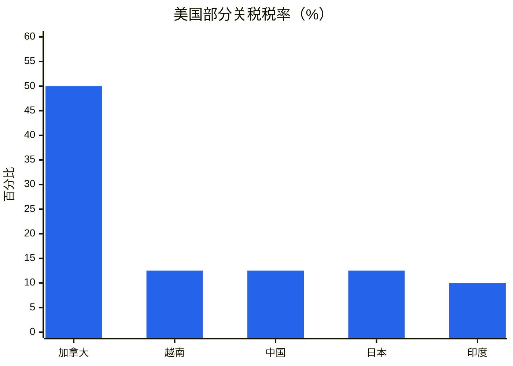

*注：加拿大=338条款税率（50%）；越南、中国和日本=301条款强迫劳动税率（12.5%）；印度=现行301条款强迫劳动税率（10%；已宣布的18%协议税率从未实施）。来源：美国贸易代表办公室、自由正义中心、JD Supra。*

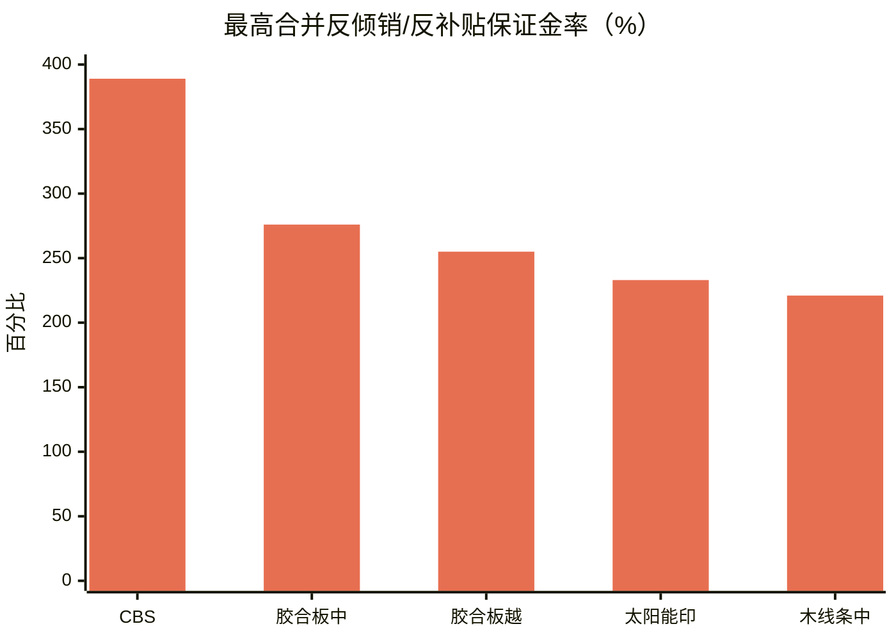

*注：反倾销加反补贴保证金合并税负。CBS橡胶促进剂：反倾销保证金281.69%+反补贴107.57%（初步裁定）；硬木胶合板中国：反倾销187.27%+反补贴88.96%；胶合板越南（Junma Phu Tho）：反倾销90.12%+反补贴165.39%；太阳能电池印度：合并233.26%；木线条中国全国税率：反倾销220.87%（反补贴复审另行进行）。来源：商务部《联邦公报》通知，2026年11月。*

---

## 5. 美国政策深度分析

### 301条款——豁免维持；产能过剩调查可能提前落地

窗口期内中国301条款豁免或海事费用暂停没有变化：178项豁免和费用暂停持续至2027年1月9日东部时间晚上11:59，未出现新的美国贸易代表办公室通知。亚太经合组织未带来延期，下一个决策点是12月14–15日在迈阿密举行的二十国集团峰会。301条款强迫劳动关税（中国、越南和日本为12.5%；印度为10%）仍然有效；国际贸易法院于9月30日审理了对强迫劳动关税的挑战（《301条款强迫劳动案件》，Learning Resources为首案），三名法官组成的小组尚未作出裁决，也未确定裁决日期。10月16日，政府和原告提交了答辩状，回应小组关于美国贸易代表办公室依据301条款哪一部分、以及是否须考虑经济发展的问题。另据海关与边境保护局10月22日修订的中国301条款关税第99章申报代码（CSMS 70261629），进口商可通过事后更正，就美国贸易代表办公室后来豁免的产品申请退还此前报关的税款。[JD Supra](https://www.jdsupra.com/legalnews/lower-tariffs-higher-gray-market-risk-6159993/)

产能过剩调查是本周的悬而未决的问题。据报道，格里尔大使于11月21日表示，针对16个经济体结构性产能过剩的调查将于2026年底前结束，比2027年3月11日的法定截止日期提前数月。他未说明初步关税税率或针对具体国家的处罚方案。该调查涵盖汽车、锂离子电池、半导体、钢铁、铝、机器人、太阳能组件和精密机械等21个行业。若报道属实，这一时间表将提前作出一项决定——印度官员称其为印美协议的门槛事项，韩国官员则表示该决定已比其预期时间表晚了两个多月。尚未公布任何调查结果、拟议措施或产品清单。该报道为单一来源；截至11月23日，尚未出现美国贸易代表办公室的新闻稿或《联邦公报》通知。[East Asia Brief](https://eastasiabrief.com/trade-policy/ustr-accelerates-section-301-probe-hit-year-end-target-1636)

美国贸易代表办公室窗口期内仅有的贸易执法新闻稿涉及劳工而非关税：11月19日，美国要求墨西哥根据《美墨加协定》快速反应劳工机制，审查Polygroup Industrias México公司涉嫌否认工人权利的情况；11月13日发出了第二份快速反应机制请求，涉及Industrias FG公司。格里尔大使于11月18日为负责任商业联盟年会发表视频讲话，并于11月16日致信《华尔街日报》，论述关税如何促进美国人的长期繁荣。[USTR](https://ustr.gov/about-us/policy-offices/press-office/press-releases)

### 232条款——多晶硅12月4日生效；机器人仍处于谈判阶段

海关与边境保护局于11月12日在自动商业环境认证环境中激活了四个模拟的、非官方的第99章税号（9903.45.43、9903.45.45、9903.45.47、9903.45.49），仅供测试，为232条款多晶硅及衍生产品关税做准备。最低进口价测试标准为：多晶硅每公斤21美元（美国协调关税表2804.61.00），硅锭和硅片每公斤100美元，太阳能电池每瓦0.22美元，太阳能组件每瓦0.38美元；关税等于申报价值与最低进口价之间的差额，或等于最低进口价的从量税，同时对衍生产品征收15%的从价关税（多晶硅原料本身免征15%关税，但须遵守价格下限）。对于日本、韩国、台湾、瑞士、列支敦士登和欧盟成员国，232条款关税加第1栏关税合计上限为15%。附有正式第99章税号的生产申报指南仍须在12月4日前公布。这些措施适用范围广泛，无《美墨加协定》豁免。[HTS Hero](https://htshero.com/tariff-updates/2026)

第11077号公告（机器人和工业机械，10月28日签署，11月2日公布，91 FR 69199）仍为威胁认定，未新增关税，指示商务部和美国贸易代表办公室进行谈判并在180天内（约2027年4月26日）提交报告。这是三个月内政府第三次在232条款调查后选择谈判而非立即加征关税，此前为风力涡轮机和商用飞机。窗口期内未发现新进展。[Constilumen](https://www.constilumen.com/updates/proclamation-11077-robotics-industrial-machinery-section-232)

### 海关与边境保护局——5106表格截止日期悄然过去；外国进口商规则1月5日落地

11月18日的截止日期已过，未报告作废案例（见A9）。相关执法自2026年9月18日起已根据海关与边境保护局8月19日的通知（91 FR 53627）生效：5106表格数据不准确或不完整的进口商编号可立即作废，未说明补救期；作废的编号不能用于报关。据贸易顾问称，电话号码和电子邮件地址是自动商业环境记录中最常缺失或不正确的数据要素。11月18日的信函是针对海关—商贸反恐伙伴计划进口商的一波定向行动，而非该权力的起点。海关与边境保护局于11月12日将外国备案进口商增强功能部署至自动商业环境认证环境（CSMS #70409426），并将于2027年1月5日部署至生产环境；5106表格3461和7501新增三个数据字段（CSMS #70381183），海关与边境保护局表示，自1月5日起，其验证检查可能拒绝不符合要求的报关单和报关摘要。针对临时最终规则的意见征集截止日期为2027年1月5日（案卷USCBP-2026-1387）。[DutyStacks](https://dutystacks.beehiiv.com/p/issue-006-apec-ends-with-a-declaration-not-a-deal-the-lukoil-clock-moves)

海关与边境保护局新闻室窗口期内仅发布地方新闻——11月19日德尔里奥入境口岸查获出境武器、弹药和毒品；11月18日罗马入境口岸查获价值超过39万美元的可卡因；11月11日在辛辛那提查获440件假冒珠宝（11月18日报道）；以及11月19日佛蒙特州奥尔堡斯普林斯陆路口岸因施工临时关闭。未出现全国性关税或贸易政策新闻。CSMS #70460453（11月17日）提醒进口商，不符合国际运输工具资格的机车和其他铁路设备必须报关并缴纳关税，包括第11021号公告规定的某些钢轨车232条款关税，以及针对中国、捷克、印度和墨西哥货运列车车钩的反倾销/反补贴税。仅为指南；无新关税。[CBP](https://www.cbp.gov/newsroom)

### 美国产业安全局出口管制——远程访问规则、消音器与实体清单冻结

远程访问临时最终规则见A2和第3.2节。窗口期内还有两项美国产业安全局事项。某些消音器、枪口消音装置和声音抑制器自美国军品清单（第一类）移至商业管制清单，新增出口管制分类编号0A501.f（步枪、手枪和多用途消音器）和0A502.f（仅霰弹枪消音器），自11月20日起生效（规则于2026年7月23日公布，91 FR 46252）。出口管制分类编号0A501.f因国家安全、地区稳定、犯罪控制、联合国和反恐原因受到管制；0A502.f新增一项地区稳定管制。许可例外LVS（最高500美元）适用于加拿大为最终目的地的情况。专为全自动枪械设计的消音器仍留在美国军品清单上，受《国际武器贸易条例》管辖。美国产业安全局估计，此次调整每年将新增约200份出口许可申请。[Thomson Reuters](https://www.thomsonreuters.com/en-us/help/onesource-global-trade/regulatory-insights/2026/october-29th/us-issues-interim-final-rule-silencers-mufflers)

《关联企业规则》的暂停持续至2027年1月10日，窗口期内没有新的美国产业安全局规则，但围绕其未予执行的政治争议加剧。财政部长贝森特于11月13日表示，财政部、国防部、国务院和美国贸易代表办公室数月来都主张将Megaspeed International（据报道在两年内购买了超过48亿美元先进英伟达芯片的新加坡英伟达客户）列入实体清单，并称商务部"握有决定权"。11月15日，他加大了对英伟达本身的施压。商务部否认了11月5日战情室交锋的报道。《金融时报》11月10日报道，商务部试图放缓新增实体清单的速度，清单已有13个月未新增（上次新增为2025年10月9日），100多个候选对象正等待审查小组批准，其中包括中国人工智能实验室DeepSeek。商务部长霍华德·卢特尼克已同意于2026年12月10日出席参议院银行委员会作证。三名众议院民主党人于11月9日致信卢特尼克，要求其在12月1日前作出书面答复。另据彭博社引用的马来西亚贸易记录，Megaspeed于2025年11月进口了至少17,544颗英伟达GB300处理器，价值约7.87亿美元；应联邦调查局要求，印度尼西亚警方搜查了Megaspeed当地分支机构，发现空的图形处理器机架。英伟达表示，已于2025年6月将Megaspeed列入其内部黑名单。[ExplainX](https://explainx.ai/blog/bessent-blames-commerce-megaspeed-entity-list-lutnick-ouster-talks-nvidia-huang-2026)

### 《联邦公报》——窗口期内的反倾销/反补贴活动

本周《联邦公报》的贸易活动以反倾销和反补贴税通知为主，详见第7节：硬木及装饰胶合板税令（11月17日）、木线条和木制品最终复审结果（11月17日）、美国国际贸易委员会关于瓦楞模切纸板箱的初步裁定（11月17日），以及成品碳钢法兰复审初步结果（11月16日）。窗口期内未出现新的暂扣放行令、除远程访问规则外新的美国产业安全局规则、新的白宫关税公告和新的美国贸易代表办公室301条款通知。《联邦公报》未逐份扫过整周文件，因此可能存在其他行政复审通知。

### 长期事项

- **《非洲增长与机遇法案》：**特朗普总统于11月2日通知国会及卢旺达和南非政府，拟自2027年1月1日起终止两国的《非洲增长与机遇法案》受益国资格，此前经过年度机构间资格审查（7月23日举行公开听证会）。《非洲增长与机遇法案》已通过立法延长至2028年12月31日。为最终确定终止，总统须在1月1日前发布公告，将两国从美国协调关税表《非洲增长与机遇法案》受益国名单中删除；截至11月23日，尚未公布此类公告。南非出口届时将面临标准最惠国关税，而非免税待遇。[USTR](https://ustr.gov/about/policy-offices/press-office/press-releases/2026/november/ambassador-greer-issues-statement-president-trumps-intent-terminate-rwanda-and-south-africa-agoa)
- **中期选举后的关税前景：**11月3日的选举产生了将于1月就职的民主党国会多数，但选举本身不改变任何关税税率；现有关税基于301条款和232条款授权，改变它们需要行政行动或可推翻否决的立法。时间顺序：国际紧急经济权力法关税于2026年2月20日被推翻，2月24日停止征收；10%的122条款附加费于2026年2月24日至7月24日实施，在150天法定期限届满后失效，未获国会延期；覆盖60个经济体的301条款关税于2026年7月24日生效，税率为10%或12.5%。建议制造商不要假定现行关税保护将持续。[JD Supra](https://www.jdsupra.com/legalnews/lower-tariffs-higher-gray-market-risk-6159993/)
- **白宫：**窗口期内未发现新的关税公告或情况说明。最近的相关公告仍为第11077号公告（机器人和工业机械）。

---

## 6. 世界各地区政策

### 欧洲

**欧盟—印度尼西亚全面经济伙伴关系协定签署，11月21日。**经过近十年谈判，欧盟与印度尼西亚在布鲁塞尔签署全面经济伙伴关系协定和单独的投资保护协定。欧盟贸易委员马罗什·谢夫乔维奇代表欧盟签署；委员会主席乌尔苏拉·冯德莱恩出席。理事会已于11月18日批准签署。印度尼西亚将在条款全面生效后取消98.5%欧盟商品税目的关税；委员会表示，该协议每年将为欧盟出口商节省超过6亿欧元关税，221项欧盟地理标志获得保护。欧洲议会仍须表示同意，印度尼西亚须批准；双方目标自2027年初起临时适用。冯德莱恩表示，普拉博沃总统将于12月11日访问布鲁塞尔。此次签署结束了近十年的谈判，是欧盟今年第二项与亚洲签署的重大贸易协议，也是欧盟在与美国和中国关系日益困难之际推动多元化的一部分。对出口商而言，实际意义在于协议已签署、尚未生效；采购和定价决策不应预先假定新税率。[Turkish Post](https://turkishpost.com.tr/en/2026/11/21/eu-indonesia-trade-deal/)

**欧盟—印度自由贸易协定签署日期确定为2026年12月16日。**欧盟—印度自由贸易协定现预计将于2026年12月16日在布鲁塞尔签署，届时印度总理纳伦德拉·莫迪将访问布鲁塞尔——据印度报业托拉斯引述的印度官员称，相关报道于11月22日发布。委员会已向理事会提交提案，寻求签署和缔结授权，并附最终法律文本和关税减让表。欧盟驻印度大使让-埃里克·帕凯在访问阿萨姆邦期间确认了12月中旬的时间表。协定预计于2027年生效，须经欧洲议会批准、理事会缔结和印度批准。根据该协定，93%的印度货物将获得欧盟免税准入，包括约330亿美元劳动密集型出口产品零关税。谈判于2026年1月27日结束。单独的投资保护协定和地理标志协定仍在谈判中。[Asia Daily](https://asiadaily.org/news/19949/)

**欧盟2欧元手续费：首批影响数据——低价值包裹下降逾60%。**每品目2欧元的欧盟手续费（授权条例（EU）2026/2152）和强制性产品标识进入第三周。本周确认的新细节：委员会表示，2026年第三季度低价值包裹量较疫情前趋势下降逾60%，原因是部分卖家改走批量发货至欧盟仓库的方式。委员会还报告称，2025年欧盟进口低价值电商商品达59亿件，为2022年数字的四倍，其中90%以上来自中国。3欧元统一关税和2欧元手续费均计入增值税应税金额，依据委员会2026年10月6日修订的指南。意大利对150欧元以下每票货物征收2欧元的国家费用推迟至2026年12月1日实施，另加欧盟收费。全欧检查行动发现，超过60%的受检商品不符合欧洲标准。关于欧盟低价值进口重置的首批确凿证据显示，在2欧元手续费生效之前，第三季度包裹量较趋势下降逾60%，原因是卖家将库存移入欧盟仓库以规避按件收费。该费用是永久性的，适用于任何价值，即使退货也不退还，因此既改变退货经济性，也改变到岸成本。窗口期内未公布已征收收入或清关延误的官方数据。[Fashion Law Journal](https://fashionlawjournal.com/eu-small-parcel-tax/)

**欧盟混合动力车保障措施。**见A4。委员会于10月30日启动调查；书面意见征集于11月20日截止；临时措施预计自12月1日起实施，据报道对中国产混合动力车实施每年35万辆的上限。[Ports Europe](https://www.portseurope.com/eu-opens-hybrid-safeguard-probe-as-chinese-shipments-outrun-planned-quota/)

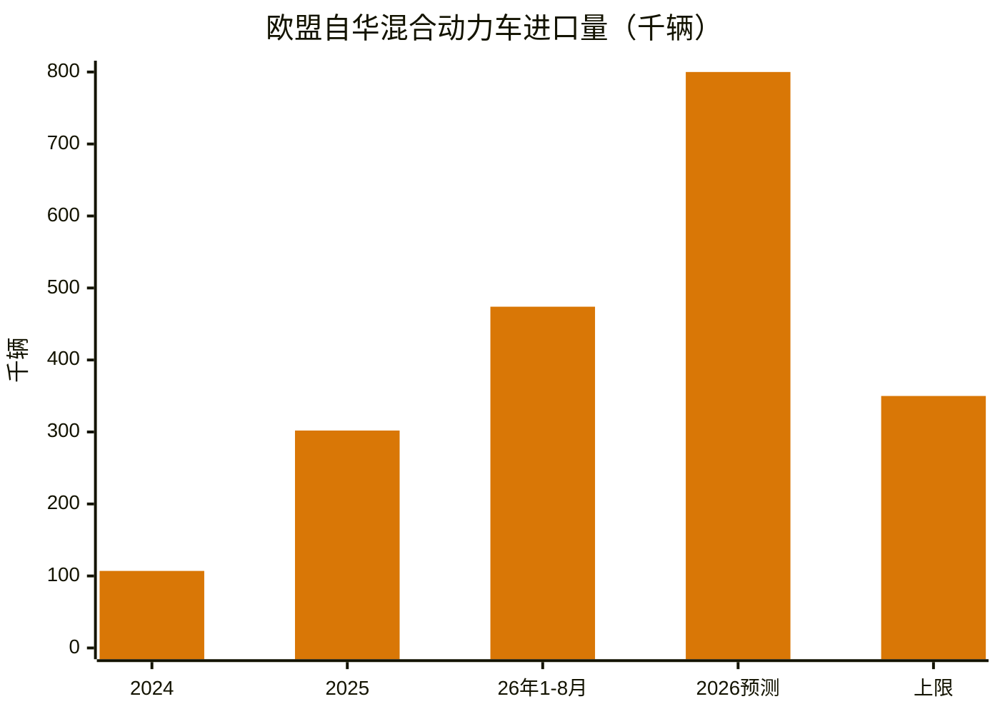

*注：进口量为欧盟统计局数据；2026年预测为委员会估计值；上限为据报道的首年保障措施上限35万辆。来源：欧盟统计局（经Ports Europe）；委员会。*

**欧盟—澳大利亚自由贸易协定：3月签署，批准前景不明；窗口期内无新进展。**欧盟—澳大利亚自由贸易协定于2026年3月24日达成并于同日在堪培拉签署，但尚未生效，未经议会审查和澳大利亚法律修订无法实施，澳大利亚外交贸易部表示这一过程可能长达两年。德国驻澳大利亚大使于10月29–31日表示，澳大利亚的批准取决于联盟党、绿党或中立议员在参议院的投票，并表示希望能在2027年第一季度完成；反对党国家党已誓言反对，自由党尚未表明立场。欧盟已警告，若议会否决协议，将不重新谈判。预计生效时间不早于2027年底。澳大利亚98%的出口额将免税进入欧盟；双边贸易额每年超过1090亿澳元。[AAP](https://aapnews.aap.com.au/news/claim-eu-trade-deal-mandates-methane-reducing-livestock-feed-is-baseless)

**欧盟—加拿大数字贸易协定于10月30日结束谈判；文本尚未公开。**欧盟与加拿大已于2026年10月30日结束数字贸易协定谈判，作为《综合经济与贸易协定》（自2017年起临时适用）的补充。该协定规定跨境数据流动、电子合同、电子签名和电子发票、在线消费者保护和未经请求的商业信息规则。谈判仅于2026年3月在第五次《综合经济与贸易协定》联合委员会会议上启动。议定文本尚未公布；签署前须进行法律清理并翻译成所有欧盟语言。谈判速度——启动后八个月内结束——反映了双方对数字贸易规则的政治重视，因为美国政策正变得越来越不可预测。签署和生效最早也要到2027年。[European Commission](https://policy.trade.ec.europa.eu/news/eu-and-canada-conclude-negotiations-digital-trade-agreement-2026-10-30_en?prefLang=ga)

**英欧汽车原产地规则：欧洲汽车制造商协会和汽车制造商与贸易商协会警告，自2027年1月1日起，四分之一电动汽车将面临10%关税。**欧洲汽车制造商协会和汽车制造商与贸易商协会警告，自2027年1月1日起生效的更严格的英欧《贸易与合作协定》电动和混合动力汽车原产地规则，将使两市场之间交易的纯电动和插电式混合动力汽车中不足四分之一符合免税待遇，其余将面临10%的关税。两协会还警告，欧盟拟议的《工业加速器法案》可能对英国汽车及零部件征收关税，威胁价值每年870亿美元的汽车贸易关系。尽管自2017年以来欧盟电池供应链已投资约808亿美元，欧盟仍进口约三分之二的锂离子电池。德国汽车工业协会11月主张推迟原产地规则变更，直至欧盟电池供应链进一步发展。11月20日的峰会未就此问题公布解决方案。[Manufacturing Digital](https://manufacturingdigital.com/news/acea-smmt-uk-eu-tariff-rules-threaten-auto-manufacturers)

### 英国

**英欧峰会，11月20日：动植物卫生检疫协议、碳排放交易体系挂钩和相互碳边境调节机制豁免达成一致。**见第3.3节。在第二届英欧峰会上，双方就动植物卫生检疫协议（实施日期2028年3月1日；英国政府估计到2040年每年可增加经济产出最高51亿英镑）、将英国排放交易体系与欧盟排放交易体系挂钩（相互碳边境调节机制豁免目标自2028年1月1日起实施；约65亿英镑的英国出口可能受益），以及青年流动措施达成一致。英国将自2027年1月1日起豁免原产于欧盟、欧洲经济区和瑞士的货物适用其碳边境调节机制。这些协议尚未生效；仍需进一步的法律和实施程序。[Thames Valley Chamber](https://www.thamesvalleychamber.co.uk/uk-eu-summit-2026-new-trade-agreements-reached/)

**英国碳边境调节机制范围将扩大至炼油产品；2026年预算案启动磋商。**政府拟将英国碳边境调节机制扩大至炼油产品，须就可行性和影响进行磋商。磋商已在2026年预算案中启动。未给出时间表；政府表示拟"尽快"实施该措施，并将适时公布时间表。按立法规定，英国碳边境调节机制自2027年1月1日起适用于铝、水泥、化肥、氢和钢铁。该扩大将使英国碳边境调节机制从最初的五个行业扩展至精炼石油产品，但仍处于磋商阶段，无确定日期。它与11月20日峰会协议并存，根据该协议，欧盟原产货物自2027年1月1日起豁免适用英国碳边境调节机制——因此，若炼油产品扩大措施推进，实际上将主要落在非欧盟供应商身上。[UK Parliament](https://questions-statements.parliament.uk/written-questions/detail/2026-10-28/39108)

**窗口期内无新的英国贸易救济通知；虹鳟鱼关税延期维持。**覆盖窗口内未发现新的贸易救济通知。长期事项：2026/31号贸易救济通知将土耳其虹鳟鱼反补贴税延长五年至2031年1月30日，自2026年11月6日起生效，按现行税率执行（出口商特定税率1.5%–8%；其他为9.5%）。英国碳边境调节机制于2027年1月1日启动，是目前最近的英国贸易事件。

### 加拿大

**加中双边安排延长并扩大，11月17日。**加拿大与中国延长并扩大了《关于解决双边经贸问题的初步联合安排》。中国将为约4亿加元的加拿大出口产品提供额外关税减免——冷冻猪肉1.16亿加元，鱼类和海产品2.85亿加元（冷冻冷水虾和对虾，包括太平洋斑点虾8750万加元；软体动物，包括象拔蚌6140万加元；海参3940万加元；格陵兰比目鱼9600万加元）——自2027年1月1日起至2028年12月31日暂停对这些产品加征25%的关税。此次扩大建立在11月初（11月4日部长级会谈）商定的菜籽粕、豌豆、龙虾和螃蟹关税减免两年延期基础之上。作为交换，加拿大将某些将于2026年底到期的中国钢铁和铝产品现有减免措施延长两年，并将减免范围扩大至另外32个钢铁和铝税目（钢铁23项、铝9项），涉及加拿大供应不足或无法供应的产品。4亿加元这一数字是2024年这些类别加拿大出口产品的价值，是在中国加征关税之前的数字；它不是一笔付款，也不是新增业务的保证。该安排新的到期日为2028年12月31日。据China Briefing的亚太经合组织综述，该协议还恢复了双边货币互换。[Prime Minister of Canada](https://www.pm.gc.ca/en/news/news-releases/2026/11/17/prime-minister-carney-advances-canadas-strategic-partnership-china)

**338条款法院挑战：口头辩论定于2027年1月20日。**见第3.7节和上周报告的A9。前美国贸易代表卡拉·希尔斯和罗伯特·佐利克、贸易学者和纳税人权益倡导者提交了支持挑战加拿大商品338条款关税的法庭之友意见书；自由正义中心于11月16日宣布了这些提交。口头辩论定于2027年1月20日举行。政府答辩状截止2026年12月11日，Gellert的答复状截止2027年1月11日。该案（Gellert Global Group Corp. v. Trump，法院案号26-04636）挑战对约200亿美元加拿大进口产品征收50%的关税；Gellert表示，每年将为加拿大奶酪支付约4000万美元，并已为2026年9月15日至10月7日的报关支付至少38.1万美元。10月28日，法院部分批准、部分驳回了Gellert的动议（案卷记录未说明哪些部分）。第11076号公告再次改写了自2026年10月30日起报关货物的机动车产品清单。关税仍然有效。[Liberty Justice Center](https://libertyjusticecenter.org/pressrelease/former-u-s-trade-representatives-scholars-back-liberty-justice-centers-challenge-to-trumps-canadian-tariffs/)

**加拿大关税减免收入情况：已评估141亿加元，已减免89亿加元。**自2025年3月至2026年10月26日，加拿大对美国产品评估征收141亿加元（约100亿美元）关税，但89亿加元获得减免或豁免，净收入为52亿加元。这量化了减免计划的广泛程度：多数反制关税实际上并未产生收入。11月9日的变化（横向减免延长至2028年6月30日；自2026年12月1日起取消某些拖车的减免，自2027年2月1日起取消某些铝线、铝型材和纸板的减免）按上周报道维持；窗口期内无进一步变化。[Mining Weekly](https://www.miningweekly.com/article/canada-expands-us-tariff-exemptions-cuts-some-aluminium-relief-2026-11-10)

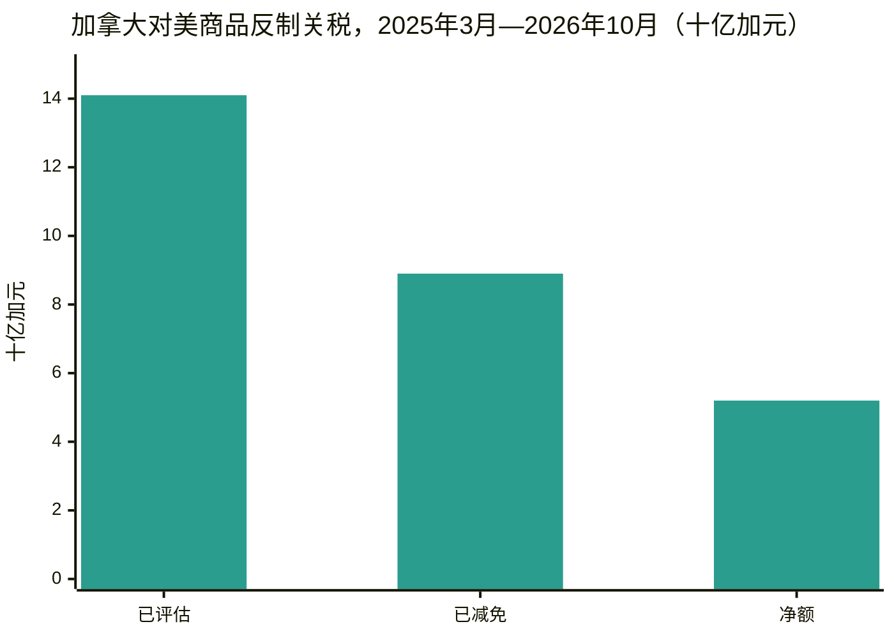

*注：2025年3月至2026年10月26日对美国产品评估征收的关税；根据减免计划减免或豁免的部分；净收入。来源：加拿大政府披露（经Mining Weekly，2026年11月10日）。*

**加拿大在世贸组织就印度将大米库存转用于乙醇提出质疑。**加拿大11月14日在世贸组织正式提出问题，涉及印度将国家储备大米分配给乙醇制造商，要求提供转入国内燃料酒精蒸馏的公共粮食数量细节。此前，农业委员会对印度国内支持进行了类似审查（见多边部分）。窗口期内未报告印度的回应。[Distillers Hub](https://distillershub.com/news/111420315/)

### 中国

**无人机、盾构机和挖泥船两用物项出口管制于11月18日生效。**第49号公告（无人机）、第50号公告（盾构机及相关设备）和第51号公告（挖泥船）于2026年11月18日生效，修订《两用物项出口管制清单》。无人机自动驾驶仪、具备超视距飞行能力且续航至少三小时的无人机、专为无人机设计的发动机，以及航程300公里以上或配备80升以上气溶胶播撒装置的无人机，出口须取得许可。第49号公告将受控无人机的续航阈值从一小时提高至三小时，因此低于该阈值的大众市场无人机不再需要许可，而管制范围扩大至更多无人机零部件。第50号公告首次对盾构机实施管制，另加特定步行式挖掘机和高空喷浆机；向敏感目的地出口须取得许可，其他目的地可使用登记制证书，但须遵守再转让限制。第51号公告对特定挖泥泵、耙吸头和绞刀头新增许可要求。自11月18日起还适用一项再出口规则：外国公司将盾构机等中国原产工程机械转给某些国家，须取得中国许可。另据商务部和海关总署第52号公告（10月19日），修订了海关扣留无证出口货物的程序。这些管制现已生效，其设计具有两面性：阈值提高使普通商用无人机落在管制范围之外，同时管制范围扩大至盾构机——尚属首次——以及外国公司再出口中国原产机械。再出口规则对第三国买家和转售商影响最直接，因为它波及没有中国出口商参与的交易。[Mondaq](https://alpha.mondaq.com/china/new-technology/1870494/new-chinese-export-control-measures-tighten-restrictions-on-the-export-of-advanced-technologies-and-dual-use-goods-strengthen-enforcement)

**技术出口目录：意见征集于11月15日截止；临时登记现为现行制度。**针对第48号公告（10月16日）的公众意见征集于11月15日截止，该公告拟将40项技术列入《禁止出口限制出口技术目录》（人工智能23项、生物医药5项、光伏12项；禁止14项、限制26项）。截至11月23日，尚未公布最终目录。现行制度是自10月16日起实施的临时出口前登记要求，涵盖所列技术的出口，包括已在进行的交易，以及向境外实体转让持有相关技术的境内企业所有权或控制权。本周的新分析明确了范围：在生物医药领域，转让细胞和基因治疗及小干扰核糖核酸平台的所有权将被禁止，但许可、合同研究/生产组织服务，以及对外业务拓展交易中产品研发或制造所需的技术不在此列；在人工智能领域，境外本地部署受限模型属于技术出口，而应用程序接口访问、应用或网页互动、软件即服务和轻量级设备端部署不在范围之内。受限技术出口审查分两个阶段，最长约45个工作日。商务部还就《两用物项出口管制调查与执法措施（草案）》征求意见，意见征集截止2026年11月29日。太阳能条款对外国制造商仍最为重要，涵盖多晶硅生产、70微米及以下的硅片，以及钙钛矿和叠层电池制造。[Jones Day](https://www.jonesday.com/en/insights/2026/11/china-tightens-its-grip-on-exports-of-strategic-technologies-what-it-means-for-technology-deals-involving-ai-and-biotech)

**商务部英文网站可访问；首页仅显示11月12日记者会内容。**英文网站于11月23日可访问。首页内容仅限于11月12日的例行记者会（包括关于11月6日何立峰与贝森特和格里尔视频通话的表态，以及关于中国—欧盟医疗器械对接活动在进博会期间举行的表态）和公报。首页未见关于技术目录或镓暂停措施的新公告。商务部英文门户仍是内容单薄的来源——仅有标题，实质性公告首先以中文发布。11月12日的记者会确认，自2025年5月以来已举行八轮中美经贸磋商。与镓相关的暂停措施（2025年第72号公告）将于2026年11月27日失效，截至11月23日未发现修订通知。[MOFCOM](https://english.mofcom.gov.cn/)

**中美：亚太经合组织未达成关税结果；停战协议仍持续至2027年1月9–10日。**见A1和第3.1节。11月19日习近平与特朗普的双边会晤未发布关税减免公告，也未达成稀土结果；报道称双方在关税、稀土和半导体问题上陷入僵局。特朗普敦促中国履行购买170亿美元美国农产品的承诺；中方官员表示，该承诺以对等关税削减为条件。两位领导人同意起草美中"战略稳定"行动计划。拟议的300亿美元对300亿美元和600亿美元对等关税削减方案仍未最终确定。[China Briefing](https://www.china-briefing.com/news/apec-2026-in-shenzhen-what-the-leaders-meeting-and-trump-xi-talks-mean-for-business/)

### 印度

**印美协议仍未签署；商务部长称签署须等待美国关税框架。**见第3.7节。商务部长拉杰什·阿加瓦尔11月18日表示，在最高法院废除对等关税和紧急关税后，拟议的印美贸易协议在华盛顿建立新的关税架构之前无法签署，因为须明确向不同国家提供的比较优势。正在进行的301条款调查结果——包括预计在数周或数月内出结果的产能过剩调查——也须明确，因为每个国家都希望对这些调查有确定性。法律协议已谈判完成，处于最后阶段；双方希望尽快达成。苏杰生11月14日表示，协议处于"最后阶段"，多数问题已解决。2026年2月7日的框架设定了18%的美国税率，从未实施；印度商品目前支付10%的301条款税率。[The Hindu BusinessLine](https://www.thehindubusinessline.com/economy/no-india-us-trade-deal-until-new-us-tariff-framework-section-301-probes/article71716562.ece/amp/)

**印度—欧盟：12月16日签署；乳制品和转基因红线重申。**上周报道的红线没有变化：印度在任何自由贸易协定中从未开放乳制品行业，也不会允许进口转基因产品。欧盟—印度签署日期现定为12月16日（见欧洲部分）。这些红线稳定存在，与每条印度自由贸易协定谈判轨道相关，包括尚未签署的美国协议，其中农业和乳制品属于尚未解决的敏感问题。

### 亚太地区

**亚太经合组织深圳会议：领导人通过《深圳展望》；未达成关税协议；加拿大、智利、菲律宾、秘鲁、印度尼西亚达成场边协议。**见第3.1节和第3.7节。场边协议：中国—加拿大关税减免（见加拿大）；菲律宾—智利全面经济伙伴关系协定于11月19日签署——菲律宾与拉美国家的首个自由贸易协定，8,632个产品类别获得优惠准入，菲律宾对智利现有出口产品（电子产品、机械、椰干、卡拉胶、加工金枪鱼）几乎全部享受免税待遇；秘鲁—泰国自由贸易协定于11月19日签署；中国—智利经贸路线图及自由贸易与多边主义谅解备忘录；中国—印度尼西亚于11月20日宣布启动全面经济伙伴关系协定谈判。菲律宾还表示有意加入《全面与进步跨太平洋伙伴关系协定》，并表示菲律宾—加拿大自由贸易协定谈判已结束。[BusinessMirror](https://businessmirror.com.ph/2026/11/20/new-trade-deal-opens-chile-market-for-phl/)

**硅盾协议：《旧金山宣言》于11月15日由美国及八个伙伴签署。**美国及八个伙伴签署了《硅盾框架下持久繁荣安全基础旧金山宣言》，同意制定一份需要加强保护的敏感技术和关键供应链共同清单，交换脆弱性信息，并组织工作组。该宣言涵盖半导体、人工智能基础设施、关键矿产、能源、先进制造、运输物流和通信网络，针对非市场行为、产能过剩和不公平倾销。该宣言不具约束力：没有资金承诺，没有点名公司，没有实施期限，共同清单本身尚未起草或公布。硅盾框架于2025年12月启动，现有约26个参与方。欧盟成员未出席创始国务虚会，但正在审查文件是否"符合监管要求"；德国、瑞典、荷兰和欧盟委员会预计不久将签署。该宣言使硅盾框架从广泛的伙伴关系声明迈向具体的安全协调——下一步工作是制定一份共同的、需要保护的技术和基础设施清单——但成果尚不存在，因此其贸易影响仍属前瞻性。须关注欧盟成员是否签署，以及共同清单起草后是否产生出口管制或投资审查后果。[Asia Daily](https://asiadaily.org/news/18839/)

**菲律宾在亚太经合组织会议上获得411亿美元投资承诺；表示有意加入《全面与进步跨太平洋伙伴关系协定》。**马科斯总统从深圳带回价值411亿美元的投资承诺，涵盖制造业、电动汽车和清洁能源技术，可能创造7000多个就业岗位。最具体的承诺是C&U集团投资8700万美元，在八打雁省阿利塔格建设一座20公顷的设施。菲律宾还在与墨西哥总统克劳迪娅·辛鲍姆会晤期间表示有意加入《全面与进步跨太平洋伙伴关系协定》，并指出其菲律宾—加拿大自由贸易协定谈判已结束，菲律宾—智利全面经济伙伴关系协定已签署。菲律宾出口2025年增长15.4%，2026年1–9月继续逐月增长。承诺不等于资本支出，411亿美元这一数字应理解为意向信号而非已承诺投资；C&U设施是唯一逐项列出的承诺。[Further Asia](https://furtherasia.com/philippines-gets-us41-1b-investment-pledges-after-apec/)

**韩巴化妆品关税：窗口期内无新进展。**该事项仍处于总统指示阶段，未报告谈判结果。上周事项维持：李在明总统在11月3日的内阁会议上敦促就巴西对韩国化妆品征收25%关税进行快速谈判，此前卢拉于10月25日再次当选。韩国化妆品出口2026年前十个月达124亿美元，同比增长27.3%。[Seoul Economic Daily](https://en.sedaily.com/politics/2026/11/03/lee-presses-brazil-to-cut-25-percent-tariff-on-korean)

### 多边

**世贸组织改革轨道：美国挑战中国，拒绝将农业纳入"公平竞争环境"轨道；巴西警告，若无农业，第十五届部长级会议将无一揽子协议。**在11月16日关于世贸组织改革轨道"公平竞争环境"问题的马拉松会议上，美国表示仍对与中国"不可持续"的双边贸易关系感到担忧，指责北京不遵守规则，并表示这种不对称——贸易逆差据称可能每年达1万亿美元——已大到无法在现有世贸组织规则下解决。华盛顿还表示，面对持续的不对称，非歧视原则，包括最惠国待遇，无法适用。美国与以挪威、日本和瑞士为首的农业防御性十国集团一道，反对将农业纳入公平竞争环境讨论，坚持农业只属于农业委员会特别会议。数个国家支持中国关于公平竞争环境的提案，包括就产业政策和产业补贴开展多边讨论；欧盟表示赞同中国的提案，中国表示将接受经合组织关于国家干预和补贴的工作。巴西警告，若公平竞争环境轨道不纳入农业，第十五届部长级会议（定于2028年举行）将无改革一揽子协议可供通过。新西兰表示可能提交一份关于农业的文件。改革轨道现已在两个轴线上公开分裂：农业是否属于公平竞争环境讨论，以及美中不对称是否能在世贸组织规则内处理。美国的立场——在持续不对称的情况下最惠国待遇无法适用——直接挑战世贸组织的一项核心原则。11月16日的会议未达成协议。下一次农业委员会特别会议定于2026年11月23日举行，议题包括出口限制和特殊保障机制。[Third World Network](https://www.twn.my/title2/wto.info/2026/ti261112.htm)

**世贸组织农业：印度食糖补贴据称接近180亿美元；加拿大就大米转乙醇提出质疑。**提交给世贸组织的一份报告称，印度去年提供的食糖补贴接近180亿美元，超出世贸组织限额——这是继澳大利亚9月9日反通知指控印度未通报食糖、棉花和豆类国内支持之后的后续行动。2021年12月印度——食糖和甘蔗案专家组认定，印度的食糖支持不符合世贸组织义务。另据报道，加拿大正式提出问题（见加拿大），涉及印度将国家储备大米分配给乙醇制造商。农业委员会特别会议将于2026年11月23日举行，议题包括出口限制和特殊保障机制。农业仍是世贸组织争议最大的议题，印度处于三项平行审查的中心——食糖、大米转乙醇，以及此前的棉花/豆类通报缺口。180亿美元这一数字是提交报告中的指控，而非世贸组织的认定，应如此看待。[RFD-TV](https://www.rfdtv.com/indian-sugar-subsidies-draw-scrutiny-over-unfair-trade-practices)

**世贸组织DS644（中国诉印度）：专家组自6月起设立；实质问题未决。**对上周报告的更正：上周报告称世贸组织于11月16日"同意设立"DS644案专家组。公开记录显示，争端解决机构于2026年6月23日设立专家组，并于2026年10月7日组成专家组。中国于2025年12月19日请求磋商；专家组于2026年5月11日提出请求；设立于5月22日被推迟（印度阻止了首次请求）。该争端涉及印度对某些技术产品的关税待遇，以及据称有利于国内产品而非进口产品的《太阳能组件计划》激励措施。尚未公布专家组报告、调查结果或补救措施。窗口期内无新进展。该争端处于已组成专家组的正式裁决阶段，但尚未作出任何决定，印度也未因此改变任何关税税目或计划规则。[WTO](https://www.wto.org/english/news_e/news26_e/dsb_23jun26_426_e.htm)

**联合国贸易和发展会议《2026年贸易和发展报告》：全球增长放缓至2.6%；美中贸易自2024年以来下降逾20%。**联合国贸易和发展会议《2026年贸易和发展报告》于11月17日发布，预计2026年全球增长将从2025年的2.9%放缓至2.6%，发展中经济体为4%（低于4.7%）。货物和服务贸易预计按不变价格增长约4%；2025年全球贸易达到创纪录的35万亿美元。亚洲贡献2026年全球增长的59%（印度7.3%、中国4.5%、印度尼西亚5.2%）。中美贸易自2024年以来下降逾20%，而东亚已扩大与双方的贸易。放缓与中东冲突有关，该冲突使布伦特原油从每桶70美元上涨至110美元以上；自冲突开始以来，资本流动波动翻了一番；官方发展援助预计2026年下降近7%，为连续第三年下降。联合国贸易和发展会议的总体判断是：碎片化与亚洲韧性并存——世界两大经济体的双边贸易自2024年以来削减逾五分之一，但全球贸易2025年仍创下35万亿美元的纪录，亚洲贡献了2026年大部分增长。须注意，这些增长数字是联合国贸易和发展会议自己的数据，与国际货币基金组织的数据不能直接比较。这是窗口期内新发布的报告，与上周报道的11月9日《全球贸易更新》不同。[UNCTAD](https://unctad.org/publication/global-trade-update-november-2026)

**世界海关组织：安道尔于11月18日成为《修订后的京都公约》第141个缔约方。**安道尔公国加入《修订后的京都公约》，成为第141个缔约方。世界海关组织11月份的其他事项已于上周报道（11月3日救灾研讨会；11月5日2025–2026年度报告；11月9日智慧海关活动；11月11日电子商务假冒商品研讨会；11月12日东非共同体原产地规则支持；11月13日世界动物卫生组织会议）。除安道尔加入外，11月16–23日未发布其他世界海关组织新闻。这是一项规模虽小但具有结构意义的事项：《修订后的京都公约》——世界海关组织的核心贸易便利化工具——新增第141个缔约方。[WCO](https://www.wcoomd.org/en/media/newsroom/2026.aspx)

**国际贸易中心—非洲进出口银行非洲—加勒比贸易报告：无新事项。**11月16–23日窗口期内未发现新的国际贸易中心事项。11月3日的报告维持：到2030年，非洲—加勒比货物和服务年贸易额可达16.5亿美元（不含矿物燃料）；非洲对加勒比的年货物出口潜力约80%尚未开发；加勒比出口潜力主要在服务业，为4.81亿美元。本周报道中的一项说明：2025年7月国际贸易中心—非洲进出口银行的一份预测将同一走廊2030年的数字定为21亿美元，因此新数字低约21%——不过这两个数字可能无法直接比较，因为较早的数字可能包括矿物燃料，而新数字不包括，且基线（7.29亿美元）仅为货物，而预测涵盖货物和服务。在没有这一说明的情况下，不应将该报告表述为下调。[Central Charts](https://www.centralcharts.com/en/news/5841368-africa-and-caribbean-trade-potential-could-reach-1-65-billion-annually-by-2030-international-trade-centre-itc-afreximbank-report)

---

## 7. 执法行动

### 反倾销和反补贴税

**硬木及装饰胶合板——针对中国、印度尼西亚、越南的反倾销/反补贴税令（11月17日）。**见A8。商务部发布反倾销和反补贴税令（案件编号A-570-211、A-560-844、A-552-851；C-570-212、C-560-845、C-552-852）。海关与边境保护局将继续暂停清算并要求缴纳保证金。税令涵盖由两层或多层单板组成的平板、多层胶合板或其他贴面面板，面层或背层为硬木、软木或竹单板，包括修边和裁切成规格的面板。这些税令结束了一项始于2025年申诉的程序，此前两机构均作出肯定性终裁。胶合板是大宗建材进口产品，中国合并税率接近276%，实际上将中国硬木胶合板挤出美国市场，促使买家转向印度尼西亚和越南供应商——两国自身的税率差异很大（15%至165%），有利于供应商选择。[Factbox](https://factbox.net/s/commerce-imposes-plywood-antidumping-and-countervailing-duties-on-china-indonesia-vietnam)

**印度成品碳钢法兰——反倾销/反补贴行政复审初步结果（11月16日）。**商务部公布印度成品碳钢法兰反倾销/反补贴行政复审初步结果，涵盖2024–25年度（反倾销通知《联邦公报》文件2026-23278，91 FR 73546；反补贴通知《联邦公报》文件2026-23270，91 FR 73519）。反倾销初步幅度（复审期2024年8月1日至2025年7月31日）：R. N. Gupta & Co.为7.15%；Norma Group为0.00%；15家未抽样公司为7.15%。对27家无可复审暂停报关的公司撤销复审。其他公司保证金继续按8.91%执行。反补贴初步税率（复审期2024日历年）：Norma为2.23%；RNG为2.28%；未抽样公司为2.26%。对28家公司撤销复审。反补贴其他公司保证金继续按7.39%执行。现行保证金在最终结果公布前保持不变（最终结果须在公布后120天内发布，除非延期）。截止日期因联邦政府停摆分别顺延47天和21天。这是例行的复审结果，但表明反倾销/反补贴体系在停摆积压中仍在运转，低税率证实2017年的法兰税令如今仅对受复审的印度出口商造成适度成本——与胶合板和太阳能新税令的三位数税率形成对比。[Drawback AI](https://www.drawbackai.com/library/finished-carbon-steel-flanges-india-ad-cvd-review-prelims-2024-2025)

**瓦楞模切纸板箱——美国国际贸易委员会肯定性初步裁定（11月13日提交；11月17日公布）。**委员会认定，有合理迹象表明，美国产业因自中国、马来西亚和土耳其进口的瓦楞模切纸板箱（美国协调关税表子目4819.10.00）而受到实质损害，据称这些产品以低于公平价值的价格销售，土耳其产品还获得补贴（调查编号701-TA-806和731-TA-1805–1807，初步阶段；《联邦公报》文件2026-23401）。申诉由美国披萨盒制造商联盟（Smurfit Westrock和Pratt Industries）和美国钢铁工人联合会于2026年9月9日提交。委员会于2026年11月13日完成并提交裁定；调查的最终阶段已经开始。该案现移交商务部作出初步倾销和补贴裁定；若为肯定性裁定，保证金可能于2027年初开始征收。目前尚无税率。这是一件小产品，但申诉方构成（两家大型美国包装生产商加上钢铁工人联合会）和三国范围表明，反倾销/反补贴管道正进一步延伸至日常包装和餐饮服务用品。[govinfo](https://www.govinfo.gov/content/pkg/FR-2026-11-17/html/2026-23401.htm)

**新的反倾销/反补贴申诉——中国产某些塑料气球（11月18日提交）。**美国生产商于11月18日就中国产某些塑料气球提交反倾销/反补贴申诉。指控倾销幅度为50%至276%；指控补贴高于最低限度水平（未提出具体反补贴税率数字）。范围：某些非纺织塑料薄膜或薄片制塑料气球，未充气时最大单体尺寸不超过20英尺。商务部初步反补贴裁定预计2027年2月11日作出；初步反倾销裁定预计2027年4月27日作出（均为估计值，可延期）。尚未计算任何关税或保证金税率；这些数字仅为指控。美国国际贸易委员会须首先判定是否存在实质损害的合理迹象；若为否定性裁定，调查将终止。这是窗口期内第二份新申诉，指控幅度（最高276%）处于今年所见范围的顶端。气球进口是小额贸易流，但这些申诉进一步表明反倾销/反补贴行动正延伸至低价值消费品。[JD Supra](https://www.jdsupra.com/legalnews/new-trade-petitions-target-certain-4267033/)

**中国CBS橡胶促进剂——初步反倾销裁定（11月6日公布；补录事项）。**该事项于11月6日公布，略早于上周窗口期，上周报告未予报道。商务部初步认定，中国产CBS（N-环己基苯并噻唑-2-次磺酰胺，一种橡胶硫化促进剂，亦称促进剂CZ）在美国以低于公平价值的价格销售，幅度接近286%（反倾销初步裁定于2026年11月6日公布，91 FR 70053；反补贴初步裁定于2026年10月8日公布，91 FR 64337）。初步反倾销幅度为285.94%，保证金税率为281.69%（补贴抵扣后），适用于全国实体，基于可获得事实并作出不利推断。初步反补贴税率为107.57%。合并保证金约为申报价值的389%。两案均认定存在关键情况，因此保证金可追溯至每项通知前90天（反倾销约为2026年8月8日；反补贴约为2026年7月10日）。商务部最终裁定预计2027年1月11–12日左右作出。申诉方：朗盛公司（申诉于2026年5月7日提交）。CBS案是当前反倾销/反补贴管道中税率最极端的案件，对使用CBS作为硫化促进剂的美国轮胎和橡胶制品制造商构成直接成本冲击。[OneFirm Intel](https://onefirmintel.com/blog/cbs-rubber-accelerator-duties-china)

**太阳能第四案——美国国际贸易委员会第5804号出版物公布（11月11日前可查）。**美国国际贸易委员会关于太阳能反倾销/反补贴案的完整报告在11月23日的目标日期之前公布，完成了11月9日商务部税令（印度合并保证金税率最高233.26%，一家印度尼西亚生产商268.06%，一家老挝生产商219.43%）的文件闭环。第5804号出版物（2026年11月），《来自印度、印度尼西亚和老挝的结晶硅光伏电池（无论是否组装成组件）》，调查编号701-TA-772–774和731-TA-1756–1758（终裁）。委员会于2026年11月2日完成并提交肯定性损害裁定；《联邦公报》通知于11月5日发布（91 FR 69865）。关键情况：委员会认定，来自印度和老挝的进口不太可能严重损害税令的补救效果，但来自印度尼西亚的进口可能如此——因此仅对印度尼西亚实施追溯性反补贴税（2025年11月28日及之后的报关）。第5804号出版物是进口商、报关行和太阳能买家在2027年全年引用范围和追溯性问题的文件。仅对印度尼西亚的追溯性造成了三方到岸成本差异，这在早期的太阳能案件中并不存在。[USITC](https://www.usitc.gov/secretary/fed_reg_notices/701_731/701_772_notice11022026sgl.pdf)

**中国木线条和木制品——最终反倾销复审结果（11月17日）。**商务部公布中国木线条和木制品反倾销行政复审最终结果（复审期2024年2月1日至2025年1月31日；《联邦公报》文件2026-23402）。福建宏嘉工艺品有限公司和南平华泰木竹有限公司退出核查，商务部因此适用不利可获得事实，认定其数据不足以核实，拒绝给予其单独税率，并将其归入全国实体。全国反倾销税率为220.87%；单独税率出口商Bel Trade Wood Industrial和Tim Feng Manufacturing被指定为37.24%。保证金适用于2026年11月17日及之后的报关，按上述税率执行。这是上周已报道的11月12日公布的反补贴复审结果（南平华泰、福建银丰和福建宏嘉的反补贴税率为147.88%；未抽样公司为21.39%）的反倾销配套。商务部将在公布后不早于35天发布评估指令。37.24%的单独税率与220.87%的全国税率之间的差距，进一步说明了在复审中不合作的代价。[PolicyRisk](https://policyrisk.com/federal-register/2026-23402)

### 海关与边境保护局查获与强迫劳动

**亚利桑那州诺加利斯（11月11日查获；海关与边境保护局11月19日发布）。**海关与边境保护局诺加利斯口岸官员在两周内查获第二批大宗芬太尼——2026年11月11日在诺加利斯DeConcini口岸车辆检查中查获逾136磅毒品：逾92磅芬太尼药片和逾44磅甲基苯丙胺，藏于80多个包裹中。一名25岁的美国公民驾驶一辆2020年本田思域被转入二次检查；非侵入式检查发现异常，警犬队发出警报。毒品和车辆被扣押；当事人被联邦调查局拘留，联邦检方已受理。此前，11月3日在皮卡车内折叠塑料椅中查获逾112磅芬太尼（海关与边境保护局11月10日发布），已于上周报告。八天内在同一口岸查获两起重大芬太尼案件，凸显了经诺加利斯流动的毒品规模，以及海关与边境保护局二次检查能力的执法负荷。[CBP](https://www.cbp.gov/newsroom/national-media-release/port-nogales-cbp-officers-and-homeland-security-task-force-partners)

**暂扣放行令——窗口期内无新增。**11月16–23日窗口期内未发现新的暂扣放行令。最近的暂扣放行令仍为2026年9月29日的印度尼西亚棕榈油税令（Mitra Aneka Rezeki和Hardaya Inti Plantation）、2026年6月16日的塞尔维亚紫金铜业税令，以及玲珑轮胎税令（塞尔维亚）。海关与边境保护局现行暂扣放行令总数为60项，另有8项根据《美国法典》第19编第1307条作出的裁定（据Thompson Hine，2026年10月1日）。[Thompson Hine](https://www.thompsonhine.com/insights/cbp-issues-withhold-release-orders-on-two-indonesian-palm-oil-producers/)

### 制裁

**外国资产控制办公室指定（11月13日、11月18日、11月19日）。**外国资产控制办公室11月份的行动保持稳定节奏。11月13日（11月18日公布），外国资产控制办公室根据第14059号行政命令和第13224号行政命令指定了Los Huistas贩毒组织（危地马拉，与锡那罗亚贩毒集团和哈利斯科新一代贩毒集团有关联）。11月18日，根据第13224号行政命令指定了六方，涉及真主党融资——黎巴嫩慈善机构Wa Ta'awanu Association及其创始人Afif Abdel Rida Chouman，以及一个黄金和现金走私网络（货币兑换商Hassan Khechen、其兄弟Ibrahim、位于西顿的Gold Global Company，以及伊斯坦布尔黄金批发商Sankari Gold）。每项均附有次级制裁警告。11月19日作出两组指定：（一）禁毒（第14059号行政命令）：总部位于澳大利亚的Comanchero非法摩托车帮及其领导层（Alexandre Varela Villar，又名"Alex Vare"，世界指挥官，常驻西班牙；Allan Meehan，世界主席；其他人在新西兰），以及多伦多'Ndrangheta领导层（Angelo Figliomeni、Camera di Controllo、Luigi Vescio Sr.及其家族企业，包括安大略省的殡仪馆和一家豪华轿车公司）；（二）网络诈骗中心（第13694号行政命令）：柬埔寨运营商赵辉、其公司Bei Fang Bo Lin Construction Decoration Co.和ZHZ Investment Consulting Co.，以及两名民主克伦仁爱军指挥官（Saw Shwe Wah、Saw A One），负责缅甸诈骗园区的安全。11月19日共作出24项指定，另有1项移除和5项修订。公布了一个Tron钱包地址（Alex Vare的，`TVwLtgUXyDhmcSoQ9x2z9QSua41f8mDFvU`）。黄金网络指定使黎巴嫩和土耳其的金条交易商和银行受到次级制裁通知，具有直接的贸易融资影响。诈骗园区行动针对通过加密货币和地区银行转移资金的诈骗管道，唯一公布的钱包地址为合规团队提供了具体的筛查命中点。11月19日的行动（24项指定）是窗口期内最大规模的单次外国资产控制办公室行动。[Justia](https://regulations.justia.com/regulations/fedreg/2026/11/18/2026-23456.html)

**欧盟将49个与俄罗斯有关的当事方列入名单（11月17日）。**欧盟于11月17日将49个与俄罗斯有关的当事方列入制裁名单，这是当天受监测当局作出的126项指定的一部分。这是欧盟俄罗斯制裁计划的例行延续，而非新的一揽子措施。欧盟俄罗斯名单继续累积，每轮都增加了与俄罗斯有业务往来的贸易商的筛查负担；本周没有引人注目的新一揽子措施，表明行动是渐进的而非升级的。该数字据Youverify监测机构报道，未对照欧盟名单本身核实。[Youverify](https://youverify.co/en/sanctions)

---

## 8. 数据发布

### 日本——2026年10月全月贸易（11月18日发布）

见第3.6节。出口11.7688万亿日元（同比增长20.5%），创单月纪录，连续第14个月增长；进口12.2453万亿日元（同比增长21.6%），同样创单月纪录；贸易逆差4765亿日元（约30亿美元），连续第六个月逆差，小于9月份修正后的5565亿日元逆差，约为分析师预期的约1万亿日元逆差的一半。季节调整后逆差7672亿日元。出口量指数同比增长5.8%；进口量指数下降0.2%。[Action Forex](https://www.actionforex.com/live-comments/661239-japan-trade-deficit-narrows-as-chip-exports-surge-but-oil-costs-stay-high/)

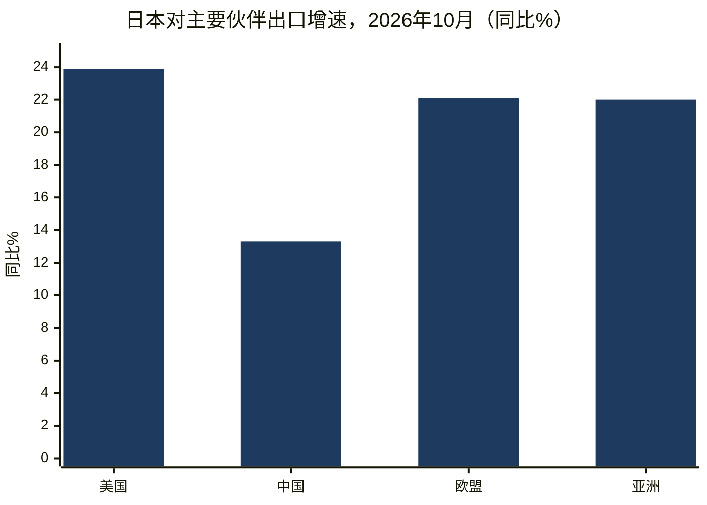

*注：2026年10月按目的地划分的出口额，同比。美国：汽车增长37.2%，半导体制造设备增长118.5%。中国：汽车下降53.3%，半导体制造设备增长42.6%。来源：日本财务省初步贸易统计，2026年10月。*

### 欧元区——2026年9月经常账户（欧洲中央银行，11月19日发布）

欧洲中央银行9月份国际收支数据显示，欧元区经常账户顺差为120亿欧元，与上月基本持平。按国际收支口径，货物顺差为140亿欧元——与欧盟统计局11月13日报告的按海关口径9月份货物逆差103亿欧元是不同的衡量标准，两者不应直接比较。服务顺差160亿欧元；二次收入逆差160亿欧元；一次收入逆差10亿欧元。经常账户读数是衡量欧元区外部状况的更清晰指标，因为它计入了服务和收入流，显示该集团尽管存在海关口径货物逆差，总体上仍处于顺差。两种货物衡量标准之间的差距是贸易评论中长期存在的困惑来源，值得在12月份货物数据发布时注意。下一次月度国际收支数据将于12月18日发布，涵盖10月份；季度数据将于1月12日发布。[QNC News](https://qncnews.com/2026/11/23/euro-area-current-account-surplus-holds-at-12-billion-euros-in-september/)

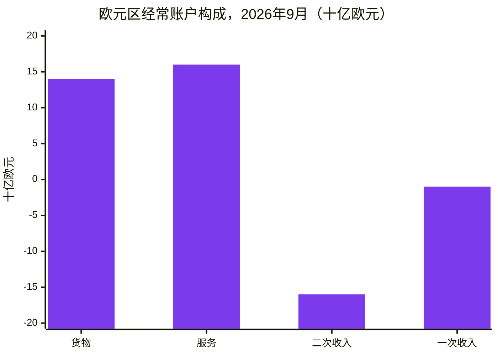

*注：按国际收支口径，2026年9月。经常账户顺差120亿欧元。来源：欧洲中央银行。*

### 德国——2026年前三季度跨境电力贸易（联邦统计局，第406号新闻稿，11月20日）

联邦统计局报告称，2026年前九个月德国跨境电力贸易接近实物平衡，出口激增，进口量下降。德国1–9月出口电力48.8太瓦时，价值43亿欧元（量同比增长25.5%；价值增长51.3%）。电力进口量下降13.3%，至49.2太瓦时，但价值增长20.4%，至57亿欧元。实物进口顺差缩小97.5%，至0.4太瓦时。平均进口价格为每兆瓦时116欧元（同比增长38.9%），而2025年1–9月为每兆瓦时84欧元。仅2026年9月，德国出口电力5.4太瓦时（同比增长22.7%；价值增长122.7%，至6亿欧元），进口4.6太瓦时（量下降26.1%；价值增长64.5%，至8亿欧元）。这是一项小众内容，但它说明了能源价格不对称——而非数量——如今如何驱动德国的能源贸易差额，也是窗口期内唯一确认的联邦统计局贸易数据。该数据按对外贸易规则编制（商品编码27160000），与基于电网的能源统计在方法上有所不同。原定11月20日发布的9月份货物贸易主要细节未在搜索中单独确认。[NewsVerum](https://newsverum.com/en/news/germany-electricity-exports-reach-4-3-billion-euros-first-three-quarters-2026)

### 美国——2026年9月贸易（FT-900）和10月先行指标

11月16–23日窗口期内没有美国贸易数据发布。最新FT-900（11月4日）显示，9月份逆差为1050亿美元，略小于8月份修正后的1057亿美元。今年以来逆差比2025年1–9月小924亿美元（12.2%）；同期出口增长11.6%，进口增长6.2%。先行9月份货物逆差为1349亿美元（10月28日发布），比8月份的1321亿美元增加28亿美元。10月份FT-900定于2026年12月8日发布，10月份先行货物贸易指标将于2026年11月27日发布。美国是本周数据覆盖中最大的缺口：10月份贸易数据要到12月才能知晓，因此关于关税叠加如何影响10月份进口额的任何评估都须等待。[Value.today](https://www.value.today/economy/usa/releases/trade)

### 数据门户——窗口期内未发现重大新发布

11月16–23日窗口期内，未发现美国国际贸易委员会DataWeb、联合国商品贸易统计数据库、世界银行WITS、世界银行数据门户或国际货币基金组织（世界经济展望/国际金融统计）的重大新贸易数据发布。国际货币基金组织《世界经济展望》上次更新于2026年10月；未发现11月更新。欧盟统计局下一次货物贸易数据（10月份）将于2026年12月18日发布。中国11月份贸易数据将于12月发布。[Eurostat](https://ec.europa.eu/eurostat/web/international-trade-in-goods/publications)

### 智库

**税收基金会关税追踪：适用税率11.8%，有效税率7.2%；十年1.4万亿美元。**税收基金会的追踪显示，自2025年1月以来美国关税政策已发生50多项变化。关键估计：2026年新关税适用于54%的美国货物进口；适用关税税率升至11.8%（2022年为1.5%）；有效税率（征收关税占进口额的比例）2026日历年为7.2%；已实施和已安排的关税按常规口径将在2026年至2035年间带来1.4万亿美元收入（按动态口径为1万亿美元）；长期国内生产总值下降0.4%，资本存量下降0.3%，工作时长减少338,000个全职等效岗位。关税使2025年每个美国家庭平均多缴税1000美元，2026年预计为820美元，因为新关税尚未完全取代被最高法院推翻的国际紧急经济权力法关税。232条款多晶硅关税（15%，英国为10%）将于2026年12月4日生效。家庭成本从2025年的1000美元降至2026年的820美元，正是因为被推翻的国际紧急经济权力法关税尚未被完全取代——这是对将收入数字简单理解为增长的读法的有益纠正。[Tax Foundation](https://taxfoundation.org/research/federal-tax/trump-tariffs-trade-war/page/20/)

**耶鲁预算实验室：11月平均关税税率11.2%；每户每年约900美元。**耶鲁11月2日的统计显示，平均法定关税税率为11.8%，按现行法律到年底将升至11.9%；每日统计自9月29日以来一直为11.76%。2026年11月平均有效税率约为11.2%，而2025年1月约为2.5%。执行主任玛莎·金贝尔11月5日对Marketplace表示，按现行税率，家庭每年面临约1100美元（8月24日报告数字，按固定进口权重衡量），消费者价格上涨约0.7%；预算实验室2026日历年的估计为每户每年约900美元。关税十年内带来近2万亿美元收入。耶鲁托宾中心的研究发现，所考察的关税中约80%–100%反映在美国进口商支付的价格上涨中，中心估计约为90%。耶鲁与税收基金会在法定税率上一致（约11.8%），但在家庭成本上存在分歧——税收基金会为820美元（2026年，基于实际进口），耶鲁约为900–1100美元（取决于方法和权重）——因为两者使用不同的方法，而非不同的事实。传导效应（约90%的关税反映在进口商价格中）是分析上重要的数字：它支撑了家庭成本估计，并反驳了外国出口商吸收关税的说法。12月份升至11.9%已在现行法律中。[Geopolitiqs](https://geopolitiqs.com/tn/2026-11-09/tariffs-average-rate)

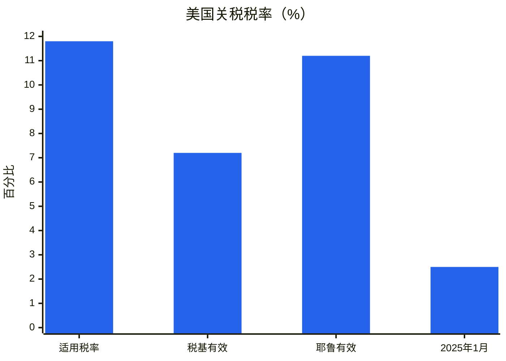

*注：适用法定税率11.8%（两家机构一致）；税收基金会有效税率2026日历年为7.2%（征收关税占进口额的比例）；耶鲁预算实验室2026年11月平均有效税率约为11.2%；2025年1月约为2.5%。来源：税收基金会；耶鲁预算实验室。*

---

## 9. 货运市场

### 集装箱即期运价——德鲁里世界集装箱指数

德鲁里世界集装箱指数11月19日下跌3%，至每40英尺箱4176美元，连续第四周下跌，但仍比去年同期高126%。跨太平洋航线运价连续第七周下跌：上海—纽约下跌9%，至8194美元，为15周最低；上海—洛杉矶下跌5%，至7026美元，为12周最低。上海—热那亚上涨6%，至4436美元，此前三周持平；上海—鹿特丹持平于3496美元。德鲁里预计下周跨太平洋运价将进一步下跌；下周宣布十个空白航次，而本周为四个。该综合指数四周内下跌约9%（从10月22日的4585美元）。集装箱市场进一步分化：跨太平洋运价连续第七周大幅下跌，而地中海运价反弹6%，跨大西洋运价双向上涨2%（鹿特丹—纽约3146美元；纽约—鹿特丹1217美元）。[Drewry](https://www.drewry.co.uk/supply-chain-advisors/world-container-index-weekly-update?topics=Container%20Shipping)

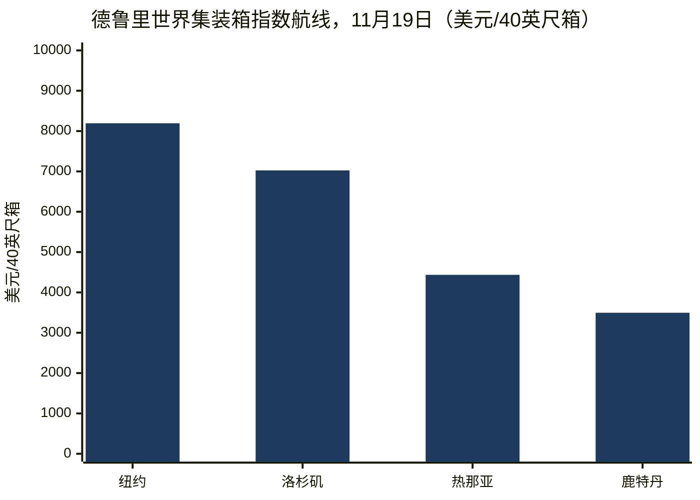

*注：上海始发每40英尺箱即期运价，2026年11月19日。来源：德鲁里世界集装箱指数。*

### Freightos波罗的海指数

Freightos在11月17日的更新中报告称，亚洲—美国西海岸运价为每40英尺箱8459美元（上涨3%），亚洲—美国东海岸为9848美元（上涨1%），亚洲—北欧持平于3407美元，亚洲—地中海为4295美元（下跌1%）。亚洲—欧洲运价比去年同期高40–50%；亚洲—北欧较10月底下跌5%。11月17日更新的全球FBX综合指数为不适用——每周更新未给出全球数字。（追踪数据显示，全球FBX于11月22日为每40英尺箱3419美元；此前每周全球读数为11月10日的3452美元。）Freightos的航线读数在跨太平洋航线上略有上升，而德鲁里同一航线的读数下跌——两项基准衡量不同的运价组合和周次，差距（Freightos亚洲—美国西海岸8459美元对德鲁里上海—洛杉矶7026美元）提醒人们不要混用。Freightos指出，11月份的综合费率上调未能维持，月中涨价计划也可能失败，承运人正在增加空白航次；12月份的涨价已经宣布，若得到春节前需求支撑可能奏效。Freightos关于红海回归加船队增长将加剧明年运力过剩风险的警告，框定了2027年的前景。[Freightos](https://www.freightos.com/freight-resources/us-air-cargo-recovering-from-outage-new-us-cn-tensions-ahead-of-talks-november-17-2026-update/)

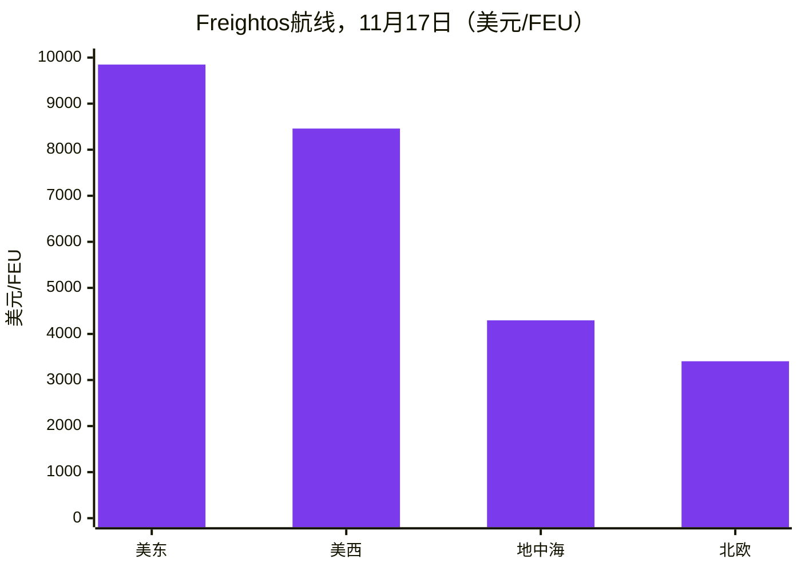

*注：亚洲始发每40英尺箱即期运价，2026年11月17日。来源：Freightos波罗的海指数。*

### 上海出口集装箱运价指数

上海出口集装箱运价指数综合指数11月20日跌至3503.78点，周环比下跌68.55点（下跌1.92%），自11月13日的3572.33点回落——连续第三周下跌，跌幅逐周扩大（下跌1.46%、下跌1.68%、下跌1.92%）；为9月中旬以来最低；三周内自10月30日的3687.35点累计下跌129.67点。上海—美国西海岸每40英尺箱6711美元（下跌400美元，下跌5.63%）；上海—美国东海岸每40英尺箱8776美元（下跌611美元，下跌6.51%）；上海—地中海每标准箱3678美元（上涨1.63%）；上海—欧洲每标准箱2291美元；桑托斯每标准箱3110美元（下跌15.19%）。中国出口集装箱运价指数（合同运价）上涨0.21%，至1923.21点，连续第二周上涨——与即期运价指数走势相背。三项指数（德鲁里、Freightos航线、上海出口集装箱运价指数）如今一致表明，跨太平洋即期市场正大幅回调，进入旺季后的淡季，上海出口集装箱运价指数美国东海岸航线一周内下跌逾600美元。中国出口集装箱运价指数的上涨表明，合同运价的托运人尚未看到好处——这一差距对2027年招标时机很重要。[Forwarder News](https://www.forwardernews.com/news/2026-11-20-scfi-falls-a-third-week)

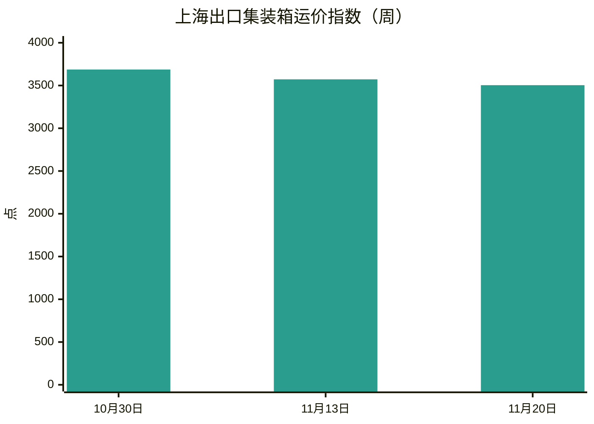

*注：上海出口集装箱运价指数综合指数，每周。来源：上海航运交易所。*

### 11月涨价——已宣布，已打折

承运人已宣布自12月起对亚欧/地中海航线征收每40英尺箱1000–1600美元的旺季附加费。据Freightos称，11月份的综合费率上调未能维持，月中涨价计划也可能失败。12月份的涨价已经宣布，若得到春节前需求支撑可能奏效。秋季的模式——宣布的涨价在需求疲软面前未能维持——如今已成为市场的既定节奏。[Freightos](https://www.freightos.com/freight-resources/us-air-cargo-recovering-from-outage-new-us-cn-tensions-ahead-of-talks-november-17-2026-update/)

### 空白航次与运力

下周宣布十个空白航次，而本周为四个。德鲁里取消航次追踪预计，11月16日至12月21日期间主要东西航线716个预定航次中将有52个空白航次（约7%）。随着跨太平洋市场回调加深，承运人正更加依赖空白航次，而双子星合作的苏伊士回归将在2027年进一步释放运力。[Drewry](https://www.drewry.co.uk/supply-chain-advisors/world-container-index-weekly-update?topics=Container%20Shipping)

### 干散货——波罗的海交易所

波罗的海干散货指数11月20日收于2898点，周环比下跌82点（下跌2.8%），自11月13日的2980点回落——结束连续四周上涨。每日走势：2921点（11月16日星期一）、2893点（星期二）、2914点（星期三）、2901点（星期四）、2898点（星期五）。海岬型指数4502点（周环比下跌4.6%；此前为4719点）；海岬型日均收益40,827美元（星期五；11月17日星期二为37,184美元）。巴拿马型指数2140点（周环比上涨1.0%；此前为2118点），为10月22日以来最高；巴拿马型日均收益19,264美元。超灵便型指数1810点（周环比下跌1.4%；此前为1836点）；日均收益22,884美元。灵便型指数1072点（周环比上涨2.4%）。C5航线（西澳大利亚—青岛铁矿石）周末收于每吨14.40美元，自周中13.40美元的低点回升。干散货在连续四周上涨后转跌，海岬型是主要拖累（周跌4.6%），原因是北大西洋需求减弱和可用船舶名单拉长，而巴拿马型在谷物和煤炭需求推动下升至一个月高点。这种分化——海岬型下跌、巴拿马型上涨——表明铁矿石需求走软而谷物和煤炭贸易保持坚挺，是年末商品需求的有用先行信号。[HandyBulk](https://www.handybulk.com/baltic-dry-index/)

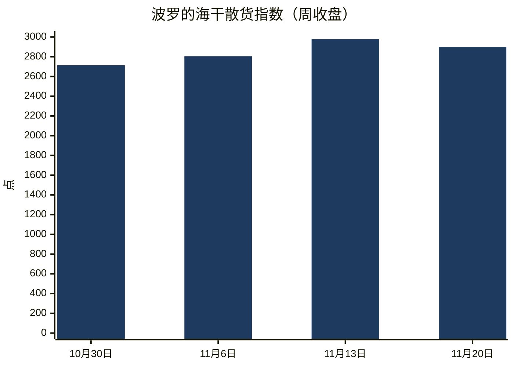

*注：波罗的海干散货指数周收盘价。来源：波罗的海交易所。*

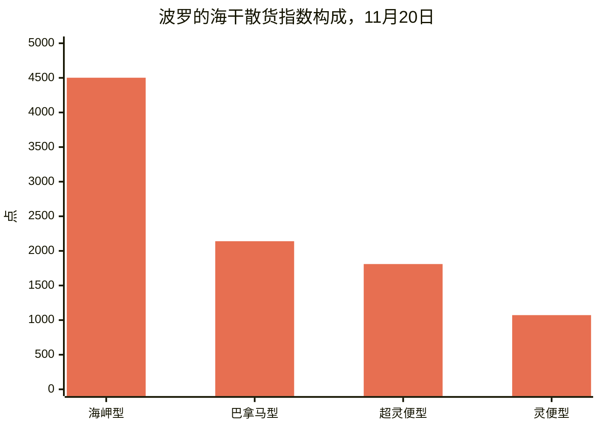

*注：波罗的海交易所分船型指数，2026年11月20日。来源：波罗的海交易所。*

### 苏伊士与准班率

马士基与赫伯罗特于11月16日宣布，其双子星合作的AE1、AE2和AE3航线将恢复经苏伊士航线和红海航行，取代绕行好望角的改道航次。过渡分阶段进行：AE2率先恢复，Mary Maersk轮（650W航次）于12月4日在宁波开始轮换；AE3随后，Alette Maersk轮（652W航次）于12月20日在上海开始；AE1于2027年1月14日开始，Damietta Express轮（702W航次）在上海启航。修订后的轮换包括双向苏伊士运河过境。此举是在AE5、AE11、AE12、ME2和ME1航线较早恢复之后。据Linerlytica称，这三条航线的回归使马士基与赫伯罗特成为首个在所有亚欧航线恢复苏伊士航行的联盟。此举使AE2的船舶数量从14艘减至13艘，AE3从13艘减至11艘，释放运力。马士基表示，这些变化将改善航行时间，同时提醒实施取决于红海持续稳定和对地区安全状况的持续监测。长荣是最后一家恢复苏伊士过境的海洋联盟成员；以星仍是最主要的仍绕行好望角的亚欧航线大型承运人。德鲁里统计，截至11月1日的一周内有53艘集装箱船通过运河，同比增长130%，并估计约60%的亚欧运力已恢复苏伊士航线。DHL估计，更广泛的网络调整可能还需6–12个月。Flexport预测，11月16–22日一周内北欧港口到达运力将达到正常水平的131%，因为集中到达的船舶陆续抵港。[FreightWaves](https://www.freightwaves.com/news/maersk-and-hapag-lloyd-restore-asia-europe-suez-routes-as-u-s-shippers-watch-capacity-and-costs)

### 空运

波罗的海空运指数（BAI00）在截至11月9日的一周内上涨6.6%（同比上涨28.2%），达到2026年最高水平，随后在截至11月16日的七天内下滑1.5%（同比上涨20.8%）。香港出境（BAI30）截至11月16日周环比下跌4.5%（同比上涨19.0%）；上海出境（BAI80）下跌2.7%（同比上涨13.1%）；法兰克福出境（BAI20）下跌2.7%（同比上涨36.4%）；伦敦希思罗出境（BAI40）下跌9.4%（同比上涨2.6%）。芝加哥出境（BAI50）在美国空中交通管制中断后周环比飙升39.2%（同比上涨72.1%）。在截至11月9日的一周内：法兰克福出境周环比上涨9.9%，伦敦上涨5.6%，香港上涨4.6%，上海上涨5.7%。Freightos空运指数（11月17日更新）：中国—北美每公斤9.25美元（周环比上涨16%），高于去年旺季高点每公斤8.00美元（去年仅在12月中旬达到）；中国—北欧每公斤5.05美元（上涨4%）；北欧—北美每公斤3.27美元（上涨12%），为2022年12月以来最高。Xeneta 10月份全球即期均价为每公斤3.11美元（同比上涨29%）。TAC全球即期价格第44周约为每公斤3.93美元（周环比上涨4%，同比上涨约40%）。航油：国际航空运输协会监测数据显示，截至11月6日的一周内下跌6.5%，截至11月13日的一个月内下跌11.7%。[Baltic Exchange](https://www.balticexchange.com/en/news-and-events/news/guest-column/2026/Air-freight-rates-surge-past-previous-peak-season-highs-as-jet-fuel-prices-soar.html)

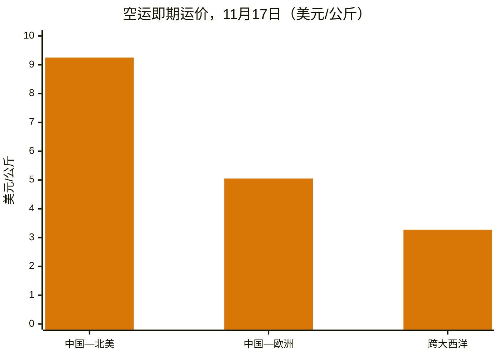

*注：Freightos空运指数，2026年11月17日。中国—北美运价高于2025年旺季高点每公斤8.00美元；跨大西洋运价为2022年12月以来最高。来源：Freightos。*

**中断：**美国空中交通管制系统故障导致11月14–15日周末数千架次航班停飞——11月13日美国联邦航空管理局全国地面停飞（阿肯色州埃尔多拉多一台故障路由器，影响22个空中交通管制中心中的17个）在周末扰乱了逾20,000架次航班，空运积压延续至下一周；美国联邦航空管理局于11月17日暂停安装新路由器，政府将空中交通管制现代化成本估计上调至500亿美元以上。微软的一次中断加剧了扰乱；TAC表示数据比往常更加零散。Freightos表示，赴美国际空运运价并未因此次中断而大幅上涨。空运在截至11月9日的一周内达到2026年高点，驱动因素是芯片和人工智能硬件需求加上旺季货量，中国—北美运价比去年提前一个月超过去年的峰值。11月16日的回落可能只是喘息而非转向：TAC指出，旺季还剩数周。11月23日的比利时空中交通管制罢工紧随十天前的美国联邦航空管理局地面停飞，凸显了本旺季空运基础设施的余量之薄。[Air Cargo News](https://www.aircargonews.net/cargo-airport/2026/11/us-air-cargo-supply-chains-recover-following-ground-stop/)

### 港口与物流中断

**洛杉矶/长滩。**见A7。自11月1日以来笼罩美国最大集装箱门户的罢工威胁，在11月21日最后一刻达成初步协议后解除；批准程序待定，工会尚未公开置评。该综合港区的铁路积压仍然存在（截至11月2日，35,688个进口集装箱等待码头内铁路），据洛杉矶港执行董事称，进口集装箱铁路滞留时间超过九天。文森特·托马斯大桥封闭（11月7日，持续16个月）仍在单独进行。[Maritime Executive](https://maritime-executive.com/article/ports-of-la-and-long-beach-avert-strike-as-watchmen-reach-deal)

**德班。**尽管码头吞吐量有所提高，德班港的拥堵在窗口期内加深：德班门户码头最新报告周处理36,332标准箱（周环比增长28%，为四个月来最强的水侧表现），但船舶平均锚地等待时间从189小时升至263小时（近11天），尽管近海等待船舶从14艘降至11艘。堆场占用率约69%。受影响的供应链面临超过20天的额外端到端延误。交通部长芭芭拉·克里西已给ICTSI三个月时间改善表现，否则可能失去港口牌照（据Moneyweb）。Transnet紧急措施（11月18日）：102号码头分配给有吊机船舶；改道至Ngqura集装箱码头；增加铁路运输；1号码头最后一台翻新岸桥于11月20日调试完成，11月21日移交。德班门户码头承认"持续存在服务不足"，将其归咎于多年投资不足后设备状况不佳且不安全；已承诺三年内投入逾20亿兰特升级2号码头设备。马士基每40英尺箱1000/2000美元的旺季附加费和400/800美元的拥堵费仍然有效。牌照威胁是一次新的升级——国家向私营码头运营商发出最后通牒——三个月窗口持续至2027年2月。[Shipping and Freight Resource](https://shippingandfreightresource.com/transnet-steps-in-to-alleviate-congestion-at-durban-gateway-terminal/)

**巴拿马运河。**夏季降雨低于正常水平曾引发巴拿马运河通行的吃水和每日过境限制，集装箱承运人推出附加费。此后降水好于预期，巴拿马运河管理局得以撤销这些措施。当前水位约为该时节的正常水平，对预期厄尔尼诺现象严重程度的预测已经下调，因此2026年第四季度和2027年上半年出现严重限制的风险评估低于夏季的担忧。取消巴拿马限制，使美国东海岸/墨西哥湾航线的一项附加费驱动因素消失，并减少了一个加剧洛杉矶/长滩铁路积压的日程扰乱来源。[Freightos](https://www.freightos.com/freight-resources/us-air-cargo-recovering-from-outage-new-us-cn-tensions-ahead-of-talks-november-17-2026-update/)

**亚洲内部拥堵。**《劳氏日报》11月20日报道，东南亚转运枢纽日益严重的瓶颈使亚洲内部运价即使在长途即期运价下跌的情况下仍保持坚挺，印度—海湾托运人除运价上涨外，还面临昂贵的集装箱返还成本。所查阅的标题中未公布数字。[The Loadstar](https://theloadstar.com/)

**美国进口展望。**据笛卡尔称，美国集装箱进口10月份打破四年货量纪录，来自中国的货量连续第四个月攀升，接近988,000标准箱，为2025年1月以来最高。洛杉矶港10月份处理1,026,872标准箱，创当月纪录，为有记录以来第二高月份，仅次于9月份的1,042,652标准箱。美国铁路货车装载量10月份平均为233,193辆，同比增长3.4%，连续第十个月同比增长；美国多式联运量截至10月达12,271,905单位，同比增长4.7%，10月份同比增长9.6%，创历史货量纪录。卡斯货运指数显示，10月份货运量为1.056，同比增长5.9%；支出为4.010，同样同比增长5.9%。FTR卡车运输状况指数9月份为8.13，低于8月份的11.5。全球港口追踪（11月9日）预计，随着延长旺季结束，美国港口进口量将在2026年余下时间下降：2026年9月装载进口224万标准箱（2026年最繁忙月份；环比增长3.4%，同比增长12.6%）；预测10月226万标准箱（同比增长9.1%）；11月205万标准箱（增长1.2%）；12月203万标准箱（增长1.3%）。2026年全年约2600万标准箱（比2025年的2540万标准箱增长2%）——高于10月份预测的2580万标准箱。2027年初：1月204万标准箱（同比下降3%）；2月189万标准箱（下降0.5%）；3月192万标准箱（下降11.2%）。尽管即期运价走软，美国创纪录的进口量仍持续至10月，表明在1月停战截止日期和12月多晶硅措施之前存在提前出货。[FreightWaves](https://www.freightwaves.com/news/retailers-forecast-u-s-imports-to-stay-elevated-through-2026-after-breakout-peak-season)

**小项。**孟加拉国服装出口商在数周中断后转向成本高昂的空运以满足交货期限，买家转而他处采购（《劳氏日报》，11月23日）。Expeditors在数十年有机增长后正重新考虑收购策略，已在评估技术领域的机会；美国Neovia公司和土耳其Ekol公司的出售标志着并购重返合同物流领域（《劳氏日报》，11月19日）。俄罗斯北方海航道货运量首次超过4000万吨，创北极航线纪录，尽管普京总统对该航线的雄心仍未实现（gCaptain，11月23日）。联邦快递开通连接上海和广州制造枢纽与美国目的地的每周航线，以支持人工智能驱动的需求（Supply Chain Dive）。

### 供应商情报

窗口期内未记录符合条件的供应商事项。笛卡尔窗口期内唯一的新闻事项是一项行业奖项（11月17日，在ARC咨询集团《运输管理系统全球市场研究报告》中被评为北美领先的运输管理系统提供商）。TradeInt 11月22日的博客批次是源自其自身数据库、涵盖2026年上半年及更早时期的数据营销内容，并附有"解锁数据"行动号召；俄罗斯一文报告的901%同比增长是数据集覆盖范围的产物，而非贸易变动。笛卡尔11月份《全球航运报告》（11月11日）报告2026年10月美国集装箱进口创纪录的2,674,808标准箱，已于上周报告。笛卡尔2027财年第三季度业绩要到2026年12月初才公布。[Descartes](https://www.descartes.com/resources/knowledge-center/descartes-releases-november-global-shipping-report-us-container-imports); [TradeInt](https://tradeint.com/insights/blogs/)

---

## 10. 政策时间线

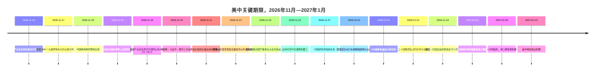

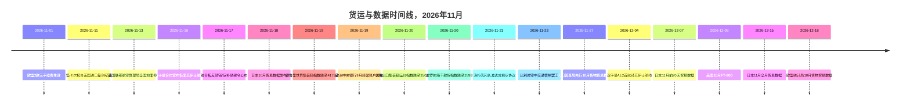

---

## 11. 未来90天重要期限与事件

| 日期 | 事项 |
|---|---|
| 2026年11月23日 | 世贸组织农业委员会就出口限制和特殊保障机制举行会议；美国国际贸易委员会太阳能第四案完整报告（第5804号出版物）到期。 |
| 2026年11月24日 | 比利时空中交通管制罢工的连锁中断预计延续至星期二。 |
| 2026年11月27日 | 中国2025年第72号公告暂停对美出口镓、锗、锑和超硬材料的推定拒绝许可原则，预定失效，除非进一步暂停或修订；人口普查局先行10月货物贸易指标到期。 |
| 2026年11月29日 | 针对商务部《两用物项出口管制调查与执法措施（草案）》的意见征集截止。 |
| 2026年11月30日 | 商务部针对中国镀锡板产品的最终倾销和补贴裁定到期，除非延期。 |
| 2026年12月1日 | 欧盟混合动力车保障措施临时措施预计出台；加拿大取消某些拖车的横向关税减免；意大利国家2欧元小包裹费用生效；众议院民主党人要求卢特尼克就Megaspeed和实体清单作出书面答复的截止日期。 |
| 2026年12月4日 | 232条款多晶硅关税生效；双子星AE2首航经苏伊士航线自宁波出发；海洋环境保护委员会第85届会议特别会议暂定举行。 |
| 2026年12月7日 | 针对海关与边境保护局低价值货物拟议规则（91 FR 64532；案卷USCBP-2026-0298）的意见征集截止；日本11月前20天贸易数据。 |
| 2026年12月8日 | 美国10月FT-900贸易数据发布。 |
| 2026年12月10日 | 卢特尼克出席参议院银行委员会作证（Megaspeed/实体清单）。 |
| 2026年12月11日 | *Gellert v. Trump*案（338条款）政府答辩状到期；欧盟—印度尼西亚：普拉博沃总统访问布鲁塞尔。 |
| 2026年12月14–15日 | 二十国集团领导人在迈阿密举行会议。 |
| 2026年12月15日 | 日本11月全月贸易数据。 |
| 2026年12月16日 | 据报道，欧盟—印度自由贸易协定将在布鲁塞尔签署，莫迪总理预计出席。 |
| 2026年12月17日 | 商务部拟在木柜和木制品复审中发布评估指令的最早日期（11月12日公布后35天）。 |
| 2026年12月18日 | 欧盟统计局10月货物贸易数据；欧洲中央银行10月国际收支数据。 |
| 2026年12月20日 | 双子星AE3首航经苏伊士航线自上海出发。 |
| 2027年1月1日 | 232条款税率上调至软垫家具30%、厨房橱柜和浴室柜50%；针对加拿大车辆、汽车零部件和钢铁的50%关税也以该日期为目标；英国碳边境调节机制启动；英欧更严格的电动汽车原产地规则生效；《非洲增长与机遇法案》对卢旺达和南非的终止拟生效（仍须发布公告）。 |
| 2027年1月3日 | 新一届美国国会就职。 |
| 2027年1月5日 | 海关与边境保护局外国备案进口商临时最终规则生效；意见征集同日截止（案卷USCBP-2026-1387）。 |
| 2027年1月9–10日 | 美中停战期限汇合：178项301条款豁免和海事费用暂停于1月9日到期；美国产业安全局《关联企业规则》暂停和中国对等暂停于1月10日到期。 |
| 2027年1月11–12日 | 商务部针对中国CBS橡胶促进剂的最终反倾销/反补贴裁定到期。 |
| 2027年1月11日 | *Gellert v. Trump*案答复状到期。 |
| 2027年1月12日 | 《美墨加协定》联合审查磋商书面意见和听证参与请求截止（案卷USTR-2026-0595和USTR-2026-0596）。 |
| 2027年1月14日 | 双子星AE1首航经苏伊士航线自上海出发。 |
| 2027年1月19日 | 商务部针对土耳其镀锡板产品的最终倾销裁定到期；针对美国产业安全局远程访问芯片规则的意见征集截止。 |
| 2027年1月20日 | 须缴纳201、232或301条款关税或须遵守伙伴政府机构要求的邮件正式报关成为强制性要求；*Gellert v. Trump*案口头辩论。 |
| 2027年1月30日 | 英国针对土耳其虹鳟鱼的反补贴税变更自该日起适用（2026/31号通知）。 |
| 2027年2月1日 | 加拿大取消某些铝线和铝型材及纸板产品的横向关税减免。 |
| 2027年2月6日 | 农历新年。 |
| 2027年2月11日 | 商务部针对中国塑料气球的初步反补贴裁定（预计）。 |
| 2027年2月17日 | 美国产业安全局远程访问芯片规则：90天数据中心许可过渡期结束（约）。 |
| 2027年2月28日 | 美国贸易代表办公室针对越南知识产权301条款调查的决定截止日期。 |
| 2027年3月 | 美国贸易代表办公室301条款结构性产能过剩调查决定预计出台（2027年3月前到期）；欧盟—印度自由贸易协定据报道于2027年3月或4月生效。 |
| 2027年3月25日 | 商务部针对台湾镀锡板产品的最终倾销裁定到期。 |
| 2027年4月27日 | 商务部针对中国塑料气球的初步反倾销裁定（预计）。 |
| 2027年5月6日 | 外国备案进口商规则全面合规预计完成。 |
| 2027年6月30日 | 加拿大横向关税减免延长至该日期。 |

---

## 12. 来源与方法

覆盖窗口：2026年11月16–23日。汇编自全球约45家贸易新闻、政策、数据与货运来源。

来源包括：FreightWaves、The Loadstar、Splash247、gCaptain、Hellenic Shipping News、Container News、Supply Chain Dive、Logistics Management、Air Cargo News、Port Technology、TradeInt insights blog；whitehouse.gov、cbp.gov、ustr.gov、federalregister.gov、trade.gov、usitc.gov、bis.doc.gov、JD Supra；ec.europa.eu、gov.uk、cbsa-asfc.gc.ca、canada.ca/en/department-finance、english.mofcom.gov.cn；wto.org、unctad.org、intracen.org、wcoomd.org；dataweb.usitc.gov、ustradecensus.gov、comtradeplus.un.org、wits.worldbank.org、eurostat、data.worldbank.org、imf.org；taxfoundation.org、budgetlab.yale.edu、tradeintelligence.eu；drewry.co.uk、balticexchange.com、freightos.com；descartes.com、tradeint.com。

11月16日之前的事项仅作为后续跟进、落入窗口期的《联邦公报》发布，或窗口期内某项期限的背景出现。Container News仅返回一条Cookie同意通知，未产生可用内容；世贸组织新闻索引通过抓取未返回可读文本，因此世贸组织事项使用经转载的世贸组织新闻稿；商务部英文网站仅可访问首页标题，其公告的实质内容无法根据审查信息确认。TradeInt在窗口期内没有符合条件的供应商事项：其11月22日的博客批次是源自其自身数据库的数据营销内容。未发现美国国际贸易委员会DataWeb、联合国商品贸易统计数据库、WITS、世界银行或国际货币基金组织门户的重大新窗口期内发布。窗口期内未发现新的暂扣放行令。《联邦公报》未逐份扫过整周文件；可能存在其他行政复审通知。据报道，301条款产能过剩调查将于年底前结束，这一说法基于对11月21日一次电视采访的单一贸易媒体报道；截至11月23日，尚未出现美国贸易代表办公室的通知。欧盟11月17日俄罗斯名单数量（49）据Youverify监测机构报道，未对照欧盟名单本身核实。
